## Table of Contents

2.1 General Installation Guidance ..................................................................................................... 64

2.1.1 Supported Platforms ........................................................................................................ 64

2.1.2 Which MySQL Version and Distribution to Install ............................................................... 64

2.1.3 How to Get MySQL ......................................................................................................... 65

2.1.4 Verifying Package Integrity Using MD5 Checksums or GnuPG ........................................... 65

2.1.5 Installation Layouts .......................................................................................................... 82

2.1.6 Compiler-Specific Build Characteristics ............................................................................. 82

2.2 Installing MySQL on Unix/Linux Using Generic Binaries ................................................................ 82

2.3 Installing MySQL on Microsoft Windows ...................................................................................... 85

2.3.1 MySQL Installation Layout on Microsoft Windows .............................................................. 88

2.3.2 Choosing an Installation Package ..................................................................................... 89

2.3.3 MySQL Installer for Windows ........................................................................................... 90

2.3.4 Installing MySQL on Microsoft Windows Using a `noinstall` ZIP Archive ......................... 122

2.3.5 Troubleshooting a Microsoft Windows MySQL Server Installation ...................................... 130

2.3.6 Windows Postinstallation Procedures .............................................................................. 131

2.3.7 Windows Platform Restrictions ........................................................................................ 133

2.4 Installing MySQL on macOS ..................................................................................................... 135

2.4.1 General Notes on Installing MySQL on macOS ............................................................... 135

2.4.2 Installing MySQL on macOS Using Native Packages ....................................................... 136

2.4.3 Installing a MySQL Launch Daemon ............................................................................... 141

2.4.4 Installing and Using the MySQL Preference Pane ............................................................ 143

2.5 Installing MySQL on Linux ........................................................................................................ 148

2.5.1 Installing MySQL on Linux Using the MySQL Yum Repository .......................................... 149

2.5.2 Replacing a Third-Party Distribution of MySQL Using the MySQL Yum Repository ............. 153

2.5.3 Installing MySQL on Linux Using the MySQL APT Repository .......................................... 155

2.5.4 Installing MySQL on Linux Using the MySQL SLES Repository ........................................ 155

2.5.5 Installing MySQL on Linux Using RPM Packages from Oracle .......................................... 156

2.5.6 Installing MySQL on Linux Using Debian Packages from Oracle ....................................... 159

2.5.7 Installing MySQL on Linux from the Native Software Repositories ..................................... 161

2.5.8 Deploying MySQL on Linux with Docker ......................................................................... 165

2.5.9 Installing MySQL on Linux with Juju ............................................................................... 173

2.6 Installing MySQL Using Unbreakable Linux Network (ULN) ......................................................... 173

2.7 Installing MySQL on Solaris ...................................................................................................... 173

2.7.1 Installing MySQL on Solaris Using a Solaris PKG ............................................................ 174

2.8 Installing MySQL on FreeBSD ................................................................................................... 175

2.9 Installing MySQL from Source ................................................................................................... 176

2.9.1 Source Installation Methods ............................................................................................ 176

2.9.2 Source Installation Prerequisites ..................................................................................... 176

2.9.3 MySQL Layout for Source Installation ............................................................................. 178

2.9.4 Installing MySQL Using a Standard Source Distribution ................................................... 178

2.9.5 Installing MySQL Using a Development Source Tree ....................................................... 182

2.9.6 Configuring SSL Library Support ..................................................................................... 184

2.9.7 MySQL Source-Configuration Options ............................................................................. 185

2.9.8 Dealing with Problems Compiling MySQL ....................................................................... 201

2.9.9 MySQL Configuration and Third-Party Tools .................................................................... 203

2.10 Postinstallation Setup and Testing ........................................................................................... 203

2.10.1 Initializing the Data Directory ........................................................................................ 204

2.10.2 Starting the Server ....................................................................................................... 207

2.10.3 Testing the Server ....................................................................................................... 209

2.10.4 Securing the Initial MySQL Accounts ............................................................................ 211

2.10.5 Starting and Stopping MySQL Automatically .................................................................. 216

2.11 Upgrading MySQL .................................................................................................................. 217

2.11.1 Before You Begin ......................................................................................................... 217

2.11.2 Upgrade Paths ............................................................................................................. 218

2.11.3 Changes in MySQL 5.6 ................................................................................................ 218

2.11.4 Upgrading MySQL Binary or Package-based Installations on Unix/Linux .......................... 225

2.11.5 Upgrading MySQL with the MySQL Yum Repository ...................................................... 227

2.11.6 Upgrading MySQL with the MySQL APT Repository ...................................................... 229

2.11.7 Upgrading MySQL with the MySQL SLES Repository .................................................... 229

2.11.8 Upgrading MySQL on Windows .................................................................................... 229

2.11.9 Upgrade Troubleshooting .............................................................................................. 231

2.11.10 Rebuilding or Repairing Tables or Indexes .................................................................. 232

2.11.11 Copying MySQL Databases to Another Machine .......................................................... 233

2.12 Downgrading MySQL .............................................................................................................. 234

2.12.1 Before You Begin ......................................................................................................... 234

2.12.2 Downgrade Paths ......................................................................................................... 235

2.12.3 Downgrade Notes ........................................................................................................ 235

2.12.4 Downgrading Binary and Package-based Installations on Unix/Linux ............................... 237

2.12.5 Downgrade Troubleshooting ......................................................................................... 239

2.13 Perl Installation Notes ............................................................................................................. 239

2.13.1 Installing Perl on Unix .................................................................................................. 239

2.13.2 Installing ActiveState Perl on Windows .......................................................................... 240

2.13.3 Problems Using the Perl DBI/DBD Interface .................................................................. 241 This chapter describes how to obtain and install MySQL. A summary of the procedure follows and later sections provide the details. If you plan to upgrade an existing version of MySQL to a newer version rather than install MySQL for the first time, see Section 2.11, “Upgrading MySQL”, for information about upgrade procedures and about issues that you should consider before upgrading.

If you are interested in migrating to MySQL from another database system, see Section A.8, “MySQL 5.6 FAQ: Migration”, which contains answers to some common questions concerning migration issues.

Installation of MySQL generally follows the steps outlined here:

1. Determine whether MySQL runs and is supported on your platform.

Please note that not all platforms are equally suitable for running MySQL, and that not all platforms on which MySQL is known to run are officially supported by Oracle Corporation. For information about those platforms that are officially supported, see https://www.mysql.com/support/supportedplatforms/database.html on the MySQL website.

2. Choose which distribution to install.

Several versions of MySQL are available, and most are available in several distribution formats. You can choose from pre-packaged distributions containing binary (precompiled) programs or source code.

When in doubt, use a binary distribution. Oracle also provides access to the MySQL source code for those who want to see recent developments and test new code. To determine which version and type of distribution you should use, see Section 2.1.2, “Which MySQL Version and Distribution to Install”.

3. Download the distribution that you want to install.

For instructions, see Section 2.1.3, “How to Get MySQL”. To verify the integrity of the distribution, use the instructions in Section 2.1.4, “Verifying Package Integrity Using MD5 Checksums or GnuPG”.

4. Install the distribution.

To install MySQL from a binary distribution, use the instructions in Section 2.2, “Installing MySQL on Unix/Linux Using Generic Binaries”.

To install MySQL from a source distribution or from the current development source tree, use the instructions in Section 2.9, “Installing MySQL from Source”.

5. Perform any necessary postinstallation setup.

After installing MySQL, see Section 2.10, “Postinstallation Setup and Testing” for information about making sure the MySQL server is working properly. Also refer to the information provided in Section 2.10.4, “Securing the Initial MySQL Accounts”. This section describes how to secure the initial MySQL user accounts, which have no passwords until you assign passwords. The section applies whether you install MySQL using a binary or source distribution.

6. If you want to run the MySQL benchmark scripts, Perl support for MySQL must be available. See

Section 2.13, “Perl Installation Notes”.

Instructions for installing MySQL on different platforms and environments is available on a platform by platform basis:

- Unix, Linux, FreeBSD

For instructions on installing MySQL on most Linux and Unix platforms using a generic binary (for example, a `.tar.gz` package), see Section 2.2, “Installing MySQL on Unix/Linux Using Generic Binaries”.

For information on building MySQL entirely from the source code distributions or the source code repositories, see Section 2.9, “Installing MySQL from Source”For specific platform help on installation, configuration, and building from source see the corresponding platform section:

- Linux, including notes on distribution specific methods, see Section 2.5, “Installing MySQL on Linux”.
- Solaris, including PKG and IPS formats, see Section 2.7, “Installing MySQL on Solaris”.
- IBM AIX, see Section 2.7, “Installing MySQL on Solaris”.
- FreeBSD, see Section 2.8, “Installing MySQL on FreeBSD”.
- Microsoft Windows

For instructions on installing MySQL on Microsoft Windows, using either the MySQL Installer or Zipped binary, see Section 2.3, “Installing MySQL on Microsoft Windows”.

For details and instructions on building MySQL from source code using Microsoft Visual Studio, see Section 2.9, “Installing MySQL from Source”.

- macOS

For installation on macOS, including using both the binary package and native PKG formats, see Section 2.4, “Installing MySQL on macOS”.

For information on making use of an macOS Launch Daemon to automatically start and stop MySQL,see Section 2.4.3, “Installing a MySQL Launch Daemon”.

General Installation Guidance For information on the MySQL Preference Pane, see Section 2.4.4, “Installing and Using the MySQL Preference Pane”.

## 2.1 General Installation Guidance

The immediately following sections contain the information necessary to choose, download, and verify your distribution. The instructions in later sections of the chapter describe how to install the distribution that you choose. For binary distributions, see the instructions at Section 2.2, “Installing MySQL on Unix/Linux Using Generic Binaries” or the corresponding section for your platform if available. To build MySQL from source,use the instructions in Section 2.9, “Installing MySQL from Source”.

### 2.1.1 Supported Platforms

MySQL platform support evolves over time; please refer to https://www.mysql.com/support/supportedplatforms/database.html for the latest updates.

### 2.1.2 Which MySQL Version and Distribution to Install

When preparing to install MySQL, decide which version and distribution format (binary or source) to use.

First, decide whether to install a development release or a General Availability (GA) release. Development releases have the newest features, but are not recommended for production use. GA releases, also called production or stable releases, are meant for production use. We recommend using the most recent GA release.

The naming scheme in MySQL 5.6 uses release names that consist of three numbers and an optional suffix; for example, mysql-5.6.1-m1. The numbers within the release name are interpreted as follows:

- The first number (5) is the major version number.
- The second number (6) is the minor version number. Taken together, the major and minor numbers

constitute the release series number. The series number describes the stable feature set.

- The third number (1) is the version number within the release series. This is incremented for each new

bugfix release. In most cases, the most recent version within a series is the best choice.

Release names can also include a suffix to indicate the stability level of the release. Releases within a series progress through a set of suffixes to indicate how the stability level improves. The possible suffixes are:

- mN (for example, m1, m2, m3, ...) indicates a milestone number. MySQL development uses a milestone

model, in which each milestone introduces a small subset of thoroughly tested features. Following the releases for one milestone, development proceeds with another small number of releases that focuses on the next set of features. From one milestone to the next, feature interfaces may change or features may even be removed, based on feedback provided by community members who try these early releases. Features within milestone releases may be considered to be of pre-production quality.

- rc indicates a Release Candidate (RC). Release candidates are believed to be stable, having passed all

of MySQL's internal testing. New features may still be introduced in RC releases, but the focus shifts to fixing bugs to stabilize features introduced earlier within the series.

- Absence of a suffix indicates a General Availability (GA) or Production release. GA releases are stable,

having successfully passed through the earlier release stages, and are believed to be reliable, free of serious bugs, and suitable for use in production systems.

How to Get MySQL Development within a series begins with milestone releases, followed by RC releases, and finally reaches GA status releases.

After choosing which MySQL version to install, decide which distribution format to install for your operating system. For most use cases, a binary distribution is the right choice. Binary distributions are available in native format for many platforms, such as RPM packages for Linux or DMG packages for macOS.

Distributions are also available in more generic formats such as Zip archives or compressed `tar` files. On Windows, you can use the MySQL Installer to install a binary distribution.

Under some circumstances, it may be preferable to install MySQL from a source distribution:

- You want to install MySQL at some explicit location. The standard binary distributions are ready to run at

any installation location, but you might require even more flexibility to place MySQL components where you want.

- You want to configure `mysqld` with features that might not be included in the standard binary

distributions. Here is a list of the most common extra options used to ensure feature availability:

- `-DWITH_LIBWRAP=1` for TCP wrappers support.
- `-DWITH_ZLIB={system|bundled}` for features that depend on compression
- `-DWITH_DEBUG=1` for debugging support

For additional information, see Section 2.9.7, “MySQL Source-Configuration Options”.

- You want to configure `mysqld` without some features that are included in the standard binary

distributions. For example, distributions normally are compiled with support for all character sets. If you want a smaller MySQL server, you can recompile it with support for only the character sets you need.

- You want to read or modify the C and C++ code that makes up MySQL. For this purpose, obtain a

source distribution.

- Source distributions contain more tests and examples than binary distributions.

### 2.1.3 How to Get MySQL

Check our downloads page at https://dev.mysql.com/downloads/ for information about the current version of MySQL and for downloading instructions.

For RPM-based Linux platforms that use Yum as their package management system, MySQL can be installed using the MySQL Yum Repository. See Section 2.5.1, “Installing MySQL on Linux Using the MySQL Yum Repository” for details.

For Debian-based Linux platforms, MySQL can be installed using the MySQL APT Repository. See Section 2.5.3, “Installing MySQL on Linux Using the MySQL APT Repository” for details.

For SUSE Linux Enterprise Server (SLES) platforms, MySQL can be installed using the MySQL SLES Repository. See Section 2.5.4, “Installing MySQL on Linux Using the MySQL SLES Repository” for details.

To obtain the latest development source, see Section 2.9.5, “Installing MySQL Using a Development Source Tree”.

### 2.1.4 Verifying Package Integrity Using MD5 Checksums or GnuPG

After downloading the MySQL package that suits your needs and before attempting to install it, make sure that it is intact and has not been tampered with. There are three means of integrity checking:Verifying Package Integrity Using MD5 Checksums or GnuPG

- MD5 checksums
- Cryptographic signatures using `GnuPG`, the GNU Privacy Guard
- For RPM packages, the built-in RPM integrity verification mechanism

The following sections describe how to use these methods.

If you notice that the MD5 checksum or GPG signatures do not match, first try to download the respective package one more time, perhaps from another mirror site.

#### 2.1.4.1 Verifying the MD5 Checksum

After you have downloaded a MySQL package, you should make sure that its MD5 checksum matches the one provided on the MySQL download pages. Each package has an individual checksum that you can verify against the package that you downloaded. The correct MD5 checksum is listed on the downloads page for each MySQL product, and you compare it against the MD5 checksum of the file (product) that you download.

Each operating system and setup offers its own version of tools for checking the MD5 checksum. Typically the command is named `md5sum`, or it may be named `md5`, and some operating systems do not ship it at all. On Linux, it is part of the GNU Text Utilities package, which is available for a wide range of platforms.

You can also download the source code from http://www.gnu.org/software/textutils/. If you have OpenSSL installed, you can use the command `openssl md5 package_name` instead. A Windows implementation of the `md5` command line utility is available from http://www.fourmilab.ch/md5/. `winMd5Sum` is a graphical MD5 checking tool that can be obtained from http://www.nullriver.com/index/products/winmd5sum. Our Microsoft Windows examples assume the name `md5.exe`.

Linux and Microsoft Windows examples:

```
$> md5sum mysql-standard-5.6.51-linux-i686.tar.gz
aaab65abbec64d5e907dcd41b8699945  mysql-standard-5.6.51-linux-i686.tar.gz
$> md5.exe mysql-installer-community-5.6.51.msi
aaab65abbec64d5e907dcd41b8699945  mysql-installer-community-5.6.51.msi
```

You should verify that the resulting checksum (the string of hexadecimal digits) matches the one displayed on the download page immediately below the respective package.

Note Make sure to verify the checksum of the archive file (for example, the `.zip`,`.tar.gz`, or `.msi` file) and not of the files that are contained inside of the archive.

In other words, verify the file before extracting its contents.

#### 2.1.4.2 Signature Checking Using GnuPG

Another method of verifying the integrity and authenticity of a package is to use cryptographic signatures.

This is more reliable than using MD5 checksums, but requires more work.

We sign MySQL downloadable packages with `GnuPG` (GNU Privacy Guard). `GnuPG` is an Open Source alternative to the well-known Pretty Good Privacy (`PGP`) by Phil Zimmermann. Most Linux distributions ship with `GnuPG` installed by default. Otherwise, see http://www.gnupg.org/ for more information about `GnuPG`and how to obtain and install it.

To verify the signature for a specific package, you first need to obtain a copy of our public GPG build key, which you can download from http://pgp.mit.edu/. The key that you want to obtain is named `mysql-``build@oss.oracle.com`. After obtaining this key, you should compare it with the key shown following,Verifying Package Integrity Using MD5 Checksums or GnuPG before using it verify MySQL packages. Alternatively, you can copy and paste the key directly from the text shown here:

```
-----BEGIN PGP PUBLIC KEY BLOCK-----
Version: SKS 1.1.6
Comment: Hostname: pgp.mit.edu
mQGiBD4+owwRBAC14GIfUfCyEDSIePvEW3SAFUdJBtoQHH/nJKZyQT7h9bPlUWC3RODjQRey
CITRrdwyrKUGku2FmeVGwn2u2WmDMNABLnpprWPkBdCk96+OmSLN9brZfw2vOUgCmYv2hW0h
yDHuvYlQA/BThQoADgj8AW6/0Lo7V1W9/8VuHP0gQwCgvzV3BqOxRznNCRCRxAuAuVztHRcE
AJooQK1+iSiunZMYD1WufeXfshc57S/+yeJkegNWhxwR9pRWVArNYJdDRT+rf2RUe3vpquKN
QU/hnEIUHJRQqYHo8gTxvxXNQc7fJYLVK2HtkrPbP72vwsEKMYhhr0eKCbtLGfls9krjJ6sB
gACyP/Vb7hiPwxh6rDZ7ITnEkYpXBACmWpP8NJTkamEnPCia2ZoOHODANwpUkP43I7jsDmgt
obZX9qnrAXw+uNDIQJEXM6FSbi0LLtZciNlYsafwAPEOMDKpMqAK6IyisNtPvaLd8lH0bPAn
Wqcyefeprv0sxxqUEMcM3o7wwgfN83POkDasDbs3pjwPhxvhz6//62zQJ7Q2TXlTUUwgUmVs
ZWFzZSBFbmdpbmVlcmluZyA8bXlzcWwtYnVpbGRAb3NzLm9yYWNsZS5jb20+iEYEEBECAAYF
AlldBJ4ACgkQvcMmpx2w8a2MYQCgga9wXfwOe/52xg0RTkhsbDQhvdAAn30njwoLBhKdDBxk
hVmwZQvzdYYNiGYEExECACYCGyMGCwkIBwMCBBUCCAMEFgIDAQIeAQIXgAUCTnc+KgUJE/sC
FQAKCRCMcY07UHLh9SbMAJ4l1+qBz2BZNSGCZwwA6YbhGPC7FwCgp8z5TzIw4YQuL5NGJ/sy
0oSazqmIZgQTEQIAJgUCTnc9dgIbIwUJEPPzpwYLCQgHAwIEFQIIAwQWAgMBAh4BAheAAAoJ
EIxxjTtQcuH1Ut4AoIKjhdf70899d+7JFq3LD7zeeyI0AJ9Z+YyE1HZSnzYi73brScilbIV6
sYhpBBMRAgApAhsjBgsJCAcDAgQVAggDBBYCAwECHgECF4ACGQEFAlGUkToFCRU3IaoACgkQ
jHGNO1By4fWLQACfV6wP8ppZqMz2Z/gPZbPP7sDHE7EAn2kDDatXTZIR9pMgcnN0cff1tsX6
iGkEExECACkCGyMGCwkIBwMCBBUCCAMEFgIDAQIeAQIXgAIZAQUCUwHUZgUJGmbLywAKCRCM
cY07UHLh9V+DAKCjS1gGwgVI/eut+5L+l2v3ybl+ZgCcD7ZoA341HtoroV3U6xRD09fUgeqI
bAQTEQIALAIbIwIeAQIXgAIZAQYLCQgHAwIGFQoJCAIDBRYCAwEABQJYpXsIBQkeKT7NAAoJ
EIxxjTtQcuH1wrMAnRGuZVbriMR077KTGAVhJF2uKJiPAJ9rCpXYFve2IdxST2i7w8nygefV
a4hsBBMRAgAsAhsjAh4BAheAAhkBBgsJCAcDAgYVCgkIAgMFFgIDAQAFAlinBSAFCR4qyRQA
CgkQjHGNO1By4fVXBQCeOqVMlXfAWdq+QqaTAtbZskN3HkYAn1T8LlbIktFREeVlKrQEA7fg
6HrQiGwEExECACwCGyMCHgECF4ACGQEGCwkIBwMCBhUKCQgCAwUWAgMBAAUCXEBY+wUJI87e
5AAKCRCMcY07UHLh9RZPAJ9uvm0zlzfCN+DHxHVaoFLFjdVYTQCfborsC9tmEZYawhhogjeB
kZkorbyJARwEEAECAAYFAlAS6+UACgkQ8aIC+GoXHivrWwf/dtLk/x+NC2VMDlg+vOeM0qgG
1IlhXZfiNsEisvvGaz4m8fSFRGe+1bvvfDoKRhxiGXU48RusjixzvBb6KTMuY6JpOVfz9Dj3
H9spYriHa+i6rYySXZIpOhfLiMnTy7NH2OvYCyNzSS/ciIUACIfH/2NH8zNT5CNF1uPNRs7H
sHzzz7pOlTjtTWiF4cq/Ij6Z6CNrmdj+SiMvjYN9u6sdEKGtoNtpycgD5HGKR+I7Nd/7v56y
haUe4FpuvsNXig86K9tI6MUFS8CUyy7Hj3kVBZOUWVBM053knGdALSygQr50DA3jMGKVl4Zn
Hje2RVWRmFTr5YWoRTMxUSQPMLpBNIkBHAQQAQIABgUCU1B+vQAKCRAohbcD0zcc8dWwCACW
XXWDXIcAWRUw+j3ph8dr9u3SItljn3wBc7clpclKWPuLvTz7lGgzlVB0s8hH4xgkSA+zLzl6
u56mpUzskFl7f1I3Ac9GGpM40M5vmmR9hwlD1HdZtGfbD+wkjlqgitNLoRcGdRf/+U7x09Gh
SS7Bf339sunIX6sMgXSC4L32D3zDjF5icGdb0kj+3lCrRmp853dGyA3ff9yUiBkxcKNawpi7
Vz3D2ddUpOF3BP+8NKPg4P2+srKgkFbd4HidcISQCt3rY4vaTkEkLKg0nNA6U4r0YgOa7wIT
SsxFlntMMzaRg53QtK0+YkH0KuZR3GY8B7pi+tlgycyVR7mIFo7riQEcBBABAgAGBQJcSESc
AAoJENwpi/UwTWr2X/YH/0JLr/qBW7cDIx9admk5+vjPoUl6U6SGzCkIlfK24j90kU0oJxDn
FVwc9tcxGtxK8n6AEc5G0FQzjuXeYQ1SAHXquZ9CeGjidmsrRLVKXwOIcFZPBmfS9JBzdHa9
W1b99NWHOehWWnyIITVZ1KeBLbI7uoyXkvZgVp0REd37XWGgYEhT0JwAXnk4obH6djY3T/Hf
D70piuvFU7w84IRAqevUcaDppU/1QluDiOnViq6MAki85Z+uoM6ojUZtwmqXDSYIPzRHctfx
Vdv3HS423RUvcfpMUGG94r7tTOSXhHS9rcs6lzLnKl84J0xzI5bWS/Fw+5h40Gpd4HTR/kiE
Xu2JARwEEAEIAAYFAlaBV3QACgkQRm7hv+CThQqT0wf9Ge3sRxw+NIkLkKsHYBTktjYOyv49
48ja5s9awR0bzapKOMaluEgfwtKD8/NCgYeIVYyaZlYmS1FP51yAtuzdvZXAI0DAITyM4d1S
RCESjCCiZ028eIEcoeM/j+UXrwo4+I7/abFhiSakzsFZ/eQHnsMnkJOLf8kug3vMXjSoiz+n
T14++fBK2mCVtu1Sftc877X8R7xUfOKYAGibnY+RAi7E2JVTMtWfdtJaqt3l5y6ouTrLOM9d
3ZeEMdYL1PCmXrwZ4+u7oTNC26yLSbpL+weAReqH8jGsVlUmWWMXvkm+ixmrnN66WvSLqQ6K
P5jWnowV9+KEhNnWBOaT4Iu8rYkBIgQQAQIADAUCTndBLgUDABJ1AAAKCRCXELibyletfAnx
B/9t79Q72ap+hzawzKHAyk3j990FbB8uQDXYVdAM5Ay/Af0eyYSOd9SBgpexyFlGL4O4dd7U
/uXwbZpAu5uEGxB/16Mq9EVPO5YxCR0ir7oqi6XG/qh+QJy/d3XG07ZbudvnLFylUE+tF8YU
Z5sm9lrnwPKYI2DIa0BToA7Pi95q82Yjb4YgNCxjrr61gO9n4LHDN1i74cNX0easl9zp14zS
acGftJGOrPEk+ChNCGKFNq/qr9Hn/ank29D8fzg6BLoaOix8ZzZ25QPMI/+SF4xEp/O7IoI4
dA+0m4iPz76B+ke0RTsgNRfVKjdz2fQ92l4G9yWwNulGcI3FBZTiYGi3iQEiBBABAgAMBQJO
iLYZBQMAEnUAAAoJEJcQuJvKV618tkAH/2hGrH40L3xRAP/CXEJHK3O+L8y4+duBBQ8scRqn
XS28SLfdL8f/ENH+1wah9jhyMC+jmyRldd5ar3cC/s8AJRvOSDRfR5KvagvrDLrrF+i/vYDB
K5f6JQrryq0poupEuK0zTbLxo1FX+CAq+3tQy8aY6+znItpiWhvK8ZoULYKV+Q063YyVWdBk
KadgELA6S08aQTGK7bJkyJ9xgbFBykcpUUbn0p4XZwzZ3jFgzwcmqRIYZbfTosVVLJ5HAb7B
u22AukPlsz9PZvd8X8nfmtoJIwtl5qtFOrxrKA+X5czswzZ5H3jprDqOY6yA0EStu+8h1CPo
u50BmP7yKZxdXYqJASIEEAECAAwFAk6Z2dEFAwASdQAACgkQlxC4m8pXrXwC8ggAgQXVkn5H
LtY50oXmh5D/KdphSKDM33Z9b/3MHzK5CWeCQUkaJ1gxtyLW1HWyLOIhUkW6xHdmieoA8Yr9
JS1r1jopYuGZztzlScQeSWr8190xnZZVIjKReVy2rDSxtv7PV5wR3gby72PmKWUw7UHfqtBr
JgA+h5ctfx1jhXIUtUZpDTStZAFgVmunDXoBNZtYYk/ffY1J8KTjNmrqRcRbTurSy3dgGAAA
```

Verifying Package Integrity Using MD5 Checksums or GnuPG

```
Z01DIR5kJrh3ikFFJfrXz0qODoYOchxqI4Xoc7o8uv19GUuvk5sKBT4b2ASF+JXAMRX0T7v8
Gralhn3CGGQGpZDN2ldM1Mzbi5oSETTUQ87nN4I7bXirqYkBIgQQAQIADAUCTqumAQUDABJ1
AAAKCRCXELibyletfMCHB/9/0733PXrdjkVlUjF7HKpdD8xy324oe5cRWdEVhsDj11AsPhLv
c37M3uCf2MV5BwGjjDypVRX3hT+1r9VsuR201ETKmU8zhdjxgTlZ931t/KDerU9sSJWOT33m
wEX7b5Oj31hgqy2Bc+qOUfSNR8TIOZ7E6P6GynxFzreS+QjHfpUFrg41FgV58YCEoMyKAvZg
CFzVSQa2QZO4uaUIbAhXqW+INkPdEl/nfvlUWdoe/t5d/BDELAT4HEbcJRGuN/GNrExOYw/I
AbauEOnmhNQS+oNg1uSjlTFg6atKO8XgXNfCp6sSVclSRTNKHSmntHEcH/WULEOzsPUXWGWA
VC40iQEiBBABAgAMBQJOvNkcBQMAEnUAAAoJEJcQuJvKV618xSkH/izTt1ERQsgGcDUPqqvd
8exAk1mpsC7IOW+AYYtbOjIQOz7UkwUWVpr4R4sijXfzoZTYNqaYMLbencgHv25CEl4PZnVN
xWDhwDrhJ8X8Idxrlyh5FKt0CK53NT9yAsa1cg/85oVqZeB0zECGWgsVtIc8JmTJvTSmFVrz
7F4hUOsrUcHJmw0hfL9JIrxTbpLY9VnajXh9a8psnUCBrw3oO5Zj8Pw/aaLdEBuK5mB/OSYo
vmJ0f/BIp+cUp1OAnOyx0JzWNkQZWTmsVhxY6skBEd4/+2ydv9TEoESw207t7c3Z7+stWcTK
RUg7TrqHPvFkr9U0FKnHeTeqPhc8rjUgfLaJASIEEAECAAwFAk7Oo7wFAwASdQAACgkQlxC4
m8pXrXza3Af/QjONcvE3jme8h8SMLvlr6L1lIuWpHyWwcvgakRJwUojRrSVPghUAhjZEob4w
CzZ4ebRR8q7AazmOW5Fn1GoqtzrWxjRdBX3/vOdj0NvXqCFfTgmOSc4qz98+Lzuu8qQH9DEl
ZLyptv96tGZb5w82NtHFMU9LkkjAVYcDXqJ4USm90CApXqd+8lVOrWuM8NycgD0Ik3ZKZQXH
1DHdJFzohNtqbWGMWdjqwKHoBSHEsjZ/WarXEf0+oTLjZSbrymtGpPInsijHWD9QMOR55RwC
DtPW+JPPu5elLdaurjPOjjI6lol8sNHekjmDZmRI0ZMyjprJITg4AG3yLU9zU+boCYkBIgQQ
AQIADAUCTvI8VgUDABJ1AAAKCRCXELibyletfNeIB/0Wtd7SWBw8z61g5YwuG/mBcmLZVQFo
vGnJFeb+QlybEicqrUYJ3fIPj8Usc27dlwLP+6SU8BtldYjQ7p7CrQtaxG2SWYmNaJ50f6Eb
JpO/3lWSWiNEgF3ycFonoz3yuWMwEdMXBa+NAVV/gUtElBmoeW+NwKSrYN30FYmkZe+v+Ckq
SYwlg0r9+19lFwKFvfk0jX1ZGk6GP27zTw49yopW9kFw/AUZXlwQHOYAL3gnslwPz5LwiTyJ
QkxAYYvdByZk4GjOi+HzqGPspNIQEeUteXzfbPz0fWEt64tudegYu/fN5QVLGS/WHfkuFkuo
gwNBFcu5TPEYcwGkuE/IZZEniQEiBBABAgAMBQJPBAkXBQMAEnUAAAoJEJcQuJvKV618AG8H
/0LLr1yM6osbLAhOzcKmD//jSOZ2FIBXGKUmK8/onlu5sUcMmVVPHnjUO/mHiFMbYFC655Di
rVUKlIZb6sdx2E/K+ZkZHPWvF1BAaHUO/QGh3Zzc8lVJg9KtFLAJkmQkc61VEF2MriaRlvlo
VPNr5Oiv2THOPgVxdV3goBL6EdAdgdwCvy23Z44vOp0QVNQt4aJKg2f49XO/N1+Gd2mEr7wX
aN9DZQq5zTU7uTRif3FlXHQ4bp8TWBK3Mu/sLlqZYtF3z7GH4w3QbwyA2CWkGgTGwQwyU8Fh
JQdrqXGl0w0y6JusjJWdwT1fxA6Eia3wrSw2f8R1u6V0k0ZhsMu3s7iJASIEEAECAAwFAk8V
1NwFAwASdQAACgkQlxC4m8pXrXzijAf7Bn+4ul7NedLGKB4fWyKDvZARcys13kNUcIl2KDdu
j4rliaY3vXT+bnP7rdcpQRal3r+SdqM5uByROHNZ+014rVJIVAY+ahhk/0RmdJTsv791JSkT
FuPzjYbkthqCsLIwa2XFHLBYSZuLvZMpL8k4rSMuI529XL48etlK7QNNVDtwmHUGY+xvPvPP
GOZwjmX7sHsrtEdkerjmcMughpvANpyPsFe8ErQCOrPhDIkZBSNcLur7zwj6m0+85eUTmcj8
1uIIk4wjp39tY3UrBisLzR9m4VrOd9AVw/JRoPDJFq6f4reQSOLbBd5yr7IyYtQSnTVMqxR4
4vnQcPqEcfTtb4kBIgQQAQIADAUCTzltCwUDABJ1AAAKCRCXELibyletfAo9CACWRtSxOvue
Sr6Fo6TSMqlodYRtEwQYysEjcXsT5EM7pX/zLgm2fTgRgNzwaBkwFqH6Y6B4g2rfLyNExhXm
NW1le/YxZgVRyMyRUEp6qGL+kYSOZR2Z23cOU+/dn58xMxGYChwj3zWJj+Cjw9U+D/6etHpw
UrbHGc5HxNpyKQkEV5J+SQ5GDW0POONi/UHlkgSSmmV6mXlqEkEGrtyliFN1jpiTRLPQnzAR
198tJo3GtG5YutGFbNlTun1sXN9v/s4dzbV0mcHvAq/lW+2AT6OJDD204pp/mFxKBFi4XqF6
74HbmBzlS7zyWjjT2ZnujFDqEMKfske/OHSuGZI34qJ3iQEiBBABAgAMBQJPSpCtBQMAEnUA
AAoJEJcQuJvKV618L1QH/ijaCAlgzQIvESk/QZTxQo6Hf7/ObUM3tB7iRjaIK0XWmUodBpOC
3kWWBEIVqJdxW/tbMbP8WebGidHWV4uX6R9GXDI8+egj8BY8LL807gKXkqeOxKax0NSk5vBn
gpix2KVlHtWIm7azB0AiCdcFTCuVElHsIrhMAqtN6idGBVKtXHxW3//z9xiPvcIuryhj8orS
IeJCtLCjji7KF2IUgCyyPJefr/YT7DTOC897E1I01E4dDymNur41NjobAogaxp6PdRNHBDum
y8pfPzLvF3OY4Cv+SEa/EHmCOTHTamKaN6Jry/rpofqtueiMkwCi81RLgQd0ee6W/iui8Lwp
/2KJASIEEAECAAwFAk9V2xoFAwASdQAACgkQlxC4m8pXrXy9UQgAsVc8HNwA7VKdBqsEvPJg
xVlm6Y+9JcqdQcA77qSMClc8n6oVF1RpI2yFnFUpj1mvJuW7iiX98tRO3QKWJIMjEPovgZcS
bhVhgKXiU87dtWwmcYhMsXBAYczbsSaNWhOIPwKHuQ+rYRevd0xGDOOl3P7pocZJR850tM9e
58O9bzdsRYZpFW5MkrD7Aity5GpD65xYmAkbBwTjN4eNlp0nHVdSbVf4Fsjve6JC6yzKOGFB
VU1TtAR2uPK6xxpn8ffzCNTA1vKXEM8Hgjyq4LWSdDTBIevuAqkz4T2eGJLXimhGpTXy7vz+
wnYxQ9edADrnfcgLbfz8s/wmCoH4GJAFNIkBIgQQAQIADAUCT2eDdwUDABJ1AAAKCRCXELib
yletfFBEB/9RmWSSkUmPWib2EhHPuBL6Xti9NopLOmj5MFzHcLtqoommKvpOUwr1xv0cZMej
ZenU3cW1AvvY287oJwmkFRFu9LJviLSGub9hxtQLhjd5qNaGRFLeJV8Y0Vtz+se2FWLPSvpj
mWFdfXppWQO/kIgVZoXcGJQrQWcetmLLgU9pxRcLASO/e5/wynFXmgSajxWzWHhMvehvJTOq
siYWsQxgT/XaWQTyJHkpYJoXx4XKXnocvc8+X3QkxAFfOHCwWhYI+7CN8znDqxYuX//PKfDG
2Un0JHP1za8rponwNG7c58Eo3WKIRw0TKeSwOc1cSufnFcrPenmlh2p70EvNRAINiQEiBBAB
AgAMBQJPeKdGBQMAEnUAAAoJEJcQuJvKV618YwoIAMn3uqSB4Ge1D61m0pIXJfOcC6BhCZvM
mV3xTp4ZJCdCQzjRV3rZRkt0DwyOVYpLzLgDgvbRwjXjOzm0ob1DvYHFA7DnGTGUsBLDX/xZ
5gRvDtkD6w8b/+r2/eQiSu7ey/riYwB6dm3GzKR7FEbIK6bEuPOUBwvV2tYkZRgTYqXq7NBL
uNv7c80GWhC/PqdvdhFn4KAvL0PjVIgr5+mdXyviKqG7uvguYBDtDUMX1qgZpi+fb7EsbJYf
EkBR63jGQw04unqT1EXWds17gj+yp4IHbkJmEJMS8d2NIZMPbIlHmN+haTA73DwNkbVD1ata
qSLiFIGXRyZy87fikLVIljOJASIEEAECAAwFAk+KdAUFAwASdQAACgkQlxC4m8pXrXwIUQgA
mnkFtxXv4kExFK+ShRwBYOglI/a6D3MbDkUHwn3Q8N58pYIqzlONrJ/ZO8zme2rkMT1IZpdu
WgjBrvgWhmWCqWExngC1j0Gv6jI8nlLzjjCkCZYwVzo2cQ8VodCRD5t0lilFU132XNqAk/br
U/dL5L1PZR4dV04kGBYir0xuziWdnNaydl9DguzPRo+p7jy2RTyHD6d+VvL33iojA06WT+74
j+Uls3PnMNj3WixxdNGXaNXWoGApjDAJfHIHeP1/JWlGX7tCeptNZwIgJUUv665ik/QeN2go
2qHMSC4BRBAs4H2aw9Nd9raEb7fZliDmnMjlXsYIerQo7q7kK2PdMYkBIgQQAQIADAUCT5xA
```

Verifying Package Integrity Using MD5 Checksums or GnuPG

```
QQUDABJ1AAAKCRCXELibyletfOLsCADHzAnM10PtSWB0qasAr/9ioftqtKyxvfdd/jmxUcOl
RUDjngNd4GtmmL7MS6jTejkGEC5/fxzB9uRXqM3WYLY3QVl+nLi/tHEcotivu2vqv4NGfUvW
CJfnJvEKBjR8sDGTCxxZQoYoAFbGTP1v9t4Rdo7asy37sMFR2kA4/kU1FDxYtFYFwwZCJpNL
hhw0MCI2StI/wIwtA/7TiFCNqHHAKAGeSzKVyKrPdjn8yt7Js2dM6t2NUOwXQ563S4s6JZdR
lXUV9oYh1v+gFAuD57UHvinn6rdoXxgj3uoBmk9rWqJDNYgNfwtf1BcQXJnea+rMavGQWihx
eV40+BZPx9G6iQEiBBABAgAMBQJPrg39BQMAEnUAAAoJEJcQuJvKV618M4YIAIp9yNCVLGta
URSthhmmgE/sMT5h2Uga6a3mXq8GbGa3/k4SGqv51bC6iLILm2b0K8lu5m6nxqdZ8XNNMmY9
E+yYTjPsST7cI0xUzbAjKews63WlEUrj/lE2NEtvAjoS2gJB+ktxkn/9IHnqwrgOgUofbw6T
hymURI+egyoDdBp91IQD8Uuq9lX+I+C1PPu+NCQyCtcAhQzh+8p7eJeQATEZe2aB1cdUWgqY
evEnYNNK8zv/X3OMYl67YyEgofKoSYKTqEuPHIITmkAfn0qVsBA4/VtLbzGVGyQECmbbA34s
5lbMLrYeERF5DnSKcIa665srQ+pRCfJhz6VQXGsWlyWJASIEEAECAAwFAk+/2VUFAwASdQAA
CgkQlxC4m8pXrXwDOAf+JEUUKLiqO+iqOLV+LvI09lU4ww7YfXcqz4B9yNG0e5VprfS7nQ0P
tMf5dB7rJ6tNqkuHdoCb+w0/31pPEi7BFKXIoSgOz3f5dVKBGo8GBsX+/G/TKSiTenov0PEU
7/DlwvwmsGExmgmsSQgEWTA3y1aVxc9EVC9x0Fi/czcNNlSpj5Qec7Ee9LOyX4snRL1dx30L
lu9h9puZgm8bl5FLemPUv/LdrrLDqG9j4m2dACS3TlN14cwiBAf/NvxX3DEPOYTS6fwvKgLY
nHlOmKRCwlJ6PArpvdyjFUGWeCS7r4KoMCKY5tkvDof3FhggrQWgmzuPltBkTBQ7s4sGCNww
6okBIgQQAQIADAUCT9GlzwUDABJ1AAAKCRCXELibyletfDj1B/9N01u6faG1D5xFZquzM7Hw
EsSJb/Ho9XJRClmdX/Sq+ErOUlSMz2FA9wDQCw6OGq0I3oLLwpdsr9O8+b0P82TodbAPU+ib
OslUWTbLAYUi5NH6WW4pKnubObnKbTAmzlw+rvfUibfVFRBTyd2Muur1g5/kVUvw2qZw4BTg
Tx3rwFuZUJALkwyvT3TUUrArOdKF+nLtVg3bn8EBKPx2GfKcFhASupOg4kHoKd0mF1OVt9Hh
KKuoBhlmDdd6oaEHLK0QcTXHsUxZYViF022ycBWFgFtaoDMGzyUX0l0yFp/RVBT/jPXSBWtG
1ctH+LGsKL4/hwz985CSp3qnCpaRpe3qiQEiBBABAgAMBQJP43EgBQMAEnUAAAoJEJcQuJvK
V618UEEIALr7RNQkNw1qo7E4bUpWJjopiD00IvynA0r5Eo0r83VX5YYlAfuoMzBGg6ffKiCs
drHjEh45aIguu8crQ7p2tLUOOzKYiFFKbZdsT/yliYRu4n28eHdv8VMKGZIA7t0ONIp1YPd2
9pjyVKy4MOo91NfwXM5+tcIzbYL9g+DuhQbYDmy8TVv7KKyY/gqZU1YB6kS49lycQw8WCine
FoeD1fb6aP9u0MFivqn2QCAhjXueKC01M2O0jR0wu7jdojN50Jgeo6U0eIHTj2OQmznh8wYG
MX2o+1ybSTjjHIp3X8ldYx01Sa3AqwKEBclLdg5yIyAjHq2phROd2s/gjqrWt+uJASIEEAEC
AAwFAk/1PVUFAwASdQAACgkQlxC4m8pXrXwn3AgAjWUh31IxsQcXo8pdF7XniUSlqnmKYxT+
UZOP71lxeaV/yjY+gwyZvf8TWT4RlRp5IGg6aNLwLaDB3lcXBGuXAANGUr+kblewviHnCY3Z
+PWiuiusle+ofjbs8tFAr3LN3Abj70dME7GOhLyplP2mXIoAlnMDJ0AyrKx5EeA2jS8zCWCu
ziiOj4ZwUZAesXchpSO9V9Q86YiPtp+ikV0hmYgZpIXRNcHOpxnVyEW/95MFwi4gpG+VoN57
kWBXv6csfaco4BEIu9X/7y4OLbNuvzcinnHa0Pde5RnRlbEPQBBZyst2YZviWTFsbG8K2xok
dotdZDabvrRGMhRzBUwQEokBIgQQAQIADAUCUAZhawUDABJ1AAAKCRCXELibyletfDJUCAC+
68SXrK4aSeJY6W+4cS6xS//7YYIGDqpX4gSlW1tMIKCIWNhHkZqxKnWClnmvgGhw6VsZ2N0k
YdOnIrzEPWL7qplZRiE1GDY85dRXNw0SXaGGi7A8s6J9yZPAApTvpMS/cvlJO+IveFaBRHbI
RRndS3QgZVXq48RH2OlHep3o7c964WTB/41oZPJ7iOKgsDLdpjC1kJRfO9iY0s/3QrjL7nJq
5m14uY16rbqaIoL81C7iyc0UKU9sZGMcPV7H0oOIAy206A3hYSruytOtiC1PnfVZjh14ek2C
g+Uc+4B8LQf5Lpha4xuB9xvp1X5Gt3wiPrMzcH89yOaxhR8490+0iQEiBBABAgAMBQJQGC19
BQMAEnUAAAoJEJcQuJvKV618CbcIAJCXDbUt96B3xGYghOx+cUb+x8zcy9lyNV8QC2xjd9Mr
02LJTQHfJfQ9Td6LfuoRb7nQHOqJK1/lWE28t9tlH7I+i7ujYwA/fWardRzqCulNXrgFEiQK
ZFaDjRYyM0jWG/sA3/Rq2CMBNhBeCcTDuZ8VvRdm0xMPpyavP8D2dM9WBkPHOik4yAIILVkr
hWmr0Up0JhRoelfeyqcN/6ClUgeRMIyBYthA55fk2X5+CerommlpDfJJlFQOv64VSzS68NG8
j9yf66uuL3bB0OdzOMW6Yq/P9wskCDlMbYm/UnHfB5wAuxWpDeAvt/u+vU4xqqEjkUQGp03b
0v1xl79maSuJASIEEgEKAAwFAlWg3HIFgweGH4AACgkQSjPs1SbI/EsPUQf/Z6Htrj7wDWU8
vLYv3Fw23ZuJ8t8U/akSNwbq6UGgwqke+5MKC1fpk90ekzu5Q6N78XUII3Qg8HnfdTU0ihYg
qd3A1QmO6CG2hEz5xoxR1jJziRCbb1J7qEw8N/KzBcTkHB4+ag6bjFY9U4f9xU3TjPIu7F2V
Bk1AX+cmDo8yzPjDnP4ro0Yabbg0Q9xzvaK/7pFRz+vL/u/lxW7iE7n6vXTiaY1XnIt5xAXX
dwfLYmWeAgdc9KXFNlt4lfuqrETtNCHme+JI+B2Tz2gHmMVLHiDV59eLC0uU/uVsOXEd26ib
JC4f3KqY9kxuQm325kNzxnMxiwMPCVzsEh7lsYp+OokBMwQQAQgAHRYhBADTXowDFGilEoOK
6kPAyq+7WPawBQJasiYMAAoJEEPAyq+7WPawox0H/i96nkg1ID61ux+i20cOhVZylNJ770Vv
0zfXddWRN/67SuMVjLLiD/WfnDpw6ow6NM7vfEwbmvo1qeFF7rWWTPLm57uZfTk73un3fbaL
JiDZyrUStQKK/yhGAZmwulOQq7XBm+u8G9UcFi4XQxuoc5I/v/lUgbxXBADlxlfzpkIDwOaB
s23RDiMcWZGcosUkYHXlm8scU0tRANVLQ/PHgttlUl3x2PLzrdQm3YUDKUJ9+ynO2jN2sYwt
laSohj4UbLnq6pI4CXWZR7XWQs+NX7P3R359FDtw7OhyKoVuIkRFZljY0i3wQgwl/Sm2DAg9
3lsZDVc/avEUaOO+VuJuvJ+JATMEEAEIAB0WIQQGFx4znGT7HFjpuwT3iPLIbOWZfAUCXJ7Q
KwAKCRD3iPLIbOWZfGoXB/wN0P3m27fY/6UXTl0Ua3H+24ueUdLipsvR8ZTwEfnwkhLrbggE
0Em7ZuhZkzv7j856gv/tOekYYqWGg1CLalD3y371LAGq1tjY3k/g2RWLxLXNdzgXEyFvaNQA
oQa9aC2Q7FOyEMwVkkXrGa4MML7IBkrtMds9QPKtfipachPf6tQOFc12zHRjXMZi0eRWyQue
0sLLiJZPn7N8bBAJyZ9IJEpkhNrKS+9J5D1Refj++DwBKDh04kQXZFEZZhxcungQW5oMBQgr
uW2hULTLeiEV+C516OnwWJOz6XKJpOJp8PY0bO8pGgToGIYHkoX2x64yoROuZasFDv7sFGX6
7QxyiQEzBBABCAAdFiEEEN0MfMPATUAxIpzAoiiOmODCOrwFAlv/EJIACgkQoiiOmODCOrwg
uAf+IVXpOb2S3UQzWJLSQyWG0wQ51go4IBVpHv6hKUhDFj47YdUbYWO+cgGNBjC7FVz54PUM
PIdxImGHE1NHH+DNR8hvvAi+YpnqqdT3g+OgZ6XoYevret5B2b5fRgN1/HWUjaJ/n5g6SMsC
+3DrmdMu1FEDnKv/1HwQvOQXKt/U2rXE1ILOmVdMavRJEwkrk2SVwbdeass2EInZVsmWL+ot
9dU5hrkmLAl6iHUoK6zF6WaI1oi7UU2kgUF2DNyZG/5AumsNhxE608EAs1zEdN8wibXL48vq
Z4Ue9GvImokdlq/r/4BMUdF1qLEZHBkbaklK1zXxl7uMiW3ZIcqpg5HgwYkBMwQQAQgAHRYh
BBTHGHD/tHbAjAF4NhhrZPEl5/iCBQJZ+o/oAAoJEBhrZPEl5/iCyfMH/3YP3ND8jFqIWkmG
```

Verifying Package Integrity Using MD5 Checksums or GnuPG

```
JaITHP9GhAQda73g7BFIrBHeL033tcLtUbEHXvnIZzulo7jiu9oQBjQvgGgIl5AqH1m7lHaD
iAL3VmuUFZ4wys7SODHvSZUW1aPLEdOoLKeiG9J6elu0d/xWZmj86IaHMHrUEm1itMoo0m+U
MwVNLFNZrAjCn82DiS6sS0A52tOlpq/jR4v9AYfMZSnd1MLm/CZaZpzWq6aqm7ef7CDfsUvU
w7VsL3p1s+Jgo6+8RwQ1W2Lgt5ORthvpjPKE1z0qgDpoXTkPOi8M20taD5UZbpByzMZPJXXr
+LBrRbs48IcPVHx8sxHMh1HsQCiXHDGiTNSaJ1qJATMEEAEIAB0WIQQazDqcUxAL9VrKN9zD
LyvJ+reoRgUCW4YZiAAKCRDDLyvJ+reoRptWCACoIgFrvhbr3c1WVq16LJ8UmQLk/6uFFZPN
CiR6ZbvzOd+a3gk1G8AhDEW2zoNhFg9+I7yqUBGqn+B1nDZ6psyu8d5EoRUFTm3PghqEccy5
KixqoPxBTquzkKGbN8PDLUY5KvpTOLLlYZxlHzSHw4roPsU4rxZtxyu98sSW0cm47VPr069p
91p9rCoHY8Fng7r3w28tVfvLuZ1SK4jtykIvw+M/pVBk9rQVCAJ0JjkAHkTOpkHqsVBYhtu7
mzsXfkQZkeuxdNx6X1fMrbJofzH0GYTT8Knn75Ljhr3hozrsL4Kz4J9gsLHCjkD5XKzLwCFK
R6UhhZZr7uhufbqZIyTLiQEzBBABCAAdFiEELLeCvUfxyJI8qMqHHSPVZ6Jn8NcFAltZjFMA
CgkQHSPVZ6Jn8NfKSggApk065wFrxq2uqkZKfJGw2mdsGeDVjGq9tMKUWeYVxTNxjiYly8Dc
/jrOS3AU6q7X7tAAcmvaXoBfW3xEIXMSH73GeinVG7wnlab6GKPDRKJzXfJ88rF07pX8R1pc
ZH+eikiFsN9bcnEycH82bonS7dzyoo6yg2zBqNtsmWYLDg2hcoTw4UHAPwdX6+n99m3VzOqO
8ThQI9hqpUYGvP5qyYahFf+39HSViof+Kq5KKhvSoiS9NzFzYZ0ZszYt+2jozUpAM6XqtEGu
TMzXHkE+/V4yI3hIsvHNkXKgDrqjwA+UmT1R4/gBoiRhZ8r4mn1gYI08darQmkppf9MEbcDz
U4kBMwQQAQgAHRYhBC1hIxvZohEBMIEUf5vAD7YffmHCBQJcns2XAAoJEJvAD7YffmHCC0UH
/R8c5xY96ntPI2u6hwn5i0BGD/2IdO+VdnBUnyE4k9t2fXKDRtq6LAR2PAD0OehSe4qiR6hw
ldaC8yiyg+zgpZusbCLGxbsBdYEqMwTIeFsa8DyPMANpJ0XLkGGf8oC7+6RuAJvlm6DRlurr
U93/QIG6M2SNsmnPgSZWYV4Y5/G7Xxyj0Fc3gNjjjGGP61CBR01W6rgNPn35sZ9GYCZcGlQA
GGrT8mSVoUhPgPCXKz2dZDzsmDHn7rULB6bXcsHiC/nW/wFBpoVOIFIxND0rb1SYyJzPdPtO
K6S+o+ancZct8ed/4fUJPBGqrBsuFS1SKzvJfPXjHGtZBitqOE7h57SJATMEEAEIAB0WIQQt
9h/1MHY0zPQ0K+NHN096zf0O3AUCXK2H5QAKCRBHN096zf0O3OJtB/wKbQN4IjVNkmWxSaBc
JABRu/WSbNjoTo/auJV6IRUBpwR130izMw239w5suuWx1phjPq3PdglBaKKeQNdeRoiudUjd
hydON1cq2wh9O073wU2GHeZLi48MopUNksrhHfd/XWV//0LcSpERsqIBVIUi+8DHwFvpCzCz
zIRg9lOcQmEtJAFFUtkF9FEeZgO2NPO3fEwkjKDeJYUiB+mD9BliyxhU8apUx/c2zaFGQOCr
MllN/gHztAWDcIadK/tujqRWR4wnJ0+ny/HP+bWd18+YjhcWzUQ8FytG+DA3oylQ1d0w0emt
qfn0zqiFkJQdG0M4qtItJYEYHlYpG2yoQHcCiQEzBBABCAAdFiEERVx3frY8YaOOhcAGjZrN
vi2vIgUFAlnScGAACgkQjZrNvi2vIgW5IQf8DKjeoHF9ChDcb4T01uJJiAUu6lxewSRD7iwD
6MjCsaxgMifTD7Bzvdem4finoOul2YAPtlLfIfVtVRtGG97R/Wvs3yjI9NSzxkDGuuE7/IIi
4dKlcKkvijg7G6A8+MGXaQTw8iOePI/44IyG5yogKjno7L4h0f3WguGzmCRUJcgYm23IsaTh
Pvdq39ARyHAlrk0hXZ+OqsYBrlW7KLyPrbPA3N+/2RkMz6m+T8ZksOrEdF/90nC9Rky4Wbg4
SJqWQNNSMfgT0rQL2Qvne598FKmltrTJuwBtIrSeuL/dbKt+hkLgnRjnmtA5yPaf0gXvMtfU
P9goQMWD+A2BU/bXJokBMwQQAQgAHRYhBFBgHh7ZZZpG0pg7f1ToXvZveJ/LBQJblegpAAoJ
EFToXvZveJ/LS0YH/jpcVprmEGnqlC0mYG2MlRqeK4T8Y6UnHE2zBPc125P4QcQfhgUJ98m4
0B5UkzljreFr9Zebk3pE8r4NBsamlJvi8sGbZONTsX4D3oW9ks0eicKOcTZJgtX5RmSNFh63
+EHbqTneK/NTQIuqRSCOufqCOH6QY1PVsICBlFZUPMfuxRlO7EwHKNIHPVBZNlM7AXxdjCMU
kXvda8V14kActb1w7NWxWxo5q4hkQ2K3FsmbWXvz+YBhJ8FnRjdzWNUoWveggOD6u4H7GuOg
kCyXn1fVnbCyJWsXQT9polJRnIAJMAtykcYVLNS/IS65U+K1cMshcF+Gil9BuGyckbRuNaSJ
ATMEEAEIAB0WIQRh2+o6RdTFb7cSlWG3d+zE2Q5m7gUCWdJutAAKCRC3d+zE2Q5m7rgJB/9k
c+prmrnjsq/Lt6d90LqYoavvIeFkAoDhhWgQeEOAD1wgyHIpS6qoMKgvBlvda2r0bmk1kUL2
xQaiDj36wB5yJHauOnFX+3ZJ6QCYUaeoWtqO2ROHvTiuyUdVKC5NtKaHpM1/lP/jl/1ZRWay
idggH7EnwDMt+9O0xD02n5J29Vp9uPO1GtMVsVSiJCGcOxwNBgNiXX1BpZbN4bRm5F8DAGiN
v4ZI69QZFWbpj8wFVJ/rV4ouvCFPlutVEAuIlKpAj35joXDFJhMvPpnPj84iocGqYPZHKR6j
a90+o8dZw3hXObFowjcxsJuQUTVkPuhzqr6kEu1ampaQ8OGpXCZHiQEzBBABCAAdFiEEZ/mR
TQQxCZjglXUwgzhtKKq2evsFAltbmWkACgkQgzhtKKq2evsdrAgAubfuG1vWX3TTG/VYYrfM
1aS1Roc034ePoJHK5rLT0O/TnnnObw38kJM1juyu4Ebfou+ZAlspiWgHad62R1B29Kys/6uC
qG2Jvbf716da4oLXeLYd9eb+IKVEiSb2yfbsLtLLB0c/kBdcHUp6A1zz0HV8l1HWj1Wx8cFU
MV7aAQoOfnNBbnNWLzNXXLYGHh47/QmjifE5V8r6UJZGsyv/1hP4JHsQ2nqcM8Vfj+K+HEuu
nnxzgWAcQXP/0IhIllVwoWhsJlHW+4kwW02DDopdBfLTzCtzcdOkfBcCg8hsmC4Jpxww5eHm
saY6sIB32keCpikVOGwdGDbRH7+da8knzokBMwQQAQgAHRYhBG4VA/IlW5kLV/VchhLcHkBr
mersBQJaX4N4AAoJEBLcHkBrmersksUH/3M0cypXBnyGIl/yE576MDa0G1xJvciup0ELeyhj
48Y7IAr7XiqDtiPt8tlIiPFF8iaw56vJw5H6UKraOcjZHOH1SwDr5gAWJgMqnqlFX/DxVKif
USt81KX0tHN6t6oMESgm2jRKvcWjh6PvEZlIArxZG4IjrErqWIJjUJR86xzkLyhRVTkUL/Yk
uNl1i013AlaD/0CGuAnjrluUUXypadtNr7/qsBx8dG6B/VMLWToEDEon76b8BzL/Cqr0eRyg
Qz6KWi3hmsK+mE4+2VoDGwuHquM90R0uS9Z+7LUws24mX5QE7fz+AT9F5pthJQzN9BTVgvGc
kpI2sz3PNvzBL5WJATMEEAEIAB0WIQR00X0/mB27LBoNhwQL60sMns+mzQUCWoyYfgAKCRAL
60sMns+mzYgnB/9y+G1B/9tGDC+9pitnVtCL2yCHGpGAg+TKhQsabXzzQfyykTgzCHhvqRQc
XHz5NSgR0Io+kbGMUUqCaen6OlcORVxYIuivZekJOAG+9kiqWRbyTv4aR6zvh8O5wCyEhhyi
ifi65PM7y9lD6i22qTt/JoDnFkP5Ri6Af/fZ9iaIaluQKJCU5xY1Lt/BorGlrGvX5KiZD8xc
AjhJRATZ0CJ21gbxISSxELAfH42KzGAvJw/0hARrMkl/eK0HVDpD47mcmC5h/O/HlwPYi0hn
xB+6/nuwwtRgMDBufNV0StU43njxCYmGI9/I1z5Vs+zhz8ypw/xCr1U7aAPZQdSSsfEViQEz
BBABCAAdFiEEelR8OpStCJs7bhrK1TniJxBsvzsFAlv+8d0ACgkQ1TniJxBsvzsiFwf/a3lt
OuSrFs4M03YVp6LoCM6CwZfvcFl+6B0TAurOiCja9lsNmbusSx0ad7bZy6/kHDXH/eqomXeu
O4hkxxBvGK3gZt7iQsr9vsUSbbJnc1zMyOZKlhdxAOLOskttqtPs6hiJ9kUHFGZe47V3c77G
GMgi/akIU5PkxhK7+/bbAsW0iK60aXCZ5nAbWlzTQLgJnYrlk4b920rzGe8nDTGzGmSjIGnb
YvuD9ZI40DZRWVf1tXqCY643AXFYoOhRxj54uHnMLYhc0I65u2ZGwRiTI0g/en5E8i7WoejA
```

Verifying Package Integrity Using MD5 Checksums or GnuPG

```
/sR0+cYs7l1IJwlNRwfqmnJWRGREEHcJ3N52k3X7ayq3qmr3K4kBMwQQAQgAHRYhBJSRYHFB
cqf4Tl2vzE+YN4Ly8sn+BQJae/KHAAoJEE+YN4Ly8sn+5ckH/juc2h7bC4OGmRHcZBLAG2vW
WEMTc8dAr9ZyJYXzR25W1/Cz/JXgJgMjSrE6m9ptycpvWc6IRlrQM/IqG+ywYFPwNp3PYsc0
1N33yC15W7DPRDTtJE+9yUbSY9FeYraV4ghxiBxD1cDwtd7DFNGNRvBDH7yQHmXBW0K8x6yX
Mwl1gj2/MvdFUKmz8Lku94OmrbDOi83cnAjUNbN15Wle7hWAIRALt3P1VusjV/XyzxvcSffb
mt3CgBCyK9CNyEr27CVkhZ8pcabITx9afMd1UTEii90+qzgcJwcR46bJPZBdavMt56kVCeC0
kG44O3OOk+OahKXzw4YspZMO046gYRKJATMEEAEIAB0WIQSm5fcyEkLUw6FcN0ZJlMJhNZ28
bgUCXTJMCQAKCRBJlMJhNZ28bsgCB/96PlBUdsKgnh/RpmPB+piFQf6Og+97L4fxHuQbzKOe
UNCSWNF7saVa5VaPxbV/9jDCTPZI5vBtnJebXtkmLoWFSZaXCYb49SijfvRsRAeX5QSqIRd4
3KMuO7nAvbPVYtMChCO/g1T3riF2icC6pgvmNZWm5Nu4pkLzRmQv8U33BAkL7EYIjZZaC/9h
o4Sh4l/gLNItOxMdsD34sJwBLvEi1pQOa1xNJ4kfQSRD/8ufakE5wfSie/s04w/2Cp7RD9H0
VlD+7FwPO1HQ3XJjONvOzj6uVdwCC5fcmbXbb2bbJ/xe4YVL3xmwWz5m2w+kBSpaZ6VHNocB
8S2OmIIPpr7OiQEzBBABCAAdFiEEp6WxZJrn5Z0o967I/htVRVZtQSYFAlqnkGEACgkQ/htV
RVZtQSYV2Af9E7FLIUi8lqOyYyZuX6skkNf5rNSew+7i5NsiNpQzZMdscJh9eJzyLrePLp7q
9HUOhMF/Fc0SgbDtKSWbfSidXkeaQ2twPj4rP1xxYBc0OY0OX4fNVA5O/pTI9nxIVQCDTljl
/WIY+fnj88lCkaKWoRJITaotjFmYt+gbJMBn3MMYf0VODeIRozV7//NdkzFXKmJ3fsCDGXXF
CVWM1Fn3M91o1fh3FSgKd+0sexUDn5afwWCqjGgiXDsE7fEdwsbnz1rDzWvuqCoZyIh1RXQf
QVbiakpzfvtDytC3Vo6F2KzpZ9d69Adhfn2ydAYxL/Xuvk9pWdEBNF4T+HfS9Z30BokBMwQQ
AQgAHRYhBPJCF6TG7RrucA13q1lkfneVsjZHBQJawgLrAAoJEFlkfneVsjZHgNsIAIaSJ3gF
tBtf0WLxYIo5zhNclXOnfgUUNjGrXHm5NxoI4Eulpx9dQYCJ++whMFbxpZQTgFAUq8q342EZ
raLCWwALZEZmkZjv+FX6bk8sgqZESpUOLJAIqpobKpaawOQ7LS+XWO0SchH1oLFAgDyBeIDZ
N/LiTlIdkJe1xpDQDtgUHawksqMCbIaBe60B5xvm1NkhnrmnM1p+e3LUd4j+XxACdcY5LSqV
zVT4OyD1WkKzk8EAASUI8xysNBEeX9/8/EXaAciECQb3MkYxTQZ4WqCLU0GCGl6Sx2fY5zI6
4Y1j/Sfn3JHikJots8eR1D/UxrXOuG5n9VUY/4tTa0UGPuCJAU4EEAEIADgWIQRLXddYAQl0
69GnwU+qS4a3H5yDGgUCX6xjgBoUgAAAAAANAARyZW1AZ251cGcub3JnYW5uaQAKCRCqS4a3
H5yDGkRfB/9z/5MuAWLwoRLJtnJQzEOW7jsfzYpepL3ocT9tdGcs8jJTH3vh2x4Kp2d0Zaxx
Zs7R8ehZO5XJQ/DWdhH+7cifoeXmAEqDnlKSXZQZY/bG054tM6zes3tFTH3dCrn7LF59fQOG
OaZHgbFRQJO6F++90Mj9WAgeqGxyEhAlFIxFw4Cuul8OZAUIfq7YISnpkg2Tm/Q0SRRDJE4i
/7WJE/HVMB0Rf9KJXuk2BJlRIpQz8Cf+GVZ5aGIlXdM58QknprnollxoTKhrE74rAGHW7nRD
xIxOoP8odiXbLzn//g2m123usqncCKWZONDdVupax3RQ7xsIuFc9Kx4OtjwPQftziQFOBBAB
CAA4FiEE6hBKAqPbygqOC7fUwpbDMFwG9MsFAl8u+m8aFIAAAAAADQAEcmVtQGdudXBnLm9y
Z2FubmkACgkQwpbDMFwG9MsIvggAhRfd2Z5WLR6hGxOHu+A+ysjX6xKjcqshCYr8jRuOflFN
vxugQQoFM5pQr15TyhokaU78aDUoIbLnKcxxmH1l4hXxcRtg/9Y22TidOVN4jjNbc69KvCC4
uANYuAJaI3o5fb1jv8Lx82OiRDMhtRqyTdSGdU5//8X5FXCt+HhhzpSNoNtpxyhsKP0PAWao
zuETqvxy7t0uy0f1OTbZLI5nb52DxjBdZlThnJ2L9RwR2nSGhxjhTFg8LrZWgWNtY5HG+vk9
qbCwaC6ovNJ0G98i0DMrlbyGCbxa4Rv332n1xPfl/EPYWmNPlMu0V3bSCqxVa5u3etA5fw3r
qIm333vgFIkBswQQAQoAHRYhBJTatFFgHAZYHkTw9GcRGDP/RljgBQJa7LubAAoJEGcRGDP/
RljgNu8L/jN8j4HSggpnzJ0+3dFjVg7FUHJF6BZ84tv9huhmyrByaIrEfFf9ARn8OizKgdpC
/wJT1+KXarvsxdnEDlYSat3HS/sEw3BmZjAeTwPi0ShloiSjYgYRbg3irDskqUHML4hhvMx0
x9nZIag2XoSSH7kPEd5jOb8cd7jJeoGg6Z9Z9lMHuyqTGi0T/EbnhjQfVTxWkSkcDvdxbSuW
D96mvZrbRnrMebXKkISb0uVUn3/o11iUo9jXs+Q/03Tb9i0H3eOliP1kcB/kggu9xblIPM+J
VaK5Z+zAVLPKTQJi+sP/ayEux0xZzfbZ96WERnzT4E7Wwv8MvaLbybtID28Oy9YoBBYv7CrC
tyfrHh1t4v2AedRSZcTPKAaQ5NtLAvIdex0kOvvofaGi+7nmgV00vCZFBSXetvBMZkCapW09
vF7wcahaXpF+0Spl9vE2JiesST7uQobCUm1EjxJP0vMDcO1vIfJHlbIhB/f3PE3rXZIzYTdL
s3Kb4OONaUfNy9jYtYkCHAQQAQIABgUCVJqcUgAKCRB3MepTnaVyot2+D/9wAQ+p03lVMpYS
gMWMNLgjq3z7QrN0NYNpxUXAonxECjUzZKSUPGci+fPKxl3ZUenk+ruLgtgJmjmUOR6u1Dov
BpDFzhfqbIpjgtMDrnY5sWqxJ+CH2Rb5okEEDJ5qE9DwIMP5iXbf4xjnBOyPiq3sp983PLvy
8ttidWe9FDf8JuhWLHRJHODQjc6LufcHSWKG9fLmCjL2KSPNl696MwR+N95EKCivLL2PlG8c
f08Xd8lW1S0cJLh/6TEuZtAnVeo0NUOGUXOPPyhTPP/xhfLeKbkxjtm6rg/jBaIjuuQgUyNN
hKnP96/GRWWRHvio6eBPalhUcvImSrCHnqLRpdyMxmK67ZzKZS3YsH0ixozJYE0mNevZ2hEY
wB+O5HllqK22YwvJnCLH2ZZWTu2TCUjGZP8hbo2nSoyENlxZio9Gl/v4ypjdlgwrjnnZvxoM
yOFeuc47AuzP5QjhtlrWv12C4hYi3YLZvkLVFD0CxAE/CDuHk/4eFG4UC4Mor6+BXwVG7NEl
4qQWrAHjLQ2/sHMpsUqY/5X7+StG/78PLP0HP+PIBCDDTa7W0+6kf0EaGVHKW43IIkVNI2Ps
b44tTT+Xhc2mHk44LuzL4Axlywv+CxP9NcKLNFwK4Ck1M8Np6cAKlu+Dw6gjOY1aGHgtdsBQ
cIqZj/+ETD0+9NkDXEoeDIkCHAQSAQIABgUCUliwpAAKCRCiKuTrQynFRXZdD/9vb+69OGSR
t456C6wMLgBl+Ocv9XeaCTiJjLgAL2G6bRH2g2VcNHnU/VMTD2YLVu0eP7ubsirVrmR7nAgL
sQ1mKKWvTI+p5aAvn4sL3x3P8vzmGoDAigZ458yGuVpVsBkSPjJBMAkMDfm9kdWxCanzuKXS
b59lfTg4EtcHPDzoSgABntASgfioVxP2TVPfre282cibeYS+RDlaMTVH25yElrWDuF2U1CVW
SMWY9mskr1+XjPnoO2jz0+jhKB7jyMMfSmJqzgcBNgezFbzX2fPmNnMZzEucVFFHmIhNVmL2
rOwc/s1tSHerG5YIdL3HOJek5xJljzjzFfDrdjmMMl+nO6nO78oePoLNdglQQSqn0yW6gZv8
EIIQ/N1nSi/LEW60z8FFxzoO8TqxMMX9QRLbVE6p+7C0nqolhZf6UEiDIIm+PihF1vPFSV54
+7OoLObCshe2g4pbRGWPhIJ4X3ILBQwFMZbn+cIuY3h3B/UpbZE/YSDgRFu5TLtCfBE/lQKX
7QhJknJhQhJ+Dx+Y8h1Cx61Qr0KP5DmOkHYZfAQtdacgrqEr/qNen4QYRdKp0gTne8AV7svB
8eI/8PkzvUPaHrax0g6ZSbeWbvEw6czm0qUGJX7iMlJSauIJPrbOjvXT7qIsaqZRRiUSWXo+
m+jzK5qdeRhEIUmlJI/tU/RsGokCMwQQAQgAHRYhBEW+vuyVCr0Fzw71w1CgTQw7ZRfyBQJd
hy3eAAoJEFCgTQw7ZRfyRf4P/3Igs5dYm0fhposI5iwBGtN5SsxYTZGte2cZ+dXVcnLwLIZc
Ry1nDu/SFXPUS0lQBj7/Bc2kl8934+pUtte+B5KZI2s/28Gn98C2IjxxU+YZ1X1LbUkx0cPA
```

Verifying Package Integrity Using MD5 Checksums or GnuPG

```
jFWjUh/JSfu6Hif2J0NAG3meySnlmpxl6oZeTojeWo1t39PF4N/ay7S2TqIjGSBfxvD1peIU
bnziKsyM5ULbkMdgHssQvyZvrVzQxacRzPK424jXtKR6B2oA0wqMcP4c69UmVKEKIzJNYrn4
Kjs+An8vZvJYAVbiWEyEseTTo3XJePdBNs1xxK2vWLA5PeLkE8bmzHr8iQ3hA0NaY7jSJp3e
GrhWIdXV+nfclrFUPghYr5z+ljCSK5sow+aRiED39qd1Y+0iUAy94cqY3MQ4ayGgnB/+YuSx
B5jNjCBYJetFWWSJXnkbiYRLjU88dflXCrTbhkSuCu3agOjsBJYUyg/c1Z4eCQgpTWB2cjYQ
0ucKOsWt8U6qsl12qwYLr0RfcP2aCwTTnWIxqIN9F6iMafOsG+za8JY+B8PDJxxwWWz8vCvX
ChTYrfiFei8oUqoHYTbw07cxaxkDd2CgXsQMmOcZSoXZZPAe8AhsUibDl+BZs/vLZT7HrXtt
/ggz8LzVCcyQqwmCHurvgjauwjk6IcyZ5CzHFUTYWUjvFqYfAoN15xUZbvPYiQIzBBABCAAd
FiEERsRGITzmkUU5TZu635zONxKwpCkFAlxFLcAACgkQ35zONxKwpClKVw/+PfrtIVHFsOdl
2crWBSo5Hifvx9Vn2nPiNKErygB+tPWDS4UwzVUnpZfXCM7bKJFFPeKbitYxN3BlDmVhZMkc
1DZMAtIPSstO2oX7Tv/C0WOZPlAWkp5m0DPV3iGbGZjwmy5wz8fNtaWyxtcUeaEXY8j151gm
Wfl1LMvgwnFsQ74xobnCpssLgmogXfoLFQNF/VUfRveJ2Ci8raWyAdXFBdAIrejawAx5MMhO
/lEfQ3W3f9bqtJZ5DzLbxQ3Xtqs+RY1ihv1y12lr9vLpgKKGmZ92KDvjv2UXHd7XZ90aPMj7
Rx0MQ1d+5d/tNQ8rLJGuj1I7NqHmLHMz67TvRtPl4aNP7Mss8OHiEKLYq23kGqXN+6cjG3UM
i290uJZaAnTno65Cgsyn7JFKyXDdTOmp3TSoyVsPFq92qgd/jFBf3dJj8c+mZEVXkUFeeUEK
31EMGFCH+oE8un7nu+XWqFyFSw5wn+PGYDXkSd6z/NyIN5DXa326KV+qpUmIWOlcymm7cmZ4
KJQt7zgWCxh2DuWQzRlTjeQd8Iw62V8tIOBokWP9Thes18Qk2GOUeCnvczLdevT4lqr8IzvV
nSwX/LQyxmmz2/dmPhzJ6kA6KQKGOSF6WnV/WuD4kESFKwtABFi6mYQi1F6CynpVw/nu535C
4fFG4d+A5G6sKJx//hjOCgmJAjMEEAEIAB0WIQRGxEYhPOaRRTlNm7rfnM43ErCkKQUCXa6e
YgAKCRDfnM43ErCkKfNXD/0cTEjvQlgyy3UI3xfhYtRng8fsRXcACjMajnrvYCoRceWwF6D+
Ekvh5hNQqrZsxrD6nozY+iJhkkaQitIj4qw7i4KY03fo613FjeLFXWqf4sfLTANSsRNxawEo
/JxP1JeOToOgYTkikWOkgZWSs/mqvHAxJZrVq/Zhz06OugfOYVGmGZonU7zP12toiwParIZ9
hcZ/byxfNoXEtsQyUHO1Tu8Fdypmk0zYUgZK2kGwXslfOGj5m0M5nfUuVWq5C5mWtOI6ZngT
LPJ32tRW526KIXXZMTc0PzrQqQvTFHEWRLdc3MAOI1gumHzSE9fgIBjvzBUvs665ChAVE7p2
BU6nx1tC4DojuwXWECVMlqLOHKjC5xvmil12QhseV7Da341I0k5TcLRcomkbkv8IhcCI5gO8
1gUq1YwZAMflienJt4zRPVSPyYKa4sfPuIzlPYxXB01lGEpuE5UKJ94ld+BJu04alQJ6jKz2
DUdH/Vg/1L7YJNALV2cHKsis2z9JBaRg/AsFGN139XqoOatJ8yDs+FtSy1t12u1waT33TqJ0
nHZ8nuAfyUmpdG74RC0twbv94EvCebmqVg2lJIxcxaRdU0ZiSDZJNbXjcgVA4gvIRCYbadl9
OTHPTKUYrOZ2hN1LUKVoLmWkpsO4J2D1T5wXgcSH5DfdToMd88RGhkhH7YkCMwQQAQgAHRYh
BH+P4y2Z05oUXOVHZQXCWLGt3v4UBQJhrDYPAAoJEAXCWLGt3v4Uh2oQAMS3sK0MEnTPE+gu
7lLi9rMbD/3O5nlAxBJLX4MzLi2xP1648YV5nq9WMMt6qyp+OVwDXefneYNMgfU2/uu/Wi/o
XTHBJuU36lmFzhRWPj2h/vtfgDIYG2wio0DNJyaUQwLEi6gqPm0AHhKS4td69R+7qyQsbUIa
BFgoytxFzxDb5o2hicEOXa573m4myfAdCx5ucYfq+jlXJW9Wgw7ERnF1v9xQDXiuryXWFRdv
UOOWzVPu9T0gPkcG8NABwqxs28Oc7n9Al9HM2FtDAkD0LIcm/I4ZEhFVqvG6Hj966+FeuICw
OaefFhthOoi3ycO+pkj1IePz/TmnsplTvvZOXH+6XEMPpPRQpvf5IZKJyrvuzoU8vkXYY2h/
gJHi9HiSIIQ/BVEpvp6UjXvIbNP1K31II88qx9EfT/tv434wlZpC6V1FzE2LtxyNcj/+OUvj
9hKOJ7lKOVpsnBbGiWg809s4sCIZ/ifLfWAKOJgxAEk/GcRkkkCqGNx7HA+coteNHqXLa/Lb
2/r8gGn6kH9YhQootJsGhhSsY+6CW5TM5E+FhSRJU7MFHRpA94N7Hn6OFUK2OXtHyRhxE867
R+ChJaZXbtoQJVNv2Rv9yoZrBki3RoQ6/6/fcnR1x2moTMYg7K8AMMv7ZCfaP6AjPOjTVnMV
CpNy1Ao7smOzLAfKbbeXiQIzBBABCAAdFiEEjy2YV7IZJ8NHv36cSrDCiwqTaaEFAmF9XbsA
CgkQSrDCiwqTaaFUGw//WSUO22Csa60I6VN8yJQmf0wCo9sieWDXCdHZ+CB0+gu0I3EMYR2a
gL8lqCd6M79fpP8DiLKOJvn9mhXCsjYjTJQUsuNi5kQ/O9gwarRsr7EjJ7R8u8lpSh9YPlMS
yN6XXfOa4Qy5HOw9idJdb3owKAXSjuRdi/hUExjA8TWliyWrfwiVDQi/aCoLZ4b9p6SfGR3Y
gE8UIZLZtdWgsPJHkvdvntTPi4fwMsadBfa2f+m4Wq2CAU5KSfYsVpKAwSQ1OsdUZUK7g+Ui
jy//ad7eZ+BAc75blHs7ua2iiF8Sc7MC55ZM5ldkv+0lqJ7td5vOCT1LKJg5PKKUC7YTTh9U
PHlERJ/SWcHNES1YhwLvUO2VROlPN9H1QkPnEMBOObpmYkNQyLBfFwioJ3ilptYY0IUX5qBM
5UkwgyqMsdyrL+2ozIYc+/A8KUnZXozOAG9LP8gBE5jBJSIkbqsi9Fumf7Q63++g4ojcYpOZ
F92X6kQMGqBvkvs8UajR5f/n6QH0je4XFPj4l4lVM/PPfZSShNGdOOi4l+KwozICnQ1+fhwh
N0VG4eALSJ6XQEEfJ18PrBRS3sdC7OVEMLevEC8ojSQeZE1lCLe1qAUoEcmgmXjsODaJn2tt
qNYYUxcFOycFnzgWL679C9FVp+DAg9jzDMKsqWo/Lt3IDNF19ZUc93WJAjMEEAEKAB0WIQSC
piWCWP+fBOH/9bx9bbut3FAu7gUCW8ygHQAKCRB9bbut3FAu7mOaD/9QJ1MiyKvw9rYqTvkU
OSDSLu88g6NP5R9ozgGZegInZ/NzT8u5emYccflnLlfvRQZPnT7YIH4+h25CCGQ5HzXUGENx
ndeuG4dm3B10A8hxv+abEM9VYDGqSIvF6z1xObvENOpMgmlmFdDi9O9d6jFFy4Hd6/BWejbU
4M3kfuD39RxaT1OEWfqvTVf4GKiLqM71glNB8WrTqxt2t/Mo2h6UPCF7/wPF/idMAbKEn0ye
b1WDCaZVXxAQETfNo129hPb2qxPGoCWGw24ySpGrM5We4Nd3bbdGItSZ0mATNM1+m9FY9j30
vpePFzzYGZ+23EcpxWU+7jWbjZ42ssCW6kx2/ERLVma7FuneEAqUc3gZr/3ZdZOVMvseg8c0
n66D/NRLgMcpOQK62qJfSrxQj6sJCGRY4dxAfdTZWrcxu8UvvcINezGIToQ0y+Mc5LM1vMOd
srXcaVnuJTfWorOeqnFecnClcOwKNAKBXjE8bSANUBKlrw0RIpye/IilrKGEMaYkP2nnnNZE
GPmumGkejDstWGmnHi5IogN8ibzyywsbNsO+qDdlUFA2bmVhh2uK7M95kyuMH3GnWbz4IiMx
RyUVEyK8yKnEmgOmLG4WiJjksP1jIPf3ztTEVVDJxy1gT3R36lsxd+OabnPOgiz1oFewKaur
aWX1e0E6eBWJ95ufookCMwQQAQoAHRYhBM8z5mfkMwAXdpGlbLdWs0L0i1qEBQJcBMl7AAoJ
ELdWs0L0i1qEmxwP/jDweTwTh1s+7Pp39L6aLB7nuQzdMleTksPGgmtguRBZipbOYOryEozK
9hI3Hq/ymV/loINv6GZhieDoZvxrv9eEKgO2eUE0IletSy7znlhV6MB7PBOc29dbCMf5L4qo
xUG/f+XfHkRZEkjZRWMlitlERlDU5gHAQ3skLuT9bu3aZkGdBgw0U5qjVvGzYxp2LFpNHXlf
TrlN3RZoDbRI+E9BPILqZFIZczp/fxRRNkXyogkrGD+0PANFsjySQKd/rr8/Z4isl3AM8CZ7
s4tMWM4EVJ2OygnrcMuIEJdXVsR0Ln1gJLuQ9HpWehve0d7/cIZkN7a0fqgE7bMvSPyxWL3m
yTA4FwdbrebBr2y7ixlXZ6WtX/rqTvo2HTDFLle0ZwMbbfAtoFX0M0lPtXTLmJAl5w1G8Nj8
```

Verifying Package Integrity Using MD5 Checksums or GnuPG

```
bthWdN4KVFyOpqPt7OXc/G1YNLzcyYQXX5e8Uskmg40OH5cQV5OFEG8qpxTg53wANDdxXGzs
NUQe84Qkoyk75nwzVfsi00/OhTZmfIC48esXcs0kTrkSPrFcHktSMoYPmHfV3dTF17ifjz5a
C2SL22R+RokWuzGxxpvEaQAWIyCt6izf1a+CjnXPD2Jw3yDC/Oeg68XYiSrbeFdCRzQbS9YP
ipUFIlHuCiNZeGg3rFL2N2JodXg2LGORJz1RKazT7uAfRr5z7W1FtDtNeVNRTCBQYWNrYWdl
IHNpZ25pbmcga2V5ICh3d3cubXlzcWwuY29tKSA8YnVpbGRAbXlzcWwuY29tPohGBBARAgAG
BQI/rOOvAAoJEK/FI0h4g3QP9pYAoNtSISDDAAU2HafyAYlLD/yUC4hKAJ0czMsBLbo0M/xP
aJ6Ox9Q5Hmw2uIhGBBARAgAGBQI/tEN3AAoJEIWWr6swc05mxsMAnRag9X61Ygu1kbfBiqDk
u4czTd9pAJ4q5W8KZ0+2ujTrEPN55NdWtnXj4YhGBBARAgAGBQJDW7PqAAoJEIvYLm8wuUtc
f3QAnRCyqF0CpMCTdIGc7bDO5I7CIMhTAJ0UTGx0O1d/VwvdDiKWj45N2tNbYIhGBBARAgAG
BQJEgG8nAAoJEAssGHlMQ+b1g3AAn0LFZP1xoiExchVUNyEf91re86gTAKDYbKP3F/FVH7Ng
c8T77xkt8vuUPYhGBBARAgAGBQJFMJ7XAAoJEDiOJeizQZWJMhYAmwXMOYCIotEUwybHTYri
Q3LvzT6hAJ4kqvYk2i44BR2W2os1FPGq7FQgeYhGBBARAgAGBQJFoaNrAAoJELvbtoQbsCq+
m48An2u2Sujvl5k9PEsrIOAxKGZyuC/VAKC1oB7mIN+cG2WMfmVE4ffHYhlP5ohGBBMRAgAG
BQJE8TMmAAoJEPZJxPRgk1MMCnEAoIm2pP0sIcVh9Yo0YYGAqORrTOL3AJwIbcy+e8HMNSoN
V5u51RnrVKie34hMBBARAgAMBQJBgcsBBYMGItmLAAoJEBhZ0B9ne6HsQo0AnA/LCTQ3P5kv
JvDhg1DsfVTFnJxpAJ49WFjg/kIcaN5iP1JfaBAITZI3H4hMBBARAgAMBQJBgcs0BYMGItlY
AAoJEIHC9+viE7aSIiMAnRVTVVAfMXvJhV6D5uHfWeeD046TAJ4kjwP2bHyd6DjCymq+BdED
z63axohMBBARAgAMBQJBgctiBYMGItkqAAoJEGtw7Nldw/RzCaoAmwWM6+Rj1zl4D/PIys5n
W48Hql3hAJ0bLOBthv96g+7oUy9Uj09Uh41lF4hMBBARAgAMBQJB0JMkBYMF1BFoAAoJEH0l
ygrBKafCYlUAoIb1r5D6qMLMPMO1krHk3MNbX5b5AJ4vryx5fw6iJctC5GWJ+Y8ytXab34hM
BBARAgAMBQJCK1u6BYMFeUjSAAoJEOYbpIkV67mr8xMAoJMy+UJC0sqXMPSxh3BUsdcmtFS+
AJ9+Z15LpoOnAidTT/K9iODXGViK6ohMBBIRAgAMBQJAKlk6BYMHektSAAoJEDyhHzSU+vhh
JlwAnA/gOdwOThjO8O+dFtdbpKuImfXJAJ0TL53QKp92EzscZSz49lD2YkoEqohMBBIRAgAM
BQJAPfq6BYMHZqnSAAoJEPLXXGPjnGWcst8AoLQ3MJWqttMNHDblxSyzXhFGhRU8AJ4ukRzf
NJqElQHQ00ZM2WnCVNzOUIhMBBIRAgAMBQJBDgqEBYMGlpoIAAoJEDnKK/Q9aopf/N0AniE2
fcCKO1wDIwusuGVlC+JvnnWbAKDDoUSEYuNn5qzRbrzWW5zBno/Nb4hMBBIRAgAMBQJCgKU0
BYMFI/9YAAoJEAQNwIV8g5+o4yQAnA9QOFLV5POCddyUMqB/fnctuO9eAJ4sJbLKP/Z3SAiT
pKrNo+XZRxauqIhMBBMRAgAMBQI+PqPRBYMJZgC7AAoJEElQ4SqycpHyJOEAn1mxHijft00b
KXvucSo/pECUmppiAJ41M9MRVj5VcdH/KN/KjRtW6tHFPYhMBBMRAgAMBQI+QoIDBYMJYiKJ
AAoJELb1zU3GuiQ/lpEAoIhpp6BozKI8p6eaabzF5MlJH58pAKCu/ROofK8JEg2aLos+5zEY
rB/LsohMBBMRAgAMBQI+TU2EBYMJV1cIAAoJEC27dr+t1MkzBQwAoJU+RuTVSn+TI+uWxUpT
82/ds5NkAJ9bnNodffyMMK7GyMiv/TzifiTD+4hMBBMRAgAMBQJB14B2BYMFzSQWAAoJEGbv
28jNgv0+P7wAn13uu8YkhwfNMJJhWdpK2/qM/4AQAJ40drnKW2qJ5EEIJwtxpwapgrzWiYhM
BBMRAgAMBQJCGIEOBYMFjCN+AAoJEHbBAxyiMW6hoO4An0Ith3Kx5/sixbjZR9aEjoePGTNK
AJ94SldLiESaYaJx2lGIlD9bbVoHQYhdBBMRAgAdBQI+PqMMBQkJZgGABQsHCgMEAxUDAgMW
AgECF4AACgkQjHGNO1By4fVxjgCeKVTBNefwxq1A6IbRr9s/Gu8r+AIAniiKdI1lFhOduUKH
AVprO3s8XerMiF0EExECAB0FAkeslLQFCQ0wWKgFCwcKAwQDFQMCAxYCAQIXgAAKCRCMcY07
UHLh9a6SAJ9/PgZQSPNeQ6LvVVzCALEBJOBt7QCffgs+vWP18JutdZc7XiawgAN9vmmIXQQT
EQIAHQUCR6yUzwUJDTBYqAULBwoDBAMVAwIDFgIBAheAAAoJEIxxjTtQcuH1dCoAoLC6RtsD
9K3N7NOxcp3PYOzH2oqzAKCFHn0jSqxk7E8by3sh+Ay8yVv0BYhdBBMRAgAdBQsHCgMEAxUD
AgMWAgECF4AFAkequSEFCQ0ufRUACgkQjHGNO1By4fUdtwCfRNcueXikBMy7tE2BbfwEyTLB
TFAAnifQGbkmcARVS7nqauGhe1ED/vdgiF0EExECAB0FCwcKAwQDFQMCAxYCAQIXgAUCS3Au
ZQUJEPPyWQAKCRCMcY07UHLh9aA+AKCHDkOBKBrGb8tOg9BIub3LFhMvHQCeIOOot1hHHUls
TIXAUrD8+ubIeZaIZQQTEQIAHQUCPj6jDAUJCWYBgAULBwoDBAMVAwIDFgIBAheAABIJEIxx
jTtQcuH1B2VHUEcAAQFxjgCeKVTBNefwxq1A6IbRr9s/Gu8r+AIAniiKdI1lFhOduUKHAVpr
O3s8XerMiGUEExECAB0FAkeslLQFCQ0wWKgFCwcKAwQDFQMCAxYCAQIXgAASCRCMcY07UHLh
9QdlR1BHAAEBrpIAn38+BlBI815Dou9VXMIAsQEk4G3tAJ9+Cz69Y/Xwm611lzteJrCAA32+
aYhlBBMRAgAdBQsHCgMEAxUDAgMWAgECF4AFAktwL8oFCRDz86cAEgdlR1BHAAEBCRCMcY07
UHLh9bDbAJ4mKWARqsvx4TJ8N1hPJF2oTjkeSgCeMVJljxmD+Jd4SscjSvTgFG6Q1WCIbwQw
EQIALwUCTnc9rSgdIGJ1aWxkQG15c3FsLmNvbSB3aWxsIHN0b3Agd29ya2luZyBzb29uAAoJ
EIxxjTtQcuH1tT0An3EMrSjEkUv29OX05JkLiVfQr0DPAJwKtL1ycnLPv15pGMvSzav8JyWN
3Ih7BDARAgA7BQJCdzX1NB0AT29wcy4uLiBzaG91bGQgaGF2ZSBiZWVuIGxvY2FsISBJJ20g
KnNvKiBzdHVwaWQuLi4ACgkQOcor9D1qil/vRwCdFo08f66oKLiuEAqzlf9iDlPozEEAn2Eg
vCYLCCHjfGosrkrU3WK5NFVgiI8EMBECAE8FAkVvAL9IHQBTaG91bGQgaGF2ZSBiZWVuIGEg
bG9jYWwgc2lnbmF0dXJlLCBvciBzb21ldGhpbmcgLSBXVEYgd2FzIEkgdGhpbmtpbmc/AAoJ
EDnKK/Q9aopfoPsAn3BVqKOalJeF0xPSvLR90PsRlnmGAJ44oisY7Tl3NJbPgZal8W32fbqg
bIkBHAQSAQIABgUCS8IiAwAKCRDc9Osew28OLx5CB/91LHRH0qWjPPyIrv3DTQ06x2gljQ1r
Q1MWZNuoeDfRcmgbrZxdiBzf5Mmd36liFiLmDIGLEX8vyT+Q9U/Nf1bRh/AKFkOx9PDSINWY
bE6zCI2PNKjSWFarzr+cQvfQqGX0CEILVcU1HDxZlir1nWpRcccnasMBFp52+koc6PNFjQ13
HpHbM3IcPHaaV8JD3ANyFYS4l0C/S4etDQdX37GruVb9Dcv9XkC5TS2KjDIBsEs89isHrH2+
3ZlxdLsE7LxJ9DWLxbZAND9OiiuThjAGK/pYJb+hyLLuloCg85ZX81/ZLqEOKyl55xuTvCql
tSPmSUObCuWAH+OagBdYSduxiQEiBBABAgAMBQJJKmigBQMAEnUAAAoJEJcQuJvKV618U4wI
AKk/45VnuUf9w1j7fvdzgWdIjT9Lk9dLQAGB13gEVZEVYqtYF5cEZzyxl8c7NUTCTNX3qLId
ul114A4CQQDg5U9bUwwUKaUfGLaz380mtKtM9V9A4fl9H2Gfsdumr8RPDQihfUUqju+d0ycd
mcUScj48Nctx0xhCCWNjOFPERHi9hjRQq7x6RKyFTLjM5ftdInHCo9S+mzyqz9O+iMgX68Mm
+AVgdWSC9L6yGnw6H97GD28oRMGWBTzsmCyqf9I3YutH8mGXRot3QbSJD7/AeZVh1BQwVoJn
CT8Eo1pc/OYZkRRndE1thrX0yjuFwTeOzvqeHlgzEW/FtOCBW7iR0WSJASIEEAECAAwFAkoz
```

Verifying Package Integrity Using MD5 Checksums or GnuPG

```
TogFAwASdQAACgkQlxC4m8pXrXwXiAf+Ked6Mgd98YyTyNiLHhllPulboCnKgj430jLzkfgv
7ytVCu1xMfKrRWRw3fA9LC19mzNQX/So/o/ywsk0nUG2sfEs5FiMk+aC957Ic/MDagmXqKap
ZROJbzbZ/KNj9rPCG9kXPGa9sUn6vk39nnv4hri30tNKpM0fMxRhpcoNoCrNl4rs/QTpdRpp
7KBuNaMEtDU7R7OjMDL4qT+BcCmYMIYW4dIV7tmaC0VxtcszZcVCkxSigRMPZHwxSx37GdCx
9/+TqlA4vGL6NQSxZKv+Kqa+WTqBngOl6YGO6FxdiXEliNRpf1mafmz6h8XgYXFGpehjuX1n
60Iz0BffuWbpL4kBIgQQAQIADAUCSkRyCgUDABJ1AAAKCRCXELibyletfPaaB/9FCSmYwz7m
vzOfHZOlEAYeLnCS290XGW89o4FYTbw0PBOulygyqj2TMCK68RCNU2KFs/bXBHeS+dDzitMA
fSaULYi7LJuCCmrDM5SX5aLSj6+TxkDQDR1K1ZE3y6qd4Kx3VeeoN7Wu+oLj/3Jjbbe0uYCQ
+/PniRra9f0Z0neTExZ7CGtVBIsKS1CnKBTR26MZMOom2eTRZwGFUX1PzuW/dbZ4Z0+J6XMd
Tm2td7OYYWPbV3noblkUrxyjtGtO3ip3Oe3zSCWHUFMaaEuXOMw8tN51wy6ybcPVAH0hOiBw
b3iCFJ/20QqaZEno6edYzkqf0pwvrcTmiPb+Vj0fnjBJiQEiBBABAgAMBQJKVj5HBQMAEnUA
AAoJEJcQuJvKV61845AH/R3IkGIGOB/7x3fI0gOkOS0uFljDxysiM8FV06BfXbFpRgFMZxAh
NFUdKCDN98MDkFBd5S5aGkvhAHS7PVwQ8/BIyJaJeUG3AXmrpFV/c9kYn1+YW5OQ9E7tKu5l
5UOj1Y/weNtC04u6Rh/nrp6CvMBhH2nvhSBZ+2kO2auqtFOhuK6+wUHGixt5EK8RAKs3Sf6n
kP2EJUHzy1Q8ec5YDiaV24AVkPFBZMCkpD3Z+seIGrL4zUkV7PPY4zd9g34Oqj8JvtnA4AD/
Z1vBLujLixcQdt9aieOySA9DAVgHbe2wVS4zi5nBURsmD5u96CUOwNK1sOV+ACtdIv/T5qSU
VweJASIEEAECAAwFAkpoCoQFAwASdQAACgkQlxC4m8pXrXysfQf+IJyIPhTphk0kGPQY3v9e
3znW30VahyZxoL6q25eeQWGmVeTFlU4JThUEyzgYGip8i9qBsFPJ9XgOL5bxTGv7/WOK7eX8
e+gXHB3A2QYbrM0GFZKN3BCkbA++HmvJXU58tf+aBCB0ObG+rPn6QUNSPibu4tp65TaPVPSV
HjNTTICxu3sneHB+okJcc5z1ubme8nAytKb6x0JM/keNSXAev2ZN7zG5m+Pqw7/DQ/gCogzG
ML1bulP2rSh8bYpJPC3vAVuHTmxsbhRBg4l7j5KiHf4qMBrVzRy+YiHhwpf2p8JbCGF141+H
UD1VMeGeXnNO/9SO+dC2OGUf8WrV4FIpxIkBIgQQAQIADAUCSnkuCgUDABJ1AAAKCRCXELib
yletfBjrCACDd/zvoveoNlNiUUBazelcGXwaxSvUMSROUQNkxkoMzfA+aFpYFHWEwDfLqndp
oJTIkgkESd5fODJT26oLFekLvx3mpzfGz8l39KzDM1i6+7Mtg7DnA3kvfVIuZBNDwqoTS6hH
KcGa0MJDgzZQqJ9Ke/7T7eY+HzktUBLjzUY2kv5VV8Ji0p6xY27jT73xiDov00ZbBFN+xBtx
2iRmjjgnPtjt/zU5sLiv9fUOA+Pb53gBT+mXMNx2tsg07Kmuz7vfjR5ydoY7guyB3X1vUK9y
AmCW1Gq67eRG934SujZFikO/oZUrwRrQu2jj5v8B7xwtcCFCdpZAIRabD4BTglvPiQEiBBAB
AgAMBQJKjl+9BQMAEnUAAAoJEJcQuJvKV618DTwH/3DzIl1zwr6TTtTfTBH9FSDdhvaUEPKC
bLT3WZWzIHREaLEENcQ85cGoYoBeJXVBIwBczZUpGy4pqFjYcWQ9vKFm2Nt1Nrs+v9tKc+9G
ECH0Y1a+9GDYqnepcN2O/3HLASCEpXFwQhVe01G+lupGgqYfMgTG9RByTkMzVXB9ER5gijGC
zjTflYAOFUx2eBBLYa3w/ZZpT+nwRmEUaDpfwq06UPrzMZuhol7SGPZUNz4lz4p2NF8Td9bk
hOiJ3+gORRohbq0HdaRdvSDoP/aGsQltfeF5p0KEcpIHx5B05H1twIkOGFTxyx3nTWqauEJy
2a+Wl5ZBl0hB2TqwAE9Z54KJASIEEAECAAwFAkqgEkcFAwASdQAACgkQlxC4m8pXrXwyXwf/
UPzz+D+n19JWivha7laUxuDzMQCKTcEjFCu4QVZ1rqcBFPoz0Tt74/X75QdmxZizqX1E6lbF
EsbVjL2Mt5zZjedS1vbSbrmn4hV4pHZr08dbflZkNX105g8ZlpsqQ7VyUt5YtWCn0tGNn4B5
Eb6WMeqxQteujV3B7AtMH+CD0ja+A2/p0rHIpqScz8aupksBMCrYqhoT+7/qXNEVkjNmcu2N
mHxfv6dL5Xy/0iJjie2umStu8WTfRTpYmnv2gEhbCdb/zhFvG61GgTBJqv9MvBVGRxnJFd4l
NqlucsadD+UM7WjV3v5VuN2r9KD9wocd/s22ELCRA2wKccvR/nWBkIkBIgQQAQIADAUCSqgQ
AAUDABJ1AAAKCRCXELibyletfAT8B/9cPhH8DlHoiv+cK8rAJMomZqVqOyy4BwsRrakycVlg
7/yvMs74anynSoUf0LgsXADQ29Hmrpf+zC5E5/jPGWNK81x2VBVoB8nZkMSAnkZfOw+mWu9I
Aj2NLcsvt9JYNmAq5R7RrirHsDQ2DIYxRgaE/5CVEVry9YQEj18A13/SYyoB4FWpDI4fRfUW
JbUJrYmfg0p+4zL0YS9F11UhsHUu+g1W1c83N54ozI1v0l3HUwVayzII4E/YNrIkpOaO+o8R
z9g6M6jCg3mwn+OfiZVJO++VOiguJF5KzoZIICMxXE3t5hL87Kroi7UkNwm+YHw3ZaLEBm0B
WAXw4DsJZcpViQEiBBABAgAMBQJKuceJBQMAEnUAAAoJEJcQuJvKV6188KEH/24QK2LV1l42
4Wx3T9G4bJFRWWuuEkTpYJw6ss72lqus9t7BsoGaNLMHQzKAlca9wLTqY826q4nv9anEqwWZ
+Di8kE+UAMUq2BFTL0EvOMJ6i1ZyE8cUFVb1+09tpBWJJS7t3z00uMMMznGuHzSm4MgCnGhA
sOgiuHdPWSlnHnqNJa/SB6UVQxtcDOaqQlLIvhd2HVqrOBRtER3td/YgLO6HSxXpXtz8DBa2
NYQYSwAdlqJAPLBnBsLXwbCswuIDMZZv8BJwUNBEJkokOMv5CXxhPrP5kxWvyBvsIhTk8ph2
GIh/ZRVNDAsChbuU1EJBACpwaMrcgwjPtI7/KTgeZVSJASIEEAECAAwFAkreCMYFAwASdQAA
CgkQlxC4m8pXrXyOQQf7BvRm/3PvFCCksyjBW4EVBW7z/Ps/kBK6bIE9Q7f7QlXFIcGGUIpA
rufXWbV+G4a3Z8LFeFJTovNePfquwpFjneUZn1CG+oVS1AfddvYhAsgkLhQqMbaNJIJ1y4D/
H3xvCna/s7Teufud0JLXoLBedFXeB5Cg2KlEoxINqMo+lm/VGJmbykwqoRvxZLDfnbFag5zG
59+OWw4TC8nzlIQYIBn22YiWRk5zsCJA40O+KL1vwBiFDrREhALQc/YBJKYrRX3ZV4U/EeYD
KB0NCBk1W1tXGCee3uhM0S5VFc1j7Pg58ECuntH5xOy+KMNFljiQwvWfbaFTJvCjFQS+OplX
b4kBIgQQAQIADAUCSu86VAUDABJ1AAAKCRCXELibyletfGs8CACteI2BmKs24GF80JeWTOQI
cvHnCdV7hKZOltbNPBbDv6qTt3iX2GVa10iYhI5Eg3Ojt/hKFJTMlfYZyI1peFodGjv7Lk5l
u7zaNBvT1pBCP+eJspi6rGpSuhtMSb4O5jPclRBmbY+w9wctLyZf1zG+slSdw8adcRXQNFqr
vVIZYOmu2S8FunqLfxpjewiFiDPzAzmbWzMoO2PLCYFhwV6Eh2jO33OGbvBmyHNFZBfX5F/+
kiyeT47MEhrfhytJ6ZOdpxtX8HvbvzPZcDLOI80W6rPTG76KW06ZiZrJ81YCa6a7D01y7BYy
W2HoxzYcuumjRkGF4nqK4Mw+wefCp0H/iQEiBBABAgAMBQJLAF3aBQMAEnUAAAoJEJcQuJvK
V618/q0H/ibXDQG2WQmC1LoT4H+ezXjPgDg8aiuz6f4xibTmrO+L4ScMX+zK0KZVwp6Kau28
Nx+gO0oAUW8mNxhd+cl0ZaY+7RIkxEvkooKKsArBmZT+xrE6CgHlAs3D4Mc+14nfD0aZaUbE
iobWvXlYLl27MELLcWyeMlgbeNoucc473JddvmHSRRM5F9Qp28CvWDEXYqhq1laoaho8+cei
pvzyuO3OTwjuAOqhefOHzAvFrRli99ML8xzF1ZOvBct+36SuYxDXyIhkSd7aG9Us0lW6W5Si
JYt4cDyI0JDhbhZN0tzWYKcKMZMxf8w3jW4sfQL0prhHrARqqPiU8OTUH/VNX5CJASIEEAEC
AAwFAksRgasFAwASdQAACgkQlxC4m8pXrXydogf/a31ofmYFMoE3p9SqGt/v28iyO0j9A1Lm
qKwEhJkxff/X/Qa7pafGQ9J90JQkxYKMxydWPspTbDFMccZWkBK132vZp9Q3FHKpnDPDLK2S
```

Verifying Package Integrity Using MD5 Checksums or GnuPG

```
25miTReeAAQNgMMFLeyy7ZHi5YsKwLbKxcSo7/m0jlitNYlmt94imFNpg/mHGsy6O+rLeQTA
opuIzP3VwN6ItL5gIFxqWPmf/V0xh/vxTwLqJ66vECD8vyHrHblUzgiXHgyYbZPxAa2SRRd3
4V38phaZ/QsTkss+Sd/QeHChWyU9d6KengWwcr/nDO+K/hhmnO5Oqz02Upwyxrgi6484HQUN
/Smf44VBsSD1DBjaAKjMr4kBIgQQAQIADAUCSyNN1AUDABJ1AAAKCRCXELibyletfCWiB/9c
EZtdFVcsxpE3hJzM6PBPf+1QKuJORve/7MqNEb3TMWFgBxyOfvD7uMpCJyOrqq5AbUQfZfj9
K7qmzWUMuoYceGIlbdmHFBJwtmaF0BiyHaobgY/9RbdCNcbtzrW34feiW9aDZyvCoLHEVkCC
QACSv3FwdYVkkRB5eihvpwJk5tpScdIA12YLqzmVTFdhrZuYvtDdQHjgoLMO8B9s9kok7D2T
SpveVzXXPH68Z3JkVubhHT7cs+n+9PRvcaVJtsX2VTUY5eFVqmGuAUVrvp2aN8cKQ+mVcCQr
VVIhT9o8YB5925MUx2VJml0y0nkBQuMZyzMEOVGkuU/G+pVrRmmAiQEiBBABAgAMBQJLJyaS
BQMAEnUAAAoJEJcQuJvKV618eU0IAKnVh6ymId9C3ZqVyxwTnOB8RMQceJzwCLqk2RT0dPhN
5ZwUcQN7lCp9hymMutC8FdKRK/ESK21vJF2/576Pln4fIeOIbycBAEvqrL14epATj53uBizo
NOTuwb1kximFERuW3MP4XiFUJB0tPws2vR5UU3t6GoQJJwNoIbz9DK2L6X/Qz3Tb9if6bPSK
U6JR1Yn3Hos9ogg21vWCxgMTKUuPAYhmYjSvkqH3BihXi+c17MVvE7W5GJbQHuJo+MgSxu04
4qnvDHZpf4Mzc30XcG1ohjxefNyeiY2bzdI2yCaCtmWOlCW1Sc2oiE0zwO6lD4hY5XmC2Xql
MLsKB5VNXJGJASIEEAECAAwFAks4Ze4FAwASdQAACgkQlxC4m8pXrXyWXggAon2abiNvRzx9
7364Mjx4IlFvM1tVebzNbOkDwZS1ABqTDGgq/ffZA/VZrU+h2eL97cQyGxJEQ5kkm/v1iobE
ZEFMT0pv9WMzfidqzhdKdcpbbxdaErIjD5fBACKdjazAUeH7zce2v+bBN0l9LZoRiXbNugG9
38lkJ2E4ZTYYfvftL/e4RzOgqR9VD/A5MzxfXFbCVharHbeT8OwZy4Oz2UDaDszHsNKoG1WN
pOSf2HTMBPNcsOSY/hIBRWNxnzdYOkWt7laeLNmN1eUEwzk4J7GnlambPIctOdoEUriMSaey
TkLZGejKnwi/PqARyDW1FsReKNHD753ZMViUnAsq2IkBIgQQAQIADAUCS0oyJwUDABJ1AAAK
CRCXELibyletfGodCAC5hjmxwquHSb8ZL0RifIL3j3iU6U7qLK1TQKkTqgELfUzeF9f8NuNR
txLmzNk1T7YI9iji6NAtnuy43v61OMbqlkV8x69qNP36Owv408wXxEt0s5ViZuVOZJAY075c
YRhopgfmhkh4hbkAoKCLajOR0WUEEsDHsqqj8XLJuGRREURy8TJWaB/cotXsgiJf99gt+gIw
In8tyb3+WVIUHWfw2+Drpd3nfcMqgeO54PePJo0BWWjaar+wgC/76Se286IHcYMrml/Adnvx
ZaIKmxZmkTmDMCfMnVjRYSKBGjQ9Uu7dws7SMsbbd34f8Jt9nyuRqMcl4INAXthWY/S3Sdil
iQEiBBABAgAMBQJLW/5mBQMAEnUAAAoJEJcQuJvKV6181L8IAKq3ZOQHzqaOoz5wnvj51YG8
nZoW5RG7HOb3mL1D9b+FTTzaIxsLf7STagPwKtM57rU/7ehHIuO/9QQNQ3Mudw17ZiwD0l5X
7iG8/AflWnc6bXfTz18IplRuqyVc0qQeJZhT7MBpklcS4ZGZHPQdtAh4Aw5YXihrbbq6jV7j
CzUmFz4XcT8CkJHIUGoFR0vTmFqlAt2K1imwGMh2IEamPOJ0wsTbBfZbhmkB03RToEjIipGZ
M+NtKS/NL2RJYWZ+FCCcEMoRgmlVmATWw3natgLWwN4Z6K4rGXONWi/0wyFgxZpmjdHmjcXa
Igz8EroVsLbnaV/8yG7cgK5e6M0Fk1iJASIEEAECAAwFAkttIfgFAwASdQAACgkQlxC4m8pX
rXyR3QgAksvAMfqC+ACUEWSVAlepDFR1xI45UwBa2UeBY7KjOOCiZlkGREvx20IOv1gExyPl
zNxDeqmYsl2mleEoH6QlXaJRd8MxIVfAnjAt8izwU2dfDwflTTWgGQYf8q7qeAv1XC34yNge
0JaTD1C55QpmcO51f2ojMsAi36bBJO4Dr59jhVYiDjQADS/d7FpAznlhH9SGUq6ekYb2jxCS
rvt0wRtMyk6YGgts4xEHcN0wC9VTobaXo9xvsqhtUK44Gdvptq1cBFX8byzD6fN8nXp+v8qh
tlPYDqb4muqTh2UXXiWMtvPXo7kkZQ8CvI3YbZ10F1IDLt20VJWFZaJYL2fzyokCIgQQAQIA
DAUCQYHLhQWDBiLZBwAKCRCq4+bOZqFEaKgvEACCErnaHGyUYa0wETjj6DLEXsqeOiXad4i9
aBQxnD35GUgcFofC/nCY4XcnCMMEnmdQ9ofUuU3OBJ6BNJIbEusAabgLooebP/3KEaiCIiyh
HYU5jarpZAh+Zopgs3Oc11mQ1tIaS69iJxrGTLodkAsAJAeEUwTPq9fHFFzC1eGBysoyFWg4
bIjz/zClI+qyTbFA5g6tRoiXTo8ko7QhY2AA5UGEg+83Hdb6akC04Z2QRErxKAqrphHzj8Xp
jVOsQAdAi/qVKQeNKROlJ+iq6+YesmcWGfzeb87dGNweVFDJIGA0qY27pTb2lExYjsRFN4Cb
13NfodAbMTOxcAWZ7jAPCxAPlHUG++mHMrhQXEToZnBFE4nbnC7vOBNgWdjUgXcpkUCkop4b
17BFpR+k8ZtYLSS8p2LLz4uAeCcSm2/msJxT7rC/FvoH8428oHincqs2ICo9zO/Ud4HmmO0O
+SsZdVKIIjinGyOVWb4OOzkAlnnhEZ3o6hAHcREIsBgPwEYVTj/9ZdC0AO44Nj9cU7awaqgt
rnwwfr/o4V2gl8bLSkltZU27/29HeuOeFGjlFe0YrDd/aRNsxbyb2O28H4sG1CVZmC5uK1iQ
BDiSyA7Q0bbdofCWoQzm5twlpKWnY8Oe0ub9XP5p/sVfck4FceWFHwv+/PC9RzSl33lQ6vM2
wIkCIgQTAQIADAUCQp8KHAWDBQWacAAKCRDYwgoJWiRXzyE+D/9uc7z6fIsalfOYoLN60ajA
bQbI/uRKBFugyZ5RoaItusn9Z2rAtn61WrFhu4uCSJtFN1ny2RERg40f56pTghKrD+YEt+Nz
e6+FKQ5AbGIdFsR/2bUk+ZZRSt83e14Lcb6ii/fJfzkoIox9ltkifQxqY7Tvk4noKu4oLSc8
O1Wsfc/y0B9sYUUCmUfcnq58DEmGie9ovUslmyt5NPnveXxp5UeaRc5Rqt9tK2B4A+7/cqEN
rdZJbAMSunt2+2fkYiRunAFPKPBdJBsY1sxeL/A9aKe0viKEXQdAWqdNZKNCi8rd/oOP99/9
lMbFudAbX6nL2DSb1OG2Z7NWEqgIAzjmpwYYPCKeVz5Q8R+if9/fe5+STY/55OaI33fJ2H3v
+U435VjYqbrerWe36xJItcJeqUzW71fQtXi1CTEl3w2ch7VF5oj/QyjabLnAlHgSlkSi6p7B
y5C2MnbCHlCfPnIinPhFoRcRGPjJe9nFwGs+QblvS/Chzc2WX3s/2SWm4gEUKRX4zsAJ5ocy
fa/vkxCkSxK/erWlCPf/J1T70+i5waXDN/E3enSet/WL7h94pQKpjz8OdGL4JSBHuAVGA+a+
dknqnPF0KMKLhjrgV+L7O84FhbmAP7PXm3xmiMPriXf+el5fZZequQoIagf8rdRHHhRJxQgI
0HNknkaOqs8dtrkCDQQ+PqMdEAgA7+GJfxbMdY4wslPnjH9rF4N2qfWsEN/lxaZoJYc3a6M0
2WCnHl6ahT2/tBK2w1QI4YFteR47gCvtgb6O1JHffOo2HfLmRDRiRjd1DTCHqeyX7CHhcghj
/dNRlW2Z0l5QFEcmV9U0Vhp3aFfWC4Ujfs3LU+hkAWzE7zaD5cH9J7yv/6xuZVw411x0h4Uq
sTcWMu0iM1BzELqX1DY7LwoPEb/O9Rkbf4fmLe11EzIaCa4PqARXQZc4dhSinMt6K3X4BrRs
KTfozBu74F47D8Ilbf5vSYHbuE5p/1oIDznkg/p8kW+3FxuWrycciqFTcNz215yyX39LXFnl
LzKUb/F5GwADBQf+Lwqqa8CGrRfsOAJxim63CHfty5mUc5rUSnTslGYEIOCR1BeQauyPZbPD
sDD9MZ1ZaSafanFvwFG6Llx9xkU7tzq+vKLoWkm4u5xf3vn55VjnSd1aQ9eQnUcXiL4cnBGo
TbOWI39EcyzgslzBdC++MPjcQTcA7p6JUVsP6oAB3FQWg54tuUo0Ec8bsM8b3Ev42LmuQT5N
dKHGwHsXTPtl0klk4bQk4OajHsiy1BMahpT27jWjJlMiJc+IWJ0mghkKHt926s/ymfdf5Hkd
Q1cyvsz5tryVI3Fx78XeSYfQvuuwqp2H139pXGEkg0n6KdUOetdZWhe70YGNPw1yjWJT1IhM
BBgRAgAMBQI+PqMdBQkJZgGAAAoJEIxxjTtQcuH17p4An3r1QpVC9yhnW2cSAjq+kr72GX0e
```

Verifying Package Integrity Using MD5 Checksums or GnuPG

```
AJ4295kl6NxYEuFApmr1+0uUq/SlsYhMBBgRAgAMBQJHrJT8BQkNMFjfAAoJEIxxjTtQcuH1
pc4An0I965H3JY2GTrizp+dCezxbhexaAJ48FhocFYvfhZtgeUWb6aPvgQZHT4hUBBgRAgAM
BQI+PqMdBQkJZgGAABIJEIxxjTtQcuH1B2VHUEcAAQHungCfevVClUL3KGdbZxICOr6SvvYZ
fR4Anjb3mSXo3FgS4UCmavX7S5Sr9KWxiFQEGBECAAwFAk53Pe0FCRP7AbgAEgdlR1BHAAEB
CRCMcY07UHLh9RSbAJsFivb5sESf8vYE5yfD1n9AVa6FEwCgpWAIWbl9p1DcB+L5RCUBw6mG
uck=
=yia9
-----END PGP PUBLIC KEY BLOCK-----
```

To import the build key into your personal public GPG keyring, use `gpg --import`. For example, if you have saved the key in a file named `mysql_pubkey.asc`, the import command looks like this:

```
$> gpg --import mysql_pubkey.asc
gpg: key 5072E1F5: public key "MySQL Release Engineering
<mysql-build@oss.oracle.com>" imported
gpg: Total number processed: 1
gpg:               imported: 1
gpg: no ultimately trusted keys found
```

You can also download the key from the public keyserver using the public key id, `5072E1F5`:

```
$> gpg --recv-keys 5072E1F5
gpg: requesting key 5072E1F5 from hkp server keys.gnupg.net
gpg: key 5072E1F5: "MySQL Release Engineering <mysql-build@oss.oracle.com>"
1 new user ID
gpg: key 5072E1F5: "MySQL Release Engineering <mysql-build@oss.oracle.com>"
53 new signatures
gpg: no ultimately trusted keys found
gpg: Total number processed: 1
gpg:           new user IDs: 1
gpg:         new signatures: 53
```

If you want to import the key into your RPM configuration to validate RPM install packages, you should be able to import the key directly:

```
$> rpm --import mysql_pubkey.asc
```

If you experience problems or require RPM specific information, see Section 2.1.4.4, “Signature Checking Using RPM”.

After you have downloaded and imported the public build key, download your desired MySQL package and the corresponding signature, which also is available from the download page. The signature file has the same name as the distribution file with an `.asc` extension, as shown by the examples in the following table.

Table 2.1 MySQL Package and Signature Files for Source files File Type File Name Distribution file `mysql-standard-5.6.51-linux-`

```
i686.tar.gz
```

Signature file `mysql-standard-5.6.51-linux-`

```
i686.tar.gz.asc
```

Make sure that both files are stored in the same directory and then run the following command to verify the signature for the distribution file:

```
$> gpg --verify package_name.asc
```

Verifying Package Integrity Using MD5 Checksums or GnuPG If the downloaded package is valid, you should see a `Good signature` message similar to this one:

```
$> gpg --verify mysql-standard-5.6.51-linux-i686.tar.gz.asc
gpg: Signature made Tue 01 Feb 2011 02:38:30 AM CST using DSA key ID 5072E1F5
gpg: Good signature from "MySQL Release Engineering <mysql-build@oss.oracle.com>"
```

The `Good signature` message indicates that the file signature is valid, when compared to the signature listed on our site. But you might also see warnings, like so:

```
$> gpg --verify mysql-standard-5.6.51-linux-i686.tar.gz.asc
gpg: Signature made Wed 23 Jan 2013 02:25:45 AM PST using DSA key ID 5072E1F5
gpg: checking the trustdb
gpg: no ultimately trusted keys found
gpg: Good signature from "MySQL Release Engineering <mysql-build@oss.oracle.com>"
gpg: WARNING: This key is not certified with a trusted signature!
gpg:          There is no indication that the signature belongs to the owner.
Primary key fingerprint: A4A9 4068 76FC BD3C 4567  70C8 8C71 8D3B 5072 E1F5
```

That is normal, as they depend on your setup and configuration. Here are explanations for these warnings:

- gpg: no ultimately trusted keys found: This means that the specific key is not "ultimately trusted" by you

or your web of trust, which is okay for the purposes of verifying file signatures.

- This key is not certified with a trusted signature! There is no indication that the signature belongs to

the owner.: This refers to your level of trust in your belief that you possess our real public key. This is a personal decision. Ideally, a MySQL developer would hand you the key in person, but more commonly,you downloaded it. Was the download tampered with? Probably not, but this decision is up to you.

Setting up a web of trust is one method for trusting them.

See the GPG documentation for more information on how to work with public keys.

#### 2.1.4.3 Signature Checking Using Gpg4win for Windows

The Section 2.1.4.2, “Signature Checking Using GnuPG” section describes how to verify MySQL downloads using GPG. That guide also applies to Microsoft Windows, but another option is to use a GUI tool like Gpg4win. You may use a different tool but our examples are based on Gpg4win, and utilize its bundled `Kleopatra` GUI.

Download and install Gpg4win, and then load Kleopatra. The dialog should look similar to:Verifying Package Integrity Using MD5 Checksums or GnuPG Figure 2.1 Kleopatra: Initial Screen

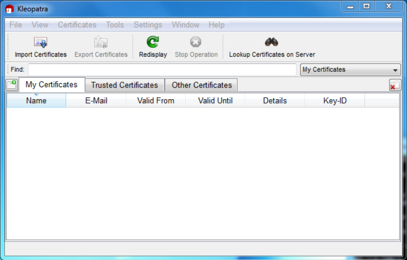

Next, add the MySQL Release Engineering certificate. Do this by clicking File, Lookup Certificates on Server. Type "Mysql Release Engineering" into the search box and press Search.

> Figure 2.2 Kleopatra: Lookup Certificates on Server Wizard: Finding a Certificate

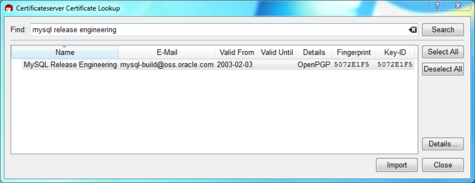

Select the "MySQL Release Engineering" certificate. The Fingerprint and Key-ID must be "5072E1F5", or choose Details... to confirm the certificate is valid. Now, import it by clicking Import. An import dialog is displayed; choose Okay, and this certificate should now be listed under the Imported Certificates tab.

Next, configure the trust level for our certificate. Select our certificate, then from the main menu select Certificates, Change Owner Trust.... We suggest choosing I believe checks are very accurate for our certificate, as otherwise you might not be able to verify our signature. Select I believe checks are very accurate to enable "full trust" and then press OK.

Verifying Package Integrity Using MD5 Checksums or GnuPG Figure 2.3 Kleopatra: Change Trust level for MySQL Release Engineering

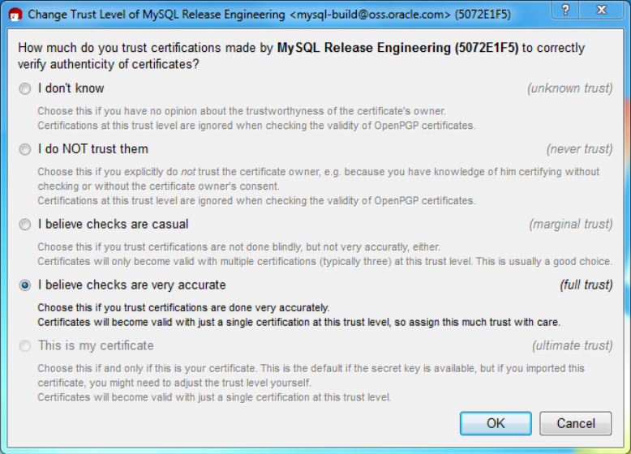

Next, verify the downloaded MySQL package file. This requires files for both the packaged file, and the signature. The signature file must have the same name as the packaged file but with an appended `.asc`extension, as shown by the example in the following table. The signature is linked to on the downloads page for each MySQL product. You must create the `.asc` file with this signature.

Table 2.2 MySQL Package and Signature Files for MySQL Installer for Microsoft Windows File Type File Name Distribution file `mysql-installer-community-5.6.51.msi`Signature file `mysql-installer-`

```
community-5.6.51.msi.asc
```

Make sure that both files are stored in the same directory and then run the following command to verify the signature for the distribution file. Either drag and drop the signature (`.asc`) file into Kleopatra, or load the dialog from File, Decrypt/Verify Files..., and then choose either the `.msi` or `.asc` file.

Verifying Package Integrity Using MD5 Checksums or GnuPG Figure 2.4 Kleopatra: The Decrypt and Verify Files Dialog

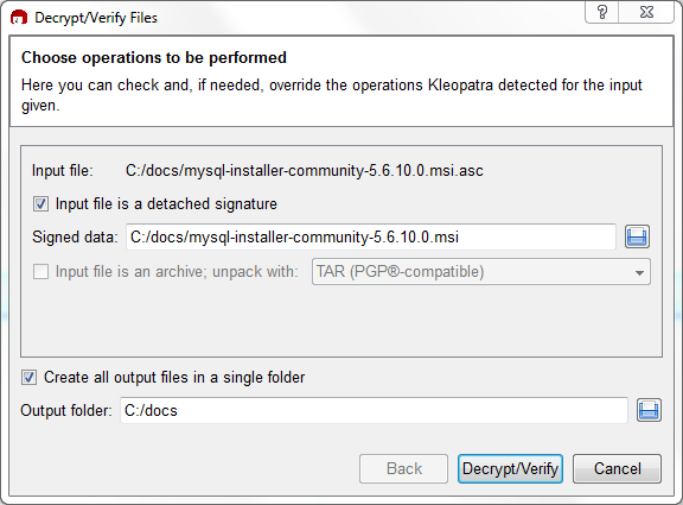

Click Decrypt/Verify to check the file. The two most common results should look like the following,and although the yellow warning looks problematic, the following means that the file check passed with success. You may now run this installer.

> Figure 2.5 Kleopatra: the Decrypt and Verify Results Dialog: All operations completed

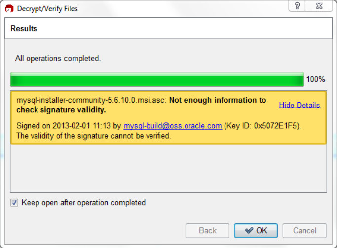

Seeing a red "The signature is bad" error means the file is invalid. Do not execute the MSI file if you see this error.

Verifying Package Integrity Using MD5 Checksums or GnuPG Figure 2.6 Kleopatra: the Decrypt and Verify Results Dialog: Bad

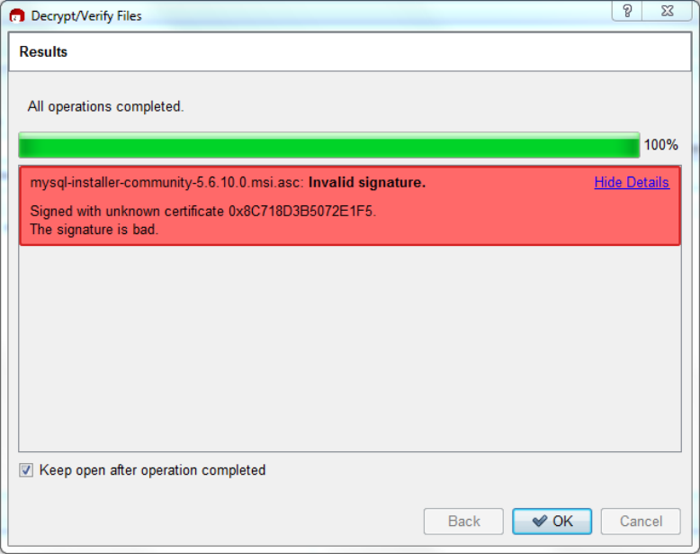

The Section 2.1.4.2, “Signature Checking Using GnuPG” section explains why you probably don't see a green `Good signature` result.

#### 2.1.4.4 Signature Checking Using RPM

For RPM packages, there is no separate signature. RPM packages have a built-in GPG signature and MD5 checksum. You can verify a package by running the following command:

```
$> rpm --checksig package_name.rpm
```

Example:

```
$> rpm --checksig MySQL-server-5.6.51-0.linux_glibc2.5.i386.rpm
MySQL-server-5.6.51-0.linux_glibc2.5.i386.rpm: md5 gpg OK
```

Note If you are using RPM 4.1 and it complains about `(GPG) NOT OK (MISSING``KEYS: GPG#5072e1f5)`, even though you have imported the MySQL public build key into your own GPG keyring, you need to import the key into the RPM keyring first. RPM 4.1 no longer uses your personal GPG keyring (or GPG itself). Rather,RPM maintains a separate keyring because it is a system-wide application and a user's GPG public keyring is a user-specific file. To import the MySQL public key into the RPM keyring, first obtain the key, then use `rpm --import` to import the key. For example:

```
$> gpg --export -a 5072e1f5 > 5072e1f5.asc
$> rpm --import 5072e1f5.asc
```

Installation Layouts Alternatively, `rpm` also supports loading the key directly from a URL, and you can use this manual page:

```
$> rpm --import https://dev.mysql.com/doc/refman/5.6/en/checking-gpg-signature.html
```

If you need to obtain the MySQL public key, see Section 2.1.4.2, “Signature Checking Using GnuPG”.

### 2.1.5 Installation Layouts

The installation layout differs for different installation types (for example, native packages, binary tarballs,and source tarballs), which can lead to confusion when managing different systems or using different installation sources. The individual layouts are given in the corresponding installation type or platform chapter, as described following. Note that the layout of installations from vendors other than Oracle may differ from these layouts.

- Section 2.3.1, “MySQL Installation Layout on Microsoft Windows”
- Section 2.9.3, “MySQL Layout for Source Installation”
- Table 2.3, “MySQL Installation Layout for Generic Unix/Linux Binary Package”
- Table 2.11, “MySQL Installation Layout for Linux RPM Packages from the MySQL Developer Zone”
- Table 2.7, “MySQL Installation Layout on macOS”

### 2.1.6 Compiler-Specific Build Characteristics

In some cases, the compiler used to build MySQL affects the features available for use. The notes in this section apply for binary distributions provided by Oracle Corporation or that you compile yourself from source.

`icc` (Intel C++ Compiler) Builds A server built with `icc` has these characteristics:

- SSL support is not included.

## 2.2 Installing MySQL on Unix/Linux Using Generic Binaries

Oracle provides a set of binary distributions of MySQL. These include generic binary distributions in the form of compressed `tar` files (files with a `.tar.gz` extension) for a number of platforms, and binaries in platform-specific package formats for selected platforms.

This section covers the installation of MySQL from a compressed `tar` file binary distribution on Unix/Linux platforms. For other platform-specific binary package formats, see the other platform-specific sections in this manual. For example, for Windows distributions, see Section 2.3, “Installing MySQL on Microsoft Windows”. See Section 2.1.3, “How to Get MySQL” on how to obtain MySQL in different distribution formats.

MySQL compressed `tar` file binary distributions have names of the form `mysql-VERSION-OS.tar.gz`,where `VERSION` is a number (for example, `5.6.51`), and `OS` indicates the type of operating system for which the distribution is intended (for example, `pc-linux-i686` or `winx64`).

> Warnings

- If you have previously installed MySQL using your operating system native

package management system, such as Yum or APT, you may experience problems installing using a native binary. Make sure your previous MySQL installation has been removed entirely (using your package management Installing MySQL on Unix/Linux Using Generic Binaries system), and that any additional files, such as old versions of your data files, have also been removed. You should also check for configuration files such as `/etc/``my.cnf` or the `/etc/mysql` directory and delete them.

For information about replacing third-party packages with official MySQL packages, see the related APT guide or Yum guide.

- MySQL has a dependency on the `libaio` library. Data directory initialization

and subsequent server startup steps fail if this library is not installed locally. If necessary, install it using the appropriate package manager. For example, on Yum-based systems:

```
$> yum search libaio  # search for info
$> yum install libaio # install library
```

Or, on APT-based systems:

```
$> apt-cache search libaio # search for info
$> apt-get install libaio1 # install library
```

- SLES 11: As of MySQL 5.6.37, the Linux Generic tarball package format is

EL6 instead of EL5. As a side effect, the MySQL client `bin/mysql` needs

```
libtinfo.so.5.
```

A workaround is to create a symlink, such as `ln -s libncurses.so.5.6 /``lib64/libtinfo.so.5` on 64-bit systems or `ln -s libncurses.so.5.6 /``lib/libtinfo.so.5` on 32-bit systems.

To install a compressed `tar` file binary distribution, unpack it at the installation location you choose(typically `/usr/local/mysql`). This creates the directories shown in the following table.

Table 2.3 MySQL Installation Layout for Generic Unix/Linux Binary Package Directory Contents of Directory`bin`, `scripts` `mysqld` server, client and utility programs`data` Log files, databases`docs` MySQL manual in Info format`include` Include (header) files`lib` Libraries`mysql-test` Test suite`man` Unix manual pages`share` Error messages, dictionary, and SQL for database installation`sql-bench` Benchmarks`support-files` Miscellaneous support files, including sample configuration files Debug versions of the `mysqld` binary are available as `mysqld-debug`. To compile your own debug version of MySQL from a source distribution, use the appropriate configuration options to enable debugging support. See Section 2.9, “Installing MySQL from Source”.

To install and use a MySQL binary distribution, the command sequence looks like this:

```
$> groupadd mysql
```

Create a mysql User and Group

```
$> useradd -r -g mysql -s /bin/false mysql
$> cd /usr/local
$> tar zxvf /path/to/mysql-VERSION-OS.tar.gz
$> ln -s full-path-to-mysql-VERSION-OS mysql
$> cd mysql
$> scripts/mysql_install_db --user=mysql
$> bin/mysqld_safe --user=mysql &
# Next command is optional
$> cp support-files/mysql.server /etc/init.d/mysql.server
```

Note This procedure assumes that you have `root` (administrator) access to your system.

Alternatively, you can prefix each command using the `sudo` (Linux) or `pfexec`(Solaris) command.

Note The procedure does not assign passwords to MySQL accounts. To do so, use the instructions in Section 2.10.4, “Securing the Initial MySQL Accounts”.

`mysql_install_db` creates a default option file named `my.cnf` in the base installation directory. This file is created from a template included in the distribution package named `my-default.cnf`. For more information, see Section 5.1.2.2, “Using a Sample Default Server Configuration File”.

A more detailed version of the preceding description for installing a binary distribution follows.

> Create a mysql User and Group

If your system does not already have a user and group to use for running `mysqld`, you may need to create them. The following commands add the `mysql` group and the `mysql` user. You might want to call the user and group something else instead of `mysql`. If so, substitute the appropriate name in the following instructions. The syntax for `useradd` and `groupadd` may differ slightly on different versions of Unix/Linux,or they may have different names such as `adduser` and `addgroup`.

```
$> groupadd mysql
$> useradd -r -g mysql -s /bin/false mysql
```

Note Because the user is required only for ownership purposes, not login purposes, the`useradd` command uses the `-r` and `-s /bin/false` options to create a user that does not have login permissions to your server host. Omit these options if your`useradd` does not support them.

> Obtain and Unpack the Distribution

Pick the directory under which you want to unpack the distribution and change location into it. The example here unpacks the distribution under `/usr/local`. The instructions, therefore, assume that you have permission to create files and directories in `/usr/local`. If that directory is protected, you must perform the installation as `root`.

```
$> cd /usr/local
```

Obtain a distribution file using the instructions in Section 2.1.3, “How to Get MySQL”. For a given release,binary distributions for all platforms are built from the same MySQL source distribution.

Unpack the distribution, which creates the installation directory. `tar` can uncompress and unpack the distribution if it has z option support:Perform Postinstallation Setup

```
$> tar zxvf /path/to/mysql-VERSION-OS.tar.gz
```

The `tar` command creates a directory named `mysql-VERSION-OS`.

To install MySQL from a compressed `tar` file binary distribution, your system must have GNU `gunzip` to uncompress the distribution and a reasonable `tar` to unpack it. If your `tar` program supports the z option,it can both uncompress and unpack the file.

GNU `tar` is known to work. The standard `tar` provided with some operating systems is not able to unpack the long file names in the MySQL distribution. You should download and install GNU `tar`, or if available,use a preinstalled version of GNU tar. Usually this is available as `gnutar`, `gtar`, or as `tar` within a GNU or Free Software directory, such as `/usr/sfw/bin` or `/usr/local/bin`. GNU `tar` is available from http://www.gnu.org/software/tar/.

If your `tar` does not have z option support, use `gunzip` to unpack the distribution and `tar` to unpack it.

Replace the preceding `tar` command with the following alternative command to uncompress and extract the distribution:

```
$> gunzip < /path/to/mysql-VERSION-OS.tar.gz | tar xvf -
```

Next, create a symbolic link to the installation directory created by `tar`:

```
$> ln -s full-path-to-mysql-VERSION-OS mysql
```

The `ln` command makes a symbolic link to the installation directory. This enables you to refer more easily to it as `/usr/local/mysql`. To avoid having to type the path name of client programs always when you are working with MySQL, you can add the `/usr/local/mysql/bin` directory to your `PATH` variable:

```
$> export PATH=$PATH:/usr/local/mysql/bin
```

> Perform Postinstallation Setup

The remainder of the installation process involves setting distribution ownership and access permissions,initializing the data directory, starting the MySQL server, and setting up the configuration file. For instructions, see Section 2.10, “Postinstallation Setup and Testing”.

## 2.3 Installing MySQL on Microsoft Windows

Important MySQL Community 5.6 Server requires the Microsoft Visual C++ 2010 Redistributable Package to run on Windows platforms. Users should make sure the package has been installed on the system before installing the server. The package is available at the Microsoft Download Center.

MySQL is available for Microsoft Windows, for both 32-bit and 64-bit versions. For supported Windows platform information, see https://www.mysql.com/support/supportedplatforms/database.html.

There are different methods to install MySQL on Microsoft Windows.

> MySQL Installer Method

The simplest and recommended method is to download MySQL Installer (for Windows) and let it install and configure all of the MySQL products on your system. Here is how:

1. Download MySQL Installer from https://dev.mysql.com/downloads/installer/ and execute it.

Additional Installation Information Note Unlike the standard MySQL Installer, the smaller "web-community" version does not bundle any MySQL applications but rather downloads the MySQL products you choose to install.

2. Choose the appropriate Setup Type for your system. Typically you should choose Developer Default

to install the MySQL server and other MySQL tools related to MySQL development, and helpful tools like MySQL Workbench. Or, choose the Custom setup type to select the desired MySQL products manually.

Note Multiple versions of MySQL server can exist on a single system. You can choose one or multiple versions.

3. Complete the installation process by following the instructions. This installs several MySQL products

and starts the MySQL server.

MySQL is now installed. If you configured MySQL as a service, then Windows automatically starts the MySQL server every time you restart your system.

Note You probably also installed other helpful MySQL products like MySQL Workbench on your system. Consider loading Chapter 25, MySQL Workbench to check your new MySQL server connection. By default, this program automatically start after installing MySQL.

This process also installs the MySQL Installer application on your system, and later you can use MySQL Installer to upgrade or reconfigure your MySQL products.

> Additional Installation Information

It is possible to run MySQL as a standard application or as a Windows service. By using a service, you can monitor and control the operation of the server through the standard Windows service management tools.

For more information, see Section 2.3.4.7, “Starting MySQL as a Windows Service”.

Generally, you should install MySQL on Windows using an account that has administrator rights.

Otherwise, you may encounter problems with certain operations such as editing the `PATH` environment variable or accessing the `Service Control Manager`. When installed, MySQL does not need to be executed using a user with Administrator privileges.

For a list of limitations on the use of MySQL on the Windows platform, see Section 2.3.7, “Windows Platform Restrictions”.

In addition to the MySQL Server package, you may need or want additional components to use MySQL with your application or development environment. These include, but are not limited to:

- To connect to the MySQL server using ODBC, you must have a Connector/ODBC driver. For more

information, including installation and configuration instructions, see MySQL Connector/ODBC Developer Guide.

Note MySQL Installer installs and configures Connector/ODBC for you.

MySQL on Windows Considerations

- To use MySQL server with .NET applications, you must have the Connector/NET driver. For more

information, including installation and configuration instructions, see MySQL Connector/NET Developer Guide.

Note MySQL Installer installs and configures MySQL Connector/NET for you.

MySQL distributions for Windows can be downloaded from https://dev.mysql.com/downloads/. See Section 2.1.3, “How to Get MySQL”.

MySQL for Windows is available in several distribution formats, detailed here. Generally speaking, you should use MySQL Installer. It contains more features and MySQL products than the older MSI, is simpler to use than the compressed file, and you need no additional tools to get MySQL up and running. MySQL Installer automatically installs MySQL Server and additional MySQL products, creates an options file, starts the server, and enables you to create default user accounts. For more information on choosing a package,see Section 2.3.2, “Choosing an Installation Package”.

- A MySQL Installer distribution includes MySQL Server and additional MySQL products, including MySQL

Workbench. MySQL Installer can also be used to upgrade this product in the future.

For instructions on installing MySQL using MySQL Installer, see Section 2.3.3, “MySQL Installer for Windows”.

- The standard binary distribution (packaged as a compressed file) contains all of the necessary files that

you unpack into your chosen location. This package contains all of the files in the full Windows MSI Installer package, but does not include an installation program.

For instructions on installing MySQL using the compressed file, see Section 2.3.4, “Installing MySQL on Microsoft Windows Using a `noinstall` ZIP Archive”.

- The source distribution format contains all the code and support files for building the executables using

the Visual Studio compiler system.

For instructions on building MySQL from source on Windows, see Section 2.9, “Installing MySQL from Source”.

> MySQL on Windows Considerations

- Large Table Support

If you need tables with a size larger than 4 GB, install MySQL on an NTFS or newer file system. Do not forget to use `MAX_ROWS` and `AVG_ROW_LENGTH` when you create tables. See Section 13.1.17, “CREATE TABLE Statement”.

Note InnoDB tablespace files cannot exceed 4 GB on Windows 32-bit systems.

- MySQL and Virus Checking Software

Virus-scanning software such as Norton/Symantec Anti-Virus on directories containing MySQL data and temporary tables can cause issues, both in terms of the performance of MySQL and the virus-scanning software misidentifying the contents of the files as containing spam. This is due to the fingerprinting mechanism used by the virus-scanning software, and the way in which MySQL rapidly updates different files, which may be identified as a potential security risk.

MySQL Installation Layout on Microsoft Windows After installing MySQL Server, it is recommended that you disable virus scanning on the main directory(`datadir`) used to store your MySQL table data. There is usually a system built into the virus-scanning software to enable specific directories to be ignored.

In addition, by default, MySQL creates temporary files in the standard Windows temporary directory.

To prevent the temporary files also being scanned, configure a separate temporary directory for MySQL temporary files and add this directory to the virus scanning exclusion list. To do this, add a configuration option for the `tmpdir` parameter to your `my.ini` configuration file. For more information,see Section 2.3.4.2, “Creating an Option File”.

- Running MySQL on a 4K Sector Hard Drive

Running the MySQL server on a 4K sector hard drive on Windows is not supported with`innodb_flush_method=async_unbuffered`, which is the default setting. The workaround is to use

```
innodb_flush_method=normal.
```

### 2.3.1 MySQL Installation Layout on Microsoft Windows

For MySQL 5.6 on Windows, the default installation directory is `C:\Program Files\MySQL\MySQL``Server 5.6` for installations performed with MySQL Installer. If you use the ZIP archive method to install MySQL, you may prefer to install in `C:\mysql`. However, the layout of the subdirectories remains similar(exceptions are indicated).

All of the files are located within this parent directory, using the structure shown in the following table.

Table 2.4 Default MySQL Installation Layout for Microsoft Windows Directory Contents of Directory Notes`bin`, `scripts` `mysqld` server, client and utility programs`%PROGRAMDATA%\MySQL\MySQL` Log files, databases The Windows system variable`Server 5.6\` `%PROGRAMDATA%` defaults to `C:`

```
\ProgramData.
```

`data` Pristine templates`docs` Release documentation With MySQL Installer, use the`Modify` operation to select this optional folder.

`include` Include (header) files`lib` Libraries`share` Miscellaneous support files,including error messages,character set files, sample configuration files, SQL for database installation`mysql-test`, `scripts`, and Debug binaries and test suite ZIP archive only.

```
sql-bench
```

The packages create and set up the data directory that the installed server uses and creates a pristine“template” data directory named `data` under the installation directory. After an installation has been performed using this package, the template data directory can be copied to set up additional MySQL instances. See Section 5.7, “Running Multiple MySQL Instances on One Machine”.

Choosing an Installation Package

### 2.3.2 Choosing an Installation Package

For MySQL 5.6, there are multiple installation package formats to choose from when installing MySQL on Windows. The package formats described in this section are:

- MySQL Installer
- MySQL noinstall ZIP Archives
- MySQL Docker Images

Program Database (PDB) files (with file name extension `pdb`) provide information for debugging your MySQL installation in the event of a problem. These files are included in ZIP Archive distributions (but not MSI distributions) of MySQL.

> MySQL Installer

This package has a file name similar to `mysql-installer-community-5.6.51.0.msi` or `mysql-``installer-commercial-5.6.51.0.msi`, and utilizes MSIs to automatically install MySQL server and other products. MySQL Installer downloads and applies updates to itself, and for each of the installed products. It also configures the installed MySQL server (including a sandbox InnoDB cluster test setup)and MySQL Router. MySQL Installer is recommended for most users.

MySQL Installer can install and manage (add, modify, upgrade, and remove) many other MySQL products,including:

- Applications – MySQL Workbench, MySQL for Visual Studio, MySQL Utilities, MySQL Shell, MySQL

Router

- Connectors – MySQL Connector/C++, MySQL Connector/NET, Connector/ODBC, MySQL Connector/

Python, MySQL Connector/J, MySQL Connector/Node.js

- Documentation – MySQL Manual (PDF format), samples and examples

MySQL Installer operates on all MySQL supported versions of Windows (see https://www.mysql.com/support/supportedplatforms/database.html).

Note Because MySQL Installer is not a native component of Microsoft Windows and depends on .NET, it does not work on minimal installations like the Server Core version of Windows Server.

For instructions on how to install MySQL using MySQL Installer, see Section 2.3.3, “MySQL Installer for Windows”.

> MySQL noinstall ZIP Archives

These packages contain the files found in the complete MySQL Server installation package, with the exception of the GUI. This format does not include an automated installer, and must be manually installed and configured.

The `noinstall` ZIP archives are split into two separate compressed files. The main package is named`mysql-VERSION-winx64.zip` for 64-bit and `mysql-VERSION-win32.zip` for 32-bit. This contains the components needed to use MySQL on your system. The optional MySQL test suite, MySQL benchmark suite, and debugging binaries/information components (including PDB files) are in a separate compressed MySQL Installer for Windows file named `mysql-VERSION-winx64-debug-test.zip` for 64-bit and `mysql-VERSION-win32-``debug-test.zip` for 32-bit.

If you choose to install a `noinstall` ZIP archive, see Section 2.3.4, “Installing MySQL on Microsoft Windows Using a `noinstall` ZIP Archive”.

> MySQL Docker Images

For information on using the MySQL Docker images provided by Oracle on Windows platform, see Section 2.5.8.3, “Deploying MySQL on Windows and Other Non-Linux Platforms with Docker”.

Warning The MySQL Docker images provided by Oracle are built specifically for Linux platforms. Other platforms are not supported, and users running the MySQL Docker images from Oracle on them are doing so at their own risk.

### 2.3.3 MySQL Installer for Windows

MySQL Installer is a standalone application designed to ease the complexity of installing and configuring MySQL products that run on Microsoft Windows. It is downloaded with and supports the following MySQL products:

- MySQL Servers

MySQL Installer can install and manage multiple, separate MySQL server instances on the same host at the same time. For example, MySQL Installer can install, configure, and upgrade a separate instance of MySQL 5.6, MySQL 5.7, and MySQL 8.0 on the same host. MySQL Installer does not permit server upgrades between major and minor version numbers, but does permit upgrades within a release series(such as 8.0.21 to 8.0.22).

Note MySQL Installer cannot install both Community and Commercial releases of MySQL server on the same host. If you require both releases on the same host,consider using the ZIP archive distribution to install one of the releases.

- MySQL Applications

MySQL Workbench, MySQL Shell, MySQL Router, and MySQL for Visual Studio.

- MySQL Connectors

MySQL Connector/NET, MySQL Connector/Python, MySQL Connector/ODBC, MySQL Connector/J, and MySQL Connector/C++. To install MySQL Connector/Node.js, see https://dev.mysql.com/downloads/connector/nodejs/.

> Installation Requirements

MySQL Installer requires Microsoft .NET Framework 4.5.2 or later. If this version is not installed on the host computer, you can download it by visiting the Microsoft website.

To invoke MySQL Installer after a successful installation:

1. Right-click Windows Start, select Run, and then click Browse. Navigate to `Program Files (x86) >`

`MySQL > MySQL Installer for Windows` to open the program folder.

MySQL Installer for Windows

2. Select one of the following files:
- `MySQLInstaller.exe` to open the graphical application.
- `MySQLInstallerConsole.exe` to open the command-line application.
3. Click Open and then click OK in the Run window. If you are prompted to allow the application to make

changes to the device, select `Yes`.

Each time you invoke MySQL Installer, the initialization process looks for the presence of an internet connection and prompts you to enable offline mode if it finds no internet access (and offline mode is disabled). Select `Yes` to run MySQL Installer without internet-connection capabilities. MySQL product availability is limited to only those products currently in the product cache when you enable offline mode.

To download MySQL products, click the offline mode Disable quick action shown on the dashboard.

An internet connection is required to download a manifest containing metadata for the latest MySQL products that are not part of a full bundle. MySQL Installer attempts to download the manifest when you start the application for the first time and then periodically in configurable intervals (see MySQL Installer options). Alternatively, you can retrieve an updated manifest manually by clicking Catalog in the MySQL Installer dashboard.

Note If the first-time or subsequent manifest download is unsuccessful, an error is logged and you may have limited access to MySQL products during your session.

MySQL Installer attempts to download the manifest with each startup until the initial manifest structure is updated. For help finding a product, see Locating Products to Install.

> MySQL Installer Community Release

Download software from https://dev.mysql.com/downloads/installer/ to install the Community release of all MySQL products for Windows. Select one of the following MySQL Installer package options:

- Web: Contains MySQL Installer and configuration files only. The web package option downloads only

the MySQL products you select to install, but it requires an internet connection for each download.

The size of this file is approximately 2 MB. The file name has the form `mysql-installer-``community-web-VERSION.N.msi` in which `VERSION` is the MySQL server version number such as

8.0 and N is the package number, which begins at 0.

- Full or Current Bundle: Bundles all of the MySQL products for Windows (including the MySQL

server). The file size is over 300 MB, and the name has the form `mysql-installer-``community-VERSION.N.msi` in which `VERSION` is the MySQL Server version number such as 8.0 and N is the package number, which begins at 0.

> MySQL Installer Commercial Release

Download software from https://edelivery.oracle.com/ to install the Commercial release (Standard or Enterprise Edition) of MySQL products for Windows. If you are logged in to your My Oracle Support (MOS)account, the Commercial release includes all of the current and previous GA versions available in the Community release, but it excludes development-milestone versions. When you are not logged in, you see only the list of bundled products that you downloaded already.

The Commercial release also includes the following products:

- Workbench SE/EE

MySQL Installer for Windows

- MySQL Enterprise Backup
- MySQL Enterprise Firewall

The Commercial release integrates with your MOS account. For knowledge-base content and patches, see My Oracle Support.

#### 2.3.3.1 MySQL Installer Initial Setup

- Choosing a Setup Type
- Path Conflicts
- Check Requirements
- MySQL Installer Configuration Files

When you download MySQL Installer for the first time, a setup wizard guides you through the initial installation of MySQL products. As the following figure shows, the initial setup is a one-time activity in the overall process. MySQL Installer detects existing MySQL products installed on the host during its initial setup and adds them to the list of products to be managed.

> Figure 2.7 MySQL Installer Process Overview

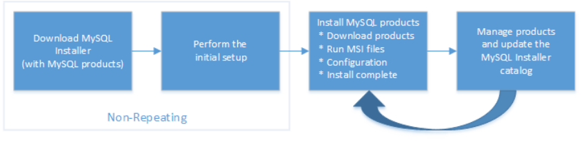

MySQL Installer extracts configuration files (described later) to the hard drive of the host during the initial setup. Although MySQL Installer is a 32-bit application, it can install both 32-bit and 64-bit binaries.

The initial setup adds a link to the Start menu under the MySQL folder group. Click Start, MySQL, and MySQL Installer - [Community | Commercial] to open the community or commercial release of the graphical tool.

Choosing a Setup Type During the initial setup, you are prompted to select the MySQL products to be installed on the host. One alternative is to use a predetermined setup type that matches your setup requirements. By default, both GA and pre-release products are included in the download and installation with the Developer Default,Client only, and Full setup types. Select the Only install GA products option to restrict the product set to include GA products only when using these setup types.

Note Commercial-only MySQL products, such as MySQL Enterprise Backup, are available to select and install if you are using the Commercial version of MySQL Installer (see MySQL Installer Commercial Release).

Choosing one of the following setup types determines the initial installation only and does not limit your ability to install or update MySQL products for Windows later:

- Developer Default: Install the following products that compliment application development with MySQL:

MySQL Installer for Windows

- MySQL Server (Installs the version that you selected when you downloaded MySQL Installer.)
- MySQL Shell
- MySQL Router
- MySQL Workbench
- MySQL for Visual Studio
- MySQL Connectors (for .NET, Python, ODBC, Java, and C++)
- MySQL Documentation
- MySQL Samples and Examples
- Server only: Only install the MySQL server. This setup type installs the general availability (GA) or

development release server that you selected when you downloaded MySQL Installer. It uses the default installation and data paths.

- Client only: Only install the most recent MySQL applications and MySQL connectors. This setup type

is similar to the `Developer Default` type, except that it does not include MySQL server or the client programs typically bundled with the server, such as `mysql` or `mysqladmin`.

- Full: Install all available MySQL products.
- Custom: The custom setup type enables you to filter and select individual MySQL products from the

MySQL Installer catalog.

Note For MySQL Server versions 8.0.20 (and earlier), 5.7, and 5.6, the account you use to run MySQL Installer may not have adequate permission to install the server data files and this can interrupt the installation because the`ExecSecureObjects` MSI action cannot be executed. To proceed, deselect the Server data files feature before attempting to install the server again. For help,see Product Features To Install).

The Server data files check box was removed from the feature tree for MySQL Server 8.0.21 (and higher).

Use the `Custom` setup type to install:

- A product or product version that is not available from the usual download locations. The catalog

contains all product releases, including the other releases between pre-release (or development) and GA.

- An instance of MySQL server using an alternative installation path, data path, or both. For instructions

on how to adjust the paths, see Section 2.3.3.2, “Setting Alternative Server Paths with MySQL Installer”.

- Two or more MySQL server versions on the same host at the same time (for example, 5.6, 5.7, and

8.0).

- A specific combination of products and features not offered as a predetermine setup type. For

example, you can install a single product, such as MySQL Workbench, instead of installing all client applications for Windows.

MySQL Installer for Windows Path Conflicts When the default installation or data folder (required by MySQL server) for a product to be installed already exists on the host, the wizard displays the Path Conflict step to identify each conflict and enable you to take action to avoid having files in the existing folder overwritten by the new installation. You see this step in the initial setup only when MySQL Installer detects a conflict.

To resolve the path conflict, do one of the following:

- Select a product from the list to display the conflict options. A warning symbol indicates which path is in

conflict. Use the browse button to choose a new path and then click Next.

- Click Back to choose a different setup type or product version, if applicable. The `Custom` setup type

enables you to select individual product versions.

- Click Next to ignore the conflict and overwrite files in the existing folder.
- Delete the existing product. Click Cancel to stop the initial setup and close MySQL Installer. Open

MySQL Installer again from the Start menu and delete the installed product from the host using the Delete operation from the MySQL Installer dashboard.

Check Requirements MySQL Installer uses entries in the `package-rules.xml` file to determine whether the prerequisite software for each product is installed on the host. When the requirements check fails, MySQL Installer displays the Check Requirements step to help you update the host. Requirements are evaluated each time you download a new product (or version) for installation. The following figure identifies and describes the key areas of this step.

> Figure 2.8 Check Requirements

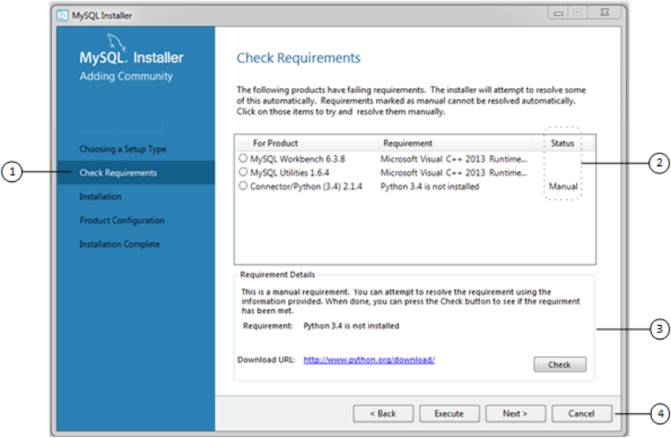

MySQL Installer for Windows Description of Check Requirements Elements

1. Shows the current step in the initial setup. Steps in this list may change slightly depending on the

products already installed on the host, the availability of prerequisite software, and the products to be installed on the host.

2. Lists all pending installation requirements by product and indicates the status as follows:
- A blank space in the Status column means that MySQL Installer can attempt to download and install

the required software for you.

- The word Manual in the Status column means that you must satisfy the requirement manually.

Select each product in the list to see its requirement details.

3. Describes the requirement in detail to assist you with each manual resolution. When possible, a

download URL is provided. After you download and install the required software, click Check to verify that the requirement has been met.

4. Provides the following set operations to proceed:
- Back – Return to the previous step. This action enables you to select a different the setup type.
- Execute – Have MySQL Installer attempt to download and install the required software for all items

without a manual status. Manual requirements are resolved by you and verified by clicking Check.

- Next – Do not execute the request to apply the requirements automatically and proceed to the

installation without including the products that fail the check requirements step.

- Cancel – Stop the installation of MySQL products. Because MySQL Installer is already installed, the

initial setup begins again when you open MySQL Installer from the Start menu and click Add from the dashboard. For a description of the available management operations, see Product Catalog.

MySQL Installer Configuration Files All MySQL Installer files are located within the `C:\Program Files (x86)` and `C:\ProgramData`folders. The following table describes the files and folders that define MySQL Installer as a standalone application.

Note Installed MySQL products are neither altered nor removed when you update or uninstall MySQL Installer.

Table 2.5 MySQL Installer Configuration Files File or Folder Description Folder Hierarchy`MySQL Installer for` This folder contains all `C:\Program Files (x86)``Windows` of the files needed to run MySQL Installer and

```
MySQLInstallerConsole.exe,
```

a command-line program with similar functionality.

`Templates` The `Templates` folder has one `C:\ProgramData\MySQL`file for each version of MySQL `\MySQL Installer for`server. Template files contain `Windows\Manifest`keys and formulas to calculate some values dynamically.

MySQL Installer for Windows File or Folder Description Folder Hierarchy`package-rules.xml` This file contains the prerequisites `C:\ProgramData\MySQL`for every product to be installed. `\MySQL Installer for`

```
Windows\Manifest
```

`produts.xml` The `products` file (or product `C:\ProgramData\MySQL`catalog) contains a list of all `\MySQL Installer for`products available for download. `Windows\Manifest`

```
Product Cache  The Product Cache folder  C:\ProgramData\MySQL
```

contains all standalone `.msi` files `\MySQL Installer for`bundled with the full package or `Windows`downloaded afterward.

#### 2.3.3.2 Setting Alternative Server Paths with MySQL Installer

You can change the default installation path, the data path, or both when you install MySQL server. After you have installed the server, the paths cannot be altered without removing and reinstalling the server instance.

Note Starting with MySQL Installer 1.4.39, if you move the data directory of an installed server manually, MySQL Installer identifies the change and can process a reconfiguration operation without errors.

> To change paths for MySQL server

1. Identify the MySQL server to change and enable the Advanced Options link as follows:

a. Navigate to the Select Products page by doing one of the following:i. If this is an initial setup of MySQL Installer, select the `Custom` setup type and click Next.

ii. If MySQL Installer is installed on your computer, click Add from the dashboard.

b. Click Edit to apply a filter on the product list shown in Available Products (see Locating Products to Install).

c. With the server instance selected, use the arrow to move the selected server to the Products To Be Installed list.

d. Click the server to select it. When you select the server, the Advanced Options link is enabled below the list of products to be installed (see the following figure).

2. Click Advanced Options to open a dialog box where you can enter alternative path names. After the

path names are validated, click Next to continue with the configuration steps.

MySQL Installer for Windows Figure 2.9 Change MySQL Server Path

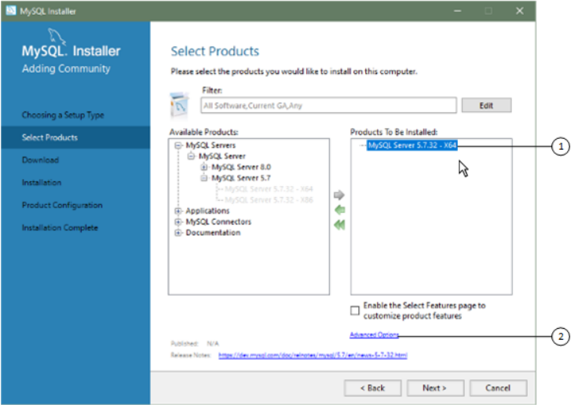

#### 2.3.3.3 Installation Workflows with MySQL Installer

MySQL Installer provides a wizard-like tool to install and configure new MySQL products for Windows.

Unlike the initial setup, which runs only once, MySQL Installer invokes the wizard each time you download or install a new product. For first-time installations, the steps of the initial setup proceed directly into the steps of the installation. For assistance with product selection, see Locating Products to Install.

Note Full permissions are granted to the user executing MySQL Installer to all generated files, such as `my.ini`. This does not apply to files and directories for specific products, such as the MySQL server data directory in `%ProgramData%` that is owned by `SYSTEM`.

Products installed and configured on a host follow a general pattern that might require your input during the various steps. If you attempt to install a product that is incompatible with the existing MySQL server version(or a version selected for upgrade), you are alerted about the possible mismatch.

MySQL Installer provides the following sequence of actions that apply to different workflows:

- Select Products. If you selected the `Custom` setup type during the initial setup or clicked Add from

the MySQL Installer dashboard, MySQL Installer includes this action in the sidebar. From this page, you can apply a filter to modify the Available Products list and then select one or more products to move(using arrow keys) to the Products To Be Installed list.

Select the check box on this page to activate the Select Features action where you can customize the products features after the product is downloaded.

- Download. If you installed the full (not web) MySQL Installer package, all `.msi` files were loaded

to the `Product Cache` folder during the initial setup and are not downloaded again. Otherwise, click MySQL Installer for Windows Execute to begin the download. The status of each product changes from `Ready to Download`, to`Downloading`, and then to `Downloaded`.

To retry a single unsuccessful download, click the Try Again link.

To retry all unsuccessful downloads, click Try All.

- Select Features To Install (disabled by default). After MySQL Installer downloads a product's `.msi`

file, you can customize the features if you enabled the optional check box previously during the Select Products action.

To customize product features after the installation, click Modify in the MySQL Installer dashboard.

- Installation. The status of each product in the list changes from `Ready to Install`, to

`Installing`, and lastly to `Complete`. During the process, click Show Details to view the installation actions.

If you cancel the installation at this point, the products are installed, but the server (if installed) is not yet configured. To restart the server configuration, open MySQL Installer from the Start menu and click Reconfigure next to the appropriate server in the dashboard.

- Product configuration. This step applies to MySQL Server, MySQL Router, and samples only.

The status for each item in the list should indicate `Ready to Configure`. Click Next to start the configuration wizard for all items in the list. The configuration options presented during this step are specific to the version of database or router that you selected to install.

Click Execute to begin applying the configuration options or click Back (repeatedly) to return to each configuration page.

- Installation complete. This step finalizes the installation for products that do not require

configuration. It enables you to copy the log to a clipboard and to start certain applications, such as MySQL Workbench and MySQL Shell. Click Finish to open the MySQL Installer dashboard.

##### MySQL Server Configuration with MySQL Installer

MySQL Installer performs the initial configuration of the MySQL server. For example:

- It creates the configuration file (`my.ini`) that is used to configure the MySQL server. The values written

to this file are influenced by choices you make during the installation process. Some definitions are host dependent. For example, query_cache is enabled if the host has fewer than three cores.

Note Query cache was deprecated in MySQL 5.7 and removed in MySQL 8.0 (and later).

- By default, a Windows service for the MySQL server is added.
- Provides default installation and data paths for MySQL server. For instructions on how to change the

default paths, see Section 2.3.3.2, “Setting Alternative Server Paths with MySQL Installer”.

- It can optionally create MySQL server user accounts with configurable permissions based on general

roles, such as DB Administrator, DB Designer, and Backup Admin. It optionally creates a Windows user named `MysqlSys` with limited privileges, which would then run the MySQL Server.

User accounts may also be added and configured in MySQL Workbench.

MySQL Installer for Windows

- Checking Show Advanced Options enables additional Logging Options to be set. This includes

defining custom file paths for the error log, general log, slow query log (including the configuration of seconds it requires to execute a query), and the binary log.

During the configuration process, click Next to proceed to the next step or Back to return to the previous step. Click Execute at the final step to apply the server configuration.

The sections that follow describe the server configuration options that apply to MySQL server on Windows.

The server version you installed will determine which steps and options you can configure. Configuring MySQL server may include some or all of the steps.

###### Type and Networking

- Server Configuration Type

Choose the MySQL server configuration type that describes your setup. This setting defines the amount of system resources (memory) to assign to your MySQL server instance.

- Development: A computer that hosts many other applications, and typically this is your personal

workstation. This setting configures MySQL to use the least amount of memory.

- Server: Several other applications are expected to run on this computer, such as a web server. The

Server setting configures MySQL to use a medium amount of memory.

- Dedicated: A computer that is dedicated to running the MySQL server. Because no other major

applications run on this server, this setting configures MySQL to use the majority of available memory.

- Manual

Prevents MySQL Installer from attempting to optimize the server installation, and instead, sets the default values to the server variables included in the `my.ini` configuration file. With the `Manual`type selected, MySQL Installer uses the default value of 16M for the `tmp_table_size` variable assignment.

- Connectivity

Connectivity options control how the connection to MySQL is made. Options include:

- TCP/IP: This option is selected by default. You may disable TCP/IP Networking to permit local host

connections only. With the TCP/IP connection option selected, you can modify the following items:

- Port for classic MySQL protocol connections. The default value is 3306.
- X Protocol Port shown when configuring MySQL 8.0 server only. The default value is 33060
- Open Windows Firewall port for network access, which is selected by default for TCP/IP

connections.

If a port number is in use already, you will see the information icon ( ) next to the default value and Next is disabled until you provide a new port number.

- Named Pipe: Enable and define the pipe name, similar to setting the `named_pipe` system variable.

The default name is `MySQL`.

When you select Named Pipe connectivity, and then proceed to the next step, you are prompted to set the level of access control granted to client software on named-pipe connections. Some clients MySQL Installer for Windows require only minimum access control for communication, while other clients require full access to the named pipe.

You can set the level of access control based on the Windows user (or users) running the client as follows:

- Minimum access to all users (RECOMMENDED). This level is enabled by default because it is

the most secure.

- Full access to members of a local group. If the minimum-access option is too restrictive for the

client software, use this option to reduce the number of users who have full access on the named pipe. The group must be established on Windows before you can select it from the list. Membership in this group should be limited and managed. Windows requires a newly added member to first log out and then log in again to join a local group.

- Full access to all users (NOT RECOMMENDED). This option is less secure and should be set

only when other safeguards are implemented.

- Shared Memory: Enable and define the memory name, similar to setting the `shared_memory`

system variable. The default name is `MySQL`.

- Advanced Configuration

Check Show Advanced and Logging Options to set custom logging and advanced options in later steps. The Logging Options step enables you to define custom file paths for the error log, general log,slow query log (including the configuration of seconds it requires to execute a query), and the binary log.

The Advanced Options step enables you to set the unique server ID required when binary logging is enabled in a replication topology.

- MySQL Enterprise Firewall (Enterprise Edition only)

The Enable MySQL Enterprise Firewall check box is deselected by default. Select this option to enable a security list that offers protection against certain types of attacks. Additional post-installation configuration is required (see Section 6.4.5, “MySQL Enterprise Firewall”).

Important There is an issue for MySQL 8.0.19 that prevents the server from starting if MySQL Enterprise Firewall is selected during the server configuration steps. If the server startup operation fails, click Cancel to end the configuration process and return to the dashboard. You must uninstall the server.

The workaround is to run MySQL Installer without MySQL Enterprise Firewall selected. (That is, do not select the Enable MySQL Enterprise Firewall check box.) Then install MySQL Enterprise Firewall afterward using the instructions for manual installation (see Section 6.4.5.2, “Installing or Uninstalling MySQL Enterprise Firewall”).

###### Authentication Method

The Authentication Method step is visible only during the installation or upgrade of MySQL 8.0.4 or higher. It introduces a choice between two server-side authentication options. The MySQL user accounts that you create in the next step will use the authentication method that you select in this step.

MySQL 8.0 connectors and community drivers that use `libmysqlclient` 8.0 now support the`mysql_native_password` default authentication plugin. However, if you are unable to update your MySQL Installer for Windows clients and applications to support this new authentication method, you can configure the MySQL server to use `mysql_native_password` for legacy authentication. For more information about the implications of this change, see caching_sha2_password as the Preferred Authentication Plugin.

If you are installing or upgrading to MySQL 8.0.4 or higher, select one of the following authentication methods:

- Use Strong Password Encryption for Authentication (RECOMMENDED)

MySQL 8.0 supports a new authentication based on improved, stronger SHA256-based password methods. It is recommended that all new MySQL server installations use this method going forward.

Important The `caching_sha2_password` authentication plugin on the server requires new versions of connectors and clients, which add support for the new MySQL 8.0 default authentication.

- Use Legacy Authentication Method (Retain MySQL 5.x Compatibility)

Using the old MySQL 5.x legacy authentication method should be considered only in the following cases:

- Applications cannot be updated to use MySQL 8.0 connectors and drivers.
- Recompilation of an existing application is not feasible.
- An updated, language-specific connector or driver is not available yet.

###### Accounts and Roles

- Root Account Password

Assigning a root password is required and you will be asked for it when performing other MySQL Installer operations. Password strength is evaluated when you repeat the password in the box provided.

For descriptive information regarding password requirements or status, move your mouse pointer over the information icon ( ) when it appears.

- MySQL User Accounts (Optional)

Click Add User or Edit User to create or modify MySQL user accounts with predefined roles. Next, enter the required account credentials:

- User Name: MySQL user names can be up to 32 characters long.
- Host: Select `localhost` for local connections only or `<All Hosts (%)>` when remote connections

to the server are required.

- Role: Each predefined role, such as `DB Admin`, is configured with its own set of privileges. For

example, the `DB Admin` role has more privileges than the `DB Designer` role. The Role drop-down list contains a description of each role.

- Password: Password strength assessment is performed while you type the password. Passwords

must be confirmed. MySQL permits a blank or empty password (considered to be insecure).

MySQL Installer Commercial Release Only: MySQL Enterprise Edition for Windows, a commercial product, also supports an authentication method that performs external authentication on Windows.

MySQL Installer for Windows Accounts authenticated by the Windows operating system can access the MySQL server without providing an additional password.

To create a new MySQL account that uses Windows authentication, enter the user name and then select a value for Host and Role. Click Windows authentication to enable the `authentication_windows`plugin. In the Windows Security Tokens area, enter a token for each Windows user (or group) who can authenticate with the MySQL user name. MySQL accounts can include security tokens for both local Windows users and Windows users that belong to a domain. Multiple security tokens are separated by the semicolon character (;) and use the following format for local and domain accounts:

- Local account

Enter the simple Windows user name as the security token for each local user or group; for example,

```
finley;jeffrey;admin.
```

- Domain account

Use standard Windows syntax (`domain\domainuser`) or MySQL syntax (`domain\\domainuser`) to enter Windows domain users and groups.

For domain accounts, you may need to use the credentials of an administrator within the domain if the account running MySQL Installer lacks the permissions to query the Active Directory. If this is the case, select Validate Active Directory users with to activate the domain administrator credentials.

Windows authentication permits you to test all of the security tokens each time you add or modify a token. Click Test Security Tokens to validate (or revalidate) each token. Invalid tokens generate a descriptive error message along with a red X icon and red token text. When all tokens resolve as valid(green text without an X icon), you can click OK to save the changes.

###### Windows Service

On the Windows platform, MySQL server can run as a named service managed by the operating system and be configured to start up automatically when Windows starts. Alternatively, you can configure MySQL server to run as an executable program that requires manual configuration.

- Configure MySQL server as a Windows service (Selected by default.)

When the default configuration option is selected, you can also select the following:

- Start the MySQL Server at System Startup

When selected (default), the service startup type is set to Automatic; otherwise, the startup type is set to Manual.

- Run Windows Service as

When Standard System Account is selected (default), the service logs on as Network Service.

The Custom User option must have privileges to log on to Microsoft Windows as a service. The Next button will be disabled until this user is configured with the required privileges.

A custom user account is configured in Windows by searching for "local security policy" in the Start menu. In the Local Security Policy window, select Local Policies, User Rights Assignment, and then Log On As A Service to open the property dialog. Click Add User or Group to add the custom user and then click OK in each dialog to save the changes.

- Deselect the Windows Service option.

MySQL Installer for Windows

###### Server File Permissions

Optionally, permissions set on the folders and files located at `C:\ProgramData\MySQL\MySQL Server``8.0\Data` can be managed during the server configuration operation. You have the following options:

- MySQL Installer can configure the folders and files with full control granted exclusively to the user

running the Windows service, if applicable, and to the Administrators group.

All other groups and users are denied access. This is the default option.

- Have MySQL Installer use a configuration option similar to the one just described, but also have MySQL

Installer show which users could have full control.

You are then able to decide if a group or user should be given full control. If not, you can move the qualified members from this list to a second list that restricts all access.

- Have MySQL Installer skip making file-permission changes during the configuration operation.

If you select this option, you are responsible for securing the `Data` folder and its related files manually after the server configuration finishes.

###### Logging Options

This step is available if the Show Advanced Configuration check box was selected during the Type and Networking step. To enable this step now, click Back to return to the Type and Networking step and select the check box.

Advanced configuration options are related to the following MySQL log files:

- Error Log
- General Log
- Slow Query Log
- Bin Log

Note The binary log is enabled by default for MySQL 5.7 and higher.

###### Advanced Options

This step is available if the Show Advanced Configuration check box was selected during the Type and Networking step. To enable this step now, click Back to return to the Type and Networking step and select the check box.

The advanced-configuration options include:

- Server ID

Set the unique identifier used in a replication topology. If binary logging is enabled, you must specify a server ID. The default ID value depends on the server version. For more information, see the description of the `server_id` system variable.

- Table Names Case

You can set the following options during the initial and subsequent configuration the server. For the MySQL 8.0 release series, these options apply only to the initial configuration of the server.

MySQL Installer for Windows

- Lower Case

Sets the `lower_case_table_names` option value to 1 (default), in which table names are stored in lowercase on disk and comparisons are not case-sensitive.

- Preserve Given Case

Sets the `lower_case_table_names` option value to 2, in which table names are stored as given but compared in lowercase.

###### Apply Server Configuration

All configuration settings are applied to the MySQL server when you click Execute. Use the Configuration Steps tab to follow the progress of each action; the icon for each toggles from white to green (with a check mark) on success. Otherwise, the process stops and displays an error message if an individual action times out. Click the Log tab to view the log.

When the installation completes successfully and you click Finish, MySQL Installer and the installed MySQL products are added to the Microsoft Windows Start menu under the `MySQL` group. Opening MySQL Installer loads the dashboard where installed MySQL products are listed and other MySQL Installer operations are available.

##### MySQL Router Configuration with MySQL Installer

MySQL Installer downloads and installs a suite of tools for developing and managing business-critical applications on Windows. The suite consists of applications, connectors, documentation, and samples.

During the initial setup, choose any predetermined setup type, except `Server only`, to install the latest GA version of the tools. Use the `Custom` setup type to install an individual tool or specific version. If MySQL Installer is installed on the host already, use the Add operation to select and install tools from the MySQL Installer dashboard.

MySQL Router Configuration MySQL Installer provides a configuration wizard that can bootstrap an installed instance of MySQL Router

8.0 to direct traffic between MySQL applications and an InnoDB Cluster. When configured, MySQL Router runs as a local Windows service.

Note You are prompted to configure MySQL Router after the initial installation and when you reconfigure an installed router explicitly. In contrast, the upgrade operation does not require or prompt you to configure the upgraded product.

To configure MySQL Router, do the following:

1. Set up InnoDB Cluster.
2. Using MySQL Installer, download and install the MySQL Router application. After the installation

finishes, the configuration wizard prompts you for information. Select the Configure MySQL Router for InnoDB Cluster check box to begin the configuration and provide the following configuration values:

- Hostname: Host name of the primary (seed) server in the InnoDB Cluster (`localhost` by default).
- Port: The port number of the primary (seed) server in the InnoDB Cluster (3306 by default).
- Management User: An administrative user with root-level privileges.

MySQL Installer for Windows

- Password: The password for the management user.
- Classic MySQL protocol connections to InnoDB Cluster

Read/Write: Set the first base port number to one that is unused (between 80 and 65532) and the wizard will select the remaining ports for you.

The figure that follows shows an example of the MySQL Router configuration page, with the first base port number specified as 6446 and the remaining ports set by the wizard to 6447, 6448, and

6449.

> Figure 2.10 MySQL Router Configuration

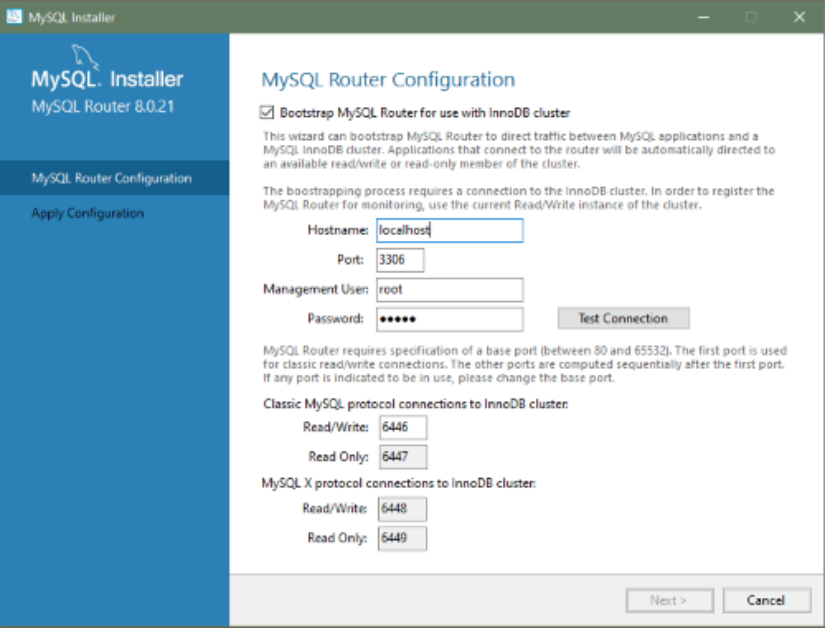

3. Click Next and then Execute to apply the configuration. Click Finish to close MySQL Installer or return

to the MySQL Installer dashboard.

After configuring MySQL Router, the root account exists in the user table as `root@localhost` (local)only, instead of `root@%` (remote). Regardless of where the router and client are located, even if both are located on the same host as the seed server, any connection that passes through the router is viewed by server as being remote, not local. As a result, a connection made to the server using the local host (see the example that follows), does not authenticate.

```
$> \c root@localhost:6446
```

#### 2.3.3.4 MySQL Installer Product Catalog and Dashboard

This section describes the MySQL Installer product catalog, the dashboard, and other actions related to product selection and upgrades.

MySQL Installer for Windows

- Product Catalog
- MySQL Installer Dashboard
- Locating Products to Install
- Upgrading MySQL Server
- Removing MySQL Server
- Upgrading MySQL Installer

Product Catalog The product catalog stores the complete list of released MySQL products for Microsoft Windows that are available to download from MySQL Downloads. By default, and when an Internet connection is present,MySQL Installer attempts to update the catalog at startup every seven days. You can also update the catalog manually from the dashboard (described later).

An up-to-date catalog performs the following actions:

- Populates the Available Products pane of the Select Products page. This step appears when you

select:

- The `Custom` setup type during the initial setup.
- The Add operation from the dashboard.
- Identifies when product updates are available for the installed products listed in the dashboard.

The catalog includes all development releases (Pre-Release), general releases (Current GA), and minor releases (Other Releases). Products in the catalog will vary somewhat, depending on the MySQL Installer release that you download.

MySQL Installer Dashboard The MySQL Installer dashboard is the default view that you see when you start MySQL Installer after the initial setup finishes. If you closed MySQL Installer before the setup was finished, MySQL Installer resumes the initial setup before it displays the dashboard.

Note Products covered under Oracle Lifetime Sustaining Support, if installed, may appear in the dashboard. These products, such as MySQL for Excel and MySQL Notifier, can be modified or removed only.

MySQL Installer for Windows Figure 2.11 MySQL Installer Dashboard Elements

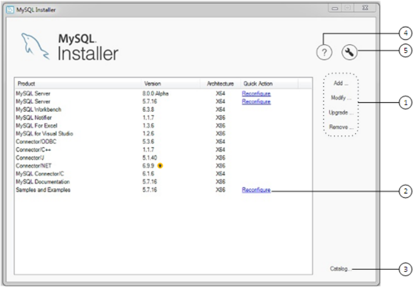

> Description of MySQL Installer Dashboard Elements

1. MySQL Installer dashboard operations provide a variety of actions that apply to installed products or

products listed in the catalog. To initiate the following operations, first click the operation link and then select the product or products to manage:

- Add: This operation opens the Select Products page. From there you can adjust the filter, select one

or more products to download (as needed), and begin the installation. For hints about using the filter,see Locating Products to Install.

Use the directional arrows to move each product from the Available Products column to the Products To Be Installed column. To enable the Product Features page where you can customize features, click the related check box (disabled by default).

Note For MySQL Server versions 8.0.20 (and earlier), 5.7, and 5.6, the account you use to run MySQL Installer may not have adequate permission to install the server data files and this can interrupt the installation because the`ExecSecureObjects` MSI action cannot be executed. To proceed, deselect the Server data files feature before attempting to install the server again.

The Server data files check box was removed from the feature tree for MySQL Server 8.0.21 (or higher).

- Modify: Use this operation to add or remove the features associated with installed products.

Features that you can modify vary in complexity by product. When the Program Shortcut check box is selected, the product appears in the Start menu under the `MySQL` group.

MySQL Installer for Windows

- Upgrade: This operation loads the Select Products to Upgrade page and populates it with all the

upgrade candidates. An installed product can have more than one upgrade version and the operation requires a current product catalog. MySQL Installer upgrades all of the selected products in one action. Click Show Details to view the actions performed by MySQL Installer.

- Remove: This operation opens the Remove Products page and populates it with the MySQL

products installed on the host. Select the MySQL products you want to remove (uninstall) and then click Execute to begin the removal process. During the operation, an indicator shows the number of steps that are executed as a percentage of all steps.

To select products to remove, do one of the following:

- Select the check box for one or more products.
- Select the Product check box to select all products.
2. The Reconfigure link in the Quick Action column next to each installed server loads the current

configuration values for the server and then cycles through all configuration steps enabling you to change the options and values. You must provide credentials with root privileges to reconfigure these items. Click the Log tab to show the output of each configuration step performed by MySQL Installer.

On completion, MySQL Installer stops the server, applies the configuration changes, and restarts the server for you. For a description of each configuration option, see MySQL Server Configuration with MySQL Installer. Installed `Samples and Examples` associated with a specific MySQL server version can be also be reconfigured to apply new feature settings, if any.

3. The Catalog link enables you to download the latest catalog of MySQL products manually and then to

integrate those product changes with MySQL Installer. The catalog-download action does not perform an upgrade of the products already installed on the host. Instead, it returns to the dashboard and adds an arrow icon to the Version column for each installed product that has a newer version. Use the Upgrade operation to install the newer product version.

You can also use the Catalog link to display the current change history of each product without downloading the new catalog. Select the Do not update at this time check box to view the change history only.

4.

The MySQL Installer About icon ( ) shows the current version of MySQL Installer and general information about MySQL. The version number is located above the Back button.

Tip Always include this version number when reporting a problem with MySQL Installer.

In addition to the About MySQL information ( ), you can also select the following icons from the side panel:-License icon ( ) for MySQL Installer.

This product may include third-party software, used under license. If you are using a Commercial release of MySQL Installer, the icon opens the MySQL Installer Commercial License Information User Manual for licensing information, including licensing information relating to third-party software that may be included in this Commercial release. If you are using a Community release of MySQL MySQL Installer for Windows Installer, the icon opens the MySQL Installer Community License Information User Manual for licensing information, including licensing information relating to third-party software that may be included in this Community release.

-Resource links icon ( ) to the latest MySQL product documentation, blogs, webinars, and more.

5.

The MySQL Installer Options icon ( ) includes the following tabs:

- General: Enables or disables the Offline mode option. If selected, this option configures MySQL

Installer to run without depending on internet-connection capabilities. When running MySQL Installer in offline mode, you see a warning together with a Disable quick action on the dashboard. The warning serves to remind you that running MySQL Installer in offline mode prevents you from downloading the latest MySQL products and product catalog updates. Offline mode persists until you disable the option.

At startup, MySQL Installer determines whether an internet connection is present, and, if not,prompts you to enable offline mode to resume working without a connection.

- Product Catalog: Manages the automatic catalog updates. By default, MySQL Installer checks for

catalog updates at startup every seven days. When new products or product versions are available,MySQL Installer adds them to the catalog and then inserts an arrow icon ( ) next to the version number of installed products listed in the dashboard.

Use the product catalog option to enable or disable automatic updates and to reset the number of days between automatic catalog downloads. At startup, MySQL Installer uses the number of days you set to determine whether a download should be attempted. This action is repeated during next startup if MySQL Installer encounters an error downloading the catalog.

- Connectivity Settings: Several operations performed by MySQL Installer require internet access.

This option enables you to use a default value to validate the connection or to use a different URL,one selected from a list or added by you manually. With the Manual option selected, new URLs can be added and all URLs in the list can be moved or deleted. When the Automatic option is selected,MySQL Installer attempts to connect to each default URL in the list (in order) until a connection is made. If no connection can be made, it raises an error.

MySQL Installer for Windows

- Proxy: MySQL Installer provides multiple proxy modes that enable you to download MySQL

products, updates, or even the product catalog in most network environments. The mode are:

- No proxy

Select this mode to prevent MySQL Installer from looking for system settings. This mode disables any proxy settings.

- Automatic

Select this mode to have MySQL Installer look for system settings and to use those settings if found, or to use no proxy if nothing is found. This mode is the default.

- Manual

Select this mode to have MySQL Installer use your authentication details to configuration proxy access to the internet. Specifically:

- A proxy-server address (`http://address-to-server`) and port number
- A user name and password for authentication

Locating Products to Install MySQL products in the catalog are listed by category: MySQL Servers, Applications, MySQL Connectors,and Documentation. Only the latest GA versions appear in the Available Products pane by default. If you are looking for a pre-release or older version of a product, it may not be visible in the default list.

Note Keep the product catalog up-to-date. Click Catalog on the MySQL Installer dashboard to download the latest manifest.

To change the default product list, click Add in the dashboard to open the Select Products page, and then click Edit to open the dialog box shown in the figure that follows. Modify the settings and then click Filter.

> Figure 2.12 Filter Available Products

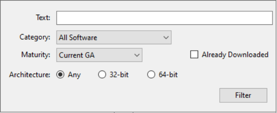

Reset one or more of the following fields to modify the list of available products:

- Text: Filter by text.
- Category: All Software (default), MySQL Servers, Applications, MySQL Connectors, or Documentation

(for samples and documentation).

- Maturity: Current Bundle (appears initially with the full package only), Pre-Release, Current GA, or Other

Releases. If you see a warning, confirm that you have the most recent product manifest by clicking MySQL Installer for Windows Catalog on the MySQL Installer dashboard. If MySQL Installer is unable to download the manifest,the range of products you see is limited to bundled products, standalone product MSIs located in the`Product Cache` folder already, or both.

Note The Commercial release of MySQL Installer does not display any MySQL products when you select the Pre-Release maturity filter. Products in development are available from the Community release of MySQL Installer only.

- Already Downloaded (the check box is deselected by default). Permits you to view and manage

downloaded products only.

- Architecture: Any (default), 32-bit, or 64-bit.

Upgrading MySQL Server Important server upgrade conditions:

- MySQL Installer does not permit server upgrades between major release versions or minor release

versions, but does permit upgrades within a release series, such as an upgrade from 5.7.18 to 5.7.19.

- Upgrades between milestone releases (or from a milestone release to a GA release) are not supported.

Significant development changes take place in milestone releases and you may encounter compatibility issues or problems starting the server.

- For upgrades to MySQL 8.0.16 server and higher, a check box enables you to skip the upgrade check

and process for system tables, while checking and processing data dictionary tables normally. MySQL Installer does not prompt you with the check box when the previous server upgrade was skipped or when the server was configured as a sandbox InnoDB Cluster. This behavior represents a change in how MySQL Server performs an upgrade (see What the MySQL Upgrade Process Upgrades) and it alters the sequence of steps that MySQL Installer applies to the configuration process.

If you select Skip system tables upgrade check and process. (Not recommended), MySQL Installer starts the upgraded server with the `--upgrade=MINIMAL` server option, which upgrades the data dictionary only. If you stop and then restart the server without the `--upgrade=MINIMAL` option, the server upgrades the system tables automatically, if needed.

The following information appears in the Log tab and log file after the upgrade configuration (with system tables skipped) is complete:

```
WARNING: The system tables upgrade was skipped after upgrading MySQL Server. The
server will be started now with the --upgrade=MINIMAL option, but then each
time the server is started it will attempt to upgrade the system tables, unless
you modify the Windows service (command line) to add --upgrade=MINIMAL to bypass
the upgrade.
FOR THE BEST RESULTS: Run mysqld.exe --upgrade=FORCE on the command line to upgrade
the system tables manually.
```

To choose a new server version:

1. Click Upgrade. Confirm that the check box next to product name in the Upgradeable Products pane

has a check mark. Deselect the products that you do not intend to upgrade at this time.

Note For server milestone releases in the same release series, MySQL Installer deselects the server upgrade and displays a warning to indicate that the MySQL Installer for Windows upgrade is not supported, identifies the risks of continuing, and provides a summary of the steps to perform a logical upgrade manually. You can reselect server upgrade at your own risk. For instructions on how to perform a logical upgrade with a milestone release, see Logical Upgrade.

2. Click a product in the list to highlight it. This action populates the Upgradeable Versions pane with

the details of each available version for the selected product: version number, published date, and a`Changes` link to open the release notes for that version.

Removing MySQL Server To remove a local MySQL server:

1. Determine whether the local data directory should be removed. If you retain the data directory, another

server installation can reuse the data. This option is enabled by default (removes the data directory).

2. Click Execute to begin uninstalling the local server. Note that all products that you selected to remove

are also uninstalled at this time.

3. (Optional) Click the Log tab to display the current actions performed by MySQL Installer.

Upgrading MySQL Installer MySQL Installer remains installed on your computer, and like other software, MySQL Installer can be upgraded from the previous version. In some cases, other MySQL software may require that you upgrade MySQL Installer for compatibility. This section describes how to identify the current version of MySQL Installer and how to upgrade MySQL Installer manually.

> To locate the installed version of MySQL Installer:

1. Start MySQL Installer from the search menu. The MySQL Installer dashboard opens.

2.

Click the MySQL Installer About icon ( ). The version number is located above the Back button.

> To initiate an on-demand upgrade of MySQL Installer:

1. Connect the computer with MySQL Installer installed to the internet.
2. Start MySQL Installer from the search menu. The MySQL Installer dashboard opens.
3. Click Catalog on the bottom of the dashboard to open the Update Catalog window.
4. Click Execute to begin the process. If the installed version of MySQL Installer can be upgraded, you

will be prompted to start the upgrade.

5. Click Next to review all changes to the catalog and then click Finish to return to the dashboard.
6. Verify the (new) installed version of MySQL Installer (see the previous procedure).

#### 2.3.3.5 MySQL Installer Console Reference

`MySQLInstallerConsole.exe` provides command-line functionality that is similar to MySQL Installer.

This reference includes:

- MySQL Product Names
- Command Syntax
- Command Actions

MySQL Installer for Windows The console is installed when MySQL Installer is initially executed and then available within the `MySQL``Installer for Windows` directory. By default, the directory location is `C:\Program Files``(x86)\MySQL\MySQL Installer for Windows`. You must run the console as administrator.

To use the console:

1. Open a command prompt with administrative privileges by selecting Windows System from Start, then

right-click Command Prompt, select More, and select Run as administrator.

2. From the command line, optionally change the directory to where the `MySQLInstallerConsole.exe`

command is located. For example, to use the default installation location:

```
cd Program Files (x86)\MySQL\MySQL Installer for Windows
```

3. Type `MySQLInstallerConsole.exe` (or `mysqlinstallerconsole`) followed by a command

action to perform a task. For example, to show the console's help:

```
MySQLInstallerConsole.exe --help
=================== Start Initialization ===================
MySQL Installer is running in Community mode
Attempting to update manifest.
Initializing product requirements.
Loading product catalog.
Checking for product packages in the bundle.
Categorizing product catalog.
Finding all installed packages.
Your product catalog was last updated at 23/08/2022 12:41:05 p. m.
Your product catalog has version number 671.
=================== End Initialization ===================
The following actions are available:
Configure - Configures one or more of your installed programs.
Help      - Provides list of available command actions.
Install   - Installs and configures one or more available MySQL programs.
List      - Lists all available MySQL products.
Modify    - Modifies the features of installed products.
Remove    - Removes one or more products from your system.
Set       - Configures the general options of MySQL Installer.
Status    - Shows the status of all installed products.
Update    - Updates the current product catalog.
Upgrade   - Upgrades one or more of your installed programs.
The basic syntax for using MySQL Installer command actions. Brackets denote optional entities.
Curly braces denote a list of possible entities.
...
```

MySQL Product Names Many of the `MySQLInstallerConsole` command actions accept one or more abbreviated phrases that can match a MySQL product (or products) in the catalog. The current set of valid short phrases for use with commands is shown in the following table.

Table 2.6 MySQL Product Phrases for use with the MySQLInstallerConsole.exe command Phrase MySQL Product`server` MySQL Server`workbench` MySQL Workbench MySQL Installer for Windows Phrase MySQL Product`shell` MySQL Shell`visual` MySQL for Visual Studio`router` MySQL Router`backup` MySQL Enterprise Backup (requires the commercial release)`net` MySQL Connector/NET`odbc` MySQL Connector/ODBC`c++` MySQL Connector/C++`python` MySQL Connector/Python j MySQL Connector/J`documentation` MySQL Server Documentation`samples` MySQL Samples (sakila and world databases)Command Syntax The `MySQLInstallerConsole.exe` command can be issued with or without the file extension (`.exe`)and the command is not case-sensitive.

```
mysqlinstallerconsole[.exe] [[[--]action] [action_blocks_list] [options_list]]
```

Description:`action` One of the permitted operational actions. If omitted, the default action is equivalent to the `--status` action. Using the `--` prefix is optional for all actions.

Possible actions are: [--]`configure`, [--]`help`, [--]`install`, [--]`list`,[--]`modify`, [--]`remove`, [--]`set`, [--]`status`, [--]`update`, and[--]`upgrade`.

`action_blocks_list` A list of blocks in which each represents a different item depending on the selected action. Blocks are separated by commas.

The `--remove` and `--upgrade` actions permit specifying an asterisk character (*) to indicate all products. If the * character is detected at the start of this block, it is assumed all products are to be processed and the remainder of the block is ignored.

```
Syntax: *|action_block[,action_block][,action_block]...
```

`action_block`: Contains a product selector followed by an indefinite number of argument blocks that behave differently depending on the selected action (see Command Actions).

`options_list` Zero or more options with possible values separated by spaces.

See Command Actions to identify the options permitted for the corresponding action.

```
Syntax: option_value_pair[ option_value_pair][
option_value_pair]...
```

MySQL Installer for Windows`option_value_pair`: A single option (for example, `--silent`) or a tuple of a key and a corresponding value with an options prefix. The key-value pair is in the form of `--key[=value]`.

Command Actions`MySQLInstallerConsole.exe` supports the following command actions:Note Configuration block (or arguments_block) values that contain a colon character (:)must be wrapped in quotation marks. For example, `install_dir="C:\MySQL`

```
\MySQL Server 8.0".
- [--]configure [product1]:[configuration_argument]=[value], [product2]:
[configuration_argument]=[value], [...]
```

Configures one or more MySQL products on your system. Multiple `configuration_argument`=`value`pairs can be configured for each product.

Options:`--continue` Continues processing the next product when an error is caught while processing the action blocks containing arguments for each product.

If not specified the whole operation is aborted in case of an error.

`--help` Shows the options and available arguments for the corresponding action. If present the action is not executed, only the help is shown,so other action-related options are ignored as well.

`--show-settings` Displays the available options for the selected product by passing in the product name after `--show-settings`.

`--silent` Disables confirmation prompts.

Examples:

```
MySQLInstallerConsole --configure --show-settings server
mysqlinstallerconsole.exe --configure server:port=3307
- [--]help
```

Displays a help message with usage examples and then exits. Pass in an additional command action to receive help specific to that action.

Options:`--action=[action]` Shows the help for a specific action. Same as using the `--help`option with an action.

Permitted values are: `all`, `configure`, `help` (default), `install`,

```
list, modify, remove, status, update, upgrade, and set.
```

`--help` Shows the options and available arguments for the corresponding action. If present the action is not executed, only the help is shown,so other action-related options are ignored as well.

MySQL Installer for Windows Examples:

```
MySQLInstallerConsole help
MySQLInstallerConsole help --action=install
- [--]install [product1]:[features]:[config block]:[config block], [product2]:
[config block], [...]
```

Installs one or more MySQL products on your system. If pre-release products are available, both GA and pre-release products are installed when the value of the `--type` option value is `Developer`, `Client`,or `Full`. Use the `--only_ga_products` option to restrict the product set to GA products only when using these setup types.

Description:`[product]` Each product can be specified by a product phrase with or without a semicolon-separated version qualifier. Passing in a product keyword alone selects the latest version of the product. If multiple architectures are available for that version of the product, the command returns the first one in the manifest list for interactive confirmation. Alternatively,you can pass in the exact version and architecture `(x86` or `x64`) after the product keyword using the `--silent` option.

`[features]` All features associated with a MySQL product are installed by default.

The feature block is a semicolon-separated list of features or an asterisk character (*) that selects all features. To remove a feature,use the `modify` command.

`[config block]` One or more configuration blocks can be specified. Each configuration block is a semicolon-separated list of key-value pairs. A block can include either a `config` or `user` type key; `config` is the default type if one is not defined.

Configuration block values that contain a colon character (:) must be wrapped in quotation marks. For example, `installdir="C:\MySQL``\MySQL Server 8.0"`. Only one configuration type block can be defined for each product. A user block should be defined for each user to be created during the product installation.

Note The `user` type key is not supported when a product is being reconfigured.

Options:`--auto-handle-prereqs` If present, MySQL Installer attempts to download and install some software prerequisites, not currently present. that can be resolved with minimal intervention. If the `--silent` option is not present, you are presented with installation pages for each prerequisite. If the `--``auto-handle-prereqs` options is omitted, packages with missing prerequisites are not installed.

MySQL Installer for Windows`--continue` Continues processing the next product when an error is caught while processing the action blocks containing arguments for each product.

If not specified the whole operation is aborted in case of an error.

`--help` Shows the options and available arguments for the corresponding action. If present the action is not executed, only the help is shown,so other action-related options are ignored as well.

`--mos-password=password` Sets the My Oracle Support (MOS) user's password for commercial versions of the MySQL Installer.

`--mos-user=user_name` Specifies the My Oracle Support (MOS) user name for access to the commercial version of MySQL Installer. If not present, only the products in the bundle, if any, are available to be installed.

`--only-ga-products` Restricts the product set to include GA products only.

`--setup-type=setup_type` Installs a predefined set of software. The setup type can be one of the following:

- `Developer`: Installs a complete development environment.
- `Server`: Installs a single MySQL server
- `Client`: Installs client programs and libraries
- `Full`: Installs everything
- `Custom`: Installs user-selected products. This is the default option.

Note Non-custom setup types are valid only when no other MySQL products are installed.

`--show-settings` Displays the available options for the selected product, by passing in the product name after `-showsettings`.

`--silent` Disable confirmation prompts.

Examples:

```
mysqlinstallerconsole.exe --install j;8.0.29, net;8.0.28 --silent
MySQLInstallerConsole install server;8.0.30:*:port=3307;server_id=2:type=user;user=foo
```

An example that passes in additional configuration blocks, separated by ^ to fit:

```
MySQLInstallerConsole --install server;8.0.30;x64:*:type=config;open_win_firewall=true; ^
general_log=true;bin_log=true;server_id=3306;tcp_ip=true;port=3306;root_passwd=pass; ^
install_dir="C:\MySQL\MySQL Server 8.0":type=user;user_name=foo;password=bar;role=DBManager
```

MySQL Installer for Windows

```
- [--]list
```

When this action is used without options, it activates an interactive list from which all of the available MySQL products can be searched. Enter `MySQLInstallerConsole --list` and specify a substring to search.

Options:`--all` Lists all available products. If this option is used, all other options are ignored.

`--arch=architecture` Lists that contain the specified architecture. Permitted values are:`x86`, `x64`, and `any` (default). This option can be combined with the `--``name` and `--version` options.

`--help` Shows the options and available arguments for the corresponding action. If present the action is not executed, only the help is shown,so other action-related options are ignored as well.

`--name=package_name` Lists products that contain the specified name (see product phrase),This option can be combined with the `--version` and `--arch`options.

`--version=version` Lists products that contain the specified version, such as 8.0 or 5.7.

This option can be combined with the `--name` and `--arch` options.

Examples:

```
MySQLInstallerConsole --list --name=net --version=8.0
- [--]modify [product1:-removelist|+addlist], [product2:-removelist|+addlist]
[...]
```

Modifies or displays features of a previously installed MySQL product. To display the features of a product, append the product keyword to the command, for example:

```
MySQLInstallerConsole --modify server
```

Options:`--help` Shows the options and available arguments for the corresponding action. If present the action is not executed, only the help is shown,so other action-related options are ignored as well.

`--silent` Disable confirmation prompts.

Examples:

```
MySQLInstallerConsole --modify server:+documentation
MySQLInstallerConsole modify server:-debug
```

MySQL Installer for Windows

```
- [--]remove [product1], [product2] [...]
```

Removes one ore more products from your system. An asterisk character (*) can be passed in to remove all MySQL products with one command.

Options:`--continue` Continue the operation even if an error occurs.

`--help` Shows the options and available arguments for the corresponding action. If present the action is not executed, only the help is shown,so other action-related options are ignored as well.

`--keep-datadir` Skips the removal of the data directory when removing MySQL Server products.

`--silent` Disable confirmation prompts.

Examples:

```
mysqlinstallerconsole.exe remove *
MySQLInstallerConsole --remove server --continue
- [--]set
```

Sets one or more configurable options that affect how the MySQL Installer program connects to the internet and whether the automatic products-catalog updates feature is activated.

Options:`--catalog-` Enables (`true`, default) or disables (`false`) the automatic products`update=bool_value` catalog update. This option requires an active connection to the internet.

`--catalog-update-` Accepts an integer between 1 (default) and 365 to indicate the`days=int_value` number of days between checks for a new catalog update when MySQL Installer is started. If `--catalog-update` is `false`, this option is ignored.

`--connection-` Sets how MySQL Installer performs the check for an internet`validation=validation_type`connection. Permitted values are `automatic` (default) and `manual`.

`--connection-validation-` A double-quote enclosed and comma-separated string that defines`urls=url_list` the list of URLs to use for checking the internet connection when `--``connection-validation` is set to `manual`. Checks are made in MySQL Installer for Windows the same order provided. If the first URL fails, the next URL in the list is used and so on.

`--offline-` Enables MySQL Installer to run with or without internet capabilities.

`mode=bool_value` Valid modes are:

- `True` to enable offline mode (run without an internet connection).
- `False` (default) to disable offline mode (run with an internet

connection). Set this mode before downloading the product catalog or any products to install.

`--proxy-mode` Specifies the proxy mode. Valid modes are:

- `Automatic` to automatically identify the proxy based on the system

settings.

- `None` to ensure that no proxy is configured.
- `Manual` to set the proxy details manually (`--proxy-server`, `--`

```
proxy-port, --proxy-username, --proxy-password).
```

`--proxy-password` The password used to authenticate to the proxy server.

`--proxy-port` The port used for the proxy server.

`--proxy-server` The URL that point to the proxy server.

`--proxy-username` The user name used to authenticate to the proxy server.

`--reset-defaults` Resets the MySQL Installer options associated with the `--set` action to the default values.

Examples:

```
MySQLIntallerConsole.exe set --reset-defaults
mysqlintallerconsole.exe --set --catalog-update=false
MySQLIntallerConsole --set --catalog-update-days=3
mysqlintallerconsole --set --connection-validation=manual
--connection-validation-urls="https://www.bing.com,http://www.google.com"
- [--]status
```

Provides a quick overview of the MySQL products that are installed on the system. Information includes product name and version, architecture, date installed, and install location.

Options:`--help` Shows the options and available arguments for the corresponding action. If present the action is not executed, only the help is shown,so other action-related options are ignored as well.

Examples:

```
MySQLInstallerConsole status
```

MySQL Installer for Windows

```
- [--]update
```

Downloads the latest MySQL product catalog to your system. On success, the catalog is applied the next time either `MySQLInstaller` or `MySQLInstallerConsole.exe` is executed.

MySQL Installer automatically checks for product catalog updates when it is started if n days have passed since the last check. Starting with MySQL Installer 1.6.4, the default value is 1 day. Previously,the default value was 7 days.

Options:`--help` Shows the options and available arguments for the corresponding action. If present the action is not executed, only the help is shown,so other action-related options are ignored as well.

Examples:

```
MySQLInstallerConsole update
- [--]upgrade [product1:version], [product2:version] [...]
```

Upgrades one or more products on your system. The following characters are permitted for this action:* Pass in * to upgrade all products to the latest version, or pass in specific products.

! Pass in ! as a version number to upgrade the MySQL product to its latest version.

Options:`--continue` Continue the operation even if an error occurs.

`--help` Shows the options and available arguments for the corresponding action. If present the action is not executed, only the help is shown,so other action-related options are ignored as well.

`--mos-password=password` Sets the My Oracle Support (MOS) user's password for commercial versions of the MySQL Installer.

`--mos-user=user_name` Specifies the My Oracle Support (MOS) user name for access to the commercial version of MySQL Installer. If not present, only the products in the bundle, if any, are available to be installed.

`--silent` Disable confirmation prompts.

Examples:

```
MySQLInstallerConsole upgrade *
MySQLInstallerConsole upgrade workbench:8.0.31
MySQLInstallerConsole upgrade workbench:!
MySQLInstallerConsole --upgrade server;8.0.30:!, j;8.0.29:!
```

Installing MySQL on Microsoft Windows Using a `noinstall` ZIP Archive

### 2.3.4 Installing MySQL on Microsoft Windows Using a noinstall ZIP Archive

Users who are installing from the `noinstall` package can use the instructions in this section to manually install MySQL. The process for installing MySQL from a ZIP Archive package is as follows:

1. Extract the archive to the desired install directory
2. Create an option file
3. Choose a MySQL server type
4. Start the MySQL server
5. Secure the default user accounts

This process is described in the sections that follow.

#### 2.3.4.1 Extracting the Install Archive

To install MySQL manually, do the following:

1. If you are upgrading from a previous version please refer to Section 2.11.8, “Upgrading MySQL on

Windows”, before beginning the upgrade process.

2. Make sure that you are logged in as a user with administrator privileges.
3. Choose an installation location. Traditionally, the MySQL server is installed in `C:\mysql`. If you do not

install MySQL at `C:\mysql`, you must specify the path to the install directory during startup or in an option file. See Section 2.3.4.2, “Creating an Option File”.

Note The MySQL Installer installs MySQL under `C:\Program Files\MySQL`.

4. Extract the install archive to the chosen installation location using your preferred file-compression tool.

Some tools may extract the archive to a folder within your chosen installation location. If this occurs,you can move the contents of the subfolder into the chosen installation location.

#### 2.3.4.2 Creating an Option File

If you need to specify startup options when you run the server, you can indicate them on the command line or place them in an option file. For options that are used every time the server starts, you may find it most convenient to use an option file to specify your MySQL configuration. This is particularly true under the following circumstances:

- The installation or data directory locations are different from the default locations (`C:\Program Files`

```
\MySQL\MySQL Server 5.6 and C:\Program Files\MySQL\MySQL Server 5.6\data).
```

- You need to tune the server settings, such as memory, cache, or InnoDB configuration information.

When the MySQL server starts on Windows, it looks for option files in several locations, such as the Windows directory, `C:\`, and the MySQL installation directory (for the full list of locations, see Section 4.2.2.2, “Using Option Files”). The Windows directory typically is named something like `C:``\WINDOWS`. You can determine its exact location from the value of the `WINDIR` environment variable using the following command:

```
C:\> echo %WINDIR%
```

Installing MySQL on Microsoft Windows Using a `noinstall` ZIP Archive MySQL looks for options in each location first in the `my.ini` file, and then in the `my.cnf` file. However, to avoid confusion, it is best if you use only one file. If your PC uses a boot loader where `C:` is not the boot drive, your only option is to use the `my.ini` file. Whichever option file you use, it must be a plain text file.

Note When using the MySQL Installer to install MySQL Server, it creates `my.ini` at the default location. As of MySQL 5.5.27, the user running MySQL Installer is granted full permissions to this new `my.ini`.

In other words, be sure that the MySQL Server user has permission to read the`my.ini` file.

You can also make use of the example option files included with your MySQL distribution; see Section 5.1.2, “Server Configuration Defaults”.

An option file can be created and modified with any text editor, such as Notepad. For example, if MySQL is installed in `E:\mysql` and the data directory is in `E:\mydata\data`, you can create an option file containing a `[mysqld]` section to specify values for the `basedir` and `datadir` options:

```
[mysqld]
# set basedir to your installation path
basedir=E:/mysql
# set datadir to the location of your data directory
datadir=E:/mydata/data
```

Microsoft Windows path names are specified in option files using (forward) slashes rather than backslashes. If you do use backslashes, double them:

```
[mysqld]
# set basedir to your installation path
basedir=E:\\mysql
# set datadir to the location of your data directory
datadir=E:\\mydata\\data
```

The rules for use of backslash in option file values are given in Section 4.2.2.2, “Using Option Files”.

The data directory is located within the `AppData` directory for the user running MySQL.

If you would like to use a data directory in a different location, you should copy the entire contents of the`data` directory to the new location. For example, if you want to use `E:\mydata` as the data directory instead, you must do two things:

1. Move the entire `data` directory and all of its contents from the default location (for example `C:`

```
\Program Files\MySQL\MySQL Server 5.6\data) to E:\mydata.
```

2. Use a `--datadir` option to specify the new data directory location each time you start the server.

#### 2.3.4.3 Selecting a MySQL Server Type

The following table shows the available servers for Windows in MySQL 5.6.

Binary Description`mysqld` Optimized binary with named-pipe support`mysqld-debug` Like `mysqld`, but compiled with full debugging and automatic memory allocation checking Installing MySQL on Microsoft Windows Using a `noinstall` ZIP Archive All of the preceding binaries are optimized for modern Intel processors, but should work on any Intel i386-class or higher processor.

Each of the servers in a distribution support the same set of storage engines. The `SHOW ENGINES`statement displays which engines a given server supports.

All Windows MySQL 5.6 servers have support for symbolic linking of database directories.

MySQL supports TCP/IP on all Windows platforms. MySQL servers on Windows also support named pipes, if you start the server with the `named_pipe` system variable enabled. It is necessary to enable this variable explicitly because some users have experienced problems with shutting down the MySQL server when named pipes were used. The default is to use TCP/IP regardless of platform because named pipes are slower than TCP/IP in many Windows configurations.

#### 2.3.4.4 Starting the Server for the First Time

This section gives a general overview of starting the MySQL server. The following sections provide more specific information for starting the MySQL server from the command line or as a Windows service.

The information here applies primarily if you installed MySQL using the `noinstall` version, or if you wish to configure and test MySQL manually rather than with the GUI tools.

Note MySQL server starts automatically after using MySQL Installer.

The examples in these sections assume that MySQL is installed under the default location of `C:\Program``Files\MySQL\MySQL Server 5.6`. Adjust the path names shown in the examples if you have MySQL installed in a different location.

Clients have two options. They can use TCP/IP, or they can use a named pipe if the server supports named-pipe connections.

MySQL for Windows also supports shared-memory connections if the server is started with the`shared_memory` system variable enabled. Clients can connect through shared memory by using the `--``protocol=MEMORY` option.

For information about which server binary to run, see Section 2.3.4.3, “Selecting a MySQL Server Type”.

Testing is best done from a command prompt in a console window (or “DOS window”). In this way you can have the server display status messages in the window where they are easy to see. If something is wrong with your configuration, these messages make it easier for you to identify and fix any problems.

To start the server, enter this command:

```
C:\> "C:\Program Files\MySQL\MySQL Server 5.6\bin\mysqld" --console
```

For a server that includes `InnoDB` support, you should see the messages similar to those following as it starts (the path names and sizes may differ):

```
InnoDB: The first specified datafile c:\ibdata\ibdata1 did not exist:
InnoDB: a new database to be created!
InnoDB: Setting file c:\ibdata\ibdata1 size to 209715200
InnoDB: Database physically writes the file full: wait...
InnoDB: Log file c:\iblogs\ib_logfile0 did not exist: new to be created
InnoDB: Setting log file c:\iblogs\ib_logfile0 size to 31457280
InnoDB: Log file c:\iblogs\ib_logfile1 did not exist: new to be created
InnoDB: Setting log file c:\iblogs\ib_logfile1 size to 31457280
InnoDB: Log file c:\iblogs\ib_logfile2 did not exist: new to be created
```

Installing MySQL on Microsoft Windows Using a `noinstall` ZIP Archive

```
InnoDB: Setting log file c:\iblogs\ib_logfile2 size to 31457280
InnoDB: Doublewrite buffer not found: creating new
InnoDB: Doublewrite buffer created
InnoDB: creating foreign key constraint system tables
InnoDB: foreign key constraint system tables created
011024 10:58:25  InnoDB: Started
```

When the server finishes its startup sequence, you should see something like this, which indicates that the server is ready to service client connections:

```
mysqld: ready for connections
Version: '5.6.51'  socket: ''  port: 3306
```

The server continues to write to the console any further diagnostic output it produces. You can open a new console window in which to run client programs.

If you omit the `--console` option, the server writes diagnostic output to the error log in the data directory(`C:\Program Files\MySQL\MySQL Server 5.6\data` by default). The error log is the file with the`.err` extension, and may be set using the `--log-error` option.

Note The accounts that are listed in the MySQL grant tables initially have no passwords.

After starting the server, you should set up passwords for them using the instructions in Section 2.10.4, “Securing the Initial MySQL Accounts”.

#### 2.3.4.5 Starting MySQL from the Windows Command Line

The MySQL server can be started manually from the command line. This can be done on any version of Windows.

To start the `mysqld` server from the command line, you should start a console window (or “DOS window”)and enter this command:

```
C:\> "C:\Program Files\MySQL\MySQL Server 5.6\bin\mysqld"
```

The path to `mysqld` may vary depending on the install location of MySQL on your system.

You can stop the MySQL server by executing this command:

```
C:\> "C:\Program Files\MySQL\MySQL Server 5.6\bin\mysqladmin" -u root shutdown
```

Note If the MySQL `root` user account has a password, you need to invoke `mysqladmin`with the `-p` option and supply the password when prompted.

This command invokes the MySQL administrative utility `mysqladmin` to connect to the server and tell it to shut down. The command connects as the MySQL `root` user, which is the default administrative account in the MySQL grant system.

Note Users in the MySQL grant system are wholly independent from any operating system users under Microsoft Windows.

If `mysqld` doesn't start, check the error log to see whether the server wrote any messages there to indicate the cause of the problem. By default, the error log is located in the `C:\Program Files\MySQL\MySQL``Server 5.6\data` directory. It is the file with a suffix of `.err`, or may be specified by passing in the `--`Installing MySQL on Microsoft Windows Using a `noinstall` ZIP Archive`log-error` option. Alternatively, you can try to start the server with the `--console` option; in this case,the server may display some useful information on the screen that may help solve the problem.

The last option is to start `mysqld` with the `--standalone` and `--debug` options. In this case, `mysqld`writes a log file `C:\mysqld.trace` that should contain the reason why `mysqld` doesn't start. See Section 5.8.3, “The DBUG Package”.

Use `mysqld --verbose --help` to display all the options that `mysqld` supports.

#### 2.3.4.6 Customizing the PATH for MySQL Tools

Warning You must exercise great care when editing your system `PATH` by hand; accidental deletion or modification of any portion of the existing `PATH` value can leave you with a malfunctioning or even unusable system.

To make it easier to invoke MySQL programs, you can add the path name of the MySQL `bin` directory to your Windows system `PATH` environment variable:

- On the Windows desktop, right-click the My Computer icon, and select Properties.
- Next select the Advanced tab from the System Properties menu that appears, and click the

> Environment Variables button.

- Under System Variables, select Path, and then click the Edit button. The Edit System Variable

dialogue should appear.

- Place your cursor at the end of the text appearing in the space marked Variable Value. (Use the End

key to ensure that your cursor is positioned at the very end of the text in this space.) Then enter the complete path name of your MySQL `bin` directory (for example, `C:\Program Files\MySQL\MySQL`

```
Server 5.6\bin)
```

Note There must be a semicolon separating this path from any values present in this field.

Dismiss this dialogue, and each dialogue in turn, by clicking OK until all of the dialogues that were opened have been dismissed. The new `PATH` value should now be available to any new command shell you open, allowing you to invoke any MySQL executable program by typing its name at the DOS prompt from any directory on the system, without having to supply the path. This includes the servers,the `mysql` client, and all MySQL command-line utilities such as `mysqladmin` and `mysqldump`.

You should not add the MySQL `bin` directory to your Windows `PATH` if you are running multiple MySQL servers on the same machine.

#### 2.3.4.7 Starting MySQL as a Windows Service

On Windows, the recommended way to run MySQL is to install it as a Windows service, so that MySQL starts and stops automatically when Windows starts and stops. A MySQL server installed as a service can also be controlled from the command line using `NET` commands, or with the graphical `Services` utility.

Generally, to install MySQL as a Windows service you should be logged in using an account that has administrator rights.

The `Services` utility (the Windows `Service Control Manager`) can be found in the Windows Control Panel. To avoid conflicts, it is advisable to close the `Services` utility while performing server installation or removal operations from the command line.

Installing MySQL on Microsoft Windows Using a `noinstall` ZIP Archive Installing the service Before installing MySQL as a Windows service, you should first stop the current server if it is running by using the following command:

```
C:\> "C:\Program Files\MySQL\MySQL Server 5.6\bin\mysqladmin"
-u root shutdown
```

Note If the MySQL `root` user account has a password, you need to invoke `mysqladmin`with the `-p` option and supply the password when prompted.

This command invokes the MySQL administrative utility `mysqladmin` to connect to the server and tell it to shut down. The command connects as the MySQL `root` user, which is the default administrative account in the MySQL grant system.

Note Users in the MySQL grant system are wholly independent from any operating system users under Windows.

Install the server as a service using this command:

```
C:\> "C:\Program Files\MySQL\MySQL Server 5.6\bin\mysqld" --install
```

The service-installation command does not start the server. Instructions for that are given later in this section.

To make it easier to invoke MySQL programs, you can add the path name of the MySQL `bin` directory to your Windows system `PATH` environment variable:

- On the Windows desktop, right-click the My Computer icon, and select Properties.
- Next select the Advanced tab from the System Properties menu that appears, and click the

> Environment Variables button.

- Under System Variables, select Path, and then click the Edit button. The Edit System Variable

dialogue should appear.

- Place your cursor at the end of the text appearing in the space marked Variable Value. (Use the End

key to ensure that your cursor is positioned at the very end of the text in this space.) Then enter the complete path name of your MySQL `bin` directory (for example, `C:\Program Files\MySQL\MySQL``Server 5.6\bin`), and there should be a semicolon separating this path from any values present in this field. Dismiss this dialogue, and each dialogue in turn, by clicking OK until all of the dialogues that were opened have been dismissed. You should now be able to invoke any MySQL executable program by typing its name at the DOS prompt from any directory on the system, without having to supply the path. This includes the servers, the `mysql` client, and all MySQL command-line utilities such

```
as mysqladmin and mysqldump.
```

You should not add the MySQL `bin` directory to your Windows `PATH` if you are running multiple MySQL servers on the same machine.

Warning You must exercise great care when editing your system `PATH` by hand; accidental deletion or modification of any portion of the existing `PATH` value can leave you with a malfunctioning or even unusable system.

Installing MySQL on Microsoft Windows Using a `noinstall` ZIP Archive The following additional arguments can be used when installing the service:

- You can specify a service name immediately following the `--install` option. The default service name

is `MySQL`.

- If a service name is given, it can be followed by a single option. By convention, this should be `--`

`defaults-file=file_name` to specify the name of an option file from which the server should read options when it starts.

The use of a single option other than `--defaults-file` is possible but discouraged. `--defaults-``file` is more flexible because it enables you to specify multiple startup options for the server by placing them in the named option file.

- You can also specify a `--local-service` option following the service name. This causes the server

to run using the `LocalService` Windows account that has limited system privileges. If both `--``defaults-file` and `--local-service` are given following the service name, they can be in any order.

For a MySQL server that is installed as a Windows service, the following rules determine the service name and option files that the server uses:

- If the service-installation command specifies no service name or the default service name (`MySQL`)

following the `--install` option, the server uses the service name of `MySQL` and reads options from the`[mysqld]` group in the standard option files.

- If the service-installation command specifies a service name other than `MySQL` following the `--install`

option, the server uses that service name. It reads options from the `[mysqld]` group and the group that has the same name as the service in the standard option files. This enables you to use the `[mysqld]`group for options that should be used by all MySQL services, and an option group with the service name for use by the server installed with that service name.

- If the service-installation command specifies a `--defaults-file` option after the service name, the

server reads options the same way as described in the previous item, except that it reads options only from the named file and ignores the standard option files.

As a more complex example, consider the following command:

```
C:\> "C:\Program Files\MySQL\MySQL Server 5.6\bin\mysqld"
--install MySQL --defaults-file=C:\my-opts.cnf
```

Here, the default service name (`MySQL`) is given after the `--install` option. If no `--defaults-file`option had been given, this command would have the effect of causing the server to read the `[mysqld]`group from the standard option files. However, because the `--defaults-file` option is present, the server reads options from the `[mysqld]` option group, and only from the named file.

Note On Windows, if the server is started with the `--defaults-file` and `--install`options, `--install` must be first. Otherwise, `mysqld.exe` attempts to start the MySQL server.

You can also specify options as Start parameters in the Windows `Services` utility before you start the MySQL service.

Finally, before trying to start the MySQL service, make sure the user variables `%TEMP%` and `%TMP%`(and also `%TMPDIR%`, if it has ever been set) for the operating system user who is to run the service are pointing to a folder to which the user has write access. The default user for running the MySQL service is `LocalSystem`, and the default value for its `%TEMP%` and `%TMP%` is `C:\Windows\Temp`, a directory Installing MySQL on Microsoft Windows Using a `noinstall` ZIP Archive`LocalSystem` has write access to by default. However, if there are any changes to that default setup (for example, changes to the user who runs the service or to the mentioned user variables, or the `--tmpdir`option has been used to put the temporary directory somewhere else), the MySQL service might fail to run because write access to the temporary directory has not been granted to the proper user.

Starting the service After a MySQL server instance has been installed as a service, Windows starts the service automatically whenever Windows starts. The service also can be started immediately from the `Services` utility, or by

```
using an sc start mysqld_service_name or NET START mysqld_service_name command. SC
```

and `NET` commands are not case-sensitive.

When run as a service, `mysqld` has no access to a console window, so no messages can be seen there. If`mysqld` does not start, check the error log to see whether the server wrote any messages there to indicate the cause of the problem. The error log is located in the MySQL data directory (for example, `C:\Program``Files\MySQL\MySQL Server 5.6\data`). It is the file with a suffix of `.err`.

When a MySQL server has been installed as a service, and the service is running, Windows stops the service automatically when Windows shuts down. The server also can be stopped manually using the `Services` utility, the `sc stop mysqld_service_name` command, the `NET STOP``mysqld_service_name` command, or the `mysqladmin shutdown` command.

You also have the choice of installing the server as a manual service if you do not wish for the service to be started automatically during the boot process. To do this, use the `--install-manual` option rather than the `--install` option:

```
C:\> "C:\Program Files\MySQL\MySQL Server 5.6\bin\mysqld" --install-manual
```

Removing the service To remove a server that is installed as a service, first stop it if it is running by executing `SC STOP`

```
mysqld_service_name or NET STOP mysqld_service_name. Then use SC DELETE
```

`mysqld_service_name` to remove it:

```
C:\> SC DELETE mysql
```

Alternatively, use the `mysqld` `--remove` option to remove the service.

```
C:\> "C:\Program Files\MySQL\MySQL Server 5.6\bin\mysqld" --remove
```

If `mysqld` is not running as a service, you can start it from the command line. For instructions, see Section 2.3.4.5, “Starting MySQL from the Windows Command Line”.

If you encounter difficulties during installation, see Section 2.3.5, “Troubleshooting a Microsoft Windows MySQL Server Installation”.

For more information about stopping or removing a Windows service, see Section 5.7.2.2, “Starting Multiple MySQL Instances as Windows Services”.

#### 2.3.4.8 Testing The MySQL Installation

You can test whether the MySQL server is working by executing any of the following commands:

```
C:\> "C:\Program Files\MySQL\MySQL Server 5.6\bin\mysqlshow"
C:\> "C:\Program Files\MySQL\MySQL Server 5.6\bin\mysqlshow" -u root mysql
C:\> "C:\Program Files\MySQL\MySQL Server 5.6\bin\mysqladmin" version status proc
C:\> "C:\Program Files\MySQL\MySQL Server 5.6\bin\mysql" test
```

If `mysqld` is slow to respond to TCP/IP connections from client programs, there is probably a problem with your DNS. In this case, start `mysqld` with the `skip_name_resolve` system variable enabled and Troubleshooting a Microsoft Windows MySQL Server Installation use only `localhost` and IP addresses in the `Host` column of the MySQL grant tables. (Be sure that an account exists that specifies an IP address or you may not be able to connect.)You can force a MySQL client to use a named-pipe connection rather than TCP/IP by specifying the `--``pipe` or `--protocol=PIPE` option, or by specifying . (period) as the host name. Use the `--socket`option to specify the name of the pipe if you do not want to use the default pipe name.

If you have set a password for the `root` account, deleted the anonymous account, or created a new user account, then to connect to the MySQL server you must use the appropriate `-u` and `-p` options with the commands shown previously. See Section 4.2.4, “Connecting to the MySQL Server Using Command Options”.

For more information about `mysqlshow`, see Section 4.5.6, “mysqlshow — Display Database, Table, and Column Information”.

### 2.3.5 Troubleshooting a Microsoft Windows MySQL Server Installation

When installing and running MySQL for the first time, you may encounter certain errors that prevent the MySQL server from starting. This section helps you diagnose and correct some of these errors.

Your first resource when troubleshooting server issues is the error log. The MySQL server uses the error log to record information relevant to the error that prevents the server from starting. The error log is located in the data directory specified in your `my.ini` file. The default data directory location is `C:\Program``Files\MySQL\MySQL Server 5.6\data`, or `C:\ProgramData\Mysql` on Windows 7 and Windows Server 2008. The `C:\ProgramData` directory is hidden by default. You need to change your folder options to see the directory and contents. For more information on the error log and understanding the content, see Section 5.4.2, “The Error Log”.

For information regarding possible errors, also consult the console messages displayed when the MySQL service is starting. Use the `SC START mysqld_service_name` or `NET START``mysqld_service_name` command from the command line after installing `mysqld` as a service to see any error messages regarding the starting of the MySQL server as a service. See Section 2.3.4.7, “Starting MySQL as a Windows Service”.

The following examples show other common error messages you might encounter when installing MySQL and starting the server for the first time:

- If the MySQL server cannot find the `mysql` privileges database or other critical files, it displays these

messages:

```
System error 1067 has occurred.
Fatal error: Can't open and lock privilege tables:
Table 'mysql.user' doesn't exist
```

These messages often occur when the MySQL base or data directories are installed in different locations than the default locations (`C:\Program Files\MySQL\MySQL Server 5.6` and `C:\Program``Files\MySQL\MySQL Server 5.6\data`, respectively).

This situation can occur when MySQL is upgraded and installed to a new location, but the configuration file is not updated to reflect the new location. In addition, old and new configuration files might conflict.

Be sure to delete or rename any old configuration files when upgrading MySQL.

If you have installed MySQL to a directory other than `C:\Program Files\MySQL\MySQL Server``5.6`, ensure that the MySQL server is aware of this through the use of a configuration (`my.ini`) file. Put the `my.ini` file in your Windows directory, typically `C:\WINDOWS`. To determine its exact location from the value of the `WINDIR` environment variable, issue the following command from the command prompt:

```
C:\> echo %WINDIR%
```

Windows Postinstallation Procedures You can create or modify an option file with any text editor, such as Notepad. For example, if MySQL is installed in `E:\mysql` and the data directory is `D:\MySQLdata`, you can create the option file and set up a `[mysqld]` section to specify values for the `basedir` and `datadir` options:

```
[mysqld]
# set basedir to your installation path
basedir=E:/mysql
# set datadir to the location of your data directory
datadir=D:/MySQLdata
```

Microsoft Windows path names are specified in option files using (forward) slashes rather than backslashes. If you do use backslashes, double them:

```
[mysqld]
# set basedir to your installation path
basedir=C:\\Program Files\\MySQL\\MySQL Server 5.6
# set datadir to the location of your data directory
datadir=D:\\MySQLdata
```

The rules for use of backslash in option file values are given in Section 4.2.2.2, “Using Option Files”.

If you change the `datadir` value in your MySQL configuration file, you must move the contents of the existing MySQL data directory before restarting the MySQL server.

See Section 2.3.4.2, “Creating an Option File”.

- If you reinstall or upgrade MySQL without first stopping and removing the existing MySQL service and

install MySQL using the MySQL Installer, you might see this error:

```
Error: Cannot create Windows service for MySql. Error: 0
```

This occurs when the Configuration Wizard tries to install the service and finds an existing service with the same name.

One solution to this problem is to choose a service name other than `mysql` when using the configuration wizard. This enables the new service to be installed correctly, but leaves the outdated service in place.

Although this is harmless, it is best to remove old services that are no longer in use.

To permanently remove the old `mysql` service, execute the following command as a user with administrative privileges, on the command line:

```
C:\> SC DELETE mysql
[SC] DeleteService SUCCESS
```

If the `SC` utility is not available for your version of Windows, download the `delsrv` utility from http://www.microsoft.com/windows2000/techinfo/reskit/tools/existing/delsrv-o.asp and use the `delsrv mysql`syntax.

### 2.3.6 Windows Postinstallation Procedures

GUI tools exist that perform most of the tasks described in this section, including:

- MySQL Installer: Used to install and upgrade MySQL products.
- MySQL Workbench: Manages the MySQL server and edits SQL statements.

On Windows, you need not create the data directory and the grant tables. MySQL distributions for Windows include the grant tables with a set of preinitialized accounts in the `mysql` database under the data directory.

Windows Postinstallation Procedures Regarding passwords, if you installed MySQL using the MySQL Installer, you may have already assigned passwords to the accounts. (See Section 2.3.3, “MySQL Installer for Windows”.) Otherwise, use the password-assignment procedure given in Section 2.10.4, “Securing the Initial MySQL Accounts”.

Before assigning passwords, you might want to try running some client programs to make sure that you can connect to the server and that it is operating properly. Make sure that the server is running (see Section 2.3.4.4, “Starting the Server for the First Time”). You can also set up a MySQL service that runs automatically when Windows starts (see Section 2.3.4.7, “Starting MySQL as a Windows Service”).

These instructions assume that your current location is the MySQL installation directory and that it has a`bin` subdirectory containing the MySQL programs used here. If that is not true, adjust the command path names accordingly.

If you installed MySQL using MySQL Installer (see Section 2.3.3, “MySQL Installer for Windows”), the default installation directory is `C:\Program Files\MySQL\MySQL Server 5.6`:

```
C:\> cd "C:\Program Files\MySQL\MySQL Server 5.6"
```

A common installation location for installation from a ZIP archive is `C:\mysql`:

```
C:\> cd C:\mysql
```

Alternatively, add the `bin` directory to your `PATH` environment variable setting. That enables your command interpreter to find MySQL programs properly, so that you can run a program by typing only its name, not its path name. See Section 2.3.4.6, “Customizing the PATH for MySQL Tools”.

With the server running, issue the following commands to verify that you can retrieve information from the server. The output should be similar to that shown here.

Use `mysqlshow` to see what databases exist:

```
C:\> bin\mysqlshow
+--------------------+
|     Databases      |
+--------------------+
| information_schema |
| mysql              |
| performance_schema |
| test               |
+--------------------+
```

The list of installed databases may vary, but always includes at a minimum `mysql` and

```
information_schema.
```

The preceding command (and commands for other MySQL programs such as `mysql`) may not work if the correct MySQL account does not exist. For example, the program may fail with an error, or you may not be able to view all databases. If you installed MySQL using MySQL Installer, the `root` user was created automatically with the password you supplied. In this case, you should use the `-u root` and `-p` options.

(You must use those options if you have already secured the initial MySQL accounts.) With `-p`, the client program prompts you for the `root` password. For example:

```
C:\> bin\mysqlshow -u root -p
Enter password: (enter root password here)
+--------------------+
|     Databases      |
+--------------------+
| information_schema |
| mysql              |
| performance_schema |
| test               |
+--------------------+
```

Windows Platform Restrictions If you specify a database name, `mysqlshow` displays a list of the tables within the database:

```
C:\> bin\mysqlshow mysql
Database: mysql
+---------------------------+
|          Tables           |
+---------------------------+
| columns_priv              |
| db                        |
| event                     |
| func                      |
| general_log               |
| help_category             |
| help_keyword              |
| help_relation             |
| help_topic                |
| innodb_index_stats        |
| innodb_table_stats        |
| ndb_binlog_index          |
| plugin                    |
| proc                      |
| procs_priv                |
| proxies_priv              |
| servers                   |
| slave_master_info         |
| slave_relay_log_info      |
| slave_worker_info         |
| slow_log                  |
| tables_priv               |
| time_zone                 |
| time_zone_leap_second     |
| time_zone_name            |
| time_zone_transition      |
| time_zone_transition_type |
| user                      |
+---------------------------+
```

Use the `mysql` program to select information from a table in the `mysql` database:

```
C:\> bin\mysql -e "SELECT User, Host, plugin FROM mysql.user" mysql
+------+-----------+-----------------------+
| User | Host      | plugin                |
+------+-----------+-----------------------+
| root | localhost | mysql_native_password |
+------+-----------+-----------------------+
```

For more information about `mysql` and `mysqlshow`, see Section 4.5.1, “mysql — The MySQL Command-Line Client”, and Section 4.5.6, “mysqlshow — Display Database, Table, and Column Information”.

### 2.3.7 Windows Platform Restrictions

The following restrictions apply to use of MySQL on the Windows platform:

- Process memory

On Windows 32-bit platforms, it is not possible by default to use more than 2GB of RAM within a single process, including MySQL. This is because the physical address limit on Windows 32-bit is 4GB and the default setting within Windows is to split the virtual address space between kernel (2GB) and user/applications (2GB).

Some versions of Windows have a boot time setting to enable larger applications by reducing the kernel application. Alternatively, to use more than 2GB, use a 64-bit version of Windows.

- File system aliases

Windows Platform Restrictions When using `MyISAM` tables, you cannot use aliases within Windows link to the data files on another volume and then link back to the main MySQL `datadir` location.

This facility is often used to move the data and index files to a RAID or other fast solution, while retaining the main `.frm` files in the default data directory configured with the `datadir` option.

- Limited number of ports

Windows systems have about 4,000 ports available for client connections, and after a connection on a port closes, it takes two to four minutes before the port can be reused. In situations where clients connect to and disconnect from the server at a high rate, it is possible for all available ports to be used up before closed ports become available again. If this happens, the MySQL server appears to be unresponsive even though it is running. Ports may be used by other applications running on the machine as well, in which case the number of ports available to MySQL is lower.

For more information about this problem, see https://support.microsoft.com/kb/196271.

```
- DATA DIRECTORY and INDEX DIRECTORY
```

The `DATA DIRECTORY` clause of the `CREATE TABLE` statement is supported on Windows for `InnoDB`tables only, as described in Section 14.6.1.2, “Creating Tables Externally”. For `MyISAM` and other storage engines, the `DATA DIRECTORY` and `INDEX DIRECTORY` clauses for `CREATE TABLE` are ignored on Windows and any other platforms with a nonfunctional `realpath()` call.

```
- DROP DATABASE
```

You cannot drop a database that is in use by another session.

- Case-insensitive names

File names are not case-sensitive on Windows, so MySQL database and table names are also not case-sensitive on Windows. The only restriction is that database and table names must be specified using the same case throughout a given statement. See Section 9.2.3, “Identifier Case Sensitivity”.

- Directory and file names

On Windows, MySQL Server supports only directory and file names that are compatible with the current ANSI code pages. For example, the following Japanese directory name does not work in the Western locale (code page 1252):

`datadir="C:/`私たちのプロジェクトのデータ"

The same limitation applies to directory and file names referred to in SQL statements, such as the data file path name in `LOAD DATA`.

- The \ path name separator character

Path name components in Windows are separated by the \ character, which is also the escape character in MySQL. If you are using `LOAD DATA` or `SELECT ... INTO OUTFILE`, use Unix-style file names with / characters:

```
mysql> LOAD DATA INFILE 'C:/tmp/skr.txt' INTO TABLE skr;
mysql> SELECT * INTO OUTFILE 'C:/tmp/skr.txt' FROM skr;
```

Alternatively, you must double the \ character:

```
mysql> LOAD DATA INFILE 'C:\\tmp\\skr.txt' INTO TABLE skr;
mysql> SELECT * INTO OUTFILE 'C:\\tmp\\skr.txt' FROM skr;
```

Installing MySQL on macOS

- Problems with pipes

Pipes do not work reliably from the Windows command-line prompt. If the pipe includes the character `^Z`/ `CHAR(24)`, Windows thinks that it has encountered end-of-file and aborts the program.

This is mainly a problem when you try to apply a binary log as follows:

```
C:\> mysqlbinlog binary_log_file | mysql --user=root
```

If you have a problem applying the log and suspect that it is because of a `^Z` / `CHAR(24)` character, you can use the following workaround:

```
C:\> mysqlbinlog binary_log_file --result-file=/tmp/bin.sql
C:\> mysql --user=root --execute "source /tmp/bin.sql"
```

The latter command also can be used to reliably read any SQL file that may contain binary data.

## 2.4 Installing MySQL on macOS

For a list of macOS versions that the MySQL server supports, see https://www.mysql.com/support/supportedplatforms/database.html.

MySQL for macOS is available in a number of different forms:

- Native Package Installer, which uses the native macOS installer (DMG) to walk you through the

installation of MySQL. For more information, see Section 2.4.2, “Installing MySQL on macOS Using Native Packages”. You can use the package installer with macOS. The user you use to perform the installation must have administrator privileges.

- Compressed TAR archive, which uses a file packaged using the Unix `tar` and `gzip` commands. To

use this method, you must open a `Terminal` window. You do not need administrator privileges using this method, as you can install the MySQL server anywhere using this method. For more information on using this method, you can use the generic instructions for using a tarball, Section 2.2, “Installing MySQL on Unix/Linux Using Generic Binaries”.

In addition to the core installation, the Package Installer also includes Section 2.4.3, “Installing a MySQL Launch Daemon” and Section 2.4.4, “Installing and Using the MySQL Preference Pane”, both of which simplify the management of your installation.

For additional information on using MySQL on macOS, see Section 2.4.1, “General Notes on Installing MySQL on macOS”.

### 2.4.1 General Notes on Installing MySQL on macOS

You should keep the following issues and notes in mind:

- As of MySQL server 5.6.26, the DMG bundles a launchd daemon instead of the deprecated startup

item. Startup items do not function as of macOS 10.10 (Yosemite), so using launchd is preferred.

The available MySQL preference pane under macOS System Preferences was also updated to use launchd.

- You may need (or want) to create a specific `mysql` user to own the MySQL directory and data. You can

do this through the `Directory Utility`, and the `mysql` user should already exist. For use in single user mode, an entry for `_mysql` (note the underscore prefix) should already exist within the system /`etc/passwd` file.

- Because the MySQL package installer installs the MySQL contents into a version and platform specific

directory, you can use this to upgrade and migrate your database between versions. You must either Installing MySQL on macOS Using Native Packages copy the `data` directory from the old version to the new version, or alternatively specify an alternative`datadir` value to set location of the data directory. By default, the MySQL directories are installed under

```
/usr/local/.
```

- You might want to add aliases to your shell's resource file to make it easier to access commonly used

programs such as `mysql` and `mysqladmin` from the command line. The syntax for `bash` is:

```
alias mysql=/usr/local/mysql/bin/mysql
alias mysqladmin=/usr/local/mysql/bin/mysqladmin
```

For `tcsh`, use:

```
alias mysql /usr/local/mysql/bin/mysql
alias mysqladmin /usr/local/mysql/bin/mysqladmin
```

Even better, add `/usr/local/mysql/bin` to your `PATH` environment variable. You can do this by modifying the appropriate startup file for your shell. For more information, see Section 4.2.1, “Invoking MySQL Programs”.

- After you have copied over the MySQL database files from the previous installation and have

successfully started the new server, you should consider removing the old installation files to save disk space. Additionally, you should also remove older versions of the Package Receipt directories located in

```
/Library/Receipts/mysql-VERSION.pkg.
```

### 2.4.2 Installing MySQL on macOS Using Native Packages

Note Before proceeding with the installation, be sure to stop all running MySQL server instances by using either the MySQL Manager Application (on macOS Server), the preference pane, or `mysqladmin shutdown` on the command line.

To install MySQL using the package installer:

1. Download the disk image (`.dmg`) file (the community version is available here) that contains the MySQL

package installer. Double-click the file to mount the disk image and see its contents.

> Figure 2.13 MySQL Package Installer: DMG Contents

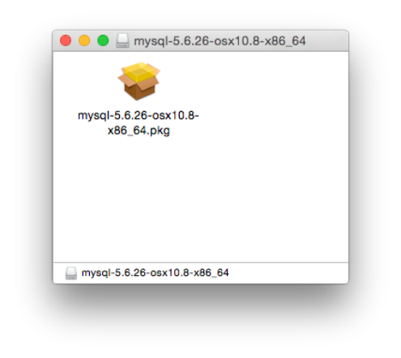

Installing MySQL on macOS Using Native Packages

2. Double-click the MySQL installer package. It is named according to the MySQL version and the macOS

version you have chosen. For example, if you have downloaded the package for MySQL 5.6.51 and macOS 10.8, double-click `mysql-5.6.51-macos-10.8-x86_64.pkg`.

3. You are presented with the opening installer dialog. Click Continue to begin installation.

> Figure 2.14 MySQL Package Installer: Introduction

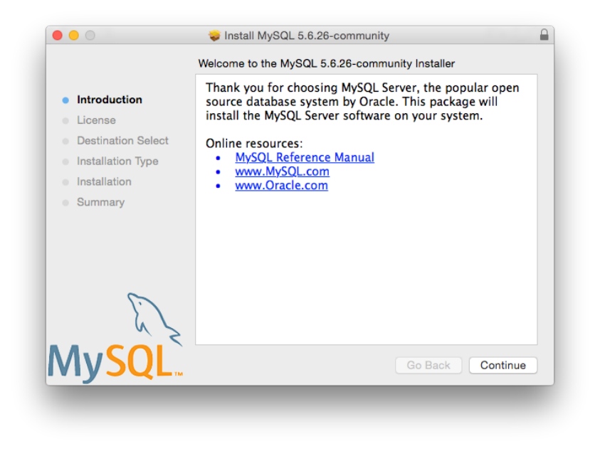

4. If you have downloaded the community version of MySQL, you are shown a copy of the relevant GNU

General Public License. Click Continue and then Agree to continue.

Installing MySQL on macOS Using Native Packages

5. From the Installation Type page you can either click Install to execute the installation wizard using

all defaults, click Customize to alter which components to install (MySQL server, Preference Pane,Launchd Support -- all enabled by default).

Note Although the Change Install Location option is visible, the installation location cannot be changed.

> Figure 2.15 MySQL Package Installer: Installation Type

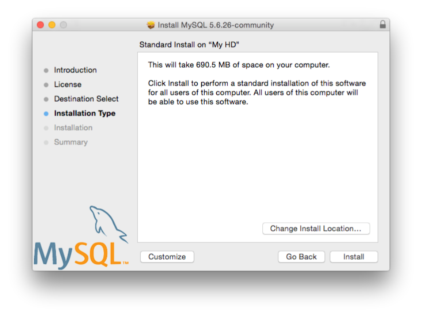

Installing MySQL on macOS Using Native Packages Figure 2.16 MySQL Package Installer: Customize


6. Click Install to begin the installation process.

Installing MySQL on macOS Using Native Packages

7. Once the installation has been completed successfully, you are shown an Install Succeeded message

with a short summary. Now, Close the wizard and begin using the MySQL server.

> Figure 2.17 MySQL Package Installer: Summary

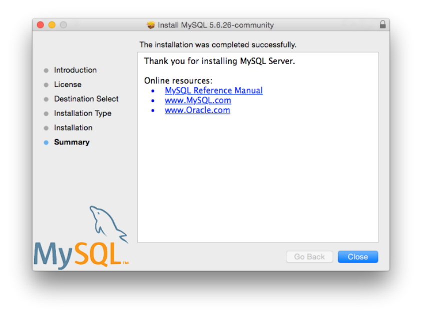

MySQL server is now installed, but it is not loaded (or started) by default. Use either launchctl from the command line, or start MySQL by clicking "Start" using the MySQL preference pane. For additional information, see Section 2.4.3, “Installing a MySQL Launch Daemon”, and Section 2.4.4, “Installing and Using the MySQL Preference Pane”. Use the MySQL Preference Pane or launchd to configure MySQL to automatically start at bootup.

When installing using the package installer, the files are installed into a directory within `/usr/``local` matching the name of the installation version and platform. For example, the installer file

```
mysql-5.6.51-macos10.12-x86_64.dmg installs MySQL into /usr/local/mysql-5.6.51-
```

`macos10.12-x86_64/` . The following table shows the layout of the installation directory.

Table 2.7 MySQL Installation Layout on macOS Directory Contents of Directory`bin`, `scripts` `mysqld` server, client and utility programs`data` Log files, databases`docs` Helper documents, like the Release Notes and build information`include` Include (header) files`lib` Libraries Installing a MySQL Launch Daemon Directory Contents of Directory`man` Unix manual pages`mysql-test` MySQL test suite`share` Miscellaneous support files, including error messages, sample configuration files, SQL for database installation`sql-bench` Benchmarks`support-files` Scripts and sample configuration files`/tmp/mysql.sock` Location of the MySQL Unix socket During the package installer process, a symbolic link from `/usr/local/mysql` to the version/platform specific directory created during installation is created automatically.

### 2.4.3 Installing a MySQL Launch Daemon

macOS uses launch daemons to automatically start, stop, and manage processes and applications such as MySQL.

Note Before MySQL 5.6.26, the macOS builds installed startup items instead of launchd daemons. However, startup items do not function as of OS X 10.10 (Yosemite). The macOS builds now install launchd daemons.

By default, the installation package (DMG) on macOS installs a launchd file named `/Library/``LaunchDaemons/com.oracle.oss.mysql.mysqld.plist` that contains a plist definition similar to:

```
<?xml version="1.0" encoding="utf-8"?>
<!DOCTYPE plist PUBLIC "-//Apple Computer//DTD PLIST 1.0//EN" "http://www.apple.com/DTDs/PropertyList-1.0.d
<plist version="1.0">
<dict>
<key>Label</key>             <string>com.oracle.oss.mysql.mysqld</string>
<key>ProcessType</key>       <string>Interactive</string>
<key>Disabled</key>          <false/>
<key>RunAtLoad</key>         <true/>
<key>KeepAlive</key>         <true/>
<key>SessionCreate</key>     <true/>
<key>LaunchOnlyOnce</key>    <false/>
<key>UserName</key>          <string>_mysql</string>
<key>GroupName</key>         <string>_mysql</string>
<key>ExitTimeOut</key>       <integer>600</integer>
<key>Program</key>           <string>/usr/local/mysql/bin/mysqld</string>
<key>ProgramArguments</key>
<array>
<string>/usr/local/mysql/bin/mysqld</string>
<string>--user=_mysql</string>
<string>--basedir=/usr/local/mysql</string>
<string>--datadir=/usr/local/mysql/data</string>
<string>--plugin-dir=/usr/local/mysql/lib/plugin</string>
<string>--log-error=/usr/local/mysql/data/mysqld.local.err</string>
<string>--pid-file=/usr/local/mysql/data/mysqld.local.pid</string>
</array>
<key>WorkingDirectory</key>  <string>/usr/local/mysql</string>
</dict>
</plist>
```

Installing a MySQL Launch Daemon Note Some users report that adding a plist DOCTYPE declaration causes the launchd operation to fail, despite it passing the lint check. We suspect it's a copy-n-paste error. The md5 checksum of a file containing the above snippet is 60d7963a0bb2994b69b8b9c123db09df.

To enable the launchd service, you can either:

- Click Start MySQL Server from the MySQL preference pane.

> Figure 2.18 MySQL Preference Pane: Location

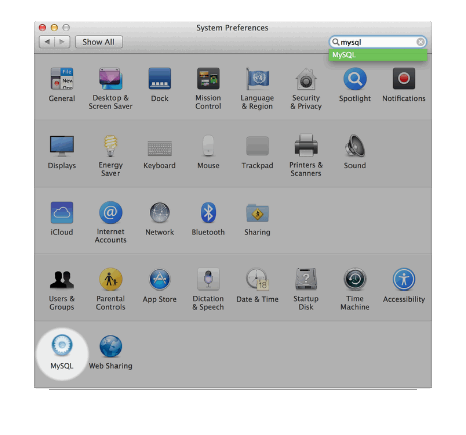

Installing and Using the MySQL Preference Pane Figure 2.19 MySQL Preference Pane: Usage

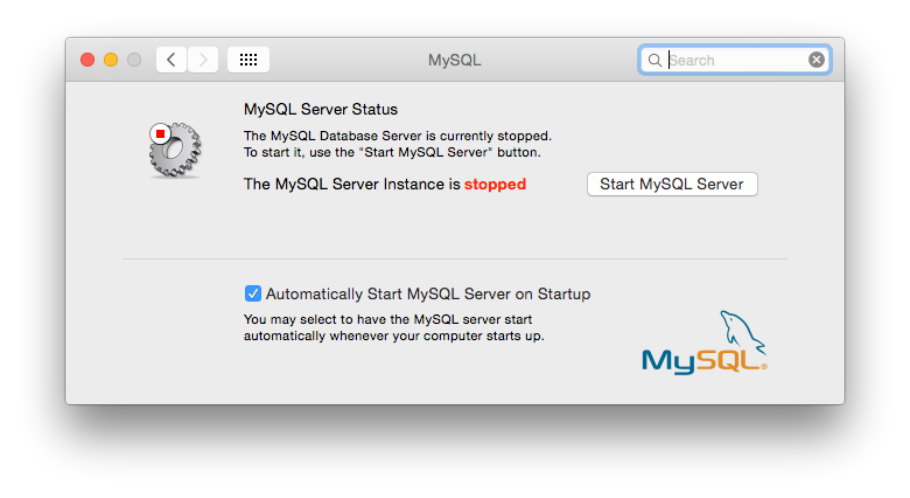

- Or, manually load the launchd file.

```
$> cd /Library/LaunchDaemons
$> sudo launchctl load -F com.oracle.oss.mysql.mysqld.plist
```

- To configure MySQL to automatically start at bootup, you can:

```
$> sudo launchctl load -w com.oracle.oss.mysql.mysqld.plist
```

Note When upgrading MySQL server, the launchd installation process removes the old startup items that were installed with MySQL server 5.6.25 and earlier.

### 2.4.4 Installing and Using the MySQL Preference Pane

The MySQL Installation Package includes a MySQL preference pane that enables you to start, stop, and control automated startup during boot of your MySQL installation.

This preference pane is installed by default, and is listed under your system's System Preferences window.

Installing and Using the MySQL Preference Pane Figure 2.20 MySQL Preference Pane: Location


To install the MySQL Preference Pane:

1. Download the disk image (`.dmg`) file (the community version is available here) that contains the MySQL

package installer. Double-click the file to mount the disk image and see its contents.

Installing and Using the MySQL Preference Pane Figure 2.21 MySQL Package Installer: DMG Contents


Note Before MySQL 5.6.26, macOS packages included the deprecated startup items instead of launchd daemons, and the preference pane managed that instead of launchd.

2. Go through the process of installing the MySQL server, as described in the documentation at

Section 2.4.2, “Installing MySQL on macOS Using Native Packages”.

Installing and Using the MySQL Preference Pane

3. Click Customize at the Installation Type step. The "Preference Pane" option is listed there and

enabled by default; make sure it is not deselected.

> Figure 2.22 MySQL Installer on macOS: Customize

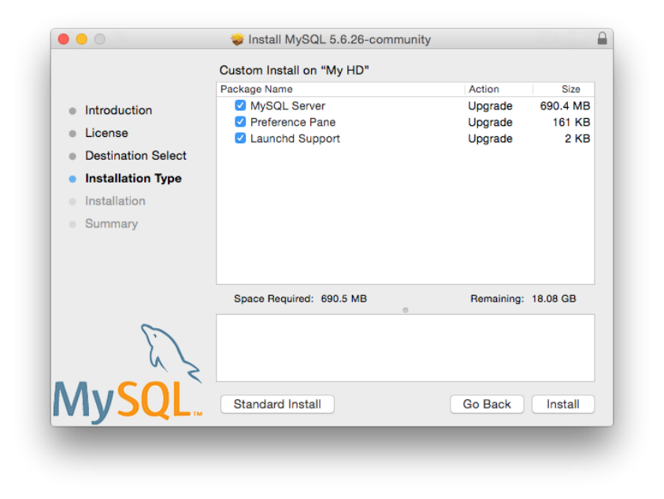

4. Complete the MySQL server installation process.

Note The MySQL preference pane only starts and stops MySQL installation installed from the MySQL package installation that have been installed in the default location.

Once the MySQL preference pane has been installed, you can control your MySQL server instance using the preference pane. To use the preference pane, open the System Preferences... from the Apple menu.

Select the MySQL preference pane by clicking the MySQL icon within the preference panes list.

Installing and Using the MySQL Preference Pane Figure 2.23 MySQL Preference Pane: Location


Installing MySQL on Linux Figure 2.24 MySQL Preference Pane: Usage

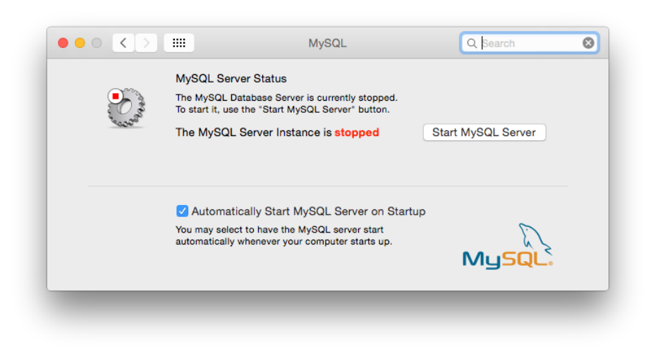

The MySQL Preference Pane shows the current status of the MySQL server, showing stopped (in red)if the server is not running and running (in green) if the server has already been started. The preference pane also shows the current setting for whether the MySQL server has been set to start automatically.

- To start the MySQL server using the preference pane:

Click Start MySQL Server. You may be prompted for the username and password of a user with administrator privileges to start the MySQL server.

- To stop the MySQL server using the preference pane:

Click Stop MySQL Server. You may be prompted for the username and password of a user with administrator privileges to stop the MySQL server.

- To automatically start the MySQL server when the system boots:

Check the check box next to Automatically Start MySQL Server on Startup.

- To disable automatic MySQL server startup when the system boots:

Uncheck the check box next to Automatically Start MySQL Server on Startup.

You can close the `System Preferences...` window once you have completed your settings.

## 2.5 Installing MySQL on Linux

Linux supports a number of different solutions for installing MySQL. We recommend that you use one of the distributions from Oracle, for which several methods for installation are available:Table 2.8 Linux Installation Methods and Information Type Setup Method Additional Information Apt Enable the MySQL Apt repository Documentation Installing MySQL on Linux Using the MySQL Yum Repository Type Setup Method Additional Information Yum Enable the MySQL Yum Documentation repository Zypper Enable the MySQL SLES Documentation repository RPM Download a specific package Documentation DEB Download a specific package Documentation Generic Download a generic package Documentation Source Compile from source Documentation Docker Use Docker Hub Documentation Oracle Unbreakable Linux Use ULN channels Documentation Network As an alternative, you can use the package manager on your system to automatically download and install MySQL with packages from the native software repositories of your Linux distribution. These native packages are often several versions behind the currently available release. You are also normally unable to install development milestone releases (DMRs), as these are not usually made available in the native repositories. For more information on using the native package installers, see Section 2.5.7, “Installing MySQL on Linux from the Native Software Repositories”.

Note For many Linux installations, you may want to set up MySQL to be started automatically when your machine starts. Many of the native package installations perform this operation for you, but for source, binary and RPM solutions you may need to set this up separately. The required script, `mysql.server`, can be found in the `support-files` directory under the MySQL installation directory or in a MySQL source tree. You can install it as `/etc/init.d/mysql` for automatic MySQL startup and shutdown. See Section 4.3.3, “mysql.server — MySQL Server Startup Script”.

### 2.5.1 Installing MySQL on Linux Using the MySQL Yum Repository

The MySQL Yum repository for Oracle Linux, Red Hat Enterprise Linux, and CentOS provides RPM packages for installing the MySQL server, client, MySQL Workbench, MySQL Utilities, MySQL Router,MySQL Shell, Connector/ODBC, Connector/Python and so on (not all packages are available for all the distributions; see Installing Additional MySQL Products and Components with Yum for details).

> Before You Start

As a popular, open-source software, MySQL, in its original or re-packaged form, is widely installed on many systems from various sources, including different software download sites, software repositories,and so on. The following instructions assume that MySQL is not already installed on your system using a third-party-distributed RPM package; if that is not the case, follow the instructions given in Section 2.11.5, “Upgrading MySQL with the MySQL Yum Repository” or Section 2.5.2, “Replacing a Third-Party Distribution of MySQL Using the MySQL Yum Repository”.

> Steps for a Fresh Installation of MySQL

Follow the steps below to install the latest GA release of MySQL (from the MySQL 5.7 series currently)with the MySQL Yum repository:Installing MySQL on Linux Using the MySQL Yum Repository

> Adding the MySQL Yum Repository1.

First, add the MySQL Yum repository to your system's repository list. This is a one-time operation,which can be performed by installing an RPM provided by MySQL. Follow these steps:a. Go to the Download MySQL Yum Repository page (https://dev.mysql.com/downloads/repo/yum/) in the MySQL Developer Zone.

b. Select and download the release package for your platform.

c. Install the downloaded release package with the following command, replacing `platform-and-``version-specific-package-name` with the name of the downloaded RPM package:

```
$> sudo yum localinstall platform-and-version-specific-package-name.rpm
```

For an EL6-based system, the command is in the form of:

```
$> sudo yum localinstall mysql57-community-release-el6-{version-number}.noarch.rpm
```

For an EL7-based system:

```
$> sudo yum localinstall mysql57-community-release-el7-{version-number}.noarch.rpm
```

The installation command adds the MySQL Yum repository to your system's repository list and downloads the GnuPG key to check the integrity of the software packages. See Section 2.1.4.2,“Signature Checking Using GnuPG” for details on GnuPG key checking.

You can check that the MySQL Yum repository has been successfully added by the following command:

```
$> yum repolist enabled | grep "mysql.*-community.*"
```

Note Once the MySQL Yum repository is enabled on your system, any system-wide update by the `yum update` command upgrades MySQL packages on your system and also replace any native third-party packages, if Yum finds replacements for them in the MySQL Yum repository; see Section 2.11.5,“Upgrading MySQL with the MySQL Yum Repository” and, for a discussion on some possible effects of that on your system, see Upgrading the Shared Client Libraries.

> Selecting a Release Series2.

When using the MySQL Yum repository, the latest GA series (currently MySQL 5.7) is selected for installation by default. If this is what you want, you can skip to the next step, Installing MySQL.

Within the MySQL Yum repository, different release series of the MySQL Community Server are hosted in different subrepositories. The subrepository for the latest GA series (currently MySQL 5.7) is enabled by default, and the subrepositories for all other series (for example, the MySQL 5.6 series) are disabled by default. Use this command to see all the subrepositories in the MySQL Yum repository, and see which of them are enabled or disabled:

```
$> yum repolist all | grep mysql
```

To install the latest release from the latest GA series, no configuration is needed. To install the latest release from a specific series other than the latest GA series, disable the subrepository for the latest Installing MySQL on Linux Using the MySQL Yum Repository GA series and enable the subrepository for the specific series before running the installation command.

If your platform supports `yum-config-manager`, you can do that by issuing these commands, which disable the subrepository for the 5.7 series and enable the one for the 5.6 series:

```
$> sudo yum-config-manager --disable mysql57-community
$> sudo yum-config-manager --enable mysql56-community
```

Besides using `yum-config-manager` command, you can also select a release series by editing manually the `/etc/yum.repos.d/mysql-community.repo` file. This is a typical entry for a release series' subrepository in the file:

```
[mysql57-community]
name=MySQL 5.7 Community Server
baseurl=http://repo.mysql.com/yum/mysql-5.7-community/el/6/$basearch/
enabled=1
gpgcheck=1
gpgkey=file:///etc/pki/rpm-gpg/RPM-GPG-KEY-mysql
```

Find the entry for the subrepository you want to configure, and edit the `enabled` option. Specify`enabled=0` to disable a subrepository, or `enabled=1` to enable a subrepository. For example, to install MySQL 5.6, make sure you have `enabled=0` for the above subrepository entry for MySQL 5.7,and have `enabled=1` for the entry for the 5.6 series:

```
# Enable to use MySQL 5.6
[mysql56-community]
name=MySQL 5.6 Community Server
baseurl=http://repo.mysql.com/yum/mysql-5.6-community/el/6/$basearch/
enabled=1
gpgcheck=1
gpgkey=file:///etc/pki/rpm-gpg/RPM-GPG-KEY-mysql
```

You should only enable subrepository for one release series at any time. When subrepositories for more than one release series are enabled, the latest series is used by Yum.

Verify that the correct subrepositories have been enabled and disabled by running the following command and checking its output:

```
$> yum repolist enabled | grep mysql
```

> Disabling the Default MySQL Module3.

(EL8 systems only) EL8-based systems such as RHEL8 and Oracle Linux 8 include a MySQL module that is enabled by default. Unless this module is disabled, it masks packages provided by MySQL repositories. To disable the included module and make the MySQL repository packages visible, use the following command (for dnf-enabled systems, replace `yum` in the command with `dnf`):

```
$> sudo yum module disable mysql
```

> Installing MySQL4.

Install MySQL by the following command:

```
$> sudo yum install mysql-community-server
```

This installs the package for MySQL server (`mysql-community-server`) and also packages for the components required to run the server, including packages for the client (`mysql-community-``client`), the common error messages and character sets for client and server (`mysql-community-``common`), and the shared client libraries (`mysql-community-libs`).

Installing MySQL on Linux Using the MySQL Yum Repository

> Starting the MySQL Server5.

Start the MySQL server with the following command:

```
$> sudo service mysqld start
```

This is a sample output of the above command:

```
Starting mysqld:[ OK ]
```

You can check the status of the MySQL server with the following command:

```
$> sudo service mysqld status
```

This is a sample output of the above command:

```
mysqld (pid 3066) is running.
```

> Securing the MySQL Installation6.

The program `mysql_secure_installation` allows you to perform important operations like setting the root password, removing anonymous users, and so on. Always run it to secure your MySQL installation:

```
$> mysql_secure_installation
```

It is important to remember the root password you set. See Section 4.4.5, “mysql_secure_installation —Improve MySQL Installation Security” for details.

For more information on the postinstallation procedures, see Section 2.10, “Postinstallation Setup and Testing”.

Note Compatibility Information for EL7-based platforms: The following RPM packages from the native software repositories of the platforms are incompatible with the package from the MySQL Yum repository that installs the MySQL server. Once you have installed MySQL using the MySQL Yum repository, you cannot install these packages (and vice versa).

- akonadi-mysql

> Installing Additional MySQL Products and Components with Yum

You can use Yum to install and manage individual components of MySQL. Some of these components are hosted in sub-repositories of the MySQL Yum repository: for example, the MySQL Connectors are to be found in the MySQL Connectors Community sub-repository, and the MySQL Workbench in MySQL Tools Community. You can use the following command to list the packages for all the MySQL components available for your platform from the MySQL Yum repository:

```
$> sudo yum --disablerepo=\* --enablerepo='mysql*-community*' list available
```

Install any packages of your choice with the following command, replacing `package-name` with name of the package:

```
$> sudo yum install package-name
```

For example, to install MySQL Workbench:Replacing a Third-Party Distribution of MySQL Using the MySQL Yum Repository

```
$> sudo yum install mysql-workbench-community
```

To install the shared client libraries:

```
$> sudo yum install mysql-community-libs
```

> Updating MySQL with Yum

Besides installation, you can also perform updates for MySQL products and components using the MySQL Yum repository. See Section 2.11.5, “Upgrading MySQL with the MySQL Yum Repository” for details.

> 2.5.2 Replacing a Third-Party Distribution of MySQL Using the MySQL Yum Repository

For supported Yum-based platforms (see Section 2.5.1, “Installing MySQL on Linux Using the MySQL Yum Repository”, for a list), you can replace a third-party distribution of MySQL with the latest GA release(from the MySQL 5.7 series currently) from the MySQL Yum repository. According to how your third-party distribution of MySQL was installed, there are different steps to follow:

> Replacing a Native Third-Party Distribution of MySQL

If you have installed a third-party distribution of MySQL from a native software repository (that is, a software repository provided by your own Linux distribution), follow these steps:

> Backing Up Your Database1.

To avoid loss of data, always back up your database before trying to replace your MySQL installation using the MySQL Yum repository. See Chapter 7, Backup and Recovery, on how to back up your database.

> Adding the MySQL Yum Repository2.

Add the MySQL Yum repository to your system's repository list by following the instructions given in Adding the MySQL Yum Repository.

> Replacing the Native Third-Party Distribution by a Yum Update3.

By design, the MySQL Yum repository replaces your native third-party MySQL with the latest GA release (from the MySQL 5.7 series currently) from the MySQL Yum repository when you perform a`yum update` command on the system, or a `yum update mysql-server`.

After updating MySQL using the Yum repository, applications compiled with older versions of the shared client libraries should continue to work. However, if you want to recompile applications and dynamically link them with the updated libraries, see Upgrading the Shared Client Libraries, for some special considerations.

> Replacing a Nonnative Third-Party Distribution of MySQL

If you have installed a third-party distribution of MySQL from a nonnative software repository (that is, a software repository not provided by your own Linux distribution), follow these steps:

> Backing Up Your Database1.

To avoid loss of data, always back up your database before trying to replace your MySQL installation using the MySQL Yum repository. See Chapter 7, Backup and Recovery, on how to back up your database.

Replacing a Third-Party Distribution of MySQL Using the MySQL Yum Repository

> Stopping Yum from Receiving MySQL Packages from Third-Party, Nonnative Repositories2.

Before you can use the MySQL Yum repository for installing MySQL, you must stop your system from receiving MySQL packages from any third-party, nonnative Yum repositories.

For example, if you have installed MariaDB using their own software repository, get a list of the installed MariaDB packages using the following command:

```
$> yum list installed mariadb\*
```

This is a sample output for the command:

```
MariaDB-common.i686                      10.0.4-1                       @mariadb
MariaDB-compat.i686                      10.0.4-1                       @mariadb
MariaDB-server.i686                      10.0.4-1                       @mariadb
```

From the command output, we can identify the installed packages (`MariaDB-common`, `MariaDB-``compat`, and `MariaDB-server`) and the source of them (a nonnative software repository named

```
mariadb).
```

As another example, if you have installed Percona using their own software repository, get a list of the installed Percona packages using the following command:

```
$> yum list installed Percona\*
```

This is a sample output for the command:

```
Percona-Server-client-55.i686     5.5.39-rel36.0.el6          @percona-release-i386
Percona-Server-server-55.i686     5.5.39-rel36.0.el6          @percona-release-i386
Percona-Server-shared-55.i686     5.5.39-rel36.0.el6          @percona-release-i386
percona-release.noarch            0.1-3                       @/percona-release-0.1-3.noarch
```

From the command output, we can identify the installed packages (`Percona-Server-client`,

```
Percona-Server-server, Percona-Server-shared, and percona-release.noarch) and the
```

source of them (a nonnative software repository named `percona-release`).

If you are not sure which third-party MySQL fork you have installed, this command should reveal it and list the RPM packages installed for it, as well as the third-party repository that supplies the packages:

```
$> yum --disablerepo=\* provides mysql\*
```

The next step is to stop Yum from receiving packages from the nonnative repository. If the `yum-``config-manager` utility is supported on your platform, you can, for example, use this command for stopping delivery from MariaDB:

```
$> sudo yum-config-manager --disable mariadb
```

And use this command for stopping delivery from Percona:

```
$> sudo yum-config-manager --disable percona-release
```

You can perform the same task by removing the entry for the software repository existing in one of the repository files under the `/etc/yum.repos.d/` directory. This is how the entry typically looks like for MariaDB:

```
[mariadb] name = MariaDB
baseurl = [base URL for repository]
gpgkey = [URL for GPG key]
```

Installing MySQL on Linux Using the MySQL APT Repository

```
gpgcheck =1
```

The entry is usually found in the file `/etc/yum.repos.d/MariaDB.repo` for MariaDB—delete the file, or remove entry from it (or from the file in which you find the entry).

Note This step is not necessary for an installation that was configured with a Yum repository release package (like Percona) if you are going to remove the release package (`percona-release.noarch` for Percona), as shown in the uninstall command for Percona in Step 3 below.

> Uninstalling the Nonnative Third-Party MySQL Distribution of MySQL3.

The nonnative third-party MySQL distribution must first be uninstalled before you can use the MySQL Yum repository to install MySQL. For the MariaDB packages found in Step 2 above, uninstall them with the following command:

```
$> sudo yum remove MariaDB-common MariaDB-compat MariaDB-server
```

For the Percona packages we found in Step 2 above:

```
$> sudo yum remove Percona-Server-client-55 Percona-Server-server-55 \
Percona-Server-shared-55.i686 percona-release
```

> Installing MySQL with the MySQL Yum Repository4.

Then, install MySQL with the MySQL Yum repository by following the instructions given in Section 2.5.1, “Installing MySQL on Linux Using the MySQL Yum Repository”: .

> Important

- If you have chosen to replace your third-party MySQL distribution with

a newer version of MySQL from the MySQL Yum repository, remember to run `mysql_upgrade` after the server starts, to check and possibly resolve any incompatibilities between the old data and the upgraded software. `mysql_upgrade` also performs other functions; see Section 4.4.7,“mysql_upgrade — Check and Upgrade MySQL Tables” for details.

- For EL7-based platforms: See Compatibility Information for EL7-based

platforms [152].

### 2.5.3 Installing MySQL on Linux Using the MySQL APT Repository

The MySQL APT repository provides `deb` packages for installing and managing the MySQL server, client,and other components on Debian and Ubuntu platforms.

Instructions for using the MySQL APT Repository are available in A Quick Guide to Using the MySQL APT Repository.

### 2.5.4 Installing MySQL on Linux Using the MySQL SLES Repository

The MySQL SLES repository provides RPM packages for installing and managing the MySQL server,client, and other components on SUSE Enterprise Linux Server.

Instructions for using the MySQL SLES repository are available in A Quick Guide to Using the MySQL SLES Repository.

Installing MySQL on Linux Using RPM Packages from Oracle Note The MySQL SLES repository is now in development release. We encourage you to try it and provide us with feedback. Please report any bugs or inconsistencies you observe to our Bugs Database.

### 2.5.5 Installing MySQL on Linux Using RPM Packages from Oracle

The recommended way to install MySQL on RPM-based Linux distributions is by using the RPM packages provided by Oracle. There are two sources for obtaining them, for the Community Edition of MySQL:

- From the MySQL software repositories:
- The MySQL Yum repository (see Section 2.5.1, “Installing MySQL on Linux Using the MySQL Yum

Repository” for details).

- The MySQL SLES repository (see Section 2.5.4, “Installing MySQL on Linux Using the MySQL SLES

Repository” for details).

- From the MySQL Downloads page in the MySQL Developer Zone.

Note RPM distributions of MySQL are also provided by other vendors. Be aware that they may differ from those built by Oracle in features, capabilities, and conventions(including communication setup), and that the installation instructions in this manual do not necessarily apply to them. The vendor's instructions should be consulted instead.

If you have such a third-party distribution of MySQL running on your system and now want to migrate to Oracle's distribution using the RPM packages downloaded from the MySQL Developer Zone, see Compatibility with RPM Packages from Other Vendors below. The preferred method of migration, however, is to use the MySQL Yum repository or MySQL SLES repository.

There are two kinds of RPM packages for installing MySQL 5.6 :

- The older kind: Their package names started with `MYSQL-` . They are available from the MySQL

Downloads page in the MySQL Developer Zone. The instructions given in this section are for using these packages.

- The newer kind: Their package names started with `mysql-community-` or `mysql-commercial-`.

They are available from the MySQL Yum repository and MySQL SLES repository. If, instead of configuring your system to install these RPM directly from the MySQL repositories (which is recommended), you are downloading the packages from the repositories and then installing them manually in separate steps, use the installation commands given for the MySQL 5.7 RPMs in Installing MySQL on Linux Using RPM Packages from Oracle, but consult this section for information like installation layout, server initialization, root password, and so on.

RPM packages for MySQL are listed in the following tables:Table 2.9 RPM Packages for MySQL Community Edition Package Name Summary`MySQL-server` Database server and related tools`MySQL-client` MySQL client applications and tools Installing MySQL on Linux Using RPM Packages from Oracle Package Name Summary`MySQL-devel` Development header files and libraries for MySQL database client applications`MySQL-shared` Shared libraries for MySQL database client applications`MySQL-shared-compat` Shared compatibility libraries for previous MySQL installations`MySQL-embedded` MySQL embedded library`MySQL-test` Test suite for the MySQL server Dependency relationships exist among some of the packages. If you plan to install many of the packages,you may wish to download the RPM bundle `tar` file instead, which contains all the RPM packages listed above, so that you need not download them separately.

The full names for the RPMs have the following syntax:

```
packagename-version-distribution-arch.rpm
```

The `distribution` and `arch` values indicate the Linux distribution and the processor type for which the package was built. See the table below for lists of the distribution identifiers:Table 2.10 MySQL Linux RPM Package Distribution Identifiers`distribution` Value Intended Use`el6`, `el7` Red Hat Enterprise Linux/Oracle Linux/CentOS 5, 6,or 7`sles11, sles12` SUSE Linux Enterprise Server 11 or 12`linux_glibc2.5` Distribution independent; run on any RPM-based Linux distribution To see all files in an RPM package (for example, `MySQL-server`), use the following command:

```
$> rpm -qpl MySQL-server-version-distribution-arch.rpm
```

In most cases, you need to install the `MySQL-server` and `MySQL-client` to get a functional, standard MySQL installation. To perform such a standard, minimal installation, go to the folder that contains all those packages (and, preferably, no other RPM packages with similar names), and issue the following command(replace `yum` with `zypper` for SLES systems):

```
$> yum install MySQL-{server,client}-*
```

While it is much preferable to use a high-level package management tool like `yum` to install the packages,users who prefer direct `rpm` commands can replace the `yum install` command with the `rpm -Uvh`command; however, using `rpm -Uvh` instead makes the installation process more prone to failure, due to potential dependency issues the installation process might run into.

To install only the client programs, you can skip installing the `MySQL-server` package; issue the following command (replace `yum` with `zypper` for SLES systems):

```
$> yum install MySQL-client-*
```

A standard installation of MySQL using the RPM packages result in files and resources created under the system directories, shown in the following table.

Installing MySQL on Linux Using RPM Packages from Oracle Table 2.11 MySQL Installation Layout for Linux RPM Packages from the MySQL Developer Zone Files or Resources Location Client programs and scripts `/usr/bin``mysqld` server `/usr/sbin`Data directory `/var/lib/mysql`Error log file For RHEL, Oracle Linux, or CentOS: `/var/lib/`

```
mysql/host_name.err
```

For SLES: `/var/log/mysql/mysqld.log`System V init script `/etc/init.d/mysql`Systemd service `mysql`

```
Pid file  /var/lib/mysql/host_name.pid
```

Unix manual pages `/usr/share/man`Include (header) files `/usr/include/mysql`Libraries `/usr/lib/mysql`

```
Socket  /var/lib/mysql/mysql.sock
```

Miscellaneous support files (for example, error `/usr/share/mysql`messages, and character set files)The installation also creates a user named `mysql` and a group named `mysql` on the system.

MySQL is not automatically started at the end of the installation process. Use the following command to start MySQL:

```
$> service mysql start
```

At the initial start up of the server, the server is initialized if the data directory of the server is empty.

`mysql_install_db` is invoked with the `--random-passwords` option, which assigns a random password to the MySQL `root` accounts and sets the “password expired” flag for those accounts. It is necessary after installation to start the server, connect as `root` using the initial random password,and assign a new `root` password. Until this is done, `root` cannot do anything else. This must be done for each `root` account you intend to use. To change the password, you can use the `SET``PASSWORD` statement (for example, with the `mysql` client). You can also use `mysqladmin` or`mysql_secure_installation`. For additional details (including where to find the assigned random`root` password), see Section 4.4.3, “mysql_install_db — Initialize MySQL Data Directory”. (Install operations using RPMs for Unbreakable Linux Network are unaffected because they do not run

```
mysql_install_db.)
```

During an upgrade installation using RPM packages, if the MySQL server is running when the upgrade occurs then the MySQL server is stopped, the upgrade occurs, and the MySQL server is restarted. One exception: if the edition also changes during an upgrade (such as community to commercial, or vice-versa),then MySQL server is not restarted.

If something goes wrong during installation, you might find debug information in the error log file `/var/`

```
lib/mysql/host_name.err.
```

Compatibility with RPM Packages from Other Vendors. If you have installed packages for MySQL from your Linux distribution's local software repository, it is much preferable to install the new, directly-downloaded packages from Oracle using the package management system of your platform (`yum` or`zypper`), as described above. The command replaces old packages with new ones to ensure compatibility Installing MySQL on Linux Using Debian Packages from Oracle of old applications with the new installation; for example, the old `MySQL-shared` package is replaced with the `MySQL-shared-compat` package, which provides a replacement-compatible client library for applications that were using your older MySQL installation. If there was an older version of `MySQL-``shared-compat` on the system, it also gets replaced.

If you have installed third-party packages for MySQL that are NOT from your Linux distribution's local software repository (for example, packages directly downloaded from a vendor other than Oracle), you should uninstall all those packages before installing the new, directly-downloaded packages from Oracle.

This is because conflicts may arise between those vendor's RPM packages and Oracle's: for example, a vendor's convention about which files belong with the server and which belong with the client library may differ from that used for Oracle packages. Attempts to install an Oracle RPM may then result in messages saying that files in the RPM to be installed conflict with files from an installed package.

Debug Package. A special variant of MySQL Server compiled with the debug package has been included in the server RPM packages. It performs debugging and memory allocation checks and produces a trace file when the server is running. To use that debug version, start MySQL with `/usr/sbin/mysqld-``debug`, instead of starting it as a service or with `/usr/sbin/mysqld`. See Section 5.8.3, “The DBUG Package” for the debug options you can use.

Note The default plugin directory for debug builds changed from `/usr/lib64/mysql/``plugin` to `/usr/lib64/mysql/plugin/debug` in 5.6.39. Previously, it was necessary to change `plugin_dir` to `/usr/lib64/mysql/plugin/debug` for debug builds.

Rebuilding RPMs from source SRPMs. Source code SRPM packages for MySQL are available for download. They can be used as-is to rebuild the MySQL RPMs with the standard `rpmbuild` tool chain.

Important RPMs for NDB Cluster. Standard MySQL server RPMs built by MySQL do not provide support for the `NDBCLUSTER` storage engine. For more information about installing NDB Cluster from RPMs, see Section 18.3, “NDB Cluster Installation”.

### 2.5.6 Installing MySQL on Linux Using Debian Packages from Oracle

Oracle provides Debian packages for installing MySQL on Debian or Debian-like Linux systems. The packages are available through two different channels:

- The MySQL APT Repository, supporting Debian and Ubuntu platforms. For details, see Section 2.5.3,

“Installing MySQL on Linux Using the MySQL APT Repository”.

- The MySQL Developer Zone's Download Area. For details, see Section 2.1.3, “How to Get MySQL”. The

following are some information on the Debian packages available there and the instructions for installing them:

- You may also need to install the `libaio` library if it is not already present on your system:

```
$> sudo apt-get install libaio1
```

- Various Debian packages are provided in the MySQL Developer Zone for installing different

components of MySQL. The preferred method is to use the tarball bundle, which contains the packages needed for a basic setup of MySQL. The tarball bundles have names in the format of`mysql-server_MVER-DVER_CPU.deb-bundle.tar`. `MVER` is the MySQL version and `DVER` is the Linux distribution version. The `CPU` value indicates the processor type or family for which the package is built, as shown in the following table:Installing MySQL on Linux Using Debian Packages from Oracle Table 2.12 MySQL Debian and Ubuntu Installation Package CPU Identifiers`CPU` Value Intended Processor Type or Family`i386` Pentium processor or better, 32 bit`amd64` 64-bit x86 processor

- After downloading the tarball, unpack it with the following command:

```
$> tar -xvf mysql-server_MVER-DVER_CPU.deb-bundle.tar
```

- In general, install the `deb` packages unpacked from the tarball with the command (see explanations

below for the extra steps required for installing the server package):

```
$> sudo dpkg -i package-name.deb
```

There are four packages to install:

- The database common files (install this package before the other ones):

```
$> sudo dpkg -i mysql-common_MVER-DVER_CPU.deb
```

- The MySQL server:

Install first the package for the database common files (see the last bullet), and then pre-configure your server installation by the following command:

```
$> sudo dpkg-preconfigure mysql-community-server_MVER-DVER_CPU.deb
```

You are asked to provide a password for the `root` user for your MySQL installation. You might also be asked other questions regarding the installation.

Important Make sure you remember the root password you set. Users who want to set a password later can leave the password field blank in the dialogue box and just press OK. However, it is very important that you set the password soon using the program mysql_secure_installation, as people can gain Installing MySQL on Linux from the Native Software Repositories anonymous access to your MySQL server until you have secured the database's root account with a password.

Next, install the server package with the following command:

```
$> sudo dpkg -i mysql-community-server_MVER-DVER_CPU.deb
```

- The MySQL client:

```
$> sudo dpkg -i mysql-community-client_MVER-DVER_CPU.deb
```

- The MySQL shared client library:

```
$> sudo dpkg -i libmysqlclient18_MVER-DVER_CPU.deb
```

Here are where the files are installed on the system:

- All configuration files (like `my.cnf`) are under `/etc`
- All binaries, libraries, headers, etc., are under `/usr`
- The data directory is under `/var`

Note Debian distributions of MySQL are also provided by other vendors. Be aware that they may differ from those built by Oracle in features, capabilities, and conventions(including communication setup), and that the instructions in this manual do not necessarily apply to installing them. The vendor's instructions should be consulted instead.

### 2.5.7 Installing MySQL on Linux from the Native Software Repositories

Many Linux distributions include a version of the MySQL server, client tools, and development components in their native software repositories and can be installed with the platforms' standard package management systems. This section provides basic instructions for installing MySQL using those package management systems.

Important Native packages are often several versions behind the currently available release.

You are also normally unable to install development milestone releases (DMRs), as these are not usually made available in the native repositories. Before proceeding,we recommend that you check out the other installation options described in Section 2.5, “Installing MySQL on Linux”.

Distribution specific instructions are shown below:

- Red Hat Linux, Fedora, CentOS

Note For a number of Linux distributions, you can install MySQL using the MySQL Yum repository instead of the platform's native software repository. See Section 2.5.1, “Installing MySQL on Linux Using the MySQL Yum Repository” for details.

Installing MySQL on Linux from the Native Software Repositories For Red Hat and similar distributions, the MySQL distribution is divided into a number of separate packages, `mysql` for the client tools, `mysql-server` for the server and associated tools, and `mysql-``libs` for the libraries. The libraries are required if you want to provide connectivity from different languages and environments such as Perl, Python and others.

To install, use the `yum` command to specify the packages that you want to install. For example:

```
#> yum install mysql mysql-server mysql-libs mysql-server
Loaded plugins: presto, refresh-packagekit
Setting up Install Process
Resolving Dependencies
--> Running transaction check
---> Package mysql.x86_64 0:5.1.48-2.fc13 set to be updated
---> Package mysql-libs.x86_64 0:5.1.48-2.fc13 set to be updated
---> Package mysql-server.x86_64 0:5.1.48-2.fc13 set to be updated
--> Processing Dependency: perl-DBD-MySQL for package: mysql-server-5.1.48-2.fc13.x86_64
--> Running transaction check
---> Package perl-DBD-MySQL.x86_64 0:4.017-1.fc13 set to be updated
--> Finished Dependency Resolution
Dependencies Resolved
================================================================================
Package               Arch          Version               Repository      Size
================================================================================
Installing:
mysql                 x86_64        5.1.48-2.fc13         updates        889 k
mysql-libs            x86_64        5.1.48-2.fc13         updates        1.2 M
mysql-server          x86_64        5.1.48-2.fc13         updates        8.1 M
Installing for dependencies:
perl-DBD-MySQL        x86_64        4.017-1.fc13          updates        136 k
Transaction Summary
================================================================================
Install       4 Package(s)
Upgrade       0 Package(s)
Total download size: 10 M
Installed size: 30 M
Is this ok [y/N]: y
Downloading Packages:
Setting up and reading Presto delta metadata
Processing delta metadata
Package(s) data still to download: 10 M
(1/4): mysql-5.1.48-2.fc13.x86_64.rpm                    | 889 kB     00:04
(2/4): mysql-libs-5.1.48-2.fc13.x86_64.rpm               | 1.2 MB     00:06
(3/4): mysql-server-5.1.48-2.fc13.x86_64.rpm             | 8.1 MB     00:40
(4/4): perl-DBD-MySQL-4.017-1.fc13.x86_64.rpm            | 136 kB     00:00
--------------------------------------------------------------------------------
Total                                           201 kB/s |  10 MB     00:52
Running rpm_check_debug
Running Transaction Test
Transaction Test Succeeded
Running Transaction
Installing     : mysql-libs-5.1.48-2.fc13.x86_64                          1/4
Installing     : mysql-5.1.48-2.fc13.x86_64                               2/4
Installing     : perl-DBD-MySQL-4.017-1.fc13.x86_64                       3/4
Installing     : mysql-server-5.1.48-2.fc13.x86_64                        4/4
Installed:
mysql.x86_64 0:5.1.48-2.fc13            mysql-libs.x86_64 0:5.1.48-2.fc13
mysql-server.x86_64 0:5.1.48-2.fc13
Dependency Installed:
perl-DBD-MySQL.x86_64 0:4.017-1.fc13
```

Installing MySQL on Linux from the Native Software Repositories

```
Complete!
```

MySQL and the MySQL server should now be installed. A sample configuration file is installed into /`etc/my.cnf`. An `init` script, to start and stop the server, is installed into `/etc/init.d/mysqld`. To start the MySQL server use `service`:

```
#> service mysqld start
```

To enable the server to be started and stopped automatically during boot, use `chkconfig`:

```
#> chkconfig --levels 235 mysqld on
```

Which enables the MySQL server to be started (and stopped) automatically at the specified the run levels.

The database tables are automatically created for you, if they do not already exist. You should, however,run `mysql_secure_installation` to set the root passwords on your server.

- Debian, Ubuntu, Kubuntu

Note For Debian, Ubuntu, and Kubuntu, MySQL can be installed using the MySQL APT Repository instead of the platform's native software repository. See Section 2.5.3, “Installing MySQL on Linux Using the MySQL APT Repository” for details.

On Debian and related distributions, there are two packages for MySQL in their software repositories,`mysql-client` and `mysql-server`, for the client and server components respectively. You should specify an explicit version, for example `mysql-client-5.1`, to ensure that you install the version of MySQL that you want.

To download and install, including any dependencies, use the `apt-get` command, specifying the packages that you want to install.

Note Before installing, make sure that you update your `apt-get` index files to ensure you are downloading the latest available version.

A sample installation of the MySQL packages might look like this (some sections trimmed for clarity):

```
#> apt-get install mysql-client-5.1 mysql-server-5.1
Reading package lists... Done
Building dependency tree
Reading state information... Done
The following packages were automatically installed and are no longer required:
linux-headers-2.6.28-11 linux-headers-2.6.28-11-generic
Use 'apt-get autoremove' to remove them.
The following extra packages will be installed:
bsd-mailx libdbd-mysql-perl libdbi-perl libhtml-template-perl
libmysqlclient15off libmysqlclient16 libnet-daemon-perl libplrpc-perl mailx
mysql-common postfix
Suggested packages:
dbishell libipc-sharedcache-perl tinyca procmail postfix-mysql postfix-pgsql
postfix-ldap postfix-pcre sasl2-bin resolvconf postfix-cdb
The following NEW packages will be installed
bsd-mailx libdbd-mysql-perl libdbi-perl libhtml-template-perl
libmysqlclient15off libmysqlclient16 libnet-daemon-perl libplrpc-perl mailx
mysql-client-5.1 mysql-common mysql-server-5.1 postfix
```

Installing MySQL on Linux from the Native Software Repositories

```
0 upgraded, 13 newly installed, 0 to remove and 182 not upgraded.
Need to get 1907kB/25.3MB of archives.
After this operation, 59.5MB of additional disk space will be used.
Do you want to continue [Y/n]? Y
Get: 1 http://gb.archive.ubuntu.com jaunty-updates/main mysql-common 5.1.30really5.0.75-0ubuntu10.5 [63.6kB]
Get: 2 http://gb.archive.ubuntu.com jaunty-updates/main libmysqlclient15off 5.1.30really5.0.75-0ubuntu10.5 [
Fetched 1907kB in 9s (205kB/s)
Preconfiguring packages ...
Selecting previously deselected package mysql-common.
(Reading database ... 121260 files and directories currently installed.)
...
Processing 1 added doc-base file(s)...
Registering documents with scrollkeeper...
Setting up libnet-daemon-perl (0.43-1) ...
Setting up libplrpc-perl (0.2020-1) ...
Setting up libdbi-perl (1.607-1) ...
Setting up libmysqlclient15off (5.1.30really5.0.75-0ubuntu10.5) ...
Setting up libdbd-mysql-perl (4.008-1) ...
Setting up libmysqlclient16 (5.1.31-1ubuntu2) ...
Setting up mysql-client-5.1 (5.1.31-1ubuntu2) ...
Setting up mysql-server-5.1 (5.1.31-1ubuntu2) ...
* Stopping MySQL database server mysqld
...done.
100825 11:46:15  InnoDB: Started; log sequence number 0 46409
100825 11:46:15  InnoDB: Starting shutdown...
100825 11:46:17  InnoDB: Shutdown completed; log sequence number 0 46409
100825 11:46:17 [Warning] Forcing shutdown of 1 plugins
* Starting MySQL database server mysqld
...done.
* Checking for corrupt, not cleanly closed and upgrade needing tables.
...
Processing triggers for libc6 ...
ldconfig deferred processing now taking place
```

Note The `apt-get` command installs a number of packages, including the MySQL server, in order to provide the typical tools and application environment. This can mean that you install a large number of packages in addition to the main MySQL package.

During installation, the initial database is created, and you are prompted for the MySQL `root` password(and confirmation). A configuration file is created in `/etc/mysql/my.cnf`. An `init` script is created in

```
/etc/init.d/mysql.
```

The server is already started. You can manually start and stop the server using:

```
#> service mysql [start|stop]
```

The service is automatically added to run levels 2, 3 and 4,, with stop scripts in the single, shutdown and restart levels.

Deploying MySQL on Linux with Docker

- Gentoo Linux

As a source-based distribution, installing MySQL on Gentoo involves downloading the source, patching the Gentoo specifics, and then compiling the MySQL server and installing it. This process is handled automatically by the `emerge` command.

The MySQL server and client tools are provided within a single package, `dev-db/mysql`. You can obtain a list of the versions available to install by looking at the portage directory for the package:

```
#> ls /usr/portage/dev-db/mysql/mysql-5.6*
mysql-5.6.27.ebuild
mysql-5.6.27-r1.ebuild
mysql-5.6.28.ebuild
```

To install a specific MySQL version, you must specify the entire atom. For example:

```
#> emerge =dev-db/mysql-5.6.27-r1
```

After installation, you should initialize the data directory and set the password for the MySQL `root` user(see Section 2.10.1, “Initializing the Data Directory”). Alternatively, use the configuration interface to perform those tasks:

```
#> emerge --config =dev-db/mysql-5.6.27-r1
```

During installation, a sample configuration file is created for you in `/etc/mysql/my.cnf`, and an init script is created in `/etc/init.d/mysql`.

To enable MySQL to start automatically at the normal (default) run levels, use this command:

```
#> rc-update add mysql default
```

### 2.5.8 Deploying MySQL on Linux with Docker

The Docker deployment framework supports easy installation and configuration of MySQL Server. This section explains how to use a MySQL Server Docker image.

You need to have Docker installed on your system before you can use a MySQL Server Docker image.

See Install Docker for instructions.

Warning Beware of the security concerns with running Docker containers. See Docker security for details.

The instructions for using the MySQL Docker container are divided into two sections.

#### 2.5.8.1 Basic Steps for MySQL Server Deployment with Docker

Warning The MySQL Docker images maintained by the MySQL team are built specifically for Linux platforms. Other platforms are not supported, and users using these MySQL Docker images on them are doing so at their own risk. See the discussion here for some known limitations for running these containers on non-Linux operating systems.

- Downloading a MySQL Server Docker Image
- Starting a MySQL Server Instance

Deploying MySQL on Linux with Docker

- Connecting to MySQL Server from within the Container
- Container Shell Access
- Stopping and Deleting a MySQL Container
- More Topics on Deploying MySQL Server with Docker

Downloading a MySQL Server Docker Image Downloading the server image in a separate step is not strictly necessary; however, performing this step before you create your Docker container ensures your local image is up to date. To download the MySQL Community Server image, run this command:

```
docker pull mysql/mysql-server:tag
```

The `tag` is the label for the image version you want to pull (for example, `5.5`, `5.6`, `5.7`, `8.0`, or`latest`). If `:tag` is omitted, the `latest` label is used, and the image for the latest GA version of MySQL Community Server is downloaded. Refer to the list of tags for available versions on the mysql/mysql-server page in the Docker Hub.

You can list downloaded Docker images with this command:

```
$> docker images
REPOSITORY           TAG                 IMAGE ID            CREATED             SIZE
mysql/mysql-server   latest              3157d7f55f8d        4 weeks ago         241MB
```

Starting a MySQL Server Instance Start a new Docker container for the MySQL Server with this command:

```
docker run --name=mysql1 -d mysql/mysql-server:tag
```

The `--name` option, for supplying a custom name for your server container (`mysql1` in the example), is optional; if no container name is supplied, a random one is generated. If the Docker image of the specified name and tag has not been downloaded by an earlier `docker pull` or `docker run` command, the image is now downloaded. After download completes, initialization for the container begins, and the container appears in the list of running containers when you run the `docker ps` command; for example:

```
$> docker ps
CONTAINER ID   IMAGE                COMMAND                  CREATED             STATUS
a24888f0d6f4   mysql/mysql-server   "/entrypoint.sh my..."   14 seconds ago      Up 13 seconds (health: starti
```

The container initialization might take some time. When the server is ready for use, the `STATUS` of the container in the output of the `docker ps` command changes from `(health: starting)` to

```
(healthy).
```

The `-d` option used in the `docker run` command above makes the container run in the background. Use this command to monitor the output from the container:

```
docker logs mysql1
```

Once initialization is finished, the command's output is going to contain the random password generated for the root user; check the password with, for example, this command:

```
$> docker logs mysql1 2>&1 | grep GENERATED
GENERATED ROOT PASSWORD: Axegh3kAJyDLaRuBemecis&EShOs
```

Deploying MySQL on Linux with Docker Connecting to MySQL Server from within the Container Once the server is ready, you can run the `mysql` client within the MySQL Server container you just started,and connect it to the MySQL Server. Use the `docker exec -it` command to start a `mysql` client inside the Docker container you have started, like the following:

```
docker exec -it mysql1 mysql -uroot -p
```

When asked, enter the generated root password (see the last step in Starting a MySQL Server Instance above on how to find the password). Because the `MYSQL_ONETIME_PASSWORD` option is true by default,after you have connected a `mysql` client to the server, you must reset the server root password by issuing this statement:

```
mysql> ALTER USER 'root'@'localhost' IDENTIFIED BY 'newpassword';
```

Substitute `newpassword` with the password of your choice. Once the password is reset, the server is ready for use.

Container Shell Access To have shell access to your MySQL Server container, use the `docker exec -it` command to start a bash shell inside the container:

```
$> docker exec -it mysql1 bash
bash-4.2#
```

You can then run Linux commands inside the container. For example, to view contents in the server's data directory inside the container, use this command:

```
bash-4.2# ls /var/lib/mysql
auto.cnf    ca.pem      client-key.pem  ib_logfile0  ibdata1  mysql       mysql.sock.lock    private_key.pe
ca-key.pem  client-cert.pem  ib_buffer_pool  ib_logfile1  ibtmp1   mysql.sock  performance_schema  public_k
```

Stopping and Deleting a MySQL Container To stop the MySQL Server container we have created, use this command:

```
docker stop mysql1
```

`docker stop` sends a SIGTERM signal to the `mysqld` process, so that the server is shut down gracefully.

Also notice that when the main process of a container (`mysqld` in the case of a MySQL Server container)is stopped, the Docker container stops automatically.

To start the MySQL Server container again:

```
docker start mysql1
```

To stop and start again the MySQL Server container with a single command:

```
docker restart mysql1
```

To delete the MySQL container, stop it first, and then use the `docker rm` command:

```
docker stop mysql1
docker rm mysql1
```

If you want the Docker volume for the server's data directory to be deleted at the same time, add the `-v`option to the `docker rm` command.

Deploying MySQL on Linux with Docker More Topics on Deploying MySQL Server with Docker For more topics on deploying MySQL Server with Docker like server configuration, persisting data and configuration, server error log, and container environment variables, see Section 2.5.8.2, “More Topics on Deploying MySQL Server with Docker”.

#### 2.5.8.2 More Topics on Deploying MySQL Server with Docker

- The Optimized MySQL Installation for Docker
- Configuring the MySQL Server
- Persisting Data and Configuration Changes
- Running Additional Initialization Scripts
- Connect to MySQL from an Application in Another Docker Container
- Server Error Log
- Known Issues
- Docker Environment Variables

The Optimized MySQL Installation for Docker Docker images for MySQL are optimized for code size, which means they only include crucial components that are expected to be relevant for the majority of users who run MySQL instances in Docker containers. A MySQL Docker installation is different from a common, non-Docker installation in the following aspects:

- Included binaries are limited to:
- /usr/bin/my_print_defaults
- /usr/bin/mysql
- /usr/bin/mysql_config
- /usr/bin/mysql_install_db
- /usr/bin/mysql_tzinfo_to_sql
- /usr/bin/mysql_upgrade
- /usr/bin/mysqladmin
- /usr/bin/mysqlcheck
- /usr/bin/mysqldump
- /usr/sbin/mysqld
- All binaries are stripped; they contain no debug information.

Configuring the MySQL Server When you start the MySQL Docker container, you can pass configuration options to the server through the`docker run` command; for example, for the MySQL Server:Deploying MySQL on Linux with Docker

```
docker run --name mysql1 -d mysql/mysql-server --character-set-server=utf8mb4 --collation-server=utf8mb4_co
```

The command starts your MySQL Server with `utf8mb4` as the default character set and `utf8mb4_col` as the default collation for your databases.

Another way to configure the MySQL Server is to prepare a configuration file and mount it at the location of the server configuration file inside the container. See Persisting Data and Configuration Changes for details.

Persisting Data and Configuration Changes Docker containers are in principle ephemeral, and any data or configuration are expected to be lost if the container is deleted or corrupted (see discussions here). Docker volumes, however, provides a mechanism to persist data created inside a Docker container. At its initialization, the MySQL Server container creates a Docker volume for the server data directory. The JSON output for running the `docker inspect`command on the container has a `Mount` key, whose value provides information on the data directory volume:

```
$> docker inspect mysql1
...
"Mounts": [
{
"Type": "volume",
"Name": "4f2d463cfc4bdd4baebcb098c97d7da3337195ed2c6572bc0b89f7e845d27652",
"Source": "/var/lib/docker/volumes/4f2d463cfc4bdd4baebcb098c97d7da3337195ed2c6572bc0b89f7e8
"Destination": "/var/lib/mysql",
"Driver": "local",
"Mode": "",
"RW": true,
"Propagation": ""
}
],
...
```

The output shows that the source folder `/var/lib/docker/`

```
volumes/4f2d463cfc4bdd4baebcb098c97d7da3337195ed2c6572bc0b89f7e845d27652/_data,
```

in which data is persisted on the host, has been mounted at `/var/lib/mysql`, the server data directory inside the container.

Another way to preserve data is to bind-mount a host directory using the `--mount` option when creating the container. The same technique can be used to persist the configuration of the server. The following command creates a MySQL Server container and bind-mounts both the data directory and the server configuration file:

```
docker run --name=mysql1 \
--mount type=bind,src=/path-on-host-machine/my.cnf,dst=/etc/my.cnf \
--mount type=bind,src=/path-on-host-machine/datadir,dst=/var/lib/mysql \
-d mysql/mysql-server:tag
```

The command mounts `path-on-host-machine/my.cnf` at `/etc/my.cnf` (the server configuration file inside the container), and `path-on-host-machine/datadir` at `/var/lib/mysql` (the data directory inside the container). The following conditions must be met for the bind-mounting to work:

- The configuration file `path-on-host-machine/my.cnf` must already exist, and it must contain the

specification for starting the server using the user `mysql`:

```
[mysqld]
user=mysql
```

You can also include other server configuration options in the file.

Deploying MySQL on Linux with Docker

- The data directory `path-on-host-machine/datadir` must already exist. For server initialization

to happen, the directory must be empty. You can also mount a directory prepopulated with data and start the server with it; however, you must make sure you start the Docker container with the same configuration as the server that created the data, and any host files or directories required are mounted when starting the container.

Running Additional Initialization Scripts If there are any `.sh` or `.sql` scripts you want to run on the database immediately after it has been created, you can put them into a host directory and then mount the directory at `/docker-entrypoint-``initdb.d/` inside the container. For example, for a MySQL Server container:

```
docker run --name=mysql1 \
--mount type=bind,src=/path-on-host-machine/scripts/,dst=/docker-entrypoint-initdb.d/ \
-d mysql/mysql-server:tag
```

Connect to MySQL from an Application in Another Docker Container By setting up a Docker network, you can allow multiple Docker containers to communicate with each other, so that a client application in another Docker container can access the MySQL Server in the server container. First, create a Docker network:

```
docker network create my-custom-net
```

Then, when you are creating and starting the server and the client containers, use the `--network` option to put them on network you created. For example:

```
docker run --name=mysql1 --network=my-custom-net -d mysql/mysql-server
docker run --name=myapp1 --network=my-custom-net -d myapp
```

The `myapp1` container can then connect to the `mysql1` container with the `mysql1` hostname and vice versa, as Docker automatically sets up a DNS for the given container names. In the following example, we run the `mysql` client from inside the `myapp1` container to connect to host `mysql1` in its own container:

```
docker exec -it myapp1 mysql --host=mysql1 --user=myuser --password
```

For other networking techniques for containers, see the Docker container networking section in the Docker Documentation.

Server Error Log When the MySQL Server is first started with your server container, a server error log is NOT generated if either of the following conditions is true:

- A server configuration file from the host has been mounted, but the file does not contain the system

variable `log_error` (see Persisting Data and Configuration Changes on bind-mounting a server configuration file).

- A server configuration file from the host has not been mounted, but the Docker environment variable

`MYSQL_LOG_CONSOLE` is `true` (the variable's default state for MySQL 5.6 server containers is `false`).

The MySQL Server's error log is then redirected to `stderr`, so that the error log goes into the Docker container's log and is viewable using the `docker logs mysqld-container` command.

To make MySQL Server generate an error log when either of the two conditions is true, use the `--log-``error` option to configure the server to generate the error log at a specific location inside the container.

To persist the error log, mount a host file at the location of the error log inside the container as explained in Deploying MySQL on Linux with Docker Persisting Data and Configuration Changes. However, you must make sure your MySQL Server inside its container has write access to the mounted host file.

> Known Issues

- When using the server system variable `audit_log_file` to configure the audit log file name, use the

`loose` option modifier with it, or Docker will be unable to start the server.

Docker Environment Variables When you create a MySQL Server container, you can configure the MySQL instance by using the `--env`option (`-e` in short) and specifying one or more of the following environment variables.

> Notes

- None of the variables below has any effect if the data directory you mount is not

empty, as no server initialization is going to be attempted then (see Persisting Data and Configuration Changes for more details). Any pre-existing contents in the folder, including any old server settings, are not modified during the container startup.

- The boolean variables including `MYSQL_RANDOM_ROOT_PASSWORD`,

```
MYSQL_ONETIME_PASSWORD, MYSQL_ALLOW_EMPTY_PASSWORD, and
```

`MYSQL_LOG_CONSOLE` are made true by setting them with any strings of nonzero lengths. Therefore, setting them to, for example, “0”, “false”, or “no” does not make them false, but actually makes them true. This is a known issue of the MySQL Server containers.

- `MYSQL_RANDOM_ROOT_PASSWORD`: When this variable is true (which is its default state, unless

`MYSQL_ROOT_PASSWORD` or `MYSQL_ALLOW_EMPTY_PASSWORD` is set to true), a random password for the server's root user is generated when the Docker container is started. The password is printed to `stdout` of the container and can be found by looking at the container’s log (see Starting a MySQL Server Instance).

- `MYSQL_ONETIME_PASSWORD`: When the variable is true (which is its default state, unless

`MYSQL_ROOT_PASSWORD` is set or `MYSQL_ALLOW_EMPTY_PASSWORD` is set to true), the root user's password is set as expired and must be changed before MySQL can be used normally.

- `MYSQL_DATABASE`: This variable allows you to specify the name of a database to be created on image

startup. If a user name and a password are supplied with `MYSQL_USER` and `MYSQL_PASSWORD`, the user is created and granted superuser access to this database (corresponding to `GRANT ALL`). The specified database is created by a CREATE DATABASE IF NOT EXIST statement, so that the variable has no effect if the database already exists.

- `MYSQL_USER`, `MYSQL_PASSWORD`: These variables are used in conjunction to create a user and set

that user's password, and the user is granted superuser permissions for the database specified by the `MYSQL_DATABASE` variable. Both `MYSQL_USER` and `MYSQL_PASSWORD` are required for a user to be created—if any of the two variables is not set, the other is ignored. If both variables are set but`MYSQL_DATABASE` is not, the user is created without any privileges.

Note There is no need to use this mechanism to create the root superuser,which is created by default with the password set by either one of the mechanisms discussed in the descriptions for `MYSQL_ROOT_PASSWORD` and

```
MYSQL_RANDOM_ROOT_PASSWORD, unless MYSQL_ALLOW_EMPTY_PASSWORD is
```

true.

Deploying MySQL on Linux with Docker

- `MYSQL_ROOT_HOST`: By default, MySQL creates the `'root'@'localhost'` account. This account

can only be connected to from inside the container as described in Connecting to MySQL Server from within the Container. To allow root connections from other hosts, set this environment variable. For example, the value `172.17.0.1`, which is the default Docker gateway IP, allows connections from the host machine that runs the container. The option accepts only one entry, but wildcards are allowed (for

```
example, MYSQL_ROOT_HOST=172.*.*.* or MYSQL_ROOT_HOST=%).
```

- `MYSQL_LOG_CONSOLE`: When the variable is true (the variable's default state for MySQL 5.6 server

containers is `false`), the MySQL Server's error log is redirected to `stderr`, so that the error log goes into the Docker container's log and is viewable using the `docker logs mysqld-container`command.

Note The variable has no effect if a server configuration file from the host has been mounted (see Persisting Data and Configuration Changes on bind-mounting a configuration file).

- `MYSQL_ROOT_PASSWORD`: This variable specifies a password that is set for the MySQL root account.

Warning Setting the MySQL root user password on the command line is insecure. As an alternative to specifying the password explicitly, you can set the variable with a container file path for a password file, and then mount a file from your host that contains the password at the container file path. This is still not very secure, as the location of the password file is still exposed. It is preferable to use the default settings of `MYSQL_RANDOM_ROOT_PASSWORD=true` and`MYSQL_ONETIME_PASSWORD=true` being both true.

- `MYSQL_ALLOW_EMPTY_PASSWORD`. Set it to true to allow the container to be started with a blank

password for the root user.

Warning Setting this variable to true is insecure, because it is going to leave your MySQL instance completely unprotected, allowing anyone to gain complete superuser access. It is preferable to use the default settings of `MYSQL_RANDOM_ROOT_PASSWORD=true` and`MYSQL_ONETIME_PASSWORD=true` being both true.

#### 2.5.8.3 Deploying MySQL on Windows and Other Non-Linux Platforms with Docker

Warning The MySQL Docker images provided by Oracle are built specifically for Linux platforms. Other platforms are not supported, and users running the MySQL Docker images from Oracle on them are doing so at their own risk. This section discusses some known issues for the images when used on non-Linux platforms.

Known Issues for using the MySQL Server Docker images from Oracle on Windows include:

- If you are bind-mounting on the container's MySQL data directory (see Persisting Data and Configuration

Changes for details), you have to set the location of the server socket file with the `--socket` option to somewhere outside of the MySQL data directory; otherwise, the server fails to start. This is because the way Docker for Windows handles file mounting does not allow a host file from being bind-mounted on the socket file.

Installing MySQL on Linux with Juju

### 2.5.9 Installing MySQL on Linux with Juju

The Juju deployment framework supports easy installation and configuration of MySQL servers. For instructions, see https://jujucharms.com/mysql/.

## 2.6 Installing MySQL Using Unbreakable Linux Network (ULN)

Linux supports a number of different solutions for installing MySQL, covered in Section 2.5, “Installing MySQL on Linux”. One of the methods, covered in this section, is installing from Oracle's Unbreakable Linux Network (ULN). You can find information about Oracle Linux and ULN under http://linux.oracle.com/.

To use ULN, you need to obtain a ULN login and register the machine used for installation with ULN. This is described in detail in the ULN FAQ. The page also describes how to install and update packages. The MySQL packages are in the “MySQL for Oracle Linux 6” and “MySQL for Oracle Linux 7” channels for your system architecture on ULN.

Note At the time of this writing, ULN provides MySQL 5.6 for Oracle Linux 6 and Oracle Linux 7.

Once MySQL has been installed using ULN, you can find information on starting and stopping the server, and more, in this section, particularly under Section 2.5.5, “Installing MySQL on Linux Using RPM Packages from Oracle”.

If you're updating an existing MySQL installation to an installation using ULN, the recommended procedure is to export your data using `mysqldump`, remove the existing installation, install MySQL from ULN, and load the exported data into your freshly installed MySQL.

If the existing MySQL installation you're upgrading from is from a previous release series (prior to MySQL

5.6), make sure to read the section on upgrading MySQL, Section 2.11, “Upgrading MySQL”.

## 2.7 Installing MySQL on Solaris

Note MySQL 5.6 supports Solaris 10 (Update 11 and later), and Solaris 11 (Update 3 and later).

MySQL on Solaris is available in a number of different formats.

- For information on installing using the native Solaris PKG format, see Section 2.7.1, “Installing MySQL

on Solaris Using a Solaris PKG”.

- To use a standard `tar` binary installation, use the notes provided in Section 2.2, “Installing MySQL

on Unix/Linux Using Generic Binaries”. Check the notes and hints at the end of this section for Solaris specific notes that you may need before or after installation.

To obtain a binary MySQL distribution for Solaris in tarball or PKG format, https://dev.mysql.com/downloads/mysql/5.6.html.

Additional notes to be aware of when installing and using MySQL on Solaris:

- If you want to use MySQL with the `mysql` user and group, use the `groupadd` and `useradd` commands:

```
groupadd mysql
useradd -g mysql -s /bin/false mysql
```

Installing MySQL on Solaris Using a Solaris PKG

- If you install MySQL using a binary tarball distribution on Solaris, because the Solaris `tar` cannot handle

long file names, use GNU `tar` (`gtar`) to unpack the distribution. If you do not have GNU `tar` on your system, install it with the following command:

```
pkg install archiver/gnu-tar
```

- You should mount any file systems on which you intend to store `InnoDB` files with the `forcedirectio`

option. (By default mounting is done without this option.) Failing to do so causes a significant drop in performance when using the `InnoDB` storage engine on this platform.

- If you would like MySQL to start automatically, you can copy `support-files/mysql.server` to /

`etc/init.d` and create a symbolic link to it named `/etc/rc3.d/S99mysql.server`.

- If too many processes try to connect very rapidly to `mysqld`, you should see this error in the MySQL log:

```
Error in accept: Protocol error
```

You might try starting the server with the `--back_log=50` option as a workaround for this.

- To configure the generation of core files on Solaris you should use the `coreadm` command. Because

of the security implications of generating a core on a `setuid()` application, by default, Solaris does not support core files on `setuid()` programs. However, you can modify this behavior using `coreadm`.

If you enable `setuid()` core files for the current user, they are generated using mode 600, and are owned by the superuser.

### 2.7.1 Installing MySQL on Solaris Using a Solaris PKG

You can install MySQL on Solaris using a binary package using the native Solaris PKG format instead of the binary tarball distribution.

To use this package, download the corresponding `mysql-VERSION-solaris10-PLATFORM.pkg.gz`file, then uncompress it. For example:

```
$> gunzip mysql-5.6.51-solaris10-x86_64.pkg.gz
```

To install a new package, use `pkgadd` and follow the onscreen prompts. You must have root privileges to perform this operation:

```
$> pkgadd -d mysql-5.6.51-solaris10-x86_64.pkg
The following packages are available:
1  mysql     MySQL Community Server (GPL)
(i86pc) 5.6.51
Select package(s) you wish to process (or 'all' to process
all packages). (default: all) [?,??,q]:
```

The PKG installer installs all of the files and tools needed, and then initializes your database if one does not exist. To complete the installation, you should set the root password for MySQL as provided in the instructions at the end of the installation. Alternatively, you can run the `mysql_secure_installation`script that comes with the installation.

By default, the PKG package installs MySQL under the root path `/opt/mysql`. You can change only the installation root path when using `pkgadd`, which can be used to install MySQL in a different Solaris zone. If you need to install in a specific directory, use a binary `tar` file distribution.

The `pkg` installer copies a suitable startup script for MySQL into `/etc/init.d/mysql`. To enable MySQL to startup and shutdown automatically, you should create a link between this file and the init script Installing MySQL on FreeBSD directories. For example, to ensure safe startup and shutdown of MySQL you could use the following commands to add the right links:

```
$> ln /etc/init.d/mysql /etc/rc3.d/S91mysql
$> ln /etc/init.d/mysql /etc/rc0.d/K02mysql
```

To remove MySQL, the installed package name is `mysql`. You can use this in combination with the `pkgrm`command to remove the installation.

To upgrade when using the Solaris package file format, you must remove the existing installation before installing the updated package. Removal of the package does not delete the existing database information,only the server, binaries and support files. The typical upgrade sequence is therefore:

```
$> mysqladmin shutdown
$> pkgrm mysql
$> pkgadd -d mysql-5.6.51-solaris10-x86_64.pkg
$> mysqld_safe &
$> mysql_upgrade
```

You should check the notes in Section 2.11, “Upgrading MySQL” before performing any upgrade.

## 2.8 Installing MySQL on FreeBSD

This section provides information about installing MySQL on variants of FreeBSD Unix.

You can install MySQL on FreeBSD by using the binary distribution provided by Oracle. For more information, see Section 2.2, “Installing MySQL on Unix/Linux Using Generic Binaries”.

The easiest (and preferred) way to install MySQL is to use the `mysql-server` and `mysql-client` ports available at http://www.freebsd.org/. Using these ports gives you the following benefits:

- A working MySQL with all optimizations enabled that are known to work on your version of FreeBSD.
- Automatic configuration and build.
- Startup scripts installed in `/usr/local/etc/rc.d`.
- The ability to use `pkg_info -L` to see which files are installed.
- The ability to use `pkg_delete` to remove MySQL if you no longer want it on your machine.

The MySQL build process requires GNU make (`gmake`) to work. If GNU `make` is not available, you must install it first before compiling MySQL.

To install using the ports system:

```
# cd /usr/ports/databases/mysql56-server
# make
...
# cd /usr/ports/databases/mysql56-client
# make
...
```

The standard port installation places the server into `/usr/local/libexec/mysqld`, with the startup script for the MySQL server placed in `/usr/local/etc/rc.d/mysql-server`.

Some additional notes on the BSD implementation:

- To remove MySQL after installation using the ports system:

```
# cd /usr/ports/databases/mysql56-server
```

Installing MySQL from Source

```
# make deinstall
...
# cd /usr/ports/databases/mysql56-client
# make deinstall
...
```

- If you get problems with the current date in MySQL, setting the `TZ` variable should help. See Section 4.9,

“Environment Variables”.

## 2.9 Installing MySQL from Source

Building MySQL from the source code enables you to customize build parameters, compiler optimizations, and installation location. For a list of systems on which MySQL is known to run, see https://www.mysql.com/support/supportedplatforms/database.html.

Before you proceed with an installation from source, check whether Oracle produces a precompiled binary distribution for your platform and whether it works for you. We put a great deal of effort into ensuring that our binaries are built with the best possible options for optimal performance. Instructions for installing binary distributions are available in Section 2.2, “Installing MySQL on Unix/Linux Using Generic Binaries”.

If you are interested in building MySQL from a source distribution using build options the same as or similar to those use by Oracle to produce binary distributions on your platform, obtain a binary distribution, unpack it, and look in the `docs/INFO_BIN` file, which contains information about how that MySQL distribution was configured and compiled.

Warning Building MySQL with nonstandard options may lead to reduced functionality,performance, or security.

### 2.9.1 Source Installation Methods

There are two methods for installing MySQL from source:

- Use a standard MySQL source distribution. To obtain a standard distribution, see Section 2.1.3, “How

to Get MySQL”. For instructions on building from a standard distribution, see Section 2.9.4, “Installing MySQL Using a Standard Source Distribution”.

Standard distributions are available as compressed `tar` files, Zip archives, or RPM packages.

Distribution files have names of the form `mysql-VERSION.tar.gz`, `mysql-VERSION.zip`, or`mysql-VERSION.rpm`, where `VERSION` is a number like `5.6.51`. File names for source distributions can be distinguished from those for precompiled binary distributions in that source distribution names are generic and include no platform name, whereas binary distribution names include a platform name indicating the type of system for which the distribution is intended (for example, `pc-linux-i686` or

```
winx64).
```

- Use a MySQL development tree. For information on building from one of the development trees, see

Section 2.9.5, “Installing MySQL Using a Development Source Tree”.

### 2.9.2 Source Installation Prerequisites

Installation of MySQL from source requires several development tools. Some of these tools are needed no matter whether you use a standard source distribution or a development source tree. Other tool requirements depend on which installation method you use.

To install MySQL from source, the following system requirements must be satisfied, regardless of installation method:Source Installation Prerequisites

- `CMake`, which is used as the build framework on all platforms. `CMake` can be downloaded from http://

www.cmake.org.

- A good `make` program. Although some platforms come with their own `make` implementations, it is highly

recommended that you use GNU `make` 3.75 or higher. It may already be available on your system as`gmake`. GNU `make` is available from http://www.gnu.org/software/make/.

- A working ANSI C++ compiler. GCC 4.2.1 or later, Sun Studio 12 or later, Visual Studio 2010 or later,

and many current vendor-supplied compilers are known to work.

- An SSL library is required for support of encrypted connections, entropy for random number generation,

and other encryption-related operations. To specify the library explicitly, use the `WITH_SSL` option when you invoke `CMake`. For additional information, see Section 2.9.6, “Configuring SSL Library Support”.

- The ncurses library.
- Sufficient free memory. If you encounter problems such as “internal compiler error” when compiling large

source files, it may be that you have too little memory. If compiling on a virtual machine, try increasing the memory allocation.

- Perl is needed if you intend to run test scripts. Most Unix-like systems include Perl. On Windows, you

can use a version such as ActiveState Perl.

To install MySQL from a standard source distribution, one of the following tools is required to unpack the distribution file:

- For a `.tar.gz` compressed `tar` file: GNU `gunzip` to uncompress the distribution and a reasonable

`tar` to unpack it. If your `tar` program supports the z option, it can both uncompress and unpack the file.

GNU `tar` is known to work. The standard `tar` provided with some operating systems is not able to unpack the long file names in the MySQL distribution. You should download and install GNU `tar`, or if available, use a preinstalled version of GNU tar. Usually this is available as `gnutar`, `gtar`, or as `tar`within a GNU or Free Software directory, such as `/usr/sfw/bin` or `/usr/local/bin`. GNU `tar` is available from http://www.gnu.org/software/tar/.

- For a `.zip` Zip archive: `WinZip` or another tool that can read `.zip` files.
- For an `.rpm` RPM package: The `rpmbuild` program used to build the distribution unpacks it.

To install MySQL from a development source tree, the following additional tools are required:

- The Git revision control system is required to obtain the development source code. The GitHub

Help provides instructions for downloading and installing Git on different platforms. MySQL officially joined GitHub in September, 2014. For more information about MySQL's move to GitHub, refer to the announcement on the MySQL Release Engineering blog: MySQL on GitHub

- `bison` 2.1 or higher, available from http://www.gnu.org/software/bison/. (Version 1 is no longer

supported.) Use the latest version of `bison` where possible; if you experience problems, upgrade to a later version, rather than revert to an earlier one.

`bison` is available from http://www.gnu.org/software/bison/. `bison` for Windows can be downloaded from http://gnuwin32.sourceforge.net/packages/bison.htm. Download the package labeled “Complete package, excluding sources”. On Windows, the default location for `bison` is the `C:\Program Files``\GnuWin32` directory. Some utilities may fail to find `bison` because of the space in the directory name.

Also, Visual Studio may simply hang if there are spaces in the path. You can resolve these problems by installing into a directory that does not contain a space (for example `C:\GnuWin32`).

- On Solaris Express, `m4` must be installed in addition to `bison`. `m4` is available from http://www.gnu.org/

software/m4/.

MySQL Layout for Source Installation Note If you have to install any programs, modify your `PATH` environment variable to include any directories in which the programs are located. See Section 4.2.7,“Setting Environment Variables”.

If you run into problems and need to file a bug report, please use the instructions in Section 1.5, “How to Report Bugs or Problems”.

### 2.9.3 MySQL Layout for Source Installation

By default, when you install MySQL after compiling it from source, the installation step installs files under /`usr/local/mysql`. The component locations under the installation directory are the same as for binary distributions. See Table 2.3, “MySQL Installation Layout for Generic Unix/Linux Binary Package”, and Section 2.3.1, “MySQL Installation Layout on Microsoft Windows”. To configure installation locations different from the defaults, use the options described at Section 2.9.7, “MySQL Source-Configuration Options”.

### 2.9.4 Installing MySQL Using a Standard Source Distribution

To install MySQL from a standard source distribution:

1. Verify that your system satisfies the tool requirements listed at Section 2.9.2, “Source Installation

Prerequisites”.

2. Obtain a distribution file using the instructions in Section 2.1.3, “How to Get MySQL”.
3. Configure, build, and install the distribution using the instructions in this section.
4. Perform postinstallation procedures using the instructions in Section 2.10, “Postinstallation Setup and

Testing”.

MySQL uses `CMake` as the build framework on all platforms. The instructions given here should enable you to produce a working installation. For additional information on using `CMake` to build MySQL, see How to Build MySQL Server with CMake.

If you start from a source RPM, use the following command to make a binary RPM that you can install. If you do not have `rpmbuild`, use `rpm` instead.

```
$> rpmbuild --rebuild --clean MySQL-VERSION.src.rpm
```

The result is one or more binary RPM packages that you install as indicated in Section 2.5.5, “Installing MySQL on Linux Using RPM Packages from Oracle”.

The sequence for installation from a compressed `tar` file or Zip archive source distribution is similar to the process for installing from a generic binary distribution (see Section 2.2, “Installing MySQL on Unix/Linux Using Generic Binaries”), except that it is used on all platforms and includes steps to configure and compile the distribution. For example, with a compressed `tar` file source distribution on Unix, the basic installation command sequence looks like this:

```
# Preconfiguration setup
$> groupadd mysql
$> useradd -r -g mysql -s /bin/false mysql
# Beginning of source-build specific instructions
$> tar zxvf mysql-VERSION.tar.gz
$> cd mysql-VERSION
$> mkdir bld
$> cd bld
$> cmake ..
$> make
```

Installing MySQL Using a Standard Source Distribution

```
$> make install
# End of source-build specific instructions
# Postinstallation setup
$> cd /usr/local/mysql
$> scripts/mysql_install_db --user=mysql
$> bin/mysqld_safe --user=mysql &
# Next command is optional
$> cp support-files/mysql.server /etc/init.d/mysql.server
```

`mysql_install_db` creates a default option file named `my.cnf` in the base installation directory. This file is created from a template included in the distribution package named `my-default.cnf`. For more information, see Section 5.1.2.2, “Using a Sample Default Server Configuration File”.

A more detailed version of the source-build specific instructions is shown following.

Note The procedure shown here does not set up any passwords for MySQL accounts.

After following the procedure, proceed to Section 2.10, “Postinstallation Setup and Testing”, for postinstallation setup and testing.

- Perform Preconfiguration Setup
- Obtain and Unpack the Distribution
- Configure the Distribution
- Build the Distribution
- Install the Distribution
- Perform Postinstallation Setup

> Perform Preconfiguration Setup

On Unix, set up the `mysql` user and group that are used to run and execute the MySQL server, and own the database directory. For details, see Create a mysql User and Group. Then perform the following steps as the `mysql` user, except as noted.

> Obtain and Unpack the Distribution

Pick the directory under which you want to unpack the distribution and change location into it.

Obtain a distribution file using the instructions in Section 2.1.3, “How to Get MySQL”.

Unpack the distribution into the current directory:

- To unpack a compressed `tar` file, `tar` can uncompress and unpack the distribution if it has z option

support:

```
$> tar zxvf mysql-VERSION.tar.gz
```

If your `tar` does not have z option support, use `gunzip` to unpack the distribution and `tar` to unpack it:

```
$> gunzip < mysql-VERSION.tar.gz | tar xvf -
```

Alternatively, `CMake` can uncompress and unpack the distribution:

```
$> cmake -E tar zxvf mysql-VERSION.tar.gz
```

- To unpack a Zip archive, use `WinZip` or another tool that can read `.zip` files.

Installing MySQL Using a Standard Source Distribution Unpacking the distribution file creates a directory named `mysql-VERSION`.

> Configure the Distribution

Change location into the top-level directory of the unpacked distribution:

```
$> cd mysql-VERSION
```

Build outside of the source tree to keep the tree clean. If the top-level source directory is named `mysql-``src` under your current working directory, you can build in a directory named `bld` at the same level. Create the directory and go there:

```
$> mkdir bld
$> cd bld
```

Configure the build directory. The minimum configuration command includes no options to override configuration defaults:

```
$> cmake ../mysql-src
```

The build directory needs not be outside the source tree. For example, you can build in a directory named`bld` under the top-level source tree. To do this, starting with `mysql-src` as your current working directory,create the directory `bld` and then go there:

```
$> mkdir bld
$> cd bld
```

Configure the build directory. The minimum configuration command includes no options to override configuration defaults:

```
$> cmake ..
```

If you have multiple source trees at the same level (for example, to build multiple versions of MySQL),the second strategy can be advantageous. The first strategy places all build directories at the same level, which requires that you choose a unique name for each. With the second strategy, you can use the same name for the build directory within each source tree. The following instructions assume this second strategy.

On Windows, specify the development environment. For example, the following commands configure MySQL for 32-bit or 64-bit builds, respectively:

```
$> cmake .. -G "Visual Studio 12 2013"
$> cmake .. -G "Visual Studio 12 2013 Win64"
```

On macOS, to use the Xcode IDE:

```
$> cmake .. -G Xcode
```

When you run `cmake`, you might want to add options to the command line. Here are some examples:

- `-DBUILD_CONFIG=mysql_release`: Configure the source with the same build options used by Oracle

to produce binary distributions for official MySQL releases.

- `-DCMAKE_INSTALL_PREFIX=dir_name`: Configure the distribution for installation under a particular

location.

- `-DCPACK_MONOLITHIC_INSTALL=1`: Cause `make package` to generate a single installation file rather

than multiple files.

- `-DWITH_DEBUG=1`: Build the distribution with debugging support.

For a more extensive list of options, see Section 2.9.7, “MySQL Source-Configuration Options”.

Installing MySQL Using a Standard Source Distribution To list the configuration options, use one of the following commands:

```
$> cmake .. -L   # overview
$> cmake .. -LH  # overview with help text
$> cmake .. -LAH # all params with help text
$> ccmake ..     # interactive display
```

If `CMake` fails, you might need to reconfigure by running it again with different options. If you do reconfigure, take note of the following:

- If `CMake` is run after it has previously been run, it may use information that was gathered during its

previous invocation. This information is stored in `CMakeCache.txt`. When `CMake` starts, it looks for that file and reads its contents if it exists, on the assumption that the information is still correct. That assumption is invalid when you reconfigure.

- Each time you run `CMake`, you must run `make` again to recompile. However, you may want to remove old

object files from previous builds first because they were compiled using different configuration options.

To prevent old object files or configuration information from being used, run these commands in the build direcotry on Unix before re-running `CMake`:

```
$> make clean
$> rm CMakeCache.txt
```

Or, on Windows:

```
$> devenv MySQL.sln /clean
$> del CMakeCache.txt
```

Before asking on the MySQL Community Slack, check the files in the `CMakeFiles` directory for useful information about the failure. To file a bug report, please use the instructions in Section 1.5, “How to Report Bugs or Problems”.

> Build the Distribution

On Unix:

```
$> make
$> make VERBOSE=1
```

The second command sets `VERBOSE` to show the commands for each compiled source.

Use `gmake` instead on systems where you are using GNU `make` and it has been installed as `gmake`.

On Windows:

```
$> devenv MySQL.sln /build RelWithDebInfo
```

If you have gotten to the compilation stage, but the distribution does not build, see Section 2.9.8, “Dealing with Problems Compiling MySQL”, for help. If that does not solve the problem, please enter it into our bugs database using the instructions given in Section 1.5, “How to Report Bugs or Problems”. If you have installed the latest versions of the required tools, and they crash trying to process our configuration files, please report that also. However, if you get a `command not found` error or a similar problem for required tools, do not report it. Instead, make sure that all the required tools are installed and that your`PATH` variable is set correctly so that your shell can find them.

> Install the Distribution

On Unix:

```
$> make install
```

Installing MySQL Using a Development Source Tree This installs the files under the configured installation directory (by default, `/usr/local/mysql`). You might need to run the command as `root`.

To install in a specific directory, add a `DESTDIR` parameter to the command line:

```
$> make install DESTDIR="/opt/mysql"
```

Alternatively, generate installation package files that you can install where you like:

```
$> make package
```

This operation produces one or more `.tar.gz` files that can be installed like generic binary distribution packages. See Section 2.2, “Installing MySQL on Unix/Linux Using Generic Binaries”. If you run `CMake`with `-DCPACK_MONOLITHIC_INSTALL=1`, the operation produces a single file. Otherwise, it produces multiple files.

On Windows, generate the data directory, then create a `.zip` archive installation package:

```
$> devenv MySQL.sln /build RelWithDebInfo /project initial_database
$> devenv MySQL.sln /build RelWithDebInfo /project package
```

You can install the resulting `.zip` archive where you like. See Section 2.3.4, “Installing MySQL on Microsoft Windows Using a `noinstall` ZIP Archive”.

> Perform Postinstallation Setup

The remainder of the installation process involves setting up the configuration file, creating the core databases, and starting the MySQL server. For instructions, see Section 2.10, “Postinstallation Setup and Testing”.

Note The accounts that are listed in the MySQL grant tables initially have no passwords.

After starting the server, you should set up passwords for them using the instructions in Section 2.10, “Postinstallation Setup and Testing”.

### 2.9.5 Installing MySQL Using a Development Source Tree

This section describes how to install MySQL from the latest development source code, which is hosted on GitHub. To obtain the MySQL Server source code from this repository hosting service, you can set up a local MySQL Git repository.

On GitHub, MySQL Server and other MySQL projects are found on the MySQL page. The MySQL Server project is a single repository that contains branches for several MySQL series.

MySQL officially joined GitHub in September, 2014. For more information about MySQL's move to GitHub,refer to the announcement on the MySQL Release Engineering blog: MySQL on GitHub

- Prerequisites for Installing from Development Source
- Setting Up a MySQL Git Repository

> Prerequisites for Installing from Development Source

To install MySQL from a development source tree, your system must satisfy the tool requirements listed at Section 2.9.2, “Source Installation Prerequisites”.

> Setting Up a MySQL Git Repository

To set up a MySQL Git repository on your machine:Installing MySQL Using a Development Source Tree

1. Clone the MySQL Git repository to your machine. The following command clones the MySQL Git

repository to a directory named `mysql-server`. The initial download may take some time to complete,depending on the speed of your connection.

```
~$ git clone https://github.com/mysql/mysql-server.git
Cloning into 'mysql-server'...
remote: Counting objects: 1035465, done.
remote: Total 1035465 (delta 0), reused 0 (delta 0)
Receiving objects: 100% (1035465/1035465), 437.48 MiB | 5.10 MiB/s, done.
Resolving deltas: 100% (855607/855607), done.
Checking connectivity... done.
Checking out files: 100% (21902/21902), done.
```

2. When the clone operation completes, the contents of your local MySQL Git repository appear similar to

the following:

```
~$ cd mysql-server
~/mysql-server$ ls
client             extra                mysys              storage
cmake              include              packaging          strings
CMakeLists.txt     INSTALL              plugin             support-files
components         libbinlogevents      README             testclients
config.h.cmake     libbinlogstandalone  router             unittest
configure.cmake    libmysql             run_doxygen.cmake  utilities
Docs               libservices          scripts            VERSION
Doxyfile-ignored   LICENSE              share              vio
Doxyfile.in        man                  sql                win
doxygen_resources  mysql-test           sql-common
```

3. Use the `git branch -r` command to view the remote tracking branches for the MySQL repository.

```
~/mysql-server$ git branch -r
origin/5.5
origin/5.6
origin/5.7
origin/8.0
origin/HEAD -> origin/8.0
origin/cluster-7.2
origin/cluster-7.3
origin/cluster-7.4
origin/cluster-7.5
origin/cluster-7.6
```

4. To view the branches that are checked out in your local repository, issue the `git branch` command.

When you clone the MySQL Git repository, the latest MySQL GA branch is checked out automatically.

The asterisk identifies the active branch.

```
~/mysql-server$ git branch
* 8.0
```

5. To check out an earlier MySQL branch, run the `git checkout` command, specifying the branch

name. For example, to check out the MySQL 5.6 branch:

```
~/mysql-server$ git checkout 5.6
Branch 5.6 set up to track remote branch 5.6 from origin.
Switched to a new branch '5.6'
```

6. To obtain changes made after your initial setup of the MySQL Git repository, switch to the branch you

want to update and issue the `git pull` command:

```
~/mysql-server$ git checkout 5.6
~/mysql-server$ git pull
```

To examine the commit history, use the `git log` option:Configuring SSL Library Support

```
~/mysql-server$ git log
```

You can also browse commit history and source code on the GitHub MySQL site.

If you see changes or code that you have a question about, ask on the MySQL Community Slack. For information about contributing a patch, see Contributing to MySQL Server.

7. After you have cloned the MySQL Git repository and have checked out the branch you want to

build, you can build MySQL Server from the source code. Instructions are provided in Section 2.9.4,“Installing MySQL Using a Standard Source Distribution”, except that you skip the part about obtaining and unpacking the distribution.

Be careful about installing a build from a distribution source tree on a production machine. The installation command may overwrite your live release installation. If you already have MySQL installed and do not want to overwrite it, run `CMake` with values for the `CMAKE_INSTALL_PREFIX`,`MYSQL_TCP_PORT`, and `MYSQL_UNIX_ADDR` options different from those used by your production server. For additional information about preventing multiple servers from interfering with each other,see Section 5.7, “Running Multiple MySQL Instances on One Machine”.

Play hard with your new installation. For example, try to make new features crash. Start by running`make test`. See The MySQL Test Suite.

### 2.9.6 Configuring SSL Library Support

An SSL library is required for support of encrypted connections, entropy for random number generation,and other encryption-related operations. Your system must support either OpenSSL or yaSSL:

- MySQL Enterprise Edition binary distributions are compiled using OpenSSL. It is not possible to use

yaSSL with MySQL Enterprise Edition.

- MySQL Community Edition binary distributions are compiled using yaSSL.
- MySQL Community Edition source distributions can be compiled using either OpenSSL or yaSSL.

Note It is possible to compile MySQL using yaSSL as an alternative to OpenSSL only prior to MySQL 5.6.46. As of MySQL 5.6.46, support for yaSSL is removed and all MySQL builds use OpenSSL.

If you compile MySQL from a source distribution, `CMake` configures the distribution to use the installed OpenSSL library by default.

To compile using OpenSSL, use this procedure:

1. Ensure that OpenSSL 1.0.1 or higher is installed on your system. If the installed OpenSSL version is

lower than 1.0.1, `CMake` produces an error at MySQL configuration time. If it is necessary to obtain OpenSSL, visit http://www.openssl.org.

2. The `WITH_SSL` `CMake` option determines which SSL library to use for compiling MySQL (see

Section 2.9.7, “MySQL Source-Configuration Options”). The default is `-DWITH_SSL=system`, which uses OpenSSL. To make this explicit, specify that option on the `CMake` command line. For example:

```
cmake . -DWITH_SSL=system
```

That command configures the distribution to use the installed OpenSSL library. Alternatively, to explicitly specify the path name to the OpenSSL installation, use the following syntax. This can be MySQL Source-Configuration Options useful if you have multiple versions of OpenSSL installed, to prevent `CMake` from choosing the wrong one:

```
cmake . -DWITH_SSL=path_name
```

3. Compile and install the distribution.

To check whether a `mysqld` server supports encrypted connections, examine the value of the `have_ssl`system variable:

```
mysql> SHOW VARIABLES LIKE 'have_ssl';
+---------------+-------+
| Variable_name | Value |
+---------------+-------+
| have_ssl      | YES   |
+---------------+-------+
```

If the value is `YES`, the server supports encrypted connections. If the value is `DISABLED`, the server is capable of supporting encrypted connections but was not started with the appropriate `--ssl-xxx` options to enable encrypted connections to be used; see Section 6.3.1, “Configuring MySQL to Use Encrypted Connections”.

To determine whether a server was compiled using OpenSSL or yaSSL, check the existence of any of the system or status variables that are present only for OpenSSL. See Section 6.3.4, “SSL Library-Dependent Capabilities”.

### 2.9.7 MySQL Source-Configuration Options

The `CMake` program provides a great deal of control over how you configure a MySQL source distribution.

Typically, you do this using options on the `CMake` command line. For information about options supported by `CMake`, run either of these commands in the top-level source directory:

```
cmake . -LH
ccmake .
```

You can also affect `CMake` using certain environment variables. See Section 4.9, “Environment Variables”.

For boolean options, the value may be specified as 1 or `ON` to enable the option, or as 0 or `OFF` to disable the option.

Many options configure compile-time defaults that can be overridden at server startup. For example, the`CMAKE_INSTALL_PREFIX`, `MYSQL_TCP_PORT`, and `MYSQL_UNIX_ADDR` options that configure the default installation base directory location, TCP/IP port number, and Unix socket file can be changed at server startup with the `--basedir`, `--port`, and `--socket` options for `mysqld`. Where applicable, configuration option descriptions indicate the corresponding `mysqld` startup option.

The following sections provide more information about `CMake` options.

- CMake Option Reference
- General Options
- Installation Layout Options
- Storage Engine Options
- Feature Options
- Compiler Flags
- CMake Options for Compiling NDB Cluster

MySQL Source-Configuration Options

> CMake Option Reference

The following table shows the available `CMake` options. In the `Default` column, `PREFIX` stands for the value of the `CMAKE_INSTALL_PREFIX` option, which specifies the installation base directory. This value is used as the parent location for several of the installation subdirectories.

Table 2.13 MySQL Source-Configuration Option Reference (CMake)Formats Description Default Introduced Removed`BUILD_CONFIG` Use same build options as official releases`CMAKE_BUILD_TYPE`Type of build to `RelWithDebInfo`produce`CMAKE_CXX_FLAGS` Flags for C++Compiler`CMAKE_C_FLAGS` Flags for C Compiler`CMAKE_INSTALL_PREFIX`Installation base `/usr/local/`directory `mysql``COMPILATION_COMMENT`Comment about compilation environment`CPACK_MONOLITHIC_INSTALL`Whether package `OFF`build produces single file`DEFAULT_CHARSET` The default server `latin1`character set`DEFAULT_COLLATION`The default server `latin1_swedish_ci`collation`ENABLED_LOCAL_INFILE`Whether to enable `OFF`LOCAL for LOAD DATA`ENABLED_PROFILING`Whether to enable `ON`query profiling code`ENABLE_DEBUG_SYNC`Whether to enable `ON` 5.6.36 Debug Sync support`ENABLE_DOWNLOADS`Whether to `OFF`download optional files`ENABLE_DTRACE` Whether to include DTrace support`ENABLE_GCOV` Whether to include gcov support`ENABLE_GPROF` Enable gprof `OFF`(optimized Linux builds only)MySQL Source-Configuration Options Formats Description Default Introduced Removed

```
IGNORE_AIO_CHECKWith -  OFF
```

DBUILD_CONFIG=mysql_release,ignore libaio check`INNODB_PAGE_ATOMIC_REF_COUNT`Enable or disable `ON` 5.6.16 atomic page reference counting`INSTALL_BINDIR` User executables `PREFIX/bin`directory`INSTALL_DOCDIR` Documentation `PREFIX/docs`directory`INSTALL_DOCREADMEDIR`README file `PREFIX`directory`INSTALL_INCLUDEDIR`Header file directory `PREFIX/include``INSTALL_INFODIR` Info file directory `PREFIX/docs``INSTALL_LAYOUT` Select predefined `STANDALONE`installation layout`INSTALL_LIBDIR` Library file directory `PREFIX/lib``INSTALL_MANDIR` Manual page `PREFIX/man`directory

```
INSTALL_MYSQLSHAREDIRShared data  PREFIX/share
```

directory`INSTALL_MYSQLTESTDIR`mysql-test directory `PREFIX/mysql-`

```
test
```

`INSTALL_PLUGINDIR`Plugin directory `PREFIX/lib/`

```
plugin
```

`INSTALL_SBINDIR` Server executable `PREFIX/bin`directory`INSTALL_SCRIPTDIR`Scripts directory `PREFIX/scripts``INSTALL_SECURE_FILE_PRIVDIR`secure_file_priv `platform` 5.6.34 default value `specific``INSTALL_SECURE_FILE_PRIV_EMBEDDEDDIR`secure_file_priv 5.6.34 default value for libmysqld`INSTALL_SHAREDIR`aclocal/mysql.m4 `PREFIX/share`installation directory`INSTALL_SQLBENCHDIR`sql-bench directory `PREFIX``INSTALL_SUPPORTFILESDIR`Extra support files `PREFIX/support-`directory `files``MEMCACHED_HOME` Path to `[none]` 5.6.51 memcached;

obsolete`MYSQL_DATADIR` Data directory`MYSQL_MAINTAINER_MODE`Whether to `OFF`enable MySQL MySQL Source-Configuration Options Formats Description Default Introduced Removed maintainer-specific development environment`MYSQL_PROJECT_NAME`Windows/macOS `MySQL`project name`MYSQL_TCP_PORT` TCP/IP port number 3306`MYSQL_UNIX_ADDR` Unix socket file `/tmp/mysql.sock``ODBC_INCLUDES` ODBC includes directory`ODBC_LIB_DIR` ODBC library directory`OPTIMIZER_TRACE` Whether to support optimizer tracing`REPRODUCIBLE_BUILD`Take extra care to 5.6.37 create a build result independent of build location and time`SUNPRO_CXX_LIBRARY`Client link library on 5.6.20 Solaris 10+`SYSCONFDIR` Option file directory`TMPDIR` tmpdir default value 5.6.16`WITHOUT_SERVER` Do not build the `OFF`server`WITHOUT_xxx_STORAGE_ENGINE`Exclude storage engine xxx from build`WITH_ASAN` Enable `OFF` 5.6.15 AddressSanitizer`WITH_BUNDLED_LIBEVENT`Use bundled `ON` 5.6.51 libevent when building ndbmemcache;

obsolete`WITH_BUNDLED_MEMCACHED`Use bundled `ON` 5.6.51 memcached when building ndbmemcache;

obsolete`WITH_CLASSPATH` Classpath to use when building MySQL Cluster Connector for Java.

Default is an empty string.

`WITH_DEBUG` Whether to include `OFF`debugging support MySQL Source-Configuration Options Formats Description Default Introduced Removed`WITH_DEFAULT_COMPILER_OPTIONS`Whether to use `ON`default compiler options`WITH_DEFAULT_FEATURE_SET`Whether to use `ON`default feature set`WITH_EDITLINE` Which libedit/ `bundled` 5.6.12 editline library to use`WITH_EMBEDDED_SERVER`Whether to build `OFF`embedded server`WITH_EMBEDDED_SHARED_LIBRARY`Whether to build a `OFF` 5.6.17 shared embedded server library`WITH_ERROR_INSERT`Enable error `OFF`injection in the NDB storage engine.

Should not be used for building binaries intended for production.

`WITH_EXTRA_CHARSETS`Which extra `all`character sets to include`WITH_GMOCK` Path to googlemock distribution`WITH_INNODB_MEMCACHED`Whether to `OFF`generate memcached shared libraries.

`WITH_LIBEDIT` Use bundled libedit `ON` 5.6.12 library`WITH_LIBEVENT` Which libevent `bundled`library to use`WITH_LIBWRAP` Whether to include `OFF`libwrap (TCP wrappers) support`WITH_NDBAPI_EXAMPLES`Build API example `OFF`programs`WITH_NDBCLUSTER` Build the NDB `ON`storage engine`WITH_NDBCLUSTER_STORAGE_ENGINE`For internal use; `ON`may not work as expected in all circumstances;

users should employ MySQL Source-Configuration Options Formats Description Default Introduced Removed WITH_NDBCLUSTER instead`WITH_NDBMTD` Build multithreaded `ON`data node.

`WITH_NDB_BINLOG` Enable binary `ON`logging by default by mysqld.

`WITH_NDB_DEBUG` Produce a debug `OFF`build for testing or troubleshooting.

`WITH_NDB_JAVA` Enable building of `ON`Java and ClusterJ support. Enabled by default. Supported in MySQL Cluster only.

`WITH_NDB_PORT` Default port used `[none]`by a management server built with this option. If this option was not used to build it,the management server's default port is 1186.

`WITH_NDB_TEST` Include NDB API `OFF`test programs.

`WITH_NUMA` Set NUMA memory 5.6.27 allocation policy`WITH_SSL` Type of SSL `system`support`WITH_SYMVER16` Whether `OFF` 5.6.31 libmysqlclient.so.18 contains both symver 16 and 18 symbols.

`WITH_UNIT_TESTS` Compile MySQL `ON`with unit tests`WITH_UNIXODBC` Enable unixODBC `OFF`support`WITH_VALGRIND` Whether to compile `OFF`in Valgrind header files`WITH_ZLIB` Type of zlib support `bundled``WITH_xxx_STORAGE_ENGINE`Compile storage engine xxx statically into server MySQL Source-Configuration Options

> General Options

```
- -DBUILD_CONFIG=mysql_release
```

This option configures a source distribution with the same build options used by Oracle to produce binary distributions for official MySQL releases.

```
- -DCMAKE_BUILD_TYPE=type
```

The type of build to produce:

- `RelWithDebInfo`: Enable optimizations and generate debugging information. This is the default

MySQL build type.

- `Debug`: Disable optimizations and generate debugging information. This build type is also used

if the `WITH_DEBUG` option is enabled. That is, `-DWITH_DEBUG=1` has the same effect as -

```
DCMAKE_BUILD_TYPE=Debug.
- -DCPACK_MONOLITHIC_INSTALL=bool
```

This option affects whether the `make package` operation produces multiple installation package files or a single file. If disabled, the operation produces multiple installation package files, which may be useful if you want to install only a subset of a full MySQL installation. If enabled, it produces a single file for installing everything.

> Installation Layout Options

The `CMAKE_INSTALL_PREFIX` option indicates the base installation directory. Other options with names of the form `INSTALL_xxx` that indicate component locations are interpreted relative to the prefix and their values are relative pathnames. Their values should not include the prefix.

```
- -DCMAKE_INSTALL_PREFIX=dir_name
```

The installation base directory.

This value can be set at server startup with the `--basedir` option.

```
- -DINSTALL_BINDIR=dir_name
```

Where to install user programs.

```
- -DINSTALL_DOCDIR=dir_name
```

Where to install documentation.

```
- -DINSTALL_DOCREADMEDIR=dir_name
```

Where to install `README` files.

```
- -DINSTALL_INCLUDEDIR=dir_name
```

Where to install header files.

```
- -DINSTALL_INFODIR=dir_name
```

Where to install Info files.

```
- -DINSTALL_LAYOUT=name
```

MySQL Source-Configuration Options Select a predefined installation layout:

- `STANDALONE`: Same layout as used for `.tar.gz` and `.zip` packages. This is the default.
- `RPM`: Layout similar to RPM packages.
- `SVR4`: Solaris package layout.
- `DEB`: DEB package layout (experimental).

You can select a predefined layout but modify individual component installation locations by specifying other options. For example:

```
cmake . -DINSTALL_LAYOUT=SVR4 -DMYSQL_DATADIR=/var/mysql/data
- -DINSTALL_LIBDIR=dir_name
```

Where to install library files.

```
- -DINSTALL_MANDIR=dir_name
```

Where to install manual pages.

```
- -DINSTALL_MYSQLSHAREDIR=dir_name
```

Where to install shared data files.

```
- -DINSTALL_MYSQLTESTDIR=dir_name
```

Where to install the `mysql-test` directory. As of MySQL 5.6.12, to suppress installation of this directory, explicitly set the option to the empty value (`-DINSTALL_MYSQLTESTDIR=`).

```
- -DINSTALL_PLUGINDIR=dir_name
```

The location of the plugin directory.

This value can be set at server startup with the `--plugin_dir` option.

```
- -DINSTALL_SBINDIR=dir_name
```

Where to install the `mysqld` server.

```
- -DINSTALL_SCRIPTDIR=dir_name
```

Where to install `mysql_install_db`.

```
- -DINSTALL_SECURE_FILE_PRIVDIR=dir_name
```

The default value for the `secure_file_priv` system variable. The default value is platform specific and depends on the value of the `INSTALL_LAYOUT` `CMake` option; see the description of the`secure_file_priv` system variable in Section 5.1.7, “Server System Variables”.

This option was added in MySQL 5.6.34. To set the value for the `libmysqld` embedded server, use

```
INSTALL_SECURE_FILE_PRIV_EMBEDDEDDIR.
- -DINSTALL_SECURE_FILE_PRIV_EMBEDDEDDIR=dir_name
```

The default value for the `secure_file_priv` system variable, for the `libmysqld` embedded server.

This option was added in MySQL 5.6.34.

MySQL Source-Configuration Options

```
- -DINSTALL_SHAREDIR=dir_name
```

Where to install `aclocal/mysql.m4`.

```
- -DINSTALL_SQLBENCHDIR=dir_name
```

Where to install the `sql-bench` directory. To suppress installation of this directory, explicitly set the option to the empty value (`-DINSTALL_SQLBENCHDIR=`).

```
- -DINSTALL_SUPPORTFILESDIR=dir_name
```

Where to install extra support files.

```
- -DMYSQL_DATADIR=dir_name
```

The location of the MySQL data directory.

This value can be set at server startup with the `--datadir` option.

```
- -DODBC_INCLUDES=dir_name
```

The location of the ODBC includes directory, and may be used while configuring Connector/ODBC.

```
- -DODBC_LIB_DIR=dir_name
```

The location of the ODBC library directory, and may be used while configuring Connector/ODBC.

```
- -DSYSCONFDIR=dir_name
```

The default `my.cnf` option file directory.

This location cannot be set at server startup, but you can start the server with a given option file using the `--defaults-file=file_name` option, where `file_name` is the full path name to the file.

```
- -DTMPDIR=dir_name
```

The default location to use for the `tmpdir` system variable. If unspecified, the value defaults to`P_tmpdir` in `<stdio.h>`. This option was added in MySQL 5.6.16.

> Storage Engine Options

Storage engines are built as plugins. You can build a plugin as a static module (compiled into the server)or a dynamic module (built as a dynamic library that must be installed into the server using the `INSTALL``PLUGIN` statement or the `--plugin-load` option before it can be used). Some plugins might not support static or dynamic building.

The `InnoDB`, `MyISAM`, `MERGE`, `MEMORY`, and `CSV` engines are mandatory (always compiled into the server)and need not be installed explicitly.

To compile a storage engine statically into the server, use `-DWITH_engine_STORAGE_ENGINE=1`. Some permissible `engine` values are `ARCHIVE`, `BLACKHOLE`, `EXAMPLE`, `FEDERATED`, `PARTITION` (partitioning support), and `PERFSCHEMA` (Performance Schema). Examples:

```
-DWITH_ARCHIVE_STORAGE_ENGINE=1
-DWITH_BLACKHOLE_STORAGE_ENGINE=1
-DWITH_PERFSCHEMA_STORAGE_ENGINE=1
```

To build MySQL with support for NDB Cluster, use the `WITH_NDBCLUSTER` option.

MySQL Source-Configuration Options Note`WITH_NDBCLUSTER` is supported only when building NDB Cluster using the NDB Cluster sources. It cannot be used to enable clustering support in other MySQL source trees or distributions. In NDB Cluster source distributions, it is enabled by default. See Section 18.3.1.4, “Building NDB Cluster from Source on Linux”, and Section 18.3.2.2, “Compiling and Installing NDB Cluster from Source on Windows”,for more information.

To exclude a storage engine from the build, use `-DWITHOUT_engine_STORAGE_ENGINE=1`. Examples:

```
-DWITHOUT_EXAMPLE_STORAGE_ENGINE=1
-DWITHOUT_FEDERATED_STORAGE_ENGINE=1
-DWITHOUT_PARTITION_STORAGE_ENGINE=1
If neither -DWITH_engine_STORAGE_ENGINE nor -DWITHOUT_engine_STORAGE_ENGINE are
```

specified for a given storage engine, the engine is built as a shared module, or excluded if it cannot be built as a shared module.

> Feature Options

```
- -DCOMPILATION_COMMENT=string
```

A descriptive comment about the compilation environment.

```
- -DDEFAULT_CHARSET=charset_name
```

The server character set. By default, MySQL uses the `latin1` (cp1252 West European) character set.

`charset_name` may be one of `binary`, `armscii8`, `ascii`, `big5`, `cp1250`, `cp1251`, `cp1256`,

```
cp1257, cp850, cp852, cp866, cp932, dec8, eucjpms, euckr, gb2312, gbk, geostd8,
greek, hebrew, hp8, keybcs2, koi8r, koi8u, latin1, latin2, latin5, latin7, macce,
macroman, sjis, swe7, tis620, ucs2, ujis, utf8, utf8mb4, utf16, utf16le, utf32. The
```

permissible character sets are listed in the `cmake/character_sets.cmake` file as the value of

```
CHARSETS_AVAILABLE.
```

This value can be set at server startup with the `--character_set_server` option.

```
- -DDEFAULT_COLLATION=collation_name
```

The server collation. By default, MySQL uses `latin1_swedish_ci`. Use the `SHOW COLLATION`statement to determine which collations are available for each character set.

This value can be set at server startup with the `--collation_server` option.

```
- -DENABLE_DEBUG_SYNC=bool
```

Note As of MySQL 5.6.36, `ENABLE_DEBUG_SYNC` is removed and enabling`WITH_DEBUG` enables Debug Sync.

Whether to compile the Debug Sync facility into the server. This facility is used for testing and debugging. This option is enabled by default, but has no effect unless MySQL is configured with debugging enabled. If debugging is enabled and you want to disable Debug Sync, use -

```
DENABLE_DEBUG_SYNC=0.
```

MySQL Source-Configuration Options When compiled in, Debug Sync is disabled by default at runtime. To enable it, start `mysqld` with the `--``debug-sync-timeout=N` option, where N is a timeout value greater than 0. (The default value is 0,which disables Debug Sync.) N becomes the default timeout for individual synchronization points.

For a description of the Debug Sync facility and how to use synchronization points, see MySQL Internals: Test Synchronization.

```
- -DENABLE_DOWNLOADS=bool
```

Whether to download optional files. For example, with this option enabled, `CMake` downloads the Google Test distribution that is used by the test suite to run unit tests.

```
- -DENABLE_DTRACE=bool
```

Whether to include support for DTrace probes. For information about DTrace, wee Section 5.8.4,“Tracing mysqld Using DTrace”

```
- -DWITHOUT_SERVER=bool
```

Whether to build without MySQL Server. The default is OFF, which does build the server.

This is considered an experimental option; it's preferred to build with the server.

```
- -DENABLE_GCOV=bool
```

Whether to include gcov support (Linux only).

```
- -DENABLE_GPROF=bool
```

Whether to enable `gprof` (optimized Linux builds only).

```
- -DENABLED_LOCAL_INFILE=bool
```

This option controls the compiled-in default `LOCAL` capability for the MySQL client library. Clients that make no explicit arrangements therefore have `LOCAL` capability disabled or enabled according to the`ENABLED_LOCAL_INFILE` setting specified at MySQL build time.

By default, the client library in MySQL binary distributions is compiled with `ENABLED_LOCAL_INFILE`enabled. If you compile MySQL from source, configure it with `ENABLED_LOCAL_INFILE` disabled or enabled based on whether clients that make no explicit arrangements should have `LOCAL` capability disabled or enabled, respectively.

`ENABLED_LOCAL_INFILE` controls the default for client-side `LOCAL` capability. For the server, the`local_infile` system variable controls server-side `LOCAL` capability. To explicitly cause the server to refuse or permit `LOAD DATA LOCAL` statements (regardless of how client programs and libraries are configured at build time or runtime), start `mysqld` with `local_infile` disabled or enabled,respectively. `local_infile` can also be set at runtime. See Section 6.1.6, “Security Considerations for LOAD DATA LOCAL”.

```
- -DENABLED_PROFILING=bool
```

Whether to enable query profiling code (for the `SHOW PROFILE` and `SHOW PROFILES` statements).

MySQL Source-Configuration Options

```
- -DIGNORE_AIO_CHECK=bool
```

If the `-DBUILD_CONFIG=mysql_release` option is given on Linux, the `libaio` library must be linked in by default. If you do not have `libaio` or do not want to install it, you can suppress the check for it by specifying `-DIGNORE_AIO_CHECK=1`.

```
- -DINNODB_PAGE_ATOMIC_REF_COUNT=bool
```

Whether to enable or disable atomic page reference counting. Fetching and releasing pages from the buffer pool and tracking the page state are expensive and complex operations. Using a page mutex to track these operations does not scale well. With `INNODB_PAGE_ATOMIC_REF_COUNT=ON` (default),fetch and release is tracked using atomics where available. For platforms that do not support atomics,set `INNODB_PAGE_ATOMIC_REF_COUNT=OFF` to disable atomic page reference counting.

When atomic page reference counting is enabled (default), “`[Note] InnoDB: Using atomics``to ref count buffer pool pages`” is printed to the error log at server startup. If atomic page reference counting is disabled, “`[Note] InnoDB: Using mutexes to ref count buffer pool``pages`” is printed instead.

`INNODB_PAGE_ATOMIC_REF_COUNT` was introduced with the fix for MySQL Bug #68079. The option is removed in MySQL 5.7.5. Support for atomics is required to build MySQL as of MySQL 5.7.5, which makes the option obsolete.

```
- -DMYSQL_MAINTAINER_MODE=bool
```

Whether to enable a MySQL maintainer-specific development environment. If enabled, this option causes compiler warnings to become errors. It may also cause some minor changes in generated code,to initialize some variables to 0.

```
- -DMYSQL_PROJECT_NAME=name
```

For Windows or macOS, the project name to incorporate into the project file name.

```
- -DMYSQL_TCP_PORT=port_num
```

The port number on which the server listens for TCP/IP connections. The default is 3306.

This value can be set at server startup with the `--port` option.

```
- -DMYSQL_UNIX_ADDR=file_name
```

The Unix socket file path on which the server listens for socket connections. This must be an absolute path name. The default is `/tmp/mysql.sock`.

This value can be set at server startup with the `--socket` option.

```
- -DOPTIMIZER_TRACE=bool
```

Whether to support optimizer tracing. See MySQL Internals: Tracing the Optimizer.

```
- -DREPRODUCIBLE_BUILD=bool
```

For builds on Linux systems, this option controls whether to take extra care to create a build result independent of build location and time.

This option was added in MySQL 5.6.37.

```
- -DWITH_ASAN=bool
```

MySQL Source-Configuration Options Whether to enable AddressSanitizer, for compilers that support it. The default is off. This option was added in MySQL 5.6.15.

```
- -DWITH_DEBUG=bool
```

Whether to include debugging support.

Configuring MySQL with debugging support enables you to use the `--debug="d,parser_debug"`option when you start the server. This causes the Bison parser that is used to process SQL statements to dump a parser trace to the server's standard error output. Typically, this output is written to the error log.

As of MySQL 5.6.36, enabling `WITH_DEBUG` also enables Debug Sync. For a description of the Debug Sync facility and how to use synchronization points, see MySQL Internals: Test Synchronization.

```
- -DWITH_DEFAULT_FEATURE_SET=bool
```

Whether to use the flags from `cmake/build_configurations/feature_set.cmake`.

```
- -DWITH_EDITLINE=value
```

Which `libedit`/`editline` library to use. The permitted values are `bundled` (the default) and `system`.

`WITH_EDITLINE` was added in MySQL 5.6.12. It replaces `WITH_LIBEDIT`, which has been removed.

```
- -DWITH_EMBEDDED_SERVER=bool
```

Whether to build the `libmysqld` embedded server library.

```
- -DWITH_EMBEDDED_SHARED_LIBRARY=bool
```

Whether to build a shared `libmysqld` embedded server library. This option was added in MySQL

5.6.17.

```
- -DWITH_EXTRA_CHARSETS=name
```

Which extra character sets to include:

- `all`: All character sets. This is the default.
- `complex`: Complex character sets.
- `none`: No extra character sets.

```
- -DWITH_GMOCK=path_name
```

The path to the googlemock distribution, for use with Google Test-based unit tests. The option value is the path to the distribution Zip file. Alternatively, set the `WITH_GMOCK` environment variable to the path name. It is also possible to use `-DENABLE_DOWNLOADS=1` so that `CMake` downloads the distribution from GitHub.

If you build MySQL without the Google Test-based unit tests (by configuring wihout `WITH_GMOCK`),`CMake` displays a message indicating how to download it.

```
- -DWITH_INNODB_MEMCACHED=bool
```

Whether to generate memcached shared libraries (`libmemcached.so` and `innodb_engine.so`).

MySQL Source-Configuration Options

```
- -DWITH_LIBEVENT=string
```

Which `libevent` library to use. Permitted values are `bundled` (default), `system`, and `yes`. If you specify `system` or `yes`, the system `libevent` library is used if present. If the system library is not found, the bundled `libevent` library is used. The `libevent` library is required by `InnoDB` memcached.

```
- -DWITH_LIBEDIT=bool
```

Whether to use the `libedit` library bundled with the distribution.

`WITH_LIBEDIT` was removed in MySQL 5.6.12. Use `WITH_EDITLINE` instead.

```
- -DWITH_LIBWRAP=bool
```

Whether to include `libwrap` (TCP wrappers) support.

```
- -DWITH_NUMA=bool
```

Explicitly set the NUMA memory allocation policy. `CMake` sets the default `WITH_NUMA` value based on whether the current platform has `NUMA` support. For platforms without NUMA support, `CMake` behaves as follows:

- With no NUMA option (the normal case), `CMake` continues normally, producing only this warning:

NUMA library missing or required version not available

- With `-DWITH_NUMA=ON`, `CMake` aborts with this error: NUMA library missing or required version not

available This option was added in MySQL 5.6.27.

```
- -DWITH_SSL={ssl_type|path_name}
```

For support of encrypted connections, entropy for random number generation, and other encryption-related operations, MySQL must be built using an SSL library. This option specifies which SSL library to use.

- `ssl_type` can be one of the following values:
- `no`: No SSL support. This is the default before MySQL 5.6.6. As of 5.6.6, this is no longer a

permitted value and the default is `bundled`.

- `yes`: Use the system OpenSSL library if present, else the library bundled with the distribution.
- `bundled`: Use the SSL library bundled with the distribution. This is the default from MySQL 5.6.6

through 5.6.45. As of 5.6.46, this is no longer a permitted value and the default is `system`.

- `system`: Use the system OpenSSL library. This is the default as of MySQL 5.6.46.
- `path_name`, permitted for MySQL 5.6.7 and after, is the path name to the OpenSSL installation to

use. This can be preferable to using the `ssl_type` value of `system` because it can prevent CMake from detecting and using an older or incorrect OpenSSL version installed on the system. (Another permitted way to do the same thing is to set `WITH_SSL` to `system` and set the `CMAKE_PREFIX_PATH`option to `path_name`.)For additional information about configuring the SSL library, see Section 2.9.6, “Configuring SSL Library Support”.

```
- -DWITH_SYMVER16=bool
```

MySQL Source-Configuration Options If enabled, this option causes the `libmysqlclient` client library to contain extra symbols to be compatible with `libmysqlclient` on RHEL/OEL 5, 6, and 7; and Fedora releases. All symbols present in `libmysqlclient.so.16` are tagged with symver 16 in `libmsqlclient.so.18`, making those symbols have both symver 16 and 18. The default is `OFF`.

This option was added in MySQL 5.6.31.

```
- -DWITH_UNIT_TESTS={ON|OFF}
```

If enabled, compile MySQL with unit tests. The default is ON unless the server is not being compiled.

```
- -DWITH_UNIXODBC=1
```

Enables unixODBC support, for Connector/ODBC.

```
- -DWITH_VALGRIND=bool
```

Whether to compile in the Valgrind header files, which exposes the Valgrind API to MySQL code. The default is `OFF`.

To generate a Valgrind-aware debug build, `-DWITH_VALGRIND=1` normally is combined with -`DWITH_DEBUG=1`. See Building Debug Configurations.

```
- -DWITH_ZLIB=zlib_type
```

Some features require that the server be built with compression library support, such as the`COMPRESS()` and `UNCOMPRESS()` functions, and compression of the client/server protocol. The`WITH_ZLIB` option indicates the source of `zlib` support:

- `bundled`: Use the `zlib` library bundled with the distribution. This is the default.
- `system`: Use the system `zlib` library.

> Compiler Flags

```
- -DCMAKE_C_FLAGS="flags"
```

Flags for the C Compiler.

```
- -DCMAKE_CXX_FLAGS="flags"
```

Flags for the C++ Compiler.

```
- -DWITH_DEFAULT_COMPILER_OPTIONS=bool
```

Whether to use the flags from `cmake/build_configurations/compiler_options.cmake`.

Note All optimization flags were carefully chosen and tested by the MySQL build team.

Overriding them can lead to unexpected results and is done at your own risk.

```
- -DSUNPRO_CXX_LIBRARY="lib_name"
```

Enable linking against `libCstd` instead of `stlport4` on Solaris 10 or later. This works only for client code because the server depends on C++98.

This option was added in MySQL 5.6.20.

MySQL Source-Configuration Options To specify your own C and C++ compiler flags, for flags that do not affect optimization, use the`CMAKE_C_FLAGS` and `CMAKE_CXX_FLAGS` CMake options.

When providing your own compiler flags, you might want to specify `CMAKE_BUILD_TYPE` as well.

For example, to create a 32-bit release build on a 64-bit Linux machine, do this:

```
mkdir bld
cd bld
cmake .. -DCMAKE_C_FLAGS=-m32 \
-DCMAKE_CXX_FLAGS=-m32 \
-DCMAKE_BUILD_TYPE=RelWithDebInfo
```

If you set flags that affect optimization (`-Onumber`), you must set the `CMAKE_C_FLAGS_build_type`and/or `CMAKE_CXX_FLAGS_build_type` options, where `build_type` corresponds to the `CMAKE_BUILD_TYPE` value. To specify a different optimization for the default build type (`RelWithDebInfo`) set the `CMAKE_C_FLAGS_RELWITHDEBINFO` and`CMAKE_CXX_FLAGS_RELWITHDEBINFO` options. For example, to compile on Linux with `-O3` and with debug symbols, do this:

```
cmake .. -DCMAKE_C_FLAGS_RELWITHDEBINFO="-O3 -g" \
-DCMAKE_CXX_FLAGS_RELWITHDEBINFO="-O3 -g"
```

> CMake Options for Compiling NDB Cluster

The following options are for use when building NDB Cluster with the NDB Cluster sources; they are not currently supported when using sources from the MySQL 5.6 Server tree.

```
- -DMEMCACHED_HOME=dir_name
```

`NDB` support for memcached was removed in NDB 7.3.32 and NDB 7.4.31, and thus this option is no longer supported for building `NDB` in these or later versions.

```
- -DWITH_BUNDLED_LIBEVENT={ON|OFF}
```

`NDB` support for memcached was removed in NDB 7.3.32 and NDB 7.4.31, and thus this option is no longer supported for building `NDB` in these or later versions.

```
- -DWITH_BUNDLED_MEMCACHED={ON|OFF}
```

`NDB` support for memcached was removed in NDB 7.3.32 and NDB 7.4.31, and thus this option is no longer supported for building `NDB` in these or later versions.

```
- -DWITH_CLASSPATH=path
```

Sets the classpath for building NDB Cluster Connector for Java. The default is empty. In MySQL NDB Cluster 7.2.9 and later, this option is ignored if `-DWITH_NDB_JAVA=OFF` is used.

```
- -DWITH_ERROR_INSERT={ON|OFF}
```

Enables error injection in the `NDB` kernel. For testing only; not intended for use in building production binaries. The default is `OFF`.

```
- -DWITH_NDBAPI_EXAMPLES={ON|OFF}
```

Build API example programs in `storage/ndb/ndbapi-examples/`.

```
- -DWITH_NDBCLUSTER_STORAGE_ENGINE={ON|OFF}
```

Dealing with Problems Compiling MySQL For internal use only; may not always work as expected. To build with `NDB` support, use`WITH_NDBCLUSTER` instead.

```
- -DWITH_NDBCLUSTER={ON|OFF}
```

Build and link in support for the `NDB` storage engine in `mysqld`. The default is `ON`.

```
- -DWITH_NDBMTD={ON|OFF}
```

Build the multithreaded data node executable `ndbmtd`. The default is `ON`.

```
- -DWITH_NDB_BINLOG={ON|OFF}
```

Enable binary logging by default in the `mysqld` built using this option. ON by default.

```
- -DWITH_NDB_DEBUG={ON|OFF}
```

Enable building the debug versions of the NDB Cluster binaries. OFF by default.

```
- -DWITH_NDB_JAVA={ON|OFF}
```

Enable building NDB Cluster with Java support, including `ClusterJ`.

This option was added in MySQL NDB Cluster 7.2.9, and is ON by default. If you do not wish to compile NDB Cluster with Java support, you must disable it explicitly by specifying `-DWITH_NDB_JAVA=OFF`when running `CMake`. Otherwise, if Java cannot be found, configuration of the build fails.

```
- -DWITH_NDB_PORT=port
```

Causes the NDB Cluster management server (`ndb_mgmd`) that is built to use this `port` by default. If this option is unset, the resulting management server tries to use port 1186 by default.

```
- -DWITH_NDB_TEST={ON|OFF}
```

If enabled, include a set of NDB API test programs. The default is OFF.

### 2.9.8 Dealing with Problems Compiling MySQL

The solution to many problems involves reconfiguring. If you do reconfigure, take note of the following:

- If `CMake` is run after it has previously been run, it may use information that was gathered during its

previous invocation. This information is stored in `CMakeCache.txt`. When `CMake` starts, it looks for that file and reads its contents if it exists, on the assumption that the information is still correct. That assumption is invalid when you reconfigure.

- Each time you run `CMake`, you must run `make` again to recompile. However, you may want to remove old

object files from previous builds first because they were compiled using different configuration options.

To prevent old object files or configuration information from being used, run the following commands before re-running `CMake`:On Unix:

```
$> make clean
$> rm CMakeCache.txt
```

On Windows:

```
$> devenv MySQL.sln /clean
```

Dealing with Problems Compiling MySQL

```
$> del CMakeCache.txt
```

If you build outside of the source tree, remove and recreate your build directory before re-running `CMake`.

For instructions on building outside of the source tree, see How to Build MySQL Server with CMake.

On some systems, warnings may occur due to differences in system include files. The following list describes other problems that have been found to occur most often when compiling MySQL:

- To define which C and C++ compilers to use, you can define the `CC` and `CXX` environment variables.

For example:

```
$> CC=gcc
$> CXX=g++
$> export CC CXX
```

To specify your own C and C++ compiler flags, use the `CMAKE_C_FLAGS` and `CMAKE_CXX_FLAGS`CMake options. See Compiler Flags.

To see what flags you might need to specify, invoke `mysql_config` with the `--cflags` and `--``cxxflags` options.

- To see what commands are executed during the compile stage, after using `CMake` to configure MySQL,

run `make VERBOSE=1` rather than just `make`.

- If compilation fails, check whether the `MYSQL_MAINTAINER_MODE` option is enabled. This mode causes

compiler warnings to become errors, so disabling it may enable compilation to proceed.

- If your compile fails with errors such as any of the following, you must upgrade your version of `make` to

GNU `make`:

```
make: Fatal error in reader: Makefile, line 18:
Badly formed macro assignment
```

Or:

```
make: file `Makefile' line 18: Must be a separator (:
```

Or:

```
pthread.h: No such file or directory
```

Solaris and FreeBSD are known to have troublesome `make` programs.

GNU `make` 3.75 is known to work.

- The `sql_yacc.cc` file is generated from `sql_yacc.yy`. Normally, the build process does not need to

create `sql_yacc.cc` because MySQL comes with a pregenerated copy. However, if you do need to re-create it, you might encounter this error:

```
"sql_yacc.yy", line xxx fatal: default action causes potential...
```

This is a sign that your version of `yacc` is deficient. You probably need to install a recent version of`bison` (the GNU version of `yacc`) and use that instead.

Versions of `bison` older than 1.75 may report this error:

```
sql_yacc.yy:#####: fatal error: maximum table size (32767) exceeded
```

The maximum table size is not actually exceeded; the error is caused by bugs in older versions of

```
bison.
```

MySQL Configuration and Third-Party Tools For information about acquiring or updating tools, see the system requirements in Section 2.9, “Installing MySQL from Source”.

### 2.9.9 MySQL Configuration and Third-Party Tools

Third-party tools that need to determine the MySQL version from the MySQL source can read the`VERSION` file in the top-level source directory. The file lists the pieces of the version separately. For example, if the version is MySQL 5.6.4-m7, the file looks like this:

```
MYSQL_VERSION_MAJOR=5
MYSQL_VERSION_MINOR=6
MYSQL_VERSION_PATCH=4
MYSQL_VERSION_EXTRA=-m7
```

If the source is not for a General Availablility (GA) release, the `MYSQL_VERSION_EXTRA` value is nonempty. In the preceding example, the value shown corresponds to Milestone 7.

`MYSQL_VERSION_EXTRA` is also nonempty for NDB Cluster releases (including GA releases of NDB Cluster), as shown here:

```
MYSQL_VERSION_MAJOR=5
MYSQL_VERSION_MINOR=6
MYSQL_VERSION_PATCH=50
MYSQL_VERSION_EXTRA=-ndb-7.4.31
```

To construct a five-digit number from the version components, use this formula:

```
MYSQL_VERSION_MAJOR*10000 + MYSQL_VERSION_MINOR*100 + MYSQL_VERSION_PATCH
```

## 2.10 Postinstallation Setup and Testing

This section discusses tasks that you should perform after installing MySQL:

- If necessary, initialize the data directory and create the MySQL grant tables. For some MySQL

installation methods, data directory initialization may be done for you automatically:

- Installation on Windows
- Installation on Linux using a server RPM or Debian distribution from Oracle.
- Installation using the native packaging system on many platforms, including Debian Linux, Ubuntu

Linux, Gentoo Linux, and others.

- Installation on macOS using a DMG distribution.

For other platforms and installation types, you must initialize the data directory manually. These include installation from generic binary and source distributions on Unix and Unix-like system, and installation from a ZIP Archive package on Windows. For instructions, see Section 2.10.1, “Initializing the Data Directory”.

- For instructions, see Section 2.10.2, “Starting the Server”, and Section 2.10.3, “Testing the Server”.
- Assign passwords to any initial accounts in the grant tables, if that was not already done during data

directory initialization. Passwords prevent unauthorized access to the MySQL server. You may also wish to restrict access to test databases. For instructions, see Section 2.10.4, “Securing the Initial MySQL Accounts”.

- Optionally, arrange for the server to start and stop automatically when your system starts and stops. For

instructions, see Section 2.10.5, “Starting and Stopping MySQL Automatically”.

Initializing the Data Directory

- Optionally, populate time zone tables to enable recognition of named time zones. For instructions, see

Section 5.1.13, “MySQL Server Time Zone Support”.

When you are ready to create additional user accounts, you can find information on the MySQL access control system and account management in Section 6.2, “Access Control and Account Management”.

### 2.10.1 Initializing the Data Directory

After MySQL is installed, the data directory must be initialized, including the tables in the `mysql` system database:

- For some MySQL installation methods, data directory initialization is automatic, as described in

Section 2.10, “Postinstallation Setup and Testing”.

- For other installation methods, you must initialize the data directory manually. These include installation

from generic binary and source distributions on Unix and Unix-like systems, and installation from a ZIP Archive package on Windows.

This section describes how to initialize the data directory manually for MySQL installation methods for which data directory initialization is not automatic. For some suggested commands that enable testing whether the server is accessible and working properly, see Section 2.10.3, “Testing the Server”.

In the examples shown here, the server is intended to run under the user ID of the `mysql` login account.

This assumes that such an account exists. Either create the account if it does not exist (see Create a mysql User and Group), or substitute the name of a different existing login account that you plan to use for running the server.

1. Change location to the top-level directory of your MySQL installation, which is typically `/usr/local/`

`mysql` (adjust the path name for your system as necessary):

```
cd /usr/local/mysql
```

You can find several files and subdirectories inside the directory, including the `bin` and `scripts`subdirectories, which contain the server as well as client and utility programs.

2. Initialize the data directory, including the `mysql` database containing the initial MySQL grant tables that

determine how users are permitted to connect to the server. For example:

```
scripts/mysql_install_db --user=mysql
```

Typically, data directory initialization need be done only after you first install MySQL. (For upgrades to an existing installation, perform the upgrade procedure instead; see Section 2.11, “Upgrading MySQL”.)However, the command that initializes the data directory does not overwrite any existing privilege tables, so it is safe to run in any circumstances.

It is important to make sure that the database directories and files are owned by the `mysql` login account so that the server has read and write access to them when you run it later. To ensure this if you run `mysql_install_db` as `root`, include the `--user` option as shown.

The `mysql_install_db` command initializes the server's data directory. Under the data directory,it creates directories for the `mysql` database that holds the grant tables and the `test` database that you can use to test MySQL. The program also creates privilege table entries for the initial account or accounts. `test_`. For a complete listing and description of the grant tables, see Section 6.2, “Access Control and Account Management”.

It might be necessary to specify other options such as `--basedir` or `--datadir` if`mysql_install_db` cannot identify the correct locations for the installation directory or data directory.

For example (enter the command on a single line):Initializing the Data Directory

```
scripts/mysql_install_db --user=mysql
--basedir=/opt/mysql/mysql
--datadir=/opt/mysql/mysql/data
```

For a more secure installation, invoke `mysql_install_db` with the `--random-passwords` option.

This causes it to assign a random password to the MySQL `root` accounts, set the “password expired”flag for those accounts, and remove the anonymous-user MySQL accounts. For additional details, see Section 4.4.3, “mysql_install_db — Initialize MySQL Data Directory”. (Install operations using RPMs for Unbreakable Linux Network are unaffected because they do not use `mysql_install_db`.)If you do not want to have the `test` database, you can remove it after starting the server, using the instructions in Section 2.10.4, “Securing the Initial MySQL Accounts”.

If you have trouble with `mysql_install_db` at this point, see Section 2.10.1.1, “Problems Running mysql_install_db”.

3. In the absence of any option files, the server starts with its default settings. (See Section 5.1.2, “Server

Configuration Defaults”.) To specify options that the MySQL server should use at startup, put them in an option file such as `/etc/my.cnf` or `/etc/mysql/my.cnf`. (See Section 4.2.2.2, “Using Option Files”.) For example, you can use an option file to set the `secure_file_priv` system variable.

4. To arrange for MySQL to start without manual intervention at system boot time, see Section 2.10.5,

“Starting and Stopping MySQL Automatically”.

5. Data directory initialization creates time zone tables in the `mysql` database but does not populate

them. To do so, use the instructions in Section 5.1.13, “MySQL Server Time Zone Support”.

#### 2.10.1.1 Problems Running mysql_install_db

The purpose of the `mysql_install_db` program is to initialize the data directory, including the tables in the `mysql` system database. It does not overwrite existing MySQL privilege tables, and it does not affect any other data.

To re-create your privilege tables, first stop the `mysqld` server if it is running. Then rename the `mysql`directory under the data directory to save it, and run `mysql_install_db`. Suppose that your current directory is the MySQL installation directory and that `mysql_install_db` is located in the `bin` directory and the data directory is named `data`. To rename the `mysql` database and re-run `mysql_install_db`,use these commands.

```
mv data/mysql data/mysql.old
scripts/mysql_install_db --user=mysql
```

When you run `mysql_install_db`, you might encounter the following problems:

- `mysql_install_db` fails to install the grant tables

You may find that `mysql_install_db` fails to install the grant tables and terminates after displaying the following messages:

```
Starting mysqld daemon with databases from XXXXXX
mysqld ended
```

In this case, you should examine the error log file very carefully. The log should be located in the directory `XXXXXX` named by the error message and should indicate why `mysqld` did not start. If you do not understand what happened, include the log when you post a bug report. See Section 1.5, “How to Report Bugs or Problems”.

- There is a `mysqld` process running

Initializing the Data Directory This indicates that the server is running, in which case the grant tables have probably been created already. If so, there is no need to run `mysql_install_db` at all because it needs to be run only once,when you first install MySQL.

- Installing a second `mysqld` server does not work when one server is running

This can happen when you have an existing MySQL installation, but want to put a new installation in a different location. For example, you might have a production installation, but you want to create a second installation for testing purposes. Generally the problem that occurs when you try to run a second server is that it tries to use a network interface that is in use by the first server. In this case, you should see one of the following error messages:

```
Can't start server: Bind on TCP/IP port:
Address already in use
Can't start server: Bind on unix socket...
```

For instructions on setting up multiple servers, see Section 5.7, “Running Multiple MySQL Instances on One Machine”.

- You do not have write access to the `/tmp` directory

If you do not have write access to create temporary files or a Unix socket file in the default location (the`/tmp` directory) or the `TMPDIR` environment variable, if it has been set, an error occurs when you run`mysql_install_db` or the `mysqld` server.

You can specify different locations for the temporary directory and Unix socket file by executing these commands prior to starting `mysql_install_db` or `mysqld`, where `some_tmp_dir` is the full path name to some directory for which you have write permission:

```
TMPDIR=/some_tmp_dir/
MYSQL_UNIX_PORT=/some_tmp_dir/mysql.sock
export TMPDIR MYSQL_UNIX_PORT
```

Then you should be able to run `mysql_install_db` and start the server with these commands:

```
scripts/mysql_install_db --user=mysql
bin/mysqld_safe --user=mysql &
```

If `mysql_install_db` is located in the `scripts` directory, modify the first command to `scripts/`

```
mysql_install_db.
```

See Section B.3.3.6, “How to Protect or Change the MySQL Unix Socket File”, and Section 4.9,“Environment Variables”.

There are some alternatives to running the `mysql_install_db` program provided in the MySQL distribution:

- If you want the initial privileges to differ from the standard defaults, use account-management statements

such as `CREATE USER`, `GRANT`, and `REVOKE` to change the privileges after the grant tables have been set up. In other words, run `mysql_install_db`, and then use `mysql -u root mysql` to connect to the server as the MySQL `root` user so that you can issue the necessary statements. (See Section 13.7.1, “Account Management Statements”.)To install MySQL on several machines with the same privileges, put the `CREATE USER`, `GRANT`,and `REVOKE` statements in a file and execute the file as a script using `mysql` after running`mysql_install_db`. For example:

```
scripts/mysql_install_db --user=mysql
```

Starting the Server

```
bin/mysql -u root < your_script_file
```

This enables you to avoid issuing the statements manually on each machine.

- It is possible to re-create the grant tables completely after they have previously been created. You might

want to do this if you are just learning how to use `CREATE USER`, `GRANT`, and `REVOKE` and have made so many modifications after running `mysql_install_db` that you want to wipe out the tables and start over.

To re-create the grant tables, stop the server if it is running and remove the `mysql` database directory.

Then run `mysql_install_db` again.

### 2.10.2 Starting the Server

This section describes how start the server on Unix and Unix-like systems. (For Windows, see Section 2.3.4.4, “Starting the Server for the First Time”.) For some suggested commands that you can use to test whether the server is accessible and working properly, see Section 2.10.3, “Testing the Server”.

Start the MySQL server like this:

```
$> bin/mysqld_safe --user=mysql &
```

It is important that the MySQL server be run using an unprivileged (non-`root`) login account. To ensure this if you run `mysqld_safe` as `root`, include the `--user` option as shown. Otherwise, execute the program while logged in as `mysql`, in which case you can omit the `--user` option from the command.

For further instructions for running MySQL as an unprivileged user, see Section 6.1.5, “How to Run MySQL as a Normal User”.

If the command fails immediately and prints `mysqld ended`, look for information in the error log (which by default is the `host_name.err` file in the data directory).

If the server is unable to access the data directory it starts or read the grant tables in the `mysql` database,it writes a message to its error log. Such problems can occur if you neglected to create the grant tables by initializing the data directory before proceeding to this step, or if you ran the command that initializes the data directory without the `--user` option. Remove the `data` directory and run the command with the `--``user` option.

If you have other problems starting the server, see Section 2.10.2.1, “Troubleshooting Problems Starting the MySQL Server”. For more information about `mysqld_safe`, see Section 4.3.2, “mysqld_safe —MySQL Server Startup Script”.

#### 2.10.2.1 Troubleshooting Problems Starting the MySQL Server

This section provides troubleshooting suggestions for problems starting the server. For additional suggestions for Windows systems, see Section 2.3.5, “Troubleshooting a Microsoft Windows MySQL Server Installation”.

If you have problems starting the server, here are some things to try:

- Check the error log to see why the server does not start. Log files are located in the data directory

(typically `C:\Program Files\MySQL\MySQL Server 5.6\data` on Windows, `/usr/local/``mysql/data` for a Unix/Linux binary distribution, and `/usr/local/var` for a Unix/Linux source distribution). Look in the data directory for files with names of the form `host_name.err` and`host_name.log`, where `host_name` is the name of your server host. Then examine the last few lines of these files. Use `tail` to display them:

```
$> tail host_name.err
$> tail host_name.log
```

Starting the Server

- Specify any special options needed by the storage engines you are using. You can create a `my.cnf`

file and specify startup options for the engines that you plan to use. If you are going to use storage engines that support transactional tables (`InnoDB`, `NDB`), be sure that you have them configured the way you want before starting the server. If you are using `InnoDB` tables, see Section 14.8, “InnoDB Configuration” for guidelines and Section 14.14, “InnoDB Startup Options and System Variables” for option syntax.

Although storage engines use default values for options that you omit, Oracle recommends that you review the available options and specify explicit values for any options whose defaults are not appropriate for your installation.

- Make sure that the server knows where to find the data directory. The `mysqld` server uses this directory

as its current directory. This is where it expects to find databases and where it expects to write log files.

The server also writes the pid (process ID) file in the data directory.

The default data directory location is hardcoded when the server is compiled. To determine what the default path settings are, invoke `mysqld` with the `--verbose` and `--help` options. If the data directory is located somewhere else on your system, specify that location with the `--datadir` option to`mysqld` or `mysqld_safe`, on the command line or in an option file. Otherwise, the server does not work properly. As an alternative to the `--datadir` option, you can specify `mysqld` the location of the base directory under which MySQL is installed with the `--basedir`, and `mysqld` looks for the `data` directory there.

To check the effect of specifying path options, invoke `mysqld` with those options followed by the `--``verbose` and `--help` options. For example, if you change location to the directory where `mysqld`is installed and then run the following command, it shows the effect of starting the server with a base directory of `/usr/local`:

```
$> ./mysqld --basedir=/usr/local --verbose --help
```

You can specify other options such as `--datadir` as well, but `--verbose` and `--help` must be the last options.

Once you determine the path settings you want, start the server without `--verbose` and `--help`.

If `mysqld` is currently running, you can find out what path settings it is using by executing this command:

```
$> mysqladmin variables
```

Or:

```
$> mysqladmin -h host_name variables
```

`host_name` is the name of the MySQL server host.

- Make sure that the server can access the data directory. The ownership and permissions of the data

directory and its contents must allow the server to read and modify them.

If you get `Errcode 13` (which means `Permission denied`) when starting `mysqld`, this means that the privileges of the data directory or its contents do not permit server access. In this case, you change Testing the Server the permissions for the involved files and directories so that the server has the right to use them. You can also start the server as `root`, but this raises security issues and should be avoided.

Change location to the data directory and check the ownership of the data directory and its contents to make sure the server has access. For example, if the data directory is `/usr/local/mysql/var`, use this command:

```
$> ls -la /usr/local/mysql/var
```

If the data directory or its files or subdirectories are not owned by the login account that you use for running the server, change their ownership to that account. If the account is named `mysql`, use these commands:

```
$> chown -R mysql /usr/local/mysql/var
$> chgrp -R mysql /usr/local/mysql/var
```

Even with correct ownership, MySQL might fail to start up if there is other security software running on your system that manages application access to various parts of the file system. In this case, reconfigure that software to enable `mysqld` to access the directories it uses during normal operation.

- Verify that the network interfaces the server wants to use are available.

If either of the following errors occur, it means that some other program (perhaps another `mysqld`server) is using the TCP/IP port or Unix socket file that `mysqld` is trying to use:

```
Can't start server: Bind on TCP/IP port: Address already in use
Can't start server: Bind on unix socket...
```

Use `ps` to determine whether you have another `mysqld` server running. If so, shut down the server before starting `mysqld` again. (If another server is running, and you really want to run multiple servers,you can find information about how to do so in Section 5.7, “Running Multiple MySQL Instances on One Machine”.)If no other server is running, execute the command `telnet your_host_name``tcp_ip_port_number`. (The default MySQL port number is 3306.) Then press Enter a couple of times. If you do not get an error message like `telnet: Unable to connect to remote host:``Connection refused`, some other program is using the TCP/IP port that `mysqld` is trying to use.

Track down what program this is and disable it, or tell `mysqld` to listen to a different port with the `--``port` option. In this case, specify the same non-default port number for client programs when connecting to the server using TCP/IP.

Another reason the port might be inaccessible is that you have a firewall running that blocks connections to it. If so, modify the firewall settings to permit access to the port.

If the server starts but you cannot connect to it, make sure that you have an entry in `/etc/hosts` that looks like this:

```
127.0.0.1       localhost
```

- If you cannot get `mysqld` to start, try to make a trace file to find the problem by using the `--debug`

option. See Section 5.8.3, “The DBUG Package”.

### 2.10.3 Testing the Server

After the data directory is initialized and you have started the server, perform some simple tests to make sure that it works satisfactorily. This section assumes that your current location is the MySQL installation directory and that it has a `bin` subdirectory containing the MySQL programs used here. If that is not true,adjust the command path names accordingly.

Testing the Server Alternatively, add the `bin` directory to your `PATH` environment variable setting. That enables your shell(command interpreter) to find MySQL programs properly, so that you can run a program by typing only its name, not its path name. See Section 4.2.7, “Setting Environment Variables”.

Use `mysqladmin` to verify that the server is running. The following commands provide simple tests to check whether the server is up and responding to connections:

```
$> bin/mysqladmin version
$> bin/mysqladmin variables
```

If you cannot connect to the server, specify a `-u root` option to connect as `root`. If you have assigned a password for the `root` account already, you'll also need to specify `-p` on the command line and enter the password when prompted. For example:

```
$> bin/mysqladmin -u root -p version
Enter password: (enter root password here)
```

The output from `mysqladmin version` varies slightly depending on your platform and version of MySQL,but should be similar to that shown here:

```
$> bin/mysqladmin version
mysqladmin  Ver 14.12 Distrib 5.6.51, for pc-linux-gnu on i686
...
Server version          5.6.51
Protocol version        10
Connection              Localhost via UNIX socket
UNIX socket             /var/lib/mysql/mysql.sock
Uptime:                 14 days 5 hours 5 min 21 sec
Threads: 1  Questions: 366  Slow queries: 0
Opens: 0  Flush tables: 1  Open tables: 19
Queries per second avg: 0.000
```

To see what else you can do with `mysqladmin`, invoke it with the `--help` option.

Verify that you can shut down the server (include a `-p` option if the `root` account has a password already):

```
$> bin/mysqladmin -u root shutdown
```

Verify that you can start the server again. Do this by using `mysqld_safe` or by invoking `mysqld` directly.

For example:

```
$> bin/mysqld_safe --user=mysql &
```

If `mysqld_safe` fails, see Section 2.10.2.1, “Troubleshooting Problems Starting the MySQL Server”.

Run some simple tests to verify that you can retrieve information from the server. The output should be similar to that shown here.

Use `mysqlshow` to see what databases exist:

```
$> bin/mysqlshow
+--------------------+
|     Databases      |
+--------------------+
| information_schema |
| mysql              |
| performance_schema |
| test               |
```

Securing the Initial MySQL Accounts

```
+--------------------+
```

The list of installed databases may vary, but always includes at least `mysql` and `information_schema`.

If you specify a database name, `mysqlshow` displays a list of the tables within the database:

```
$> bin/mysqlshow mysql
Database: mysql
+---------------------------+
|          Tables           |
+---------------------------+
| columns_priv              |
| db                        |
| event                     |
| func                      |
| general_log               |
| help_category             |
| help_keyword              |
| help_relation             |
| help_topic                |
| innodb_index_stats        |
| innodb_table_stats        |
| ndb_binlog_index          |
| plugin                    |
| proc                      |
| procs_priv                |
| proxies_priv              |
| servers                   |
| slave_master_info         |
| slave_relay_log_info      |
| slave_worker_info         |
| slow_log                  |
| tables_priv               |
| time_zone                 |
| time_zone_leap_second     |
| time_zone_name            |
| time_zone_transition      |
| time_zone_transition_type |
| user                      |
+---------------------------+
```

Use the `mysql` program to select information from a table in the `mysql` database:

```
$> bin/mysql -e "SELECT User, Host, plugin FROM mysql.user" mysql
+------+-----------+-----------------------+
| User | Host      | plugin                |
+------+-----------+-----------------------+
| root | localhost | mysql_native_password |
+------+-----------+-----------------------+
```

At this point, your server is running and you can access it. To tighten security if you have not yet assigned passwords to the initial account or accounts, follow the instructions in Section 2.10.4, “Securing the Initial MySQL Accounts”.

For more information about `mysql`, `mysqladmin`, and `mysqlshow`, see Section 4.5.1, “mysql — The MySQL Command-Line Client”, Section 4.5.2, “mysqladmin — A MySQL Server Administration Program”,and Section 4.5.6, “mysqlshow — Display Database, Table, and Column Information”.

### 2.10.4 Securing the Initial MySQL Accounts

The MySQL installation process involves initializing the data directory, including the grant tables in the`mysql` system database that define MySQL accounts. For details, see Section 2.10.1, “Initializing the Data Directory”.

Securing the Initial MySQL Accounts This section describes how to assign passwords to the initial accounts created during the MySQL installation procedure, if you have not already done so.

The `mysql.user` grant table defines the initial MySQL user accounts and their access privileges:

- Some accounts have the user name `root`. These are superuser accounts that have all privileges and

can do anything. If these `root` accounts have empty passwords, anyone can connect to the MySQL server as `root` without a password and be granted all privileges.

- On Windows, `root` accounts are created that permit connections from the local host only.

Connections can be made by specifying the host name `localhost`, the IP address `127.0.0.1`, or the IPv6 address `::1`. If the user selects the Enable root access from remote machines option during installation, the Windows installer creates another `root` account that permits connections from any host.

- On Unix, each `root` account permits connections from the local host. Connections can be made by

specifying the host name `localhost`, the IP address `127.0.0.1`, the IPv6 address `::1`, or the actual host name or IP address.

An attempt to connect to the host `127.0.0.1` normally resolves to the `localhost` account. However,this fails if the server is run with `skip_name_resolve` enabled, so the `127.0.0.1` account is useful in that case. The `::1` account is used for IPv6 connections.

- If accounts for anonymous users were created, these have an empty user name. The anonymous

accounts have no password, so anyone can use them to connect to the MySQL server.

- On Windows, there is one anonymous account that permits connections from the local host.

Connections can be made by specifying a host name of `localhost`.

- On Unix, each anonymous account permits connections from the local host. Connections can be

made by specifying a host name of `localhost` for one of the accounts, or the actual host name or IP address for the other.

- The `'root'@'localhost'` account also has a row in the `mysql.proxies_priv` table that enables

granting the `PROXY` privilege for `''@''`, that is, for all users and all hosts. This enables `root` to set up proxy users, as well as to delegate to other accounts the authority to set up proxy users. See Section 6.2.12, “Proxy Users”.

To display which accounts exist in the `mysql.user` system table and check whether their passwords are empty, use the following statement:

```
mysql> SELECT User, Host, Password FROM mysql.user;
+------+--------------------+----------+
| User | Host               | Password |
+------+--------------------+----------+
| root | localhost          |          |
| root | myhost.example.com |          |
| root | 127.0.0.1          |          |
| root | ::1                |          |
|      | localhost          |          |
|      | myhost.example.com |          |
+------+--------------------+----------+
```

This output indicates that there are several `root` and anonymous-user accounts, none of which have passwords. The output might differ on your system, but the presence of accounts with empty passwords means that your MySQL installation is unprotected until you do something about it:

- Assign a password to each MySQL `root` account that does not have one.

Securing the Initial MySQL Accounts

- To prevent clients from connecting as anonymous users without a password, either assign a password to

each anonymous account or remove the accounts.

In addition, the `mysql.db` table contains rows that permit all accounts to access the `test` database and other databases with names that start with `test_`. This is true even for accounts that otherwise have no special privileges such as the default anonymous accounts. This is convenient for testing but inadvisable on production servers. Administrators who want database access restricted only to accounts that have permissions granted explicitly for that purpose should remove these `mysql.db` table rows.

The following instructions describe how to set up passwords for the initial MySQL accounts, first for the`root` accounts, then for the anonymous accounts. The instructions also cover how to remove anonymous accounts, should you prefer not to permit anonymous access at all, and describe how to remove permissive access to test databases. Replace `new_password` in the examples with the password that you want to use. Replace `host_name` with the name of the server host. You can determine this name from the output of the preceding `SELECT` statement. For the output shown, `host_name` is `myhost.example.com`.

You need not remove anonymous entries in the `mysql.proxies_priv` table, which are used to support proxy users. See Section 6.2.12, “Proxy Users”.

Note For additional information about setting passwords, see Section 6.2.9, “Assigning Account Passwords”. If you forget your `root` password after setting it, see Section B.3.3.2, “How to Reset the Root Password”.

To set up additional accounts, see Section 6.2.7, “Adding Accounts, Assigning Privileges, and Dropping Accounts”.

You might want to defer setting the passwords until later, to avoid the need to specify them while you perform additional setup or testing. However, be sure to set them before using your installation for production purposes.

Note Alternative means for performing the process described in this section:

- On Windows, you can perform the process during installation with MySQL

Installer (see Section 2.3.3, “MySQL Installer for Windows”).

- On all platforms, the MySQL distribution includes

`mysql_secure_installation`, a command-line utility that automates much of the process of securing a MySQL installation.

- On all platforms, MySQL Workbench is available and offers the ability to manage

user accounts (see Chapter 25, MySQL Workbench ).

- Assigning root Account Passwords
- Assigning Anonymous Account Passwords
- Removing Anonymous Accounts
- Securing Test Databases

> Assigning root Account Passwords

A `root` account password can be set several ways. The following discussion demonstrates three methods:Securing the Initial MySQL Accounts

- Use the `SET PASSWORD` statement
- Use the `UPDATE` statement
- Use the `mysqladmin` command-line client program

To assign passwords using `SET PASSWORD`, connect to the server as `root` and issue a `SET PASSWORD`statement for each `root` account listed in the `mysql.user` system table.

For Windows, do this:

```
$> mysql -u root
mysql> SET PASSWORD FOR 'root'@'localhost' = PASSWORD('new_password');
mysql> SET PASSWORD FOR 'root'@'127.0.0.1' = PASSWORD('new_password');
mysql> SET PASSWORD FOR 'root'@'::1' = PASSWORD('new_password');
mysql> SET PASSWORD FOR 'root'@'%' = PASSWORD('new_password');
```

The last statement is unnecessary if the `mysql.user` table has no `root` account with a host value of %.

For Unix, do this:

```
$> mysql -u root
mysql> SET PASSWORD FOR 'root'@'localhost' = PASSWORD('new_password');
mysql> SET PASSWORD FOR 'root'@'127.0.0.1' = PASSWORD('new_password');
mysql> SET PASSWORD FOR 'root'@'::1' = PASSWORD('new_password');
mysql> SET PASSWORD FOR 'root'@'host_name' = PASSWORD('new_password');
```

You can also use a single statement that assigns a password to all `root` accounts by using `UPDATE` to modify the `mysql.user` table directly. This method works on any platform:

```
$> mysql -u root
mysql> UPDATE mysql.user SET Password = PASSWORD('new_password')
->     WHERE User = 'root';
mysql> FLUSH PRIVILEGES;
```

The `FLUSH` statement causes the server to re-read the grant tables. Without it, the password change remains unnoticed by the server until you restart it.

To assign passwords to the `root` accounts using `mysqladmin`, execute the following commands:

```
$> mysqladmin -u root password "new_password"
$> mysqladmin -u root -h host_name password "new_password"
```

Those commands apply both to Windows and to Unix. The double quotation marks around the password are not always necessary, but you should use them if the password contains spaces or other characters that are special to your command interpreter.

The `mysqladmin` method of setting the `root` account passwords does not work for the`'root'@'127.0.0.1'` or `'root'@'::1'` account. Use the `SET PASSWORD` method shown earlier.

After the `root` passwords have been set, you must supply the appropriate password whenever you connect as `root` to the server. For example, to shut down the server with `mysqladmin`, use this command:

```
$> mysqladmin -u root -p shutdown
Enter password: (enter root password here)
```

The `mysql` commands in the following instructions include a `-p` option based on the assumption that you have assigned the `root` account passwords using the preceding instructions and must specify that password when connecting to the server.

Securing the Initial MySQL Accounts

> Assigning Anonymous Account Passwords

To assign passwords to the anonymous accounts, connect to the server as `root`, then use either `SET`

```
PASSWORD or UPDATE.
```

To use `SET PASSWORD` on Windows, do this:

```
$> mysql -u root -p
Enter password: (enter root password here)
mysql> SET PASSWORD FOR ''@'localhost' = PASSWORD('new_password');
```

To use `SET PASSWORD` on Unix, do this:

```
$> mysql -u root -p
Enter password: (enter root password here)
mysql> SET PASSWORD FOR ''@'localhost' = PASSWORD('new_password');
mysql> SET PASSWORD FOR ''@'host_name' = PASSWORD('new_password');
```

To set the anonymous-user account passwords with a single `UPDATE` statement, do this (on any platform):

```
$> mysql -u root -p
Enter password: (enter root password here)
mysql> UPDATE mysql.user SET Password = PASSWORD('new_password')
->     WHERE User = '';
mysql> FLUSH PRIVILEGES;
```

The `FLUSH` statement causes the server to re-read the grant tables. Without it, the password change remains unnoticed by the server until you restart it.

> Removing Anonymous Accounts

If you prefer to remove any anonymous accounts rather than assigning them passwords, do so as follows on Windows:

```
$> mysql -u root -p
Enter password: (enter root password here)
mysql> DROP USER ''@'localhost';
```

On Unix, remove the anonymous accounts like this:

```
$> mysql -u root -p
Enter password: (enter root password here)
mysql> DROP USER ''@'localhost';
mysql> DROP USER ''@'host_name';
```

> Securing Test Databases

By default, the `mysql.db` table contains rows that permit access by any user to the `test` database and other databases with names that start with `test_`. (These rows have an empty `User` column value, which for access-checking purposes matches any user name.) This means that such databases can be used even by accounts that otherwise possess no privileges. If you want to remove any-user access to test databases, do so as follows:

```
$> mysql -u root -p
Enter password: (enter root password here)
mysql> DELETE FROM mysql.db WHERE Db LIKE 'test%';
mysql> FLUSH PRIVILEGES;
```

The `FLUSH` statement causes the server to re-read the grant tables. Without it, the privilege change remains unnoticed by the server until you restart it.

Starting and Stopping MySQL Automatically With the preceding change, only users who have global database privileges or privileges granted explicitly for the `test` database can use it. However, if you prefer that the database not exist at all, drop it:

```
mysql> DROP DATABASE test;
```

### 2.10.5 Starting and Stopping MySQL Automatically

This section discusses methods for starting and stopping the MySQL server.

Generally, you start the `mysqld` server in one of these ways:

- Invoke `mysqld` directly. This works on any platform.
- On Windows, you can set up a MySQL service that runs automatically when Windows starts. See

Section 2.3.4.7, “Starting MySQL as a Windows Service”.

- On Unix and Unix-like systems, you can invoke `mysqld_safe`, which tries to determine the proper

options for `mysqld` and then runs it with those options. See Section 4.3.2, “mysqld_safe — MySQL Server Startup Script”.

- On systems that use System V-style run directories (that is, `/etc/init.d` and run-level specific

directories), invoke `mysql.server`. This script is used primarily at system startup and shutdown. It usually is installed under the name `mysql`. The `mysql.server` script starts the server by invoking`mysqld_safe`. See Section 4.3.3, “mysql.server — MySQL Server Startup Script”.

- On macOS, install a launchd daemon to enable automatic MySQL startup at system startup. The

daemon starts the server by invoking `mysqld_safe`. For details, see Section 2.4.3, “Installing a MySQL Launch Daemon”. A MySQL Preference Pane also provides control for starting and stopping MySQL through the System Preferences. See Section 2.4.4, “Installing and Using the MySQL Preference Pane”.

- On Solaris, use the service management framework (SMF) system to initiate and control MySQL startup.

The `mysqld_safe` and `mysql.server` scripts, Solaris SMF, and the macOS Startup Item (or MySQL Preference Pane) can be used to start the server manually, or automatically at system startup time.

`mysql.server` and the Startup Item also can be used to stop the server.

The following table shows which option groups the server and startup scripts read from option files.

> Table 2.14 MySQL Startup Scripts and Supported Server Option Groups Script Option Groups

```
mysqld  [mysqld], [server],
[mysqld-major_version]
mysqld_safe  [mysqld], [server], [mysqld_safe]
mysql.server  [mysqld], [mysql.server], [server]
```

`[mysqld-major_version]` means that groups with names like `[mysqld-5.5]` and `[mysqld-5.6]`are read by servers having versions 5.5.x, 5.6.x, and so forth. This feature can be used to specify options that can be read only by servers within a given release series.

For backward compatibility, `mysql.server` also reads the `[mysql_server]` group and `mysqld_safe`also reads the `[safe_mysqld]` group. However, you should update your option files to use the`[mysql.server]` and `[mysqld_safe]` groups instead.

For more information on MySQL configuration files and their structure and contents, see Section 4.2.2.2,“Using Option Files”.

Upgrading MySQL

## 2.11 Upgrading MySQL

This section describes the steps to upgrade a MySQL installation.

Upgrading is a common procedure, as you pick up bug fixes within the same MySQL release series or significant features between major MySQL releases. You perform this procedure first on some test systems to make sure everything works smoothly, and then on the production systems.

Note In the following discussion, MySQL commands that must be run using a MySQL account with administrative privileges include `-u root` on the command line to specify the MySQL `root` user. Commands that require a password for `root` also include a `-p` option. Because `-p` is followed by no option value, such commands prompt for the password. Type the password when prompted and press Enter.

SQL statements can be executed using the `mysql` command-line client (connect as`root` to ensure that you have the necessary privileges).

### 2.11.1 Before You Begin

Review the information in this section before upgrading. Perform any recommended actions.

- Protect your data by creating a backup. The backup should include the `mysql` system database, which

contains the MySQL system tables. See Section 7.2, “Database Backup Methods”.

- Review Section 2.11.2, “Upgrade Paths” to ensure that your intended upgrade path is supported.
- Review Section 2.11.3, “Changes in MySQL 5.6” for changes that you should be aware of before

upgrading. Some changes may require action.

- Review Section 1.3, “What Is New in MySQL 5.6” for deprecated and removed features. An upgrade

may require changes with respect to those features if you use any of them.

- Review Section 1.4, “Server and Status Variables and Options Added, Deprecated, or Removed

in MySQL 5.6”. If you use deprecated or removed variables, an upgrade may require configuration changes.

- Review the Release Notes for information about fixes, changes, and new features.
- If you use replication, review Section 17.4.3, “Upgrading a Replication Setup”.
- Upgrade procedures vary by platform and how the initial installation was performed. Use the procedure

that applies to your current MySQL installation:

- For binary and package-based installations on non-Windows platforms, refer to Section 2.11.4,

“Upgrading MySQL Binary or Package-based Installations on Unix/Linux”.

- For installations on an Enterprise Linux platform or Fedora using the MySQL Yum Repository, refer to

Section 2.11.5, “Upgrading MySQL with the MySQL Yum Repository”.

- For installations on Ubuntu using the MySQL APT repository, refer to Section 2.11.6, “Upgrading

MySQL with the MySQL APT Repository”.

- For installations on SLES using the MySQL SLES repository, refer to Section 2.11.7, “Upgrading

MySQL with the MySQL SLES Repository”.

- For installations on Windows, refer to Section 2.11.8, “Upgrading MySQL on Windows”.

Upgrade Paths

- If your MySQL installation contains a large amount of data that might take a long time to convert after

an in-place upgrade, it may be useful to create a test instance for assessing the conversions that are required and the work involved to perform them. To create a test instance, make a copy of your MySQL instance that contains the `mysql` database and other databases without the data. Run the upgrade procedure on the test instance to assess the work involved to perform the actual data conversion.

- Rebuilding and reinstalling MySQL language interfaces is recommended when you install or upgrade to

a new release of MySQL. This applies to MySQL interfaces such as PHP `mysql` extensions and the Perl`DBD::mysql` module.

### 2.11.2 Upgrade Paths

- Upgrade is only supported between General Availability (GA) releases.
- Upgrade from MySQL 5.5 to 5.6 is supported. Upgrading to the latest release is recommended before

upgrading to the next version. For example, upgrade to the latest MySQL 5.5 release before upgrading to MySQL 5.6.

- Upgrade that skips versions is not supported. For example, upgrading directly from MySQL 5.1 to 5.6 is

not supported.

- Upgrade within a release series is supported. For example, upgrading from MySQL 5.6.x to 5.6.y is

supported. Skipping a release is also supported. For example, upgrading from MySQL 5.6.x to 5.6.z is supported.

### 2.11.3 Changes in MySQL 5.6

Before upgrading to MySQL 5.6, review the changes described in this section to identify those that apply to your current MySQL installation and applications. Perform any recommended actions.

Changes marked as Incompatible change are incompatibilities with earlier versions of MySQL, and may require your attention before upgrading. Our aim is to avoid these changes, but occasionally they are necessary to correct problems that would be worse than an incompatibility between releases. If an upgrade issue applicable to your installation involves an incompatibility, follow the instructions given in the description. Sometimes this involves dumping and reloading tables, or use of a statement such as `CHECK`

```
TABLE or REPAIR TABLE.
```

For dump and reload instructions, see Section 2.11.10, “Rebuilding or Repairing Tables or Indexes”. Any procedure that involves `REPAIR TABLE` with the `USE_FRM` option must be done before upgrading. Use of this statement with a version of MySQL different from the one used to create the table (that is, using it after upgrading) may damage the table. See Section 13.7.2.5, “REPAIR TABLE Statement”.

Note Beginning with MySQL 5.6.6, several MySQL Server parameters have defaults that differ from previous releases. See the notes regarding these changes under Configuration Changes, particularly regarding overriding them to preserve backward compatibility if that is a concern.

- Configuration Changes
- Server Changes
- InnoDB Changes
- SQL Changes

Changes in MySQL 5.6

> Configuration Changes

- Beginning with MySQL 5.6.6, several MySQL Server parameters have defaults that differ from previous

releases. The motivation for these changes is to provide better out-of-box performance and to reduce the need for the database administrator to change settings manually. These changes are subject to possible revision in future releases as we gain feedback.

In some cases, a parameter has a different static default value. In other cases, the server autosizes a parameter at startup using a formula based on other related parameters or server host configuration,rather than using a static value. For example, the setting for `back_log` now is its previous default of 50,adjusted up by an amount proportional to the value of `max_connections`. The idea behind autosizing is that when the server has information available to make a decision about a parameter setting likely to be better than a fixed default, it does so.

The following table summarizes changes to defaults. Any of these can be overridden by specifying an explicit value at server startup.

Parameter Old Default New Default`back_log` 50 Autosized using

```
max_connections
binlog_checksum  NONE  CRC32
```

`--binlog-row-event-max-` 1024 8192

```
size
```

`flush_time` 1800 (on Windows) 0

```
innodb_autoextend_increment8  64
```

`innodb_buffer_pool_instances`1 8 (platform dependent)

```
innodb_checksum_algorithm INNODB  CRC32 (changed back to
INNODB in MySQL 5.6.7)
innodb_concurrency_tickets500  5000
innodb_file_per_table  0  1
innodb_old_blocks_time  0  1000
```

`innodb_open_files` 300 Autosized using

```
innodb_file_per_table,
table_open_cache
innodb_stats_on_metadata ON  OFF
```

`join_buffer_size` 128KB 256KB

```
max_allowed_packet  1MB  4MB
max_connect_errors  10  100
```

`sync_master_info` 0 10000`sync_relay_log` 0 10000

```
sync_relay_log_info  0  10000
```

With regard to compatibility with previous releases, the most important changes are:

- `innodb_file_per_table` is enabled (previously disabled).
- `innodb_checksum_algorithm` is `CRC32` (previously `INNODB` and changed back to `INNODB` in

MySQL 5.6.7).

Changes in MySQL 5.6

- `binlog_checksum` is `CRC32` (previously `NONE`).

Therefore, if you are upgrading an existing MySQL installation, have not already changed the values of these parameters from their previous defaults, and backward compatibility is a concern, you may want to explicitly set these parameters to their previous defaults. For example, put these lines in the server option file:

```
[mysqld]
innodb_file_per_table=0
innodb_checksum_algorithm=INNODB
binlog_checksum=NONE
```

Those settings preserve compatibility as follows:

- With the new default of `innodb_file_per_table` enabled, `ALTER TABLE` operations following

an upgrade move `InnoDB` tables that are in the system tablespace to individual `.ibd` files. Using`innodb_file_per_table=0` prevents this from happening.

- Setting `innodb_checksum_algorithm=INNODB` permits binary downgrades after upgrading to this

release. With a setting of `CRC32`, InnoDB would use checksumming that older MySQL versions cannot use.

- With `binlog_checksum=NONE`, the server can be used as a replication source without causing

failure of older replicas that do not understand binary log checksums.

- As of MySQL 5.6.5, pre-4.1 passwords and the `mysql_old_password` authentication plugin are

deprecated. Passwords stored in the older hash format used before MySQL 4.1 are less secure than passwords that use the native password hashing method and should be avoided. To prevent connections using accounts that have pre-4.1 password hashes, the `secure_auth` system variable is now enabled by default. (To permit connections for accounts that have such password hashes, start the server with `--secure_auth=0`.)DBAs are advised to convert accounts that use the `mysql_old_password` authentication plugin to use`mysql_native_password` instead. For account upgrade instructions, see Section 6.4.1.3, “Migrating Away from Pre-4.1 Password Hashing and the mysql_old_password Plugin”.

In some early development versions of MySQL 5.6 (5.6.6 to 5.6.10), the server could create accounts with a mismatched password hash and authentication plugin. For example, if the default authentication plugin is `mysql_native_password`, this sequence of statements results in an account with a plugin of`mysql_native_password` but a pre-4.1 password hash (the format used by `mysql_old_password`):

```
SET old_passwords = 1;
CREATE USER 'jeffrey'@'localhost' IDENTIFIED BY 'password';
```

The mismatch produces symptoms such as being unable to connect to the MySQL server and being unable to use `SET PASSWORD` with `OLD_PASSWORD()` or with `old_passwords=1`.

As of MySQL 5.6.11, this mismatch no longer occurs. Instead, the server produces an error:

```
mysql> SET old_passwords = 1;
mysql> CREATE USER 'jeffrey'@'localhost' IDENTIFIED BY 'password';
ERROR 1827 (HY000): The password hash doesn't have the expected
format. Check if the correct password algorithm is being used with
```

Changes in MySQL 5.6

```
the PASSWORD() function.
```

To deal with an account affected by a mismatch, the DBA can modify either the `plugin` or `Password`column in the account's `mysql.user` system table row to be consistent with the other column:

- Set `old_passwords` to 0, then assign a new password to the account using `SET PASSWORD` and

`PASSWORD()`. This sets the `Password` column to have a 4.1 password hash, consistent with the`mysql_native_password` plugin. This is the preferred method of fixing the account.

- Alternatively, the DBA can change the plugin to `mysql_old_password` to make the plugin

match the password hash format, then flush the privileges. This is not recommended because the`mysql_old_password` plugin and pre-4.1 password hashing are deprecated; expect support for them to be removed in a future version of MySQL.

> Server Changes

- Incompatible change: It is possible for a column `DEFAULT` value to be valid for the `sql_mode` value at

table-creation time but invalid for the `sql_mode` value when rows are inserted or updated. Example:

```
SET sql_mode = '';
CREATE TABLE t (d DATE DEFAULT 0);
SET sql_mode = 'NO_ZERO_DATE,STRICT_ALL_TABLES';
INSERT INTO t (d) VALUES(DEFAULT);
```

In this case, 0 should be accepted for the `CREATE TABLE` but rejected for the `INSERT`. However, the server did not evaluate `DEFAULT` values used for inserts or updates against the current `sql_mode`. In the example, the `INSERT` succeeds and inserts `'0000-00-00'` into the `DATE` column.

As of MySQL 5.6.13, the server applies the proper `sql_mode` checks to generate a warning or error at insert or update time.

A resulting incompatibility for replication if you use statement-based logging(`binlog_format=STATEMENT`) is that if a replica is upgraded, a source which has not been upgraded executes the preceding example without error, whereas the `INSERT` fails on the replica and replication stops.

To deal with this, stop all new statements on the source and wait until the replicas catch up. Then upgrade the replicas followed by the source. Alternatively, if you cannot stop new statements,temporarily change to row-based logging on the source (`binlog_format=ROW`) and wait until all replicas have processed all binary logs produced up to the point of this change. Then upgrade the replicas followed by the source and change the source back to statement-based logging.

- Incompatible change: MySQL 5.6.11 and later supports `CREATE TABLE ... [SUB]PARTITION BY`

`ALGORITHM=n [LINEAR] KEY (...)`, which can be used to create a table whose `KEY` partitioning is compatible with a MySQL 5.1 server (n=1). (Bug #14521864, Bug #66462) This syntax is not accepted by MySQL 5.6.10 and earlier, although it is supported in MySQL 5.5 beginning with MySQL 5.5.31.

`mysqldump` in MySQL 5.5.31 and later MySQL 5.5 releases includes the `ALGORITHM` option when dumping tables using this option, but surrounds it with conditional comments, like this:

```
CREATE TABLE t1 (a INT)
/*!50100 PARTITION BY KEY */ /*!50531 ALGORITHM = 1 */ /*!50100 ()
PARTITIONS 3 */
```

When importing a dump containing such `CREATE TABLE` statements into a MySQL 5.6.10 or earlier MySQL 5.6 server, the versioned comment is not ignored, which causes a syntax error. Therefore, prior to importing such a dump file, you must either change the comments so that the MySQL 5.6 server Changes in MySQL 5.6 ignores them (by removing the string `!50531` or replacing it with `!50611`, wherever it occurs), or remove them.

This is not an issue with dump files made using MySQL 5.6.11 or later, where the `ALGORITHM` option is written using `/*!50611 ... */`.

- Incompatible change: For `TIME`, `DATETIME`, and `TIMESTAMP` columns, the storage required for tables

created before MySQL 5.6.4 differs from storage required for tables created in 5.6.4 and later. This is due to a change in 5.6.4 that permits these temporal types to have a fractional part. This change can affect the output of statements that depend on the row format, such as `CHECKSUM TABLE`. After upgrading from MySQL 5.5 to MySQL 5.6.4 or later, it is recommended that you also upgrade from MySQL 5.5 to MySQL 5.6 `TIME`, `DATETIME`, and `TIMESTAMP` types. `ALTER TABLE` currently allows the creation of tables containing temporal columns in both MySQL 5.5 and MySQL 5.6.4 (or later) binary format but this makes it more difficult to recreate tables in cases where `.frm` files are not available.

Additionally, as of MySQL 5.6.4, the aforementioned temporal types are more space efficient. For more information about changes to temporal types in MySQL 5.6.4, see Date and Time Type Storage Requirements.

As of MySQL 5.6.16, `ALTER TABLE` upgrades old temporal columns to 5.6 format for `ADD COLUMN`,`CHANGE COLUMN`, `MODIFY COLUMN`, `ADD INDEX`, and `FORCE` operations. Hence, the following statement upgrades a table containing columns in the old format:

```
ALTER TABLE tbl_name FORCE;
```

This conversion cannot be done using the `INPLACE` algorithm because the table must be rebuilt, so specifying `ALGORITHM=INPLACE` in these cases results in an error. Specify `ALGORITHM=COPY` if necessary.

When `ALTER TABLE` does produce a temporal-format conversion, it generates a message that can be

```
displayed with SHOW WARNINGS: TIME/TIMESTAMP/DATETIME columns of old format have
been upgraded to the new format.
```

When upgrading to MySQL 5.6.4 or later, be aware that `CHECK TABLE ... FOR UPGRADE` does not report temporal columns that use the pre-MySQL 5.6.4 format (Bug #73008, Bug #18985579). In MySQL

5.6.24, two new system variables, `avoid_temporal_upgrade` and `show_old_temporals`, were added to provide control over temporal column upgrades (Bug #72997, Bug #18985760).

- Due to the temporal type changes described in the previous incompatible change item above, importing

pre-MySQL 5.6.4 tables (using `ALTER TABLE ... IMPORT TABLESPACE`) that contain `DATETIME`and `TIMESTAMP` types into MySQL 5.6.4 (or later) fails. Importing a MySQL 5.5 table with these temporal types into MySQL 5.6.4 (or later) is the mostly likely scenario for this problem to occur.

The following procedures describe workarounds that use the original pre-MySQL 5.6.4 `.frm` file to recreate a table with a row structure that is compatible with 5.6.4 (or later). The procedures involve changing the original pre-MySQL 5.6.4 `.frm` file to use the `Memory` storage engine instead of `InnoDB`,copying the `.frm` file to the data directory of the destination instance, and using `ALTER TABLE` to change the table's storage engine type back to `InnoDB`. Use the first procedure if your tables do not have foreign keys. Use the second procedure, which has additional steps, if your table includes foreign keys.

If the table does not have foreign keys:

1. Copy the table's original `.frm` file to the data directory on the server where you want to import the

tablespace.

Changes in MySQL 5.6

2. Modify the table's `.frm` file to use the `Memory` storage engine instead of the `InnoDB` storage engine.

This modification requires changing 7 bytes in the `.frm` file that define the table's storage engine type. Using a hexidecimal editing tool:

- Change the byte at offset position 0003, which is the `legacy_db_type`, from `0c` (for `InnoDB`) to

06 (for `Memory`), as shown below:

```
00000000  fe 01 09 06 03 00 00 10  01 00 00 30 00 00 10 00
```

- The remaining 6 bytes do not have a fixed offset. Search the `.frm` file for “`InnoDB`” to locate the

line with the other 6 bytes. The line appears as shown below:

```
00001010  ff 00 00 00 00 00 00 06  00 49 6e 6e 6f 44 42 00  |.........InnoDB.|
```

- Modify the bytes so that the line appears as follows:

```
00001010  ff 00 00 00 00 00 00 06 00 4d 45 4d 4f 52 59 00
```

3. Run `ALTER TABLE ... ENGINE=INNODB` to add the table definition to the `InnoDB` data dictionary.

This creates the `InnoDB` table with the temporal data types in the new format. For the `ALTER TABLE`operation to complete successfully, the `.frm` file must correspond to the tablespace.

4. Import the table using `ALTER TABLE ... IMPORT TABLESPACE`.

If table has foreign keys:

1. Recreate the tables with foreign keys using table definitions from `SHOW CREATE TABLE` output. The

incorrect temporal column formats do not matter at this point.

2. Dump all foreign key definitions to a text file by selecting the foreign key information from the

Information Schema `TABLE_CONSTRAINTS` and `KEY_COLUMN_USAGE` tables.

3. Drop all tables and complete the table import process described in steps 1 to 4 in the procedure

described above for tables without foreign keys.

4. After the import operation is complete, add the foreign keys from foreign key definitions that you

saved to a text file.

- Incompatible change: As of MySQL 5.6, the full-text stopword file is loaded and searched using

`latin1` if `character_set_server` is `ucs2`, `utf16`, `utf16le`, or `utf32`. If any table was created with `FULLTEXT` indexes while the server character set was `ucs2`, `utf16`, `utf16le`, or `utf32`, repair it using this statement:

```
REPAIR TABLE tbl_name QUICK;
```

- Incompatible change: In MySQL 5.6.20, the patch for Bug #69477 limits the size of redo log `BLOB`

writes to 10% of the redo log file size. As a result of this new limit, `innodb_log_file_size` should be set to a value greater than 10 times the largest `BLOB` data size found in the rows of your tables. No action is required if your `innodb_log_file_size` setting is already 10 times the largest `BLOB` data size or your tables contain no `BLOB` data.

In MySQL 5.6.22, the redo log `BLOB` write limit is relaxed to 10% of the total redo log size(`innodb_log_file_size` * `innodb_log_files_in_group`). (Bug #19498877)Changes in MySQL 5.6

> InnoDB Changes

As of MySQL 5.6.42, the zlib library version bundled with MySQL was raised from version 1.2.3 to version

1.2.11.

The zlib `compressBound()` function in zlib 1.2.11 returns a slightly higher estimate of the buffer size required to compress a given length of bytes than it did in zlib version 1.2.3. The `compressBound()`function is called by `InnoDB` functions that determine the maximum row size permitted when creating compressed `InnoDB` tables or inserting rows into compressed `InnoDB` tables. As a result, `CREATE``TABLE ... ROW_FORMAT=COMPRESSED` or `INSERT` operations with row sizes very close to the maximum row size that were successful in earlier releases could now fail.

If you have compressed `InnoDB` tables with large rows, it is recommended that you test compressed table`CREATE TABLE` statements on a MySQL 5.6 test instance prior to upgrading.

> SQL Changes

- Some keywords may be reserved in MySQL 5.6 that were not reserved in MySQL 5.5. See Section 9.3,

“Keywords and Reserved Words”. This can cause words previously used as identifiers to become illegal.

To fix affected statements, use identifier quoting. See Section 9.2, “Schema Object Names”.

- The `YEAR(2)` data type has certain issues that you should consider before choosing to use it. As of

MySQL 5.6.6, `YEAR(2)` is deprecated: `YEAR(2)` columns in existing tables are treated as before, but`YEAR(2)` in new or altered tables is converted to `YEAR(4)`. For more information, see Section 11.2.5,“2-Digit YEAR(2) Limitations and Migrating to 4-Digit YEAR”.

- As of MySQL 5.6.6, it is explicitly disallowed to assign the value `DEFAULT` to stored procedure or

function parameters or stored program local variables (for example with a `SET var_name = DEFAULT`statement). This was not previously supported, or documented as permitted, but is flagged as an incompatible change in case existing code inadvertently used this construct. It remains permissible to assign `DEFAULT` to system variables, as before, but assigning `DEFAULT` to parameters or local variables now results in a syntax error.

After an upgrade to MySQL 5.6.6 or later, existing stored programs that use this construct produce a syntax error when invoked. If a `mysqldump` file from 5.6.5 or earlier is loaded into 5.6.6 or later, the load operation fails and affected stored program definitions must be changed.

- In MySQL, the `TIMESTAMP` data type differs in nonstandard ways from other data types:
- `TIMESTAMP` columns not explicitly declared with the `NULL` attribute are assigned the `NOT NULL`

attribute. (Columns of other data types, if not explicitly declared as `NOT NULL`, permit `NULL` values.)Setting such a column to `NULL` sets it to the current timestamp.

- The first `TIMESTAMP` column in a table, if not declared with the `NULL` attribute or an explicit `DEFAULT`

or `ON UPDATE` clause, is automatically assigned the `DEFAULT CURRENT_TIMESTAMP` and `ON``UPDATE CURRENT_TIMESTAMP` attributes.

- `TIMESTAMP` columns following the first one, if not declared with the `NULL` attribute or an explicit

`DEFAULT` clause, are automatically assigned `DEFAULT '0000-00-00 00:00:00'` (the “zero”timestamp). For inserted rows that specify no explicit value for such a column, the column is assigned`'0000-00-00 00:00:00'` and no warning occurs.

Those nonstandard behaviors remain the default for `TIMESTAMP` but as of MySQL 5.6.6 are deprecated and this warning appears at startup:

```
[Warning] TIMESTAMP with implicit DEFAULT value is deprecated.
Please use --explicit_defaults_for_timestamp server option (see
```

Upgrading MySQL Binary or Package-based Installations on Unix/Linux

```
documentation for more details).
```

As indicated by the warning, to turn off the nonstandard behaviors, enable the new`explicit_defaults_for_timestamp` system variable at server startup. With this variable enabled,the server handles `TIMESTAMP` as follows instead:

- `TIMESTAMP` columns not explicitly declared as `NOT NULL` permit `NULL` values. Setting such a column

to `NULL` sets it to `NULL`, not the current timestamp.

- No `TIMESTAMP` column is assigned the `DEFAULT CURRENT_TIMESTAMP` or `ON UPDATE`

`CURRENT_TIMESTAMP` attributes automatically. Those attributes must be explicitly specified.

- `TIMESTAMP` columns declared as `NOT NULL` and without an explicit `DEFAULT` clause are treated as

having no default value. For inserted rows that specify no explicit value for such a column, the result depends on the SQL mode. If strict SQL mode is enabled, an error occurs. If strict SQL mode is not enabled, the column is assigned the implicit default of `'0000-00-00 00:00:00'` and a warning occurs. This is similar to how MySQL treats other temporal types such as `DATETIME`.

To upgrade servers used for replication, upgrade the replicas first, then the source. Replication between the source and its replicas should work provided that all use the same value of

```
explicit_defaults_for_timestamp:
```

1. Bring down the replicas, upgrade them, configure them with the desired value of

`explicit_defaults_for_timestamp`, and bring them back up.

The replicas recognize from the format of the binary logs received from the source that the source is older (predates the introduction of `explicit_defaults_for_timestamp`) and that operations on`TIMESTAMP` columns coming from the source use the old `TIMESTAMP` behavior.

2. Bring down the source, upgrade it, configure it with the same

`explicit_defaults_for_timestamp` value used on the replicas, and bring it back up.

### 2.11.4 Upgrading MySQL Binary or Package-based Installations on Unix/Linux

This section describes how to upgrade MySQL binary and package-based installations on Unix/Linux. In-place and logical upgrade methods are described.

Note A logical upgrade is recommended when upgrading from a previous version. For example, use this method when upgrading from 5.5 to 5.6.

- In-Place Upgrade
- Logical Upgrade

> In-Place Upgrade

An in-place upgrade involves shutting down the old MySQL server, replacing the old MySQL binaries or packages with the new ones, restarting MySQL on the existing data directory, and upgrading any remaining parts of the existing installation that require upgrading.

Note If you upgrade an installation originally produced by installing multiple RPM packages, upgrade all the packages, not just some. For example, if you previously installed the server and client RPMs, do not upgrade just the server RPM.

Upgrading MySQL Binary or Package-based Installations on Unix/Linux To perform an in-place upgrade:

1. If you use XA transactions with `InnoDB`, run `XA RECOVER` before upgrading to check for uncommitted

XA transactions. If results are returned, either commit or rollback the XA transactions by issuing an `XA``COMMIT` or `XA ROLLBACK` statement.

2. If you use `InnoDB`, configure MySQL to perform a slow shutdown by setting

`innodb_fast_shutdown` to 0. For example:

```
mysql -u root -p --execute="SET GLOBAL innodb_fast_shutdown=0"
```

With a slow shutdown, `InnoDB` performs a full purge and change buffer merge before shutting down,which ensures that data files are fully prepared in case of file format differences between releases.

3. Shut down the old MySQL server. For example:

```
mysqladmin -u root -p shutdown
```

4. Upgrade the MySQL binary installation or packages. If upgrading a binary installation, unpack the

new MySQL binary distribution package. See Obtain and Unpack the Distribution. For package-based installations, install the new packages.

5. Start the MySQL 5.6 server, using the existing data directory. For example:

```
mysqld_safe --user=mysql --datadir=/path/to/existing-datadir &
```

6. Run `mysql_upgrade`. For example:

```
mysql_upgrade -u root -p
```

`mysql_upgrade` examines all tables in all databases for incompatibilities with the current version of MySQL. `mysql_upgrade` also upgrades the `mysql` system database so that you can take advantage of new privileges or capabilities.

Note`mysql_upgrade` does not upgrade the contents of the time zone tables or help tables. For upgrade instructions, see Section 5.1.13, “MySQL Server Time Zone Support”, and Section 5.1.14, “Server-Side Help Support”.

7. Shut down and restart the MySQL server to ensure that any changes made to the system tables take

effect. For example:

```
mysqladmin -u root -p shutdown
mysqld_safe --user=mysql --datadir=/path/to/existing-datadir &
```

> Logical Upgrade

A logical upgrade involves exporting SQL from the old MySQL instance using a backup or export utility such as `mysqldump`, installing the new MySQL server, and applying the SQL to your new MySQL instance.

To perform a logical upgrade:

1. Review the information in Section 2.11.1, “Before You Begin”.
2. Export your existing data from the previous MySQL installation:

```
mysqldump -u root -p
--add-drop-table --routines --events
--all-databases --force > data-for-upgrade.sql
```

Upgrading MySQL with the MySQL Yum Repository Note Use the `--routines` and `--events` options with `mysqldump` (as shown above) if your databases include stored programs. The `--all-databases`option includes all databases in the dump, including the `mysql` database that holds the system tables.

3. Shut down the old MySQL server. For example:

```
mysqladmin -u root -p shutdown
```

4. Install MySQL 5.6. For installation instructions, see Chapter 2, Installing and Upgrading MySQL.
5. Initialize a new data directory, as described at Section 2.10.1, “Initializing the Data Directory”. For

example:

```
scripts/mysql_install_db --user=mysql --datadir=/path/to/5.6-datadir
```

6. Start the MySQL 5.6 server, using the new data directory. For example:

```
mysqld_safe --user=mysql --datadir=/path/to/5.6-datadir &
```

7. Load the previously created dump file into the new MySQL server. For example:

```
mysql -u root -p --force < data-for-upgrade.sql
```

Note It is not recommended to load a dump file when GTIDs are enabled on the server (`gtid_mode=ON`), if your dump file includes system tables. `mysqldump`issues DML instructions for the system tables which use the non-transactional MyISAM storage engine, and this combination is not permitted when GTIDs are enabled. Also be aware that loading a dump file from a server with GTIDs enabled, into another server with GTIDs enabled, causes different transaction identifiers to be generated.

8. Run `mysql_upgrade`. For example:

```
mysql_upgrade -u root -p
```

`mysql_upgrade` examines all tables in all databases for incompatibilities with the current version of MySQL. `mysql_upgrade` also upgrades the `mysql` system database so that you can take advantage of new privileges or capabilities.

Note`mysql_upgrade` does not upgrade the contents of the time zone tables or help tables. For upgrade instructions, see Section 5.1.13, “MySQL Server Time Zone Support”, and Section 5.1.14, “Server-Side Help Support”.

9. Shut down and restart the MySQL server to ensure that any changes made to the system tables take

effect. For example:

```
mysqladmin -u root -p shutdown
mysqld_safe --user=mysql --datadir=/path/to/5.6-datadir &
```

### 2.11.5 Upgrading MySQL with the MySQL Yum Repository

Upgrading MySQL with the MySQL Yum Repository For supported Yum-based platforms (see Section 2.5.1, “Installing MySQL on Linux Using the MySQL Yum Repository”, for a list), you can perform an in-place upgrade for MySQL (that is, replacing the old version and then running the new version using the old data files) with the MySQL Yum repository.

> Notes

- Before performing any update to MySQL, follow carefully the instructions in

Section 2.11, “Upgrading MySQL”. Among other instructions discussed there, it is especially important to back up your database before the update.

- The following instructions assume you have installed MySQL with the MySQL

Yum repository or with an RPM package directly downloaded from MySQL Developer Zone's MySQL Download page; if that is not the case, following the instructions in Section 2.5.2, “Replacing a Third-Party Distribution of MySQL Using the MySQL Yum Repository”.

> Selecting a Target Series1.

By default, the MySQL Yum repository updates MySQL to the latest version in the release series you have chosen during installation (see Selecting a Release Series for details), which means, for example,a 5.6.x installation is not be updated to a 5.7.x release automatically. To update to another release series, you need to first disable the subrepository for the series that has been selected (by default, or by yourself) and enable the subrepository for your target series. To do that, see the general instructions given in Selecting a Release Series. For upgrading from MySQL 5.6 to 5.7, perform the reverse of the steps illustrated in Selecting a Release Series, disabling the subrepository for the MySQL 5.6 series and enabling that for the MySQL 5.7 series.

As a general rule, to upgrade from one release series to another, go to the next series rather than skipping a series. For example, if you are currently running MySQL 5.5 and wish to upgrade to 5.7,upgrade to MySQL 5.6 first before upgrading to 5.7.

Important For important information about upgrading from MySQL 5.6 to 5.7, see Upgrading from MySQL 5.6 to 5.7.

> Upgrading MySQL2.

Upgrade MySQL and its components by the following command, for platforms that are not dnf-enabled:

```
sudo yum update mysql-server
```

For platforms that are dnf-enabled:

```
sudo dnf upgrade mysql-server
```

Alternatively, you can update MySQL by telling Yum to update everything on your system, which might take considerably more time. For platforms that are not dnf-enabled:

```
sudo yum update
```

For platforms that are dnf-enabled:

```
sudo dnf upgrade
```

Upgrading MySQL with the MySQL APT Repository

> Restarting MySQL3.

The MySQL server always restarts after an update by Yum. Once the server restarts, run`mysql_upgrade` to check and possibly resolve any incompatibilities between the old data and the upgraded software. `mysql_upgrade` also performs other functions; see Section 4.4.7,“mysql_upgrade — Check and Upgrade MySQL Tables” for details.

You can also update only a specific component. Use the following command to list all the installed packages for the MySQL components (for dnf-enabled systems, replace `yum` in the command with `dnf`):

```
sudo yum list installed | grep "^mysql"
```

After identifying the package name of the component of your choice, update the package with the following command, replacing `package-name` with the name of the package. For platforms that are not dnf-enabled:

```
sudo yum update package-name
```

For dnf-enabled platforms:

```
sudo dnf upgrade package-name
```

> Upgrading the Shared Client Libraries

After updating MySQL using the Yum repository, applications compiled with older versions of the shared client libraries should continue to work.

If you recompile applications and dynamically link them with the updated libraries: As typical with new versions of shared libraries where there are differences or additions in symbol versioning between the newer and older libraries (for example, between the newer, standard 5.6 shared client libraries and some older—prior or variant—versions of the shared libraries shipped natively by the Linux distributions'software repositories, or from some other sources), any applications compiled using the updated, newer shared libraries require those updated libraries on systems where the applications are deployed. And, as expected, if those libraries are not in place, the applications requiring the shared libraries fail. So, be sure to deploy the packages for the shared libraries from MySQL on those systems. To do this, add the MySQL Yum repository to the systems (see Adding the MySQL Yum Repository) and install the latest shared libraries using the instructions given in Installing Additional MySQL Products and Components with Yum.

### 2.11.6 Upgrading MySQL with the MySQL APT Repository

On Debian and Ubuntu platforms, to perform an in-place upgrade of MySQL and its components, use the MySQL APT repository. See Upgrading MySQL with the MySQL APT Repository in A Quick Guide to Using the MySQL APT Repository.

### 2.11.7 Upgrading MySQL with the MySQL SLES Repository

On the SUSE Linux Enterprise Server (SLES) platform, to perform an in-place upgrade of MySQL and its components, use the MySQL SLES repository. See Upgrading MySQL with the MySQL SLES Repository in A Quick Guide to Using the MySQL SLES Repository.

### 2.11.8 Upgrading MySQL on Windows

There are two approaches for upgrading MySQL on Windows:

- Using MySQL Installer
- Using the Windows ZIP archive distribution

Upgrading MySQL on Windows The approach you select depends on how the existing installation was performed. Before proceeding,review Section 2.11, “Upgrading MySQL” for additional information on upgrading MySQL that is not specific to Windows.

Note Whichever approach you choose, always back up your current MySQL installation before performing an upgrade. See Section 7.2, “Database Backup Methods”.

Upgrades between milestone releases (or from a milestone release to a GA release) are not supported.

Significant development changes take place in milestone releases and you may encounter compatibility issues or problems starting the server. For instructions on how to perform a logical upgrade with a milestone release, see Logical Upgrade.

Note MySQL Installer does not support upgrades between Community releases and Commercial releases. If you require this type of upgrade, perform it using the ZIP archive approach.

> Upgrading MySQL with MySQL Installer

Performing an upgrade with MySQL Installer is the best approach when the current server installation was performed with it and the upgrade is within the current release series. MySQL Installer does not support upgrades between release series, such as from 5.5 to 5.6, and it does not provide an upgrade indicator to prompt you to upgrade. For instructions on upgrading between release series, see Upgrading MySQL Using the Windows ZIP Distribution.

To perform an upgrade using MySQL Installer:

1. Start MySQL Installer.
2. From the dashboard, click Catalog to download the latest changes to the catalog. The installed server

can be upgraded only if the dashboard displays an arrow next to the version number of the server.

3. Click Upgrade. All products that have a newer version now appear in a list.

Note MySQL Installer deselects the server upgrade option for milestone releases(Pre-Release) in the same release series. In addition, it displays a warning to indicate that the upgrade is not supported, identifies the risks of continuing, and provides a summary of the steps to perform a logical upgrade manually. You can reselect server upgrade and proceed at your own risk.

4. Deselect all but the MySQL server product, unless you intend to upgrade other products at this time,

and click Next.

5. Click Execute to start the download. When the download finishes, click Next to begin the upgrade

operation.

6. Configure the server.

> Upgrading MySQL Using the Windows ZIP Distribution

To perform an upgrade using the Windows ZIP archive distribution:Upgrade Troubleshooting

1. Download the latest Windows ZIP Archive distribution of MySQL from https://dev.mysql.com/

downloads/.

2. If the server is running, stop it. If the server is installed as a service, stop the service with the following

command from the command prompt:

```
C:\> SC STOP mysqld_service_name
```

Alternatively, use `NET STOP mysqld_service_name`.

If you are not running the MySQL server as a service, use `mysqladmin` to stop it. For example, before upgrading from MySQL 5.5 to 5.6, use `mysqladmin` from MySQL 5.5 as follows:

```
C:\> "C:\Program Files\MySQL\MySQL Server 5.5\bin\mysqladmin" -u root shutdown
```

Note If the MySQL `root` user account has a password, invoke `mysqladmin` with the`-p` option and enter the password when prompted.

3. Extract the ZIP archive. You may either overwrite your existing MySQL installation (usually located

at `C:\mysql`), or install it into a different directory, such as `C:\mysql5`. Overwriting the existing installation is recommended. However, for upgrades (as opposed to installing for the first time), you must remove the data directory from your existing MySQL installation to avoid replacing your current data files. To do so, follow these steps:a. Unzip the ZIP archive in some location other than your current MySQL installation.

b. Remove the data directory.

c. Move the data directory from the current MySQL installation to the location of the just-removed data directory d. Remove the current MySQL installation e. Move the unzipped installation to the location of the just-removed installation

4. Restart the server. For example, use the `SC START mysqld_service_name` or `NET START`

`mysqld_service_name` command if you run MySQL as a service, or invoke `mysqld` directly otherwise.

5. As Administrator, run `mysql_upgrade` to check your tables, attempt to repair them if necessary, and

update your grant tables if they have changed so that you can take advantage of any new capabilities.

See Section 4.4.7, “mysql_upgrade — Check and Upgrade MySQL Tables”.

6. If you encounter errors, see Section 2.3.5, “Troubleshooting a Microsoft Windows MySQL Server

Installation”.

### 2.11.9 Upgrade Troubleshooting

- If problems occur, such as that the new `mysqld` server does not start or that you cannot connect without

a password, verify that you do not have an old `my.cnf` file from your previous installation. You can check this with the `--print-defaults` option (for example, `mysqld --print-defaults`). If this command displays anything other than the program name, you have an active `my.cnf` file that affects server or client operation.

- If, after an upgrade, you experience problems with compiled client programs, such as `Commands`

`out of sync` or unexpected core dumps, you probably have used old header or library files when Rebuilding or Repairing Tables or Indexes compiling your programs. In this case, check the date for your `mysql.h` file and `libmysqlclient.a`library to verify that they are from the new MySQL distribution. If not, recompile your programs with the new headers and libraries. Recompilation might also be necessary for programs compiled against the shared client library if the library major version number has changed (for example, from

```
libmysqlclient.so.15 to libmysqlclient.so.16).
```

- If you have created a loadable function with a given name and upgrade MySQL to a version that

implements a new built-in function with the same name, the loadable function becomes inaccessible.

To correct this, use `DROP FUNCTION` to drop the loadable function, and then use `CREATE FUNCTION`to re-create the loadable function with a different nonconflicting name. The same is true if the new version of MySQL implements a built-in function with the same name as an existing stored function.

See Section 9.2.5, “Function Name Parsing and Resolution”, for the rules describing how the server interprets references to different kinds of functions.

### 2.11.10 Rebuilding or Repairing Tables or Indexes

This section describes how to rebuild or repair tables or indexes, which may be necessitated by:

- Changes to how MySQL handles data types or character sets. For example, an error in a collation might

have been corrected, necessitating a table rebuild to update the indexes for character columns that use the collation.

- Required table repairs or upgrades reported by `CHECK TABLE`, `mysqlcheck`, or `mysql_upgrade`.

Methods for rebuilding a table include:

- Dump and Reload Method
- ALTER TABLE Method
- REPAIR TABLE Method

> Dump and Reload Method

If you are rebuilding tables because a different version of MySQL cannot handle them after a binary(in-place) upgrade or downgrade, you must use the dump-and-reload method. Dump the tables before upgrading or downgrading using your original version of MySQL. Then reload the tables after upgrading or downgrading.

If you use the dump-and-reload method of rebuilding tables only for the purpose of rebuilding indexes,you can perform the dump either before or after upgrading or downgrading. Reloading still must be done afterward.

If you need to rebuild an `InnoDB` table because a `CHECK TABLE` operation indicates that a table upgrade is required, use `mysqldump` to create a dump file and `mysql` to reload the file. If the `CHECK TABLE`operation indicates that there is a corruption or causes `InnoDB` to fail, refer to Section 14.21.2, “Forcing InnoDB Recovery” for information about using the `innodb_force_recovery` option to restart `InnoDB`.

To understand the type of problem that `CHECK TABLE` may be encountering, refer to the `InnoDB` notes in Section 13.7.2.2, “CHECK TABLE Statement”.

To rebuild a table by dumping and reloading it, use `mysqldump` to create a dump file and `mysql` to reload the file:

```
mysqldump db_name t1 > dump.sql
mysql db_name < dump.sql
```

To rebuild all the tables in a single database, specify the database name without any following table name:Copying MySQL Databases to Another Machine

```
mysqldump db_name > dump.sql
mysql db_name < dump.sql
```

To rebuild all tables in all databases, use the `--all-databases` option:

```
mysqldump --all-databases > dump.sql
mysql < dump.sql
```

> ALTER TABLE Method

To rebuild a table with `ALTER TABLE`, use a “null” alteration; that is, an `ALTER TABLE` statement that“changes” the table to use the storage engine that it already has. For example, if `t1` is an `InnoDB` table,use this statement:

```
ALTER TABLE t1 ENGINE = InnoDB;
```

If you are not sure which storage engine to specify in the `ALTER TABLE` statement, use `SHOW CREATE``TABLE` to display the table definition.

> REPAIR TABLE Method

The `REPAIR TABLE` method is only applicable to `MyISAM`, `ARCHIVE`, and `CSV` tables.

You can use `REPAIR TABLE` if the table checking operation indicates that there is a corruption or that an upgrade is required. For example, to repair a `MyISAM` table, use this statement:

```
REPAIR TABLE t1;
```

`mysqlcheck --repair` provides command-line access to the `REPAIR TABLE` statement. This can be a more convenient means of repairing tables because you can use the `--databases` or `--all-``databases` option to repair all tables in specific databases or all databases, respectively:

```
mysqlcheck --repair --databases db_name ...
mysqlcheck --repair --all-databases
```

### 2.11.11 Copying MySQL Databases to Another Machine

In cases where you need to transfer databases between different architectures, you can use `mysqldump`to create a file containing SQL statements. You can then transfer the file to the other machine and feed it as input to the `mysql` client.

Note You can copy the `.frm`, `.MYI`, and `.MYD` files for `MyISAM` tables between different architectures that support the same floating-point format. (MySQL takes care of any byte-swapping issues.) See Section 15.2, “The MyISAM Storage Engine”.

Use `mysqldump --help` to see what options are available.

The easiest (although not the fastest) way to move a database between two machines is to run the following commands on the machine on which the database is located:

```
mysqladmin -h 'other_hostname' create db_name
mysqldump db_name | mysql -h 'other_hostname' db_name
```

If you want to copy a database from a remote machine over a slow network, you can use these commands:

```
mysqladmin create db_name
mysqldump -h 'other_hostname' --compress db_name | mysql db_name
```

Downgrading MySQL You can also store the dump in a file, transfer the file to the target machine, and then load the file into the database there. For example, you can dump a database to a compressed file on the source machine like this:

```
mysqldump --quick db_name | gzip > db_name.gz
```

Transfer the file containing the database contents to the target machine and run these commands there:

```
mysqladmin create db_name
gunzip < db_name.gz | mysql db_name
```

You can also use `mysqldump` and `mysqlimport` to transfer the database. For large tables, this is much faster than simply using `mysqldump`. In the following commands, `DUMPDIR` represents the full path name of the directory you use to store the output from `mysqldump`.

First, create the directory for the output files and dump the database:

```
mkdir DUMPDIR
mysqldump --tab=DUMPDIR db_name
```

Then transfer the files in the `DUMPDIR` directory to some corresponding directory on the target machine and load the files into MySQL there:

```
mysqladmin create db_name           # create database
cat DUMPDIR/*.sql | mysql db_name   # create tables in database
mysqlimport db_name DUMPDIR/*.txt   # load data into tables
```

Do not forget to copy the `mysql` database because that is where the grant tables are stored. You might have to run commands as the MySQL `root` user on the new machine until you have the `mysql` database in place.

After you import the `mysql` database on the new machine, execute `mysqladmin flush-privileges`so that the server reloads the grant table information.

## 2.12 Downgrading MySQL

This section describes the steps to downgrade a MySQL installation.

Downgrading is a less common operation than upgrade. Downgrading is typically performed because of a compatibility or performance issue that occurs on a of some compatibility or performance issue that occurs on a production system, and was not uncovered during initial upgrade verification on the test systems.

As with the upgrade procedure Section 2.11, “Upgrading MySQL”), perform and verify the downgrade procedure on some test systems first, before using it on a production system.

Note In the following discussion, MySQL commands that must be run using a MySQL account with administrative privileges include `-u root` on the command line to specify the MySQL `root` user. Commands that require a password for `root` also include a `-p` option. Because `-p` is followed by no option value, such commands prompt for the password. Type the password when prompted and press Enter.

SQL statements can be executed using the `mysql` command-line client (connect as`root` to ensure that you have the necessary privileges).

### 2.12.1 Before You Begin

Review the information in this section before downgrading. Perform any recommended actions.

Downgrade Paths

- Protect your data by taking a backup. The backup should include the `mysql` database, which contains

the MySQL system tables. See Section 7.2, “Database Backup Methods”.

- Review Section 2.12.2, “Downgrade Paths” to ensure that your intended downgrade path is supported.
- Review Section 2.12.3, “Downgrade Notes” for items that may require action before downgrading.

Note The downgrade procedures described in the following sections assume you are downgrading with data files created or modified by the newer MySQL version.

However, if you did not modify your data after upgrading, downgrading using backups taken before upgrading to the new MySQL version is recommended.

Many of the changes described in Section 2.12.3, “Downgrade Notes” that require action are not applicable when downgrading using backups taken before upgrading to the new MySQL version.

- Use of new features, new configuration options, or new configuration option values that are not

supported by a previous release may cause downgrade errors or failures. Before downgrading, reverse changes resulting from the use of new features and remove configuration settings that are not supported by the release you are downgrading to.

### 2.12.2 Downgrade Paths

- Downgrade is only supported between General Availability (GA) releases.
- Downgrade from MySQL 5.6 to 5.5 is supported using the logical downgrade method.
- Downgrade that skips versions is not supported. For example, downgrading directly from MySQL 5.6 to

5.1 is not supported.

- Downgrade within a release series is supported. For example, downgrading from MySQL 5.6.z to 5.6.y

is supported. Skipping a release is also supported. For example, downgrading from MySQL 5.6.z to

5.6.x is supported.

### 2.12.3 Downgrade Notes

Before downgrading from MySQL 5.6, review the information in this section. Some items may require action before downgrading.

> System Tables

- The `mysql.user` system table in MySQL 5.6 has a `password_expired` column. The `mysql.user`

table in MySQL 5.5 does not. This means that an account with an expired password in MySQL 5.6 works normally in MySQL 5.5.

- The `mysql.host` table was removed in MySQL 5.6.7. When downgrading to a previous release, startup

on the downgraded server fails with an error if the `mysql.host` table is not present. You can recreate the table manually or restore it from a backup taken prior to upgrading to MySQL 5.6.7 or higher. To recreate the table manually, retrieve the table definition from a pre-MySQL 5.6.7 instance using `SHOW``CREATE TABLE`, or see Bug #73634.

> Data Types

- For `TIME`, `DATETIME`, and `TIMESTAMP` columns, the storage required for tables created before MySQL

5.6.4 differs from storage required for tables created in 5.6.4 and later. This is due to a change in 5.6.4 Downgrade Notes that permits these temporal types to have a fractional part. To downgrade to a version older than 5.6.4,dump affected tables with `mysqldump` before downgrading, and reload the tables after downgrading.

The following query identifies tables and columns that may be affected by this problem. Some of them are system tables in the `mysql` database (such as `columns_priv` and `proxies_priv`). This means that `mysql` is one of the databases you must dump and reload, or server startup may fail after downgrading.

```
SELECT TABLE_SCHEMA, TABLE_NAME, COLUMN_NAME, DATA_TYPE
FROM INFORMATION_SCHEMA.COLUMNS
WHERE DATA_TYPE IN ('TIME','DATETIME','TIMESTAMP')
ORDER BY TABLE_SCHEMA, TABLE_NAME, COLUMN_NAME;
```

> InnoDB

- `InnoDB` search indexes (with a type of `FULLTEXT`), introduced in MySQL 5.6.4, are not compatible

with earlier versions of MySQL, including earlier releases in the 5.6 series. Drop such indexes before performing a downgrade.

`InnoDB` tables with `FULLTEXT` indexes can be identified using an `INFORMATION_SCHEMA` query. For example:

```
SELECT a.NAME AS Table_name, b.NAME AS Index_name
FROM INFORMATION_SCHEMA.INNODB_SYS_TABLES a,
INFORMATION_SCHEMA.INNODB_SYS_INDEXES b
WHERE a.TABLE_ID = b.TABLE_ID
AND b.TYPE = 32;
```

- `InnoDB` small page sizes specified by the `innodb_page_size` configuration option, introduced in

MySQL 5.6.4, are not compatible with earlier versions of MySQL, including earlier releases in the 5.6 series. Dump all `InnoDB` tables in instances that use a smaller `InnoDB` page size, drop the tables, and re-create and reload them after the downgrade.

- Tables created using persistent statistics table options (`STATS_PERSISTENT`, `STATS_AUTO_RECALC`,

and `STATS_SAMPLE_PAGES`) introduced in MySQL 5.6.6, are not compatible with earlier releases (Bug#70778). Remove the options from table definitions prior to downgrading. For information about these options, see Section 14.8.11.1, “Configuring Persistent Optimizer Statistics Parameters”.

- The `innodb_log_file_size` default and maximum values were increased in MySQL 5.6. Before

downgrading, ensure that the configured log file size is compatible with the previous release.

- In MySQL 5.6.3, the length limit for index prefix keys is increased from 767 bytes to 3072 bytes, for

`InnoDB` tables using `ROW_FORMAT=DYNAMIC` or `ROW_FORMAT=COMPRESSED`. See Section 14.22,“InnoDB Limits” for details. This change is also backported to MySQL 5.5.14. If you downgrade from one of these releases or higher, to an earlier release with a lower length limit, the index prefix keys could be truncated at 767 bytes or the downgrade could fail. This issue could only occur if the configuration option`innodb_large_prefix` was enabled on the server being downgraded.

> Replication

- As of MySQL 5.6, the `relay-log.info` file contains a line count and a replication delay value, so the

file format differs from that in older versions. See Section 17.2.2.2, “Replication Metadata Repositories”.

If you downgrade a replica server to a version older than MySQL 5.6, the older server does not read the file correctly. To address this, modify the file in a text editor to delete the initial line containing the number of lines.

- Beginning with MySQL 5.6.6, the MySQL Server employs Version 2 binary log events when writing the

binary log. Binary logs written using Version 2 log events cannot by read by earlier versions of MySQL Downgrading Binary and Package-based Installations on Unix/Linux Server. To generate a binary log that is written using Version 1 log events readable by older servers,start the MySQL 5.6.6 or later server using `--log-bin-use-v1-row-events=1`, which forces the server to employ Version 1 events when writing the binary log.

- The MySQL 5.6.5 release introduced global transaction identifiers (GTIDs) for MySQL Replication. If you

enabled GTIDs in MySQL 5.6 and want to downgrade to a MySQL release that does not support GTIDs,you must disable GTIDs before downgrading (see Section 17.1.3.5, “Disabling GTID Transactions”).

### 2.12.4 Downgrading Binary and Package-based Installations on Unix/Linux

This section describes how to downgrade MySQL binary and package-based installations on Unix/Linux.

In-place and logical downgrade methods are described.

- In-Place Downgrade
- Logical Downgrade

> In-Place Downgrade

In-place downgrade involves shutting down the new MySQL version, replacing the new MySQL binaries or packages with the old ones, and restarting the old MySQL version on the existing data directory.

In-place downgrade is supported for downgrades between GA releases within the same release series.

In-place downgrade is not supported for MySQL APT, SLES, and Yum repository installations.

To perform an in-place downgrade:

1. Review the information in Section 2.12.1, “Before You Begin”.
2. If you use XA transactions with `InnoDB`, run `XA RECOVER` before downgrading to check for

uncommitted XA transactions. If results are returned, either commit or rollback the XA transactions by issuing an `XA COMMIT` or `XA ROLLBACK` statement.

3. If you use `InnoDB`, configure MySQL to perform a slow shutdown by setting

`innodb_fast_shutdown` to 0. For example:

```
mysql -u root -p --execute="SET GLOBAL innodb_fast_shutdown=0"
```

With a slow shutdown, `InnoDB` performs a full purge and change buffer merge before shutting down,which ensures that data files are fully prepared in case of file format differences between releases.

4. Shut down the newer MySQL server. For example:

```
mysqladmin -u root -p shutdown
```

5. After the slow shutdown, remove the `InnoDB` redo log files (the `ib_logfile*` files) from the `data`

directory to avoid downgrade issues related to redo log file format changes that may have occurred between releases.

```
rm ib_logfile*
```

6. Downgrade the MySQL binaries or packages in-place by replacing the newer binaries or packages with

the older ones.

7. Start the older (downgraded) MySQL server, using the existing data directory. For example:

```
mysqld_safe --user=mysql --datadir=/path/to/existing-datadir
```

Downgrading Binary and Package-based Installations on Unix/Linux

8. Run `mysql_upgrade`. For example:

```
mysql_upgrade -u root -p
```

9. Shut down and restart the MySQL server to ensure that any changes made to the system tables take

effect. For example:

```
mysqladmin -u root -p shutdown
mysqld_safe --user=mysql --datadir=/path/to/existing-datadir
```

> Logical Downgrade

Logical downgrade involves using `mysqldump` to dump all tables from the new MySQL version, and then loading the dump file into the old MySQL version.

Logical downgrades are supported for downgrades between releases within the same release series and for downgrades to the previous release level. Only downgrades between General Availability (GA) releases are supported. Before proceeding, review Section 2.12.1, “Before You Begin”.

Note For MySQL APT, SLES, and Yum repository installations, only downgrades to the previous release level are supported. Where the instructions call for initializing an older instance, use the package management utility to remove MySQL 5.6 packages and install MySQL 5.5 packages.

To perform a logical downgrade:

1. Review the information in Section 2.12.1, “Before You Begin”.
2. Dump all databases. For example:

```
mysqldump -u root -p
--add-drop-table --routines --events
--all-databases --force > data-for-downgrade.sql
```

3. Shut down the newer MySQL server. For example:

```
mysqladmin -u root -p shutdown
```

4. Initialize an older MySQL instance, with a new data directory. For example:

```
scripts/mysql_install_db --user=mysql
```

5. Start the older MySQL server, using the new data directory. For example:

```
mysqld_safe --user=mysql --datadir=/path/to/new-datadir
```

6. Load the dump file into the older MySQL server. For example:

```
mysql -u root -p --force < data-for-upgrade.sql
```

7. Run `mysql_upgrade`. For example:

```
mysql_upgrade -u root -p
```

8. Shut down and restart the MySQL server to ensure that any changes made to the system tables take

effect. For example:

```
mysqladmin -u root -p shutdown
```

Downgrade Troubleshooting

```
mysqld_safe --user=mysql --datadir=/path/to/new-datadir
```

### 2.12.5 Downgrade Troubleshooting

If you downgrade from one release series to another, there may be incompatibilities in table storage formats. In this case, use `mysqldump` to dump your tables before downgrading. After downgrading, reload the dump file using `mysql` or `mysqlimport` to re-create your tables. For examples, see Section 2.11.11,“Copying MySQL Databases to Another Machine”.

A typical symptom of a downward-incompatible table format change when you downgrade is that you cannot open tables. In that case, use the following procedure:

1. Stop the older MySQL server that you are downgrading to.
2. Restart the newer MySQL server you are downgrading from.
3. Dump any tables that were inaccessible to the older server by using `mysqldump` to create a dump file.
4. Stop the newer MySQL server and restart the older one.
5. Reload the dump file into the older server. Your tables should be accessible.

## 2.13 Perl Installation Notes

The Perl `DBI` module provides a generic interface for database access. You can write a `DBI` script that works with many different database engines without change. To use `DBI`, you must install the `DBI` module,as well as a DataBase Driver (DBD) module for each type of database server you want to access. For MySQL, this driver is the `DBD::mysql` module.

Perl, and the `DBD::MySQL` module for `DBI` must be installed if you want to run the MySQL benchmark scripts; see Section 8.13.2, “The MySQL Benchmark Suite”.

Note Perl support is not included with MySQL distributions. You can obtain the necessary modules from http://search.cpan.org for Unix, or by using the ActiveState `ppm`program on Windows. The following sections describe how to do this.

The `DBI`/`DBD` interface requires Perl 5.6.0, and 5.6.1 or later is preferred. DBI does not work if you have an older version of Perl. You should use `DBD::mysql` 4.009 or higher. Although earlier versions are available, they do not support the full functionality of MySQL 5.6.

### 2.13.1 Installing Perl on Unix

MySQL Perl support requires that you have installed MySQL client programming support (libraries and header files). Most installation methods install the necessary files. If you install MySQL from RPM files on Linux, be sure to install the developer RPM as well. The client programs are in the client RPM, but client programming support is in the developer RPM.

The files you need for Perl support can be obtained from the CPAN (Comprehensive Perl Archive Network)at http://search.cpan.org.

The easiest way to install Perl modules on Unix is to use the `CPAN` module. For example:

```
$> perl -MCPAN -e shell
cpan> install DBI
cpan> install DBD::mysql
```

Installing ActiveState Perl on Windows The `DBD::mysql` installation runs a number of tests. These tests attempt to connect to the local MySQL server using the default user name and password. (The default user name is your login name on Unix,and `ODBC` on Windows. The default password is “no password.”) If you cannot connect to the server with those values (for example, if your account has a password), the tests fail. You can use `force install``DBD::mysql` to ignore the failed tests.

`DBI` requires the `Data::Dumper` module. It may be installed; if not, you should install it before installing

```
DBI.
```

It is also possible to download the module distributions in the form of compressed `tar` archives and build the modules manually. For example, to unpack and build a DBI distribution, use a procedure such as this:

1. Unpack the distribution into the current directory:

```
$> gunzip < DBI-VERSION.tar.gz | tar xvf -
```

This command creates a directory named `DBI-VERSION`.

2. Change location into the top-level directory of the unpacked distribution:

```
$> cd DBI-VERSION
```

3. Build the distribution and compile everything:

```
$> perl Makefile.PL
$> make
$> make test
$> make install
```

The `make test` command is important because it verifies that the module is working. Note that when you run that command during the `DBD::mysql` installation to exercise the interface code, the MySQL server must be running or the test fails.

It is a good idea to rebuild and reinstall the `DBD::mysql` distribution whenever you install a new release of MySQL. This ensures that the latest versions of the MySQL client libraries are installed correctly.

If you do not have access rights to install Perl modules in the system directory or if you want to install local Perl modules, the following reference may be useful: http://learn.perl.org/faq/perlfaq8.html#How-do-I-keep-my-own-module-library-directory-

### 2.13.2 Installing ActiveState Perl on Windows

On Windows, you should do the following to install the MySQL `DBD` module with ActiveState Perl:

1. Get ActiveState Perl from http://www.activestate.com/Products/ActivePerl/ and install it.
2. Open a console window.
3. If necessary, set the `HTTP_proxy` variable. For example, you might try a setting like this:

```
C:\> set HTTP_proxy=my.proxy.com:3128
```

4. Start the PPM program:

```
C:\> C:\perl\bin\ppm.pl
```

5. If you have not previously done so, install `DBI`:

```
ppm> install DBI
```

Problems Using the Perl DBI/DBD Interface

6. If this succeeds, run the following command:

```
ppm> install DBD-mysql
```

This procedure should work with ActiveState Perl 5.6 or higher.

If you cannot get the procedure to work, you should install the ODBC driver instead and connect to the MySQL server through ODBC:

```
use DBI;
$dbh= DBI->connect("DBI:ODBC:$dsn",$user,$password) ||
die "Got error $DBI::errstr when connecting to $dsn\n";
```

### 2.13.3 Problems Using the Perl DBI/DBD Interface

If Perl reports that it cannot find the `../mysql/mysql.so` module, the problem is probably that Perl cannot locate the `libmysqlclient.so` shared library. You should be able to fix this problem by one of the following methods:

- Copy `libmysqlclient.so` to the directory where your other shared libraries are located (probably /

`usr/lib` or `/lib`).

- Modify the `-L` options used to compile `DBD::mysql` to reflect the actual location of

```
libmysqlclient.so.
```

- On Linux, you can add the path name of the directory where `libmysqlclient.so` is located to the /

`etc/ld.so.conf` file.

- Add the path name of the directory where `libmysqlclient.so` is located to the `LD_RUN_PATH`

environment variable. Some systems use `LD_LIBRARY_PATH` instead.

You may also need to modify the `-L` options if there are other libraries that the linker fails to find. For example, if the linker cannot find `libc` because it is in `/lib` and the link command specifies `-L/usr/lib`,change the `-L` option to `-L/lib` or add `-L/lib` to the existing link command.

If you get the following errors from `DBD::mysql`, you are probably using `gcc` (or using an old binary compiled with `gcc`):

```
/usr/bin/perl: can't resolve symbol '__moddi3'
/usr/bin/perl: can't resolve symbol '__divdi3'
```

Add `-L/usr/lib/gcc-lib/... -lgcc` to the link command when the `mysql.so` library gets built(check the output from `make` for `mysql.so` when you compile the Perl client). The `-L` option should specify the path name of the directory where `libgcc.a` is located on your system.

Another cause of this problem may be that Perl and MySQL are not both compiled with `gcc`. In this case,you can solve the mismatch by compiling both with `gcc`.
