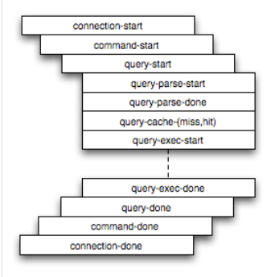

## Table of Contents

5.1 The MySQL Server ................................................................................................................... 512

5.1.1 Configuring the Server ................................................................................................... 512

5.1.2 Server Configuration Defaults ......................................................................................... 514

5.1.3 Server Option, System Variable, and Status Variable Reference ....................................... 516

5.1.4 Server System Variable Reference ................................................................................. 550

5.1.5 Server Status Variable Reference ................................................................................... 566

5.1.6 Server Command Options .............................................................................................. 579

5.1.7 Server System Variables ................................................................................................ 603

5.1.8 Using System Variables ................................................................................................. 704

5.1.9 Server Status Variables .................................................................................................. 719

5.1.10 Server SQL Modes ...................................................................................................... 737

5.1.11 Connection Management .............................................................................................. 746

5.1.12 IPv6 Support ................................................................................................................ 751

5.1.13 MySQL Server Time Zone Support ............................................................................... 755

5.1.14 Server-Side Help Support ............................................................................................. 760

5.1.15 The Server Shutdown Process ..................................................................................... 761

5.2 The MySQL Data Directory ....................................................................................................... 762

5.3 The mysql System Database ..................................................................................................... 763

5.4 MySQL Server Logs ................................................................................................................. 765

5.4.1 Selecting General Query Log and Slow Query Log Output Destinations ............................ 766

5.4.2 The Error Log ................................................................................................................ 768

5.4.3 The General Query Log ................................................................................................. 771

5.4.4 The Binary Log .............................................................................................................. 772

5.4.5 The Slow Query Log ...................................................................................................... 785

5.4.6 The DDL Log ................................................................................................................. 787

5.4.7 Server Log Maintenance ................................................................................................ 787

5.5 MySQL Server Plugins .............................................................................................................. 789

5.5.1 Installing and Uninstalling Plugins ................................................................................... 789

5.5.2 Obtaining Server Plugin Information ................................................................................ 793

5.5.3 MySQL Enterprise Thread Pool ...................................................................................... 794

5.5.4 MySQL Plugin Services .................................................................................................. 800

5.6 MySQL Server Loadable Functions ........................................................................................... 801

5.6.1 Installing and Uninstalling Loadable Functions ................................................................. 801

5.6.2 Obtaining Information About Loadable Functions ............................................................. 802

5.7 Running Multiple MySQL Instances on One Machine .................................................................. 803

5.7.1 Setting Up Multiple Data Directories ............................................................................... 804

5.7.2 Running Multiple MySQL Instances on Windows ............................................................. 805

5.7.3 Running Multiple MySQL Instances on Unix .................................................................... 808

5.7.4 Using Client Programs in a Multiple-Server Environment .................................................. 809

5.8 Debugging MySQL ................................................................................................................... 810

5.8.1 Debugging a MySQL Server ........................................................................................... 810

5.8.2 Debugging a MySQL Client ............................................................................................ 817

5.8.3 The DBUG Package ...................................................................................................... 817

5.8.4 Tracing mysqld Using DTrace ......................................................................................... 820 MySQL Server (`mysqld`) is the main program that does most of the work in a MySQL installation. This chapter provides an overview of MySQL Server and covers general server administration:The MySQL Server

- Server configuration
- The data directory, particularly the `mysql` system database
- The server log files
- Management of multiple servers on a single machine

For additional information on administrative topics, see also:

- Chapter 6, Security
- Section 14.8, “InnoDB Configuration”
- Chapter 7, Backup and Recovery
- Chapter 17, Replication
- Chapter 19, Partitioning

## 5.1 The MySQL Server

`mysqld` is the MySQL server. The following discussion covers these MySQL server configuration topics:

- Startup options that the server supports. You can specify these options on the command line, through

configuration files, or both.

- Server system variables. These variables reflect the current state and values of the startup options,

some of which can be modified while the server is running.

- Server status variables. These variables contain counters and statistics about runtime operation.
- How to set the server SQL mode. This setting modifies certain aspects of SQL syntax and semantics,

for example for compatibility with code from other database systems, or to control the error handling for particular situations.

- How the server manages client connections.
- Configuring and using IPv6 support.
- Configuring and using time zone support.
- Server-side help capabilities.
- The server shutdown process. There are performance and reliability considerations depending on the

type of table (transactional or nontransactional) and whether you use replication.

Note Not all storage engines are supported by all MySQL server binaries and configurations. To find out how to determine which storage engines your MySQL server installation supports, see Section 13.7.5.17, “SHOW ENGINES Statement”.

### 5.1.1 Configuring the Server

The MySQL server, `mysqld`, has many command options and system variables that can be set at startup to configure its operation. To determine the default command option and system variable values used by the server, execute this command:Configuring the Server

```
$> mysqld --verbose --help
```

The command produces a list of all `mysqld` options and configurable system variables. Its output includes the default option and variable values and looks something like this:

```
abort-slave-event-count           0
allow-suspicious-udfs             FALSE
archive                           ON
auto-increment-increment          1
auto-increment-offset             1
autocommit                        TRUE
automatic-sp-privileges           TRUE
back-log                          80
basedir                           /home/jon/bin/mysql-5.6/
...
tmpdir                            /tmp
transaction-alloc-block-size      8192
transaction-isolation             REPEATABLE-READ
transaction-prealloc-size         4096
transaction-read-only             FALSE
updatable-views-with-limit        YES
verbose                           TRUE
wait-timeout                      28800
```

To see the current system variable values actually used by the server as it runs, connect to it and execute this statement:

```
mysql> SHOW VARIABLES;
```

To see some statistical and status indicators for a running server, execute this statement:

```
mysql> SHOW STATUS;
```

System variable and status information also is available using the `mysqladmin` command:

```
$> mysqladmin variables
$> mysqladmin extended-status
```

For a full description of all command options, system variables, and status variables, see these sections:

- Section 5.1.6, “Server Command Options”
- Section 5.1.7, “Server System Variables”
- Section 5.1.9, “Server Status Variables”

More detailed monitoring information is available from the Performance Schema; see Chapter 22, MySQL Performance Schema.

MySQL uses algorithms that are very scalable, so you can usually run with very little memory. However,normally better performance results from giving MySQL more memory.

When tuning a MySQL server, the two most important variables to configure are `key_buffer_size` and`table_open_cache`. You should first feel confident that you have these set appropriately before trying to change any other variables.

The following examples indicate some typical variable values for different runtime configurations.

- If you have at least 1-2GB of memory and many tables and want maximum performance with a

moderate number of clients, use something like this:Server Configuration Defaults

```
$> mysqld_safe --key_buffer_size=384M --table_open_cache=4000 \
--sort_buffer_size=4M --read_buffer_size=1M &
```

- If you have only 256MB of memory and only a few tables, but you still do a lot of sorting, you can use

something like this:

```
$> mysqld_safe --key_buffer_size=64M --sort_buffer_size=1M
```

If there are very many simultaneous connections, swapping problems may occur unless `mysqld` has been configured to use very little memory for each connection. `mysqld` performs better if you have enough memory for all connections.

- With little memory and lots of connections, use something like this:

```
$> mysqld_safe --key_buffer_size=512K --sort_buffer_size=100K \
--read_buffer_size=100K &
```

Or even this:

```
$> mysqld_safe --key_buffer_size=512K --sort_buffer_size=16K \
--table_open_cache=32 --read_buffer_size=8K \
--net_buffer_length=1K &
```

If you are performing `GROUP BY` or `ORDER BY` operations on tables that are much larger than your available memory, increase the value of `read_rnd_buffer_size` to speed up the reading of rows following sorting operations.

You can make use of the example option files included with your MySQL distribution; see Section 5.1.2,“Server Configuration Defaults”.

If you specify an option on the command line for `mysqld` or `mysqld_safe`, it remains in effect only for that invocation of the server. To use the option every time the server runs, put it in an option file. See Section 4.2.2.2, “Using Option Files”.

### 5.1.2 Server Configuration Defaults

The MySQL server has many operating parameters, which you can change at server startup using command-line options or configuration files (option files). It is also possible to change many parameters at runtime. For general instructions on setting parameters at startup or runtime, see Section 5.1.6, “Server Command Options”, and Section 5.1.7, “Server System Variables”.

#### 5.1.2.1 Changes to Server Defaults

In MySQL 5.6, several MySQL Server parameter defaults differ from the defaults in previous releases.

The motivation for these changes is to provide better out-of-box performance and to reduce the need for database administrators to change settings manually.

In some cases, a parameter has a different fixed default value. In other cases, the server autosizes a parameter at startup using a formula based on other related parameters or server host configuration, rather than using a fixed value. For example, the setting for `back_log` is its previous default of 50, adjusted up by an amount proportional to the value of `max_connections`. The idea behind autosizing is that when the server has information available to make a decision about a parameter setting likely to be better than a fixed default, it does so.

The following table summarizes changes to defaults. The Version column indicates when each default changed. For variables that are autosized, the main variable description provides additional detail about the sizing algorithm. See Section 5.1.7, “Server System Variables”, and Section 14.14, “InnoDB Startup Server Configuration Defaults Options and System Variables”. Any of these default settings can be overridden by specifying an explicit value at server startup.

Table 5.1 Changes to Server Defaults in MySQL 5.6 Parameter Old Default New Default Version`back_log` 50 Autosized using 5.6.6

```
max_connections
binlog_checksum  NONE  CRC32  5.6.6
```

`--binlog-row-event-` 1024 8192 5.6.6

```
max-size
```

`flush_time` 1800 (on Windows) 0 5.6.6`host_cache_size` 128 Autosized using 5.6.8

```
max_connections
innodb_autoextend_increment8  64  5.6.6
```

`innodb_buffer_pool_instances`1 8 (platform dependent) 5.6.6`innodb_concurrency_tickets`500 5000 5.6.6`innodb_data_file_path`ibdata1:10M:autoextend ibdata1:12M:autoextend 5.6.7

```
innodb_file_per_table0  1  5.6.6
innodb_log_file_size5MB  48MB  5.6.8
```

`innodb_old_blocks_time`0 1000 5.6.6`innodb_open_files` 300 Autosized using 5.6.6

```
innodb_file_per_table,
table_open_cache
innodb_stats_on_metadataON  OFF  5.6.6
```

`join_buffer_size` 128KB 256KB 5.6.6`max_allowed_packet` 1MB 4MB 5.6.6`max_connect_errors` 10 100 5.6.6`open_files_limit` 0 Autosized using 5.6.8

```
max_connections
```

`performance_schema` OFF ON 5.6.6`performance_schema_events_waits_history_long_size`10000 Autosized 5.6.6`performance_schema_events_waits_history_size`10 Autosized 5.6.6`performance_schema_max_cond_instances`1000 Autosized 5.6.6`performance_schema_max_file_instances`10000 Autosized 5.6.6`performance_schema_max_mutex_instances`1000000 Autosized 5.6.6`performance_schema_max_rwlock_instances`1000000 Autosized 5.6.6`performance_schema_max_table_handles`100000 Autosized 5.6.6`performance_schema_max_table_instances`50000 Autosized 5.6.6`performance_schema_max_thread_instances`1000 Autosized 5.6.6`query_cache_size` 0 1M 5.6.8

```
query_cache_type  ON  OFF  5.6.8
secure_auth  OFF  ON  5.6.7
```

Server Option, System Variable, and Status Variable Reference Parameter Old Default New Default Version`sql_mode` '' (empty string) `NO_ENGINE_SUBSTITUTION`5.6.6`sync_master_info` 0 10000 5.6.6`sync_relay_log` 0 10000 5.6.6`sync_relay_log_info` 0 10000 5.6.6`table_definition_cache`400 Autosized using 5.6.8

```
table_open_cache
```

`table_open_cache` 400 2000 5.6.8`thread_cache_size` 0 Autosized using 5.6.8

```
max_connections
```

In MySQL 5.6.6, the default for `innodb_checksum_algorithm` was changed from `INNODB` to `CRC32`.

For compatibility reasons, the default was returned in 5.6.7 to `INNODB`.

#### 5.1.2.2 Using a Sample Default Server Configuration File

On Unix platforms, `mysql_install_db` creates a default option file named `my.cnf` in the base installation directory. This file is created from a template included in the distribution package named `my-``default.cnf`. You can find the template in or under the base installation directory. When started using`mysqld_safe`, the server uses `my.cnf` file by default. If `my.cnf` already exists, `mysql_install_db`assumes it to be in use and writes a new file named `my-new.cnf` instead.

With one exception, the settings in the default option file are commented and have no effect. The exception is that the file changes the `sql_mode` system variable from its default of `NO_ENGINE_SUBSTITUTION` to also include `STRICT_TRANS_TABLES`:

```
sql_mode=NO_ENGINE_SUBSTITUTION,STRICT_TRANS_TABLES
```

This setting produces a server configuration that results in errors rather than warnings for bad data in operations that modify transactional tables. See Section 5.1.10, “Server SQL Modes”.

The `my-default.cnf` template replaces the older sample option files formerly supplied with MySQL distributions (`my-small.cnf`, `my-medium.cnf`, `my-large.cnf`, and `my-huge.cnf`).

On Windows, MySQL Installer interacts with the user and creates a file named `my.ini` in the base installation directory as the default option file. If you install on Windows from a Zip archive, you can copy the `my-default.ini` template file in the base installation directory to `my.ini` and use the latter as the default option file.

Note On Windows, the `.ini` or `.cnf` option file extension might not be displayed.

On any platform, after completing the installation process, you can edit the default option file at any time to modify the parameters used by the server. For example, to use a parameter setting in the file that is commented with a # character at the beginning of the line, remove the #, and modify the parameter value if necessary. To disable a To disable a setting, either add a # to the beginning of the line or remove it.

For additional information about option file format and syntax, see Section 4.2.2.2, “Using Option Files”.

### 5.1.3 Server Option, System Variable, and Status Variable Reference

The following table lists all command-line options, system variables, and status variables applicable within

```
mysqld.
```

Server Option, System Variable, and Status Variable Reference The table lists command-line options (Cmd-line), options valid in configuration files (Option file), server system variables (System Var), and status variables (Status var) in one unified list, with an indication of where each option or variable is valid. If a server option set on the command line or in an option file differs from the name of the corresponding system variable, the variable name is noted immediately below the corresponding option. For system and status variables, the scope of the variable (Var Scope) is Global,Session, or both. Please see the corresponding item descriptions for details on setting and using the options and variables. Where appropriate, direct links to further information about the items are provided.

For a version of this table that is specific to NDB Cluster, see Section 18.4.2.5, “NDB Cluster mysqld Option and Variable Reference”.

Table 5.2 Command-Line Option, System Variable, and Status Variable Summary Name Cmd-Line Option File System Var Status Var Var Scope Dynamic abort-slave- Yes Yes event-count Aborted_clients Yes Global No Aborted_connects Yes Global No allow- Yes Yes suspicious-udfs ansi Yes Yes audit-log Yes Yes audit_log_buffer_sizeYes Yes Yes Global No audit_log_connection_policyYes Yes Yes Global Yes audit_log_current_session Yes Both No Audit_log_current_size Yes Global No Audit_log_event_max_drop_size Yes Global No Audit_log_events Yes Global No Audit_log_events_filtered Yes Global No Audit_log_events_lost Yes Global No Audit_log_events_written Yes Global No audit_log_exclude_accountsYes Yes Yes Global Yes audit_log_file Yes Yes Yes Global No audit_log_flush Yes Global Yes audit_log_formatYes Yes Yes Global No audit_log_include_accountsYes Yes Yes Global Yes audit_log_policyYes Yes Yes Global Varies audit_log_rotate_on_sizeYes Yes Yes Global Yes audit_log_statement_policyYes Yes Yes Global Yes audit_log_strategyYes Yes Yes Global No Audit_log_total_size Yes Global No Audit_log_write_waits Yes Global No authentication_windows_log_levelYes Yes Yes Global No Server Option, System Variable, and Status Variable Reference Name Cmd-Line Option File System Var Status Var Var Scope Dynamic authentication_windows_use_principal_nameYes Yes Yes Global No auto_increment_incrementYes Yes Yes Both Yes auto_increment_offsetYes Yes Yes Both Yes autocommit Yes Yes Yes Both Yes automatic_sp_privilegesYes Yes Yes Global Yes avoid_temporal_upgradeYes Yes Yes Global Yes back_log Yes Yes Yes Global No basedir Yes Yes Yes Global No big_tables Yes Yes Yes Both Yes bind_address Yes Yes Yes Global No Binlog_cache_disk_use Yes Global No binlog_cache_sizeYes Yes Yes Global Yes Binlog_cache_use Yes Global No binlog- Yes Yes checksum binlog_checksumYes Yes Yes Global Yes binlog_direct_non_transactional_updatesYes Yes Yes Both Yes binlog-do-db Yes Yes binlog_error_actionYes Yes Yes Global Yes binlog_format Yes Yes Yes Both Yes binlog_gtid_simple_recoveryYes Yes Yes Global No binlog-ignore- Yes Yes db binlog_max_flush_queue_timeYes Yes Yes Global Yes binlog_order_commitsYes Yes Yes Global Yes binlog-row- Yes Yes event-max-size binlog_row_imageYes Yes Yes Both Yes binlog_rows_query_log_eventsYes Yes Yes Both Yes Binlog_stmt_cache_disk_use Yes Global No binlog_stmt_cache_sizeYes Yes Yes Global Yes Binlog_stmt_cache_use Yes Global No binlogging_impossible_modeYes Yes Yes Both Yes block_encryption_modeYes Yes Yes Both Yes bootstrap Yes Yes bulk_insert_buffer_sizeYes Yes Yes Both Yes Bytes_received Yes Both No Bytes_sent Yes Both No Server Option, System Variable, and Status Variable Reference Name Cmd-Line Option File System Var Status Var Var Scope Dynamic character_set_client Yes Both Yes character- Yes Yes set-client-handshake character_set_connection Yes Both Yes character_set_database Yes Both Yes(note 1)character_set_filesystemYes Yes Yes Both Yes character_set_results Yes Both Yes character_set_serverYes Yes Yes Both Yes character_set_system Yes Global No character_sets_dirYes Yes Yes Global No chroot Yes Yes collation_connection Yes Both Yes collation_database Yes Both Yes(note 1)collation_serverYes Yes Yes Both Yes Com_admin_commands Yes Both No Com_alter_db Yes Both No Com_alter_db_upgrade Yes Both No Com_alter_event Yes Both No Com_alter_function Yes Both No Com_alter_procedure Yes Both No Com_alter_server Yes Both No Com_alter_table Yes Both No Com_alter_tablespace Yes Both No Com_alter_user Yes Both No Com_analyze Yes Both No Com_assign_to_keycache Yes Both No Com_begin Yes Both No Com_binlog Yes Both No Com_call_procedure Yes Both No Com_change_db Yes Both No Com_change_master Yes Both No Com_check Yes Both No Com_checksum Yes Both No Com_commit Yes Both No Com_create_db Yes Both No Com_create_event Yes Both No Server Option, System Variable, and Status Variable Reference Name Cmd-Line Option File System Var Status Var Var Scope Dynamic Com_create_function Yes Both No Com_create_index Yes Both No Com_create_procedure Yes Both No Com_create_server Yes Both No Com_create_table Yes Both No Com_create_trigger Yes Both No Com_create_udf Yes Both No Com_create_user Yes Both No Com_create_view Yes Both No Com_dealloc_sql Yes Both No Com_delete Yes Both No Com_delete_multi Yes Both No Com_do Yes Both No Com_drop_db Yes Both No Com_drop_event Yes Both No Com_drop_function Yes Both No Com_drop_index Yes Both No Com_drop_procedure Yes Both No Com_drop_server Yes Both No Com_drop_table Yes Both No Com_drop_trigger Yes Both No Com_drop_user Yes Both No Com_drop_view Yes Both No Com_empty_query Yes Both No Com_execute_sql Yes Both No Com_flush Yes Both No Com_get_diagnostics Yes Both No Com_grant Yes Both No Com_ha_close Yes Both No Com_ha_open Yes Both No Com_ha_read Yes Both No Com_help Yes Both No Com_insert Yes Both No Com_insert_select Yes Both No Com_install_plugin Yes Both No Com_kill Yes Both No Com_load Yes Both No Com_lock_tables Yes Both No Server Option, System Variable, and Status Variable Reference Name Cmd-Line Option File System Var Status Var Var Scope Dynamic Com_optimize Yes Both No Com_preload_keys Yes Both No Com_prepare_sql Yes Both No Com_purge Yes Both No Com_purge_before_date Yes Both No Com_release_savepoint Yes Both No Com_rename_table Yes Both No Com_rename_user Yes Both No Com_repair Yes Both No Com_replace Yes Both No Com_replace_select Yes Both No Com_reset Yes Both No Com_resignal Yes Both No Com_revoke Yes Both No Com_revoke_all Yes Both No Com_rollback Yes Both No Com_rollback_to_savepoint Yes Both No Com_savepoint Yes Both No Com_select Yes Both No Com_set_option Yes Both No Com_show_authors Yes Both No Com_show_binlog_events Yes Both No Com_show_binlogs Yes Both No Com_show_charsets Yes Both No Com_show_collations Yes Both No Com_show_contributors Yes Both No Com_show_create_db Yes Both No Com_show_create_event Yes Both No Com_show_create_func Yes Both No Com_show_create_proc Yes Both No Com_show_create_table Yes Both No Com_show_create_trigger Yes Both No Com_show_databases Yes Both No Com_show_engine_logs Yes Both No Com_show_engine_mutex Yes Both No Com_show_engine_status Yes Both No Com_show_errors Yes Both No Com_show_events Yes Both No Server Option, System Variable, and Status Variable Reference Name Cmd-Line Option File System Var Status Var Var Scope Dynamic Com_show_fields Yes Both No Com_show_function_code Yes Both No Com_show_function_status Yes Both No Com_show_grants Yes Both No Com_show_keys Yes Both No Com_show_master_status Yes Both No Com_show_ndb_status Yes Both No Com_show_open_tables Yes Both No Com_show_plugins Yes Both No Com_show_privileges Yes Both No Com_show_procedure_code Yes Both No Com_show_procedure_status Yes Both No Com_show_processlist Yes Both No Com_show_profile Yes Both No Com_show_profiles Yes Both No Com_show_relaylog_events Yes Both No Com_show_slave_hosts Yes Both No Com_show_slave_status Yes Both No Com_show_status Yes Both No Com_show_storage_engines Yes Both No Com_show_table_status Yes Both No Com_show_tables Yes Both No Com_show_triggers Yes Both No Com_show_variables Yes Both No Com_show_warnings Yes Both No Com_signal Yes Both No Com_slave_start Yes Both No Com_slave_stop Yes Both No Com_stmt_close Yes Both No Com_stmt_execute Yes Both No Com_stmt_fetch Yes Both No Com_stmt_prepare Yes Both No Com_stmt_reprepare Yes Both No Com_stmt_reset Yes Both No Com_stmt_send_long_data Yes Both No Com_truncate Yes Both No Com_uninstall_plugin Yes Both No Com_unlock_tables Yes Both No Server Option, System Variable, and Status Variable Reference Name Cmd-Line Option File System Var Status Var Var Scope Dynamic Com_update Yes Both No Com_update_multi Yes Both No Com_xa_commit Yes Both No Com_xa_end Yes Both No Com_xa_prepare Yes Both No Com_xa_recover Yes Both No Com_xa_rollback Yes Both No Com_xa_start Yes Both No completion_typeYes Yes Yes Both Yes Compression Yes Session No concurrent_insertYes Yes Yes Global Yes connect_timeoutYes Yes Yes Global Yes Connection_control_delay_generated Yes Global No connection_control_failed_connections_thresholdYes Yes Yes Global Yes connection_control_max_connection_delayYes Yes Yes Global Yes connection_control_min_connection_delayYes Yes Yes Global Yes Connection_errors_accept Yes Global No Connection_errors_internal Yes Global No Connection_errors_max_connections Yes Global No Connection_errors_peer_address Yes Global No Connection_errors_select Yes Global No Connection_errors_tcpwrap Yes Global No Connections Yes Global No console Yes Yes core-file Yes Yes core_file Yes Global No create_old_temporalsYes Yes Yes Global No Created_tmp_disk_tables Yes Both No Created_tmp_files Yes Global No Created_tmp_tables Yes Both No daemon_memcached_enable_binlogYes Yes Yes Global No daemon_memcached_engine_lib_nameYes Yes Yes Global No daemon_memcached_engine_lib_pathYes Yes Yes Global No daemon_memcached_optionYes Yes Yes Global No daemon_memcached_r_batch_sizeYes Yes Yes Global No daemon_memcached_w_batch_sizeYes Yes Yes Global No datadir Yes Yes Yes Global No date_format Yes Global No Server Option, System Variable, and Status Variable Reference Name Cmd-Line Option File System Var Status Var Var Scope Dynamic datetime_format Yes Global No debug Yes Yes Yes Both Yes debug_sync Yes Session Yes debug-sync- Yes Yes timeout default- Yes Yes authentication-plugin default_storage_engineYes Yes Yes Both Yes default-time- Yes Yes zone default_tmp_storage_engineYes Yes Yes Both Yes default_week_formatYes Yes Yes Both Yes defaults- Yes extra-file defaults-file Yes defaults- Yes group-suffix delay_key_writeYes Yes Yes Global Yes Delayed_errors Yes Global No delayed_insert_limitYes Yes Yes Global Yes Delayed_insert_threads Yes Global No delayed_insert_timeoutYes Yes Yes Global Yes delayed_queue_sizeYes Yes Yes Global Yes Delayed_writes Yes Global No des-key-file Yes Yes disconnect_on_expired_passwordYes Yes Yes Global No disconnect- Yes Yes slave-event-count div_precision_incrementYes Yes Yes Both Yes end_markers_in_jsonYes Yes Yes Both Yes enforce_gtid_consistencyYes Yes Yes Global No eq_range_index_dive_limitYes Yes Yes Both Yes error_count Yes Session No event_schedulerYes Yes Yes Global Yes exit-info Yes Yes expire_logs_daysYes Yes Yes Global Yes explicit_defaults_for_timestampYes Yes Yes Both Yes Server Option, System Variable, and Status Variable Reference Name Cmd-Line Option File System Var Status Var Var Scope Dynamic external- Yes Yes locking

- Variable:

skip_external_locking external_user Yes Session No federated Yes Yes Firewall_access_denied Yes Global No Firewall_access_granted Yes Global No Firewall_cached_entries Yes Global No flush Yes Yes Yes Global Yes Flush_commands Yes Global No flush_time Yes Yes Yes Global Yes foreign_key_checks Yes Both Yes ft_boolean_syntaxYes Yes Yes Global Yes ft_max_word_lenYes Yes Yes Global No ft_min_word_lenYes Yes Yes Global No ft_query_expansion_limitYes Yes Yes Global No ft_stopword_fileYes Yes Yes Global No gdb Yes Yes general_log Yes Yes Yes Global Yes general_log_fileYes Yes Yes Global Yes group_concat_max_lenYes Yes Yes Both Yes gtid_executed Yes Both No gtid_mode Yes Yes Yes Global No gtid_next Yes Session Yes gtid_owned Yes Both No gtid_purged Yes Global Yes Handler_commit Yes Both No Handler_delete Yes Both No Handler_discover Yes Both No Handler_external_lock Yes Both No Handler_mrr_init Yes Both No Handler_prepare Yes Both No Handler_read_first Yes Both No Handler_read_key Yes Both No Handler_read_last Yes Both No Handler_read_next Yes Both No Handler_read_prev Yes Both No Server Option, System Variable, and Status Variable Reference Name Cmd-Line Option File System Var Status Var Var Scope Dynamic Handler_read_rnd Yes Both No Handler_read_rnd_next Yes Both No Handler_rollback Yes Both No Handler_savepoint Yes Both No Handler_savepoint_rollback Yes Both No Handler_update Yes Both No Handler_write Yes Both No have_compress Yes Global No have_crypt Yes Global No have_dynamic_loading Yes Global No have_geometry Yes Global No have_openssl Yes Global No have_profiling Yes Global No have_query_cache Yes Global No have_rtree_keys Yes Global No have_ssl Yes Global No have_symlink Yes Global No help Yes Yes host_cache_sizeYes Yes Yes Global Yes hostname Yes Global No identity Yes Session Yes ignore_builtin_innodbYes Yes Yes Global No ignore-db-dir Yes Yes ignore_db_dirs Yes Global No init_connect Yes Yes Yes Global Yes init_file Yes Yes Yes Global No init_slave Yes Yes Yes Global Yes innodb Yes Yes innodb_adaptive_flushingYes Yes Yes Global Yes innodb_adaptive_flushing_lwmYes Yes Yes Global Yes innodb_adaptive_hash_indexYes Yes Yes Global Yes innodb_adaptive_max_sleep_delayYes Yes Yes Global Yes innodb_additional_mem_pool_sizeYes Yes Yes Global No innodb_api_bk_commit_intervalYes Yes Yes Global Yes innodb_api_disable_rowlockYes Yes Yes Global No innodb_api_enable_binlogYes Yes Yes Global No innodb_api_enable_mdlYes Yes Yes Global No innodb_api_trx_levelYes Yes Yes Global Yes Server Option, System Variable, and Status Variable Reference Name Cmd-Line Option File System Var Status Var Var Scope Dynamic innodb_autoextend_incrementYes Yes Yes Global Yes innodb_autoinc_lock_modeYes Yes Yes Global No Innodb_available_undo_logs Yes Global No Innodb_buffer_pool_bytes_data Yes Global No Innodb_buffer_pool_bytes_dirty Yes Global No innodb_buffer_pool_dump_at_shutdownYes Yes Yes Global Yes innodb_buffer_pool_dump_nowYes Yes Yes Global Yes Innodb_buffer_pool_dump_status Yes Global No innodb_buffer_pool_filenameYes Yes Yes Global Yes innodb_buffer_pool_instancesYes Yes Yes Global No innodb_buffer_pool_load_abortYes Yes Yes Global Yes innodb_buffer_pool_load_at_startupYes Yes Yes Global No innodb_buffer_pool_load_nowYes Yes Yes Global Yes Innodb_buffer_pool_load_status Yes Global No Innodb_buffer_pool_pages_data Yes Global No Innodb_buffer_pool_pages_dirty Yes Global No Innodb_buffer_pool_pages_flushed Yes Global No Innodb_buffer_pool_pages_free Yes Global No Innodb_buffer_pool_pages_latched Yes Global No Innodb_buffer_pool_pages_misc Yes Global No Innodb_buffer_pool_pages_total Yes Global No Innodb_buffer_pool_read_ahead Yes Global No Innodb_buffer_pool_read_ahead_evicted Yes Global No Innodb_buffer_pool_read_ahead_rnd Yes Global No Innodb_buffer_pool_read_requests Yes Global No Innodb_buffer_pool_reads Yes Global No innodb_buffer_pool_sizeYes Yes Yes Global No Innodb_buffer_pool_wait_free Yes Global No Innodb_buffer_pool_write_requests Yes Global No innodb_change_buffer_max_sizeYes Yes Yes Global Yes innodb_change_bufferingYes Yes Yes Global Yes innodb_change_buffering_debugYes Yes Yes Global Yes innodb_checksum_algorithmYes Yes Yes Global Yes innodb_checksumsYes Yes Yes Global No innodb_cmp_per_index_enabledYes Yes Yes Global Yes innodb_commit_concurrencyYes Yes Yes Global Yes innodb_compression_failure_threshold_pctYes Yes Yes Global Yes innodb_compression_levelYes Yes Yes Global Yes Server Option, System Variable, and Status Variable Reference Name Cmd-Line Option File System Var Status Var Var Scope Dynamic innodb_compression_pad_pct_maxYes Yes Yes Global Yes innodb_concurrency_ticketsYes Yes Yes Global Yes innodb_data_file_pathYes Yes Yes Global No Innodb_data_fsyncs Yes Global No innodb_data_home_dirYes Yes Yes Global No Innodb_data_pending_fsyncs Yes Global No Innodb_data_pending_reads Yes Global No Innodb_data_pending_writes Yes Global No Innodb_data_read Yes Global No Innodb_data_reads Yes Global No Innodb_data_writes Yes Global No Innodb_data_written Yes Global No Innodb_dblwr_pages_written Yes Global No Innodb_dblwr_writes Yes Global No innodb_disable_sort_file_cacheYes Yes Yes Global Yes innodb_doublewriteYes Yes Yes Global No innodb_fast_shutdownYes Yes Yes Global Yes innodb_fil_make_page_dirty_debugYes Yes Yes Global Yes innodb_file_formatYes Yes Yes Global Yes innodb_file_format_checkYes Yes Yes Global No innodb_file_format_maxYes Yes Yes Global Yes innodb_file_per_tableYes Yes Yes Global Yes innodb_flush_log_at_timeoutYes Yes Yes Global Yes innodb_flush_log_at_trx_commitYes Yes Yes Global Yes innodb_flush_methodYes Yes Yes Global No innodb_flush_neighborsYes Yes Yes Global Yes innodb_flushing_avg_loopsYes Yes Yes Global Yes innodb_force_load_corruptedYes Yes Yes Global No innodb_force_recoveryYes Yes Yes Global No innodb_ft_aux_table Yes Global Yes innodb_ft_cache_sizeYes Yes Yes Global No innodb_ft_enable_diag_printYes Yes Yes Global Yes innodb_ft_enable_stopwordYes Yes Yes Both Yes innodb_ft_max_token_sizeYes Yes Yes Global No innodb_ft_min_token_sizeYes Yes Yes Global No innodb_ft_num_word_optimizeYes Yes Yes Global Yes innodb_ft_result_cache_limitYes Yes Yes Global Yes innodb_ft_server_stopword_tableYes Yes Yes Global Yes Server Option, System Variable, and Status Variable Reference Name Cmd-Line Option File System Var Status Var Var Scope Dynamic innodb_ft_sort_pll_degreeYes Yes Yes Global No innodb_ft_total_cache_sizeYes Yes Yes Global No innodb_ft_user_stopword_tableYes Yes Yes Both Yes Innodb_have_atomic_builtins Yes Global No innodb_io_capacityYes Yes Yes Global Yes innodb_io_capacity_maxYes Yes Yes Global Yes innodb_large_prefixYes Yes Yes Global Yes innodb_limit_optimistic_insert_debugYes Yes Yes Global Yes innodb_lock_wait_timeoutYes Yes Yes Both Yes innodb_locks_unsafe_for_binlogYes Yes Yes Global No innodb_log_buffer_sizeYes Yes Yes Global No innodb_log_checkpoint_nowYes Yes Yes Global Yes innodb_log_compressed_pagesYes Yes Yes Global Yes innodb_log_file_sizeYes Yes Yes Global No innodb_log_files_in_groupYes Yes Yes Global No innodb_log_group_home_dirYes Yes Yes Global No Innodb_log_waits Yes Global No Innodb_log_write_requests Yes Global No Innodb_log_writes Yes Global No innodb_lru_scan_depthYes Yes Yes Global Yes innodb_max_dirty_pages_pctYes Yes Yes Global Yes innodb_max_dirty_pages_pct_lwmYes Yes Yes Global Yes innodb_max_purge_lagYes Yes Yes Global Yes innodb_max_purge_lag_delayYes Yes Yes Global Yes innodb_mirrored_log_groupsYes Yes Yes Global No innodb_monitor_disableYes Yes Yes Global Yes innodb_monitor_enableYes Yes Yes Global Yes innodb_monitor_resetYes Yes Yes Global Yes innodb_monitor_reset_allYes Yes Yes Global Yes Innodb_num_open_files Yes Global No innodb_numa_interleaveYes Yes Yes Global No innodb_old_blocks_pctYes Yes Yes Global Yes innodb_old_blocks_timeYes Yes Yes Global Yes innodb_online_alter_log_max_sizeYes Yes Yes Global Yes innodb_open_filesYes Yes Yes Global No innodb_optimize_fulltext_onlyYes Yes Yes Global Yes Innodb_os_log_fsyncs Yes Global No Innodb_os_log_pending_fsyncs Yes Global No Server Option, System Variable, and Status Variable Reference Name Cmd-Line Option File System Var Status Var Var Scope Dynamic Innodb_os_log_pending_writes Yes Global No Innodb_os_log_written Yes Global No Innodb_page_size Yes Global No innodb_page_sizeYes Yes Yes Global No Innodb_pages_created Yes Global No Innodb_pages_read Yes Global No Innodb_pages_written Yes Global No innodb_print_all_deadlocksYes Yes Yes Global Yes innodb_purge_batch_sizeYes Yes Yes Global Yes innodb_purge_threadsYes Yes Yes Global No innodb_random_read_aheadYes Yes Yes Global Yes innodb_read_ahead_thresholdYes Yes Yes Global Yes innodb_read_io_threadsYes Yes Yes Global No innodb_read_onlyYes Yes Yes Global No innodb_replication_delayYes Yes Yes Global Yes innodb_rollback_on_timeoutYes Yes Yes Global No innodb_rollback_segmentsYes Yes Yes Global Yes Innodb_row_lock_current_waits Yes Global No Innodb_row_lock_time Yes Global No Innodb_row_lock_time_avg Yes Global No Innodb_row_lock_time_max Yes Global No Innodb_row_lock_waits Yes Global No Innodb_rows_deleted Yes Global No Innodb_rows_inserted Yes Global No Innodb_rows_read Yes Global No Innodb_rows_updated Yes Global No innodb_saved_page_number_debugYes Yes Yes Global Yes innodb_sort_buffer_sizeYes Yes Yes Global No innodb_spin_wait_delayYes Yes Yes Global Yes innodb_stats_auto_recalcYes Yes Yes Global Yes innodb_stats_include_delete_markedYes Yes Yes Global Yes innodb_stats_methodYes Yes Yes Global Yes innodb_stats_on_metadataYes Yes Yes Global Yes innodb_stats_persistentYes Yes Yes Global Yes innodb_stats_persistent_sample_pagesYes Yes Yes Global Yes innodb_stats_sample_pagesYes Yes Yes Global Yes innodb_stats_transient_sample_pagesYes Yes Yes Global Yes Server Option, System Variable, and Status Variable Reference Name Cmd-Line Option File System Var Status Var Var Scope Dynamic innodb- Yes Yes status-file innodb_status_outputYes Yes Yes Global Yes innodb_status_output_locksYes Yes Yes Global Yes innodb_strict_modeYes Yes Yes Both Yes innodb_support_xaYes Yes Yes Both Yes innodb_sync_array_sizeYes Yes Yes Global No innodb_sync_spin_loopsYes Yes Yes Global Yes innodb_table_locksYes Yes Yes Both Yes innodb_thread_concurrencyYes Yes Yes Global Yes innodb_thread_sleep_delayYes Yes Yes Global Yes innodb_tmpdir Yes Yes Yes Both Yes Innodb_truncated_status_writes Yes Global No innodb_trx_purge_view_update_only_debugYes Yes Yes Global Yes innodb_trx_rseg_n_slots_debugYes Yes Yes Global Yes innodb_undo_directoryYes Yes Yes Global No innodb_undo_logsYes Yes Yes Global Yes innodb_undo_tablespacesYes Yes Yes Global No innodb_use_native_aioYes Yes Yes Global No innodb_use_sys_mallocYes Yes Yes Global No innodb_version Yes Global No innodb_write_io_threadsYes Yes Yes Global No insert_id Yes Session Yes install Yes install-manual Yes interactive_timeoutYes Yes Yes Both Yes join_buffer_sizeYes Yes Yes Both Yes keep_files_on_createYes Yes Yes Both Yes Key_blocks_not_flushed Yes Global No Key_blocks_unused Yes Global No Key_blocks_used Yes Global No key_buffer_sizeYes Yes Yes Global Yes key_cache_age_thresholdYes Yes Yes Global Yes key_cache_block_sizeYes Yes Yes Global Yes key_cache_division_limitYes Yes Yes Global Yes Key_read_requests Yes Global No Key_reads Yes Global No Key_write_requests Yes Global No Server Option, System Variable, and Status Variable Reference Name Cmd-Line Option File System Var Status Var Var Scope Dynamic Key_writes Yes Global No language Yes Yes Yes Global No large_files_support Yes Global No large_page_size Yes Global No large_pages Yes Yes Yes Global No last_insert_id Yes Session Yes Last_query_cost Yes Session No Last_query_partial_plans Yes Session No lc_messages Yes Yes Yes Both Yes lc_messages_dirYes Yes Yes Global No lc_time_namesYes Yes Yes Both Yes license Yes Global No local_infile Yes Yes Yes Global Yes local-service Yes lock_wait_timeoutYes Yes Yes Both Yes locked_in_memory Yes Global No log-bin Yes Yes log_bin Yes Global No log_bin_basename Yes Global No log_bin_index Yes Yes Yes Global No log_bin_trust_function_creatorsYes Yes Yes Global Yes log_bin_use_v1_row_eventsYes Yes Yes Global Yes log_error Yes Yes Yes Global No log-isam Yes Yes log_output Yes Yes Yes Global Yes log_queries_not_using_indexesYes Yes Yes Global Yes log-raw Yes Yes log-short- Yes Yes format log_slave_updatesYes Yes Yes Global No log-slow- Yes Yes admin-statements log_slow_admin_statementsYes Yes Yes Global Yes log-slow- Yes Yes slave-statements log_slow_slave_statementsYes Yes Yes Global Yes log-tc Yes Yes Server Option, System Variable, and Status Variable Reference Name Cmd-Line Option File System Var Status Var Var Scope Dynamic log-tc-size Yes Yes log_throttle_queries_not_using_indexesYes Yes Yes Global Yes log_warnings Yes Yes Yes Varies Yes long_query_timeYes Yes Yes Both Yes low_priority_updatesYes Yes Yes Both Yes lower_case_file_system Yes Global No lower_case_table_namesYes Yes Yes Global No master-info- Yes Yes file master_info_repositoryYes Yes Yes Global Yes master-retry- Yes Yes count master_verify_checksumYes Yes Yes Global Yes max_allowed_packetYes Yes Yes Both Yes max_binlog_cache_sizeYes Yes Yes Global Yes max-binlog- Yes Yes dump-events max_binlog_sizeYes Yes Yes Global Yes max_binlog_stmt_cache_sizeYes Yes Yes Global Yes max_connect_errorsYes Yes Yes Global Yes max_connectionsYes Yes Yes Global Yes max_delayed_threadsYes Yes Yes Both Yes max_digest_lengthYes Yes Yes Global No max_error_countYes Yes Yes Both Yes max_heap_table_sizeYes Yes Yes Both Yes max_insert_delayed_threads Yes Both Yes max_join_size Yes Yes Yes Both Yes max_length_for_sort_dataYes Yes Yes Both Yes max_prepared_stmt_countYes Yes Yes Global Yes max_relay_log_sizeYes Yes Yes Global Yes max_seeks_for_keyYes Yes Yes Both Yes max_sort_lengthYes Yes Yes Both Yes max_sp_recursion_depthYes Yes Yes Both Yes max_tmp_tables Yes Both Yes Max_used_connections Yes Global No max_user_connectionsYes Yes Yes Both Yes max_write_lock_countYes Yes Yes Global Yes memlock Yes Yes Server Option, System Variable, and Status Variable Reference Name Cmd-Line Option File System Var Status Var Var Scope Dynamic

- Variable:

locked_in_memory metadata_locks_cache_sizeYes Yes Yes Global No metadata_locks_hash_instancesYes Yes Yes Global No min_examined_row_limitYes Yes Yes Both Yes multi_range_countYes Yes Yes Both Yes myisam- Yes Yes block-size myisam_data_pointer_sizeYes Yes Yes Global Yes myisam_max_sort_file_sizeYes Yes Yes Global Yes myisam_mmap_sizeYes Yes Yes Global No myisam_recover_optionsYes Yes Yes Global No myisam_repair_threadsYes Yes Yes Both Yes myisam_sort_buffer_sizeYes Yes Yes Both Yes myisam_stats_methodYes Yes Yes Both Yes myisam_use_mmapYes Yes Yes Global Yes mysql_firewall_max_query_sizeYes Yes Yes Global No mysql_firewall_modeYes Yes Yes Global Yes mysql_firewall_traceYes Yes Yes Global Yes named_pipe Yes Yes Yes Global No named_pipe_full_access_groupYes Yes Yes Global No Ndb_api_adaptive_send_deferred_count Yes Global No Ndb_api_adaptive_send_deferred_count_session Yes Global No Ndb_api_adaptive_send_deferred_count_slave Yes Global No Ndb_api_adaptive_send_forced_count Yes Global No Ndb_api_adaptive_send_forced_count_session Yes Global No Ndb_api_adaptive_send_forced_count_slave Yes Global No Ndb_api_adaptive_send_unforced_count Yes Global No Ndb_api_adaptive_send_unforced_count_session Yes Global No Ndb_api_adaptive_send_unforced_count_slave Yes Global No Ndb_api_bytes_received_count Yes Global No Ndb_api_bytes_received_count_session Yes Session No Ndb_api_bytes_received_count_slave Yes Global No Ndb_api_bytes_sent_count Yes Global No Ndb_api_bytes_sent_count_session Yes Session No Ndb_api_bytes_sent_count_slave Yes Global No Ndb_api_event_bytes_count Yes Global No Ndb_api_event_bytes_count_injector Yes Global No Server Option, System Variable, and Status Variable Reference Name Cmd-Line Option File System Var Status Var Var Scope Dynamic Ndb_api_event_data_count Yes Global No Ndb_api_event_data_count_injector Yes Global No Ndb_api_event_nondata_count Yes Global No Ndb_api_event_nondata_count_injector Yes Global No Ndb_api_pk_op_count Yes Global No Ndb_api_pk_op_count_session Yes Session No Ndb_api_pk_op_count_slave Yes Global No Ndb_api_pruned_scan_count Yes Global No Ndb_api_pruned_scan_count_session Yes Session No Ndb_api_pruned_scan_count_slave Yes Global No Ndb_api_range_scan_count Yes Global No Ndb_api_range_scan_count_session Yes Session No Ndb_api_range_scan_count_slave Yes Global No Ndb_api_read_row_count Yes Global No Ndb_api_read_row_count_session Yes Session No Ndb_api_read_row_count_slave Yes Global No Ndb_api_scan_batch_count Yes Global No Ndb_api_scan_batch_count_session Yes Session No Ndb_api_scan_batch_count_slave Yes Global No Ndb_api_table_scan_count Yes Global No Ndb_api_table_scan_count_session Yes Session No Ndb_api_table_scan_count_slave Yes Global No Ndb_api_trans_abort_count Yes Global No Ndb_api_trans_abort_count_session Yes Session No Ndb_api_trans_abort_count_slave Yes Global No Ndb_api_trans_close_count Yes Global No Ndb_api_trans_close_count_session Yes Session No Ndb_api_trans_close_count_slave Yes Global No Ndb_api_trans_commit_count Yes Global No Ndb_api_trans_commit_count_session Yes Session No Ndb_api_trans_commit_count_slave Yes Global No Ndb_api_trans_local_read_row_count Yes Global No Ndb_api_trans_local_read_row_count_session Yes Session No Ndb_api_trans_local_read_row_count_slave Yes Global No Ndb_api_trans_start_count Yes Global No Ndb_api_trans_start_count_session Yes Session No Ndb_api_trans_start_count_slave Yes Global No Ndb_api_uk_op_count Yes Global No Server Option, System Variable, and Status Variable Reference Name Cmd-Line Option File System Var Status Var Var Scope Dynamic Ndb_api_uk_op_count_session Yes Session No Ndb_api_uk_op_count_slave Yes Global No Ndb_api_wait_exec_complete_count Yes Global No Ndb_api_wait_exec_complete_count_session Yes Session No Ndb_api_wait_exec_complete_count_slave Yes Global No Ndb_api_wait_meta_request_count Yes Global No Ndb_api_wait_meta_request_count_session Yes Session No Ndb_api_wait_meta_request_count_slave Yes Global No Ndb_api_wait_nanos_count Yes Global No Ndb_api_wait_nanos_count_session Yes Session No Ndb_api_wait_nanos_count_slave Yes Global No Ndb_api_wait_scan_result_count Yes Global No Ndb_api_wait_scan_result_count_session Yes Session No Ndb_api_wait_scan_result_count_slave Yes Global No ndb_autoincrement_prefetch_szYes Yes Yes Both Yes ndb_batch_sizeYes Yes Yes Global No ndb_blob_read_batch_bytesYes Yes Yes Both Yes ndb_blob_write_batch_bytesYes Yes Yes Both Yes ndb_cache_check_timeYes Yes Yes Global Yes ndb_clear_apply_statusYes Yes Global Yes ndb_cluster_connection_poolYes Yes Yes Global No Ndb_cluster_node_id Yes Global No Ndb_config_from_host Yes Both No Ndb_config_from_port Yes Both No Ndb_conflict_fn_epoch Yes Global No Ndb_conflict_fn_epoch_trans Yes Global No Ndb_conflict_fn_epoch2 Yes Global No Ndb_conflict_fn_epoch2_trans Yes Global No Ndb_conflict_fn_max Yes Global No Ndb_conflict_fn_max_del_win Yes Global No Ndb_conflict_fn_old Yes Global No Ndb_conflict_last_conflict_epoch Yes Global No Ndb_conflict_last_stable_epoch Yes Global No Ndb_conflict_reflected_op_discard_count Yes Global No Ndb_conflict_reflected_op_prepare_count Yes Global No Ndb_conflict_refresh_op_count Yes Global No Ndb_conflict_trans_conflict_commit_count Yes Global No Ndb_conflict_trans_detect_iter_count Yes Global No Server Option, System Variable, and Status Variable Reference Name Cmd-Line Option File System Var Status Var Var Scope Dynamic Ndb_conflict_trans_reject_count Yes Global No Ndb_conflict_trans_row_conflict_count Yes Global No Ndb_conflict_trans_row_reject_count Yes Global No ndb- Yes Yes connectstring ndb_deferred_constraintsYes Yes Yes Both Yes ndb_deferred_constraintsYes Yes Yes Both Yes ndb_distributionYes Yes Yes Global Yes ndb_distributionYes Yes Yes Global Yes Ndb_epoch_delete_delete_count Yes Global No ndb_eventbuffer_free_percentYes Yes Yes Global Yes ndb_eventbuffer_max_allocYes Yes Yes Global Yes Ndb_execute_count Yes Global No ndb_extra_loggingYes Yes Yes Global Yes ndb_force_sendYes Yes Yes Both Yes ndb_index_stat_cache_entriesYes Yes Yes Both Yes ndb_index_stat_enableYes Yes Yes Both Yes ndb_index_stat_optionYes Yes Yes Both Yes ndb_index_stat_update_freqYes Yes Yes Both Yes ndb_join_pushdown Yes Both Yes Ndb_last_commit_epoch_server Yes Global No Ndb_last_commit_epoch_session Yes Session No ndb_log_apply_statusYes Yes Yes Global No ndb_log_apply_statusYes Yes Yes Global No ndb_log_bin Yes Yes Both No ndb_log_binlog_indexYes Yes Global Yes ndb_log_empty_epochsYes Yes Yes Global Yes ndb_log_empty_epochsYes Yes Yes Global Yes ndb_log_empty_updateYes Yes Yes Global Yes ndb_log_empty_updateYes Yes Yes Global Yes ndb_log_exclusive_readsYes Yes Yes Both Yes ndb_log_exclusive_readsYes Yes Yes Both Yes ndb_log_fail_terminateYes Yes Yes Global No ndb_log_orig Yes Yes Yes Global No ndb_log_orig Yes Yes Yes Global No ndb_log_transaction_idYes Yes Yes Global No ndb_log_transaction_id Yes Global No ndb_log_update_as_writeYes Yes Yes Global Yes Server Option, System Variable, and Status Variable Reference Name Cmd-Line Option File System Var Status Var Var Scope Dynamic ndb_log_update_minimalYes Yes Yes Global Yes ndb_log_updated_onlyYes Yes Yes Global Yes ndb-mgmd- Yes Yes host ndb_nodeid Yes Yes Yes Global No Ndb_number_of_data_nodes Yes Global No ndb_optimization_delayYes Yes Yes Global Yes ndb- Yes optimized-node-selection ndb_optimized_node_selectionYes Yes Yes Global No Ndb_pruned_scan_count Yes Global No Ndb_pushed_queries_defined Yes Global No Ndb_pushed_queries_dropped Yes Global No Ndb_pushed_queries_executed Yes Global No Ndb_pushed_reads Yes Global No ndb_recv_thread_activation_thresholdYes Yes Yes Global Yes ndb_recv_thread_cpu_maskYes Yes Yes Global Yes ndb_report_thresh_binlog_epoch_slipYes Yes Yes Global Yes ndb_report_thresh_binlog_mem_usageYes Yes Yes Global Yes Ndb_scan_count Yes Global No ndb_show_foreign_key_mock_tablesYes Yes Yes Global Yes ndb_slave_conflict_roleYes Yes Yes Global Yes Ndb_slave_max_replicated_epoch Yes Global No ndb_table_no_logging Yes Session Yes ndb_table_temporary Yes Session Yes ndb-transid- Yes mysql-connection-map ndb_use_copying_alter_table Yes Both No ndb_use_exact_count Yes Both Yes ndb_use_transactionsYes Yes Yes Both Yes ndb_version Yes Global No ndb_version_string Yes Global No ndb_wait_connectedYes Yes Yes Global No ndb_wait_setupYes Yes Yes Global No ndbcluster Yes Yes ndbinfo_database Yes Global No Server Option, System Variable, and Status Variable Reference Name Cmd-Line Option File System Var Status Var Var Scope Dynamic ndbinfo_max_bytesYes Yes Both Yes ndbinfo_max_rowsYes Yes Both Yes ndbinfo_offline Yes Global Yes ndbinfo_show_hiddenYes Yes Both Yes ndbinfo_table_prefix Yes Global No ndbinfo_version Yes Global No net_buffer_lengthYes Yes Yes Both Yes net_read_timeoutYes Yes Yes Both Yes net_retry_countYes Yes Yes Both Yes net_write_timeoutYes Yes Yes Both Yes new Yes Yes Yes Both Yes no-defaults Yes Not_flushed_delayed_rows Yes Global No old Yes Yes Yes Global No old_alter_table Yes Yes Yes Both Yes old_passwordsYes Yes Yes Both Yes old-style- Yes Yes user-limits Open_files Yes Global No open_files_limitYes Yes Yes Global No Open_streams Yes Global No Open_table_definitions Yes Global No Open_tables Yes Both No Opened_files Yes Global No Opened_table_definitions Yes Both No Opened_tables Yes Both No optimizer_prune_levelYes Yes Yes Both Yes optimizer_search_depthYes Yes Yes Both Yes optimizer_switchYes Yes Yes Both Yes optimizer_traceYes Yes Yes Both Yes optimizer_trace_featuresYes Yes Yes Both Yes optimizer_trace_limitYes Yes Yes Both Yes optimizer_trace_max_mem_sizeYes Yes Yes Both Yes optimizer_trace_offsetYes Yes Yes Both Yes partition Yes Yes performance_schemaYes Yes Yes Global No Performance_schema_accounts_lost Yes Global No performance_schema_accounts_sizeYes Yes Yes Global No Server Option, System Variable, and Status Variable Reference Name Cmd-Line Option File System Var Status Var Var Scope Dynamic Performance_schema_cond_classes_lost Yes Global No Performance_schema_cond_instances_lost Yes Global No performance- Yes Yes schema-consumer-events-stages-current performance- Yes Yes schema-consumer-events-stages-history performance- Yes Yes schema-consumer-events-stages-history-long performance- Yes Yes schema-consumer-events-statements-current performance- Yes Yes schema-consumer-events-statements-history performance- Yes Yes schema-consumer-events-statements-history-long performance- Yes Yes schema-consumer-events-waits-current performance- Yes Yes schema-consumer-events-waits-history Server Option, System Variable, and Status Variable Reference Name Cmd-Line Option File System Var Status Var Var Scope Dynamic performance- Yes Yes schema-consumer-events-waits-history-long performance- Yes Yes schema-consumer-global-instrumentation performance- Yes Yes schema-consumer-statements-digest performance- Yes Yes schema-consumer-thread-instrumentation Performance_schema_digest_lost Yes Global No performance_schema_digests_sizeYes Yes Yes Global No performance_schema_events_stages_history_long_sizeYes Yes Yes Global No performance_schema_events_stages_history_sizeYes Yes Yes Global No performance_schema_events_statements_history_long_sizeYes Yes Yes Global No performance_schema_events_statements_history_sizeYes Yes Yes Global No performance_schema_events_waits_history_long_sizeYes Yes Yes Global No performance_schema_events_waits_history_sizeYes Yes Yes Global No Performance_schema_file_classes_lost Yes Global No Performance_schema_file_handles_lost Yes Global No Performance_schema_file_instances_lost Yes Global No Performance_schema_hosts_lost Yes Global No performance_schema_hosts_sizeYes Yes Yes Global No performance- Yes Yes schema-instrument Performance_schema_locker_lost Yes Global No performance_schema_max_cond_classesYes Yes Yes Global No performance_schema_max_cond_instancesYes Yes Yes Global No performance_schema_max_digest_lengthYes Yes Yes Global No performance_schema_max_file_classesYes Yes Yes Global No performance_schema_max_file_handlesYes Yes Yes Global No performance_schema_max_file_instancesYes Yes Yes Global No Server Option, System Variable, and Status Variable Reference Name Cmd-Line Option File System Var Status Var Var Scope Dynamic performance_schema_max_mutex_classesYes Yes Yes Global No performance_schema_max_mutex_instancesYes Yes Yes Global No performance_schema_max_rwlock_classesYes Yes Yes Global No performance_schema_max_rwlock_instancesYes Yes Yes Global No performance_schema_max_socket_classesYes Yes Yes Global No performance_schema_max_socket_instancesYes Yes Yes Global No performance_schema_max_stage_classesYes Yes Yes Global No performance_schema_max_statement_classesYes Yes Yes Global No performance_schema_max_table_handlesYes Yes Yes Global No performance_schema_max_table_instancesYes Yes Yes Global No performance_schema_max_thread_classesYes Yes Yes Global No performance_schema_max_thread_instancesYes Yes Yes Global No Performance_schema_mutex_classes_lost Yes Global No Performance_schema_mutex_instances_lost Yes Global No Performance_schema_rwlock_classes_lost Yes Global No Performance_schema_rwlock_instances_lost Yes Global No Performance_schema_session_connect_attrs_lost Yes Global No performance_schema_session_connect_attrs_sizeYes Yes Yes Global No performance_schema_setup_actors_sizeYes Yes Yes Global No performance_schema_setup_objects_sizeYes Yes Yes Global No Performance_schema_socket_classes_lost Yes Global No Performance_schema_socket_instances_lost Yes Global No Performance_schema_stage_classes_lost Yes Global No Performance_schema_statement_classes_lost Yes Global No Performance_schema_table_handles_lost Yes Global No Performance_schema_table_instances_lost Yes Global No Performance_schema_thread_classes_lost Yes Global No Performance_schema_thread_instances_lost Yes Global No Performance_schema_users_lost Yes Global No performance_schema_users_sizeYes Yes Yes Global No pid_file Yes Yes Yes Global No plugin_dir Yes Yes Yes Global No plugin-load Yes Yes plugin-load- Yes Yes add plugin-xxx Yes Yes port Yes Yes Yes Global No Server Option, System Variable, and Status Variable Reference Name Cmd-Line Option File System Var Status Var Var Scope Dynamic port-open- Yes Yes timeout preload_buffer_sizeYes Yes Yes Both Yes Prepared_stmt_count Yes Global No print-defaults Yes profiling Yes Both Yes profiling_history_sizeYes Yes Yes Both Yes protocol_version Yes Global No proxy_user Yes Session No pseudo_slave_mode Yes Session Yes pseudo_thread_id Yes Session Yes Qcache_free_blocks Yes Global No Qcache_free_memory Yes Global No Qcache_hits Yes Global No Qcache_inserts Yes Global No Qcache_lowmem_prunes Yes Global No Qcache_not_cached Yes Global No Qcache_queries_in_cache Yes Global No Qcache_total_blocks Yes Global No Queries Yes Both No query_alloc_block_sizeYes Yes Yes Both Yes query_cache_limitYes Yes Yes Global Yes query_cache_min_res_unitYes Yes Yes Global Yes query_cache_sizeYes Yes Yes Global Yes query_cache_typeYes Yes Yes Both Yes query_cache_wlock_invalidateYes Yes Yes Both Yes query_prealloc_sizeYes Yes Yes Both Yes Questions Yes Both No rand_seed1 Yes Session Yes rand_seed2 Yes Session Yes range_alloc_block_sizeYes Yes Yes Both Yes read_buffer_sizeYes Yes Yes Both Yes read_only Yes Yes Yes Global Yes read_rnd_buffer_sizeYes Yes Yes Both Yes relay_log Yes Yes Yes Global No relay_log_basename Yes Global No relay_log_indexYes Yes Yes Global No relay_log_info_fileYes Yes Yes Global No Server Option, System Variable, and Status Variable Reference Name Cmd-Line Option File System Var Status Var Var Scope Dynamic relay_log_info_repositoryYes Yes Yes Global Yes relay_log_purgeYes Yes Yes Global Yes relay_log_recoveryYes Yes Yes Global Varies relay_log_space_limitYes Yes Yes Global No remove Yes replicate-do- Yes Yes db replicate-do- Yes Yes table replicate- Yes Yes ignore-db replicate- Yes Yes ignore-table replicate- Yes Yes rewrite-db replicate- Yes Yes same-server-id replicate-wild- Yes Yes do-table replicate-wild- Yes Yes ignore-table report_host Yes Yes Yes Global No report_passwordYes Yes Yes Global No report_port Yes Yes Yes Global No report_user Yes Yes Yes Global No Rpl_semi_sync_master_clients Yes Global No rpl_semi_sync_master_enabledYes Yes Yes Global Yes Rpl_semi_sync_master_net_avg_wait_time Yes Global No Rpl_semi_sync_master_net_wait_time Yes Global No Rpl_semi_sync_master_net_waits Yes Global No Rpl_semi_sync_master_no_times Yes Global No Rpl_semi_sync_master_no_tx Yes Global No Rpl_semi_sync_master_status Yes Global No Rpl_semi_sync_master_timefunc_failures Yes Global No rpl_semi_sync_master_timeoutYes Yes Yes Global Yes rpl_semi_sync_master_trace_levelYes Yes Yes Global Yes Rpl_semi_sync_master_tx_avg_wait_time Yes Global No Rpl_semi_sync_master_tx_wait_time Yes Global No Rpl_semi_sync_master_tx_waits Yes Global No Server Option, System Variable, and Status Variable Reference Name Cmd-Line Option File System Var Status Var Var Scope Dynamic rpl_semi_sync_master_wait_no_slaveYes Yes Yes Global Yes Rpl_semi_sync_master_wait_pos_backtraverse Yes Global No Rpl_semi_sync_master_wait_sessions Yes Global No Rpl_semi_sync_master_yes_tx Yes Global No rpl_semi_sync_slave_enabledYes Yes Yes Global Yes Rpl_semi_sync_slave_status Yes Global No rpl_semi_sync_slave_trace_levelYes Yes Yes Global Yes rpl_stop_slave_timeoutYes Yes Yes Global Yes Rsa_public_key Yes Global No safe-user- Yes Yes create secure_auth Yes Yes Yes Global Yes secure_file_privYes Yes Yes Global No Select_full_join Yes Both No Select_full_range_join Yes Both No Select_range Yes Both No Select_range_check Yes Both No Select_scan Yes Both No server_id Yes Yes Yes Global Yes server_id_bits Yes Yes Yes Global No server_uuid Yes Global No sha256_password_private_key_pathYes Yes Yes Global No sha256_password_public_key_pathYes Yes Yes Global No shared_memoryYes Yes Yes Global No shared_memory_base_nameYes Yes Yes Global No show_old_temporalsYes Yes Yes Both Yes show-slave- Yes Yes auth-info simplified_binlog_gtid_recoveryYes Yes Yes Global No skip- Yes Yes character-set-client-handshake skip_external_lockingYes Yes Yes Global No skip-grant- Yes Yes tables skip-host- Yes Yes cache skip_name_resolveYes Yes Yes Global No Server Option, System Variable, and Status Variable Reference Name Cmd-Line Option File System Var Status Var Var Scope Dynamic skip- Yes Yes ndbcluster skip_networkingYes Yes Yes Global No skip-new Yes Yes skip-partition Yes Yes skip_show_databaseYes Yes Yes Global No skip_slave_startYes Yes Yes Global No skip-ssl Yes Yes skip-stack- Yes Yes trace slave_allow_batchingYes Yes Yes Global Yes slave_checkpoint_groupYes Yes Yes Global Yes slave_checkpoint_periodYes Yes Yes Global Yes slave_compressed_protocolYes Yes Yes Global Yes slave_exec_modeYes Yes Yes Global Yes Slave_heartbeat_period Yes Global No Slave_last_heartbeat Yes Global No slave_load_tmpdirYes Yes Yes Global No slave_max_allowed_packetYes Yes Yes Global Yes slave_net_timeoutYes Yes Yes Global Yes Slave_open_temp_tables Yes Global No slave_parallel_workersYes Yes Yes Global Yes slave_pending_jobs_size_maxYes Yes Yes Global Yes Slave_received_heartbeats Yes Global No Slave_retried_transactions Yes Global No Slave_rows_last_search_algorithm_used Yes Global No slave_rows_search_algorithmsYes Yes Yes Global Yes Slave_running Yes Global No slave_skip_errorsYes Yes Yes Global No slave-sql- Yes Yes verify-checksum slave_sql_verify_checksumYes Yes Yes Global Yes slave_transaction_retriesYes Yes Yes Global Yes slave_type_conversionsYes Yes Yes Global Yes Slow_launch_threads Yes Both No slow_launch_timeYes Yes Yes Global Yes Slow_queries Yes Both No slow_query_logYes Yes Yes Global Yes Server Option, System Variable, and Status Variable Reference Name Cmd-Line Option File System Var Status Var Var Scope Dynamic slow_query_log_fileYes Yes Yes Global Yes slow-start- Yes Yes timeout socket Yes Yes Yes Global No sort_buffer_sizeYes Yes Yes Both Yes Sort_merge_passes Yes Both No Sort_range Yes Both No Sort_rows Yes Both No Sort_scan Yes Both No sporadic- Yes Yes binlog-dump-fail sql_auto_is_null Yes Both Yes sql_big_selects Yes Both Yes sql_buffer_result Yes Both Yes sql_log_bin Yes Session Yes sql_log_off Yes Both Yes sql_mode Yes Yes Yes Both Yes sql_notes Yes Both Yes sql_quote_show_create Yes Both Yes sql_safe_updates Yes Both Yes sql_select_limit Yes Both Yes sql_slave_skip_counter Yes Global Yes sql_warnings Yes Both Yes ssl Yes Yes Ssl_accept_renegotiates Yes Global No Ssl_accepts Yes Global No ssl_ca Yes Yes Yes Global No Ssl_callback_cache_hits Yes Global No ssl_capath Yes Yes Yes Global No ssl_cert Yes Yes Yes Global No Ssl_cipher Yes Both No ssl_cipher Yes Yes Yes Global No Ssl_cipher_list Yes Both No Ssl_client_connects Yes Global No Ssl_connect_renegotiates Yes Global No ssl_crl Yes Yes Yes Global No ssl_crlpath Yes Yes Yes Global No Ssl_ctx_verify_depth Yes Global No Server Option, System Variable, and Status Variable Reference Name Cmd-Line Option File System Var Status Var Var Scope Dynamic Ssl_ctx_verify_mode Yes Global No Ssl_default_timeout Yes Both No Ssl_finished_accepts Yes Global No Ssl_finished_connects Yes Global No ssl_key Yes Yes Yes Global No Ssl_server_not_after Yes Both No Ssl_server_not_before Yes Both No Ssl_session_cache_hits Yes Global No Ssl_session_cache_misses Yes Global No Ssl_session_cache_mode Yes Global No Ssl_session_cache_overflows Yes Global No Ssl_session_cache_size Yes Global No Ssl_session_cache_timeouts Yes Global No Ssl_sessions_reused Yes Session No Ssl_used_session_cache_entries Yes Global No Ssl_verify_depth Yes Both No Ssl_verify_mode Yes Both No Ssl_version Yes Both No standalone Yes Yes storage_engine Yes Both Yes stored_program_cacheYes Yes Yes Global Yes super-large- Yes Yes pages symbolic-links Yes Yes sync_binlog Yes Yes Yes Global Yes sync_frm Yes Yes Yes Global Yes sync_master_infoYes Yes Yes Global Yes sync_relay_logYes Yes Yes Global Yes sync_relay_log_infoYes Yes Yes Global Yes sysdate-is- Yes Yes now system_time_zone Yes Global No table_definition_cacheYes Yes Yes Global Yes Table_locks_immediate Yes Global No Table_locks_waited Yes Global No table_open_cacheYes Yes Yes Global Yes Table_open_cache_hits Yes Both No table_open_cache_instancesYes Yes Yes Global No Server Option, System Variable, and Status Variable Reference Name Cmd-Line Option File System Var Status Var Var Scope Dynamic Table_open_cache_misses Yes Both No Table_open_cache_overflows Yes Both No tc-heuristic- Yes Yes recover Tc_log_max_pages_used Yes Global No Tc_log_page_size Yes Global No Tc_log_page_waits Yes Global No temp-pool Yes Yes thread_cache_sizeYes Yes Yes Global Yes thread_concurrencyYes Yes Yes Global No thread_handlingYes Yes Yes Global No thread_pool_algorithmYes Yes Yes Global No thread_pool_high_priority_connectionYes Yes Yes Both Yes thread_pool_max_unused_threadsYes Yes Yes Global Yes thread_pool_prio_kickup_timerYes Yes Yes Global Yes thread_pool_sizeYes Yes Yes Global No thread_pool_stall_limitYes Yes Yes Global Yes thread_stack Yes Yes Yes Global No Threads_cached Yes Global No Threads_connected Yes Global No Threads_created Yes Global No Threads_running Yes Global No time_format Yes Global No time_zone Yes Both Yes timed_mutexesYes Yes Yes Global Yes timestamp Yes Session Yes tmp_table_sizeYes Yes Yes Both Yes tmpdir Yes Yes Yes Global No transaction_alloc_block_sizeYes Yes Yes Both Yes transaction_allow_batching Yes Session Yes transaction- Yes Yes isolation

- Variable:

tx_isolation transaction_prealloc_sizeYes Yes Yes Both Yes transaction- Yes Yes read-only

- Variable:

tx_read_only Server System Variable Reference Name Cmd-Line Option File System Var Status Var Var Scope Dynamic tx_isolation Yes Both Yes tx_read_only Yes Both Yes unique_checks Yes Both Yes updatable_views_with_limitYes Yes Yes Both Yes Uptime Yes Global No Uptime_since_flush_status Yes Global No user Yes Yes validate- Yes Yes password validate_password_dictionary_fileYes Yes Yes Global Varies validate_password_dictionary_file_last_parsed Yes Global No validate_password_dictionary_file_words_count Yes Global No validate_password_lengthYes Yes Yes Global Yes validate_password_mixed_case_countYes Yes Yes Global Yes validate_password_number_countYes Yes Yes Global Yes validate_password_policyYes Yes Yes Global Yes validate_password_special_char_countYes Yes Yes Global Yes validate-user- Yes Yes plugins verbose Yes Yes version Yes Global No version_comment Yes Global No version_compile_machine Yes Global No version_compile_os Yes Global No wait_timeout Yes Yes Yes Both Yes warning_count Yes Session No Notes:

1. This option is dynamic, but should be set only by server. You should not set this variable manually.

### 5.1.4 Server System Variable Reference

The following table lists all system variables applicable within `mysqld`.

The table lists command-line options (Cmd-line), options valid in configuration files (Option file), server system variables (System Var), and status variables (Status var) in one unified list, with an indication of where each option or variable is valid. If a server option set on the command line or in an option file differs from the name of the corresponding system variable, the variable name is noted immediately below the corresponding option. The scope of the variable (Var Scope) is Global, Session, or both. Please see the corresponding item descriptions for details on setting and using the variables. Where appropriate, direct links to further information about the items are provided.

Server System Variable Reference Table 5.3 System Variable Summary Name Cmd-Line Option File System Var Var Scope Dynamic audit_log_buffer_sizeYes Yes Yes Global No audit_log_connection_policyYes Yes Yes Global Yes audit_log_current_session Yes Both No audit_log_exclude_accountsYes Yes Yes Global Yes audit_log_file Yes Yes Yes Global No audit_log_flush Yes Global Yes audit_log_format Yes Yes Yes Global No audit_log_include_accountsYes Yes Yes Global Yes audit_log_policy Yes Yes Yes Global Varies audit_log_rotate_on_sizeYes Yes Yes Global Yes audit_log_statement_policyYes Yes Yes Global Yes audit_log_strategyYes Yes Yes Global No authentication_windows_log_levelYes Yes Yes Global No authentication_windows_use_principal_nameYes Yes Yes Global No auto_increment_incrementYes Yes Yes Both Yes auto_increment_offsetYes Yes Yes Both Yes autocommit Yes Yes Yes Both Yes automatic_sp_privilegesYes Yes Yes Global Yes avoid_temporal_upgradeYes Yes Yes Global Yes back_log Yes Yes Yes Global No basedir Yes Yes Yes Global No big_tables Yes Yes Yes Both Yes bind_address Yes Yes Yes Global No binlog_cache_sizeYes Yes Yes Global Yes binlog_checksum Yes Yes Yes Global Yes binlog_direct_non_transactional_updatesYes Yes Yes Both Yes binlog_error_actionYes Yes Yes Global Yes binlog_format Yes Yes Yes Both Yes binlog_gtid_simple_recoveryYes Yes Yes Global No binlog_max_flush_queue_timeYes Yes Yes Global Yes binlog_order_commitsYes Yes Yes Global Yes binlog_row_imageYes Yes Yes Both Yes binlog_rows_query_log_eventsYes Yes Yes Both Yes binlog_stmt_cache_sizeYes Yes Yes Global Yes binlogging_impossible_modeYes Yes Yes Both Yes block_encryption_modeYes Yes Yes Both Yes bulk_insert_buffer_sizeYes Yes Yes Both Yes Server System Variable Reference Name Cmd-Line Option File System Var Var Scope Dynamic character_set_client Yes Both Yes character_set_connection Yes Both Yes character_set_database Yes Both Yes(note 1)character_set_filesystemYes Yes Yes Both Yes character_set_results Yes Both Yes character_set_serverYes Yes Yes Both Yes character_set_system Yes Global No character_sets_dirYes Yes Yes Global No collation_connection Yes Both Yes collation_database Yes Both Yes(note 1)collation_server Yes Yes Yes Both Yes completion_type Yes Yes Yes Both Yes concurrent_insert Yes Yes Yes Global Yes connect_timeout Yes Yes Yes Global Yes connection_control_failed_connections_thresholdYes Yes Yes Global Yes connection_control_max_connection_delayYes Yes Yes Global Yes connection_control_min_connection_delayYes Yes Yes Global Yes core_file Yes Global No create_old_temporalsYes Yes Yes Global No daemon_memcached_enable_binlogYes Yes Yes Global No daemon_memcached_engine_lib_nameYes Yes Yes Global No daemon_memcached_engine_lib_pathYes Yes Yes Global No daemon_memcached_optionYes Yes Yes Global No daemon_memcached_r_batch_sizeYes Yes Yes Global No daemon_memcached_w_batch_sizeYes Yes Yes Global No datadir Yes Yes Yes Global No date_format Yes Global No datetime_format Yes Global No debug Yes Yes Yes Both Yes debug_sync Yes Session Yes default_storage_engineYes Yes Yes Both Yes default_tmp_storage_engineYes Yes Yes Both Yes default_week_formatYes Yes Yes Both Yes delay_key_write Yes Yes Yes Global Yes delayed_insert_limitYes Yes Yes Global Yes delayed_insert_timeoutYes Yes Yes Global Yes Server System Variable Reference Name Cmd-Line Option File System Var Var Scope Dynamic delayed_queue_sizeYes Yes Yes Global Yes disconnect_on_expired_passwordYes Yes Yes Global No div_precision_incrementYes Yes Yes Both Yes end_markers_in_jsonYes Yes Yes Both Yes enforce_gtid_consistencyYes Yes Yes Global No eq_range_index_dive_limitYes Yes Yes Both Yes error_count Yes Session No event_scheduler Yes Yes Yes Global Yes expire_logs_daysYes Yes Yes Global Yes explicit_defaults_for_timestampYes Yes Yes Both Yes external_user Yes Session No flush Yes Yes Yes Global Yes flush_time Yes Yes Yes Global Yes foreign_key_checks Yes Both Yes ft_boolean_syntaxYes Yes Yes Global Yes ft_max_word_len Yes Yes Yes Global No ft_min_word_len Yes Yes Yes Global No ft_query_expansion_limitYes Yes Yes Global No ft_stopword_file Yes Yes Yes Global No general_log Yes Yes Yes Global Yes general_log_file Yes Yes Yes Global Yes group_concat_max_lenYes Yes Yes Both Yes gtid_executed Yes Both No gtid_mode Yes Yes Yes Global No gtid_next Yes Session Yes gtid_owned Yes Both No gtid_purged Yes Global Yes have_compress Yes Global No have_crypt Yes Global No have_dynamic_loading Yes Global No have_geometry Yes Global No have_openssl Yes Global No have_profiling Yes Global No have_query_cache Yes Global No have_rtree_keys Yes Global No have_ssl Yes Global No have_symlink Yes Global No host_cache_size Yes Yes Yes Global Yes Server System Variable Reference Name Cmd-Line Option File System Var Var Scope Dynamic hostname Yes Global No identity Yes Session Yes ignore_builtin_innodbYes Yes Yes Global No ignore_db_dirs Yes Global No init_connect Yes Yes Yes Global Yes init_file Yes Yes Yes Global No init_slave Yes Yes Yes Global Yes innodb_adaptive_flushingYes Yes Yes Global Yes innodb_adaptive_flushing_lwmYes Yes Yes Global Yes innodb_adaptive_hash_indexYes Yes Yes Global Yes innodb_adaptive_max_sleep_delayYes Yes Yes Global Yes innodb_additional_mem_pool_sizeYes Yes Yes Global No innodb_api_bk_commit_intervalYes Yes Yes Global Yes innodb_api_disable_rowlockYes Yes Yes Global No innodb_api_enable_binlogYes Yes Yes Global No innodb_api_enable_mdlYes Yes Yes Global No innodb_api_trx_levelYes Yes Yes Global Yes innodb_autoextend_incrementYes Yes Yes Global Yes innodb_autoinc_lock_modeYes Yes Yes Global No innodb_buffer_pool_dump_at_shutdownYes Yes Yes Global Yes innodb_buffer_pool_dump_nowYes Yes Yes Global Yes innodb_buffer_pool_filenameYes Yes Yes Global Yes innodb_buffer_pool_instancesYes Yes Yes Global No innodb_buffer_pool_load_abortYes Yes Yes Global Yes innodb_buffer_pool_load_at_startupYes Yes Yes Global No innodb_buffer_pool_load_nowYes Yes Yes Global Yes innodb_buffer_pool_sizeYes Yes Yes Global No innodb_change_buffer_max_sizeYes Yes Yes Global Yes innodb_change_bufferingYes Yes Yes Global Yes innodb_change_buffering_debugYes Yes Yes Global Yes innodb_checksum_algorithmYes Yes Yes Global Yes innodb_checksumsYes Yes Yes Global No innodb_cmp_per_index_enabledYes Yes Yes Global Yes innodb_commit_concurrencyYes Yes Yes Global Yes innodb_compression_failure_threshold_pctYes Yes Yes Global Yes innodb_compression_levelYes Yes Yes Global Yes innodb_compression_pad_pct_maxYes Yes Yes Global Yes innodb_concurrency_ticketsYes Yes Yes Global Yes Server System Variable Reference Name Cmd-Line Option File System Var Var Scope Dynamic innodb_data_file_pathYes Yes Yes Global No innodb_data_home_dirYes Yes Yes Global No innodb_disable_sort_file_cacheYes Yes Yes Global Yes innodb_doublewriteYes Yes Yes Global No innodb_fast_shutdownYes Yes Yes Global Yes innodb_fil_make_page_dirty_debugYes Yes Yes Global Yes innodb_file_formatYes Yes Yes Global Yes innodb_file_format_checkYes Yes Yes Global No innodb_file_format_maxYes Yes Yes Global Yes innodb_file_per_tableYes Yes Yes Global Yes innodb_flush_log_at_timeoutYes Yes Yes Global Yes innodb_flush_log_at_trx_commitYes Yes Yes Global Yes innodb_flush_methodYes Yes Yes Global No innodb_flush_neighborsYes Yes Yes Global Yes innodb_flushing_avg_loopsYes Yes Yes Global Yes innodb_force_load_corruptedYes Yes Yes Global No innodb_force_recoveryYes Yes Yes Global No innodb_ft_aux_table Yes Global Yes innodb_ft_cache_sizeYes Yes Yes Global No innodb_ft_enable_diag_printYes Yes Yes Global Yes innodb_ft_enable_stopwordYes Yes Yes Both Yes innodb_ft_max_token_sizeYes Yes Yes Global No innodb_ft_min_token_sizeYes Yes Yes Global No innodb_ft_num_word_optimizeYes Yes Yes Global Yes innodb_ft_result_cache_limitYes Yes Yes Global Yes innodb_ft_server_stopword_tableYes Yes Yes Global Yes innodb_ft_sort_pll_degreeYes Yes Yes Global No innodb_ft_total_cache_sizeYes Yes Yes Global No innodb_ft_user_stopword_tableYes Yes Yes Both Yes innodb_io_capacityYes Yes Yes Global Yes innodb_io_capacity_maxYes Yes Yes Global Yes innodb_large_prefixYes Yes Yes Global Yes innodb_limit_optimistic_insert_debugYes Yes Yes Global Yes innodb_lock_wait_timeoutYes Yes Yes Both Yes innodb_locks_unsafe_for_binlogYes Yes Yes Global No innodb_log_buffer_sizeYes Yes Yes Global No innodb_log_checkpoint_nowYes Yes Yes Global Yes innodb_log_compressed_pagesYes Yes Yes Global Yes Server System Variable Reference Name Cmd-Line Option File System Var Var Scope Dynamic innodb_log_file_sizeYes Yes Yes Global No innodb_log_files_in_groupYes Yes Yes Global No innodb_log_group_home_dirYes Yes Yes Global No innodb_lru_scan_depthYes Yes Yes Global Yes innodb_max_dirty_pages_pctYes Yes Yes Global Yes innodb_max_dirty_pages_pct_lwmYes Yes Yes Global Yes innodb_max_purge_lagYes Yes Yes Global Yes innodb_max_purge_lag_delayYes Yes Yes Global Yes innodb_mirrored_log_groupsYes Yes Yes Global No innodb_monitor_disableYes Yes Yes Global Yes innodb_monitor_enableYes Yes Yes Global Yes innodb_monitor_resetYes Yes Yes Global Yes innodb_monitor_reset_allYes Yes Yes Global Yes innodb_numa_interleaveYes Yes Yes Global No innodb_old_blocks_pctYes Yes Yes Global Yes innodb_old_blocks_timeYes Yes Yes Global Yes innodb_online_alter_log_max_sizeYes Yes Yes Global Yes innodb_open_filesYes Yes Yes Global No innodb_optimize_fulltext_onlyYes Yes Yes Global Yes innodb_page_sizeYes Yes Yes Global No innodb_print_all_deadlocksYes Yes Yes Global Yes innodb_purge_batch_sizeYes Yes Yes Global Yes innodb_purge_threadsYes Yes Yes Global No innodb_random_read_aheadYes Yes Yes Global Yes innodb_read_ahead_thresholdYes Yes Yes Global Yes innodb_read_io_threadsYes Yes Yes Global No innodb_read_onlyYes Yes Yes Global No innodb_replication_delayYes Yes Yes Global Yes innodb_rollback_on_timeoutYes Yes Yes Global No innodb_rollback_segmentsYes Yes Yes Global Yes innodb_saved_page_number_debugYes Yes Yes Global Yes innodb_sort_buffer_sizeYes Yes Yes Global No innodb_spin_wait_delayYes Yes Yes Global Yes innodb_stats_auto_recalcYes Yes Yes Global Yes innodb_stats_include_delete_markedYes Yes Yes Global Yes innodb_stats_methodYes Yes Yes Global Yes innodb_stats_on_metadataYes Yes Yes Global Yes innodb_stats_persistentYes Yes Yes Global Yes Server System Variable Reference Name Cmd-Line Option File System Var Var Scope Dynamic innodb_stats_persistent_sample_pagesYes Yes Yes Global Yes innodb_stats_sample_pagesYes Yes Yes Global Yes innodb_stats_transient_sample_pagesYes Yes Yes Global Yes innodb_status_outputYes Yes Yes Global Yes innodb_status_output_locksYes Yes Yes Global Yes innodb_strict_modeYes Yes Yes Both Yes innodb_support_xaYes Yes Yes Both Yes innodb_sync_array_sizeYes Yes Yes Global No innodb_sync_spin_loopsYes Yes Yes Global Yes innodb_table_locksYes Yes Yes Both Yes innodb_thread_concurrencyYes Yes Yes Global Yes innodb_thread_sleep_delayYes Yes Yes Global Yes innodb_tmpdir Yes Yes Yes Both Yes innodb_trx_purge_view_update_only_debugYes Yes Yes Global Yes innodb_trx_rseg_n_slots_debugYes Yes Yes Global Yes innodb_undo_directoryYes Yes Yes Global No innodb_undo_logsYes Yes Yes Global Yes innodb_undo_tablespacesYes Yes Yes Global No innodb_use_native_aioYes Yes Yes Global No innodb_use_sys_mallocYes Yes Yes Global No innodb_version Yes Global No innodb_write_io_threadsYes Yes Yes Global No insert_id Yes Session Yes interactive_timeoutYes Yes Yes Both Yes join_buffer_size Yes Yes Yes Both Yes keep_files_on_createYes Yes Yes Both Yes key_buffer_size Yes Yes Yes Global Yes key_cache_age_thresholdYes Yes Yes Global Yes key_cache_block_sizeYes Yes Yes Global Yes key_cache_division_limitYes Yes Yes Global Yes language Yes Yes Yes Global No large_files_support Yes Global No large_page_size Yes Global No large_pages Yes Yes Yes Global No last_insert_id Yes Session Yes lc_messages Yes Yes Yes Both Yes lc_messages_dir Yes Yes Yes Global No lc_time_names Yes Yes Yes Both Yes Server System Variable Reference Name Cmd-Line Option File System Var Var Scope Dynamic license Yes Global No local_infile Yes Yes Yes Global Yes lock_wait_timeoutYes Yes Yes Both Yes locked_in_memory Yes Global No log_bin Yes Global No log_bin_basename Yes Global No log_bin_index Yes Yes Yes Global No log_bin_trust_function_creatorsYes Yes Yes Global Yes log_bin_use_v1_row_eventsYes Yes Yes Global Yes log_error Yes Yes Yes Global No log_output Yes Yes Yes Global Yes log_queries_not_using_indexesYes Yes Yes Global Yes log_slave_updatesYes Yes Yes Global No log_slow_admin_statementsYes Yes Yes Global Yes log_slow_slave_statementsYes Yes Yes Global Yes log_throttle_queries_not_using_indexesYes Yes Yes Global Yes log_warnings Yes Yes Yes Varies Yes long_query_time Yes Yes Yes Both Yes low_priority_updatesYes Yes Yes Both Yes lower_case_file_system Yes Global No lower_case_table_namesYes Yes Yes Global No master_info_repositoryYes Yes Yes Global Yes master_verify_checksumYes Yes Yes Global Yes max_allowed_packetYes Yes Yes Both Yes max_binlog_cache_sizeYes Yes Yes Global Yes max_binlog_size Yes Yes Yes Global Yes max_binlog_stmt_cache_sizeYes Yes Yes Global Yes max_connect_errorsYes Yes Yes Global Yes max_connectionsYes Yes Yes Global Yes max_delayed_threadsYes Yes Yes Both Yes max_digest_lengthYes Yes Yes Global No max_error_count Yes Yes Yes Both Yes max_heap_table_sizeYes Yes Yes Both Yes max_insert_delayed_threads Yes Both Yes max_join_size Yes Yes Yes Both Yes max_length_for_sort_dataYes Yes Yes Both Yes max_prepared_stmt_countYes Yes Yes Global Yes max_relay_log_sizeYes Yes Yes Global Yes Server System Variable Reference Name Cmd-Line Option File System Var Var Scope Dynamic max_seeks_for_keyYes Yes Yes Both Yes max_sort_length Yes Yes Yes Both Yes max_sp_recursion_depthYes Yes Yes Both Yes max_tmp_tables Yes Both Yes max_user_connectionsYes Yes Yes Both Yes max_write_lock_countYes Yes Yes Global Yes metadata_locks_cache_sizeYes Yes Yes Global No metadata_locks_hash_instancesYes Yes Yes Global No min_examined_row_limitYes Yes Yes Both Yes multi_range_countYes Yes Yes Both Yes myisam_data_pointer_sizeYes Yes Yes Global Yes myisam_max_sort_file_sizeYes Yes Yes Global Yes myisam_mmap_sizeYes Yes Yes Global No myisam_recover_optionsYes Yes Yes Global No myisam_repair_threadsYes Yes Yes Both Yes myisam_sort_buffer_sizeYes Yes Yes Both Yes myisam_stats_methodYes Yes Yes Both Yes myisam_use_mmapYes Yes Yes Global Yes mysql_firewall_max_query_sizeYes Yes Yes Global No mysql_firewall_modeYes Yes Yes Global Yes mysql_firewall_traceYes Yes Yes Global Yes named_pipe Yes Yes Yes Global No named_pipe_full_access_groupYes Yes Yes Global No ndb_autoincrement_prefetch_szYes Yes Yes Both Yes ndb_batch_size Yes Yes Yes Global No ndb_blob_read_batch_bytesYes Yes Yes Both Yes ndb_blob_write_batch_bytesYes Yes Yes Both Yes ndb_cache_check_timeYes Yes Yes Global Yes ndb_clear_apply_statusYes Yes Global Yes ndb_cluster_connection_poolYes Yes Yes Global No ndb_deferred_constraintsYes Yes Yes Both Yes ndb_deferred_constraintsYes Yes Yes Both Yes ndb_distribution Yes Yes Yes Global Yes ndb_distribution Yes Yes Yes Global Yes ndb_eventbuffer_free_percentYes Yes Yes Global Yes ndb_eventbuffer_max_allocYes Yes Yes Global Yes ndb_extra_loggingYes Yes Yes Global Yes ndb_force_send Yes Yes Yes Both Yes Server System Variable Reference Name Cmd-Line Option File System Var Var Scope Dynamic ndb_index_stat_cache_entriesYes Yes Yes Both Yes ndb_index_stat_enableYes Yes Yes Both Yes ndb_index_stat_optionYes Yes Yes Both Yes ndb_index_stat_update_freqYes Yes Yes Both Yes ndb_join_pushdown Yes Both Yes ndb_log_apply_statusYes Yes Yes Global No ndb_log_apply_statusYes Yes Yes Global No ndb_log_bin Yes Yes Both No ndb_log_binlog_indexYes Yes Global Yes ndb_log_empty_epochsYes Yes Yes Global Yes ndb_log_empty_epochsYes Yes Yes Global Yes ndb_log_empty_updateYes Yes Yes Global Yes ndb_log_empty_updateYes Yes Yes Global Yes ndb_log_exclusive_readsYes Yes Yes Both Yes ndb_log_exclusive_readsYes Yes Yes Both Yes ndb_log_fail_terminateYes Yes Yes Global No ndb_log_orig Yes Yes Yes Global No ndb_log_orig Yes Yes Yes Global No ndb_log_transaction_idYes Yes Yes Global No ndb_log_transaction_id Yes Global No ndb_log_update_as_writeYes Yes Yes Global Yes ndb_log_update_minimalYes Yes Yes Global Yes ndb_log_updated_onlyYes Yes Yes Global Yes ndb_optimization_delayYes Yes Yes Global Yes ndb_optimized_node_selectionYes Yes Yes Global No ndb_recv_thread_activation_thresholdYes Yes Yes Global Yes ndb_recv_thread_cpu_maskYes Yes Yes Global Yes ndb_report_thresh_binlog_epoch_slipYes Yes Yes Global Yes ndb_report_thresh_binlog_mem_usageYes Yes Yes Global Yes ndb_show_foreign_key_mock_tablesYes Yes Yes Global Yes ndb_slave_conflict_roleYes Yes Yes Global Yes ndb_table_no_logging Yes Session Yes ndb_table_temporary Yes Session Yes ndb_use_copying_alter_table Yes Both No ndb_use_exact_count Yes Both Yes ndb_use_transactionsYes Yes Yes Both Yes ndb_version Yes Global No ndb_version_string Yes Global No Server System Variable Reference Name Cmd-Line Option File System Var Var Scope Dynamic ndb_wait_connectedYes Yes Yes Global No ndb_wait_setup Yes Yes Yes Global No ndbinfo_database Yes Global No ndbinfo_max_bytesYes Yes Both Yes ndbinfo_max_rowsYes Yes Both Yes ndbinfo_offline Yes Global Yes ndbinfo_show_hiddenYes Yes Both Yes ndbinfo_table_prefix Yes Global No ndbinfo_version Yes Global No net_buffer_lengthYes Yes Yes Both Yes net_read_timeoutYes Yes Yes Both Yes net_retry_count Yes Yes Yes Both Yes net_write_timeoutYes Yes Yes Both Yes new Yes Yes Yes Both Yes old Yes Yes Yes Global No old_alter_table Yes Yes Yes Both Yes old_passwords Yes Yes Yes Both Yes open_files_limit Yes Yes Yes Global No optimizer_prune_levelYes Yes Yes Both Yes optimizer_search_depthYes Yes Yes Both Yes optimizer_switch Yes Yes Yes Both Yes optimizer_trace Yes Yes Yes Both Yes optimizer_trace_featuresYes Yes Yes Both Yes optimizer_trace_limitYes Yes Yes Both Yes optimizer_trace_max_mem_sizeYes Yes Yes Both Yes optimizer_trace_offsetYes Yes Yes Both Yes performance_schemaYes Yes Yes Global No performance_schema_accounts_sizeYes Yes Yes Global No performance_schema_digests_sizeYes Yes Yes Global No performance_schema_events_stages_history_long_sizeYes Yes Yes Global No performance_schema_events_stages_history_sizeYes Yes Yes Global No performance_schema_events_statements_history_long_sizeYes Yes Yes Global No performance_schema_events_statements_history_sizeYes Yes Yes Global No performance_schema_events_waits_history_long_sizeYes Yes Yes Global No performance_schema_events_waits_history_sizeYes Yes Yes Global No performance_schema_hosts_sizeYes Yes Yes Global No performance_schema_max_cond_classesYes Yes Yes Global No performance_schema_max_cond_instancesYes Yes Yes Global No Server System Variable Reference Name Cmd-Line Option File System Var Var Scope Dynamic performance_schema_max_digest_lengthYes Yes Yes Global No performance_schema_max_file_classesYes Yes Yes Global No performance_schema_max_file_handlesYes Yes Yes Global No performance_schema_max_file_instancesYes Yes Yes Global No performance_schema_max_mutex_classesYes Yes Yes Global No performance_schema_max_mutex_instancesYes Yes Yes Global No performance_schema_max_rwlock_classesYes Yes Yes Global No performance_schema_max_rwlock_instancesYes Yes Yes Global No performance_schema_max_socket_classesYes Yes Yes Global No performance_schema_max_socket_instancesYes Yes Yes Global No performance_schema_max_stage_classesYes Yes Yes Global No performance_schema_max_statement_classesYes Yes Yes Global No performance_schema_max_table_handlesYes Yes Yes Global No performance_schema_max_table_instancesYes Yes Yes Global No performance_schema_max_thread_classesYes Yes Yes Global No performance_schema_max_thread_instancesYes Yes Yes Global No performance_schema_session_connect_attrs_sizeYes Yes Yes Global No performance_schema_setup_actors_sizeYes Yes Yes Global No performance_schema_setup_objects_sizeYes Yes Yes Global No performance_schema_users_sizeYes Yes Yes Global No pid_file Yes Yes Yes Global No plugin_dir Yes Yes Yes Global No port Yes Yes Yes Global No preload_buffer_sizeYes Yes Yes Both Yes profiling Yes Both Yes profiling_history_sizeYes Yes Yes Both Yes protocol_version Yes Global No proxy_user Yes Session No pseudo_slave_mode Yes Session Yes pseudo_thread_id Yes Session Yes query_alloc_block_sizeYes Yes Yes Both Yes query_cache_limitYes Yes Yes Global Yes query_cache_min_res_unitYes Yes Yes Global Yes query_cache_sizeYes Yes Yes Global Yes query_cache_typeYes Yes Yes Both Yes query_cache_wlock_invalidateYes Yes Yes Both Yes query_prealloc_sizeYes Yes Yes Both Yes rand_seed1 Yes Session Yes Server System Variable Reference Name Cmd-Line Option File System Var Var Scope Dynamic rand_seed2 Yes Session Yes range_alloc_block_sizeYes Yes Yes Both Yes read_buffer_size Yes Yes Yes Both Yes read_only Yes Yes Yes Global Yes read_rnd_buffer_sizeYes Yes Yes Both Yes relay_log Yes Yes Yes Global No relay_log_basename Yes Global No relay_log_index Yes Yes Yes Global No relay_log_info_fileYes Yes Yes Global No relay_log_info_repositoryYes Yes Yes Global Yes relay_log_purge Yes Yes Yes Global Yes relay_log_recoveryYes Yes Yes Global Varies relay_log_space_limitYes Yes Yes Global No report_host Yes Yes Yes Global No report_password Yes Yes Yes Global No report_port Yes Yes Yes Global No report_user Yes Yes Yes Global No rpl_semi_sync_master_enabledYes Yes Yes Global Yes rpl_semi_sync_master_timeoutYes Yes Yes Global Yes rpl_semi_sync_master_trace_levelYes Yes Yes Global Yes rpl_semi_sync_master_wait_no_slaveYes Yes Yes Global Yes rpl_semi_sync_slave_enabledYes Yes Yes Global Yes rpl_semi_sync_slave_trace_levelYes Yes Yes Global Yes rpl_stop_slave_timeoutYes Yes Yes Global Yes secure_auth Yes Yes Yes Global Yes secure_file_priv Yes Yes Yes Global No server_id Yes Yes Yes Global Yes server_id_bits Yes Yes Yes Global No server_uuid Yes Global No sha256_password_private_key_pathYes Yes Yes Global No sha256_password_public_key_pathYes Yes Yes Global No shared_memory Yes Yes Yes Global No shared_memory_base_nameYes Yes Yes Global No show_old_temporalsYes Yes Yes Both Yes simplified_binlog_gtid_recoveryYes Yes Yes Global No skip_external_lockingYes Yes Yes Global No skip_name_resolveYes Yes Yes Global No skip_networking Yes Yes Yes Global No Server System Variable Reference Name Cmd-Line Option File System Var Var Scope Dynamic skip_show_databaseYes Yes Yes Global No skip_slave_start Yes Yes Yes Global No slave_allow_batchingYes Yes Yes Global Yes slave_checkpoint_groupYes Yes Yes Global Yes slave_checkpoint_periodYes Yes Yes Global Yes slave_compressed_protocolYes Yes Yes Global Yes slave_exec_modeYes Yes Yes Global Yes slave_load_tmpdirYes Yes Yes Global No slave_max_allowed_packetYes Yes Yes Global Yes slave_net_timeoutYes Yes Yes Global Yes slave_parallel_workersYes Yes Yes Global Yes slave_pending_jobs_size_maxYes Yes Yes Global Yes slave_rows_search_algorithmsYes Yes Yes Global Yes slave_skip_errorsYes Yes Yes Global No slave_sql_verify_checksumYes Yes Yes Global Yes slave_transaction_retriesYes Yes Yes Global Yes slave_type_conversionsYes Yes Yes Global Yes slow_launch_timeYes Yes Yes Global Yes slow_query_log Yes Yes Yes Global Yes slow_query_log_fileYes Yes Yes Global Yes socket Yes Yes Yes Global No sort_buffer_size Yes Yes Yes Both Yes sql_auto_is_null Yes Both Yes sql_big_selects Yes Both Yes sql_buffer_result Yes Both Yes sql_log_bin Yes Session Yes sql_log_off Yes Both Yes sql_mode Yes Yes Yes Both Yes sql_notes Yes Both Yes sql_quote_show_create Yes Both Yes sql_safe_updates Yes Both Yes sql_select_limit Yes Both Yes sql_slave_skip_counter Yes Global Yes sql_warnings Yes Both Yes ssl_ca Yes Yes Yes Global No ssl_capath Yes Yes Yes Global No ssl_cert Yes Yes Yes Global No ssl_cipher Yes Yes Yes Global No Server System Variable Reference Name Cmd-Line Option File System Var Var Scope Dynamic ssl_crl Yes Yes Yes Global No ssl_crlpath Yes Yes Yes Global No ssl_key Yes Yes Yes Global No storage_engine Yes Both Yes stored_program_cacheYes Yes Yes Global Yes sync_binlog Yes Yes Yes Global Yes sync_frm Yes Yes Yes Global Yes sync_master_infoYes Yes Yes Global Yes sync_relay_log Yes Yes Yes Global Yes sync_relay_log_infoYes Yes Yes Global Yes system_time_zone Yes Global No table_definition_cacheYes Yes Yes Global Yes table_open_cacheYes Yes Yes Global Yes table_open_cache_instancesYes Yes Yes Global No thread_cache_sizeYes Yes Yes Global Yes thread_concurrencyYes Yes Yes Global No thread_handling Yes Yes Yes Global No thread_pool_algorithmYes Yes Yes Global No thread_pool_high_priority_connectionYes Yes Yes Both Yes thread_pool_max_unused_threadsYes Yes Yes Global Yes thread_pool_prio_kickup_timerYes Yes Yes Global Yes thread_pool_size Yes Yes Yes Global No thread_pool_stall_limitYes Yes Yes Global Yes thread_stack Yes Yes Yes Global No time_format Yes Global No time_zone Yes Both Yes timed_mutexes Yes Yes Yes Global Yes timestamp Yes Session Yes tmp_table_size Yes Yes Yes Both Yes tmpdir Yes Yes Yes Global No transaction_alloc_block_sizeYes Yes Yes Both Yes transaction_allow_batching Yes Session Yes transaction_prealloc_sizeYes Yes Yes Both Yes tx_isolation Yes Both Yes tx_read_only Yes Both Yes unique_checks Yes Both Yes updatable_views_with_limitYes Yes Yes Both Yes validate_password_dictionary_fileYes Yes Yes Global Varies Server Status Variable Reference Name Cmd-Line Option File System Var Var Scope Dynamic validate_password_lengthYes Yes Yes Global Yes validate_password_mixed_case_countYes Yes Yes Global Yes validate_password_number_countYes Yes Yes Global Yes validate_password_policyYes Yes Yes Global Yes validate_password_special_char_countYes Yes Yes Global Yes version Yes Global No version_comment Yes Global No version_compile_machine Yes Global No version_compile_os Yes Global No wait_timeout Yes Yes Yes Both Yes warning_count Yes Session No Notes:

1. This option is dynamic, but should be set only by server. You should not set this variable manually.

### 5.1.5 Server Status Variable Reference

The following table lists all status variables applicable within `mysqld`.

The table lists each variable's data type and scope. The last column indicates whether the scope for each variable is Global, Session, or both. Please see the corresponding item descriptions for details on setting and using the variables. Where appropriate, direct links to further information about the items are provided.

Table 5.4 Status Variable Summary Variable Name Variable Type Variable Scope Aborted_clients Integer Global Aborted_connects Integer Global Audit_log_current_size Integer Global Audit_log_event_max_drop_size Integer Global Audit_log_events Integer Global Audit_log_events_filtered Integer Global Audit_log_events_lost Integer Global Audit_log_events_written Integer Global Audit_log_total_size Integer Global Audit_log_write_waits Integer Global Binlog_cache_disk_use Integer Global Binlog_cache_use Integer Global Binlog_stmt_cache_disk_use Integer Global Binlog_stmt_cache_use Integer Global Bytes_received Integer Both Bytes_sent Integer Both Com_admin_commands Integer Both Server Status Variable Reference Variable Name Variable Type Variable Scope Com_alter_db Integer Both Com_alter_db_upgrade Integer Both Com_alter_event Integer Both Com_alter_function Integer Both Com_alter_procedure Integer Both Com_alter_server Integer Both Com_alter_table Integer Both Com_alter_tablespace Integer Both Com_alter_user Integer Both Com_analyze Integer Both Com_assign_to_keycache Integer Both Com_begin Integer Both Com_binlog Integer Both Com_call_procedure Integer Both Com_change_db Integer Both Com_change_master Integer Both Com_check Integer Both Com_checksum Integer Both Com_commit Integer Both Com_create_db Integer Both Com_create_event Integer Both Com_create_function Integer Both Com_create_index Integer Both Com_create_procedure Integer Both Com_create_server Integer Both Com_create_table Integer Both Com_create_trigger Integer Both Com_create_udf Integer Both Com_create_user Integer Both Com_create_view Integer Both Com_dealloc_sql Integer Both Com_delete Integer Both Com_delete_multi Integer Both Com_do Integer Both Com_drop_db Integer Both Com_drop_event Integer Both Com_drop_function Integer Both Com_drop_index Integer Both Server Status Variable Reference Variable Name Variable Type Variable Scope Com_drop_procedure Integer Both Com_drop_server Integer Both Com_drop_table Integer Both Com_drop_trigger Integer Both Com_drop_user Integer Both Com_drop_view Integer Both Com_empty_query Integer Both Com_execute_sql Integer Both Com_flush Integer Both Com_get_diagnostics Integer Both Com_grant Integer Both Com_ha_close Integer Both Com_ha_open Integer Both Com_ha_read Integer Both Com_help Integer Both Com_insert Integer Both Com_insert_select Integer Both Com_install_plugin Integer Both Com_kill Integer Both Com_load Integer Both Com_lock_tables Integer Both Com_optimize Integer Both Com_preload_keys Integer Both Com_prepare_sql Integer Both Com_purge Integer Both Com_purge_before_date Integer Both Com_release_savepoint Integer Both Com_rename_table Integer Both Com_rename_user Integer Both Com_repair Integer Both Com_replace Integer Both Com_replace_select Integer Both Com_reset Integer Both Com_resignal Integer Both Com_revoke Integer Both Com_revoke_all Integer Both Com_rollback Integer Both Com_rollback_to_savepoint Integer Both Server Status Variable Reference Variable Name Variable Type Variable Scope Com_savepoint Integer Both Com_select Integer Both Com_set_option Integer Both Com_show_authors Integer Both Com_show_binlog_events Integer Both Com_show_binlogs Integer Both Com_show_charsets Integer Both Com_show_collations Integer Both Com_show_contributors Integer Both Com_show_create_db Integer Both Com_show_create_event Integer Both Com_show_create_func Integer Both Com_show_create_proc Integer Both Com_show_create_table Integer Both Com_show_create_trigger Integer Both Com_show_databases Integer Both Com_show_engine_logs Integer Both Com_show_engine_mutex Integer Both Com_show_engine_status Integer Both Com_show_errors Integer Both Com_show_events Integer Both Com_show_fields Integer Both Com_show_function_code Integer Both Com_show_function_status Integer Both Com_show_grants Integer Both Com_show_keys Integer Both Com_show_master_status Integer Both Com_show_ndb_status Integer Both Com_show_open_tables Integer Both Com_show_plugins Integer Both Com_show_privileges Integer Both Com_show_procedure_code Integer Both Com_show_procedure_status Integer Both Com_show_processlist Integer Both Com_show_profile Integer Both Com_show_profiles Integer Both Com_show_relaylog_events Integer Both Com_show_slave_hosts Integer Both Server Status Variable Reference Variable Name Variable Type Variable Scope Com_show_slave_status Integer Both Com_show_status Integer Both Com_show_storage_engines Integer Both Com_show_table_status Integer Both Com_show_tables Integer Both Com_show_triggers Integer Both Com_show_variables Integer Both Com_show_warnings Integer Both Com_signal Integer Both Com_slave_start Integer Both Com_slave_stop Integer Both Com_stmt_close Integer Both Com_stmt_execute Integer Both Com_stmt_fetch Integer Both Com_stmt_prepare Integer Both Com_stmt_reprepare Integer Both Com_stmt_reset Integer Both Com_stmt_send_long_data Integer Both Com_truncate Integer Both Com_uninstall_plugin Integer Both Com_unlock_tables Integer Both Com_update Integer Both Com_update_multi Integer Both Com_xa_commit Integer Both Com_xa_end Integer Both Com_xa_prepare Integer Both Com_xa_recover Integer Both Com_xa_rollback Integer Both Com_xa_start Integer Both Compression Integer Session Connection_control_delay_generatedInteger Global Connection_errors_accept Integer Global Connection_errors_internal Integer Global Connection_errors_max_connectionsInteger Global Connection_errors_peer_address Integer Global Connection_errors_select Integer Global Connection_errors_tcpwrap Integer Global Connections Integer Global Server Status Variable Reference Variable Name Variable Type Variable Scope Created_tmp_disk_tables Integer Both Created_tmp_files Integer Global Created_tmp_tables Integer Both Delayed_errors Integer Global Delayed_insert_threads Integer Global Delayed_writes Integer Global Firewall_access_denied Integer Global Firewall_access_granted Integer Global Firewall_cached_entries Integer Global Flush_commands Integer Global Handler_commit Integer Both Handler_delete Integer Both Handler_discover Integer Both Handler_external_lock Integer Both Handler_mrr_init Integer Both Handler_prepare Integer Both Handler_read_first Integer Both Handler_read_key Integer Both Handler_read_last Integer Both Handler_read_next Integer Both Handler_read_prev Integer Both Handler_read_rnd Integer Both Handler_read_rnd_next Integer Both Handler_rollback Integer Both Handler_savepoint Integer Both Handler_savepoint_rollback Integer Both Handler_update Integer Both Handler_write Integer Both Innodb_available_undo_logs Integer Global Innodb_buffer_pool_bytes_data Integer Global Innodb_buffer_pool_bytes_dirty Integer Global Innodb_buffer_pool_dump_status String Global Innodb_buffer_pool_load_status String Global Innodb_buffer_pool_pages_data Integer Global Innodb_buffer_pool_pages_dirty Integer Global Innodb_buffer_pool_pages_flushedInteger Global Innodb_buffer_pool_pages_free Integer Global Innodb_buffer_pool_pages_latchedInteger Global Server Status Variable Reference Variable Name Variable Type Variable Scope Innodb_buffer_pool_pages_misc Integer Global Innodb_buffer_pool_pages_total Integer Global Innodb_buffer_pool_read_ahead Integer Global Innodb_buffer_pool_read_ahead_evictedInteger Global Innodb_buffer_pool_read_ahead_rndInteger Global Innodb_buffer_pool_read_requests Integer Global Innodb_buffer_pool_reads Integer Global Innodb_buffer_pool_wait_free Integer Global Innodb_buffer_pool_write_requestsInteger Global Innodb_data_fsyncs Integer Global Innodb_data_pending_fsyncs Integer Global Innodb_data_pending_reads Integer Global Innodb_data_pending_writes Integer Global Innodb_data_read Integer Global Innodb_data_reads Integer Global Innodb_data_writes Integer Global Innodb_data_written Integer Global Innodb_dblwr_pages_written Integer Global Innodb_dblwr_writes Integer Global Innodb_have_atomic_builtins Integer Global Innodb_log_waits Integer Global Innodb_log_write_requests Integer Global Innodb_log_writes Integer Global Innodb_num_open_files Integer Global Innodb_os_log_fsyncs Integer Global Innodb_os_log_pending_fsyncs Integer Global Innodb_os_log_pending_writes Integer Global Innodb_os_log_written Integer Global Innodb_page_size Integer Global Innodb_pages_created Integer Global Innodb_pages_read Integer Global Innodb_pages_written Integer Global Innodb_row_lock_current_waits Integer Global Innodb_row_lock_time Integer Global Innodb_row_lock_time_avg Integer Global Innodb_row_lock_time_max Integer Global Innodb_row_lock_waits Integer Global Innodb_rows_deleted Integer Global Server Status Variable Reference Variable Name Variable Type Variable Scope Innodb_rows_inserted Integer Global Innodb_rows_read Integer Global Innodb_rows_updated Integer Global Innodb_truncated_status_writes Integer Global Key_blocks_not_flushed Integer Global Key_blocks_unused Integer Global Key_blocks_used Integer Global Key_read_requests Integer Global Key_reads Integer Global Key_write_requests Integer Global Key_writes Integer Global Last_query_cost Numeric Session Last_query_partial_plans Integer Session Max_used_connections Integer Global Ndb_api_adaptive_send_deferred_countInteger Global Ndb_api_adaptive_send_deferred_count_sessionInteger Global Ndb_api_adaptive_send_deferred_count_slaveInteger Global Ndb_api_adaptive_send_forced_countInteger Global Ndb_api_adaptive_send_forced_count_sessionInteger Global Ndb_api_adaptive_send_forced_count_slaveInteger Global Ndb_api_adaptive_send_unforced_countInteger Global Ndb_api_adaptive_send_unforced_count_sessionInteger Global Ndb_api_adaptive_send_unforced_count_slaveInteger Global Ndb_api_bytes_received_count Integer Global Ndb_api_bytes_received_count_sessionInteger Session Ndb_api_bytes_received_count_slaveInteger Global Ndb_api_bytes_sent_count Integer Global Ndb_api_bytes_sent_count_sessionInteger Session Ndb_api_bytes_sent_count_slave Integer Global Ndb_api_event_bytes_count Integer Global Ndb_api_event_bytes_count_injectorInteger Global Ndb_api_event_data_count Integer Global Ndb_api_event_data_count_injectorInteger Global Ndb_api_event_nondata_count Integer Global Ndb_api_event_nondata_count_injectorInteger Global Ndb_api_pk_op_count Integer Global Ndb_api_pk_op_count_session Integer Session Ndb_api_pk_op_count_slave Integer Global Server Status Variable Reference Variable Name Variable Type Variable Scope Ndb_api_pruned_scan_count Integer Global Ndb_api_pruned_scan_count_sessionInteger Session Ndb_api_pruned_scan_count_slaveInteger Global Ndb_api_range_scan_count Integer Global Ndb_api_range_scan_count_sessionInteger Session Ndb_api_range_scan_count_slave Integer Global Ndb_api_read_row_count Integer Global Ndb_api_read_row_count_session Integer Session Ndb_api_read_row_count_slave Integer Global Ndb_api_scan_batch_count Integer Global Ndb_api_scan_batch_count_sessionInteger Session Ndb_api_scan_batch_count_slave Integer Global Ndb_api_table_scan_count Integer Global Ndb_api_table_scan_count_sessionInteger Session Ndb_api_table_scan_count_slave Integer Global Ndb_api_trans_abort_count Integer Global Ndb_api_trans_abort_count_sessionInteger Session Ndb_api_trans_abort_count_slave Integer Global Ndb_api_trans_close_count Integer Global Ndb_api_trans_close_count_sessionInteger Session Ndb_api_trans_close_count_slave Integer Global Ndb_api_trans_commit_count Integer Global Ndb_api_trans_commit_count_sessionInteger Session Ndb_api_trans_commit_count_slaveInteger Global Ndb_api_trans_local_read_row_countInteger Global Ndb_api_trans_local_read_row_count_sessionInteger Session Ndb_api_trans_local_read_row_count_slaveInteger Global Ndb_api_trans_start_count Integer Global Ndb_api_trans_start_count_sessionInteger Session Ndb_api_trans_start_count_slave Integer Global Ndb_api_uk_op_count Integer Global Ndb_api_uk_op_count_session Integer Session Ndb_api_uk_op_count_slave Integer Global Ndb_api_wait_exec_complete_countInteger Global Ndb_api_wait_exec_complete_count_sessionInteger Session Ndb_api_wait_exec_complete_count_slaveInteger Global Ndb_api_wait_meta_request_countInteger Global Ndb_api_wait_meta_request_count_sessionInteger Session Server Status Variable Reference Variable Name Variable Type Variable Scope Ndb_api_wait_meta_request_count_slaveInteger Global Ndb_api_wait_nanos_count Integer Global Ndb_api_wait_nanos_count_sessionInteger Session Ndb_api_wait_nanos_count_slave Integer Global Ndb_api_wait_scan_result_count Integer Global Ndb_api_wait_scan_result_count_sessionInteger Session Ndb_api_wait_scan_result_count_slaveInteger Global Ndb_cluster_node_id Integer Global Ndb_config_from_host Integer Both Ndb_config_from_port Integer Both Ndb_conflict_fn_epoch Integer Global Ndb_conflict_fn_epoch_trans Integer Global Ndb_conflict_fn_epoch2 Integer Global Ndb_conflict_fn_epoch2_trans Integer Global Ndb_conflict_fn_max Integer Global Ndb_conflict_fn_max_del_win Integer Global Ndb_conflict_fn_old Integer Global Ndb_conflict_last_conflict_epoch Integer Global Ndb_conflict_last_stable_epoch Integer Global Ndb_conflict_reflected_op_discard_countInteger Global Ndb_conflict_reflected_op_prepare_countInteger Global Ndb_conflict_refresh_op_count Integer Global Ndb_conflict_trans_conflict_commit_countInteger Global Ndb_conflict_trans_detect_iter_countInteger Global Ndb_conflict_trans_reject_count Integer Global Ndb_conflict_trans_row_conflict_countInteger Global Ndb_conflict_trans_row_reject_countInteger Global Ndb_epoch_delete_delete_count Integer Global Ndb_execute_count Integer Global Ndb_last_commit_epoch_server Integer Global Ndb_last_commit_epoch_session Integer Session Ndb_cluster_node_id Integer Global Ndb_number_of_data_nodes Integer Global Ndb_pruned_scan_count Integer Global Ndb_pushed_queries_defined Integer Global Ndb_pushed_queries_dropped Integer Global Ndb_pushed_queries_executed Integer Global Ndb_pushed_reads Integer Global Server Status Variable Reference Variable Name Variable Type Variable Scope Ndb_scan_count Integer Global Ndb_slave_max_replicated_epoch Integer Global Not_flushed_delayed_rows Integer Global Open_files Integer Global Open_streams Integer Global Open_table_definitions Integer Global Open_tables Integer Both Opened_files Integer Global Opened_table_definitions Integer Both Opened_tables Integer Both Performance_schema_accounts_lostInteger Global Performance_schema_cond_classes_lostInteger Global Performance_schema_cond_instances_lostInteger Global Performance_schema_digest_lost Integer Global Performance_schema_file_classes_lostInteger Global Performance_schema_file_handles_lostInteger Global Performance_schema_file_instances_lostInteger Global Performance_schema_hosts_lost Integer Global Performance_schema_locker_lost Integer Global Performance_schema_mutex_classes_lostInteger Global Performance_schema_mutex_instances_lostInteger Global Performance_schema_rwlock_classes_lostInteger Global Performance_schema_rwlock_instances_lostInteger Global Performance_schema_session_connect_attrs_lostInteger Global Performance_schema_socket_classes_lostInteger Global Performance_schema_socket_instances_lostInteger Global Performance_schema_stage_classes_lostInteger Global Performance_schema_statement_classes_lostInteger Global Performance_schema_table_handles_lostInteger Global Performance_schema_table_instances_lostInteger Global Performance_schema_thread_classes_lostInteger Global Performance_schema_thread_instances_lostInteger Global Performance_schema_users_lost Integer Global Prepared_stmt_count Integer Global Qcache_free_blocks Integer Global Qcache_free_memory Integer Global Qcache_hits Integer Global Qcache_inserts Integer Global Server Status Variable Reference Variable Name Variable Type Variable Scope Qcache_lowmem_prunes Integer Global Qcache_not_cached Integer Global Qcache_queries_in_cache Integer Global Qcache_total_blocks Integer Global Queries Integer Both Questions Integer Both Rpl_semi_sync_master_clients Integer Global Rpl_semi_sync_master_net_avg_wait_timeInteger Global Rpl_semi_sync_master_net_wait_timeInteger Global Rpl_semi_sync_master_net_waits Integer Global Rpl_semi_sync_master_no_times Integer Global Rpl_semi_sync_master_no_tx Integer Global Rpl_semi_sync_master_status Boolean Global Rpl_semi_sync_master_timefunc_failuresInteger Global Rpl_semi_sync_master_tx_avg_wait_timeInteger Global Rpl_semi_sync_master_tx_wait_timeInteger Global Rpl_semi_sync_master_tx_waits Integer Global Rpl_semi_sync_master_wait_pos_backtraverseInteger Global Rpl_semi_sync_master_wait_sessionsInteger Global Rpl_semi_sync_master_yes_tx Integer Global Rpl_semi_sync_slave_status Boolean Global Rsa_public_key String Global Select_full_join Integer Both Select_full_range_join Integer Both Select_range Integer Both Select_range_check Integer Both Select_scan Integer Both Slave_heartbeat_period Numeric Global Slave_last_heartbeat Datetime Global Slave_open_temp_tables Integer Global Slave_received_heartbeats Integer Global Slave_retried_transactions Integer Global Slave_rows_last_search_algorithm_usedString Global Slave_running Boolean Global Slow_launch_threads Integer Both Slow_queries Integer Both Sort_merge_passes Integer Both Sort_range Integer Both Server Status Variable Reference Variable Name Variable Type Variable Scope Sort_rows Integer Both Sort_scan Integer Both Ssl_accept_renegotiates Integer Global Ssl_accepts Integer Global Ssl_callback_cache_hits Integer Global Ssl_cipher String Both Ssl_cipher_list String Both Ssl_client_connects Integer Global Ssl_connect_renegotiates Integer Global Ssl_ctx_verify_depth Integer Global Ssl_ctx_verify_mode Integer Global Ssl_default_timeout Integer Both Ssl_finished_accepts Integer Global Ssl_finished_connects Integer Global Ssl_server_not_after Integer Both Ssl_server_not_before Integer Both Ssl_session_cache_hits Integer Global Ssl_session_cache_misses Integer Global Ssl_session_cache_mode String Global Ssl_session_cache_overflows Integer Global Ssl_session_cache_size Integer Global Ssl_session_cache_timeouts Integer Global Ssl_sessions_reused Integer Session Ssl_used_session_cache_entries Integer Global Ssl_verify_depth Integer Both Ssl_verify_mode Integer Both Ssl_version String Both Table_locks_immediate Integer Global Table_locks_waited Integer Global Table_open_cache_hits Integer Both Table_open_cache_misses Integer Both Table_open_cache_overflows Integer Both Tc_log_max_pages_used Integer Global Tc_log_page_size Integer Global Tc_log_page_waits Integer Global Threads_cached Integer Global Threads_connected Integer Global Threads_created Integer Global Server Command Options Variable Name Variable Type Variable Scope Threads_running Integer Global Uptime Integer Global Uptime_since_flush_status Integer Global validate_password_dictionary_file_last_parsedDatetime Global validate_password_dictionary_file_words_countInteger Global

### 5.1.6 Server Command Options

When you start the `mysqld` server, you can specify program options using any of the methods described in Section 4.2.2, “Specifying Program Options”. The most common methods are to provide options in an option file or on the command line. However, in most cases it is desirable to make sure that the server uses the same options each time it runs. The best way to ensure this is to list them in an option file. See Section 4.2.2.2, “Using Option Files”. That section also describes option file format and syntax.

`mysqld` reads options from the `[mysqld]` and `[server]` groups. `mysqld_safe` reads options from the`[mysqld]`, `[server]`, `[mysqld_safe]`, and `[safe_mysqld]` groups. `mysql.server` reads options from the `[mysqld]` and `[mysql.server]` groups.

An embedded MySQL server usually reads options from the `[server]`, `[embedded]`, and`[xxxxx_SERVER]` groups, where `xxxxx` is the name of the application into which the server is embedded.

`mysqld` accepts many command options. For a brief summary, execute this command:

```
mysqld --help
```

To see the full list, use this command:

```
mysqld --verbose --help
```

Some of the items in the list are actually system variables that can be set at server startup. These can be displayed at runtime using the `SHOW VARIABLES` statement. Some items displayed by the preceding`mysqld` command do not appear in `SHOW VARIABLES` output; this is because they are options only and not system variables.

The following list shows some of the most common server options. Additional options are described in other sections:

- Options that affect security: See Section 6.1.4, “Security-Related mysqld Options and Variables”.
- SSL-related options: See Command Options for Encrypted Connections.
- Binary log control options: See Section 5.4.4, “The Binary Log”.
- Replication-related options: See Section 17.1.4, “Replication and Binary Logging Options and Variables”.
- Options for loading plugins such as pluggable storage engines: See Section 5.5.1, “Installing and

Uninstalling Plugins”.

- Options specific to particular storage engines: See Section 14.14, “InnoDB Startup Options and System

Variables” and Section 15.2.1, “MyISAM Startup Options”.

Some options control the size of buffers or caches. For a given buffer, the server might need to allocate internal data structures. These structures typically are allocated from the total memory allocated to the buffer, and the amount of space required might be platform dependent. This means that when you assign a value to an option that controls a buffer size, the amount of space actually available might differ from Server Command Options the value assigned. In some cases, the amount might be less than the value assigned. It is also possible that the server adjusts a value upward. For example, if you assign a value of 0 to an option for which the minimal value is 1024, the server sets the value to 1024.

Values for buffer sizes, lengths, and stack sizes are given in bytes unless otherwise specified.

Some options take file name values. Unless otherwise specified, the default file location is the data directory if the value is a relative path name. To specify the location explicitly, use an absolute path name.

Suppose that the data directory is `/var/mysql/data`. If a file-valued option is given as a relative path name, it is located under `/var/mysql/data`. If the value is an absolute path name, its location is as given by the path name.

You can also set the values of server system variables at server startup by using variable names as options. To assign a value to a server system variable, use an option of the form `--var_name=value`. For example, `--key_buffer_size=32M` sets the `key_buffer_size` variable to a value of 32MB.

When you assign a value to a variable, MySQL might automatically correct the value to stay within a given range, or adjust the value to the closest permissible value if only certain values are permitted.

To restrict the maximum value to which a system variable can be set at runtime with the `SET` statement,specify this maximum by using an option of the form `--maximum-var_name=value` at server startup.

You can change the values of most system variables at runtime with the `SET` statement. See Section 13.7.4.1, “SET Syntax for Variable Assignment”.

Section 5.1.7, “Server System Variables”, provides a full description for all variables, and additional information for setting them at server startup and runtime. For information on changing system variables,see Section 5.1.1, “Configuring the Server”.

```
- --help, -?
```

Command-Line Format `--help`Display a short help message and exit. Use both the `--verbose` and `--help` options to see the full message.

```
- --allow-suspicious-udfs
```

Command-Line Format `--allow-suspicious-udfs[={OFF|ON}]`Type Boolean Default Value `OFF`This option controls whether loadable functions that have only an `xxx` symbol for the main function can be loaded. By default, the option is off and only loadable functions that have at least one auxiliary symbol can be loaded; this prevents attempts at loading functions from shared object files other than those containing legitimate functions. See Loadable Function Security Precautions.

```
- --ansi
```

Command-Line Format `--ansi`Use standard (ANSI) SQL syntax instead of MySQL syntax. For more precise control over the server SQL mode, use the `--sql-mode` option instead. See Section 1.6, “MySQL Standards Compliance”, and Section 5.1.10, “Server SQL Modes”.

```
- --basedir=dir_name, -b dir_name
```

Server Command Options Command-Line Format `--basedir=dir_name`System Variable `basedir`Scope Global Dynamic No Type Directory name Default Value `configuration-dependent default`The path to the MySQL installation directory. This option sets the `basedir` system variable.

```
- --bootstrap
```

Command-Line Format `--bootstrap`This option is used by the `mysql_install_db` program to create the MySQL privilege tables without having to start a full MySQL server.

Replication and global transaction identifiers are automatically disabled whenever this option is used(Bug #13992602). See Section 17.1.3, “Replication with Global Transaction Identifiers”.

When the server operates in bootstap mode, some functionality is unavailable that limits the statements permitted in any file named by the `init_file` system variable. For more information, see the description of that variable.

```
- --character-set-client-handshake
```

Command-Line Format `--character-set-client-`

```
handshake[={OFF|ON}]
```

Type Boolean Default Value `ON`Do not ignore character set information sent by the client. To ignore client information and use the default server character set, use `--skip-character-set-client-handshake`; this makes MySQL behave like MySQL 4.0.

```
- --chroot=dir_name, -r dir_name
```

Command-Line Format `--chroot=dir_name`Type Directory name Put the `mysqld` server in a closed environment during startup by using the `chroot()` system call. This is a recommended security measure.

Note Use of this option somewhat limits `LOAD DATA` and `SELECT ... INTO`

```
OUTFILE.
- --console
```

Command-Line Format `--console`Platform Specific Windows Server Command Options(Windows only.) Write error log messages to `stderr` and `stdout` (the console). `mysqld` does not close the console window if this option is used.

`--log-error` takes precedence over `--console` if both are given.

```
- --core-file
```

Command-Line Format `--core-file[={OFF|ON}]`Type Boolean Default Value `OFF`Write a core file if `mysqld` dies. The name and location of the core file is system dependent. On Linux,a core file named `core.pid` is written to the current working directory of the process, which for `mysqld`is the data directory. `pid` represents the process ID of the server process. On macOS, a core file named`core.pid` is written to the `/cores` directory. On Solaris, use the `coreadm` command to specify where to write the core file and how to name it.

For some systems, to get a core file you must also specify the `--core-file-size` option to`mysqld_safe`. See Section 4.3.2, “mysqld_safe — MySQL Server Startup Script”. On some systems,such as Solaris, you do not get a core file if you are also using the `--user` option. There might be additional restrictions or limitations. For example, it might be necessary to execute `ulimit -c``unlimited` before starting the server. Consult your system documentation.

```
- --datadir=dir_name, -h dir_name
```

Command-Line Format `--datadir=dir_name`System Variable `datadir`Scope Global Dynamic No Type Directory name The path to the MySQL server data directory. This option sets the `datadir` system variable. See the description of that variable.

```
- --debug[=debug_options], -# [debug_options]
```

Command-Line Format `--debug[=debug_options]`System Variable `debug`Scope Global, Session Dynamic Yes Type String Default Value (Unix) `d:t:i:o,/tmp/mysqld.trace`Default Value (Windows) `d:t:i:O,\mysqld.trace`If MySQL is configured with the `-DWITH_DEBUG=1` `CMake` option, you can use this option to get a trace file of what `mysqld` is doing. A typical `debug_options` string is `d:t:o,file_name`. The default is`d:t:i:o,/tmp/mysqld.trace` on Unix and `d:t:i:O,\mysqld.trace` on Windows.

Using `-DWITH_DEBUG=1` to configure MySQL with debugging support enables you to use the `--``debug="d,parser_debug"` option when you start the server. This causes the Bison parser that is Server Command Options used to process SQL statements to dump a parser trace to the server's standard error output. Typically,this output is written to the error log.

This option may be given multiple times. Values that begin with + or - are added to or subtracted from the previous value. For example, `--debug=T` `--debug=+P` sets the value to `P:T`.

For more information, see Section 5.8.3, “The DBUG Package”.

```
- --debug-sync-timeout[=N]
```

Command-Line Format `--debug-sync-timeout[=#]`Type Integer Controls whether the Debug Sync facility for testing and debugging is enabled. Use of Debug Sync requires that MySQL be configured with the `-DENABLE_DEBUG_SYNC=1` `CMake` option (see Section 2.9.7, “MySQL Source-Configuration Options”). If Debug Sync is not compiled in, this option is not available. The option value is a timeout in seconds. The default value is 0, which disables Debug Sync. To enable it, specify a value greater than 0; this value also becomes the default timeout for individual synchronization points. If the option is given without a value, the timeout is set to 300 seconds.

For a description of the Debug Sync facility and how to use synchronization points, see MySQL Internals: Test Synchronization.

```
- --default-authentication-plugin=plugin_name
```

Command-Line Format `--default-authentication-`

```
plugin=plugin_name
```

Type Enumeration Default Value `mysql_native_password`Valid Values `mysql_native_password`

```
sha256_password
```

This option sets the default authentication plugin. These values are permitted:

- `mysql_native_password`: Use MySQL native passwords; see Section 6.4.1.1, “Native Pluggable

Authentication”.

- `sha256_password`: Use SHA-256 passwords; see Section 6.4.1.4, “SHA-256 Pluggable

Authentication”.

Note Prior to MySQL 5.6.17, if you use this option to change the default authentication plugin to a value other than `mysql_native_password`, clients older than MySQL 5.5.7 cannot connect because they do not understand the resulting change to the authentication protocol.

In MySQL 5.6, there is no server system variable that corresponds to the `--default-``authentication-plugin` option; to read the value set for this option, you must check the running MySQL Server process to see what options, if any, were employed when invoking `mysqld` (on Linux Server Command Options systems, you can do this with `ps ax | grep mysqld` or similar), and possibly the server options file as well. This is a known issue which is resolved in MySQL 5.7. (Bug #68858, Bug #16595944)The `--default-authentication-plugin` value affects these aspects of server operation:

- It determines which authentication plugin the server assigns to new accounts created by `CREATE`

`USER` and `GRANT` statements that do not explicitly specify an authentication plugin.

- The `old_passwords` system variable affects password hashing for accounts that use the

`mysql_native_password` or `sha256_password` authentication plugin. If the default authentication plugin is one of those plugins, the server sets `old_passwords` at startup to the value required by the plugin password hashing method.

- For an account created with either of the following statements, the server associates the account with

the default authentication plugin and assigns the account the given password, hashed as required by that plugin:

```
CREATE USER ... IDENTIFIED BY 'cleartext password';
GRANT ...  IDENTIFIED BY 'cleartext password';
```

- For an account created with either of the following statements, the server associates the account with

the default authentication plugin and assigns the account the given password hash, if the password hash has the format required by the plugin:

```
CREATE USER ... IDENTIFIED BY PASSWORD 'encrypted password';
GRANT ...  IDENTIFIED BY PASSWORD 'encrypted password';
```

If the password hash is not in the format required by the default authentication plugin, the statement fails.

```
- --default-time-zone=timezone
```

Command-Line Format `--default-time-zone=name`Type String Set the default server time zone. This option sets the global `time_zone` system variable. If this option is not given, the default time zone is the same as the system time zone (given by the value of the`system_time_zone` system variable.

The `system_time_zone` variable differs from `time_zone`. Although they might have the same value,the latter variable is used to initialize the time zone for each client that connects. See Section 5.1.13,“MySQL Server Time Zone Support”.

```
- --defaults-extra-file=file_name
```

Read this option file after the global option file but (on Unix) before the user option file. If the file does not exist or is otherwise inaccessible, an error occurs. If `file_name` is not an absolute path name, it is interpreted relative to the current directory. This must be the first option on the command line if it is used.

For additional information about this and other option-file options, see Section 4.2.2.3, “Command-Line Options that Affect Option-File Handling”.

Server Command Options

```
- --defaults-file=file_name
```

Read only the given option file. If the file does not exist or is otherwise inaccessible, an error occurs. If`file_name` is not an absolute path name, it is interpreted relative to the current directory.

Note This must be the first option on the command line if it is used, except that if the server is started with the `--defaults-file` and `--install` (or `--install-``manual`) options, `--install` (or `--install-manual`) must be first.

For additional information about this and other option-file options, see Section 4.2.2.3, “Command-Line Options that Affect Option-File Handling”.

```
- --defaults-group-suffix=str
```

Read not only the usual option groups, but also groups with the usual names and a suffix of `str`. For example, `mysqld` normally reads the `[mysqld]` group. If this option is given as `--defaults-group-``suffix=_other`, `mysqld` also reads the `[mysqld_other]` group.

For additional information about this and other option-file options, see Section 4.2.2.3, “Command-Line Options that Affect Option-File Handling”.

```
- --des-key-file=file_name
```

Command-Line Format `--des-key-file=file_name`Read the default DES keys from this file. These keys are used by the `DES_ENCRYPT()` and`DES_DECRYPT()` functions.

```
- --exit-info[=flags], -T [flags]
```

Command-Line Format `--exit-info[=flags]`Type Integer This is a bitmask of different flags that you can use for debugging the `mysqld` server. Do not use this option unless you know exactly what it does!

```
- --external-locking
```

Command-Line Format `--external-locking[={OFF|ON}]`Type Boolean Default Value `OFF`Enable external locking (system locking), which is disabled by default. If you use this option on a system on which `lockd` does not fully work (such as Linux), it is easy for `mysqld` to deadlock.

To disable external locking explicitly, use `--skip-external-locking`.

External locking affects only `MyISAM` table access. For more information, including conditions under which it can and cannot be used, see Section 8.11.5, “External Locking”.

```
- --flush
```

Command-Line Format `--flush[={OFF|ON}]`Server Command Options System Variable `flush`Scope Global Dynamic Yes Type Boolean Default Value `OFF`Flush (synchronize) all changes to disk after each SQL statement. Normally, MySQL does a write of all changes to disk only after each SQL statement and lets the operating system handle the synchronizing to disk. See Section B.3.3.3, “What to Do If MySQL Keeps Crashing”.

Note If `--flush` is specified, the value of `flush_time` does not matter and changes to `flush_time` have no effect on flush behavior.

```
- --gdb
```

Command-Line Format `--gdb[={OFF|ON}]`Type Boolean Default Value `OFF`Install an interrupt handler for `SIGINT` (needed to stop `mysqld` with `^C` to set breakpoints) and disable stack tracing and core file handling. See Section 5.8.1.4, “Debugging mysqld under gdb”.

```
- --ignore-db-dir=dir_name
```

Command-Line Format `--ignore-db-dir=dir_name`Type Directory name This option tells the server to ignore the given directory name for purposes of the `SHOW DATABASES`statement or `INFORMATION_SCHEMA` tables. For example, if a MySQL configuration locates the data directory at the root of a file system on Unix, the system might create a `lost+found` directory there that the server should ignore. Starting the server with `--ignore-db-dir=lost+found` causes that name not to be listed as a database.

To specify more than one name, use this option multiple times, once for each name. Specifying the option with an empty value (that is, as `--ignore-db-dir=`) resets the directory list to the empty list.

Instances of this option given at server startup are used to set the `ignore_db_dirs` system variable.

```
- --innodb-xxx
```

Set an option for the `InnoDB` storage engine. The `InnoDB` options are listed in Section 14.14, “InnoDB Startup Options and System Variables”.

```
- --install [service_name]
```

Command-Line Format `--install [service_name]`Server Command Options Platform Specific Windows(Windows only) Install the server as a Windows service that starts automatically during Windows startup.

The default service name is `MySQL` if no `service_name` value is given. For more information, see Section 2.3.4.7, “Starting MySQL as a Windows Service”.

Note If the server is started with the `--defaults-file` and `--install` options, `--``install` must be first.

```
- --install-manual [service_name]
```

Command-Line Format `--install-manual [service_name]`Platform Specific Windows(Windows only) Install the server as a Windows service that must be started manually. It does not start automatically during Windows startup. The default service name is `MySQL` if no `service_name` value is given. For more information, see Section 2.3.4.7, “Starting MySQL as a Windows Service”.

Note If the server is started with the `--defaults-file` and `--install-manual`options, `--install-manual` must be first.

```
- --language=lang_name, -L lang_name
```

Command-Line Format `--language=name`Deprecated Yes; use `lc-messages-dir` instead System Variable `language`Scope Global Dynamic No Type Directory name Default Value `/usr/local/mysql/share/mysql/english/`The language to use for error messages. `lang_name` can be given as the language name or as the full path name to the directory where the language files are installed. See Section 10.12, “Setting the Error Message Language”.

`--lc-messages-dir` and `--lc-messages` should be used rather than `--language`, which is deprecated and handled as a synonym for `--lc-messages-dir`. Expect the `--language` option to be removed in a future MySQL release.

```
- --large-pages
```

Command-Line Format `--large-pages[={OFF|ON}]`System Variable `large_pages`Scope Global Dynamic No Platform Specific Linux 587 Server Command Options Type Boolean Default Value `OFF`Some hardware/operating system architectures support memory pages greater than the default (usually 4KB). The actual implementation of this support depends on the underlying hardware and operating system. Applications that perform a lot of memory accesses may obtain performance improvements by using large pages due to reduced Translation Lookaside Buffer (TLB) misses.

MySQL supports the Linux implementation of large page support (which is called HugeTLB in Linux).

See Section 8.12.4.2, “Enabling Large Page Support”. For Solaris support of large pages, see the description of the `--super-large-pages` option.

`--large-pages` is disabled by default.

```
- --lc-messages=locale_name
```

Command-Line Format `--lc-messages=name`System Variable `lc_messages`Scope Global, Session Dynamic Yes Type String Default Value `en_US`The locale to use for error messages. The default is `en_US`. The server converts the argument to a language name and combines it with the value of `--lc-messages-dir` to produce the location for the error message file. See Section 10.12, “Setting the Error Message Language”.

```
- --lc-messages-dir=dir_name
```

Command-Line Format `--lc-messages-dir=dir_name`System Variable `lc_messages_dir`Scope Global Dynamic No Type Directory name The directory where error messages are located. The server uses the value together with the value of `--``lc-messages` to produce the location for the error message file. See Section 10.12, “Setting the Error Message Language”.

```
- --local-service
```

Command-Line Format `--local-service`(Windows only) A `--local-service` option following the service name causes the server to run using the `LocalService` Windows account that has limited system privileges. If both `--defaults-``file` and `--local-service` are given following the service name, they can be in any order. See Section 2.3.4.7, “Starting MySQL as a Windows Service”.

```
- --log-error[=file_name]
```

Command-Line Format `--log-error[=file_name]`Server Command Options System Variable `log_error`Scope Global Dynamic No Type File name Write the error log and startup messages to this file. See Section 5.4.2, “The Error Log”.

If the option names no file, the error log file name on Unix and Unix-like systems is `host_name.err` in the data directory. The file name on Windows is the same, unless the `--pid-file` option is specified.

In that case, the file name is the PID file base name with a suffix of `.err` in the data directory.

If the option names a file, the error log file has that name (with an `.err` suffix added if the name has no suffix), located under the data directory unless an absolute path name is given to specify a different location.

On Windows, `--log-error` takes precedence over `--console` if both are given.

```
- --log-isam[=file_name]
```

Command-Line Format `--log-isam[=file_name]`Type File name Log all `MyISAM` changes to this file (used only when debugging `MyISAM`).

```
- --log-raw
```

Command-Line Format `--log-raw[={OFF|ON}]`Type Boolean Default Value `OFF`Passwords in certain statements written to the general query log, slow query log, and binary log are rewritten by the server not to occur literally in plain text. Password rewriting can be suppressed for the general query log by starting the server with the `--log-raw` option. This option may be useful for diagnostic purposes, to see the exact text of statements as received by the server, but for security reasons is not recommended for production use.

```
- --log-short-format
```

Command-Line Format `--log-short-format[={OFF|ON}]`Type Boolean Default Value `OFF`Log less information to the slow query log, if it has been activated.

```
- --log-slow-admin-statements
```

Command-Line Format `--log-slow-admin-statements[={OFF|``ON}]` (5.6.10)Removed 5.6.11 Type Boolean Default Value `OFF`Server Command Options Include slow administrative statements in the statements written to the slow query log. Administrative statements include `ALTER TABLE`, `ANALYZE TABLE`, `CHECK TABLE`, `CREATE INDEX`, `DROP INDEX`,

```
OPTIMIZE TABLE, and REPAIR TABLE.
```

This command-line option was removed in MySQL 5.6.11 and replaced by the`log_slow_admin_statements` system variable. The system variable can be set on the command line or in option files the same way as the option, so there is no need for any changes at server startup, but the system variable also makes it possible to examine or set the value at runtime.

```
- --log-tc=file_name
```

Command-Line Format `--log-tc=file_name`Type File name Default Value `tc.log`The name of the memory-mapped transaction coordinator log file (for XA transactions that affect multiple storage engines when the binary log is disabled). The default name is `tc.log`. The file is created under the data directory if not given as a full path name. This option is unused.

```
- --log-tc-size=size
```

Command-Line Format `--log-tc-size=#`Type Integer Default Value 24576 Maximum Value (64-bit platforms) 18446744073709551615 Maximum Value (32-bit platforms) 4294967295 The size in bytes of the memory-mapped transaction coordinator log. The default size is 24KB.

```
- --log-warnings[=level], -W [level]
```

Command-Line Format `--log-warnings[=#]`System Variable `log_warnings`Scope Global Dynamic Yes Type Integer Default Value 1 Minimum Value 0 Maximum Value (64-bit platforms) 18446744073709551615 Maximum Value (32-bit platforms) 4294967295 Print out warnings such as `Aborted connection...` to the error log. This option is enabled (1) by default. To disable it, use `--log-warnings=0`. Specifying the option without a `level` value increments the current value by 1. Enabling this option by setting it greater than 0 is recommended, for example,if you use replication (you get more information about what is happening, such as messages about network failures and reconnections). If the value is greater than 1, aborted connections are written to Server Command Options the error log, and access-denied errors for new connection attempts are written. See Section B.3.2.10,“Communication Errors and Aborted Connections”.

If a replica server was started with `--log-warnings` enabled, the replica prints messages to the error log to provide information about its status, such as the binary log and relay log coordinates where it starts its job, when it is switching to another relay log, when it reconnects after a disconnect, and so forth. The server logs messages about statements that are unsafe for statement-based logging if `--``log-warnings` is greater than 0.

```
- --memlock
```

Command-Line Format `--memlock[={OFF|ON}]`Type Boolean Default Value `OFF`Lock the `mysqld` process in memory. This option might help if you have a problem where the operating system is causing `mysqld` to swap to disk.

`--memlock` works on systems that support the `mlockall()` system call; this includes Solaris, most Linux distributions that use a 2.4 or higher kernel, and perhaps other Unix systems. On Linux systems,you can tell whether or not `mlockall()` (and thus this option) is supported by checking to see whether or not it is defined in the system `mman.h` file, like this:

```
$> grep mlockall /usr/include/sys/mman.h
```

If `mlockall()` is supported, you should see in the output of the previous command something like the following:

```
extern int mlockall (int __flags) __THROW;
```

Important Use of this option may require you to run the server as `root`, which, for reasons of security, is normally not a good idea. See Section 6.1.5, “How to Run MySQL as a Normal User”.

On Linux and perhaps other systems, you can avoid the need to run the server as`root` by changing the `limits.conf` file. See the notes regarding the memlock limit in Section 8.12.4.2, “Enabling Large Page Support”.

You must not use this option on a system that does not support the `mlockall()`system call; if you do so, `mysqld` is very likely to exit as soon as you try to start it.

```
- --myisam-block-size=N
```

Command-Line Format `--myisam-block-size=#`Type Integer Default Value 1024 Minimum Value 1024 Maximum Value 16384 The block size to be used for `MyISAM` index pages.

Server Command Options

```
- --no-defaults
```

Do not read any option files. If program startup fails due to reading unknown options from an option file,`--no-defaults` can be used to prevent them from being read. This must be the first option on the command line if it is used.

For additional information about this and other option-file options, see Section 4.2.2.3, “Command-Line Options that Affect Option-File Handling”.

```
- --old-style-user-limits
```

Command-Line Format `--old-style-user-limits[={OFF|ON}]`Type Boolean Default Value `OFF`Enable old-style user limits. (Before MySQL 5.0.3, account resource limits were counted separately for each host from which a user connected rather than per account row in the `user` table.) See Section 6.2.13, “Setting Account Resource Limits”.

```
- --partition[=value]
```

Command-Line Format `--partition[={OFF|ON}]`Disabled by `skip-partition`Type Boolean Default Value `ON`Enables or disables user-defined partitioning support in the MySQL Server.

```
- --performance-schema-xxx
```

Configure a Performance Schema option. For details, see Section 22.14, “Performance Schema Command Options”.

```
- --plugin-load=plugin_list
```

Command-Line Format `--plugin-load=plugin_list`Type String This option tells the server to load the named plugins at startup. If multiple `--plugin-load` options are given, only the last one applies. Additional plugins to load may be specified using `--plugin-load-add`options.

The option value is a semicolon-separated list of `plugin_library` and `name=plugin_library`values. Each `plugin_library` is the name of a library file that contains plugin code, and each `name`is the name of a plugin to load. If a plugin library is named without any preceding plugin name, the server loads all plugins in the library. With a preceding plugin name, the server loads only the named Server Command Options plugin from the libary. The server looks for plugin library files in the directory named by the `plugin_dir`system variable.

For example, if plugins named `myplug1` and `myplug2` are contained in the plugin library files`myplug1.so` and `myplug2.so`, use this option to perform an early plugin load:

```
mysqld --plugin-load="myplug1=myplug1.so;myplug2=myplug2.so"
```

Quotes surround the argument value because otherwise some command interpreters interpret semicolon(;) as a special character. (For example, Unix shells treat it as a command terminator.)Each named plugin is loaded for a single invocation of `mysqld` only. After a restart, the plugin is not loaded unless `--plugin-load` is used again. This is in contrast to `INSTALL PLUGIN`, which adds an entry to the `mysql.plugins` table to cause the plugin to be loaded for every normal server startup.

During the normal startup sequence, the server determines which plugins to load by reading the`mysql.plugins` system table. If the server is started with the `--skip-grant-tables` option, plugins registered in the `mysql.plugins` table are not loaded and are unavailable. `--plugin-load` enables plugins to be loaded even when `--skip-grant-tables` is given. `--plugin-load` also enables plugins to be loaded at startup that cannot be loaded at runtime.

This option does not set a corresponding system variable. The output of `SHOW PLUGINS` provides information about loaded plugins. More detailed information can be found in the Information Schema`PLUGINS` table. See Section 5.5.2, “Obtaining Server Plugin Information”.

For additional information about plugin loading, see Section 5.5.1, “Installing and Uninstalling Plugins”.

```
- --plugin-load-add=plugin_list
```

Command-Line Format `--plugin-load-add=plugin_list`Type String This option complements the `--plugin-load` option. `--plugin-load-add` adds a plugin or plugins to the set of plugins to be loaded at startup. The argument format is the same as for `--plugin-load`.

Server Command Options`--plugin-load-add` can be used to avoid specifying a large set of plugins as a single long unwieldy`--plugin-load` argument.

`--plugin-load-add` can be given in the absence of `--plugin-load`, but any instance of `--``plugin-load-add` that appears before `--plugin-load`. has no effect because `--plugin-load`resets the set of plugins to load. In other words, these options:

```
--plugin-load=x --plugin-load-add=y
```

are equivalent to this option:

```
--plugin-load="x;y"
```

But these options:

```
--plugin-load-add=y --plugin-load=x
```

are equivalent to this option:

```
--plugin-load=x
```

This option does not set a corresponding system variable. The output of `SHOW PLUGINS` provides information about loaded plugins. More detailed information can be found in the Information Schema`PLUGINS` table. See Section 5.5.2, “Obtaining Server Plugin Information”.

For additional information about plugin loading, see Section 5.5.1, “Installing and Uninstalling Plugins”.

```
- --plugin-xxx
```

Specifies an option that pertains to a server plugin. For example, many storage engines can be built as plugins, and for such engines, options for them can be specified with a `--plugin` prefix. Thus, the `--``innodb-file-per-table` option for `InnoDB` can be specified as `--plugin-innodb-file-per-`

```
table.
```

For boolean options that can be enabled or disabled, the `--skip` prefix and other alternative formats are supported as well (see Section 4.2.2.4, “Program Option Modifiers”). For example, `--skip-plugin-`

```
innodb-file-per-table disables innodb-file-per-table.
```

The rationale for the `--plugin` prefix is that it enables plugin options to be specified unambiguously if there is a name conflict with a built-in server option. For example, were a plugin writer to name a plugin“sql” and implement a “mode” option, the option name might be `--sql-mode`, which would conflict with the built-in option of the same name. In such cases, references to the conflicting name are resolved in favor of the built-in option. To avoid the ambiguity, users can specify the plugin option as `--plugin-``sql-mode`. Use of the `--plugin` prefix for plugin options is recommended to avoid any question of ambiguity.

```
- --port=port_num, -P port_num
```

Command-Line Format `--port=port_num`System Variable `port`Scope Global Dynamic No Type Integer Default Value 3306 Minimum Value 0 Server Command Options Maximum Value 65535 The port number to use when listening for TCP/IP connections. On Unix and Unix-like systems, the port number must be 1024 or higher unless the server is started by the `root` operating system user. Setting this option to 0 causes the default value to be used.

```
- --port-open-timeout=num
```

Command-Line Format `--port-open-timeout=#`Type Integer Default Value 0 On some systems, when the server is stopped, the TCP/IP port might not become available immediately.

If the server is restarted quickly afterward, its attempt to reopen the port can fail. This option indicates how many seconds the server should wait for the TCP/IP port to become free if it cannot be opened. The default is not to wait.

```
- --print-defaults
```

Print the program name and all options that it gets from option files. This must be the first option on the command line if it is used, except that it may be used immediately after `--defaults-file` or `--`

```
defaults-extra-file.
```

For additional information about this and other option-file options, see Section 4.2.2.3, “Command-Line Options that Affect Option-File Handling”.

```
- --remove [service_name]
```

Command-Line Format `--remove [service_name]`Platform Specific Windows(Windows only) Remove a MySQL Windows service. The default service name is `MySQL` if no`service_name` value is given. For more information, see Section 2.3.4.7, “Starting MySQL as a Windows Service”.

```
- --safe-user-create
```

Command-Line Format `--safe-user-create[={OFF|ON}]`Type Boolean Default Value `OFF`If this option is enabled, a user cannot create new MySQL users by using the `GRANT` statement unless the user has the `INSERT` privilege for the `mysql.user` system table or any column in the table. If you want a user to have the ability to create new users that have those privileges that the user has the right to grant, you should grant the user the following privilege:

```
GRANT INSERT(user) ON mysql.user TO 'user_name'@'host_name';
```

This ensures that the user cannot change any privilege columns directly, but has to use the `GRANT`statement to give privileges to other users.

```
- --skip-grant-tables
```

Command-Line Format `--skip-grant-tables[={OFF|ON}]`Server Command Options Type Boolean Default Value `OFF`This option affects the server startup sequence:

- `--skip-grant-tables` causes the server not to read the grant tables in the `mysql` system

database, and thus to start without using the privilege system at all. This gives anyone with access to the server unrestricted access to all databases.

To cause a server started with `--skip-grant-tables` to load the grant tables at runtime, perform a privilege-flushing operation, which can be done in these ways:

- Issue a MySQL `FLUSH PRIVILEGES` statement after connecting to the server.
- Execute a `mysqladmin flush-privileges` or `mysqladmin reload` command from the

command line.

Privilege flushing might also occur implicitly as a result of other actions performed after startup,thus causing the server to start using the grant tables. For example, `mysql_upgrade` flushes the privileges during the upgrade procedure.

- `--skip-grant-tables` causes the server not to load certain other objects registered in the `mysql`

system database:

- Plugins installed using `INSTALL PLUGIN` and registered in the `mysql.plugin` system table.

To cause plugins to be loaded even when using `--skip-grant-tables`, use the `--plugin-``load` or `--plugin-load-add` option.

- Scheduled events installed using `CREATE EVENT` and registered in the `mysql.event` system

table.

- Loadable functions installed using `CREATE FUNCTION` and registered in the `mysql.func` system

table.

```
- --skip-host-cache
```

Command-Line Format `--skip-host-cache`Disable use of the internal host cache for faster name-to-IP resolution. With the cache disabled, the server performs a DNS lookup every time a client connects.

Use of `--skip-host-cache` is similar to setting the `host_cache_size` system variable to 0, but`host_cache_size` is more flexible because it can also be used to resize, enable, or disable the host cache at runtime, not just at server startup.

Starting the server with `--skip-host-cache` does not prevent runtime changes to the value of `host_cache_size`, but such changes have no effect and the cache is not re-enabled even if`host_cache_size` is set larger than 0.

For more information about how the host cache works, see Section 5.1.11.2, “DNS Lookups and the Host Cache”.

Server Command Options

```
- --skip-innodb
```

Disable the `InnoDB` storage engine. In this case, because the default storage engine is `InnoDB`,the server cannot start unless you also use `--default-storage-engine` and `--default-tmp-``storage-engine` to set the default to some other engine for both permanent and `TEMPORARY` tables.

As of MySQL 5.6.21, the `--skip-innodb` option is deprecated. Its use results in a warning. Expect this option to be removed in a future MySQL release.

```
- --skip-new
```

Command-Line Format `--skip-new`This option disables (what used to be considered) new, possibly unsafe behaviors. It results in these settings: `delay_key_write=OFF`, `concurrent_insert=NEVER`,`automatic_sp_privileges=OFF`. It also causes `OPTIMIZE TABLE` to be mapped to `ALTER TABLE`for storage engines for which `OPTIMIZE TABLE` is not supported.

```
- --skip-partition
```

Command-Line Format `--skip-partition`

```
--disable-partition
```

Disables user-defined partitioning. Partitioned tables can be seen using `SHOW TABLES` or by querying the Information Schema `TABLES` table, but cannot be created or modified, nor can data in such tables be accessed. All partition-specific columns in the Information Schema `PARTITIONS` table display `NULL`.

Since `DROP TABLE` removes table definition (`.frm`) files, this statement works on partitioned tables even when partitioning is disabled using the option. The statement, however, does not remove `.par` files associated with partitioned tables in such cases. For this reason, you should avoid dropping partitioned tables with partitioning disabled, or take action to remove the orphaned `.par` files manually.

```
- --skip-show-database
```

Command-Line Format `--skip-show-database`System Variable `skip_show_database`Scope Global Dynamic No Type Boolean Default Value `OFF`This option sets the `skip_show_database` system variable that controls who is permitted to use the`SHOW DATABASES` statement. See Section 5.1.7, “Server System Variables”.

```
- --skip-stack-trace
```

Command-Line Format `--skip-stack-trace`Do not write stack traces. This option is useful when you are running `mysqld` under a debugger. On some systems, you also must use this option to get a core file. See Section 5.8, “Debugging MySQL”.

Server Command Options

```
- --slow-start-timeout=timeout
```

Command-Line Format `--slow-start-timeout=#`Type Integer Default Value 15000 This option controls the Windows service control manager's service start timeout. The value is the maximum number of milliseconds that the service control manager waits before trying to kill the windows service during startup. The default value is 15000 (15 seconds). If the MySQL service takes too long to start, you may need to increase this value. A value of 0 means there is no timeout.

```
- --socket=path
```

Command-Line Format `--socket={file_name|pipe_name}`System Variable `socket`Scope Global Dynamic No Type String Default Value (Windows) `MySQL`Default Value (Other) `/tmp/mysql.sock`On Unix, this option specifies the Unix socket file to use when listening for local connections. The default value is `/tmp/mysql.sock`. If this option is given, the server creates the file in the data directory unless an absolute path name is given to specify a different directory. On Windows, the option specifies the pipe name to use when listening for local connections that use a named pipe. The default value is `MySQL` (not case-sensitive).

```
- --sql-mode=value[,value[,value...]]
```

Command-Line Format `--sql-mode=name`System Variable `sql_mode`Scope Global, Session Dynamic Yes Type Set Default Value `NO_ENGINE_SUBSTITUTION`Valid Values `ALLOW_INVALID_DATES`

```
ANSI_QUOTES
ERROR_FOR_DIVISION_BY_ZERO
HIGH_NOT_PRECEDENCE
IGNORE_SPACE
NO_AUTO_CREATE_USER
NO_AUTO_VALUE_ON_ZERO
NO_BACKSLASH_ESCAPES
```

Server Command Options

```
NO_DIR_IN_CREATE
NO_ENGINE_SUBSTITUTION
NO_FIELD_OPTIONS
NO_KEY_OPTIONS
NO_TABLE_OPTIONS
NO_UNSIGNED_SUBTRACTION
NO_ZERO_DATE
NO_ZERO_IN_DATE
ONLY_FULL_GROUP_BY
PAD_CHAR_TO_FULL_LENGTH
PIPES_AS_CONCAT
REAL_AS_FLOAT
STRICT_ALL_TABLES
STRICT_TRANS_TABLES
```

Set the SQL mode. The default is `NO_ENGINE_SUBSTITUTION`. See Section 5.1.10, “Server SQL Modes”.

Note MySQL installation programs may configure the SQL mode during the installation process. For example, `mysql_install_db` creates a default option file named`my.cnf` in the base installation directory. This file contains a line that sets the SQL mode; see Section 4.4.3, “mysql_install_db — Initialize MySQL Data Directory”.

If the SQL mode differs from the default or from what you expect, check for a setting in an option file that the server reads at startup.

```
- --ssl, --skip-ssl
```

Command-Line Format `--ssl[={OFF|ON}]`Disabled by `skip-ssl`Type Boolean Default Value `OFF`This option specifies that the server permits but does not require encrypted connections. `--ssl` may be implied by setting `ssl_xxx` system variables, as indicated in the descriptions for those variables.

`--ssl` can be specified in negated form as `--skip-ssl` or a synonym (`--ssl=OFF`, `--disable-``ssl`). In this case, the option specifies that the server does not permit encrypted connections, regardless of the settings of the `ssl_xxx` system variables.

Server Command Options For more information about configuring whether the server permits clients to connect using SSL and indicating where to find SSL keys and certificates, see Section 6.3.1, “Configuring MySQL to Use Encrypted Connections”. Consider setting at least the `ssl_cert` and `ssl_key` system variables on the server side and the `--ssl-ca` (or `--ssl-capath`) option on the client side.

```
- --standalone
```

Command-Line Format `--standalone`Platform Specific Windows Available on Windows only; instructs the MySQL server not to run as a service.

```
- --super-large-pages
```

Command-Line Format `--super-large-pages[={OFF|ON}]`Platform Specific Solaris Type Boolean Default Value `OFF`Standard use of large pages in MySQL attempts to use the largest size supported, up to 4MB. Under Solaris, a “super large pages” feature enables uses of pages up to 256MB. This feature is available for recent SPARC platforms. It can be enabled or disabled by using the `--super-large-pages` or `--`

```
skip-super-large-pages option.
- --symbolic-links, --skip-symbolic-links
```

Command-Line Format `--symbolic-links[={OFF|ON}]`Type Boolean Default Value `ON`Enable or disable symbolic link support. This option has different effects on Windows and Unix:

- On Windows, enabling symbolic links enables you to establish a symbolic link to a database directory

by creating a `db_name.sym` file that contains the path to the real directory. See Section 8.12.3.3,“Using Symbolic Links for Databases on Windows”.

- On Unix, enabling symbolic links means that you can link a `MyISAM` index file or data file to another

directory with the `INDEX DIRECTORY` or `DATA DIRECTORY` option of the `CREATE TABLE` statement.

If you delete or rename the table, the files that its symbolic links point to also are deleted or renamed.

See Section 8.12.3.2, “Using Symbolic Links for MyISAM Tables on Unix”.

```
- --sysdate-is-now
```

Command-Line Format `--sysdate-is-now[={OFF|ON}]`Type Boolean Default Value `OFF``SYSDATE()` by default returns the time at which it executes, not the time at which the statement in which it occurs begins executing. This differs from the behavior of `NOW()`. This option causes `SYSDATE()` to be a synonym for `NOW()`. For information about the implications for binary logging and replication, see Server Command Options the description for `SYSDATE()` in Section 12.7, “Date and Time Functions” and for `SET TIMESTAMP` in Section 5.1.7, “Server System Variables”.

```
- --tc-heuristic-recover={COMMIT|ROLLBACK}
```

Command-Line Format `--tc-heuristic-recover=name`Type Enumeration Default Value `OFF`Valid Values `OFF`

```
COMMIT
ROLLBACK
```

The decision to use in a manual heuristic recovery.

If a `--tc-heuristic-recover` option is specified, the server exits regardless of whether manual heuristic recovery is successful.

On systems with more than one storage engine capable of two-phase commit, the `ROLLBACK` option is not safe and causes recovery to halt with the following error:

```
[ERROR] --tc-heuristic-recover rollback
strategy is not safe on systems with more than one 2-phase-commit-capable
storage engine. Aborting crash recovery.
- --temp-pool
```

Command-Line Format `--temp-pool[={OFF|ON}]`Type Boolean Default Value (Linux) `ON`Default Value (Other) `OFF`This option is ignored except on Linux. On Linux, it causes most temporary files created by the server to use a small set of names, rather than a unique name for each new file. This works around a problem in the Linux kernel dealing with creating many new files with different names. With the old behavior, Linux seems to “leak” memory, because it is being allocated to the directory entry cache rather than to the disk cache.

```
- --transaction-isolation=level
```

Command-Line Format `--transaction-isolation=name`Type Enumeration Default Value `REPEATABLE-READ`Valid Values `READ-UNCOMMITTED`

```
READ-COMMITTED
REPEATABLE-READ
```

Server Command Options

```
SERIALIZABLE
```

Sets the default transaction isolation level. The `level` value can be `READ-UNCOMMITTED`, `READ-``COMMITTED`, `REPEATABLE-READ`, or `SERIALIZABLE`. See Section 13.3.6, “SET TRANSACTION Statement”.

The default transaction isolation level can also be set at runtime using the `SET TRANSACTION`statement or by setting the `tx_isolation` system variable.

```
- --transaction-read-only
```

Command-Line Format `--transaction-read-only[={OFF|ON}]`Type Boolean Default Value `OFF`Sets the default transaction access mode. By default, read-only mode is disabled, so the mode is read/write.

To set the default transaction access mode at runtime, use the `SET TRANSACTION` statement or set the`tx_read_only` system variable. See Section 13.3.6, “SET TRANSACTION Statement”.

```
- --tmpdir=dir_name, -t dir_name
```

Command-Line Format `--tmpdir=dir_name`System Variable `tmpdir`Scope Global Dynamic No Type Directory name The path of the directory to use for creating temporary files. It might be useful if your default `/tmp`directory resides on a partition that is too small to hold temporary tables. This option accepts several paths that are used in round-robin fashion. Paths should be separated by colon characters (:) on Unix and semicolon characters (;) on Windows.

`--tmpdir` can be a non-permanent location, such as a directory on a memory-based file system or a directory that is cleared when the server host restarts. If the MySQL server is acting as a replica, and you are using a non-permanent location for `--tmpdir`, consider setting a different temporary directory for the replica using the `slave_load_tmpdir` system variable. For a replica, the temporary files used to replicate `LOAD DATA` statements are stored in this directory, so with a permanent location they can survive machine restarts, although replication can now continue after a restart if the temporary files have been removed.

For more information about the storage location of temporary files, see Section B.3.3.5, “Where MySQL Stores Temporary Files”.

```
- --user={user_name|user_id}, -u {user_name|user_id}
```

Command-Line Format `--user=name`Type String Run the `mysqld` server as the user having the name `user_name` or the numeric user ID `user_id`.

(“User” in this context refers to a system login account, not a MySQL user listed in the grant tables.)Server System Variables This option is mandatory when starting `mysqld` as `root`. The server changes its user ID during its startup sequence, causing it to run as that particular user rather than as `root`. See Section 6.1.1,“Security Guidelines”.

To avoid a possible security hole where a user adds a `--user=root` option to a `my.cnf` file (thus causing the server to run as `root`), `mysqld` uses only the first `--user` option specified and produces a warning if there are multiple `--user` options. Options in `/etc/my.cnf` and `$MYSQL_HOME/my.cnf` are processed before command-line options, so it is recommended that you put a `--user` option in `/etc/``my.cnf` and specify a value other than `root`. The option in `/etc/my.cnf` is found before any other `--``user` options, which ensures that the server runs as a user other than `root`, and that a warning results if any other `--user` option is found.

```
- --validate-user-plugins[={OFF|ON}]
```

Command-Line Format `--validate-user-plugins[={OFF|ON}]`Introduced 5.6.11 Type Boolean Default Value `ON`If this option is enabled (the default), the server checks each user account and produces a warning if conditions are found that would make the account unusable:

- The account requires an authentication plugin that is not loaded.
- The account requires the `sha256_password` authentication plugin but the server was started with

neither SSL nor RSA enabled as required by this plugin.

Enabling `--validate-user-plugins` slows down server initialization and `FLUSH PRIVILEGES`.

If you do not require the additional checking, you can disable this option at startup to avoid the performance decrement.

```
- --verbose, -v
```

Use this option with the `--help` option for detailed help.

```
- --version, -V
```

Display version information and exit.

### 5.1.7 Server System Variables

The MySQL server maintains many system variables that configure its operation. Each system variable has a default value. System variables can be set at server startup using options on the command line or in an option file. Most of them can be changed dynamically at runtime using the `SET` statement, which enables you to modify operation of the server without having to stop and restart it. You can also use system variable values in expressions.

At runtime, setting a global system variable value requires the `SUPER` privilege. Setting a session system variable value normally requires no special privileges and can be done by any user, although there are exceptions. For more information, see Section 5.1.8.1, “System Variable Privileges”There are several ways to see the names and values of system variables:

- To see the values that a server uses based on its compiled-in defaults and any option files that it reads,

use this command:Server System Variables

```
mysqld --verbose --help
```

- To see the values that a server uses based only on its compiled-in defaults, ignoring the settings in any

option files, use this command:

```
mysqld --no-defaults --verbose --help
```

- To see the current values used by a running server, use the `SHOW VARIABLES` statement.

This section provides a description of each system variable. For a system variable summary table, see Section 5.1.4, “Server System Variable Reference”. For more information about manipulation of system variables, see Section 5.1.8, “Using System Variables”.

For additional system variable information, see these sections:

- Section 5.1.8, “Using System Variables”, discusses the syntax for setting and displaying system variable

values.

- Section 5.1.8.2, “Dynamic System Variables”, lists the variables that can be set at runtime.
- Information on tuning system variables can be found in Section 5.1.1, “Configuring the Server”.
- Section 14.14, “InnoDB Startup Options and System Variables”, lists `InnoDB` system variables.
- NDB Cluster System Variables, lists system variables which are specific to NDB Cluster.
- For information on server system variables specific to replication, see Section 17.1.4, “Replication and

Binary Logging Options and Variables”.

Note Some of the following variable descriptions refer to “enabling” or “disabling” a variable. These variables can be enabled with the `SET` statement by setting them to `ON` or 1, or disabled by setting them to `OFF` or 0. Boolean variables can be set at startup to the values `ON`, `TRUE`, `OFF`, and `FALSE` (not case-sensitive), as well as 1 and 0. See Section 4.2.2.4, “Program Option Modifiers”.

Some system variables control the size of buffers or caches. For a given buffer, the server might need to allocate internal data structures. These structures typically are allocated from the total memory allocated to the buffer, and the amount of space required might be platform dependent. This means that when you assign a value to a system variable that controls a buffer size, the amount of space actually available might differ from the value assigned. In some cases, the amount might be less than the value assigned. It is also possible that the server adjusts a value upward. For example, if you assign a value of 0 to a variable for which the minimal value is 1024, the server sets the value to 1024.

Values for buffer sizes, lengths, and stack sizes are given in bytes unless otherwise specified.

Some system variables take file name values. Unless otherwise specified, the default file location is the data directory if the value is a relative path name. To specify the location explicitly, use an absolute path name. Suppose that the data directory is `/var/mysql/data`. If a file-valued variable is given as a relative path name, it is located under `/var/mysql/data`. If the value is an absolute path name, its location is as given by the path name.

```
- authentication_windows_log_level
```

Command-Line Format `--authentication-windows-log-level=#`System Variable `authentication_windows_log_level`Server System Variables Scope Global Dynamic No Type Integer Default Value 2 Minimum Value 0 Maximum Value 4 This variable is available only if the `authentication_windows` Windows authentication plugin is enabled and debugging code is enabled. See Section 6.4.1.7, “Windows Pluggable Authentication”.

This variable sets the logging level for the Windows authentication plugin. The following table shows the permitted values.

Value Description 0 No logging 1 Log only error messages 2 Log level 1 messages and warning messages 3 Log level 2 messages and information notes 4 Log level 3 messages and debug messages

```
- authentication_windows_use_principal_name
```

Command-Line Format `--authentication-windows-use-`

```
principal-name[={OFF|ON}]
```

System Variable `authentication_windows_use_principal_name`Scope Global Dynamic No Type Boolean Default Value `ON`This variable is available only if the `authentication_windows` Windows authentication plugin is enabled. See Section 6.4.1.7, “Windows Pluggable Authentication”.

A client that authenticates using the `InitSecurityContext()` function should provide a string identifying the service to which it connects (`targetName`). MySQL uses the principal name (UPN) of the account under which the server is running. The UPN has the form `user_id@computer_name` and need not be registered anywhere to be used. This UPN is sent by the server at the beginning of authentication handshake.

This variable controls whether the server sends the UPN in the initial challenge. By default, the variable is enabled. For security reasons, it can be disabled to avoid sending the server's account name to a client as cleartext. If the variable is disabled, the server always sends a `0x00` byte in the first challenge,the client does not specify `targetName`, and as a result, NTLM authentication is used.

If the server fails to obtain its UPN (which happens primarily in environments that do not support Kerberos authentication), the UPN is not sent by the server and NTLM authentication is used.

Server System Variables

```
- autocommit
```

Command-Line Format `--autocommit[={OFF|ON}]`System Variable `autocommit`Scope Global, Session Dynamic Yes Type Boolean Default Value `ON`The autocommit mode. If set to 1, all changes to a table take effect immediately. If set to 0, you must use `COMMIT` to accept a transaction or `ROLLBACK` to cancel it. If `autocommit` is 0 and you change it to 1, MySQL performs an automatic `COMMIT` of any open transaction. Another way to begin a transaction is to use a `START TRANSACTION` or `BEGIN` statement. See Section 13.3.1, “START TRANSACTION,COMMIT, and ROLLBACK Statements”.

By default, client connections begin with `autocommit` set to 1. To cause clients to begin with a default of 0, set the global `autocommit` value by starting the server with the `--autocommit=0` option. To set the variable using an option file, include these lines:

```
[mysqld]
autocommit=0
- automatic_sp_privileges
```

Command-Line Format `--automatic-sp-privileges[={OFF|ON}]`System Variable `automatic_sp_privileges`Scope Global Dynamic Yes Type Boolean Default Value `ON`When this variable has a value of 1 (the default), the server automatically grants the `EXECUTE` and`ALTER ROUTINE` privileges to the creator of a stored routine, if the user cannot already execute and alter or drop the routine. (The `ALTER ROUTINE` privilege is required to drop the routine.) The server also automatically drops those privileges from the creator when the routine is dropped. If`automatic_sp_privileges` is 0, the server does not automatically add or drop these privileges.

The creator of a routine is the account used to execute the `CREATE` statement for it. This might not be the same as the account named as the `DEFINER` in the routine definition.

If you start `mysqld` with `--skip-new`, `automatic_sp_privileges` is set to `OFF`.

See also Section 20.2.2, “Stored Routines and MySQL Privileges”.

```
- avoid_temporal_upgrade
```

Command-Line Format `--avoid-temporal-upgrade[={OFF|ON}]`Introduced 5.6.24 Deprecated 5.6.24 606 System Variable `avoid_temporal_upgrade`Server System Variables Scope Global Dynamic Yes Type Boolean Default Value `OFF`This variable controls whether `ALTER TABLE` implicitly upgrades temporal columns found to be in pre-5.6.4 format (`TIME`, `DATETIME`, and `TIMESTAMP` columns without support for fractional seconds precision). Upgrading such columns requires a table rebuild, which prevents any use of fast alterations that might otherwise apply to the operation to be performed.

This variable is disabled by default. Enabling it causes `ALTER TABLE` not to rebuild temporal columns and thereby be able to take advantage of possible fast alterations.

This variable was added in MySQL 5.6.24. It is deprecated; expect it to be removed in a future MySQL release.

```
- back_log
```

Command-Line Format `--back-log=#`System Variable `back_log`Scope Global Dynamic No Type Integer Default Value `-1` (signifies autosizing; do not assign this literal value)Minimum Value 1 Maximum Value 65535 The number of outstanding connection requests MySQL can have. This comes into play when the main MySQL thread gets very many connection requests in a very short time. It then takes some time (although very little) for the main thread to check the connection and start a new thread. The`back_log` value indicates how many requests can be stacked during this short time before MySQL momentarily stops answering new requests. You need to increase this only if you expect a large number of connections in a short period of time.

In other words, this value is the size of the listen queue for incoming TCP/IP connections. Your operating system has its own limit on the size of this queue. The manual page for the Unix `listen()` system call should have more details. Check your OS documentation for the maximum value for this variable.

`back_log` cannot be set higher than your operating system limit.

The default value is based on the following formula, capped to a limit of 900:

```
50 + (max_connections / 5)
- basedir
```

Command-Line Format `--basedir=dir_name`System Variable `basedir`Scope Global Dynamic No Server System Variables Type Directory name Default Value `configuration-dependent default`The path to the MySQL installation base directory.

```
- big_tables
```

Command-Line Format `--big-tables[={OFF|ON}]`System Variable `big_tables`Scope Global, Session Dynamic Yes Type Boolean Default Value `OFF`If enabled, the server stores all temporary tables on disk rather than in memory. This prevents most `The``table tbl_name is full` errors for `SELECT` operations that require a large temporary table, but also slows down queries for which in-memory tables would suffice.

The default value for new connections is `OFF` (use in-memory temporary tables). Normally, it should never be necessary to enable this variable because the server is able to handle large result sets automatically by using memory for small temporary tables and switching to disk-based tables as required.

```
- bind_address
```

Command-Line Format `--bind-address=addr`System Variable `bind_address`Scope Global Dynamic No Type String Default Value *The MySQL server listens on a single network socket for TCP/IP connections. This socket is bound to a single address, but it is possible for an address to map onto multiple network interfaces. To specify an address, set `bind_address=addr` at server startup, where `addr` is an IPv4 or IPv6 address or a host name. If `addr` is a host name, the server resolves the name to an IP address and binds to that address.

If a host name resolves to multiple IP addresses, the server uses the first IPv4 address if there are any,or the first IPv6 address otherwise.

The server treats different types of addresses as follows:

- If the address is *, the server accepts TCP/IP connections on all server host IPv4 interfaces, and, if

the server host supports IPv6, on all IPv6 interfaces. Use this address to permit both IPv4 and IPv6 connections on all server interfaces. This value is the default.

- If the address is `0.0.0.0`, the server accepts TCP/IP connections on all server host IPv4 interfaces.
- If the address is `::`, the server accepts TCP/IP connections on all server host IPv4 and IPv6

interfaces.

Server System Variables

- If the address is an IPv4-mapped address, the server accepts TCP/IP connections for that address,

in either IPv4 or IPv6 format. For example, if the server is bound to `::ffff:127.0.0.1`, clients can connect using `--host=127.0.0.1` or `--host=::ffff:127.0.0.1`.

- If the address is a “regular” IPv4 or IPv6 address (such as `127.0.0.1` or `::1`), the server accepts

TCP/IP connections only for that IPv4 or IPv6 address.

If binding to the address fails, the server produces an error and does not start.

If you intend to bind the server to a specific address, be sure that the `mysql.user` system table contains an account with administrative privileges that you can use to connect to that address.

Otherwise, you are not able to shut down the server. For example, if you bind the server to *, you can connect to it using all existing accounts. But if you bind the server to `::1`, it accepts connections only on that address. In that case, first make sure that the `'root'@'::1'` account is present in the`mysql.user` table so you can still connect to the server to shut it down.

```
- block_encryption_mode
```

Command-Line Format `--block-encryption-mode=#`Introduced 5.6.17 System Variable `block_encryption_mode`Scope Global, Session Dynamic Yes Type String Default Value `aes-128-ecb`This variable controls the block encryption mode for block-based algorithms such as AES. It affects encryption for `AES_ENCRYPT()` and `AES_DECRYPT()`.

`block_encryption_mode` takes a value in `aes-keylen-mode` format, where `keylen` is the key length in bits and `mode` is the encryption mode. The value is not case-sensitive. Permitted `keylen`values are 128, 192, and 256. Permitted encryption modes depend on whether MySQL was compiled using OpenSSL or yaSSL:

- For OpenSSL, permitted `mode` values are: `ECB`, `CBC`, `CFB1`, `CFB8`, `CFB128`, `OFB`
- For yaSSL, permitted `mode` values are: `ECB`, `CBC`

For example, this statement causes the AES encryption functions to use a key length of 256 bits and the CBC mode:

```
SET block_encryption_mode = 'aes-256-cbc';
```

An error occurs for attempts to set `block_encryption_mode` to a value containing an unsupported key length or a mode that the SSL library does not support.

This variable was added in MySQL 5.6.17.

```
- bulk_insert_buffer_size
```

Command-Line Format `--bulk-insert-buffer-size=#`System Variable `bulk_insert_buffer_size`Server System Variables Scope Global, Session Dynamic Yes Type Integer Default Value 8388608 Minimum Value 0 Maximum Value (64-bit platforms) 18446744073709551615 Maximum Value (32-bit platforms) 4294967295 Unit bytes/thread`MyISAM` uses a special tree-like cache to make bulk inserts faster for `INSERT ... SELECT`,`INSERT ... VALUES (...), (...), ...`, and `LOAD DATA` when adding data to nonempty tables.

This variable limits the size of the cache tree in bytes per thread. Setting it to 0 disables this optimization.

The default value is 8MB.

```
- character_set_client
```

System Variable `character_set_client`Scope Global, Session Dynamic Yes Type String Default Value `utf8`The character set for statements that arrive from the client. The session value of this variable is set using the character set requested by the client when the client connects to the server. (Many clients support a `--default-character-set` option to enable this character set to be specified explicitly. See also Section 10.4, “Connection Character Sets and Collations”.) The global value of the variable is used to set the session value in cases when the client-requested value is unknown or not available, or the server is configured to ignore client requests:

- The client requests a character set not known to the server. For example, a Japanese-enabled client

requests `sjis` when connecting to a server not configured with `sjis` support.

- The client is from a version of MySQL older than MySQL 4.1, and thus does not request a character

set.

- `mysqld` was started with the `--skip-character-set-client-handshake` option, which causes

it to ignore client character set configuration. This reproduces MySQL 4.0 behavior and is useful should you wish to upgrade the server without upgrading all the clients.

Some character sets cannot be used as the client character set. Attempting to use them as the`character_set_client` value produces an error. See Impermissible Client Character Sets.

```
- character_set_connection
```

System Variable `character_set_connection`Scope Global, Session Dynamic Yes Type String Default Value `utf8`Server System Variables The character set used for literals specified without a character set introducer and for number-to-string conversion. For information about introducers, see Section 10.3.8, “Character Set Introducers”.

```
- character_set_database
```

System Variable `character_set_database`Scope Global, Session Dynamic Yes Type String Default Value `latin1`Footnote This option is dynamic, but should be set only by server. You should not set this variable manually.

The character set used by the default database. The server sets this variable whenever the default database changes. If there is no default database, the variable has the same value as

```
character_set_server.
- character_set_filesystem
```

Command-Line Format `--character-set-filesystem=name`System Variable `character_set_filesystem`Scope Global, Session Dynamic Yes Type String Default Value `binary`The file system character set. This variable is used to interpret string literals that refer to file names, such as in the `LOAD DATA` and `SELECT ... INTO OUTFILE` statements and the `LOAD_FILE()` function.

Such file names are converted from `character_set_client` to `character_set_filesystem`before the file opening attempt occurs. The default value is `binary`, which means that no conversion occurs. For systems on which multibyte file names are permitted, a different value may be more appropriate. For example, if the system represents file names using UTF-8, set

```
character_set_filesystem to 'utf8mb4'.
- character_set_results
```

System Variable `character_set_results`Scope Global, Session Dynamic Yes Type String Default Value `utf8`The character set used for returning query results to the client. This includes result data such as column values, result metadata such as column names, and error messages.

```
- character_set_server
```

Command-Line Format `--character-set-server=name`Server System Variables System Variable `character_set_server`Scope Global, Session Dynamic Yes Type String Default Value `latin1`The servers default character set. See Section 10.15, “Character Set Configuration”. If you set this variable, you should also set `collation_server` to specify the collation for the character set.

```
- character_set_system
```

System Variable `character_set_system`Scope Global Dynamic No Type String Default Value `utf8`The character set used by the server for storing identifiers. The value is always `utf8`.

```
- character_sets_dir
```

Command-Line Format `--character-sets-dir=dir_name`System Variable `character_sets_dir`Scope Global Dynamic No Type Directory name The directory where character sets are installed. See Section 10.15, “Character Set Configuration”.

```
- collation_connection
```

System Variable `collation_connection`Scope Global, Session Dynamic Yes Type String The collation of the connection character set. `collation_connection` is important for comparisons of literal strings. For comparisons of strings with column values, `collation_connection` does not matter because columns have their own collation, which has a higher collation precedence (see Section 10.8.4, “Collation Coercibility in Expressions”).

```
- collation_database
```

System Variable `collation_database`Scope Global, Session Dynamic Yes Type String Server System Variables Default Value `latin1_swedish_ci`Footnote This option is dynamic, but should be set only by server. You should not set this variable manually.

The collation used by the default database. The server sets this variable whenever the default database changes. If there is no default database, the variable has the same value as `collation_server`.

```
- collation_server
```

Command-Line Format `--collation-server=name`System Variable `collation_server`Scope Global, Session Dynamic Yes Type String Default Value `latin1_swedish_ci`The server's default collation. See Section 10.15, “Character Set Configuration”.

```
- completion_type
```

Command-Line Format `--completion-type=#`System Variable `completion_type`Scope Global, Session Dynamic Yes Type Enumeration Default Value `NO_CHAIN`Valid Values `NO_CHAIN`

```
CHAIN
RELEASE
0
1
2
```

The transaction completion type. This variable can take the values shown in the following table. The variable can be assigned using either the name values or corresponding integer values.

Value Description`NO_CHAIN` (or 0) `COMMIT` and `ROLLBACK` are unaffected. This is the default value.

`CHAIN` (or 1) `COMMIT` and `ROLLBACK` are equivalent to `COMMIT`

```
AND CHAIN and ROLLBACK AND CHAIN,
```

respectively. (A new transaction starts immediately with the same isolation level as the just-terminated transaction.)Server System Variables Value Description`RELEASE` (or 2) `COMMIT` and `ROLLBACK` are equivalent to `COMMIT``RELEASE` and `ROLLBACK RELEASE`, respectively.

(The server disconnects after terminating the transaction.)`completion_type` affects transactions that begin with `START TRANSACTION` or `BEGIN` and end with`COMMIT` or `ROLLBACK`. It does not apply to implicit commits resulting from execution of the statements listed in Section 13.3.3, “Statements That Cause an Implicit Commit”. It also does not apply for `XA``COMMIT`, `XA ROLLBACK`, or when `autocommit=1`.

```
- concurrent_insert
```

Command-Line Format `--concurrent-insert[=value]`System Variable `concurrent_insert`Scope Global Dynamic Yes Type Enumeration Default Value `AUTO`Valid Values `NEVER`

```
AUTO
ALWAYS
0
1
2
```

If `AUTO` (the default), MySQL permits `INSERT` and `SELECT` statements to run concurrently for `MyISAM`tables that have no free blocks in the middle of the data file.

This variable can take the values shown in the following table. The variable can be assigned using either the name values or corresponding integer values.

Value Description`NEVER` (or 0) Disables concurrent inserts`AUTO` (or 1) (Default) Enables concurrent insert for `MyISAM`tables that do not have holes`ALWAYS` (or 2) Enables concurrent inserts for all `MyISAM` tables,even those that have holes. For a table with a hole,new rows are inserted at the end of the table if it is in use by another thread. Otherwise, MySQL acquires a normal write lock and inserts the row into the hole.

If you start `mysqld` with `--skip-new`, `concurrent_insert` is set to `NEVER`.

See also Section 8.11.3, “Concurrent Inserts”.

Server System Variables

```
- connect_timeout
```

Command-Line Format `--connect-timeout=#`System Variable `connect_timeout`Scope Global Dynamic Yes Type Integer Default Value 10 Minimum Value 2 Maximum Value 31536000 Unit seconds The number of seconds that the `mysqld` server waits for a connect packet before responding with `Bad``handshake`. The default value is 10 seconds.

Increasing the `connect_timeout` value might help if clients frequently encounter errors of the form

```
Lost connection to MySQL server at 'XXX', system error: errno.
- core_file
```

System Variable `core_file`Scope Global Dynamic No Type Boolean Default Value `OFF`Whether to write a core file if the server unexpectedly exits. This variable is set by the `--core-file`option.

```
- datadir
```

Command-Line Format `--datadir=dir_name`System Variable `datadir`Scope Global Dynamic No Type Directory name The path to the MySQL server data directory. Relative paths are resolved with respect to the current directory. If the server is likely to be started automatically (that is, in contexts for which you cannot assume what the current directory is), it is best to specify the `datadir` value as an absolute path.

```
- date_format
```

This variable is unused. It is deprecated; expect it to be removed in a future MySQL release.

```
- datetime_format
```

This variable is unused. It is deprecated; expect it to be removed in a future MySQL release.

```
- debug
```

Server System Variables Command-Line Format `--debug[=debug_options]`System Variable `debug`Scope Global, Session Dynamic Yes Type String Default Value (Unix) `d:t:i:o,/tmp/mysqld.trace`Default Value (Windows) `d:t:i:O,\mysqld.trace`This variable indicates the current debugging settings. It is available only for servers built with debugging support. The initial value comes from the value of instances of the `--debug` option given at server startup. The global and session values may be set at runtime.

Setting the session value of this system variable is a restricted operation. The session user must have privileges sufficient to set restricted session variables. See Section 5.1.8.1, “System Variable Privileges”.

Assigning a value that begins with + or - cause the value to added to or subtracted from the current value:

```
mysql> SET debug = 'T';
mysql> SELECT @@debug;
+---------+
| @@debug |
+---------+
| T       |
+---------+
mysql> SET debug = '+P';
mysql> SELECT @@debug;
+---------+
| @@debug |
+---------+
| P:T     |
+---------+
mysql> SET debug = '-P';
mysql> SELECT @@debug;
+---------+
| @@debug |
+---------+
| T       |
+---------+
```

For more information, see Section 5.8.3, “The DBUG Package”.

```
- debug_sync
```

System Variable `debug_sync`Scope Session Dynamic Yes Server System Variables Type String This variable is the user interface to the Debug Sync facility. Use of Debug Sync requires that MySQL be configured with the `-DENABLE_DEBUG_SYNC=1` `CMake` option (see Section 2.9.7, “MySQL Source-Configuration Options”). If Debug Sync is not compiled in, this system variable is not available.

The global variable value is read only and indicates whether the facility is enabled. By default, Debug Sync is disabled and the value of `debug_sync` is `OFF`. If the server is started with `--debug-sync-``timeout=N`, where N is a timeout value greater than 0, Debug Sync is enabled and the value of`debug_sync` is `ON - current signal` followed by the signal name. Also, N becomes the default timeout for individual synchronization points.

The session value can be read by any user and has the same value as the global variable. The session value can be set to control synchronization points.

Setting the session value of this system variable is a restricted operation. The session user must have privileges sufficient to set restricted session variables. See Section 5.1.8.1, “System Variable Privileges”.

For a description of the Debug Sync facility and how to use synchronization points, see MySQL Internals: Test Synchronization.

```
- default_storage_engine
```

Command-Line Format `--default-storage-engine=name`System Variable `default_storage_engine`Scope Global, Session Dynamic Yes Type Enumeration Default Value `InnoDB`The default storage engine for tables. See Chapter 15, Alternative Storage Engines. This variable sets the storage engine for permanent tables only. To set the storage engine for `TEMPORARY` tables, set the`default_tmp_storage_engine` system variable.

To see which storage engines are available and enabled, use the `SHOW ENGINES` statement or query the `INFORMATION_SCHEMA` `ENGINES` table.

`default_storage_engine` should be used in preference to `storage_engine`, which is deprecated.

If you disable the default storage engine at server startup, you must set the default engine for both permanent and `TEMPORARY` tables to a different engine or the server cannot start.

```
- default_tmp_storage_engine
```

Command-Line Format `--default-tmp-storage-engine=name`System Variable `default_tmp_storage_engine`Scope Global, Session Dynamic Yes Type Enumeration Server System Variables Default Value `InnoDB`The default storage engine for `TEMPORARY` tables (created with `CREATE TEMPORARY TABLE`). To set the storage engine for permanent tables, set the `default_storage_engine` system variable.

If you disable the default storage engine at server startup, you must set the default engine for both permanent and `TEMPORARY` tables to a different engine or the server cannot start.

```
- default_week_format
```

Command-Line Format `--default-week-format=#`System Variable `default_week_format`Scope Global, Session Dynamic Yes Type Integer Default Value 0 Minimum Value 0 Maximum Value 7 The default mode value to use for the `WEEK()` function. See Section 12.7, “Date and Time Functions”.

```
- delay_key_write
```

Command-Line Format `--delay-key-write[={OFF|ON|ALL}]`System Variable `delay_key_write`Scope Global Dynamic Yes Type Enumeration Default Value `ON`Valid Values `OFF`

```
ON
ALL
```

This variable specifies how to use delayed key writes. It applies only to `MyISAM` tables. Delayed key writing causes key buffers not to be flushed between writes. See also Section 15.2.1, “MyISAM Startup Options”.

This variable can have one of the following values to affect handling of the `DELAY_KEY_WRITE` table option that can be used in `CREATE TABLE` statements.

Option Description`OFF` `DELAY_KEY_WRITE` is ignored.

`ON` MySQL honors any `DELAY_KEY_WRITE` option specified in `CREATE TABLE` statements. This is the default value.

Server System Variables Option Description`ALL` All new opened tables are treated as if they were created with the `DELAY_KEY_WRITE` option enabled.

Note If you set this variable to `ALL`, you should not use `MyISAM` tables from within another program (such as another MySQL server or `myisamchk`) when the tables are in use. Doing so leads to index corruption.

If `DELAY_KEY_WRITE` is enabled for a table, the key buffer is not flushed for the table on every index update, but only when the table is closed. This speeds up writes on keys a lot, but if you use this feature, you should add automatic checking of all `MyISAM` tables by starting the server with the `myisam_recover_options` system variable set (for example,`myisam_recover_options='BACKUP,FORCE'`). See Section 5.1.7, “Server System Variables”, and Section 15.2.1, “MyISAM Startup Options”.

If you start `mysqld` with `--skip-new`, `delay_key_write` is set to `OFF`.

Warning If you enable external locking with `--external-locking`, there is no protection against index corruption for tables that use delayed key writes.

```
- delayed_insert_limit
```

Command-Line Format `--delayed-insert-limit=#`Deprecated Yes System Variable `delayed_insert_limit`Scope Global Dynamic Yes Type Integer Default Value 100 Minimum Value 1 Maximum Value (64-bit platforms) 18446744073709551615 Maximum Value (32-bit platforms) 4294967295 After inserting `delayed_insert_limit` delayed rows into a nontransactional table, the `INSERT``DELAYED` handler thread checks whether there are any `SELECT` statements pending. If so, it permits them to execute before continuing to insert delayed rows.

This system variable is deprecated (because `DELAYED` inserts are deprecated); expect it to be removed in a future release.

```
- delayed_insert_timeout
```

Command-Line Format `--delayed-insert-timeout=#`Deprecated Yes System Variable `delayed_insert_timeout`Server System Variables Scope Global Dynamic Yes Type Integer Default Value 300 Minimum Value 1 Maximum Value 31536000 Unit seconds How many seconds an `INSERT DELAYED` handler thread should wait for `INSERT` statements before terminating.

This system variable is deprecated (because `DELAYED` inserts are deprecated); expect it to be removed in a future release.

```
- delayed_queue_size
```

Command-Line Format `--delayed-queue-size=#`Deprecated Yes System Variable `delayed_queue_size`Scope Global Dynamic Yes Type Integer Default Value 1000 Minimum Value 1 Maximum Value (64-bit platforms) 18446744073709551615 Maximum Value (32-bit platforms) 4294967295 This is a per-table limit on the number of rows to queue when handling `INSERT DELAYED` statements for nontransactional tables. If the queue becomes full, any client that issues an `INSERT DELAYED`statement waits until there is room in the queue again.

This system variable is deprecated (because `DELAYED` inserts are deprecated); expect it to be removed in a future release.

```
- disconnect_on_expired_password
```

Command-Line Format `--disconnect-on-expired-`

```
password[={OFF|ON}]
```

System Variable `disconnect_on_expired_password`Scope Global Dynamic No Type Boolean Server System Variables Default Value `ON`This variable controls how the server handles clients with expired passwords:

- If the client indicates that it can handle expired passwords, the value of

`disconnect_on_expired_password` is irrelevant. The server permits the client to connect but puts it in sandbox mode.

- If the client does not indicate that it can handle expired passwords, the server handles the client

according to the value of `disconnect_on_expired_password`:

- If `disconnect_on_expired_password`: is enabled, the server disconnects the client.
- If `disconnect_on_expired_password`: is disabled, the server permits the client to connect but

puts it in sandbox mode.

For more information about the interaction of client and server settings relating to expired-password handling, see Section 6.2.10, “Server Handling of Expired Passwords”.

```
- div_precision_increment
```

Command-Line Format `--div-precision-increment=#`System Variable `div_precision_increment`Scope Global, Session Dynamic Yes Type Integer Default Value 4 Minimum Value 0 Maximum Value 30 This variable indicates the number of digits by which to increase the scale of the result of division operations performed with the / operator. The default value is 4. The minimum and maximum values are 0 and 30, respectively. The following example illustrates the effect of increasing the default value.

```
mysql> SELECT 1/7;
+--------+
| 1/7    |
+--------+
| 0.1429 |
+--------+
mysql> SET div_precision_increment = 12;
mysql> SELECT 1/7;
+----------------+
| 1/7            |
+----------------+
| 0.142857142857 |
+----------------+
- end_markers_in_json
```

Command-Line Format `--end-markers-in-json[={OFF|ON}]`System Variable `end_markers_in_json`Scope Global, Session Dynamic Yes Server System Variables Type Boolean Default Value `OFF`Whether optimizer JSON output should add end markers. See MySQL Internals: The end_markers_in_json System Variable.

```
- eq_range_index_dive_limit
```

Command-Line Format `--eq-range-index-dive-limit=#`System Variable `eq_range_index_dive_limit`Scope Global, Session Dynamic Yes Type Integer Default Value 10 Minimum Value 0 Maximum Value 4294967295 This variable indicates the number of equality ranges in an equality comparison condition when the optimizer should switch from using index dives to index statistics in estimating the number of qualifying rows. It applies to evaluation of expressions that have either of these equivalent forms, where the optimizer uses a nonunique index to look up `col_name` values:

```
col_name IN(val1, ..., valN)
col_name = val1 OR ... OR col_name = valN
```

In both cases, the expression contains N equality ranges. The optimizer can make row estimates using index dives or index statistics. If `eq_range_index_dive_limit` is greater than 0, the optimizer uses existing index statistics instead of index dives if there are `eq_range_index_dive_limit`or more equality ranges. Thus, to permit use of index dives for up to N equality ranges, set`eq_range_index_dive_limit` to N + 1. To disable use of index statistics and always use index dives regardless of N, set `eq_range_index_dive_limit` to 0.

For more information, see Equality Range Optimization of Many-Valued Comparisons.

To update table index statistics for best estimates, use `ANALYZE TABLE`.

```
- error_count
```

The number of errors that resulted from the last statement that generated messages. This variable is read only. See Section 13.7.5.18, “SHOW ERRORS Statement”.

```
- event_scheduler
```

Command-Line Format `--event-scheduler[=value]`System Variable `event_scheduler`Scope Global Dynamic Yes Type Enumeration Default Value `OFF`Valid Values `OFF`Server System Variables

```
ON
DISABLED
```

This variable enables or disables, and starts or stops, the Event Scheduler. The possible status values are `ON`, `OFF`, and `DISABLED`. Turning the Event Scheduler `OFF` is not the same as disabling the Event Scheduler, which requires setting the status to `DISABLED`. This variable and its effects on the Event Scheduler's operation are discussed in greater detail in Section 20.4.2, “Event Scheduler Configuration”

```
- explicit_defaults_for_timestamp
```

Command-Line Format `--explicit-defaults-for-`

```
timestamp[={OFF|ON}]
```

Deprecated Yes System Variable `explicit_defaults_for_timestamp`Scope Global, Session Dynamic Yes Type Boolean Default Value `OFF`This system variable determines whether the server enables certain nonstandard behaviors for default values and `NULL`-value handling in `TIMESTAMP` columns. By default,`explicit_defaults_for_timestamp` is disabled, which enables the nonstandard behaviors.

If `explicit_defaults_for_timestamp` is disabled, the server enables the nonstandard behaviors and handles `TIMESTAMP` columns as follows:

- `TIMESTAMP` columns not explicitly declared with the `NULL` attribute are automatically declared with the

`NOT NULL` attribute. Assigning such a column a value of `NULL` is permitted and sets the column to the current timestamp.

- The first `TIMESTAMP` column in a table, if not explicitly declared with the `NULL` attribute or

an explicit `DEFAULT` or `ON UPDATE` attribute, is automatically declared with the `DEFAULT`

```
CURRENT_TIMESTAMP and ON UPDATE CURRENT_TIMESTAMP attributes.
```

- `TIMESTAMP` columns following the first one, if not explicitly declared with the `NULL` attribute or an

explicit `DEFAULT` attribute, are automatically declared as `DEFAULT '0000-00-00 00:00:00'` (the Server System Variables“zero” timestamp). For inserted rows that specify no explicit value for such a column, the column is assigned `'0000-00-00 00:00:00'` and no warning occurs.

Depending on whether strict SQL mode or the `NO_ZERO_DATE` SQL mode is enabled, a default value of `'0000-00-00 00:00:00'` may be invalid. Be aware that the `TRADITIONAL` SQL mode includes strict mode and `NO_ZERO_DATE`. See Section 5.1.10, “Server SQL Modes”.

In MySQL 5.6, the nonstandard behaviors just described are deprecated; expect them to be removed in a future MySQL release.

If `explicit_defaults_for_timestamp` is enabled, the server disables the nonstandard behaviors and handles `TIMESTAMP` columns as follows:

- It is not possible to assign a `TIMESTAMP` column a value of `NULL` to set it to the current timestamp. To

assign the current timestamp, set the column to `CURRENT_TIMESTAMP` or a synonym such as `NOW()`.

- `TIMESTAMP` columns not explicitly declared with the `NOT NULL` attribute are automatically declared

with the `NULL` attribute and permit `NULL` values. Assigning such a column a value of `NULL` sets it to`NULL`, not the current timestamp.

- `TIMESTAMP` columns declared with the `NOT NULL` attribute do not permit `NULL` values. For inserts that

specify `NULL` for such a column, the result is either an error for a single-row insert if strict SQL mode is enabled, or `'0000-00-00 00:00:00'` is inserted for multiple-row inserts with strict SQL mode disabled. In no case does assigning the column a value of `NULL` set it to the current timestamp.

- `TIMESTAMP` columns explicitly declared with the `NOT NULL` attribute and without an explicit `DEFAULT`

attribute are treated as having no default value. For inserted rows that specify no explicit value for such a column, the result depends on the SQL mode. If strict SQL mode is enabled, an error occurs.

If strict SQL mode is not enabled, the column is declared with the implicit default of `'0000-00-00``00:00:00'` and a warning occurs. This is similar to how MySQL treats other temporal types such as

```
DATETIME.
```

- No `TIMESTAMP` column is automatically declared with the `DEFAULT CURRENT_TIMESTAMP` or `ON`

`UPDATE CURRENT_TIMESTAMP` attributes. Those attributes must be explicitly specified.

- The first `TIMESTAMP` column in a table is not handled differently from `TIMESTAMP` columns following

the first one.

If `explicit_defaults_for_timestamp` is disabled at server startup, this warning appears in the error log:

```
[Warning] TIMESTAMP with implicit DEFAULT value is deprecated.
Please use --explicit_defaults_for_timestamp server option (see
documentation for more details).
```

As indicated by the warning, to disable the deprecated nonstandard behaviors, enable the`explicit_defaults_for_timestamp` system variable at server startup.

Note`explicit_defaults_for_timestamp` is itself deprecated because its only purpose is to permit control over deprecated `TIMESTAMP` behaviors that are to be removed in a future MySQL release. When removal of those behaviors Server System Variables occurs, `explicit_defaults_for_timestamp` has no purpose; expect it to be removed as well.

For additional information, see Section 11.2.6, “Automatic Initialization and Updating for TIMESTAMP and DATETIME”.

```
- external_user
```

System Variable `external_user`Scope Session Dynamic No Type String The external user name used during the authentication process, as set by the plugin used to authenticate the client. With native (built-in) MySQL authentication, or if the plugin does not set the value, this variable is `NULL`. See Section 6.2.12, “Proxy Users”.

```
- flush
```

Command-Line Format `--flush[={OFF|ON}]`System Variable `flush`Scope Global Dynamic Yes Type Boolean Default Value `OFF`If `ON`, the server flushes (synchronizes) all changes to disk after each SQL statement. Normally, MySQL does a write of all changes to disk only after each SQL statement and lets the operating system handle the synchronizing to disk. See Section B.3.3.3, “What to Do If MySQL Keeps Crashing”. This variable is set to `ON` if you start `mysqld` with the `--flush` option.

Note If `flush` is enabled, the value of `flush_time` does not matter and changes to`flush_time` have no effect on flush behavior.

```
- flush_time
```

Command-Line Format `--flush-time=#`System Variable `flush_time`Scope Global Dynamic Yes Type Integer Default Value 0 Minimum Value 0 Maximum Value 31536000 Server System Variables Unit seconds If this is set to a nonzero value, all tables are closed every `flush_time` seconds to free up resources and synchronize unflushed data to disk. This option is best used only on systems with minimal resources. The default is 0.

Note If `flush` is enabled, the value of `flush_time` does not matter and changes to`flush_time` have no effect on flush behavior.

```
- foreign_key_checks
```

System Variable `foreign_key_checks`Scope Global, Session Dynamic Yes Type Boolean Default Value `ON`If set to 1 (the default), foreign key constraints are checked. If set to 0, foreign key constraints are ignored, with a couple of exceptions. When re-creating a table that was dropped, an error is returned if the table definition does not conform to the foreign key constraints referencing the table. Likewise,an `ALTER TABLE` operation returns an error if a foreign key definition is incorrectly formed. For more information, see Section 13.1.17.5, “FOREIGN KEY Constraints”.

Beginning with MySQL NDB Cluster 7.3.2, setting this variable has the same effect on `NDB` tables as it does for `InnoDB` tables—previously, the setting was ignored and all such checks were enforced (Bug#14095855). Typically you leave this setting enabled during normal operation, to enforce referential integrity.

Disabling foreign key checking can be useful for reloading such tables in an order different from that required by their parent/child relationships. See Section 13.1.17.5, “FOREIGN KEY Constraints”.

Setting `foreign_key_checks` to 0 also affects data definition statements: `DROP SCHEMA` drops a schema even if it contains tables that have foreign keys that are referred to by tables outside the schema, and `DROP TABLE` drops tables that have foreign keys that are referred to by other tables.

Note Setting `foreign_key_checks` to 1 does not trigger a scan of the existing table data. Therefore, rows added to the table while `foreign_key_checks=0` are not verified for consistency.

Warning With `foreign_key_checks=0`, dropping an index required by a foreign key constraint places the table in an inconsistent state and causes the foreign key check that occurs at table load to fail. To avoid this problem, remove the foreign key constraint before dropping the index (Bug #70260).

```
- ft_boolean_syntax
```

Command-Line Format `--ft-boolean-syntax=name`Server System Variables System Variable `ft_boolean_syntax`Scope Global Dynamic Yes Type String Default Value `+ -><()~*:""&|`The list of operators supported by boolean full-text searches performed using `IN BOOLEAN MODE`. See Section 12.10.2, “Boolean Full-Text Searches”.

The default variable value is `'+ -><()~*:""&|'`. The rules for changing the value are as follows:

- Operator function is determined by position within the string.
- The replacement value must be 14 characters.
- Each character must be an ASCII nonalphanumeric character.
- Either the first or second character must be a space.
- No duplicates are permitted except the phrase quoting operators in positions 11 and 12. These two

characters are not required to be the same, but they are the only two that may be.

- Positions 10, 13, and 14 (which by default are set to :, &, and |) are reserved for future extensions.

```
- ft_max_word_len
```

Command-Line Format `--ft-max-word-len=#`System Variable `ft_max_word_len`Scope Global Dynamic No Type Integer Default Value 84 Minimum Value 10 Maximum Value 84 The maximum length of the word to be included in a `MyISAM` `FULLTEXT` index.

Note`FULLTEXT` indexes on `MyISAM` tables must be rebuilt after changing this variable.

```
Use REPAIR TABLE tbl_name QUICK.
- ft_min_word_len
```

Command-Line Format `--ft-min-word-len=#`System Variable `ft_min_word_len`Scope Global Dynamic No Type Integer Server System Variables Default Value 4 Minimum Value 1 Maximum Value 82 The minimum length of the word to be included in a `MyISAM` `FULLTEXT` index.

Note`FULLTEXT` indexes on `MyISAM` tables must be rebuilt after changing this variable.

```
Use REPAIR TABLE tbl_name QUICK.
- ft_query_expansion_limit
```

Command-Line Format `--ft-query-expansion-limit=#`System Variable `ft_query_expansion_limit`Scope Global Dynamic No Type Integer Default Value 20 Minimum Value 0 Maximum Value 1000 The number of top matches to use for full-text searches performed using `WITH QUERY EXPANSION`.

```
- ft_stopword_file
```

Command-Line Format `--ft-stopword-file=file_name`System Variable `ft_stopword_file`Scope Global Dynamic No Type File name The file from which to read the list of stopwords for full-text searches on `MyISAM` tables. The server looks for the file in the data directory unless an absolute path name is given to specify a different directory.

All the words from the file are used; comments are not honored. By default, a built-in list of stopwords is used (as defined in the `storage/myisam/ft_static.c` file). Setting this variable to the empty string(`''`) disables stopword filtering. See also Section 12.10.4, “Full-Text Stopwords”.

Note`FULLTEXT` indexes on `MyISAM` tables must be rebuilt after changing this variable or the contents of the stopword file. Use `REPAIR TABLE tbl_name QUICK`.

```
- general_log
```

Command-Line Format `--general-log[={OFF|ON}]`System Variable `general_log`Scope Global Dynamic Yes Server System Variables Type Boolean Default Value `OFF`Whether the general query log is enabled. The value can be 0 (or `OFF`) to disable the log or 1 (or `ON`) to enable the log. The destination for log output is controlled by the `log_output` system variable; if that value is `NONE`, no log entries are written even if the log is enabled.

```
- general_log_file
```

Command-Line Format `--general-log-file=file_name`System Variable `general_log_file`Scope Global Dynamic Yes Type File name Default Value `host_name.log`The name of the general query log file. The default value is `host_name.log`, but the initial value can be changed with the `--general_log_file` option.

```
- group_concat_max_len
```

Command-Line Format `--group-concat-max-len=#`System Variable `group_concat_max_len`Scope Global, Session Dynamic Yes Type Integer Default Value 1024 Minimum Value 4 Maximum Value (64-bit platforms) 18446744073709551615 Maximum Value (32-bit platforms) 4294967295 The maximum permitted result length in bytes for the `GROUP_CONCAT()` function. The default is 1024.

```
- have_compress
```

`YES` if the `zlib` compression library is available to the server, `NO` if not. If not, the `COMPRESS()` and`UNCOMPRESS()` functions cannot be used.

```
- have_crypt
```

`YES` if the `crypt()` system call is available to the server, `NO` if not. If not, the `ENCRYPT()` function cannot be used.

```
- have_dynamic_loading
```

`YES` if `mysqld` supports dynamic loading of plugins, `NO` if not. If the value is `NO`, you cannot use options such as `--plugin-load` to load plugins at server startup, or the `INSTALL PLUGIN` statement to load plugins at runtime.

```
- have_geometry
```

Server System Variables`YES` if the server supports spatial data types, `NO` if not.

```
- have_openssl
```

This variable is a synonym for `have_ssl`.

```
- have_profiling
```

`YES` if statement profiling capability is present, `NO` if not. If present, the `profiling` system variable controls whether this capability is enabled or disabled. See Section 13.7.5.32, “SHOW PROFILES Statement”.

This variable is deprecated; expect it to be removed in a future MySQL release.

```
- have_query_cache
```

`YES` if `mysqld` supports the query cache, `NO` if not.

```
- have_rtree_keys
```

`YES` if `RTREE` indexes are available, `NO` if not. (These are used for spatial indexes in `MyISAM` tables.)

```
- have_ssl
```

System Variable `have_ssl`Scope Global Dynamic No Type String Valid Values `YES` (SSL support available)`DISABLED` (SSL support was compiled into server,but server was not started with necessary options to enable it)`YES` if `mysqld` supports SSL connections, `DISABLED` if the server was not started with the appropriate appropriate connection-encryption options to enable SSL connections. For more information, see Section 2.9.6, “Configuring SSL Library Support”.

```
- have_symlink
```

`YES` if symbolic link support is enabled, `NO` if not. This is required on Unix for support of the `DATA``DIRECTORY` and `INDEX DIRECTORY` table options, and on Windows for support of data directory symlinks. If the server is started with the `--skip-symbolic-links` option, the value is `DISABLED`.

```
- host_cache_size
```

Command-Line Format `--host-cache-size=#`System Variable `host_cache_size`Scope Global Dynamic Yes Type Integer Default Value `-1` (signifies autosizing; do not assign this literal value)Server System Variables Minimum Value 0 Maximum Value 65536 The MySQL server maintains an in-memory host cache that contains client host name and IP address information and is used to avoid Domain Name System (DNS) lookups; see Section 5.1.11.2, “DNS Lookups and the Host Cache”.

The `host_cache_size` variable controls the size of the host cache, as well as the size of the Performance Schema `host_cache` table that exposes the cache contents. Setting `host_cache_size`has these effects:

- Setting the size to 0 disables the host cache. With the cache disabled, the server performs a DNS

lookup every time a client connects.

- Changing the size at runtime causes an implicit host cache flushing operation that clears the host

cache, truncates the `host_cache` table, and unblocks any blocked hosts.

The default value is autosized to 128, plus 1 for a value of `max_connections` up to 500, plus 1 for every increment of 20 over 500 in the `max_connections` value, capped to a limit of 2000.

Using the `--skip-host-cache` option is similar to setting the `host_cache_size` system variable to 0, but `host_cache_size` is more flexible because it can also be used to resize, enable, and disable the host cache at runtime, not just at server startup.

Starting the server with `--skip-host-cache` does not prevent runtime changes to the value of `host_cache_size`, but such changes have no effect and the cache is not re-enabled even if`host_cache_size` is set larger than 0.

Setting the `host_cache_size` system variable rather than the `--skip-host-cache` option is preferred for the reasons given in the previous paragraph. In addition, the `--skip-host-cache` option is deprecated in MySQL 8.0, and its removal is expected in a future version of MySQL.

```
- hostname
```

System Variable `hostname`Scope Global Dynamic No Type String The server sets this variable to the server host name at startup.

```
- identity
```

This variable is a synonym for the `last_insert_id` variable. It exists for compatibility with other database systems. You can read its value with `SELECT @@identity`, and set it using `SET identity`.

```
- ignore_db_dirs
```

System Variable `ignore_db_dirs`Scope Global Dynamic No Server System Variables Type String A comma-separated list of names that are not considered as database directories in the data directory.

The value is set from any instances of `--ignore-db-dir` given at server startup.

```
- init_connect
```

Command-Line Format `--init-connect=name`System Variable `init_connect`Scope Global Dynamic Yes Type String A string to be executed by the server for each client that connects. The string consists of one or more SQL statements, separated by semicolon characters.

For users that have the `SUPER` privilege, the content of `init_connect` is not executed. This is done so that an erroneous value for `init_connect` does not prevent all clients from connecting. For example,the value might contain a statement that has a syntax error, thus causing client connections to fail. Not executing `init_connect` for users that have the `SUPER` privilege enables them to open a connection and fix the `init_connect` value.

The server discards any result sets produced by statements in the value of `init_connect`.

```
- init_file
```

Command-Line Format `--init-file=file_name`System Variable `init_file`Scope Global Dynamic No Type File name If specified, this variable names a file containing SQL statements to be read and executed during the startup process. Each statement must be on a single line and should not include comments.

If the server is started with the `--bootstrap` option, it operates in bootstap mode and some functionality is unavailable that limits the statements permitted in the file. These include statements that relate to account management (such as `CREATE USER` or `GRANT`), replication, and global transaction identifiers. See Section 17.1.3, “Replication with Global Transaction Identifiers”.

```
- innodb_xxx
```

`InnoDB` system variables are listed in Section 14.14, “InnoDB Startup Options and System Variables”.

These variables control many aspects of storage, memory use, and I/O patterns for `InnoDB` tables, and are especially important now that `InnoDB` is the default storage engine.

```
- insert_id
```

The value to be used by the following `INSERT` or `ALTER TABLE` statement when inserting an`AUTO_INCREMENT` value. This is mainly used with the binary log.

Server System Variables

```
- interactive_timeout
```

Command-Line Format `--interactive-timeout=#`System Variable `interactive_timeout`Scope Global, Session Dynamic Yes Type Integer Default Value 28800 Minimum Value 1 Maximum Value 31536000 Unit seconds The number of seconds the server waits for activity on an interactive connection before closing it. An interactive client is defined as a client that uses the `CLIENT_INTERACTIVE` option to`mysql_real_connect()`. See also `wait_timeout`.

```
- join_buffer_size
```

Command-Line Format `--join-buffer-size=#`System Variable `join_buffer_size`Scope Global, Session Dynamic Yes Type Integer Default Value 262144 Minimum Value 128 Maximum Value (Windows) 4294967168 Maximum Value (Other, 64-bit platforms) 18446744073709551488 Maximum Value (Other, 32-bit platforms) 4294967168 Unit bytes Block Size 128 The minimum size of the buffer that is used for plain index scans, range index scans, and joins that do not use indexes and thus perform full table scans. Normally, the best way to get fast joins is to add indexes. Increase the value of `join_buffer_size` to get a faster full join when adding indexes is not possible. One join buffer is allocated for each full join between two tables. For a complex join between several tables for which indexes are not used, multiple join buffers might be necessary.

Unless a Block Nested-Loop or Batched Key Access algorithm is used, there is no gain from setting the buffer larger than required to hold each matching row, and all joins allocate at least the minimum size,so use caution in setting this variable to a large value globally. It is better to keep the global setting small and change the session setting to a larger value only in sessions that are doing large joins. Memory Server System Variables allocation time can cause substantial performance drops if the global size is larger than needed by most queries that use it.

When Block Nested-Loop is used, a larger join buffer can be beneficial up to the point where all required columns from all rows in the first table are stored in the join buffer. This depends on the query; the optimal size may be smaller than holding all rows from the first tables.

When Batched Key Access is used, the value of `join_buffer_size` defines how large the batch of keys is in each request to the storage engine. The larger the buffer, the more sequential access is made to the right hand table of a join operation, which can significantly improve performance.

The default is 256KB. The maximum permissible setting for `join_buffer_size` is 4GB−1. Larger values are permitted for 64-bit platforms (except 64-bit Windows, for which large values are truncated to 4GB−1 with a warning).

For additional information about join buffering, see Section 8.2.1.6, “Nested-Loop Join Algorithms”. For information about Batched Key Access, see Section 8.2.1.11, “Block Nested-Loop and Batched Key Access Joins”.

```
- keep_files_on_create
```

Command-Line Format `--keep-files-on-create[={OFF|ON}]`System Variable `keep_files_on_create`Scope Global, Session Dynamic Yes Type Boolean Default Value `OFF`If a `MyISAM` table is created with no `DATA DIRECTORY` option, the `.MYD` file is created in the database directory. By default, if `MyISAM` finds an existing `.MYD` file in this case, it overwrites it. The same applies to `.MYI` files for tables created with no `INDEX DIRECTORY` option. To suppress this behavior, set the`keep_files_on_create` variable to `ON` (1), in which case `MyISAM` does not overwrite existing files and returns an error instead. The default value is `OFF` (0).

If a `MyISAM` table is created with a `DATA DIRECTORY` or `INDEX DIRECTORY` option and an existing`.MYD` or `.MYI` file is found, MyISAM always returns an error. It does not overwrite a file in the specified directory.

```
- key_buffer_size
```

Command-Line Format `--key-buffer-size=#`System Variable `key_buffer_size`Scope Global Dynamic Yes Type Integer Default Value 8388608 Minimum Value 0 Maximum Value (64-bit platforms) `OS_PER_PROCESS_LIMIT`Maximum Value (32-bit platforms) 4294967295 Server System Variables Unit bytes Index blocks for `MyISAM` tables are buffered and are shared by all threads. `key_buffer_size` is the size of the buffer used for index blocks. The key buffer is also known as the key cache.

The minimum permissible setting is 0, but you cannot set `key_buffer_size` to 0 dynamically. A setting of 0 drops the key cache, which is not permitted at runtime. Setting `key_buffer_size` to 0 is permitted only at startup, in which case the key cache is not initialized. Changing the `key_buffer_size` setting at runtime from a value of 0 to a permitted non-zero value initializes the key cache.

`key_buffer_size` can be increased or decreased only in increments or multiples of 4096 bytes.

Increasing or decreasing the setting by a nonconforming value produces a warning and truncates the setting to a conforming value.

The maximum permissible setting for `key_buffer_size` is 4GB−1 on 32-bit platforms. Larger values are permitted for 64-bit platforms. The effective maximum size might be less, depending on your available physical RAM and per-process RAM limits imposed by your operating system or hardware platform. The value of this variable indicates the amount of memory requested. Internally, the server allocates as much memory as possible up to this amount, but the actual allocation might be less.

You can increase the value to get better index handling for all reads and multiple writes; on a system whose primary function is to run MySQL using the `MyISAM` storage engine, 25% of the machine's total memory is an acceptable value for this variable. However, you should be aware that, if you make the value too large (for example, more than 50% of the machine's total memory), your system might start to page and become extremely slow. This is because MySQL relies on the operating system to perform file system caching for data reads, so you must leave some room for the file system cache. You should also consider the memory requirements of any other storage engines that you may be using in addition to `MyISAM`.

For even more speed when writing many rows at the same time, use `LOCK TABLES`. See Section 8.2.4.1, “Optimizing INSERT Statements”.

You can check the performance of the key buffer by issuing a `SHOW STATUS` statement and examining the `Key_read_requests`, `Key_reads`, `Key_write_requests`, and `Key_writes` status variables.

(See Section 13.7.5, “SHOW Statements”.) The `Key_reads/Key_read_requests` ratio should normally be less than 0.01. The `Key_writes/Key_write_requests` ratio is usually near 1 if you are using mostly updates and deletes, but might be much smaller if you tend to do updates that affect many rows at the same time or if you are using the `DELAY_KEY_WRITE` table option.

The fraction of the key buffer in use can be determined using `key_buffer_size` in conjunction with the `Key_blocks_unused` status variable and the buffer block size, which is available from the`key_cache_block_size` system variable:

```
1 - ((Key_blocks_unused * key_cache_block_size) / key_buffer_size)
```

This value is an approximation because some space in the key buffer is allocated internally for administrative structures. Factors that influence the amount of overhead for these structures include block size and pointer size. As block size increases, the percentage of the key buffer lost to overhead tends to decrease. Larger blocks results in a smaller number of read operations (because more keys are obtained per read), but conversely an increase in reads of keys that are not examined (if not all keys in a block are relevant to a query).

It is possible to create multiple `MyISAM` key caches. The size limit of 4GB applies to each cache individually, not as a group. See Section 8.10.2, “The MyISAM Key Cache”.

Server System Variables

```
- key_cache_age_threshold
```

Command-Line Format `--key-cache-age-threshold=#`System Variable `key_cache_age_threshold`Scope Global Dynamic Yes Type Integer Default Value 300 Minimum Value 100 Maximum Value (64-bit platforms) 18446744073709551516 Maximum Value (32-bit platforms) 4294967196 Block Size 100 This value controls the demotion of buffers from the hot sublist of a key cache to the warm sublist. Lower values cause demotion to happen more quickly. The minimum value is 100. The default value is 300.

See Section 8.10.2, “The MyISAM Key Cache”.

```
- key_cache_block_size
```

Command-Line Format `--key-cache-block-size=#`System Variable `key_cache_block_size`Scope Global Dynamic Yes Type Integer Default Value 1024 Minimum Value 512 Maximum Value 16384 Unit bytes Block Size 512 The size in bytes of blocks in the key cache. The default value is 1024. See Section 8.10.2, “The MyISAM Key Cache”.

```
- key_cache_division_limit
```

Command-Line Format `--key-cache-division-limit=#`System Variable `key_cache_division_limit`Scope Global Dynamic Yes Type Integer Default Value 100 Minimum Value 1 Server System Variables Maximum Value 100 The division point between the hot and warm sublists of the key cache buffer list. The value is the percentage of the buffer list to use for the warm sublist. Permissible values range from 1 to 100. The default value is 100. See Section 8.10.2, “The MyISAM Key Cache”.

```
- large_files_support
```

System Variable `large_files_support`Scope Global Dynamic No Type Boolean Whether `mysqld` was compiled with options for large file support.

```
- large_pages
```

Command-Line Format `--large-pages[={OFF|ON}]`System Variable `large_pages`Scope Global Dynamic No Platform Specific Linux Type Boolean Default Value `OFF`Whether large page support is enabled (via the `--large-pages` option). See Section 8.12.4.2,“Enabling Large Page Support”.

```
- large_page_size
```

System Variable `large_page_size`Scope Global Dynamic No Type Integer Default Value 0 Minimum Value 0 Maximum Value 65535 Unit bytes If large page support is enabled, this shows the size of memory pages. Large memory pages are supported only on Linux; on other platforms, the value of this variable is always 0. See Section 8.12.4.2,“Enabling Large Page Support”.

```
- last_insert_id
```

The value to be returned from `LAST_INSERT_ID()`. This is stored in the binary log when you use`LAST_INSERT_ID()` in a statement that updates a table. Setting this variable does not update the value returned by the `mysql_insert_id()` C API function.

Server System Variables

```
- lc_messages
```

Command-Line Format `--lc-messages=name`System Variable `lc_messages`Scope Global, Session Dynamic Yes Type String Default Value `en_US`The locale to use for error messages. The default is `en_US`. The server converts the argument to a language name and combines it with the value of `lc_messages_dir` to produce the location for the error message file. See Section 10.12, “Setting the Error Message Language”.

```
- lc_messages_dir
```

Command-Line Format `--lc-messages-dir=dir_name`System Variable `lc_messages_dir`Scope Global Dynamic No Type Directory name The directory where error messages are located. The server uses the value together with the value of`lc_messages` to produce the location for the error message file. See Section 10.12, “Setting the Error Message Language”.

```
- lc_time_names
```

Command-Line Format `--lc-time-names=value`System Variable `lc_time_names`Scope Global, Session Dynamic Yes Type String This variable specifies the locale that controls the language used to display day and month names and abbreviations. This variable affects the output from the `DATE_FORMAT()`, `DAYNAME()` and`MONTHNAME()` functions. Locale names are POSIX-style values such as `'ja_JP'` or `'pt_BR'`.

The default value is `'en_US'` regardless of your system's locale setting. For further information, see Section 10.16, “MySQL Server Locale Support”.

```
- license
```

System Variable `license`Scope Global Dynamic No Type String Default Value `GPL`The type of license the server has.

Server System Variables

```
- local_infile
```

Command-Line Format `--local-infile[={OFF|ON}]`System Variable `local_infile`Scope Global Dynamic Yes Type Boolean Default Value `ON`This variable controls server-side `LOCAL` capability for `LOAD DATA` statements. Depending on the`local_infile` setting, the server refuses or permits local data loading by clients that have `LOCAL`enabled on the client side.

To explicitly cause the server to refuse or permit `LOAD DATA LOCAL` statements (regardless of how client programs and libraries are configured at build time or runtime), start `mysqld` with `local_infile`disabled or enabled, respectively. `local_infile` can also be set at runtime. For more information, see Section 6.1.6, “Security Considerations for LOAD DATA LOCAL”.

```
- lock_wait_timeout
```

Command-Line Format `--lock-wait-timeout=#`System Variable `lock_wait_timeout`Scope Global, Session Dynamic Yes Type Integer Default Value 31536000 Minimum Value 1 Maximum Value 31536000 Unit seconds This variable specifies the timeout in seconds for attempts to acquire metadata locks. The permissible values range from 1 to 31536000 (1 year). The default is 31536000.

This timeout applies to all statements that use metadata locks. These include DML and DDL operations on tables, views, stored procedures, and stored functions, as well as `LOCK TABLES`, `FLUSH TABLES``WITH READ LOCK`, and `HANDLER` statements.

This timeout does not apply to implicit accesses to system tables in the `mysql` database, such as grant tables modified by `GRANT` or `REVOKE` statements or table logging statements. The timeout does apply to system tables accessed directly, such as with `SELECT` or `UPDATE`.

The timeout value applies separately for each metadata lock attempt. A given statement can require more than one lock, so it is possible for the statement to block for longer than the `lock_wait_timeout`value before reporting a timeout error. When lock timeout occurs, `ER_LOCK_WAIT_TIMEOUT` is reported.

`lock_wait_timeout` does not apply to delayed inserts, which always execute with a timeout of 1 year.

This is done to avoid unnecessary timeouts because a session that issues a delayed insert receives no notification of delayed insert timeouts.

Server System Variables

```
- locked_in_memory
```

System Variable `locked_in_memory`Scope Global Dynamic No Type Boolean Default Value `OFF`Whether `mysqld` was locked in memory with `--memlock`.

```
- log_error
```

Command-Line Format `--log-error[=file_name]`System Variable `log_error`Scope Global Dynamic No Type File name The name of the error log file, or empty if the server is writing error messages to the console rather than to a named file. See Section 5.4.2, “The Error Log”.

```
- log_output
```

Command-Line Format `--log-output=name`System Variable `log_output`Scope Global Dynamic Yes Type Set Default Value `FILE`Valid Values `TABLE`

```
FILE
NONE
```

The destination or destinations for general query log and slow query log output. The value is a list one or more comma-separated words chosen from `TABLE`, `FILE`, and `NONE`. `TABLE` selects logging to the`general_log` and `slow_log` tables in the `mysql` system database. `FILE` selects logging to log files.

`NONE` disables logging. If `NONE` is present in the value, it takes precedence over any other words that are present. `TABLE` and `FILE` can both be given to select both log output destinations.

This variable selects log output destinations, but does not enable log output. To do that, enable the`general_log` and `slow_query_log` system variables. For `FILE` logging, the `general_log_file`and `slow_query_log_file` system variables determine the log file locations. For more information,see Section 5.4.1, “Selecting General Query Log and Slow Query Log Output Destinations”.

Server System Variables

```
- log_queries_not_using_indexes
```

Command-Line Format `--log-queries-not-using-`

```
indexes[={OFF|ON}]
```

System Variable `log_queries_not_using_indexes`Scope Global Dynamic Yes Type Boolean Default Value `OFF`If you enable this variable with the slow query log enabled, queries that are expected to retrieve all rows are logged. See Section 5.4.5, “The Slow Query Log”. This option does not necessarily mean that no index is used. For example, a query that uses a full index scan uses an index but would be logged because the index would not limit the number of rows.

```
- log_slow_admin_statements
```

Command-Line Format `--log-slow-admin-statements[={OFF|`

```
ON}]
```

Introduced 5.6.11 System Variable `log_slow_admin_statements`Scope Global Dynamic Yes Type Boolean Default Value `OFF`Include slow administrative statements in the statements written to the slow query log. Administrative statements include `ALTER TABLE`, `ANALYZE TABLE`, `CHECK TABLE`, `CREATE INDEX`, `DROP INDEX`,

```
OPTIMIZE TABLE, and REPAIR TABLE.
```

This variable was added in MySQL 5.6.11 as a replacement for the `--log-slow-admin-statements`option. The system variable can be set on the command line or in option files the same way as the option, so there is no need for any changes at server startup, but the system variable also makes it possible to examine or set the value at runtime.

```
- log_throttle_queries_not_using_indexes
```

Command-Line Format `--log-throttle-queries-not-using-`

```
indexes=#
```

System Variable `log_throttle_queries_not_using_indexes`Scope Global Dynamic Yes Type Integer Default Value 0 Minimum Value 0 Server System Variables Maximum Value 4294967295 If `log_queries_not_using_indexes` is enabled, the`log_throttle_queries_not_using_indexes` variable limits the number of such queries per minute that can be written to the slow query log. A value of 0 (the default) means “no limit”. For more information, see Section 5.4.5, “The Slow Query Log”.

```
- log_warnings
```

Command-Line Format `--log-warnings[=#]`System Variable `log_warnings`Scope Global Dynamic Yes Type Integer Default Value 1 Minimum Value 0 Maximum Value (64-bit platforms) 18446744073709551615 Maximum Value (32-bit platforms) 4294967295 Whether to produce additional warning messages to the error log. This variable is enabled by default with a value of 1. To disable it, set it to 0. If the value is greater than 0, the server logs messages about statements that are unsafe for statement-based logging. If the value is greater than 1, the server logs aborted connections and access-denied errors for new connection attempts. See Section B.3.2.10,“Communication Errors and Aborted Connections”.

```
- long_query_time
```

Command-Line Format `--long-query-time=#`System Variable `long_query_time`Scope Global, Session Dynamic Yes Type Numeric Default Value 10 Minimum Value 0 Maximum Value 31536000 Unit seconds If a query takes longer than this many seconds, the server increments the `Slow_queries` status variable. If the slow query log is enabled, the query is logged to the slow query log file. This value is measured in real time, not CPU time, so a query that is under the threshold on a lightly loaded system might be above the threshold on a heavily loaded one. The minimum and default values of `long_query_time` are 0 and 10, respectively. The value can be specified to a resolution of microseconds. For logging to a file, times are written including the microseconds part. For logging to tables, only integer times are written; the microseconds part is ignored. See Section 5.4.5, “The Slow Query Log”.

Smaller values of this variable result in more statements being considered long-running, with the result that more space is required for the slow query log. For very small values (less than one second), the Server System Variables log may grow quite large in a small time. Increasing the number of statements considered long-running may also result in false positives for the “excessive Number of Long Running Processes” alert in MySQL Enterprise Monitor. For these reasons, very small values should be used in test environments only, or, in production environments, only for a short period.

```
- low_priority_updates
```

Command-Line Format `--low-priority-updates[={OFF|ON}]`System Variable `low_priority_updates`Scope Global, Session Dynamic Yes Type Boolean Default Value `OFF`If set to 1, all `INSERT`, `UPDATE`, `DELETE`, and `LOCK TABLE WRITE` statements wait until there is no pending `SELECT` or `LOCK TABLE READ` on the affected table. The same effect can be obtained using`{INSERT | REPLACE | DELETE | UPDATE} LOW_PRIORITY ...` to lower the priority of only one query. This variable affects only storage engines that use only table-level locking (such as `MyISAM`,`MEMORY`, and `MERGE`). See Section 8.11.2, “Table Locking Issues”.

```
- lower_case_file_system
```

System Variable `lower_case_file_system`Scope Global Dynamic No Type Boolean This variable describes the case sensitivity of file names on the file system where the data directory is located. `OFF` means file names are case-sensitive, `ON` means they are not case-sensitive. This variable is read only because it reflects a file system attribute and setting it would have no effect on the file system.

```
- lower_case_table_names
```

Command-Line Format `--lower-case-table-names[=#]`System Variable `lower_case_table_names`Scope Global Dynamic No Type Integer Default Value (macOS) 2 Default Value (Unix) 0 Default Value (Windows) 1 Minimum Value 0 Maximum Value 2 If set to 0, table names are stored as specified and comparisons are case-sensitive. If set to 1, table names are stored in lowercase on disk and comparisons are not case-sensitive. If set to 2, table names Server System Variables are stored as given but compared in lowercase. This option also applies to database names and table aliases. For additional information, see Section 9.2.3, “Identifier Case Sensitivity”.

The default value of this variable is platform-dependent (see `lower_case_file_system`). On Linux and other Unix-like systems, the default is 0. On Windows the default value is 1. On macOS, the default value is 2. On Linux (and other Unix-like systems), setting the value to 2 is not supported; the server forces the value to 0 instead.

You should not set `lower_case_table_names` to 0 if you are running MySQL on a system where the data directory resides on a case-insensitive file system (such as on Windows or macOS). It is an unsupported combination that could result in a hang condition when running an `INSERT INTO ...``SELECT ... FROM tbl_name` operation with the wrong `tbl_name` letter case. With `MyISAM`,accessing table names using different letter cases could cause index corruption.

As of MySQL 5.6.27, an error message is printed and the server exits if you attempt to start the server with `--lower_case_table_names=0` on a case-insensitive file system.

The setting of this variable in MySQL 5.6 affects the behavior of replication filtering options with regard to case sensitivity. This is a change from previous versions of MySQL. (Bug #51639) See Section 17.2.3,“How Servers Evaluate Replication Filtering Rules”, for more information.

```
- max_allowed_packet
```

Command-Line Format `--max-allowed-packet=#`System Variable `max_allowed_packet`Scope Global, Session Dynamic Yes Type Integer Default Value 4194304 Minimum Value 1024 Maximum Value 1073741824 Unit bytes Block Size 1024 The maximum size of one packet or any generated/intermediate string, or any parameter sent by the`mysql_stmt_send_long_data()` C API function. The default is 4MB.

The packet message buffer is initialized to `net_buffer_length` bytes, but can grow up to`max_allowed_packet` bytes when needed. This value by default is small, to catch large (possibly incorrect) packets.

You must increase this value if you are using large `BLOB` columns or long strings. It should be as big as the largest `BLOB` you want to use. The protocol limit for `max_allowed_packet` is 1GB. The value should be a multiple of 1024; nonmultiples are rounded down to the nearest multiple.

When you change the message buffer size by changing the value of the `max_allowed_packet`variable, you should also change the buffer size on the client side if your client program permits it.

The default `max_allowed_packet` value built in to the client library is 1GB, but individual client programs might override this. For example, `mysql` and `mysqldump` have defaults of 16MB and 24MB,Server System Variables respectively. They also enable you to change the client-side value by setting `max_allowed_packet` on the command line or in an option file.

The session value of this variable is read only. The client can receive up to as many bytes as the session value. However, the server does not send to the client more bytes than the current global`max_allowed_packet` value. (The global value could be less than the session value if the global value is changed after the client connects.)

```
- max_connect_errors
```

Command-Line Format `--max-connect-errors=#`System Variable `max_connect_errors`Scope Global Dynamic Yes Type Integer Default Value 100 Minimum Value 1 Maximum Value (64-bit platforms) 18446744073709551615 Maximum Value (32-bit platforms) 4294967295 After `max_connect_errors` successive connection requests from a host are interrupted without a successful connection, the server blocks that host from further connections. If a connection from a host is established successfully within fewer than `max_connect_errors` attempts after a previous connection was interrupted, the error count for the host is cleared to zero. To unblock blocked hosts,flush the host cache; see Flushing the Host Cache.

```
- max_connections
```

Command-Line Format `--max-connections=#`System Variable `max_connections`Scope Global Dynamic Yes Type Integer Default Value 151 Minimum Value 1 Maximum Value 100000 The maximum permitted number of simultaneous client connections. The maximum effective value is the lesser of the effective value of `open_files_limit - 810`, and the value actually set for

```
max_connections.
```

For more information, see Section 5.1.11.1, “Connection Interfaces”.

```
- max_delayed_threads
```

Command-Line Format `--max-delayed-threads=#`Deprecated Yes System Variable `max_delayed_threads` 645 Server System Variables Scope Global, Session Dynamic Yes Type Integer Default Value 20 Minimum Value 0 Maximum Value 16384 Do not start more than this number of threads to handle `INSERT DELAYED` statements for nontransactional tables. If you try to insert data into a new table after all `INSERT DELAYED` threads are in use, the row is inserted as if the `DELAYED` attribute was not specified. If you set this to 0, MySQL never creates a thread to handle `DELAYED` rows; in effect, this disables `DELAYED` entirely.

For the `SESSION` value of this variable, the only valid values are 0 or the `GLOBAL` value.

This system variable is deprecated (because `DELAYED` inserts are deprecated); expect it to be removed in a future release.

```
- max_digest_length
```

Command-Line Format `--max-digest-length=#`Introduced 5.6.24 System Variable `max_digest_length`Scope Global Dynamic No Type Integer Default Value 1024 Minimum Value 0 Maximum Value 1048576 Unit bytes The maximum number of bytes of memory reserved per session for computation of normalized statement digests. Once that amount of space is used during digest computation, truncation occurs:no further tokens from a parsed statement are collected or figure into its digest value. Statements that differ only after that many bytes of parsed tokens produce the same normalized statement digest and are considered identical if compared or if aggregated for digest statistics.

Warning Setting `max_digest_length` to zero disables digest production, which also disables server functionality that requires digests, such as MySQL Enterprise Firewall.

Decreasing the `max_digest_length` value reduces memory use but causes the digest value of more statements to become indistinguishable if they differ only at the end. Increasing the value permits longer statements to be distinguished but increases memory use, particularly for workloads that involve large numbers of simultaneous sessions (the server allocates `max_digest_length` bytes per session).

The parser uses this system variable as a limit on the maximum length of normalized statement digests that it computes. The Performance Schema, if it tracks statement digests, makes Server System Variables a copy of the digest value, using the `performance_schema_max_digest_length`.

system variable as a limit on the maximum length of digests that it stores. Consequently, if`performance_schema_max_digest_length` is less than `max_digest_length`, digest values stored in the Performance Schema are truncated relative to the original digest values.

In MySQL 5.6.24 and 5.6.25, `performance_schema_max_digest_length` is not available and `max_digest_length` applies to all digest computation. Before MySQL 5.6.24, neither`max_digest_length` nor `performance_schema_max_digest_length` are available and a fixed maximum of 1024 bytes applies to all digest computation.

For more information about statement digesting, see Section 22.10, “Performance Schema Statement Digests”.

```
- max_error_count
```

Command-Line Format `--max-error-count=#`System Variable `max_error_count`Scope Global, Session Dynamic Yes Type Integer Default Value 64 Minimum Value 0 Maximum Value 65535 The maximum number of error, warning, and information messages to be stored for display by the `SHOW``ERRORS` and `SHOW WARNINGS` statements. This is the same as the number of condition areas in the diagnostics area, and thus the number of conditions that can be inspected by `GET DIAGNOSTICS`.

```
- max_heap_table_size
```

Command-Line Format `--max-heap-table-size=#`System Variable `max_heap_table_size`Scope Global, Session Dynamic Yes Type Integer Default Value 16777216 Minimum Value 16384 Maximum Value (64-bit platforms) 18446744073709550592 Maximum Value (32-bit platforms) 4294966272 Unit bytes Block Size 1024 This variable sets the maximum size to which user-created `MEMORY` tables are permitted to grow. The value of the variable is used to calculate `MEMORY` table `MAX_ROWS` values. Setting this variable has no effect on any existing `MEMORY` table, unless the table is re-created with a statement such as `CREATE`Server System Variables`TABLE` or altered with `ALTER TABLE` or `TRUNCATE TABLE`. A server restart also sets the maximum size of existing `MEMORY` tables to the global `max_heap_table_size` value.

This variable is also used in conjunction with `tmp_table_size` to limit the size of internal in-memory tables. See Section 8.4.4, “Internal Temporary Table Use in MySQL”.

`max_heap_table_size` is not replicated. See Section 17.4.1.20, “Replication and MEMORY Tables”,and Section 17.4.1.35, “Replication and Variables”, for more information.

```
- max_insert_delayed_threads
```

Deprecated Yes System Variable `max_insert_delayed_threads`Scope Global, Session Dynamic Yes Type Integer Default Value 0 Minimum Value 20 Maximum Value 16384 This variable is a synonym for `max_delayed_threads`.

This system variable is deprecated (because `DELAYED` inserts are deprecated); expect it to be removed in a future release.

```
- max_join_size
```

Command-Line Format `--max-join-size=#`System Variable `max_join_size`Scope Global, Session Dynamic Yes Type Integer Default Value 18446744073709551615 Minimum Value 1 Maximum Value 18446744073709551615 Do not permit statements that probably need to examine more than `max_join_size` rows (for single-table statements) or row combinations (for multiple-table statements) or that are likely to do more than`max_join_size` disk seeks. By setting this value, you can catch statements where keys are not used properly and that would probably take a long time. Set it if your users tend to perform joins that lack a`WHERE` clause, that take a long time, or that return millions of rows. For more information, see Using Safe-Updates Mode (--safe-updates).

Setting this variable to a value other than `DEFAULT` resets the value of `sql_big_selects` to 0. If you set the `sql_big_selects` value again, the `max_join_size` variable is ignored.

If a query result is in the query cache, no result size check is performed, because the result has previously been computed and it does not burden the server to send it to the client.

```
- max_length_for_sort_data
```

Server System Variables Command-Line Format `--max-length-for-sort-data=#`System Variable `max_length_for_sort_data`Scope Global, Session Dynamic Yes Type Integer Default Value 1024 Minimum Value 4 Maximum Value 8388608 Unit bytes The cutoff on the size of index values that determines which `filesort` algorithm to use. See Section 8.2.1.13, “ORDER BY Optimization”.

```
- max_prepared_stmt_count
```

Command-Line Format `--max-prepared-stmt-count=#`System Variable `max_prepared_stmt_count`Scope Global Dynamic Yes Type Integer Default Value 16382 Minimum Value 0 Maximum Value 1048576 This variable limits the total number of prepared statements in the server. (The sum of the number of prepared statements across all sessions.) It can be used in environments where there is the potential for denial-of-service attacks based on running the server out of memory by preparing huge numbers of statements. If the value is set lower than the current number of prepared statements, existing statements are not affected and can be used, but no new statements can be prepared until the current number drops below the limit. Setting the value to 0 disables prepared statements.

```
- max_seeks_for_key
```

Command-Line Format `--max-seeks-for-key=#`System Variable `max_seeks_for_key`Scope Global, Session Dynamic Yes Type Integer Default Value (Windows) 4294967295 Default Value (Other, 64-bit platforms) 18446744073709551615 Default Value (Other, 32-bit platforms) 4294967295 Minimum Value 1 Maximum Value (Windows) 4294967295 Maximum Value (Other, 64-bit platforms) 18446744073709551615 Server System Variables Maximum Value (Other, 32-bit platforms) 4294967295 Limit the assumed maximum number of seeks when looking up rows based on a key. The MySQL optimizer assumes that no more than this number of key seeks are required when searching for matching rows in a table by scanning an index, regardless of the actual cardinality of the index (see Section 13.7.5.23, “SHOW INDEX Statement”). By setting this to a low value (say, 100), you can force MySQL to prefer indexes instead of table scans.

```
- max_sort_length
```

Command-Line Format `--max-sort-length=#`System Variable `max_sort_length`Scope Global, Session Dynamic Yes Type Integer Default Value 1024 Minimum Value 4 Maximum Value 8388608 Unit bytes The number of bytes to use when sorting data values. The server uses only the first `max_sort_length`bytes of each value and ignores the rest. Consequently, values that differ only after the first`max_sort_length` bytes compare as equal for `GROUP BY`, `ORDER BY`, and `DISTINCT` operations.

Increasing the value of `max_sort_length` may require increasing the value of `sort_buffer_size` as well. For details, see Section 8.2.1.13, “ORDER BY Optimization”

```
- max_sp_recursion_depth
```

Command-Line Format `--max-sp-recursion-depth[=#]`System Variable `max_sp_recursion_depth`Scope Global, Session Dynamic Yes Type Integer Default Value 0 Minimum Value 0 Maximum Value 255 The number of times that any given stored procedure may be called recursively. The default value for this option is 0, which completely disables recursion in stored procedures. The maximum value is 255.

Stored procedure recursion increases the demand on thread stack space. If you increase the value of`max_sp_recursion_depth`, it may be necessary to increase thread stack size by increasing the value of `thread_stack` at server startup.

```
- max_tmp_tables
```

This variable is unused. It is deprecated; expect it to be removed in a future MySQL release.

Server System Variables

```
- max_user_connections
```

Command-Line Format `--max-user-connections=#`System Variable `max_user_connections`Scope Global, Session Dynamic Yes Type Integer Default Value 0 Minimum Value 0 Maximum Value 4294967295 The maximum number of simultaneous connections permitted to any given MySQL user account. A value of 0 (the default) means “no limit.”This variable has a global value that can be set at server startup or runtime. It also has a read-only session value that indicates the effective simultaneous-connection limit that applies to the account associated with the current session. The session value is initialized as follows:

- If the user account has a nonzero `MAX_USER_CONNECTIONS` resource limit, the session

`max_user_connections` value is set to that limit.

- Otherwise, the session `max_user_connections` value is set to the global value.

Account resource limits are specified using the `GRANT` statement. See Section 6.2.13, “Setting Account Resource Limits”, and Section 13.7.1.4, “GRANT Statement”.

```
- max_write_lock_count
```

Command-Line Format `--max-write-lock-count=#`System Variable `max_write_lock_count`Scope Global Dynamic Yes Type Integer Default Value (Windows) 4294967295 Default Value (Other, 64-bit platforms) 18446744073709551615 Default Value (Other, 32-bit platforms) 4294967295 Minimum Value 1 Maximum Value (Windows) 4294967295 Maximum Value (Other, 64-bit platforms) 18446744073709551615 Maximum Value (Other, 32-bit platforms) 4294967295 After this many write locks, permit some pending read lock requests to be processed in between. Write lock requests have higher priority than read lock requests. However, if `max_write_lock_count` is set to some low value (say, 10), read lock requests may be preferred over pending write lock requests if the read lock requests have already been passed over in favor of 10 write lock requests. Normally this behavior does not occur because `max_write_lock_count` by default has a very large value.

Server System Variables

```
- metadata_locks_cache_size
```

Command-Line Format `--metadata-locks-cache-size=#`System Variable `metadata_locks_cache_size`Scope Global Dynamic No Type Integer Default Value 1024 Minimum Value 1 Maximum Value 1048576 Unit bytes The size of the metadata locks cache. The server uses this cache to avoid creation and destruction of synchronization objects. This is particularly helpful on systems where such operations are expensive,such as Windows XP.

```
- metadata_locks_hash_instances
```

Command-Line Format `--metadata-locks-hash-instances=#`System Variable `metadata_locks_hash_instances`Scope Global Dynamic No Type Integer Default Value 8 Minimum Value 1 Maximum Value 1024 The set of metadata locks can be partitioned into separate hashes to permit connections accessing different objects to use different locking hashes and reduce contention. The`metadata_locks_hash_instances` system variable specifies the number of hashes (default 8).

```
- min_examined_row_limit
```

Command-Line Format `--min-examined-row-limit=#`System Variable `min_examined_row_limit`Scope Global, Session Dynamic Yes Type Integer Default Value 0 Minimum Value 0 Maximum Value (64-bit platforms) 18446744073709551615 Maximum Value (32-bit platforms) 4294967295 Queries that examine fewer than this number of rows are not logged to the slow query log.

```
- multi_range_count
```

Server System Variables Command-Line Format `--multi-range-count=#`Deprecated Yes System Variable `multi_range_count`Scope Global, Session Dynamic Yes Type Integer Default Value 256 Minimum Value 1 Maximum Value 4294967295 This variable has no effect. It is deprecated; expect it to be removed in a future MySQL release.

```
- myisam_data_pointer_size
```

Command-Line Format `--myisam-data-pointer-size=#`System Variable `myisam_data_pointer_size`Scope Global Dynamic Yes Type Integer Default Value 6 Minimum Value 2 Maximum Value 7 Unit bytes The default pointer size in bytes, to be used by `CREATE TABLE` for `MyISAM` tables when no `MAX_ROWS`option is specified. This variable cannot be less than 2 or larger than 7. The default value is 6. See Section B.3.2.11, “The table is full”.

```
- myisam_max_sort_file_size
```

Command-Line Format `--myisam-max-sort-file-size=#`System Variable `myisam_max_sort_file_size`Scope Global Dynamic Yes Type Integer Default Value (Windows) 2146435072 Default Value (Other, 64-bit platforms) 9223372036853727232 Default Value (Other, 32-bit platforms) 2147483648 Minimum Value 0 Maximum Value (Windows) 2146435072 Maximum Value (Other, 64-bit platforms) 9223372036853727232 Maximum Value (Other, 32-bit platforms) 2147483648 Server System Variables Unit bytes The maximum size of the temporary file that MySQL is permitted to use while re-creating a `MyISAM`index (during `REPAIR TABLE`, `ALTER TABLE`, or `LOAD DATA`). If the file size would be larger than this value, the index is created using the key cache instead, which is slower. The value is given in bytes.

If `MyISAM` index files exceed this size and disk space is available, increasing the value may help performance. The space must be available in the file system containing the directory where the original index file is located.

```
- myisam_mmap_size
```

Command-Line Format `--myisam-mmap-size=#`System Variable `myisam_mmap_size`Scope Global Dynamic No Type Integer Default Value (64-bit platforms) 18446744073709551615 Default Value (32-bit platforms) 4294967295 Minimum Value 7 Maximum Value (64-bit platforms) 18446744073709551615 Maximum Value (32-bit platforms) 4294967295 Unit bytes The maximum amount of memory to use for memory mapping compressed `MyISAM` files. If many compressed `MyISAM` tables are used, the value can be decreased to reduce the likelihood of memory-swapping problems.

```
- myisam_recover_options
```

Command-Line Format `--myisam-recover-options[=list]`System Variable `myisam_recover_options`Scope Global Dynamic No Type Enumeration Default Value `OFF`Valid Values `OFF`

```
DEFAULT
BACKUP
FORCE
QUICK
```

Set the `MyISAM` storage engine recovery mode. The variable value is any combination of the values of`OFF`, `DEFAULT`, `BACKUP`, `FORCE`, or `QUICK`. If you specify multiple values, separate them by commas.

Specifying the variable with no value at server startup is the same as specifying `DEFAULT`, and Server System Variables specifying with an explicit value of `""` disables recovery (same as a value of `OFF`). If recovery is enabled,each time `mysqld` opens a `MyISAM` table, it checks whether the table is marked as crashed or was not closed properly. (The last option works only if you are running with external locking disabled.) If this is the case, `mysqld` runs a check on the table. If the table was corrupted, `mysqld` attempts to repair it.

The following options affect how the repair works.

Option Description`OFF` No recovery.

`DEFAULT` Recovery without backup, forcing, or quick checking.

`BACKUP` If the data file was changed during recovery,save a backup of the `tbl_name.MYD` file as

```
tbl_name-datetime.BAK.
```

`FORCE` Run recovery even if we would lose more than one row from the `.MYD` file.

`QUICK` Do not check the rows in the table if there are not any delete blocks.

Before the server automatically repairs a table, it writes a note about the repair to the error log. If you want to be able to recover from most problems without user intervention, you should use the options`BACKUP,FORCE`. This forces a repair of a table even if some rows would be deleted, but it keeps the old data file as a backup so that you can later examine what happened.

See Section 15.2.1, “MyISAM Startup Options”.

```
- myisam_repair_threads
```

Command-Line Format `--myisam-repair-threads=#`System Variable `myisam_repair_threads`Scope Global, Session Dynamic Yes Type Integer Default Value 1 Minimum Value 1 Maximum Value (64-bit platforms) 18446744073709551615 Maximum Value (32-bit platforms) 4294967295 If this value is greater than 1, `MyISAM` table indexes are created in parallel (each index in its own thread)during the `Repair by sorting` process. The default value is 1.

Note Multithreaded repair is still beta-quality code.

```
- myisam_sort_buffer_size
```

Command-Line Format `--myisam-sort-buffer-size=#`System Variable `myisam_sort_buffer_size`Server System Variables Scope Global, Session Dynamic Yes Type Integer Default Value 8388608 Minimum Value 4096 Maximum Value (64-bit platforms) 18446744073709551615 Maximum Value (32-bit platforms) 4294967295 Unit bytes The size of the buffer that is allocated when sorting `MyISAM` indexes during a `REPAIR TABLE` or when creating indexes with `CREATE INDEX` or `ALTER TABLE`.

```
- myisam_stats_method
```

Command-Line Format `--myisam-stats-method=name`System Variable `myisam_stats_method`Scope Global, Session Dynamic Yes Type Enumeration Default Value `nulls_unequal`Valid Values `nulls_unequal`

```
nulls_equal
nulls_ignored
```

How the server treats `NULL` values when collecting statistics about the distribution of index values for `MyISAM` tables. This variable has three possible values, `nulls_equal`, `nulls_unequal`, and`nulls_ignored`. For `nulls_equal`, all `NULL` index values are considered equal and form a single value group that has a size equal to the number of `NULL` values. For `nulls_unequal`, `NULL` values are considered unequal, and each `NULL` forms a distinct value group of size 1. For `nulls_ignored`, `NULL`values are ignored.

The method that is used for generating table statistics influences how the optimizer chooses indexes for query execution, as described in Section 8.3.7, “InnoDB and MyISAM Index Statistics Collection”.

```
- myisam_use_mmap
```

Command-Line Format `--myisam-use-mmap[={OFF|ON}]`System Variable `myisam_use_mmap`Scope Global Dynamic Yes Type Boolean Default Value `OFF`Use memory mapping for reading and writing `MyISAM` tables.

```
- named_pipe
```

Server System Variables Command-Line Format `--named-pipe[={OFF|ON}]`System Variable `named_pipe`Scope Global Dynamic No Platform Specific Windows Type Boolean Default Value `OFF`(Windows only.) Indicates whether the server supports connections over named pipes.

```
- named_pipe_full_access_group
```

Command-Line Format `--named-pipe-full-access-group=value`Introduced 5.6.43 System Variable `named_pipe_full_access_group`Scope Global Dynamic No Platform Specific Windows Type String Default Value `empty string`Valid Values `empty string`

```
valid Windows local group name
*everyone*
```

(Windows only.) The access control granted to clients on the named pipe created by the MySQL server is set to the minimum necessary for successful communication when the `named_pipe` system variable is enabled to support named-pipe connections. Some MySQL client software can open named pipe connections without any additional configuration, however, other client software may still require full access to open a named pipe connection.

This variable sets the name of a Windows local group whose members are granted sufficient access by the MySQL server to use named-pipe clients. Initially, the value is set to `'*everyone*'` by default,which permits users of the Everyone group on Windows to continue using the client software until it is upgraded. In contrast, setting the value to an empty string means that no Windows user is granted full access to the named pipe. The default value `'*everyone*'` provides a language-independent way of referring to the Everyone group on Windows.

Ideally, a new Windows local group name (for example, `mysql_access_client_users`) should be created in Windows and then used to replace the default value for this variable when access is absolutely necessary. In this case, limit the membership of the group to as few users as possible,removing users from the group when the client software is upgraded. A non-member of the group who attempts to open a connection to MySQL with the affected named-pipe client is denied access until the user is added to the group by a Windows administrator, and then the user logs out and logs in (required by Windows).

Server System Variables

```
- net_buffer_length
```

Command-Line Format `--net-buffer-length=#`System Variable `net_buffer_length`Scope Global, Session Dynamic Yes Type Integer Default Value 16384 Minimum Value 1024 Maximum Value 1048576 Unit bytes Block Size 1024 Each client thread is associated with a connection buffer and result buffer. Both begin with a size given by `net_buffer_length` but are dynamically enlarged up to `max_allowed_packet` bytes as needed.

The result buffer shrinks to `net_buffer_length` after each SQL statement.

This variable should not normally be changed, but if you have very little memory, you can set it to the expected length of statements sent by clients. If statements exceed this length, the connection buffer is automatically enlarged. The maximum value to which `net_buffer_length` can be set is 1MB.

The session value of this variable is read only.

```
- net_read_timeout
```

Command-Line Format `--net-read-timeout=#`System Variable `net_read_timeout`Scope Global, Session Dynamic Yes Type Integer Default Value 30 Minimum Value 1 Maximum Value 31536000 Unit seconds The number of seconds to wait for more data from a connection before aborting the read. When the server is reading from the client, `net_read_timeout` is the timeout value controlling when to abort.

When the server is writing to the client, `net_write_timeout` is the timeout value controlling when to abort. See also `slave_net_timeout`.

```
- net_retry_count
```

Command-Line Format `--net-retry-count=#`System Variable `net_retry_count`Scope Global, Session Dynamic Yes Server System Variables Type Integer Default Value 10 Minimum Value 1 Maximum Value (64-bit platforms) 18446744073709551615 Maximum Value (32-bit platforms) 4294967295 If a read or write on a communication port is interrupted, retry this many times before giving up. This value should be set quite high on FreeBSD because internal interrupts are sent to all threads.

```
- net_write_timeout
```

Command-Line Format `--net-write-timeout=#`System Variable `net_write_timeout`Scope Global, Session Dynamic Yes Type Integer Default Value 60 Minimum Value 1 Maximum Value 31536000 Unit seconds The number of seconds to wait for a block to be written to a connection before aborting the write. See

```
also net_read_timeout.
- new
```

Command-Line Format `--new[={OFF|ON}]`System Variable `new`Scope Global, Session Dynamic Yes Disabled by `skip-new`Type Boolean Default Value `OFF`This variable was used in MySQL 4.0 to turn on some 4.1 behaviors, and is retained for backward compatibility. Its value is always `OFF`.

In NDB Cluster, setting this variable to `ON` makes it possible to employ partitioning types other than `KEY`or `LINEAR KEY` with `NDB` tables. This feature is experimental only, and not supported in production. For additional information, see User-defined partitioning and the NDB storage engine (NDB Cluster).

```
- old
```

Command-Line Format `--old[={OFF|ON}]`System Variable `old`Scope Global Server System Variables Dynamic No Type Boolean Default Value `OFF``old` is a compatibility variable. It is disabled by default, but can be enabled at startup to revert the server to behaviors present in older versions.

When `old` is enabled, it changes the default scope of index hints to that used prior to MySQL 5.1.17.

That is, index hints with no `FOR` clause apply only to how indexes are used for row retrieval and not to resolution of `ORDER BY` or `GROUP BY` clauses. (See Section 8.9.3, “Index Hints”.) Take care about enabling this in a replication setup. With statement-based binary logging, having different modes for the source and replicas might lead to replication errors.

```
- old_alter_table
```

Command-Line Format `--old-alter-table[={OFF|ON}]`System Variable `old_alter_table`Scope Global, Session Dynamic Yes Type Boolean Default Value `OFF`When this variable is enabled, the server does not use the optimized method of processing an `ALTER``TABLE` operation. It reverts to using a temporary table, copying over the data, and then renaming the temporary table to the original, as used by MySQL 5.0 and earlier. For more information on the operation of `ALTER TABLE`, see Section 13.1.7, “ALTER TABLE Statement”.

```
- old_passwords
```

Command-Line Format `--old-passwords=value`System Variable `old_passwords`Scope Global, Session Dynamic Yes Type Enumeration Default Value 0 Valid Values 0

```
1
```

Server System Variables

```
2
```

This variable controls the password hashing method used by the `PASSWORD()` function. It also influences password hashing performed by `CREATE USER` and `GRANT` statements that specify a password using an `IDENTIFIED BY` clause.

The following table shows, for each password hashing method, the permitted value of `old_passwords`and which authentication plugins use the hashing method.

Password Hashing Method old_passwords Value Associated Authentication Plugin MySQL 4.1 native hashing 0 `mysql_native_password`Pre-4.1 (“old”) hashing 1 `mysql_old_password`SHA-256 hashing 2 `sha256_password`Note Passwords that use the pre-4.1 hashing method are less secure than passwords that use the native password hashing method and should be avoided. Pre-4.1 passwords are deprecated; expect support for them to be removed in a future MySQL release. Consequently, `old_passwords=1`, which causes `PASSWORD()`to generate pre-4.1 password hashes, is also deprecated. For account upgrade instructions, see Section 6.4.1.3, “Migrating Away from Pre-4.1 Password Hashing and the mysql_old_password Plugin”.

If `old_passwords=1`, `PASSWORD(str)` returns the same value as `OLD_PASSWORD(str)`. The latter function is not affected by the value of `old_passwords`.

If you set `old_passwords=2`, follow the instructions for using the `sha256_password` plugin at Section 6.4.1.4, “SHA-256 Pluggable Authentication”.

The server sets the global `old_passwords` value during startup to be consistent with the password hashing method required by the default authentication plugin. The default plugin is`mysql_native_password` unless the `--default-authentication-plugin` option is set otherwise.

When a client successfully connects to the server, the server sets the session `old_passwords`value appropriately for the account authentication method. For example, if the account uses the`sha256_password` authentication plugin, the server sets `old_passwords=2`.

For additional information about authentication plugins and hashing formats, see Section 6.2.11,“Pluggable Authentication”, and Section 6.1.2.4, “Password Hashing in MySQL”.

```
- open_files_limit
```

Command-Line Format `--open-files-limit=#`System Variable `open_files_limit`Scope Global Dynamic No Type Integer Default Value `5000, with possible adjustment`Server System Variables Minimum Value 0 Maximum Value `platform dependent`The number of file descriptors available to `mysqld` from the operating system:

- At startup, `mysqld` reserves descriptors with `setrlimit()`, using the value requested at by

setting this variable directly or by using the `--open-files-limit` option to `mysqld_safe`. If`mysqld` produces the error `Too many open files`, try increasing the `open_files_limit` value.

Internally, the maximum value for this variable is the maximum unsigned integer value, but the actual maximum is platform dependent.

- At runtime, the value of `open_files_limit` indicates the number of file descriptors actually

permitted to `mysqld` by the operating system, which might differ from the value requested at startup. If the number of file descriptors requested during startup cannot be allocated, `mysqld` writes a warning to the error log.

The effective `open_files_limit` value is based on the value specified at system startup (if any) and the values of `max_connections` and `table_open_cache`, using these formulas:

```
- 10 + max_connections + (table_open_cache * 2)
- max_connections * 5
```

- The operating system limit if that limit is positive but not Infinity.
- If the operating system limit is Infinity: `open_files_limit` value if specified at startup, 5000 if not.

The server attempts to obtain the number of file descriptors using the maximum of those values. If that many descriptors cannot be obtained, the server attempts to obtain as many as the system permits.

The effective value is 0 on systems where MySQL cannot change the number of open files.

On Unix, the value cannot be set greater than the value displayed by the `ulimit -n` command.

On Linux systems using `systemd`, the value cannot be set greater than `LimitNOFile` (this is `DefaultLimitNOFILE`, if `LimitNOFile` is not set); otherwise, on Linux, the value of`open_files_limit` cannot exceed `ulimit -n`.

```
- optimizer_prune_level
```

Command-Line Format `--optimizer-prune-level=#`System Variable `optimizer_prune_level`Scope Global, Session Dynamic Yes Type Integer Default Value 1 Minimum Value 0 Maximum Value 1 Controls the heuristics applied during query optimization to prune less-promising partial plans from the optimizer search space. A value of 0 disables heuristics so that the optimizer performs an exhaustive search. A value of 1 causes the optimizer to prune plans based on the number of rows retrieved by intermediate plans.

Server System Variables

```
- optimizer_search_depth
```

Command-Line Format `--optimizer-search-depth=#`System Variable `optimizer_search_depth`Scope Global, Session Dynamic Yes Type Integer Default Value 62 Minimum Value 0 Maximum Value 62 The maximum depth of search performed by the query optimizer. Values larger than the number of relations in a query result in better query plans, but take longer to generate an execution plan for a query. Values smaller than the number of relations in a query return an execution plan quicker, but the resulting plan may be far from being optimal. If set to 0, the system automatically picks a reasonable value.

```
- optimizer_switch
```

Command-Line Format `--optimizer-switch=value`System Variable `optimizer_switch`Scope Global, Session Dynamic Yes Type Set Valid Values `batched_key_access={on|off}`

```
block_nested_loop={on|off}
engine_condition_pushdown={on|off}
firstmatch={on|off}
index_condition_pushdown={on|off}
index_merge={on|off}
index_merge_intersection={on|off}
index_merge_sort_union={on|off}
index_merge_union={on|off}
loosescan={on|off}
materialization={on|off}
mrr={on|off}
mrr_cost_based={on|off}
semijoin={on|off}
```

Server System Variables

```
subquery_materialization_cost_based={on|
off}
use_index_extensions={on|off}
```

The `optimizer_switch` system variable enables control over optimizer behavior. The value of this variable is a set of flags, each of which has a value of `on` or `off` to indicate whether the corresponding optimizer behavior is enabled or disabled. This variable has global and session values and can be changed at runtime. The global default can be set at server startup.

To see the current set of optimizer flags, select the variable value:

```
mysql> SELECT @@optimizer_switch\G
*************************** 1. row ***************************
@@optimizer_switch: index_merge=on,index_merge_union=on,
index_merge_sort_union=on,
index_merge_intersection=on,
engine_condition_pushdown=on,
index_condition_pushdown=on,
mrr=on,mrr_cost_based=on,
block_nested_loop=on,batched_key_access=off,
materialization=on,semijoin=on,loosescan=on,
firstmatch=on,
subquery_materialization_cost_based=on,
use_index_extensions=on
```

For more information about the syntax of this variable and the optimizer behaviors that it controls, see Section 8.9.2, “Switchable Optimizations”.

```
- optimizer_trace
```

Command-Line Format `--optimizer-trace=value`System Variable `optimizer_trace`Scope Global, Session Dynamic Yes Type String This variable controls optimizer tracing. For details, see MySQL Internals: Tracing the Optimizer.

```
- optimizer_trace_features
```

Command-Line Format `--optimizer-trace-features=value`System Variable `optimizer_trace_features`Scope Global, Session Dynamic Yes Type String This variable enables or disables selected optimizer tracing features. For details, see MySQL Internals:Tracing the Optimizer.

```
- optimizer_trace_limit
```

Command-Line Format `--optimizer-trace-limit=#`Server System Variables System Variable `optimizer_trace_limit`Scope Global, Session Dynamic Yes Type Integer Default Value 1 Minimum Value 0 Maximum Value 2147483647 The maximum number of optimizer traces to display. For details, see MySQL Internals: Tracing the Optimizer.

```
- optimizer_trace_max_mem_size
```

Command-Line Format `--optimizer-trace-max-mem-size=#`System Variable `optimizer_trace_max_mem_size`Scope Global, Session Dynamic Yes Type Integer Default Value 16384 Minimum Value 0 Maximum Value 4294967295 Unit bytes The maximum cumulative size of stored optimizer traces. For details, see MySQL Internals: Tracing the Optimizer.

```
- optimizer_trace_offset
```

Command-Line Format `--optimizer-trace-offset=#`System Variable `optimizer_trace_offset`Scope Global, Session Dynamic Yes Type Integer Default Value `-1`Minimum Value `-2147483647`Maximum Value 2147483647 The offset of optimizer traces to display. For details, see MySQL Internals: Tracing the Optimizer.

```
- performance_schema_xxx
```

Performance Schema system variables are listed in Section 22.15, “Performance Schema System Variables”. These variables may be used to configure Performance Schema operation.

```
- pid_file
```

Command-Line Format `--pid-file=file_name`Server System Variables System Variable `pid_file`Scope Global Dynamic No Type File name The path name of the file in which the server writes its process ID. The server creates the file in the data directory unless an absolute path name is given to specify a different directory. If you specify this variable, you must specify a value. If you do not specify this variable, MySQL uses a default value of`host_name.pid`, where `host_name` is the name of the host machine.

The process ID file is used by other programs such as `mysqld_safe` to determine the server's process ID. On Windows, this variable also affects the default error log file name. See Section 5.4.2, “The Error Log”.

```
- plugin_dir
```

Command-Line Format `--plugin-dir=dir_name`System Variable `plugin_dir`Scope Global Dynamic No Type Directory name Default Value `BASEDIR/lib/plugin`The path name of the plugin directory.

If the plugin directory is writable by the server, it may be possible for a user to write executable code to a file in the directory using `SELECT ... INTO DUMPFILE`. This can be prevented by making`plugin_dir` read only to the server or by setting `secure_file_priv` to a directory where `SELECT`writes can be made safely.

```
- port
```

Command-Line Format `--port=port_num`System Variable `port`Scope Global Dynamic No Type Integer Default Value 3306 Minimum Value 0 Maximum Value 65535 The number of the port on which the server listens for TCP/IP connections. This variable can be set with the `--port` option.

```
- preload_buffer_size
```

Command-Line Format `--preload-buffer-size=#`666 System Variable `preload_buffer_size`Server System Variables Scope Global, Session Dynamic Yes Type Integer Default Value 32768 Minimum Value 1024 Maximum Value 1073741824 Unit bytes The size of the buffer that is allocated when preloading indexes.

```
- profiling
```

If set to 0 or `OFF` (the default), statement profiling is disabled. If set to 1 or `ON`, statement profiling is enabled and the `SHOW PROFILE` and `SHOW PROFILES` statements provide access to profiling information. See Section 13.7.5.32, “SHOW PROFILES Statement”.

This variable is deprecated; expect it to be removed in a future MySQL release.

```
- profiling_history_size
```

The number of statements for which to maintain profiling information if `profiling` is enabled. The default value is 15. The maximum value is 100. Setting the value to 0 effectively disables profiling. See Section 13.7.5.32, “SHOW PROFILES Statement”.

This variable is deprecated; expect it to be removed in a future MySQL release.

```
- protocol_version
```

System Variable `protocol_version`Scope Global Dynamic No Type Integer Default Value 10 Minimum Value 0 Maximum Value 4294967295 The version of the client/server protocol used by the MySQL server.

```
- proxy_user
```

System Variable `proxy_user`Scope Session Dynamic No Type String If the current client is a proxy for another user, this variable is the proxy user account name. Otherwise,this variable is `NULL`. See Section 6.2.12, “Proxy Users”.

Server System Variables

```
- pseudo_slave_mode
```

System Variable `pseudo_slave_mode`Scope Session Dynamic Yes Type Boolean This variable is for internal server use.

```
- pseudo_thread_id
```

System Variable `pseudo_thread_id`Scope Session Dynamic Yes Type Integer Default Value 2147483647 Minimum Value 0 Maximum Value 2147483647 This variable is for internal server use.

Warning Changing the session value of the `pseudo_thread_id` system variable changes the value returned by the `CONNECTION_ID()` function.

```
- query_alloc_block_size
```

Command-Line Format `--query-alloc-block-size=#`System Variable `query_alloc_block_size`Scope Global, Session Dynamic Yes Type Integer Default Value 8192 Minimum Value 1024 Maximum Value (64-bit platforms) 18446744073709550592 Maximum Value (32-bit platforms) 4294966272 Unit bytes Block Size 1024 The allocation size in bytes of memory blocks that are allocated for objects created during statement parsing and execution. If you have problems with memory fragmentation, it might help to increase this parameter.

```
- query_cache_limit
```

Command-Line Format `--query-cache-limit=#`Server System Variables System Variable `query_cache_limit`Scope Global Dynamic Yes Type Integer Default Value 1048576 Minimum Value 0 Maximum Value (64-bit platforms) 18446744073709551615 Maximum Value (32-bit platforms) 4294967295 Unit bytes Do not cache results that are larger than this number of bytes. The default value is 1MB.

```
- query_cache_min_res_unit
```

Command-Line Format `--query-cache-min-res-unit=#`System Variable `query_cache_min_res_unit`Scope Global Dynamic Yes Type Integer Default Value 4096 Minimum Value 512 Maximum Value (64-bit platforms) 18446744073709551615 Maximum Value (32-bit platforms) 4294967295 Unit bytes The minimum size (in bytes) for blocks allocated by the query cache. The default value is 4096 (4KB).

Tuning information for this variable is given in Section 8.10.3.3, “Query Cache Configuration”.

```
- query_cache_size
```

Command-Line Format `--query-cache-size=#`System Variable `query_cache_size`Scope Global Dynamic Yes Type Integer Default Value 1048576 Minimum Value 0 Maximum Value (64-bit platforms) 18446744073709551615 Maximum Value (32-bit platforms) 4294967295 Server System Variables Unit bytes The amount of memory allocated for caching query results. By default, the query cache is disabled. This is achieved using a default value of 1M, with a default for `query_cache_type` of 0.

The permissible values are multiples of 1024; other values are rounded down to the nearest multiple.

For nonzero values of `query_cache_size`, that many bytes of memory are allocated even if`query_cache_type=0`. See Section 8.10.3.3, “Query Cache Configuration”, for more information.

The query cache needs a minimum size of about 40KB to allocate its structures. (The exact size depends on system architecture.) If you set the value of `query_cache_size` too small, a warning occurs, as described in Section 8.10.3.3, “Query Cache Configuration”.

```
- query_cache_type
```

Command-Line Format `--query-cache-type=#`System Variable `query_cache_type`Scope Global, Session Dynamic Yes Type Enumeration Default Value 0 Valid Values 0

```
1
2
```

Set the query cache type. Setting the `GLOBAL` value sets the type for all clients that connect thereafter.

Individual clients can set the `SESSION` value to affect their own use of the query cache. Possible values are shown in the following table.

Option Description 0 or `OFF` Do not cache results in or retrieve results from the query cache. Note that this does not deallocate the query cache buffer. To do that, you should set

```
query_cache_size to 0.
```

1 or `ON` Cache all cacheable query results except for those that begin with `SELECT SQL_NO_CACHE`.

2 or `DEMAND` Cache results only for cacheable queries that begin

```
with SELECT SQL_CACHE.
```

This variable defaults to `OFF`.

If the server is started with `query_cache_type` set to 0, it does not acquire the query cache mutex at all, which means that the query cache cannot be enabled at runtime and there is reduced overhead in query execution.

```
- query_cache_wlock_invalidate
```

Command-Line Format `--query-cache-wlock-invalidate[={OFF|`670 `ON}]`Server System Variables System Variable `query_cache_wlock_invalidate`Scope Global, Session Dynamic Yes Type Boolean Default Value `OFF`Normally, when one client acquires a `WRITE` lock on a `MyISAM` table, other clients are not blocked from issuing statements that read from the table if the query results are present in the query cache. Setting this variable to 1 causes acquisition of a `WRITE` lock for a table to invalidate any queries in the query cache that refer to the table. This forces other clients that attempt to access the table to wait while the lock is in effect.

```
- query_prealloc_size
```

Command-Line Format `--query-prealloc-size=#`System Variable `query_prealloc_size`Scope Global, Session Dynamic Yes Type Integer Default Value 8192 Minimum Value 8192 Maximum Value (64-bit platforms) 18446744073709550592 Maximum Value (32-bit platforms) 4294966272 Unit bytes Block Size 1024 The size in bytes of the persistent buffer used for statement parsing and execution. This buffer is not freed between statements. If you are running complex queries, a larger `query_prealloc_size` value might be helpful in improving performance, because it can reduce the need for the server to perform memory allocation during query execution operations. You should be aware that doing this does not necessarily eliminate allocation completely; the server may still allocate memory in some situations, such as for operations relating to transactions, or to stored programs.

```
- rand_seed1
```

System Variable `rand_seed1`Scope Session Dynamic Yes Type Integer Default Value `N/A`Minimum Value 0 Server System Variables Maximum Value 4294967295 The `rand_seed1` and `rand_seed2` variables exist as session variables only, and can be set but not read. The variables—but not their values—are shown in the output of `SHOW VARIABLES`.

The purpose of these variables is to support replication of the `RAND()` function. For statements that invoke `RAND()`, the source passes two values to the replica, where they are used to seed the random number generator. The replica uses these values to set the session variables `rand_seed1` and`rand_seed2` so that `RAND()` on the replica generates the same value as on the source.

```
- rand_seed2
```

See the description for `rand_seed1`.

```
- range_alloc_block_size
```

Command-Line Format `--range-alloc-block-size=#`System Variable `range_alloc_block_size`Scope Global, Session Dynamic Yes Type Integer Default Value 4096 Minimum Value 4096 Maximum Value (64-bit platforms) 18446744073709550592 Maximum Value (32-bit platforms) 4294966272 Unit bytes Block Size 1024 The size in bytes of blocks that are allocated when doing range optimization.

```
- read_buffer_size
```

Command-Line Format `--read-buffer-size=#`System Variable `read_buffer_size`Scope Global, Session Dynamic Yes Type Integer Default Value 131072 Minimum Value 8192 Maximum Value 2147479552 Unit bytes Block Size 4096 Each thread that does a sequential scan for a `MyISAM` table allocates a buffer of this size (in bytes)for each table it scans. If you do many sequential scans, you might want to increase this value, which Server System Variables defaults to 131072. The value of this variable should be a multiple of 4KB. If it is set to a value that is not a multiple of 4KB, its value is rounded down to the nearest multiple of 4KB.

This option is also used in the following context for all storage engines:

- For caching the indexes in a temporary file (not a temporary table), when sorting rows for `ORDER BY`.
- For bulk insert into partitions.
- For caching results of nested queries.

`read_buffer_size` is also used in one other storage engine-specific way: to determine the memory block size for `MEMORY` tables.

For more information about memory use during different operations, see Section 8.12.4.1, “How MySQL Uses Memory”.

```
- read_only
```

Command-Line Format `--read-only[={OFF|ON}]`System Variable `read_only`Scope Global Dynamic Yes Type Boolean Default Value `OFF`If the `read_only` system variable is enabled, the server permits no client updates except from users who have the `SUPER` privilege. This variable is disabled by default.

Even with `read_only` enabled, the server permits these operations:

- Updates performed by replication threads, if the server is a replica. In replication setups, it can be

useful to enable `read_only` on replica servers to ensure that replicas accept updates only from the source server and not from clients.

- Use of `ANALYZE TABLE` or `OPTIMIZE TABLE` statements. The purpose of read-only mode is to

prevent changes to table structure or contents. Analysis and optimization do not qualify as such Server System Variables changes. This means, for example, that consistency checks on read-only replicas can be performed

```
with mysqlcheck --all-databases --analyze.
```

- Use of `FLUSH STATUS` statements, which are always written to the binary log.
- Operations on `TEMPORARY` tables.
- Inserts into the log tables (`mysql.general_log` and `mysql.slow_log`); see Section 5.4.1,

“Selecting General Query Log and Slow Query Log Output Destinations”.

Changes to `read_only` on a replication source server are not replicated to replica servers. The value can be set on a replica independent of the setting on the source.

The following conditions apply to attempts to enable `read_only`:

- The attempt fails and an error occurs if you have any explicit locks (acquired with `LOCK TABLES`) or

have a pending transaction.

- The attempt blocks while other clients have any ongoing statement, active `LOCK TABLES WRITE`,

or ongoing commit, until the locks are released and the statements and transactions end. While the attempt to enable `read_only` is pending, requests by other clients for table locks or to begin transactions also block until `read_only` has been set.

- The attempt blocks if there are active transactions that hold metadata locks, until those transactions

end.

- `read_only` can be enabled while you hold a global read lock (acquired with `FLUSH TABLES WITH`

`READ LOCK`) because that does not involve table locks.

```
- read_rnd_buffer_size
```

Command-Line Format `--read-rnd-buffer-size=#`System Variable `read_rnd_buffer_size`Scope Global, Session Dynamic Yes Type Integer Default Value 262144 Minimum Value 1 Maximum Value 2147483647 Unit bytes This variable is used for reads from `MyISAM` tables, and, for any storage engine, for Multi-Range Read optimization.

When reading rows from a `MyISAM` table in sorted order following a key-sorting operation, the rows are read through this buffer to avoid disk seeks. See Section 8.2.1.13, “ORDER BY Optimization”. Setting the variable to a large value can improve `ORDER BY` performance by a lot. However, this is a buffer allocated for each client, so you should not set the global variable to a large value. Instead, change the session variable only from within those clients that need to run large queries.

For more information about memory use during different operations, see Section 8.12.4.1, “How MySQL Uses Memory”. For information about Multi-Range Read optimization, see Section 8.2.1.10, “Multi-Range Read Optimization”.

Server System Variables

```
- secure_auth
```

Command-Line Format `--secure-auth[={OFF|ON}]`System Variable `secure_auth`Scope Global Dynamic Yes Type Boolean Default Value `ON`If this variable is enabled, the server blocks connections by clients that attempt to use accounts that have passwords stored in the old (pre-4.1) format. Enable this variable to prevent all use of passwords employing the old format (and hence insecure communication over the network). This variable is enabled by default.

Server startup fails with an error if this variable is enabled and the privilege tables are in pre-4.1 format.

See Section B.3.2.4, “Client does not support authentication protocol”.

Note Passwords that use the pre-4.1 hashing method are less secure than passwords that use the native password hashing method and should be avoided. Pre-4.1 passwords are deprecated; expect support for them to be removed in a future MySQL release. Consequently, disabling secure authentication by disabling`secure_auth` is also deprecated.

```
- secure_file_priv
```

Command-Line Format `--secure-file-priv=dir_name`System Variable `secure_file_priv`Scope Global Dynamic No Type String Default Value (≥ 5.6.34) `platform specific`Default Value (≤ 5.6.33) `empty string`Valid Values (≥ 5.6.34) `empty string`

```
dirname
NULL
```

Valid Values (≤ 5.6.33) `empty string`

```
dirname
```

This variable is used to limit the effect of data import and export operations, such as those performed by the `LOAD DATA` and `SELECT ... INTO OUTFILE` statements and the `LOAD_FILE()` function. These operations are permitted only to users who have the `FILE` privilege.

`secure_file_priv` may be set as follows:

- If empty, the variable has no effect. This is not a secure setting.

Server System Variables

- If set to the name of a directory, the server limits import and export operations to work only with files in

that directory. The directory must exist; the server does not create it.

- If set to `NULL`, the server disables import and export operations. This value is permitted as of MySQL

5.6.34.

Before MySQL 5.6.34, this variable is empty by default. As of 5.6.34, the default value is platform specific and depends on the value of the `INSTALL_LAYOUT` `CMake` option, as shown in the following table. To specify the default `secure_file_priv` value explicitly if you are building from source, use the

```
INSTALL_SECURE_FILE_PRIVDIR CMake option.
```

> `INSTALL_LAYOUT` Value Default `secure_file_priv` Value

```
STANDALONE, WIN  NULL
DEB, RPM, SLES, SVR4  /var/lib/mysql-files
```

Otherwise `mysql-files` under the

```
CMAKE_INSTALL_PREFIX value
```

To set the default `secure_file_priv` value for the `libmysqld` embedded server, use the`INSTALL_SECURE_FILE_PRIV_EMBEDDEDDIR` `CMake` option. The default value for this option is `NULL`.

As of MySQL 5.6.34, the server checks the value of `secure_file_priv` at startup and writes a warning to the error log if the value is insecure. A non-`NULL` value is considered insecure if it is empty,or the value is the data directory or a subdirectory of it, or a directory that is accessible by all users. If`secure_file_priv` is set to a nonexistent path, the server writes an error message to the error log and exits.

```
- sha256_password_private_key_path
```

Command-Line Format `--sha256-password-private-key-`

```
path=file_name
```

System Variable `sha256_password_private_key_path`Scope Global Dynamic No Type File name Default Value `private_key.pem`This variable is available if MySQL was compiled using OpenSSL (see Section 6.3.4, “SSL Library-Dependent Capabilities”). Its value is the path name of the RSA private key file for the`sha256_password` authentication plugin. If the file is named as a relative path, it is interpreted relative to the server data directory. The file must be in PEM format.

Important Because this file stores a private key, its access mode should be restricted so that only the MySQL server can read it.

For information about `sha256_password`, see Section 6.4.1.4, “SHA-256 Pluggable Authentication”.

Server System Variables

```
- sha256_password_public_key_path
```

Command-Line Format `--sha256-password-public-key-`

```
path=file_name
```

System Variable `sha256_password_public_key_path`Scope Global Dynamic No Type File name Default Value `public_key.pem`This variable is available if MySQL was compiled using OpenSSL (see Section 6.3.4, “SSL Library-Dependent Capabilities”). Its value is the path name of the RSA public key file for the`sha256_password` authentication plugin. If the file is named as a relative path, it is interpreted relative to the server data directory. The file must be in PEM format. Because this file stores a public key, copies can be freely distributed to client users. (Clients that explicitly specify a public key when connecting to the server using RSA password encryption must use the same public key as that used by the server.)For information about `sha256_password`, including information about how clients specify the RSA public key, see Section 6.4.1.4, “SHA-256 Pluggable Authentication”.

```
- shared_memory
```

Command-Line Format `--shared-memory[={OFF|ON}]`System Variable `shared_memory`Scope Global Dynamic No Platform Specific Windows Type Boolean Default Value `OFF`(Windows only.) Whether the server permits shared-memory connections.

```
- shared_memory_base_name
```

Command-Line Format `--shared-memory-base-name=name`System Variable `shared_memory_base_name`Scope Global Dynamic No Platform Specific Windows Type String Default Value `MYSQL`(Windows only.) The name of shared memory to use for shared-memory connections. This is useful when running multiple MySQL instances on a single physical machine. The default name is `MYSQL`. The name is case-sensitive.

This variable applies only if the server is started with the `shared_memory` system variable enabled to support shared-memory connections. 677 Server System Variables

```
- show_old_temporals
```

Command-Line Format `--show-old-temporals[={OFF|ON}]`Introduced 5.6.24 Deprecated 5.6.24 System Variable `show_old_temporals`Scope Global, Session Dynamic Yes Type Boolean Default Value `OFF`Whether `SHOW CREATE TABLE` output includes comments to flag temporal columns found to be in pre-5.6.4 format (`TIME`, `DATETIME`, and `TIMESTAMP` columns without support for fractional seconds precision). This variable is disabled by default. If enabled, `SHOW CREATE TABLE` output looks like this:

```
CREATE TABLE `mytbl` (
`ts` timestamp /* 5.5 binary format */ NOT NULL DEFAULT CURRENT_TIMESTAMP,
`dt` datetime /* 5.5 binary format */ DEFAULT NULL,
`t` time /* 5.5 binary format */ DEFAULT NULL
) DEFAULT CHARSET=latin1
```

Output for the `COLUMN_TYPE` column of the Information Schema `COLUMNS` table is affected similarly.

This variable was added in MySQL 5.6.24. It is deprecated; expect it to be removed in a future MySQL release.

```
- skip_external_locking
```

Command-Line Format `--skip-external-locking[={OFF|ON}]`System Variable `skip_external_locking`Scope Global Dynamic No Type Boolean Default Value `ON`This is `OFF` if `mysqld` uses external locking (system locking), `ON` if external locking is disabled. This affects only `MyISAM` table access.

This variable is set by the `--external-locking` or `--skip-external-locking` option. External locking is disabled by default.

External locking affects only `MyISAM` table access. For more information, including conditions under which it can and cannot be used, see Section 8.11.5, “External Locking”.

```
- skip_name_resolve
```

Command-Line Format `--skip-name-resolve[={OFF|ON}]`System Variable `skip_name_resolve`Scope Global Dynamic No Server System Variables Type Boolean Default Value `OFF`Whether to resolve host names when checking client connections. If this variable is `OFF`, `mysqld`resolves host names when checking client connections. If it is `ON`, `mysqld` uses only IP numbers;

in this case, all `Host` column values in the grant tables must be IP addresses or `localhost`. See Section 5.1.11.2, “DNS Lookups and the Host Cache”.

Depending on the network configuration of your system and the `Host` values for your accounts,clients may need to connect using an explicit `--host` option, such as `--host=localhost`, `--`

```
host=127.0.0.1, or --host=::1.
```

An attempt to connect to the host `127.0.0.1` normally resolves to the `localhost` account. However,this fails if the server is run with `skip_name_resolve` enabled. If you plan to do that, make sure an account exists that can accept a connection. For example, to be able to connect as `root` using `--``host=127.0.0.1` or `--host=::1`, create these accounts:

```
CREATE USER 'root'@'127.0.0.1' IDENTIFIED BY 'root-password';
CREATE USER 'root'@'::1' IDENTIFIED BY 'root-password';
- skip_networking
```

Command-Line Format `--skip-networking[={OFF|ON}]`System Variable `skip_networking`Scope Global Dynamic No Type Boolean Default Value `OFF`This variable controls whether the server permits TCP/IP connections. By default, it is disabled (permit TCP connections). If enabled, the server permits only local (non-TCP/IP) connections and all interaction with `mysqld` must be made using named pipes or shared memory (on Windows) or Unix socket files(on Unix). This option is highly recommended for systems where only local clients are permitted. See Section 5.1.11.2, “DNS Lookups and the Host Cache”.

```
- skip_show_database
```

Command-Line Format `--skip-show-database`System Variable `skip_show_database`Scope Global Dynamic No Type Boolean Default Value `OFF`This prevents people from using the `SHOW DATABASES` statement if they do not have the `SHOW``DATABASES` privilege. This can improve security if you have concerns about users being able to see databases belonging to other users. Its effect depends on the `SHOW DATABASES` privilege: If the variable value is `ON`, the `SHOW DATABASES` statement is permitted only to users who have the `SHOW``DATABASES` privilege, and the statement displays all database names. If the value is `OFF`, `SHOW``DATABASES` is permitted to all users, but displays the names of only those databases for which the user has the `SHOW DATABASES` or other privilege.

Server System Variables Caution Because a global privilege is considered a privilege for all databases, any global privilege enables a user to see all database names with `SHOW DATABASES` or by examining the `INFORMATION_SCHEMA` `SCHEMATA` table.

```
- slow_launch_time
```

Command-Line Format `--slow-launch-time=#`System Variable `slow_launch_time`Scope Global Dynamic Yes Type Integer Default Value 2 Minimum Value 0 Maximum Value 31536000 Unit seconds If creating a thread takes longer than this many seconds, the server increments the`Slow_launch_threads` status variable.

```
- slow_query_log
```

Command-Line Format `--slow-query-log[={OFF|ON}]`System Variable `slow_query_log`Scope Global Dynamic Yes Type Boolean Default Value `OFF`Whether the slow query log is enabled. The value can be 0 (or `OFF`) to disable the log or 1 (or `ON`) to enable the log. The destination for log output is controlled by the `log_output` system variable; if that value is `NONE`, no log entries are written even if the log is enabled.

“Slow” is determined by the value of the `long_query_time` variable. See Section 5.4.5, “The Slow Query Log”.

```
- slow_query_log_file
```

Command-Line Format `--slow-query-log-file=file_name`System Variable `slow_query_log_file`Scope Global Dynamic Yes Type File name Server System Variables Default Value `host_name-slow.log`The name of the slow query log file. The default value is `host_name-slow.log`, but the initial value can be changed with the `--slow_query_log_file` option.

```
- socket
```

Command-Line Format `--socket={file_name|pipe_name}`System Variable `socket`Scope Global Dynamic No Type String Default Value (Windows) `MySQL`Default Value (Other) `/tmp/mysql.sock`On Unix platforms, this variable is the name of the socket file that is used for local client connections.

The default is `/tmp/mysql.sock`. (For some distribution formats, the directory might be different, such as `/var/lib/mysql` for RPMs.)On Windows, this variable is the name of the named pipe that is used for local client connections. The default value is `MySQL` (not case-sensitive).

```
- sort_buffer_size
```

Command-Line Format `--sort-buffer-size=#`System Variable `sort_buffer_size`Scope Global, Session Dynamic Yes Type Integer Default Value 262144 Minimum Value 32768 Maximum Value (Windows) 4294967295 Maximum Value (Other, 64-bit platforms) 18446744073709551615 Maximum Value (Other, 32-bit platforms) 4294967295 Unit bytes Each session that must perform a sort allocates a buffer of this size. `sort_buffer_size` is not specific to any storage engine and applies in a general manner for optimization. At minimum the`sort_buffer_size` value must be large enough to accommodate fifteen tuples in the sort buffer. Also,increasing the value of `max_sort_length` may require increasing the value of `sort_buffer_size`.

For more information, see Section 8.2.1.13, “ORDER BY Optimization”If you see many `Sort_merge_passes` per second in `SHOW GLOBAL STATUS` output, you can consider increasing the `sort_buffer_size` value to speed up `ORDER BY` or `GROUP BY` operations that cannot be improved with query optimization or improved indexing.

The optimizer tries to work out how much space is needed but can allocate more, up to the limit. Setting it larger than required globally slows down most queries that sort. It is best to increase it as a session Server System Variables setting, and only for the sessions that need a larger size. On Linux, there are thresholds of 256KB and 2MB where larger values may significantly slow down memory allocation, so you should consider staying below one of those values. Experiment to find the best value for your workload. See Section B.3.3.5,“Where MySQL Stores Temporary Files”.

The maximum permissible setting for `sort_buffer_size` is 4GB−1. Larger values are permitted for 64-bit platforms (except 64-bit Windows, for which large values are truncated to 4GB−1 with a warning).

```
- sql_auto_is_null
```

System Variable `sql_auto_is_null`Scope Global, Session Dynamic Yes Type Boolean Default Value `OFF`If this variable is enabled, then after a statement that successfully inserts an automatically generated`AUTO_INCREMENT` value, you can find that value by issuing a statement of the following form:

```
SELECT * FROM tbl_name WHERE auto_col IS NULL
```

If the statement returns a row, the value returned is the same as if you invoked the `LAST_INSERT_ID()`function. For details, including the return value after a multiple-row insert, see Section 12.16,“Information Functions”. If no `AUTO_INCREMENT` value was successfully inserted, the `SELECT` statement returns no row.

The behavior of retrieving an `AUTO_INCREMENT` value by using an `IS NULL` comparison is used by some ODBC programs, such as Access. See Obtaining Auto-Increment Values. This behavior can be disabled by setting `sql_auto_is_null` to `OFF`.

The default value of `sql_auto_is_null` is `OFF`.

```
- sql_big_selects
```

System Variable `sql_big_selects`Scope Global, Session Dynamic Yes Type Boolean Default Value `ON`If set to `OFF`, MySQL aborts `SELECT` statements that are likely to take a very long time to execute (that is, statements for which the optimizer estimates that the number of examined rows exceeds the value of`max_join_size`). This is useful when an inadvisable `WHERE` statement has been issued. The default value for a new connection is `ON`, which permits all `SELECT` statements.

If you set the `max_join_size` system variable to a value other than `DEFAULT`, `sql_big_selects` is set to `OFF`.

```
- sql_buffer_result
```

System Variable `sql_buffer_result`Scope Global, Session Server System Variables Dynamic Yes Type Boolean Default Value `OFF`If enabled, `sql_buffer_result` forces results from `SELECT` statements to be put into temporary tables. This helps MySQL free the table locks early and can be beneficial in cases where it takes a long time to send results to the client. The default value is `OFF`.

```
- sql_log_off
```

System Variable `sql_log_off`Scope Global, Session Dynamic Yes Type Boolean Default Value `OFF`Valid Values `OFF` (enable logging)`ON` (disable logging)This variable controls whether logging to the general query log is disabled for the current session(assuming that the general query log itself is enabled). The default value is `OFF` (that is, enable logging).

To disable or enable general query logging for the current session, set the session `sql_log_off`variable to `ON` or `OFF`.

Setting the session value of this system variable is a restricted operation. The session user must have privileges sufficient to set restricted session variables. See Section 5.1.8.1, “System Variable Privileges”.

```
- sql_mode
```

Command-Line Format `--sql-mode=name`System Variable `sql_mode`Scope Global, Session Dynamic Yes Type Set Default Value `NO_ENGINE_SUBSTITUTION`Valid Values `ALLOW_INVALID_DATES`

```
ANSI_QUOTES
ERROR_FOR_DIVISION_BY_ZERO
HIGH_NOT_PRECEDENCE
IGNORE_SPACE
NO_AUTO_CREATE_USER
NO_AUTO_VALUE_ON_ZERO
NO_BACKSLASH_ESCAPES
```

Server System Variables

```
NO_DIR_IN_CREATE
NO_ENGINE_SUBSTITUTION
NO_FIELD_OPTIONS
NO_KEY_OPTIONS
NO_TABLE_OPTIONS
NO_UNSIGNED_SUBTRACTION
NO_ZERO_DATE
NO_ZERO_IN_DATE
ONLY_FULL_GROUP_BY
PAD_CHAR_TO_FULL_LENGTH
PIPES_AS_CONCAT
REAL_AS_FLOAT
STRICT_ALL_TABLES
STRICT_TRANS_TABLES
```

The current server SQL mode, which can be set dynamically. The default is`NO_ENGINE_SUBSTITUTION`. For details, see Section 5.1.10, “Server SQL Modes”.

Note MySQL installation programs may configure the SQL mode during the installation process. For example, `mysql_install_db` creates a default option file named`my.cnf` in the base installation directory. This file contains a line that sets the SQL mode; see Section 4.4.3, “mysql_install_db — Initialize MySQL Data Directory”.

If the SQL mode differs from the default or from what you expect, check for a setting in an option file that the server reads at startup.

```
- sql_notes
```

System Variable `sql_notes`Scope Global, Session Dynamic Yes Type Boolean Default Value `ON`If enabled (the default), diagnostics of `Note` level increment `warning_count` and the server records them. If disabled, `Note` diagnostics do not increment `warning_count` and the server does not record them. `mysqldump` includes output to disable this variable so that reloading the dump file does not produce warnings for events that do not affect the integrity of the reload operation.

Server System Variables

```
- sql_quote_show_create
```

System Variable `sql_quote_show_create`Scope Global, Session Dynamic Yes Type Boolean Default Value `ON`If enabled (the default), the server quotes identifiers for `SHOW CREATE TABLE` and `SHOW CREATE``DATABASE` statements. If disabled, quoting is disabled. This option is enabled by default so that replication works for identifiers that require quoting. See Section 13.7.5.12, “SHOW CREATE TABLE Statement”, and Section 13.7.5.8, “SHOW CREATE DATABASE Statement”.

```
- sql_safe_updates
```

System Variable `sql_safe_updates`Scope Global, Session Dynamic Yes Type Boolean Default Value `OFF`If this variable is enabled, `UPDATE` and `DELETE` statements that do not use a key in the `WHERE` clause or a `LIMIT` clause produce an error. This makes it possible to catch `UPDATE` and `DELETE` statements where keys are not used properly and that would probably change or delete a large number of rows. The default value is `OFF`.

For the `mysql` client, `sql_safe_updates` can be enabled by using the `--safe-updates` option. For more information, see Using Safe-Updates Mode (--safe-updates).

```
- sql_select_limit
```

System Variable `sql_select_limit`Scope Global, Session Dynamic Yes Type Integer Default Value 18446744073709551615 Minimum Value 0 Maximum Value 18446744073709551615 The maximum number of rows to return from `SELECT` statements. For more information, see Using Safe-Updates Mode (--safe-updates).

The default value for a new connection is the maximum number of rows that the server permits per table.

Typical default values are (232)−1 or (264)−1. If you have changed the limit, the default value can be restored by assigning a value of `DEFAULT`.

If a `SELECT` has a `LIMIT` clause, the `LIMIT` takes precedence over the value of `sql_select_limit`.

Server System Variables

```
- sql_warnings
```

System Variable `sql_warnings`Scope Global, Session Dynamic Yes Type Boolean Default Value `OFF`This variable controls whether single-row `INSERT` statements produce an information string if warnings occur. The default is `OFF`. Set the value to `ON` to produce an information string.

```
- ssl_ca
```

Command-Line Format `--ssl-ca=file_name`System Variable `ssl_ca`Scope Global Dynamic No Type File name Default Value `NULL`The path name of the Certificate Authority (CA) certificate file in PEM format. The file contains a list of trusted SSL Certificate Authorities. Setting this variable implies enabling `--ssl`.

```
- ssl_capath
```

Command-Line Format `--ssl-capath=dir_name`System Variable `ssl_capath`Scope Global Dynamic No Type Directory name Default Value `NULL`The path name of the directory that contains trusted SSL Certificate Authority (CA) certificate files in PEM format. Support for this capability depends on the SSL library used to compile MySQL; see Section 6.3.4, “SSL Library-Dependent Capabilities”. Setting this variable implies enabling `--ssl`.

```
- ssl_cert
```

Command-Line Format `--ssl-cert=file_name`System Variable `ssl_cert`Scope Global Dynamic No Type File name Default Value `NULL`The path name of the server SSL public key certificate file in PEM format. Setting this variable implies enabling `--ssl`.

Server System Variables

```
- ssl_cipher
```

Command-Line Format `--ssl-cipher=name`System Variable `ssl_cipher`Scope Global Dynamic No Type String Default Value `NULL`The list of permissible ciphers for connection encryption. If no cipher in the list is supported, encrypted connections do not work. Setting this variable implies enabling `--ssl`.

For greatest portability, the cipher list should be a list of one or more cipher names, separated by colons.

This format is understood both by OpenSSL and yaSSL. The following example shows two cipher names separated by a colon:

```
[mysqld]
ssl_cipher="DHE-RSA-AES256-SHA:AES128-SHA"
```

OpenSSL supports a more flexible syntax for specifying ciphers, as described in the OpenSSL documentation at https://www.openssl.org/docs/manmaster/man1/ciphers.html. yaSSL does not, so attempts to use that extended syntax fail for a MySQL distribution compiled using yaSSL.

For information about which encryption ciphers MySQL supports, see Section 6.3.2, “Encrypted Connection TLS Protocols and Ciphers”.

```
- ssl_crl
```

Command-Line Format `--ssl-crl=file_name`System Variable `ssl_crl`Scope Global Dynamic No Type File name Default Value `NULL`The path name of the file containing certificate revocation lists in PEM format. Support for revocation-list capability depends on the SSL library used to compile MySQL. See Section 6.3.4, “SSL Library-Dependent Capabilities”. Setting this variable implies enabling `--ssl`.

```
- ssl_crlpath
```

Command-Line Format `--ssl-crlpath=dir_name`System Variable `ssl_crlpath`Scope Global Dynamic No Type Directory name Server System Variables Default Value `NULL`The path of the directory that contains certificate revocation-list files in PEM format. Support for revocation-list capability depends on the SSL library used to compile MySQL. See Section 6.3.4, “SSL Library-Dependent Capabilities”. Setting this variable implies enabling `--ssl`.

```
- ssl_key
```

Command-Line Format `--ssl-key=file_name`System Variable `ssl_key`Scope Global Dynamic No Type File name Default Value `NULL`The path name of the server SSL private key file in PEM format. For better security, use a certificate with an RSA key size of at least 2048 bits. Setting this variable implies enabling `--ssl`.

If the key file is protected by a passphrase, the server prompts the user for the passphrase. The password must be given interactively; it cannot be stored in a file. If the passphrase is incorrect, the program continues as if it could not read the key.

```
- storage_engine
```

System Variable `storage_engine`Scope Global, Session Dynamic Yes Type Enumeration Default Value `InnoDB`The default storage engine (table type). See Chapter 15, Alternative Storage Engines.

This variable is deprecated. Use `default_storage_engine` instead.

```
- stored_program_cache
```

Command-Line Format `--stored-program-cache=#`System Variable `stored_program_cache`Scope Global Dynamic Yes Type Integer Default Value 256 Minimum Value 256 Server System Variables Maximum Value 524288 Sets a soft upper limit for the number of cached stored routines per connection. The value of this variable is specified in terms of the number of stored routines held in each of the two caches maintained by the MySQL Server for, respectively, stored procedures and stored functions.

Whenever a stored routine is executed this cache size is checked before the first or top-level statement in the routine is parsed; if the number of routines of the same type (stored procedures or stored functions according to which is being executed) exceeds the limit specified by this variable, the corresponding cache is flushed and memory previously allocated for cached objects is freed. This allows the cache to be flushed safely, even when there are dependencies between stored routines.

```
- sync_frm
```

Command-Line Format `--sync-frm[={OFF|ON}]`System Variable `sync_frm`Scope Global Dynamic Yes Type Boolean Default Value `ON`If this variable is set to 1, when any nontemporary table is created its `.frm` file is synchronized to disk(using `fdatasync()`). This is slower but safer in case of a crash. The default is 1.

```
- system_time_zone
```

System Variable `system_time_zone`Scope Global Dynamic No Type String The server system time zone. When the server begins executing, it inherits a time zone setting from the machine defaults, possibly modified by the environment of the account used for running the server or the startup script. The value is used to set `system_time_zone`. To explicitly specify the system time zone,set the `TZ` environment variable or use the `--timezone` option of the `mysqld_safe` script.

The `system_time_zone` variable differs from the `time_zone` variable. Although they might have the same value, the latter variable is used to initialize the time zone for each client that connects. See Section 5.1.13, “MySQL Server Time Zone Support”.

```
- table_definition_cache
```

Command-Line Format `--table-definition-cache=#`System Variable `table_definition_cache`Scope Global Dynamic Yes Type Integer Default Value `-1` (signifies autosizing; do not assign this literal value)Server System Variables Minimum Value 400 Maximum Value 524288 The number of table definitions (from `.frm` files) that can be stored in the table definition cache. If you use a large number of tables, you can create a large table definition cache to speed up opening of tables. The table definition cache takes less space and does not use file descriptors, unlike the normal table cache. The minimum value is 400. The default value is based on the following formula, capped to a limit of 2000:

```
400 + (table_open_cache / 2)
```

For `InnoDB`, the `table_definition_cache` setting acts as a soft limit for the number of table instances in the `InnoDB` data dictionary cache and the number file-per-table tablespaces that can be open at one time.

If the number of table instances in the `InnoDB` data dictionary cache exceeds the`table_definition_cache` limit, an LRU mechanism begins marking table instances for eviction and eventually removes them from the InnoDB data dictionary cache. The number of open tables with cached metadata can be higher than the `table_definition_cache` limit due to table instances with foreign key relationships, which are not placed on the LRU list.

The number of file-per-table tablespaces that can be open at one time is limited by both the`table_definition_cache` and `innodb_open_files` settings. If both variables are set, the highest setting is used. If neither variable is set, the `table_definition_cache` setting, which has a higher default value, is used. If the number of open tablespaces exceeds the limit defined by`table_definition_cache` or `innodb_open_files`, an LRU mechanism searches the LRU list for tablespace files that are fully flushed and not currently being extended. This process is performed each time a new tablespace is opened. Only inactive tablespaces are closed.

```
- table_open_cache
```

Command-Line Format `--table-open-cache=#`System Variable `table_open_cache`Scope Global Dynamic Yes Type Integer Default Value 2000 Minimum Value 1 Maximum Value 524288 The number of open tables for all threads. Increasing this value increases the number of file descriptors that `mysqld` requires. The effective value of this variable is the greater of the effective value of`open_files_limit - 10 -` the effective value of `max_connections / 2`, and 400; that is

```
MAX(
(open_files_limit - 10 - max_connections) / 2,
400
)
```

You can check whether you need to increase the table cache by checking the `Opened_tables`status variable. If the value of `Opened_tables` is large and you do not use `FLUSH TABLES` often(which just forces all tables to be closed and reopened), then you should increase the value of the Server System Variables`table_open_cache` variable. For more information about the table cache, see Section 8.4.3.1, “How MySQL Opens and Closes Tables”.

```
- table_open_cache_instances
```

Command-Line Format `--table-open-cache-instances=#`System Variable `table_open_cache_instances`Scope Global Dynamic No Type Integer Default Value 1 Minimum Value 1 Maximum Value 64 The number of open tables cache instances (default 1). To improve scalability by reducing contention among sessions, the open tables cache can be partitioned into several smaller cache instances of size`table_open_cache` / `table_open_cache_instances` . A session needs to lock only one instance to access it for DML statements. This segments cache access among instances, permitting higher performance for operations that use the cache when there are many sessions accessing tables. (DDL statements still require a lock on the entire cache, but such statements are much less frequent than DML statements.)A value of 8 or 16 is recommended on systems that routinely use 16 or more cores.

```
- thread_cache_size
```

Command-Line Format `--thread-cache-size=#`System Variable `thread_cache_size`Scope Global Dynamic Yes Type Integer Default Value `-1` (signifies autosizing; do not assign this literal value)Minimum Value 0 Maximum Value 16384 How many threads the server should cache for reuse. When a client disconnects, the client's threads are put in the cache if there are fewer than `thread_cache_size` threads there. Requests for threads are satisfied by reusing threads taken from the cache if possible, and only when the cache is empty is a new thread created. This variable can be increased to improve performance if you have a lot of new connections. Normally, this does not provide a notable performance improvement if you have a good thread implementation. However, if your server sees hundreds of connections per second you should normally set `thread_cache_size` high enough so that most new connections use cached threads. By examining the difference between the `Connections` and `Threads_created` status variables, you can see how efficient the thread cache is. For details, see Section 5.1.9, “Server Status Variables”.

The default value is based on the following formula, capped to a limit of 100:

```
8 + (max_connections / 100)
```

Server System Variables

```
- thread_concurrency
```

Command-Line Format `--thread-concurrency=#`Deprecated Yes System Variable `thread_concurrency`Scope Global Dynamic No Type Integer Default Value 10 Minimum Value 1 Maximum Value 512 This variable is specific to Solaris 8 and earlier systems, for which `mysqld` invokes the`thr_setconcurrency()` function with the variable value. This function enables applications to give the threads system a hint about the desired number of threads that should be run at the same time.

Current Solaris versions document this as having no effect.

This variable is deprecated and is removed in MySQL 5.7. You should remove this from MySQL configuration files whenever you see it unless they are for Solaris 8 or earlier.

```
- thread_handling
```

Command-Line Format `--thread-handling=name`System Variable `thread_handling`Scope Global Dynamic No Type Enumeration Default Value `one-thread-per-connection`Valid Values `no-threads`

```
one-thread-per-connection
loaded-dynamically
```

The thread-handling model used by the server for connection threads. The permissible values are `no-``threads` (the server uses a single thread to handle one connection), `one-thread-per-connection`(the server uses one thread to handle each client connection), and `loaded-dynamically` (set by the thread pool plugin when it initializes). `no-threads` is useful for debugging under Linux; see Section 5.8,“Debugging MySQL”.

If the thread pool plugin is enabled, the server sets the `thread_handling` value to `loaded-``dynamically`. See Section 5.5.3.2, “Thread Pool Installation”.

```
- thread_pool_algorithm
```

Command-Line Format `--thread-pool-algorithm=#`System Variable `thread_pool_algorithm`Scope Global Server System Variables Dynamic No Type Integer Default Value 0 Minimum Value 0 Maximum Value 1 This variable controls which algorithm the thread pool plugin uses:

- A value of 0 (the default) uses a conservative low-concurrency algorithm which is most well tested and

is known to produce very good results.

- A value of 1 increases the concurrency and uses a more aggressive algorithm which at times has

been known to perform 5–10% better on optimal thread counts, but has degrading performance as the number of connections increases. Its use should be considered as experimental and not supported.

This variable is available only if the thread pool plugin is enabled. See Section 5.5.3, “MySQL Enterprise Thread Pool”.

```
- thread_pool_high_priority_connection
```

Command-Line Format `--thread-pool-high-priority-`

```
connection=#
```

System Variable `thread_pool_high_priority_connection`Scope Global, Session Dynamic Yes Type Integer Default Value 0 Minimum Value 0 Maximum Value 1 This variable affects queuing of new statements prior to execution. If the value is 0 (false, the default),statement queuing uses both the low-priority and high-priority queues. If the value is 1 (true), queued statements always go to the high-priority queue.

This variable is available only if the thread pool plugin is enabled. See Section 5.5.3, “MySQL Enterprise Thread Pool”.

```
- thread_pool_max_unused_threads
```

Command-Line Format `--thread-pool-max-unused-threads=#`System Variable `thread_pool_max_unused_threads`Scope Global Dynamic Yes Type Integer Default Value 0 Minimum Value 0 Server System Variables Maximum Value 4096 The maximum permitted number of unused threads in the thread pool. This variable makes it possible to limit the amount of memory used by sleeping threads.

A value of 0 (the default) means no limit on the number of sleeping threads. A value of N where N is greater than 0 means 1 consumer thread and N−1 reserve threads. In this case, if a thread is ready to sleep but the number of sleeping threads is already at the maximum, the thread exits rather than going to sleep.

A sleeping thread is either sleeping as a consumer thread or a reserve thread. The thread pool permits one thread to be the consumer thread when sleeping. If a thread goes to sleep and there is no existing consumer thread, it sleeps as a consumer thread. When a thread must be woken up, a consumer thread is selected if there is one. A reserve thread is selected only when there is no consumer thread to wake up.

This variable is available only if the thread pool plugin is enabled. See Section 5.5.3, “MySQL Enterprise Thread Pool”.

```
- thread_pool_prio_kickup_timer
```

Command-Line Format `--thread-pool-prio-kickup-timer=#`System Variable `thread_pool_prio_kickup_timer`Scope Global Dynamic Yes Type Integer Default Value 1000 Minimum Value 0 Maximum Value 4294967294 Unit milliseconds This variable affects statements waiting for execution in the low-priority queue. The value is the number of milliseconds before a waiting statement is moved to the high-priority queue. The default is 1000 (1 second).

This variable is available only if the thread pool plugin is enabled. See Section 5.5.3, “MySQL Enterprise Thread Pool”.

```
- thread_pool_size
```

Command-Line Format `--thread-pool-size=#`System Variable `thread_pool_size`Scope Global Dynamic No Type Integer Default Value 16 Minimum Value 1 Server System Variables Maximum Value 64 The number of thread groups in the thread pool. This is the most important parameter controlling thread pool performance. It affects how many statements can execute simultaneously. If a value outside the range of permissible values is specified, the thread pool plugin does not load and the server writes a message to the error log.

This variable is available only if the thread pool plugin is enabled. See Section 5.5.3, “MySQL Enterprise Thread Pool”.

```
- thread_pool_stall_limit
```

Command-Line Format `--thread-pool-stall-limit=#`System Variable `thread_pool_stall_limit`Scope Global Dynamic Yes Type Integer Default Value 6 Minimum Value 4 Maximum Value 600 Unit milliseconds * 10 This variable affects executing statements. The value is the amount of time a statement has to finish after starting to execute before it becomes defined as stalled, at which point the thread pool permits the thread group to begin executing another statement. The value is measured in 10 millisecond units, so the default of 6 means 60ms. Short wait values permit threads to start more quickly. Short values are also better for avoiding deadlock situations. Long wait values are useful for workloads that include long-running statements, to avoid starting too many new statements while the current ones execute.

This variable is available only if the thread pool plugin is enabled. See Section 5.5.3, “MySQL Enterprise Thread Pool”.

```
- thread_stack
```

Command-Line Format `--thread-stack=#`System Variable `thread_stack`Scope Global Dynamic No Type Integer Default Value (64-bit platforms) 262144 Default Value (32-bit platforms) 196608 Minimum Value 131072 Maximum Value (64-bit platforms) 18446744073709550592 Maximum Value (32-bit platforms) 4294966272 Unit bytes Server System Variables Block Size 1024 The stack size for each thread. Many of the limits detected by the `crash-me` test are dependent on this value. See Section 8.13.2, “The MySQL Benchmark Suite”. The default is large enough for normal operation. If the thread stack size is too small, it limits the complexity of the SQL statements that the server can handle, the recursion depth of stored procedures, and other memory-consuming actions.

```
- time_format
```

This variable is unused. It is deprecated; expect it to be removed in a future MySQL release.

```
- time_zone
```

System Variable `time_zone`Scope Global, Session Dynamic Yes Type String Default Value `SYSTEM`Minimum Value `-12:59`Maximum Value `+13:00`The current time zone. This variable is used to initialize the time zone for each client that connects. By default, the initial value of this is `'SYSTEM'` (which means, “use the value of `system_time_zone`”).

The value can be specified explicitly at server startup with the `--default-time-zone` option. See Section 5.1.13, “MySQL Server Time Zone Support”.

Note If set to `SYSTEM`, every MySQL function call that requires a time zone calculation makes a system library call to determine the current system time zone. This call may be protected by a global mutex, resulting in contention.

```
- timed_mutexes
```

Command-Line Format `--timed-mutexes[={OFF|ON}]`Deprecated 5.6.20 System Variable `timed_mutexes`Scope Global Dynamic Yes Type Boolean Default Value `OFF`This variable is deprecated; it has no use. Expect it to be removed in a future MySQL release.

```
- timestamp
```

System Variable `timestamp`Scope Session 696 Dynamic Yes Server System Variables Type Numeric Default Value `UNIX_TIMESTAMP()`Minimum Value 1 Maximum Value 2147483647 Set the time for this client. This is used to get the original timestamp if you use the binary log to restore rows. `timestamp_value` should be a Unix epoch timestamp (a value like that returned by`UNIX_TIMESTAMP()`, not a value in `'YYYY-MM-DD hh:mm:ss'` format) or `DEFAULT`.

Setting `timestamp` to a constant value causes it to retain that value until it is changed again. Setting`timestamp` to `DEFAULT` causes its value to be the current date and time as of the time it is accessed.

The maximum value corresponds to `'2038-01-19 03:14:07'` UTC, the same as for the `TIMESTAMP`data type.

In MySQL 5.6, `timestamp` is a `DOUBLE` rather than `BIGINT` because its value includes a microseconds part.

`SET timestamp` affects the value returned by `NOW()` but not by `SYSDATE()`. This means that timestamp settings in the binary log have no effect on invocations of `SYSDATE()`. The server can be started with the `--sysdate-is-now` option to cause `SYSDATE()` to be a synonym for `NOW()`, in which case `SET timestamp` affects both functions.

```
- tmp_table_size
```

Command-Line Format `--tmp-table-size=#`System Variable `tmp_table_size`Scope Global, Session Dynamic Yes Type Integer Default Value 16777216 Minimum Value 1024 Maximum Value 18446744073709551615 Unit bytes The maximum size of internal in-memory temporary tables. This variable does not apply to user-created`MEMORY` tables.

The actual limit is the smaller of `tmp_table_size` and `max_heap_table_size`. When an in-memory temporary table exceeds the limit, MySQL automatically converts it to an on-disk `MyISAM` table. Increase the value of `tmp_table_size` (and `max_heap_table_size` if necessary) if you do many advanced`GROUP BY` queries and you have lots of memory.

You can compare the number of internal on-disk temporary tables created to the total number of internal temporary tables created by comparing `Created_tmp_disk_tables` and `Created_tmp_tables`values.

See also Section 8.4.4, “Internal Temporary Table Use in MySQL”.

```
- tmpdir
```

Command-Line Format `--tmpdir=dir_name`Server System Variables System Variable `tmpdir`Scope Global Dynamic No Type Directory name The path of the directory to use for creating temporary files. It might be useful if your default `/tmp`directory resides on a partition that is too small to hold temporary tables. This variable can be set to a list of several paths that are used in round-robin fashion. Paths should be separated by colon characters (:)on Unix and semicolon characters (;) on Windows.

`tmpdir` can be a non-permanent location, such as a directory on a memory-based file system or a directory that is cleared when the server host restarts. If the MySQL server is acting as a replica, and you are using a non-permanent location for `tmpdir`, consider setting a different temporary directory for the replica using the `slave_load_tmpdir` variable. For a replication replica, the temporary files used to replicate `LOAD DATA` statements are stored in this directory, so with a permanent location they can survive machine restarts, although replication can now continue after a restart if the temporary files have been removed.

For more information about the storage location of temporary files, see Section B.3.3.5, “Where MySQL Stores Temporary Files”.

```
- transaction_alloc_block_size
```

Command-Line Format `--transaction-alloc-block-size=#`System Variable `transaction_alloc_block_size`Scope Global, Session Dynamic Yes Type Integer Default Value 8192 Minimum Value 1024 Maximum Value (64-bit platforms, ≤ 5.6.23) 18446744073709547520 Maximum Value (32-bit platforms, ≤ 5.6.23) 4294967295 Maximum Value (≥ 5.6.24) 131072 Unit bytes Block Size 1024 The amount in bytes by which to increase a per-transaction memory pool which needs memory. See the description of `transaction_prealloc_size`.

```
- transaction_prealloc_size
```

Command-Line Format `--transaction-prealloc-size=#`System Variable `transaction_prealloc_size`Scope Global, Session Dynamic Yes Type Integer Default Value 4096 Server System Variables Minimum Value 1024 Maximum Value (64-bit platforms, ≤ 5.6.23) 18446744073709547520 Maximum Value (32-bit platforms, ≤ 5.6.23) 4294967295 Maximum Value (≥ 5.6.24) 131072 Unit bytes Block Size 1024 There is a per-transaction memory pool from which various transaction-related allocations take memory.

The initial size of the pool in bytes is `transaction_prealloc_size`. For every allocation that cannot be satisfied from the pool because it has insufficient memory available, the pool is increased by `transaction_alloc_block_size` bytes. When the transaction ends, the pool is truncated to

```
transaction_prealloc_size bytes.
```

By making `transaction_prealloc_size` sufficiently large to contain all statements within a single transaction, you can avoid many `malloc()` calls.

```
- tx_isolation
```

System Variable `tx_isolation`Scope Global, Session Dynamic Yes Type Enumeration Default Value `REPEATABLE-READ`Valid Values `READ-UNCOMMITTED`

```
READ-COMMITTED
REPEATABLE-READ
SERIALIZABLE
```

The transaction isolation level. The default is `REPEATABLE-READ`.

The transaction isolation level has three scopes: global, session, and next transaction. This three-scope implementation leads to some nonstandard isolation-level assignment semantics, as described later.

To set the global transaction isolation level at startup, use the `--transaction-isolation` server option.

At runtime, the isolation level can be set directly using the `SET` statement to assign a value to the`tx_isolation` system variable, or indirectly using the `SET TRANSACTION` statement. If you set`tx_isolation` directly to an isolation level name that contains a space, the name should be enclosed Server System Variables within quotation marks, with the space replaced by a dash. For example, use this `SET` statement to set the global value:

```
SET GLOBAL tx_isolation = 'READ-COMMITTED';
```

Setting the global `tx_isolation` value sets the isolation level for all subsequent sessions. Existing sessions are unaffected.

To set the session or next-level `tx_isolation` value, use the `SET` statement. For most session system variables, these statements are equivalent ways to set the value:

```
SET @@SESSION.var_name = value;
SET SESSION var_name = value;
SET var_name = value;
SET @@var_name = value;
```

As mentioned previously, the transaction isolation level has a next-transaction scope, in addition to the global and session scopes. To enable the next-transaction scope to be set, `SET` syntax for assigning session system variable values has nonstandard semantics for `tx_isolation`:

- To set the session isolation level, use any of these syntaxes:

```
SET @@SESSION.tx_isolation = value;
SET SESSION tx_isolation = value;
SET tx_isolation = value;
```

For each of those syntaxes, these semantics apply:

- Sets the isolation level for all subsequent transactions performed within the session.
- Permitted within transactions, but does not affect the current ongoing transaction.
- If executed between transactions, overrides any preceding statement that sets the next-transaction

isolation level.

- Corresponds to `SET SESSION TRANSACTION ISOLATION LEVEL` (with the `SESSION` keyword).
- To set the next-transaction isolation level, use this syntax:

```
SET @@tx_isolation = value;
```

For that syntax, these semantics apply:

- Sets the isolation level only for the next single transaction performed within the session.
- Subsequent transactions revert to the session isolation level.
- Not permitted within transactions.
- Corresponds to `SET TRANSACTION ISOLATION LEVEL` (without the `SESSION` keyword).

For more information about `SET TRANSACTION` and its relationship to the `tx_isolation` system variable, see Section 13.3.6, “SET TRANSACTION Statement”.

```
- tx_read_only
```

System Variable `tx_read_only`Scope Global, Session Server System Variables Dynamic Yes Type Boolean Default Value `OFF`The transaction access mode. The value can be `OFF` (read/write; the default) or `ON` (read only).

The transaction access mode has three scopes: global, session, and next transaction. This three-scope implementation leads to some nonstandard access-mode assignment semantics, as described later.

To set the global transaction access mode at startup, use the `--transaction-read-only` server option.

At runtime, the access mode can be set directly using the `SET` statement to assign a value to the`tx_read_only` system variable, or indirectly using the `SET TRANSACTION` statement. For example,use this `SET` statement to set the global value:

```
SET GLOBAL tx_read_only = ON;
```

Setting the global `tx_read_only` value sets the access mode for all subsequent sessions. Existing sessions are unaffected.

To set the session or next-level `tx_read_only` value, use the `SET` statement. For most session system variables, these statements are equivalent ways to set the value:

```
SET @@SESSION.var_name = value;
SET SESSION var_name = value;
SET var_name = value;
SET @@var_name = value;
```

As mentioned previously, the transaction access mode has a next-transaction scope, in addition to the global and session scopes. To enable the next-transaction scope to be set, `SET` syntax for assigning session system variable values has nonstandard semantics for `tx_read_only`,

- To set the session access mode, use any of these syntaxes:

```
SET @@SESSION.tx_read_only = value;
SET SESSION tx_read_only = value;
```

Server System Variables

```
SET tx_read_only = value;
```

For each of those syntaxes, these semantics apply:

- Sets the access mode for all subsequent transactions performed within the session.
- Permitted within transactions, but does not affect the current ongoing transaction.
- If executed between transactions, overrides any preceding statement that sets the next-transaction

access mode.

- Corresponds to `SET SESSION TRANSACTION {READ WRITE | READ ONLY}` (with the

`SESSION` keyword).

- To set the next-transaction access mode, use this syntax:

```
SET @@tx_read_only = value;
```

For that syntax, these semantics apply:

- Sets the access mode only for the next single transaction performed within the session.
- Subsequent transactions revert to the session access mode.
- Not permitted within transactions.
- Corresponds to `SET TRANSACTION {READ WRITE | READ ONLY}` (without the `SESSION`

keyword).

For more information about `SET TRANSACTION` and its relationship to the `tx_read_only` system variable, see Section 13.3.6, “SET TRANSACTION Statement”.

```
- unique_checks
```

System Variable `unique_checks`Scope Global, Session Dynamic Yes Type Boolean Default Value `ON`If set to 1 (the default), uniqueness checks for secondary indexes in `InnoDB` tables are performed. If set to 0, storage engines are permitted to assume that duplicate keys are not present in input data. If you know for certain that your data does not contain uniqueness violations, you can set this to 0 to speed up large table imports to `InnoDB`.

Setting this variable to 0 does not require storage engines to ignore duplicate keys. An engine is still permitted to check for them and issue duplicate-key errors if it detects them.

```
- updatable_views_with_limit
```

Command-Line Format `--updatable-views-with-limit[={OFF|`

```
ON}]
```

System Variable `updatable_views_with_limit`Scope Global, Session Server System Variables Dynamic Yes Type Boolean Default Value 1 This variable controls whether updates to a view can be made when the view does not contain all columns of the primary key defined in the underlying table, if the update statement contains a `LIMIT`clause. (Such updates often are generated by GUI tools.) An update is an `UPDATE` or `DELETE` statement.

Primary key here means a `PRIMARY KEY`, or a `UNIQUE` index in which no column can contain `NULL`.

The variable can have two values:

- 1 or `YES`: Issue a warning only (not an error message). This is the default value.
- 0 or `NO`: Prohibit the update.

```
- validate_password_xxx
```

The `validate_password` plugin implements a set of system variables having names of the form`validate_password_xxx`. These variables affect password testing by that plugin; see Section 6.4.3.2,“Password Validation Plugin Options and Variables”.

```
- version
```

The version number for the server. The value might also include a suffix indicating server build or configuration information. `-log` indicates that one or more of the general log, slow query log, or binary log are enabled. `-debug` indicates that the server was built with debugging support enabled.

```
- version_comment
```

System Variable `version_comment`Scope Global Dynamic No Type String The `CMake` configuration program has a `COMPILATION_COMMENT` option that permits a comment to be specified when building MySQL. This variable contains the value of that comment. See Section 2.9.7,“MySQL Source-Configuration Options”.

```
- version_compile_machine
```

System Variable `version_compile_machine`Scope Global Dynamic No Type String The type of the server binary.

```
- version_compile_os
```

System Variable `version_compile_os`Scope Global Dynamic No Using System Variables Type String The type of operating system on which MySQL was built.

```
- wait_timeout
```

Command-Line Format `--wait-timeout=#`System Variable `wait_timeout`Scope Global, Session Dynamic Yes Type Integer Default Value 28800 Minimum Value 1 Maximum Value (Windows) 2147483 Maximum Value (Other) 31536000 Unit seconds The number of seconds the server waits for activity on a noninteractive connection before closing it.

On thread startup, the session `wait_timeout` value is initialized from the global `wait_timeout`value or from the global `interactive_timeout` value, depending on the type of client (as defined by the `CLIENT_INTERACTIVE` connect option to `mysql_real_connect()`). See also

```
interactive_timeout.
- warning_count
```

The number of errors, warnings, and notes that resulted from the last statement that generated messages. This variable is read only. See Section 13.7.5.41, “SHOW WARNINGS Statement”.

### 5.1.8 Using System Variables

The MySQL server maintains many system variables that configure its operation. Section 5.1.7, “Server System Variables”, describes the meaning of these variables. Each system variable has a default value.

System variables can be set at server startup using options on the command line or in an option file.

Most of them can be changed dynamically while the server is running by means of the `SET` statement,which enables you to modify operation of the server without having to stop and restart it. You can also use system variable values in expressions.

Many system variables are built in. System variables implemented by a server plugin are exposed when the plugin is installed and have names that begin with the plugin name. For example, the `audit_log`plugin implements a system variable named `audit_log_policy`.

There are two scopes in which system variables exist. Global variables affect the overall operation of the server. Session variables affect its operation for individual client connections. A given system variable can have both a global and a session value. Global and session system variables are related as follows:

- When the server starts, it initializes each global variable to its default value. These defaults can be

changed by options specified on the command line or in an option file. (See Section 4.2.2, “Specifying Program Options”.)

- The server also maintains a set of session variables for each client that connects. The client's session

variables are initialized at connect time using the current values of the corresponding global variables.

Using System Variables For example, a client's SQL mode is controlled by the session `sql_mode` value, which is initialized when the client connects to the value of the global `sql_mode` value.

For some system variables, the session value is not initialized from the corresponding global value; if so,that is indicated in the variable description.

System variable values can be set globally at server startup by using options on the command line or in an option file. At startup, the syntax for system variables is the same as for command options,so within variable names, dashes and underscores may be used interchangeably. For example, `--``general_log=ON` and `--general-log=ON` are equivalent.

When you use a startup option to set a variable that takes a numeric value, the value can be given with a suffix of K, M, or G (either uppercase or lowercase) to indicate a multiplier of 1024, 10242 or 10243; that is,units of kilobytes, megabytes, or gigabytes, respectively. Thus, the following command starts the server with an `InnoDB` log file size of 16 megabytes and a maximum packet size of one gigabyte:

```
mysqld --innodb-log-file-size=16M --max-allowed-packet=1G
```

Within an option file, those variables are set like this:

```
[mysqld]
innodb_log_file_size=16M
max_allowed_packet=1G
```

The lettercase of suffix letters does not matter; `16M` and `16m` are equivalent, as are `1G` and `1g`.

To restrict the maximum value to which a system variable can be set at runtime with the `SET` statement,specify this maximum by using an option of the form `--maximum-var_name=value` at server startup. For example, to prevent the value of `innodb_log_file_size` from being increased to more than 32MB at runtime, use the option `--maximum-innodb-log-file-size=32M`.

Many system variables are dynamic and can be changed at runtime by using the `SET` statement. For a list, see Section 5.1.8.2, “Dynamic System Variables”. To change a system variable with `SET`, refer to it by name, optionally preceded by a modifier. At runtime, system variable names must be written using underscores, not dashes. The following examples briefly illustrate this syntax:

- Set a global system variable:

```
SET GLOBAL max_connections = 1000;
SET @@GLOBAL.max_connections = 1000;
```

- Set a session system variable:

```
SET SESSION sql_mode = 'TRADITIONAL';
SET @@SESSION.sql_mode = 'TRADITIONAL';
SET @@sql_mode = 'TRADITIONAL';
```

For complete details about `SET` syntax, see Section 13.7.4.1, “SET Syntax for Variable Assignment”.

For a description of the privilege requirements for setting system variables, see Section 5.1.8.1, “System Variable Privileges”Suffixes for specifying a value multiplier can be used when setting a variable at server startup, but not to set the value with `SET` at runtime. On the other hand, with `SET` you can assign a variable's value using an expression, which is not true when you set a variable at server startup. For example, the first of the following lines is legal at server startup, but the second is not:

```
$> mysql --max_allowed_packet=16M
$> mysql --max_allowed_packet=16*1024*1024
```

Using System Variables Conversely, the second of the following lines is legal at runtime, but the first is not:

```
mysql> SET GLOBAL max_allowed_packet=16M;
mysql> SET GLOBAL max_allowed_packet=16*1024*1024;
```

To display system variable names and values, use the `SHOW VARIABLES` statement:

```
mysql> SHOW VARIABLES;
+---------------------------------+-----------------------------------+
| Variable_name                   | Value                             |
+---------------------------------+-----------------------------------+
| auto_increment_increment        | 1                                 |
| auto_increment_offset           | 1                                 |
| automatic_sp_privileges         | ON                                |
| back_log                        | 50                                |
| basedir                         | /home/mysql/                      |
| binlog_cache_size               | 32768                             |
| bulk_insert_buffer_size         | 8388608                           |
| character_set_client            | utf8                              |
| character_set_connection        | utf8                              |
| character_set_database          | latin1                            |
| character_set_filesystem        | binary                            |
| character_set_results           | utf8                              |
| character_set_server            | latin1                            |
| character_set_system            | utf8                              |
| character_sets_dir              | /home/mysql/share/mysql/charsets/ |
| collation_connection            | utf8_general_ci                   |
| collation_database              | latin1_swedish_ci                 |
| collation_server                | latin1_swedish_ci                 |
...
| innodb_additional_mem_pool_size | 1048576                           |
| innodb_autoextend_increment     | 8                                 |
| innodb_buffer_pool_size         | 8388608                           |
| innodb_checksums                | ON                                |
| innodb_commit_concurrency       | 0                                 |
| innodb_concurrency_tickets      | 500                               |
| innodb_data_file_path           | ibdata1:10M:autoextend            |
| innodb_data_home_dir            |                                   |
...
| version                         | 5.6.37-log                        |
| version_comment                 | Source distribution               |
| version_compile_machine         | i686                              |
| version_compile_os              | suse-linux                        |
| wait_timeout                    | 28800                             |
+---------------------------------+-----------------------------------+
```

With a `LIKE` clause, the statement displays only those variables that match the pattern. To obtain a specific variable name, use a `LIKE` clause as shown:

```
SHOW VARIABLES LIKE 'max_join_size';
SHOW SESSION VARIABLES LIKE 'max_join_size';
```

To get a list of variables whose name match a pattern, use the % wildcard character in a `LIKE` clause:

```
SHOW VARIABLES LIKE '%size%';
SHOW GLOBAL VARIABLES LIKE '%size%';
```

Wildcard characters can be used in any position within the pattern to be matched. Strictly speaking,because _ is a wildcard that matches any single character, you should escape it as `\_` to match it literally.

In practice, this is rarely necessary.

For `SHOW VARIABLES`, if you specify neither `GLOBAL` nor `SESSION`, MySQL returns `SESSION` values.

The reason for requiring the `GLOBAL` keyword when setting `GLOBAL`-only variables but not when retrieving them is to prevent problems in the future:Using System Variables

- Were a `SESSION` variable to be removed that has the same name as a `GLOBAL` variable, a client with

privileges sufficient to modify global variables might accidentally change the `GLOBAL` variable rather than just the `SESSION` variable for its own session.

- Were a `SESSION` variable to be added with the same name as a `GLOBAL` variable, a client that intends to

change the `GLOBAL` variable might find only its own `SESSION` variable changed.

#### 5.1.8.1 System Variable Privileges

A system variable can have a global value that affects server operation as a whole, a session value that affects only the current session, or both. To modify system variable runtime values, use the `SET` statement.

See Section 13.7.4.1, “SET Syntax for Variable Assignment”. This section describes the privileges required to assign values to system variables at runtime.

Setting a global system variable runtime value requires the `SUPER` privilege.

To set a session system variable runtime value, use the `SET SESSION` statement. In contrast to setting global runtime values, setting session runtime values normally requires no special privileges and can be done by any user to affect the current session. For some system variables, setting the session value may have effects outside the current session and thus is a restricted operation that can be done only by users who have the `SUPER` privilege. If a session system variable is restricted in this way, the variable description indicates that restriction. Examples include `binlog_format` and `sql_log_bin`. Setting the session value of these variables affects binary logging for the current session, but may also have wider implications for the integrity of server replication and backups.

#### 5.1.8.2 Dynamic System Variables

Many server system variables are dynamic and can be set at runtime. See Section 13.7.4.1, “SET Syntax for Variable Assignment”. For a description of the privilege requirements for setting system variables, see Section 5.1.8.1, “System Variable Privileges”The following table lists all dynamic system variables applicable within `mysqld`.

The table lists each variable's data type and scope. The last column indicates whether the scope for each variable is Global, Session, or both. Please see the corresponding item descriptions for details on setting and using the variables. Where appropriate, direct links to further information about the items are provided.

Variables that have a type of “string” take a string value. Variables that have a type of “numeric” take a numeric value. Variables that have a type of “boolean” can be set to 0, 1, `ON` or `OFF`. Variables that are marked as “enumeration” normally should be set to one of the available values for the variable, but can also be set to the number that corresponds to the desired enumeration value. For enumerated system variables, the first enumeration value corresponds to 0. This differs from the `ENUM` data type used for table columns, for which the first enumeration value corresponds to 1.

Table 5.5 Dynamic System Variable Summary Variable Name Variable Type Variable Scope audit_log_connection_policy Enumeration Global audit_log_exclude_accounts String Global audit_log_flush Boolean Global audit_log_include_accounts String Global audit_log_policy Enumeration Global audit_log_rotate_on_size Integer Global audit_log_statement_policy Enumeration Global Using System Variables Variable Name Variable Type Variable Scope auto_increment_increment Integer Both auto_increment_offset Integer Both autocommit Boolean Both automatic_sp_privileges Boolean Global avoid_temporal_upgrade Boolean Global big_tables Boolean Both binlog_cache_size Integer Global binlog_checksum String Global binlog_direct_non_transactional_updatesBoolean Both binlog_error_action Enumeration Global binlog_format Enumeration Both binlog_max_flush_queue_time Integer Global binlog_order_commits Boolean Global binlog_row_image Enumeration Both binlog_rows_query_log_events Boolean Both binlog_stmt_cache_size Integer Global binlogging_impossible_mode Enumeration Both block_encryption_mode String Both bulk_insert_buffer_size Integer Both character_set_client String Both character_set_connection String Both character_set_database String Both character_set_filesystem String Both character_set_results String Both character_set_server String Both collation_connection String Both collation_database String Both collation_server String Both completion_type Enumeration Both concurrent_insert Enumeration Global connect_timeout Integer Global connection_control_failed_connections_thresholdInteger Global connection_control_max_connection_delayInteger Global connection_control_min_connection_delayInteger Global debug String Both debug_sync String Session default_storage_engine Enumeration Both default_tmp_storage_engine Enumeration Both Using System Variables Variable Name Variable Type Variable Scope default_week_format Integer Both delay_key_write Enumeration Global delayed_insert_limit Integer Global delayed_insert_timeout Integer Global delayed_queue_size Integer Global div_precision_increment Integer Both end_markers_in_json Boolean Both eq_range_index_dive_limit Integer Both event_scheduler Enumeration Global expire_logs_days Integer Global explicit_defaults_for_timestamp Boolean Both flush Boolean Global flush_time Integer Global foreign_key_checks Boolean Both ft_boolean_syntax String Global general_log Boolean Global general_log_file File name Global group_concat_max_len Integer Both gtid_next Enumeration Session gtid_purged String Global host_cache_size Integer Global identity Integer Session init_connect String Global init_slave String Global innodb_adaptive_flushing Boolean Global innodb_adaptive_flushing_lwm Integer Global innodb_adaptive_hash_index Boolean Global innodb_adaptive_max_sleep_delayInteger Global innodb_api_bk_commit_interval Integer Global innodb_api_trx_level Integer Global innodb_autoextend_increment Integer Global innodb_buffer_pool_dump_at_shutdownBoolean Global innodb_buffer_pool_dump_now Boolean Global innodb_buffer_pool_filename File name Global innodb_buffer_pool_load_abort Boolean Global innodb_buffer_pool_load_now Boolean Global innodb_change_buffer_max_size Integer Global innodb_change_buffering Enumeration Global Using System Variables Variable Name Variable Type Variable Scope innodb_change_buffering_debug Integer Global innodb_checksum_algorithm Enumeration Global innodb_cmp_per_index_enabled Boolean Global innodb_commit_concurrency Integer Global innodb_compression_failure_threshold_pctInteger Global innodb_compression_level Integer Global innodb_compression_pad_pct_maxInteger Global innodb_concurrency_tickets Integer Global innodb_disable_sort_file_cache Boolean Global innodb_fast_shutdown Integer Global innodb_fil_make_page_dirty_debugInteger Global innodb_file_format String Global innodb_file_format_max String Global innodb_file_per_table Boolean Global innodb_flush_log_at_timeout Integer Global innodb_flush_log_at_trx_commit Enumeration Global innodb_flush_neighbors Enumeration Global innodb_flushing_avg_loops Integer Global innodb_ft_aux_table String Global innodb_ft_enable_diag_print Boolean Global innodb_ft_enable_stopword Boolean Both innodb_ft_num_word_optimize Integer Global innodb_ft_result_cache_limit Integer Global innodb_ft_server_stopword_table String Global innodb_ft_user_stopword_table String Both innodb_io_capacity Integer Global innodb_io_capacity_max Integer Global innodb_large_prefix Boolean Global innodb_limit_optimistic_insert_debugInteger Global innodb_lock_wait_timeout Integer Both innodb_log_checkpoint_now Boolean Global innodb_log_compressed_pages Boolean Global innodb_lru_scan_depth Integer Global innodb_max_dirty_pages_pct Numeric Global innodb_max_dirty_pages_pct_lwm Numeric Global innodb_max_purge_lag Integer Global innodb_max_purge_lag_delay Integer Global innodb_monitor_disable String Global Using System Variables Variable Name Variable Type Variable Scope innodb_monitor_enable String Global innodb_monitor_reset Enumeration Global innodb_monitor_reset_all Enumeration Global innodb_old_blocks_pct Integer Global innodb_old_blocks_time Integer Global innodb_online_alter_log_max_size Integer Global innodb_optimize_fulltext_only Boolean Global innodb_print_all_deadlocks Boolean Global innodb_purge_batch_size Integer Global innodb_random_read_ahead Boolean Global innodb_read_ahead_threshold Integer Global innodb_replication_delay Integer Global innodb_rollback_segments Integer Global innodb_saved_page_number_debugInteger Global innodb_spin_wait_delay Integer Global innodb_stats_auto_recalc Boolean Global innodb_stats_include_delete_markedBoolean Global innodb_stats_method Enumeration Global innodb_stats_on_metadata Boolean Global innodb_stats_persistent Boolean Global innodb_stats_persistent_sample_pagesInteger Global innodb_stats_sample_pages Integer Global innodb_stats_transient_sample_pagesInteger Global innodb_status_output Boolean Global innodb_status_output_locks Boolean Global innodb_strict_mode Boolean Both innodb_support_xa Boolean Both innodb_sync_spin_loops Integer Global innodb_table_locks Boolean Both innodb_thread_concurrency Integer Global innodb_thread_sleep_delay Integer Global innodb_tmpdir Directory name Both innodb_trx_purge_view_update_only_debugBoolean Global innodb_trx_rseg_n_slots_debug Integer Global innodb_undo_logs Integer Global insert_id Integer Session interactive_timeout Integer Both join_buffer_size Integer Both Using System Variables Variable Name Variable Type Variable Scope keep_files_on_create Boolean Both key_buffer_size Integer Global key_cache_age_threshold Integer Global key_cache_block_size Integer Global key_cache_division_limit Integer Global last_insert_id Integer Session lc_messages String Both lc_time_names String Both local_infile Boolean Global lock_wait_timeout Integer Both log_bin_trust_function_creators Boolean Global log_bin_use_v1_row_events Boolean Global log_output Set Global log_queries_not_using_indexes Boolean Global log_slow_admin_statements Boolean Global log_slow_slave_statements Boolean Global log_throttle_queries_not_using_indexesInteger Global log_warnings Integer Varies long_query_time Numeric Both low_priority_updates Boolean Both master_info_repository String Global master_verify_checksum Boolean Global max_allowed_packet Integer Both max_binlog_cache_size Integer Global max_binlog_size Integer Global max_binlog_stmt_cache_size Integer Global max_connect_errors Integer Global max_connections Integer Global max_delayed_threads Integer Both max_error_count Integer Both max_heap_table_size Integer Both max_insert_delayed_threads Integer Both max_join_size Integer Both max_length_for_sort_data Integer Both max_prepared_stmt_count Integer Global max_relay_log_size Integer Global max_seeks_for_key Integer Both max_sort_length Integer Both Using System Variables Variable Name Variable Type Variable Scope max_sp_recursion_depth Integer Both max_tmp_tables Integer Both max_user_connections Integer Both max_write_lock_count Integer Global min_examined_row_limit Integer Both multi_range_count Integer Both myisam_data_pointer_size Integer Global myisam_max_sort_file_size Integer Global myisam_repair_threads Integer Both myisam_sort_buffer_size Integer Both myisam_stats_method Enumeration Both myisam_use_mmap Boolean Global mysql_firewall_mode Boolean Global mysql_firewall_trace Boolean Global ndb_autoincrement_prefetch_sz Integer Both ndb_blob_read_batch_bytes Integer Both ndb_blob_write_batch_bytes Integer Both ndb_cache_check_time Integer Global ndb_clear_apply_status Boolean Global ndb_deferred_constraints Integer Both ndb_deferred_constraints Integer Both ndb_distribution Enumeration Global ndb_distribution Enumeration Global ndb_eventbuffer_free_percent Integer Global ndb_eventbuffer_max_alloc Integer Global ndb_extra_logging Integer Global ndb_force_send Boolean Both ndb_index_stat_cache_entries Integer Both ndb_index_stat_enable Boolean Both ndb_index_stat_option String Both ndb_index_stat_update_freq Integer Both ndb_join_pushdown Boolean Both ndb_log_binlog_index Boolean Global ndb_log_empty_epochs Boolean Global ndb_log_empty_epochs Boolean Global ndb_log_empty_update Boolean Global ndb_log_empty_update Boolean Global ndb_log_exclusive_reads Boolean Both Using System Variables Variable Name Variable Type Variable Scope ndb_log_exclusive_reads Boolean Both ndb_log_update_as_write Boolean Global ndb_log_update_minimal Boolean Global ndb_log_updated_only Boolean Global ndb_optimization_delay Integer Global ndb_recv_thread_activation_thresholdInteger Global ndb_recv_thread_cpu_mask Bitmap Global ndb_report_thresh_binlog_epoch_slipInteger Global ndb_report_thresh_binlog_mem_usageInteger Global ndb_show_foreign_key_mock_tablesBoolean Global ndb_slave_conflict_role Enumeration Global ndb_table_no_logging Boolean Session ndb_table_temporary Boolean Session ndb_use_exact_count Boolean Both ndb_use_transactions Boolean Both ndbinfo_max_bytes Integer Both ndbinfo_max_rows Integer Both ndbinfo_offline Boolean Global ndbinfo_show_hidden Boolean Both net_buffer_length Integer Both net_read_timeout Integer Both net_retry_count Integer Both net_write_timeout Integer Both new Boolean Both old_alter_table Boolean Both old_passwords Enumeration Both optimizer_prune_level Integer Both optimizer_search_depth Integer Both optimizer_switch Set Both optimizer_trace String Both optimizer_trace_features String Both optimizer_trace_limit Integer Both optimizer_trace_max_mem_size Integer Both optimizer_trace_offset Integer Both preload_buffer_size Integer Both profiling Boolean Both profiling_history_size Integer Both pseudo_slave_mode Boolean Session Using System Variables Variable Name Variable Type Variable Scope pseudo_thread_id Integer Session query_alloc_block_size Integer Both query_cache_limit Integer Global query_cache_min_res_unit Integer Global query_cache_size Integer Global query_cache_type Enumeration Both query_cache_wlock_invalidate Boolean Both query_prealloc_size Integer Both rand_seed1 Integer Session rand_seed2 Integer Session range_alloc_block_size Integer Both read_buffer_size Integer Both read_only Boolean Global read_rnd_buffer_size Integer Both relay_log_info_repository String Global relay_log_purge Boolean Global relay_log_recovery Boolean Global rpl_semi_sync_master_enabled Boolean Global rpl_semi_sync_master_timeout Integer Global rpl_semi_sync_master_trace_level Integer Global rpl_semi_sync_master_wait_no_slaveBoolean Global rpl_semi_sync_slave_enabled Boolean Global rpl_semi_sync_slave_trace_level Integer Global rpl_stop_slave_timeout Integer Global secure_auth Boolean Global server_id Integer Global show_old_temporals Boolean Both slave_allow_batching Boolean Global slave_checkpoint_group Integer Global slave_checkpoint_period Integer Global slave_compressed_protocol Boolean Global slave_exec_mode Enumeration Global slave_max_allowed_packet Integer Global slave_net_timeout Integer Global slave_parallel_workers Integer Global slave_pending_jobs_size_max Integer Global slave_rows_search_algorithms Set Global slave_sql_verify_checksum Boolean Global Using System Variables Variable Name Variable Type Variable Scope slave_transaction_retries Integer Global slave_type_conversions Set Global slow_launch_time Integer Global slow_query_log Boolean Global slow_query_log_file File name Global sort_buffer_size Integer Both sql_auto_is_null Boolean Both sql_big_selects Boolean Both sql_buffer_result Boolean Both sql_log_bin Boolean Session sql_log_off Boolean Both sql_mode Set Both sql_notes Boolean Both sql_quote_show_create Boolean Both sql_safe_updates Boolean Both sql_select_limit Integer Both sql_slave_skip_counter Integer Global sql_warnings Boolean Both storage_engine Enumeration Both stored_program_cache Integer Global sync_binlog Integer Global sync_frm Boolean Global sync_master_info Integer Global sync_relay_log Integer Global sync_relay_log_info Integer Global table_definition_cache Integer Global table_open_cache Integer Global thread_cache_size Integer Global thread_pool_high_priority_connectionInteger Both thread_pool_max_unused_threads Integer Global thread_pool_prio_kickup_timer Integer Global thread_pool_stall_limit Integer Global time_zone String Both timed_mutexes Boolean Global timestamp Numeric Session tmp_table_size Integer Both transaction_alloc_block_size Integer Both transaction_allow_batching Boolean Session Using System Variables Variable Name Variable Type Variable Scope transaction_prealloc_size Integer Both tx_isolation Enumeration Both tx_read_only Boolean Both unique_checks Boolean Both updatable_views_with_limit Boolean Both validate_password_dictionary_file File name Global validate_password_length Integer Global validate_password_mixed_case_countInteger Global validate_password_number_count Integer Global validate_password_policy Enumeration Global validate_password_special_char_countInteger Global wait_timeout Integer Both

#### 5.1.8.3 Structured System Variables

A structured variable differs from a regular system variable in two respects:

- Its value is a structure with components that specify server parameters considered to be closely related.
- There might be several instances of a given type of structured variable. Each one has a different name

and refers to a different resource maintained by the server.

MySQL supports one structured variable type, which specifies parameters governing the operation of key caches. A key cache structured variable has these components:

```
- key_buffer_size
- key_cache_block_size
- key_cache_division_limit
- key_cache_age_threshold
```

This section describes the syntax for referring to structured variables. Key cache variables are used for syntax examples, but specific details about how key caches operate are found elsewhere, in Section 8.10.2, “The MyISAM Key Cache”.

To refer to a component of a structured variable instance, you can use a compound name in`instance_name.component_name` format. Examples:

```
hot_cache.key_buffer_size
hot_cache.key_cache_block_size
cold_cache.key_cache_block_size
```

For each structured system variable, an instance with the name of `default` is always predefined. If you refer to a component of a structured variable without any instance name, the `default` instance is used.

Thus, `default.key_buffer_size` and `key_buffer_size` both refer to the same system variable.

Structured variable instances and components follow these naming rules:

- For a given type of structured variable, each instance must have a name that is unique within variables

of that type. However, instance names need not be unique across structured variable types. For Using System Variables example, each structured variable has an instance named `default`, so `default` is not unique across variable types.

- The names of the components of each structured variable type must be unique across all system

variable names. If this were not true (that is, if two different types of structured variables could share component member names), it would not be clear which default structured variable to use for references to member names that are not qualified by an instance name.

- If a structured variable instance name is not legal as an unquoted identifier, refer to it as a quoted

identifier using backticks. For example, `hot-cache` is not legal, but `hot-cache` is.

- `global`, `session`, and `local` are not legal instance names. This avoids a conflict with notation such as

`@@GLOBAL.var_name` for referring to nonstructured system variables.

Currently, the first two rules have no possibility of being violated because the only structured variable type is the one for key caches. These rules may assume greater significance if some other type of structured variable is created in the future.

With one exception, you can refer to structured variable components using compound names in any context where simple variable names can occur. For example, you can assign a value to a structured variable using a command-line option:

```
$> mysqld --hot_cache.key_buffer_size=64K
```

In an option file, use this syntax:

```
[mysqld]
hot_cache.key_buffer_size=64K
```

If you start the server with this option, it creates a key cache named `hot_cache` with a size of 64KB in addition to the default key cache that has a default size of 8MB.

Suppose that you start the server as follows:

```
$> mysqld --key_buffer_size=256K \
--extra_cache.key_buffer_size=128K \
--extra_cache.key_cache_block_size=2048
```

In this case, the server sets the size of the default key cache to 256KB. (You could also have written`--default.key_buffer_size=256K`.) In addition, the server creates a second key cache named`extra_cache` that has a size of 128KB, with the size of block buffers for caching table index blocks set to 2048 bytes.

The following example starts the server with three different key caches having sizes in a 3:1:1 ratio:

```
$> mysqld --key_buffer_size=6M \
--hot_cache.key_buffer_size=2M \
--cold_cache.key_buffer_size=2M
```

Structured variable values may be set and retrieved at runtime as well. For example, to set a key cache named `hot_cache` to a size of 10MB, use either of these statements:

```
mysql> SET GLOBAL hot_cache.key_buffer_size = 10*1024*1024;
mysql> SET @@GLOBAL.hot_cache.key_buffer_size = 10*1024*1024;
```

To retrieve the cache size, do this:

```
mysql> SELECT @@GLOBAL.hot_cache.key_buffer_size;
```

However, the following statement does not work. The variable is not interpreted as a compound name, but as a simple string for a `LIKE` pattern-matching operation:

```
mysql> SHOW GLOBAL VARIABLES LIKE 'hot_cache.key_buffer_size';
```

Server Status Variables This is the exception to being able to use structured variable names anywhere a simple variable name may occur.

### 5.1.9 Server Status Variables

The MySQL server maintains many status variables that provide information about its operation. You can view these variables and their values by using the `SHOW [GLOBAL | SESSION] STATUS` statement (see Section 13.7.5.36, “SHOW STATUS Statement”). The optional `GLOBAL` keyword aggregates the values over all connections, and `SESSION` shows the values for the current connection.

```
mysql> SHOW GLOBAL STATUS;
+-----------------------------------+------------+
| Variable_name                     | Value      |
+-----------------------------------+------------+
| Aborted_clients                   | 0          |
| Aborted_connects                  | 0          |
| Bytes_received                    | 155372598  |
| Bytes_sent                        | 1176560426 |
...
| Connections                       | 30023      |
| Created_tmp_disk_tables           | 0          |
| Created_tmp_files                 | 3          |
| Created_tmp_tables                | 2          |
...
| Threads_created                   | 217        |
| Threads_running                   | 88         |
| Uptime                            | 1389872    |
+-----------------------------------+------------+
```

Many status variables are reset to 0 by the `FLUSH STATUS` statement.

This section provides a description of each status variable. For a status variable summary, see Section 5.1.5, “Server Status Variable Reference”. For information about status variables specific to NDB Cluster, see NDB Cluster Status Variables.

The status variables have the following meanings.

```
- Aborted_clients
```

The number of connections that were aborted because the client died without closing the connection properly. See Section B.3.2.10, “Communication Errors and Aborted Connections”.

```
- Aborted_connects
```

The number of failed attempts to connect to the MySQL server. See Section B.3.2.10, “Communication Errors and Aborted Connections”.

For additional connection-related information, check the `Connection_errors_xxx` status variables and the `host_cache` table.

```
- Binlog_cache_disk_use
```

The number of transactions that used the temporary binary log cache but that exceeded the value of`binlog_cache_size` and used a temporary file to store statements from the transaction.

The number of nontransactional statements that caused the binary log transaction cache to be written to disk is tracked separately in the `Binlog_stmt_cache_disk_use` status variable.

```
- Binlog_cache_use
```

The number of transactions that used the binary log cache.

Server Status Variables

```
- Binlog_stmt_cache_disk_use
```

The number of nontransaction statements that used the binary log statement cache but that exceeded the value of `binlog_stmt_cache_size` and used a temporary file to store those statements.

```
- Binlog_stmt_cache_use
```

The number of nontransactional statements that used the binary log statement cache.

```
- Bytes_received
```

The number of bytes received from all clients.

```
- Bytes_sent
```

The number of bytes sent to all clients.

```
- Com_xxx
```

The `Com_xxx` statement counter variables indicate the number of times each `xxx` statement has been executed. There is one status variable for each type of statement. For example, `Com_delete`and `Com_update` count `DELETE` and `UPDATE` statements, respectively. `Com_delete_multi` and`Com_update_multi` are similar but apply to `DELETE` and `UPDATE` statements that use multiple-table syntax.

If a query result is returned from query cache, the server increments the `Qcache_hits` status variable,not `Com_select`. See Section 8.10.3.4, “Query Cache Status and Maintenance”.

All `Com_stmt_xxx` variables are increased even if a prepared statement argument is unknown or an error occurred during execution. In other words, their values correspond to the number of requests issued, not to the number of requests successfully completed.

The `Com_stmt_xxx` status variables are as follows:

```
- Com_stmt_prepare
- Com_stmt_execute
- Com_stmt_fetch
- Com_stmt_send_long_data
- Com_stmt_reset
- Com_stmt_close
```

Those variables stand for prepared statement commands. Their names refer to the `COM_xxx` command set used in the network layer. In other words, their values increase whenever prepared statement API calls such as `mysql_stmt_prepare()`, `mysql_stmt_execute()`, and so forth are executed.

However, `Com_stmt_prepare`, `Com_stmt_execute` and `Com_stmt_close` also increase for`PREPARE`, `EXECUTE`, or `DEALLOCATE PREPARE`, respectively. Additionally, the values of the older statement counter variables `Com_prepare_sql`, `Com_execute_sql`, and `Com_dealloc_sql`increase for the `PREPARE`, `EXECUTE`, and `DEALLOCATE PREPARE` statements. `Com_stmt_fetch`stands for the total number of network round-trips issued when fetching from cursors.

`Com_stmt_reprepare` indicates the number of times statements were automatically reprepared by the server after metadata changes to tables or views referred to by the statement. A reprepare operation increments `Com_stmt_reprepare`, and also `Com_stmt_prepare`.

Server Status Variables

```
- Compression
```

Whether the client connection uses compression in the client/server protocol.

```
- Connection_errors_xxx
```

These variables provide information about errors that occur during the client connection process.

They are global only and represent error counts aggregated across connections from all hosts. These variables track errors not accounted for by the host cache (see Section 5.1.11.2, “DNS Lookups and the Host Cache”), such as errors that are not associated with TCP connections, occur very early in the connection process (even before an IP address is known), or are not specific to any particular IP address(such as out-of-memory conditions).

```
- Connection_errors_accept
```

The number of errors that occurred during calls to `accept()` on the listening port.

```
- Connection_errors_internal
```

The number of connections refused due to internal errors in the server, such as failure to start a new thread or an out-of-memory condition.

```
- Connection_errors_max_connections
```

The number of connections refused because the server `max_connections` limit was reached.

```
- Connection_errors_peer_address
```

The number of errors that occurred while searching for connecting client IP addresses.

```
- Connection_errors_select
```

The number of errors that occurred during calls to `select()` or `poll()` on the listening port. (Failure of this operation does not necessarily means a client connection was rejected.)

```
- Connection_errors_tcpwrap
```

The number of connections refused by the `libwrap` library.

```
- Connections
```

The number of connection attempts (successful or not) to the MySQL server.

```
- Created_tmp_disk_tables
```

The number of internal on-disk temporary tables created by the server while executing statements.

You can compare the number of internal on-disk temporary tables created to the total number of internal temporary tables created by comparing `Created_tmp_disk_tables` and `Created_tmp_tables`values.

See also Section 8.4.4, “Internal Temporary Table Use in MySQL”.

```
- Created_tmp_files
```

How many temporary files `mysqld` has created.

```
- Created_tmp_tables
```

Server Status Variables The number of internal temporary tables created by the server while executing statements.

You can compare the number of internal on-disk temporary tables created to the total number of internal temporary tables created by comparing `Created_tmp_disk_tables` and `Created_tmp_tables`values.

See also Section 8.4.4, “Internal Temporary Table Use in MySQL”.

Each invocation of the `SHOW STATUS` statement uses an internal temporary table and increments the global `Created_tmp_tables` value.

```
- Delayed_errors
```

The number of rows written with `INSERT DELAYED` for which some error occurred (probably

```
duplicate key).
```

This status variable is deprecated (because `DELAYED` inserts are deprecated); expect it to be removed in a future release.

```
- Delayed_insert_threads
```

The number of `INSERT DELAYED` handler threads in use for nontransactional tables.

This status variable is deprecated (because `DELAYED` inserts are deprecated); expect it to be removed in a future release.

```
- Delayed_writes
```

The number of `INSERT DELAYED` rows written to nontransactional tables.

This status variable is deprecated (because `DELAYED` inserts are deprecated); expect it to be removed in a future release.

```
- Flush_commands
```

The number of times the server flushes tables, whether because a user executed a `FLUSH TABLES`statement or due to internal server operation. It is also incremented by receipt of a `COM_REFRESH`packet. This is in contrast to `Com_flush`, which indicates how many `FLUSH` statements have been executed, whether `FLUSH TABLES`, `FLUSH LOGS`, and so forth.

```
- Handler_commit
```

The number of internal `COMMIT` statements.

```
- Handler_delete
```

The number of times that rows have been deleted from tables.

```
- Handler_external_lock
```

The server increments this variable for each call to its `external_lock()` function, which generally occurs at the beginning and end of access to a table instance. There might be differences among storage engines. This variable can be used, for example, to discover for a statement that accesses a partitioned table how many partitions were pruned before locking occurred: Check how much the counter increased for the statement, subtract 2 (2 calls for the table itself), then divide by 2 to get the number of partitions locked.

```
- Handler_mrr_init
```

Server Status Variables The number of times the server uses a storage engine's own Multi-Range Read implementation for table access.

```
- Handler_prepare
```

A counter for the prepare phase of two-phase commit operations.

```
- Handler_read_first
```

The number of times the first entry in an index was read. If this value is high, it suggests that the server is doing a lot of full index scans (for example, `SELECT col1 FROM foo`, assuming that `col1` is indexed).

```
- Handler_read_key
```

The number of requests to read a row based on a key. If this value is high, it is a good indication that your tables are properly indexed for your queries.

```
- Handler_read_last
```

The number of requests to read the last key in an index. With `ORDER BY`, the server issues a first-key request followed by several next-key requests, whereas with `ORDER BY DESC`, the server issues a last-key request followed by several previous-key requests.

```
- Handler_read_next
```

The number of requests to read the next row in key order. This value is incremented if you are querying an index column with a range constraint or if you are doing an index scan.

```
- Handler_read_prev
```

The number of requests to read the previous row in key order. This read method is mainly used to optimize `ORDER BY ... DESC`.

```
- Handler_read_rnd
```

The number of requests to read a row based on a fixed position. This value is high if you are doing a lot of queries that require sorting of the result. You probably have a lot of queries that require MySQL to scan entire tables or you have joins that do not use keys properly.

```
- Handler_read_rnd_next
```

The number of requests to read the next row in the data file. This value is high if you are doing a lot of table scans. Generally this suggests that your tables are not properly indexed or that your queries are not written to take advantage of the indexes you have.

```
- Handler_rollback
```

The number of requests for a storage engine to perform a rollback operation.

```
- Handler_savepoint
```

The number of requests for a storage engine to place a savepoint.

```
- Handler_savepoint_rollback
```

The number of requests for a storage engine to roll back to a savepoint.

Server Status Variables

```
- Handler_update
```

The number of requests to update a row in a table.

```
- Handler_write
```

The number of requests to insert a row in a table.

```
- Innodb_available_undo_logs
```

The total number of available `InnoDB` rollback segments. Supplements the`innodb_rollback_segments` system variable, which defines the number of active rollback segments.

```
- Innodb_buffer_pool_dump_status
```

The progress of an operation to record the pages held in the `InnoDB` buffer pool, triggered by the setting

```
of innodb_buffer_pool_dump_at_shutdown or innodb_buffer_pool_dump_now.
```

For related information and examples, see Section 14.8.3.5, “Saving and Restoring the Buffer Pool State”.

```
- Innodb_buffer_pool_load_status
```

The progress of an operation to warm up the `InnoDB` buffer pool by reading in a set of pages corresponding to an earlier point in time, triggered by the setting of

```
innodb_buffer_pool_load_at_startup or innodb_buffer_pool_load_now. If the operation
```

introduces too much overhead, you can cancel it by setting `innodb_buffer_pool_load_abort`.

For related information and examples, see Section 14.8.3.5, “Saving and Restoring the Buffer Pool State”.

```
- Innodb_buffer_pool_bytes_data
```

The total number of bytes in the `InnoDB` buffer pool containing data. The number includes both dirty and clean pages. For more accurate memory usage calculations than with`Innodb_buffer_pool_pages_data`, when compressed tables cause the buffer pool to hold pages of different sizes.

```
- Innodb_buffer_pool_pages_data
```

The number of pages in the `InnoDB` buffer pool containing data. The number includes both dirty and clean pages. When using compressed tables, the reported `Innodb_buffer_pool_pages_data` value may be larger than `Innodb_buffer_pool_pages_total` (Bug #59550).

```
- Innodb_buffer_pool_bytes_dirty
```

The total current number of bytes held in dirty pages in the `InnoDB` buffer pool. For more accurate memory usage calculations than with `Innodb_buffer_pool_pages_dirty`, when compressed tables cause the buffer pool to hold pages of different sizes.

```
- Innodb_buffer_pool_pages_dirty
```

The current number of dirty pages in the `InnoDB` buffer pool.

```
- Innodb_buffer_pool_pages_flushed
```

The number of requests to flush pages from the `InnoDB` buffer pool.

```
- Innodb_buffer_pool_pages_free
```

Server Status Variables The number of free pages in the `InnoDB` buffer pool.

```
- Innodb_buffer_pool_pages_latched
```

The number of latched pages in the `InnoDB` buffer pool. These are pages currently being read or written, or that cannot be flushed or removed for some other reason. Calculation of this variable is expensive, so it is available only when the `UNIV_DEBUG` system is defined at server build time.

```
- Innodb_buffer_pool_pages_misc
```

The number of pages in the `InnoDB` buffer pool that are busy because they have been allocated for administrative overhead, such as row locks or the adaptive hash index. This value can also be calculated as `Innodb_buffer_pool_pages_total` −

```
Innodb_buffer_pool_pages_free − Innodb_buffer_pool_pages_data. When using
```

compressed tables, `Innodb_buffer_pool_pages_misc` may report an out-of-bounds value (Bug#59550).

```
- Innodb_buffer_pool_pages_total
```

The total size of the `InnoDB` buffer pool, in pages. When using compressed tables,the reported `Innodb_buffer_pool_pages_data` value may be larger than`Innodb_buffer_pool_pages_total` (Bug #59550)

```
- Innodb_buffer_pool_read_ahead
```

The number of pages read into the `InnoDB` buffer pool by the read-ahead background thread.

```
- Innodb_buffer_pool_read_ahead_evicted
```

The number of pages read into the `InnoDB` buffer pool by the read-ahead background thread that were subsequently evicted without having been accessed by queries.

```
- Innodb_buffer_pool_read_ahead_rnd
```

The number of “random” read-aheads initiated by `InnoDB`. This happens when a query scans a large portion of a table but in random order.

```
- Innodb_buffer_pool_read_requests
```

The number of logical read requests.

```
- Innodb_buffer_pool_reads
```

The number of logical reads that `InnoDB` could not satisfy from the buffer pool, and had to read directly from disk.

```
- Innodb_buffer_pool_wait_free
```

Normally, writes to the `InnoDB` buffer pool happen in the background. When `InnoDB` needs to read or create a page and no clean pages are available, `InnoDB` flushes some dirty pages first and waits for that operation to finish. This counter counts instances of these waits. If `innodb_buffer_pool_size` has been set properly, this value should be small.

```
- Innodb_buffer_pool_write_requests
```

The number of writes done to the `InnoDB` buffer pool.

```
- Innodb_data_fsyncs
```

Server Status Variables The number of `fsync()` operations so far. The frequency of `fsync()` calls is influenced by the setting of the `innodb_flush_method` configuration option.

```
- Innodb_data_pending_fsyncs
```

The current number of pending `fsync()` operations. The frequency of `fsync()` calls is influenced by the setting of the `innodb_flush_method` configuration option.

```
- Innodb_data_pending_reads
```

The current number of pending reads.

```
- Innodb_data_pending_writes
```

The current number of pending writes.

```
- Innodb_data_read
```

The amount of data read since the server was started (in bytes).

```
- Innodb_data_reads
```

The total number of data reads (OS file reads).

```
- Innodb_data_writes
```

The total number of data writes.

```
- Innodb_data_written
```

The amount of data written so far, in bytes.

```
- Innodb_dblwr_pages_written
```

The number of pages that have been written to the doublewrite buffer. See Section 14.12.1, “InnoDB Disk I/O”.

```
- Innodb_dblwr_writes
```

The number of doublewrite operations that have been performed. See Section 14.12.1, “InnoDB Disk I/O”.

```
- Innodb_have_atomic_builtins
```

Indicates whether the server was built with atomic instructions.

```
- Innodb_log_waits
```

The number of times that the log buffer was too small and a wait was required for it to be flushed before continuing.

```
- Innodb_log_write_requests
```

The number of write requests for the `InnoDB` redo log.

```
- Innodb_log_writes
```

The number of physical writes to the `InnoDB` redo log file.

Server Status Variables

```
- Innodb_num_open_files
```

The number of files `InnoDB` currently holds open.

```
- Innodb_os_log_fsyncs
```

The number of `fsync()` writes done to the `InnoDB` redo log files.

```
- Innodb_os_log_pending_fsyncs
```

The number of pending `fsync()` operations for the `InnoDB` redo log files.

```
- Innodb_os_log_pending_writes
```

The number of pending writes to the `InnoDB` redo log files.

```
- Innodb_os_log_written
```

The number of bytes written to the `InnoDB` redo log files.

```
- Innodb_page_size
```

`InnoDB` page size (default 16KB). Many values are counted in pages; the page size enables them to be easily converted to bytes.

```
- Innodb_pages_created
```

The number of pages created by operations on `InnoDB` tables.

```
- Innodb_pages_read
```

The number of pages read from the `InnoDB` buffer pool by operations on `InnoDB` tables.

```
- Innodb_pages_written
```

The number of pages written by operations on `InnoDB` tables.

```
- Innodb_row_lock_current_waits
```

The number of row locks currently being waited for by operations on `InnoDB` tables.

```
- Innodb_row_lock_time
```

The total time spent in acquiring row locks for `InnoDB` tables, in milliseconds.

```
- Innodb_row_lock_time_avg
```

The average time to acquire a row lock for `InnoDB` tables, in milliseconds.

```
- Innodb_row_lock_time_max
```

The maximum time to acquire a row lock for `InnoDB` tables, in milliseconds.

```
- Innodb_row_lock_waits
```

The number of times operations on `InnoDB` tables had to wait for a row lock.

```
- Innodb_rows_deleted
```

The number of rows deleted from `InnoDB` tables.

Server Status Variables

```
- Innodb_rows_inserted
```

The number of rows inserted into `InnoDB` tables.

```
- Innodb_rows_read
```

The number of rows read from `InnoDB` tables.

```
- Innodb_rows_updated
```

The number of rows updated in `InnoDB` tables.

```
- Innodb_truncated_status_writes
```

The number of times output from the `SHOW ENGINE INNODB STATUS` statement has been truncated.

```
- Key_blocks_not_flushed
```

The number of key blocks in the `MyISAM` key cache that have changed but have not yet been flushed to disk.

```
- Key_blocks_unused
```

The number of unused blocks in the `MyISAM` key cache. You can use this value to determine how much of the key cache is in use; see the discussion of `key_buffer_size` in Section 5.1.7, “Server System Variables”.

```
- Key_blocks_used
```

The number of used blocks in the `MyISAM` key cache. This value is a high-water mark that indicates the maximum number of blocks that have ever been in use at one time.

```
- Key_read_requests
```

The number of requests to read a key block from the `MyISAM` key cache.

```
- Key_reads
```

The number of physical reads of a key block from disk into the `MyISAM` key cache. If `Key_reads` is large, then your `key_buffer_size` value is probably too small. The cache miss rate can be calculated

```
as Key_reads/Key_read_requests.
- Key_write_requests
```

The number of requests to write a key block to the `MyISAM` key cache.

```
- Key_writes
```

The number of physical writes of a key block from the `MyISAM` key cache to disk.

```
- Last_query_cost
```

The total cost of the last compiled query as computed by the query optimizer. This is useful for comparing the cost of different query plans for the same query. The default value of 0 means that no query has been compiled yet. The default value is 0. `Last_query_cost` has session scope.

`Last_query_cost` can be computed accurately only for simple, “flat” queries, but not for complex queries such as those containing subqueries or `UNION`. For the latter, the value is set to 0.

```
- Last_query_partial_plans
```

Server Status Variables The number of iterations the query optimizer made in execution plan construction for the previous query.

`Last_query_partial_plans` has session scope.

```
- Max_used_connections
```

The maximum number of connections that have been in use simultaneously since the server started.

```
- Not_flushed_delayed_rows
```

The number of rows waiting to be written to nontransactional tables in `INSERT DELAYED` queues.

This status variable is deprecated (because `DELAYED` inserts are deprecated); expect it to be removed in a future release.

```
- Open_files
```

The number of files that are open. This count includes regular files opened by the server. It does not include other types of files such as sockets or pipes. Also, the count does not include files that storage engines open using their own internal functions rather than asking the server level to do so.

```
- Open_streams
```

The number of streams that are open (used mainly for logging).

```
- Open_table_definitions
```

The number of cached `.frm` files.

```
- Open_tables
```

The number of tables that are open.

```
- Opened_files
```

The number of files that have been opened with `my_open()` (a `mysys` library function). Parts of the server that open files without using this function do not increment the count.

```
- Opened_table_definitions
```

The number of `.frm` files that have been cached.

```
- Opened_tables
```

The number of tables that have been opened. If `Opened_tables` is big, your `table_open_cache`value is probably too small.

```
- Performance_schema_xxx
```

Performance Schema status variables are listed in Section 22.16, “Performance Schema Status Variables”. These variables provide information about instrumentation that could not be loaded or created due to memory constraints.

```
- Prepared_stmt_count
```

The current number of prepared statements. (The maximum number of statements is given by the`max_prepared_stmt_count` system variable.)

```
- Qcache_free_blocks
```

Server Status Variables The number of free memory blocks in the query cache.

```
- Qcache_free_memory
```

The amount of free memory for the query cache.

```
- Qcache_hits
```

The number of query cache hits.

The discussion at the beginning of this section indicates how to relate this statement-counting status variable to other such variables.

```
- Qcache_inserts
```

The number of queries added to the query cache.

```
- Qcache_lowmem_prunes
```

The number of queries that were deleted from the query cache because of low memory.

```
- Qcache_not_cached
```

The number of noncached queries (not cacheable, or not cached due to the `query_cache_type`setting).

```
- Qcache_queries_in_cache
```

The number of queries registered in the query cache.

```
- Qcache_total_blocks
```

The total number of blocks in the query cache.

```
- Queries
```

The number of statements executed by the server. This variable includes statements executed within stored programs, unlike the `Questions` variable. It does not count `COM_PING` or `COM_STATISTICS`commands.

The discussion at the beginning of this section indicates how to relate this statement-counting status variable to other such variables.

```
- Questions
```

The number of statements executed by the server. This includes only statements sent to the server by clients and not statements executed within stored programs, unlike the `Queries` variable. This variable does not count `COM_PING`, `COM_STATISTICS`, `COM_STMT_PREPARE`, `COM_STMT_CLOSE`, or`COM_STMT_RESET` commands.

The discussion at the beginning of this section indicates how to relate this statement-counting status variable to other such variables.

```
- Rpl_semi_sync_master_clients
```

The number of semisynchronous replicas.

This variable is available only if the source-side semisynchronous replication plugin is installed.

Server Status Variables

```
- Rpl_semi_sync_master_net_avg_wait_time
```

The average time in microseconds the source waited for a replica reply.

This variable is available only if the source-side semisynchronous replication plugin is installed.

```
- Rpl_semi_sync_master_net_wait_time
```

The total time in microseconds the source waited for replica replies.

This variable is available only if the source-side semisynchronous replication plugin is installed.

```
- Rpl_semi_sync_master_net_waits
```

The total number of times the source waited for replica replies.

This variable is available only if the source-side semisynchronous replication plugin is installed.

```
- Rpl_semi_sync_master_no_times
```

The number of times the source turned off semisynchronous replication.

This variable is available only if the source-side semisynchronous replication plugin is installed.

```
- Rpl_semi_sync_master_no_tx
```

The number of commits that were not acknowledged successfully by a replica.

This variable is available only if the source-side semisynchronous replication plugin is installed.

```
- Rpl_semi_sync_master_status
```

Whether semisynchronous replication currently is operational on the source. The value is `ON` if the plugin has been enabled and a commit acknowledgment has occurred. It is `OFF` if the plugin is not enabled or the source has fallen back to asynchronous replication due to commit acknowledgment timeout.

This variable is available only if the source-side semisynchronous replication plugin is installed.

```
- Rpl_semi_sync_master_timefunc_failures
```

The number of times the source failed when calling time functions such as `gettimeofday()`.

This variable is available only if the source-side semisynchronous replication plugin is installed.

```
- Rpl_semi_sync_master_tx_avg_wait_time
```

The average time in microseconds the source waited for each transaction.

This variable is available only if the source-side semisynchronous replication plugin is installed.

```
- Rpl_semi_sync_master_tx_wait_time
```

The total time in microseconds the source waited for transactions.

This variable is available only if the source-side semisynchronous replication plugin is installed.

```
- Rpl_semi_sync_master_tx_waits
```

The total number of times the source waited for transactions.

Server Status Variables This variable is available only if the source-side semisynchronous replication plugin is installed.

```
- Rpl_semi_sync_master_wait_pos_backtraverse
```

The total number of times the source waited for an event with binary coordinates lower than events waited for previously. This can occur when the order in which transactions start waiting for a reply is different from the order in which their binary log events are written.

This variable is available only if the source-side semisynchronous replication plugin is installed.

```
- Rpl_semi_sync_master_wait_sessions
```

The number of sessions currently waiting for replica replies.

This variable is available only if the source-side semisynchronous replication plugin is installed.

```
- Rpl_semi_sync_master_yes_tx
```

The number of commits that were acknowledged successfully by a replica.

This variable is available only if the master-side semisynchronous replication plugin is installed.

```
- Rpl_semi_sync_slave_status
```

Whether semisynchronous replication currently is operational on the replica. This is `ON` if the plugin has been enabled and the replica I/O thread is running, `OFF` otherwise.

This variable is available only if the replica-side semisynchronous replication plugin is installed.

```
- Rsa_public_key
```

This variable is available if MySQL was compiled using OpenSSL (see Section 6.3.4, “SSL Library-Dependent Capabilities”). Its value is the public key used by the `sha256_password`authentication plugin for RSA key pair-based password exchange. The value is nonempty only if the server successfully initializes the private and public keys in the files named by the

```
sha256_password_private_key_path and sha256_password_public_key_path system
```

variables. The value of `Rsa_public_key` comes from the latter file.

For information about `sha256_password`, see Section 6.4.1.4, “SHA-256 Pluggable Authentication”.

```
- Select_full_join
```

The number of joins that perform table scans because they do not use indexes. If this value is not 0, you should carefully check the indexes of your tables.

```
- Select_full_range_join
```

The number of joins that used a range search on a reference table.

```
- Select_range
```

The number of joins that used ranges on the first table. This is normally not a critical issue even if the value is quite large.

```
- Select_range_check
```

The number of joins without keys that check for key usage after each row. If this is not 0, you should carefully check the indexes of your tables.

Server Status Variables

```
- Select_scan
```

The number of joins that did a full scan of the first table.

```
- Slave_heartbeat_period
```

Shows the replication heartbeat interval (in seconds) on a replica.

```
- Slave_last_heartbeat
```

Shows when the most recent heartbeat signal was received by a replica, as a `TIMESTAMP` value.

```
- Slave_open_temp_tables
```

The number of temporary tables that the replica SQL thread currently has open. If the value is greater than zero, it is not safe to shut down the replica; see Section 17.4.1.29, “Replication and Temporary Tables”.

```
- Slave_received_heartbeats
```

This counter increments with each replication heartbeat received by a replica since the last time that the replica was restarted or reset, or a `CHANGE MASTER TO` statement was issued.

```
- Slave_retried_transactions
```

The total number of times since startup that the replica SQL thread has retried transactions.

```
- Slave_rows_last_search_algorithm_used
```

The search algorithm that was most recently used by this replica to locate rows for row-based replication. The result shows whether the replica used indexes, a table scan, or hashing as the search algorithm for the last transaction executed on any channel.

The method used depends on the setting for the `slave_rows_search_algorithms` system variable,and the keys that are available on the relevant table.

This variable is available only for debug builds of MySQL.

```
- Slave_running
```

This is `ON` if this server is a replica that is connected to a replication source, and both the I/O and SQL threads are running; otherwise, it is `OFF`.

```
- Slow_launch_threads
```

The number of threads that have taken more than `slow_launch_time` seconds to create.

```
- Slow_queries
```

The number of queries that have taken more than `long_query_time` seconds. This counter increments regardless of whether the slow query log is enabled. For information about that log, see Section 5.4.5, “The Slow Query Log”.

```
- Sort_merge_passes
```

The number of merge passes that the sort algorithm has had to do. If this value is large, you should consider increasing the value of the `sort_buffer_size` system variable.

```
- Sort_range
```

Server Status Variables The number of sorts that were done using ranges.

```
- Sort_rows
```

The number of sorted rows.

```
- Sort_scan
```

The number of sorts that were done by scanning the table.

```
- Ssl_accept_renegotiates
```

The number of negotiates needed to establish the connection.

```
- Ssl_accepts
```

The number of accepted SSL connections.

```
- Ssl_callback_cache_hits
```

The number of callback cache hits.

```
- Ssl_cipher
```

The current encryption cipher (empty for unencrypted connections).

```
- Ssl_cipher_list
```

The list of possible SSL ciphers (empty for non-SSL connections).

```
- Ssl_client_connects
```

The number of SSL connection attempts to an SSL-enabled source.

```
- Ssl_connect_renegotiates
```

The number of negotiates needed to establish the connection to an SSL-enabled source.

```
- Ssl_ctx_verify_depth
```

The SSL context verification depth (how many certificates in the chain are tested).

```
- Ssl_ctx_verify_mode
```

The SSL context verification mode.

```
- Ssl_default_timeout
```

The default SSL timeout.

```
- Ssl_finished_accepts
```

The number of successful SSL connections to the server.

```
- Ssl_finished_connects
```

The number of successful replica connections to an SSL-enabled source.

```
- Ssl_server_not_after
```

Server Status Variables The last date for which the SSL certificate is valid. To check SSL certificate expiration information, use this statement:

```
mysql> SHOW STATUS LIKE 'Ssl_server_not%';
+-----------------------+--------------------------+
| Variable_name         | Value                    |
+-----------------------+--------------------------+
| Ssl_server_not_after  | Apr 28 14:16:39 2025 GMT |
| Ssl_server_not_before | May  1 14:16:39 2015 GMT |
+-----------------------+--------------------------+
```

In MySQL 5.6, the value is empty unless the connection uses SSL.

```
- Ssl_server_not_before
```

The first date for which the SSL certificate is valid.

In MySQL 5.6, the value is empty unless the connection uses SSL.

```
- Ssl_session_cache_hits
```

The number of SSL session cache hits.

```
- Ssl_session_cache_misses
```

The number of SSL session cache misses.

```
- Ssl_session_cache_mode
```

The SSL session cache mode.

```
- Ssl_session_cache_overflows
```

The number of SSL session cache overflows.

```
- Ssl_session_cache_size
```

The SSL session cache size.

```
- Ssl_session_cache_timeouts
```

The number of SSL session cache timeouts.

```
- Ssl_sessions_reused
```

This is equal to 0 if TLS was not used in the current MySQL session, or if a TLS session has not been reused; otherwise it is equal to 1.

`Ssl_sessions_reused` has session scope.

```
- Ssl_used_session_cache_entries
```

How many SSL session cache entries were used.

```
- Ssl_verify_depth
```

The verification depth for replication SSL connections.

```
- Ssl_verify_mode
```

Server Status Variables The verification mode used by the server for a connection that uses SSL. The value is a bitmask; bits are defined in the `openssl/ssl.h` header file:

```
# define SSL_VERIFY_NONE                 0x00
# define SSL_VERIFY_PEER                 0x01
# define SSL_VERIFY_FAIL_IF_NO_PEER_CERT 0x02
# define SSL_VERIFY_CLIENT_ONCE          0x04
```

`SSL_VERIFY_PEER` indicates that the server asks for a client certificate. If the client supplies one, the server performs verification and proceeds only if verification is successful. `SSL_VERIFY_CLIENT_ONCE`indicates that a request for the client certificate is done only in the initial handshake.

```
- Ssl_version
```

The SSL protocol version of the connection (for example, TLSv1). If the connection is not encrypted, the value is empty.

```
- Table_locks_immediate
```

The number of times that a request for a table lock could be granted immediately.

```
- Table_locks_waited
```

The number of times that a request for a table lock could not be granted immediately and a wait was needed. If this is high and you have performance problems, you should first optimize your queries, and then either split your table or tables or use replication.

```
- Table_open_cache_hits
```

The number of hits for open tables cache lookups.

```
- Table_open_cache_misses
```

The number of misses for open tables cache lookups.

```
- Table_open_cache_overflows
```

The number of overflows for the open tables cache. This is the number of times, after a table is opened or closed, a cache instance has an unused entry and the size of the instance is larger than

```
table_open_cache / table_open_cache_instances.
- Tc_log_max_pages_used
```

For the memory-mapped implementation of the log that is used by `mysqld` when it acts as the transaction coordinator for recovery of internal XA transactions, this variable indicates the largest number of pages used for the log since the server started. If the product of `Tc_log_max_pages_used`and `Tc_log_page_size` is always significantly less than the log size, the size is larger than necessary and can be reduced. (The size is set by the `--log-tc-size` option. This variable is unused: It is unneeded for binary log-based recovery, and the memory-mapped recovery log method is not used unless the number of storage engines that are capable of two-phase commit and that support XA transactions is greater than one. (`InnoDB` is the only applicable engine.)

```
- Tc_log_page_size
```

The page size used for the memory-mapped implementation of the XA recovery log. The default value is determined using `getpagesize()`. This variable is unused for the same reasons as described for

```
Tc_log_max_pages_used.
```

Server SQL Modes

```
- Tc_log_page_waits
```

For the memory-mapped implementation of the recovery log, this variable increments each time the server was not able to commit a transaction and had to wait for a free page in the log. If this value is large, you might want to increase the log size (with the `--log-tc-size` option). For binary log-based recovery, this variable increments each time the binary log cannot be closed because there are two-phase commits in progress. (The close operation waits until all such transactions are finished.)

```
- Threads_cached
```

The number of threads in the thread cache.

```
- Threads_connected
```

The number of currently open connections.

```
- Threads_created
```

The number of threads created to handle connections. If `Threads_created` is big, you may want to increase the `thread_cache_size` value. The cache miss rate can be calculated as

```
Threads_created/Connections.
- Threads_running
```

The number of threads that are not sleeping.

```
- Uptime
```

The number of seconds that the server has been up.

```
- Uptime_since_flush_status
```

The number of seconds since the most recent `FLUSH STATUS` statement.

### 5.1.10 Server SQL Modes

The MySQL server can operate in different SQL modes, and can apply these modes differently for different clients, depending on the value of the `sql_mode` system variable. DBAs can set the global SQL mode to match site server operating requirements, and each application can set its session SQL mode to its own requirements.

Modes affect the SQL syntax MySQL supports and the data validation checks it performs. This makes it easier to use MySQL in different environments and to use MySQL together with other database servers.

- Setting the SQL Mode
- The Most Important SQL Modes
- Full List of SQL Modes
- Combination SQL Modes
- Strict SQL Mode

For answers to questions often asked about server SQL modes in MySQL, see Section A.3, “MySQL 5.6 FAQ: Server SQL Mode”.

When working with `InnoDB` tables, consider also the `innodb_strict_mode` system variable. It enables additional error checks for `InnoDB` tables.

Server SQL Modes

> Setting the SQL Mode

The default SQL mode is `NO_ENGINE_SUBSTITUTION`.

To set the SQL mode at server startup, use the `--sql-mode="modes"` option on the command line, or`sql-mode="modes"` in an option file such as `my.cnf` (Unix operating systems) or `my.ini` (Windows).

`modes` is a list of different modes separated by commas. To clear the SQL mode explicitly, set it to an empty string using `--sql-mode=""` on the command line, or `sql-mode=""` in an option file.

Note MySQL installation programs may configure the SQL mode during the installation process. For example, `mysql_install_db` creates a default option file named`my.cnf` in the base installation directory. This file contains a line that sets the SQL mode; see Section 4.4.3, “mysql_install_db — Initialize MySQL Data Directory”.

If the SQL mode differs from the default or from what you expect, check for a setting in an option file that the server reads at startup.

To change the SQL mode at runtime, set the global or session `sql_mode` system variable using a `SET`statement:

```
SET GLOBAL sql_mode = 'modes';
SET SESSION sql_mode = 'modes';
```

Setting the `GLOBAL` variable requires the `SUPER` privilege and affects the operation of all clients that connect from that time on. Setting the `SESSION` variable affects only the current client. Each client can change its session `sql_mode` value at any time.

To determine the current global or session `sql_mode` setting, select its value:

```
SELECT @@GLOBAL.sql_mode;
SELECT @@SESSION.sql_mode;
```

Important SQL mode and user-defined partitioning. Changing the server SQL mode after creating and inserting data into partitioned tables can cause major changes in the behavior of such tables, and could lead to loss or corruption of data. It is strongly recommended that you never change the SQL mode once you have created tables employing user-defined partitioning.

When replicating partitioned tables, differing SQL modes on the source and replica can also lead to problems. For best results, you should always use the same server SQL mode on the source and replica.

For more information, see Section 19.6, “Restrictions and Limitations on Partitioning”.

> The Most Important SQL Modes

The most important `sql_mode` values are probably these:

```
- ANSI
```

This mode changes syntax and behavior to conform more closely to standard SQL. It is one of the special combination modes listed at the end of this section.

```
- STRICT_TRANS_TABLES
```

Server SQL Modes If a value could not be inserted as given into a transactional table, abort the statement. For a nontransactional table, abort the statement if the value occurs in a single-row statement or the first row of a multiple-row statement. More details are given later in this section.

```
- TRADITIONAL
```

Make MySQL behave like a “traditional” SQL database system. A simple description of this mode is “give an error instead of a warning” when inserting an incorrect value into a column. It is one of the special combination modes listed at the end of this section.

Note With `TRADITIONAL` mode enabled, an `INSERT` or `UPDATE` aborts as soon as an error occurs. If you are using a nontransactional storage engine, this may not be what you want because data changes made prior to the error may not be rolled back, resulting in a “partially done” update.

When this manual refers to “strict mode,” it means a mode with either or both `STRICT_TRANS_TABLES` or`STRICT_ALL_TABLES` enabled.

> Full List of SQL Modes

The following list describes all supported SQL modes:

```
- ALLOW_INVALID_DATES
```

Do not perform full checking of dates. Check only that the month is in the range from 1 to 12 and the day is in the range from 1 to 31. This may be useful for Web applications that obtain year, month, and day in three different fields and store exactly what the user inserted, without date validation. This mode applies to `DATE` and `DATETIME` columns. It does not apply to `TIMESTAMP` columns, which always require a valid date.

With `ALLOW_INVALID_DATES` disabled, the server requires that month and day values be legal, and not merely in the range 1 to 12 and 1 to 31, respectively. With strict mode disabled, invalid dates such as`'2004-04-31'` are converted to `'0000-00-00'` and a warning is generated. With strict mode enabled,invalid dates generate an error. To permit such dates, enable `ALLOW_INVALID_DATES`.

```
- ANSI_QUOTES
```

Treat " as an identifier quote character (like the ` quote character) and not as a string quote character.

You can still use ` to quote identifiers with this mode enabled. With `ANSI_QUOTES` enabled, you cannot use double quotation marks to quote literal strings because they are interpreted as identifiers.

```
- ERROR_FOR_DIVISION_BY_ZERO
```

The `ERROR_FOR_DIVISION_BY_ZERO` mode affects handling of division by zero, which includes`MOD(N,0)`. For data-change operations (`INSERT`, `UPDATE`), its effect also depends on whether strict SQL mode is enabled.

- If this mode is not enabled, division by zero inserts `NULL` and produces no warning.
- If this mode is enabled, division by zero inserts `NULL` and produces a warning.
- If this mode and strict mode are enabled, division by zero produces an error, unless `IGNORE` is given

as well. For `INSERT IGNORE` and `UPDATE IGNORE`, division by zero inserts `NULL` and produces a warning.

Server SQL Modes For `SELECT`, division by zero returns `NULL`. Enabling `ERROR_FOR_DIVISION_BY_ZERO` causes a warning to be produced as well, regardless of whether strict mode is enabled.

As of MySQL 5.6.17, `ERROR_FOR_DIVISION_BY_ZERO` is deprecated and setting the `sql_mode` value to include it generates a warning.

```
- HIGH_NOT_PRECEDENCE
```

The precedence of the `NOT` operator is such that expressions such as `NOT a BETWEEN b AND c` are parsed as `NOT (a BETWEEN b AND c)`. In some older versions of MySQL, the expression was parsed as `(NOT a) BETWEEN b AND c`. The old higher-precedence behavior can be obtained by enabling the`HIGH_NOT_PRECEDENCE` SQL mode.

```
mysql> SET sql_mode = '';
mysql> SELECT NOT 1 BETWEEN -5 AND 5;
-> 0
mysql> SET sql_mode = 'HIGH_NOT_PRECEDENCE';
mysql> SELECT NOT 1 BETWEEN -5 AND 5;
-> 1
- IGNORE_SPACE
```

Permit spaces between a function name and the ( character. This causes built-in function names to be treated as reserved words. As a result, identifiers that are the same as function names must be quoted as described in Section 9.2, “Schema Object Names”. For example, because there is a `COUNT()`function, the use of `count` as a table name in the following statement causes an error:

```
mysql> CREATE TABLE count (i INT);
ERROR 1064 (42000): You have an error in your SQL syntax
```

The table name should be quoted:

```
mysql> CREATE TABLE `count` (i INT);
Query OK, 0 rows affected (0.00 sec)
```

The `IGNORE_SPACE` SQL mode applies to built-in functions, not to loadable functions or stored functions. It is always permissible to have spaces after a loadable function or stored function name,regardless of whether `IGNORE_SPACE` is enabled.

For further discussion of `IGNORE_SPACE`, see Section 9.2.5, “Function Name Parsing and Resolution”.

```
- NO_AUTO_CREATE_USER
```

Prevent the `GRANT` statement from automatically creating new users if it would otherwise do so, unless authentication information is specified. The statement must specify a nonempty password using`IDENTIFIED BY` or an authentication plugin using `IDENTIFIED WITH`.

```
- NO_AUTO_VALUE_ON_ZERO
```

`NO_AUTO_VALUE_ON_ZERO` affects handling of `AUTO_INCREMENT` columns. Normally, you generate the next sequence number for the column by inserting either `NULL` or 0 into it. `NO_AUTO_VALUE_ON_ZERO`suppresses this behavior for 0 so that only `NULL` generates the next sequence number.

This mode can be useful if 0 has been stored in a table's `AUTO_INCREMENT` column. (Storing 0 is not a recommended practice, by the way.) For example, if you dump the table with `mysqldump` and then reload it, MySQL normally generates new sequence numbers when it encounters the 0 values, resulting in a table with contents different from the one that was dumped. Enabling `NO_AUTO_VALUE_ON_ZERO`Server SQL Modes before reloading the dump file solves this problem. For this reason, `mysqldump` automatically includes in its output a statement that enables `NO_AUTO_VALUE_ON_ZERO`.

```
- NO_BACKSLASH_ESCAPES
```

Enabling this mode disables the use of the backslash character (\) as an escape character within strings and identifiers. With this mode enabled, backslash becomes an ordinary character like any other, and the default escape sequence for `LIKE` expressions is changed so that no escape character is used.

```
- NO_DIR_IN_CREATE
```

When creating a table, ignore all `INDEX DIRECTORY` and `DATA DIRECTORY` directives. This option is useful on replica servers.

```
- NO_ENGINE_SUBSTITUTION
```

Control automatic substitution of the default storage engine when a statement such as `CREATE TABLE`or `ALTER TABLE` specifies a storage engine that is disabled or not compiled in.

Because storage engines can be pluggable at runtime, unavailable engines are treated the same way:With `NO_ENGINE_SUBSTITUTION` disabled, for `CREATE TABLE` the default engine is used and a warning occurs if the desired engine is unavailable. For `ALTER TABLE`, a warning occurs and the table is not altered.

With `NO_ENGINE_SUBSTITUTION` enabled, an error occurs and the table is not created or altered if the desired engine is unavailable.

```
- NO_FIELD_OPTIONS
```

Do not print MySQL-specific column options in the output of `SHOW CREATE TABLE`. This mode is used by `mysqldump` in portability mode.

```
- NO_KEY_OPTIONS
```

Do not print MySQL-specific index options in the output of `SHOW CREATE TABLE`. This mode is used by`mysqldump` in portability mode.

```
- NO_TABLE_OPTIONS
```

Do not print MySQL-specific table options (such as `ENGINE`) in the output of `SHOW CREATE TABLE`.

This mode is used by `mysqldump` in portability mode.

```
- NO_UNSIGNED_SUBTRACTION
```

Subtraction between integer values, where one is of type `UNSIGNED`, produces an unsigned result by default. If the result would otherwise have been negative, an error results:

```
mysql> SET sql_mode = '';
Query OK, 0 rows affected (0.00 sec)
mysql> SELECT CAST(0 AS UNSIGNED) - 1;
ERROR 1690 (22003): BIGINT UNSIGNED value is out of range in '(cast(0 as unsigned) - 1)'
```

If the `NO_UNSIGNED_SUBTRACTION` SQL mode is enabled, the result is negative:

```
mysql> SET sql_mode = 'NO_UNSIGNED_SUBTRACTION';
mysql> SELECT CAST(0 AS UNSIGNED) - 1;
+-------------------------+
| CAST(0 AS UNSIGNED) - 1 |
```

Server SQL Modes

```
+-------------------------+
|                      -1 |
+-------------------------+
```

If the result of such an operation is used to update an `UNSIGNED` integer column, the result is clipped to the maximum value for the column type, or clipped to 0 if `NO_UNSIGNED_SUBTRACTION` is enabled.

With strict SQL mode enabled, an error occurs and the column remains unchanged.

When `NO_UNSIGNED_SUBTRACTION` is enabled, the subtraction result is signed, even if any operand is unsigned. For example, compare the type of column `c2` in table `t1` with that of column `c2` in table `t2`:

```
mysql> SET sql_mode='';
mysql> CREATE TABLE test (c1 BIGINT UNSIGNED NOT NULL);
mysql> CREATE TABLE t1 SELECT c1 - 1 AS c2 FROM test;
mysql> DESCRIBE t1;
+-------+---------------------+------+-----+---------+-------+
| Field | Type                | Null | Key | Default | Extra |
+-------+---------------------+------+-----+---------+-------+
| c2    | bigint(21) unsigned | NO   |     | 0       |       |
+-------+---------------------+------+-----+---------+-------+
mysql> SET sql_mode='NO_UNSIGNED_SUBTRACTION';
mysql> CREATE TABLE t2 SELECT c1 - 1 AS c2 FROM test;
mysql> DESCRIBE t2;
+-------+------------+------+-----+---------+-------+
| Field | Type       | Null | Key | Default | Extra |
+-------+------------+------+-----+---------+-------+
| c2    | bigint(21) | NO   |     | 0       |       |
+-------+------------+------+-----+---------+-------+
```

This means that `BIGINT UNSIGNED` is not 100% usable in all contexts. See Section 12.11, “Cast Functions and Operators”.

```
- NO_ZERO_DATE
```

The `NO_ZERO_DATE` mode affects whether the server permits `'0000-00-00'` as a valid date. Its effect also depends on whether strict SQL mode is enabled.

- If this mode is not enabled, `'0000-00-00'` is permitted and inserts produce no warning.
- If this mode is enabled, `'0000-00-00'` is permitted and inserts produce a warning.
- If this mode and strict mode are enabled, `'0000-00-00'` is not permitted and inserts produce an

error, unless `IGNORE` is given as well. For `INSERT IGNORE` and `UPDATE IGNORE`, `'0000-00-00'` is permitted and inserts produce a warning.

As of MySQL 5.6.17, `NO_ZERO_DATE` is deprecated and setting the `sql_mode` value to include it generates a warning.

```
- NO_ZERO_IN_DATE
```

The `NO_ZERO_IN_DATE` mode affects whether the server permits dates in which the year part is nonzero but the month or day part is 0. (This mode affects dates such as `'2010-00-01'` or`'2010-01-00'`, but not `'0000-00-00'`. To control whether the server permits `'0000-00-00'`, use Server SQL Modes the `NO_ZERO_DATE` mode.) The effect of `NO_ZERO_IN_DATE` also depends on whether strict SQL mode is enabled.

- If this mode is not enabled, dates with zero parts are permitted and inserts produce no warning.
- If this mode is enabled, dates with zero parts are inserted as `'0000-00-00'` and produce a warning.
- If this mode and strict mode are enabled, dates with zero parts are not permitted and inserts produce

an error, unless `IGNORE` is given as well. For `INSERT IGNORE` and `UPDATE IGNORE`, dates with zero parts are inserted as `'0000-00-00'` and produce a warning.

As of MySQL 5.6.17, `NO_ZERO_IN_DATE` is deprecated and setting the `sql_mode` value to include it generates a warning.

```
- ONLY_FULL_GROUP_BY
```

Reject queries for which the select list, `HAVING` condition, or `ORDER BY` list refer to nonaggregated columns that are not named in the `GROUP BY` clause.

A MySQL extension to standard SQL permits references in the `HAVING` clause to aliased expressions in the select list. Enabling `ONLY_FULL_GROUP_BY` disables this extension, thus requiring the `HAVING`clause to be written using unaliased expressions.

For additional discussion and examples, see Section 12.19.3, “MySQL Handling of GROUP BY”.

```
- PAD_CHAR_TO_FULL_LENGTH
```

By default, trailing spaces are trimmed from `CHAR` column values on retrieval. If`PAD_CHAR_TO_FULL_LENGTH` is enabled, trimming does not occur and retrieved `CHAR` values are padded to their full length. This mode does not apply to `VARCHAR` columns, for which trailing spaces are retained on retrieval.

```
mysql> CREATE TABLE t1 (c1 CHAR(10));
Query OK, 0 rows affected (0.37 sec)
mysql> INSERT INTO t1 (c1) VALUES('xy');
Query OK, 1 row affected (0.01 sec)
mysql> SET sql_mode = '';
Query OK, 0 rows affected (0.00 sec)
mysql> SELECT c1, CHAR_LENGTH(c1) FROM t1;
+------+-----------------+
| c1   | CHAR_LENGTH(c1) |
+------+-----------------+
| xy   |               2 |
+------+-----------------+
1 row in set (0.00 sec)
mysql> SET sql_mode = 'PAD_CHAR_TO_FULL_LENGTH';
Query OK, 0 rows affected (0.00 sec)
mysql> SELECT c1, CHAR_LENGTH(c1) FROM t1;
+------------+-----------------+
| c1         | CHAR_LENGTH(c1) |
+------------+-----------------+
| xy         |              10 |
+------------+-----------------+
1 row in set (0.00 sec)
- PIPES_AS_CONCAT
```

Server SQL Modes Treat `||` as a string concatenation operator (same as `CONCAT()`) rather than as a synonym for `OR`.

```
- REAL_AS_FLOAT
```

Treat `REAL` as a synonym for `FLOAT`. By default, MySQL treats `REAL` as a synonym for `DOUBLE`.

```
- STRICT_ALL_TABLES
```

Enable strict SQL mode for all storage engines. Invalid data values are rejected. For details, see Strict SQL Mode.

```
- STRICT_TRANS_TABLES
```

Enable strict SQL mode for transactional storage engines, and when possible for nontransactional storage engines. For details, see Strict SQL Mode.

> Combination SQL Modes

The following special modes are provided as shorthand for combinations of mode values from the preceding list.

```
- ANSI
Equivalent to REAL_AS_FLOAT, PIPES_AS_CONCAT, ANSI_QUOTES, IGNORE_SPACE.
```

`ANSI` mode also causes the server to return an error for queries where a set function S with an outer reference `S(outer_ref)` cannot be aggregated in the outer query against which the outer reference has been resolved. This is such a query:

```
SELECT * FROM t1 WHERE t1.a IN (SELECT MAX(t1.b) FROM t2 WHERE ...);
```

Here, `MAX(t1.b)` cannot aggregated in the outer query because it appears in the `WHERE` clause of that query. Standard SQL requires an error in this situation. If `ANSI` mode is not enabled, the server treats`S(outer_ref)` in such queries the same way that it would interpret `S(const)`.

See Section 1.6, “MySQL Standards Compliance”.

```
- DB2
Equivalent to PIPES_AS_CONCAT, ANSI_QUOTES, IGNORE_SPACE, NO_KEY_OPTIONS,
NO_TABLE_OPTIONS, NO_FIELD_OPTIONS.
- MAXDB
Equivalent to PIPES_AS_CONCAT, ANSI_QUOTES, IGNORE_SPACE, NO_KEY_OPTIONS,
NO_TABLE_OPTIONS, NO_FIELD_OPTIONS, NO_AUTO_CREATE_USER.
- MSSQL
Equivalent to PIPES_AS_CONCAT, ANSI_QUOTES, IGNORE_SPACE, NO_KEY_OPTIONS,
NO_TABLE_OPTIONS, NO_FIELD_OPTIONS.
- MYSQL323
```

Equivalent to `MYSQL323`, `HIGH_NOT_PRECEDENCE`. This means `HIGH_NOT_PRECEDENCE` plus some`SHOW CREATE TABLE` behaviors specific to `MYSQL323`:

- `TIMESTAMP` column display does not include `DEFAULT` or `ON UPDATE` attributes.

Server SQL Modes

- String column display does not include character set and collation attributes. For `CHAR` and `VARCHAR`

columns, if the collation is binary, `BINARY` is appended to the column type.

- The `ENGINE=engine_name` table option displays as `TYPE=engine_name`.
- For `MEMORY` tables, the storage engine is displayed as `HEAP`.

```
- MYSQL40
```

Equivalent to `MYSQL40`, `HIGH_NOT_PRECEDENCE`. This means `HIGH_NOT_PRECEDENCE` plus some behaviors specific to `MYSQL40`. These are the same as for `MYSQL323`, except that `SHOW CREATE``TABLE` does not display `HEAP` as the storage engine for `MEMORY` tables.

```
- ORACLE
Equivalent to PIPES_AS_CONCAT, ANSI_QUOTES, IGNORE_SPACE, NO_KEY_OPTIONS,
NO_TABLE_OPTIONS, NO_FIELD_OPTIONS, NO_AUTO_CREATE_USER.
- POSTGRESQL
Equivalent to PIPES_AS_CONCAT, ANSI_QUOTES, IGNORE_SPACE, NO_KEY_OPTIONS,
NO_TABLE_OPTIONS, NO_FIELD_OPTIONS.
- TRADITIONAL
Equivalent to STRICT_TRANS_TABLES, STRICT_ALL_TABLES, NO_ZERO_IN_DATE, NO_ZERO_DATE,
ERROR_FOR_DIVISION_BY_ZERO, NO_AUTO_CREATE_USER, and NO_ENGINE_SUBSTITUTION.
```

> Strict SQL Mode

Strict mode controls how MySQL handles invalid or missing values in data-change statements such as`INSERT` or `UPDATE`. A value can be invalid for several reasons. For example, it might have the wrong data type for the column, or it might be out of range. A value is missing when a new row to be inserted does not contain a value for a non-`NULL` column that has no explicit `DEFAULT` clause in its definition. (For a `NULL`column, `NULL` is inserted if the value is missing.) Strict mode also affects DDL statements such as `CREATE`

```
TABLE.
```

If strict mode is not in effect, MySQL inserts adjusted values for invalid or missing values and produces warnings (see Section 13.7.5.41, “SHOW WARNINGS Statement”). In strict mode, you can produce this behavior by using `INSERT IGNORE` or `UPDATE IGNORE`.

For statements such as `SELECT` that do not change data, invalid values generate a warning in strict mode,not an error.

As of MySQL 5.6.11, strict mode produces an error for attempts to create a key that exceeds the maximum key length. Previously, this resulted in a warning and truncation of the key to the maximum key length (the same as when strict mode is not enabled).

Strict mode does not affect whether foreign key constraints are checked. `foreign_key_checks` can be used for that. (See Section 5.1.7, “Server System Variables”.)Strict SQL mode is in effect if either `STRICT_ALL_TABLES` or `STRICT_TRANS_TABLES` is enabled,although the effects of these modes differ somewhat:

- For transactional tables, an error occurs for invalid or missing values in a data-change statement when

either `STRICT_ALL_TABLES` or `STRICT_TRANS_TABLES` is enabled. The statement is aborted and rolled back.

Connection Management

- For nontransactional tables, the behavior is the same for either mode if the bad value occurs in the

first row to be inserted or updated: The statement is aborted and the table remains unchanged. If the statement inserts or modifies multiple rows and the bad value occurs in the second or later row, the result depends on which strict mode is enabled:

- For `STRICT_ALL_TABLES`, MySQL returns an error and ignores the rest of the rows. However,

because the earlier rows have been inserted or updated, the result is a partial update. To avoid this,use single-row statements, which can be aborted without changing the table.

- For `STRICT_TRANS_TABLES`, MySQL converts an invalid value to the closest valid value for the

column and inserts the adjusted value. If a value is missing, MySQL inserts the implicit default value for the column data type. In either case, MySQL generates a warning rather than an error and continues processing the statement. Implicit defaults are described in Section 11.5, “Data Type Default Values”.

Strict mode also affects handling of division by zero, zero dates, and zeros in dates, in conjunction with the`ERROR_FOR_DIVISION_BY_ZERO`, `NO_ZERO_DATE`, and `NO_ZERO_IN_DATE` modes. For details, see the descriptions of those modes.

### 5.1.11 Connection Management

This section describes how MySQL Server manages connections. This includes a description of the available connection interfaces, how the server uses connection handler threads, details about the administrative connection interface, and management of DNS lookups.

#### 5.1.11.1 Connection Interfaces

This section describes aspects of how the MySQL server manages client connections.

- Network Interfaces and Connection Manager Threads
- Client Connection Thread Management
- Connection Volume Management

Network Interfaces and Connection Manager Threads The server is capable of listening for client connections on multiple network interfaces. Connection manager threads handle client connection requests on the network interfaces that the server listens to:

- On all platforms, one manager thread handles TCP/IP connection requests.
- On Unix, the same manager thread also handles Unix socket file connection requests.
- On Windows, one manager thread handles shared-memory connection requests, and another handles

named-pipe connection requests.

The server does not create threads to handle interfaces that it does not listen to. For example, a Windows server that does not have support for named-pipe connections enabled does not create a thread to handle them.

Client Connection Thread Management Connection manager threads associate each client connection with a thread dedicated to it that handles authentication and request processing for that connection. Manager threads create a new thread when necessary but try to avoid doing so by consulting the thread cache first to see whether it contains a thread Connection Management that can be used for the connection. When a connection ends, its thread is returned to the thread cache if the cache is not full.

In this connection thread model, there are as many threads as there are clients currently connected, which has some disadvantages when server workload must scale to handle large numbers of connections.

For example, thread creation and disposal becomes expensive. Also, each thread requires server and kernel resources, such as stack space. To accommodate a large number of simultaneous connections,the stack size per thread must be kept small, leading to a situation where it is either too small or the server consumes large amounts of memory. Exhaustion of other resources can occur as well, and scheduling overhead can become significant.

MySQL Enterprise Edition includes a thread pool plugin that provides an alternative thread-handling model designed to reduce overhead and improve performance. It implements a thread pool that increases server performance by efficiently managing statement execution threads for large numbers of client connections.

See Section 5.5.3, “MySQL Enterprise Thread Pool”.

To control and monitor how the server manages threads that handle client connections, several system and status variables are relevant. (See Section 5.1.7, “Server System Variables”, and Section 5.1.9,“Server Status Variables”.)

- The `thread_cache_size` system variable determines the thread cache size. By default, the

server autosizes the value at startup, but it can be set explicitly to override this default. A value of 0 disables caching, which causes a thread to be set up for each new connection and disposed of when the connection terminates. To enable N inactive connection threads to be cached, set`thread_cache_size` to N at server startup or at runtime. A connection thread becomes inactive when the client connection with which it was associated terminates.

- To monitor the number of threads in the cache and how many threads have been created because a

thread could not be taken from the cache, check the `Threads_cached` and `Threads_created` status variables.

- When the thread stack is too small, this limits the complexity of the SQL statements the server can

handle, the recursion depth of stored procedures, and other memory-consuming actions. To set a stack size of N bytes for each thread, start the server with `thread_stack` set to N.

Connection Volume Management To control the maximum number of clients the server permits to connect simultaneously, set the`max_connections` system variable at server startup or at runtime. It may be necessary to increase`max_connections` if more clients attempt to connect simultaneously then the server is configured to handle (see Section B.3.2.6, “Too many connections”).

`mysqld` actually permits `max_connections` + 1 client connections. The extra connection is reserved for use by accounts that have the `SUPER` privilege. By granting the privilege to administrators and not to normal users (who should not need it), an administrator who also has the `PROCESS` privilege can connect to the server and use `SHOW PROCESSLIST` to diagnose problems even if the maximum number of unprivileged clients are connected. See Section 13.7.5.30, “SHOW PROCESSLIST Statement”.

If the server refuses a connection because the `max_connections` limit is reached, it increments the`Connection_errors_max_connections` status variable.

The maximum number of connections MySQL supports (that is, the maximum value to which`max_connections` can be set) depends on several factors:

- The quality of the thread library on a given platform.
- The amount of RAM available.

Connection Management

- The amount of RAM is used for each connection.
- The workload from each connection.
- The desired response time.
- The number of file descriptors available.

Linux or Solaris should be able to support at least 500 to 1000 simultaneous connections routinely and as many as 10,000 connections if you have many gigabytes of RAM available and the workload from each is low or the response time target undemanding.

Increasing the `max_connections` value increases the number of file descriptors that `mysqld` requires. If the required number of descriptors are not available, the server reduces the value of `max_connections`.

For comments on file descriptor limits, see Section 8.4.3.1, “How MySQL Opens and Closes Tables”.

Increasing the `open_files_limit` system variable may be necessary, which may also require raising the operating system limit on how many file descriptors can be used by MySQL. Consult your operating system documentation to determine whether it is possible to increase the limit and how to do so. See also Section B.3.2.17, “File Not Found and Similar Errors”.

#### 5.1.11.2 DNS Lookups and the Host Cache

The MySQL server maintains an in-memory host cache that contains information about clients: IP address,host name, and error information. The Performance Schema `host_cache` table exposes the contents of the host cache so that it can be examined using `SELECT` statements. This may help you diagnose the causes of connection problems. See Section 22.12.10.1, “The host_cache Table”.

The following sections discuss how the host cache works, as well as other topics such as how to configure and monitor the cache.

- Host Cache Operation
- Configuring the Host Cache
- Monitoring the Host Cache
- Flushing the Host Cache
- Dealing with Blocked Hosts

Host Cache Operation The server uses the host cache only for non-localhost TCP connections. It does not use the cache for TCP connections established using a loopback interface address (for example, `127.0.0.1` or `::1`), or for connections established using a Unix socket file, named pipe, or shared memory.

The server uses the host cache for several purposes:

- By caching the results of IP-to-host name lookups, the server avoids doing a Domain Name System

(DNS) lookup for each client connection. Instead, for a given host, it needs to perform a lookup only for the first connection from that host.

- The cache contains information about errors that occur during the client connection process.

Some errors are considered “blocking.” If too many of these occur successively from a given host without a successful connection, the server blocks further connections from that host. The Connection Management`max_connect_errors` system variable determines the permitted number of successive errors before blocking occurs.

For each applicable new client connection, the server uses the client IP address to check whether the client host name is in the host cache. If so, the server refuses or continues to process the connection request depending on whether or not the host is blocked. If the host is not in the cache, the server attempts to resolve the host name. First, it resolves the IP address to a host name and resolves that host name back to an IP address. Then it compares the result to the original IP address to ensure that they are the same.

The server stores information about the result of this operation in the host cache. If the cache is full, the least recently used entry is discarded.

The server performs host name resolution using the `gethostbyaddr()` and `gethostbyname()` system calls.

The server handles entries in the host cache like this:

1. When the first TCP client connection reaches the server from a given IP address, a new cache entry

is created to record the client IP, host name, and client lookup validation flag. Initially, the host name is set to `NULL` and the flag is false. This entry is also used for subsequent client TCP connections from the same originating IP.

2. If the validation flag for the client IP entry is false, the server attempts an IP-to-host name-to-IP

DNS resolution. If that is successful, the host name is updated with the resolved host name and the validation flag is set to true. If resolution is unsuccessful, the action taken depends on whether the error is permanent or transient. For permanent failures, the host name remains `NULL` and the validation flag is set to true. For transient failures, the host name and validation flag remain unchanged. (In this case,another DNS resolution attempt occurs the next time a client connects from this IP.)

3. If an error occurs while processing an incoming client connection from a given IP address, the server

updates the corresponding error counters in the entry for that IP. For a description of the errors recorded, see Section 22.12.10.1, “The host_cache Table”.

To unblock blocked hosts, flush the host cache; see Dealing with Blocked Hosts.

It is possible for a blocked host to become unblocked even without flushing the host cache if activity from other hosts occurs:

- If the cache is full when a connection arrives from a client IP not in the cache, the server discards the

least recently used cache entry to make room for the new entry.

- If the discarded entry is for a blocked host, that host becomes unblocked.

Some connection errors are not associated with TCP connections, occur very early in the connection process (even before an IP address is known), or are not specific to any particular IP address (such as out-of-memory conditions). For information about these errors, check the `Connection_errors_xxx` status variables (see Section 5.1.9, “Server Status Variables”).

Configuring the Host Cache The host cache is enabled by default. The `host_cache_size` system variable controls its size, as well as the size of the Performance Schema `host_cache` table that exposes the cache contents. The cache size can be set at server startup and changed at runtime. For example, to set the size to 100 at startup, put these lines in the server `my.cnf` file:

```
[mysqld]
host_cache_size=200
```

To change the size to 300 at runtime, do this:Connection Management

```
SET GLOBAL host_cache_size=300;
```

Setting `host_cache_size` to 0, either at server startup or at runtime, disables the host cache. With the cache disabled, the server performs a DNS lookup every time a client connects.

Changing the cache size at runtime causes an implicit host cache flushing operation that clears the host cache, truncates the `host_cache` table, and unblocks any blocked hosts; see Flushing the Host Cache.

Using the `--skip-host-cache` option is similar to setting the `host_cache_size` system variable to 0, but `host_cache_size` is more flexible because it can also be used to resize, enable, and disable the host cache at runtime, not just at server startup. Starting the server with `--skip-host-cache` does not prevent runtime changes to the value of `host_cache_size`, but such changes have no effect and the cache is not re-enabled even if `host_cache_size` is set larger than 0.

To disable DNS host name lookups, start the server with the `skip_name_resolve` system variable enabled. In this case, the server uses only IP addresses and not host names to match connecting hosts to rows in the MySQL grant tables. Only accounts specified in those tables using IP addresses can be used.

(A client may not be able to connect if no account exists that specifies the client IP address.)If you have a very slow DNS and many hosts, you might be able to improve performance either by enabling`skip_name_resolve` to disable DNS lookups, or by increasing the value of `host_cache_size` to make the host cache larger.

To disallow TCP/IP connections entirely, start the server with the `skip_networking` system variable enabled.

To adjust the permitted number of successive connection errors before host blocking occurs, set the`max_connect_errors` system variable. For example, to set the value at startup put these lines in the server `my.cnf` file:

```
[mysqld]
max_connect_errors=10000
```

To change the value at runtime, do this:

```
SET GLOBAL max_connect_errors=10000;
```

Monitoring the Host Cache The Performance Schema `host_cache` table exposes the contents of the host cache. This table can be examined using `SELECT` statements, which may help you diagnose the causes of connection problems.

The Performance Schema must be enabled or this table is empty. For information about this table, see Section 22.12.10.1, “The host_cache Table”.

Flushing the Host Cache Flushing the host cache might be advisable or desirable under these conditions:

- Some of your client hosts change IP address.
- The error message `Host 'host_name' is blocked` occurs for connections from legitimate hosts.

(See Dealing with Blocked Hosts.)Flushing the host cache has these effects:

- It clears the in-memory host cache.
- It removes all rows from the Performance Schema `host_cache` table that exposes the cache contents.

IPv6 Support

- It unblocks any blocked hosts. This enables further connection attempts from those hosts.

To flush the host cache, use any of these methods:

- Change the value of the `host_cache_size` system variable. This requires the `SUPER` privilege.
- Execute a `TRUNCATE TABLE` statement that truncates the Performance Schema `host_cache` table.

This requires the `DROP` privilege for the table.

- Execute a `FLUSH HOSTS` statement. This requires the `RELOAD` privilege.
- Execute a `mysqladmin flush-hosts` command. This requires the `RELOAD` privilege.

Dealing with Blocked Hosts The server uses the host cache to track errors that occur during the client connection process. If the following error occurs, it means that `mysqld` has received many connection requests from the given host that were interrupted in the middle:

```
Host 'host_name' is blocked because of many connection errors.
Unblock with 'mysqladmin flush-hosts'
```

The value of the `max_connect_errors` system variable determines how many successive interrupted connection requests the server permits before blocking a host. After `max_connect_errors` failed requests without a successful connection, the server assumes that something is wrong (for example, that someone is trying to break in), and blocks the host from further connection requests.

To unblock blocked hosts, flush the host cache; see Flushing the Host Cache.

Alternatively, to avoid having the error message occur, set `max_connect_errors` as described in Configuring the Host Cache. The default value of `max_connect_errors` is 100. Increasing`max_connect_errors` to a large value makes it less likely that a host reaches the threshold and become blocked. However, if the `Host 'host_name' is blocked` error message occurs, first verify that there is nothing wrong with TCP/IP connections from the blocked hosts. It does no good to increase the value of`max_connect_errors` if there are network problems.

### 5.1.12 IPv6 Support

Support for IPv6 in MySQL includes these capabilities:

- MySQL Server can accept TCP/IP connections from clients connecting over IPv6. For example, this

command connects over IPv6 to the MySQL server on the local host:

```
$> mysql -h ::1
```

To use this capability, two things must be true:

- Your system must be configured to support IPv6. See Section 5.1.12.1, “Verifying System Support for

IPv6”.

- The default MySQL server configuration permits IPv6 connections in addition to IPv4 connections. To

change the default configuration, start the server with the `bind_address` system variable set to an appropriate value. See Section 5.1.7, “Server System Variables”.

- MySQL account names permit IPv6 addresses to enable DBAs to specify privileges for clients that

connect to the server over IPv6. See Section 6.2.4, “Specifying Account Names”. IPv6 addresses can be specified in account names in statements such as `CREATE USER`, `GRANT`, and `REVOKE`. For example:IPv6 Support

```
mysql> CREATE USER 'bill'@'::1' IDENTIFIED BY 'secret';
mysql> GRANT SELECT ON mydb.* TO 'bill'@'::1';
```

- IPv6 functions enable conversion between string and internal format IPv6 address formats, and checking

whether values represent valid IPv6 addresses. For example, `INET6_ATON()` and `INET6_NTOA()` are similar to `INET_ATON()` and `INET_NTOA()`, but handle IPv6 addresses in addition to IPv4 addresses.

See Section 12.20, “Miscellaneous Functions”.

The following sections describe how to set up MySQL so that clients can connect to the server over IPv6.

#### 5.1.12.1 Verifying System Support for IPv6

Before MySQL Server can accept IPv6 connections, the operating system on your server host must support IPv6. As a simple test to determine whether that is true, try this command:

```
$> ping6 ::1
16 bytes from ::1, icmp_seq=0 hlim=64 time=0.171 ms
16 bytes from ::1, icmp_seq=1 hlim=64 time=0.077 ms
...
```

To produce a description of your system's network interfaces, invoke `ifconfig -a` and look for IPv6 addresses in the output.

If your host does not support IPv6, consult your system documentation for instructions on enabling it. It might be that you need only reconfigure an existing network interface to add an IPv6 address. Or a more extensive change might be needed, such as rebuilding the kernel with IPv6 options enabled.

These links may be helpful in setting up IPv6 on various platforms:

- Windows
- Gentoo Linux
- Ubuntu Linux
- Linux (Generic)
- macOS

#### 5.1.12.2 Configuring the MySQL Server to Permit IPv6 Connections

The MySQL server listens on a single network socket for TCP/IP connections. This socket is bound to a single address, but it is possible for an address to map onto multiple network interfaces. To specify an address, set `bind_address=addr` at server startup, where `addr` is an IPv4 or IPv6 address or a host name. For details, see the `bind_address` description in Section 5.1.7, “Server System Variables”.

#### 5.1.12.3 Connecting Using the IPv6 Local Host Address

The following procedure shows how to configure MySQL to permit IPv6 connections by clients that connect to the local server using the `::1` local host address. The instructions given here assume that your system supports IPv6.

1. Start the MySQL server with an appropriate `bind_address` setting to permit it to accept IPv6

connections. For example, put the following lines in the server option file and restart the server:

```
[mysqld]
bind_address = *   # before 5.6.6, use :: rather than *
```

IPv6 Support Alternatively, you can bind the server to `::1`, but that makes the server more restrictive for TCP/IP connections. It accepts only IPv6 connections for that single address and rejects IPv4 connections. For more information, see the `bind_address` description in Section 5.1.7, “Server System Variables”.

2. As an administrator, connect to the server and create an account for a local user who connects from

the `::1` local IPv6 host address:

```
mysql> CREATE USER 'ipv6user'@'::1' IDENTIFIED BY 'ipv6pass';
```

For the permitted syntax of IPv6 addresses in account names, see Section 6.2.4, “Specifying Account Names”. In addition to the `CREATE USER` statement, you can issue `GRANT` statements that give specific privileges to the account, although that is not necessary for the remaining steps in this procedure.

3. Invoke the `mysql` client to connect to the server using the new account:

```
$> mysql -h ::1 -u ipv6user -pipv6pass
```

4. Try some simple statements that show connection information:

```
mysql> STATUS
...
Connection:   ::1 via TCP/IP
...
mysql> SELECT CURRENT_USER(), @@bind_address;
+----------------+----------------+
| CURRENT_USER() | @@bind_address |
+----------------+----------------+
| ipv6user@::1   | ::             |
+----------------+----------------+
```

#### 5.1.12.4 Connecting Using IPv6 Nonlocal Host Addresses

The following procedure shows how to configure MySQL to permit IPv6 connections by remote clients. It is similar to the preceding procedure for local clients, but the server and client hosts are distinct and each has its own nonlocal IPv6 address. The example uses these addresses:

```
Server host: 2001:db8:0:f101::1
Client host: 2001:db8:0:f101::2
```

These addresses are chosen from the nonroutable address range recommended by IANA for documentation purposes and suffice for testing on your local network. To accept IPv6 connections from clients outside the local network, the server host must have a public address. If your network provider assigns you an IPv6 address, you can use that. Otherwise, another way to obtain an address is to use an IPv6 broker; see Section 5.1.12.5, “Obtaining an IPv6 Address from a Broker”.

1. Start the MySQL server with an appropriate `bind_address` setting to permit it to accept IPv6

connections. For example, put the following lines in the server option file and restart the server:

```
[mysqld]
bind_address = *   # before 5.6.6, use :: rather than *
```

Alternatively, you can bind the server to `2001:db8:0:f101::1`, but that makes the server more restrictive for TCP/IP connections. It accepts only IPv6 connections for that single address and rejects IPv4 connections. For more information, see the `bind_address` description in Section 5.1.7, “Server System Variables”.

2. On the server host (`2001:db8:0:f101::1`), create an account for a user who connects from the

client host (`2001:db8:0:f101::2`):IPv6 Support

```
mysql> CREATE USER 'remoteipv6user'@'2001:db8:0:f101::2' IDENTIFIED BY 'remoteipv6pass';
```

3. On the client host (`2001:db8:0:f101::2`), invoke the `mysql` client to connect to the server using the

new account:

```
$> mysql -h 2001:db8:0:f101::1 -u remoteipv6user -premoteipv6pass
```

4. Try some simple statements that show connection information:

```
mysql> STATUS
...
Connection:   2001:db8:0:f101::1 via TCP/IP
...
mysql> SELECT CURRENT_USER(), @@bind_address;
+-----------------------------------+----------------+
| CURRENT_USER()                    | @@bind_address |
+-----------------------------------+----------------+
| remoteipv6user@2001:db8:0:f101::2 | ::             |
+-----------------------------------+----------------+
```

#### 5.1.12.5 Obtaining an IPv6 Address from a Broker

If you do not have a public IPv6 address that enables your system to communicate over IPv6 outside your local network, you can obtain one from an IPv6 broker. The Wikipedia IPv6 Tunnel Broker page lists several brokers and their features, such as whether they provide static addresses and the supported routing protocols.

After configuring your server host to use a broker-supplied IPv6 address, start the MySQL server with an appropriate `bind_address` setting to permit the server to accept IPv6 connections. For example, put the following lines in the server option file and restart the server:

```
[mysqld]
bind_address = *   # before 5.6.6, use :: rather than *
```

Alternatively, you can bind the server to the specific IPv6 address provided by the broker, but that makes the server more restrictive for TCP/IP connections. It accepts only IPv6 connections for that single address and rejects IPv4 connections. For more information, see the `bind_address` description in Section 5.1.7,“Server System Variables”. In addition, if the broker allocates dynamic addresses, the address provided for your system might change the next time you connect to the broker. If so, any accounts you create that name the original address become invalid. To bind to a specific address but avoid this change-of-address problem, you may be able to arrange with the broker for a static IPv6 address.

The following example shows how to use Freenet6 as the broker and the `gogoc` IPv6 client package on Gentoo Linux.

1. Create an account at Freenet6 by visiting this URL and signing up:

```
http://gogonet.gogo6.com
```

2. After creating the account, go to this URL, sign in, and create a user ID and password for the IPv6

broker:

```
http://gogonet.gogo6.com/page/freenet6-registration
```

3. As `root`, install `gogoc`:

```
$> emerge gogoc
```

4. Edit `/etc/gogoc/gogoc.conf` to set the `userid` and `password` values. For example:

MySQL Server Time Zone Support

```
userid=gogouser
passwd=gogopass
```

5. Start `gogoc`:

```
$> /etc/init.d/gogoc start
```

To start `gogoc` each time your system boots, execute this command:

```
$> rc-update add gogoc default
```

6. Use `ping6` to try to ping a host:

```
$> ping6 ipv6.google.com
```

7. To see your IPv6 address:

```
$> ifconfig tun
```

### 5.1.13 MySQL Server Time Zone Support

This section describes the time zone settings maintained by MySQL, how to load the system tables required for named time support, how to stay current with time zone changes, and how to enable leap-second support.

For information about time zone settings in replication setups, see Section 17.4.1.15, “Replication and System Functions” and Section 17.4.1.31, “Replication and Time Zones”.

- Time Zone Variables
- Populating the Time Zone Tables
- Staying Current with Time Zone Changes
- Time Zone Leap Second Support

> Time Zone Variables

MySQL Server maintains several time zone settings:

- The server system time zone. When the server starts, it attempts to determine the time zone of the

host machine and uses it to set the `system_time_zone` system variable. The value does not change thereafter.

To explicitly specify the system time zone for MySQL Server at startup, set the `TZ` environment variable before you start `mysqld`. If you start the server using `mysqld_safe`, its `--timezone` option provides another way to set the system time zone. The permissible values for `TZ` and `--timezone` are system dependent. Consult your operating system documentation to see what values are acceptable.

- The server current time zone. The global `time_zone` system variable indicates the time zone the server

currently is operating in. The initial `time_zone` value is `'SYSTEM'`, which indicates that the server time zone is the same as the system time zone.

Note If set to `SYSTEM`, every MySQL function call that requires a time zone calculation makes a system library call to determine the current system time zone. This call may be protected by a global mutex, resulting in contention.

MySQL Server Time Zone Support The initial global server time zone value can be specified explicitly at startup with the `--default-``time-zone` option on the command line, or you can use the following line in an option file:

```
default-time-zone='timezone'
```

If you have the `SUPER` privilege, you can set the global server time zone value at runtime with this statement:

```
SET GLOBAL time_zone = timezone;
```

- Per-session time zones. Each client that connects has its own session time zone setting, given by the

session `time_zone` variable. Initially, the session variable takes its value from the global `time_zone`variable, but the client can change its own time zone with this statement:

```
SET time_zone = timezone;
```

The session time zone setting affects display and storage of time values that are zone-sensitive. This includes the values displayed by functions such as `NOW()` or `CURTIME()`, and values stored in and retrieved from `TIMESTAMP` columns. Values for `TIMESTAMP` columns are converted from the session time zone to UTC for storage, and from UTC to the session time zone for retrieval.

The session time zone setting does not affect values displayed by functions such as `UTC_TIMESTAMP()`or values in `DATE`, `TIME`, or `DATETIME` columns. Nor are values in those data types stored in UTC; the time zone applies for them only when converting from `TIMESTAMP` values. If you want locale-specific arithmetic for `DATE`, `TIME`, or `DATETIME` values, convert them to UTC, perform the arithmetic, and then convert back.

The current global and session time zone values can be retrieved like this:

```
SELECT @@GLOBAL.time_zone, @@SESSION.time_zone;
```

`timezone` values can be given in several formats, none of which are case-sensitive:

- As the value `'SYSTEM'`, indicating that the server time zone is the same as the system time zone.
- As a string indicating an offset from UTC of the form `[H]H:MM`, prefixed with a + or -, such as

`'+10:00'`, `'-6:00'`, or `'+05:30'`. A leading zero can optionally be used for hours values less than 10; MySQL prepends a leading zero when storing and retriving the value in such cases. MySQL converts

```
'-00:00' or '-0:00' to '+00:00'.
```

A time zone offset must be in the range `'-12:59'` to `'+13:00'`, inclusive.

- As a named time zone, such as `'Europe/Helsinki'`, `'US/Eastern'`, `'MET'`, or `'UTC'`.

Note Named time zones can be used only if the time zone information tables in the`mysql` database have been created and populated. Otherwise, use of a named time zone results in an error:

```
mysql> SET time_zone = 'UTC';
ERROR 1298 (HY000): Unknown or incorrect time zone: 'UTC'
```

> Populating the Time Zone Tables

Several tables in the `mysql` system database exist to store time zone information (see Section 5.3, “The mysql System Database”). The MySQL installation procedure creates the time zone tables, but does not load them. To do so manually, use the following instructions.

MySQL Server Time Zone Support Note Loading the time zone information is not necessarily a one-time operation because the information changes occasionally. When such changes occur, applications that use the old rules become out of date and you may find it necessary to reload the time zone tables to keep the information used by your MySQL server current. See Staying Current with Time Zone Changes.

If your system has its own zoneinfo database (the set of files describing time zones), use the`mysql_tzinfo_to_sql` program to load the time zone tables. Examples of such systems are Linux,macOS, FreeBSD, and Solaris. One likely location for these files is the `/usr/share/zoneinfo` directory.

If your system has no zoneinfo database, you can use a downloadable package, as described later in this section.

To load the time zone tables from the command line, pass the zoneinfo directory path name to`mysql_tzinfo_to_sql` and send the output into the `mysql` program. For example:

```
mysql_tzinfo_to_sql /usr/share/zoneinfo | mysql -u root -p mysql
```

The `mysql` command shown here assumes that you connect to the server using an account such as `root`that has privileges for modifying tables in the `mysql` system database. Adjust the connection parameters as required.

`mysql_tzinfo_to_sql` reads your system's time zone files and generates SQL statements from them.

`mysql` processes those statements to load the time zone tables.

`mysql_tzinfo_to_sql` also can be used to load a single time zone file or generate leap second information:

- To load a single time zone file `tz_file` that corresponds to a time zone name `tz_name`, invoke

`mysql_tzinfo_to_sql` like this:

```
mysql_tzinfo_to_sql tz_file tz_name | mysql -u root -p mysql
```

With this approach, you must execute a separate command to load the time zone file for each named zone that the server needs to know about.

- If your time zone must account for leap seconds, initialize leap second information like this, where

`tz_file` is the name of your time zone file:

```
mysql_tzinfo_to_sql --leap tz_file | mysql -u root -p mysql
```

After running `mysql_tzinfo_to_sql`, restart the server so that it does not continue to use any previously cached time zone data.

If your system has no zoneinfo database (for example, Windows), you can use a package that is available for download at the MySQL Developer Zone:

```
https://dev.mysql.com/downloads/timezones.html
```

Warning Do not use a downloadable time zone package if your system has a zoneinfo database. Use the `mysql_tzinfo_to_sql` utility instead. Otherwise, you may cause a difference in datetime handling between MySQL and other applications on your system.

You can use either a package that contains SQL statements to populate your existing time zone tables, or a package that contains pre-built `MyISAM` time zone tables to replace your existing tables:MySQL Server Time Zone Support

- To use a time zone package that contains SQL statements, download and unpack it, then load the

unpacked file contents into your existing time zone tables:

```
mysql -u root -p mysql < file_name
```

Then restart the server.

- To use a time zone package that contains `.frm`, `.MYD`, and `.MYI` files for the `MyISAM` time zone tables,

download and unpack it. These table files are part of the `mysql` database, so you should place the files in the `mysql` subdirectory of your MySQL server's data directory. Stop the server before doing this and restart it afterward.

> Staying Current with Time Zone Changes

When time zone rules change, applications that use the old rules become out of date. To stay current, it is necessary to make sure that your system uses current time zone information is used. For MySQL, there are multiple factors to consider in staying current:

- The operating system time affects the value that the MySQL server uses for times if its time zone is set

to `SYSTEM`. Make sure that your operating system is using the latest time zone information. For most operating systems, the latest update or service pack prepares your system for the time changes. Check the website for your operating system vendor for an update that addresses the time changes.

- If you replace the system's `/etc/localtime` time zone file with a version that uses rules differing from

those in effect at `mysqld` startup, restart `mysqld` so that it uses the updated rules. Otherwise, `mysqld`might not notice when the system changes its time.

- If you use named time zones with MySQL, make sure that the time zone tables in the `mysql` database

are up to date:

- If your system has its own zoneinfo database, reload the MySQL time zone tables whenever the

zoneinfo database is updated.

- For systems that do not have their own zoneinfo database, check the MySQL Developer Zone for

updates. When a new update is available, download it and use it to replace the content of your current time zone tables.

For instructions for both methods, see Populating the Time Zone Tables. `mysqld` caches time zone information that it looks up, so after updating the time zone tables, restart `mysqld` to make sure that it does not continue to serve outdated time zone data.

If you are uncertain whether named time zones are available, for use either as the server's time zone setting or by clients that set their own time zone, check whether your time zone tables are empty. The following query determines whether the table that contains time zone names has any rows:

```
mysql> SELECT COUNT(*) FROM mysql.time_zone_name;
+----------+
| COUNT(*) |
+----------+
|        0 |
+----------+
```

A count of zero indicates that the table is empty. In this case, no applications currently are using named time zones, and you need not update the tables (unless you want to enable named time zone support). A count greater than zero indicates that the table is not empty and that its contents are available to be used for named time zone support. In this case, be sure to reload your time zone tables so that applications that use named time zones obtain correct query results.

MySQL Server Time Zone Support To check whether your MySQL installation is updated properly for a change in Daylight Saving Time rules,use a test like the one following. The example uses values that are appropriate for the 2007 DST 1-hour change that occurs in the United States on March 11 at 2 a.m.

The test uses this query:

```
SELECT
CONVERT_TZ('2007-03-11 2:00:00','US/Eastern','US/Central') AS time1,
CONVERT_TZ('2007-03-11 3:00:00','US/Eastern','US/Central') AS time2;
```

The two time values indicate the times at which the DST change occurs, and the use of named time zones requires that the time zone tables be used. The desired result is that both queries return the same result(the input time, converted to the equivalent value in the 'US/Central' time zone).

Before updating the time zone tables, you see an incorrect result like this:

```
+---------------------+---------------------+
| time1               | time2               |
+---------------------+---------------------+
| 2007-03-11 01:00:00 | 2007-03-11 02:00:00 |
+---------------------+---------------------+
```

After updating the tables, you should see the correct result:

```
+---------------------+---------------------+
| time1               | time2               |
+---------------------+---------------------+
| 2007-03-11 01:00:00 | 2007-03-11 01:00:00 |
+---------------------+---------------------+
```

> Time Zone Leap Second Support

Leap second values are returned with a time part that ends with `:59:59`. This means that a function such as `NOW()` can return the same value for two or three consecutive seconds during the leap second.

It remains true that literal temporal values having a time part that ends with `:59:60` or `:59:61` are considered invalid.

If it is necessary to search for `TIMESTAMP` values one second before the leap second, anomalous results may be obtained if you use a comparison with `'YYYY-MM-DD hh:mm:ss'` values. The following example demonstrates this. It changes the session time zone to UTC so there is no difference between internal`TIMESTAMP` values (which are in UTC) and displayed values (which have time zone correction applied).

```
mysql> CREATE TABLE t1 (
a INT,
ts TIMESTAMP DEFAULT CURRENT_TIMESTAMP,
PRIMARY KEY (ts)
);
Query OK, 0 rows affected (0.01 sec)
mysql> -- change to UTC
mysql> SET time_zone = '+00:00';
Query OK, 0 rows affected (0.00 sec)
mysql> -- Simulate NOW() = '2008-12-31 23:59:59'
mysql> SET timestamp = 1230767999;
Query OK, 0 rows affected (0.00 sec)
mysql> INSERT INTO t1 (a) VALUES (1);
Query OK, 1 row affected (0.00 sec)
```

Server-Side Help Support

```
mysql> -- Simulate NOW() = '2008-12-31 23:59:60'
mysql> SET timestamp = 1230768000;
Query OK, 0 rows affected (0.00 sec)
mysql> INSERT INTO t1 (a) VALUES (2);
Query OK, 1 row affected (0.00 sec)
mysql> -- values differ internally but display the same
mysql> SELECT a, ts, UNIX_TIMESTAMP(ts) FROM t1;
+------+---------------------+--------------------+
| a    | ts                  | UNIX_TIMESTAMP(ts) |
+------+---------------------+--------------------+
|    1 | 2008-12-31 23:59:59 |         1230767999 |
|    2 | 2008-12-31 23:59:59 |         1230768000 |
+------+---------------------+--------------------+
2 rows in set (0.00 sec)
mysql> -- only the non-leap value matches
mysql> SELECT * FROM t1 WHERE ts = '2008-12-31 23:59:59';
+------+---------------------+
| a    | ts                  |
+------+---------------------+
|    1 | 2008-12-31 23:59:59 |
+------+---------------------+
1 row in set (0.00 sec)
mysql> -- the leap value with seconds=60 is invalid
mysql> SELECT * FROM t1 WHERE ts = '2008-12-31 23:59:60';
Empty set, 2 warnings (0.00 sec)
```

To work around this, you can use a comparison based on the UTC value actually stored in the column,which has the leap second correction applied:

```
mysql> -- selecting using UNIX_TIMESTAMP value return leap value
mysql> SELECT * FROM t1 WHERE UNIX_TIMESTAMP(ts) = 1230768000;
+------+---------------------+
| a    | ts                  |
+------+---------------------+
|    2 | 2008-12-31 23:59:59 |
+------+---------------------+
1 row in set (0.00 sec)
```

### 5.1.14 Server-Side Help Support

MySQL Server supports a `HELP` statement that returns information from the MySQL Reference Manual(see Section 13.8.3, “HELP Statement”). This information is stored in several tables in the `mysql` database(see Section 5.3, “The mysql System Database”). Proper operation of the `HELP` statement requires that these help tables be initialized.

For a new installation of MySQL using a binary or source distribution on Unix, help-table content initialization occurs when you initialize the data directory (see Section 2.10.1, “Initializing the Data Directory”). For an RPM distribution on Linux or binary distribution on Windows, content initialization occurs as part of the MySQL installation process.

For a MySQL upgrade using a binary distribution, help-table content is not upgraded automatically, but you can upgrade it manually. Locate the `fill_help_tables.sql` file in the `share` or `share/mysql`directory. Change location into that directory and process the file with the `mysql` client as follows (enter the command on one line):

```
mysql -u root -p
--init-command="SET sql_log_bin=OFF"
mysql < fill_help_tables.sql
```

The Server Shutdown Process The command shown here assumes that you connect to the server using an account such as `root` that has privileges for modifying tables in the `mysql` database. Adjust the connection parameters as required.

If you are working with Git and a MySQL development source tree, the source tree contains only a “stub”version of `fill_help_tables.sql`. To obtain a non-stub copy, use one from a source or binary distribution.

Note Each MySQL series has its own series-specific reference manual, so help-table content is series specific as well. This has implications for replication because help-table content should match the MySQL series. If you load MySQL 5.6 help content into a MySQL 5.6 source server, it does not make sense to replicate that content to a replica server from a different MySQL series and for which that content is not appropriate. For this reason, as you upgrade individual servers in a replication scenario, you should upgrade each server's help tables, using the instructions given earlier.

### 5.1.15 The Server Shutdown Process

The server shutdown process takes place as follows:

1. The shutdown process is initiated.

This can occur initiated several ways. For example, a user with the `SHUTDOWN` privilege can execute a`mysqladmin shutdown` command. `mysqladmin` can be used on any platform supported by MySQL.

Other operating system-specific shutdown initiation methods are possible as well: The server shuts down on Unix when it receives a `SIGTERM` signal. A server running as a service on Windows shuts down when the services manager tells it to.

2. The server creates a shutdown thread if necessary.

Depending on how shutdown was initiated, the server might create a thread to handle the shutdown process. If shutdown was requested by a client, a shutdown thread is created. If shutdown is the result of receiving a `SIGTERM` signal, the signal thread might handle shutdown itself, or it might create a separate thread to do so. If the server tries to create a shutdown thread and cannot (for example, if memory is exhausted), it issues a diagnostic message that appears in the error log:

```
Error: Can't create thread to kill server
```

3. The server stops accepting new connections.

To prevent new activity from being initiated during shutdown, the server stops accepting new client connections by closing the handlers for the network interfaces to which it normally listens for connections: the TCP/IP port, the Unix socket file, the Windows named pipe, and shared memory on Windows.

4. The server terminates current activity.

For each thread associated with a client connection, the server breaks the connection to the client and marks the thread as killed. Threads die when they notice that they are so marked. Threads for idle connections die quickly. Threads that currently are processing statements check their state periodically and take longer to die. For additional information about thread termination, see Section 13.7.6.4,“KILL Statement”, in particular for the instructions about killed `REPAIR TABLE` or `OPTIMIZE TABLE`operations on `MyISAM` tables.

For threads that have an open transaction, the transaction is rolled back.

The MySQL Data Directory Note If a thread is updating a nontransactional table, an operation such as a multiple-row `UPDATE` or `INSERT` may leave the table partially updated because the operation can terminate before completion.

If the server is a source replication server, it treats threads associated with currently connected replicas like other client threads. That is, each one is marked as killed and exits when it next checks its state.

If the server is a replica, it stops the I/O and SQL threads, if they are active, before marking client threads as killed. The SQL thread is permitted to finish its current statement (to avoid causing replication problems), and then stops. If the SQL thread is in the middle of a transaction at this point,the server waits until the current replication event group (if any) has finished executing, or until the user issues a `KILL QUERY` or `KILL CONNECTION` statement. See also Section 13.4.2.6, “STOP SLAVE Statement”. Since nontransactional statements cannot be rolled back, in order to guarantee crash-safe replication, only transactional tables should be used.

Note To guarantee crash safety on the replica, you must run the replica with `--``relay-log-recovery` enabled.

See also Section 17.2.2, “Relay Log and Replication Metadata Repositories”).

5. The server shuts down or closes storage engines.

At this stage, the server flushes the table cache and closes all open tables.

Each storage engine performs any actions necessary for tables that it manages. `InnoDB` flushes its buffer pool to disk (unless `innodb_fast_shutdown` is 2), writes the current LSN to the tablespace,and terminates its own internal threads. `MyISAM` flushes any pending index writes for a table.

6. The server exits.

## 5.2 The MySQL Data Directory

Information managed by the MySQL server is stored under a directory known as the data directory. The following list briefly describes the items typically found in the data directory, with cross references for additional information:

- Data directory subdirectories. Each subdirectory of the data directory is a database directory and

corresponds to a database managed by the server. All MySQL installations have certain standard databases:

- The `mysql` directory corresponds to the `mysql` system database, which contains information required

by the MySQL server as it runs. See Section 5.3, “The mysql System Database”.

- The `performance_schema` directory corresponds to the Performance Schema, which provides

information used to inspect the internal execution of the server at runtime. See Chapter 22, MySQL Performance Schema.

- The `ndbinfo` directory corresponds to the `ndbinfo` database that stores information specific to NDB

Cluster (present only for installations built to include NDB Cluster). See Section 18.6.15, “ndbinfo: The NDB Cluster Information Database”.

Other subdirectories correspond to databases created by users or applications.

The mysql System Database Note`INFORMATION_SCHEMA` is a standard database, but its implementation uses no corresponding database directory.

- Log files written by the server. See Section 5.4, “MySQL Server Logs”.
- `InnoDB` tablespace and log files. See Chapter 14, The InnoDB Storage Engine.
- The server process ID file (while the server is running).

Some items in the preceding list can be relocated elsewhere by reconfiguring the server. In addition, the`--datadir` option enables the location of the data directory itself to be changed. For a given MySQL installation, check the server configuration to determine whether items have been moved.

## 5.3 The mysql System Database

The `mysql` database is the system database. It contains tables that store information required by the MySQL server as it runs.

Tables in the `mysql` database fall into these categories:

- Grant System Tables
- Object Information System Tables
- Log System Tables
- Server-Side Help System Tables
- Time Zone System Tables
- Replication System Tables
- Optimizer System Tables
- Miscellaneous System Tables

The remainder of this section enumerates the tables in each category, with cross references for additional information. System tables use the `MyISAM` storage engine unless otherwise indicated.

Warning Do not convert MySQL system tables in the `mysql` database from `MyISAM` to`InnoDB` tables. This is an unsupported operation. If you do this, MySQL does not restart until you restore the old system tables from a backup or regenerate them by reinitializing the data directory (see Section 2.10.1, “Initializing the Data Directory”).

> Grant System Tables

These system tables contain grant information about user accounts and the privileges held by them:

- `user`: User accounts, global privileges, and other nonprivilege columns.
- `db`: Database-level privileges.
- `host`: Obsolete. MySQL install operations do not create this table as of MySQL 5.6.7.

Object Information System Tables

- `tables_priv`: Table-level privileges.
- `columns_priv`: Column-level privileges.
- `procs_priv`: Stored procedure and function privileges.
- `proxies_priv`: Proxy-user privileges.

For more information about the structure, contents, and purpose of the grant tables, see Section 6.2.3,“Grant Tables”.

> Object Information System Tables

These system tables contain information about stored programs, loadable functions, and server-side plugins:

- `event`: The registry for Event Scheduler events installed using `CREATE EVENT`. If the server is started

with the `--skip-grant-tables` option, the event scheduler is disabled and events registered in the table do not run. See Section 20.4.2, “Event Scheduler Configuration”.

- `func`: The registry for loadable functions installed using `CREATE FUNCTION`. During the normal startup

sequence, the server loads functions registered in this table. If the server is started with the `--skip-``grant-tables` option, functions registered in the table are not loaded and are unavailable. See Section 5.6.1, “Installing and Uninstalling Loadable Functions”.

- `plugin`: The registry for server-side plugins installed using `INSTALL PLUGIN`. During the normal

startup sequence, the server loads plugins registered in this table. If the server is started with the `--``skip-grant-tables` option, plugins registered in the table are not loaded and are unavailable. See Section 5.5.1, “Installing and Uninstalling Plugins”.

- `proc`: Information about stored procedures and functions. See Section 20.2, “Using Stored Routines”.

> Log System Tables

The server uses these system tables for logging:

- `general_log`: The general query log table.
- `slow_log`: The slow query log table.

Log tables use the `CSV` storage engine.

For more information, see Section 5.4, “MySQL Server Logs”.

> Server-Side Help System Tables

These system tables contain server-side help information:

- `help_category`: Information about help categories.
- `help_keyword`: Keywords associated with help topics.
- `help_relation`: Mappings between help keywords and topics.
- `help_topic`: Help topic contents.

For more information, see Section 5.1.14, “Server-Side Help Support”.

Time Zone System Tables

> Time Zone System Tables

These system tables contain time zone information:

- `time_zone`: Time zone IDs and whether they use leap seconds.
- `time_zone_leap_second`: When leap seconds occur.
- `time_zone_name`: Mappings between time zone IDs and names.
- `time_zone_transition`, `time_zone_transition_type`: Time zone descriptions.

For more information, see Section 5.1.13, “MySQL Server Time Zone Support”.

> Replication System Tables

The server uses these system tables to support replication:

- `ndb_binlog_index`: Binary log information for NDB Cluster replication. See Section 18.7.4, “NDB

Cluster Replication Schema and Tables”.

```
- slave_master_info, slave_relay_log_info, slave_worker_info: Used to store
```

replication information on replica servers. See Section 17.2.2, “Relay Log and Replication Metadata Repositories”.

These tables use the `InnoDB` storage engine as of MySQL 5.6.6, `MyISAM` before that.

> Optimizer System Tables

The `innodb_index_stats` and `innodb_table_stats` system tables are used for `InnoDB` persistent optimizer statistics. See Section 14.8.11.1, “Configuring Persistent Optimizer Statistics Parameters”.

These tables use the `InnoDB` storage engine.

> Miscellaneous System Tables

Other system tables do not fall into the preceding categories:

- `firewall_users`, `firewall_whitelist`: If MySQL Enterprise Firewall is installed, these tables

provide persistent storage for information used by the firewall. See Section 6.4.5, “MySQL Enterprise Firewall”.

- `servers`: Used by the `FEDERATED` storage engine. See Section 15.8.2.2, “Creating a FEDERATED

Table Using CREATE SERVER”.

## 5.4 MySQL Server Logs

MySQL Server has several logs that can help you find out what activity is taking place.

Log Type Information Written to Log Error log Problems encountered starting, running, or stopping

```
mysqld
```

General query log Established client connections and statements received from clients Binary log Statements that change data (also used for replication)Selecting General Query Log and Slow Query Log Output Destinations Log Type Information Written to Log Relay log Data changes received from a replication source server Slow query log Queries that took more than `long_query_time`seconds to execute DDL log (metadata log) Metadata operations performed by DDL statements By default, no logs are enabled, except the error log on Windows. (The DDL log is always created when required, and has no user-configurable options; see Section 5.4.6, “The DDL Log”.) The following log-specific sections provide information about the server options that enable logging.

By default, the server writes files for all enabled logs in the data directory. You can force the server to close and reopen the log files (or in some cases switch to a new log file) by flushing the logs. Log flushing occurs when you issue a `FLUSH LOGS` statement; execute `mysqladmin` with a `flush-logs`or `refresh` argument; or execute `mysqldump` with a `--flush-logs` or `--master-data` option. See Section 13.7.6.3, “FLUSH Statement”, Section 4.5.2, “mysqladmin — A MySQL Server Administration Program”, and Section 4.5.4, “mysqldump — A Database Backup Program”. In addition, the binary log is flushed when its size reaches the value of the `max_binlog_size` system variable.

You can control the general query and slow query logs during runtime. You can enable or disable logging,or change the log file name. You can tell the server to write general query and slow query entries to log tables, log files, or both. For details, see Section 5.4.1, “Selecting General Query Log and Slow Query Log Output Destinations”, Section 5.4.3, “The General Query Log”, and Section 5.4.5, “The Slow Query Log”.

The relay log is used only on replica servers, to hold data changes from the source server that must also be made on the replica. For discussion of relay log contents and configuration, see Section 17.2.2.1, “The Relay Log”.

For information about log maintenance operations such as expiration of old log files, see Section 5.4.7,“Server Log Maintenance”.

For information about keeping logs secure, see Section 6.1.2.3, “Passwords and Logging”.

### 5.4.1 Selecting General Query Log and Slow Query Log Output Destinations

MySQL Server provides flexible control over the destination of output written to the general query log and the slow query log, if those logs are enabled. Possible destinations for log entries are log files or the`general_log` and `slow_log` tables in the `mysql` system database. File output, table output, or both can be selected.

- Log Control at Server Startup
- Log Control at Runtime
- Log Table Benefits and Characteristics

> Log Control at Server Startup

The `log_output` system variable specifies the destination for log output. Setting this variable does not in itself enable the logs; they must be enabled separately.

- If `log_output` is not specified at startup, the default logging destination is `FILE`.
- If `log_output` is specified at startup, its value is a list one or more comma-separated words chosen

from `TABLE` (log to tables), `FILE` (log to files), or `NONE` (do not log to tables or files). `NONE`, if present,takes precedence over any other specifiers.

Selecting General Query Log and Slow Query Log Output Destinations The `general_log` system variable controls logging to the general query log for the selected log destinations. If specified at server startup, `general_log` takes an optional argument of 1 or 0 to enable or disable the log. To specify a file name other than the default for file logging, set the `general_log_file`variable. Similarly, the `slow_query_log` variable controls logging to the slow query log for the selected destinations and setting `slow_query_log_file` specifies a file name for file logging. If either log is enabled, the server opens the corresponding log file and writes startup messages to it. However, further logging of queries to the file does not occur unless the `FILE` log destination is selected.

Examples:

- To write general query log entries to the log table and the log file, use `--log_output=TABLE,FILE` to

select both log destinations and `--general_log` to enable the general query log.

- To write general and slow query log entries only to the log tables, use `--log_output=TABLE` to select

tables as the log destination and `--general_log` and `--slow_query_log` to enable both logs.

- To write slow query log entries only to the log file, use `--log_output=FILE` to select files as the log

destination and `--slow_query_log` to enable the slow query log. In this case, because the default log destination is `FILE`, you could omit the `log_output` setting.

> Log Control at Runtime

The system variables associated with log tables and files enable runtime control over logging:

- The `log_output` variable indicates the current logging destination. It can be modified at runtime to

change the destination.

- The `general_log` and `slow_query_log` variables indicate whether the general query log and slow

query log are enabled (`ON`) or disabled (`OFF`). You can set these variables at runtime to control whether the logs are enabled.

- The `general_log_file` and `slow_query_log_file` variables indicate the names of the general

query log and slow query log files. You can set these variables at server startup or at runtime to change the names of the log files.

- To disable or enable general query logging for the current session, set the session `sql_log_off`

variable to `ON` or `OFF`. (This assumes that the general query log itself is enabled.)

> Log Table Benefits and Characteristics

The use of tables for log output offers the following benefits:

- Log entries have a standard format. To display the current structure of the log tables, use these

statements:

```
SHOW CREATE TABLE mysql.general_log;
SHOW CREATE TABLE mysql.slow_log;
```

- Log contents are accessible through SQL statements. This enables the use of queries that select only

those log entries that satisfy specific criteria. For example, to select log contents associated with a particular client (which can be useful for identifying problematic queries from that client), it is easier to do this using a log table than a log file.

- Logs are accessible remotely through any client that can connect to the server and issue queries (if the

client has the appropriate log table privileges). It is not necessary to log in to the server host and directly access the file system.

The log table implementation has the following characteristics:The Error Log

- In general, the primary purpose of log tables is to provide an interface for users to observe the runtime

execution of the server, not to interfere with its runtime execution.

- `CREATE TABLE`, `ALTER TABLE`, and `DROP TABLE` are valid operations on a log table. For `ALTER`

`TABLE` and `DROP TABLE`, the log table cannot be in use and must be disabled, as described later.

- By default, the log tables use the `CSV` storage engine that writes data in comma-separated values

format. For users who have access to the `.CSV` files that contain log table data, the files are easy to import into other programs such as spreadsheets that can process CSV input.

The log tables can be altered to use the `MyISAM` storage engine. You cannot use `ALTER TABLE` to alter a log table that is in use. The log must be disabled first. No engines other than `CSV` or `MyISAM` are legal for the log tables.

- To disable logging so that you can alter (or drop) a log table, you can use the following strategy.

The example uses the general query log; the procedure for the slow query log is similar but uses the`slow_log` table and `slow_query_log` system variable.

```
SET @old_log_state = @@GLOBAL.general_log;
SET GLOBAL general_log = 'OFF';
ALTER TABLE mysql.general_log ENGINE = MyISAM;
SET GLOBAL general_log = @old_log_state;
```

- `TRUNCATE TABLE` is a valid operation on a log table. It can be used to expire log entries.
- `RENAME TABLE` is a valid operation on a log table. You can atomically rename a log table (to perform log

rotation, for example) using the following strategy:

```
USE mysql;
DROP TABLE IF EXISTS general_log2;
CREATE TABLE general_log2 LIKE general_log;
RENAME TABLE general_log TO general_log_backup, general_log2 TO general_log;
```

- `CHECK TABLE` is a valid operation on a log table.
- `LOCK TABLES` cannot be used on a log table.
- `INSERT`, `DELETE`, and `UPDATE` cannot be used on a log table. These operations are permitted only

internally to the server itself.

- `FLUSH TABLES WITH READ LOCK` and the state of the `read_only` system variable have no effect on

log tables. The server can always write to the log tables.

- Entries written to the log tables are not written to the binary log and thus are not replicated to replica

servers.

- To flush the log tables or log files, use `FLUSH TABLES` or `FLUSH LOGS`, respectively.
- Partitioning of log tables is not permitted.
- A `mysqldump` dump includes statements to recreate those tables so that they are not missing after

reloading the dump file. Log table contents are not dumped.

### 5.4.2 The Error Log

This section discusses how to configure the MySQL server for logging of diagnostic messages to the error log. For information about selecting the error message character set and language, see Section 10.6,“Error Message Character Set”, and Section 10.12, “Setting the Error Message Language”.

The Error Log The error log contains a record of `mysqld` startup and shutdown times. It also contains diagnostic messages such as errors, warnings, and notes that occur during server startup and shutdown, and while the server is running. For example, if `mysqld` notices that a table needs to be automatically checked or repaired, it writes a message to the error log.

On some operating systems, the error log contains a stack trace if `mysqld` exits abnormally. The trace can be used to determine where `mysqld` exited. See Section 5.8, “Debugging MySQL”.

If used to start `mysqld`, `mysqld_safe` may write messages to the error log. For example, when`mysqld_safe` notices abnormal `mysqld` exits, it restarts `mysqld` and writes a `mysqld restarted`message to the error log.

The following sections discuss aspects of configuring error logging. In the discussion, “console” means`stderr`, the standard error output. This is your terminal or console window unless the standard error output has been redirected to a different destination.

The server interprets options that determine where to write error messages somewhat differently for Windows and Unix systems. Be sure to configure error logging using the information appropriate to your platform.

#### 5.4.2.1 Error Logging on Windows

On Windows, `mysqld` uses the `--log-error`, `--pid-file`, and `--console` options to determine whether `mysqld` writes the error log to the console or a file, and, if to a file, the file name:

- If `--console` is given, `mysqld` writes the error log to the console, unless `--log-error` is also given.

`--log-error` takes precedence over `--console` if both are given.

- If `--log-error` is not given, or is given without naming a file, `mysqld` writes the error log to a file

named `host_name.err` in the data directory, unless the `--pid-file` option is specified. In that case,the file name is the PID file base name with a suffix of `.err` in the data directory.

- If `--log-error` is given to name a file, `mysqld` writes the error log to that file (with an `.err` suffix

added if the name has no suffix). The file location is under the data directory unless an absolute path name is given to specify a different location.

If the server writes the error log to a file, the `log_error` system variable indicates the error log file name.

In addition, the server by default writes events and error messages to the Windows Event Log within the Application log:

- Entries marked as `Error`, `Warning`, and `Note` are written to the Event Log, but not messages such as

information statements from individual storage engines.

- Event Log entries have a source of `MySQL`.
- You cannot disable writing information to the Windows Event Log.

#### 5.4.2.2 Error Logging on Unix and Unix-Like Systems

On Unix and Unix-like systems, `mysqld` uses the `--log-error` option to determine whether `mysqld`writes the error log to the console or a file, and, if to a file, the file name:

- If `--log-error` is not given, `mysqld` writes the error log to the console.
- If `--log-error` is given without naming a file, `mysqld` writes the error log to a file named

`host_name.err` in the data directory.

The Error Log

- If `--log-error` is given to name a file, `mysqld` writes the error log to that file (with an `.err` suffix

added if the name has no suffix). The file location is under the data directory unless an absolute path name is given to specify a different location.

- If `--log-error` is given in an option file in a `[mysqld]`, `[server]`, or `[mysqld_safe]` section,

on systems that use `mysqld_safe` to start the server, `mysqld_safe` finds and uses the option, and passes it to `mysqld`.

Note It is common for Yum or APT package installations to configure an error log file location under `/var/log` with an option like `log-error=/var/log/``mysqld.log` in a server configuration file. Removing the path name from the option causes the `host_name.err` file in the data directory to be used.

If the server writes the error log to a file, the `log_error` system variable indicates the error log file name.

#### 5.4.2.3 Error Logging to the System Log

If you use `mysqld_safe` to start `mysqld`, `mysqld_safe` arranges for `mysqld` to write error messages to a log file or to `syslog`. `mysqld_safe` has three error-logging options, `--syslog`, `--skip-syslog`, and`--log-error`. The default with no logging options or with `--skip-syslog` is to use the default log file.

To explicitly specify use of an error log file, specify `--log-error=file_name` to `mysqld_safe`, which then arranges for `mysqld` to write messages to a log file. To use `syslog` instead, specify the `--syslog`option.

Note Error logging to the system log may require additional system configuration. Consult the system log documentation for your platform.

#### 5.4.2.4 Error Log Filtering

The `--log-warnings` option or `log_warnings` system variable controls warning logging to the error log.

The default value is enabled (1). To disable warning logging, set `--log-warnings` or `log_warnings`to 0. If the value is greater than 1, aborted connections are written to the error log, and access-denied errors for new connection attempts are written. See Section B.3.2.10, “Communication Errors and Aborted Connections”.

#### 5.4.2.5 Error Log File Flushing and Renaming

If you flush the error log using a `FLUSH ERROR LOGS` or `FLUSH LOGS` statment, or a `mysqladmin``flush-logs` command, the server closes and reopens any error log file to which it is writing. To rename an error log file, do so manually before flushing. Flushing the logs then opens a new file with the original file name. For example, assuming a log file name of `host_name.err`, use the following commands to rename the file and create a new one:

```
mv host_name.err host_name.err-old
mysqladmin flush-logs
mv host_name.err-old backup-directory
```

On Windows, use `rename` rather than `mv`.

If the location of the error log file is not writable by the server, the log-flushing operation fails to create a new log file. For example, on Linux, the server might write the error log to the `/var/log/mysqld.log`The General Query Log file, where the `/var/log` directory is owned by `root` and is not writable by `mysqld`. For information about handling this case, see Section 5.4.7, “Server Log Maintenance”.

If the server is not writing to a named error log file, no error log file renaming occurs when the error log is flushed.

### 5.4.3 The General Query Log

The general query log is a general record of what `mysqld` is doing. The server writes information to this log when clients connect or disconnect, and it logs each SQL statement received from clients. The general query log can be very useful when you suspect an error in a client and want to know exactly what the client sent to `mysqld`.

`mysqld` writes statements to the query log in the order that it receives them, which might differ from the order in which they are executed. This logging order is in contrast with that of the binary log, for which statements are written after they are executed but before any locks are released. In addition, the query log may contain statements that only select data while such statements are never written to the binary log.

When using statement-based binary logging on a replication source server, statements received by its replicas are written to the query log of each replica. Statements are written to the query log of the source server if a client reads events with the `mysqlbinlog` utility and passes them to the server.

However, when using row-based binary logging, updates are sent as row changes rather than SQL statements, and thus these statements are never written to the query log when `binlog_format` is `ROW`.

A given update also might not be written to the query log when this variable is set to `MIXED`, depending on the statement used. See Section 17.1.2.1, “Advantages and Disadvantages of Statement-Based and Row-Based Replication”, for more information.

By default, the general query log is disabled. To specify the initial general query log state explicitly,use `--general_log[={0|1}]`. With no argument or an argument of 1, `--general_log` enables the log. With an argument of 0, this option disables the log. To specify a log file name, use `--``general_log_file=file_name`. To specify the log destination, use the `log_output` system variable(as described in Section 5.4.1, “Selecting General Query Log and Slow Query Log Output Destinations”).

If you specify no name for the general query log file, the default name is `host_name.log`. The server creates the file in the data directory unless an absolute path name is given to specify a different directory.

To disable or enable the general query log or change the log file name at runtime, use the global`general_log` and `general_log_file` system variables. Set `general_log` to 0 (or `OFF`) to disable the log or to 1 (or `ON`) to enable it. Set `general_log_file` to specify the name of the log file. If a log file already is open, it is closed and the new file is opened.

When the general query log is enabled, the server writes output to any destinations specified by the`log_output` system variable. If you enable the log, the server opens the log file and writes startup messages to it. However, further logging of queries to the file does not occur unless the `FILE` log destination is selected. If the destination is `NONE`, the server writes no queries even if the general log is enabled. Setting the log file name has no effect on logging if the log destination value does not contain

```
FILE.
```

Server restarts and log flushing do not cause a new general query log file to be generated (although flushing closes and reopens it). To rename the file and create a new one, use the following commands:

```
$> mv host_name.log host_name-old.log
$> mysqladmin flush-logs
$> mv host_name-old.log backup-directory
```

On Windows, use `rename` rather than `mv`.

The Binary Log You can also rename the general query log file at runtime by disabling the log:

```
SET GLOBAL general_log = 'OFF';
```

With the log disabled, rename the log file externally (for example, from the command line). Then enable the log again:

```
SET GLOBAL general_log = 'ON';
```

This method works on any platform and does not require a server restart.

To disable or enable general query logging for the current session, set the session `sql_log_off` variable to `ON` or `OFF`. (This assumes that the general query log itself is enabled.)Passwords in statements written to the general query log are rewritten by the server not to occur literally in plain text. Password rewriting can be suppressed for the general query log by starting the server with the`--log-raw` option. This option may be useful for diagnostic purposes, to see the exact text of statements as received by the server, but for security reasons is not recommended for production use.

One implication of the introduction of password rewriting is that statements that cannot be parsed (due, for example, to syntax errors) are no longer written to the general query log because they cannot be known to be password free. Use cases that require logging of all statements including those with errors should use the `--log-raw` option, bearing in mind that this also bypasses password rewriting.

Password rewriting occurs only when plain text passwords are expected. For statements with syntax that expect a password hash value, no rewriting occurs. If a plain text password is supplied erroneously for such syntax, the password is logged as given, without rewriting. For example, the following statement is logged as shown because a password hash value is expected:

```
CREATE USER 'user1'@'localhost' IDENTIFIED BY PASSWORD 'not-so-secret';
```

### 5.4.4 The Binary Log

The binary log contains “events” that describe database changes such as table creation operations or changes to table data. It also contains events for statements that potentially could have made changes(for example, a `DELETE` which matched no rows), unless row-based logging is used. The binary log also contains information about how long each statement took that updated data. The binary log has two important purposes:

- For replication, the binary log on a source replication server provides a record of the data changes to

be sent to replica servers. The source server sends the events contained in its binary log to its replicas,which execute those events to make the same data changes that were made on the source. See Section 17.2, “Replication Implementation”.

- Certain data recovery operations require use of the binary log. After a backup has been restored, the

events in the binary log that were recorded after the backup was made are re-executed. These events bring databases up to date from the point of the backup. See Section 7.5, “Point-in-Time (Incremental)Recovery Using the Binary Log”.

The binary log is not used for statements such as `SELECT` or `SHOW` that do not modify data. To log all statements (for example, to identify a problem query), use the general query log. See Section 5.4.3, “The General Query Log”.

Running a server with binary logging enabled makes performance slightly slower. However, the benefits of the binary log in enabling you to set up replication and for restore operations generally outweigh this minor performance decrement.

The Binary Log The binary log is generally resilient to unexpected halts because only complete transactions are logged or read back. See Section 17.3.2, “Handling an Unexpected Halt of a Replica Server” for more information.

Passwords in statements written to the binary log are rewritten by the server not to occur literally in plain text. See also Section 6.1.2.3, “Passwords and Logging”.

The following discussion describes some of the server options and variables that affect the operation of binary logging. For a complete list, see Section 17.1.4.4, “Binary Log Options and Variables”.

To enable the binary log, start the server with the `--log-bin[=base_name]` option. If no `base_name`value is given, the default name is the value of the `--pid-file` option (which by default is the name of host machine) followed by `-bin`. If the base name is given, the server writes the file in the data directory unless the base name is given with a leading absolute path name to specify a different directory. It is recommended that you specify a base name explicitly rather than using the default of the host name; see Section B.3.7, “Known Issues in MySQL”, for the reason.

If you supply an extension in the log name (for example, `--log-bin=base_name.extension`), the extension is silently removed and ignored.

`mysqld` appends a numeric extension to the binary log base name to generate binary log file names. The number increases each time the server creates a new log file, thus creating an ordered series of files. The server creates a new file in the series each time any of the following events occurs:

- The server is started or restarted
- The server flushes the logs.
- The size of the current log file reaches `max_binlog_size`.

A binary log file may become larger than `max_binlog_size` if you are using large transactions because a transaction is written to the file in one piece, never split between files.

To keep track of which binary log files have been used, `mysqld` also creates a binary log index file that contains the names of the binary log files. By default, this has the same base name as the binary log file,with the extension `'.index'`. You can change the name of the binary log index file with the `--log-bin-``index[=file_name]` option. You should not manually edit this file while `mysqld` is running; doing so would confuse `mysqld`.

The term “binary log file” generally denotes an individual numbered file containing database events. The term “binary log” collectively denotes the set of numbered binary log files plus the index file.

A client that has privileges sufficient to set restricted session system variables (see Section 5.1.8.1,“System Variable Privileges”) can disable binary logging of its own statements by using a `SET``sql_log_bin=OFF` statement.

By default, the server logs the length of the event as well as the event itself and uses this to verify that the event was written correctly. You can also cause the server to write checksums for the events by setting the `binlog_checksum` system variable. When reading back from the binary log, the source uses the event length by default, but can be made to use checksums if available by enabling the`master_verify_checksum` system variable. The replica I/O thread also verifies events received from the source. You can cause the replica SQL thread to use checksums if available when reading from the relay log by enabling the `slave_sql_verify_checksum` system variable.

The format of the events recorded in the binary log is dependent on the binary logging format. Three format types are supported, row-based logging, statement-based logging and mixed-base logging. The binary The Binary Log logging format used depends on the MySQL version. For general descriptions of the logging formats, see Section 5.4.4.1, “Binary Logging Formats”. For detailed information about the format of the binary log, see MySQL Internals: The Binary Log.

The server evaluates the `--binlog-do-db` and `--binlog-ignore-db` options in the same way as it does the `--replicate-do-db` and `--replicate-ignore-db` options. For information about how this is done, see Section 17.2.3.1, “Evaluation of Database-Level Replication and Binary Logging Options”.

A replication replica server by default does not write to its own binary log any data modifications that are received from the replication source. To log these modifications, start the replica with the `--log-slave-``updates` option in addition to the `--log-bin` option (see Section 17.1.4.3, “Replica Server Options and Variables”). This is done when a replica is also to act as a source to other replicas in chained replication.

You can delete all binary log files with the `RESET MASTER` statement, or a subset of them with `PURGE``BINARY LOGS`. See Section 13.7.6.6, “RESET Statement”, and Section 13.4.1.1, “PURGE BINARY LOGS Statement”.

If you are using replication, you should not delete old binary log files on the source until you are sure that no replica still needs to use them. For example, if your replicas never run more than three days behind,once a day you can execute `mysqladmin flush-logs` on the source and then remove any logs that are more than three days old. You can remove the files manually, but it is preferable to use `PURGE BINARY``LOGS`, which also safely updates the binary log index file for you (and which can take a date argument).

See Section 13.4.1.1, “PURGE BINARY LOGS Statement”.

You can display the contents of binary log files with the `mysqlbinlog` utility. This can be useful when you want to reprocess statements in the log for a recovery operation. For example, you can update a MySQL server from the binary log as follows:

```
$> mysqlbinlog log_file | mysql -h server_name
```

`mysqlbinlog` also can be used to display replication replica relay log file contents because they are written using the same format as binary log files. For more information on the `mysqlbinlog` utility and how to use it, see Section 4.6.8, “mysqlbinlog — Utility for Processing Binary Log Files”. For more information about the binary log and recovery operations, see Section 7.5, “Point-in-Time (Incremental)Recovery Using the Binary Log”.

Binary logging is done immediately after a statement or transaction completes but before any locks are released or any commit is done. This ensures that the log is logged in commit order.

Updates to nontransactional tables are stored in the binary log immediately after execution.

Within an uncommitted transaction, all updates (`UPDATE`, `DELETE`, or `INSERT`) that change transactional tables such as `InnoDB` tables are cached until a `COMMIT` statement is received by the server. At that point,`mysqld` writes the entire transaction to the binary log before the `COMMIT` is executed.

Modifications to nontransactional tables cannot be rolled back. If a transaction that is rolled back includes modifications to nontransactional tables, the entire transaction is logged with a `ROLLBACK` statement at the end to ensure that the modifications to those tables are replicated.

When a thread that handles the transaction starts, it allocates a buffer of `binlog_cache_size` to buffer statements. If a statement is bigger than this, the thread opens a temporary file to store the transaction.

The temporary file is deleted when the thread ends.

The `Binlog_cache_use` status variable shows the number of transactions that used this buffer (and possibly a temporary file) for storing statements. The `Binlog_cache_disk_use` status variable shows The Binary Log how many of those transactions actually had to use a temporary file. These two variables can be used for tuning `binlog_cache_size` to a large enough value that avoids the use of temporary files.

The `max_binlog_cache_size` system variable (default 4GB, which is also the maximum) can be used to restrict the total size used to cache a multiple-statement transaction. If a transaction is larger than this many bytes, it fails and rolls back. The minimum value is 4096.

If you are using the binary log and row based logging, concurrent inserts are converted to normal inserts for `CREATE ... SELECT` or `INSERT ... SELECT` statements. This is done to ensure that you can re-create an exact copy of your tables by applying the log during a backup operation. If you are using statement-based logging, the original statement is written to the log.

The binary log format has some known limitations that can affect recovery from backups. See Section 17.4.1, “Replication Features and Issues”.

Binary logging for stored programs is done as described in Section 20.7, “Stored Program Binary Logging”.

The binary log format differs in MySQL 5.6 from previous versions of MySQL, due to enhancements in replication. See Section 17.4.2, “Replication Compatibility Between MySQL Versions”.

If the server is unable to write to the binary log, flush binary log files, or synchronize the binary log to disk, the binary log on the replication source can become inconsistent and replication replicas can lose synchronization with the source. The `binlog_error_action` system variable controls the action taken if an error of this type is encountered with the binary log.

- The default setting in MySQL 5.6, `IGNORE_ERROR`, provides backward compatibility with older versions

of MySQL. With this setting, the server continues the ongoing transaction and logs the error, then halts binary logging, but continues to perform updates. At this point, you can identify and correct the cause of the error. To resume binary logging, `log_bin` must be enabled again, which requires a server restart.

Only use this option if you require backward compatibility, and the binary log is non-essential on this MySQL server instance. For example, you might use the binary log only for intermittent auditing or debugging of the server, and not use it for replication from the server or rely on it for point-in-time restore operations.

- The setting `ABORT_SERVER`, makes the server halt binary logging and shut down. At this point, you

can identify and correct the cause of the error. On restart, recovery proceeds as in the case of an unexpected server halt (see Section 17.3.2, “Handling an Unexpected Halt of a Replica Server”). This is the recommended setting, particularly in complex replication environments.

By default, the binary log is not synchronized to disk at each write. So if the operating system or machine(not only the MySQL server) crashes, there is a chance that the last statements of the binary log are lost.

To prevent this, use the `sync_binlog` system variable to synchronize the binary log to disk after every N commit groups. See Section 5.1.7, “Server System Variables”. The safest value for `sync_binlog` is 1, but this is also the slowest. Even with `sync_binlog` set to 1, there is still the chance of inconsistency between the table content and binary log content in case of a crash.

For example, if you are using `InnoDB` tables and the MySQL server processes a `COMMIT` statement, it writes many prepared transactions to the binary log in sequence, synchronizes the binary log, and then commits this transaction into `InnoDB`. If the server unexpectedly exits between those two operations, the transaction is rolled back by `InnoDB` at restart but still exists in the binary log. Such an issue is resolved assuming `--innodb_support_xa` is set to 1, the default. Although this option is related to the support of XA transactions in InnoDB, it also ensures that the binary log and InnoDB data files are synchronized.

For this option to provide a greater degree of safety, the MySQL server should also be configured to synchronize the binary log and the `InnoDB` logs to disk before committing the transaction. The `InnoDB`logs are synchronized by default, and `sync_binlog=1` can be used to synchronize the binary log. The The Binary Log effect of this option is that at restart after a crash, after doing a rollback of transactions, the MySQL server scans the latest binary log file to collect transaction `xid` values and calculate the last valid position in the binary log file. The MySQL server then tells `InnoDB` to complete any prepared transactions that were successfully written to the to the binary log, and truncates the binary log to the last valid position. This ensures that the binary log reflects the exact data of `InnoDB` tables, and therefore the replica remains in synchrony with the source because it does not receive a statement which has been rolled back.

If the MySQL server discovers at crash recovery that the binary log is shorter than it should have been, it lacks at least one successfully committed `InnoDB` transaction. This should not happen if `sync_binlog=1`and the disk/file system do an actual sync when they are requested to (some do not), so the server prints an error message `The binary log file_name is shorter than its expected size`. In this case, this binary log is not correct and replication should be restarted from a fresh snapshot of the source's data.

The session values of the following system variables are written to the binary log and honored by the replication replica when parsing the binary log:

- `sql_mode` (except that the `NO_DIR_IN_CREATE` mode is not replicated; see Section 17.4.1.35,

“Replication and Variables”)

```
- foreign_key_checks
- unique_checks
- character_set_client
- collation_connection
- collation_database
- collation_server
- sql_auto_is_null
```

#### 5.4.4.1 Binary Logging Formats

The server uses several logging formats to record information in the binary log. The exact format employed depends on the version of MySQL being used. There are three logging formats:

- Replication capabilities in MySQL originally were based on propagation of SQL statements from source

to replica. This is called statement-based logging. You can cause this format to be used by starting the server with `--binlog-format=STATEMENT`.

- In row-based logging, the source writes events to the binary log that indicate how individual table

rows are affected. You can cause the server to use row-based logging by starting it with `--binlog-`

```
format=ROW.
```

- A third option is also available: mixed logging. With mixed logging, statement-based logging is used by

default, but the logging mode switches automatically to row-based in certain cases as described below.

You can cause MySQL to use mixed logging explicitly by starting `mysqld` with the option `--binlog-`

```
format=MIXED.
```

In MySQL 5.6, the default binary logging format is `STATEMENT`.

The logging format can also be set or limited by the storage engine being used. This helps to eliminate issues when replicating certain statements between a source and replica which are using different storage engines.

The Binary Log With statement-based replication, there may be issues with replicating nondeterministic statements. In deciding whether or not a given statement is safe for statement-based replication, MySQL determines whether it can guarantee that the statement can be replicated using statement-based logging. If MySQL cannot make this guarantee, it marks the statement as potentially unreliable and issues the warning,

```
Statement may not be safe to log in statement format.
```

You can avoid these issues by using MySQL's row-based replication instead.

#### 5.4.4.2 Setting The Binary Log Format

You can select the binary logging format explicitly by starting the MySQL server with `--binlog-``format=type`. The supported values for `type` are:

- `STATEMENT` causes logging to be statement based.
- `ROW` causes logging to be row based.
- `MIXED` causes logging to use mixed format.

In MySQL 5.6, the default binary logging format is `STATEMENT`.

The logging format also can be switched at runtime. Set the global value of the `binlog_format` system variable to specify the format for clients that connect subsequent to the change:

```
mysql> SET GLOBAL binlog_format = 'STATEMENT';
mysql> SET GLOBAL binlog_format = 'ROW';
mysql> SET GLOBAL binlog_format = 'MIXED';
```

An individual client can control the logging format for its own statements by setting the session value of

```
binlog_format:
mysql> SET SESSION binlog_format = 'STATEMENT';
mysql> SET SESSION binlog_format = 'ROW';
mysql> SET SESSION binlog_format = 'MIXED';
```

Changing the global `binlog_format` value requires privileges sufficient to set global system variables.

Changing the session `binlog_format` value requires privileges sufficient to set restricted session system variables. See Section 5.1.8.1, “System Variable Privileges”.

There are several reasons why a client might want to set binary logging on a per-session basis:

- A session that makes many small changes to the database might want to use row-based logging.
- A session that performs updates that match many rows in the `WHERE` clause might want to use

statement-based logging because it is more efficient to log a few statements than many rows.

- Some statements require a lot of execution time on the source, but result in just a few rows being

modified. It might therefore be beneficial to replicate them using row-based logging.

There are exceptions when you cannot switch the replication format at runtime:

- From within a stored function or a trigger
- If the `NDB` storage engine is enabled
- If the session is currently in row-based replication mode and has open temporary tables

Trying to switch the format in any of these cases results in an error.

The Binary Log Switching the replication format at runtime is not recommended when any temporary tables exist, because temporary tables are logged only when using statement-based replication, whereas with row-based replication they are not logged. With mixed replication, temporary tables are usually logged; exceptions happen with loadable functions and with the `UUID()` function.

Switching the replication format while replication is ongoing can also cause issues. Each MySQL Server can set its own and only its own binary logging format (true whether `binlog_format` is set with global or session scope). This means that changing the logging format on a replication source does not cause a replica to change its logging format to match. When using `STATEMENT` mode, the `binlog_format` system variable is not replicated. When using `MIXED` or `ROW` logging mode, it is replicated but is ignored by the replica.

A replica is not able to convert binary log entries received in `ROW` logging format to `STATEMENT` format for use in its own binary log. The replica must therefore use `ROW` or `MIXED` format if the source does.

Changing the binary logging format on the source from `STATEMENT` to `ROW` or `MIXED` while replication is ongoing to a replica with `STATEMENT` format can cause replication to fail with errors such as `Error`

```
executing row event: 'Cannot execute statement: impossible to write to binary
log since statement is in row format and BINLOG_FORMAT = STATEMENT.' Changing
```

the binary logging format on the replica to `STATEMENT` format when the source is still using `MIXED` or`ROW` format also causes the same type of replication failure. To change the format safely, you must stop replication and ensure that the same change is made on both the source and the replica.

If you are using `InnoDB` tables and the transaction isolation level is `READ COMMITTED` or `READ``UNCOMMITTED`, only row-based logging can be used. It is possible to change the logging format to`STATEMENT`, but doing so at runtime leads very rapidly to errors because `InnoDB` can no longer perform inserts.

With the binary log format set to `ROW`, many changes are written to the binary log using the row-based format. Some changes, however, still use the statement-based format. Examples include all DDL (data definition language) statements such as `CREATE TABLE`, `ALTER TABLE`, or `DROP TABLE`.

The `--binlog-row-event-max-size` option is available for servers that are capable of row-based replication. Rows are stored into the binary log in chunks having a size in bytes not exceeding the value of this option. The value must be a multiple of 256. The default value is 8192.

Warning When using statement-based logging for replication, it is possible for the data on the source and replica to become different if a statement is designed in such a way that the data modification is nondeterministic; that is, it is left to the will of the query optimizer. In general, this is not a good practice even outside of replication. For a detailed explanation of this issue, see Section B.3.7, “Known Issues in MySQL”.

For information about logs kept by replicas, see Section 17.2.2, “Relay Log and Replication Metadata Repositories”.

#### 5.4.4.3 Mixed Binary Logging Format

When running in `MIXED` logging format, the server automatically switches from statement-based to row-based logging under the following conditions:

- When a function contains `UUID()`.
- When one or more tables with `AUTO_INCREMENT` columns are updated and a trigger or stored

function is invoked. Like all other unsafe statements, this generates a warning if `binlog_format =`

```
STATEMENT.
```

The Binary Log For more information, see Section 17.4.1.1, “Replication and AUTO_INCREMENT”.

- When the body of a view requires row-based replication, the statement creating the view also uses it. For

example, this occurs when the statement creating a view uses the `UUID()` function.

- When a call to a loadable function is involved.
- When any `INSERT DELAYED` is executed for a nontransactional table.
- If a statement is logged by row and the session that executed the statement has any temporary tables,

logging by row is used for all subsequent statements (except for those accessing temporary tables) until all temporary tables in use by that session are dropped.

This is true whether or not any temporary tables are actually logged.

Temporary tables cannot be logged using row-based format; thus, once row-based logging is used, all subsequent statements using that table are unsafe. The server approximates this condition by treating all statements executed during the session as unsafe until the session no longer holds any temporary tables.

- When `FOUND_ROWS()` or `ROW_COUNT()` is used. (Bug #12092, Bug #30244)
- When `USER()`, `CURRENT_USER()`, or `CURRENT_USER` is used. (Bug #28086)
- When a statement refers to one or more system variables. (Bug #31168)

Exception. The following system variables, when used with session scope (only), do not cause the logging format to switch:

```
- auto_increment_increment
- auto_increment_offset
- character_set_client
- character_set_connection
- character_set_database
- character_set_server
- collation_connection
- collation_database
- collation_server
- foreign_key_checks
- identity
- last_insert_id
- lc_time_names
- pseudo_thread_id
- sql_auto_is_null
```

The Binary Log

```
- time_zone
- timestamp
- unique_checks
```

For information about determining system variable scope, see Section 5.1.8, “Using System Variables”.

For information about how replication treats `sql_mode`, see Section 17.4.1.35, “Replication and Variables”.

- When one of the tables involved is a log table in the `mysql` database.
- When the `LOAD_FILE()` function is used. (Bug #39701)

Note A warning is generated if you try to execute a statement using statement-based logging that should be written using row-based logging. The warning is shown both in the client (in the output of `SHOW WARNINGS`) and through the `mysqld` error log.

A warning is added to the `SHOW WARNINGS` table each time such a statement is executed. However, only the first statement that generated the warning for each client session is written to the error log to prevent flooding the log.

In addition to the decisions above, individual engines can also determine the logging format used when information in a table is updated. The logging capabilities of an individual engine can be defined as follows:

- If an engine supports row-based logging, the engine is said to be row-logging capable.
- If an engine supports statement-based logging, the engine is said to be statement-logging capable.

A given storage engine can support either or both logging formats. The following table lists the formats supported by each engine.

Storage Engine Row Logging Supported Statement Logging Supported`ARCHIVE` Yes Yes`BLACKHOLE` Yes Yes`CSV` Yes Yes`EXAMPLE` Yes No`FEDERATED` Yes Yes`HEAP` Yes Yes`InnoDB` Yes Yes when the transaction isolation level is `REPEATABLE READ` or`SERIALIZABLE`; No otherwise.

`MyISAM` Yes Yes`MERGE` Yes Yes`NDB` Yes No Whether a statement is to be logged and the logging mode to be used is determined according to the type of statement (safe, unsafe, or binary injected), the binary logging format (`STATEMENT`, `ROW`, or `MIXED`), and the logging capabilities of the storage engine (statement capable, row capable, both, or neither). (Binary injection refers to logging a change that must be logged using `ROW` format.)The Binary Log Statements may be logged with or without a warning; failed statements are not logged, but generate errors in the log. This is shown in the following decision table. Type, binlog_format, SLC, and RLC columns outline the conditions, and Error / Warning and Logged as columns represent the corresponding actions.

> SLC stands for “statement-logging capable”, and RLC stands for “row-logging capable”.

Type `binlog_format`SLC RLC Error / Warning Logged as* * No No `Error:` -

```
Cannot
execute
statement:
```

Binary logging is impossible since at least one engine is involved that is both row-incapable and statement-incapable.

Safe `STATEMENT` Yes No - `STATEMENT`Safe `MIXED` Yes No - `STATEMENT`Safe `ROW` Yes No `Error:` -

```
Cannot
execute
statement:
```

Binary logging is impossible since

```
BINLOG_FORMAT
```

`= ROW` and at least one table uses a storage engine that is not capable of row-based logging.

Unsafe `STATEMENT` Yes No `Warning:` `STATEMENT`

```
Unsafe
statement
binlogged
in statement
```

`format`, since

```
BINLOG_FORMAT
= STATEMENT
```

Unsafe `MIXED` Yes No `Error:` -

```
Cannot
execute
statement:
```

Binary logging of an unsafe statement is impossible when the The Binary Log Type `binlog_format`SLC RLC Error / Warning Logged as storage engine is limited to statement-based logging, even if

```
BINLOG_FORMAT
= MIXED.
```

Unsafe `ROW` Yes No `Error:` -

```
Cannot
execute
statement:
```

Binary logging is impossible since

```
BINLOG_FORMAT
```

`= ROW` and at least one table uses a storage engine that is not capable of row-based logging.

Row Injection `STATEMENT` Yes No `Error:` -

```
Cannot
execute row
injection:
```

Binary logging is not possible since at least one table uses a storage engine that is not capable of row-based logging.

Row Injection `MIXED` Yes No `Error:` -

```
Cannot
execute row
injection:
```

Binary logging is not possible since at least one table uses a storage engine that is not capable of row-based logging.

Row Injection `ROW` Yes No `Error:` -

```
Cannot
execute row
injection:
```

Binary logging is not possible since at least The Binary Log Type `binlog_format`SLC RLC Error / Warning Logged as one table uses a storage engine that is not capable of row-based logging.

Safe `STATEMENT` No Yes `Error:` -

```
Cannot
execute
statement:
```

Binary logging is impossible since

```
BINLOG_FORMAT
= STATEMENT
```

and at least one table uses a storage engine that is not capable of statement-based logging.

Safe `MIXED` No Yes - `ROW`Safe `ROW` No Yes - `ROW`Unsafe `STATEMENT` No Yes `Error:` -

```
Cannot
execute
statement:
```

Binary logging is impossible since

```
BINLOG_FORMAT
= STATEMENT
```

and at least one table uses a storage engine that is not capable of statement-based logging.

Unsafe `MIXED` No Yes - `ROW`Unsafe `ROW` No Yes - `ROW`Row Injection `STATEMENT` No Yes `Error:` -

```
Cannot
execute row
injection:
```

Binary logging is not possible since

```
BINLOG_FORMAT
= STATEMENT.
```

Row Injection `MIXED` No Yes - `ROW`The Binary Log Type `binlog_format`SLC RLC Error / Warning Logged as Row Injection `ROW` No Yes - `ROW`Safe `STATEMENT` Yes Yes - `STATEMENT`Safe `MIXED` Yes Yes - `STATEMENT`Safe `ROW` Yes Yes - `ROW`Unsafe `STATEMENT` Yes Yes `Warning:` `STATEMENT`

```
Unsafe
statement
binlogged
in statement
```

`format` since

```
BINLOG_FORMAT
= STATEMENT.
```

Unsafe `MIXED` Yes Yes - `ROW`Unsafe `ROW` Yes Yes - `ROW`Row Injection `STATEMENT` Yes Yes `Error:` -

```
Cannot
execute row
injection:
```

Binary logging is not possible because

```
BINLOG_FORMAT
= STATEMENT.
```

Row Injection `MIXED` Yes Yes - `ROW`Row Injection `ROW` Yes Yes - `ROW`When a warning is produced by the determination, a standard MySQL warning is produced (and is available using `SHOW WARNINGS`). The information is also written to the `mysqld` error log. Only one error for each error instance per client connection is logged to prevent flooding the log. The log message includes the SQL statement that was attempted.

If a replica server was started with `--log-warnings` enabled, the replica prints messages to the error log to provide information about its status, such as the binary log and relay log coordinates where it starts its job, when it is switching to another relay log, when it reconnects after a disconnect, and so forth.

#### 5.4.4.4 Logging Format for Changes to mysql Database Tables

The contents of the grant tables in the `mysql` database can be modified directly (for example, with `INSERT`or `DELETE`) or indirectly (for example, with `GRANT` or `CREATE USER`). Statements that affect `mysql`database tables are written to the binary log using the following rules:

- Data manipulation statements that change data in `mysql` database tables directly are logged according

to the setting of the `binlog_format` system variable. This pertains to statements such as `INSERT`,

```
UPDATE, DELETE, REPLACE, DO, LOAD DATA, SELECT, and TRUNCATE TABLE.
```

- Statements that change the `mysql` database indirectly are logged as statements regardless of the value

of `binlog_format`. This pertains to statements such as `GRANT`, `REVOKE`, `SET PASSWORD`, `RENAME``USER`, `CREATE` (all forms except `CREATE TABLE ... SELECT`), `ALTER` (all forms), and `DROP` (all forms).

The Slow Query Log`CREATE TABLE ... SELECT` is a combination of data definition and data manipulation. The `CREATE``TABLE` part is logged using statement format and the `SELECT` part is logged according to the value of

```
binlog_format.
```

### 5.4.5 The Slow Query Log

The slow query log consists of SQL statements that take more than `long_query_time` seconds to execute and require at least `min_examined_row_limit` rows to be examined. The slow query log can be used to find queries that take a long time to execute and are therefore candidates for optimization.

However, examining a long slow query log can be a time-consuming task. To make this easier, you can use the `mysqldumpslow` command to process a slow query log file and summarize its contents. See Section 4.6.9, “mysqldumpslow — Summarize Slow Query Log Files”.

The time to acquire the initial locks is not counted as execution time. `mysqld` writes a statement to the slow query log after it has been executed and after all locks have been released, so log order might differ from execution order.

- Slow Query Log Parameters
- Slow Query Log Contents

> Slow Query Log Parameters

The minimum and default values of `long_query_time` are 0 and 10, respectively. The value can be specified to a resolution of microseconds. For logging to a file, times are written including the microseconds part. For logging to tables, only integer times are written; the microseconds part is ignored.

By default, administrative statements are not logged, nor are queries that do not use indexes for lookups. This behavior can be changed using `log_slow_admin_statements` and`log_queries_not_using_indexes`, as described later.

By default, the slow query log is disabled. To specify the initial slow query log state explicitly, use`--slow_query_log[={0|1}]`. With no argument or an argument of 1, `--slow_query_log`enables the log. With an argument of 0, this option disables the log. To specify a log file name, use `--``slow_query_log_file=file_name`. To specify the log destination, use the `log_output` system variable (as described in Section 5.4.1, “Selecting General Query Log and Slow Query Log Output Destinations”).

If you specify no name for the slow query log file, the default name is `host_name-slow.log`. The server creates the file in the data directory unless an absolute path name is given to specify a different directory.

To disable or enable the slow query log or change the log file name at runtime, use the global`slow_query_log` and `slow_query_log_file` system variables. Set `slow_query_log` to 0 to disable the log or to 1 to enable it. Set `slow_query_log_file` to specify the name of the log file. If a log file already is open, it is closed and the new file is opened.

The server writes less information to the slow query log if you use the `--log-short-format` option.

To include slow administrative statements in the slow query log, enable the`log_slow_admin_statements` system variable. Administrative statements include `ALTER TABLE`,

```
ANALYZE TABLE, CHECK TABLE, CREATE INDEX, DROP INDEX, OPTIMIZE TABLE, and REPAIR
TABLE.
```

To include queries that do not use indexes for row lookups in the statements written to the slow query log,enable the `log_queries_not_using_indexes` system variable. (Even with that variable enabled, the server does not log queries that would not benefit from the presence of an index due to the table having fewer than two rows.)The Slow Query Log When queries that do not use an index are logged, the slow query log may grow quickly. It is possible to put a rate limit on these queries by setting the `log_throttle_queries_not_using_indexes`system variable. By default, this variable is 0, which means there is no limit. Positive values impose a per-minute limit on logging of queries that do not use indexes. The first such query opens a 60-second window within which the server logs queries up to the given limit, then suppresses additional queries. If there are suppressed queries when the window ends, the server logs a summary that indicates how many there were and the aggregate time spent in them. The next 60-second window begins when the server logs the next query that does not use indexes.

The server uses the controlling parameters in the following order to determine whether to write a query to the slow query log:

1. The query must either not be an administrative statement, or `log_slow_admin_statements` must

be enabled.

2. The query must have taken at least `long_query_time` seconds, or

`log_queries_not_using_indexes` must be enabled and the query used no indexes for row lookups.

3. The query must have examined at least `min_examined_row_limit` rows.
4. The query must not be suppressed according to the

```
log_throttle_queries_not_using_indexes setting.
```

The server does not log queries handled by the query cache.

By default, a replica does not write replicated queries to the slow query log. To change this, enable the `log_slow_slave_statements` system variable. Note that if row-based replication is in use(`binlog_format=ROW`), `log_slow_slave_statements` has no effect. Queries are only added to the replica's slow query log when they are logged in statement format in the binary log, that is, when`binlog_format=STATEMENT` is set, or when `binlog_format=MIXED` is set and the statement is logged in statement format. Slow queries that are logged in row format when `binlog_format=MIXED` is set, or that are logged when `binlog_format=ROW` is set, are not added to the replica's slow query log, even if`log_slow_slave_statements` is enabled.

> Slow Query Log Contents

When the slow query log is enabled, the server writes output to any destinations specified by the`log_output` system variable. If you enable the log, the server opens the log file and writes startup messages to it. However, further logging of queries to the file does not occur unless the `FILE` log destination is selected. If the destination is `NONE`, the server writes no queries even if the slow query log is enabled. Setting the log file name has no effect on logging if `FILE` is not selected as an output destination.

If the slow query log is enabled and `FILE` is selected as an output destination, each statement written to the log is preceded by a line that begins with a # character and has these fields (with all fields on a single line):

```
- Query_time: duration
```

The statement execution time in seconds.

```
- Lock_time: duration
```

The time to acquire locks in seconds.

```
- Rows_sent: N
```

The number of rows sent to the client.

The DDL Log

```
- Rows_examined:
```

The number of rows examined by the server layer (not counting any processing internal to storage engines).

Each statement written to the slow query log file is preceded by a `SET` statement that includes a timestamp indicating when the slow statement was logged (which occurs after the statement finishes executing).

Passwords in statements written to the slow query log are rewritten by the server not to occur literally in plain text. See Section 6.1.2.3, “Passwords and Logging”.

### 5.4.6 The DDL Log

The DDL log, or metadata log, records metadata operations generated by data definition statements affecting table partitioning, such as `ALTER TABLE t3 DROP PARTITION p2`, where we must make certain that the partition is completely dropped and that its definition is removed from the list of partitions for table `t3`. MySQL uses this log to recover from a crash occurring in the middle of a partitioning metadata operation.

A record of partitioning metadata operations is written to the file `ddl_log.log`, in the MySQL data directory. This is a binary file; it is not intended to be human-readable, and you should not attempt to modify its contents in any way.

`ddl_log.log` is not created until it is actually needed for recording metadata statements, and is removed following a successful start of `mysqld`. Thus, it is possible for this file not to be present on a MySQL server that is functioning in a completely normal manner.

`ddl_log.log` can hold up to 1048573 entries, equivalent to 4 GB in size. Once this limit is exceeded, you must rename or remove the file before it is possible to execute any additional DDL statements. This is a known issue (Bug #83708).

There are no user-configurable server options or variables associated with this file.

### 5.4.7 Server Log Maintenance

As described in Section 5.4, “MySQL Server Logs”, MySQL Server can create several different log files to help you see what activity is taking place. However, you must clean up these files regularly to ensure that the logs do not take up too much disk space.

When using MySQL with logging enabled, you may want to back up and remove old log files from time to time and tell MySQL to start logging to new files. See Section 7.2, “Database Backup Methods”.

On a Linux (Red Hat) installation, you can use the `mysql-log-rotate` script for log maintenance. If you installed MySQL from an RPM distribution, this script should have been installed automatically. Be careful with this script if you are using the binary log for replication. You should not remove binary logs until you are certain that their contents have been processed by all replicas.

On other systems, you must install a short script yourself that you start from `cron` (or its equivalent) for handling log files.

For the binary log, you can set the `expire_logs_days` system variable to expire binary log files automatically after a given number of days (see Section 5.1.7, “Server System Variables”). If you are using replication, you should set the variable no lower than the maximum number of days your replicas might lag behind the source. To remove binary logs on demand, use the `PURGE BINARY LOGS` statement (see Section 13.4.1.1, “PURGE BINARY LOGS Statement”).

Server Log Maintenance To force MySQL to start using new log files, flush the logs. Log flushing occurs when you execute a `FLUSH`

```
LOGS statement or a mysqladmin flush-logs, mysqladmin refresh, mysqldump --flush-logs,
```

or `mysqldump --master-data` command. See Section 13.7.6.3, “FLUSH Statement”, Section 4.5.2,“mysqladmin — A MySQL Server Administration Program”, and Section 4.5.4, “mysqldump — A Database Backup Program”. In addition, the server flushes the binary log automatically when current binary log file size reaches the value of the `max_binlog_size` system variable.

`FLUSH LOGS` supports optional modifiers to enable selective flushing of individual logs (for example,`FLUSH BINARY LOGS`). See Section 13.7.6.3, “FLUSH Statement”.

A log-flushing operation has the following effects:

- If binary logging is enabled, the server closes the current binary log file and opens a new log file with the

next sequence number.

- If general query logging or slow query logging to a log file is enabled, the server closes and reopens the

log file.

- If the server was started with the `--log-error` option to cause the error log to be written to a file, the

server closes and reopens the log file.

Execution of log-flushing statements or commands requires connecting to the server using an account that has the `RELOAD` privilege. On Unix and Unix-like systems, another way to flush the logs is to send a`SIGHUP` signal to the server, which can be done by `root` or the account that owns the server process.

Signals enable log flushing to be performed without having to connect to the server. However, `SIGHUP`has additional effects other than log flushing that might be undesirable. For details, see Section 4.10, “Unix Signal Handling in MySQL”.

As mentioned previously, flushing the binary log creates a new binary log file, whereas flushing the general query log, slow query log, or error log just closes and reopens the log file. For the latter logs, to cause a new log file to be created on Unix, rename the current log file first before flushing it. At flush time, the server opens the new log file with the original name. For example, if the general query log, slow query log,and error log files are named `mysql.log`, `mysql-slow.log`, and `err.log`, you can use a series of commands like this from the command line:

```
cd mysql-data-directory
mv mysql.log mysql.log.old
mv mysql-slow.log mysql-slow.log.old
mv err.log err.log.old
mysqladmin flush-logs
```

On Windows, use `rename` rather than `mv`.

At this point, you can make a backup of `mysql.log.old`, `mysql-slow.log.old`, and `err.log.old`,then remove them from disk.

To rename the general query log or slow query log at runtime, first connect to the server and disable the log:

```
SET GLOBAL general_log = 'OFF';
SET GLOBAL slow_query_log = 'OFF';
```

With the logs disabled, rename the log files externally (for example, from the command line). Then enable the logs again:

```
SET GLOBAL general_log = 'ON';
SET GLOBAL slow_query_log = 'ON';
```

This method works on any platform and does not require a server restart.

MySQL Server Plugins Note For the server to recreate a given log file after you have renamed the file externally,the file location must be writable by the server. This may not always be the case. For example, on Linux, the server might write the error log as `/var/log/``mysqld.log`, where `/var/log` is owned by `root` and not writable by `mysqld`. In this case, log-flushing operations fail to create a new log file.

To handle this situation, you must manually create the new log file with the proper ownership after renaming the original log file. For example, execute these commands as `root`:

```
mv /var/log/mysqld.log /var/log/mysqld.log.old
install -omysql -gmysql -m0644 /dev/null /var/log/mysqld.log
```

## 5.5 MySQL Server Plugins

MySQL supports an plugin API that enables creation of server plugins. Plugins can be loaded at server startup, or loaded and unloaded at runtime without restarting the server. The plugins supported by this interface include, but are not limited to, storage engines, `INFORMATION_SCHEMA` tables, full-text parser plugins, partitioning support, and server extensions.

MySQL distributions include several plugins that implement server extensions:

- Plugins for authenticating attempts by clients to connect to MySQL Server. Plugins are available for

several authentication protocols. See Section 6.2.11, “Pluggable Authentication”.

- A connection-control plugin that enables administrators to introduce an increasing delay after a certain

number of consecutive failed client connection attempts. See Section 6.4.2, “The Connection-Control Plugins”.

- A password-validation plugin implements password strength policies and assesses the strength of

potential passwords. See Section 6.4.3, “The Password Validation Plugin”.

- Semisynchronous replication plugins implement an interface to replication capabilities that permit

the source to proceed as long as at least one replica has responded to each transaction. See Section 17.3.9, “Semisynchronous Replication”.

- MySQL Enterprise Edition includes a thread pool plugin that manages connection threads to increase

server performance by efficiently managing statement execution threads for large numbers of client connections. See Section 5.5.3, “MySQL Enterprise Thread Pool”.

- MySQL Enterprise Edition includes an audit plugin for monitoring and logging of connection and query

activity. See Section 6.4.4, “MySQL Enterprise Audit”.

- MySQL Enterprise Edition includes a firewall plugin that implements an application-level firewall to

enable database administrators to permit or deny SQL statement execution based on matching against allowlists of accepted statement patterns. See Section 6.4.5, “MySQL Enterprise Firewall”.

The following sections describe how to install and uninstall plugins, and how to determine at runtime which plugins are installed and obtain information about them. For information about writing plugins, see The MySQL Plugin API.

### 5.5.1 Installing and Uninstalling Plugins

Server plugins must be loaded into the server before they can be used. MySQL supports plugin loading at server startup and runtime. It is also possible to control the activation state of loaded plugins at startup, and to unload them at runtime.

Installing and Uninstalling Plugins While a plugin is loaded, information about it is available as described in Section 5.5.2, “Obtaining Server Plugin Information”.

- Installing Plugins
- Controlling Plugin Activation State
- Uninstalling Plugins

> Installing Plugins

Before a server plugin can be used, it must be installed using one of the following methods. In the descriptions, `plugin_name` stands for a plugin name such as `innodb`, `csv`, or `validate_password`.

- Built-in Plugins
- Plugins Registered in the mysql.plugin System Table
- Plugins Named with Command-Line Options
- Plugins Installed with the INSTALL PLUGIN Statement

Built-in Plugins A built-in plugin is known by the server automatically. By default, the server enables the plugin at startup.

Some built-in plugins permit this to be changed with the `--plugin_name[=activation_state]` option.

Plugins Registered in the mysql.plugin System Table The `mysql.plugin` system table serves as a registry of plugins (other than built-in plugins, which need not be registered). During the normal startup sequence, the server loads plugins registered in the table. By default, for a plugin loaded from the `mysql.plugin` table, the server also enables the plugin. This can be changed with the `--plugin_name[=activation_state]` option.

If the server is started with the `--skip-grant-tables` option, plugins registered in the `mysql.plugin`table are not loaded and are unavailable.

Plugins Named with Command-Line Options A plugin located in a plugin library file can be loaded at server startup with the `--plugin-load` or `--``plugin-load-add` option. Normally, for a plugin loaded at startup, the server also enables the plugin.

This can be changed with the `--plugin_name[=activation_state]` option.

The value of each plugin-loading option is a semicolon-separated list of `plugin_library` and`name=plugin_library` values. Each `plugin_library` is the name of a library file that contains plugin code, and each `name` is the name of a plugin to load. If a plugin library is named without any preceding plugin name, the server loads all plugins in the library. With a preceding plugin name, the server loads only the named plugin from the libary. The server looks for plugin library files in the directory named by the`plugin_dir` system variable.

Plugin-loading options do not register any plugin in the `mysql.plugin` table. For subsequent restarts, the server loads the plugin again only if `--plugin-load` or `--plugin-load-add` is given again. That is, the option produces a one-time plugin-installation operation that persists for a single server invocation.

`--plugin-load` and `--plugin-load-add` enable plugins to be loaded even when `--skip-grant-``tables` is given (which causes the server to ignore the `mysql.plugin` table). `--plugin-load` and `--``plugin-load-add` also enable plugins to be loaded at startup that cannot be loaded at runtime.

Installing and Uninstalling Plugins The `--plugin-load-add` option complements the `--plugin-load` option:

- Each instance of `--plugin-load` resets the set of plugins to load at startup, whereas `--plugin-`

`load-add` adds a plugin or plugins to the set of plugins to be loaded without resetting the current set.

Consequently, if multiple instances of `--plugin-load` are specified, only the last one applies. With multiple instances of `--plugin-load-add`, all of them apply.

- The argument format is the same as for `--plugin-load`, but multiple instances of `--plugin-load-`

`add` can be used to avoid specifying a large set of plugins as a single long unwieldy `--plugin-load`argument.

- `--plugin-load-add` can be given in the absence of `--plugin-load`, but any instance of `--`

`plugin-load-add` that appears before `--plugin-load` has no effect because `--plugin-load`resets the set of plugins to load.

For example, these options:

```
--plugin-load=x --plugin-load-add=y
```

are equivalent to these options:

```
--plugin-load-add=x --plugin-load-add=y
```

and are also equivalent to this option:

```
--plugin-load="x;y"
```

But these options:

```
--plugin-load-add=y --plugin-load=x
```

are equivalent to this option:

```
--plugin-load=x
```

Plugins Installed with the INSTALL PLUGIN Statement A plugin located in a plugin library file can be loaded at runtime with the `INSTALL PLUGIN` statement.

The statement also registers the plugin in the `mysql.plugin` table to cause the server to load it on subsequent restarts. For this reason, `INSTALL PLUGIN` requires the `INSERT` privilege for the`mysql.plugin` table.

The plugin library file base name depends on your platform. Common suffixes are `.so` for Unix and Unix-like systems, `.dll` for Windows.

Example: The `--plugin-load-add` option installs a plugin at server startup. To install a plugin named`myplugin` from a plugin library file named `somepluglib.so`, use these lines in a `my.cnf` file:

```
[mysqld]
plugin-load-add=myplugin=somepluglib.so
```

In this case, the plugin is not registered in `mysql.plugin`. Restarting the server without the `--plugin-``load-add` option causes the plugin not to be loaded at startup.

Alternatively, the `INSTALL PLUGIN` statement causes the server to load the plugin code from the library file at runtime:

```
INSTALL PLUGIN myplugin SONAME 'somepluglib.so';
```

`INSTALL PLUGIN` also causes “permanent” plugin registration: The plugin is listed in the `mysql.plugin`table to ensure that the server loads it on subsequent restarts.

Installing and Uninstalling Plugins Many plugins can be loaded either at server startup or at runtime. However, if a plugin is designed such that it must be loaded and initialized during server startup, attempts to load it at runtime using `INSTALL``PLUGIN` produce an error:

```
mysql> INSTALL PLUGIN myplugin SONAME 'somepluglib.so';
ERROR 1721 (HY000): Plugin 'myplugin' is marked as not dynamically
installable. You have to stop the server to install it.
```

In this case, you must use `--plugin-load` or `--plugin-load-add`.

Many plugins can be loaded either at server startup or at runtime. However, if a plugin is designed such that it must be loaded and initialized during server startup, use `--plugin-load` or `--plugin-load-add`rather than `INSTALL PLUGIN`.

If a plugin is named both using a `--plugin-load` or `--plugin-load-add` option and (as a result of an earlier `INSTALL PLUGIN` statement) in the `mysql.plugin` table, the server starts but writes these messages to the error log:

```
[ERROR] Function 'plugin_name' already exists
[Warning] Couldn't load plugin named 'plugin_name'
with soname 'plugin_object_file'.
```

> Controlling Plugin Activation State

If the server knows about a plugin when it starts (for example, because the plugin is named using a `--plugin-load-add` option or is registered in the `mysql.plugin` table), the server loads and enables the plugin by default. It is possible to control activation state for such a plugin using a`--plugin_name[=activation_state]` startup option, where `plugin_name` is the name of the plugin to affect, such as `innodb`, `csv`, or `validate_password`. As with other options, dashes and underscores are interchangeable in option names. Also, activation state values are not case-sensitive. For example, `--``my_plugin=ON` and `--my-plugin=on` are equivalent.

```
- --plugin_name=OFF
```

Tells the server to disable the plugin. This may not be possible for certain built-in plugins, such as

```
mysql_native_password.
- --plugin_name[=ON]
```

Tells the server to enable the plugin. (Specifying the option as `--plugin_name` without a value has the same effect.) If the plugin fails to initialize, the server runs with the plugin disabled.

```
- --plugin_name=FORCE
```

Tells the server to enable the plugin, but if plugin initialization fails, the server does not start. In other words, this option forces the server to run with the plugin enabled or not at all.

```
- --plugin_name=FORCE_PLUS_PERMANENT
```

Like `FORCE`, but in addition prevents the plugin from being unloaded at runtime. If a user attempts to do so with `UNINSTALL PLUGIN`, an error occurs.

Plugin activation states are visible in the `LOAD_OPTION` column of the Information Schema `PLUGINS` table.

Suppose that `CSV`, `BLACKHOLE`, and `ARCHIVE` are built-in pluggable storage engines and that you want the server to load them at startup, subject to these conditions: The server is permitted to run if `CSV`initialization fails, must require that `BLACKHOLE` initialization succeeds, and should disable `ARCHIVE`. To accomplish that, use these lines in an option file:Obtaining Server Plugin Information

```
[mysqld]
csv=ON
blackhole=FORCE
archive=OFF
```

The `--enable-plugin_name` option format is a synonym for `--plugin_name=ON`. The`--disable-plugin_name` and `--skip-plugin_name` option formats are synonyms for

```
--plugin_name=OFF.
```

If a plugin is disabled, either explicitly with `OFF` or implicitly because it was enabled with `ON` but fails to initialize, aspects of server operation that require the plugin change. For example, if the plugin implements a storage engine, existing tables for the storage engine become inaccessible, and attempts to create new tables for the storage engine result in tables that use the default storage engine unless the`NO_ENGINE_SUBSTITUTION` SQL mode is enabled to cause an error to occur instead.

Disabling a plugin may require adjustment to other options. For example, if you start the server using `--skip-innodb` to disable `InnoDB`, other `innodb_xxx` options likely need to be omitted at startup. In addition, because `InnoDB` is the default storage engine, it cannot start unless you specify another available storage engine with `--default_storage_engine`. You must also set `--`

```
default_tmp_storage_engine.
```

> Uninstalling Plugins

At runtime, the `UNINSTALL PLUGIN` statement disables and uninstalls a plugin known to the server. The statement unloads the plugin and removes it from the `mysql.plugin` system table, if it is registered there.

For this reason, `UNINSTALL PLUGIN` statement requires the `DELETE` privilege for the `mysql.plugin`table. With the plugin no longer registered in the table, the server does not load the plugin during subsequent restarts.

`UNINSTALL PLUGIN` can unload a plugin regardless of whether it was loaded at runtime with `INSTALL``PLUGIN` or at startup with a plugin-loading option, subject to these conditions:

- It cannot unload plugins that are built in to the server. These can be identified as those that have a

library name of `NULL` in the output from `INFORMATION_SCHEMA.PLUGINS` or `SHOW PLUGINS`.

- It cannot unload plugins for which the server was started with

`--plugin_name=FORCE_PLUS_PERMANENT`, which prevents plugin unloading at runtime. These can be identified from the `LOAD_OPTION` column of the Information Schema `PLUGINS` table.

To uninstall a plugin that currently is loaded at server startup with a plugin-loading option, use this procedure.

1. Remove from the `my.cnf` file any options related to the plugin.
2. Restart the server.
3. Plugins normally are installed using either a plugin-loading option at startup or with `INSTALL PLUGIN`

at runtime, but not both. However, removing options for a plugin from the `my.cnf` file may not be sufficient to uninstall it if at some point `INSTALL PLUGIN` has also been used. If the plugin still appears in the output from `INFORMATION_SCHEMA.PLUGINS` or `SHOW PLUGINS`, use `UNINSTALL``PLUGIN` to remove it from the `mysql.plugin` table. Then restart the server again.

### 5.5.2 Obtaining Server Plugin Information

There are several ways to determine which plugins are installed in the server:

- The Information Schema `PLUGINS` table contains a row for each loaded plugin. Any that have a

`PLUGIN_LIBRARY` value of `NULL` are built in and cannot be unloaded.

MySQL Enterprise Thread Pool

```
mysql> SELECT * FROM INFORMATION_SCHEMA.PLUGINS\G
*************************** 1. row ***************************
PLUGIN_NAME: binlog
PLUGIN_VERSION: 1.0
PLUGIN_STATUS: ACTIVE
PLUGIN_TYPE: STORAGE ENGINE
PLUGIN_TYPE_VERSION: 50158.0
PLUGIN_LIBRARY: NULL
PLUGIN_LIBRARY_VERSION: NULL
PLUGIN_AUTHOR: MySQL AB
PLUGIN_DESCRIPTION: This is a pseudo storage engine to represent the binlog in a transaction
PLUGIN_LICENSE: GPL
LOAD_OPTION: FORCE
...
*************************** 10. row ***************************
PLUGIN_NAME: InnoDB
PLUGIN_VERSION: 1.0
PLUGIN_STATUS: ACTIVE
PLUGIN_TYPE: STORAGE ENGINE
PLUGIN_TYPE_VERSION: 50158.0
PLUGIN_LIBRARY: ha_innodb_plugin.so
PLUGIN_LIBRARY_VERSION: 1.0
PLUGIN_AUTHOR: Innobase Oy
PLUGIN_DESCRIPTION: Supports transactions, row-level locking,
and foreign keys
PLUGIN_LICENSE: GPL
LOAD_OPTION: ON
...
```

- The `SHOW PLUGINS` statement displays a row for each loaded plugin. Any that have a `Library` value of

`NULL` are built in and cannot be unloaded.

```
mysql> SHOW PLUGINS\G
*************************** 1. row ***************************
Name: binlog
Status: ACTIVE
Type: STORAGE ENGINE
Library: NULL
License: GPL
...
*************************** 10. row ***************************
Name: InnoDB
Status: ACTIVE
Type: STORAGE ENGINE
Library: ha_innodb_plugin.so
License: GPL
...
```

- The `mysql.plugin` table shows which plugins have been registered with `INSTALL PLUGIN`. The table

contains only plugin names and library file names, so it does not provide as much information as the`PLUGINS` table or the `SHOW PLUGINS` statement.

### 5.5.3 MySQL Enterprise Thread Pool

Note MySQL Enterprise Thread Pool is an extension included in MySQL Enterprise Edition, a commercial product. To learn more about commercial products, https://www.mysql.com/products/.

MySQL Enterprise Edition includes MySQL Enterprise Thread Pool, implemented using a server plugin.

The default thread-handling model in MySQL Server executes statements using one thread per client connection. As more clients connect to the server and execute statements, overall performance degrades.

MySQL Enterprise Thread Pool The thread pool plugin provides an alternative thread-handling model designed to reduce overhead and improve performance. The plugin implements a thread pool that increases server performance by efficiently managing statement execution threads for large numbers of client connections.

The thread pool addresses several problems of the model that uses one thread per connection:

- Too many thread stacks make CPU caches almost useless in highly parallel execution workloads. The

thread pool promotes thread stack reuse to minimize the CPU cache footprint.

- With too many threads executing in parallel, context switching overhead is high. This also presents a

challenge to the operating system scheduler. The thread pool controls the number of active threads to keep the parallelism within the MySQL server at a level that it can handle and that is appropriate for the server host on which MySQL is executing.

- Too many transactions executing in parallel increases resource contention. In `InnoDB`, this increases

the time spent holding central mutexes. The thread pool controls when transactions start to ensure that not too many execute in parallel.

> Additional Resources

Section A.15, “MySQL 5.6 FAQ: MySQL Enterprise Thread Pool”

#### 5.5.3.1 Thread Pool Elements

MySQL Enterprise Thread Pool comprises these elements:

- A plugin library file implements a plugin for the thread pool code as well as several associated monitoring

tables that provide information about thread pool operation.

For a detailed description of how the thread pool works, see Section 5.5.3.3, “Thread Pool Operation”.

The `INFORMATION_SCHEMA` tables are named `TP_THREAD_STATE`, `TP_THREAD_GROUP_STATE`, and`TP_THREAD_GROUP_STATS`. These tables provide information about thread pool operation. For more information, see Section 21.6, “INFORMATION_SCHEMA Thread Pool Tables”.

- Several system variables are related to the thread pool. The `thread_handling` system variable has a

value of `loaded-dynamically` when the server successfully loads the thread pool plugin.

The other related system variables are implemented by the thread pool plugin and are not available unless it is enabled. For information about using these variables, see Section 5.5.3.3, “Thread Pool Operation”, and Section 5.5.3.4, “Thread Pool Tuning”.

- The Performance Schema has instruments that expose information about the thread pool and may be

used to investigate operational performance. To identify them, use this query:

```
SELECT * FROM performance_schema.setup_instruments
WHERE NAME LIKE '%thread_pool%';
```

For more information, see Chapter 22, MySQL Performance Schema.

#### 5.5.3.2 Thread Pool Installation

This section describes how to install MySQL Enterprise Thread Pool. For general information about installing plugins, see Section 5.5.1, “Installing and Uninstalling Plugins”.

To be usable by the server, the plugin library file must be located in the MySQL plugin directory (the directory named by the `plugin_dir` system variable). If necessary, configure the plugin directory location by setting the value of `plugin_dir` at server startup.

MySQL Enterprise Thread Pool The plugin library file base name is `thread_pool`. The file name suffix differs per platform (for example,`.so` for Unix and Unix-like systems, `.dll` for Windows).

To enable thread pool capability, load the plugins to be used by starting the server with the `--plugin-``load-add` option. For example, if you name only the plugin library file, the server loads all plugins that it contains (that is, the thread pool plugin and all the `INFORMATION_SCHEMA` tables). To do this, put these lines in the server `my.cnf` file, adjusting the `.so` suffix for your platform as necessary:

```
[mysqld]
plugin-load-add=thread_pool.so
```

That is equivalent to loading all thread pool plugins by naming them individually:

```
[mysqld]
plugin-load-add=thread_pool=thread_pool.so
plugin-load-add=tp_thread_state=thread_pool.so
plugin-load-add=tp_thread_group_state=thread_pool.so
plugin-load-add=tp_thread_group_stats=thread_pool.so
```

If desired, you can load individual plugins from the library file. To load the thread pool plugin but not the`INFORMATION_SCHEMA` tables, use an option like this:

```
[mysqld]
plugin-load-add=thread_pool=thread_pool.so
```

To load the thread pool plugin and only the `TP_THREAD_STATE` `INFORMATION_SCHEMA` table, use options like this:

```
[mysqld]
plugin-load-add=thread_pool=thread_pool.so
plugin-load-add=tp_thread_state=thread_pool.so
```

Note If you do not load all the `INFORMATION_SCHEMA` tables, some or all MySQL Enterprise Monitor thread pool graphs are empty.

To verify plugin installation, examine the Information Schema `PLUGINS` table or use the `SHOW PLUGINS`statement (see Section 5.5.2, “Obtaining Server Plugin Information”). For example:

```
mysql> SELECT PLUGIN_NAME, PLUGIN_STATUS
FROM INFORMATION_SCHEMA.PLUGINS
WHERE PLUGIN_NAME LIKE 'thread%' OR PLUGIN_NAME LIKE 'tp%';
+-----------------------+---------------+
| PLUGIN_NAME           | PLUGIN_STATUS |
+-----------------------+---------------+
| thread_pool           | ACTIVE        |
| TP_THREAD_STATE       | ACTIVE        |
| TP_THREAD_GROUP_STATE | ACTIVE        |
| TP_THREAD_GROUP_STATS | ACTIVE        |
+-----------------------+---------------+
```

If the server loads the thread pool plugin successfully, it sets the `thread_handling` system variable to

```
loaded-dynamically.
```

If a plugin fails to initialize, check the server error log for diagnostic messages.

#### 5.5.3.3 Thread Pool Operation

The thread pool consists of a number of thread groups, each of which manages a set of client connections.

As connections are established, the thread pool assigns them to thread groups in round-robin fashion.

MySQL Enterprise Thread Pool The thread pool exposes system variables that may be used to configure its operation:

- `thread_pool_algorithm`: The concurrency algorithm to use for scheduling.
- `thread_pool_high_priority_connection`: How to schedule statement execution for a session.
- `thread_pool_max_unused_threads`: How many sleeping threads to permit.
- `thread_pool_prio_kickup_timer`: How long before the thread pool moves a statement awaiting

execution from the low-priority queue to the high-priority queue.

- `thread_pool_size`: The number of thread groups in the thread pool. This is the most important

parameter controlling thread pool performance.

- `thread_pool_stall_limit`: The time before an executing statement is considered to be stalled.

To configure the number of thread groups, use the `thread_pool_size` system variable. The default number of groups is 16. For guidelines on setting this variable, see Section 5.5.3.4, “Thread Pool Tuning”.

The maximum number of threads per group is 4096 (or 4095 on some systems where one thread is used internally).

The thread pool separates connections and threads, so there is no fixed relationship between connections and the threads that execute statements received from those connections. This differs from the default thread-handling model that associates one thread with one connection such that a given thread executes all statements from its connection.

The thread pool tries to ensure a maximum of one thread executing in each group at any time, but sometimes permits more threads to execute temporarily for best performance:

- Each thread group has a listener thread that listens for incoming statements from the connections

assigned to the group. When a statement arrives, the thread group either begins executing it immediately or queues it for later execution:

- Immediate execution occurs if the statement is the only one received and no statements are queued or

currently executing.

- Queuing occurs if the statement cannot begin executing immediately.
- If immediate execution occurs, the listener thread performs it. (This means that temporarily no thread

in the group is listening.) If the statement finishes quickly, the executing thread returns to listening for statements. Otherwise, the thread pool considers the statement stalled and starts another thread as a listener thread (creating it if necessary). To ensure that no thread group becomes blocked by stalled statements, the thread pool has a background thread that regularly monitors thread group states.

By using the listening thread to execute a statement that can begin immediately, there is no need to create an additional thread if the statement finishes quickly. This ensures the most efficient execution possible in the case of a low number of concurrent threads.

When the thread pool plugin starts, it creates one thread per group (the listener thread), plus the background thread. Additional threads are created as necessary to execute statements.

- The value of the `thread_pool_stall_limit` system variable determines the meaning of “finishes

quickly” in the previous item. The default time before threads are considered stalled is 60ms but can be set to a maximum of 6s. This parameter is configurable to enable you to strike a balance appropriate for the server work load. Short wait values permit threads to start more quickly. Short values are also better for avoiding deadlock situations. Long wait values are useful for workloads that include long-running statements, to avoid starting too many new statements while the current ones execute.

MySQL Enterprise Thread Pool

- The thread pool focuses on limiting the number of concurrent short-running statements. Before an

executing statement reaches the stall time, it prevents other statements from beginning to execute.

If the statement executes past the stall time, it is permitted to continue but no longer prevents other statements from starting. In this way, the thread pool tries to ensure that in each thread group there is never more than one short-running statement, although there might be multiple long-running statements.

It is undesirable to let long-running statements prevent other statements from executing because there is no limit on the amount of waiting that might be necessary. For example, on a replication source, a thread that is sending binary log events to a replica effectively runs forever.

- A statement becomes blocked if it encounters a disk I/O operation or a user level lock (row lock or table

lock). The block would cause the thread group to become unused, so there are callbacks to the thread pool to ensure that the thread pool can immediately start a new thread in this group to execute another statement. When a blocked thread returns, the thread pool permits it to restart immediately.

- There are two queues, a high-priority queue and a low-priority queue. The first statement in a

transaction goes to the low-priority queue. Any following statements for the transaction go to the high-priority queue if the transaction is ongoing (statements for it have begun executing),or to the low-priority queue otherwise. Queue assignment can be affected by enabling the`thread_pool_high_priority_connection` system variable, which causes all queued statements for a session to go into the high-priority queue.

Statements for a nontransactional storage engine, or a transactional engine if `autocommit` is enabled,are treated as low-priority statements because in this case each statement is a transaction. Thus, given a mix of statements for `InnoDB` and `MyISAM` tables, the thread pool prioritizes those for `InnoDB` over those for `MyISAM` unless `autocommit` is enabled. With `autocommit` enabled, all statements are low priority.

- When the thread group selects a queued statement for execution, it first looks in the high-priority

queue, then in the low-priority queue. If a statement is found, it is removed from its queue and begins to execute.

- If a statement stays in the low-priority queue too long, the thread pool moves to the high-priority queue.

The value of the `thread_pool_prio_kickup_timer` system variable controls the time before movement. For each thread group, a maximum of one statement per 10ms (100 per second) is moved from the low-priority queue to the high-priority queue.

- The thread pool reuses the most active threads to obtain a much better use of CPU caches. This is a

small adjustment that has a great impact on performance.

- While a thread executes a statement from a user connection, Performance Schema instrumentation

accounts thread activity to the user connection. Otherwise, Performance Schema accounts activity to the thread pool.

Here are examples of conditions under which a thread group might have multiple threads started to execute statements:

- One thread begins executing a statement, but runs long enough to be considered stalled. The thread

group permits another thread to begin executing another statement even through the first thread is still executing.

- One thread begins executing a statement, then becomes blocked and reports this back to the thread

pool. The thread group permits another thread to begin executing another statement.

- One thread begins executing a statement, becomes blocked, but does not report back that it is blocked

because the block does not occur in code that has been instrumented with thread pool callbacks. In this case, the thread appears to the thread group to be still running. If the block lasts long enough for MySQL Enterprise Thread Pool the statement to be considered stalled, the group permits another thread to begin executing another statement.

The thread pool is designed to be scalable across an increasing number of connections. It is also designed to avoid deadlocks that can arise from limiting the number of actively executing statements. It is important that threads that do not report back to the thread pool do not prevent other statements from executing and thus cause the thread pool to become deadlocked. Examples of such statements follow:

- Long-running statements. These would lead to all resources used by only a few statements and they

could prevent all others from accessing the server.

- Binary log dump threads that read the binary log and send it to replicas. This is a kind of long-running

“statement” that runs for a very long time, and that should not prevent other statements from executing.

- Statements blocked on a row lock, table lock, sleep, or any other blocking activity that has not been

reported back to the thread pool by MySQL Server or a storage engine.

In each case, to prevent deadlock, the statement is moved to the stalled category when it does not complete quickly, so that the thread group can permit another statement to begin executing. With this design, when a thread executes or becomes blocked for an extended time, the thread pool moves the thread to the stalled category and for the rest of the statement's execution, it does not prevent other statements from executing.

The maximum number of threads that can occur is the sum of `max_connections` and`thread_pool_size`. This can happen in a situation where all connections are in execution mode and an extra thread is created per group to listen for more statements. This is not necessarily a state that happens often, but it is theoretically possible.

#### 5.5.3.4 Thread Pool Tuning

This section provides guidelines on setting thread pool system variables for best performance, measured using a metric such as transactions per second.

`thread_pool_size` is the most important parameter controlling thread pool performance. It can be set only at server startup. Our experience in testing the thread pool indicates the following:

- If the primary storage engine is `InnoDB`, the optimal `thread_pool_size` setting is likely to be between

16 and 36, with the most common optimal values tending to be from 24 to 36. We have not seen any situation where the setting has been optimal beyond 36. There may be special cases where a value smaller than 16 is optimal.

For workloads such as DBT2 and Sysbench, the optimum for `InnoDB` seems to be usually around 36.

For very write-intensive workloads, the optimal setting can sometimes be lower.

- If the primary storage engine is `MyISAM`, the `thread_pool_size` setting should be fairly low. Optimal

performance is often seen with values from 4 to 8. Higher values tend to have a slightly negative but not dramatic impact on performance.

Another system variable, `thread_pool_stall_limit`, is important for handling of blocked and long-running statements. If all calls that block the MySQL Server are reported to the thread pool, it would always know when execution threads are blocked. However, this may not always be true. For example, blocks could occur in code that has not been instrumented with thread pool callbacks. For such cases, the thread pool must be able to identify threads that appear to be blocked. This is done by means of a timeout that can be tuned using the `thread_pool_stall_limit` system variable, the value of which is measured in 10ms units. This parameter ensures that the server does not become completely blocked. The value of`thread_pool_stall_limit` has an upper limit of 6 seconds to prevent the risk of a deadlocked server.

MySQL Plugin Services`thread_pool_stall_limit` also enables the thread pool to handle long-running statements. If a long-running statement was permitted to block a thread group, all other connections assigned to the group would be blocked and unable to start execution until the long-running statement completed. In the worst case, this could take hours or even days.

The value of `thread_pool_stall_limit` should be chosen such that statements that execute longer than its value are considered stalled. Stalled statements generate a lot of extra overhead since they involve extra context switches and in some cases even extra thread creations. On the other hand, setting the`thread_pool_stall_limit` parameter too high means that long-running statements block a number of short-running statements for longer than necessary. Short wait values permit threads to start more quickly.

Short values are also better for avoiding deadlock situations. Long wait values are useful for workloads that include long-running statements, to avoid starting too many new statements while the current ones execute.

Suppose a server executes a workload where 99.9% of the statements complete within 100ms even when the server is loaded, and the remaining statements take between 100ms and 2 hours fairly evenly spread.

In this case, it would make sense to set `thread_pool_stall_limit` to 10 (10 × 10ms = 100ms). The default value of 6 (60ms) is suitable for servers that primarily execute very simple statements.

The `thread_pool_stall_limit` parameter can be changed at runtime to enable you to strike a balance appropriate for the server work load. Assuming that the `TP_THREAD_GROUP_STATS` table is enabled, you can use the following query to determine the fraction of executed statements that stalled:

```
SELECT SUM(STALLED_QUERIES_EXECUTED) / SUM(QUERIES_EXECUTED)
FROM INFORMATION_SCHEMA.TP_THREAD_GROUP_STATS;
```

This number should be as low as possible. To decrease the likelihood of statements stalling, increase the value of `thread_pool_stall_limit`.

When a statement arrives, what is the maximum time it can be delayed before it actually starts executing?

Suppose that the following conditions apply:

- There are 200 statements queued in the low-priority queue.
- There are 10 statements queued in the high-priority queue.
- `thread_pool_prio_kickup_timer` is set to 10000 (10 seconds).
- `thread_pool_stall_limit` is set to 100 (1 second).

In the worst case, the 10 high-priority statements represent 10 transactions that continue executing for a long time. Thus, in the worst case, no statements are moved to the high-priority queue because it already contains statements awaiting execution. After 10 seconds, the new statement is eligible to be moved to the high-priority queue. However, before it can be moved, all the statements before it must be moved as well. This could take another 2 seconds because a maximum of 100 statements per second are moved to the high-priority queue. Now when the statement reaches the high-priority queue, there could potentially be many long-running statements ahead of it. In the worst case, every one of those becomes stalled and it takes 1 second for each statement before the next statement is retrieved from the high-priority queue.

Thus, in this scenario, it takes 222 seconds before the new statement starts executing.

This example shows a worst case for an application. How to handle it depends on the application. If the application has high requirements for the response time, it should most likely throttle users at a higher level itself. Otherwise, it can use the thread pool configuration parameters to set some kind of a maximum waiting time.

### 5.5.4 MySQL Plugin Services

MySQL Server Loadable Functions MySQL server plugins have access to server “plugin services.” The plugin services interface complements the plugin API by exposing server functionality that plugins can call. For developer information about writing plugin services, see MySQL Services for Plugins.

## 5.6 MySQL Server Loadable Functions

MySQL supports loadable functions, that is, functions that are not built in but can be loaded at runtime(either during startup or later) to extend server capabilities, or unloaded to remove capabilities. For a table describing the available loadable functions, see Section 12.2, “Loadable Function Reference”. Loadable functions contrast with built-in (native) functions, which are implemented as part of the server and are always available; for a table, see Section 12.1, “Built-In Function and Operator Reference”.

Note Loadable functions previously were known as user-defined functions (UDFs). That terminology was something of a misnomer because “user-defined” also can apply to other types of functions, such as stored functions (a type of stored object written using SQL) and native functions added by modifying the server source code.

MySQL distributions include loadable functions that implement, in whole or in part, these server capabilities:

- MySQL Enterprise Edition includes functions that perform encryption operations based on the OpenSSL

library. See Section 6.5, “MySQL Enterprise Encryption”.

- MySQL Enterprise Edition includes a firewall capability that implements an application-level firewall to

enable database administrators to permit or deny SQL statement execution based on matching against patterns for accepted statement. See Section 6.4.5, “MySQL Enterprise Firewall”.

The following sections describe how to install and uninstall loadable functions, and how to determine at runtime which loadable functions are installed and obtain information about them.

For information about writing loadable functions, see Adding Functions to MySQL.

### 5.6.1 Installing and Uninstalling Loadable Functions

Loadable functions, as the name implies, must be loaded into the server before they can be used. MySQL supports automatic function loading during server startup and manual loading thereafter.

While a loadable function is loaded, information about it is available as described in Section 5.6.2,“Obtaining Information About Loadable Functions”.

- Installing Loadable Functions
- Uninstalling Loadable Functions
- Reinstalling or Upgrading Loadable Functions

> Installing Loadable Functions

To load a loadable function manually, use the `CREATE FUNCTION` statement. For example:

```
CREATE FUNCTION metaphon
RETURNS STRING
SONAME 'udf_example.so';
```

The file base name depends on your platform. Common suffixes are `.so` for Unix and Unix-like systems,`.dll` for Windows.

Obtaining Information About Loadable Functions`CREATE FUNCTION` has these effects:

- It loads the function into the server to make it available immediately.
- It registers the function in the `mysql.func` system table to make it persistent across server restarts. For

this reason, `CREATE FUNCTION` requires the `INSERT` privilege for the `mysql` system database.

Automatic loading of loadable functions occurs during the normal server startup sequence. The server loads functions registered in the `mysql.func` table. If the server is started with the `--skip-grant-``tables` option, functions registered in the table are not loaded and are unavailable.

> Uninstalling Loadable Functions

To remove a loadable function, use the `DROP FUNCTION` statement. For example:

```
DROP FUNCTION metaphon;
```

`DROP FUNCTION` has these effects:

- It unloads the function to make it unavailable.
- It removes the function from the `mysql.func` system table. For this reason, `DROP FUNCTION` requires

the `DELETE` privilege for the `mysql` system database. With the function no longer registered in the`mysql.func` table, the server does not load the function during subsequent restarts.

While a loadable function is loaded, information about it is available from the `mysql.func` system table.

See Section 5.6.2, “Obtaining Information About Loadable Functions”. `CREATE FUNCTION` adds the function to the table and `DROP FUNCTION` removes it.

> Reinstalling or Upgrading Loadable Functions

To reinstall or upgrade the shared library associated with a loadable function, issue a `DROP FUNCTION`statement, upgrade the shared library, and then issue a `CREATE FUNCTION` statement. If you upgrade the shared library first and then use `DROP FUNCTION`, the server may unexpectedly shut down.

### 5.6.2 Obtaining Information About Loadable Functions

The `mysql.func` system table shows which loadable functions have been registered using `CREATE`

```
FUNCTION:
SELECT * FROM mysql.func;
```

The `func` table has these columns:

```
- name
```

The function name as referred to in SQL statements.

```
- ret
```

The function return value type. Permitted values are 0 (`STRING`), 1 (`REAL`), 2 (`INTEGER`), 3 (`ROW`), or 4(`DECIMAL`).

- `dl`

The name of the function library file containing the executable function code. The file is located in the directory named by the `plugin_dir` system variable.

Running Multiple MySQL Instances on One Machine

```
- type
```

The function type, either `function` (scalar) or `aggregate`.

## 5.7 Running Multiple MySQL Instances on One Machine

In some cases, you might want to run multiple instances of MySQL on a single machine. You might want to test a new MySQL release while leaving an existing production setup undisturbed. Or you might want to give different users access to different `mysqld` servers that they manage themselves. (For example, you might be an Internet Service Provider that wants to provide independent MySQL installations for different customers.)It is possible to use a different MySQL server binary per instance, or use the same binary for multiple instances, or any combination of the two approaches. For example, you might run a server from MySQL

5.5 and one from MySQL 5.6, to see how different versions handle a given workload. Or you might run multiple instances of the current production version, each managing a different set of databases.

Whether or not you use distinct server binaries, each instance that you run must be configured with unique values for several operating parameters. This eliminates the potential for conflict between instances.

Parameters can be set on the command line, in option files, or by setting environment variables. See Section 4.2.2, “Specifying Program Options”. To see the values used by a given instance, connect to it and execute a `SHOW VARIABLES` statement.

The primary resource managed by a MySQL instance is the data directory. Each instance should use a different data directory, the location of which is specified using the `--datadir=dir_name` option. For methods of configuring each instance with its own data directory, and warnings about the dangers of failing to do so, see Section 5.7.1, “Setting Up Multiple Data Directories”.

In addition to using different data directories, several other options must have different values for each server instance:

```
- --port=port_num
```

`--port` controls the port number for TCP/IP connections. Alternatively, if the host has multiple network addresses, you can set the `bind_address` system variable to cause each server to listen to a different address.

```
- --socket={file_name|pipe_name}
```

`--socket` controls the Unix socket file path on Unix or the named-pipe name on Windows. On Windows, it is necessary to specify distinct pipe names only for those servers configured to permit named-pipe connections.

```
- --shared-memory-base-name=name
```

This option is used only on Windows. It designates the shared-memory name used by a Windows server to permit clients to connect using shared memory. It is necessary to specify distinct shared-memory names only for those servers configured to permit shared-memory connections.

```
- --pid-file=file_name
```

This option indicates the path name of the file in which the server writes its process ID.

If you use the following log file options, their values must differ for each server:

```
- --general_log_file=file_name
```

Setting Up Multiple Data Directories

```
- --log-bin[=file_name]
- --slow_query_log_file=file_name
- --log-error[=file_name]
```

For further discussion of log file options, see Section 5.4, “MySQL Server Logs”.

To achieve better performance, you can specify the following option differently for each server, to spread the load between several physical disks:

```
- --tmpdir=dir_name
```

Having different temporary directories also makes it easier to determine which MySQL server created any given temporary file.

If you have multiple MySQL installations in different locations, you can specify the base directory for each installation with the `--basedir=dir_name` option. This causes each instance to automatically use a different data directory, log files, and PID file because the default for each of those parameters is relative to the base directory. In that case, the only other options you need to specify are the `--socket` and `--``port` options. Suppose that you install different versions of MySQL using `tar` file binary distributions.

These install in different locations, so you can start the server for each installation using the command`bin/mysqld_safe` under its corresponding base directory. `mysqld_safe` determines the proper `--``basedir` option to pass to `mysqld`, and you need specify only the `--socket` and `--port` options to

```
mysqld_safe.
```

As discussed in the following sections, it is possible to start additional servers by specifying appropriate command options or by setting environment variables. However, if you need to run multiple servers on a more permanent basis, it is more convenient to use option files to specify for each server those option values that must be unique to it. The `--defaults-file` option is useful for this purpose.

### 5.7.1 Setting Up Multiple Data Directories

Each MySQL Instance on a machine should have its own data directory. The location is specified using the`--datadir=dir_name` option.

There are different methods of setting up a data directory for a new instance:

- Create a new data directory.
- Copy an existing data directory.

The following discussion provides more detail about each method.

Warning Normally, you should never have two servers that update data in the same databases. This may lead to unpleasant surprises if your operating system does not support fault-free system locking. If (despite this warning) you run multiple servers using the same data directory and they have logging enabled, you must use the appropriate options to specify log file names that are unique to each server.

Otherwise, the servers try to log to the same files.

Even when the preceding precautions are observed, this kind of setup works only with `MyISAM` and `MERGE` tables, and not with any of the other storage engines. Also,this warning against sharing a data directory among servers always applies in an NFS environment. Permitting multiple MySQL servers to access a common data Running Multiple MySQL Instances on Windows directory over NFS is a very bad idea. The primary problem is that NFS is the speed bottleneck. It is not meant for such use. Another risk with NFS is that you must devise a way to ensure that two or more servers do not interfere with each other.

Usually NFS file locking is handled by the `lockd` daemon, but at the moment there is no platform that performs locking 100% reliably in every situation.

> Create a New Data Directory

With this method, the data directory is in the same state as when you first install MySQL. It has the default set of MySQL accounts and no user data.

On Unix, initialize the data directory. See Section 2.10, “Postinstallation Setup and Testing”.

On Windows, the data directory is included in the MySQL distribution:

- MySQL Zip archive distributions for Windows contain an unmodified data directory. You can unpack

such a distribution into a temporary location, then copy it `data` directory to where you are setting up the new instance.

- Windows MSI package installers create and set up the data directory that the installed server uses, but

also create a pristine “template” data directory named `data` under the installation directory. After an installation has been performed using an MSI package, the template data directory can be copied to set up additional MySQL instances.

> Copy an Existing Data Directory

With this method, any MySQL accounts or user data present in the data directory are carried over to the new data directory.

1. Stop the existing MySQL instance using the data directory. This must be a clean shutdown so that the

instance flushes any pending changes to disk.

2. Copy the data directory to the location where the new data directory should be.
3. Copy the `my.cnf` or `my.ini` option file used by the existing instance. This serves as a basis for the

new instance.

4. Modify the new option file so that any pathnames referring to the original data directory refer to the

new data directory. Also, modify any other options that must be unique per instance, such as the TCP/IP port number and the log files. For a list of parameters that must be unique per instance, see Section 5.7, “Running Multiple MySQL Instances on One Machine”.

5. Start the new instance, telling it to use the new option file.

### 5.7.2 Running Multiple MySQL Instances on Windows

You can run multiple servers on Windows by starting them manually from the command line, each with appropriate operating parameters, or by installing several servers as Windows services and running them that way. General instructions for running MySQL from the command line or as a service are given in Section 2.3, “Installing MySQL on Microsoft Windows”. The following sections describe how to start each server with different values for those options that must be unique per server, such as the data directory.

These options are listed in Section 5.7, “Running Multiple MySQL Instances on One Machine”.

#### 5.7.2.1 Starting Multiple MySQL Instances at the Windows Command Line

The procedure for starting a single MySQL server manually from the command line is described in Section 2.3.4.5, “Starting MySQL from the Windows Command Line”. To start multiple servers this way,Running Multiple MySQL Instances on Windows you can specify the appropriate options on the command line or in an option file. It is more convenient to place the options in an option file, but it is necessary to make sure that each server gets its own set of options. To do this, create an option file for each server and tell the server the file name with a `--``defaults-file` option when you run it.

Suppose that you want to run one instance of `mysqld` on port 3307 with a data directory of `C:\mydata1`,and another instance on port 3308 with a data directory of `C:\mydata2`. Use this procedure:

1. Make sure that each data directory exists, including its own copy of the `mysql` database that contains

the grant tables.

2. Create two option files. For example, create one file named `C:\my-opts1.cnf` that looks like this:

```
[mysqld]
datadir = C:/mydata1
port = 3307
```

Create a second file named `C:\my-opts2.cnf` that looks like this:

```
[mysqld]
datadir = C:/mydata2
port = 3308
```

3. Use the `--defaults-file` option to start each server with its own option file:

```
C:\> C:\mysql\bin\mysqld --defaults-file=C:\my-opts1.cnf
C:\> C:\mysql\bin\mysqld --defaults-file=C:\my-opts2.cnf
```

Each server starts in the foreground (no new prompt appears until the server exits later), so you must issue those two commands in separate console windows.

To shut down the servers, connect to each using the appropriate port number:

```
C:\> C:\mysql\bin\mysqladmin --port=3307 --host=127.0.0.1 --user=root --password shutdown
C:\> C:\mysql\bin\mysqladmin --port=3308 --host=127.0.0.1 --user=root --password shutdown
```

Servers configured as just described permit clients to connect over TCP/IP. If your version of Windows supports named pipes and you also want to permit named-pipe connections, specify options that enable the named pipe and specify its name. Each server that supports named-pipe connections must use a unique pipe name. For example, the `C:\my-opts1.cnf` file might be written like this:

```
[mysqld]
datadir = C:/mydata1
port = 3307
enable-named-pipe
socket = mypipe1
```

Modify `C:\my-opts2.cnf` similarly for use by the second server. Then start the servers as described previously.

A similar procedure applies for servers that you want to permit shared-memory connections. Enable such connections by starting the server with the `shared_memory` system variable enabled and specify a unique shared-memory name for each server by setting the `shared_memory_base_name` system variable.

#### 5.7.2.2 Starting Multiple MySQL Instances as Windows Services

On Windows, a MySQL server can run as a Windows service. The procedures for installing, controlling,and removing a single MySQL service are described in Section 2.3.4.7, “Starting MySQL as a Windows Service”.

Running Multiple MySQL Instances on Windows To set up multiple MySQL services, you must make sure that each instance uses a different service name in addition to the other parameters that must be unique per instance.

For the following instructions, suppose that you want to run the `mysqld` server from two different versions of MySQL that are installed at `C:\mysql-5.6.9` and `C:\mysql-5.6.51`, respectively. (This might be the case if you are running 5.6.9 as your production server, but also want to conduct tests using 5.6.51.)To install MySQL as a Windows service, use the `--install` or `--install-manual` option. For information about these options, see Section 2.3.4.7, “Starting MySQL as a Windows Service”.

Based on the preceding information, you have several ways to set up multiple services. The following instructions describe some examples. Before trying any of them, shut down and remove any existing MySQL services.

- Approach 1: Specify the options for all services in one of the standard option files. To do this, use a

different service name for each server. Suppose that you want to run the 5.6.9 `mysqld` using the service name of `mysqld1` and the 5.6.51 `mysqld` using the service name `mysqld2`. In this case, you can use the `[mysqld1]` group for 5.6.9 and the `[mysqld2]` group for 5.6.51. For example, you can set up `C:``\my.cnf` like this:

```
# options for mysqld1 service
[mysqld1]
basedir = C:/mysql-5.6.9
port = 3307
enable-named-pipe
socket = mypipe1
# options for mysqld2 service
[mysqld2]
basedir = C:/mysql-5.6.51
port = 3308
enable-named-pipe
socket = mypipe2
```

Install the services as follows, using the full server path names to ensure that Windows registers the correct executable program for each service:

```
C:\> C:\mysql-5.6.9\bin\mysqld --install mysqld1
C:\> C:\mysql-5.6.51\bin\mysqld --install mysqld2
```

To start the services, use the services manager, or `NET START` or `SC START` with the appropriate service names:

```
C:\> SC START mysqld1
C:\> SC START mysqld2
```

To stop the services, use the services manager, or use `NET STOP` or `SC STOP` with the appropriate service names:

```
C:\> SC STOP mysqld1
C:\> SC STOP mysqld2
```

- Approach 2: Specify options for each server in separate files and use `--defaults-file` when you

install the services to tell each server what file to use. In this case, each file should list options using a`[mysqld]` group.

With this approach, to specify options for the 5.6.9 `mysqld`, create a file `C:\my-opts1.cnf` that looks like this:

```
[mysqld]
basedir = C:/mysql-5.6.9
```

Running Multiple MySQL Instances on Unix

```
port = 3307
enable-named-pipe
socket = mypipe1
```

For the 5.6.51 `mysqld`, create a file `C:\my-opts2.cnf` that looks like this:

```
[mysqld]
basedir = C:/mysql-5.6.51
port = 3308
enable-named-pipe
socket = mypipe2
```

Install the services as follows (enter each command on a single line):

```
C:\> C:\mysql-5.6.9\bin\mysqld --install mysqld1
--defaults-file=C:\my-opts1.cnf
C:\> C:\mysql-5.6.51\bin\mysqld --install mysqld2
--defaults-file=C:\my-opts2.cnf
```

When you install a MySQL server as a service and use a `--defaults-file` option, the service name must precede the option.

After installing the services, start and stop them the same way as in the preceding example.

To remove multiple services, use `SC DELETE mysqld_service_name` for each one. Alternatively, use`mysqld --remove` for each one, specifying a service name following the `--remove` option. If the service name is the default (`MySQL`), you can omit it when using `mysqld --remove`.

### 5.7.3 Running Multiple MySQL Instances on Unix

One way is to run multiple MySQL instances on Unix is to compile different servers with different default TCP/IP ports and Unix socket files so that each one listens on different network interfaces. Compiling in different base directories for each installation also results automatically in a separate, compiled-in data directory, log file, and PID file location for each server.

Assume that an existing 5.5 server is configured for the default TCP/IP port number (3306) and Unix socket file (`/tmp/mysql.sock`). To configure a new 5.6.51 server to have different operating parameters,use a `CMake` command something like this:

```
$> cmake . -DMYSQL_TCP_PORT=port_number \
-DMYSQL_UNIX_ADDR=file_name \
-DCMAKE_INSTALL_PREFIX=/usr/local/mysql-5.6.51
```

Here, `port_number` and `file_name` must be different from the default TCP/IP port number and Unix socket file path name, and the `CMAKE_INSTALL_PREFIX` value should specify an installation directory different from the one under which the existing MySQL installation is located.

If you have a MySQL server listening on a given port number, you can use the following command to find out what operating parameters it is using for several important configurable variables, including the base directory and Unix socket file name:

```
$> mysqladmin --host=host_name --port=port_number variables
```

With the information displayed by that command, you can tell what option values not to use when configuring an additional server.

If you specify `localhost` as the host name, `mysqladmin` defaults to using a Unix socket file rather than TCP/IP. To explicitly specify the transport protocol, use the `--protocol={TCP|SOCKET|PIPE|MEMORY}`option.

Using Client Programs in a Multiple-Server Environment You need not compile a new MySQL server just to start with a different Unix socket file and TCP/IP port number. It is also possible to use the same server binary and start each invocation of it with different parameter values at runtime. One way to do so is by using command-line options:

```
$> mysqld_safe --socket=file_name --port=port_number
```

To start a second server, provide different `--socket` and `--port` option values, and pass a `--``datadir=dir_name` option to `mysqld_safe` so that the server uses a different data directory.

Alternatively, put the options for each server in a different option file, then start each server using a `--``defaults-file` option that specifies the path to the appropriate option file. For example, if the option files for two server instances are named `/usr/local/mysql/my.cnf` and `/usr/local/mysql/my.cnf2`,start the servers like this: command:

```
$> mysqld_safe --defaults-file=/usr/local/mysql/my.cnf
$> mysqld_safe --defaults-file=/usr/local/mysql/my.cnf2
```

Another way to achieve a similar effect is to use environment variables to set the Unix socket file name and TCP/IP port number:

```
$> MYSQL_UNIX_PORT=/tmp/mysqld-new.sock
$> MYSQL_TCP_PORT=3307
$> export MYSQL_UNIX_PORT MYSQL_TCP_PORT
$> mysql_install_db --user=mysql
$> mysqld_safe --datadir=/path/to/datadir &
```

This is a quick way of starting a second server to use for testing. The nice thing about this method is that the environment variable settings apply to any client programs that you invoke from the same shell. Thus,connections for those clients are automatically directed to the second server.

Section 4.9, “Environment Variables”, includes a list of other environment variables you can use to affect MySQL programs.

On Unix, the `mysqld_multi` script provides another way to start multiple servers. See Section 4.3.4,“mysqld_multi — Manage Multiple MySQL Servers”.

### 5.7.4 Using Client Programs in a Multiple-Server Environment

To connect with a client program to a MySQL server that is listening to different network interfaces from those compiled into your client, you can use one of the following methods:

- Start the client with `--host=host_name` `--port=port_number` to connect using TCP/IP to a remote

server, with `--host=127.0.0.1` `--port=port_number` to connect using TCP/IP to a local server, or with `--host=localhost` `--socket=file_name` to connect to a local server using a Unix socket file or a Windows named pipe.

- Start the client with `--protocol=TCP` to connect using TCP/IP, `--protocol=SOCKET` to connect

using a Unix socket file, `--protocol=PIPE` to connect using a named pipe, or `--protocol=MEMORY`to connect using shared memory. For TCP/IP connections, you may also need to specify `--host` and`--port` options. For the other types of connections, you may need to specify a `--socket` option to specify a Unix socket file or Windows named-pipe name, or a `--shared-memory-base-name` option to specify the shared-memory name. Shared-memory connections are supported only on Windows.

- On Unix, set the `MYSQL_UNIX_PORT` and `MYSQL_TCP_PORT` environment variables to point to the

Unix socket file and TCP/IP port number before you start your clients. If you normally use a specific socket file or port number, you can place commands to set these environment variables in your `.login`file so that they apply each time you log in. See Section 4.9, “Environment Variables”.

Debugging MySQL

- Specify the default Unix socket file and TCP/IP port number in the `[client]` group of an option file. For

example, you can use `C:\my.cnf` on Windows, or the `.my.cnf` file in your home directory on Unix.

See Section 4.2.2.2, “Using Option Files”.

- In a C program, you can specify the socket file or port number arguments in the

`mysql_real_connect()` call. You can also have the program read option files by calling`mysql_options()`. See C API Basic Function Descriptions.

- If you are using the Perl `DBD::mysql` module, you can read options from MySQL option files. For

example:

```
$dsn = "DBI:mysql:test;mysql_read_default_group=client;"
. "mysql_read_default_file=/usr/local/mysql/data/my.cnf";
$dbh = DBI->connect($dsn, $user, $password);
```

See Section 23.9, “MySQL Perl API”.

Other programming interfaces may provide similar capabilities for reading option files.

## 5.8 Debugging MySQL

This section describes debugging techniques that assist efforts to track down problems in MySQL.

### 5.8.1 Debugging a MySQL Server

If you are using some functionality that is very new in MySQL, you can try to run `mysqld` with the `--skip-``new` option (which disables all new, potentially unsafe functionality). See Section B.3.3.3, “What to Do If MySQL Keeps Crashing”.

If `mysqld` does not want to start, verify that you have no `my.cnf` files that interfere with your setup! You can check your `my.cnf` arguments with `mysqld --print-defaults` and avoid using them by starting

```
with mysqld --no-defaults ....
```

If `mysqld` starts to eat up CPU or memory or if it “hangs,” you can use `mysqladmin processlist``status` to find out if someone is executing a query that takes a long time. It may be a good idea to run`mysqladmin -i10 processlist status` in some window if you are experiencing performance problems or problems when new clients cannot connect.

The command `mysqladmin debug` dumps some information about locks in use, used memory and query usage to the MySQL log file. This may help solve some problems. This command also provides some useful information even if you have not compiled MySQL for debugging!

If the problem is that some tables are getting slower and slower you should try to optimize the table with`OPTIMIZE TABLE` or `myisamchk`. See Chapter 5, MySQL Server Administration. You should also check the slow queries with `EXPLAIN`.

You should also read the OS-specific section in this manual for problems that may be unique to your environment. See Section 2.1, “General Installation Guidance”.

#### 5.8.1.1 Compiling MySQL for Debugging

If you have some very specific problem, you can always try to debug MySQL. To do this you must configure MySQL with the `-DWITH_DEBUG=1` option. You can check whether MySQL was compiled with debugging by doing: `mysqld --help`. If the `--debug` flag is listed with the options then you have debugging enabled. `mysqladmin ver` also lists the `mysqld` version as `mysql ... --debug` in this case.

Debugging a MySQL Server If `mysqld` stops crashing when you configure it with the `-DWITH_DEBUG=1` CMake option, you probably have found a compiler bug or a timing bug within MySQL. In this case, you can try to add `-g` using the`CMAKE_C_FLAGS` and `CMAKE_CXX_FLAGS` CMake options and not use `-DWITH_DEBUG=1`. If `mysqld`dies, you can at least attach to it with `gdb` or use `gdb` on the core file to find out what happened.

When you configure MySQL for debugging you automatically enable a lot of extra safety check functions that monitor the health of `mysqld`. If they find something “unexpected,” an entry is written to `stderr`,which `mysqld_safe` directs to the error log! This also means that if you are having some unexpected problems with MySQL and are using a source distribution, the first thing you should do is to configure MySQL for debugging. If you believe that you have found a bug, please use the instructions at Section 1.5,“How to Report Bugs or Problems”.

In the Windows MySQL distribution, `mysqld.exe` is by default compiled with support for trace files.

#### 5.8.1.2 Creating Trace Files

If the `mysqld` server does not start or it crashes easily, you can try to create a trace file to find the problem.

To do this, you must have a `mysqld` that has been compiled with debugging support. You can check this by executing `mysqld -V`. If the version number ends with `-debug`, it is compiled with support for trace files. (On Windows, the debugging server is named `mysqld-debug` rather than `mysqld`.)Start the `mysqld` server with a trace log in `/tmp/mysqld.trace` on Unix or `\mysqld.trace` on Windows:

```
$> mysqld --debug
```

On Windows, you should also use the `--standalone` flag to not start `mysqld` as a service. In a console window, use this command:

```
C:\> mysqld-debug --debug --standalone
```

After this, you can use the `mysql.exe` command-line tool in a second console window to reproduce the problem. You can stop the `mysqld` server with `mysqladmin shutdown`.

The trace file can become very large! To generate a smaller trace file, you can use debugging options something like this:

```
mysqld --debug=d,info,error,query,general,where:O,/tmp/mysqld.trace
```

This only prints information with the most interesting tags to the trace file.

If you file a bug, please add only those lines from the trace file to the bug report that indicate where something seems to go wrong. If you cannot locate the wrong place, open a bug report and upload the whole trace file to the report, so that a MySQL developer can take a look at it. For instructions, see Section 1.5, “How to Report Bugs or Problems”.

The trace file is made with the DBUG package by Fred Fish. See Section 5.8.3, “The DBUG Package”.

#### 5.8.1.3 Using WER with PDB to create a Windows crashdump

Program Database (PDB) files (with file name suffix `pdb`) are included in ZIP Archive distributions (but not MSI distributions) of MySQL. These files provide information for debugging your MySQL installation in the event of a problem.

The PDB file contains more detailed information about `mysqld` and other tools that enables more detailed trace and dump files to be created. You can use these with `WinDbg` or Visual Studio to debug `mysqld`.

Debugging a MySQL Server For more information on PDB files, see Microsoft Knowledge Base Article 121366. For more information on the debugging options available, see Debugging Tools for Windows.

To use WinDbg, either install the full Windows Driver Kit (WDK) or install the standalone version.

Important The `.exe` and `.pdb` files must be an exact match (both version number and MySQL server edition) or WinDBG complains while attempting to load the symbols.

1. To generate a minidump `mysqld.dmp`, enable the `core-file` option under the [mysqld] section in

`my.ini`. Restart the MySQL server after making these changes.

2. Create a directory to store the generated files, such as `c:\symbols`
3. Determine the path to your `windbg.exe` executable using the Find GUI or from the command line,

for example: `dir /s /b windbg.exe` -- a common default is C:\Program Files\Debugging Tools for Windows (x64)\windbg.exe

4. Launch `windbg.exe` giving it the paths to `mysqld-debug.exe`, `mysqld.pdb`, `mysqld.dmp`, and the

source code. Alternatively, pass in each path from the WinDbg GUI. For example:

```
windbg.exe -i "C:\mysql-5.6.51-winx64\bin\"^
-z "C:\mysql-5.6.51-winx64\data\mysqld.dmp"^
-srcpath "E:\ade\mysql_archives\5.6\5.6.51\mysql-5.6.51"^
-y "C:\mysql-5.6.51-winx64\bin;SRV*c:\symbols*http://msdl.microsoft.com/download/symbols"^
-v -n -c "!analyze -vvvvv"
```

Note The ^ character and newline are removed by the Windows command line processor, so be sure the spaces remain intact.

#### 5.8.1.4 Debugging mysqld under gdb

On most systems you can also start `mysqld` from `gdb` to get more information if `mysqld` crashes.

With some older `gdb` versions on Linux you must use `run --one-thread` if you want to be able to debug`mysqld` threads. In this case, you can only have one thread active at a time.

NPTL threads (the new thread library on Linux) may cause problems while running `mysqld` under `gdb`.

Some symptoms are:

- `mysqld` hangs during startup (before it writes `ready for connections`).
- `mysqld` crashes during a `pthread_mutex_lock()` or `pthread_mutex_unlock()` call.

In this case, you should set the following environment variable in the shell before starting `gdb`:

```
LD_ASSUME_KERNEL=2.4.1
export LD_ASSUME_KERNEL
```

When running `mysqld` under `gdb`, you should disable the stack trace with `--skip-stack-trace` to be able to catch segfaults within `gdb`.

Use the `--gdb` option to `mysqld` to install an interrupt handler for `SIGINT` (needed to stop `mysqld` with`^C` to set breakpoints) and disable stack tracing and core file handling.

It is very hard to debug MySQL under `gdb` if you do a lot of new connections the whole time as`gdb` does not free the memory for old threads. You can avoid this problem by starting `mysqld` with Debugging a MySQL Server`thread_cache_size` set to a value equal to `max_connections` + 1. In most cases just using `--``thread_cache_size=5'` helps a lot!

If you want to get a core dump on Linux if `mysqld` dies with a SIGSEGV signal, you can start `mysqld` with the `--core-file` option. This core file can be used to make a backtrace that may help you find out why`mysqld` died:

```
$> gdb mysqld core
gdb>   backtrace full
gdb>   quit
```

See Section B.3.3.3, “What to Do If MySQL Keeps Crashing”.

If you are using `gdb` on Linux, you should install a `.gdb` file, with the following information, in your current directory:

```
set print sevenbit off
handle SIGUSR1 nostop noprint
handle SIGUSR2 nostop noprint
handle SIGWAITING nostop noprint
handle SIGLWP nostop noprint
handle SIGPIPE nostop
handle SIGALRM nostop
handle SIGHUP nostop
handle SIGTERM nostop noprint
```

Here is an example how to debug `mysqld`:

```
$> gdb /usr/local/libexec/mysqld
gdb> run
...
backtrace full # Do this when mysqld crashes
```

Include the preceding output in a bug report, which you can file using the instructions in Section 1.5, “How to Report Bugs or Problems”.

If `mysqld` hangs, you can try to use some system tools like `strace` or `/usr/proc/bin/pstack` to examine where `mysqld` has hung.

```
strace /tmp/log libexec/mysqld
```

If you are using the Perl `DBI` interface, you can turn on debugging information by using the `trace` method or by setting the `DBI_TRACE` environment variable.

#### 5.8.1.5 Using a Stack Trace

On some operating systems, the error log contains a stack trace if `mysqld` dies unexpectedly. You can use this to find out where (and maybe why) `mysqld` died. See Section 5.4.2, “The Error Log”. To get a stack trace, you must not compile `mysqld` with the `-fomit-frame-pointer` option to gcc. See Section 5.8.1.1, “Compiling MySQL for Debugging”.

A stack trace in the error log looks something like this:

```
mysqld got signal 11;
Attempting backtrace. You can use the following information
to find out where mysqld died. If you see no messages after
this, something went terribly wrong...
stack_bottom = 0x41fd0110 thread_stack 0x40000
mysqld(my_print_stacktrace+0x32)[0x9da402]
mysqld(handle_segfault+0x28a)[0x6648e9]
```

Debugging a MySQL Server

```
/lib/libpthread.so.0[0x7f1a5af000f0]
/lib/libc.so.6(strcmp+0x2)[0x7f1a5a10f0f2]
mysqld(_Z21check_change_passwordP3THDPKcS2_Pcj+0x7c)[0x7412cb]
mysqld(_ZN16set_var_password5checkEP3THD+0xd0)[0x688354]
mysqld(_Z17sql_set_variablesP3THDP4ListI12set_var_baseE+0x68)[0x688494]
mysqld(_Z21mysql_execute_commandP3THD+0x41a0)[0x67a170]
mysqld(_Z11mysql_parseP3THDPKcjPS2_+0x282)[0x67f0ad]
mysqld(_Z16dispatch_command19enum_server_commandP3THDPcj+0xbb7[0x67fdf8]
mysqld(_Z10do_commandP3THD+0x24d)[0x6811b6]
mysqld(handle_one_connection+0x11c)[0x66e05e]
```

If resolution of function names for the trace fails, the trace contains less information:

```
mysqld got signal 11;
Attempting backtrace. You can use the following information
to find out where mysqld died. If you see no messages after
this, something went terribly wrong...
stack_bottom = 0x41fd0110 thread_stack 0x40000
[0x9da402]
[0x6648e9]
[0x7f1a5af000f0]
[0x7f1a5a10f0f2]
[0x7412cb]
[0x688354]
[0x688494]
[0x67a170]
[0x67f0ad]
[0x67fdf8]
[0x6811b6]
[0x66e05e]
```

In the latter case, you can use the `resolve_stack_dump` utility to determine where `mysqld` died by using the following procedure:

1. Copy the numbers from the stack trace to a file, for example `mysqld.stack`. The numbers should not

include the surrounding square brackets:

```
0x9da402
0x6648e9
0x7f1a5af000f0
0x7f1a5a10f0f2
0x7412cb
0x688354
0x688494
0x67a170
0x67f0ad
0x67fdf8
0x6811b6
0x66e05e
```

2. Make a symbol file for the `mysqld` server:

```
$> nm -n libexec/mysqld > /tmp/mysqld.sym
```

If `mysqld` is not linked statically, use the following command instead:

```
$> nm -D -n libexec/mysqld > /tmp/mysqld.sym
```

If you want to decode C++ symbols, use the `--demangle`, if available, to `nm`. If your version of `nm` does not have this option, you must use the `c++filt` command after the stack dump has been produced to demangle the C++ names.

3. Execute the following command:

Debugging a MySQL Server

```
$> resolve_stack_dump -s /tmp/mysqld.sym -n mysqld.stack
```

If you were not able to include demangled C++ names in your symbol file, process the`resolve_stack_dump` output using `c++filt`:

```
$> resolve_stack_dump -s /tmp/mysqld.sym -n mysqld.stack | c++filt
```

This prints out where `mysqld` died. If that does not help you find out why `mysqld` died, you should create a bug report and include the output from the preceding command with the bug report.

However, in most cases it does not help us to have just a stack trace to find the reason for the problem.

To be able to locate the bug or provide a workaround, in most cases we need to know the statement that killed `mysqld` and preferably a test case so that we can repeat the problem! See Section 1.5, “How to Report Bugs or Problems”.

Newer versions of `glibc` stack trace functions also print the address as relative to the object. On `glibc`-based systems (Linux), the trace for an unexpected exit within a plugin looks something like:

```
plugin/auth/auth_test_plugin.so(+0x9a6)[0x7ff4d11c29a6]
```

To translate the relative address (`+0x9a6`) into a file name and line number, use this command:

```
$> addr2line -fie auth_test_plugin.so 0x9a6
auth_test_plugin
mysql-trunk/plugin/auth/test_plugin.c:65
```

The `addr2line` utility is part of the `binutils` package on Linux.

On Solaris, the procedure is similar. The Solaris `printstack()` already prints relative addresses:

```
plugin/auth/auth_test_plugin.so:0x1510
```

To translate, use this command:

```
$> gaddr2line -fie auth_test_plugin.so 0x1510
mysql-trunk/plugin/auth/test_plugin.c:88
```

Windows already prints the address, function name and line:

```
000007FEF07E10A4 auth_test_plugin.dll!auth_test_plugin()[test_plugin.c:72]
```

#### 5.8.1.6 Using Server Logs to Find Causes of Errors in mysqld

Before starting `mysqld` with the general query log enabled, you should check all your tables with`myisamchk`. See Chapter 5, MySQL Server Administration.

If `mysqld` dies or hangs, you should start `mysqld` with the general query log enabled. See Section 5.4.3,“The General Query Log”. When `mysqld` dies again, you can examine the end of the log file for the query that killed `mysqld`.

If you use the default general query log file, the log is stored in the database directory as `host_name.log`In most cases it is the last query in the log file that killed `mysqld`, but if possible you should verify this by restarting `mysqld` and executing the found query from the `mysql` command-line tools. If this works, you should also test all complicated queries that did not complete.

You can also try the command `EXPLAIN` on all `SELECT` statements that takes a long time to ensure that`mysqld` is using indexes properly. See Section 13.8.2, “EXPLAIN Statement”.

Debugging a MySQL Server You can find the queries that take a long time to execute by starting `mysqld` with the slow query log enabled. See Section 5.4.5, “The Slow Query Log”.

If you find the text `mysqld restarted` in the error log (normally a file named `host_name.err`) you probably have found a query that causes `mysqld` to fail. If this happens, you should check all your tables with `myisamchk` (see Chapter 5, MySQL Server Administration), and test the queries in the MySQL log files to see whether one fails. If you find such a query, try first upgrading to the newest MySQL version. If this does not help, report a bug, see Section 1.5, “How to Report Bugs or Problems”.

If you have started `mysqld` with the `myisam_recover_options` system variable set, MySQL automatically checks and tries to repair `MyISAM` tables if they are marked as 'not closed properly' or'crashed'. If this happens, MySQL writes an entry in the `hostname.err` file `'Warning: Checking``table ...'` which is followed by `Warning: Repairing table` if the table needs to be repaired. If you get a lot of these errors, without `mysqld` having died unexpectedly just before, then something is wrong and needs to be investigated further. See Section 5.1.6, “Server Command Options”.

When the server detects `MyISAM` table corruption, it writes additional information to the error log, such as the name and line number of the source file, and the list of threads accessing the table. Example: `Got an``error from thread_id=1, mi_dynrec.c:368`. This is useful information to include in bug reports.

It is not a good sign if `mysqld` did die unexpectedly, but in this case, you should not investigate the`Checking table...` messages, but instead try to find out why `mysqld` died.

#### 5.8.1.7 Making a Test Case If You Experience Table Corruption

The following procedure applies to `MyISAM` tables. For information about steps to take when encountering`InnoDB` table corruption, see Section 1.5, “How to Report Bugs or Problems”.

If you encounter corrupted `MyISAM` tables or if `mysqld` always fails after some update statements, you can test whether the issue is reproducible by doing the following:

1. Stop the MySQL daemon with `mysqladmin shutdown`.
2. Make a backup of the tables to guard against the very unlikely case that the repair does something

bad.

3. Check all tables with `myisamchk -s database/*.MYI`. Repair any corrupted tables with

```
myisamchk -r database/table.MYI.
```

4. Make a second backup of the tables.
5. Remove (or move away) any old log files from the MySQL data directory if you need more space.
6. Start `mysqld` with the binary log enabled. If you want to find a statement that crashes `mysqld`, you

should start the server with the general query log enabled as well. See Section 5.4.3, “The General Query Log”, and Section 5.4.4, “The Binary Log”.

7. When you have gotten a crashed table, stop the `mysqld` server.
8. Restore the backup.
9. Restart the `mysqld` server without the binary log enabled.
10. Re-execute the statements with `mysqlbinlog binary-log-file | mysql`. The binary log is

saved in the MySQL database directory with the name `hostname-bin.NNNNNN`.

11. If the tables are corrupted again or you can get `mysqld` to die with the above command, you have

found a reproducible bug. FTP the tables and the binary log to our bugs database using the instructions Debugging a MySQL Client given in Section 1.5, “How to Report Bugs or Problems”. If you are a support customer, you can use the MySQL Customer Support Center (https://www.mysql.com/support/) to alert the MySQL team about the problem and have it fixed as soon as possible.

### 5.8.2 Debugging a MySQL Client

To be able to debug a MySQL client with the integrated debug package, you should configure MySQL with`-DWITH_DEBUG=1`. See Section 2.9.7, “MySQL Source-Configuration Options”.

Before running a client, you should set the `MYSQL_DEBUG` environment variable:

```
$> MYSQL_DEBUG=d:t:O,/tmp/client.trace
$> export MYSQL_DEBUG
```

This causes clients to generate a trace file in `/tmp/client.trace`.

If you have problems with your own client code, you should attempt to connect to the server and run your query using a client that is known to work. Do this by running `mysql` in debugging mode (assuming that you have compiled MySQL with debugging on):

```
$> mysql --debug=d:t:O,/tmp/client.trace
```

This provides useful information in case you mail a bug report. See Section 1.5, “How to Report Bugs or Problems”.

If your client crashes at some 'legal' looking code, you should check that your `mysql.h` include file matches your MySQL library file. A very common mistake is to use an old `mysql.h` file from an old MySQL installation with new MySQL library.

### 5.8.3 The DBUG Package

The MySQL server and most MySQL clients are compiled with the DBUG package originally created by Fred Fish. When you have configured MySQL for debugging, this package makes it possible to get a trace file of what the program is doing. See Section 5.8.1.2, “Creating Trace Files”.

This section summarizes the argument values that you can specify in debug options on the command line for MySQL programs that have been built with debugging support.

The DBUG package can be used by invoking a program with the `--debug[=debug_options]` or `-#``[debug_options]` option. If you specify the `--debug` or `-#` option without a `debug_options` value,most MySQL programs use a default value. The server default is `d:t:i:o,/tmp/mysqld.trace` on Unix and `d:t:i:O,\mysqld.trace` on Windows. The effect of this default is:

- d: Enable output for all debug macros
- t: Trace function calls and exits
- i: Add PID to output lines
- `o,/tmp/mysqld.trace`, `O,\mysqld.trace`: Set the debug output file.

Most client programs use a default `debug_options` value of `d:t:o,/tmp/program_name.trace`,regardless of platform.

Here are some example debug control strings as they might be specified on a shell command line:

```
--debug=d:t
--debug=d:f,main,subr1:F:L:t,20
--debug=d,input,output,files:n
```

The DBUG Package

```
--debug=d:t:i:O,\\mysqld.trace
```

For `mysqld`, it is also possible to change DBUG settings at runtime by setting the `debug` system variable.

This variable has global and session values:

```
mysql> SET GLOBAL debug = 'debug_options';
mysql> SET SESSION debug = 'debug_options';
```

Changing the global `debug` value requires privileges sufficient to set global system variables. Changing the session `debug` value requires privileges sufficient to set restricted session system variables. See Section 5.1.8.1, “System Variable Privileges”.

The `debug_options` value is a sequence of colon-separated fields:

```
field_1:field_2:...:field_N
```

Each field within the value consists of a mandatory flag character, optionally preceded by a + or -character, and optionally followed by a comma-delimited list of modifiers:

```
[+|-]flag[,modifier,modifier,...,modifier]
```

The following table describes the permitted flag characters. Unrecognized flag characters are silently ignored.

Flag Description d Enable output from DBUG_`XXX` macros for the current state. May be followed by a list of keywords,which enables output only for the DBUG macros with that keyword. An empty list of keywords enables output for all macros.

In MySQL, common debug macro keywords to enable are `enter`, `exit`, `error`, `warning`, `info`,and `loop`.

D Delay after each debugger output line. The argument is the delay, in tenths of seconds,subject to machine capabilities. For example, `D,20`specifies a delay of two seconds.

f Limit debugging, tracing, and profiling to the list of named functions. An empty list enables all functions.

The appropriate d or t flags must still be given; this flag only limits their actions if they are enabled.

F Identify the source file name for each line of debug or trace output.

i Identify the process with the PID or thread ID for each line of debug or trace output.

L Identify the source file line number for each line of debug or trace output.

n Print the current function nesting depth for each line of debug or trace output.

N Number each line of debug output.

o Redirect the debugger output stream to the specified file. The default output is `stderr`.

The DBUG Package Flag Description O Like o, but the file is really flushed between each write. When needed, the file is closed and reopened between each write.

p Limit debugger actions to specified processes. A process must be identified with the `DBUG_PROCESS`macro and match one in the list for debugger actions to occur.

P Print the current process name for each line of debug or trace output.

r When pushing a new state, do not inherit the previous state's function nesting level. Useful when the output is to start at the left margin.

S Do function `_sanity(_file_,_line_)` at each debugged function until `_sanity()` returns something that differs from 0.

t Enable function call/exit trace lines. May be followed by a list (containing only one modifier) giving a numeric maximum trace level, beyond which no output occurs for either debugging or tracing macros. The default is a compile time option.

The leading + or - character and trailing list of modifiers are used for flag characters such as d or f that can enable a debug operation for all applicable modifiers or just some of them:

- With no leading + or -, the flag value is set to exactly the modifier list as given.
- With a leading + or -, the modifiers in the list are added to or subtracted from the current modifier list.

The following examples show how this works for the d flag. An empty d list enabled output for all debug macros. A nonempty list enables output only for the macro keywords in the list.

These statements set the d value to the modifier list as given:

```
mysql> SET debug = 'd';
mysql> SELECT @@debug;
+---------+
| @@debug |
+---------+
| d       |
+---------+
mysql> SET debug = 'd,error,warning';
mysql> SELECT @@debug;
+-----------------+
| @@debug         |
+-----------------+
| d,error,warning |
+-----------------+
```

A leading + or - adds to or subtracts from the current d value:

```
mysql> SET debug = '+d,loop';
mysql> SELECT @@debug;
+----------------------+
| @@debug              |
+----------------------+
| d,error,warning,loop |
```

Tracing mysqld Using DTrace

```
+----------------------+
mysql> SET debug = '-d,error,loop';
mysql> SELECT @@debug;
+-----------+
| @@debug   |
+-----------+
| d,warning |
+-----------+
```

Adding to “all macros enabled” results in no change:

```
mysql> SET debug = 'd';
mysql> SELECT @@debug;
+---------+
| @@debug |
+---------+
| d       |
+---------+
mysql> SET debug = '+d,loop';
mysql> SELECT @@debug;
+---------+
| @@debug |
+---------+
| d       |
+---------+
```

Disabling all enabled macros disables the d flag entirely:

```
mysql> SET debug = 'd,error,loop';
mysql> SELECT @@debug;
+--------------+
| @@debug      |
+--------------+
| d,error,loop |
+--------------+
mysql> SET debug = '-d,error,loop';
mysql> SELECT @@debug;
+---------+
| @@debug |
+---------+
|         |
+---------+
```

Note Prior to MySQL 5.6.12, the + and - modifiers were not always handled correctly and could leave a flag value in an incorrect state. Verify your `debug`-setting sequence in advance or set it without using + or -.

### 5.8.4 Tracing mysqld Using DTrace

The DTrace probes in the MySQL server are designed to provide information about the execution of queries within MySQL and the different areas of the system being utilized during that process. The organization and triggering of the probes means that the execution of an entire query can be monitored with one level of probes (`query-start` and `query-done`) but by monitoring other probes you can get successively more detailed information about the execution of the query in terms of the locks used, sort methods and even row-by-row and storage-engine level execution information.

The DTrace probes are organized so that you can follow the entire query process, from the point of connection from a client, through the query execution, row-level operations, and back out again. You can think of the probes as being fired within a specific sequence during a typical client connect/execute/disconnect sequence, as shown in the following figure.

Tracing mysqld Using DTrace Figure 5.1 DTrace Probe Sequence



Global information is provided in the arguments to the DTrace probes at various levels. Global information,that is, the connection ID and user/host and where relevant the query string, is provided at key levels(`connection-start`, `command-start`, `query-start`, and `query-exec-start`). As you go deeper into the probes, it is assumed either you are only interested in the individual executions (row-level probes provide information on the database and table name only), or that you combine the row-level probes with the notional parent probes to provide the information about a specific query. Examples of this are given as the format and arguments of each probe are provided.

MySQL includes support for DTrace probes on these platforms:

- Solaris 10 Update 5 (Solaris 5/08) on SPARC, x86 and x86_64 platforms
- OS X / macOS 10.4 and higher
- Oracle Linux 6 and higher with UEK kernel (as of MySQL 5.6.20)

Enabling the probes should be automatic on these platforms. To explicitly enable or disable the probes during building, use the `-DENABLE_DTRACE=1` or `-DENABLE_DTRACE=0` option to `CMake`.

If a non-Solaris platform includes DTrace support, building `mysqld` on that platform includes DTrace support.

> Additional Resources

- For more information on DTrace and writing DTrace scripts, read the DTrace User Guide.
- For an introduction to DTrace, see the MySQL Dev Zone article Getting started with DTracing MySQL.

#### 5.8.4.1 mysqld DTrace Probe Reference

MySQL supports the following static probes, organized into groups of functionality.

Table 5.6 MySQL DTrace Probes Group Probes Connection `connection-start`, `connection-done`

```
Command  command-start, command-done
```

Tracing mysqld Using DTrace Group Probes

```
Query  query-start, query-done
```

Query Parsing `query-parse-start`, `query-parse-done`Query Cache `query-cache-hit`, `query-cache-miss`Query Execution `query-exec-start`, `query-exec-done`

```
Row Level  insert-row-start, insert-row-done
update-row-start, update-row-done
delete-row-start, delete-row-done
```

Row Reads `read-row-start`, `read-row-done`Index Reads `index-read-row-start`, `index-read-row-`

```
done
Lock  handler-rdlock-start, handler-rdlock-
done
handler-wrlock-start, handler-wrlock-
done
handler-unlock-start, handler-unlock-
done
Filesort  filesort-start, filesort-done
```

Statement `select-start`, `select-done`

```
insert-start, insert-done
insert-select-start, insert-select-done
update-start, update-done
multi-update-start, multi-update-done
delete-start, delete-done
multi-delete-start, multi-delete-done
Network  net-read-start, net-read-done, net-
write-start, net-write-done
Keycache  keycache-read-start, keycache-read-
block, keycache-read-done, keycache-
read-hit, keycache-read-miss, keycache-
write-start, keycache-write-block,
keycache-write-done
```

Note When extracting the argument data from the probes, each argument is available as`argN`, starting with `arg0`. To identify each argument within the definitions they are provided with a descriptive name, but you must access the information using the corresponding `argN` parameter.

##### Connection Probes

The `connection-start` and `connection-done` probes enclose a connection from a client, regardless of whether the connection is through a socket or network connection.

```
connection-start(connectionid, user, host)
```

Tracing mysqld Using DTrace

```
connection-done(status, connectionid)
```

- `connection-start`: Triggered after a connection and successful login/authentication have been

completed by a client. The arguments contain the connection information:

- `connectionid`: An `unsigned long` containing the connection ID. This is the same as the process

ID shown as the `Id` value in the output from `SHOW PROCESSLIST`.

- `user`: The username used when authenticating. The value is blank for the anonymous user.
- `host`: The host of the client connection. For a connection made using Unix sockets, the value is blank.
- `connection-done`: Triggered just as the connection to the client has been closed. The arguments are:
- `status`: The status of the connection when it was closed. A logout operation has a value of 0; any

other termination of the connection has a nonzero value.

- `connectionid`: The connection ID of the connection that was closed.

The following D script quantifies and summarizes the average duration of individual connections, and provides a count, dumping the information every 60 seconds:

```
#!/usr/sbin/dtrace -s
mysql*:::connection-start
{
self->start = timestamp;
}
mysql*:::connection-done
/self->start/
{
@ = quantize(((timestamp - self->start)/1000000));
self->start = 0;
}
tick-60s
{
printa(@);
}
```

When executed on a server with a large number of clients you might see output similar to this:

```
1  57413                        :tick-60s
value  ------------- Distribution ------------- count
-1 |                                         0
0 |@@@@@@@@@@@@@@@@@@@@@@@@@@@@@@@@@@@@@@@@ 30011
1 |                                         59
2 |                                         5
4 |                                         20
8 |                                         29
16 |                                         18
32 |                                         27
64 |                                         30
128 |                                         11
256 |                                         10
512 |                                         1
1024 |                                         6
2048 |                                         8
4096 |                                         9
8192 |                                         8
16384 |                                         2
```

Tracing mysqld Using DTrace

```
32768 |                                         1
65536 |                                         1
131072 |                                         0
262144 |                                         1
524288 |                                         0
```

##### Command Probes

The command probes are executed before and after a client command is executed, including any SQL statement that might be executed during that period. Commands include operations such as the initialization of the DB, use of the `COM_CHANGE_USER` operation (supported by the MySQL protocol), and manipulation of prepared statements. Many of these commands are used only by the MySQL client API from various connectors such as PHP and Java.

```
command-start(connectionid, command, user, host)
command-done(status)
```

- `command-start`: Triggered when a command is submitted to the server.
- `connectionid`: The connection ID of the client executing the command.
- `command`: An integer representing the command that was executed. Possible values are shown in the

following table.

Value Name Description 00 COM_SLEEP Internal thread state 01 COM_QUIT Close connection 02 COM_INIT_DB Select database (`USE ...`)03 COM_QUERY Execute a query 04 COM_FIELD_LIST Get a list of fields 05 COM_CREATE_DB Create a database (deprecated)06 COM_DROP_DB Drop a database (deprecated)07 COM_REFRESH Refresh connection 08 COM_SHUTDOWN Shutdown server 09 COM_STATISTICS Get statistics 10 COM_PROCESS_INFO Get processes (`SHOW`

```
PROCESSLIST)
```

11 COM_CONNECT Initialize connection 12 COM_PROCESS_KILL Kill process 13 COM_DEBUG Get debug information 14 COM_PING Ping 15 COM_TIME Internal thread state 16 COM_DELAYED_INSERT Internal thread state 17 COM_CHANGE_USER Change user 18 COM_BINLOG_DUMP Used by a replica or`mysqlbinlog` to initiate a binary log read 19 COM_TABLE_DUMP Used by a replica to get the source table information Tracing mysqld Using DTrace Value Name Description 20 COM_CONNECT_OUT Used by a replica to log a connection to the server 21 COM_REGISTER_SLAVE Used by a replica during registration 22 COM_STMT_PREPARE Prepare a statement 23 COM_STMT_EXECUTE Execute a statement 24 COM_STMT_SEND_LONG_DATAUsed by a client when requesting extended data 25 COM_STMT_CLOSE Close a prepared statement 26 COM_STMT_RESET Reset a prepared statement 27 COM_SET_OPTION Set a server option 28 COM_STMT_FETCH Fetch a prepared statement

- `user`: The user executing the command.
- `host`: The client host.
- `command-done`: Triggered when the command execution completes. The `status` argument contains 0

if the command executed successfully, or 1 if the statement was terminated before normal completion.

The `command-start` and `command-done` probes are best used when combined with the statement probes to get an idea of overall execution time.

##### Query Probes

The `query-start` and `query-done` probes are triggered when a specific query is received by the server and when the query has been completed and the information has been successfully sent to the client.

```
query-start(query, connectionid, database, user, host)
query-done(status)
```

- `query-start`: Triggered after the query string has been received from the client. The arguments are:
- `query`: The full text of the submitted query.
- `connectionid`: The connection ID of the client that submitted the query. The connection ID equals

the connection ID returned when the client first connects and the `Id` value in the output from `SHOW`

```
PROCESSLIST.
```

- `database`: The database name on which the query is being executed.
- `user`: The username used to connect to the server.
- `host`: The hostname of the client.
- `query-done`: Triggered once the query has been executed and the information has been returned

to the client. The probe includes a single argument, `status`, which returns 0 when the query is successfully executed and 1 if there was an error.

You can get a simple report of the execution time for each query using the following D script:

```
#!/usr/sbin/dtrace -s
```

Tracing mysqld Using DTrace

```
#pragma D option quiet
dtrace:::BEGIN
{
printf("%-20s %-20s %-40s %-9s\n", "Who", "Database", "Query", "Time(ms)");
}
mysql*:::query-start
{
self->query = copyinstr(arg0);
self->connid = arg1;
self->db    = copyinstr(arg2);
self->who   = strjoin(copyinstr(arg3),strjoin("@",copyinstr(arg4)));
self->querystart = timestamp;
}
mysql*:::query-done
{
printf("%-20s %-20s %-40s %-9d\n",self->who,self->db,self->query,
(timestamp - self->querystart) / 1000000);
}
```

When executing the above script you should get a basic idea of the execution time of your queries:

```
$> ./query.d
Who                  Database             Query                                    Time(ms)
root@localhost       test                 select * from t1 order by i limit 10     0
root@localhost       test                 set global query_cache_size=0            0
root@localhost       test                 select * from t1 order by i limit 10     776
root@localhost       test                 select * from t1 order by i limit 10     773
root@localhost       test                 select * from t1 order by i desc limit 10 795
```

##### Query Parsing Probes

The query parsing probes are triggered before the original SQL statement is parsed and when the parsing of the statement and determination of the execution model required to process the statement has been completed:

```
query-parse-start(query)
query-parse-done(status)
```

- `query-parse-start`: Triggered just before the statement is parsed by the MySQL query parser. The

single argument, `query`, is a string containing the full text of the original query.

- `query-parse-done`: Triggered when the parsing of the original statement has been completed.

The `status` is an integer describing the status of the operation. A 0 indicates that the query was successfully parsed. A 1 indicates that the parsing of the query failed.

For example, you could monitor the execution time for parsing a given query using the following D script:

```
#!/usr/sbin/dtrace -s
#pragma D option quiet
mysql*:::query-parse-start
{
self->parsestart = timestamp;
self->parsequery = copyinstr(arg0);
}
mysql*:::query-parse-done
/arg0 == 0/
{
printf("Parsing %s: %d microseconds\n", self->parsequery,((timestamp - self->parsestart)/1000));
```

Tracing mysqld Using DTrace

```
}
mysql*:::query-parse-done
/arg0 != 0/
{
printf("Error parsing %s: %d microseconds\n", self->parsequery,((timestamp - self->parsestart)/1000));
}
```

In the above script a predicate is used on `query-parse-done` so that different output is generated based on the status value of the probe.

When running the script and monitoring the execution:

```
$> ./query-parsing.d
Error parsing select from t1 join (t2) on (t1.i = t2.i) order by t1.s,t1.i limit 10: 36 ms
Parsing select * from t1 join (t2) on (t1.i = t2.i) order by t1.s,t1.i limit 10: 176 ms
```

##### Query Cache Probes

The query cache probes are fired when executing any query. The `query-cache-hit` query is triggered when a query exists in the query cache and can be used to return the query cache information. The arguments contain the original query text and the number of rows returned from the query cache for the query. If the query is not within the query cache, or the query cache is not enabled, then the `query-``cache-miss` probe is triggered instead.

```
query-cache-hit(query, rows)
query-cache-miss(query)
```

- `query-cache-hit`: Triggered when the query has been found within the query cache. The first

argument, `query`, contains the original text of the query. The second argument, `rows`, is an integer containing the number of rows in the cached query.

- `query-cache-miss`: Triggered when the query is not found within the query cache. The first argument,

`query`, contains the original text of the query.

The query cache probes are best combined with a probe on the main query so that you can determine the differences in times between using or not using the query cache for specified queries. For example, in the following D script, the query and query cache information are combined into the information output during monitoring:

```
#!/usr/sbin/dtrace -s
#pragma D option quiet
dtrace:::BEGIN
{
printf("%-20s %-20s %-40s %2s %-9s\n", "Who", "Database", "Query", "QC", "Time(ms)");
}
mysql*:::query-start
{
self->query = copyinstr(arg0);
self->connid = arg1;
self->db    = copyinstr(arg2);
self->who   = strjoin(copyinstr(arg3),strjoin("@",copyinstr(arg4)));
self->querystart = timestamp;
self->qc = 0;
}
mysql*:::query-cache-hit
{
self->qc = 1;
}
```

Tracing mysqld Using DTrace

```
mysql*:::query-cache-miss
{
self->qc = 0;
}
mysql*:::query-done
{
printf("%-20s %-20s %-40s %-2s %-9d\n",self->who,self->db,self->query,(self->qc ? "Y" : "N"),
(timestamp - self->querystart) / 1000000);
}
```

When executing the script you can see the effects of the query cache. Initially the query cache is disabled.

If you set the query cache size and then execute the query multiple times you should see that the query cache is being used to return the query data:

```
$> ./query-cache.d
root@localhost       test                 select * from t1 order by i limit 10     N  1072
root@localhost                            set global query_cache_size=262144       N  0
root@localhost       test                 select * from t1 order by i limit 10     N  781
root@localhost       test                 select * from t1 order by i limit 10     Y  0
```

##### Query Execution Probes

The query execution probe is triggered when the actual execution of the query starts, after the parsing and checking the query cache but before any privilege checks or optimization. By comparing the difference between the start and done probes you can monitor the time actually spent servicing the query (instead of just handling the parsing and other elements of the query).

```
query-exec-start(query, connectionid, database, user, host, exec_type)
query-exec-done(status)
```

Note The information provided in the arguments for `query-start` and `query-exec-``start` are almost identical and designed so that you can choose to monitor either the entire query process (using `query-start`) or only the execution (using`query-exec-start`) while exposing the core information about the user, client,and query being executed.

- `query-exec-start`: Triggered when the execution of a individual query is started. The arguments are:
- `query`: The full text of the submitted query.
- `connectionid`: The connection ID of the client that submitted the query. The connection ID equals

the connection ID returned when the client first connects and the `Id` value in the output from `SHOW`

```
PROCESSLIST.
```

- `database`: The database name on which the query is being executed.
- `user`: The username used to connect to the server.
- `host`: The hostname of the client.
- `exec_type`: The type of execution. Execution types are determined based on the contents of the

query and where it was submitted. The values for each type are shown in the following table.

Value Description 0 Executed query from sql_parse, top-level query.

Tracing mysqld Using DTrace Value Description 1 Executed prepared statement 2 Executed cursor statement 3 Executed query in stored procedure

- `query-exec-done`: Triggered when the execution of the query has completed. The probe includes a

single argument, `status`, which returns 0 when the query is successfully executed and 1 if there was an error.

##### Row-Level Probes

The `*row-{start,done}` probes are triggered each time a row operation is pushed down to a storage engine. For example, if you execute an `INSERT` statement with 100 rows of data, then the `insert-row-``start` and `insert-row-done` probes are triggered 100 times each, for each row insert.

```
insert-row-start(database, table)
insert-row-done(status)
update-row-start(database, table)
update-row-done(status)
delete-row-start(database, table)
delete-row-done(status)
```

- `insert-row-start`: Triggered before a row is inserted into a table.
- `insert-row-done`: Triggered after a row is inserted into a table.
- `update-row-start`: Triggered before a row is updated in a table.
- `update-row-done`: Triggered before a row is updated in a table.
- `delete-row-start`: Triggered before a row is deleted from a table.
- `delete-row-done`: Triggered before a row is deleted from a table.

The arguments supported by the probes are consistent for the corresponding `start` and `done` probes in each case:

- `database`: The database name.
- `table`: The table name.
- `status`: The status; 0 for success or 1 for failure.

Because the row-level probes are triggered for each individual row access, these probes can be triggered many thousands of times each second, which may have a detrimental effect on both the monitoring script and MySQL. The DTrace environment should limit the triggering on these probes to prevent the performance being adversely affected. Either use the probes sparingly, or use counter or aggregation functions to report on these probes and then provide a summary when the script terminates or as part of a`query-done` or `query-exec-done` probes.

The following example script summarizes the duration of each row operation within a larger query:

```
#!/usr/sbin/dtrace -s
#pragma D option quiet
```

Tracing mysqld Using DTrace

```
dtrace:::BEGIN
{
printf("%-2s %-10s %-10s %9s %9s %-s \n",
"St", "Who", "DB", "ConnID", "Dur ms", "Query");
}
mysql*:::query-start
{
self->query = copyinstr(arg0);
self->who   = strjoin(copyinstr(arg3),strjoin("@",copyinstr(arg4)));
self->db    = copyinstr(arg2);
self->connid = arg1;
self->querystart = timestamp;
self->rowdur = 0;
}
mysql*:::query-done
{
this->elapsed = (timestamp - self->querystart) /1000000;
printf("%2d %-10s %-10s %9d %9d %s\n",
arg0, self->who, self->db,
self->connid, this->elapsed, self->query);
}
mysql*:::query-done
/ self->rowdur /
{
printf("%34s %9d %s\n", "", (self->rowdur/1000000), "-> Row ops");
}
mysql*:::insert-row-start
{
self->rowstart = timestamp;
}
mysql*:::delete-row-start
{
self->rowstart = timestamp;
}
mysql*:::update-row-start
{
self->rowstart = timestamp;
}
mysql*:::insert-row-done
{
self->rowdur += (timestamp-self->rowstart);
}
mysql*:::delete-row-done
{
self->rowdur += (timestamp-self->rowstart);
}
mysql*:::update-row-done
{
self->rowdur += (timestamp-self->rowstart);
}
```

Running the above script with a query that inserts data into a table, you can monitor the exact time spent performing the raw row insertion:

```
St Who        DB            ConnID    Dur ms Query
0 @localhost test              13     20767 insert into t1(select * from t2)
4827 -> Row ops
```

Tracing mysqld Using DTrace

##### Read Row Probes

The read row probes are triggered at a storage engine level each time a row read operation occurs. These probes are specified within each storage engine (as opposed to the `*row-start` probes which are in the storage engine interface). These probes can therefore be used to monitor individual storage engine row-level operations and performance. Because these probes are triggered around the storage engine row read interface, they may be hit a significant number of times during a basic query.

```
read-row-start(database, table, scan_flag)
read-row-done(status)
```

- `read-row-start`: Triggered when a row is read by the storage engine from the specified `database`

and `table`. The `scan_flag` is set to 1 (true) when the read is part of a table scan (that is, a sequential read), or 0 (false) when the read is of a specific record.

- `read-row-done`: Triggered when a row read operation within a storage engine completes. The `status`

returns 0 on success, or a positive value on failure.

##### Index Probes

The index probes are triggered each time a row is read using one of the indexes for the specified table.

The probe is triggered within the corresponding storage engine for the table.

```
index-read-row-start(database, table)
index-read-row-done(status)
```

- `index-read-row-start`: Triggered when a row is read by the storage engine from the specified

```
database and table.
```

- `index-read-row-done`: Triggered when an indexed row read operation within a storage engine

completes. The `status` returns 0 on success, or a positive value on failure.

##### Lock Probes

The lock probes are called whenever an external lock is requested by MySQL for a table using the corresponding lock mechanism on the table as defined by the table's engine type. There are three different types of lock, the read lock, write lock, and unlock operations. Using the probes you can determine the duration of the external locking routine (that is, the time taken by the storage engine to implement the lock, including any time waiting for another lock to become free) and the total duration of the lock/unlock process.

```
handler-rdlock-start(database, table)
handler-rdlock-done(status)
handler-wrlock-start(database, table)
handler-wrlock-done(status)
handler-unlock-start(database, table)
handler-unlock-done(status)
```

- `handler-rdlock-start`: Triggered when a read lock is requested on the specified `database` and

```
table.
```

- `handler-wrlock-start`: Triggered when a write lock is requested on the specified `database` and

```
table.
```

- `handler-unlock-start`: Triggered when an unlock request is made on the specified `database` and

```
table.
```

Tracing mysqld Using DTrace

- `handler-rdlock-done`: Triggered when a read lock request completes. The `status` is 0 if the lock

operation succeeded, or `>0` on failure.

- `handler-wrlock-done`: Triggered when a write lock request completes. The `status` is 0 if the lock

operation succeeded, or `>0` on failure.

- `handler-unlock-done`: Triggered when an unlock request completes. The `status` is 0 if the unlock

operation succeeded, or `>0` on failure.

You can use arrays to monitor the locking and unlocking of individual tables and then calculate the duration of the entire table lock using the following script:

```
#!/usr/sbin/dtrace -s
#pragma D option quiet
mysql*:::handler-rdlock-start
{
self->rdlockstart = timestamp;
this->lockref = strjoin(copyinstr(arg0),strjoin("@",copyinstr(arg1)));
self->lockmap[this->lockref] = self->rdlockstart;
printf("Start: Lock->Read   %s.%s\n",copyinstr(arg0),copyinstr(arg1));
}
mysql*:::handler-wrlock-start
{
self->wrlockstart = timestamp;
this->lockref = strjoin(copyinstr(arg0),strjoin("@",copyinstr(arg1)));
self->lockmap[this->lockref] = self->rdlockstart;
printf("Start: Lock->Write  %s.%s\n",copyinstr(arg0),copyinstr(arg1));
}
mysql*:::handler-unlock-start
{
self->unlockstart = timestamp;
this->lockref = strjoin(copyinstr(arg0),strjoin("@",copyinstr(arg1)));
printf("Start: Lock->Unlock %s.%s (%d ms lock duration)\n",
copyinstr(arg0),copyinstr(arg1),
(timestamp - self->lockmap[this->lockref])/1000000);
}
mysql*:::handler-rdlock-done
{
printf("End:   Lock->Read   %d ms\n",
(timestamp - self->rdlockstart)/1000000);
}
mysql*:::handler-wrlock-done
{
printf("End:   Lock->Write  %d ms\n",
(timestamp - self->wrlockstart)/1000000);
}
mysql*:::handler-unlock-done
{
printf("End:   Lock->Unlock %d ms\n",
(timestamp - self->unlockstart)/1000000);
}
```

When executed, you should get information both about the duration of the locking process itself, and of the locks on a specific table:

```
Start: Lock->Read   test.t2
End:   Lock->Read   0 ms
Start: Lock->Unlock test.t2 (25743 ms lock duration)
```

Tracing mysqld Using DTrace

```
End:   Lock->Unlock 0 ms
Start: Lock->Read   test.t2
End:   Lock->Read   0 ms
Start: Lock->Unlock test.t2 (1 ms lock duration)
End:   Lock->Unlock 0 ms
Start: Lock->Read   test.t2
End:   Lock->Read   0 ms
Start: Lock->Unlock test.t2 (1 ms lock duration)
End:   Lock->Unlock 0 ms
Start: Lock->Read   test.t2
End:   Lock->Read   0 ms
```

##### Filesort Probes

The filesort probes are triggered whenever a filesort operation is applied to a table. For more information on filesort and the conditions under which it occurs, see Section 8.2.1.13, “ORDER BY Optimization”.

```
filesort-start(database, table)
filesort-done(status, rows)
```

- `filesort-start`: Triggered when the filesort operation starts on a table. The two arguments to the

probe, `database` and `table`, identify the table being sorted.

- `filesort-done`: Triggered when the filesort operation completes. Two arguments are supplied, the

`status` (0 for success, 1 for failure), and the number of rows sorted during the filesort process.

An example of this is in the following script, which tracks the duration of the filesort process in addition to the duration of the main query:

```
#!/usr/sbin/dtrace -s
#pragma D option quiet
dtrace:::BEGIN
{
printf("%-2s %-10s %-10s %9s %18s %-s \n",
"St", "Who", "DB", "ConnID", "Dur microsec", "Query");
}
mysql*:::query-start
{
self->query = copyinstr(arg0);
self->who   = strjoin(copyinstr(arg3),strjoin("@",copyinstr(arg4)));
self->db    = copyinstr(arg2);
self->connid = arg1;
self->querystart = timestamp;
self->filesort = 0;
self->fsdb = "";
self->fstable = "";
}
mysql*:::filesort-start
{
self->filesort = timestamp;
self->fsdb = copyinstr(arg0);
self->fstable = copyinstr(arg1);
}
mysql*:::filesort-done
{
this->elapsed = (timestamp - self->filesort) /1000;
printf("%2d %-10s %-10s %9d %18d Filesort on %s\n",
arg0, self->who, self->fsdb,
self->connid, this->elapsed, self->fstable);
}
```

Tracing mysqld Using DTrace

```
mysql*:::query-done
{
this->elapsed = (timestamp - self->querystart) /1000;
printf("%2d %-10s %-10s %9d %18d %s\n",
arg0, self->who, self->db,
self->connid, this->elapsed, self->query);
}
```

Executing a query on a large table with an `ORDER BY` clause that triggers a filesort, and then creating an index on the table and then repeating the same query, you can see the difference in execution speed:

```
St Who        DB            ConnID       Dur microsec Query
0 @localhost test              14           11335469 Filesort on t1
0 @localhost test              14           11335787 select * from t1 order by i limit 100
0 @localhost test              14          466734378 create index t1a on t1 (i)
0 @localhost test              14              26472 select * from t1 order by i limit 100
```

##### Statement Probes

The individual statement probes are provided to give specific information about different statement types.

For the start probes the string of the query is provided as a the only argument. Depending on the statement type, the information provided by the corresponding done probe differs. For all done probes the status of the operation (0 for success, `>0` for failure) is provided. For `SELECT`, `INSERT`, `INSERT ... (SELECT``FROM ...)`, `DELETE`, and `DELETE FROM t1,t2` operations the number of rows affected is returned.

For `UPDATE` and `UPDATE t1,t2 ...` statements the number of rows matched and the number of rows actually changed is provided. This is because the number of rows actually matched by the corresponding`WHERE` clause, and the number of rows changed can differ. MySQL does not update the value of a row if the value already matches the new setting.

```
select-start(query)
select-done(status,rows)
insert-start(query)
insert-done(status,rows)
insert-select-start(query)
insert-select-done(status,rows)
update-start(query)
update-done(status,rowsmatched,rowschanged)
multi-update-start(query)
multi-update-done(status,rowsmatched,rowschanged)
delete-start(query)
delete-done(status,rows)
multi-delete-start(query)
multi-delete-done(status,rows)
```

- `select-start`: Triggered before a `SELECT` statement.
- `select-done`: Triggered at the end of a `SELECT` statement.
- `insert-start`: Triggered before a `INSERT` statement.
- `insert-done`: Triggered at the end of an `INSERT` statement.
- `insert-select-start`: Triggered before an `INSERT ... SELECT` statement.
- `insert-select-done`: Triggered at the end of an `INSERT ... SELECT` statement.

Tracing mysqld Using DTrace

- `update-start`: Triggered before an `UPDATE` statement.
- `update-done`: Triggered at the end of an `UPDATE` statement.
- `multi-update-start`: Triggered before an `UPDATE` statement involving multiple tables.
- `multi-update-done`: Triggered at the end of an `UPDATE` statement involving multiple tables.
- `delete-start`: Triggered before a `DELETE` statement.
- `delete-done`: Triggered at the end of a `DELETE` statement.
- `multi-delete-start`: Triggered before a `DELETE` statement involving multiple tables.
- `multi-delete-done`: Triggered at the end of a `DELETE` statement involving multiple tables.

The arguments for the statement probes are:

- `query`: The query string.
- `status`: The status of the query. 0 for success, and `>0` for failure.
- `rows`: The number of rows affected by the statement. This returns the number rows found for `SELECT`,

the number of rows deleted for `DELETE`, and the number of rows successfully inserted for `INSERT`.

- `rowsmatched`: The number of rows matched by the `WHERE` clause of an `UPDATE` operation.
- `rowschanged`: The number of rows actually changed during an `UPDATE` operation.

You use these probes to monitor the execution of these statement types without having to monitor the user or client executing the statements. A simple example of this is to track the execution times:

```
#!/usr/sbin/dtrace -s
#pragma D option quiet
dtrace:::BEGIN
{
printf("%-60s %-8s %-8s %-8s\n", "Query", "RowsU", "RowsM", "Dur (ms)");
}
mysql*:::update-start, mysql*:::insert-start,
mysql*:::delete-start, mysql*:::multi-delete-start,
mysql*:::multi-delete-done, mysql*:::select-start,
mysql*:::insert-select-start, mysql*:::multi-update-start
{
self->query = copyinstr(arg0);
self->querystart = timestamp;
}
mysql*:::insert-done, mysql*:::select-done,
mysql*:::delete-done, mysql*:::multi-delete-done, mysql*:::insert-select-done
/ self->querystart /
{
this->elapsed = ((timestamp - self->querystart)/1000000);
printf("%-60s %-8d %-8d %d\n",
self->query,
0,
arg1,
this->elapsed);
self->querystart = 0;
}
```

Tracing mysqld Using DTrace

```
mysql*:::update-done, mysql*:::multi-update-done
/ self->querystart /
{
this->elapsed = ((timestamp - self->querystart)/1000000);
printf("%-60s %-8d %-8d %d\n",
self->query,
arg1,
arg2,
this->elapsed);
self->querystart = 0;
}
```

When executed you can see the basic execution times and rows matches:

```
Query                                                        RowsU    RowsM    Dur (ms)
select * from t2                                             0        275      0
insert into t2 (select * from t2)                            0        275      9
update t2 set i=5 where i > 75                               110      110      8
update t2 set i=5 where i < 25                               254      134      12
delete from t2 where i < 5                                   0        0        0
```

Another alternative is to use the aggregation functions in DTrace to aggregate the execution time of individual statements together:

```
#!/usr/sbin/dtrace -s
#pragma D option quiet
mysql*:::update-start, mysql*:::insert-start,
mysql*:::delete-start, mysql*:::multi-delete-start,
mysql*:::multi-delete-done, mysql*:::select-start,
mysql*:::insert-select-start, mysql*:::multi-update-start
{
self->querystart = timestamp;
}
mysql*:::select-done
{
@statements["select"] = sum(((timestamp - self->querystart)/1000000));
}
mysql*:::insert-done, mysql*:::insert-select-done
{
@statements["insert"] = sum(((timestamp - self->querystart)/1000000));
}
mysql*:::update-done, mysql*:::multi-update-done
{
@statements["update"] = sum(((timestamp - self->querystart)/1000000));
}
mysql*:::delete-done, mysql*:::multi-delete-done
{
@statements["delete"] = sum(((timestamp - self->querystart)/1000000));
}
tick-30s
{
printa(@statements);
}
```

The script just shown aggregates the times spent doing each operation, which could be used to help benchmark a standard suite of tests.

```
delete                                                            0
```

Tracing mysqld Using DTrace

```
update                                                            0
insert                                                           23
select                                                         2484
delete                                                            0
update                                                            0
insert                                                           39
select                                                        10744
delete                                                            0
update                                                           26
insert                                                           56
select                                                        10944
delete                                                            0
update                                                           26
insert                                                         2287
select                                                        15985
```

##### Network Probes

The network probes monitor the transfer of information from the MySQL server and clients of all types over the network. The probes are defined as follows:

```
net-read-start()
net-read-done(status, bytes)
net-write-start(bytes)
net-write-done(status)
```

- `net-read-start`: Triggered when a network read operation is started.
- `net-read-done`: Triggered when the network read operation completes. The `status` is an `integer`

representing the return status for the operation, 0 for success and 1 for failure. The `bytes` argument is an integer specifying the number of bytes read during the process.

- `net-start-bytes`: Triggered when data is written to a network socket. The single argument, `bytes`,

specifies the number of bytes written to the network socket.

- `net-write-done`: Triggered when the network write operation has completed. The single argument,

`status`, is an integer representing the return status for the operation, 0 for success and 1 for failure.

You can use the network probes to monitor the time spent reading from and writing to network clients during execution. The following D script provides an example of this. Both the cumulative time for the read or write is calculated, and the number of bytes. Note that the dynamic variable size has been increased(using the `dynvarsize` option) to cope with the rapid firing of the individual probes for the network reads/writes.

```
#!/usr/sbin/dtrace -s
#pragma D option quiet
#pragma D option dynvarsize=4m
dtrace:::BEGIN
{
printf("%-2s %-30s %-10s %9s %18s %-s \n",
"St", "Who", "DB", "ConnID", "Dur microsec", "Query");
}
mysql*:::query-start
{
self->query = copyinstr(arg0);
self->who   = strjoin(copyinstr(arg3),strjoin("@",copyinstr(arg4)));
self->db    = copyinstr(arg2);
```

Tracing mysqld Using DTrace

```
self->connid = arg1;
self->querystart = timestamp;
self->netwrite = 0;
self->netwritecum = 0;
self->netwritebase = 0;
self->netread = 0;
self->netreadcum = 0;
self->netreadbase = 0;
}
mysql*:::net-write-start
{
self->netwrite += arg0;
self->netwritebase = timestamp;
}
mysql*:::net-write-done
{
self->netwritecum += (timestamp - self->netwritebase);
self->netwritebase = 0;
}
mysql*:::net-read-start
{
self->netreadbase = timestamp;
}
mysql*:::net-read-done
{
self->netread += arg1;
self->netreadcum += (timestamp - self->netreadbase);
self->netreadbase = 0;
}
mysql*:::query-done
{
this->elapsed = (timestamp - self->querystart) /1000000;
printf("%2d %-30s %-10s %9d %18d %s\n",
arg0, self->who, self->db,
self->connid, this->elapsed, self->query);
printf("Net read: %d bytes (%d ms) write: %d bytes (%d ms)\n",
self->netread, (self->netreadcum/1000000),
self->netwrite, (self->netwritecum/1000000));
}
```

When executing the above script on a machine with a remote client, you can see that approximately a third of the time spent executing the query is related to writing the query results back to the client.

```
St Who                            DB            ConnID       Dur microsec Query
0 root@::ffff:198.51.100.108      test              31               3495 select * from t1 limit 1000000
Net read: 0 bytes (0 ms) write: 10000075 bytes (1220 ms)
```

##### Keycache Probes

The keycache probes are triggered when using the index key cache used with the MyISAM storage engine.

Probes exist to monitor when data is read into the keycache, cached key data is written from the cache into a cached file, or when accessing the keycache.

Keycache usage indicates when data is read or written from the index files into the cache, and can be used to monitor how efficient the memory allocated to the keycache is being used. A high number of keycache reads across a range of queries may indicate that the keycache is too small for size of data being accessed.

```
keycache-read-start(filepath, bytes, mem_used, mem_free)
keycache-read-block(bytes)
```

Tracing mysqld Using DTrace

```
keycache-read-hit()
keycache-read-miss()
keycache-read-done(mem_used, mem_free)
keycache-write-start(filepath, bytes, mem_used, mem_free)
keycache-write-block(bytes)
keycache-write-done(mem_used, mem_free)
```

When reading data from the index files into the keycache, the process first initializes the read operation(indicated by `keycache-read-start`), then loads blocks of data (`keycache-read-block`), and then the read block is either matches the data being identified (`keycache-read-hit`) or more data needs to be read (`keycache-read-miss`). Once the read operation has completed, reading stops with the

```
keycache-read-done.
```

Data is read from the index file into the keycache only when the specified key is not already within the keycache.

- `keycache-read-start`: Triggered when the keycache read operation is started. Data is read from the

specified `filepath`, reading the specified number of `bytes`. The `mem_used` and `mem_avail` indicate memory currently used by the keycache and the amount of memory available within the keycache.

- `keycache-read-block`: Triggered when the keycache reads a block of data, of the specified number

of `bytes`, from the index file into the keycache.

- `keycache-read-hit`: Triggered when the block of data read from the index file matches the key data

requested.

- `keycache-read-miss`: Triggered when the block of data read from the index file does not match the

key data needed.

- `keycache-read-done`: Triggered when the keycache read operation has completed. The `mem_used`

and `mem_avail` indicate memory currently used by the keycache and the amount of memory available within the keycache.

Keycache writes occur when the index information is updated during an `INSERT`, `UPDATE`, or `DELETE`operation, and the cached key information is flushed back to the index file.

- `keycache-write-start`: Triggered when the keycache write operation is started. Data is written

to the specified `filepath`, reading the specified number of `bytes`. The `mem_used` and `mem_avail`indicate memory currently used by the keycache and the amount of memory available within the keycache.

- `keycache-write-block`: Triggered when the keycache writes a block of data, of the specified number

of `bytes`, to the index file from the keycache.

- `keycache-write-done`: Triggered when the keycache write operation has completed. The `mem_used`

and `mem_avail` indicate memory currently used by the keycache and the amount of memory available within the keycache.
