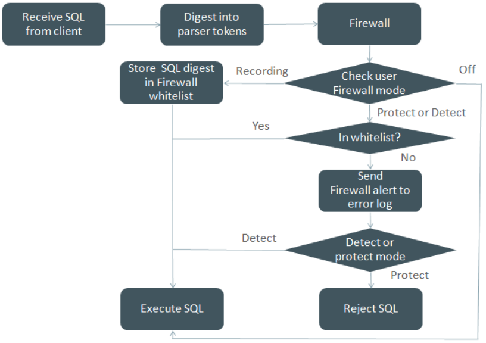
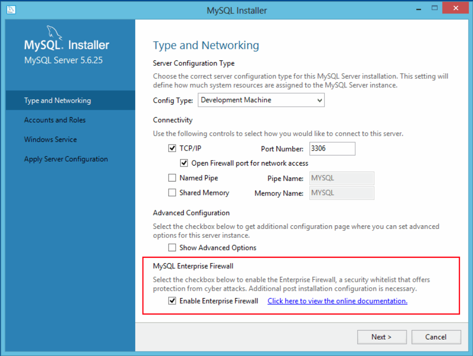

## Table of Contents

6.1 General Security Issues ............................................................................................................ 842

6.1.1 Security Guidelines ........................................................................................................ 842

6.1.2 Keeping Passwords Secure ............................................................................................ 844

6.1.3 Making MySQL Secure Against Attackers ....................................................................... 852

6.1.4 Security-Related mysqld Options and Variables ............................................................... 854

6.1.5 How to Run MySQL as a Normal User ........................................................................... 855

6.1.6 Security Considerations for LOAD DATA LOCAL ............................................................. 855

6.1.7 Client Programming Security Guidelines .......................................................................... 857

6.2 Access Control and Account Management ................................................................................. 859

6.2.1 Account User Names and Passwords ............................................................................. 860

6.2.2 Privileges Provided by MySQL ....................................................................................... 862

6.2.3 Grant Tables .................................................................................................................. 869

6.2.4 Specifying Account Names ............................................................................................. 875

6.2.5 Access Control, Stage 1: Connection Verification ............................................................. 877

6.2.6 Access Control, Stage 2: Request Verification ................................................................. 880

6.2.7 Adding Accounts, Assigning Privileges, and Dropping Accounts ........................................ 882

6.2.8 When Privilege Changes Take Effect .............................................................................. 885

6.2.9 Assigning Account Passwords ........................................................................................ 886

6.2.10 Server Handling of Expired Passwords ......................................................................... 887

6.2.11 Pluggable Authentication .............................................................................................. 890

6.2.12 Proxy Users ................................................................................................................. 894

6.2.13 Setting Account Resource Limits .................................................................................. 900

6.2.14 Troubleshooting Problems Connecting to MySQL .......................................................... 902

6.2.15 SQL-Based Account Activity Auditing ............................................................................ 907

6.3 Using Encrypted Connections .................................................................................................... 908

6.3.1 Configuring MySQL to Use Encrypted Connections ......................................................... 909

6.3.2 Encrypted Connection TLS Protocols and Ciphers ........................................................... 912

6.3.3 Creating SSL and RSA Certificates and Keys .................................................................. 916

6.3.4 SSL Library-Dependent Capabilities ................................................................................ 922

6.3.5 Connecting to MySQL Remotely from Windows with SSH ................................................ 923

6.4 Security Plugins ........................................................................................................................ 923

6.4.1 Authentication Plugins .................................................................................................... 924

6.4.2 The Connection-Control Plugins ...................................................................................... 954

6.4.3 The Password Validation Plugin ..................................................................................... 960

6.4.4 MySQL Enterprise Audit ................................................................................................. 967

6.4.5 MySQL Enterprise Firewall ............................................................................................. 994

6.5 MySQL Enterprise Encryption .................................................................................................. 1010

6.5.1 MySQL Enterprise Encryption Installation ...................................................................... 1011

6.5.2 MySQL Enterprise Encryption Usage and Examples ...................................................... 1011

6.5.3 MySQL Enterprise Encryption Function Reference ......................................................... 1014

6.5.4 MySQL Enterprise Encryption Function Descriptions ...................................................... 1014

6.6 SELinux .................................................................................................................................. 1018

6.6.1 Check if SELinux is Enabled ........................................................................................ 1019

6.6.2 Changing the SELinux Mode ........................................................................................ 1020

6.6.3 MySQL Server SELinux Policies ................................................................................... 1020

6.6.4 SELinux File Context .................................................................................................... 1020

6.6.5 SELinux TCP Port Context ........................................................................................... 1022

6.6.6 Troubleshooting SELinux .............................................................................................. 1022 General Security Issues When thinking about security within a MySQL installation, you should consider a wide range of possible topics and how they affect the security of your MySQL server and related applications:

- General factors that affect security. These include choosing good passwords, not granting unnecessary

privileges to users, ensuring application security by preventing SQL injections and data corruption, and others. See Section 6.1, “General Security Issues”.

- Security of the installation itself. The data files, log files, and the all the application files of your

installation should be protected to ensure that they are not readable or writable by unauthorized parties.

For more information, see Section 2.10, “Postinstallation Setup and Testing”.

- Access control and security within the database system itself, including the users and databases

granted with access to the databases, views and stored programs in use within the database. For more information, see Section 6.2, “Access Control and Account Management”

- The features offered by security-related plugins. See Section 6.4, “Security Plugins”.
- Network security of MySQL and your system. The security is related to the grants for individual users,

but you may also wish to restrict MySQL so that it is available only locally on the MySQL server host, or to a limited set of other hosts.

- Ensure that you have adequate and appropriate backups of your database files, configuration and log

files. Also be sure that you have a recovery solution in place and test that you are able to successfully recover the information from your backups. See Chapter 7, Backup and Recovery.

## 6.1 General Security Issues

This section describes general security issues to be aware of and what you can do to make your MySQL installation more secure against attack or misuse. For information specifically about the access control system that MySQL uses for setting up user accounts and checking database access, see Section 2.10,“Postinstallation Setup and Testing”.

For answers to some questions that are often asked about MySQL Server security issues, see Section A.9,“MySQL 5.6 FAQ: Security”.

### 6.1.1 Security Guidelines

Anyone using MySQL on a computer connected to the Internet should read this section to avoid the most common security mistakes.

In discussing security, it is necessary to consider fully protecting the entire server host (not just the MySQL server) against all types of applicable attacks: eavesdropping, altering, playback, and denial of service. We do not cover all aspects of availability and fault tolerance here.

MySQL uses security based on Access Control Lists (ACLs) for all connections, queries, and other operations that users can attempt to perform. There is also support for SSL-encrypted connections between MySQL clients and servers. Many of the concepts discussed here are not specific to MySQL at all; the same general ideas apply to almost all applications.

When running MySQL, follow these guidelines:

- Do not ever give anyone (except MySQL `root` accounts) access to the `user` table in the `mysql`

> system database! This is critical.

- Learn how the MySQL access privilege system works (see Section 6.2, “Access Control and Account

Management”). Use the `GRANT` and `REVOKE` statements to control access to MySQL. Do not grant more privileges than necessary. Never grant privileges to all hosts.

Security Guidelines Checklist:

- Try `mysql -u root`. If you are able to connect successfully to the server without being asked for a

password, anyone can connect to your MySQL server as the MySQL `root` user with full privileges!

Review the MySQL installation instructions, paying particular attention to the information about setting a `root` password. See Section 2.10.4, “Securing the Initial MySQL Accounts”.

- Use the `SHOW GRANTS` statement to check which accounts have access to what. Then use the

`REVOKE` statement to remove those privileges that are not necessary.

- Do not store cleartext passwords in your database. If your computer becomes compromised, the intruder

can take the full list of passwords and use them. Instead, use `SHA2()` or some other one-way hashing function and store the hash value.

To prevent password recovery using rainbow tables, do not use these functions on a plain password;

instead, choose some string to be used as a salt, and use hash(hash(password)+salt) values.

- Do not choose passwords from dictionaries. Special programs exist to break passwords. Even

passwords like “xfish98” are very bad. Much better is “duag98” which contains the same word “fish” but typed one key to the left on a standard QWERTY keyboard. Another method is to use a password that is taken from the first characters of each word in a sentence (for example, “Four score and seven years ago” results in a password of “Fsasya”). The password is easy to remember and type, but difficult to guess for someone who does not know the sentence. In this case, you can additionally substitute digits for the number words to obtain the phrase “4 score and 7 years ago”, yielding the password “4sa7ya”which is even more difficult to guess.

- Invest in a firewall. This protects you from at least 50% of all types of exploits in any software. Put

MySQL behind the firewall or in a demilitarized zone (DMZ).

Checklist:

- Try to scan your ports from the Internet using a tool such as `nmap`. MySQL uses port 3306 by default.

This port should not be accessible from untrusted hosts. As a simple way to check whether your MySQL port is open, try the following command from some remote machine, where `server_host` is the host name or IP address of the host on which your MySQL server runs:

```
$> telnet server_host 3306
```

If `telnet` hangs or the connection is refused, the port is blocked, which is how you want it to be. If you get a connection and some garbage characters, the port is open, and should be closed on your firewall or router, unless you really have a good reason to keep it open.

- Applications that access MySQL should not trust any data entered by users, and should be written

using proper defensive programming techniques. See Section 6.1.7, “Client Programming Security Guidelines”.

- Do not transmit plain (unencrypted) data over the Internet. This information is accessible to everyone

who has the time and ability to intercept it and use it for their own purposes. Instead, use an encrypted protocol such as SSL or SSH. MySQL supports internal SSL connections. Another technique is to use SSH port-forwarding to create an encrypted (and compressed) tunnel for the communication.

- Learn to use the `tcpdump` and `strings` utilities. In most cases, you can check whether MySQL data

streams are unencrypted by issuing a command like the following:

```
$> tcpdump -l -i eth0 -w - src or dst port 3306 | strings
```

This works under Linux and should work with small modifications under other systems.

Keeping Passwords Secure Warning If you do not see cleartext data, this does not always mean that the information actually is encrypted. If you need high security, consult with a security expert.

### 6.1.2 Keeping Passwords Secure

Passwords occur in several contexts within MySQL. The following sections provide guidelines that enable end users and administrators to keep these passwords secure and avoid exposing them. There is also a discussion of how MySQL uses password hashing internally and of a plugin that you can use to enforce stricter passwords.

#### 6.1.2.1 End-User Guidelines for Password Security

MySQL users should use the following guidelines to keep passwords secure.

When you run a client program to connect to the MySQL server, it is inadvisable to specify your password in a way that exposes it to discovery by other users. The methods you can use to specify your password when you run client programs are listed here, along with an assessment of the risks of each method.

In short, the safest methods are to have the client program prompt for the password or to specify the password in a properly protected option file.

- Use the `mysql_config_editor` utility, which enables you to store authentication credentials in

an encrypted login path file named `.mylogin.cnf`. The file can be read later by MySQL client programs to obtain authentication credentials for connecting to MySQL Server. See Section 4.6.6,“mysql_config_editor — MySQL Configuration Utility”.

- Use a `--password=password` or `-ppassword` option on the command line. For example:

```
$> mysql -u francis -pfrank db_name
```

Warning This is convenient but insecure. On some systems, your password becomes visible to system status programs such as `ps` that may be invoked by other users to display command lines. MySQL clients typically overwrite the command-line password argument with zeros during their initialization sequence. However,there is still a brief interval during which the value is visible. Also, on some systems this overwriting strategy is ineffective and the password remains visible to `ps`. (SystemV Unix systems and perhaps others are subject to this problem.)If your operating environment is set up to display your current command in the title bar of your terminal window, the password remains visible as long as the command is running, even if the command has scrolled out of view in the window content area.

- Use the `--password` or `-p` option on the command line with no password value specified. In this case,

the client program solicits the password interactively:

```
$> mysql -u francis -p db_name
Enter password: ********
```

The * characters indicate where you enter your password. The password is not displayed as you enter it.

It is more secure to enter your password this way than to specify it on the command line because it is not visible to other users. However, this method of entering a password is suitable only for programs that Keeping Passwords Secure you run interactively. If you want to invoke a client from a script that runs noninteractively, there is no opportunity to enter the password from the keyboard. On some systems, you may even find that the first line of your script is read and interpreted (incorrectly) as your password.

- Store your password in an option file. For example, on Unix, you can list your password in the `[client]`

section of the `.my.cnf` file in your home directory:

```
[client]
password=password
```

To keep the password safe, the file should not be accessible to anyone but yourself. To ensure this, set the file access mode to 400 or 600. For example:

```
$> chmod 600 .my.cnf
```

To name from the command line a specific option file containing the password, use the `--defaults-``file=file_name` option, where `file_name` is the full path name to the file. For example:

```
$> mysql --defaults-file=/home/francis/mysql-opts
```

Section 4.2.2.2, “Using Option Files”, discusses option files in more detail.

- Store your password in the `MYSQL_PWD` environment variable. See Section 4.9, “Environment Variables”.

This method of specifying your MySQL password must be considered extremely insecure and should not be used. Some versions of `ps` include an option to display the environment of running processes.

On some systems, if you set `MYSQL_PWD`, your password is exposed to any other user who runs `ps`.

Even on systems without such a version of `ps`, it is unwise to assume that there are no other methods by which users can examine process environments.

On Unix, the `mysql` client writes a record of executed statements to a history file (see Section 4.5.1.3,“mysql Client Logging”). By default, this file is named `.mysql_history` and is created in your home directory. Passwords can be written as plain text in SQL statements such as `CREATE USER`, `GRANT`, and`SET PASSWORD`, so if you use these statements, they are logged in the history file. To keep this file safe,use a restrictive access mode, the same way as described earlier for the `.my.cnf` file.

If your command interpreter is configured to maintain a history, any file in which the commands are saved contains MySQL passwords entered on the command line. For example, `bash` uses `~/.bash_history`.

Any such file should have a restrictive access mode.

#### 6.1.2.2 Administrator Guidelines for Password Security

Database administrators should use the following guidelines to keep passwords secure.

MySQL stores passwords for user accounts in the `mysql.user` system table. Access to this table should never be granted to any nonadministrative accounts.

Account passwords can be expired so that users must reset them. See Section 6.2.10, “Server Handling of Expired Passwords”.

The `validate_password` plugin can be used to enforce a policy on acceptable password. See Section 6.4.3, “The Password Validation Plugin”.

A user who has access to modify the plugin directory (the value of the `plugin_dir` system variable) or the `my.cnf` file that specifies the plugin directory location can replace plugins and modify the capabilities provided by plugins, including authentication plugins.

Keeping Passwords Secure Files such as log files to which passwords might be written should be protected. See Section 6.1.2.3,“Passwords and Logging”.

#### 6.1.2.3 Passwords and Logging

Passwords can be written as plain text in SQL statements such as `CREATE USER`, `GRANT`, `SET``PASSWORD`, and statements that invoke the `PASSWORD()` function. If such statements are logged by the MySQL server as written, passwords in them become visible to anyone with access to the logs.

Statement logging avoids writing passwords as cleartext for the following statements:

```
CREATE USER ... IDENTIFIED BY ...
GRANT ... IDENTIFIED BY ...
SET PASSWORD ...
SLAVE START ... PASSWORD = ...
CREATE SERVER ... OPTIONS(... PASSWORD ...)
ALTER SERVER ... OPTIONS(... PASSWORD ...)
```

Passwords in those statements are rewritten to not appear literally in statement text written to the general query log, slow query log, and binary log. Rewriting does not apply to other statements. In particular,`INSERT` or `UPDATE` statements for the `mysql.user` system table that refer to literal passwords are logged as is, so you should avoid such statements. (Direct modification of grant tables is discouraged, anyway.)For the general query log, password rewriting can be suppressed by starting the server with the `--log-``raw` option. For security reasons, this option is not recommended for production use. For diagnostic purposes, it may be useful to see the exact text of statements as received by the server.

Contents of the audit log file produced by the audit log plugin are not encrypted. For security reasons, this file should be written to a directory accessible only to the MySQL server and users with a legitimate reason to view the log. See Section 6.4.4.2, “MySQL Enterprise Audit Security Considerations”.

To guard log files against unwarranted exposure, locate them in a directory that restricts access to the server and the database administrator. If the server logs to tables in the `mysql` database, grant access to those tables only to the database administrator.

Replicas store the password for the replication source in the source info repository, which can be either a file or a table (see Section 17.2.2, “Relay Log and Replication Metadata Repositories”). Ensure that the repository can be accessed only by the database administrator. An alternative to storing the password in a file is to use the `START SLAVE` statement to specify credentials for connecting to the source.

Use a restricted access mode to protect database backups that include log tables or log files containing passwords.

#### 6.1.2.4 Password Hashing in MySQL

Note The information in this section applies only for accounts that use the`mysql_native_password` or `mysql_old_password` authentication plugins.

MySQL lists user accounts in the `user` table of the `mysql` database. Each MySQL account can be assigned a password, although the `user` table does not store the cleartext version of the password, but a hash value computed from it.

MySQL uses passwords in two phases of client/server communication:Keeping Passwords Secure

- When a client attempts to connect to the server, there is an initial authentication step in which the client

must present a password that has a hash value matching the hash value stored in the `user` table for the account the client wants to use.

- After the client connects, it can (if it has sufficient privileges) set or change the password hash for

accounts listed in the `user` table. The client can do this by using the `PASSWORD()` function to generate a password hash, or by using a password-generating statement (`CREATE USER`, `GRANT`, or `SET`

```
PASSWORD).
```

In other words, the server checks hash values during authentication when a client first attempts to connect.

The server generates hash values if a connected client invokes the `PASSWORD()` function or uses a password-generating statement to set or change a password.

Password hashing methods in MySQL have the history described following. These changes are illustrated by changes in the result from the `PASSWORD()` function that computes password hash values and in the structure of the `user` table where passwords are stored.

The Original (Pre-4.1) Hashing Method The original hashing method produced a 16-byte string. Such hashes look like this:

```
mysql> SELECT PASSWORD('mypass');
+--------------------+
| PASSWORD('mypass') |
+--------------------+
| 6f8c114b58f2ce9e   |
+--------------------+
```

To store account passwords, the `Password` column of the `user` table was at this point 16 bytes long.

The 4.1 Hashing Method MySQL 4.1 introduced password hashing that provided better security and reduced the risk of passwords being intercepted. There were several aspects to this change:

- Different format of password values produced by the `PASSWORD()` function
- Widening of the `Password` column
- Control over the default hashing method
- Control over the permitted hashing methods for clients attempting to connect to the server

The changes in MySQL 4.1 took place in two stages:

- MySQL 4.1.0 used a preliminary version of the 4.1 hashing method. This method was short lived and the

following discussion says nothing more about it.

- In MySQL 4.1.1, the hashing method was modified to produce a longer 41-byte hash value:

```
mysql> SELECT PASSWORD('mypass');
+-------------------------------------------+
| PASSWORD('mypass')                        |
+-------------------------------------------+
| *6C8989366EAF75BB670AD8EA7A7FC1176A95CEF4 |
+-------------------------------------------+
```

The longer password hash format has better cryptographic properties, and client authentication based on long hashes is more secure than that based on the older short hashes.

Keeping Passwords Secure To accommodate longer password hashes, the `Password` column in the `user` table was changed at this point to be 41 bytes, its current length.

A widened `Password` column can store password hashes in both the pre-4.1 and 4.1 formats. The format of any given hash value can be determined two ways:

- The length: 4.1 and pre-4.1 hashes are 41 and 16 bytes, respectively.
- Password hashes in the 4.1 format always begin with a * character, whereas passwords in the pre-4.1

format never do.

To permit explicit generation of pre-4.1 password hashes, two additional changes were made:

- The `OLD_PASSWORD()` function was added, which returns hash values in the 16-byte format.
- For compatibility purposes, the `old_passwords` system variable was added, to enable DBAs and

applications control over the hashing method. The default `old_passwords` value of 0 causes hashing to use the 4.1 method (41-byte hash values), but setting `old_passwords=1` causes hashing to use the pre-4.1 method. In this case, `PASSWORD()` produces 16-byte values and is equivalent to

```
OLD_PASSWORD()
```

To permit DBAs control over how clients are permitted to connect, the `secure_auth` system variable was added. Starting the server with this variable disabled or enabled permits or prohibits clients to connect using the older pre-4.1 password hashing method. Before MySQL 5.6.5, `secure_auth` is disabled by default. As of 5.6.5, `secure_auth` is enabled by default to promote a more secure default configuration DBAs can disable it at their discretion, but this is not recommended, and pre-4.1 password hashes are deprecated and should be avoided. (For account upgrade instructions, see Section 6.4.1.3,“Migrating Away from Pre-4.1 Password Hashing and the mysql_old_password Plugin”.)In addition, the `mysql` client supports a `--secure-auth` option that is analogous to `secure_auth`,but from the client side. It can be used to prevent connections to less secure accounts that use pre-4.1 password hashing. This option is disabled by default before MySQL 5.6.7, enabled thereafter.

Compatibility Issues Related to Hashing Methods The widening of the `Password` column in MySQL 4.1 from 16 bytes to 41 bytes affects installation or upgrade operations as follows:

- If you perform a new installation of MySQL, the `Password` column is made 41 bytes long automatically.
- Upgrades from MySQL 4.1 or later to current versions of MySQL should not give rise to any issues in

regard to the `Password` column because both versions use the same column length and password hashing method.

- For upgrades from a pre-4.1 release to 4.1 or later, you must upgrade the system tables after upgrading.

(See Section 4.4.7, “mysql_upgrade — Check and Upgrade MySQL Tables”.)The 4.1 hashing method is understood only by MySQL 4.1 (and higher) servers and clients, which can result in some compatibility problems. A 4.1 or higher client can connect to a pre-4.1 server, because the client understands both the pre-4.1 and 4.1 password hashing methods. However, a pre-4.1 client that attempts to connect to a 4.1 or higher server may run into difficulties. For example, a 4.0 `mysql` client may fail with the following error message:

```
$> mysql -h localhost -u root
Client does not support authentication protocol requested
by server; consider upgrading MySQL client
```

Keeping Passwords Secure The following discussion describes the differences between the pre-4.1 and 4.1 hashing methods, and what you should do if you upgrade your server but need to maintain backward compatibility with pre-4.1 clients. (However, permitting connections by old clients is not recommended and should be avoided if possible.) Additional information can be found in Section B.3.2.4, “Client does not support authentication protocol”. This information is of particular importance to PHP programmers migrating MySQL databases from versions older than 4.1 to 4.1 or higher.

The differences between short and long password hashes are relevant both for how the server uses passwords during authentication and for how it generates password hashes for connected clients that perform password-changing operations.

The way in which the server uses password hashes during authentication is affected by the width of the`Password` column:

- If the column is short, only short-hash authentication is used.
- If the column is long, it can hold either short or long hashes, and the server can use either format:
- Pre-4.1 clients can connect, but because they know only about the pre-4.1 hashing method, they can

authenticate only using accounts that have short hashes.

- 4.1 and later clients can authenticate using accounts that have short or long hashes.

Even for short-hash accounts, the authentication process is actually a bit more secure for 4.1 and later clients than for older clients. In terms of security, the gradient from least to most secure is:

- Pre-4.1 client authenticating with short password hash
- 4.1 or later client authenticating with short password hash
- 4.1 or later client authenticating with long password hash

The way in which the server generates password hashes for connected clients is affected by the width of the `Password` column and by the `old_passwords` system variable. A 4.1 or later server generates long hashes only if certain conditions are met: The `Password` column must be wide enough to hold long values and `old_passwords` must not be set to 1.

Those conditions apply as follows:

- The `Password` column must be wide enough to hold long hashes (41 bytes). If the column has not

been updated and still has the pre-4.1 width of 16 bytes, the server notices that long hashes cannot fit into it and generates only short hashes when a client performs password-changing operations using the `PASSWORD()` function or a password-generating statement. This is the behavior that occurs if you have upgraded from a version of MySQL older than 4.1 to 4.1 or later but have not yet run the`mysql_upgrade` program to widen the `Password` column.

- If the `Password` column is wide, it can store either short or long password hashes. In this case, the

`PASSWORD()` function and password-generating statements generate long hashes unless the server was started with the `old_passwords` system variable set to 1 to force the server to generate short password hashes instead.

The purpose of the `old_passwords` system variable is to permit backward compatibility with pre-4.1 clients under circumstances where the server would otherwise generate long password hashes. The option does not affect authentication (4.1 and later clients can still use accounts that have long password hashes),but it does prevent creation of a long password hash in the `user` table as the result of a password-changing operation. Were that permitted to occur, the account could no longer be used by pre-4.1 clients.

With `old_passwords` disabled, the following undesirable scenario is possible:Keeping Passwords Secure

- An old pre-4.1 client connects to an account that has a short password hash.
- The client changes its own password. With `old_passwords` disabled, this results in the account having

a long password hash.

- The next time the old client attempts to connect to the account, it cannot, because the account has a

long password hash that requires the 4.1 hashing method during authentication. (Once an account has a long password hash in the user table, only 4.1 and later clients can authenticate for it because pre-4.1 clients do not understand long hashes.)This scenario illustrates that, if you must support older pre-4.1 clients, it is problematic to run a 4.1 or higher server without `old_passwords` set to 1. By running the server with `old_passwords=1`,password-changing operations do not generate long password hashes and thus do not cause accounts to become inaccessible to older clients. (Those clients cannot inadvertently lock themselves out by changing their password and ending up with a long password hash.)The downside of `old_passwords=1` is that any passwords created or changed use short hashes, even for 4.1 or later clients. Thus, you lose the additional security provided by long password hashes. To create an account that has a long hash (for example, for use by 4.1 clients) or to change an existing account to use a long password hash, an administrator can set the session value of `old_passwords` set to 0 while leaving the global value set to 1:

```
mysql> SET @@SESSION.old_passwords = 0;
Query OK, 0 rows affected (0.00 sec)
mysql> SELECT @@SESSION.old_passwords, @@GLOBAL.old_passwords;
+-------------------------+------------------------+
| @@SESSION.old_passwords | @@GLOBAL.old_passwords |
+-------------------------+------------------------+
|                       0 |                      1 |
+-------------------------+------------------------+
1 row in set (0.00 sec)
mysql> CREATE USER 'newuser'@'localhost' IDENTIFIED BY 'newpass';
Query OK, 0 rows affected (0.03 sec)
mysql> SET PASSWORD FOR 'existinguser'@'localhost' = PASSWORD('existingpass');
Query OK, 0 rows affected (0.00 sec)
```

The following scenarios are possible in MySQL 4.1 or later. The factors are whether the `Password` column is short or long, and, if long, whether the server is started with `old_passwords` enabled or disabled.

> Scenario 1: Short `Password` column in user table:

- Only short hashes can be stored in the `Password` column.
- The server uses only short hashes during client authentication.
- For connected clients, password hash-generating operations involving the `PASSWORD()` function or

password-generating statements use short hashes exclusively. Any change to an account's password results in that account having a short password hash.

- The value of `old_passwords` is irrelevant because with a short `Password` column, the server

generates only short password hashes anyway.

This scenario occurs when a pre-4.1 MySQL installation has been upgraded to 4.1 or later but`mysql_upgrade` has not been run to upgrade the system tables in the `mysql` database. (This is not a recommended configuration because it does not permit use of more secure 4.1 password hashing.)Keeping Passwords Secure Scenario 2: Long `Password` column; server started with `old_passwords=1`:

- Short or long hashes can be stored in the `Password` column.
- 4.1 and later clients can authenticate for accounts that have short or long hashes.
- Pre-4.1 clients can authenticate only for accounts that have short hashes.
- For connected clients, password hash-generating operations involving the `PASSWORD()` function or

password-generating statements use short hashes exclusively. Any change to an account's password results in that account having a short password hash.

In this scenario, newly created accounts have short password hashes because `old_passwords=1`prevents generation of long hashes. Also, if you create an account with a long hash before setting`old_passwords` to 1, changing the account's password while `old_passwords=1` results in the account being given a short password, causing it to lose the security benefits of a longer hash.

To create a new account that has a long password hash, or to change the password of any existing account to use a long hash, first set the session value of `old_passwords` set to 0 while leaving the global value set to 1, as described previously.

In this scenario, the server has an up to date `Password` column, but is running with the default password hashing method set to generate pre-4.1 hash values. This is not a recommended configuration but may be useful during a transitional period in which pre-4.1 clients and passwords are upgraded to

4.1 or later. When that has been done, it is preferable to run the server with `old_passwords=0` and

```
secure_auth=1.
```

> Scenario 3: Long `Password` column; server started with `old_passwords=0`:

- Short or long hashes can be stored in the `Password` column.
- 4.1 and later clients can authenticate using accounts that have short or long hashes.
- Pre-4.1 clients can authenticate only using accounts that have short hashes.
- For connected clients, password hash-generating operations involving the `PASSWORD()` function or

password-generating statements use long hashes exclusively. A change to an account's password results in that account having a long password hash.

As indicated earlier, a danger in this scenario is that it is possible for accounts that have a short password hash to become inaccessible to pre-4.1 clients. A change to such an account's password made using the `PASSWORD()` function or a password-generating statement results in the account being given a long password hash. From that point on, no pre-4.1 client can connect to the server using that account. The client must upgrade to 4.1 or later.

If this is a problem, you can change a password in a special way. For example, normally you use `SET``PASSWORD` as follows to change an account password:

```
SET PASSWORD FOR 'some_user'@'some_host' = PASSWORD('password');
```

To change the password but create a short hash, use the `OLD_PASSWORD()` function instead:

```
SET PASSWORD FOR 'some_user'@'some_host' = OLD_PASSWORD('password');
```

`OLD_PASSWORD()` is useful for situations in which you explicitly want to generate a short hash.

The disadvantages for each of the preceding scenarios may be summarized as follows:Making MySQL Secure Against Attackers In scenario 1, you cannot take advantage of longer hashes that provide more secure authentication.

In scenario 2, `old_passwords=1` prevents accounts with short hashes from becoming inaccessible, but password-changing operations cause accounts with long hashes to revert to short hashes unless you take care to change the session value of `old_passwords` to 0 first.

In scenario 3, accounts with short hashes become inaccessible to pre-4.1 clients if you change their passwords without explicitly using `OLD_PASSWORD()`.

The best way to avoid compatibility problems related to short password hashes is to not use them:

- Upgrade all client programs to MySQL 4.1 or later.
- Run the server with `old_passwords=0`.
- Reset the password for any account with a short password hash to use a long password hash.
- For additional security, run the server with `secure_auth=1`.

> 6.1.2.5 Implications of Password Hashing Changes in MySQL 4.1 for Application Programs

An upgrade to MySQL version 4.1 or later can cause compatibility issues for applications that use`PASSWORD()` to generate passwords for their own purposes. Applications really should not do this,because `PASSWORD()` should be used only to manage passwords for MySQL accounts. But some applications use `PASSWORD()` for their own purposes anyway.

If you upgrade to 4.1 or later from a pre-4.1 version of MySQL and run the server under conditions where it generates long password hashes, an application using `PASSWORD()` for its own passwords breaks.

The recommended course of action in such cases is to modify the application to use another function,such as `SHA2()`, `SHA1()`, or `MD5()`, to produce hashed values. If that is not possible, you can use the`OLD_PASSWORD()` function, which is provided for generate short hashes in the old format. However, you should note that `OLD_PASSWORD()` may one day no longer be supported.

If the server is running with `old_passwords=1`, it generates short hashes and `OLD_PASSWORD()` is equivalent to `PASSWORD()`.

PHP programmers migrating their MySQL databases from version 4.0 or lower to version 4.1 or higher should see MySQL and PHP.

### 6.1.3 Making MySQL Secure Against Attackers

When you connect to a MySQL server, you should use a password. The password is not transmitted as cleartext over the connection. Password handling during the client connection sequence was upgraded in MySQL 4.1.1 to be very secure. If you are still using pre-4.1.1-style passwords, the encryption algorithm is not as strong as the newer algorithm. With some effort, a clever attacker who can sniff the traffic between the client and the server can crack the password. (See Section 6.1.2.4, “Password Hashing in MySQL”, for a discussion of the different password handling methods.)All other information is transferred as text, and can be read by anyone who is able to watch the connection.

If the connection between the client and the server goes through an untrusted network, and you are concerned about this, you can use the compressed protocol to make traffic much more difficult to decipher. You can also use MySQL's internal SSL support to make the connection even more secure.

See Section 6.3, “Using Encrypted Connections”. Alternatively, use SSH to get an encrypted TCP/IP connection between a MySQL server and a MySQL client. You can find an Open Source SSH client at http://www.openssh.org/, and a comparison of both Open Source and Commercial SSH clients at http://en.wikipedia.org/wiki/Comparison_of_SSH_clients.

Making MySQL Secure Against Attackers To make a MySQL system secure, you should strongly consider the following suggestions:

- Require all MySQL accounts to have a password. A client program does not necessarily know the

identity of the person running it. It is common for client/server applications that the user can specify any user name to the client program. For example, anyone can use the `mysql` program to connect as any other person simply by invoking it as `mysql -u other_user db_name` if `other_user` has no password. If all accounts have a password, connecting using another user's account becomes much more difficult.

For a discussion of methods for setting passwords, see Section 6.2.9, “Assigning Account Passwords”.

- Make sure that the only Unix user account with read or write privileges in the database directories is the

account that is used for running `mysqld`.

- Never run the MySQL server as the Unix `root` user. This is extremely dangerous, because any

user with the `FILE` privilege is able to cause the server to create files as `root` (for example,`~root/.bashrc`). To prevent this, `mysqld` refuses to run as `root` unless that is specified explicitly using the `--user=root` option.

`mysqld` can (and should) be run as an ordinary, unprivileged user instead. You can create a separate Unix account named `mysql` to make everything even more secure. Use this account only for administering MySQL. To start `mysqld` as a different Unix user, add a `user` option that specifies the user name in the `[mysqld]` group of the `my.cnf` option file where you specify server options. For example:

```
[mysqld]
user=mysql
```

This causes the server to start as the designated user whether you start it manually or by using`mysqld_safe` or `mysql.server`. For more details, see Section 6.1.5, “How to Run MySQL as a Normal User”.

Running `mysqld` as a Unix user other than `root` does not mean that you need to change the `root` user name in the `user` table. User names for MySQL accounts have nothing to do with user names for Unix accounts.

- Do not grant the `FILE` privilege to nonadministrative users. Any user that has this privilege can write

a file anywhere in the file system with the privileges of the `mysqld` daemon. This includes the server's data directory containing the files that implement the privilege tables. To make `FILE`-privilege operations a bit safer, files generated with `SELECT ... INTO OUTFILE` do not overwrite existing files and are writable by everyone.

The `FILE` privilege may also be used to read any file that is world-readable or accessible to the Unix user that the server runs as. With this privilege, you can read any file into a database table. This could be abused, for example, by using `LOAD DATA` to load `/etc/passwd` into a table, which then can be displayed with `SELECT`.

To limit the location in which files can be read and written, set the `secure_file_priv` system to a specific directory. See Section 5.1.7, “Server System Variables”.

- Do not grant the `PROCESS` or `SUPER` privilege to nonadministrative users. The output of `mysqladmin`

`processlist` and `SHOW PROCESSLIST` shows the text of any statements currently being executed, so any user who is permitted to see the server process list might be able to see statements issued by other

```
users such as UPDATE user SET password=PASSWORD('not_secure').
```

`mysqld` reserves an extra connection for users who have the `SUPER` privilege, so that a MySQL `root`user can log in and check server activity even if all normal connections are in use.

Security-Related mysqld Options and Variables The `SUPER` privilege can be used to terminate client connections, change server operation by changing the value of system variables, and control replication servers.

- Do not permit the use of symlinks to tables. (This capability can be disabled with the `--skip-`

`symbolic-links` option.) This is especially important if you run `mysqld` as `root`, because anyone that has write access to the server's data directory then could delete any file in the system! See Section 8.12.3.2, “Using Symbolic Links for MyISAM Tables on Unix”.

- Stored programs and views should be written using the security guidelines discussed in Section 20.6,

“Stored Object Access Control”.

- If you do not trust your DNS, you should use IP addresses rather than host names in the grant tables.

In any case, you should be very careful about creating grant table entries using host name values that contain wildcards.

- If you want to restrict the number of connections permitted to a single account, you can do so by setting

the `max_user_connections` variable in `mysqld`. The `GRANT` statement also supports resource control options for limiting the extent of server use permitted to an account. See Section 13.7.1.4, “GRANT Statement”.

- If the plugin directory is writable by the server, it may be possible for a user to write executable code

to a file in the directory using `SELECT ... INTO DUMPFILE`. This can be prevented by making`plugin_dir` read only to the server or by setting `secure_file_priv` to a directory where `SELECT`writes can be made safely.

### 6.1.4 Security-Related mysqld Options and Variables

The following table shows `mysqld` options and system variables that affect security. For descriptions of each of these, see Section 5.1.6, “Server Command Options”, and Section 5.1.7, “Server System Variables”.

Table 6.1 Security Option and Variable Summary Name Cmd-Line Option File System Var Status Var Var Scope Dynamic allow- Yes Yes suspicious-udfs automatic_sp_privilegesYes Yes Yes Global Yes chroot Yes Yes des-key-file Yes Yes local_infile Yes Yes Yes Global Yes old_passwordsYes Yes Yes Both Yes safe-user- Yes Yes create secure_auth Yes Yes Yes Global Yes secure_file_privYes Yes Yes Global No skip-grant- Yes Yes tables skip_name_resolveYes Yes Yes Global No skip_networkingYes Yes Yes Global No How to Run MySQL as a Normal User Name Cmd-Line Option File System Var Status Var Var Scope Dynamic skip_show_databaseYes Yes Yes Global No

### 6.1.5 How to Run MySQL as a Normal User

On Windows, you can run the server as a Windows service using a normal user account.

On Linux, for installations performed using a MySQL repository, RPM packages, or Debian packages, the MySQL server `mysqld` should be started by the local `mysql` operating system user. Starting by another operating system user is not supported by the init scripts that are included as part of the installation.

On Unix (or Linux for installations performed using `tar` or `tar.gz` packages) , the MySQL server `mysqld`can be started and run by any user. However, you should avoid running the server as the Unix `root` user for security reasons. To change `mysqld` to run as a normal unprivileged Unix user `user_name`, you must do the following:

1. Stop the server if it is running (use `mysqladmin shutdown`).
2. Change the database directories and files so that `user_name` has privileges to read and write files in

them (you might need to do this as the Unix `root` user):

```
$> chown -R user_name /path/to/mysql/datadir
```

If you do not do this, the server cannot access databases or tables when it runs as `user_name`.

If directories or files within the MySQL data directory are symbolic links, `chown -R` might not follow symbolic links for you. If it does not, you must also follow those links and change the directories and files they point to.

3. Start the server as user `user_name`. Another alternative is to start `mysqld` as the Unix `root` user and

use the `--user=user_name` option. `mysqld` starts, then switches to run as the Unix user `user_name`before accepting any connections.

4. To start the server as the given user automatically at system startup time, specify the user name by

adding a `user` option to the `[mysqld]` group of the `/etc/my.cnf` option file or the `my.cnf` option file in the server's data directory. For example:

```
[mysqld]
user=user_name
```

If your Unix machine itself is not secured, you should assign passwords to the MySQL `root` accounts in the grant tables. Otherwise, any user with a login account on that machine can run the `mysql` client with a `--user=root` option and perform any operation. (It is a good idea to assign passwords to MySQL accounts in any case, but especially so when other login accounts exist on the server host.) See Section 2.10.4, “Securing the Initial MySQL Accounts”.

### 6.1.6 Security Considerations for LOAD DATA LOCAL

The `LOAD DATA` statement loads a data file into a table. The statement can load a file located on the server host, or, if the `LOCAL` keyword is specified, on the client host.

The `LOCAL` version of `LOAD DATA` has two potential security issues:

- Because `LOAD DATA LOCAL` is an SQL statement, parsing occurs on the server side, and transfer of

the file from the client host to the server host is initiated by the MySQL server, which tells the client the Security Considerations for LOAD DATA LOCAL file named in the statement. In theory, a patched server could tell the client program to transfer a file of the server's choosing rather than the file named in the statement. Such a server could access any file on the client host to which the client user has read access. (A patched server could in fact reply with a file-transfer request to any statement, not just `LOAD DATA LOCAL`, so a more fundamental issue is that clients should not connect to untrusted servers.)

- In a Web environment where the clients are connecting from a Web server, a user could use `LOAD`

`DATA LOCAL` to read any files that the Web server process has read access to (assuming that a user could run any statement against the SQL server). In this environment, the client with respect to the MySQL server actually is the Web server, not a remote program being run by users who connect to the Web server.

To avoid connecting to untrusted servers, clients can establish a secure connection and verify the server identity by connecting using the `--ssl-verify-server-cert` option and the appropriate CA certificate.

To implement this level of verification, you must first ensure that the CA certificate for the server is reliably available to the replica, otherwise availability issues will result. For more information, see Command Options for Encrypted Connections.

To avoid `LOAD DATA` issues, clients should avoid using `LOCAL`.

Adminstrators and applications can configure whether to permit local data loading as follows:

- On the server side:
- The `local_infile` system variable controls server-side `LOCAL` capability. Depending on the

`local_infile` setting, the server refuses or permits local data loading by clients that request local data loading.

- By default, `local_infile` is enabled. To cause the server to refuse or permit `LOAD DATA LOCAL`

statements explicitly (regardless of how client programs and libraries are configured at build time or runtime), start `mysqld` with `local_infile` disabled or enabled. `local_infile` can also be set at runtime.

- On the client side:
- The `ENABLED_LOCAL_INFILE` `CMake` option controls the compiled-in default `LOCAL` capability for

the MySQL client library (see Section 2.9.7, “MySQL Source-Configuration Options”). Clients that make no explicit arrangements therefore have `LOCAL` capability disabled or enabled according to the`ENABLED_LOCAL_INFILE` setting specified at MySQL build time.

- By default, the client library in MySQL binary distributions is compiled with `ENABLED_LOCAL_INFILE`

enabled. If you compile MySQL from source, configure it with `ENABLED_LOCAL_INFILE` disabled or enabled based on whether clients that make no explicit arrangements should have `LOCAL` capability disabled or enabled.

- For client programs that use the C API, local data loading capability is determined by the

default compiled into the MySQL client library. To enable or disable it explicitly, invoke the`mysql_options()` C API function to disable or enable the `MYSQL_OPT_LOCAL_INFILE` option. See mysql_options().

- For the `mysql` client, local data loading capability is determined by the default compiled into the

MySQL client library. To disable or enable it explicitly, use the `--local-infile=0` or `--local-``infile[=1]` option.

- For the `mysqlimport` client, local data loading is not used by default. To disable or enable it

explicitly, use the `--local=0` or `--local[=1]` option.

Client Programming Security Guidelines

- If you use `LOAD DATA LOCAL` in Perl scripts or other programs that read the `[client]` group from

option files, you can add a `local-infile` option setting to that group. To prevent problems for programs that do not understand this option, specify it using the `loose-` prefix:

```
[client]
loose-local-infile=0
```

or:

```
[client]
loose-local-infile=1
```

- In all cases, successful use of a `LOCAL` load operation by a client also requires that the server permits

local loading.

If `LOCAL` capability is disabled, on either the server or client side, a client that attempts to issue a `LOAD``DATA LOCAL` statement receives the following error message:

```
ERROR 1148: The used command is not allowed with this MySQL version
```

### 6.1.7 Client Programming Security Guidelines

Client applications that access MySQL should use the following guidelines to avoid interpreting external data incorrectly or exposing sensitive information.

- Handle External Data Properly
- Handle MySQL Error Messages Properly

> Handle External Data Properly

Applications that access MySQL should not trust any data entered by users, who can try to trick your code by entering special or escaped character sequences in Web forms, URLs, or whatever application you have built. Be sure that your application remains secure if a user tries to perform SQL injection by entering something like `; DROP DATABASE mysql;` into a form. This is an extreme example, but large security leaks and data loss might occur as a result of hackers using similar techniques, if you do not prepare for them.

A common mistake is to protect only string data values. Remember to check numeric data as well. If an application generates a query such as `SELECT * FROM table WHERE ID=234` when a user enters the value 234, the user can enter the value `234 OR 1=1` to cause the application to generate the query`SELECT * FROM table WHERE ID=234 OR 1=1`. As a result, the server retrieves every row in the table. This exposes every row and causes excessive server load. The simplest way to protect from this type of attack is to use single quotation marks around the numeric constants: `SELECT * FROM``table WHERE ID='234'`. If the user enters extra information, it all becomes part of the string. In a numeric context, MySQL automatically converts this string to a number and strips any trailing nonnumeric characters from it.

Sometimes people think that if a database contains only publicly available data, it need not be protected.

This is incorrect. Even if it is permissible to display any row in the database, you should still protect against denial of service attacks (for example, those that are based on the technique in the preceding paragraph that causes the server to waste resources). Otherwise, your server becomes unresponsive to legitimate users.

Checklist:Client Programming Security Guidelines

- Enable strict SQL mode to tell the server to be more restrictive of what data values it accepts. See

Section 5.1.10, “Server SQL Modes”.

- Try to enter single and double quotation marks (' and ") in all of your Web forms. If you get any kind of

MySQL error, investigate the problem right away.

- Try to modify dynamic URLs by adding `%22` ("), `%23` (#), and `%27` (') to them.
- Try to modify data types in dynamic URLs from numeric to character types using the characters shown in

the previous examples. Your application should be safe against these and similar attacks.

- Try to enter characters, spaces, and special symbols rather than numbers in numeric fields. Your

application should remove them before passing them to MySQL or else generate an error. Passing unchecked values to MySQL is very dangerous!

- Check the size of data before passing it to MySQL.
- Have your application connect to the database using a user name different from the one you use for

administrative purposes. Do not give your applications any access privileges they do not need.

Many application programming interfaces provide a means of escaping special characters in data values.

Properly used, this prevents application users from entering values that cause the application to generate statements that have a different effect than you intend:

- MySQL SQL statements: Use SQL prepared statements and accept data values only by means of

placeholders; see Section 13.5, “Prepared Statements”.

- MySQL C API: Use the `mysql_real_escape_string()` API call. Alternatively, use the C API

prepared statement interface and accept data values only by means of placeholders; see C API Prepared Statement Interface.

- MySQL++: Use the `escape` and `quote` modifiers for query streams.
- PHP: Use either the `mysqli` or `pdo_mysql` extensions, and not the older `ext/mysql` extension.

The preferred API's support the improved MySQL authentication protocol and passwords, as well as prepared statements with placeholders. See also MySQL and PHP.

If the older `ext/mysql` extension must be used, then for escaping use the

```
mysql_real_escape_string() function and not mysql_escape_string() or addslashes()
```

because only `mysql_real_escape_string()` is character set-aware; the other functions can be“bypassed” when using (invalid) multibyte character sets.

- Perl DBI: Use placeholders or the `quote()` method.
- Java JDBC: Use a `PreparedStatement` object and placeholders.

Other programming interfaces might have similar capabilities.

> Handle MySQL Error Messages Properly

It is the application's responsibility to intercept errors that occur as a result of executing SQL statements with the MySQL database server and handle them appropriately.

The information returned in a MySQL error is not gratuitous because that information is key in debugging MySQL using applications. It would be nearly impossible, for example, to debug a common 10-way join`SELECT` statement without providing information regarding which databases, tables, and other objects are involved with problems. Thus, MySQL errors must sometimes necessarily contain references to the names of those objects.

Access Control and Account Management A simple but insecure approach for an application when it receives such an error from MySQL is to intercept it and display it verbatim to the client. However, revealing error information is a known application vulnerability type (CWE-209) and the application developer must ensure the application does not have this vulnerability.

For example, an application that displays a message such as this exposes both a database name and a table name to clients, which is information a client might attempt to exploit:

```
ERROR 1146 (42S02): Table 'mydb.mytable' doesn't exist
```

Instead, the proper behavior for an application when it receives such an error from MySQL is to log appropriate information, including the error information, to a secure audit location only accessible to trusted personnel. The application can return something more generic such as “Internal Error” to the user.

## 6.2 Access Control and Account Management

MySQL enables the creation of accounts that permit client users to connect to the server and access data managed by the server. The primary function of the MySQL privilege system is to authenticate a user who connects from a given host and to associate that user with privileges on a database such as`SELECT`, `INSERT`, `UPDATE`, and `DELETE`. Additional functionality includes the ability to grant privileges for administrative operations.

To control which users can connect, each account can be assigned authentication credentials such as a password. The user interface to MySQL accounts consists of SQL statements such as `CREATE USER`,`GRANT`, and `REVOKE`. See Section 13.7.1, “Account Management Statements”.

The MySQL privilege system ensures that all users may perform only the operations permitted to them.

As a user, when you connect to a MySQL server, your identity is determined by the host from which you connect and the user name you specify. When you issue requests after connecting, the system grants privileges according to your identity and what you want to do.

MySQL considers both your host name and user name in identifying you because there is no reason to assume that a given user name belongs to the same person on all hosts. For example, the user`joe` who connects from `office.example.com` need not be the same person as the user `joe` who connects from `home.example.com`. MySQL handles this by enabling you to distinguish users on different hosts that happen to have the same name: You can grant one set of privileges for connections by `joe` from `office.example.com`, and a different set of privileges for connections by `joe` from`home.example.com`. To see what privileges a given account has, use the `SHOW GRANTS` statement. For example:

```
SHOW GRANTS FOR 'joe'@'office.example.com';
SHOW GRANTS FOR 'joe'@'home.example.com';
```

Internally, the server stores privilege information in the grant tables of the `mysql` system database. The MySQL server reads the contents of these tables into memory when it starts and bases access-control decisions on the in-memory copies of the grant tables.

MySQL access control involves two stages when you run a client program that connects to the server:Stage 1: The server accepts or rejects the connection based on your identity and whether you can verify your identity by supplying the correct password.

Stage 2: Assuming that you can connect, the server checks each statement you issue to determine whether you have sufficient privileges to perform it. For example, if you try to select rows from a table in a database or drop a table from the database, the server verifies that you have the `SELECT` privilege for the table or the `DROP` privilege for the database.

Account User Names and Passwords For a more detailed description of what happens during each stage, see Section 6.2.5, “Access Control,Stage 1: Connection Verification”, and Section 6.2.6, “Access Control, Stage 2: Request Verification”. For help in diagnosing privilege-related problems, see Section 6.2.14, “Troubleshooting Problems Connecting to MySQL”.

If your privileges are changed (either by yourself or someone else) while you are connected, those changes do not necessarily take effect immediately for the next statement that you issue. For details about the conditions under which the server reloads the grant tables, see Section 6.2.8, “When Privilege Changes Take Effect”.

There are some things that you cannot do with the MySQL privilege system:

- You cannot explicitly specify that a given user should be denied access. That is, you cannot explicitly

match a user and then refuse the connection.

- You cannot specify that a user has privileges to create or drop tables in a database but not to create or

drop the database itself.

- A password applies globally to an account. You cannot associate a password with a specific object such

as a database, table, or routine.

### 6.2.1 Account User Names and Passwords

MySQL stores accounts in the `user` table of the `mysql` system database. An account is defined in terms of a user name and the client host or hosts from which the user can connect to the server. For information about account representation in the `user` table, see Section 6.2.3, “Grant Tables”.

An account may also have authentication credentials such as a password. The credentials are handled by the account authentication plugin. MySQL supports multiple authentication plugins. Some of them use built-in authentication methods, whereas others enable authentication using external authentication methods. See Section 6.2.11, “Pluggable Authentication”.

There are several distinctions between the way user names and passwords are used by MySQL and your operating system:

- User names, as used by MySQL for authentication purposes, have nothing to do with user names (login

names) as used by Windows or Unix. On Unix, most MySQL clients by default try to log in using the current Unix user name as the MySQL user name, but that is for convenience only. The default can be overridden easily, because client programs permit any user name to be specified with a `-u` or `--``user` option. This means that anyone can attempt to connect to the server using any user name, so you cannot make a database secure in any way unless all MySQL accounts have passwords. Anyone who specifies a user name for an account that has no password can connect successfully to the server.

- MySQL user names are up to 16 characters long. Operating system user names may have a different

maximum length.

Warning The MySQL user name length limit is hardcoded in MySQL servers and clients,and trying to circumvent it by modifying the definitions of the tables in the `mysql`database does not work.

You should never alter the structure of tables in the `mysql` database in any manner whatsoever except by means of the procedure that is described in Section 2.11, “Upgrading MySQL”. Attempting to redefine MySQL's system tables in any other fashion results in undefined and unsupported behavior. The server is free to ignore rows that become malformed as a result of such modifications.

Account User Names and Passwords

- To authenticate client connections for accounts that use built-in authentication methods, the server uses

passwords stored in the `user` table. These passwords are distinct from passwords for logging in to your operating system. There is no necessary connection between the “external” password you use to log in to a Windows or Unix machine and the password you use to access the MySQL server on that machine.

If the server authenticates a client using some other plugin, the authentication method that the plugin implements may or may not use a password stored in the `user` table. In this case, it is possible that an external password is also used to authenticate to the MySQL server.

- Passwords stored in the `user` table are encrypted using plugin-specific algorithms. For information

about MySQL native password hashing, see Section 6.1.2.4, “Password Hashing in MySQL”.

- If the user name and password contain only ASCII characters, it is possible to connect to the server

regardless of character set settings. To enable connections when the user name or password contain non-ASCII characters, client applications should call the `mysql_options()` C API function with the`MYSQL_SET_CHARSET_NAME` option and appropriate character set name as arguments. This causes authentication to take place using the specified character set. Otherwise, authentication fails unless the server default character set is the same as the encoding in the authentication defaults.

Standard MySQL client programs support a `--default-character-set` option that causes`mysql_options()` to be called as just described. In addition, character set autodetection is supported as described in Section 10.4, “Connection Character Sets and Collations”. For programs that use a connector that is not based on the C API, the connector may provide an equivalent to`mysql_options()` that can be used instead. Check the connector documentation.

The preceding notes do not apply for `ucs2`, `utf16`, and `utf32`, which are not permitted as client character sets.

The MySQL installation process populates the grant tables with an initial account or accounts. The names and access privileges for these accounts are described in Section 2.10.4, “Securing the Initial MySQL Accounts”, which also discusses how to assign passwords to them. Thereafter, you normally set up,modify, and remove MySQL accounts using statements such as `CREATE USER`, `DROP USER`, `GRANT`,and `REVOKE`. See Section 6.2.7, “Adding Accounts, Assigning Privileges, and Dropping Accounts”, and Section 13.7.1, “Account Management Statements”.

To connect to a MySQL server with a command-line client, specify user name and password options as necessary for the account that you want to use:

```
$> mysql --user=finley --password db_name
```

If you prefer short options, the command looks like this:

```
$> mysql -u finley -p db_name
```

If you omit the password value following the `--password` or `-p` option on the command line (as just shown), the client prompts for one. Alternatively, the password can be specified on the command line:

```
$> mysql --user=finley --password=password db_name
$> mysql -u finley -ppassword db_name
```

If you use the `-p` option, there must be no space between `-p` and the following password value.

Specifying a password on the command line should be considered insecure. See Section 6.1.2.1, “End-User Guidelines for Password Security”. To avoid giving the password on the command line, use an option file or a login path file. See Section 4.2.2.2, “Using Option Files”, and Section 4.6.6, “mysql_config_editor— MySQL Configuration Utility”.

For additional information about specifying user names, passwords, and other connection parameters, see Section 4.2.4, “Connecting to the MySQL Server Using Command Options”.

Privileges Provided by MySQL

### 6.2.2 Privileges Provided by MySQL

The privileges granted to a MySQL account determine which operations the account can perform. MySQL privileges differ in the contexts in which they apply and at different levels of operation:

- Administrative privileges enable users to manage operation of the MySQL server. These privileges are

global because they are not specific to a particular database.

- Database privileges apply to a database and to all objects within it. These privileges can be granted for

specific databases, or globally so that they apply to all databases.

- Privileges for database objects such as tables, indexes, views, and stored routines can be granted for

specific objects within a database, for all objects of a given type within a database (for example, all tables in a database), or globally for all objects of a given type in all databases.

Information about account privileges is stored in the grant tables in the `mysql` system database. For a description of the structure and contents of these tables, see Section 6.2.3, “Grant Tables”. The MySQL server reads the contents of the grant tables into memory when it starts, and reloads them under the circumstances indicated in Section 6.2.8, “When Privilege Changes Take Effect”. The server bases access-control decisions on the in-memory copies of the grant tables.

Important Some MySQL releases introduce changes to the grant tables to add new privileges or features. To make sure that you can take advantage of any new capabilities,update your grant tables to the current structure whenever you upgrade MySQL.

See Section 2.11, “Upgrading MySQL”.

The following sections summarize the available privileges, provide more detailed descriptions of each privilege, and offer usage guidelines.

- Summary of Available Privileges
- Privilege Descriptions
- Privilege-Granting Guidelines

> Summary of Available Privileges

The following table shows the privilege names used in `GRANT` and `REVOKE` statements, along with the column name associated with each privilege in the grant tables and the context in which the privilege applies.

Table 6.2 Permissible Privileges for GRANT and REVOKE Privilege Grant Table Column Context`ALL [PRIVILEGES]` Synonym for “all privileges” Server administration`ALTER` `Alter_priv` Tables`ALTER ROUTINE` `Alter_routine_priv` Stored routines`CREATE` `Create_priv` Databases, tables, or indexes`CREATE ROUTINE` `Create_routine_priv` Stored routines`CREATE TABLESPACE` `Create_tablespace_priv` Server administration

```
CREATE TEMPORARY TABLES  Create_tmp_table_priv  Tables
```

`CREATE USER` `Create_user_priv` Server administration Privileges Provided by MySQL Privilege Grant Table Column Context

```
CREATE VIEW  Create_view_priv  Views
```

`DELETE` `Delete_priv` Tables`DROP` `Drop_priv` Databases, tables, or views`EVENT` `Event_priv` Databases`EXECUTE` `Execute_priv` Stored routines`FILE` `File_priv` File access on server host`GRANT OPTION` `Grant_priv` Databases, tables, or stored routines`INDEX` `Index_priv` Tables`INSERT` `Insert_priv` Tables or columns

```
LOCK TABLES  Lock_tables_priv  Databases
```

`PROCESS` `Process_priv` Server administration`PROXY` See `proxies_priv` table Server administration`REFERENCES` `References_priv` Databases or tables`RELOAD` `Reload_priv` Server administration`REPLICATION CLIENT` `Repl_client_priv` Server administration`REPLICATION SLAVE` `Repl_slave_priv` Server administration`SELECT` `Select_priv` Tables or columns`SHOW DATABASES` `Show_db_priv` Server administration

```
SHOW VIEW  Show_view_priv  Views
```

`SHUTDOWN` `Shutdown_priv` Server administration`SUPER` `Super_priv` Server administration

```
TRIGGER  Trigger_priv  Tables
```

`UPDATE` `Update_priv` Tables or columns`USAGE` Synonym for “no privileges” Server administration

> Privilege Descriptions

The following list provides general descriptions of each privilege available in MySQL. Particular SQL statements might have more specific privilege requirements than indicated here. If so, the description for the statement in question provides the details.

```
- ALL, ALL PRIVILEGES
```

These privilege specifiers are shorthand for “all privileges available at a given privilege level” (except`GRANT OPTION`). For example, granting `ALL` at the global or table level grants all global privileges or all table-level privileges, respectively.

```
- ALTER
```

Enables use of the `ALTER TABLE` statement to change the structure of tables. `ALTER TABLE` also requires the `CREATE` and `INSERT` privileges. Renaming a table requires `ALTER` and `DROP` on the old table, `CREATE`, and `INSERT` on the new table.

```
- ALTER ROUTINE
```

Privileges Provided by MySQL Enables use of statements that alter or drop stored routines (stored procedures and functions).

```
- CREATE
```

Enables use of statements that create new databases and tables.

```
- CREATE ROUTINE
```

Enables use of statements that create stored routines (stored procedures and functions).

```
- CREATE TABLESPACE
```

Enables use of statements that create, alter, or drop tablespaces and log file groups.

```
- CREATE TEMPORARY TABLES
```

Enables the creation of temporary tables using the `CREATE TEMPORARY TABLE` statement.

After a session has created a temporary table, the server performs no further privilege checks on the table. The creating session can perform any operation on the table, such as `DROP TABLE`, `INSERT`,`UPDATE`, or `SELECT`. For more information, see Section 13.1.17.2, “CREATE TEMPORARY TABLE Statement”.

```
- CREATE USER
```

Enables use of the `ALTER USER`, `CREATE USER`, `DROP USER`, `RENAME USER`, and `REVOKE ALL``PRIVILEGES` statements.

```
- CREATE VIEW
```

Enables use of the `CREATE VIEW` statement.

```
- DELETE
```

Enables rows to be deleted from tables in a database.

```
- DROP
```

Enables use of statements that drop (remove) existing databases, tables, and views. The `DROP` privilege is required to use the `ALTER TABLE ... DROP PARTITION` statement on a partitioned table. The`DROP` privilege is also required for `TRUNCATE TABLE`.

```
- EVENT
```

Enables use of statements that create, alter, drop, or display events for the Event Scheduler.

```
- EXECUTE
```

Enables use of statements that execute stored routines (stored procedures and functions).

```
- FILE
```

Affects the following operations and server behaviors:

- Enables reading and writing files on the server host using the `LOAD DATA` and `SELECT ... INTO`

`OUTFILE` statements and the `LOAD_FILE()` function. A user who has the `FILE` privilege can read any file on the server host that is either world-readable or readable by the MySQL server. (This implies the user can read any file in any database directory, because the server can access any of those files.)Privileges Provided by MySQL

- Enables creating new files in any directory where the MySQL server has write access. This includes

the server's data directory containing the files that implement the privilege tables.

- As of MySQL 5.6.35, enables use of the `DATA DIRECTORY` or `INDEX DIRECTORY` table option for the

`CREATE TABLE` statement.

As a security measure, the server does not overwrite existing files.

To limit the location in which files can be read and written, set the `secure_file_priv` system variable to a specific directory. See Section 5.1.7, “Server System Variables”.

```
- GRANT OPTION
```

Enables you to grant to or revoke from other users those privileges that you yourself possess.

```
- INDEX
```

Enables use of statements that create or drop (remove) indexes. `INDEX` applies to existing tables. If you have the `CREATE` privilege for a table, you can include index definitions in the `CREATE TABLE`statement.

```
- INSERT
```

Enables rows to be inserted into tables in a database. `INSERT` is also required for the `ANALYZE TABLE`,`OPTIMIZE TABLE`, and `REPAIR TABLE` table-maintenance statements.

```
- LOCK TABLES
```

Enables use of explicit `LOCK TABLES` statements to lock tables for which you have the `SELECT`privilege. This includes use of write locks, which prevents other sessions from reading the locked table.

```
- PROCESS
```

The `PROCESS` privilege controls access to information about threads executing within the server (that is,information about statements being executed by sessions). Thread information available using the `SHOW``PROCESSLIST` statement, the `mysqladmin processlist` command, and the Information Schema`PROCESSLIST` table is accessible as follows:

- With the `PROCESS` privilege, a user has access to information about all threads, even those belonging

to other users.

- Without the `PROCESS` privilege, nonanonymous users have access to information about their own

threads but not threads for other users, and anonymous users have no access to thread information.

Note The Performance Schema `threads` table also provides thread information,but table access uses a different privilege model. See Section 22.12.10.3, “The threads Table”.

The `PROCESS` privilege also enables use of the `SHOW ENGINE` statement, access to the`INFORMATION_SCHEMA` `InnoDB` tables (tables with names that begin with `INNODB_`), and (as of MySQL

5.6.49) access to the `INFORMATION_SCHEMA` `FILES` table.

```
- PROXY
```

Enables one user to impersonate or become known as another user. See Section 6.2.12, “Proxy Users”.

Privileges Provided by MySQL

```
- REFERENCES
```

This privilege is unused before MySQL 5.6.22. As of 5.6.22, creation of a foreign key constraint requires at least one of the `SELECT`, `INSERT`, `UPDATE`, `DELETE`, or `REFERENCES` privileges for the parent table.

```
- RELOAD
```

The `RELOAD` enables the following operations:

- Use of the `FLUSH` statement.
- Use of `mysqladmin` commands that are equivalent to `FLUSH` operations: `flush-hosts`, `flush-`

```
logs, flush-privileges, flush-status, flush-tables, flush-threads, refresh, and
reload.
```

The `reload` command tells the server to reload the grant tables into memory. `flush-privileges`is a synonym for `reload`. The `refresh` command closes and reopens the log files and flushes all tables. The other `flush-xxx` commands perform functions similar to `refresh`, but are more specific and may be preferable in some instances. For example, if you want to flush just the log files, `flush-``logs` is a better choice than `refresh`.

- Use of `mysqldump` options that perform various `FLUSH` operations: `--flush-logs` and `--master-`

```
data.
```

- Use of the `RESET` statement.

```
- REPLICATION CLIENT
```

Enables use of the `SHOW MASTER STATUS`, `SHOW SLAVE STATUS`, and `SHOW BINARY LOGS`statements. Grant this privilege to accounts that are used by replica servers to connect to the current server as their source.

```
- REPLICATION SLAVE
```

Enables the account to request updates that have been made to databases on the source server, using the `SHOW SLAVE HOSTS`, `SHOW RELAYLOG EVENTS`, and `SHOW BINLOG EVENTS` statements. This privilege is also required to use the `mysqlbinlog` options `--read-from-remote-server` (`-R`) and`--read-from-remote-master`. Grant this privilege to accounts that are used by replica servers to connect to the current server as their source.

```
- SELECT
```

Enables rows to be selected from tables in a database. `SELECT` statements require the `SELECT` privilege only if they actually access tables. Some `SELECT` statements do not access tables and can be executed without permission for any database. For example, you can use `SELECT` as a simple calculator to evaluate expressions that make no reference to tables:

```
SELECT 1+1;
SELECT PI()*2;
```

The `SELECT` privilege is also needed for other statements that read column values. For example,`SELECT` is needed for columns referenced on the right hand side of `col_name`=`expr` assignment in`UPDATE` statements or for columns named in the `WHERE` clause of `DELETE` or `UPDATE` statements.

The `SELECT` privilege is needed for tables or views used with `EXPLAIN`, including any underlying tables in view definitions.

```
- SHOW DATABASES
```

Privileges Provided by MySQL Enables the account to see database names by issuing the `SHOW DATABASE` statement. Accounts that do not have this privilege see only databases for which they have some privileges, and cannot use the statement at all if the server was started with the `--skip-show-database` option.

Caution Because a global privilege is considered a privilege for all databases, any global privilege enables a user to see all database names with `SHOW DATABASES` or by examining the `INFORMATION_SCHEMA` `SCHEMATA` table.

```
- SHOW VIEW
```

Enables use of the `SHOW CREATE VIEW` statement. This privilege is also needed for views used with

```
EXPLAIN.
- SHUTDOWN
```

Enables use of the `mysqladmin shutdown` command and the `mysql_shutdown()` C API function.

There is no corresponding SQL statement.

```
- SUPER
```

Affects the following operations and server behaviors:

- Enables server configuration changes by modifying global system variables. For some system

variables, setting the session value also requires the `SUPER` privilege. If a system variable is restricted and requires a special privilege to set the session value, the variable description indicates that restriction. Examples include `binlog_format`, `sql_log_bin`, and `sql_log_off`. See also Section 5.1.8.1, “System Variable Privileges”.

- Enables changes to global transaction characteristics (see Section 13.3.6, “SET TRANSACTION

Statement”).

- Enables the account to start and stop replication.
- Enables use of the `CHANGE MASTER TO` statement.
- Enables binary log control by means of the `PURGE BINARY LOGS` and `BINLOG` statements.
- Enables setting the effective authorization ID when executing a view or stored program. A user with

this privilege can specify any account in the `DEFINER` attribute of a view or stored program.

- Enables use of the `CREATE SERVER`, `ALTER SERVER`, and `DROP SERVER` statements.
- Enables use of the `mysqladmin debug` command.
- Enables reading the DES key file by the `DES_ENCRYPT()` function.
- Enables control over client connections not permitted to non-`SUPER` accounts:
- Enables use of the `KILL` statement or `mysqladmin kill` command to kill threads belonging to

other accounts. (An account can always kill its own threads.)

- The server does not execute `init_connect` system variable content when `SUPER` clients connect.
- The server accepts one connection from a `SUPER` client even if the connection limit configured by

the `max_connections` system variable is reached.

Privileges Provided by MySQL

- Updates can be performed even when the `read_only` system variable is enabled. This applies to

explicit table updates, and to use of account-management statements such as `GRANT` and `REVOKE`that update tables implicitly.

You may also need the `SUPER` privilege to create or alter stored functions if binary logging is enabled, as described in Section 20.7, “Stored Program Binary Logging”.

```
- TRIGGER
```

Enables trigger operations. You must have this privilege for a table to create, drop, execute, or display triggers for that table.

When a trigger is activated (by a user who has privileges to execute `INSERT`, `UPDATE`, or `DELETE`statements for the table associated with the trigger), trigger execution requires that the user who defined the trigger still have the `TRIGGER` privilege for the table.

```
- UPDATE
```

Enables rows to be updated in tables in a database.

```
- USAGE
```

This privilege specifier stands for “no privileges.” It is used at the global level with `GRANT` to modify account attributes such as resource limits or SSL characteristics without naming specific account privileges in the privilege list. `SHOW GRANTS` displays `USAGE` to indicate that an account has no privileges at a privilege level.

> Privilege-Granting Guidelines

It is a good idea to grant to an account only those privileges that it needs. You should exercise particular caution in granting the `FILE` and administrative privileges:

- `FILE` can be abused to read into a database table any files that the MySQL server can read on the

server host. This includes all world-readable files and files in the server's data directory. The table can then be accessed using `SELECT` to transfer its contents to the client host.

- `GRANT OPTION` enables users to give their privileges to other users. Two users that have different

privileges and with the `GRANT OPTION` privilege are able to combine privileges.

- `ALTER` may be used to subvert the privilege system by renaming tables.
- `SHUTDOWN` can be abused to deny service to other users entirely by terminating the server.
- `PROCESS` can be used to view the plain text of currently executing statements, including statements that

set or change passwords.

- `SUPER` can be used to terminate other sessions or change how the server operates.
- Privileges granted for the `mysql` system database itself can be used to change passwords and other

access privilege information:

- Passwords are stored encrypted, so a malicious user cannot simply read them to know the plain text

password. However, a user with write access to the `mysql.user` system table `Password` column can change an account's password, and then connect to the MySQL server using that account.

- `INSERT` or `UPDATE` granted for the `mysql` system database enable a user to add privileges or modify

existing privileges, respectively.

Grant Tables

- `DROP` for the `mysql` system database enables a user to remote privilege tables, or even the database

itself.

### 6.2.3 Grant Tables

The `mysql` system database includes several grant tables that contain information about user accounts and the privileges held by them. This section describes those tables. For information about other tables in the system database, see Section 5.3, “The mysql System Database”.

The discussion here describes the underlying structure of the grant tables and how the server uses their contents when interacting with clients. However, normally you do not modify the grant tables directly. Modifications occur indirectly when you use account-management statements such as `CREATE``USER`, `GRANT`, and `REVOKE` to set up accounts and control the privileges available to each one. See Section 13.7.1, “Account Management Statements”. When you use such statements to perform account manipulations, the server modifies the grant tables on your behalf.

Note Direct modification of grant tables using statements such as `INSERT`, `UPDATE`, or`DELETE` is discouraged and done at your own risk. The server is free to ignore rows that become malformed as a result of such modifications.

As of MySQL 5.6.36, for any operation that modifies a grant table, the server checks whether the table has the expected structure and produces an error if not.

`mysql_upgrade` must be run to update the tables to the expected structure.

- Grant Table Overview
- The user and db Grant Tables
- The tables_priv and columns_priv Grant Tables
- The procs_priv Grant Table
- The proxies_priv Grant Table
- Grant Table Scope Column Properties
- Grant Table Privilege Column Properties

> Grant Table Overview

These `mysql` database tables contain grant information:

- `user`: User accounts, global privileges, and other nonprivilege columns.
- `db`: Database-level privileges.
- `tables_priv`: Table-level privileges.
- `columns_priv`: Column-level privileges.
- `procs_priv`: Stored procedure and function privileges.
- `proxies_priv`: Proxy-user privileges.

Each grant table contains scope columns and privilege columns:Grant Tables

- Scope columns determine the scope of each row in the tables; that is, the context in which the row

applies. For example, a `user` table row with `Host` and `User` values of `'h1.example.net'` and`'bob'` applies to authenticating connections made to the server from the host `h1.example.net` by a client that specifies a user name of `bob`. Similarly, a `db` table row with `Host`, `User`, and `Db` column values of `'h1.example.net'`, `'bob'` and `'reports'` applies when `bob` connects from the host`h1.example.net` to access the `reports` database. The `tables_priv` and `columns_priv` tables contain scope columns indicating tables or table/column combinations to which each row applies. The`procs_priv` scope columns indicate the stored routine to which each row applies.

- Privilege columns indicate which privileges a table row grants; that is, which operations it permits to

be performed. The server combines the information in the various grant tables to form a complete description of a user's privileges. Section 6.2.6, “Access Control, Stage 2: Request Verification”,describes the rules for this.

In addition, a grant table may contain columns used for purposes other than scope or privilege assessment.

The server uses the grant tables in the following manner:

- The `user` table scope columns determine whether to reject or permit incoming connections. For

permitted connections, any privileges granted in the `user` table indicate the user's global privileges. Any privileges granted in this table apply to all databases on the server.

Caution Because a global privilege is considered a privilege for all databases, any global privilege enables a user to see all database names with `SHOW DATABASES` or by examining the `INFORMATION_SCHEMA` `SCHEMATA` table.

- The `db` table scope columns determine which users can access which databases from which hosts. The

privilege columns determine the permitted operations. A privilege granted at the database level applies to the database and to all objects in the database, such as tables and stored programs.

- The `tables_priv` and `columns_priv` tables are similar to the `db` table, but are more fine-grained:

They apply at the table and column levels rather than at the database level. A privilege granted at the table level applies to the table and to all its columns. A privilege granted at the column level applies only to a specific column.

- The `procs_priv` table applies to stored routines (stored procedures and functions). A privilege granted

at the routine level applies only to a single procedure or function.

- The `proxies_priv` table indicates which users can act as proxies for other users and whether a user

can grant the `PROXY` privilege to other users.

The server reads the contents of the grant tables into memory when it starts. You can tell it to reload the tables by issuing a `FLUSH PRIVILEGES` statement or executing a `mysqladmin flush-privileges`or `mysqladmin reload` command. Changes to the grant tables take effect as indicated in Section 6.2.8,“When Privilege Changes Take Effect”.

When you modify an account, it is a good idea to verify that your changes have the intended effect.

To check the privileges for a given account, use the `SHOW GRANTS` statement. For example, to determine the privileges that are granted to an account with user name and host name values of `bob` and`pc84.example.com`, use this statement:

```
SHOW GRANTS FOR 'bob'@'pc84.example.com';
```

Grant Tables

> The user and db Grant Tables

The server uses the `user` and `db` tables in the `mysql` database at both the first and second stages of access control (see Section 6.2, “Access Control and Account Management”). The columns in the `user`and `db` tables are shown here.

> Table 6.3 user and db Table Columns Table Name `user` `db`Scope columns `Host` `Host`

```
User  Db
Password  User
```

> Privilege columns `Select_priv` `Select_priv`

```
Insert_priv  Insert_priv
Update_priv  Update_priv
Delete_priv  Delete_priv
Index_priv  Index_priv
Alter_priv  Alter_priv
Create_priv  Create_priv
Drop_priv  Drop_priv
Grant_priv  Grant_priv
Create_view_priv  Create_view_priv
Show_view_priv  Show_view_priv
Create_routine_priv  Create_routine_priv
Alter_routine_priv  Alter_routine_priv
Execute_priv  Execute_priv
Trigger_priv  Trigger_priv
Event_priv  Event_priv
Create_tmp_table_priv  Create_tmp_table_priv
Lock_tables_priv  Lock_tables_priv
References_priv  References_priv
Reload_priv
Shutdown_priv
Process_priv
File_priv
Show_db_priv
Super_priv
Repl_slave_priv
Repl_client_priv
Create_user_priv
Create_tablespace_priv
```

Security columns `ssl_type`Grant Tables Table Name `user` `db`

```
ssl_cipher
x509_issuer
x509_subject
plugin
authentication_string
password_expired
```

> Resource control columns `max_questions`

```
max_updates
max_connections
max_user_connections
```

The `user` table `plugin`, `Password`, and `authentication_string` columns store authentication plugin and credential information.

If an account row names a plugin in the `plugin` column, the server uses it to authenticate connection attempts for the account. It is up to the plugin whether it uses the `Password` and`authentication_string` column values.

If the `plugin` column for an account row is empty, the server authenticates the account using the`mysql_native_password` or `mysql_old_password` plugin implicitly, depending on the format of the password hash in the `Password` column. If the `Password` value is empty or a 4.1 password hash (41 characters), the server uses `mysql_native_password`. If the password value is a pre-4.1 password hash (16 characters), the server uses `mysql_old_password`. (For additional information about these hash formats, see Section 6.1.2.4, “Password Hashing in MySQL”.) Clients must match the password in the `Password` column of the account row.

The `password_expired` column permits DBAs to expire account passwords and require users to reset their password. The default `password_expired` value is `'N'`, but can be set to `'Y'` with the `ALTER``USER` statement. After an account's password has been expired, all operations performed by the account in subsequent connections to the server result in an error until the user issues a `SET PASSWORD` statement to establish a new account password.

Note Although it is possible to “reset” an expired password by setting it to its current value, it is preferable, as a matter of good policy, to choose a different password.

> The tables_priv and columns_priv Grant Tables

During the second stage of access control, the server performs request verification to ensure that each client has sufficient privileges for each request that it issues. In addition to the `user` and `db` grant tables,the server may also consult the `tables_priv` and `columns_priv` tables for requests that involve tables.

The latter tables provide finer privilege control at the table and column levels. They have the columns shown in the following table.

Table 6.4 tables_priv and columns_priv Table Columns Table Name `tables_priv` `columns_priv`Scope columns `Host` `Host`Grant Tables Table Name `tables_priv` `columns_priv`

```
Db  Db
User  User
Table_name  Table_name
Column_name
```

> Privilege columns `Table_priv` `Column_priv`

```
Column_priv
```

> Other columns `Timestamp` `Timestamp`

```
Grantor
```

The `Timestamp` and `Grantor` columns are set to the current timestamp and the `CURRENT_USER` value,respectively, but are otherwise unused.

> The procs_priv Grant Table

For verification of requests that involve stored routines, the server may consult the `procs_priv` table,which has the columns shown in the following table.

> Table 6.5 procs_priv Table Columns Table Name `procs_priv`Scope columns `Host`

```
Db
User
Routine_name
Routine_type
```

> Privilege columns `Proc_priv`Other columns `Timestamp`

```
Grantor
```

The `Routine_type` column is an `ENUM` column with values of `'FUNCTION'` or `'PROCEDURE'` to indicate the type of routine the row refers to. This column enables privileges to be granted separately for a function and a procedure with the same name.

The `Timestamp` and `Grantor` columns are unused.

> The proxies_priv Grant Table

The `proxies_priv` table records information about proxy accounts. It has these columns:

- `Host`, `User`: The proxy account; that is, the account that has the `PROXY` privilege for the proxied

account.

- `Proxied_host`, `Proxied_user`: The proxied account.
- `Grantor`, `Timestamp`: Unused.
- `With_grant`: Whether the proxy account can grant the `PROXY` privilege to other accounts.

Grant Tables For an account to be able to grant the `PROXY` privilege to other accounts, it must have a row in the`proxies_priv` table with `With_grant` set to 1 and `Proxied_host` and `Proxied_user` set to indicate the account or accounts for which the privilege can be granted. For example, the `'root'@'localhost'`account created during MySQL installation has a row in the `proxies_priv` table that enables granting the `PROXY` privilege for `''@''`, that is, for all users and all hosts. This enables `root` to set up proxy users,as well as to delegate to other accounts the authority to set up proxy users. See Section 6.2.12, “Proxy Users”.

> Grant Table Scope Column Properties

Scope columns in the grant tables contain strings. The default value for each is the empty string. The following table shows the number of characters permitted in each column.

> Table 6.6 Grant Table Scope Column Lengths Column Name Maximum Permitted Characters

```
Host, Proxied_host  60
User, Proxied_user  16
Password  41
```

`Db` 64

```
Table_name  64
Column_name  64
Routine_name  64
```

`Host` and `Proxied_host` values are converted to lowercase before being stored in the grant tables.

For access-checking purposes, comparisons of `User`, `Proxied_user`, `Password`, `Db`, and `Table_name`values are case-sensitive. Comparisons of `Host`, `Proxied_host`, `Column_name`, and `Routine_name`values are not case-sensitive.

> Grant Table Privilege Column Properties

The `user` and `db` tables list each privilege in a separate column that is declared as `ENUM('N','Y')``DEFAULT 'N'`. In other words, each privilege can be disabled or enabled, with the default being disabled.

The `tables_priv`, `columns_priv`, and `procs_priv` tables declare the privilege columns as `SET`columns. Values in these columns can contain any combination of the privileges controlled by the table.

Only those privileges listed in the column value are enabled.

> Table 6.7 Set-Type Privilege Column Values Table Name Column Name Possible Set Elements

```
tables_priv  Table_priv  'Select', 'Insert',
'Update', 'Delete',
'Create', 'Drop',
'Grant', 'References',
'Index', 'Alter', 'Create
View', 'Show view',
'Trigger'
```

Specifying Account Names Table Name Column Name Possible Set Elements

```
tables_priv  Column_priv  'Select', 'Insert',
'Update', 'References'
columns_priv  Column_priv  'Select', 'Insert',
'Update', 'References'
procs_priv  Proc_priv  'Execute', 'Alter
Routine', 'Grant'
```

Only the `user` table specifies administrative privileges, such as `RELOAD` and `SHUTDOWN`. Administrative operations are operations on the server itself and are not database-specific, so there is no reason to list these privileges in the other grant tables. Consequently, the server need consult only the `user` table to determine whether a user can perform an administrative operation.

The `FILE` privilege also is specified only in the `user` table. It is not an administrative privilege as such, but a user's ability to read or write files on the server host is independent of the database being accessed.

### 6.2.4 Specifying Account Names

MySQL account names consist of a user name and a host name, which enables creation of distinct accounts for users with the same user name who connect from different hosts. This section describes the syntax for account names, including special values and wildcard rules.

Account names appear in SQL statements such as `CREATE USER`, `GRANT`, and `SET PASSWORD` and follow these rules:

- Account name syntax is `'user_name'@'host_name'`.
- The `@'host_name'` part is optional. An account name consisting only of a user name is equivalent to

`'user_name'@'%'`. For example, `'me'` is equivalent to `'me'@'%'`.

- The user name and host name need not be quoted if they are legal as unquoted identifiers. Quotes must

be used if a `user_name` string contains special characters (such as space or -), or a `host_name` string contains special characters or wildcard characters (such as . or %). For example, in the account name`'test-user'@'%.com'`, both the user name and host name parts require quotes.

- Quote user names and host names as identifiers or as strings, using either backticks (`), single

quotation marks ('), or double quotation marks ("). For string-quoting and identifier-quoting guidelines,see Section 9.1.1, “String Literals”, and Section 9.2, “Schema Object Names”.

- The user name and host name parts, if quoted, must be quoted separately. That is,

write `'me'@'localhost'`, not `'me@localhost'`. The latter is actually equivalent to

```
'me@localhost'@'%'.
```

- A reference to the `CURRENT_USER` or `CURRENT_USER()` function is equivalent to specifying the current

client's user name and host name literally.

MySQL stores account names in grant tables in the `mysql` system database using separate columns for the user name and host name parts:

- The `user` table contains one row for each account. The `User` and `Host` columns store the user name

and host name. This table also indicates which global privileges the account has.

- Other grant tables indicate privileges an account has for databases and objects within databases. These

tables have `User` and `Host` columns to store the account name. Each row in these tables associates with the account in the `user` table that has the same `User` and `Host` values.

Specifying Account Names

- For access-checking purposes, comparisons of User values are case-sensitive. Comparisons of Host

values are not case-sensitive.

For additional detail about the properties of user names and host names as stored in the grant tables, such as maximum length, see Grant Table Scope Column Properties.

User names and host names have certain special values or wildcard conventions, as described following.

The user name part of an account name is either a nonblank value that literally matches the user name for incoming connection attempts, or a blank value (the empty string) that matches any user name. An account with a blank user name is an anonymous user. To specify an anonymous user in SQL statements, use a quoted empty user name part, such as `''@'localhost'`.

The host name part of an account name can take many forms, and wildcards are permitted:

- A host value can be a host name or an IP address (IPv4 or IPv6). The name `'localhost'` indicates the

local host. The IP address `'127.0.0.1'` indicates the IPv4 loopback interface. The IP address `'::1'`indicates the IPv6 loopback interface.

- The % and _ wildcard characters are permitted in host name or IP address values. These have the same

meaning as for pattern-matching operations performed with the `LIKE` operator. For example, a host value of `'%'` matches any host name, whereas a value of `'%.mysql.com'` matches any host in the`mysql.com` domain. `'198.51.100.%'` matches any host in the 198.51.100 class C network.

Because IP wildcard values are permitted in host values (for example, `'198.51.100.%'` to match every host on a subnet), someone could try to exploit this capability by naming a host`198.51.100.somewhere.com`. To foil such attempts, MySQL does not perform matching on host names that start with digits and a dot. For example, if a host is named `1.2.example.com`, its name never matches the host part of account names. An IP wildcard value can match only IP addresses, not host names.

- For a host value specified as an IPv4 address, a netmask can be given to indicate how many address

bits to use for the network number. Netmask notation cannot be used for IPv6 addresses.

The syntax is `host_ip/netmask`. For example:

```
CREATE USER 'david'@'198.51.100.0/255.255.255.0';
```

This enables `david` to connect from any client host having an IP address `client_ip` for which the following condition is true:

```
client_ip & netmask = host_ip
```

That is, for the `CREATE USER` statement just shown:

```
client_ip & 255.255.255.0 = 198.51.100.0
```

IP addresses that satisfy this condition range from `198.51.100.0` to `198.51.100.255`.

A netmask typically begins with bits set to 1, followed by bits set to 0. Examples:

- `198.0.0.0/255.0.0.0`: Any host on the 198 class A network
- `198.51.0.0/255.255.0.0`: Any host on the 198.51 class B network
- `198.51.100.0/255.255.255.0`: Any host on the 198.51.100 class C network
- `198.51.100.1`: Only the host with this specific IP address

Access Control, Stage 1: Connection Verification The server performs matching of host values in account names against the client host using the value returned by the system DNS resolver for the client host name or IP address. Except in the case that the account host value is specified using netmask notation, the server performs this comparison as a string match, even for an account host value given as an IP address. This means that you should specify account host values in the same format used by DNS. Here are examples of problems to watch out for:

- Suppose that a host on the local network has a fully qualified name of `host1.example.com`. If DNS

returns name lookups for this host as `host1.example.com`, use that name in account host values. If DNS returns just `host1`, use `host1` instead.

- If DNS returns the IP address for a given host as `198.51.100.2`, that matches an account host

value of `198.51.100.2` but not `198.051.100.2`. Similarly, it matches an account host pattern like

```
198.51.100.% but not 198.051.100.%.
```

To avoid problems like these, it is advisable to check the format in which your DNS returns host names and addresses. Use values in the same format in MySQL account names.

### 6.2.5 Access Control, Stage 1: Connection Verification

When you attempt to connect to a MySQL server, the server accepts or rejects the connection based on your identity and whether you can verify it identity by supplying the correct password. If not, the server denies access to you completely. Otherwise, the server accepts the connection, and then enters Stage 2 and waits for requests.

The server performs identity and credentials checking using columns in the `user` table, accepting the connection only if these conditions are satisfied:

- The client host name and user name match the `Host` and `User` columns in some `user` table row. For

the rules governing permissible `Host` and `User` values, see Section 6.2.4, “Specifying Account Names”.

- The client supplies the password specified in the row, as indicated by the `Password` column.

Your identity is based on two pieces of information:

- Your MySQL user name.
- The client host from which you connect.

If the `User` column value is nonblank, the user name in an incoming connection must match exactly. If the`User` value is blank, it matches any user name. If the `user` table row that matches an incoming connection has a blank user name, the user is considered to be an anonymous user with no name, not a user with the name that the client actually specified. This means that a blank user name is used for all further access checking for the duration of the connection (that is, during Stage 2).

The `Password` column can be blank. This is not a wildcard and does not mean that any password matches. It means that the user must connect without specifying a password. If the server authenticates a client using a plugin, the authentication method that the plugin implements may or may not use the password in the `Password` column. In this case, it is possible that an external password is also used to authenticate to the MySQL server.

Nonblank password values stored in the `Password` column of the `user` table are encrypted. MySQL does not store passwords as cleartext for anyone to see. Rather, the password supplied by a user who is attempting to connect is encrypted (using the `PASSWORD()` function). The encrypted password then is used during the connection process when checking whether the password is correct. This is done without Access Control, Stage 1: Connection Verification the encrypted password ever traveling over the connection. See Section 6.2.1, “Account User Names and Passwords”.

From MySQL's point of view, the encrypted password is the real password, so you should never give anyone access to it. In particular, do not give nonadministrative users read access to tables in the `mysql`system database.

The following table shows how various combinations of `User` and `Host` values in the `user` table apply to incoming connections.

`User` Value `Host` Value Permissible Connections`'fred'` `'h1.example.net'` `fred`, connecting from

```
h1.example.net
```

`''` `'h1.example.net'` Any user, connecting from

```
h1.example.net
```

`'fred'` `'%'` `fred`, connecting from any host`''` `'%'` Any user, connecting from any host`'fred'` `'%.example.net'` `fred`, connecting from any host in the `example.net` domain`'fred'` `'x.example.%'` `fred`, connecting from

```
x.example.net,
x.example.com,
```

`x.example.edu`, and so on; this is probably not useful`'fred'` `'198.51.100.177'` `fred`, connecting from the host with IP address

```
198.51.100.177
```

`'fred'` `'198.51.100.%'` `fred`, connecting from any host in the `198.51.100` class C subnet`'fred'` `'198.51.100.0/255.255.255.0'`Same as previous example It is possible for the client host name and user name of an incoming connection to match more than one row in the `user` table. The preceding set of examples demonstrates this: Several of the entries shown match a connection from `h1.example.net` by `fred`.

When multiple matches are possible, the server must determine which of them to use. It resolves this issue as follows:

- Whenever the server reads the `user` table into memory, it sorts the rows.
- When a client attempts to connect, the server looks through the rows in sorted order.
- The server uses the first row that matches the client host name and user name.

The server uses sorting rules that order rows with the most-specific `Host` values first:

- Literal IP addresses and host names are the most specific.
- The specificity of a literal IP address is not affected by whether it has a netmask, so `198.51.100.13`

and `198.51.100.0/255.255.255.0` are considered equally specific.

- The pattern `'%'` means “any host” and is least specific.

Access Control, Stage 1: Connection Verification

- The empty string `''` also means “any host” but sorts after `'%'`.

Non-TCP (socket file, named pipe, and shared memory) connections are treated as local connections and match a host part of `localhost` if there are any such accounts, or host parts with wildcards that match`localhost` otherwise (for example, `local%`, `l%`, %).

Rows with the same `Host` value are ordered with the most-specific `User` values first. A blank `User` value means “any user” and is least specific, so for rows with the same `Host` value, nonanonymous users sort before anonymous users.

For rows with equally-specific `Host` and `User` values, the order is nondeterministic.

To see how this works, suppose that the `user` table looks like this:

```
+-----------+----------+-
| Host      | User     | ...
+-----------+----------+-
| %         | root     | ...
| %         | jeffrey  | ...
| localhost | root     | ...
| localhost |          | ...
+-----------+----------+-
```

When the server reads the table into memory, it sorts the rows using the rules just described. The result after sorting looks like this:

```
+-----------+----------+-
| Host      | User     | ...
+-----------+----------+-
| localhost | root     | ...
| localhost |          | ...
| %         | jeffrey  | ...
| %         | root     | ...
+-----------+----------+-
```

When a client attempts to connect, the server looks through the sorted rows and uses the first match found. For a connection from `localhost` by `jeffrey`, two of the rows from the table match: the one with`Host` and `User` values of `'localhost'` and `''`, and the one with values of `'%'` and `'jeffrey'`. The`'localhost'` row appears first in sorted order, so that is the one the server uses.

Here is another example. Suppose that the `user` table looks like this:

```
+----------------+----------+-
| Host           | User     | ...
+----------------+----------+-
| %              | jeffrey  | ...
| h1.example.net |          | ...
+----------------+----------+-
```

The sorted table looks like this:

```
+----------------+----------+-
| Host           | User     | ...
+----------------+----------+-
| h1.example.net |          | ...
| %              | jeffrey  | ...
+----------------+----------+-
```

The first row matches a connection by any user from `h1.example.net`, whereas the second row matches a connection by `jeffrey` from any host.

Access Control, Stage 2: Request Verification Note It is a common misconception to think that, for a given user name, all rows that explicitly name that user are used first when the server attempts to find a match for the connection. This is not true. The preceding example illustrates this, where a connection from `h1.example.net` by `jeffrey` is first matched not by the row containing `'jeffrey'` as the `User` column value, but by the row with no user name. As a result, `jeffrey` is authenticated as an anonymous user, even though he specified a user name when connecting.

If you are able to connect to the server, but your privileges are not what you expect, you probably are being authenticated as some other account. To find out what account the server used to authenticate you,use the `CURRENT_USER()` function. (See Section 12.16, “Information Functions”.) It returns a value in`user_name@host_name` format that indicates the `User` and `Host` values from the matching `user` table row. Suppose that `jeffrey` connects and issues the following query:

```
mysql> SELECT CURRENT_USER();
+----------------+
| CURRENT_USER() |
+----------------+
| @localhost     |
+----------------+
```

The result shown here indicates that the matching `user` table row had a blank `User` column value. In other words, the server is treating `jeffrey` as an anonymous user.

Another way to diagnose authentication problems is to print out the `user` table and sort it by hand to see where the first match is being made.

### 6.2.6 Access Control, Stage 2: Request Verification

After the server accepts a connection, it enters Stage 2 of access control. For each request that you issue through the connection, the server determines what operation you want to perform, then checks whether your privileges are sufficient. This is where the privilege columns in the grant tables come into play. These privileges can come from any of the `user`, `db`, `tables_priv`, `columns_priv`, or `procs_priv` tables.

(You may find it helpful to refer to Section 6.2.3, “Grant Tables”, which lists the columns present in each grant table.)The `user` table grants global privileges. The `user` table row for an account indicates the account privileges that apply on a global basis no matter what the default database is. For example, if the `user`table grants you the `DELETE` privilege, you can delete rows from any table in any database on the server host. It is wise to grant privileges in the `user` table only to people who need them, such as database administrators. For other users, leave all privileges in the `user` table set to `'N'` and grant privileges at more specific levels only (for particular databases, tables, columns, or routines).

The `db` table grants database-specific privileges. Values in the scope columns of this table can take the following forms:

- A blank `User` value matches the anonymous user. A nonblank value matches literally; there are no

wildcards in user names.

- The wildcard characters % and _ can be used in the `Host` and `Db` columns. These have the same

meaning as for pattern-matching operations performed with the `LIKE` operator. If you want to use either character literally when granting privileges, you must escape it with a backslash. For example, to include the underscore character (_) as part of a database name, specify it as `\_` in the `GRANT` statement.

- A `'%'` or blank `Host` value means “any host.”

Access Control, Stage 2: Request Verification

- A `'%'` or blank `Db` value means “any database.”

The server reads the `db` table into memory and sorts it at the same time that it reads the `user` table. The server sorts the `db` table based on the `Host`, `Db`, and `User` scope columns. As with the `user` table, sorting puts the most-specific values first and least-specific values last, and when the server looks for matching rows, it uses the first match that it finds.

The `tables_priv`, `columns_priv`, and `procs_priv` tables grant table-specific, column-specific, and routine-specific privileges. Values in the scope columns of these tables can take the following forms:

- The wildcard characters % and _ can be used in the `Host` column. These have the same meaning as for

pattern-matching operations performed with the `LIKE` operator.

- A `'%'` or blank `Host` value means “any host.”
- The `Db`, `Table_name`, `Column_name`, and `Routine_name` columns cannot contain wildcards or be

blank.

The server sorts the `tables_priv`, `columns_priv`, and `procs_priv` tables based on the `Host`, `Db`,and `User` columns. This is similar to `db` table sorting, but simpler because only the `Host` column can contain wildcards.

The server uses the sorted tables to verify each request that it receives. For requests that require administrative privileges such as `SHUTDOWN` or `RELOAD`, the server checks only the `user` table row because that is the only table that specifies administrative privileges. The server grants access if the row permits the requested operation and denies access otherwise. For example, if you want to execute`mysqladmin shutdown` but your `user` table row does not grant the `SHUTDOWN` privilege to you, the server denies access without even checking the `db` table. (The latter table contains no `Shutdown_priv`column, so there is no need to check it.)For database-related requests (`INSERT`, `UPDATE`, and so on), the server first checks the user's global privileges in the `user` table row. If the row permits the requested operation, access is granted. If the global privileges in the `user` table are insufficient, the server determines the user's database-specific privileges from the `db` table:

- The server looks in the `db` table for a match on the `Host`, `Db`, and `User` columns.
- The `Host` and `User` columns are matched to the connecting user's host name and MySQL user name.
- The `Db` column is matched to the database that the user wants to access.
- If there is no row for the `Host` and `User`, access is denied.

After determining the database-specific privileges granted by the `db` table rows, the server adds them to the global privileges granted by the `user` table. If the result permits the requested operation, access is granted. Otherwise, the server successively checks the user's table and column privileges in the`tables_priv` and `columns_priv` tables, adds those to the user's privileges, and permits or denies access based on the result. For stored-routine operations, the server uses the `procs_priv` table rather than `tables_priv` and `columns_priv`.

Expressed in boolean terms, the preceding description of how a user's privileges are calculated may be summarized like this:

```
global privileges
OR database privileges
OR table privileges
```

Adding Accounts, Assigning Privileges, and Dropping Accounts

```
OR column privileges
OR routine privileges
```

It may not be apparent why, if the global privileges are initially found to be insufficient for the requested operation, the server adds those privileges to the database, table, and column privileges later. The reason is that a request might require more than one type of privilege. For example, if you execute an `INSERT``INTO ... SELECT` statement, you need both the `INSERT` and the `SELECT` privileges. Your privileges might be such that the `user` table row grants one privilege global and the `db` table row grants the other specifically for the relevant database. In this case, you have the necessary privileges to perform the request, but the server cannot tell that from either your global or database privileges alone. It must make an access-control decision based on the combined privileges.

### 6.2.7 Adding Accounts, Assigning Privileges, and Dropping Accounts

To manage MySQL accounts, use the SQL statements intended for that purpose:

- `CREATE USER` and `DROP USER` create and remove accounts.
- `GRANT` and `REVOKE` assign privileges to and revoke privileges from accounts.
- `SHOW GRANTS` displays account privilege assignments.

Account-management statements cause the server to make appropriate modifications to the underlying grant tables, which are discussed in Section 6.2.3, “Grant Tables”.

Note Direct modification of grant tables using statements such as `INSERT`, `UPDATE`, or`DELETE` is discouraged and done at your own risk. The server is free to ignore rows that become malformed as a result of such modifications.

As of MySQL 5.6.36, for any operation that modifies a grant table, the server checks whether the table has the expected structure and produces an error if not.

`mysql_upgrade` must be run to update the tables to the expected structure.

Another option for creating accounts is to use the GUI tool MySQL Workbench. Also, several third-party programs offer capabilities for MySQL account administration. `phpMyAdmin` is one such program.

This section discusses the following topics:

- Creating Accounts and Granting Privileges
- Checking Account Privileges
- Revoking Account Privileges
- Dropping Accounts

For additional information about the statements discussed here, see Section 13.7.1, “Account Management Statements”.

> Creating Accounts and Granting Privileges

The following examples show how to use the `mysql` client program to set up new accounts. These examples assume that the MySQL `root` account has the `CREATE USER` privilege and all privileges that it grants to other accounts.

Adding Accounts, Assigning Privileges, and Dropping Accounts At the command line, connect to the server as the MySQL `root` user, supplying the appropriate password at the password prompt:

```
$> mysql -u root -p
Enter password: (enter root password here)
```

After connecting to the server, you can add new accounts. The following example uses `CREATE USER`and `GRANT` statements to set up four accounts (where you see `'password'`, substitute an appropriate password):

```
CREATE USER 'finley'@'localhost'
IDENTIFIED BY 'password';
GRANT ALL
ON *.*
TO 'finley'@'localhost'
WITH GRANT OPTION;
CREATE USER 'finley'@'%.example.com'
IDENTIFIED BY 'password';
GRANT ALL
ON *.*
TO 'finley'@'%.example.com'
WITH GRANT OPTION;
CREATE USER 'admin'@'localhost'
IDENTIFIED BY 'password';
GRANT RELOAD,PROCESS
ON *.*
TO 'admin'@'localhost';
CREATE USER 'dummy'@'localhost';
```

The accounts created by those statements have the following properties:

- Two accounts have a user name of `finley`. Both are superuser accounts with full global privileges to

do anything. The `'finley'@'localhost'` account can be used only when connecting from the local host. The `'finley'@'%.example.com'` account uses the `'%'` wildcard in the host part, so it can be used to connect from any host in the `example.com` domain.

The `'finley'@'localhost'` account is necessary if there is an anonymous-user account for`localhost`. Without the `'finley'@'localhost'` account, that anonymous-user account takes precedence when `finley` connects from the local host and `finley` is treated as an anonymous user.

The reason for this is that the anonymous-user account has a more specific `Host` column value than the `'finley'@'%'` account and thus comes earlier in the `user` table sort order. (For information about`user` table sorting, see Section 6.2.5, “Access Control, Stage 1: Connection Verification”.)

- The `'admin'@'localhost'` account can be used only by `admin` to connect from the local host. It is

granted the global `RELOAD` and `PROCESS` administrative privileges. These privileges enable the `admin`user to execute the `mysqladmin reload`, `mysqladmin refresh`, and `mysqladmin flush-xxx`commands, as well as `mysqladmin processlist` . No privileges are granted for accessing any databases. You could add such privileges using `GRANT` statements.

- The `'dummy'@'localhost'` account has no password (which is insecure and not recommended). This

account can be used only to connect from the local host. No privileges are granted. It is assumed that you grant specific privileges to the account using `GRANT` statements.

The previous example grants privileges at the global level. The next example creates three accounts and grants them access at lower levels; that is, to specific databases or objects within databases. Each account has a user name of `custom`, but the host name parts differ:

```
CREATE USER 'custom'@'localhost'
```

Adding Accounts, Assigning Privileges, and Dropping Accounts

```
IDENTIFIED BY 'password';
GRANT ALL
ON bankaccount.*
TO 'custom'@'localhost';
CREATE USER 'custom'@'host47.example.com'
IDENTIFIED BY 'password';
GRANT SELECT,INSERT,UPDATE,DELETE,CREATE,DROP
ON expenses.*
TO 'custom'@'host47.example.com';
CREATE USER 'custom'@'%.example.com'
IDENTIFIED BY 'password';
GRANT SELECT,INSERT,UPDATE,DELETE,CREATE,DROP
ON customer.addresses
TO 'custom'@'%.example.com';
```

The three accounts can be used as follows:

- The `'custom'@'localhost'` account has all database-level privileges to access the `bankaccount`

database. The account can be used to connect to the server only from the local host.

- The `'custom'@'host47.example.com'` account has specific database-level privileges to access

the `expenses` database. The account can be used to connect to the server only from the host

```
host47.example.com.
```

- The `'custom'@'%.example.com'` account has specific table-level privileges to access the

`addresses` table in the `customer` database, from any host in the `example.com` domain. The account can be used to connect to the server from all machines in the domain due to use of the % wildcard character in the host part of the account name.

> Checking Account Privileges

To see the privileges for an account, use `SHOW GRANTS`:

```
mysql> SHOW GRANTS FOR 'admin'@'localhost';
+-----------------------------------------------------+
| Grants for admin@localhost                          |
+-----------------------------------------------------+
| GRANT RELOAD, PROCESS ON *.* TO 'admin'@'localhost' |
+-----------------------------------------------------+
```

> Revoking Account Privileges

To revoke account privileges, use the `REVOKE` statement. Privileges can be revoked at different levels, just as they can be granted at different levels.

Revoke global privileges:

```
REVOKE ALL
ON *.*
FROM 'finley'@'%.example.com';
REVOKE RELOAD
ON *.*
FROM 'admin'@'localhost';
```

Revoke database-level privileges:

```
REVOKE CREATE,DROP
ON expenses.*
FROM 'custom'@'host47.example.com';
```

When Privilege Changes Take Effect Revoke table-level privileges:

```
REVOKE INSERT,UPDATE,DELETE
ON customer.addresses
FROM 'custom'@'%.example.com';
```

To check the effect of privilege revocation, use `SHOW GRANTS`:

```
mysql> SHOW GRANTS FOR 'admin'@'localhost';
+---------------------------------------------+
| Grants for admin@localhost                  |
+---------------------------------------------+
| GRANT PROCESS ON *.* TO 'admin'@'localhost' |
+---------------------------------------------+
```

> Dropping Accounts

To remove an account, use the `DROP USER` statement. For example, to drop some of the accounts created previously:

```
DROP USER 'finley'@'localhost';
DROP USER 'finley'@'%.example.com';
DROP USER 'admin'@'localhost';
DROP USER 'dummy'@'localhost';
```

### 6.2.8 When Privilege Changes Take Effect

If the `mysqld` server is started without the `--skip-grant-tables` option, it reads all grant table contents into memory during its startup sequence. The in-memory tables become effective for access control at that point.

If you modify the grant tables indirectly using an account-management statement, the server notices these changes and loads the grant tables into memory again immediately. Account-management statements are described in Section 13.7.1, “Account Management Statements”. Examples include `GRANT`, `REVOKE`, `SET`

```
PASSWORD, and RENAME USER.
```

If you modify the grant tables directly using statements such as `INSERT`, `UPDATE`, or `DELETE` (which is not recommended), the changes have no effect on privilege checking until you either tell the server to reload the tables or restart it. Thus, if you change the grant tables directly but forget to reload them, the changes have no effect until you restart the server. This may leave you wondering why your changes seem to make no difference!

To tell the server to reload the grant tables, perform a flush-privileges operation. This can be done by issuing a `FLUSH PRIVILEGES` statement or by executing a `mysqladmin flush-privileges` or`mysqladmin reload` command.

A grant table reload affects privileges for each existing client session as follows:

- Table and column privilege changes take effect with the client's next request.
- Database privilege changes take effect the next time the client executes a `USE db_name` statement.

Note Client applications may cache the database name; thus, this effect may not be visible to them without actually changing to a different database.

- Global privileges and passwords are unaffected for a connected client. These changes take effect only in

sessions for subsequent connections.

Assigning Account Passwords If the server is started with the `--skip-grant-tables` option, it does not read the grant tables or implement any access control. Any user can connect and perform any operation, which is insecure. To cause a server thus started to read the tables and enable access checking, flush the privileges.

### 6.2.9 Assigning Account Passwords

Required credentials for clients that connect to the MySQL server can include a password. This section describes how to assign passwords for MySQL accounts.

MySQL stores credentials in the `user` table in the `mysql` system database. Operations that assign or modify passwords are permitted only to users with the `CREATE USER` privilege, or, alternatively, privileges for the `mysql` database (`INSERT` privilege to create new accounts, `UPDATE` privilege to modify existing accounts). If the `read_only` system variable is enabled, use of account-modification statements such as`CREATE USER` or `SET PASSWORD` additionally requires the `SUPER` privilege.

The discussion here summarizes syntax only for the most common password-assignment statements.

For complete details on other possibilities, see Section 13.7.1.2, “CREATE USER Statement”,Section 13.7.1.4, “GRANT Statement”, and Section 13.7.1.7, “SET PASSWORD Statement”.

MySQL uses plugins to perform client authentication; see Section 6.2.11, “Pluggable Authentication”.

In password-assigning statements, the authentication plugin associated with an account performs any hashing required of a cleartext password specified. This enables MySQL to obfuscate passwords prior to storing them in the `mysql.user` system table. For most statements described here, MySQL automatically hashes the password specified. An exception is `SET PASSWORD ... = PASSWORD('auth_string')`,for which you use the `PASSWORD()` function explicitly to hash the password. There is also syntax for`CREATE USER`, `GRANT`, and `SET PASSWORD` that permits hashed values to be specified literally. For details, see the descriptions of those statements.

To assign a password when you create a new account, use `CREATE USER` and include an `IDENTIFIED``BY` clause:

```
CREATE USER 'jeffrey'@'localhost' IDENTIFIED BY 'password';
```

`CREATE USER` also supports syntax for specifying the account authentication plugin. See Section 13.7.1.2,“CREATE USER Statement”.

To assign or change a password for an existing account, use `SET PASSWORD` with the `PASSWORD()`function:

```
SET PASSWORD FOR 'jeffrey'@'localhost' = PASSWORD('password');
```

If you are not connected as an anonymous user, you can change your own password by omitting the `FOR`clause:

```
SET PASSWORD = PASSWORD('password');
```

The `PASSWORD()` function hashes the password using the hashing method determined by the value of the`old_passwords` system variable value. If `SET PASSWORD` rejects the hashed password value returned by `PASSWORD()` as not being in the correct format, it may be necessary to change `old_passwords` to change the hashing method. See Section 13.7.1.7, “SET PASSWORD Statement”.

Use a `GRANT USAGE` statement at the global level (`ON *.*`) to change an account password without affecting the account's current privileges:

```
GRANT USAGE ON *.* TO 'jeffrey'@'localhost' IDENTIFIED BY 'password';
```

To change an account password from the command line, use the `mysqladmin` command:Server Handling of Expired Passwords

```
mysqladmin -u user_name -h host_name password "password"
```

The account for which this command sets the password is the one with a row in the `mysql.user` system table that matches `user_name` in the `User` column and the client host from which you connect in the `Host`column.

Warning Setting a password using `mysqladmin` should be considered insecure. On some systems, your password becomes visible to system status programs such as `ps`that may be invoked by other users to display command lines. MySQL clients typically overwrite the command-line password argument with zeros during their initialization sequence. However, there is still a brief interval during which the value is visible. Also, on some systems this overwriting strategy is ineffective and the password remains visible to `ps`. (SystemV Unix systems and perhaps others are subject to this problem.)If you are using MySQL Replication, be aware that, currently, a password used by a replica as part of a`CHANGE MASTER TO` statement is effectively limited to 32 characters in length; if the password is longer,any excess characters are truncated. This is not due to any limit imposed by the MySQL Server generally,but rather is an issue specific to MySQL Replication. (For more information, see Bug #43439.)

### 6.2.10 Server Handling of Expired Passwords

MySQL 5.6 introduces password-expiration capability, which enables database administrators to require that users reset their password. The immediately following discussion describes how password expiration works currently. Later, the development of this capability is detailed as it occurred over several versions,as background to help you understand what features are available when. However, to ensure that you can take advantage of all features, use the most recent available version of MySQL if possible.

- How Password Expiration Works
- Development of Password-Expiration Capability

> How Password Expiration Works

The `ALTER USER` statement enables account password expiration. For example:

```
ALTER USER 'myuser'@'localhost' PASSWORD EXPIRE;
```

For each connection that uses an account with an expired password, the server either disconnects the client or restricts the client to “sandbox mode,” in which the server permits the client to perform only those operations necessary to reset the expired password. Which action is taken by the server depends on both client and server settings, as discussed later.

If the server disconnects the client, it returns an `ER_MUST_CHANGE_PASSWORD_LOGIN` error:

```
$> mysql -u myuser -p
Password: ******
ERROR 1862 (HY000): Your password has expired. To log in you must
change it using a client that supports expired passwords.
```

If the server restricts the client to sandbox mode, these operations are permitted within the client session:

- The client can reset the account password with `SET PASSWORD`. After that has been done, the server

restores normal access for the session, as well as for subsequent connections that use the account.

Server Handling of Expired Passwords Note Although it is possible to “reset” an expired password by setting it to its current value, it is preferable, as a matter of good policy, to choose a different password.

- The client can use the `SET` statement. This might be necessary prior to using `SET PASSWORD` to reset

the password if the account uses an authentication plugin for which the `old_passwords` system variable must first be set to a nondefault value to perform password hashing in a specific way.

For any operation not permitted within the session, the server returns an `ER_MUST_CHANGE_PASSWORD`error:

```
mysql> USE performance_schema;
ERROR 1820 (HY000): You must SET PASSWORD before executing this statement
mysql> SELECT 1;
ERROR 1820 (HY000): You must SET PASSWORD before executing this statement
```

That is what normally happens for interactive invocations of the `mysql` client because by default such invocations are put in sandbox mode. To resume normal functioning, select a new password.

For noninteractive invocations of the `mysql` client (for example, in batch mode), the server normally disconnects the client if the password is expired. To permit noninteractive `mysql` invocations to stay connected so that the password can be changed (using the statements permitted in sandbox mode), add the `--connect-expired-password` option to the `mysql` command.

As mentioned previously, whether the server disconnects an expired-password client or restricts it to sandbox mode depends on a combination of client and server settings. The following discussion describes the relevant settings and how they interact.

Note This discussion applies only for accounts with expired passwords. If a client connects using a nonexpired password, the server handles the client normally.

On the client side, a given client indicates whether it can handle sandbox mode for expired passwords. For clients that use the C client library, there are two ways to do this:

- Pass the `MYSQL_OPT_CAN_HANDLE_EXPIRED_PASSWORDS` flag to `mysql_options()` prior to

connecting:

```
my_bool arg = 1;
mysql_options(mysql,
MYSQL_OPT_CAN_HANDLE_EXPIRED_PASSWORDS,
&arg);
```

This is the technique used within the `mysql` client, which enables`MYSQL_OPT_CAN_HANDLE_EXPIRED_PASSWORDS` if invoked interactively or with the `--connect-``expired-password` option.

- Pass the `CLIENT_CAN_HANDLE_EXPIRED_PASSWORDS` flag to `mysql_real_connect()` at connect

time:

```
MYSQL mysql;
mysql_init(&mysql);
if (!mysql_real_connect(&mysql,
host, user, password, db,
port, unix_socket,
CLIENT_CAN_HANDLE_EXPIRED_PASSWORDS))
```

Server Handling of Expired Passwords

```
{
... handle error ...
}
```

Other MySQL Connectors have their own conventions for indicating readiness to handle sandbox mode.

See the documentation for the Connector in which you are interested.

On the server side, if a client indicates that it can handle expired passwords, the server puts it in sandbox mode.

If a client does not indicate that it can handle expired passwords (or uses an older version of the client library that cannot so indicate), the server action depends on the value of the`disconnect_on_expired_password` system variable:

- If `disconnect_on_expired_password` is enabled (the default), the server disconnects the client with

```
an ER_MUST_CHANGE_PASSWORD_LOGIN error.
```

- If `disconnect_on_expired_password` is disabled, the server puts the client in sandbox mode.

> Development of Password-Expiration Capability

The following timeline describes the versions in which various password-expiration features were added.

- MySQL 5.6.6: Initial implementation of password expiration.

The `password_expired` column is introduced in the `mysql.user` system table to enable DBAs to expire account passwords. The column default value is `'N'` (not expired).

The `ALTER USER ... PASSWORD EXPIRE` statement is introduced as the SQL interface for setting the`password_expired` column to `'Y'`.

Connections that use an account with an expired password enter “sandbox mode” that permits only `SET``PASSWORD` statements. For other statements, the server returns an `ER_MUST_CHANGE_PASSWORD` error.

The intent is to force the client to reset the password before the server permits any other operations. `SET``PASSWORD` resets the account password and sets `password_expired` to `'N'`.

A bug in the initial implementation is that `ALTER USER` sets the `Password` column in the `mysql.user`system table to the empty string. The implication is that users should wait until MySQL 5.6.7 to use this statement.

- MySQL 5.6.7: `ALTER USER` is fixed to not set the `Password` column to the empty string.
- MySQL 5.6.8: `ALTER USER` can be used as a prepared statement.

`mysqladmin password` is made capable of resetting expired passwords for accounts that use the`mysql_native_password` or `mysql_old_password` authentication plugin.

Sandbox mode is changed to permit clients to execute `SET` statements in addition to `SET PASSWORD`Prohibiting `SET` prevented clients that needed to set `old_passwords` from resetting their password.

It also broke some Connectors, which use `SET` extensively at connect time to initialize the session environment.

- MySQL 5.6.9: Sandbox mode is changed to permit `SET PASSWORD` only if the account named in the

statement matches the account the client authenticated as.

- MySQL 5.6.10: Sandbox mode is changed to permit better control over how the server handles client

connections for accounts with expired passwords, and to permit clients to signal whether they are capable of handling expired passwords:Pluggable Authentication

- The `disconnect_on_expired_password` system variable is added, which controls how the server

treats expired-password accounts.

- Two flags are added to the C API client library: `MYSQL_OPT_CAN_HANDLE_EXPIRED_PASSWORDS`

```
for mysql_options() and CLIENT_CAN_HANDLE_EXPIRED_PASSWORDS for
```

`mysql_real_connect()`. Each flag enables a client program to indicate whether it can handle sandbox mode for accounts with expired passwords.

`MYSQL_OPT_CAN_HANDLE_EXPIRED_PASSWORDS` is enabled for `mysqltest` unconditionally, for`mysql` in interactive mode, and for `mysqladmin` if the first command is `password`.

- The `ER_MUST_CHANGE_PASSWORD_LOGIN` error is added. The server returns this error when it

disconnects a client that has an expired password.

- MySQL 5.6.12: The `--connect-expired-password` option is added to the `mysql` client to enable

password-change statement execution in batch mode for accounts with an expired password.

Concurrent with these changes to sandbox mode in MySQL Server and the C API client library, work begins to modify Connectors for conformance to the changes.

### 6.2.11 Pluggable Authentication

When a client connects to the MySQL server, the server uses the user name provided by the client and the client host to select the appropriate account row from the `mysql.user` system table. The server then authenticates the client, determining from the account row which authentication plugin applies to the client:

- If the server cannot find the plugin, an error occurs and the connection attempt is rejected. Otherwise, if

the account row specifies a plugin, the server invokes it to authenticate the user.

- If the account row specifies no plugin name, the server authenticates the account using either the

`mysql_native_password` or `mysql_old_password` plugin, depending on whether the password hash value in the `Password` column used native hashing or the older pre-4.1 hashing method. Clients must match the password in the `Password` column of the account row.

The plugin returns a status to the server indicating whether the user provided the correct password and is permitted to connect.

Pluggable authentication enables these important capabilities:

- Choice of authentication methods. Pluggable authentication makes it easy for DBAs to choose and

change the authentication method used for individual MySQL accounts.

- External authentication. Pluggable authentication makes it possible for clients to connect to

the MySQL server with credentials appropriate for authentication methods that store credentials elsewhere than in the `mysql.user` system table. For example, plugins can be created to use external authentication methods such as PAM, Windows login IDs, LDAP, or Kerberos.

- Proxy users: If a user is permitted to connect, an authentication plugin can return to the server a user

name different from the name of the connecting user, to indicate that the connecting user is a proxy for another user (the proxied user). While the connection lasts, the proxy user is treated, for purposes of access control, as having the privileges of the proxied user. In effect, one user impersonates another.

For more information, see Section 6.2.12, “Proxy Users”.

Note If you start the server with the `--skip-grant-tables` option, authentication plugins are not used even if loaded because the server performs no client Pluggable Authentication authentication and permits any client to connect. Because this is insecure, you might want to use `--skip-grant-tables` in conjunction with enabling the`skip_networking` system variable to prevent remote clients from connecting.

- Available Authentication Plugins
- Authentication Plugin Usage
- Restrictions on Pluggable Authentication

> Available Authentication Plugins

MySQL 5.6 provides these authentication plugins:

- Plugins that perform native authentication; that is, authentication based on the password

hashing methods in use from before the introduction of pluggable authentication in MySQL. The`mysql_native_password` plugin implements authentication based on the native password hashing method. The `mysql_old_password` plugin implements native authentication based on the older(pre-4.1) password hashing method (and is now deprecated). See Section 6.4.1.1, “Native Pluggable Authentication”, and Section 6.4.1.2, “Old Native Pluggable Authentication”. Native authentication using `mysql_native_password` is the default for new accounts, unless the `--default-``authentication-plugin` option is set otherwise at server startup.

- A plugin that performs authentication using SHA-256 password hashing. This is stronger encryption than

that available with native authentication. See Section 6.4.1.4, “SHA-256 Pluggable Authentication”.

- A client-side plugin that sends the password to the server without hashing or encryption. This plugin is

used in conjunction with server-side plugins that require access to the password exactly as provided by the client user. See Section 6.4.1.5, “Client-Side Cleartext Pluggable Authentication”.

- A plugin that performs external authentication using PAM (Pluggable Authentication Modules), enabling

MySQL Server to use PAM to authenticate MySQL users. This plugin supports proxy users as well. See Section 6.4.1.6, “PAM Pluggable Authentication”.

- A plugin that performs external authentication on Windows, enabling MySQL Server to use native

Windows services to authenticate client connections. Users who have logged in to Windows can connect from MySQL client programs to the server based on the information in their environment without specifying an additional password. This plugin supports proxy users as well. See Section 6.4.1.7,“Windows Pluggable Authentication”.

- A plugin that authenticates clients that connect from the local host through the Unix socket file. See

Section 6.4.1.8, “Socket Peer-Credential Pluggable Authentication”.

- A test plugin that checks account credentials and logs success or failure to the server error log.

This plugin is intended for testing and development purposes, and as an example of how to write an authentication plugin. See Section 6.4.1.9, “Test Pluggable Authentication”.

Note For information about current restrictions on the use of pluggable authentication,including which connectors support which plugins, see Restrictions on Pluggable Authentication.

Third-party connector developers should read that section to determine the extent to which a connector can take advantage of pluggable authentication capabilities and what steps to take to become more compliant.

If you are interested in writing your own authentication plugins, see Writing Authentication Plugins.

Pluggable Authentication

> Authentication Plugin Usage

This section provides general instructions for installing and using authentication plugins. For instructions specific to a given plugin, see the section that describes that plugin under Section 6.4.1, “Authentication Plugins”.

In general, pluggable authentication uses a pair of corresponding plugins on the server and client sides, so you use a given authentication method like this:

- If necessary, install the plugin library or libraries containing the appropriate plugins. On the server host,

install the library containing the server-side plugin, so that the server can use it to authenticate client connections. Similarly, on each client host, install the library containing the client-side plugin for use by client programs. Authentication plugins that are built in need not be installed.

- For each MySQL account that you create, specify the appropriate server-side plugin to use for

authentication. If the account is to use the default authentication plugin, the account-creation statement need not specify the plugin explicitly. The `--default-authentication-plugin` option configures the default authentication plugin.

- When a client connects, the server-side plugin tells the client program which client-side plugin to use for

authentication.

In the case that an account uses an authentication method that is the default for both the server and the client program, the server need not communicate to the client which client-side plugin to use, and a round trip in client/server negotiation can be avoided. This is true for accounts that use native MySQL authentication.

For standard MySQL clients such as `mysql` and `mysqladmin`, the `--default-auth=plugin_name`option can be specified on the command line as a hint about which client-side plugin the program can expect to use, although the server overrides this if the server-side plugin associated with the user account requires a different client-side plugin.

If the client program does not find the client-side plugin library file, specify a `--plugin-dir=dir_name`option to indicate the plugin library directory location.

> Restrictions on Pluggable Authentication

The first part of this section describes general restrictions on the applicability of the pluggable authentication framework described at Section 6.2.11, “Pluggable Authentication”. The second part describes how third-party connector developers can determine the extent to which a connector can take advantage of pluggable authentication capabilities and what steps to take to become more compliant.

The term “native authentication” used here refers to authentication against passwords stored in the`Password` column of the `mysql.user` system table. This is the same authentication method provided by older MySQL servers, before pluggable authentication was implemented. “Windows native authentication”refers to authentication using the credentials of a user who has already logged in to Windows, as implemented by the Windows Native Authentication plugin (“Windows plugin” for short).

- General Pluggable Authentication Restrictions
- Pluggable Authentication and Third-Party Connectors

> General Pluggable Authentication Restrictions

- Connector/C++: Clients that use this connector can connect to the server only through accounts that

use native authentication.

Pluggable Authentication Exception: A connector supports pluggable authentication if it was built to link to `libmysqlclient`dynamically (rather than statically) and it loads the current version of `libmysqlclient` if that version is installed, or if the connector is recompiled from source to link against the current `libmysqlclient`.

- Connector/NET: Clients that use Connector/NET can connect to the server through accounts that use

native authentication or Windows native authentication.

- Connector/PHP: Clients that use this connector can connect to the server only through accounts that

use native authentication, when compiled using the MySQL native driver for PHP (`mysqlnd`).

- Windows native authentication: Connecting through an account that uses the Windows plugin requires

Windows Domain setup. Without it, NTLM authentication is used and then only local connections are possible; that is, the client and server must run on the same computer.

- Proxy users: Proxy user support is available to the extent that clients can connect through accounts

authenticated with plugins that implement proxy user capability (that is, plugins that can return a user name different from that of the connecting user). For example, the PAM and Windows plugins support proxy users. The native authentication plugins do not.

- Replication: Before MySQL 5.6.4, replicas can connect to the source server only through source

accounts that use native authentication. As of 5.6.4, replicas can also connect through source accounts that use nonnative authentication if the required client-side plugin is available. If the plugin is built into`libmysqlclient`, it is available by default. Otherwise, the plugin must be installed on the replica side in the directory named by the replica `plugin_dir` system variable.

- `FEDERATED` tables: A `FEDERATED` table can access the remote table only through accounts on the

remote server that use native authentication.

Pluggable Authentication and Third-Party Connectors Third-party connector developers can use the following guidelines to determine readiness of a connector to take advantage of pluggable authentication capabilities and what steps to take to become more compliant:

- An existing connector to which no changes have been made uses native authentication and clients

that use the connector can connect to the server only through accounts that use native authentication.

However, you should test the connector against a recent version of the server to verify that such connections still work without problem.

Exception: A connector might work with pluggable authentication without any changes if it links to `libmysqlclient` dynamically (rather than statically) and it loads the current version of`libmysqlclient` if that version is installed.

- To take advantage of pluggable authentication capabilities, a connector that is `libmysqlclient`-based

should be relinked against the current version of `libmysqlclient`. This enables the connector to support connections though accounts that require client-side plugins now built into `libmysqlclient`(such as the cleartext plugin needed for PAM authentication and the Windows plugin needed for Windows native authentication). Linking with a current `libmysqlclient` also enables the connector to access client-side plugins installed in the default MySQL plugin directory (typically the directory named by the default value of the local server's `plugin_dir` system variable).

If a connector links to `libmysqlclient` dynamically, it must be ensured that the newer version of`libmysqlclient` is installed on the client host and that the connector loads it at runtime.

- Another way for a connector to support a given authentication method is to implement it directly in

the client/server protocol. Connector/NET uses this approach to provide support for Windows native authentication.

Proxy Users

- If a connector should be able to load client-side plugins from a directory different from the default

plugin directory, it must implement some means for client users to specify the directory. Possibilities for this include a command-line option or environment variable from which the connector can obtain the directory name. Standard MySQL client programs such as `mysql` and `mysqladmin` implement a `--``plugin-dir` option. See also C API Client Plugin Interface.

- Proxy user support by a connector depends, as described earlier in this section, on whether the

authentication methods that it supports permit proxy users.

### 6.2.12 Proxy Users

The MySQL server authenticates client connections using authentication plugins. The plugin that authenticates a given connection may request that the connecting (external) user be treated as a different user for privilege-checking purposes. This enables the external user to be a proxy for the second user; that is, to assume the privileges of the second user:

- The external user is a “proxy user” (a user who can impersonate or become known as another user).
- The second user is a “proxied user” (a user whose identity and privileges can be assumed by a proxy

user).

This section describes how the proxy user capability works. For general information about authentication plugins, see Section 6.2.11, “Pluggable Authentication”. For information about specific plugins, see Section 6.4.1, “Authentication Plugins”. For information about writing authentication plugins that support proxy users, see Implementing Proxy User Support in Authentication Plugins.

- Requirements for Proxy User Support
- Simple Proxy User Example
- Preventing Direct Login to Proxied Accounts
- Granting and Revoking the PROXY Privilege
- Default Proxy Users
- Default Proxy User and Anonymous User Conflicts
- Proxy User System Variables

> Requirements for Proxy User Support

For proxying to occur for a given authentication plugin, these conditions must be satisfied:

- The plugin must support proxying.
- The account for the external proxy user must be set up to be authenticated by the plugin. Use the

`CREATE USER` or `GRANT` statement to associate an account with an authentication plugin.

- The account for the proxied user must exist and be granted the privileges to be assumed by the proxy

user. Use the `CREATE USER` and `GRANT` statements for this.

- Normally, the proxied user is configured so that it can be used only in proxying scenaries and not for

direct logins.

- The proxy user account must have the `PROXY` privilege for the proxied account. Use the `GRANT`

statement for this.

Proxy Users

- For a client connecting to the proxy account to be treated as a proxy user, the authentication plugin must

return a user name different from the client user name, to indicate the user name of the proxied account that defines the privileges to be assumed by the proxy user.

The proxy mechanism permits mapping only the external client user name to the proxied user name. There is no provision for mapping host names:

- When a client connects to the server, the server determines the proper account based on the user name

passed by the client program and the host from which the client connects.

- If that account is a proxy account, the server attempts to determine the appropriate proxied account by

finding a match for a proxied account using the user name returned by the authentication plugin and the host name of the proxy account. The host name in the proxied account is ignored.

> Simple Proxy User Example

Consider the following account definitions:

```
-- create proxy account
CREATE USER 'employee_ext'@'localhost'
IDENTIFIED WITH my_auth_plugin
AS 'my_auth_string';
-- create proxied account and grant its privileges
CREATE USER 'employee'@'localhost'
IDENTIFIED BY 'employee_password';
GRANT ALL
ON employees.*
TO 'employee'@'localhost';
-- grant to proxy account the PROXY privilege for proxied account
GRANT PROXY
ON 'employee'@'localhost'
TO 'employee_ext'@'localhost';
```

When a client connects as `employee_ext` from the local host, MySQL uses the plugin named`my_auth_plugin` to perform authentication. Suppose that `my_auth_plugin` returns a user name of`employee` to the server, based on the content of `'my_auth_string'` and perhaps by consulting some external authentication system. The name `employee` differs from `employee_ext`, so returning `employee`serves as a request to the server to treat the `employee_ext` external user, for purposes of privilege checking, as the `employee` local user.

In this case, `employee_ext` is the proxy user and `employee` is the proxied user.

The server verifies that proxy authentication for `employee` is possible for the `employee_ext` user by checking whether `employee_ext` (the proxy user) has the `PROXY` privilege for `employee` (the proxied user). If this privilege has not been granted, an error occurs. Otherwise, `employee_ext` assumes the privileges of `employee`. The server checks statements executed during the client session by`employee_ext` against the privileges granted to `employee`. In this case, `employee_ext` can access tables in the `employees` database.

To ensure that the proxied account, `employee`, cannot be used directly, do not tell anyone else its password. If you do not let anyone know the password for the account, clients cannot use it to connect directly to the MySQL server.

When proxying occurs, the `USER()` and `CURRENT_USER()` functions can be used to see the difference between the connecting user (the proxy user) and the account whose privileges apply during the current session (the proxied user). For the example just described, those functions return these values:

```
mysql> SELECT USER(), CURRENT_USER();
```

Proxy Users

```
+------------------------+--------------------+
| USER()                 | CURRENT_USER()     |
+------------------------+--------------------+
| employee_ext@localhost | employee@localhost |
+------------------------+--------------------+
```

In the `CREATE USER` statement that creates the proxy user account, the `IDENTIFIED WITH` clause that names the proxy-supporting authentication plugin is optionally followed by an `AS 'auth_string'`clause specifying a string that the server passes to the plugin when the user connects. If present, the string provides information that helps the plugin determine how to map the proxy (external) client user name to a proxied user name. It is up to each plugin whether it requires the `AS` clause. If so, the format of the authentication string depends on how the plugin intends to use it. Consult the documentation for a given plugin for information about the authentication string values it accepts.

> Preventing Direct Login to Proxied Accounts

Proxied accounts generally are intended to be used only by means of proxy accounts. That is, clients connect using a proxy account, then are mapped onto and assume the privileges of the appropriate proxied user.

To ensure that a proxied account cannot be used directly, create the account with a password but do not tell anyone else the password. If you do not let anyone know the password for the account, clients cannot use it to connect directly to the MySQL server.

> Granting and Revoking the PROXY Privilege

The `PROXY` privilege is needed to enable an external user to connect as and have the privileges of another user. To grant this privilege, use the `GRANT` statement. For example:

```
GRANT PROXY ON 'proxied_user' TO 'proxy_user';
```

The statement creates a row in the `mysql.proxies_priv` grant table.

At connect time, `proxy_user` must represent a valid externally authenticated MySQL user, and`proxied_user` must represent a valid locally authenticated user. Otherwise, the connection attempt fails.

The corresponding `REVOKE` syntax is:

```
REVOKE PROXY ON 'proxied_user' FROM 'proxy_user';
```

MySQL `GRANT` and `REVOKE` syntax extensions work as usual. Examples:

```
-- grant PROXY to multiple accounts
GRANT PROXY ON 'a' TO 'b', 'c', 'd';
-- revoke PROXY from multiple accounts
REVOKE PROXY ON 'a' FROM 'b', 'c', 'd';
-- grant PROXY to an account and enable the account to grant
-- PROXY to the proxied account
GRANT PROXY ON 'a' TO 'd' WITH GRANT OPTION;
-- grant PROXY to default proxy account
GRANT PROXY ON 'a' TO ''@'';
```

The `PROXY` privilege can be granted in these cases:

- By a user that has `GRANT PROXY ... WITH GRANT OPTION` for `proxied_user`.
- By `proxied_user` for itself: The value of `USER()` must exactly match `CURRENT_USER()` and

`proxied_user`, for both the user name and host name parts of the account name.

Proxy Users The initial `root` account created during MySQL installation has the `PROXY ... WITH GRANT OPTION`privilege for `''@''`, that is, for all users and all hosts. This enables `root` to set up proxy users, as well as to delegate to other accounts the authority to set up proxy users. For example, `root` can do this:

```
CREATE USER 'admin'@'localhost'
IDENTIFIED BY 'admin_password';
GRANT PROXY
ON ''@''
TO 'admin'@'localhost'
WITH GRANT OPTION;
```

Those statements create an `admin` user that can manage all `GRANT PROXY` mappings. For example,`admin` can do this:

```
GRANT PROXY ON sally TO joe;
```

> Default Proxy Users

To specify that some or all users should connect using a given authentication plugin, create a “blank”MySQL account with an empty user name and host name (`''@''`), associate it with that plugin, and let the plugin return the real authenticated user name (if different from the blank user). Suppose that there exists a plugin named `ldap_auth` that implements LDAP authentication and maps connecting users onto either a developer or manager account. To set up proxying of users onto these accounts, use the following statements:

```
-- create default proxy account
CREATE USER ''@''
IDENTIFIED WITH ldap_auth
AS 'O=Oracle, OU=MySQL';
-- create proxied accounts
CREATE USER 'developer'@'localhost'
IDENTIFIED BY 'developer_password';
CREATE USER 'manager'@'localhost'
IDENTIFIED BY 'manager_password';
-- grant to default proxy account the
-- PROXY privilege for proxied accounts
GRANT PROXY
ON 'manager'@'localhost'
TO ''@'';
GRANT PROXY
ON 'developer'@'localhost'
TO ''@'';
```

As with proxied accounts created in previous examples, the password should be kept secret so that clients cannot use the accounts to log in directly to the MySQL server.

Now assume that a client connects as follows:

```
$> mysql --user=myuser --password ...
Enter password: myuser_password
```

The server does not find `myuser` defined as a MySQL user. But because there is a blank user account(`''@''`) that matches the client user name and host name, the server authenticates the client against that account: The server invokes the `ldap_auth` authentication plugin and passes `myuser` and`myuser_password` to it as the user name and password.

If the `ldap_auth` plugin finds in the LDAP directory that `myuser_password` is not the correct password for `myuser`, authentication fails and the server rejects the connection.

If the password is correct and `ldap_auth` finds that `myuser` is a developer, it returns the user name`developer` to the MySQL server, rather than `myuser`. Returning a user name different from the client Proxy Users user name of `myuser` signals to the server that it should treat `myuser` as a proxy. The server verifies that`''@''` can authenticate as `developer` (because `''@''` has the `PROXY` privilege to do so) and accepts the connection. The session proceeds with `myuser` having the privileges of the `developer` proxied user.

(These privileges should be set up by the DBA using `GRANT` statements, not shown.) The `USER()` and`CURRENT_USER()` functions return these values:

```
mysql> SELECT USER(), CURRENT_USER();
+------------------+---------------------+
| USER()           | CURRENT_USER()      |
+------------------+---------------------+
| myuser@localhost | developer@localhost |
+------------------+---------------------+
```

If the plugin instead finds in the LDAP directory that `myuser` is a manager, it returns `manager` as the user name and the session proceeds with `myuser` having the privileges of the `manager` proxied user.

```
mysql> SELECT USER(), CURRENT_USER();
+------------------+-------------------+
| USER()           | CURRENT_USER()    |
+------------------+-------------------+
| myuser@localhost | manager@localhost |
+------------------+-------------------+
```

For simplicity, external authentication cannot be multilevel: Neither the credentials for `developer` nor those for `manager` are taken into account in the preceding example. However, they are still used if a client tries to connect and authenticate directly as the `developer` or `manager` account, which is why those proxied accounts should be protected against direct login (see Preventing Direct Login to Proxied Accounts).

> Default Proxy User and Anonymous User Conflicts

If you intend to create a default proxy user, check for other existing “match any user” accounts that take precedence over the default proxy user because they can prevent that user from working as intended.

In the preceding discussion, the default proxy user account has `''` in the host part, which matches any host. If you set up a default proxy user, take care to also check whether nonproxy accounts exist with the same user part and `'%'` in the host part, because `'%'` also matches any host, but has precedence over `''`by the rules that the server uses to sort account rows internally (see Section 6.2.5, “Access Control, Stage 1: Connection Verification”).

Suppose that a MySQL installation includes these two accounts:

```
-- create default proxy account
CREATE USER ''@''
IDENTIFIED WITH some_plugin
AS 'some_auth_string';
-- create anonymous account
CREATE USER ''@'%'
IDENTIFIED BY 'anon_user_password';
```

The first account (`''@''`) is intended as the default proxy user, used to authenticate connections for users who do not otherwise match a more-specific account. The second account (`''@'%'`) is an anonymous-user account, which might have been created, for example, to enable users without their own account to connect anonymously.

Both accounts have the same user part (`''`), which matches any user. And each account has a host part that matches any host. Nevertheless, there is a priority in account matching for connection attempts because the matching rules sort a host of `'%'` ahead of `''`. For accounts that do not match any more-specific account, the server attempts to authenticate them against `''@'%'` (the anonymous user) rather than `''@''` (the default proxy user). As a result, the default proxy account is never used.

Proxy Users To avoid this problem, use one of the following strategies:

- Remove the anonymous account so that it does not conflict with the default proxy user.
- Use a more-specific default proxy user that matches ahead of the anonymous user. For example, to

permit only `localhost` proxy connections, use `''@'localhost'`:

```
CREATE USER ''@'localhost'
IDENTIFIED WITH some_plugin
AS 'some_auth_string';
```

In addition, modify any `GRANT PROXY` statements to name `''@'localhost'` rather than `''@''` as the proxy user.

Be aware that this strategy prevents anonymous-user connections from `localhost`.

- Use a named default account rather than an anonymous default account. For an example of

this technique, consult the instructions for using the `authentication_windows` plugin. See Section 6.4.1.7, “Windows Pluggable Authentication”.

- Create multiple proxy users, one for local connections and one for “everything else” (remote

connections). This can be useful particularly when local users should have different privileges from remote users.

Create the proxy users:

```
-- create proxy user for local connections
CREATE USER ''@'localhost'
IDENTIFIED WITH some_plugin
AS 'some_auth_string';
-- create proxy user for remote connections
CREATE USER ''@'%'
IDENTIFIED WITH some_plugin
AS 'some_auth_string';
```

Create the proxied users:

```
-- create proxied user for local connections
CREATE USER 'developer'@'localhost'
IDENTIFIED BY 'some_password';
-- create proxied user for remote connections
CREATE USER 'developer'@'%'
IDENTIFIED BY 'some_password';
```

Grant to each proxy account the `PROXY` privilege for the corresponding proxied account:

```
GRANT PROXY
ON 'developer'@'localhost'
TO ''@'localhost';
GRANT PROXY
ON 'developer'@'%'
TO ''@'%';
```

Finally, grant appropriate privileges to the local and remote proxied users (not shown).

Assume that the `some_plugin`/`'some_auth_string'` combination causes `some_plugin` to map the client user name to `developer`. Local connections match the `''@'localhost'` proxy user, which maps to the `'developer'@'localhost'` proxied user. Remote connections match the `''@'%'` proxy user, which maps to the `'developer'@'%'` proxied user.

> Proxy User System Variables

Setting Account Resource Limits Two system variables help trace the proxy login process:

- `proxy_user`: This value is `NULL` if proxying is not used. Otherwise, it indicates the proxy user account.

For example, if a client authenticates through the `''@''` proxy account, this variable is set as follows:

```
mysql> SELECT @@proxy_user;
+--------------+
| @@proxy_user |
+--------------+
| ''@''        |
+--------------+
```

- `external_user`: Sometimes the authentication plugin may use an external user to authenticate to the

MySQL server. For example, when using Windows native authentication, a plugin that authenticates using the windows API does not need the login ID passed to it. However, it still uses a Windows user ID to authenticate. The plugin may return this external user ID (or the first 512 UTF-8 bytes of it) to the server using the `external_user` read-only session variable. If the plugin does not set this variable, its value is `NULL`.

### 6.2.13 Setting Account Resource Limits

One means of restricting client use of MySQL server resources is to set the global`max_user_connections` system variable to a nonzero value. This limits the number of simultaneous connections that can be made by any given account, but places no limits on what a client can do once connected. In addition, setting `max_user_connections` does not enable management of individual accounts. Both types of control are of interest to MySQL administrators.

To address such concerns, MySQL permits limits for individual accounts on use of these server resources:

- The number of queries an account can issue per hour
- The number of updates an account can issue per hour
- The number of times an account can connect to the server per hour
- The number of simultaneous connections to the server by an account

Any statement that a client can issue counts against the query limit, unless its results are served from the query cache. Only statements that modify databases or tables count against the update limit.

An “account” in this context corresponds to a row in the `mysql.user` system table. That is, a connection is assessed against the `User` and `Host` values in the `user` table row that applies to the connection. For example, an account `'usera'@'%.example.com'` corresponds to a row in the `user` table that has`User` and `Host` values of `usera` and `%.example.com`, to permit `usera` to connect from any host in the `example.com` domain. In this case, the server applies resource limits in this row collectively to all connections by `usera` from any host in the `example.com` domain because all such connections use the same account.

Before MySQL 5.0, an “account” was assessed against the actual host from which a user connects.

This older method of accounting may be selected by starting the server with the `--old-style-``user-limits` option. In this case, if `usera` connects simultaneously from `host1.example.com` and`host2.example.com`, the server applies the account resource limits separately to each connection.

If `usera` connects again from `host1.example.com`, the server applies the limits for that connection together with the existing connection from that host.

To establish resource limits for an account, use the `GRANT` statement (see Section 13.7.1.4, “GRANT Statement”). Provide a `WITH` clause that names each resource to be limited. The default value for each Setting Account Resource Limits limit is zero (no limit). For example, to create a new account that can access the `customer` database, but only in a limited fashion, issue these statements:

```
mysql> CREATE USER 'francis'@'localhost' IDENTIFIED BY 'frank';
mysql> GRANT ALL ON customer.* TO 'francis'@'localhost'
->     WITH MAX_QUERIES_PER_HOUR 20
->          MAX_UPDATES_PER_HOUR 10
->          MAX_CONNECTIONS_PER_HOUR 5
->          MAX_USER_CONNECTIONS 2;
```

The limit types need not all be named in the `WITH` clause, but those named can be present in any order. The value for each per-hour limit should be an integer representing a count per hour. For`MAX_USER_CONNECTIONS`, the limit is an integer representing the maximum number of simultaneous connections by the account. If this limit is set to zero, the global `max_user_connections` system variable value determines the number of simultaneous connections. If `max_user_connections` is also zero, there is no limit for the account.

To modify limits for an existing account, use a `GRANT USAGE` statement at the global level (`ON *.*`). The following statement changes the query limit for `francis` to 100:

```
mysql> GRANT USAGE ON *.* TO 'francis'@'localhost'
->     WITH MAX_QUERIES_PER_HOUR 100;
```

The statement modifies only the limit value specified and leaves the account otherwise unchanged.

To remove a limit, set its value to zero. For example, to remove the limit on how many times per hour`francis` can connect, use this statement:

```
mysql> GRANT USAGE ON *.* TO 'francis'@'localhost'
->     WITH MAX_CONNECTIONS_PER_HOUR 0;
```

As mentioned previously, the simultaneous-connection limit for an account is determined from the`MAX_USER_CONNECTIONS` limit and the `max_user_connections` system variable. Suppose that the global `max_user_connections` value is 10 and three accounts have individual resource limits specified as follows:

```
GRANT ... TO 'user1'@'localhost' WITH MAX_USER_CONNECTIONS 0;
GRANT ... TO 'user2'@'localhost' WITH MAX_USER_CONNECTIONS 5;
GRANT ... TO 'user3'@'localhost' WITH MAX_USER_CONNECTIONS 20;
```

`user1` has a connection limit of 10 (the global `max_user_connections` value) because it has a `MAX_USER_CONNECTIONS` limit of zero. `user2` and `user3` have connection limits of 5 and 20,respectively, because they have nonzero `MAX_USER_CONNECTIONS` limits.

The server stores resource limits for an account in the `user` table row corresponding to the account. The`max_questions`, `max_updates`, and `max_connections` columns store the per-hour limits, and the`max_user_connections` column stores the `MAX_USER_CONNECTIONS` limit. (See Section 6.2.3, “Grant Tables”.)Resource-use counting takes place when any account has a nonzero limit placed on its use of any of the resources.

As the server runs, it counts the number of times each account uses resources. If an account reaches its limit on number of connections within the last hour, the server rejects further connections for the account until that hour is up. Similarly, if the account reaches its limit on the number of queries or updates,the server rejects further queries or updates until the hour is up. In all such cases, the server issues appropriate error messages.

Troubleshooting Problems Connecting to MySQL Resource counting occurs per account, not per client. For example, if your account has a query limit of 50,you cannot increase your limit to 100 by making two simultaneous client connections to the server. Queries issued on both connections are counted together.

The current per-hour resource-use counts can be reset globally for all accounts, or individually for a given account:

- To reset the current counts to zero for all accounts, issue a `FLUSH USER_RESOURCES` statement.

The counts also can be reset by reloading the grant tables (for example, with a `FLUSH PRIVILEGES`statement or a `mysqladmin reload` command).

- The counts for an individual account can be reset to zero by setting any of its limits again. Specify a limit

value equal to the value currently assigned to the account.

Per-hour counter resets do not affect the `MAX_USER_CONNECTIONS` limit.

All counts begin at zero when the server starts. Counts do not carry over through server restarts.

For the `MAX_USER_CONNECTIONS` limit, an edge case can occur if the account currently has open the maximum number of connections permitted to it: A disconnect followed quickly by a connect can result in an error (`ER_TOO_MANY_USER_CONNECTIONS` or `ER_USER_LIMIT_REACHED`) if the server has not fully processed the disconnect by the time the connect occurs. When the server finishes disconnect processing,another connection is once more permitted.

### 6.2.14 Troubleshooting Problems Connecting to MySQL

If you encounter problems when you try to connect to the MySQL server, the following items describe some courses of action you can take to correct the problem.

- Make sure that the server is running. If it is not, clients cannot connect to it. For example, if an attempt to

connect to the server fails with a message such as one of those following, one cause might be that the server is not running:

```
$> mysql
ERROR 2003: Can't connect to MySQL server on 'host_name' (111)
$> mysql
ERROR 2002: Can't connect to local MySQL server through socket
'/tmp/mysql.sock' (111)
```

- It might be that the server is running, but you are trying to connect using a TCP/IP port, named pipe, or

Unix socket file different from the one on which the server is listening. To correct this when you invoke a client program, specify a `--port` option to indicate the proper port number, or a `--socket` option to indicate the proper named pipe or Unix socket file. To find out where the socket file is, you can use this command:

```
$> netstat -ln | grep mysql
```

- Make sure that the server has not been configured to ignore network connections or (if you are

attempting to connect remotely) that it has not been configured to listen only locally on its network interfaces. If the server was started with the `skip_networking` system variable enabled, it does not accept TCP/IP connections at all. If the server was started with the `bind_address` system variable set to `127.0.0.1`, it listens for TCP/IP connections only locally on the loopback interface and does not accept remote connections.

- Check to make sure that there is no firewall blocking access to MySQL. Your firewall may be configured

on the basis of the application being executed, or the port number used by MySQL for communication(3306 by default). Under Linux or Unix, check your IP tables (or similar) configuration to ensure that the port has not been blocked. Under Windows, applications such as ZoneAlarm or Windows Firewall may need to be configured not to block the MySQL port.

Troubleshooting Problems Connecting to MySQL

- The grant tables must be properly set up so that the server can use them for access control. For

some distribution types (such as binary distributions on Windows, or RPM distributions on Linux),the installation process initializes the MySQL data directory, including the `mysql` system database containing the grant tables. For distributions that do not do this, you must initialize the grant tables manually. For details, see Section 2.10, “Postinstallation Setup and Testing”.

To determine whether you need to initialize the grant tables, look for a `mysql` directory under the data directory. (The data directory normally is named `data` or `var` and is located under your MySQL installation directory.) Make sure that you have a file named `user.MYD` in the `mysql` database directory.

If not, execute the `mysql_install_db` program. After running this program and starting the server, test the initial privileges by executing this command:

```
$> mysql -u root
```

The server should let you connect without error.

- After a fresh installation, you should connect to the server and set up your users and their access

permissions:

```
$> mysql -u root mysql
```

The server should let you connect because the MySQL `root` user has no password initially. That is also a security risk, so setting the password for the `root` accounts is something you should do while you're setting up your other MySQL accounts. For instructions on setting the initial passwords, see Section 2.10.4, “Securing the Initial MySQL Accounts”.

- If you have updated an existing MySQL installation to a newer version, did you perform the MySQL

upgrade procedure? If not, do so. The structure of the grant tables changes occasionally when new capabilities are added, so after an upgrade you should always make sure that your tables have the current structure. For instructions, see Section 2.11, “Upgrading MySQL”.

- If a client program receives the following error message when it tries to connect, it means that the server

expects passwords in a newer format than the client is capable of generating:

```
$> mysql
Client does not support authentication protocol requested
by server; consider upgrading MySQL client
```

For information on how to deal with this, see Section 6.1.2.4, “Password Hashing in MySQL”, and Section B.3.2.4, “Client does not support authentication protocol”.

- Remember that client programs use connection parameters specified in option files or environment

variables. If a client program seems to be sending incorrect default connection parameters when you have not specified them on the command line, check any applicable option files and your environment.

For example, if you get `Access denied` when you run a client without any options, make sure that you have not specified an old password in any of your option files!

You can suppress the use of option files by a client program by invoking it with the `--no-defaults`option. For example:

```
$> mysqladmin --no-defaults -u root version
```

The option files that clients use are listed in Section 4.2.2.2, “Using Option Files”. Environment variables are listed in Section 4.9, “Environment Variables”.

- If you get the following error, it means that you are using an incorrect `root` password:

```
$> mysqladmin -u root -pxxxx ver
Access denied for user 'root'@'localhost' (using password: YES)
```

Troubleshooting Problems Connecting to MySQL If the preceding error occurs even when you have not specified a password, it means that you have an incorrect password listed in some option file. Try the `--no-defaults` option as described in the previous item.

For information on changing passwords, see Section 6.2.9, “Assigning Account Passwords”.

If you have lost or forgotten the `root` password, see Section B.3.3.2, “How to Reset the Root Password”.

- If you change a password by using `SET PASSWORD`, `INSERT`, or `UPDATE`, you must encrypt the

password using the `PASSWORD()` function. If you do not use `PASSWORD()` for these statements, the password does not work. For example, the following statement assigns a password, but fails to encrypt it, so the user is not able to connect afterward:

```
SET PASSWORD FOR 'abe'@'host_name' = 'eagle';
```

Instead, set the password like this:

```
SET PASSWORD FOR 'abe'@'host_name' = PASSWORD('eagle');
```

The `PASSWORD()` function is unnecessary when you specify a password using the `CREATE USER`or `GRANT` statements or the `mysqladmin password` command. Each of those automatically uses`PASSWORD()` to encrypt the password. See Section 6.2.9, “Assigning Account Passwords”, and Section 13.7.1.2, “CREATE USER Statement”.

- `localhost` is a synonym for your local host name, and is also the default host to which clients try to

connect if you specify no host explicitly.

You can use a `--host=127.0.0.1` option to name the server host explicitly. This makes a TCP/IP connection to the local `mysqld` server. You can also use TCP/IP by specifying a `--host` option that uses the actual host name of the local host. In this case, the host name must be specified in a `user`table row on the server host, even though you are running the client program on the same host as the server.

- The `Access denied` error message tells you who you are trying to log in as, the client host from which

you are trying to connect, and whether you were using a password. Normally, you should have one row in the `user` table that exactly matches the host name and user name that were given in the error message. For example, if you get an error message that contains `using password: NO`, it means that you tried to log in without a password.

- If you get an `Access denied` error when trying to connect to the database with `mysql -u`

`user_name`, you may have a problem with the `user` table. Check this by executing `mysql -u root``mysql` and issuing this SQL statement:

```
SELECT * FROM user;
```

The result should include a row with the `Host` and `User` columns matching your client's host name and your MySQL user name.

- If the following error occurs when you try to connect from a host other than the one on which the MySQL

server is running, it means that there is no row in the `user` table with a `Host` value that matches the client host:

```
Host ... is not allowed to connect to this MySQL server
```

You can fix this by setting up an account for the combination of client host name and user name that you are using when trying to connect.

Troubleshooting Problems Connecting to MySQL If you do not know the IP address or host name of the machine from which you are connecting, you should put a row with `'%'` as the `Host` column value in the `user` table. After trying to connect from the client machine, use a `SELECT USER()` query to see how you really did connect. Then change the `'%'`in the `user` table row to the actual host name that shows up in the log. Otherwise, your system is left insecure because it permits connections from any host for the given user name.

On Linux, another reason that this error might occur is that you are using a binary MySQL version that is compiled with a different version of the `glibc` library than the one you are using. In this case, you should either upgrade your operating system or `glibc`, or download a source distribution of MySQL version and compile it yourself. A source RPM is normally trivial to compile and install, so this is not a big problem.

- If you specify a host name when trying to connect, but get an error message where the host name is not

shown or is an IP address, it means that the MySQL server got an error when trying to resolve the IP address of the client host to a name:

```
$> mysqladmin -u root -pxxxx -h some_hostname ver
Access denied for user 'root'@'' (using password: YES)
```

If you try to connect as `root` and get the following error, it means that you do not have a row in the `user`table with a `User` column value of `'root'` and that `mysqld` cannot resolve the host name for your client:

```
Access denied for user ''@'unknown'
```

These errors indicate a DNS problem. To fix it, execute `mysqladmin flush-hosts` to reset the internal DNS host cache. See Section 5.1.11.2, “DNS Lookups and the Host Cache”.

Some permanent solutions are:

- Determine what is wrong with your DNS server and fix it.
- Specify IP addresses rather than host names in the MySQL grant tables.
- Put an entry for the client machine name in `/etc/hosts` on Unix or `\windows\hosts` on Windows.
- Start `mysqld` with the `skip_name_resolve` system variable enabled.
- Start `mysqld` with the `--skip-host-cache` option.
- On Unix, if you are running the server and the client on the same machine, connect to `localhost`.

For connections to `localhost`, MySQL programs attempt to connect to the local server by using a Unix socket file, unless there are connection parameters specified to ensure that the client makes a TCP/IP connection. For more information, see Section 4.2.4, “Connecting to the MySQL Server Using Command Options”.

- On Windows, if you are running the server and the client on the same machine and the server

supports named pipe connections, connect to the host name . (period). Connections to . use a named pipe rather than TCP/IP.

- If `mysql -u root` works but `mysql -h your_hostname -u root` results in `Access denied`

(where `your_hostname` is the actual host name of the local host), you may not have the correct name for your host in the `user` table. A common problem here is that the `Host` value in the `user`table row specifies an unqualified host name, but your system's name resolution routines return a fully qualified domain name (or vice versa). For example, if you have a row with host `'pluto'` in the`user` table, but your DNS tells MySQL that your host name is `'pluto.example.com'`, the row does Troubleshooting Problems Connecting to MySQL not work. Try adding a row to the `user` table that contains the IP address of your host as the `Host`column value. (Alternatively, you could add a row to the `user` table with a `Host` value that contains a wildcard (for example, `'pluto.%'`). However, use of `Host` values ending with % is insecure and is not recommended!)

- If `mysql -u user_name` works but `mysql -u user_name some_db` does not, you have not granted

access to the given user for the database named `some_db`.

- If `mysql -u user_name` works when executed on the server host, but `mysql -h host_name -u`

`user_name` does not work when executed on a remote client host, you have not enabled access to the server for the given user name from the remote host.

- If you cannot figure out why you get `Access denied`, remove from the `user` table all rows that have

`Host` values containing wildcards (rows that contain `'%'` or `'_'` characters). A very common error is to insert a new row with `Host`=`'%'` and `User`=`'some_user'`, thinking that this enables you to specify`localhost` to connect from the same machine. The reason that this does not work is that the default privileges include a row with `Host`=`'localhost'` and `User`=`''`. Because that row has a `Host` value`'localhost'` that is more specific than `'%'`, it is used in preference to the new row when connecting from `localhost`! The correct procedure is to insert a second row with `Host`=`'localhost'` and`User`=`'some_user'`, or to delete the row with `Host`=`'localhost'` and `User`=`''`. After deleting the row, remember to issue a `FLUSH PRIVILEGES` statement to reload the grant tables. See also Section 6.2.5, “Access Control, Stage 1: Connection Verification”.

- If you are able to connect to the MySQL server, but get an `Access denied` message whenever you

issue a `SELECT ... INTO OUTFILE` or `LOAD DATA` statement, your row in the `user` table does not have the `FILE` privilege enabled.

- If you change the grant tables directly (for example, by using `INSERT`, `UPDATE`, or `DELETE` statements)

and your changes seem to be ignored, remember that you must execute a `FLUSH PRIVILEGES`statement or a `mysqladmin flush-privileges` command to cause the server to reload the privilege tables. Otherwise, your changes have no effect until the next time the server is restarted. Remember that after you change the `root` password with an `UPDATE` statement, you do not need to specify the new password until after you flush the privileges, because the server does not yet know that you have changed the password.

- If your privileges seem to have changed in the middle of a session, it may be that a MySQL administrator

has changed them. Reloading the grant tables affects new client connections, but it also affects existing connections as indicated in Section 6.2.8, “When Privilege Changes Take Effect”.

- If you have access problems with a Perl, PHP, Python, or ODBC program, try to connect to the server

```
with mysql -u user_name db_name or mysql -u user_name -ppassword db_name. If
```

you are able to connect using the `mysql` client, the problem lies with your program, not with the access privileges. (There is no space between `-p` and the password; you can also use the `--``password=password` syntax to specify the password. If you use the `-p` or `--password` option with no password value, MySQL prompts you for the password.)

- For testing purposes, start the `mysqld` server with the `--skip-grant-tables` option. Then you

can change the MySQL grant tables and use the `SHOW GRANTS` statement to check whether your modifications have the desired effect. When you are satisfied with your changes, execute `mysqladmin``flush-privileges` to tell the `mysqld` server to reload the privileges. This enables you to begin using the new grant table contents without stopping and restarting the server.

- If everything else fails, start the `mysqld` server with a debugging option (for example, `--`

`debug=d,general,query`). This prints host and user information about attempted connections, as well as information about each command issued. See Section 5.8.3, “The DBUG Package”.

SQL-Based Account Activity Auditing

- If you have any other problems with the MySQL grant tables and ask on the MySQL Community Slack,

always provide a dump of the MySQL grant tables. You can dump the tables with the `mysqldump``mysql` command. To file a bug report, see the instructions at Section 1.5, “How to Report Bugs or Problems”. In some cases, you may need to restart `mysqld` with `--skip-grant-tables` to run

```
mysqldump.
```

### 6.2.15 SQL-Based Account Activity Auditing

Applications can use the following guidelines to perform SQL-based auditing that ties database activity to MySQL accounts.

MySQL accounts correspond to rows in the `mysql.user` system table. When a client connects successfully, the server authenticates the client to a particular row in this table. The `User`and `Host` column values in this row uniquely identify the account and correspond to the`'user_name'@'host_name'` format in which account names are written in SQL statements.

The account used to authenticate a client determines which privileges the client has. Normally, the`CURRENT_USER()` function can be invoked to determine which account this is for the client user. Its value is constructed from the `User` and `Host` columns of the `user` table row for the account.

However, there are circumstances under which the `CURRENT_USER()` value corresponds not to the client user but to a different account. This occurs in contexts when privilege checking is not based the client's account:

- Stored routines (procedures and functions) defined with the `SQL SECURITY DEFINER` characteristic
- Views defined with the `SQL SECURITY DEFINER` characteristic
- Triggers and events

In those contexts, privilege checking is done against the `DEFINER` account and `CURRENT_USER()` refers to that account, not to the account for the client who invoked the stored routine or view or who caused the trigger to activate. To determine the invoking user, you can call the `USER()` function, which returns a value indicating the actual user name provided by the client and the host from which the client connected.

However, this value does not necessarily correspond directly to an account in the `user` table, because the`USER()` value never contains wildcards, whereas account values (as returned by `CURRENT_USER()`) may contain user name and host name wildcards.

For example, a blank user name matches any user, so an account of `''@'localhost'` enables clients to connect as an anonymous user from the local host with any user name. In this case, if a client connects as`user1` from the local host, `USER()` and `CURRENT_USER()` return different values:

```
mysql> SELECT USER(), CURRENT_USER();
+-----------------+----------------+
| USER()          | CURRENT_USER() |
+-----------------+----------------+
| user1@localhost | @localhost     |
+-----------------+----------------+
```

The host name part of an account can contain wildcards, too. If the host name contains a `'%'` or`'_'` pattern character or uses netmask notation, the account can be used for clients connecting from multiple hosts and the `CURRENT_USER()` value does not indicate which one. For example, the account`'user2'@'%.example.com'` can be used by `user2` to connect from any host in the `example.com`domain. If `user2` connects from `remote.example.com`, `USER()` and `CURRENT_USER()` return different values:

```
mysql> SELECT USER(), CURRENT_USER();
+--------------------------+---------------------+
```

Using Encrypted Connections

```
| USER()                   | CURRENT_USER()      |
+--------------------------+---------------------+
| user2@remote.example.com | user2@%.example.com |
+--------------------------+---------------------+
```

If an application must invoke `USER()` for user auditing (for example, if it does auditing from within triggers)but must also be able to associate the `USER()` value with an account in the `user` table, it is necessary to avoid accounts that contain wildcards in the `User` or `Host` column. Specifically, do not permit `User` to be empty (which creates an anonymous-user account), and do not permit pattern characters or netmask notation in `Host` values. All accounts must have a nonempty `User` value and literal `Host` value.

With respect to the previous examples, the `''@'localhost'` and `'user2'@'%.example.com'`accounts should be changed not to use wildcards:

```
RENAME USER ''@'localhost' TO 'user1'@'localhost';
RENAME USER 'user2'@'%.example.com' TO 'user2'@'remote.example.com';
```

If `user2` must be able to connect from several hosts in the `example.com` domain, there should be a separate account for each host.

To extract the user name or host name part from a `CURRENT_USER()` or `USER()` value, use the`SUBSTRING_INDEX()` function:

```
mysql> SELECT SUBSTRING_INDEX(CURRENT_USER(),'@',1);
+---------------------------------------+
| SUBSTRING_INDEX(CURRENT_USER(),'@',1) |
+---------------------------------------+
| user1                                 |
+---------------------------------------+
mysql> SELECT SUBSTRING_INDEX(CURRENT_USER(),'@',-1);
+----------------------------------------+
| SUBSTRING_INDEX(CURRENT_USER(),'@',-1) |
+----------------------------------------+
| localhost                              |
+----------------------------------------+
```

## 6.3 Using Encrypted Connections

With an unencrypted connection between the MySQL client and the server, someone with access to the network could watch all your traffic and inspect the data being sent or received between client and server.

When you must move information over a network in a secure fashion, an unencrypted connection is unacceptable. To make any kind of data unreadable, use encryption. Encryption algorithms must include security elements to resist many kinds of known attacks such as changing the order of encrypted messages or replaying data twice.

MySQL supports encrypted connections between clients and the server using the TLS (Transport Layer Security) protocol. TLS is sometimes referred to as SSL (Secure Sockets Layer) but MySQL does not actually use the SSL protocol for encrypted connections because its encryption is weak (see Section 6.3.2,“Encrypted Connection TLS Protocols and Ciphers”).

TLS uses encryption algorithms to ensure that data received over a public network can be trusted. It has mechanisms to detect data change, loss, or replay. TLS also incorporates algorithms that provide identity verification using the X.509 standard.

X.509 makes it possible to identify someone on the Internet. In basic terms, there should be some entity called a “Certificate Authority” (or CA) that assigns electronic certificates to anyone who needs them.

Certificates rely on asymmetric encryption algorithms that have two encryption keys (a public key and a Configuring MySQL to Use Encrypted Connections secret key). A certificate owner can present the certificate to another party as proof of identity. A certificate consists of its owner's public key. Any data encrypted using this public key can be decrypted only using the corresponding secret key, which is held by the owner of the certificate.

MySQL can be compiled for encrypted-connection support using OpenSSL or yaSSL. For a comparison of the two packages, see Section 6.3.4, “SSL Library-Dependent Capabilities” For information about the encryption protocols and ciphers each package supports, see Section 6.3.2, “Encrypted Connection TLS Protocols and Ciphers”.

Note It is possible to compile MySQL using yaSSL as an alternative to OpenSSL only prior to MySQL 5.6.46. As of MySQL 5.6.46, support for yaSSL is removed and all MySQL builds use OpenSSL.

MySQL programs attempt to connect using encryption if the proper options are given and the server supports encrypted connections. For information about options that affect use of encrypted connections,see Section 6.3.1, “Configuring MySQL to Use Encrypted Connections” and Command Options for Encrypted Connections.

MySQL performs encryption on a per-connection basis, and use of encryption for a given user can be optional or mandatory. This enables you to choose an encrypted or unencrypted connection according to the requirements of individual applications. For information on how to require users to use encrypted connections, see the discussion of the `REQUIRE` clause of the `GRANT` statement in Section 13.7.1.4,“GRANT Statement”.

Encrypted connections are not used by default. For applications that require the security provided by encrypted connections, the extra computation to encrypt the data is worthwhile.

Encrypted connections can be used between source and replica replication servers. See Section 17.3.8,“Setting Up Replication to Use Encrypted Connections”.

For information about using encrypted connections from the MySQL C API, see Support for Encrypted Connections.

It is also possible to connect using encryption from within an SSH connection to the MySQL server host.

For an example, see Section 6.3.5, “Connecting to MySQL Remotely from Windows with SSH”.

### 6.3.1 Configuring MySQL to Use Encrypted Connections

To enable encrypted connections, your MySQL distribution must be built with SSL support, as described in Section 2.9.6, “Configuring SSL Library Support”. In addition, several configuration parameters are available to indicate whether to use encrypted connections, and to specify the appropriate certificate and key files. This section provides general guidance about configuring the server and clients for encrypted connections:

- Server-Side Startup Configuration for Encrypted Connections
- Client-Side Configuration for Encrypted Connections

Encrypted connections also can be used in other contexts, as discussed in these additional sections:

- Between source and replica servers. See Section 17.3.8, “Setting Up Replication to Use Encrypted

Connections”.

- By client programs that are based on the MySQL C API. See Support for Encrypted Connections.

Configuring MySQL to Use Encrypted Connections Note If the server is compiled against OpenSSL, clients from MySQL 5.6 versions older than 5.6.17 are not able to connect to the server using encrypted connections if the client library is compiled using yaSSL. Either use a client and server compiled using the same SSL package, or upgrade to clients compiled against a client library version from MySQL 5.6.17 or higher.

Instructions for creating any required certificate and key files are available in Section 6.3.3, “Creating SSL and RSA Certificates and Keys”.

> Server-Side Startup Configuration for Encrypted Connections

These system variables on the server side specify the certificate and key files the server uses when permitting clients to establish encrypted connections:

- `ssl_ca`: The path name of the Certificate Authority (CA) certificate file. (`ssl_capath` is similar but

specifies the path name of a directory of CA certificate files.)

- `ssl_cert`: The path name of the server public key certificate file. This certificate can be sent to the

client and authenticated against the CA certificate that it has.

- `ssl_key`: The path name of the server private key file.

For example, to enable the server for encrypted connections, start it with these lines in the `my.cnf` file,changing the file names as necessary:

```
[mysqld]
ssl_ca=ca.pem
ssl_cert=server-cert.pem
ssl_key=server-key.pem
```

Each certificate and key system variable names a file in PEM format. If you have a MySQL source distribution, you can test your setup using the demonstration certificate and key files in its `mysql-test/``std_data` directory.

MySQL also provides these system variables for server-side encrypted-connection control:

- `ssl_cipher`: The list of permissible ciphers for connection encryption.
- `ssl_crl`: The path name of the file containing certificate revocation lists. (`ssl_crlpath` is similar but

specifies the path name of a directory of certificate revocation-list files.)

> Client-Side Configuration for Encrypted Connections

For a complete list of client options related to establishment of encrypted connections, see Command Options for Encrypted Connections.

These options on the client side identify the certificate and key files clients use when establishing encrypted connections to the server. They are similar to the `ssl_ca`, `ssl_cert`, and `ssl_key` system variables used on the server side, but `--ssl-cert` and `--ssl-key` identify the client public and private key:

- `--ssl-ca`: The path name of the Certificate Authority (CA) certificate file. This option, if used, must

specify the same certificate used by the server. (`--ssl-capath` is similar but specifies the path name of a directory of CA certificate files.)

- `--ssl-cert`: The path name of the client public key certificate file.

Configuring MySQL to Use Encrypted Connections

- `--ssl-key`: The path name of the client private key file.

For additional security relative to that provided by the default encryption, clients can supply a CA certificate matching the one used by the server and enable host name identity verification. In this way, the server and client place their trust in the same CA certificate and the client verifies that the host to which it connected is the one intended:

- To specify the CA certificate, use `--ssl-ca` (or `--ssl-capath`).
- To enable host name identity verification as well, specify `--ssl-verify-server-cert`.
- To require an encrypted connection, specify `--ssl-mode=REQUIRED`.
- `--ssl-cipher`: The list of permissible ciphers for connection encryption.
- `--ssl-crl`: The path name of the file containing certificate revocation lists. (`--ssl-crlpath` is similar

but specifies the path name of a directory of certificate revocation-list files.)Important`--ssl-mode=REQUIRED` produces an encrypted connection. However, to help prevent sophisticated man-in-the-middle attacks, it is also important for the client to verify the server’s identity. Adding the `--ssl-verify-server-cert` option achieves this. To implement that additional option, you must first ensure that the CA certificate for the server is reliably available to all the clients that use it in your environment, otherwise availability issues will result.

Depending on the encryption requirements of the MySQL account used by a client, the client may be required to specify certain options to connect using encryption to the MySQL server.

Suppose that you want to connect using an account that has no special encryption requirements or that was created using a `GRANT` statement that included the `REQUIRE SSL` clause. As a recommended set of encrypted-connection options, start the server with at least the `ssl_cert` and `ssl_key` system variables set, and invoke the client with the `--ssl-ca` (or `--ssl-capath`) option. A client can connect using encryption like this:

```
mysql --ssl-ca=ca.pem
```

To require that a client certificate also be specified, create the account using a `REQUIRE X509` clause.

Then the client must also specify the proper client key and certificate files or the server rejects the connection (enter the command on a single line):

```
mysql --ssl-ca=ca.pem
--ssl-cert=client-cert.pem
--ssl-key=client-key.pem
```

For additional information about the `REQUIRE` clause, see Section 13.7.1.4, “GRANT Statement”.

To prevent use of encryption and override other `--ssl-xxx` options, invoke the client program with `--``ssl=0` or a synonym (`--skip-ssl`, `--disable-ssl`):

```
mysql --ssl=0
```

To determine whether the current connection with the server uses encryption, check the session value of the `Ssl_cipher` status variable. If the value is empty, the connection is not encrypted. Otherwise, the connection is encrypted and the value indicates the encryption cipher. For example:

```
mysql> SHOW SESSION STATUS LIKE 'Ssl_cipher';
```

Encrypted Connection TLS Protocols and Ciphers

```
+---------------+--------------------+
| Variable_name | Value              |
+---------------+--------------------+
| Ssl_cipher    | DHE-RSA-AES256-SHA |
+---------------+--------------------+
```

For the `mysql` client, an alternative is to use the `STATUS` or `\s` command and check the `SSL` line:

```
mysql> \s
...
SSL: Not in use
...
```

Or:

```
mysql> \s
...
SSL: Cipher in use is DHE-RSA-AES256-SHA
...
```

### 6.3.2 Encrypted Connection TLS Protocols and Ciphers

MySQL supports multiple TLS protocols and ciphers, and enables configuring which ciphers to permit for encrypted connections. It is also possible to determine which protocol and cipher the current session uses.

- Supported Connection TLS Protocols
- Connection TLS Protocol Configuration
- Connection Cipher Configuration
- Connection TLS Protocol Negotiation
- Monitoring Current Client Session TLS Protocol and Cipher

> Supported Connection TLS Protocols

MySQL supports encrypted connections using the TLSv1 protocol and (as of MySQL 5.6.46) TLSv1.1 and TLSv1.2, listed in order from less secure to more secure.

As of MySQL 5.6.23, SSL 2.0 and SSL 3.0 are explicitly disabled because they provide weak encryption.

The set of protocols actually permitted for connections is subject to multiple factors:

- MySQL configuration. Permitted TLS protocols on the server side and client side must include at least

one protocol in common or connection attempts cannot negotiate a protocol to use. For details, see Connection TLS Protocol Negotiation.

- System-wide host configuration. The host system may permit only certain TLS protocols, which means

that MySQL connections cannot use nonpermitted protocols even if MySQL itself permits them:

- Suppose that MySQL permits TLSv1, TLSv1.1, and TLSv1.2, but your host system configuration

permits only connections that use TLSv1.2 or higher. In this case, you cannot establish MySQL connections that use TLSv1 or TLSv1.1, even though MySQL permits them, because the host system does not permit them.

- If MySQL permits TLSv1, TLSv1.1, and TLSv1.2, but your host system configuration permits only

connections that use TLSv1.3 or higher, you cannot establish MySQL connections at all, because no protocol permitted by MySQL is permitted by the host system.

Encrypted Connection TLS Protocols and Ciphers Workarounds for this issue include:

- Change the system-wide host configuration to permit additional TLS protocols. Consult your operating

system documentation for instructions. For example, your system may have an `/etc/ssl/``openssl.cnf` file that contains these lines to restrict TLS protocols to TLSv1.2 or higher:

```
[system_default_sect]
MinProtocol = TLSv1.2
```

Changing the value to a lower protocol version or `None` makes the system more permissive. This workaround has the disadvantage that permitting lower (less secure) protocols may have adverse security consequences.

- If you cannot or prefer not to change the host system TLS configuration, change MySQL applications

to use higher (more secure) TLS protocols that are permitted by the host system. This may not be possible for older versions of MySQL that support only lower protocol versions. For example, TLSv1 is the only supported protocol prior to MySQL 5.6.46, so attempts to connect to a pre-5.6.46 server fail even if the client is from a newer MySQL version that supports higher protocol versions. In such cases,an upgrade to a version of MySQL that supports additional TLS versions may be required.

- The SSL library. If the SSL library does not support a particular protocol, neither does MySQL, and any

parts of the following discussion that specify that protocol do not apply.

- When compiled using OpenSSL 1.0.1 or higher, MySQL supports the TLSv1, TLSv1.1, and TLSv1.2

protocols as of MySQL 5.6.46, and TLS1v1 prior to 5.6.46.

- When compiled using yaSSL, MySQL supports the TLSv1 protocol.

Note It is possible to compile MySQL using yaSSL as an alternative to OpenSSL only prior to MySQL 5.6.46. As of MySQL 5.6.46, support for yaSSL is removed and all MySQL builds use OpenSSL.

> Connection TLS Protocol Configuration

MySQL supports encrypted connections using the TLSv1 protocol and (as of MySQL 5.6.46) TLSv1.1 and TLSv1.2. Protocol support is built in and cannot be configured as is possible in MySQL 5.7 and higher. The protocol chosen for a given connection depends on the negotiation process. See Connection TLS Protocol Negotiation.

> Connection Cipher Configuration

A default set of ciphers applies to encrypted connections, which can be overridden by explicitly configuring the permitted ciphers. During connection establishment, both sides of a connection must permit some cipher in common or the connection fails. Of the permitted ciphers common to both sides, the SSL library chooses the one supported by the provided certificate that has the highest priority.

To specify a cipher or ciphers for encrypted connections, set the `ssl_cipher` system variable on the server side, and use the `--ssl-cipher` option for client programs.

For source/replica replication, the `MASTER_SSL_CIPHER` option for the `CHANGE MASTER TO` statement specifies which ciphers a replica server permits for connections to the source.

To determine which ciphers a given server supports, check the session value of the `Ssl_cipher_list`status variable:Encrypted Connection TLS Protocols and Ciphers

```
SHOW SESSION STATUS LIKE 'Ssl_cipher_list';
```

The `Ssl_cipher_list` status variable lists the possible SSL ciphers (empty for non-SSL connections).

The set of available ciphers depends on your MySQL version and whether MySQL was compiled using OpenSSL or yaSSL, and (for OpenSSL) the library version used to compile MySQL.

MySQL passes a default cipher list to the SSL library.

MySQL passes this default cipher list to OpenSSL:

```
AES256-GCM-SHA384
AES256-SHA
AES256-SHA256
CAMELLIA256-SHA
DES-CBC3-SHA
DHE-DSS-AES256-GCM-SHA384
DHE-DSS-AES256-SHA
DHE-DSS-AES256-SHA256
DHE-DSS-CAMELLIA256-SHA
DHE-RSA-AES256-GCM-SHA384
DHE-RSA-AES256-SHA
DHE-RSA-AES256-SHA256
DHE-RSA-CAMELLIA256-SHA
ECDH-ECDSA-AES256-GCM-SHA384
ECDH-ECDSA-AES256-SHA
ECDH-ECDSA-AES256-SHA384
ECDH-ECDSA-DES-CBC3-SHA
ECDH-RSA-AES256-GCM-SHA384
ECDH-RSA-AES256-SHA
ECDH-RSA-AES256-SHA384
ECDH-RSA-DES-CBC3-SHA
ECDHE-ECDSA-AES128-GCM-SHA256
ECDHE-ECDSA-AES128-SHA
ECDHE-ECDSA-AES128-SHA256
ECDHE-ECDSA-AES256-GCM-SHA384
ECDHE-ECDSA-AES256-SHA
ECDHE-ECDSA-AES256-SHA384
ECDHE-ECDSA-DES-CBC3-SHA
ECDHE-RSA-AES128-GCM-SHA256
ECDHE-RSA-AES128-SHA
ECDHE-RSA-AES128-SHA256
ECDHE-RSA-AES256-GCM-SHA384
ECDHE-RSA-AES256-SHA
ECDHE-RSA-AES256-SHA384
ECDHE-RSA-DES-CBC3-SHA
EDH-DSS-DES-CBC3-SHA
EDH-RSA-DES-CBC3-SHA
PSK-3DES-EDE-CBC-SHA
PSK-AES256-CBC-SHA
SRP-DSS-3DES-EDE-CBC-SHA
SRP-DSS-AES-128-CBC-SHA
SRP-DSS-AES-256-CBC-SHA
SRP-RSA-3DES-EDE-CBC-SHA
SRP-RSA-AES-128-CBC-S
SRP-RSA-AES-256-CBC-SHA
```

MySQL passes this default cipher list to yaSSL:

```
AES128-RMD
AES128-SHA
AES256-RMD
AES256-SHA
DES-CBC-SHA
DES-CBC3-RMD
DES-CBC3-SHA
DHE-RSA-AES128-RMD
```

Encrypted Connection TLS Protocols and Ciphers

```
DHE-RSA-AES128-SHA
DHE-RSA-AES256-RMD
DHE-RSA-AES256-SHA
DHE-RSA-DES-CBC3-RMD
EDH-RSA-DES-CBC-SHA
EDH-RSA-DES-CBC3-SHA
RC4-MD5
RC4-SHA
```

> Connection TLS Protocol Negotiation

Connection attempts in MySQL negotiate use of the highest TLS protocol version available on both sides for which a protocol-compatible encryption cipher is available on both sides. The negotiation process depends on factors such as the SSL library used to compile the server and client, the TLS protocol and encryption cipher configuration, and which key size is used:

- For a connection attempt to succeed, the server and client TLS protocol configuration must permit some

protocol in common.

- Similarly, the server and client encryption cipher configuration must permit some cipher in common.

A given cipher may work only with particular TLS protocols, so a protocol available to the negotiation process is not chosen unless there is also a compatible cipher.

- If the server and client are compiled using OpenSSL, TLSv1.2 is used if possible. If either or both the

server and client are compiled using yaSSL, only TLSv1 is possible. (“Possible” means that server and client configuration both must permit the indicated protocol, and both must also permit some protocol-compatible encryption cipher.) Otherwise, MySQL continues through the list of available protocols,proceeding from more secure protocols to less secure.

- TLSv1.2 does not work with all ciphers that have a key size of 512 bits or less. To use this protocol with

such a key, set the `ssl_cipher` system variable on the server side or use the `--ssl-cipher` client option to specify the cipher name explicitly:

```
AES128-SHA
AES128-SHA256
AES256-SHA
AES256-SHA256
CAMELLIA128-SHA
CAMELLIA256-SHA
DES-CBC3-SHA
DHE-RSA-AES256-SHA
RC4-MD5
RC4-SHA
SEED-SHA
```

- For better security, use a certificate with an RSA key size of at least 2048 bits.

If the server and client do not have a permitted protocol in common, and a protocol-compatible cipher in common, the server terminates the connection request. Examples:

- If the server is from MySQL 5.7 or higher and is configured with `tls_version=TLSv1.1,TLSv1.2`:
- Connection attempts fail for pre-MySQL 5.6.46 clients that support only TLSv1.
- Similarly, connection attempts fail for pre-MySQL 5.6.46 replicas that support only TLSv1.
- If the server is a pre-MySQL 5.6.46 server that supports only TLSv1:
- Connection attempts fail for MySQL 5.7 or higher clients invoked with `--tls-`

```
version=TLSv1.1,TLSv1.2.
```

Creating SSL and RSA Certificates and Keys

- Similarly, connection attempts fail for MySQL 5.7 or higher replicas configured with

```
MASTER_TLS_VERSION = 'TLSv1.1,TLSv1.2'.
```

> Monitoring Current Client Session TLS Protocol and Cipher

To determine which encryption TLS protocol and cipher the current client session uses, check the session values of the `Ssl_version` and `Ssl_cipher` status variables:

```
mysql> SHOW SESSION STATUS LIKE 'Ssl_version';
+---------------+-------+
| Variable_name | Value |
+---------------+-------+
| Ssl_version   | TLSv1 |
+---------------+-------+
mysql> SHOW SESSION STATUS LIKE 'Ssl_cipher';
+---------------+--------------------+
| Variable_name | Value              |
+---------------+--------------------+
| Ssl_cipher    | DHE-RSA-AES256-SHA |
+---------------+--------------------+
```

If the connection is not encrypted, both variables have an empty value.

### 6.3.3 Creating SSL and RSA Certificates and Keys

The following discussion describes how to create the files required for SSL and RSA support in MySQL.

File creation is done by invoking the `openssl` command.

SSL certificate and key files enable MySQL to support encrypted connections using SSL. See Section 6.3,“Using Encrypted Connections”.

RSA key files enable MySQL to support secure password exchange over unencrypted connections for accounts authenticated by the `sha256_password` plugin. See Section 6.4.1.4, “SHA-256 Pluggable Authentication”.

#### 6.3.3.1 Creating SSL Certificates and Keys Using openssl

This section describes how to use the `openssl` command to set up SSL certificate and key files for use by MySQL servers and clients. The first example shows a simplified procedure such as you might use from the command line. The second shows a script that contains more detail. The first two examples are intended for use on Unix and both use the `openssl` command that is part of OpenSSL. The third example describes how to set up SSL files on Windows.

Important Whatever method you use to generate the certificate and key files, the Common Name value used for the server and client certificates/keys must each differ from the Common Name value used for the CA certificate. Otherwise, the certificate and key files do not work for servers compiled using OpenSSL. A typical error in this case is:

```
ERROR 2026 (HY000): SSL connection error:
error:00000001:lib(0):func(0):reason(1)
```

- Example 1: Creating SSL Files from the Command Line on Unix
- Example 2: Creating SSL Files Using a Script on Unix
- Example 3: Creating SSL Files on Windows

Creating SSL and RSA Certificates and Keys Example 1: Creating SSL Files from the Command Line on Unix The following example shows a set of commands to create MySQL server and client certificate and key files. You must respond to several prompts by the `openssl` commands. To generate test files, you can press Enter to all prompts. To generate files for production use, you should provide nonempty responses.

```
# Create clean environment
rm -rf newcerts
mkdir newcerts && cd newcerts
# Create CA certificate
openssl genrsa 2048 > ca-key.pem
openssl req -new -x509 -nodes -days 3600 \
-key ca-key.pem -out ca.pem
# Create server certificate, remove passphrase, and sign it
# server-cert.pem = public key, server-key.pem = private key
openssl req -newkey rsa:2048 -days 3600 \
-nodes -keyout server-key.pem -out server-req.pem
openssl rsa -in server-key.pem -out server-key.pem
openssl x509 -req -in server-req.pem -days 3600 \
-CA ca.pem -CAkey ca-key.pem -set_serial 01 -out server-cert.pem
# Create client certificate, remove passphrase, and sign it
# client-cert.pem = public key, client-key.pem = private key
openssl req -newkey rsa:2048 -days 3600 \
-nodes -keyout client-key.pem -out client-req.pem
openssl rsa -in client-key.pem -out client-key.pem
openssl x509 -req -in client-req.pem -days 3600 \
-CA ca.pem -CAkey ca-key.pem -set_serial 01 -out client-cert.pem
```

After generating the certificates, verify them:

```
openssl verify -CAfile ca.pem server-cert.pem client-cert.pem
```

You should see a response like this:

```
server-cert.pem: OK
client-cert.pem: OK
```

Now you have a set of files that can be used as follows:

- `ca.pem`: Use this to set the `ssl_ca` system variable on the server side and the `--ssl-ca` option on the

client side. (The CA certificate, if used, must be the same on both sides.)

- `server-cert.pem`, `server-key.pem`: Use these to set the `ssl_cert` and `ssl_key` system

variables on the server side.

- `client-cert.pem`, `client-key.pem`: Use these as the arguments to the `--ssl-cert` and `--ssl-`

`key` options on the client side.

For additional usage instructions, see Section 6.3.1, “Configuring MySQL to Use Encrypted Connections”.

Example 2: Creating SSL Files Using a Script on Unix Here is an example script that shows how to set up SSL certificate and key files for MySQL. After executing the script, use the files for SSL connections as described in Section 6.3.1, “Configuring MySQL to Use Encrypted Connections”.

```
DIR=`pwd`/openssl
PRIV=$DIR/private
mkdir $DIR $PRIV $DIR/newcerts
cp /usr/share/ssl/openssl.cnf $DIR
replace ./demoCA $DIR -- $DIR/openssl.cnf
```

Creating SSL and RSA Certificates and Keys

```
# Create necessary files: $database, $serial and $new_certs_dir
# directory (optional)
touch $DIR/index.txt
echo "01" > $DIR/serial
#
# Generation of Certificate Authority(CA)
#
openssl req -new -x509 -keyout $PRIV/cakey.pem -out $DIR/ca.pem \
-days 3600 -config $DIR/openssl.cnf
# Sample output:
# Using configuration from /home/finley/openssl/openssl.cnf
# Generating a 1024 bit RSA private key
# ................++++++
# .........++++++
# writing new private key to '/home/finley/openssl/private/cakey.pem'
# Enter PEM pass phrase:
# Verifying password - Enter PEM pass phrase:
# -----
# You are about to be asked to enter information that will be
# incorporated into your certificate request.
# What you are about to enter is what is called a Distinguished Name
# or a DN.
# There are quite a few fields but you can leave some blank
# For some fields there will be a default value,
# If you enter '.', the field will be left blank.
# -----
# Country Name (2 letter code) [AU]:FI
# State or Province Name (full name) [Some-State]:.
# Locality Name (eg, city) []:
# Organization Name (eg, company) [Internet Widgits Pty Ltd]:MySQL AB
# Organizational Unit Name (eg, section) []:
# Common Name (eg, YOUR name) []:MySQL admin
# Email Address []:
#
# Create server request and key
#
openssl req -new -keyout $DIR/server-key.pem -out \
$DIR/server-req.pem -days 3600 -config $DIR/openssl.cnf
# Sample output:
# Using configuration from /home/finley/openssl/openssl.cnf
# Generating a 1024 bit RSA private key
# ..++++++
# ..........++++++
# writing new private key to '/home/finley/openssl/server-key.pem'
# Enter PEM pass phrase:
# Verifying password - Enter PEM pass phrase:
# -----
# You are about to be asked to enter information that will be
# incorporated into your certificate request.
# What you are about to enter is what is called a Distinguished Name
# or a DN.
# There are quite a few fields but you can leave some blank
# For some fields there will be a default value,
# If you enter '.', the field will be left blank.
# -----
# Country Name (2 letter code) [AU]:FI
# State or Province Name (full name) [Some-State]:.
# Locality Name (eg, city) []:
# Organization Name (eg, company) [Internet Widgits Pty Ltd]:MySQL AB
# Organizational Unit Name (eg, section) []:
```

Creating SSL and RSA Certificates and Keys

```
# Common Name (eg, YOUR name) []:MySQL server
# Email Address []:
#
# Please enter the following 'extra' attributes
# to be sent with your certificate request
# A challenge password []:
# An optional company name []:
#
# Remove the passphrase from the key
#
openssl rsa -in $DIR/server-key.pem -out $DIR/server-key.pem
#
# Sign server cert
#
openssl ca -cert $DIR/ca.pem -policy policy_anything \
-out $DIR/server-cert.pem -config $DIR/openssl.cnf \
-infiles $DIR/server-req.pem
# Sample output:
# Using configuration from /home/finley/openssl/openssl.cnf
# Enter PEM pass phrase:
# Check that the request matches the signature
# Signature ok
# The Subjects Distinguished Name is as follows
# countryName           :PRINTABLE:'FI'
# organizationName      :PRINTABLE:'MySQL AB'
# commonName            :PRINTABLE:'MySQL admin'
# Certificate is to be certified until Sep 13 14:22:46 2003 GMT
# (365 days)
# Sign the certificate? [y/n]:y
#
#
# 1 out of 1 certificate requests certified, commit? [y/n]y
# Write out database with 1 new entries
# Data Base Updated
#
# Create client request and key
#
openssl req -new -keyout $DIR/client-key.pem -out \
$DIR/client-req.pem -days 3600 -config $DIR/openssl.cnf
# Sample output:
# Using configuration from /home/finley/openssl/openssl.cnf
# Generating a 1024 bit RSA private key
# .....................................++++++
# .............................................++++++
# writing new private key to '/home/finley/openssl/client-key.pem'
# Enter PEM pass phrase:
# Verifying password - Enter PEM pass phrase:
# -----
# You are about to be asked to enter information that will be
# incorporated into your certificate request.
# What you are about to enter is what is called a Distinguished Name
# or a DN.
# There are quite a few fields but you can leave some blank
# For some fields there will be a default value,
# If you enter '.', the field will be left blank.
# -----
# Country Name (2 letter code) [AU]:FI
# State or Province Name (full name) [Some-State]:.
# Locality Name (eg, city) []:
# Organization Name (eg, company) [Internet Widgits Pty Ltd]:MySQL AB
# Organizational Unit Name (eg, section) []:
# Common Name (eg, YOUR name) []:MySQL user
```

Creating SSL and RSA Certificates and Keys

```
# Email Address []:
#
# Please enter the following 'extra' attributes
# to be sent with your certificate request
# A challenge password []:
# An optional company name []:
#
# Remove the passphrase from the key
#
openssl rsa -in $DIR/client-key.pem -out $DIR/client-key.pem
#
# Sign client cert
#
openssl ca -cert $DIR/ca.pem -policy policy_anything \
-out $DIR/client-cert.pem -config $DIR/openssl.cnf \
-infiles $DIR/client-req.pem
# Sample output:
# Using configuration from /home/finley/openssl/openssl.cnf
# Enter PEM pass phrase:
# Check that the request matches the signature
# Signature ok
# The Subjects Distinguished Name is as follows
# countryName           :PRINTABLE:'FI'
# organizationName      :PRINTABLE:'MySQL AB'
# commonName            :PRINTABLE:'MySQL user'
# Certificate is to be certified until Sep 13 16:45:17 2003 GMT
# (365 days)
# Sign the certificate? [y/n]:y
#
#
# 1 out of 1 certificate requests certified, commit? [y/n]y
# Write out database with 1 new entries
# Data Base Updated
#
# Create a my.cnf file that you can use to test the certificates
#
cat <<EOF > $DIR/my.cnf
[client]
ssl-ca=$DIR/ca.pem
ssl-cert=$DIR/client-cert.pem
ssl-key=$DIR/client-key.pem
[mysqld]
ssl_ca=$DIR/ca.pem
ssl_cert=$DIR/server-cert.pem
ssl_key=$DIR/server-key.pem
EOF
```

Example 3: Creating SSL Files on Windows Download OpenSSL for Windows if it is not installed on your system. An overview of available packages can be seen here:

```
http://www.slproweb.com/products/Win32OpenSSL.html
```

Choose the Win32 OpenSSL Light or Win64 OpenSSL Light package, depending on your architecture (32-bit or 64-bit). The default installation location is `C:\OpenSSL-Win32` or `C:\OpenSSL-Win64`, depending on which package you downloaded. The following instructions assume a default location of `C:\OpenSSL-``Win32`. Modify this as necessary if you are using the 64-bit package.

Creating SSL and RSA Certificates and Keys If a message occurs during setup indicating `'...critical component is missing: Microsoft``Visual C++ 2008 Redistributables'`, cancel the setup and download one of the following packages as well, again depending on your architecture (32-bit or 64-bit):

- Visual C++ 2008 Redistributables (x86), available at:

```
http://www.microsoft.com/downloads/details.aspx?familyid=9B2DA534-3E03-4391-8A4D-074B9F2BC1BF
```

- Visual C++ 2008 Redistributables (x64), available at:

```
http://www.microsoft.com/downloads/details.aspx?familyid=bd2a6171-e2d6-4230-b809-9a8d7548c1b6
```

After installing the additional package, restart the OpenSSL setup procedure.

During installation, leave the default `C:\OpenSSL-Win32` as the install path, and also leave the default

```
option 'Copy OpenSSL DLL files to the Windows system directory' selected.
```

When the installation has finished, add `C:\OpenSSL-Win32\bin` to the Windows System Path variable of your server (depending on your version of Windows, the following path-setting instructions might differ slightly):

1. On the Windows desktop, right-click the My Computer icon, and select Properties.
2. Select the Advanced tab from the System Properties menu that appears, and click the Environment

> Variables button.

3. Under System Variables, select Path, then click the Edit button. The Edit System Variable dialogue

should appear.

4. Add `';C:\OpenSSL-Win32\bin'` to the end (notice the semicolon).
5. Press OK 3 times.
6. Check that OpenSSL was correctly integrated into the Path variable by opening a new command

console (`Start>Run>cmd.exe`) and verifying that OpenSSL is available:

```
Microsoft Windows [Version ...]
Copyright (c) 2006 Microsoft Corporation. All rights reserved.
C:\Windows\system32>cd \
C:\>openssl
OpenSSL> exit <<< If you see the OpenSSL prompt, installation was successful.
C:\>
```

After OpenSSL has been installed, use instructions similar to those from Example 1 (shown earlier in this section), with the following changes:

- Change the following Unix commands:

```
# Create clean environment
rm -rf newcerts
mkdir newcerts && cd newcerts
```

On Windows, use these commands instead:

```
# Create clean environment
md c:\newcerts
cd c:\newcerts
```

- When a `'\'` character is shown at the end of a command line, this `'\'` character must be removed and

the command lines entered all on a single line.

SSL Library-Dependent Capabilities After generating the certificate and key files, to use them for SSL connections, see Section 6.3.1,“Configuring MySQL to Use Encrypted Connections”.

#### 6.3.3.2 Creating RSA Keys Using openssl

This section describes how to use the `openssl` command to set up the RSA key files that enable MySQL to support secure password exchange over unencrypted connections for accounts authenticated by the`sha256_password` plugin.

To create the RSA private and public key-pair files, run these commands while logged into the system account used to run the MySQL server so the files are owned by that account:

```
openssl genrsa -out private_key.pem 2048
openssl rsa -in private_key.pem -pubout -out public_key.pem
```

Those commands create 2,048-bit keys. To create stronger keys, use a larger value.

Then set the access modes for the key files. The private key should be readable only by the server,whereas the public key can be freely distributed to client users:

```
chmod 400 private_key.pem
chmod 444 public_key.pem
```

### 6.3.4 SSL Library-Dependent Capabilities

MySQL can be compiled using OpenSSL or yaSSL, both of which enable encrypted connections based on the OpenSSL API:

- MySQL Enterprise Edition binary distributions are compiled using OpenSSL. It is not possible to use

yaSSL with MySQL Enterprise Edition.

- MySQL Community Edition binary distributions are compiled using yaSSL.
- MySQL Community Edition source distributions can be compiled using either OpenSSL or yaSSL (see

Section 2.9.6, “Configuring SSL Library Support”).

Note It is possible to compile MySQL using yaSSL as an alternative to OpenSSL only prior to MySQL 5.6.46. As of MySQL 5.6.46, support for yaSSL is removed and all MySQL builds use OpenSSL.

OpenSSL and yaSSL offer the same basic functionality, but MySQL distributions compiled using OpenSSL have additional features:

- OpenSSL supports a more flexible syntax for specifying ciphers (for the `ssl_cipher` system variable

and `--ssl-cipher` client option), and supports a wider range of encryption ciphers from which to choose. See Command Options for Encrypted Connections, and Section 6.3.2, “Encrypted Connection TLS Protocols and Ciphers”.

- OpenSSL supports the `ssl_capath` system variable and `--ssl-capath` client option. MySQL

distributions compiled using yaSSL do not because yaSSL does not look in any directory and do not follow a chained certificate tree. yaSSL requires that all components of the CA certificate tree be contained within a single CA certificate tree and that each certificate in the file has a unique SubjectName value. To work around this limitation, concatenate the individual certificate files comprising the certificate tree into a new file and specify that file as the value of the `ssl_ca` system variable and `--``ssl-ca` option.

Connecting to MySQL Remotely from Windows with SSH

- OpenSSL supports certificate revocation-list capability (for the `ssl_crl` and `ssl_crlpath` system

variables and `--ssl-crl` and `--ssl-crlpath` client options). Distributions compiled using yaSSL do not because revocation lists do not work with yaSSL. (yaSSL accepts these options but silently ignores them.)

- Accounts that authenticate using the `sha256_password` plugin can use RSA key files for secure

password exchange over unencrypted connections. See Section 6.4.1.4, “SHA-256 Pluggable Authentication”.

- OpenSSL supports more encryption modes for the `AES_ENCRYPT()` and `AES_DECRYPT()` functions.

See Section 12.14, “Encryption and Compression Functions”Certain OpenSSL-related system and status variables are present only if MySQL was compiled using OpenSSL:

```
- sha256_password_private_key_path
- sha256_password_public_key_path
- Rsa_public_key
```

To determine whether a server was compiled using OpenSSL, test the existence of any of those variables.

For example, this statement returns a row if OpenSSL was used and an empty result if yaSSL was used:

```
SHOW STATUS LIKE 'Rsa_public_key';
```

Such tests assume that your server version is not older than the first appearance of the variable tested. For example, you cannot test for `Rsa_public_key` before MySQL 5.6.6, when that variable was added.

### 6.3.5 Connecting to MySQL Remotely from Windows with SSH

This section describes how to get an encrypted connection to a remote MySQL server with SSH. The original information was provided by David Carlson `<dcarlson@mplcomm.com>`.

1. Install an SSH client on your Windows machine. For a comparison of SSH clients, see http://

en.wikipedia.org/wiki/Comparison_of_SSH_clients.

2. Start your Windows SSH client. Set `Host_Name = yourmysqlserver_URL_or_IP`. Set

`userid=your_userid` to log in to your server. This `userid` value might not be the same as the user name of your MySQL account.

3. Set up port forwarding. Either do a remote forward (Set `local_port: 3306`, `remote_host:`

`yourmysqlservername_or_ip`, `remote_port: 3306` ) or a local forward (Set `port: 3306`,

```
host: localhost, remote port: 3306).
```

4. Save everything, otherwise you must redo it the next time.
5. Log in to your server with the SSH session you just created.
6. On your Windows machine, start some ODBC application (such as Access).
7. Create a new file in Windows and link to MySQL using the ODBC driver the same way you normally do,

except type in `localhost` for the MySQL host server, not `yourmysqlservername`.

At this point, you should have an ODBC connection to MySQL, encrypted using SSH.

## 6.4 Security Plugins

Authentication Plugins MySQL includes several plugins that implement security features:

- Plugins for authenticating attempts by clients to connect to MySQL Server. Plugins are available

for several authentication protocols. For general discussion of the authentication process, see Section 6.2.11, “Pluggable Authentication”. For characteristics of specific authentication plugins, see Section 6.4.1, “Authentication Plugins”.

- A password-validation plugin for implementing password strength policies and assessing the strength of

potential passwords. See Section 6.4.3, “The Password Validation Plugin”.

- (MySQL Enterprise Edition only) MySQL Enterprise Audit, implemented using a server plugin, uses the

open MySQL Audit API to enable standard, policy-based monitoring and logging of connection and query activity executed on specific MySQL servers. Designed to meet the Oracle audit specification, MySQL Enterprise Audit provides an out of box, easy to use auditing and compliance solution for applications that are governed by both internal and external regulatory guidelines. See Section 6.4.4, “MySQL Enterprise Audit”.

- (MySQL Enterprise Edition only) MySQL Enterprise Firewall, an application-level firewall that enables

database administrators to permit or deny SQL statement execution based on matching against lists of accepted statement patterns. This helps harden MySQL Server against attacks such as SQL injection or attempts to exploit applications by using them outside of their legitimate query workload characteristics.

See Section 6.4.5, “MySQL Enterprise Firewall”.

### 6.4.1 Authentication Plugins

The following sections describe pluggable authentication methods available in MySQL and the plugins that implement these methods. For general discussion of the authentication process, see Section 6.2.11,“Pluggable Authentication”.

The default plugin is `mysql_native_password` unless the `--default-authentication-plugin`option is set otherwise at server startup.

#### 6.4.1.1 Native Pluggable Authentication

MySQL includes two plugins that implement native authentication; that is, authentication based on the password hashing methods in use from before the introduction of pluggable authentication. This section describes `mysql_native_password`, which implements authentication against the `mysql.user` system table using the native password hashing method. For information about `mysql_old_password`, which implements authentication using the older (pre-4.1) native password hashing method, see Section 6.4.1.2,“Old Native Pluggable Authentication”. For information about these password hashing methods, see Section 6.1.2.4, “Password Hashing in MySQL”.

The following table shows the plugin names on the server and client sides.

Table 6.8 Plugin and Library Names for Native Password Authentication Plugin or File Plugin or File Name Server-side plugin `mysql_native_password`Client-side plugin `mysql_native_password`Library file None (plugins are built in)The following sections provide installation and usage information specific to native pluggable authentication:

- Installing Native Pluggable Authentication

Authentication Plugins

- Using Native Pluggable Authentication

For general information about pluggable authentication in MySQL, see Section 6.2.11, “Pluggable Authentication”.

Installing Native Pluggable Authentication The `mysql_native_password` plugin exists in server and client forms:

- The server-side plugin is built into the server, need not be loaded explicitly, and cannot be disabled by

unloading it.

- The client-side plugin is built into the `libmysqlclient` client library and is available to any program

linked against `libmysqlclient`.

Using Native Pluggable Authentication MySQL client programs use `mysql_native_password` by default. The `--default-auth` option can be used as a hint about which client-side plugin the program can expect to use:

```
$> mysql --default-auth=mysql_native_password ...
```

If an account row specifies no plugin name, the server authenticates the account using either the`mysql_native_password` or `mysql_old_password` plugin, depending on whether the password hash value in the `Password` column used native hashing or the older pre-4.1 hashing method. Clients must match the password in the `Password` column of the account row.

#### 6.4.1.2 Old Native Pluggable Authentication

MySQL includes two plugins that implement native authentication; that is, authentication based on the password hashing methods in use from before the introduction of pluggable authentication. This section describes `mysql_old_password`, which implements authentication against the `mysql.user`system table using the older (pre-4.1) native password hashing method. For information about`mysql_native_password`, which implements authentication using the native password hashing method,see Section 6.4.1.1, “Native Pluggable Authentication”. For information about these password hashing methods, see Section 6.1.2.4, “Password Hashing in MySQL”.

Note Passwords that use the pre-4.1 hashing method are less secure than passwords that use the native password hashing method and should be avoided. Pre-4.1 passwords are deprecated; expect support for them to be removed in a future MySQL release. For account upgrade instructions, see Section 6.4.1.3, “Migrating Away from Pre-4.1 Password Hashing and the mysql_old_password Plugin”.

The following table shows the plugin names on the server and client sides.

Table 6.9 Plugin and Library Names for Old Native Password Authentication Plugin or File Plugin or File Name Server-side plugin `mysql_old_password`Client-side plugin `mysql_old_password`Library file None (plugins are built in)The following sections provide installation and usage information specific to old native pluggable authentication:

- Installing Old Native Pluggable Authentication

Authentication Plugins

- Using Old Native Pluggable Authentication

For general information about pluggable authentication in MySQL, see Section 6.2.11, “Pluggable Authentication”.

Installing Old Native Pluggable Authentication The `mysql_old_password` plugin exists in server and client forms:

- The server-side plugin is built into the server, need not be loaded explicitly, and cannot be disabled by

unloading it.

- The client-side plugin is built into the `libmysqlclient` client library and is available to any program

linked against `libmysqlclient`.

Using Old Native Pluggable Authentication MySQL client programs can use the `--default-auth` option to specify the `mysql_old_password`plugin as a hint about which client-side plugin the program can expect to use:

```
$> mysql --default-auth=mysql_old_password ...
```

If an account row specifies no plugin name, the server authenticates the account using either the`mysql_native_password` or `mysql_old_password` plugin, depending on whether the password hash value in the `Password` column used native hashing or the older pre-4.1 hashing method. Clients must match the password in the `Password` column of the account row.

> 6.4.1.3 Migrating Away from Pre-4.1 Password Hashing and the mysql_old_password Plugin

The MySQL server authenticates connection attempts for each account listed in the `mysql.user` system table using the authentication plugin named in the `plugin` column. If the `plugin` column is empty, the server authenticates the account as follows:

- Before MySQL 5.7, the server uses the `mysql_native_password` or `mysql_old_password`

plugin implicitly, depending on the format of the password hash in the `Password` column.

If the `Password` value is empty or a 4.1 password hash (41 characters), the server uses`mysql_native_password`. If the password value is a pre-4.1 password hash (16 characters),the server uses `mysql_old_password`. (For additional information about these hash formats, see Section 6.1.2.4, “Password Hashing in MySQL”.)

- As of MySQL 5.7, the server requires the `plugin` column to be nonempty and disables accounts that

have an empty `plugin` value.

Pre-4.1 password hashes and the `mysql_old_password` plugin are deprecated in MySQL 5.6 and support for them is removed in MySQL 5.7. They provide a level of security inferior to that offered by 4.1 password hashing and the `mysql_native_password` plugin.

Given the requirement in MySQL 5.7 that the `plugin` column must be nonempty, coupled with removal of`mysql_old_password` support, DBAs are advised to upgrade accounts as follows:

- Upgrade accounts that use `mysql_native_password` implicitly to use it explicitly
- Upgrade accounts that use `mysql_old_password` (either implicitly or explicitly) to use

`mysql_native_password` explicitly The instructions in this section describe how to perform those upgrades. The result is that no account has an empty `plugin` value and no account uses pre-4.1 password hashing or the `mysql_old_password`plugin.

Authentication Plugins As a variant on these instructions, DBAs might offer users the choice to upgrade to the`sha256_password` plugin, which authenticates using SHA-256 password hashes. For information about this plugin, see Section 6.4.1.4, “SHA-256 Pluggable Authentication”.

The following table lists the types of `mysql.user` accounts considered in this discussion.

`plugin` Column `Password` Column Authentication Result Upgrade Action Empty Empty Implicitly uses Assign plugin

```
mysql_native_password
```

Empty 4.1 hash Implicitly uses Assign plugin

```
mysql_native_password
```

Empty Pre-4.1 hash Implicitly uses Assign plugin, rehash`mysql_old_password` password`mysql_native_password`Empty Explicitly uses None

```
mysql_native_password
```

`mysql_native_password`4.1 hash Explicitly uses None

```
mysql_native_password
```

`mysql_old_password` Empty Explicitly uses Upgrade plugin

```
mysql_old_password
```

`mysql_old_password` Pre-4.1 hash Explicitly uses Upgrade plugin, rehash`mysql_old_password` password Accounts corresponding to lines for the `mysql_native_password` plugin require no upgrade action(because no change of plugin or hash format is required). For accounts corresponding to lines for which the password is empty, consider asking the account owners to choose a password (or require it by using`ALTER USER` to expire empty account passwords).

Upgrading Accounts from Implicit to Explicit mysql_native_password Use Accounts that have an empty plugin and a 4.1 password hash use `mysql_native_password` implicitly.

To upgrade these accounts to use `mysql_native_password` explicitly, execute these statements:

```
UPDATE mysql.user SET plugin = 'mysql_native_password'
WHERE plugin = '' AND (Password = '' OR LENGTH(Password) = 41);
FLUSH PRIVILEGES;
```

Before MySQL 5.7, you can execute those statements to uprade accounts proactively. As of MySQL 5.7,you can run `mysql_upgrade`, which performs the same operation among its upgrade actions.

Notes:

- The upgrade operation just described is safe to execute at any time because it makes the

`mysql_native_password` plugin explicit only for accounts that already use it implicitly.

- This operation requires no password changes, so it can be performed without affecting users or requiring

their involvement in the upgrade process.

Upgrading Accounts from mysql_old_password to mysql_native_password Accounts that use `mysql_old_password` (either implicitly or explicitly) should be upgraded to use`mysql_native_password` explicitly. This requires changing the plugin and changing the password from pre-4.1 to 4.1 hash format.

For the accounts covered in this step that must be upgraded, one of these conditions is true:Authentication Plugins

- The account uses `mysql_old_password` implicitly because the `plugin` column is empty and the

password has the pre-4.1 hash format (16 characters).

- The account uses `mysql_old_password` explicitly.

To identify such accounts, use this query:

```
SELECT User, Host, Password FROM mysql.user
WHERE (plugin = '' AND LENGTH(Password) = 16)
OR plugin = 'mysql_old_password';
```

The following discussion provides two methods for updating that set of accounts. They have differing characteristics, so read both and decide which is most suitable for a given MySQL installation.

> Method 1.

Characteristics of this method:

- It requires that server and clients be run with `secure_auth=0` until all users have been upgraded to

`mysql_native_password`. (Otherwise, users cannot connect to the server using their old-format password hashes for the purpose of upgrading to a new-format hash.)

- It works for MySQL 5.5 and 5.6. In 5.7, it does not work because the server requires accounts to have a

nonempty plugin and disables them otherwise. Therefore, if you have already upgraded to 5.7, choose Method 2, described later.

You should ensure that the server is running with `secure_auth=0`.

For all accounts that use `mysql_old_password` explicitly, set them to the empty plugin:

```
UPDATE mysql.user SET plugin = ''
WHERE plugin = 'mysql_old_password';
FLUSH PRIVILEGES;
```

To also expire the password for affected accounts, use these statements instead:

```
UPDATE mysql.user SET plugin = '', password_expired = 'Y'
WHERE plugin = 'mysql_old_password';
FLUSH PRIVILEGES;
```

Now affected users can reset their password to use 4.1 hashing. Ask each user who now has an empty plugin to connect to the server and execute these statements:

```
SET old_passwords = 0;
SET PASSWORD = PASSWORD('user-chosen-password');
```

Note The client-side `--secure-auth` option is enabled by default, so remind users to disable it or they cannot connect:

```
$> mysql -u user_name -p --secure-auth=0
```

After an affected user has executed those statements, you can set the corresponding account plugin to`mysql_native_password` to make the plugin explicit. Or you can periodically run these statements to find and fix any accounts for which affected users have reset their password:

```
UPDATE mysql.user SET plugin = 'mysql_native_password'
WHERE plugin = '' AND (Password = '' OR LENGTH(Password) = 41);
FLUSH PRIVILEGES;
```

When there are no more accounts with an empty plugin, this query returns an empty result:Authentication Plugins

```
SELECT User, Host, Password FROM mysql.user
WHERE plugin = '' AND LENGTH(Password) = 16;
```

At that point, all accounts have been migrated away from pre-4.1 password hashing and the server no longer need be run with `secure_auth=0`.

> Method 2.

Characteristics of this method:

- It assigns each affected account a new password, so you must tell each such user the new password

and ask the user to choose a new one. Communication of passwords to users is outside the scope of MySQL, but should be done carefully.

- It does not require server or clients to be run with `secure_auth=0`.
- It works for any version of MySQL 5.5 or later (and for 5.7 has an easier variant).

With this method, you update each account separately due to the need to set passwords individually.

Choose a different password for each account.

Suppose that `'user1'@'localhost'` is one of the accounts to be upgraded. Modify it as follows:

- In MySQL 5.7, `ALTER USER` provides the capability of modifying both the account password and its

authentication plugin, so you need not modify the `mysql.user` system table directly:

```
ALTER USER 'user1'@'localhost'
IDENTIFIED WITH mysql_native_password BY 'DBA-chosen-password';
```

To also expire the account password, use this statement instead:

```
ALTER USER 'user1'@'localhost'
IDENTIFIED WITH mysql_native_password BY 'DBA-chosen-password'
PASSWORD EXPIRE;
```

Then tell the user the new password and ask the user to connect to the server with that password and execute this statement to choose a new password:

```
ALTER USER USER() IDENTIFIED BY 'user-chosen-password';
```

- Before MySQL 5.7, you must modify the `mysql.user` system table directly using these statements:

```
SET old_passwords = 0;
UPDATE mysql.user SET plugin = 'mysql_native_password',
Password = PASSWORD('DBA-chosen-password')
WHERE (User, Host) = ('user1', 'localhost');
FLUSH PRIVILEGES;
```

To also expire the account password, use these statements instead:

```
SET old_passwords = 0;
UPDATE mysql.user SET plugin = 'mysql_native_password',
Password = PASSWORD('DBA-chosen-password'), password_expired = 'Y'
WHERE (User, Host) = ('user1', 'localhost');
FLUSH PRIVILEGES;
```

Then tell the user the new password and ask the user to connect to the server with that password and execute these statements to choose a new password:

```
SET old_passwords = 0;
SET PASSWORD = PASSWORD('user-chosen-password');
```

Authentication Plugins Repeat for each account to be upgraded.

#### 6.4.1.4 SHA-256 Pluggable Authentication

MySQL provides an authentication plugin that implements SHA-256 hashing for user account passwords.

Important To connect to the server using an account that authenticates with the`sha256_password` plugin, you must use either a TLS connection or an unencrypted connection that supports password exchange using an RSA key pair, as described later in this section. Either way, use of the `sha256_password`plugin requires that MySQL be built with SSL capabilities. See Section 6.3, “Using Encrypted Connections”.

The following table shows the plugin names on the server and client sides.

Table 6.10 Plugin and Library Names for SHA-256 Authentication Plugin or File Plugin or File Name Server-side plugin `sha256_password`Client-side plugin `sha256_password`Library file None (plugins are built in)The following sections provide installation and usage information specific to SHA-256 pluggable authentication:

- Installing SHA-256 Pluggable Authentication
- Using SHA-256 Pluggable Authentication

For general information about pluggable authentication in MySQL, see Section 6.2.11, “Pluggable Authentication”.

Installing SHA-256 Pluggable Authentication The `sha256_password` plugin exists in server and client forms:

- The server-side plugin is built into the server, need not be loaded explicitly, and cannot be disabled by

unloading it.

- The client-side plugin is built into the `libmysqlclient` client library and is available to any program

linked against `libmysqlclient`.

Using SHA-256 Pluggable Authentication To set up an account that uses the `sha256_password` plugin for SHA-256 password hashing, use the following procedure.

1. Create the account and specify that it authenticates using the `sha256_password` plugin:

```
CREATE USER 'sha256user'@'localhost' IDENTIFIED WITH sha256_password;
```

2. Set the `old_passwords` system variable to 2 to cause the `PASSWORD()` function to use SHA-256

hashing of password strings, then set the account password:

```
SET old_passwords = 2;
SET PASSWORD FOR 'sha256user'@'localhost' = PASSWORD('password');
```

Authentication Plugins The server assigns the `sha256_password` plugin to the account and uses it to encrypt the password using SHA-256, storing those values in the `plugin` and `authentication_string` columns of the`mysql.user` system table.

The preceding instructions do not assume that `sha256_password` is the default authentication plugin. If`sha256_password` is the default authentication plugin, a simpler `CREATE USER` syntax can be used.

To start the server with the default authentication plugin set to `sha256_password`, put these lines in the server option file:

```
[mysqld]
default-authentication-plugin=sha256_password
```

That causes the `sha256_password` plugin to be used by default for new accounts. As a result, it is possible to create the account and set its password without naming the plugin explicitly:

```
CREATE USER 'sha256user'@'localhost' IDENTIFIED BY 'password';
```

Another consequence of setting `default-authentication-plugin` to `sha256_password` is that, to use some other plugin for account creation, you must specify that plugin explicitly in the `CREATE USER`statement, then set `old_passwords` appropriately for the plugin before using `SET PASSWORD` to set the account password. For example, to use the `mysql_native_password` plugin, do this:

```
CREATE USER 'nativeuser'@'localhost' IDENTIFIED WITH mysql_native_password;
SET old_passwords = 0;
SET PASSWORD FOR 'nativeuser'@'localhost' = PASSWORD('N@tivePa33');
```

To set or change the password for any account that authenticates using the `sha256_password` plugin, be sure that the value of `old_passwords` is 2 before using `SET PASSWORD`. If `old_passwords` has a value other than 2, an error occurs for attempts to set the password:

```
mysql> SET old_passwords = 0;
mysql> SET PASSWORD FOR 'sha256user'@'localhost' = PASSWORD('password');
ERROR 1827 (HY000): The password hash doesn't have the expected format.
Check if the correct password algorithm is being used with the
PASSWORD() function.
```

For more information about `old_passwords` and `PASSWORD()`, see Section 5.1.7, “Server System Variables”, and Section 12.14, “Encryption and Compression Functions”.

MySQL can be compiled using either OpenSSL or yaSSL (see Section 6.3.4, “SSL Library-Dependent Capabilities”). The `sha256_password` plugin works with distributions compiled using either package,but if MySQL is compiled using OpenSSL, `sha256_password` supports the use of RSA encryption. (To enable this capability, you must follow the RSA configuration procedure given later in this section.)Note It is possible to compile MySQL using yaSSL as an alternative to OpenSSL only prior to MySQL 5.6.46. As of MySQL 5.6.46, support for yaSSL is removed and all MySQL builds use OpenSSL.

RSA support has these characteristics:

- On the server side, two system variables name the RSA private and public key-pair files:

```
sha256_password_private_key_path and sha256_password_public_key_path. The
```

database administrator must set these variables at server startup if the key files to use have names that differ from the system variable default values.

- The `Rsa_public_key` status variable displays the RSA public key value used by the

`sha256_password` authentication plugin.

Authentication Plugins

- Clients that have the RSA public key can perform RSA key pair-based password exchange with the

server during the connection process, as described later.

- For connections by accounts that authenticate with `sha256_password` and RSA public key pair-based

password exchange, the server sends the RSA public key to the client as needed. However, if a copy of the public key is available on the client host, the client can use it to save a round trip in the client/server protocol:

- For these command-line clients, use the `--server-public-key-path` option to specify the RSA

public key file: `mysql`, `mysqltest`.

- For programs that use the C API, call `mysql_options()` to specify the RSA public key file by

passing the `MYSQL_SERVER_PUBLIC_KEY` option and the name of the file.

- For replicas, RSA key pair-based password exchange cannot be used to connect to source servers

for accounts that authenticate with the `sha256_password` plugin. For such accounts, only secure connections can be used.

For clients that use the `sha256_password` plugin, passwords are never exposed as cleartext when connecting to the server. How password transmission occurs depends on whether a secure connection or RSA encryption is used:

- If the connection is secure, an RSA key pair is unnecessary and is not used. This applies to connections

encrypted using TLS. The password is sent as cleartext but cannot be snooped because the connection is secure.

Note`sha256_password` does not treat shared-memory connections as secure, even though share-memory transport is secure by default.

- If the connection is not secure, and an RSA key pair is available, the connection remains unencrypted.

This applies to connections not encrypted using TLS. RSA is used only for password exchange between client and server, to prevent password snooping. When the server receives the encrypted password, it decrypts it. A scramble is used in the encryption to prevent repeat attacks.

- If a secure connection is not used and RSA encryption is not available, the connection attempt fails

because the password cannot be sent without being exposed as cleartext.

As mentioned previously, RSA password encryption is available only if MySQL was compiled using OpenSSL. The implication for MySQL distributions compiled using yaSSL is that, to use SHA-256 passwords, clients must use an encrypted connection to access the server. See Section 6.3.1, “Configuring MySQL to Use Encrypted Connections”.

Note To use RSA password encryption with `sha256_password`, the client and server both must be compiled using OpenSSL, not just one of them.

Assuming that MySQL has been compiled using OpenSSL, use the following procedure to enable use of an RSA key pair for password exchange during the client connection process:

1. Create the RSA private and public key-pair files using the instructions in Section 6.3.3, “Creating SSL

and RSA Certificates and Keys”.

2. If the private and public key files are located in the data directory and are named `private_key.pem`

and `public_key.pem` (the default values of the `sha256_password_private_key_path` and Authentication Plugins`sha256_password_public_key_path` system variables), the server uses them automatically at startup.

Otherwise, to name the key files explicitly, set the system variables to the key file names in the server option file. If the files are located in the server data directory, you need not specify their full path names:

```
[mysqld]
sha256_password_private_key_path=myprivkey.pem
sha256_password_public_key_path=mypubkey.pem
```

If the key files are not located in the data directory, or to make their locations explicit in the system variable values, use full path names:

```
[mysqld]
sha256_password_private_key_path=/usr/local/mysql/myprivkey.pem
sha256_password_public_key_path=/usr/local/mysql/mypubkey.pem
```

3. Restart the server, then connect to it and check the `Rsa_public_key` status variable value. The value

differs from that shown here, but should be nonempty:

```
mysql> SHOW STATUS LIKE 'Rsa_public_key'\G
*************************** 1. row ***************************
Variable_name: Rsa_public_key
Value: -----BEGIN PUBLIC KEY-----
MIGfMA0GCSqGSIb3DQEBAQUAA4GNADCBiQKBgQDO9nRUDd+KvSZgY7cNBZMNpwX6
MvE1PbJFXO7u18nJ9lwc99Du/E7lw6CVXw7VKrXPeHbVQUzGyUNkf45Nz/ckaaJa
aLgJOBCIDmNVnyU54OT/1lcs2xiyfaDMe8fCJ64ZwTnKbY2gkt1IMjUAB5Ogd5kJ
g8aV7EtKwyhHb0c30QIDAQAB
-----END PUBLIC KEY-----
```

If the value is empty, the server found some problem with the key files. Check the error log for diagnostic information.

After the server has been configured with the RSA key files, accounts that authenticate with the`sha256_password` plugin have the option of using those key files to connect to the server. As mentioned previously, such accounts can use either a secure connection (in which case RSA is not used) or an unencrypted connection that performs password exchange using RSA. Suppose that an unencrypted connection is used. For example:

```
$> mysql --ssl-mode=DISABLED -u sha256user -p
Enter password: password
```

For this connection attempt by `sha256user`, the server determines that `sha256_password` is the appropriate authentication plugin and invokes it (because that was the plugin specified at `CREATE``USER` time). The plugin finds that the connection is not encrypted and thus requires the password to be transmitted using RSA encryption. In this case, the plugin sends the RSA public key to the client, which uses it to encrypt the password and returns the result to the server. The plugin uses the RSA private key on the server side to decrypt the password and accepts or rejects the connection based on whether the password is correct.

The server sends the RSA public key to the client as needed. However, if the client has a file containing a local copy of the RSA public key required by the server, it can specify the file using the `--server-``public-key-path` option:

```
$> mysql --ssl-mode=DISABLED -u sha256user -p --server-public-key-path=file_name
Enter password: password
```

The public key value in the file named by the `--server-public-key-path` option should be the same as the key value in the server-side file named by the `sha256_password_public_key_path` system variable. If the key file contains a valid public key value but the value is incorrect, an access-denied error Authentication Plugins occurs. If the key file does not contain a valid public key, the client program cannot use it. In this case,the `sha256_password` plugin sends the public key to the client as if no `--server-public-key-path`option had been specified.

Client users can obtain the RSA public key two ways:

- The database administrator can provide a copy of the public key file.
- A client user who can connect to the server some other way can use a `SHOW STATUS LIKE`

`'Rsa_public_key'` statement and save the returned key value in a file.

#### 6.4.1.5 Client-Side Cleartext Pluggable Authentication

A client-side authentication plugin is available that enables clients to send passwords to the server as cleartext, without hashing or encryption. This plugin is built into the MySQL client library.

The following table shows the plugin name.

Table 6.11 Plugin and Library Names for Cleartext Authentication Plugin or File Plugin or File Name Server-side plugin None, see discussion Client-side plugin `mysql_clear_password`Library file None (plugin is built in)Many client-side authentication plugins perform hashing or encryption of a password before the client sends it to the server. This enables clients to avoid sending passwords as cleartext.

Hashing or encryption cannot be done for authentication schemes that require the server to receive the password as entered on the client side. In such cases, the client-side `mysql_clear_password` plugin is used to send the password to the server as cleartext. There is no corresponding server-side plugin. Rather,the client-side plugin can be used by any server-side plugin that needs a cleartext Hashing or encryption cannot be done for authentication schemes that require the server to receive the password as entered on the client side. In such cases, the client-side `mysql_clear_password` plugin is used, which enables the client to send the password to the server as cleartext. There is no corresponding server-side plugin. Rather, `mysql_clear_password` can be used on the client side in concert with any server-side plugin that needs a cleartext password. (The PAM authentication plugin is one such; see Section 6.4.1.6, “PAM Pluggable Authentication”.)The following discussion provides usage information specific to cleartext pluggable authentication.

For general information about pluggable authentication in MySQL, see Section 6.2.11, “Pluggable Authentication”.

Note Sending passwords as cleartext may be a security problem in some configurations.

To avoid problems if there is any possibility that the password would be intercepted, clients should connect to MySQL Server using a method that protects the password. Possibilities include SSL (see Section 6.3, “Using Encrypted Connections”), IPsec, or a private network.

To make inadvertent use of the `mysql_clear_password` plugin less likely, MySQL clients must explicitly enable it. This can be done in several ways:Authentication Plugins

- Set the `LIBMYSQL_ENABLE_CLEARTEXT_PLUGIN` environment variable to a value that begins with 1, Y,

or y. This enables the plugin for all client connections.

- The `mysql`, `mysqladmin`, and `mysqlslap` client programs (also `mysqlcheck`, `mysqldump`, and

`mysqlshow` for MySQL 5.6.28 and later) support an `--enable-cleartext-plugin` option that enables the plugin on a per-invocation basis.

- The `mysql_options()` C API function supports a `MYSQL_ENABLE_CLEARTEXT_PLUGIN` option that

enables the plugin on a per-connection basis. Also, any program that uses `libmysqlclient` and reads option files can enable the plugin by including an `enable-cleartext-plugin` option in an option group read by the client library.

#### 6.4.1.6 PAM Pluggable Authentication

Note PAM pluggable authentication is an extension included in MySQL Enterprise Edition, a commercial product. To learn more about commercial products, see https://www.mysql.com/products/.

MySQL Enterprise Edition supports an authentication method that enables MySQL Server to use PAM(Pluggable Authentication Modules) to authenticate MySQL users. PAM enables a system to use a standard interface to access various kinds of authentication methods, such as traditional Unix passwords or an LDAP directory.

PAM pluggable authentication provides these capabilities:

- External authentication: PAM authentication enables MySQL Server to accept connections from users

defined outside the MySQL grant tables and that authenticate using methods supported by PAM.

- Proxy user support: PAM authentication can return to MySQL a user name different from the external

user name passed by the client program, based on the PAM groups the external user is a member of and the authentication string provided. This means that the plugin can return the MySQL user that defines the privileges the external PAM-authenticated user should have. For example, an operating sytem user named `joe` can connect and have the privileges of a MySQL user named `developer`.

PAM pluggable authentication has been tested on Linux and macOS.

The following table shows the plugin and library file names. The file name suffix might differ on your system. The file must be located in the directory named by the `plugin_dir` system variable. For installation information, see Installing PAM Pluggable Authentication.

Table 6.12 Plugin and Library Names for PAM Authentication Plugin or File Plugin or File Name Server-side plugin `authentication_pam`Client-side plugin `mysql_clear_password`Library file `authentication_pam.so`The client-side `mysql_clear_password` cleartext plugin that communicates with the server-side PAM plugin is built into the `libmysqlclient` client library and is included in all distributions, including community distributions. Inclusion of the client-side cleartext plugin in all MySQL distributions enables clients from any distribution to connect to a server that has the server-side PAM plugin loaded.

The following sections provide installation and usage information specific to PAM pluggable authentication:Authentication Plugins

- How PAM Authentication of MySQL Users Works
- Installing PAM Pluggable Authentication
- Uninstalling PAM Pluggable Authentication
- Using PAM Pluggable Authentication
- PAM Unix Password Authentication without Proxy Users
- PAM LDAP Authentication without Proxy Users
- PAM Unix Password Authentication with Proxy Users and Group Mapping
- PAM Authentication Access to Unix Password Store
- PAM Authentication Debugging

For general information about pluggable authentication in MySQL, see Section 6.2.11, “Pluggable Authentication”. For information about the `mysql_clear_password` plugin, see Section 6.4.1.5, “Client-Side Cleartext Pluggable Authentication”. For proxy user information, see Section 6.2.12, “Proxy Users”.

How PAM Authentication of MySQL Users Works This section provides an overview of how MySQL and PAM work together to authenticate MySQL users.

For examples showing how to set up MySQL accounts to use specific PAM services, see Using PAM Pluggable Authentication.

1. The client program and the server communicate, with the client sending to the server the client user

name (the operating system user name by default) and password:

- The client user name is the external user name.
- For accounts that use the PAM server-side authentication plugin, the corresponding client-side plugin

is `mysql_clear_password`. This client-side plugin performs no password hashing, with the result that the client sends the password to the server as cleartext.

2. The server finds a matching MySQL account based on the external user name and the host from which

the client connects. The PAM plugin uses the information passed to it by MySQL Server (such as user name, host name, password, and authentication string). When you define a MySQL account that authenticates using PAM, the authentication string contains:

- A PAM service name, which is a name that the system administrator can use to refer to an

authentication method for a particular application. There can be multiple applications associated with a single database server instance, so the choice of service name is left to the SQL application developer.

- Optionally, if proxying is to be used, a mapping from PAM groups to MySQL user names.
3. The plugin uses the PAM service named in the authentication string to check the user credentials and

```
returns 'Authentication succeeded, Username is user_name' or 'Authentication
```

`failed'`. The password must be appropriate for the password store used by the PAM service.

Examples:

- For traditional Unix passwords, the service looks up passwords stored in the `/etc/shadow` file.
- For LDAP, the service looks up passwords stored in an LDAP directory.

Authentication Plugins If the credentials check fails, the server refuses the connection.

4. Otherwise, the authentication string indicates whether proxying occurs. If the string contains no PAM

group mapping, proxying does not occur. In this case, the MySQL user name is the same as the external user name.

5. Otherwise, proxying is indicated based on the PAM group mapping, with the MySQL user name

determined based on the first matching group in the mapping list. The meaning of “PAM group”depends on the PAM service. Examples:

- For traditional Unix passwords, groups are Unix groups defined in the `/etc/group` file, possibly

supplemented with additional PAM information in a file such as `/etc/security/group.conf`.

- For LDAP, groups are LDAP groups defined in an LDAP directory.

If the proxy user (the external user) has the `PROXY` privilege for the proxied MySQL user name,proxying occurs, with the proxy user assuming the privileges of the proxied user.

Installing PAM Pluggable Authentication This section describes how to install the server-side PAM authentication plugin. For general information about installing plugins, see Section 5.5.1, “Installing and Uninstalling Plugins”.

To be usable by the server, the plugin library file must be located in the MySQL plugin directory (the directory named by the `plugin_dir` system variable). If necessary, configure the plugin directory location by setting the value of `plugin_dir` at server startup.

The plugin library file base name is `authentication_pam`. The file name suffix differs per platform (for example, `.so` for Unix and Unix-like systems, `.dll` for Windows).

To load the plugin at server startup, use the `--plugin-load-add` option to name the library file that contains it. With this plugin-loading method, the option must be given each time the server starts. For example, put these lines in the server `my.cnf` file, adjusting the `.so` suffix for your platform as necessary:

```
[mysqld]
plugin-load-add=authentication_pam.so
```

After modifying `my.cnf`, restart the server to cause the new settings to take effect.

Alternatively, to load the plugin at runtime, use this statement, adjusting the `.so` suffix for your platform as necessary:

```
INSTALL PLUGIN authentication_pam SONAME 'authentication_pam.so';
```

`INSTALL PLUGIN` loads the plugin immediately, and also registers it in the `mysql.plugins` system table to cause the server to load it for each subsequent normal startup without the need for `--plugin-load-`

```
add.
```

To verify plugin installation, examine the Information Schema `PLUGINS` table or use the `SHOW PLUGINS`statement (see Section 5.5.2, “Obtaining Server Plugin Information”). For example:

```
mysql> SELECT PLUGIN_NAME, PLUGIN_STATUS
FROM INFORMATION_SCHEMA.PLUGINS
WHERE PLUGIN_NAME LIKE '%pam%';
+--------------------+---------------+
| PLUGIN_NAME        | PLUGIN_STATUS |
+--------------------+---------------+
| authentication_pam | ACTIVE        |
```

Authentication Plugins

```
+--------------------+---------------+
```

If the plugin failed to initialize, check the server error log for diagnostic messages.

To associate MySQL accounts with the PAM plugin, see Using PAM Pluggable Authentication.

Uninstalling PAM Pluggable Authentication The method used to uninstall the PAM authentication plugin depends on how you installed it:

- If you installed the plugin at server startup using a `--plugin-load-add` option, restart the server

without the option.

- If you installed the plugin at runtime using an `INSTALL PLUGIN` statement, it remains installed across

server restarts. To uninstall it, use `UNINSTALL PLUGIN`:

```
UNINSTALL PLUGIN authentication_pam;
```

Using PAM Pluggable Authentication This section describes in general terms how to use the PAM authentication plugin to connect from MySQL client programs to the server. The following sections provide instructions for using PAM authentication in specific ways. It is assumed that the server is running with the server-side PAM plugin enabled, as described in Installing PAM Pluggable Authentication.

To refer to the PAM authentication plugin in the `IDENTIFIED WITH` clause of a `CREATE USER` or `GRANT`statement, use the name `authentication_pam`. For example:

```
CREATE USER user
IDENTIFIED WITH authentication_pam
AS 'auth_string';
```

The authentication string specifies the following types of information:

- The PAM service name (see How PAM Authentication of MySQL Users Works). Examples in the

following discussion use a service name of `mysql-unix` for authentication using traditional Unix passwords, and `mysql-ldap` for authentication using LDAP.

- For proxy support, PAM provides a way for a PAM module to return to the server a MySQL user name

other than the external user name passed by the client program when it connects to the server. Use the authentication string to control the mapping from external user names to MySQL user names. If you want to take advantage of proxy user capabilities, the authentication string must include this kind of mapping.

For example, if an account uses the `mysql-unix` PAM service name and should map operating system users in the `root` and `users` PAM groups to the `developer` and `data_entry` MySQL users,respectively, use a statement like this:

```
CREATE USER user
IDENTIFIED WITH authentication_pam
AS 'mysql-unix, root=developer, users=data_entry';
```

Authentication string syntax for the PAM authentication plugin follows these rules:

- The string consists of a PAM service name, optionally followed by a PAM group mapping list consisting

of one or more keyword/value pairs each specifying a PAM group name and a MySQL user name:

```
pam_service_name[,pam_group_name=mysql_user_name]...
```

The plugin parses the authentication string for each connection attempt that uses the account. To minimize overhead, keep the string as short as possible.

Authentication Plugins

- Each `pam_group_name=mysql_user_name` pair must be preceded by a comma.
- Leading and trailing spaces not inside double quotation marks are ignored.
- Unquoted `pam_service_name`, `pam_group_name`, and `mysql_user_name` values can contain

anything except equal sign, comma, or space.

- If a `pam_service_name`, `pam_group_name`, or `mysql_user_name` value is quoted with double

quotation marks, everything between the quotation marks is part of the value. This is necessary, for example, if the value contains space characters. All characters are legal except double quotation mark and backslash (\). To include either character, escape it with a backslash.

If the plugin successfully authenticates the external user name (the name passed by the client), it looks for a PAM group mapping list in the authentication string and, if present, uses it to return a different MySQL user name to the MySQL server based on which PAM groups the external user is a member of:

- If the authentication string contains no PAM group mapping list, the plugin returns the external name.
- If the authentication string does contain a PAM group mapping list, the plugin examines each

`pam_group_name=mysql_user_name` pair in the list from left to right and tries to find a match for the`pam_group_name` value in a non-MySQL directory of the groups assigned to the authenticated user and returns `mysql_user_name` for the first match it finds. If the plugin finds no match for any PAM group, it returns the external name. If the plugin is not capable of looking up a group in a directory, it ignores the PAM group mapping list and returns the external name.

The following sections describe how to set up several authentication scenarios that use the PAM authentication plugin:

- No proxy users. This uses PAM only to check login names and passwords. Every external user

permitted to connect to MySQL Server should have a matching MySQL account that is defined to use PAM authentication. (For a MySQL account of `'user_name'@'host_name'` to match the external user, `user_name` must be the external user name and `host_name` must match the host from which the client connects.) Authentication can be performed by various PAM-supported methods. Later discussion shows how to authenticate client credentials using traditional Unix passwords, and passwords in LDAP.

PAM authentication, when not done through proxy users or PAM groups, requires the MySQL user name to be same as the operating system user name. MySQL user names are limited to 16 characters (see Section 6.2.3, “Grant Tables”), which limits PAM nonproxy authentication to Unix accounts with names of at most 16 characters.

- Proxy users only, with PAM group mapping. For this scenario, create one or more MySQL accounts

that define different sets of privileges. (Ideally, nobody should connect using those accounts directly.)Then define a default user authenticating through PAM that uses some mapping scheme (usually based on the external PAM groups the users are members of) to map all the external user names to the few MySQL accounts holding the privilege sets. Any client who connects and specifies an external user name as the client user name is mapped to one of the MySQL accounts and uses its privileges. The discussion shows how to set this up using traditional Unix passwords, but other PAM methods such as LDAP could be used instead.

Variations on these scenarios are possible:

- You can permit some users to log in directly (without proxying) but require others to connect through

proxy accounts.

- You can use one PAM authentication method for some users, and another method for other users, by

using differing PAM service names among your PAM-authenticated accounts. For example, you can use the `mysql-unix` PAM service for some users, and `mysql-ldap` for others.

Authentication Plugins The examples make the following assumptions. You might need to make some adjustments if your system is set up differently.

- The login name and password are `antonio` and `antonio_password`, respectively. Change these to

correspond to the user you want to authenticate.

- The PAM configuration directory is `/etc/pam.d`.
- The PAM service name corresponds to the authentication method (`mysql-unix` or `mysql-ldap` in

this discussion). To use a given PAM service, you must set up a PAM file with the same name in the PAM configuration directory (creating the file if it does not exist). In addition, you must use the PAM service name in the authentication string of `CREATE USER` or `GRANT` statements for any account that authenticates using that service.

The PAM authentication plugin checks at initialization time whether the `AUTHENTICATION_PAM_LOG`environment value is set in the server's startup environment. If so, the plugin enables logging of diagnostic messages to the standard output. Depending on how your server is started, the message might appear on the console or in the error log. These messages can be helpful for debugging PAM-related issues that occur when the plugin performs authentication. For more information, see PAM Authentication Debugging.

PAM Unix Password Authentication without Proxy Users This authentication scenario uses PAM to check external users defined in terms of operating system user names and Unix passwords, without proxying. Every such external user permitted to connect to MySQL Server should have a matching MySQL account that is defined to use PAM authentication through traditional Unix password store.

Note Traditional Unix passwords are checked using the `/etc/shadow` file. For information regarding possible issues related to this file, see PAM Authentication Access to Unix Password Store.

1. Verify that Unix authentication permits logins to the operating system with the user name `antonio` and

password `antonio_password`.

2. Set up PAM to authenticate MySQL connections using traditional Unix passwords by creating a

`mysql-unix` PAM service file named `/etc/pam.d/mysql-unix`. The file contents are system dependent, so check existing login-related files in the `/etc/pam.d` directory to see what they look like.

On Linux, the `mysql-unix` file might look like this:

```
#%PAM-1.0
auth            include         password-auth
account         include         password-auth
```

For macOS, use `login` rather than `password-auth`.

The PAM file format might differ on some systems. For example, on Ubuntu and other Debian-based systems, use these file contents instead:

```
@include common-auth
@include common-account
@include common-session-noninteractive
```

3. Create a MySQL account with the same user name as the operating system user name and define it to

authenticate using the PAM plugin and the `mysql-unix` PAM service:

```
CREATE USER 'antonio'@'localhost'
IDENTIFIED WITH authentication_pam
```

Authentication Plugins

```
AS 'mysql-unix';
GRANT ALL PRIVILEGES
ON mydb.*
TO 'antonio'@'localhost';
```

Here, the authentication string contains only the PAM service name, `mysql-unix`, which authenticates Unix passwords.

4. Use the `mysql` command-line client to connect to the MySQL server as `antonio`. For example:

```
$> mysql --user=antonio --password --enable-cleartext-plugin
Enter password: antonio_password
```

The server should permit the connection and the following query returns output as shown:

```
mysql> SELECT USER(), CURRENT_USER(), @@proxy_user;
+-------------------+-------------------+--------------+
| USER()            | CURRENT_USER()    | @@proxy_user |
+-------------------+-------------------+--------------+
| antonio@localhost | antonio@localhost | NULL         |
+-------------------+-------------------+--------------+
```

This demonstrates that the `antonio` operating system user is authenticated to have the privileges granted to the `antonio` MySQL user, and that no proxying has occurred.

Note The client-side `mysql_clear_password` authentication plugin leaves the password untouched, so client programs send it to the MySQL server as cleartext.

This enables the password to be passed as is to PAM. A cleartext password is necessary to use the server-side PAM library, but may be a security problem in some configurations. These measures minimize the risk:

- To make inadvertent use of the `mysql_clear_password` plugin less likely,

MySQL clients must explicitly enable it (for example, with the `--enable-``cleartext-plugin` option). See Section 6.4.1.5, “Client-Side Cleartext Pluggable Authentication”.

- To avoid password exposure with the `mysql_clear_password` plugin

enabled, MySQL clients should connect to the MySQL server using an encrypted connection. See Section 6.3.1, “Configuring MySQL to Use Encrypted Connections”.

PAM LDAP Authentication without Proxy Users This authentication scenario uses PAM to check external users defined in terms of operating system user names and LDAP passwords, without proxying. Every such external user permitted to connect to MySQL Server should have a matching MySQL account that is defined to use PAM authentication through LDAP.

To use PAM LDAP pluggable authentication for MySQL, these prerequisites must be satisfied:

- An LDAP server must be available for the PAM LDAP service to communicate with.
- LDAP users to be authenticated by MySQL must be present in the directory managed by the LDAP

server.

Configure MySQL for PAM LDAP authentication as follows:

1. Verify that Unix authentication permits logins to the operating system with the user name `antonio` and

password `antonio_password`.

Authentication Plugins

2. Set up PAM to authenticate MySQL connections using LDAP by creating a `mysql-ldap` PAM service

file named `/etc/pam.d/mysql-ldap`. The file contents are system dependent, so check existing login-related files in the `/etc/pam.d` directory to see what they look like. On Linux, the `mysql-ldap`file might look like this:

```
#%PAM-1.0
auth        required    pam_ldap.so
account     required    pam_ldap.so
```

If PAM object files have a suffix different from `.so` on your system, substitute the correct suffix.

The PAM file format might differ on some systems.

3. Create a MySQL account with the same user name as the operating system user name and define it to

authenticate using the PAM plugin and the `mysql-ldap` PAM service:

```
CREATE USER 'antonio'@'localhost'
IDENTIFIED WITH authentication_pam
AS 'mysql-ldap';
GRANT ALL PRIVILEGES
ON mydb.*
TO 'antonio'@'localhost';
```

Here, the authentication string contains only the PAM service name, `mysql-ldap`, which authenticates using LDAP.

4. Connecting to the server is the same as described in PAM Unix Password Authentication without Proxy

Users.

PAM Unix Password Authentication with Proxy Users and Group Mapping The authentication scheme described here uses proxying and PAM group mapping to map connecting MySQL users who authenticate using PAM onto other MySQL accounts that define different sets of privileges. Users do not connect directly through the accounts that define the privileges. Instead, they connect through a default proxy account authenticated using PAM, such that all the external users are mapped to the MySQL accounts that hold the privileges. Any user who connects using the proxy account is mapped to one of those MySQL accounts, the privileges for which determine the database operations permitted to the external user.

The procedure shown here uses Unix password authentication. To use LDAP instead, see the early steps of PAM LDAP Authentication without Proxy Users.

Note Traditional Unix passwords are checked using the `/etc/shadow` file. For information regarding possible issues related to this file, see PAM Authentication Access to Unix Password Store.

1. Verify that Unix authentication permits logins to the operating system with the user name `antonio` and

password `antonio_password`.

2. Verify that `antonio` is a member of the `root` or `users` PAM group.
3. Set up PAM to authenticate the `mysql-unix` PAM service through operating system users by creating

a file named `/etc/pam.d/mysql-unix`. The file contents are system dependent, so check existing login-related files in the `/etc/pam.d` directory to see what they look like. On Linux, the `mysql-unix`file might look like this:

```
#%PAM-1.0
```

Authentication Plugins

```
auth            include         password-auth
account         include         password-auth
```

For macOS, use `login` rather than `password-auth`.

The PAM file format might differ on some systems. For example, on Ubuntu and other Debian-based systems, use these file contents instead:

```
@include common-auth
@include common-account
@include common-session-noninteractive
```

4. Create a default proxy user (`''@''`) that maps external PAM users to the proxied accounts:

```
CREATE USER ''@''
IDENTIFIED WITH authentication_pam
AS 'mysql-unix, root=developer, users=data_entry';
```

Here, the authentication string contains the PAM service name, `mysql-unix`, which authenticates Unix passwords. The authentication string also maps external users in the `root` and `users` PAM groups to the `developer` and `data_entry` MySQL user names, respectively.

The PAM group mapping list following the PAM service name is required when you set up proxy users.

Otherwise, the plugin cannot tell how to perform mapping from external user names to the proper proxied MySQL user names.

Note If your MySQL installation has anonymous users, they might conflict with the default proxy user. For more information about this issue, and ways of dealing with it, see Default Proxy User and Anonymous User Conflicts.

5. Create the proxied accounts and grant to each one the privileges it should have:

```
CREATE USER 'developer'@'localhost'
IDENTIFIED BY 'very secret password';
CREATE USER 'data_entry'@'localhost'
IDENTIFIED BY 'very secret password';
GRANT ALL PRIVILEGES
ON mydevdb.*
TO 'developer'@'localhost';
GRANT ALL PRIVILEGES
ON mydb.*
TO 'data_entry'@'localhost';
```

If you do not let anyone know the passwords for these accounts, clients cannot use them to connect directly to the MySQL server. Instead, it is expected that users who authenticate using PAM use the`developer` or `data_entry` account by proxy based on their PAM group.

6. Grant to the proxy account the `PROXY` privilege for each proxied account:

```
GRANT PROXY
ON 'developer'@'localhost'
TO ''@'';
GRANT PROXY
ON 'data_entry'@'localhost'
TO ''@'';
```

7. Use the `mysql` command-line client to connect to the MySQL server as `antonio`.

```
$> mysql --user=antonio --password --enable-cleartext-plugin
```

Authentication Plugins

```
Enter password: antonio_password
```

The server authenticates the connection using the default `''@''` proxy account. The resulting privileges for `antonio` depend on which PAM groups `antonio` is a member of. If `antonio` is a member of the `root` PAM group, the PAM plugin maps `root` to the `developer` MySQL user name and returns that name to the server. The server verifies that `''@''` has the `PROXY` privilege for`developer` and permits the connection. The following query returns output as shown:

```
mysql> SELECT USER(), CURRENT_USER(), @@proxy_user;
+-------------------+---------------------+--------------+
| USER()            | CURRENT_USER()      | @@proxy_user |
+-------------------+---------------------+--------------+
| antonio@localhost | developer@localhost | ''@''        |
+-------------------+---------------------+--------------+
```

This demonstrates that the `antonio` operating system user is authenticated to have the privileges granted to the `developer` MySQL user, and that proxying occurred through the default proxy account.

If `antonio` is not a member of the `root` PAM group but is a member of the `users` PAM group, a similar process occurs, but the plugin maps `user` PAM group membership to the `data_entry` MySQL user name and returns that name to the server:

```
mysql> SELECT USER(), CURRENT_USER(), @@proxy_user;
+-------------------+----------------------+--------------+
| USER()            | CURRENT_USER()       | @@proxy_user |
+-------------------+----------------------+--------------+
| antonio@localhost | data_entry@localhost | ''@''        |
+-------------------+----------------------+--------------+
```

This demonstrates that the `antonio` operating system user is authenticated to have the privileges of the `data_entry` MySQL user, and that proxying occurred through the default proxy account.

Note The client-side `mysql_clear_password` authentication plugin leaves the password untouched, so client programs send it to the MySQL server as cleartext.

This enables the password to be passed as is to PAM. A cleartext password is necessary to use the server-side PAM library, but may be a security problem in some configurations. These measures minimize the risk:

- To make inadvertent use of the `mysql_clear_password` plugin less likely,

MySQL clients must explicitly enable it (for example, with the `--enable-``cleartext-plugin` option). See Section 6.4.1.5, “Client-Side Cleartext Pluggable Authentication”.

- To avoid password exposure with the `mysql_clear_password` plugin

enabled, MySQL clients should connect to the MySQL server using an encrypted connection. See Section 6.3.1, “Configuring MySQL to Use Encrypted Connections”.

PAM Authentication Access to Unix Password Store On some systems, Unix authentication uses a password store such as `/etc/shadow`, a file that typically has restricted access permissions. This can cause MySQL PAM-based authentication to fail. Unfortunately,the PAM implementation does not permit distinguishing “password could not be checked” (due, for example, to inability to read `/etc/shadow`) from “password does not match.” If you are using Unix password store for PAM authentication, you may be able to enable access to it from MySQL using one of the following methods:Authentication Plugins

- Assuming that the MySQL server is run from the `mysql` operating system account, put that account in

the `shadow` group that has `/etc/shadow` access:

1. Create a `shadow` group in `/etc/group`.
2. Add the `mysql` operating system user to the `shadow` group in `/etc/group`.
3. Assign `/etc/group` to the `shadow` group and enable the group read permission:

```
chgrp shadow /etc/shadow
chmod g+r /etc/shadow
```

4. Restart the MySQL server.
- If you are using the `pam_unix` module and the `unix_chkpwd` utility, enable password store access as

follows:

```
chmod u-s /usr/sbin/unix_chkpwd
setcap cap_dac_read_search+ep /usr/sbin/unix_chkpwd
```

Adjust the path to `unix_chkpwd` as necessary for your platform.

PAM Authentication Debugging The PAM authentication plugin checks at initialization time whether the `AUTHENTICATION_PAM_LOG`environment value is set (the value does not matter). If so, the plugin enables logging of diagnostic messages to the standard output. These messages may be helpful for debugging PAM-related issues that occur when the plugin performs authentication.

Some messages include reference to PAM plugin source files and line numbers, which enables plugin actions to be tied more closely to the location in the code where they occur.

Another technique for debugging connection failures and determining what is happening during connection attempts is to configure PAM authentication to permit all connections, then check the system log files. This technique should be used only on a temporary basis, and not on a production server.

Configure a PAM service file named `/etc/pam.d/mysql-any-password` with these contents (the format may differ on some systems):

```
#%PAM-1.0
auth        required    pam_permit.so
account     required    pam_permit.so
```

Create an account that uses the PAM plugin and names the `mysql-any-password` PAM service:

```
CREATE USER 'testuser'@'localhost'
IDENTIFIED WITH authentication_pam
AS 'mysql-any-password';
```

The `mysql-any-password` service file causes any authentication attempt to return true, even for incorrect passwords. If an authentication attempt fails, that tells you the configuration problem is on the MySQL side. Otherwise, the problem is on the operating system/PAM side. To see what might be happening, check system log files such as `/var/log/secure`, `/var/log/audit.log`, `/var/log/`

```
syslog, or /var/log/messages.
```

After determining what the problem is, remove the `mysql-any-password` PAM service file to disable any-password access.

#### 6.4.1.7 Windows Pluggable Authentication

Authentication Plugins Note Windows pluggable authentication is an extension included in MySQL Enterprise Edition, a commercial product. To learn more about commercial products, see https://www.mysql.com/products/.

MySQL Enterprise Edition for Windows supports an authentication method that performs external authentication on Windows, enabling MySQL Server to use native Windows services to authenticate client connections. Users who have logged in to Windows can connect from MySQL client programs to the server based on the information in their environment without specifying an additional password.

The client and server exchange data packets in the authentication handshake. As a result of this exchange, the server creates a security context object that represents the identity of the client in the Windows OS. This identity includes the name of the client account. Windows pluggable authentication uses the identity of the client to check whether it is a given account or a member of a group. By default,negotiation uses Kerberos to authenticate, then NTLM if Kerberos is unavailable.

Windows pluggable authentication provides these capabilities:

- External authentication: Windows authentication enables MySQL Server to accept connections from

users defined outside the MySQL grant tables who have logged in to Windows.

- Proxy user support: Windows authentication can return to MySQL a user name different from the

external user name passed by the client program. This means that the plugin can return the MySQL user that defines the privileges the external Windows-authenticated user should have. For example, a Windows user named `joe` can connect and have the privileges of a MySQL user named `developer`.

The following table shows the plugin and library file names. The file must be located in the directory named by the `plugin_dir` system variable.

Table 6.13 Plugin and Library Names for Windows Authentication Plugin or File Plugin or File Name Server-side plugin `authentication_windows`Client-side plugin `authentication_windows_client`Library file `authentication_windows.dll`The library file includes only the server-side plugin. The client-side plugin is built into the`libmysqlclient` client library.

The server-side Windows authentication plugin is included only in MySQL Enterprise Edition. It is not included in MySQL community distributions. The client-side plugin is included in all distributions, including community distributions. This enables clients from any distribution to connect to a server that has the server-side plugin loaded.

The following sections provide installation and usage information specific to Windows pluggable authentication:

- Installing Windows Pluggable Authentication
- Uninstalling Windows Pluggable Authentication
- Using Windows Pluggable Authentication

For general information about pluggable authentication in MySQL, see Section 6.2.11, “Pluggable Authentication”. For proxy user information, see Section 6.2.12, “Proxy Users”.

Authentication Plugins Installing Windows Pluggable Authentication This section describes how to install the server-side Windows authentication plugin. For general information about installing plugins, see Section 5.5.1, “Installing and Uninstalling Plugins”.

To be usable by the server, the plugin library file must be located in the MySQL plugin directory (the directory named by the `plugin_dir` system variable). If necessary, configure the plugin directory location by setting the value of `plugin_dir` at server startup.

To load the plugin at server startup, use the `--plugin-load-add` option to name the library file that contains it. With this plugin-loading method, the option must be given each time the server starts. For example, put these lines in the server `my.cnf` file:

```
[mysqld]
plugin-load-add=authentication_windows.dll
```

After modifying `my.cnf`, restart the server to cause the new settings to take effect.

Alternatively, to load the plugin at runtime, use this statement:

```
INSTALL PLUGIN authentication_windows SONAME 'authentication_windows.dll';
```

`INSTALL PLUGIN` loads the plugin immediately, and also registers it in the `mysql.plugins` system table to cause the server to load it for each subsequent normal startup without the need for `--plugin-load-`

```
add.
```

To verify plugin installation, examine the Information Schema `PLUGINS` table or use the `SHOW PLUGINS`statement (see Section 5.5.2, “Obtaining Server Plugin Information”). For example:

```
mysql> SELECT PLUGIN_NAME, PLUGIN_STATUS
FROM INFORMATION_SCHEMA.PLUGINS
WHERE PLUGIN_NAME LIKE '%windows%';
+------------------------+---------------+
| PLUGIN_NAME            | PLUGIN_STATUS |
+------------------------+---------------+
| authentication_windows | ACTIVE        |
+------------------------+---------------+
```

If the plugin fails to initialize, check the server error log for diagnostic messages.

To associate MySQL accounts with the Windows authentication plugin, see Using Windows Pluggable Authentication. Additional plugin control is provided by the

```
authentication_windows_use_principal_name and authentication_windows_log_level
```

system variables. See Section 5.1.7, “Server System Variables”.

Uninstalling Windows Pluggable Authentication The method used to uninstall the Windows authentication plugin depends on how you installed it:

- If you installed the plugin at server startup using a `--plugin-load-add` option, restart the server

without the option.

- If you installed the plugin at runtime using an `INSTALL PLUGIN` statement, it remains installed across

server restarts. To uninstall it, use `UNINSTALL PLUGIN`:

```
UNINSTALL PLUGIN authentication_windows;
```

In addition, remove any startup options that set Windows plugin-related system variables.

Authentication Plugins Using Windows Pluggable Authentication The Windows authentication plugin supports the use of MySQL accounts such that users who have logged in to Windows can connect to the MySQL server without having to specify an additional password. It is assumed that the server is running with the server-side plugin enabled, as described in Installing Windows Pluggable Authentication. Once the DBA has enabled the server-side plugin and set up accounts to use it,clients can connect using those accounts with no other setup required on their part.

To refer to the Windows authentication plugin in the `IDENTIFIED WITH` clause of a `CREATE USER` or`GRANT` statement, use the name `authentication_windows`. Suppose that the Windows users `Rafal`and `Tasha` should be permitted to connect to MySQL, as well as any users in the `Administrators` or`Power Users` group. To set this up, create a MySQL account named `sql_admin` that uses the Windows plugin for authentication:

```
CREATE USER sql_admin
IDENTIFIED WITH authentication_windows
AS 'Rafal, Tasha, Administrators, "Power Users"';
```

The plugin name is `authentication_windows`. The string following the `AS` keyword is the authentication string. It specifies that the Windows users named `Rafal` or `Tasha` are permitted to authenticate to the server as the MySQL user `sql_admin`, as are any Windows users in the`Administrators` or `Power Users` group. The latter group name contains a space, so it must be quoted with double quote characters.

After you create the `sql_admin` account, a user who has logged in to Windows can attempt to connect to the server using that account:

```
C:\> mysql --user=sql_admin
```

No password is required here. The `authentication_windows` plugin uses the Windows security API to check which Windows user is connecting. If that user is named `Rafal` or `Tasha`, or is a member of the`Administrators` or `Power Users` group, the server grants access and the client is authenticated as`sql_admin` and has whatever privileges are granted to the `sql_admin` account. Otherwise, the server denies access.

Authentication string syntax for the Windows authentication plugin follows these rules:

- The string consists of one or more user mappings separated by commas.
- Each user mapping associates a Windows user or group name with a MySQL user name:

```
win_user_or_group_name=mysql_user_name
win_user_or_group_name
```

For the latter syntax, with no `mysql_user_name` value given, the implicit value is the MySQL user created by the `CREATE USER` statement. Thus, these statements are equivalent:

```
CREATE USER sql_admin
IDENTIFIED WITH authentication_windows
AS 'Rafal, Tasha, Administrators, "Power Users"';
CREATE USER sql_admin
IDENTIFIED WITH authentication_windows
AS 'Rafal=sql_admin, Tasha=sql_admin, Administrators=sql_admin,
"Power Users"=sql_admin';
```

- Each backslash character (\) in a value must be doubled because backslash is the escape character in

MySQL strings.

- Leading and trailing spaces not inside double quotation marks are ignored.

Authentication Plugins

- Unquoted `win_user_or_group_name` and `mysql_user_name` values can contain anything except

equal sign, comma, or space.

- If a `win_user_or_group_name` and or `mysql_user_name` value is quoted with double quotation

marks, everything between the quotation marks is part of the value. This is necessary, for example, if the name contains space characters. All characters within double quotes are legal except double quotation mark and backslash. To include either character, escape it with a backslash.

- `win_user_or_group_name` values use conventional syntax for Windows principals, either local or in a

domain. Examples (note the doubling of backslashes):

```
domain\\user
.\\user
domain\\group
.\\group
BUILTIN\\WellKnownGroup
```

When invoked by the server to authenticate a client, the plugin scans the authentication string left to right for a user or group match to the Windows user. If there is a match, the plugin returns the corresponding`mysql_user_name` to the MySQL server. If there is no match, authentication fails.

A user name match takes preference over a group name match. Suppose that the Windows user named`win_user` is a member of `win_group` and the authentication string looks like this:

```
'win_group = sql_user1, win_user = sql_user2'
```

When `win_user` connects to the MySQL server, there is a match both to `win_group` and to `win_user`.

The plugin authenticates the user as `sql_user2` because the more-specific user match takes precedence over the group match, even though the group is listed first in the authentication string.

Windows authentication always works for connections from the same computer on which the server is running. For cross-computer connections, both computers must be registered with Microsoft Active Directory. If they are in the same Windows domain, it is unnecessary to specify a domain name. It is also possible to permit connections from a different domain, as in this example:

```
CREATE USER sql_accounting
IDENTIFIED WITH authentication_windows
AS 'SomeDomain\\Accounting';
```

Here `SomeDomain` is the name of the other domain. The backslash character is doubled because it is the MySQL escape character within strings.

MySQL supports the concept of proxy users whereby a client can connect and authenticate to the MySQL server using one account but while connected has the privileges of another account (see Section 6.2.12,“Proxy Users”). Suppose that you want Windows users to connect using a single user name but be mapped based on their Windows user and group names onto specific MySQL accounts as follows:

- The `local_user` and `MyDomain\domain_user` local and domain Windows users should map to the

`local_wlad` MySQL account.

- Users in the `MyDomain\Developers` domain group should map to the `local_dev` MySQL account.
- Local machine administrators should map to the `local_admin` MySQL account.

To set this up, create a proxy account for Windows users to connect to, and configure this account so that users and groups map to the appropriate MySQL accounts (`local_wlad`, `local_dev`, `local_admin`).

In addition, grant the MySQL accounts the privileges appropriate to the operations they need to perform.

The following instructions use `win_proxy` as the proxy account, and `local_wlad`, `local_dev`, and`local_admin` as the proxied accounts.

Authentication Plugins

1. Create the proxy MySQL account:

```
CREATE USER win_proxy
IDENTIFIED WITH  authentication_windows
AS 'local_user = local_wlad,
MyDomain\\domain_user = local_wlad,
MyDomain\\Developers = local_dev,
BUILTIN\\Administrators = local_admin';
```

2. For proxying to work, the proxied accounts must exist, so create them:

```
CREATE USER local_wlad IDENTIFIED BY 'secret_wlad_pass';
CREATE USER local_dev IDENTIFIED BY 'secret_dev_pass';
CREATE USER local_admin IDENTIFIED BY  'secret_admin_pass';
```

If you do not let anyone know the passwords for these accounts, clients cannot use them to connect directly to the MySQL server. Instead, it is expected that users who authenticate using Windows use the `win_proxy` proxy account.

You should also execute `GRANT` statements (not shown) that grant each proxied account the privileges required for MySQL access.

3. Grant to the proxy account the `PROXY` privilege for each proxied account:

```
GRANT PROXY ON local_wlad TO win_proxy;
GRANT PROXY ON local_dev TO win_proxy;
GRANT PROXY ON local_admin TO win_proxy;
```

Now the Windows users `local_user` and `MyDomain\domain_user` can connect to the MySQL server as `win_proxy` and when authenticated have the privileges of the account given in the authentication string (in this case, `local_wlad`). A user in the `MyDomain\Developers` group who connects as`win_proxy` has the privileges of the `local_dev` account. A user in the `BUILTIN\Administrators`group has the privileges of the `local_admin` account.

To configure authentication so that all Windows users who do not have their own MySQL account go through a proxy account, substitute the default proxy account (`''@''`) for `win_proxy` in the preceding instructions. For information about default proxy accounts, see Section 6.2.12, “Proxy Users”.

Note If your MySQL installation has anonymous users, they might conflict with the default proxy user. For more information about this issue, and ways of dealing with it, see Default Proxy User and Anonymous User Conflicts.

To use the Windows authentication plugin with Connector/NET connection strings in Connector/NET 8.0 and higher, see Connector/NET Authentication.

#### 6.4.1.8 Socket Peer-Credential Pluggable Authentication

The server-side `auth_socket` authentication plugin authenticates clients that connect from the local host through the Unix socket file. The plugin uses the `SO_PEERCRED` socket option to obtain information about the user running the client program. Thus, the plugin can be used only on systems that support the`SO_PEERCRED` option, such as Linux.

The source code for this plugin can be examined as a relatively simple example demonstrating how to write a loadable authentication plugin.

The following table shows the plugin and library file names. The file must be located in the directory named by the `plugin_dir` system variable.

Authentication Plugins Table 6.14 Plugin and Library Names for Socket Peer-Credential Authentication Plugin or File Plugin or File Name Server-side plugin `auth_socket`Client-side plugin None, see discussion Library file `auth_socket.so`The following sections provide installation and usage information specific to socket pluggable authentication:

- Installing Socket Pluggable Authentication
- Uninstalling Socket Pluggable Authentication
- Using Socket Pluggable Authentication

For general information about pluggable authentication in MySQL, see Section 6.2.11, “Pluggable Authentication”.

Installing Socket Pluggable Authentication This section describes how to install the socket authentication plugin. For general information about installing plugins, see Section 5.5.1, “Installing and Uninstalling Plugins”.

To be usable by the server, the plugin library file must be located in the MySQL plugin directory (the directory named by the `plugin_dir` system variable). If necessary, configure the plugin directory location by setting the value of `plugin_dir` at server startup.

To load the plugin at server startup, use the `--plugin-load-add` option to name the library file that contains it. With this plugin-loading method, the option must be given each time the server starts. For example, put these lines in the server `my.cnf` file:

```
[mysqld]
plugin-load-add=auth_socket.so
```

After modifying `my.cnf`, restart the server to cause the new settings to take effect.

Alternatively, to load the plugin at runtime, use this statement:

```
INSTALL PLUGIN auth_socket SONAME 'auth_socket.so';
```

`INSTALL PLUGIN` loads the plugin immediately, and also registers it in the `mysql.plugins` system table to cause the server to load it for each subsequent normal startup without the need for `--plugin-load-`

```
add.
```

To verify plugin installation, examine the Information Schema `PLUGINS` table or use the `SHOW PLUGINS`statement (see Section 5.5.2, “Obtaining Server Plugin Information”). For example:

```
mysql> SELECT PLUGIN_NAME, PLUGIN_STATUS
FROM INFORMATION_SCHEMA.PLUGINS
WHERE PLUGIN_NAME LIKE '%socket%';
+-------------+---------------+
| PLUGIN_NAME | PLUGIN_STATUS |
+-------------+---------------+
| auth_socket | ACTIVE        |
+-------------+---------------+
```

If the plugin fails to initialize, check the server error log for diagnostic messages.

To associate MySQL accounts with the socket plugin, see Using Socket Pluggable Authentication.

Authentication Plugins Uninstalling Socket Pluggable Authentication The method used to uninstall the socket authentication plugin depends on how you installed it:

- If you installed the plugin at server startup using a `--plugin-load-add` option, restart the server

without the option.

- If you installed the plugin at runtime using an `INSTALL PLUGIN` statement, it remains installed across

server restarts. To uninstall it, use `UNINSTALL PLUGIN`:

```
UNINSTALL PLUGIN auth_socket;
```

Using Socket Pluggable Authentication The socket plugin checks whether the socket user name (the operating system user name) matches the MySQL user name specified by the client program to the server, and permits the connection only if the names match.

Suppose that a MySQL account is created for an operating system user named `valerie` who is to be authenticated by the `auth_socket` plugin for connections from the local host through the socket file:

```
CREATE USER 'valerie'@'localhost' IDENTIFIED WITH auth_socket;
```

If a user on the local host with a login name of `stefanie` invokes `mysql` with the option `--``user=valerie` to connect through the socket file, the server uses `auth_socket` to authenticate the client. The plugin determines that the `--user` option value (`valerie`) differs from the client user's name(`stephanie`) and refuses the connection. If a user named `valerie` tries the same thing, the plugin finds that the user name and the MySQL user name are both `valerie` and permits the connection. However,the plugin refuses the connection even for `valerie` if the connection is made using a different protocol,such as TCP/IP.

#### 6.4.1.9 Test Pluggable Authentication

MySQL includes a test plugin that checks account credentials and logs success or failure to the server error log. This is a loadable plugin (not built in) and must be installed prior to use.

The test plugin source code is separate from the server source, unlike the built-in native plugin, so it can be examined as a relatively simple example demonstrating how to write a loadable authentication plugin.

Note This plugin is intended for testing and development purposes, and is not for use in production environments or on servers that are exposed to public networks.

The following table shows the plugin and library file names. The file name suffix might differ on your system. The file must be located in the directory named by the `plugin_dir` system variable.

Table 6.15 Plugin and Library Names for Test Authentication Plugin or File Plugin or File Name Server-side plugin `test_plugin_server`Client-side plugin `auth_test_plugin`Library file `auth_test_plugin.so`The following sections provide installation and usage information specific to test pluggable authentication:

- Installing Test Pluggable Authentication

Authentication Plugins

- Uninstalling Test Pluggable Authentication
- Using Test Pluggable Authentication

For general information about pluggable authentication in MySQL, see Section 6.2.11, “Pluggable Authentication”.

Installing Test Pluggable Authentication This section describes how to install the server-side test authentication plugin. For general information about installing plugins, see Section 5.5.1, “Installing and Uninstalling Plugins”.

To be usable by the server, the plugin library file must be located in the MySQL plugin directory (the directory named by the `plugin_dir` system variable). If necessary, configure the plugin directory location by setting the value of `plugin_dir` at server startup.

To load the plugin at server startup, use the `--plugin-load-add` option to name the library file that contains it. With this plugin-loading method, the option must be given each time the server starts. For example, put these lines in the server `my.cnf` file, adjusting the `.so` suffix for your platform as necessary:

```
[mysqld]
plugin-load-add=auth_test_plugin.so
```

After modifying `my.cnf`, restart the server to cause the new settings to take effect.

Alternatively, to load the plugin at runtime, use this statement, adjusting the `.so` suffix for your platform as necessary:

```
INSTALL PLUGIN test_plugin_server SONAME 'auth_test_plugin.so';
```

`INSTALL PLUGIN` loads the plugin immediately, and also registers it in the `mysql.plugins` system table to cause the server to load it for each subsequent normal startup without the need for `--plugin-load-`

```
add.
```

To verify plugin installation, examine the Information Schema `PLUGINS` table or use the `SHOW PLUGINS`statement (see Section 5.5.2, “Obtaining Server Plugin Information”). For example:

```
mysql> SELECT PLUGIN_NAME, PLUGIN_STATUS
FROM INFORMATION_SCHEMA.PLUGINS
WHERE PLUGIN_NAME LIKE '%test_plugin%';
+--------------------+---------------+
| PLUGIN_NAME        | PLUGIN_STATUS |
+--------------------+---------------+
| test_plugin_server | ACTIVE        |
+--------------------+---------------+
```

If the plugin fails to initialize, check the server error log for diagnostic messages.

To associate MySQL accounts with the test plugin, see Using Test Pluggable Authentication.

Uninstalling Test Pluggable Authentication The method used to uninstall the test authentication plugin depends on how you installed it:

- If you installed the plugin at server startup using a `--plugin-load-add` option, restart the server

without the option.

- If you installed the plugin at runtime using an `INSTALL PLUGIN` statement, it remains installed across

server restarts. To uninstall it, use `UNINSTALL PLUGIN`:

```
UNINSTALL PLUGIN test_plugin_server;
```

The Connection-Control Plugins Using Test Pluggable Authentication To use the test authentication plugin, create an account and name that plugin in the `IDENTIFIED WITH`clause:

```
CREATE USER 'testuser'@'localhost' IDENTIFIED WITH test_plugin_server;
SET PASSWORD FOR 'testuser'@'localhost' = PASSWORD('testpassword');
```

Then provide the `--user` and `--password` options for that account when you connect to the server. For example:

```
$> mysql --user=testuser --password
Enter password: testpassword
```

The plugin fetches the password as received from the client and compares it with the value stored in the`authentication_string` column of the account row in the `mysql.user` system table. If the two values match, the plugin returns the `authentication_string` value as the new effective user ID.

You can look in the server error log for a message indicating whether authentication succeeded (notice that the password is reported as the “user”):

```
[Note] Plugin test_plugin_server reported:
'successfully authenticated user testpassword'
```

### 6.4.2 The Connection-Control Plugins

As of MySQL 5.6.35, MySQL Server includes a plugin library that enables administrators to introduce an increasing delay in server response to connection attempts after a configurable number of consecutive failed attempts. This capability provides a deterrent that slows down brute force attacks against MySQL user accounts. The plugin library contains two plugins:

- `CONNECTION_CONTROL` checks incoming connection attempts and adds a delay to server responses as

necessary. This plugin also exposes system variables that enable its operation to be configured and a status variable that provides rudimentary monitoring information.

The `CONNECTION_CONTROL` plugin uses the audit plugin interface (see Writing Audit Plugins). To collect information, it subscribes to the `MYSQL_AUDIT_CONNECTION_CLASSMASK` event class, and processes

```
MYSQL_AUDIT_CONNECTION_CONNECT and MYSQL_AUDIT_CONNECTION_CHANGE_USER subevents
```

to check whether the server should introduce a delay before responding to connection attempts.

- `CONNECTION_CONTROL_FAILED_LOGIN_ATTEMPTS` implements an `INFORMATION_SCHEMA` table that

exposes more detailed monitoring information for failed connection attempts.

The following sections provide information about connection-control plugin installation and configuration.

For information about the `CONNECTION_CONTROL_FAILED_LOGIN_ATTEMPTS` table, see Section 21.7.2,“The INFORMATION_SCHEMA CONNECTION_CONTROL_FAILED_LOGIN_ATTEMPTS Table”.

#### 6.4.2.1 Connection-Control Plugin Installation

This section describes how to install the connection-control plugins, `CONNECTION_CONTROL` and`CONNECTION_CONTROL_FAILED_LOGIN_ATTEMPTS`. For general information about installing plugins,see Section 5.5.1, “Installing and Uninstalling Plugins”.

To be usable by the server, the plugin library file must be located in the MySQL plugin directory (the directory named by the `plugin_dir` system variable). If necessary, configure the plugin directory location by setting the value of `plugin_dir` at server startup.

The plugin library file base name is `connection_control`. The file name suffix differs per platform (for example, `.so` for Unix and Unix-like systems, `.dll` for Windows).

The Connection-Control Plugins To load the plugins at server startup, use the `--plugin-load-add` option to name the library file that contains them. With this plugin-loading method, the option must be given each time the server starts. For example, put these lines in the server `my.cnf` file, adjusting the `.so` suffix for your platform as necessary:

```
[mysqld]
plugin-load-add=connection_control.so
```

After modifying `my.cnf`, restart the server to cause the new settings to take effect.

Alternatively, to load the plugins at runtime, use these statements, adjusting the `.so` suffix for your platform as necessary:

```
INSTALL PLUGIN CONNECTION_CONTROL
SONAME 'connection_control.so';
INSTALL PLUGIN CONNECTION_CONTROL_FAILED_LOGIN_ATTEMPTS
SONAME 'connection_control.so';
```

`INSTALL PLUGIN` loads the plugin immediately, and also registers it in the `mysql.plugins` system table to cause the server to load it for each subsequent normal startup without the need for `--plugin-load-`

```
add.
```

To verify plugin installation, examine the Information Schema `PLUGINS` table or use the `SHOW PLUGINS`statement (see Section 5.5.2, “Obtaining Server Plugin Information”). For example:

```
mysql> SELECT PLUGIN_NAME, PLUGIN_STATUS
FROM INFORMATION_SCHEMA.PLUGINS
WHERE PLUGIN_NAME LIKE 'connection%';
+------------------------------------------+---------------+
| PLUGIN_NAME                              | PLUGIN_STATUS |
+------------------------------------------+---------------+
| CONNECTION_CONTROL                       | ACTIVE        |
| CONNECTION_CONTROL_FAILED_LOGIN_ATTEMPTS | ACTIVE        |
+------------------------------------------+---------------+
```

If a plugin failed to initialize, check the server error log for diagnostic messages.

If the plugins have been previously registered with `INSTALL PLUGIN` or are loaded with `--plugin-`

```
load-add, you can use the --connection-control and --connection-control-failed-login-
```

`attempts` options at server startup to control plugin activation. For example, to load the plugins at startup and prevent them from being removed at runtime, use these options:

```
[mysqld]
plugin-load-add=connection_control.so
connection-control=FORCE_PLUS_PERMANENT
connection-control-failed-login-attempts=FORCE_PLUS_PERMANENT
```

If it is desired to prevent the server from running without a given connection-control plugin, use an option value of `FORCE` or `FORCE_PLUS_PERMANENT` to force server startup to fail if the plugin does not initialize successfully.

Note It is possible to install one plugin without the other, but both must be installed for full connection-control capability. In particular, installing only the`CONNECTION_CONTROL_FAILED_LOGIN_ATTEMPTS` plugin is of little use because without the `CONNECTION_CONTROL` plugin to provide the data that populates the`CONNECTION_CONTROL_FAILED_LOGIN_ATTEMPTS` table, retrievals from the table are always empty.

- Connection Delay Configuration

The Connection-Control Plugins

- Connection Failure Assessment
- Connection Failure Monitoring

Connection Delay Configuration To enable configuring its operation, the `CONNECTION_CONTROL` plugin exposes these system variables:

- `connection_control_failed_connections_threshold`: The number of

consecutive failed connection attempts permitted to accounts before the server adds a delay for subsequent connection attempts. To disable failed-connection counting, set

```
connection_control_failed_connections_threshold to zero.
```

- `connection_control_min_connection_delay`: The minimum delay in milliseconds for connection

failures above the threshold.

- `connection_control_max_connection_delay`: The maximum delay in milliseconds for connection

failures above the threshold.

If `connection_control_failed_connections_threshold` is nonzero, failed-connection counting is enabled and has these properties:

- The delay is zero up through `connection_control_failed_connections_threshold`

consecutive failed connection attempts.

- Thereafter, the server adds an increasing delay for subsequent consecutive attempts, until a successful

connection occurs. The initial unadjusted delays begin at 1000 milliseconds (1 second) and increase by 1000 milliseconds per attempt. That is, once delay has been activated for an account, the unadjusted delays for subsequent failed attempts are 1000 milliseconds, 2000 milliseconds, 3000 milliseconds, and so forth.

- The actual delay experienced by a client is the unadjusted delay, adjusted to lie

within the values of the `connection_control_min_connection_delay` and`connection_control_max_connection_delay` system variables, inclusive.

- Once delay has been activated for an account, the first successful connection thereafter by the account

also experiences a delay, but failure counting is reset for subsequent connections.

For example, with the default `connection_control_failed_connections_threshold`value of 3, there is no delay for the first three consecutive failed connection attempts by an account. The actual adjusted delays experienced by the account for the fourth and subsequent failed connections depend on the `connection_control_min_connection_delay` and

```
connection_control_max_connection_delay values:
- If connection_control_min_connection_delay and
```

`connection_control_max_connection_delay` are 1000 and 20000, the adjusted delays are the same as the unadjusted delays, up to a maximum of 20000 milliseconds. The fourth and subsequent failed connections are delayed by 1000 milliseconds, 2000 milliseconds, 3000 milliseconds, and so forth.

```
- If connection_control_min_connection_delay and
```

`connection_control_max_connection_delay` are 1500 and 20000, the adjusted delays for the fourth and subsequent failed connections are 1500 milliseconds, 2000 milliseconds, 3000 milliseconds,and so forth, up to a maximum of 20000 milliseconds.

```
- If connection_control_min_connection_delay and
```

`connection_control_max_connection_delay` are 2000 and 3000, the adjusted delays for the fourth and subsequent failed connections are 2000 milliseconds, 2000 milliseconds, and 3000 milliseconds, with all subsequent failed connections also delayed by 3000 milliseconds.

The Connection-Control Plugins You can set the `CONNECTION_CONTROL` system variables at server startup or runtime. Suppose that you want to permit four consecutive failed connection attempts before the server starts delaying its responses,with a minimum delay of 2000 milliseconds. To set the relevant variables at server startup, put these lines in the server `my.cnf` file:

```
[mysqld]
plugin-load-add=connection_control.so
connection_control_failed_connections_threshold=4
connection_control_min_connection_delay=2000
```

To set the variables at runtime, use these statements:

```
SET GLOBAL connection_control_failed_connections_threshold = 4;
SET GLOBAL connection_control_min_connection_delay = 1500;
```

`SET GLOBAL` sets the value for the running MySQL instance. To make the change permanent, add a line in your `my.cnf` file, as shown previously.

```
The connection_control_min_connection_delay and
```

`connection_control_max_connection_delay` system variables both have minimum and maximum values of 1000 and 2147483647. In addition, the permitted range of values of each variable also depends on the current value of the other:

- `connection_control_min_connection_delay` cannot be set greater than the current value of

```
connection_control_max_connection_delay.
```

- `connection_control_max_connection_delay` cannot be set less than the current value of

```
connection_control_min_connection_delay.
```

Thus, to make the changes required for some configurations, you might need to set the variables in a specific order. Suppose that the current minimum and maximum delays are 1000 and 2000, and that you want to set them to 3000 and 5000. You cannot first set `connection_control_min_connection_delay` to 3000 because that is greater than the current `connection_control_max_connection_delay` value of 2000.

Instead, set `connection_control_max_connection_delay` to 5000, then set

```
connection_control_min_connection_delay to 3000.
```

Connection Failure Assessment When the `CONNECTION_CONTROL` plugin is installed, it checks connection attempts and tracks whether they fail or succeed. For this purpose, a failed connection attempt is one for which the client user and host match a known MySQL account but the provided credentials are incorrect, or do not match any known account.

Failed-connection counting is based on the user/host combination for each connection attempt.

Determination of the applicable user name and host name takes proxying into account and occurs as follows:

- If the client user proxies another user, the account for failed-connection counting is the

proxying user, not the proxied user. For example, if `external_user@example.com`proxies `proxy_user@example.com`, connection counting uses the proxying user,`external_user@example.com`, rather than the proxied user, `proxy_user@example.com`.

Both `external_user@example.com` and `proxy_user@example.com` must have valid entries in the `mysql.user` system table and a proxy relationship between them must be defined in the`mysql.proxies_priv` system table (see Section 6.2.12, “Proxy Users”).

- If the client user does not proxy another user, but does match a `mysql.user` entry, counting uses

the `CURRENT_USER()` value corresponding to that entry. For example, if a user `user1` connecting The Connection-Control Plugins from a host `host1.example.com` matches a `user1@host1.example.com` entry, counting uses`user1@host1.example.com`. If the user matches a `user1@%.example.com`, `user1@%.com`,or `user1@%` entry instead, counting uses `user1@%.example.com`, `user1@%.com`, or `user1@%`,respectively.

For the cases just described, the connection attempt matches some `mysql.user` entry, and whether the request succeeds or fails depends on whether the client provides the correct authentication credentials.

For example, if the client presents an incorrect password, the connection attempt fails.

If the connection attempt matches no `mysql.user` entry, the attempt fails. In this case, no`CURRENT_USER()` value is available and connection-failure counting uses the user name provided by the client and the client host as determined by the server. For example, if a client attempts to connect as user `user2` from host `host2.example.com`, the user name part is available in the client request and the server determines the host information. The user/host combination used for counting is

```
user2@host2.example.com.
```

Note The server maintains information about which client hosts can possibly connect to the server (essentially the union of host values for `mysql.user` entries). If a client attempts to connect from any other host, the server rejects the attempt at an early stage of connection setup:

```
ERROR 1130 (HY000): Host 'host_name' is not
allowed to connect to this MySQL server
```

Because this type of rejection occurs so early, `CONNECTION_CONTROL` does not see it, and does not count it.

Connection Failure Monitoring To monitor failed connections, use these information sources:

- The `Connection_control_delay_generated` status variable indicates the number

of times the server added a delay to its response to a failed connection attempt. This does not count attempts that occur before reaching the threshold defined by the`connection_control_failed_connections_threshold` system variable.

```
- The INFORMATION_SCHEMA CONNECTION_CONTROL_FAILED_LOGIN_ATTEMPTS table provides
```

information about the current number of consecutive failed connection attempts per account (user/host combination). This counts all failed attempts, regardless of whether they were delayed.

Assigning a value to `connection_control_failed_connections_threshold` at runtime has these effects:

- All accumulated failed-connection counters are reset to zero.
- The `Connection_control_delay_generated` status variable is reset to zero.
- The `CONNECTION_CONTROL_FAILED_LOGIN_ATTEMPTS` table becomes empty.

#### 6.4.2.2 Connection-Control System and Status Variables

This section describes the system and status variables that the `CONNECTION_CONTROL` plugin provides to enable its operation to be configured and monitored.

- Connection-Control System Variables

The Connection-Control Plugins

- Connection-Control Status Variables

Connection-Control System Variables If the `CONNECTION_CONTROL` plugin is installed, it exposes these system variables:

```
- connection_control_failed_connections_threshold
```

Command-Line Format `--connection-control-failed-`

```
connections-threshold=#
```

Introduced 5.6.35

```
System Variable  connection_control_failed_connections_thresho
```

Scope Global Dynamic Yes Type Integer Default Value 3 Minimum Value 0 Maximum Value 2147483647 The number of consecutive failed connection attempts permitted to accounts before the server adds a delay for subsequent connection attempts:

- If the variable has a nonzero value N, the server adds a delay beginning with consecutive failed

attempt N+1. If an account has reached the point where connection responses are delayed, a delay also occurs for the next subsequent successful connection.

- Setting this variable to zero disables failed-connection counting. In this case, the server never adds

delays.

For information about how `connection_control_failed_connections_threshold` interacts with other connection-control system and status variables, see Section 6.4.2.1, “Connection-Control Plugin Installation”.

```
- connection_control_max_connection_delay
```

Command-Line Format `--connection-control-max-connection-`

```
delay=#
```

Introduced 5.6.35 System Variable `connection_control_max_connection_delay`Scope Global Dynamic Yes Type Integer Default Value 2147483647 Minimum Value 1000 Maximum Value 2147483647 Unit milliseconds The maximum delay in milliseconds for server response to failed connection attempts, if`connection_control_failed_connections_threshold` is greater than zero.

The Password Validation Plugin For information about how `connection_control_max_connection_delay` interacts with other connection-control system and status variables, see Section 6.4.2.1, “Connection-Control Plugin Installation”.

```
- connection_control_min_connection_delay
```

Command-Line Format `--connection-control-min-connection-`

```
delay=#
```

Introduced 5.6.35 System Variable `connection_control_min_connection_delay`Scope Global Dynamic Yes Type Integer Default Value 1000 Minimum Value 1000 Maximum Value 2147483647 Unit milliseconds The minimum delay in milliseconds for server response to failed connection attempts, if`connection_control_failed_connections_threshold` is greater than zero.

For information about how `connection_control_min_connection_delay` interacts with other connection-control system and status variables, see Section 6.4.2.1, “Connection-Control Plugin Installation”.

Connection-Control Status Variables If the `CONNECTION_CONTROL` plugin is installed, it exposes this status variable:

```
- Connection_control_delay_generated
```

The number of times the server added a delay to its response to a failed connection attempt.

This does not count attempts that occur before reaching the threshold defined by the`connection_control_failed_connections_threshold` system variable.

This variable provides a simple counter. For more detailed connection-control monitoring information, examine the `INFORMATION_SCHEMA``CONNECTION_CONTROL_FAILED_LOGIN_ATTEMPTS` table; see Section 21.7.2, “The INFORMATION_SCHEMA CONNECTION_CONTROL_FAILED_LOGIN_ATTEMPTS Table”.

Assigning a value to `connection_control_failed_connections_threshold` at runtime resets

```
Connection_control_delay_generated to zero.
```

This variable was added in MySQL 5.6.35.

### 6.4.3 The Password Validation Plugin

The `validate_password` plugin serves to improve security by requiring account passwords and enabling strength testing of potential passwords. This plugin exposes a set of system variables that enable you to configure password policy.

The `validate_password` plugin implements these capabilities:The Password Validation Plugin

- For SQL statements that assign a password supplied as a cleartext value, `validate_password`

checks the password against the current password policy and rejects the password if it is weak(the statement returns an `ER_NOT_VALID_PASSWORD` error). This applies to the `CREATE USER`,`GRANT`, and `SET PASSWORD` statements, and passwords given as arguments to the `PASSWORD()` and`OLD_PASSWORD()` functions.

- For `CREATE USER` statements, `validate_password` requires that a password be given, and that it

satisfies the password policy.

- `validate_password` implements a `VALIDATE_PASSWORD_STRENGTH()` SQL function that assesses

the strength of potential passwords. This function takes a password argument and returns an integer from 0 (weak) to 100 (strong).

Note For statements that assign, modify, or generate account passwords (`CREATE``USER`, `GRANT`, and `SET PASSWORD`; statements that use `PASSWORD()` and`OLD_PASSWORD()`), the `validate_password` capabilities described here apply only to accounts that use an authentication plugin that stores credentials internally in the `mysql.user` system table (`mysql_native_password` or`sha256_password`). For accounts that use plugins that perform authentication against an external credential system, password management must be handled externally against that system as well.

The preceding restriction does not apply to use of the`VALIDATE_PASSWORD_STRENGTH()` function because it does not affect accounts directly.

Examples:

- `validate_password` checks the cleartext password in the following statement. Under the default

password policy, which requires passwords to be at least 8 characters long, the password is weak and the statement produces an error:

```
mysql> SET PASSWORD = PASSWORD('abc');
ERROR 1819 (HY000): Your password does not satisfy the current
policy requirements
```

- Passwords specified as hashed values are not checked because the original password value is not

available for checking:

```
mysql> SET PASSWORD = '*0D3CED9BEC10A777AEC23CCC353A8C08A633045E';
Query OK, 0 rows affected (0.01 sec)
```

- To check a password, use the `VALIDATE_PASSWORD_STRENGTH()` function:

```
mysql> SELECT VALIDATE_PASSWORD_STRENGTH('weak');
+------------------------------------+
| VALIDATE_PASSWORD_STRENGTH('weak') |
+------------------------------------+
|                                 25 |
+------------------------------------+
mysql> SELECT VALIDATE_PASSWORD_STRENGTH('lessweak$_@123');
+----------------------------------------------+
| VALIDATE_PASSWORD_STRENGTH('lessweak$_@123') |
+----------------------------------------------+
|                                           50 |
+----------------------------------------------+
mysql> SELECT VALIDATE_PASSWORD_STRENGTH('N0Tweak$_@123!');
+----------------------------------------------+
| VALIDATE_PASSWORD_STRENGTH('N0Tweak$_@123!') |
```

The Password Validation Plugin

```
+----------------------------------------------+
|                                          100 |
+----------------------------------------------+
```

To configure password checking, modify the system variables having names of the form`validate_password_xxx`; these are the parameters that control password policy. See Section 6.4.3.2,“Password Validation Plugin Options and Variables”.

If `validate_password` is not installed, the `validate_password_xxx` system variables are not available, passwords in statements are not checked, and the `VALIDATE_PASSWORD_STRENGTH()`function always returns 0. For example, without the plugin installed, accounts can be assigned passwords shorter than 8 characters, or no password at all.

Assuming that `validate_password` is installed, it implements three levels of password checking: `LOW`, `MEDIUM`, and `STRONG`. The default is `MEDIUM`; to change this, modify the value of`validate_password_policy`. The policies implement increasingly strict password tests. The following descriptions refer to default parameter values, which can be modified by changing the appropriate system variables.

- `LOW` policy tests password length only. Passwords must be at least 8 characters long. To change this

length, modify `validate_password_length`.

- `MEDIUM` policy adds the conditions that passwords must contain at least 1 numeric

character, 1 lowercase character, 1 uppercase character, and 1 special (nonalphanumeric)character. To change these values, modify `validate_password_number_count`,

```
validate_password_mixed_case_count, and validate_password_special_char_count.
```

- `STRONG` policy adds the condition that password substrings of length 4 or longer must not match

words in the dictionary file, if one has been specified. To specify the dictionary file, modify

```
validate_password_dictionary_file.
```

#### 6.4.3.1 Password Validation Plugin Installation

This section describes how to install the `validate_password` password-validation plugin. For general information about installing plugins, see Section 5.5.1, “Installing and Uninstalling Plugins”.

To be usable by the server, the plugin library file must be located in the MySQL plugin directory (the directory named by the `plugin_dir` system variable). If necessary, configure the plugin directory location by setting the value of `plugin_dir` at server startup.

The plugin library file base name is `validate_password`. The file name suffix differs per platform (for example, `.so` for Unix and Unix-like systems, `.dll` for Windows).

To load the plugin at server startup, use the `--plugin-load-add` option to name the library file that contains it. With this plugin-loading method, the option must be given each time the server starts. For example, put these lines in the server `my.cnf` file, adjusting the `.so` suffix for your platform as necessary:

```
[mysqld]
plugin-load-add=validate_password.so
```

After modifying `my.cnf`, restart the server to cause the new settings to take effect.

Alternatively, to load the plugin at runtime, use this statement, adjusting the `.so` suffix for your platform as necessary:

```
INSTALL PLUGIN validate_password SONAME 'validate_password.so';
```

`INSTALL PLUGIN` loads the plugin, and also registers it in the `mysql.plugins` system table to cause the plugin to be loaded for each subsequent normal server startup without the need for `--plugin-load-add`.

The Password Validation Plugin To verify plugin installation, examine the Information Schema `PLUGINS` table or use the `SHOW PLUGINS`statement (see Section 5.5.2, “Obtaining Server Plugin Information”). For example:

```
mysql> SELECT PLUGIN_NAME, PLUGIN_STATUS
FROM INFORMATION_SCHEMA.PLUGINS
WHERE PLUGIN_NAME LIKE 'validate%';
+-------------------+---------------+
| PLUGIN_NAME       | PLUGIN_STATUS |
+-------------------+---------------+
| validate_password | ACTIVE        |
+-------------------+---------------+
```

If the plugin failed to initialize, check the server error log for diagnostic messages.

If the plugin has been previously registered with `INSTALL PLUGIN` or is loaded with `--plugin-load-``add`, you can use the `--validate-password` option at server startup to control plugin activation. For example, to load the plugin at startup and prevent it from being removed at runtime, use these options:

```
[mysqld]
plugin-load-add=validate_password.so
validate-password=FORCE_PLUS_PERMANENT
```

If it is desired to prevent the server from running without the password-validation plugin, use `--``validate-password` with a value of `FORCE` or `FORCE_PLUS_PERMANENT` to force server startup to fail if the plugin does not initialize successfully.

#### 6.4.3.2 Password Validation Plugin Options and Variables

This section describes the options, system variables, and status variables that `validate_password`provides to enable its operation to be configured and monitored.

- Password Validation Plugin Options
- Password Validation Plugin System Variables
- Password Validation Plugin Status Variables

Password Validation Plugin Options To control activation of the `validate_password` plugin, use this option:

```
- --validate-password[=value]
```

Command-Line Format `--validate-password[=value]`Type Enumeration Default Value `ON`Valid Values `ON`

```
OFF
FORCE
FORCE_PLUS_PERMANENT
```

This option controls how the server loads the `validate_password` plugin at startup. The value should be one of those available for plugin-loading options, as described in Section 5.5.1, “Installing and Uninstalling Plugins”. For example, `--validate-password=FORCE_PLUS_PERMANENT` tells the server to load the plugin at startup and prevents it from being removed while the server is running.

The Password Validation Plugin This option is available only if the `validate_password` plugin has been previously registered with`INSTALL PLUGIN` or is loaded with `--plugin-load-add`. See Section 6.4.3.1, “Password Validation Plugin Installation”.

Password Validation Plugin System Variables If the `validate_password` plugin is enabled, it exposes several system variables that enable configuration of password checking:

```
mysql> SHOW VARIABLES LIKE 'validate_password%';
+--------------------------------------+--------+
| Variable_name                        | Value  |
+--------------------------------------+--------+
| validate_password_dictionary_file    |        |
| validate_password_length             | 8      |
| validate_password_mixed_case_count   | 1      |
| validate_password_number_count       | 1      |
| validate_password_policy             | MEDIUM |
| validate_password_special_char_count | 1      |
+--------------------------------------+--------+
```

To change how passwords are checked, you can set these system variables at server startup or at runtime. The following list describes the meaning of each variable.

```
- validate_password_dictionary_file
```

Command-Line Format `--validate-password-dictionary-`

```
file=file_name
```

System Variable `validate_password_dictionary_file`Scope Global Dynamic (≥ 5.6.26) Yes Dynamic (≤ 5.6.25) No Type File name The path name of the dictionary file that `validate_password` uses for checking passwords. This variable is unavailable unless `validate_password` is installed.

By default, this variable has an empty value and dictionary checks are not performed. For dictionary checks to occur, the variable value must be nonempty. If the file is named as a relative path, it is interpreted relative to the server data directory. File contents should be lowercase, one word per line.

Contents are treated as having a character set of `utf8`. The maximum permitted file size is 1MB.

For the dictionary file to be used during password checking, the password policy must be set to 2(`STRONG`); see the description of the `validate_password_policy` system variable. Assuming that is true, each substring of the password of length 4 up to 100 is compared to the words in the dictionary file.

Any match causes the password to be rejected. Comparisons are not case-sensitive.

For `VALIDATE_PASSWORD_STRENGTH()`, the password is checked against all policies,including `STRONG`, so the strength assessment includes the dictionary check regardless of the

```
validate_password_policy value.
```

Before MySQL 5.6.26, changes to the dictionary file while the server is running require a restart for the server to recognize the changes. As of MySQL 5.6.26, `validate_password_dictionary_file` can be set at runtime and assigning a value causes the named file to be read without a server restart.

The Password Validation Plugin

```
- validate_password_length
```

Command-Line Format `--validate-password-length=#`System Variable `validate_password_length`Scope Global Dynamic Yes Type Integer Default Value 8 Minimum Value 0 The minimum number of characters that `validate_password` requires passwords to have. This variable is unavailable unless `validate_password` is installed.

The `validate_password_length` minimum value is a function of several other related system variables. The value cannot be set less than the value of this expression:

```
validate_password_number_count
+ validate_password_special_char_count
+ (2 * validate_password_mixed_case_count)
```

If `validate_password` adjusts the value of `validate_password_length` due to the preceding constraint, it writes a message to the error log.

```
- validate_password_mixed_case_count
```

Command-Line Format `--validate-password-mixed-case-`

```
count=#
```

System Variable `validate_password_mixed_case_count`Scope Global Dynamic Yes Type Integer Default Value 1 Minimum Value 0 The minimum number of lowercase and uppercase characters that `validate_password` requires passwords to have if the password policy is `MEDIUM` or stronger. This variable is unavailable unless`validate_password` is installed.

For a given `validate_password_mixed_case_count` value, the password must have that many lowercase characters, and that many uppercase characters.

```
- validate_password_number_count
```

Command-Line Format `--validate-password-number-count=#`System Variable `validate_password_number_count`Scope Global Dynamic Yes Type Integer Default Value 1 The Password Validation Plugin Minimum Value 0 The minimum number of numeric (digit) characters that `validate_password` requires passwords to have if the password policy is `MEDIUM` or stronger. This variable is unavailable unless`validate_password` is installed.

```
- validate_password_policy
```

Command-Line Format `--validate-password-policy=value`System Variable `validate_password_policy`Scope Global Dynamic Yes Type Enumeration Default Value 1 Valid Values 0

```
1
2
```

The password policy enforced by `validate_password`. This variable is unavailable unless`validate_password` is installed.

The `validate_password_policy` value can be specified using numeric values 0, 1, 2,or the corresponding symbolic values `LOW`, `MEDIUM`, `STRONG`. The following table describes the tests performed for each policy. For the length test, the required length is the value of the`validate_password_length` system variable. Similarly, the required values for the other tests are given by other `validate_password_xxx` variables.

Policy Tests Performed 0 or `LOW` Length 1 or `MEDIUM` Length; numeric, lowercase/uppercase, and special characters 2 or `STRONG` Length; numeric, lowercase/uppercase, and special characters; dictionary file

```
- validate_password_special_char_count
```

Command-Line Format `--validate-password-special-char-`

```
count=#
```

System Variable `validate_password_special_char_count`Scope Global Dynamic Yes Type Integer Default Value 1 MySQL Enterprise Audit Minimum Value 0 The minimum number of nonalphanumeric characters that `validate_password` requires passwords to have if the password policy is `MEDIUM` or stronger. This variable is unavailable unless`validate_password` is installed.

Password Validation Plugin Status Variables If the `validate_password` plugin is enabled, it exposes status variables that provide operational information:

```
mysql> SHOW STATUS LIKE 'validate_password%';
+-----------------------------------------------+---------------------+
| Variable_name                                 | Value               |
+-----------------------------------------------+---------------------+
| validate_password_dictionary_file_last_parsed | 2015-06-29 11:08:51 |
| validate_password_dictionary_file_words_count | 1902                |
+-----------------------------------------------+---------------------+
```

The following list describes the meaning of each status variable.

```
- validate_password_dictionary_file_last_parsed
```

When the dictionary file was last parsed.

This variable was added in MySQL 5.6.26.

```
- validate_password_dictionary_file_words_count
```

The number of words read from the dictionary file.

This variable was added in MySQL 5.6.26.

### 6.4.4 MySQL Enterprise Audit

Note MySQL Enterprise Audit is an extension included in MySQL Enterprise Edition,a commercial product. To learn more about commercial products, see https://www.mysql.com/products/.

MySQL Enterprise Edition includes MySQL Enterprise Audit, implemented using a server plugin named`audit_log`. MySQL Enterprise Audit uses the open MySQL Audit API to enable standard, policy-based monitoring and logging of connection and query activity executed on specific MySQL servers. Designed to meet the Oracle audit specification, MySQL Enterprise Audit provides an out of box, easy to use auditing and compliance solution for applications that are governed by both internal and external regulatory guidelines.

When installed, the audit plugin enables MySQL Server to produce a log file containing an audit record of server activity. The log contents include when clients connect and disconnect, and what actions they perform while connected, such as which databases and tables they access.

After you install the audit plugin (see Section 6.4.4.1, “Installing MySQL Enterprise Audit”), it writes an audit log file. By default, the file is named `audit.log` in the server data directory. To change the name of the file, set the `audit_log_file` system variable at server startup.

Audit log file contents are not encrypted. See Section 6.4.4.2, “MySQL Enterprise Audit Security Considerations”.

MySQL Enterprise Audit The audit log file is written in XML, with auditable events encoded as `<AUDIT_RECORD>` elements. To select the file format, set the `audit_log_format` system variable at server startup. For details on file format and contents, see Section 6.4.4.3, “Audit Log File Formats”.

For more information about controlling how logging occurs, including audit log file naming and format selection, see Section 6.4.4.4, “Configuring Audit Logging Characteristics”. To perform filtering of audited events, see Section 6.4.4.5, “Audit Log Filtering”. For descriptions of the parameters used to configure the audit log plugin, see Audit Log Options and System Variables.

If the audit log plugin is enabled, the Performance Schema (see Chapter 22, MySQL Performance Schema) has instrumentation for it. To identify the relevant instruments, use this query:

```
SELECT NAME FROM performance_schema.setup_instruments
WHERE NAME LIKE '%/alog/%';
```

> Changes from Older MySQL Enterprise Audit Versions

Several changes were made to the audit log plugin in MySQL 5.6.14 for better compatibility with Oracle Audit Vault.

A new audit log file format was implemented. It is possible to select either the old or new format using the`audit_log_format` system variable, which has permitted values of `OLD` and `NEW` (default `OLD`). The two formats differ as follows:

- Information within `<AUDIT_RECORD>` elements written in the old format using attributes is written in the

new format using subelements.

- The new format includes more information in `<AUDIT_RECORD>` elements. Every element includes a

`RECORD_ID` value providing a unique identifier. The `TIMESTAMP` value includes time zone information.

Query records include `HOST`, `IP`, `OS_LOGIN`, and `USER` information, as well as `COMMAND_CLASS` and`STATUS_CODE` values.

Example of old `<AUDIT_RECORD>` format:

```
<AUDIT_RECORD
TIMESTAMP="2013-09-15T15:27:27"
NAME="Query"
CONNECTION_ID="3"
STATUS="0"
SQLTEXT="SELECT 1"
/>
```

Example of new `<AUDIT_RECORD>` format:

```
<AUDIT_RECORD>
<TIMESTAMP>2013-09-15T15:27:27 UTC</TIMESTAMP>
<RECORD_ID>3998_2013-09-15T15:27:27</RECORD_ID>
<NAME>Query</NAME>
<CONNECTION_ID>3</CONNECTION_ID>
<STATUS>0</STATUS>
<STATUS_CODE>0</STATUS_CODE>
<USER>root[root] @ localhost [127.0.0.1]</USER>
<OS_LOGIN></OS_LOGIN>
<HOST>localhost</HOST>
<IP>127.0.0.1</IP>
<COMMAND_CLASS>select</COMMAND_CLASS>
<SQLTEXT>SELECT 1</SQLTEXT>
</AUDIT_RECORD>
```

When the audit log plugin rotates the audit log file, it uses a different file name format. For a log file named`audit.log`, the plugin previously renamed the file to `audit.log.TIMESTAMP`. The plugin now renames the file to `audit.log.TIMESTAMP.xml` to indicate that it is an XML file.

MySQL Enterprise Audit If you change the value of `audit_log_format`, use this procedure to avoid writing log entries in one format to an existing log file that contains entries in a different format:

1. Stop the server.
2. Rename the current audit log file manually.
3. Restart the server with the new value of `audit_log_format`. The audit log plugin creates a new log

file, which contains log entries in the selected format.

The API for writing audit plugins has also changed. The `mysql_event_general` structure has new members to represent client host name and IP address, command class, and external user. For more information, see Writing Audit Plugins.

#### 6.4.4.1 Installing MySQL Enterprise Audit

This section describes how to install MySQL Enterprise Audit, which is implemented using the `audit_log`plugin. For general information about installing plugins, see Section 5.5.1, “Installing and Uninstalling Plugins”.

Note If installed, the `audit_log` plugin involves some minimal overhead even when disabled. To avoid this overhead, do not install MySQL Enterprise Audit unless you plan to use it.

To be usable by the server, the plugin library file must be located in the MySQL plugin directory (the directory named by the `plugin_dir` system variable). If necessary, configure the plugin directory location by setting the value of `plugin_dir` at server startup.

The plugin library file base name is `audit_log`. The file name suffix differs per platform (for example, `.so`for Unix and Unix-like systems, `.dll` for Windows).

To load the plugin at server startup, use the `--plugin-load-add` option to name the library file that contains it. With this plugin-loading method, the option must be given each time the server starts. For example, put the following lines in the server `my.cnf` file, adjusting the `.so` suffix for your platform as necessary:

```
[mysqld]
plugin-load-add=audit_log.so
```

After modifying `my.cnf`, restart the server to cause the new settings to take effect.

Alternatively, to load the plugin at runtime, use this statement, adjusting the `.so` suffix for your platform as necessary:

```
INSTALL PLUGIN audit_log SONAME 'audit_log.so';
```

`INSTALL PLUGIN` loads the plugin, and also registers it in the `mysql.plugins` system table to cause the plugin to be loaded for each subsequent normal server startup without the need for `--plugin-load-add`.

To verify plugin installation, examine the Information Schema `PLUGINS` table or use the `SHOW PLUGINS`statement (see Section 5.5.2, “Obtaining Server Plugin Information”). For example:

```
mysql> SELECT PLUGIN_NAME, PLUGIN_STATUS
FROM INFORMATION_SCHEMA.PLUGINS
WHERE PLUGIN_NAME LIKE 'audit%';
+-------------+---------------+
| PLUGIN_NAME | PLUGIN_STATUS |
+-------------+---------------+
```

MySQL Enterprise Audit

```
| audit_log   | ACTIVE        |
+-------------+---------------+
```

If the plugin failed to initialize, check the server error log for diagnostic messages.

If the plugin has been previously registered with `INSTALL PLUGIN` or is loaded with `--plugin-load-``add`, you can use the `--audit-log` option at server startup to control plugin activation. For example, to load the plugin at startup and prevent it from being removed at runtime, use these options:

```
[mysqld]
plugin-load-add=audit_log.so
audit-log=FORCE_PLUS_PERMANENT
```

If it is desired to prevent the server from running without the audit plugin, use `--audit-log` with a value of `FORCE` or `FORCE_PLUS_PERMANENT` to force server startup to fail if the plugin does not initialize successfully.

For additional information about the parameters used to configure operation of the `audit_log` plugin, see Audit Log Options and System Variables.

Audit log file contents are not encrypted. See Section 6.4.4.2, “MySQL Enterprise Audit Security Considerations”.

#### 6.4.4.2 MySQL Enterprise Audit Security Considerations

Contents of audit log files produced by the audit log plugin are not encrypted and may contain sensitive information, such as the text of SQL statements. For security reasons, audit log files should be written to a directory accessible only to the MySQL server and to users with a legitimate reason to view the log. The default file name is `audit.log` in the data directory. This can be changed by setting the`audit_log_file` system variable at server startup. Other audit log files may exist due to log rotation.

#### 6.4.4.3 Audit Log File Formats

The MySQL server calls the audit log plugin to write an audit record to its log file whenever an auditable event occurs. Typically the first audit record written after plugin startup contains the server description and startup options. Elements following that one represent events such as client connect and disconnect events, executed SQL statements, and so forth. Only top-level statements are logged, not statements within stored programs such as triggers or stored procedures. Contents of files referenced by statements such as `LOAD DATA` are not logged.

To select the log format that the audit log plugin uses to write its log file, set the `audit_log_format`system variable at server startup. These formats are available:

- New-style XML format (`audit_log_format=NEW`): An XML format that has better compatibility with

Oracle Audit Vault than old-style XML format. MySQL 5.7 introduced this format, which was backported to MySQL 5.6 as of MySQL 5.6.14.

- Old-style XML format (`audit_log_format=OLD`): The original audit log format used by default in older

MySQL series. MySQL 5.6 uses old-style XML format by default.

Note Changing the value of `audit_log_format` can result in writing log entries in one format to an existing log file that contains entries in a different format. To avoid this issue, use the procedure described at Audit Log File Format.

Audit log file contents are not encrypted. See Section 6.4.4.2, “MySQL Enterprise Audit Security Considerations”.

MySQL Enterprise Audit The following sections describe the available audit logging formats:

- New-Style XML Audit Log File Format
- Old-Style XML Audit Log File Format

New-Style XML Audit Log File Format Here is a sample log file in new-style XML format (`audit_log_format=NEW`), reformatted slightly for readability:

```
<?xml version="1.0" encoding="utf-8"?>
<AUDIT>
<AUDIT_RECORD>
<TIMESTAMP>2017-10-16T14:06:33 UTC</TIMESTAMP>
<RECORD_ID>1_2017-10-16T14:06:33</RECORD_ID>
<NAME>Audit</NAME>
<SERVER_ID>1</SERVER_ID>
<VERSION>1</VERSION>
<STARTUP_OPTIONS>/usr/local/mysql/bin/mysqld
--socket=/usr/local/mysql/mysql.sock
--port=3306</STARTUP_OPTIONS>
<OS_VERSION>i686-Linux</OS_VERSION>
<MYSQL_VERSION>5.6.39-log</MYSQL_VERSION>
</AUDIT_RECORD>
<AUDIT_RECORD>
<TIMESTAMP>2017-10-16T14:09:38 UTC</TIMESTAMP>
<RECORD_ID>2_2017-10-16T14:06:33</RECORD_ID>
<NAME>Connect</NAME>
<CONNECTION_ID>5</CONNECTION_ID>
<STATUS>0</STATUS>
<STATUS_CODE>0</STATUS_CODE>
<USER>root</USER>
<OS_LOGIN/>
<HOST>localhost</HOST>
<IP>127.0.0.1</IP>
<COMMAND_CLASS>connect</COMMAND_CLASS>
<PRIV_USER>root</PRIV_USER>
<PROXY_USER/>
<DB>test</DB>
</AUDIT_RECORD>
...
<AUDIT_RECORD>
<TIMESTAMP>2017-10-16T14:09:38 UTC</TIMESTAMP>
<RECORD_ID>6_2017-10-16T14:06:33</RECORD_ID>
<NAME>Query</NAME>
<CONNECTION_ID>5</CONNECTION_ID>
<STATUS>0</STATUS>
<STATUS_CODE>0</STATUS_CODE>
<USER>root[root] @ localhost [127.0.0.1]</USER>
<OS_LOGIN/>
<HOST>localhost</HOST>
<IP>127.0.0.1</IP>
<COMMAND_CLASS>drop_table</COMMAND_CLASS>
<SQLTEXT>DROP TABLE IF EXISTS t</SQLTEXT>
</AUDIT_RECORD>
...
<AUDIT_RECORD>
<TIMESTAMP>2017-10-16T14:09:39 UTC</TIMESTAMP>
<RECORD_ID>8_2017-10-16T14:06:33</RECORD_ID>
<NAME>Quit</NAME>
<CONNECTION_ID>5</CONNECTION_ID>
```

MySQL Enterprise Audit

```
<STATUS>0</STATUS>
<STATUS_CODE>0</STATUS_CODE>
<USER>root</USER>
<OS_LOGIN/>
<HOST>localhost</HOST>
<IP>127.0.0.1</IP>
<COMMAND_CLASS>connect</COMMAND_CLASS>
</AUDIT_RECORD>
...
<AUDIT_RECORD>
<TIMESTAMP>2017-10-16T14:09:43 UTC</TIMESTAMP>
<RECORD_ID>11_2017-10-16T14:06:33</RECORD_ID>
<NAME>Quit</NAME>
<CONNECTION_ID>6</CONNECTION_ID>
<STATUS>0</STATUS>
<STATUS_CODE>0</STATUS_CODE>
<USER>root</USER>
<OS_LOGIN/>
<HOST>localhost</HOST>
<IP>127.0.0.1</IP>
<COMMAND_CLASS>connect</COMMAND_CLASS>
</AUDIT_RECORD>
<AUDIT_RECORD>
<TIMESTAMP>2017-10-16T14:09:45 UTC</TIMESTAMP>
<RECORD_ID>12_2017-10-16T14:06:33</RECORD_ID>
<NAME>NoAudit</NAME>
<SERVER_ID>1</SERVER_ID>
</AUDIT_RECORD>
</AUDIT>
```

The audit log file is written as XML, using UTF-8 (up to 4 bytes per character). The root element is`<AUDIT>`. The root element contains `<AUDIT_RECORD>` elements, each of which provides information about an audited event. When the audit log plugin begins writing a new log file, it writes the XML declaration and opening `<AUDIT>` root element tag. When the plugin closes a log file, it writes the closing`</AUDIT>` root element tag. The closing tag is not present while the file is open.

Elements within `<AUDIT_RECORD>` elements have these characteristics:

- Some elements appear in every `<AUDIT_RECORD>` element. Others are optional and may appear

depending on the audit record type.

- Order of elements within an `<AUDIT_RECORD>` element is not guaranteed.
- Element values are not fixed length. Long values may be truncated as indicated in the element

descriptions given later.

- The <, >, ", and & characters are encoded as `&lt;`, `&gt;`, `&quot;`, and `&amp;`, respectively. NUL

bytes (U+00) are encoded as the ? character.

- Characters not valid as XML characters are encoded using numeric character references. Valid XML

characters are:

```
#x9 | #xA | #xD | [#x20-#xD7FF] | [#xE000-#xFFFD] | [#x10000-#x10FFFF]
```

The following elements are mandatory in every `<AUDIT_RECORD>` element:

```
- <NAME>
```

A string representing the type of instruction that generated the audit event, such as a command that the server received from a client.

MySQL Enterprise Audit Example:

```
<NAME>Query</NAME>
```

Some common `<NAME>` values:

```
Audit    When auditing starts, which may be server startup time
Connect  When a client connects, also known as logging in
Query    An SQL statement (executed directly)
Prepare  Preparation of an SQL statement; usually followed by Execute
Execute  Execution of an SQL statement; usually follows Prepare
Shutdown Server shutdown
Quit     When a client disconnects
NoAudit  Auditing has been turned off
```

The possible values are `Audit`, `Binlog Dump`, `Change user`, `Close stmt`, `Connect Out`,

```
Connect, Create DB, Daemon, Debug, Delayed insert, Drop DB, Execute, Fetch, Field
List, Init DB, Kill, Long Data, NoAudit, Ping, Prepare, Processlist, Query, Quit,
Refresh, Register Slave, Reset stmt, Set option, Shutdown, Sleep, Statistics, Table
Dump, Time.
```

With the exception of `Audit` and `NoAudit`, these values correspond to the `COM_xxx` command values listed in the `mysql_com.h` header file. For example, `Create DB` and `Change user` correspond to`COM_CREATE_DB` and `COM_CHANGE_USER`, respectively.

```
- <RECORD_ID>
```

A unique identifier for the audit record. The value is composed from a sequence number and timestamp,in the format `SEQ_TIMESTAMP`. When the audit log plugin opens the audit log file, it initializes the sequence number to the size of the audit log file, then increments the sequence by 1 for each record logged. The timestamp is a UTC value in `YYYY-MM-DDThh:mm:ss` format indicating the date and time when the audit log plugin opened the file.

Example:

```
<RECORD_ID>12_2017-10-16T14:06:33</RECORD_ID>
- <TIMESTAMP>
```

A string representing a UTC value in `YYYY-MM-DDThh:mm:ss UTC` format indicating the date and time when the audit event was generated. For example, the event corresponding to execution of an SQL statement received from a client has a `<TIMESTAMP>` value occurring after the statement finishes, not when it was received.

Example:

```
<TIMESTAMP>2017-10-16T14:09:45 UTC</TIMESTAMP>
```

The following elements are optional in `<AUDIT_RECORD>` elements. Many of them occur only with specific`<NAME>` element values.

```
- <COMMAND_CLASS>
```

A string that indicates the type of action performed.

Example:

```
<COMMAND_CLASS>drop_table</COMMAND_CLASS>
```

MySQL Enterprise Audit The values correspond to the `Com_xxx` status variables that indicate command counts; for example`Com_drop_table` and `Com_select` count `DROP TABLE` and `SELECT` statements, respectively. The following statement displays the possible names:

```
SELECT LOWER(REPLACE(VARIABLE_NAME, 'COM_', '')) AS name
FROM INFORMATION_SCHEMA.GLOBAL_STATUS
WHERE VARIABLE_NAME LIKE 'COM%'
ORDER BY name;
- <CONNECTION_ID>
```

An unsigned integer representing the client connection identifier. This is the same as the value returned by the `CONNECTION_ID()` function within the session.

Example:

```
<CONNECTION_ID>127</CONNECTION_ID>
- <DB>
```

A string representing the default database name.

Example:

```
<DB>test</DB>
- <HOST>
```

A string representing the client host name.

Example:

```
<HOST>localhost</HOST>
- <IP>
```

A string representing the client IP address.

Example:

```
<IP>127.0.0.1</IP>
- <MYSQL_VERSION>
```

A string representing the MySQL server version. This is the same as the value of the `VERSION()`function or `version` system variable.

Example:

```
<MYSQL_VERSION>5.6.39-log</MYSQL_VERSION>
- <OS_LOGIN>
```

A string representing the external user name used during the authentication process, as set by the plugin used to authenticate the client. With native (built-in) MySQL authentication, or if the plugin does not set the value, this element is empty. The value is the same as that of the `external_user` system variable(see Section 6.2.12, “Proxy Users”).

Example:MySQL Enterprise Audit

```
<OS_LOGIN>jeffrey</OS_LOGIN>
- <OS_VERSION>
```

A string representing the operating system on which the server was built or is running.

Example:

```
<OS_VERSION>x86_64-Linux</OS_VERSION>
- <PRIV_USER>
```

A string representing the user that the server authenticated the client as. This is the user name that the server uses for privilege checking, and may differ from the `<USER>` value.

Example:

```
<PRIV_USER>jeffrey</PRIV_USER>
- <PROXY_USER>
```

A string representing the proxy user (see Section 6.2.12, “Proxy Users”). The value is empty if user proxying is not in effect.

Example:

```
<PROXY_USER>developer</PROXY_USER>
- <SERVER_ID>
```

An unsigned integer representing the server ID. This is the same as the value of the `server_id` system variable.

Example:

```
<SERVER_ID>1</SERVER_ID>
- <SQLTEXT>
```

A string representing the text of an SQL statement. The value can be empty. Long values may be truncated. The string, like the audit log file itself, is written using UTF-8 (up to 4 bytes per character), so the value may be the result of conversion. For example, the original statement might have been received from the client as an SJIS string.

Example:

```
<SQLTEXT>DELETE FROM t1</SQLTEXT>
- <STARTUP_OPTIONS>
```

A string representing the options that were given on the command line or in option files when the MySQL server was started. The first option is the path to the server executable.

Example:

```
<STARTUP_OPTIONS>/usr/local/mysql/bin/mysqld
--port=3306 --log_output=FILE</STARTUP_OPTIONS>
- <STATUS>
```

MySQL Enterprise Audit An unsigned integer representing the command status: 0 for success, nonzero if an error occurred.

This is the same as the value of the `mysql_errno()` C API function. See the description for`<STATUS_CODE>` for information about how it differs from `<STATUS>`.

The audit log does not contain the SQLSTATE value or error message. To see the associations between error codes, SQLSTATE values, and messages, see Server Error Message Reference.

Warnings are not logged.

Example:

```
<STATUS>1051</STATUS>
- <STATUS_CODE>
```

An unsigned integer representing the command status: 0 for success, 1 if an error occurred.

The `STATUS_CODE` value differs from the `STATUS` value: `STATUS_CODE` is 0 for success and 1 for error, which is compatible with the EZ_collector consumer for Audit Vault. `STATUS` is the value of the`mysql_errno()` C API function. This is 0 for success and nonzero for error, and thus is not necessarily 1 for error.

Example:

```
<STATUS_CODE>0</STATUS_CODE>
- <USER>
```

A string representing the user name sent by the client. This may differ from the `<PRIV_USER>` value.

Example:

```
<USER>root[root] @ localhost [127.0.0.1]</USER>
- <VERSION>
```

An unsigned integer representing the version of the audit log file format.

Example:

```
<VERSION>1</VERSION>
```

Old-Style XML Audit Log File Format Here is a sample log file in old-style XML format (`audit_log_format=OLD`), reformatted slightly for readability:

```
<?xml version="1.0" encoding="utf-8"?>
<AUDIT>
<AUDIT_RECORD
TIMESTAMP="2017-10-16T14:25:00 UTC"
RECORD_ID="1_2017-10-16T14:25:00"
NAME="Audit"
SERVER_ID="1"
VERSION="1"
STARTUP_OPTIONS="--port=3306"
OS_VERSION="i686-Linux"
MYSQL_VERSION="5.6.39-log"/>
<AUDIT_RECORD
TIMESTAMP="2017-10-16T14:25:24 UTC"
RECORD_ID="2_2017-10-16T14:25:00"
```

MySQL Enterprise Audit

```
NAME="Connect"
CONNECTION_ID="4"
STATUS="0"
STATUS_CODE="0"
USER="root"
OS_LOGIN=""
HOST="localhost"
IP="127.0.0.1"
COMMAND_CLASS="connect"
PRIV_USER="root"
PROXY_USER=""
DB="test"/>
...
<AUDIT_RECORD
TIMESTAMP="2017-10-16T14:25:24 UTC"
RECORD_ID="6_2017-10-16T14:25:00"
NAME="Query"
CONNECTION_ID="4"
STATUS="0"
STATUS_CODE="0"
USER="root[root] @ localhost [127.0.0.1]"
OS_LOGIN=""
HOST="localhost"
IP="127.0.0.1"
COMMAND_CLASS="drop_table"
SQLTEXT="DROP TABLE IF EXISTS t"/>
...
<AUDIT_RECORD
TIMESTAMP="2017-10-16T14:25:24 UTC"
RECORD_ID="8_2017-10-16T14:25:00"
NAME="Quit"
CONNECTION_ID="4"
STATUS="0"
STATUS_CODE="0"
USER="root"
OS_LOGIN=""
HOST="localhost"
IP="127.0.0.1"
COMMAND_CLASS="connect"
<AUDIT_RECORD
TIMESTAMP="2017-10-16T14:25:32 UTC"
RECORD_ID="12_2017-10-16T14:25:00"
NAME="NoAudit"
SERVER_ID="1"/>
</AUDIT>
```

The audit log file is written as XML, using UTF-8 (up to 4 bytes per character). The root element is`<AUDIT>`. The root element contains `<AUDIT_RECORD>` elements, each of which provides information about an audited event. When the audit log plugin begins writing a new log file, it writes the XML declaration and opening `<AUDIT>` root element tag. When the plugin closes a log file, it writes the closing`</AUDIT>` root element tag. The closing tag is not present while the file is open.

Attributes of `<AUDIT_RECORD>` elements have these characteristics:

- Some attributes appear in every `<AUDIT_RECORD>` element. Others are optional and may appear

depending on the audit record type.

- Order of attributes within an `<AUDIT_RECORD>` element is not guaranteed.
- Attribute values are not fixed length. Long values may be truncated as indicated in the attribute

descriptions given later.

MySQL Enterprise Audit

- The <, >, ", and & characters are encoded as `&lt;`, `&gt;`, `&quot;`, and `&amp;`, respectively. NUL

bytes (U+00) are encoded as the ? character.

- Characters not valid as XML characters are encoded using numeric character references. Valid XML

characters are:

```
#x9 | #xA | #xD | [#x20-#xD7FF] | [#xE000-#xFFFD] | [#x10000-#x10FFFF]
```

The following attributes are mandatory in every `<AUDIT_RECORD>` element:

```
- NAME
```

A string representing the type of instruction that generated the audit event, such as a command that the server received from a client.

Example: `NAME="Query"`Some common `NAME` values:

```
Audit    When auditing starts, which may be server startup time
Connect  When a client connects, also known as logging in
Query    An SQL statement (executed directly)
Prepare  Preparation of an SQL statement; usually followed by Execute
Execute  Execution of an SQL statement; usually follows Prepare
Shutdown Server shutdown
Quit     When a client disconnects
NoAudit  Auditing has been turned off
```

The possible values are `Audit`, `Binlog Dump`, `Change user`, `Close stmt`, `Connect Out`,

```
Connect, Create DB, Daemon, Debug, Delayed insert, Drop DB, Execute, Fetch, Field
List, Init DB, Kill, Long Data, NoAudit, Ping, Prepare, Processlist, Query, Quit,
Refresh, Register Slave, Reset stmt, Set option, Shutdown, Sleep, Statistics, Table
Dump, Time.
```

With the exception of `"Audit"` and `"NoAudit"`, these values correspond to the `COM_xxx` command values listed in the `mysql_com.h` header file. For example, `"Create DB"` and `"Change user"`correspond to `COM_CREATE_DB` and `COM_CHANGE_USER`, respectively.

```
- RECORD_ID
```

A unique identifier for the audit record. The value is composed from a sequence number and timestamp,in the format `SEQ_TIMESTAMP`. When the audit log plugin opens the audit log file, it initializes the sequence number to the size of the audit log file, then increments the sequence by 1 for each record logged. The timestamp is a UTC value in `YYYY-MM-DDThh:mm:ss` format indicating the date and time when the audit log plugin opened the file.

```
Example: RECORD_ID="12_2017-10-16T14:25:00"
- TIMESTAMP
```

A string representing a UTC value in `YYYY-MM-DDThh:mm:ss UTC` format indicating the date and time when the audit event was generated. For example, the event corresponding to execution of an SQL statement received from a client has a `TIMESTAMP` value occurring after the statement finishes, not when it was received.

```
Example: TIMESTAMP="2017-10-16T14:25:32 UTC"
```

The following attributes are optional in `<AUDIT_RECORD>` elements. Many of them occur only for elements with specific values of the `NAME` attribute.

MySQL Enterprise Audit

```
- COMMAND_CLASS
```

A string that indicates the type of action performed.

```
Example: COMMAND_CLASS="drop_table"
```

The values correspond to the `Com_xxx` status variables that indicate command counts; for example`Com_drop_table` and `Com_select` count `DROP TABLE` and `SELECT` statements, respectively. The following statement displays the possible names:

```
SELECT LOWER(REPLACE(VARIABLE_NAME, 'COM_', '')) AS name
FROM INFORMATION_SCHEMA.GLOBAL_STATUS
WHERE VARIABLE_NAME LIKE 'COM%'
ORDER BY name;
- CONNECTION_ID
```

An unsigned integer representing the client connection identifier. This is the same as the value returned by the `CONNECTION_ID()` function within the session.

Example: `CONNECTION_ID="127"`

- `DB`

A string representing the default database name.

Example: `DB="test"`

```
- HOST
```

A string representing the client host name.

Example: `HOST="localhost"`

- `IP`

A string representing the client IP address.

Example: `IP="127.0.0.1"`

```
- MYSQL_VERSION
```

A string representing the MySQL server version. This is the same as the value of the `VERSION()`function or `version` system variable.

```
Example: MYSQL_VERSION="5.6.39-log"
- OS_LOGIN
```

A string representing the external user name used during the authentication process, as set by the plugin used to authenticate the client. With native (built-in) MySQL authentication, or if the plugin does not set the value, this attribute is empty. The value is the same as that of the `external_user` system variable(see Section 6.2.12, “Proxy Users”).

Example: `OS_LOGIN="jeffrey"`

```
- OS_VERSION
```

A string representing the operating system on which the server was built or is running.

MySQL Enterprise Audit

```
Example: OS_VERSION="x86_64-Linux"
- PRIV_USER
```

A string representing the user that the server authenticated the client as. This is the user name that the server uses for privilege checking, and it may differ from the `USER` value.

Example: `PRIV_USER="jeffrey"`

```
- PROXY_USER
```

A string representing the proxy user (see Section 6.2.12, “Proxy Users”). The value is empty if user proxying is not in effect.

Example: `PROXY_USER="developer"`

```
- SERVER_ID
```

An unsigned integer representing the server ID. This is the same as the value of the `server_id` system variable.

Example: `SERVER_ID="1"`

```
- SQLTEXT
```

A string representing the text of an SQL statement. The value can be empty. Long values may be truncated. The string, like the audit log file itself, is written using UTF-8 (up to 4 bytes per character), so the value may be the result of conversion. For example, the original statement might have been received from the client as an SJIS string.

```
Example: SQLTEXT="DELETE FROM t1"
- STARTUP_OPTIONS
```

A string representing the options that were given on the command line or in option files when the MySQL server was started.

```
Example: STARTUP_OPTIONS="--port=3306 --log_output=FILE"
- STATUS
```

An unsigned integer representing the command status: 0 for success, nonzero if an error occurred. This is the same as the value of the `mysql_errno()` C API function. See the description for `STATUS_CODE`for information about how it differs from `STATUS`.

The audit log does not contain the SQLSTATE value or error message. To see the associations between error codes, SQLSTATE values, and messages, see Server Error Message Reference.

Warnings are not logged.

Example: `STATUS="1051"`

```
- STATUS_CODE
```

An unsigned integer representing the command status: 0 for success, 1 if an error occurred.

The `STATUS_CODE` value differs from the `STATUS` value: `STATUS_CODE` is 0 for success and 1 for error, which is compatible with the EZ_collector consumer for Audit Vault. `STATUS` is the value of the MySQL Enterprise Audit`mysql_errno()` C API function. This is 0 for success and nonzero for error, and thus is not necessarily 1 for error.

Example: `STATUS_CODE="0"`

```
- USER
```

A string representing the user name sent by the client. This may differ from the `PRIV_USER` value.

```
- VERSION
```

An unsigned integer representing the version of the audit log file format.

Example: `VERSION="1"`

#### 6.4.4.4 Configuring Audit Logging Characteristics

This section describes how to configure audit logging characteristics, such as the file to which the audit log plugin writes events and the format of written events.

- Audit Log File Naming Conventions
- Audit Log File Format
- Audit Logging Write Strategy
- Space Management of Audit Log Files

For additional information about the system variables that affect audit logging, see Audit Log Options and System Variables.

The audit log plugin can also control which audited events are written to the audit log file, based on the account from which events originate or event status. See Section 6.4.4.5, “Audit Log Filtering”.

Audit Log File Naming Conventions To control the audit log file name, set the `audit_log_file` system variable at server startup. The default name is `audit.log` in the server data directory. For best security, write the audit log to a directory accessible only to the MySQL server and to users with a legitimate reason to view the log.

When the audit plugin initializes, it checks whether a file with the audit log file name already exists. If so,the plugin checks whether the file ends with an `</AUDIT>` tag and truncates the tag before writing any`<AUDIT_RECORD>` elements. If the log file exists but does not end with `</AUDIT>` or the `</AUDIT>` tag cannot be truncated, the plugin considers the file malformed and fails to initialize. This can occur if the server exits unexpectedly with the audit log plugin running. No logging occurs until the problem is rectified.

Check the error log for diagnostic information:

```
[ERROR] Plugin 'audit_log' init function returned error.
```

To deal with this problem, either remove or rename the malformed log file and restart the server.

Audit Log File Format To configure the audit log file format, set the `audit_log_format` system variable at server startup.

These formats are available:

- `NEW`: New-style XML format.
- `OLD`: Old-style XML format. This is the default.

MySQL Enterprise Audit For details about each format, see Section 6.4.4.3, “Audit Log File Formats”.

Note Changing the value of `audit_log_format` can result in writing log entries in one format to an existing log file that contains entries in a different format. To avoid this issue, use the following procedure:

1. Stop the server.
2. Either change the value of the `audit_log_file` system variable so the plugin

writes to a different file, or rename the current audit log file manually.

3. Restart the server with the new value of `audit_log_format`. The audit log

plugin creates a new log file and writes entries to it in the selected format.

Audit Logging Write Strategy The audit log plugin can use any of several strategies for log writes. Regardless of strategy, logging occurs on a best-effort basis, with no guarantee of consistency.

To specify a write strategy, set the `audit_log_strategy` system variable at server startup. By default,the strategy value is `ASYNCHRONOUS` and the plugin logs asynchronously to a buffer, waiting if the buffer is full. It's possible to tell the plugin not to wait (`PERFORMANCE`) or to log synchronously, either using file system caching (`SEMISYNCHRONOUS`) or forcing output with a `sync()` call after each write request

```
(SYNCHRONOUS).
```

For asynchronous write strategy, the `audit_log_buffer_size` system variable is the buffer size in bytes. Set this variable at server startup to change the buffer size. The plugin uses a single buffer, which it allocates when it initializes and removes when it terminates. The plugin does not allocate this buffer for nonasynchronous write strategies.

Asynchronous logging strategy has these characteristics:

- Minimal impact on server performance and scalability.
- Blocking of threads that generate audit events for the shortest possible time; that is, time to allocate the

buffer plus time to copy the event to the buffer.

- Output goes to the buffer. A separate thread handles writes from the buffer to the log file.

With asynchronous logging, the integrity of the log file may be compromised if a problem occurs during a write to the file or if the plugin does not shut down cleanly (for example, in the event that the server host exits unexpectedly). To reduce this risk, set `audit_log_strategy` to use synchronous logging.

If the file system to which the audit log is being written fills up, a “disk full” error is written to the error log.

Audit logging continues until the audit log buffer is full. If free disk space has not been made available by the time the buffer fills, client sessions hang, and stopping the server at the time of client sessions hanging results in audit log corruption. To avoid this if client sessions are hung, ensure that free space is available on the audit logging file system before stopping the server.

A disadvantage of `PERFORMANCE` strategy is that it drops events when the buffer is full. For a heavily loaded server, the audit log may have events missing.

Space Management of Audit Log Files The audit log file has the potential to grow quite large and consume a great deal of disk space.

To enable management of the space used by its log files, the audit log plugin provides the MySQL Enterprise Audit`audit_log_rotate_on_size` and `audit_log_flush` system variables, which control audit log file rotation and flushing. Rotation can be done manually, or automatically based on file size.

Manual audit log file rotation. If `audit_log_rotate_on_size` is 0 (the default), no log rotation occurs except when performed manually. In this case, the audit log plugin closes and reopens the log file when the `audit_log_flush` value changes from disabled to enabled. Log file renaming must be done externally to the server. Suppose that the log file name is `audit.log` and you want to maintain the three most recent log files, cycling through the names `audit.log.1` through `audit.log.3`. On Unix, perform rotation manually like this:

1. From the command line, rename the current log files:

```
mv audit.log.2 audit.log.3
mv audit.log.1 audit.log.2
mv audit.log audit.log.1
```

At this point, the plugin is still writing to the current log file, which has been renamed to `audit.log.1`.

2. Connect to the server and flush the log file so the plugin closes it and reopens a new `audit.log` file:

```
SET GLOBAL audit_log_flush = ON;
```

Automatic size-based audit log file rotation. If `audit_log_rotate_on_size` is greater than 0, setting `audit_log_flush` has no effect. Instead, whenever a write to the log file causes its size to exceed the `audit_log_rotate_on_size` value, the audit log plugin automatically closes the file,renames it, and opens a new log file.

The renamed file has a timestamp and `.xml` added to the end. For example, if the file name is`audit.log`, the plugin renames it to a value such as `audit.log.15081807937726520.xml`. The timestamp value is similar to a Unix timestamp, with the last 7 digits representing the fractional second part. By inserting a decimal point, the value can be interpreted using the `FROM_UNIXTIME()` function:

```
mysql> SELECT FROM_UNIXTIME(1508180793.7726520);
+-----------------------------------+
| FROM_UNIXTIME(1508180793.7726520) |
+-----------------------------------+
| 2017-10-16 14:06:33.772652        |
+-----------------------------------+
```

Note With size-based log file rotation, renamed log files have unique names and accumulate indefinitely. They do not rotate off the end of the name sequence. To avoid excessive use of space, remove old files periodically, backing them up first as necessary.

#### 6.4.4.5 Audit Log Filtering

The audit log plugin can filter audited events. This enables you to control whether audited events are written to the audit log file based on the account from which events originate or event status. Status filtering occurs separately for connection events and statement events.

Event Filtering by Account As of MySQL 5.6.20, to filter audited events based on the originating account, set one of these system variables at server startup or runtime:

- `audit_log_include_accounts`: The accounts to include in audit logging. If this variable is set, only

these accounts are audited.

MySQL Enterprise Audit

- `audit_log_exclude_accounts`: The accounts to exclude from audit logging. If this variable is set, all

but these accounts are audited.

The value for either variable can be `NULL` or a string containing one or more comma-separated account names, each in `user_name@host_name` format. By default, both variables are `NULL`, in which case, no account filtering is done and auditing occurs for all accounts.

Modifications to `audit_log_include_accounts` or `audit_log_exclude_accounts` affect only connections created subsequent to the modification, not existing connections.

Example: To enable audit logging only for the `user1` and `user2` local host account accounts, set the`audit_log_include_accounts` system variable like this:

```
SET GLOBAL audit_log_include_accounts = 'user1@localhost,user2@localhost';
```

Only one of `audit_log_include_accounts` or `audit_log_exclude_accounts` can be non-`NULL` at a time:

- If you set `audit_log_include_accounts`, the server sets `audit_log_exclude_accounts` to

```
NULL.
```

- If you attempt to set `audit_log_exclude_accounts`, an error occurs unless

`audit_log_include_accounts` is `NULL`. In this case, you must first clear`audit_log_include_accounts` by setting it to `NULL`.

```
-- This sets audit_log_exclude_accounts to NULL
SET GLOBAL audit_log_include_accounts = value;
-- This fails because audit_log_include_accounts is not NULL
SET GLOBAL audit_log_exclude_accounts = value;
-- To set audit_log_exclude_accounts, first set
-- audit_log_include_accounts to NULL
SET GLOBAL audit_log_include_accounts = NULL;
SET GLOBAL audit_log_exclude_accounts = value;
```

If you inspect the value of either variable, be aware that `SHOW VARIABLES` displays `NULL` as an empty string. To avoid this, use `SELECT` instead:

```
mysql> SHOW VARIABLES LIKE 'audit_log_include_accounts';
+----------------------------+-------+
| Variable_name              | Value |
+----------------------------+-------+
| audit_log_include_accounts |       |
+----------------------------+-------+
mysql> SELECT @@audit_log_include_accounts;
+------------------------------+
| @@audit_log_include_accounts |
+------------------------------+
| NULL                         |
+------------------------------+
```

If a user name or host name requires quoting because it contains a comma, space, or other special character, quote it using single quotes. If the variable value itself is quoted with single quotes, double each inner single quote or escape it with a backslash. The following statements each enable audit logging for the local `root` account and are equivalent, even though the quoting styles differ:

```
SET GLOBAL audit_log_include_accounts = 'root@localhost';
SET GLOBAL audit_log_include_accounts = '''root''@''localhost''';
SET GLOBAL audit_log_include_accounts = '\'root\'@\'localhost\'';
```

MySQL Enterprise Audit

```
SET GLOBAL audit_log_include_accounts = "'root'@'localhost'";
```

The last statement does not work if the `ANSI_QUOTES` SQL mode is enabled because in that mode double quotes signify identifier quoting, not string quoting.

Event Filtering by Status As of MySQL 5.6.20, to filter audited events based on status, set these system variables at server startup or runtime:

- `audit_log_connection_policy`: Logging policy for connection events
- `audit_log_statement_policy`: Logging policy for statement events

Each variable takes a value of `ALL` (log all associated events; this is the default), `ERRORS` (log only failed events), or `NONE` (do not log events). For example, to log all statement events but only failed connection events, use these settings:

```
SET GLOBAL audit_log_statement_policy = ALL;
SET GLOBAL audit_log_connection_policy = ERRORS;
```

Before MySQL 5.6.20, `audit_log_connection_policy` and `audit_log_statement_policy` are not available. Instead, use `audit_log_policy` at server startup or runtime. It takes a value of `ALL` (log all events; this is the default), `LOGINS` (log connection events), `QUERIES` (log statement events), or `NONE`(do not log events). For any of those values, the audit log plugin logs all selected events without distinction as to success or failure.

As of MySQL 5.6.20, `audit_log_policy` is still available but can be set only at server startup. At runtime, it is a read-only variable. Its use at startup works as follows:

- If you do not set `audit_log_policy` or set it to its default of `ALL`, any explicit settings for

`audit_log_connection_policy` or `audit_log_statement_policy` apply as specified. If not specified, they default to `ALL`.

- If you set `audit_log_policy` to a non-`ALL` value, that value takes precedence over and is used to

set `audit_log_connection_policy` and `audit_log_statement_policy`, as indicated in the following table. If you also set either of those variables to a value other than their default of `ALL`, the server writes a message to the error log to indicate that their values are being overridden.

> Startup audit_log_policy Value Resulting Resulting audit_log_connection_policy audit_log_statement_policy Value Value

```
LOGINS  ALL  NONE
QUERIES  NONE  ALL
NONE  NONE  NONE
```

#### 6.4.4.6 Audit Log Reference

The following sections provide a reference to MySQL Enterprise Audit elements:

- Audit Log Option and Variable Reference
- Audit Log Options and System Variables
- Audit Log Plugin Status Variables

MySQL Enterprise Audit Audit Log Option and Variable Reference Table 6.16 Audit Log Option and Variable Reference Name Cmd-Line Option File System Var Status Var Var Scope Dynamic audit-log Yes Yes audit_log_buffer_sizeYes Yes Yes Global No audit_log_connection_policyYes Yes Yes Global Yes audit_log_current_session Yes Both No Audit_log_current_size Yes Global No Audit_log_event_max_drop_size Yes Global No Audit_log_events Yes Global No Audit_log_events_filtered Yes Global No Audit_log_events_lost Yes Global No Audit_log_events_written Yes Global No audit_log_exclude_accountsYes Yes Yes Global Yes audit_log_file Yes Yes Yes Global No audit_log_flush Yes Global Yes audit_log_formatYes Yes Yes Global No audit_log_include_accountsYes Yes Yes Global Yes audit_log_policyYes Yes Yes Global Varies audit_log_rotate_on_sizeYes Yes Yes Global Yes audit_log_statement_policyYes Yes Yes Global Yes audit_log_strategyYes Yes Yes Global No Audit_log_total_size Yes Global No Audit_log_write_waits Yes Global No Audit Log Options and System Variables This section describes the command options and system variables that control operation of MySQL Enterprise Audit. If values specified at startup time are incorrect, the audit log plugin may fail to initialize properly and the server does not load it. In this case, the server may also produce error messages for other audit log settings because it does not recognize them.

To control activation of the audit log plugin, use this option:

```
- --audit-log[=value]
```

Command-Line Format `--audit-log[=value]`Type Enumeration Default Value `ON`Valid Values `ON`

```
OFF
FORCE
```

MySQL Enterprise Audit

```
FORCE_PLUS_PERMANENT
```

This option controls how the server loads the `audit_log` plugin at startup. It is available only if the plugin has been previously registered with `INSTALL PLUGIN` or is loaded with `--plugin-load` or `--``plugin-load-add`. See Section 6.4.4.1, “Installing MySQL Enterprise Audit”.

The option value should be one of those available for plugin-loading options, as described in Section 5.5.1, “Installing and Uninstalling Plugins”. For example, `--audit-``log=FORCE_PLUS_PERMANENT` tells the server to load the plugin at startup and prevents it from being removed while the server is running.

If the audit log plugin is enabled, it exposes several system variables that permit control over logging:

```
mysql> SHOW VARIABLES LIKE 'audit_log%';
+-----------------------------+--------------+
| Variable_name               | Value        |
+-----------------------------+--------------+
| audit_log_buffer_size       | 1048576      |
| audit_log_connection_policy | ALL          |
| audit_log_current_session   | ON           |
| audit_log_exclude_accounts  |              |
| audit_log_file              | audit.log    |
| audit_log_flush             | OFF          |
| audit_log_format            | OLD          |
| audit_log_include_accounts  |              |
| audit_log_policy            | ALL          |
| audit_log_rotate_on_size    | 0            |
| audit_log_statement_policy  | ALL          |
| audit_log_strategy          | ASYNCHRONOUS |
+-----------------------------+--------------+
```

You can set any of these variables at server startup, and some of them at runtime.

```
- audit_log_buffer_size
```

Command-Line Format `--audit-log-buffer-size=#`System Variable `audit_log_buffer_size`Scope Global Dynamic No Type Integer Default Value 1048576 Minimum Value 4096 Maximum Value (64-bit platforms) 18446744073709547520 Maximum Value (32-bit platforms) 4294967295 Unit bytes Block Size 4096 When the audit log plugin writes events to the log asynchronously, it uses a buffer to store event contents prior to writing them. This variable controls the size of that buffer, in bytes. The server adjusts the value to a multiple of 4096. The plugin uses a single buffer, which it allocates when it initializes and removes when it terminates. The plugin allocates this buffer only if logging is asynchronous.

```
- audit_log_connection_policy
```

MySQL Enterprise Audit Command-Line Format `--audit-log-connection-policy=value`Introduced 5.6.20 System Variable `audit_log_connection_policy`Scope Global Dynamic Yes Type Enumeration Default Value `ALL`Valid Values `ALL`

```
ERRORS
NONE
```

The policy controlling how the audit log plugin writes connection events to its log file. The following table shows the permitted values.

Value Description`ALL` Log all connection events`ERRORS` Log only failed connection events`NONE` Do not log connection events Note At server startup, any explicit value given for `audit_log_connection_policy`may be overridden if `audit_log_policy` is also specified, as described in Section 6.4.4.4, “Configuring Audit Logging Characteristics”.

```
- audit_log_current_session
```

Introduced 5.6.20 System Variable `audit_log_current_session`Scope Global, Session Dynamic No Type Boolean Default Value `depends on filtering policy`Whether audit logging is enabled for the current session. The session value of this variable is read only.

It is set when the session begins based on the values of the `audit_log_include_accounts` and`audit_log_exclude_accounts` system variables. The audit log plugin uses the session value to determine whether to audit events for the session. (There is a global value, but the plugin does not use it.)

```
- audit_log_exclude_accounts
```

Command-Line Format `--audit-log-exclude-accounts=value`Introduced 5.6.20 System Variable `audit_log_exclude_accounts`MySQL Enterprise Audit Scope Global Dynamic Yes Type String Default Value `NULL`The accounts for which events should not be logged. The value should be `NULL` or a string containing a list of one or more comma-separated account names. For more information, see Section 6.4.4.5, “Audit Log Filtering”.

Modifications to `audit_log_exclude_accounts` affect only connections created subsequent to the modification, not existing connections.

```
- audit_log_file
```

Command-Line Format `--audit-log-file=file_name`System Variable `audit_log_file`Scope Global Dynamic No Type File name Default Value `audit.log`The name of the file to which the audit log plugin writes events. The default value is `audit.log`. If the value of `audit_log_file` is a relative path name, the plugin interprets it relative to the data directory. If the value is a full path name, the plugin uses the value as is. A full path name may be useful if it is desirable to locate audit files on a separate file system or directory. For security reasons, the audit log file should be written to a directory accessible only to the MySQL server and to users with a legitimate reason to view the log. For more information, see Section 6.4.4.4, “Configuring Audit Logging Characteristics”.

```
- audit_log_flush
```

System Variable `audit_log_flush`Scope Global Dynamic Yes Type Boolean Default Value `OFF`If `audit_log_rotate_on_size` is 0, automatic audit log file rotation is disabled and rotation occurs only when performed manually. In that case, enabling `audit_log_flush` by setting it to 1 or `ON` causes the audit log plugin to close and reopen its log file to flush it. (The variable value remains `OFF` so that you need not disable it explicitly before enabling it again to perform another flush.) For more information, see Section 6.4.4.4, “Configuring Audit Logging Characteristics”.

```
- audit_log_format
```

Command-Line Format `--audit-log-format=value`Introduced 5.6.14 System Variable `audit_log_format`Scope Global MySQL Enterprise Audit Dynamic No Type Enumeration Default Value `OLD`Valid Values `OLD`

```
NEW
```

The audit log file format. Permitted values are `OLD` and `NEW` (default `OLD`). For details about each format,see Section 6.4.4.3, “Audit Log File Formats”.

Note Changing the value of `audit_log_format` can result in writing log entries in one format to an existing log file that contains entries in a different format. To avoid this issue, use the procedure described at Audit Log File Format.

```
- audit_log_include_accounts
```

Command-Line Format `--audit-log-include-accounts=value`Introduced 5.6.20 System Variable `audit_log_include_accounts`Scope Global Dynamic Yes Type String Default Value `NULL`The accounts for which events should be logged. The value should be `NULL` or a string containing a list of one or more comma-separated account names. For more information, see Section 6.4.4.5, “Audit Log Filtering”.

Modifications to `audit_log_include_accounts` affect only connections created subsequent to the modification, not existing connections.

```
- audit_log_policy
```

Command-Line Format `--audit-log-policy=value`System Variable `audit_log_policy`Scope Global Dynamic (≥ 5.6.20) No Dynamic (≤ 5.6.19) Yes Type Enumeration Default Value `ALL`Valid Values `ALL`

```
LOGINS
QUERIES
```

MySQL Enterprise Audit

```
NONE
```

The policy controlling how the audit log plugin writes events to its log file. The following table shows the permitted values.

Value Description`ALL` Log all events`LOGINS` Log only login events`QUERIES` Log only query events`NONE` Log nothing (disable the audit stream)As of MySQL 5.6.20, `audit_log_policy` can be set only at server startup. At runtime,it is a read-only variable. This is due to the introduction of two other system variables,`audit_log_connection_policy` and `audit_log_statement_policy`, that provide finer control over logging policy and that can be set either at startup or at runtime. If you continue to use`audit_log_policy` at startup instead of the other two variables, the server uses its value to set those variables. For more information about the policy variables and their interaction, see Section 6.4.4.4,“Configuring Audit Logging Characteristics”.

Before MySQL 5.6.20, the `audit_log_connection_policy` and `audit_log_statement_policy`system variables do not exist. `audit_log_policy` is the only policy control variable and it can be set at server startup or runtime.

```
- audit_log_rotate_on_size
```

Command-Line Format `--audit-log-rotate-on-size=#`System Variable `audit_log_rotate_on_size`Scope Global Dynamic Yes Type Integer Default Value 0 Minimum Value 0 Maximum Value 18446744073709551615 Unit bytes Block Size 4096 If `audit_log_rotate_on_size` is 0, the audit log plugin does not perform automatic size-based log file rotation. If rotation is to occur, you must perform it manually; see Manual Audit Log File Rotation.

If `audit_log_rotate_on_size` is greater than 0, automatic size-based log file rotation occurs.

Whenever a write to the log file causes its size to exceed the `audit_log_rotate_on_size` value, the audit log plugin renames the current log file and opens a new current log file using the original name.

If you set `audit_log_rotate_on_size` to a value that is not a multiple of 4096, it is truncated to the nearest multiple. In particular, setting it to a value less than 4096 sets it to 0 and no rotation occurs,except manually.

For more information about audit log file rotation, see Space Management of Audit Log Files.

MySQL Enterprise Audit

```
- audit_log_statement_policy
```

Command-Line Format `--audit-log-statement-policy=value`Introduced 5.6.20 System Variable `audit_log_statement_policy`Scope Global Dynamic Yes Type Enumeration Default Value `ALL`Valid Values `ALL`

```
ERRORS
NONE
```

The policy controlling how the audit log plugin writes statement events to its log file. The following table shows the permitted values.

Value Description`ALL` Log all statement events`ERRORS` Log only failed statement events`NONE` Do not log statement events Note At server startup, any explicit value given for `audit_log_statement_policy`may be overridden if `audit_log_policy` is also specified, as described in Section 6.4.4.4, “Configuring Audit Logging Characteristics”.

```
- audit_log_strategy
```

Command-Line Format `--audit-log-strategy=value`System Variable `audit_log_strategy`Scope Global Dynamic No Type Enumeration Default Value `ASYNCHRONOUS`Valid Values `ASYNCHRONOUS`

```
PERFORMANCE
SEMISYNCHRONOUS
SYNCHRONOUS
```

The logging method used by the audit log plugin. These strategy values are permitted:

- `ASYNCHRONOUS`: Log asynchronously. Wait for space in the output buffer.

MySQL Enterprise Audit

- `PERFORMANCE`: Log asynchronously. Drop requests for which there is insufficient space in the output

buffer.

- `SEMISYNCHRONOUS`: Log synchronously. Permit caching by the operating system.
- `SYNCHRONOUS`: Log synchronously. Call `sync()` after each request.

Audit Log Plugin Status Variables If the audit log plugin is enabled, it exposes several status variables that provide operational information.

```
- Audit_log_current_size
```

The size of the current audit log file. The value increases when an event is written to the log and is reset to 0 when the log is rotated.

```
- Audit_log_event_max_drop_size
```

The size of the largest dropped event in performance logging mode. For a description of logging modes,see Section 6.4.4.4, “Configuring Audit Logging Characteristics”.

```
- Audit_log_events
```

The number of events handled by the audit log plugin, whether or not they were written to the log based on filtering policy (see Section 6.4.4.4, “Configuring Audit Logging Characteristics”).

```
- Audit_log_events_filtered
```

The number of events handled by the audit log plugin that were filtered (not written to the log) based on filtering policy (see Section 6.4.4.4, “Configuring Audit Logging Characteristics”).

```
- Audit_log_events_lost
```

The number of events lost in performance logging mode because an event was larger than the available audit log buffer space. This value may be useful for assessing how to set `audit_log_buffer_size`to size the buffer for performance mode. For a description of logging modes, see Section 6.4.4.4,“Configuring Audit Logging Characteristics”.

```
- Audit_log_events_written
```

The number of events written to the audit log.

```
- Audit_log_total_size
```

The total size of events written to all audit log files. Unlike `Audit_log_current_size`, the value of`Audit_log_total_size` increases even when the log is rotated.

```
- Audit_log_write_waits
```

The number of times an event had to wait for space in the audit log buffer in asynchronous logging mode. For a description of logging modes, see Section 6.4.4.4, “Configuring Audit Logging Characteristics”.

#### 6.4.4.7 Audit Log Restrictions

MySQL Enterprise Audit is subject to these general restrictions:MySQL Enterprise Firewall

- Only SQL statements are logged. Changes made by no-SQL APIs, such as memcached, Node.JS, and

the NDB API, are not logged.

- Only top-level statements are logged, not statements within stored programs such as triggers or stored

procedures.

- Contents of files referenced by statements such as `LOAD DATA` are not logged.

NDB Cluster. It is possible to use MySQL Enterprise Audit with MySQL NDB Cluster, subject to the following conditions:

- All changes to be logged must be done using the SQL interface. Changes using no-SQL interfaces, such

as those provided by the NDB API, memcached, or ClusterJ, are not logged.

- The plugin must be installed on each MySQL server that is used to execute SQL on the cluster.
- Audit plugin data must be aggregated amongst all MySQL servers used with the cluster. This

aggregation is the responsibility of the application or user.

### 6.4.5 MySQL Enterprise Firewall

Note MySQL Enterprise Firewall is an extension included in MySQL Enterprise Edition,a commercial product. To learn more about commercial products, see https://www.mysql.com/products/.

As of MySQL 5.6.24, MySQL Enterprise Edition includes MySQL Enterprise Firewall, an application-level firewall that enables database administrators to permit or deny SQL statement execution based on matching against lists of accepted statement patterns. This helps harden MySQL Server against attacks such as SQL injection or attempts to exploit applications by using them outside of their legitimate query workload characteristics.

Each MySQL account registered with the firewall has its own statement allowlist, enabling protection to be tailored per account. For a given account, the firewall can operate in recording, protecting, or detecting mode, for training in the accepted statement patterns, active protection against unacceptable statements,or passive detection of unacceptable statements. The diagram illustrates how the firewall processes incoming statements in each mode.

MySQL Enterprise Firewall Figure 6.1 MySQL Enterprise Firewall Operation



The following sections describe the elements of MySQL Enterprise Firewall, discuss how to install and use it, and provide reference information for its elements.

#### 6.4.5.1 Elements of MySQL Enterprise Firewall

MySQL Enterprise Firewall is based on a plugin library that includes these elements:

- A server-side plugin named `MYSQL_FIREWALL` examines SQL statements before they execute and,

based on the registered firewall profiles, renders a decision whether to execute or reject each statement.

- Server-side plugins named `MYSQL_FIREWALL_USERS` and `MYSQL_FIREWALL_WHITELIST` implement

`INFORMATION_SCHEMA` tables that provide views into the registered profiles.

- Profiles are cached in memory for better performance. Tables in the `mysql` system database provide

persistent backing storage of firewall data.

- Stored procedures perform tasks such as registering firewall profiles, establishing their operational

mode, and managing transfer of firewall data between the in-memory cache and persistent storage.

- Administrative functions provide an API for lower-level tasks such as synchronizing the cache with

persistent storage.

- System variables enable firewall configuration and status variables provide runtime operational

information.

#### 6.4.5.2 Installing or Uninstalling MySQL Enterprise Firewall

MySQL Enterprise Firewall installation is a one-time operation that installs the elements described in Section 6.4.5.1, “Elements of MySQL Enterprise Firewall”. Installation can be performed using a graphical interface or manually:MySQL Enterprise Firewall

- On Windows, MySQL Installer includes an option to enable MySQL Enterprise Firewall for you.
- MySQL Workbench 6.3.4 or higher can install MySQL Enterprise Firewall, enable or disable an installed

firewall, or uninstall the firewall.

- Manual MySQL Enterprise Firewall installation involves running a script located in the `share` directory of

your MySQL installation.

Note If installed, MySQL Enterprise Firewall involves some minimal overhead even when disabled. To avoid this overhead, do not install the firewall unless you plan to use it.

Note MySQL Enterprise Firewall does not work together with the query cache. If the query cache is enabled, disable it before installing the firewall (see Section 8.10.3.3,“Query Cache Configuration”).

For usage instructions, see Section 6.4.5.3, “Using MySQL Enterprise Firewall”. For reference information,see Section 6.4.5.4, “MySQL Enterprise Firewall Reference”.

- Installing MySQL Enterprise Firewall
- Uninstalling MySQL Enterprise Firewall

Installing MySQL Enterprise Firewall If MySQL Enterprise Firewall is already installed from an older version of MySQL, uninstall it using the instructions given later in this section and then restart your server before installing the current version. In this case, it is also necessary to register your configuration again.

On Windows, you can use MySQL Installer to install MySQL Enterprise Firewall, as shown in Figure 6.2,“MySQL Enterprise Firewall Installation on Windows”. Check the Enable MySQL Enterprise Firewall check box. (Open Firewall port for network access has a different purpose. It refers to Windows Firewall and controls whether Windows blocks the TCP/IP port on which the MySQL server listens for client connections.)MySQL Enterprise Firewall Figure 6.2 MySQL Enterprise Firewall Installation on Windows



To install MySQL Enterprise Firewall using MySQL Workbench 6.3.4 or higher, see MySQL Enterprise Firewall Interface.

To install MySQL Enterprise Firewall manually, look in the `share` directory of your MySQL installation and choose the script that is appropriate for your platform. The available scripts differ in the suffix used to refer to the plugin library file:

- `win_install_firewall.sql`: Choose this script for Windows systems that use `.dll` as the file

name suffix.

- `linux_install_firewall.sql`: Choose this script for Linux and similar systems that use `.so` as the

file name suffix.

The installation script creates stored procedures in the default database, so choose a database to use.

Then run the script as follows, naming the chosen database on the command line. The example here uses the `mysql` system database and the Linux installation script. Make the appropriate substitutions for your system.

```
$> mysql -u root -p mysql < linux_install_firewall.sql
Enter password: (enter root password here)
```

Installing MySQL Enterprise Firewall either using a graphical interface or manually should enable the firewall. To verify that, connect to the server and execute this statement:MySQL Enterprise Firewall

```
mysql> SHOW GLOBAL VARIABLES LIKE 'mysql_firewall_mode';
+---------------------+-------+
| Variable_name       | Value |
+---------------------+-------+
| mysql_firewall_mode | ON    |
+---------------------+-------+
```

If the plugin fails to initialize, check the server error log for diagnostic messages.

Uninstalling MySQL Enterprise Firewall MySQL Enterprise Firewall can be uninstalled using MySQL Workbench or manually.

To uninstall MySQL Enterprise Firewall using MySQL Workbench 6.3.4 or higher, see MySQL Enterprise Firewall Interface, in Chapter 25, MySQL Workbench.

To uninstall MySQL Enterprise Firewall manually, execute the following statements. Statements use `IF``EXISTS` because, depending on the previously installed firewall version, some objects might not exist.

```
DROP TABLE IF EXISTS mysql.firewall_users;
DROP TABLE IF EXISTS mysql.firewall_whitelist;
UNINSTALL PLUGIN MYSQL_FIREWALL;
UNINSTALL PLUGIN MYSQL_FIREWALL_USERS;
UNINSTALL PLUGIN MYSQL_FIREWALL_WHITELIST;
DROP FUNCTION IF EXISTS mysql_firewall_flush_status;
DROP FUNCTION IF EXISTS normalize_statement;
DROP FUNCTION IF EXISTS read_firewall_users;
DROP FUNCTION IF EXISTS read_firewall_whitelist;
DROP FUNCTION IF EXISTS set_firewall_mode;
DROP PROCEDURE IF EXISTS mysql.sp_reload_firewall_rules;
DROP PROCEDURE IF EXISTS mysql.sp_set_firewall_mode;
```

#### 6.4.5.3 Using MySQL Enterprise Firewall

Before using MySQL Enterprise Firewall, install it according to the instructions provided in Section 6.4.5.2,“Installing or Uninstalling MySQL Enterprise Firewall”. Also, MySQL Enterprise Firewall does not work together with the query cache; disable the query cache if it is enabled (see Section 8.10.3.3, “Query Cache Configuration”).

This section describes how to configure MySQL Enterprise Firewall using SQL statements. Alternatively,MySQL Workbench 6.3.4 or higher provides a graphical interface for firewall control. See MySQL Enterprise Firewall Interface.

- Enabling or Disabling the Firewall
- Assigning Firewall Privileges
- Firewall Concepts
- Registering Firewall Account Profiles
- Monitoring the Firewall

Enabling or Disabling the Firewall To enable or disable the firewall, set the `mysql_firewall_mode` system variable. By default, this variable is enabled when the firewall is installed. To control the initial firewall state explicitly, you can set the variable at server startup. For example, to enable the firewall in an option file, use these lines:

```
[mysqld]
```

MySQL Enterprise Firewall

```
mysql_firewall_mode=ON
```

After modifying `my.cnf`, restart the server to cause the new setting to take effect.

It is also possible to disable or enable the firewall at runtime:

```
SET GLOBAL mysql_firewall_mode = OFF;
SET GLOBAL mysql_firewall_mode = ON;
```

Assigning Firewall Privileges With the firewall installed, grant the appropriate privileges to the MySQL account or accounts to be used for administering it:

- Grant the `EXECUTE` privilege for the firewall stored procedures in the `mysql` system database. These

may invoke administrative functions, so stored procedure access also requires the privileges needed for those functions.

- Grant the `SUPER` privilege so that the firewall administrative functions can be executed.

Firewall Concepts The MySQL server permits clients to connect and receives from them SQL statements to be executed. If the firewall is enabled, the server passes to it each incoming statement that does not immediately fail with a syntax error. Based on whether the firewall accepts the statement, the server executes it or returns an error to the client. This section describes how the firewall accomplishes the task of accepting or rejecting statements.

- Firewall Profiles
- Firewall Statement Matching
- Profile Operational Modes

Firewall Profiles The firewall uses a registry of profiles that determine whether to permit statement execution. Profiles have these attributes:

- An allowlist. The allowlist is the set of rules that defines which statements are acceptable to the profile.
- A current operational mode. The mode enables the profile to be used in different ways. For example: the

profile can be placed in training mode to establish the allowlist; the allowlist can be used for restricting statement execution or intrusion detection; the profile can be disabled entirely.

- A scope of applicability. The scope indicates which client connections the profile applies to.

The firewall supports account-based profiles such that each profile matches a particular client account(client user name and host name combination). For example, you can register one account profile for which the allowlist applies to connections originating from `admin@localhost` and another account profile for which the allowlist applies to connections originating from `myapp@apphost.example.com`.

Initially, no profiles exist, so by default, the firewall accepts all statements and has no effect on which statements MySQL accounts can execute. To apply firewall protective capabilities, explicit action is required:

- Register one or more profiles with the firewall.
- Train the firewall by establishing the allowlist for each profile; that is, the types of statements the profile

permits clients to execute.

MySQL Enterprise Firewall

- Place the trained profiles in protecting mode to harden MySQL against unauthorized statement

execution:

- MySQL associates each client session with a specific user name and host name combination. This

combination is the session account.

- For each client connection, the firewall uses the session account to determine which profile applies to

handling incoming statements from the client.

The firewall accepts only statements permitted by the applicable profile allowlist.

The profile-based protection afforded by the firewall enables implementation of strategies such as these:

- If an application has unique protection requirements, configure it to use an account not used for any

other purpose and set up a profile for that account.

- If related applications share protection requirements, configure them all to use the same account (and

thus the same account profile).

Firewall Statement Matching Statement matching performed by the firewall does not use SQL statements as received from clients.

Instead, the server converts incoming statements to normalized digest form and firewall operation uses these digests. The benefit of statement normalization is that it enables similar statements to be grouped and recognized using a single pattern. For example, these statements are distinct from each other:

```
SELECT first_name, last_name FROM customer WHERE customer_id = 1;
select first_name, last_name from customer where customer_id = 99;
SELECT first_name, last_name FROM customer WHERE customer_id = 143;
```

But all of them have the same normalized digest form:

```
SELECT `first_name` , `last_name` FROM `customer` WHERE `customer_id` = ?
```

By using normalization, firewall allowlists can store digests that each match many different statements received from clients. For more information about normalization and digests, see Section 22.10,“Performance Schema Statement Digests”.

Warning Setting the `max_digest_length` system variable to zero disables digest production, which also disables server functionality that requires digests, such as MySQL Enterprise Firewall.

Note Before MySQL 5.6.25, MySQL Enterprise Firewall records prepared statements as they are received by the server, not as normalized digests. Thus, spaces, tabs,and lettercase are significant for comparison of allowlist rules against incoming statements.

Profile Operational Modes Each profile registered with the firewall has its own operational mode, chosen from these values:

- `OFF`: This mode disables the profile. The firewall considers it inactive and ignores it.
- `RECORDING`: This is the firewall training mode. Incoming statements received from a client that matches

the profile are considered acceptable for the profile and become part of its “fingerprint.” The firewall MySQL Enterprise Firewall records the normalized digest form of each statement to learn the acceptable statement patterns for the profile. Each pattern is a rule, and the union of the rules is the profile allowlist.

- `PROTECTING`: In this mode, the profile allows or prevents statement execution. The firewall matches

incoming statements against the profile allowlist, accepting only statements that match and rejecting those that do not. After training a profile in `RECORDING` mode, switch it to `PROTECTING` mode to harden MySQL against access by statements that deviate from the allowlist. As of MySQL 5.6.25, if the`mysql_firewall_trace` system variable is enabled, the firewall also writes rejected statements to the error log.

- `DETECTING`: This mode detects but not does not block intrusions (statements that are suspicious

because they match nothing in the profile allowlist). In `DETECTING` mode, the firewall writes suspicious statements to the error log but accepts them without denying access. This mode is available in MySQL

5.6.26 and higher.

When a profile is assigned any of the preceding mode values, the firewall stores the mode in the profile.

Firewall mode-setting operations also permit a mode value of `RESET`, but this value is not stored: setting a profile to `RESET` mode causes the firewall to delete all rules for the profile and set its mode to `OFF`.

Note Messages written to the error log in `DETECTING` mode or because`mysql_firewall_trace` is enabled are written as Notes, which are information messages. To ensure that such messages appear in the error log and are not discarded, set the `log_error_verbosity` system variable to a value of 3.

As previously mentioned, MySQL associates each client session with a specific user name and host name combination known as the session account. The firewall matches the session account against registered profiles to determine which profile applies to handling incoming statements from the session:

- The firewall ignores inactive profiles (profiles with a mode of `OFF`).
- The session account matches an active account profile having the same user and host, if there is one.

There is at most one such account profile.

After matching the session account to registered profiles, the firewall handles each incoming statement as follows:

- If there is no applicable profile, the firewall imposes no restrictions and accepts the statement.
- If there is an applicable profile, its mode determines statement handling:
- In `RECORDING` mode, the firewall adds the statement to the profile allowlist rules and accepts it.
- In `PROTECTING` mode, the firewall compares the statement to the rules in the profile allowlist. The

firewall accepts the statement if there is a match, and rejects it otherwise. As of MySQL 5.6.25, if the`mysql_firewall_trace` system variable is enabled, the firewall also writes rejected statements to the error log.

- In `DETECTING` mode, the firewall detects instrusions without denying access. The firewall accepts

the statement, but also matches it to the profile allowlist, as in `PROTECTING` mode. If the statement is suspicious (nonmatching), the firewall writes it to the error log.

Registering Firewall Account Profiles MySQL Enterprise Firewall enables profiles to be registered that correspond to individual accounts. To use a firewall account profile to protect MySQL against incoming statements from a given account, follow these steps:MySQL Enterprise Firewall

1. Register the account profile and put it in `RECORDING` mode.
2. Connect to the MySQL server using the account and execute statements to be learned. This trains the

account profile and establishes the rules that form the profile allowlist.

3. Switch the account profile to `PROTECTING` mode. When a client connects to the server using the

account, the account profile allowlist restricts statement execution.

4. Should additional training be necessary, switch the account profile to `RECORDING` mode again, update

its allowlist with new statement patterns, then switch it back to `PROTECTING` mode.

Observe these guidelines for firewall-related account references:

- Take note of the context in which account references occur. To name an account for firewall operations,

specify it as a single quoted string (`'user_name@host_name'`). This differs from the usual MySQL convention for statements such as `CREATE USER` and `GRANT`, for which you quote the user and host parts of an account name separately (`'user_name'@'host_name'`).

The requirement for naming accounts as a single quoted string for firewall operations means that you cannot use accounts that have embedded @ characters in the user name.

- The firewall assesses statements against accounts represented by actual user and host names as

authenticated by the server. When registering accounts in profiles, do not use wildcard characters or netmasks:

- Suppose that an account named `me@%.example.org` exists and a client uses it to connect to the

server from the host `abc.example.org`.

- The account name contains a % wildcard character, but the server authenticates the client as having a

user name of `me` and host name of `abc.example.com`, and that is what the firewall sees.

- Consequently, the account name to use for firewall operations is `me@abc.example.org` rather than

```
me@%.example.org.
```

The following procedure shows how to register an account profile with the firewall, train the firewall to know the acceptable statements for that profile (its allowlist), and use the profile to protect MySQL against execution of unacceptable statements by the account. The example account, `fwuser@localhost`, is presumed for use by an application that accesses tables in the `sakila` database (available at https://dev.mysql.com/doc/index-other.html).

Use an administrative MySQL account to perform the steps in this procedure, except those steps designated for execution by the `fwuser@localhost` account that corresponds to the account profile registered with the firewall. For statements executed using this account, the default database should be`sakila`. (You can use a different database by adjusting the instructions accordingly.)

1. If necessary, create the account to use for executing statements (choose an appropriate password) and

grant it privileges for the `sakila` database:

```
CREATE USER 'fwuser'@'localhost' IDENTIFIED BY 'password';
GRANT ALL ON sakila.* TO 'fwuser'@'localhost';
```

2. Use the `sp_set_firewall_mode()` stored procedure to register the account profile with the firewall

and place the profile in `RECORDING` (training) mode:

```
CALL mysql.sp_set_firewall_mode('fwuser@localhost', 'RECORDING');
```

3. To train the registered account profile, connect to the server as `fwuser` from the server host so that

the firewall sees a session account of `fwuser@localhost`. Then use the account to execute some statements to be considered legitimate for the profile. For example:MySQL Enterprise Firewall

```
SELECT first_name, last_name FROM customer WHERE customer_id = 1;
UPDATE rental SET return_date = NOW() WHERE rental_id = 1;
SELECT get_customer_balance(1, NOW());
```

Because the profile is in `RECORDING` mode, the firewall records the normalized digest form of the statements as rules in the profile allowlist.

Note Until the `fwuser@localhost` account profile receives statements in`RECORDING` mode, its allowlist is empty, which is equivalent to “deny all.” No statement can match an empty allowlist, which has these implications:

- The account profile cannot be switched to `PROTECTING` mode. It would

reject every statement, effectively prohibiting the account from executing any statement.

- The account profile can be switched to `DETECTING` mode. In this case, the

profile accepts every statement but logs it as suspicious.

4. At this point, the account profile information is cached. To see this information, query the

`INFORMATION_SCHEMA` firewall tables:

```
mysql> SELECT MODE FROM INFORMATION_SCHEMA.MYSQL_FIREWALL_USERS
WHERE USERHOST = 'fwuser@localhost';
+-----------+
| MODE      |
+-----------+
| RECORDING |
+-----------+
mysql> SELECT RULE FROM INFORMATION_SCHEMA.MYSQL_FIREWALL_WHITELIST
WHERE USERHOST = 'fwuser@localhost';
+----------------------------------------------------------------------------+
| RULE                                                                       |
+----------------------------------------------------------------------------+
| SELECT `first_name` , `last_name` FROM `customer` WHERE `customer_id` = ?  |
| SELECT `get_customer_balance` ( ? , NOW ( ) )                              |
| UPDATE `rental` SET `return_date` = NOW ( ) WHERE `rental_id` = ?          |
| SELECT @@`version_comment` LIMIT ?                                         |
+----------------------------------------------------------------------------+
```

Note The `@@version_comment` rule comes from a statement sent automatically by the `mysql` client when you connect to the server.

Important Train the firewall under conditions matching application use. For example, to determine server characteristics and capabilities, a given MySQL connector might send statements to the server at the beginning of each session. If an application normally is used through that connector, train the firewall using the connector, too. That enables those initial statements to become part of the allowlist for the account profile associated with the application.

MySQL Enterprise Firewall

5. Invoke `sp_set_firewall_mode()` again, this time switching the account profile to `PROTECTING`

mode:

```
CALL mysql.sp_set_firewall_mode('fwuser@localhost', 'PROTECTING');
```

Important Switching the account profile out of `RECORDING` mode synchronizes its cached data to the `mysql` system database tables that provide persistent underlying storage. If you do not switch the mode for a profile that is being recorded, the cached data is not written to persistent storage and is lost when the server is restarted.

6. Test the account profile by using the account to execute some acceptable and unacceptable

statements. The firewall matches each statement from the account against the profile allowlist and accepts or rejects it:

- This statement is not identical to a training statement but produces the same normalized statement

as one of them, so the firewall accepts it:

```
mysql> SELECT first_name, last_name FROM customer WHERE customer_id = '48';
+------------+-----------+
| first_name | last_name |
+------------+-----------+
| ANN        | EVANS     |
+------------+-----------+
```

- These statements match nothing in the allowlist, so the firewall rejects each with an error:

```
mysql> SELECT first_name, last_name FROM customer WHERE customer_id = 1 OR TRUE;
ERROR 1045 (28000): Statement was blocked by Firewall
mysql> SHOW TABLES LIKE 'customer%';
ERROR 1045 (28000): Statement was blocked by Firewall
mysql> TRUNCATE TABLE mysql.slow_log;
ERROR 1045 (28000): Statement was blocked by Firewall
```

- As of MySQL 5.6.25, if the `mysql_firewall_trace` system variable is enabled, the firewall also

writes rejected statements to the error log. For example:

```
[Note] Plugin MYSQL_FIREWALL reported:
'ACCESS DENIED for fwuser@localhost. Reason: No match in whitelist.
Statement: TRUNCATE TABLE `mysql` . `slow_log` '
```

These log messages may be helpful in identifying the source of attacks, should that be necessary.

The firewall account profile now is trained for the `fwuser@localhost` account. When clients connect using that account and attempt to execute statements, the profile protects MySQL against statements not matched by the profile allowlist.

As of MySQL 5.6.26, it is possible to detect intrusions by logging nonmatching statements as suspicious without denying access. First, put the account profile in `DETECTING` mode:

```
CALL mysql.sp_set_firewall_mode('fwuser@localhost', 'DETECTING');
```

Then, using the account, execute a statement that does not match the account profile allowlist. In`DETECTING` mode, the firewall permits the nonmatching statement to execute:

```
mysql> SHOW TABLES LIKE 'customer%';
+------------------------------+
| Tables_in_sakila (customer%) |
+------------------------------+
```

MySQL Enterprise Firewall

```
| customer                     |
| customer_list                |
+------------------------------+
```

In addition, the firewall writes a message to the error log:

```
[Note] Plugin MYSQL_FIREWALL reported:
'SUSPICIOUS STATEMENT from 'fwuser@localhost'. Reason: No match in whitelist.
Statement: SHOW TABLES LIKE ? '
```

To disable an account profile, change its mode to `OFF`:

```
CALL mysql.sp_set_firewall_mode(user, 'OFF');
```

To forget all training for a profile and disable it, reset it:

```
CALL mysql.sp_set_firewall_mode(user, 'RESET');
```

The reset operation causes the firewall to delete all rules for the profile and set its mode to `OFF`.

Monitoring the Firewall To assess firewall activity, examine its status variables. For example, after performing the procedure shown earlier to train and protect the `fwuser@localhost` account, the variables look like this:

```
mysql> SHOW GLOBAL STATUS LIKE 'Firewall%';
+----------------------------+-------+
| Variable_name              | Value |
+----------------------------+-------+
| Firewall_access_denied     | 3     |
| Firewall_access_granted    | 4     |
| Firewall_access_suspicious | 1     |
| Firewall_cached_entries    | 4     |
+----------------------------+-------+
```

The variables indicate the number of statements rejected, accepted, logged as suspicious, and added to the cache, respectively. The `Firewall_access_granted` count is 4 because of the`@@version_comment` statement sent by the `mysql` client each of the three times you connected using the registered account, plus the `SHOW TABLES` statement that was not blocked in `DETECTING` mode.

#### 6.4.5.4 MySQL Enterprise Firewall Reference

The following sections provide a reference to MySQL Enterprise Firewall elements:

- MySQL Enterprise Firewall Tables
- MySQL Enterprise Firewall Stored Procedures
- MySQL Enterprise Firewall Administrative Functions
- MySQL Enterprise Firewall System Variables
- MySQL Enterprise Firewall Status Variables

MySQL Enterprise Firewall Tables MySQL Enterprise Firewall maintains profile information using tables in the `mysql` system database for persistent storage and `INFORMATION_SCHEMA` tables to provide views into in-memory cached data. When enabled, the firewall bases operational decisions on the cached data.

MySQL Enterprise Firewall Each `mysql` system database table is accessible only by accounts that have the `SELECT` privilege for it.

The `INFORMATION_SCHEMA` tables are accessible by anyone.

The `mysql.firewall_users` table lists names and operational modes of registered firewall account profiles. The table has the following columns (with the corresponding Information Schema`MYSQL_FIREWALL_USERS` table having similar but not necessarily identical columns):

```
- USERHOST
```

The account profile name. Each account name has the format `user_name@host_name`.

```
- MODE
```

The current operational mode for the profile. Permitted mode values are `OFF`, `DETECTING` (as of MySQL 5.6.26), `PROTECTING`, `RECORDING`, and `RESET`. For details about their meanings, see Firewall Concepts.

The `mysql.firewall_whitelist` table lists allowlist rules of registered firewall account profiles. The table has the following columns (with the corresponding Information Schema`MYSQL_FIREWALL_WHITELIST` table having similar but not necessarily identical columns):

```
- USERHOST
```

The account profile name. Each account name has the format `user_name@host_name`.

```
- RULE
```

A normalized statement indicating an acceptable statement pattern for the profile. A profile allowlist is the union of its rules.

MySQL Enterprise Firewall Stored Procedures MySQL Enterprise Firewall stored procedures perform tasks such as registering profiles with the firewall,establishing their operational mode, and managing transfer of firewall data between the cache and persistent storage. These procedures invoke administrative functions that provide an API for lower-level tasks.

Firewall stored procedures are created in the `mysql` system database. To invoke a firewall stored procedure, either do so while `mysql` is the default database, or qualify the procedure name with the database name. For example:

```
CALL mysql.sp_set_firewall_mode(user, mode);
```

The following list describes each firewall stored procedure:

```
- sp_reload_firewall_rules(user)
```

This stored procedure provides control over firewall operation for individual account profiles. The procedure uses firewall administrative functions to reload the in-memory rules for an account profile from the rules stored in the `mysql.firewall_whitelist` table.

Arguments:

- `user`: The name of the affected account profile, as a string in `user_name@host_name` format.

Example:

```
CALL mysql.sp_reload_firewall_rules('fwuser@localhost');
```

MySQL Enterprise Firewall Warning This procedure clears the account profile in-memory allowlist rules before reloading them from persistent storage, and sets the profile mode to `OFF`. If the profile mode was not `OFF` prior to the `sp_reload_firewall_rules()` call,use `sp_set_firewall_mode()` to restore its previous mode after reloading the rules. For example, if the profile was in `PROTECTING` mode, that is no longer true after calling `sp_reload_firewall_rules()` and you must set it to`PROTECTING` again explicitly.

```
- sp_set_firewall_mode(user, mode)
```

This stored procedure establishes the operational mode for a firewall account profile, after registering the profile with the firewall if it was not already registered. The procedure also invokes firewall administrative functions as necessary to transfer firewall data between the cache and persistent storage. This procedure may be called even if the `mysql_firewall_mode` system variable is `OFF`, although setting the mode for a profile has no operational effect until the firewall is enabled.

Arguments:

- `user`: The name of the affected account profile, as a string in `user_name@host_name` format.
- `mode`: The operational mode for the profile, as a string. Permitted mode values are `OFF`, `DETECTING`,

`PROTECTING`, `RECORDING`, and `RESET`. For details about their meanings, see Firewall Concepts.

Switching an account profile to any mode but `RECORDING` synchronizes its firewall cache data to the`mysql` system database tables that provide persistent underlying storage. Switching the mode from `OFF`to `RECORDING` reloads the allowlist from the `mysql.firewall_whitelist` table into the cache.

If an account profile has an empty allowlist, its mode cannot be set to `PROTECTING` because the profile would reject every statement, effectively prohibiting the account from executing statements. In response to such a mode-setting attempt, the firewall produces a diagnostic message that is returned as a result set rather than as an SQL error:

```
mysql> CALL mysql.sp_set_firewall_mode('a@b','PROTECTING');
+----------------------------------------------------------------------+
| set_firewall_mode(arg_userhost, arg_mode)                            |
+----------------------------------------------------------------------+
| ERROR: PROTECTING mode requested for a@b but the whitelist is empty. |
+----------------------------------------------------------------------+
1 row in set (0.02 sec)
Query OK, 0 rows affected (0.02 sec)
```

MySQL Enterprise Firewall Administrative Functions MySQL Enterprise Firewall administrative functions provide an API for lower-level tasks such as synchronizing the firewall cache with the underlying system tables.

Under normal operation, these functions are invoked by the firewall stored procedures, not directly by users. For that reason, these function descriptions do not include details such as information about their arguments and return types.

- Firewall Account Profile Functions
- Firewall Miscellaneous Functions

MySQL Enterprise Firewall Firewall Account Profile Functions These functions perform management operations on firewall account profiles:

```
- read_firewall_users(user, mode)
```

This aggregate function updates the firewall account profile cache through a `SELECT` statement on the`mysql.firewall_users` table. It requires the `SUPER` privilege.

Example:

```
SELECT read_firewall_users('fwuser@localhost', 'RECORDING')
FROM mysql.firewall_users;
- read_firewall_whitelist(user, rule)
```

This aggregate function updates the recorded-statement cache for the named account profile through a`SELECT` statement on the `mysql.firewall_whitelist` table. It requires the `SUPER` privilege.

Example:

```
SELECT read_firewall_whitelist('fwuser@localhost', fw.rule)
FROM mysql.firewall_whitelist AS fw
WHERE USERHOST = 'fwuser@localhost';
- set_firewall_mode(user, mode)
```

This function manages the account profile cache and establishes the profile operational mode. It requires the `SUPER` privilege.

Example:

```
SELECT set_firewall_mode('fwuser@localhost', 'RECORDING');
```

Firewall Miscellaneous Functions These functions perform miscellaneous firewall operations:

```
- mysql_firewall_flush_status()
```

This function resets several firewall status variables to 0:

```
- Firewall_access_denied
- Firewall_access_granted
- Firewall_access_suspicious
```

This function requires the `SUPER` privilege.

Example:

```
SELECT mysql_firewall_flush_status();
- normalize_statement(stmt)
```

This function normalizes an SQL statement into the digest form used for allowlist rules. It requires the`SUPER` privilege.

Example:MySQL Enterprise Firewall

```
SELECT normalize_statement('SELECT * FROM t1 WHERE c1 > 2');
```

MySQL Enterprise Firewall System Variables MySQL Enterprise Firewall supports the following system variables. Use them to configure firewall operation. These variables are unavailable unless the firewall is installed (see Section 6.4.5.2, “Installing or Uninstalling MySQL Enterprise Firewall”).

```
- mysql_firewall_max_query_size
```

Command-Line Format `--mysql-firewall-max-query-size=#`Introduced 5.6.24 Removed 5.6.26 System Variable `mysql_firewall_max_query_size`Scope Global Dynamic No Type Integer Default Value 4096 Minimum Value 0 Maximum Value 4294967295 Unit bytes The maximum size of a normalized statement that can be inserted in the MySQL Enterprise Firewall cache. Normalized statements longer than this size are truncated. Truncated statements are discarded if the firewall mode for the current user is `RECORDING` and rejected if the mode is `PROTECTING`.

`mysql_firewall_max_query_size` was removed in MySQL 5.6.26. `max_digest_length` should be set large enough to avoid statement truncation.

```
- mysql_firewall_mode
```

Command-Line Format `--mysql-firewall-mode[={OFF|ON}]`Introduced 5.6.24 System Variable `mysql_firewall_mode`Scope Global Dynamic Yes Type Boolean Default Value `ON`Whether MySQL Enterprise Firewall is enabled (the default) or disabled.

```
- mysql_firewall_trace
```

Command-Line Format `--mysql-firewall-trace[={OFF|ON}]`Introduced 5.6.24 System Variable `mysql_firewall_trace`Scope Global MySQL Enterprise Encryption Dynamic Yes Type Boolean Default Value `OFF`Whether the MySQL Enterprise Firewall trace is enabled or disabled (the default). When enabled,`mysql_firewall_trace` has this effect:

- In MySQL 5.6.24, the firewall writes a file named `firewall_trace.txt` in the data directory.
- In MySQL 5.6.25 and higher, for `PROTECTING` mode, the firewall writes rejected statements to the

error log.

MySQL Enterprise Firewall Status Variables MySQL Enterprise Firewall supports the following status variables. Use them to obtain information about firewall operational status. These variables are unavailable unless the firewall is installed (see Section 6.4.5.2, “Installing or Uninstalling MySQL Enterprise Firewall”). Firewall status variables are set to 0 whenever the `MYSQL_FIREWALL` plugin is installed or the server is started. Many of them are reset to zero by the `mysql_firewall_flush_status()` function (see MySQL Enterprise Firewall Administrative Functions).

```
- Firewall_access_denied
```

The number of statements rejected by MySQL Enterprise Firewall.

```
- Firewall_access_granted
```

The number of statements accepted by MySQL Enterprise Firewall.

```
- Firewall_access_suspicious
```

The number of statements logged by MySQL Enterprise Firewall as suspicious for users who are in`DETECTING` mode.

```
- Firewall_cached_entries
```

The number of statements recorded by MySQL Enterprise Firewall, including duplicates.

## 6.5 MySQL Enterprise Encryption

Note MySQL Enterprise Encryption is an extension included in MySQL Enterprise Edition, a commercial product. To learn more about commercial products, https://www.mysql.com/products/.

As of MySQL 5.6.21, MySQL Enterprise Edition includes a set of encryption functions based on the OpenSSL library that expose OpenSSL capabilities at the SQL level. These functions enable Enterprise applications to perform the following operations:

- Implement added data protection using public-key asymmetric cryptography
- Create public and private keys and digital signatures
- Perform asymmetric encryption and decryption
- Use cryptographic hashing for digital signing and data verification and validation

MySQL Enterprise Encryption Installation MySQL Enterprise Encryption supports the RSA, DSA, and DH cryptographic algorithms.

MySQL Enterprise Encryption is supplied as a library of loadable functions, from which individual functions can be installed individually.

### 6.5.1 MySQL Enterprise Encryption Installation

MySQL Enterprise Encryption functions are located in a loadable function library file installed in the plugin directory (the directory named by the `plugin_dir` system variable). The function library base name is`openssl_udf` and the suffix is platform dependent. For example, the file name on Linux or Windows is`openssl_udf.so` or `openssl_udf.dll`, respectively.

To install functions from the library file, use the `CREATE FUNCTION` statement. To load all functions from the library, use this set of statements, adjusting the file name suffix as necessary:

```
CREATE FUNCTION asymmetric_decrypt RETURNS STRING
SONAME 'openssl_udf.so';
CREATE FUNCTION asymmetric_derive RETURNS STRING
SONAME 'openssl_udf.so';
CREATE FUNCTION asymmetric_encrypt RETURNS STRING
SONAME 'openssl_udf.so';
CREATE FUNCTION asymmetric_sign RETURNS STRING
SONAME 'openssl_udf.so';
CREATE FUNCTION asymmetric_verify RETURNS INTEGER
SONAME 'openssl_udf.so';
CREATE FUNCTION create_asymmetric_priv_key RETURNS STRING
SONAME 'openssl_udf.so';
CREATE FUNCTION create_asymmetric_pub_key RETURNS STRING
SONAME 'openssl_udf.so';
CREATE FUNCTION create_dh_parameters RETURNS STRING
SONAME 'openssl_udf.so';
CREATE FUNCTION create_digest RETURNS STRING
SONAME 'openssl_udf.so';
```

Once installed, the functions remain installed across server restarts. To unload the functions, use the `DROP``FUNCTION` statement:

```
DROP FUNCTION asymmetric_decrypt;
DROP FUNCTION asymmetric_derive;
DROP FUNCTION asymmetric_encrypt;
DROP FUNCTION asymmetric_sign;
DROP FUNCTION asymmetric_verify;
DROP FUNCTION create_asymmetric_priv_key;
DROP FUNCTION create_asymmetric_pub_key;
DROP FUNCTION create_dh_parameters;
DROP FUNCTION create_digest;
```

In the `CREATE FUNCTION` and `DROP FUNCTION` statements, the function names must be specified in lowercase. This differs from their use at function invocation time, for which you can use any lettercase.

The `CREATE FUNCTION` and `DROP FUNCTION` statements require the `INSERT` and `DROP` privilege,respectively, for the `mysql` database.

### 6.5.2 MySQL Enterprise Encryption Usage and Examples

To use MySQL Enterprise Encryption in applications, invoke the functions that are appropriate for the operations you wish to perform. This section demonstrates how to carry out some representative tasks:

- Create a private/public key pair using RSA encryption
- Use the private key to encrypt data and the public key to decrypt it

MySQL Enterprise Encryption Usage and Examples

- Generate a digest from a string
- Use the digest with a key pair
- Create a symmetric key
- Limit CPU usage by key-generation operations

> Create a private/public key pair using RSA encryption

```
-- Encryption algorithm; can be 'DSA' or 'DH' instead
SET @algo = 'RSA';
-- Key length in bits; make larger for stronger keys
SET @key_len = 1024;
-- Create private key
SET @priv = create_asymmetric_priv_key(@algo, @key_len);
-- Derive corresponding public key from private key, using same algorithm
SET @pub = create_asymmetric_pub_key(@algo, @priv);
```

Now you can use the key pair to encrypt and decrypt data, sign and verify data, or generate symmetric keys.

> Use the private key to encrypt data and the public key to decrypt it

This requires that the members of the key pair be RSA keys.

```
SET @ciphertext = asymmetric_encrypt(@algo, 'My secret text', @priv);
SET @plaintext = asymmetric_decrypt(@algo, @ciphertext, @pub);
```

Conversely, you can encrypt using the public key and decrypt using the private key.

```
SET @ciphertext = asymmetric_encrypt(@algo, 'My secret text', @pub);
SET @plaintext = asymmetric_decrypt(@algo, @ciphertext, @priv);
```

In either case, the algorithm specified for the encryption and decryption functions must match that used to generate the keys.

> Generate a digest from a string

```
-- Digest type; can be 'SHA256', 'SHA384', or 'SHA512' instead
SET @dig_type = 'SHA224';
-- Generate digest string
SET @dig = create_digest(@dig_type, 'My text to digest');
```

> Use the digest with a key pair

The key pair can be used to sign data, then verify that the signature matches the digest.

```
-- Encryption algorithm; could be 'DSA' instead; keys must
-- have been created using same algorithm
SET @algo = 'RSA';
-- Generate signature for digest and verify signature against digest
SET @sig = asymmetric_sign(@algo, @dig, @priv, @dig_type);
-- Verify signature against digest
SET @verf = asymmetric_verify(@algo, @dig, @sig, @pub, @dig_type);
```

> Create a symmetric key

This requires DH private/public keys as inputs, created using a shared symmetric secret. Create the secret by passing the key length to `create_dh_parameters()`, then pass the secret as the “key length” to

```
create_asymmetric_priv_key().
```

MySQL Enterprise Encryption Usage and Examples

```
-- Generate DH shared symmetric secret
SET @dhp = create_dh_parameters(1024);
-- Generate DH key pairs
SET @algo = 'DH';
SET @priv1 = create_asymmetric_priv_key(@algo, @dhp);
SET @pub1 = create_asymmetric_pub_key(@algo, @priv1);
SET @priv2 = create_asymmetric_priv_key(@algo, @dhp);
SET @pub2 = create_asymmetric_pub_key(@algo, @priv2);
-- Generate symmetric key using public key of first party,
-- private key of second party
SET @sym1 = asymmetric_derive(@pub1, @priv2);
-- Or use public key of second party, private key of first party
SET @sym2 = asymmetric_derive(@pub2, @priv1);
```

Key string values can be created at runtime and stored into a variable or table using `SET`, `SELECT`, or

```
INSERT:
SET @priv1 = create_asymmetric_priv_key('RSA', 1024);
SELECT create_asymmetric_priv_key('RSA', 1024) INTO @priv2;
INSERT INTO t (key_col) VALUES(create_asymmetric_priv_key('RSA', 1024));
```

Key string values stored in files can be read using the `LOAD_FILE()` function by users who have the `FILE`privilege.

Digest and signature strings can be handled similarly.

> Limit CPU usage by key-generation operations

The `create_asymmetric_priv_key()` and `create_dh_parameters()` encryption functions take a key-length parameter, and the amount of CPU resources required by these functions increases as the key length increases. For some installations, this might result in unacceptable CPU usage if applications frequently generate excessively long keys.

OpenSSL imposes a minimum key length of 1,024 bits for all keys. OpenSSL also imposes a maximum key length of 10,000 bits and 16,384 bits for DSA and RSA keys, respectively,for `create_asymmetric_priv_key()`, and a maximum key length of 10,000 bits for`create_dh_parameters()`. If those maximum values are too high, three environment variables are available as of MySQL 5.6.35 to enable MySQL server administrators to set lower maximum lengths for key generation, and thereby to limit CPU usage:

- `MYSQL_OPENSSL_UDF_DSA_BITS_THRESHOLD`: Maximum DSA key length in bits for

`create_asymmetric_priv_key()`. The minimum and maximum values for this variable are 1,024 and 10,000.

- `MYSQL_OPENSSL_UDF_RSA_BITS_THRESHOLD`: Maximum RSA key length in bits for

`create_asymmetric_priv_key()`. The minimum and maximum values for this variable are 1,024 and 16,384.

- `MYSQL_OPENSSL_UDF_DH_BITS_THRESHOLD`: Maximum key length in bits for

`create_dh_parameters()`. The minimum and maximum values for this variable are 1,024 and 10,000.

To use any of these environment variables, set them in the environment of the process that starts the server. If set, their values take precedence over the maximum key lengths imposed by OpenSSL. For example, to set a maximum key length of 4,096 bits for DSA and RSA keys for`create_asymmetric_priv_key()`, set these variables:

```
export MYSQL_OPENSSL_UDF_DSA_BITS_THRESHOLD=4096
export MYSQL_OPENSSL_UDF_RSA_BITS_THRESHOLD=4096
```

MySQL Enterprise Encryption Function Reference The example uses Bourne shell syntax. The syntax for other shells may differ.

### 6.5.3 MySQL Enterprise Encryption Function Reference

Table 6.17 MySQL Enterprise Encryption Functions Name Description Introduced`asymmetric_decrypt()` Decrypt ciphertext using private or 5.6.21 public key`asymmetric_derive()` Derive symmetric key from 5.6.21 asymmetric keys`asymmetric_encrypt()` Encrypt cleartext using private or 5.6.21 public key`asymmetric_sign()` Generate signature from digest 5.6.21`asymmetric_verify()` Verify that signature matches 5.6.21 digest`create_asymmetric_priv_key()`Create private key 5.6.21`create_asymmetric_pub_key()`Create public key 5.6.21`create_dh_parameters()` Generate shared DH secret 5.6.21`create_digest()` Generate digest from string 5.6.21

### 6.5.4 MySQL Enterprise Encryption Function Descriptions

MySQL Enterprise Encryption functions have these general characteristics:

- For arguments of the wrong type or an incorrect number of arguments, each function returns an error.
- If the arguments are not suitable to permit a function to perform the requested operation, it returns `NULL`

or 0 as appropriate. This occurs, for example, if a function does not support a specified algorithm, a key length is too short or long, or a string expected to be a key string in PEM format is not a valid key.

(OpenSSL imposes its own key-length limits, and server administrators can impose additional limits on maximum key length by setting environment variables. See Section 6.5.2, “MySQL Enterprise Encryption Usage and Examples”.)

- The underlying SSL library takes care of randomness initialization.

Several of the functions take an encryption algorithm argument. The following table summarizes the supported algorithms by function.

> Table 6.18 Supported Algorithms by Function Function Supported Algorithms

```
asymmetric_decrypt()  RSA
asymmetric_derive()  DH
asymmetric_encrypt()  RSA
```

`asymmetric_sign()` RSA, DSA`asymmetric_verify()` RSA, DSA`create_asymmetric_priv_key()` RSA, DSA, DH`create_asymmetric_pub_key()` RSA, DSA, DH MySQL Enterprise Encryption Function Descriptions Function Supported Algorithms

```
create_dh_parameters()  DH
```

Note Although you can create keys using any of the RSA, DSA, or DH encryption algorithms, other functions that take key arguments might accept only certain types of keys. For example, `asymmetric_encrypt()` and `asymmetric_decrypt()`accept only RSA keys.

The following descriptions describe the calling sequences for MySQL Enterprise Encryption functions.

For additional examples and discussion, see Section 6.5.2, “MySQL Enterprise Encryption Usage and Examples”.

```
- asymmetric_decrypt(algorithm, crypt_str, key_str)
```

Decrypts an encrypted string using the given algorithm and key string, and returns the resulting plaintext as a binary string. If decryption fails, the result is `NULL`.

`key_str` must be a valid key string in PEM format. For successful decryption, it must be the public or private key string corresponding to the private or public key string used with `asymmetric_encrypt()`to produce the encrypted string. `algorithm` indicates the encryption algorithm used to create the key.

Supported `algorithm` values: `'RSA'`For a usage example, see the description of `asymmetric_encrypt()`.

```
- asymmetric_derive(pub_key_str, priv_key_str)
```

Derives a symmetric key using the private key of one party and the public key of another, and returns the resulting key as a binary string. If key derivation fails, the result is `NULL`.

`pub_key_str` and `priv_key_str` must be valid key strings in PEM format. They must be created using the DH algorithm.

Suppose that you have two pairs of public and private keys:

```
SET @dhp = create_dh_parameters(1024);
SET @priv1 = create_asymmetric_priv_key('DH', @dhp);
SET @pub1 = create_asymmetric_pub_key('DH', @priv1);
SET @priv2 = create_asymmetric_priv_key('DH', @dhp);
SET @pub2 = create_asymmetric_pub_key('DH', @priv2);
```

Suppose further that you use the private key from one pair and the public key from the other pair to create a symmetric key string. Then this symmetric key identity relationship holds:

```
asymmetric_derive(@pub1, @priv2) = asymmetric_derive(@pub2, @priv1)
- asymmetric_encrypt(algorithm, str, key_str)
```

Encrypts a string using the given algorithm and key string, and returns the resulting ciphertext as a binary string. If encryption fails, the result is `NULL`.

The `str` length cannot be greater than the `key_str` length − 11, in bytes`key_str` must be a valid key string in PEM format. `algorithm` indicates the encryption algorithm used to create the key.

MySQL Enterprise Encryption Function Descriptions Supported `algorithm` values: `'RSA'`To encrypt a string, pass a private or public key string to `asymmetric_encrypt()`. To recover the original unencrypted string, pass the encrypted string to `asymmetric_decrypt()`, along with the public or private key string correponding to the private or public key string used for encryption.

```
-- Generate private/public key pair
SET @priv = create_asymmetric_priv_key('RSA', 1024);
SET @pub = create_asymmetric_pub_key('RSA', @priv);
-- Encrypt using private key, decrypt using public key
SET @ciphertext = asymmetric_encrypt('RSA', 'The quick brown fox', @priv);
SET @plaintext = asymmetric_decrypt('RSA', @ciphertext, @pub);
-- Encrypt using public key, decrypt using private key
SET @ciphertext = asymmetric_encrypt('RSA', 'The quick brown fox', @pub);
SET @plaintext = asymmetric_decrypt('RSA', @ciphertext, @priv);
```

Suppose that:

```
SET @s = a string to be encrypted
SET @priv = a valid private RSA key string in PEM format
SET @pub = the corresponding public RSA key string in PEM format
```

Then these identity relationships hold:

```
asymmetric_decrypt('RSA', asymmetric_encrypt('RSA', @s, @priv), @pub) = @s
asymmetric_decrypt('RSA', asymmetric_encrypt('RSA', @s, @pub), @priv) = @s
- asymmetric_sign(algorithm, digest_str, priv_key_str, digest_type)
```

Signs a digest string using a private key string, and returns the signature as a binary string. If signing fails, the result is `NULL`.

`digest_str` is the digest string. It can be generated by calling `create_digest()`. `digest_type`indicates the digest algorithm used to generate the digest string.

`priv_key_str` is the private key string to use for signing the digest string. It must be a valid key string in PEM format. `algorithm` indicates the encryption algorithm used to create the key.

Supported `algorithm` values: `'RSA'`, `'DSA'`Supported `digest_type` values: `'SHA224'`, `'SHA256'`, `'SHA384'`, `'SHA512'`For a usage example, see the description of `asymmetric_verify()`.

MySQL Enterprise Encryption Function Descriptions

```
- asymmetric_verify(algorithm, digest_str, sig_str, pub_key_str, digest_type)
```

Verifies whether the signature string matches the digest string, and returns 1 or 0 to indicate whether verification succeeded or failed.

`digest_str` is the digest string. It can be generated by calling `create_digest()`. `digest_type`indicates the digest algorithm used to generate the digest string.

`sig_str` is the signature string. It can be generated by calling `asymmetric_sign()`.

`pub_key_str` is the public key string of the signer. It corresponds to the private key passed to`asymmetric_sign()` to generate the signature string and must be a valid key string in PEM format.

`algorithm` indicates the encryption algorithm used to create the key.

Supported `algorithm` values: `'RSA'`, `'DSA'`Supported `digest_type` values: `'SHA224'`, `'SHA256'`, `'SHA384'`, `'SHA512'`

```
-- Set the encryption algorithm and digest type
SET @algo = 'RSA';
SET @dig_type = 'SHA224';
-- Create private/public key pair
SET @priv = create_asymmetric_priv_key(@algo, 1024);
SET @pub = create_asymmetric_pub_key(@algo, @priv);
-- Generate digest from string
SET @dig = create_digest(@dig_type, 'The quick brown fox');
-- Generate signature for digest and verify signature against digest
SET @sig = asymmetric_sign(@algo, @dig, @priv, @dig_type);
SET @verf = asymmetric_verify(@algo, @dig, @sig, @pub, @dig_type);
- create_asymmetric_priv_key(algorithm, {key_len|dh_secret})
```

Creates a private key using the given algorithm and key length or DH secret, and returns the key as a binary string in PEM format. If key generation fails, the result is `NULL`.

Supported `algorithm` values: `'RSA'`, `'DSA'`, `'DH'`Supported `key_len` values: The minimum key length in bits is 1,024. The maximum key length depends on the algorithm: 16,384 for RSA and 10,000 for DSA. These key-length limits are constraints imposed by OpenSSL. Server administrators can impose additional limits on maximum key length by setting environment variables. See Section 6.5.2, “MySQL Enterprise Encryption Usage and Examples”.

For DH keys, pass a shared DH secret instead of a key length. To create the secret, pass the key length

```
to create_dh_parameters().
```

This example creates a 2,048-bit DSA private key, then derives a public key from the private key:

```
SET @priv = create_asymmetric_priv_key('DSA', 2048);
```

SELinux

```
SET @pub = create_asymmetric_pub_key('DSA', @priv);
```

For an example showing DH key generation, see the description of `asymmetric_derive()`.

Some general considerations in choosing key lengths and encryption algorithms:

- The strength of encryption for private and public keys increases with the key size, but the time for key

generation increases as well.

- Generation of DH keys takes much longer than RSA or RSA keys.
- Asymmetric encryption functions are slower than symmetric functions. If performance is an important

factor and the functions are to be used very frequently, you are better off using symmetric encryption.

For example, consider using `AES_ENCRYPT()` and `AES_DECRYPT()`.

```
- create_asymmetric_pub_key(algorithm, priv_key_str)
```

Derives a public key from the given private key using the given algorithm, and returns the key as a binary string in PEM format. If key derivation fails, the result is `NULL`.

`priv_key_str` must be a valid key string in PEM format. `algorithm` indicates the encryption algorithm used to create the key.

Supported `algorithm` values: `'RSA'`, `'DSA'`, `'DH'`For a usage example, see the description of `create_asymmetric_priv_key()`.

```
- create_dh_parameters(key_len)
```

Creates a shared secret for generating a DH private/public key pair and returns a binary string that can be passed to `create_asymmetric_priv_key()`. If secret generation fails, the result is null.

Supported `key_len` values: The minimum and maximum key lengths in bits are 1,024 and 10,000.

These key-length limits are constraints imposed by OpenSSL. Server administrators can impose additional limits on maximum key length by setting environment variables. See Section 6.5.2, “MySQL Enterprise Encryption Usage and Examples”.

For an example showing how to use the return value for generating symmetric keys, see the description

```
of asymmetric_derive().
SET @dhp = create_dh_parameters(1024);
- create_digest(digest_type, str)
```

Creates a digest from the given string using the given digest type, and returns the digest as a binary string. If digest generation fails, the result is `NULL`.

Supported `digest_type` values: `'SHA224'`, `'SHA256'`, `'SHA384'`, `'SHA512'`

```
SET @dig = create_digest('SHA512', The quick brown fox');
```

The resulting digest string is suitable for use with `asymmetric_sign()` and `asymmetric_verify()`.

## 6.6 SELinux

Security-Enhanced Linux (SELinux) is a mandatory access control (MAC) system that implements access rights by applying a security label referred to as an SELinux context to each system object. SELinux policy Check if SELinux is Enabled modules use SELinux contexts to define rules for how processes, files, ports, and other system objects interact with each other. Interaction between system objects is only permitted if a policy rule allows it.

An SELinux context (the label applied to a system object) has the following fields: `user`, `role`, `type`, and`security level`. Type information rather than the entire SELinux context is used most commonly to define rules for how processes interact with other system objects. MySQL SELinux policy modules, for example, define policy rules using `type` information.

You can view SELinux contexts using operating system commands such as `ls` and `ps` with the `-Z` option.

Assuming that SELinux is enabled and a MySQL Server is running, the following commands show the SELinux context for the `mysqld` process and MySQL data directory:`mysqld` process:

```
$> ps -eZ | grep mysqld
system_u:system_r:mysqld_t:s0    5924 ?        00:00:03 mysqld
```

MySQL data directory:

```
$> cd /var/lib
$> ls -Z | grep mysql
system_u:object_r:mysqld_db_t:s0 mysql
```

where:

- `system_u` is an SELinux user identity for system processes and objects.
- `system_r` is an SELinux role used for system processes.
- `objects_r` is an SELinux role used for system objects.
- `mysqld_t` is the type associated with the mysqld process.
- `mysqld_db_t` is the type associated with the MySQL data directory and its files.
- `s0` is the security level.

For more information about interpreting SELinux contexts, refer to your distribution's SELinux documentation.

### 6.6.1 Check if SELinux is Enabled

SELinux is enabled by default on some Linux distributions including Oracle Linux, RHEL, CentOS, and Fedora. Use the `sestatus` command to determine if SELinux is enabled on your distribution:

```
$> sestatus
SELinux status:                 enabled
SELinuxfs mount:                /sys/fs/selinux
SELinux root directory:         /etc/selinux
Loaded policy name:             targeted
Current mode:                   enforcing
Mode from config file:          enforcing
Policy MLS status:              enabled
Policy deny_unknown status:     allowed
Memory protection checking:     actual (secure)
Max kernel policy version:      31
```

If SELinux is disabled or the `sestatus` command is not found, refer to your distribution's SELinux documentation for guidance before enabling SELinux.

Changing the SELinux Mode

### 6.6.2 Changing the SELinux Mode

SELinux supports enforcing, permissive, and disabled modes. Enforcing mode is the default. Permissive mode allows operations that are not permitted in enforcing mode and logs those operations to the SELinux audit log. Permissive mode is typically used when developing policies or troubleshooting. In disabled mode, polices are not enforced, and contexts are not applied to system objects, which makes it difficult to enable SELinux later.

To view the current SELinux mode, use the `sestatus` command mentioned previously or the`getenforce` utility.

```
$> getenforce
Enforcing
```

To change the SELinux mode, use the `setenforce` utility:

```
$> setenforce 0
$> getenforce
Permissive
$> setenforce 1
$> getenforce
Enforcing
```

Changes made with `setenforce` are lost when you restart the system. To permanently change the SELinux mode, edit the `/etc/selinux/config` file and restart the system.

### 6.6.3 MySQL Server SELinux Policies

MySQL Server SELinux policy modules are typically installed by default. You can view installed modules using the `semodule -l` command. MySQL Server SELinux policy modules include:

```
- mysqld_selinux
- mysqld_safe_selinux
```

For information about MySQL Server SELinux policy modules, refer to the SELinux manual pages. The manual pages provide information about types and Booleans associated with the MySQL service. Manual pages are named in the `service-name_selinux` format.

```
man mysqld_selinux
```

If SELinux manual pages are not available, refer to your distribution's SELinux documentation for information about how to generate manual pages using the `sepolicy manpage` utility.

### 6.6.4 SELinux File Context

The MySQL Server reads from and writes to many files. If the SELinux context is not set correctly for these files, access to the files could be denied.

The instructions that follow use the `semanage` binary to manage file context; on RHEL, it's part of the

```
policycoreutils-python-utils package:
yum install -y policycoreutils-python-utils
```

After installing the `semanage` binary, you can list MySQL file contexts using `semanage` with the `fcontext`option.

```
semanage fcontext -l | grep -i mysql
```

SELinux File Context

> Setting the MySQL Data Directory Context

The default data directory location is `/var/lib/mysql/`; and the SELinux context used is `mysqld_db_t`.

If you edit the configuration file to use a different location for the data directory, or for any of the files normally in the data directory (such as the binary logs), you may need to set the context for the new location. For example:

```
semanage fcontext -a -t mysqld_db_t "/path/to/my/custom/datadir(/.*)?"
restorecon -Rv /path/to/my/custom/datadir
semanage fcontext -a -t mysqld_db_t "/path/to/my/custom/logdir(/.*)?"
restorecon -Rv /path/to/my/custom/logdir
```

> Setting the MySQL Error Log File Context

The default location for RedHat RPMs is `/var/log/mysqld.log`; and the SELinux context type used is

```
mysqld_log_t.
```

If you edit the configuration file to use a different location, you may need to set the context for the new location. For example:

```
semanage fcontext -a -t mysqld_log_t "/path/to/my/custom/error.log"
restorecon -Rv /path/to/my/custom/error.log
```

> Setting the PID File Context

The default location for the PID file is `/var/run/mysqld/mysqld.pid`; and the SELinux context type used is `mysqld_var_run_t`.

If you edit the configuration file to use a different location, you may need to set the context for the new location. For example:

```
semanage fcontext -a -t mysqld_var_run_t "/path/to/my/custom/pidfile/directory/.*?"
restorecon -Rv /path/to/my/custom/pidfile/directory
```

> Setting the Unix Domain Socket Context

The default location for the Unix domain socket is `/var/lib/mysql/mysql.sock`; and the SELinux context type used is `mysqld_var_run_t`.

If you edit the configuration file to use a different location, you may need to set the context for the new location. For example:

```
semanage fcontext -a -t mysqld_var_run_t "/path/to/my/custom/mysql\.sock"
restorecon -Rv /path/to/my/custom/mysql.sock
```

> Setting the secure_file_priv Directory Context

For MySQL versions since 5.6.34, 5.7.16, and 8.0.11.

Installing the MySQL Server RPM creates a `/var/lib/mysql-files/` directory but does not set the SELinux context for it. The `/var/lib/mysql-files/` directory is intended to be used for operations such as `SELECT ... INTO OUTFILE`.

If you enabled the use of this directory by setting `secure_file_priv`, you may need to set the context like so:

```
semanage fcontext -a -t mysqld_db_t "/var/lib/mysql-files/(/.*)?"
restorecon -Rv /var/lib/mysql-files
```

SELinux TCP Port Context Edit this path if you used a different location. For security purposes, this directory should never be within the data directory.

For more information about this variable, see the `secure_file_priv` documentation.

### 6.6.5 SELinux TCP Port Context

The instructions that follow use the `semanage` binary to manage port context; on RHEL, it's part of the

```
policycoreutils-python-utils package:
yum install -y policycoreutils-python-utils
```

After installing the `semanage` binary, you can list ports defined with the `mysqld_port_t` context using`semanage` with the `port` option.

```
$> semanage port -l | grep mysqld
mysqld_port_t                  tcp      1186, 3306, 63132-63164
```

#### 6.6.5.1 Setting the TCP Port Context for mysqld

The default TCP port for `mysqld` is 3306; and the SELinux context type used is `mysqld_port_t`.

If you configure `mysqld` to use a different TCP `port`, you may need to set the context for the new port.

For example to define the SELinux context for a non-default port such as port 3307:

```
semanage port -a -t mysqld_port_t -p tcp 3307
```

To confirm that the port is added:

```
$> semanage port -l | grep mysqld
mysqld_port_t                  tcp      3307, 1186, 3306, 63132-63164
```

#### 6.6.5.2 Setting the TCP Port Context for MySQL Features

If you enable certain MySQL features, you may need to set the SELinux TCP port context for additional ports used by those features. If ports used by MySQL features do not have the correct SELinux context,the features may not function correctly.

Generally, the following method can be used to set the port context for other MySQL features:

1. View the ports currently enabled for MySQL:

```
semanage port -l | grep mysqld
```

2. If the port used by the MySQL feature is not listed, enable the required port using the following

command:

```
semanage port -a -t mysqld_port_t -p tcp port_number
```

where `port_number` is the port number you want to enable.

For information about ports used by MySQL features, refer to the MySQL Port Reference.

### 6.6.6 Troubleshooting SELinux

Troubleshooting SELinux typically involves placing SELinux into permissive mode, rerunning problematic operations, checking for access denial messages in the SELinux audit log, and placing SELinux back into enforcing mode after problems are resolved.

Troubleshooting SELinux To avoid placing the entire system into permissive mode using `setenforce`, you can permit only the MySQL service to run permissively by placing its SELinux domain (`mysqld_t`) into permissive mode using the `semanage` command:

```
semanage permissive -a mysqld_t
```

When you are finished troubleshooting, use this command to place the `mysqld_t` domain back into enforcing mode:

```
semanage permissive -d mysqld_t
```

SELinux writes logs for denied operations to `/var/log/audit/audit.log`. You can check for denials by searching for “denied” messages.

```
grep "denied" /var/log/audit/audit.log
```

The following sections describes a few common areas where SELinux-related issues may be encountered.

> File Contexts

If a MySQL directory or file has an incorrect SELinux context, access may be denied. This issue can occur if MySQL is configured to read from or write to a non-default directory or file. For example, if you configure MySQL to use a non-default data directory, the directory may not have the expected SELinux context.

Attempting to start the MySQL service on a non-default data directory with an invalid SELinux context causes the following startup failure.

```
$> systemctl start mysql.service
Job for mysqld.service failed because the control process exited with error code.
See "systemctl status mysqld.service" and "journalctl -xe" for details.
```

In this case, a “denial” message is logged to `/var/log/audit/audit.log`:

```
$> grep "denied" /var/log/audit/audit.log
type=AVC msg=audit(1587133719.786:194): avc:  denied  { write } for  pid=7133 comm="mysqld"
name="mysql" dev="dm-0" ino=51347078 scontext=system_u:system_r:mysqld_t:s0
tcontext=unconfined_u:object_r:default_t:s0 tclass=dir permissive=0
```

For information about setting the proper SELinux context for MySQL directories and files, see Section 6.6.4, “SELinux File Context”.

> Port Access

SELinux expects services such as MySQL Server to use specific ports. Changing ports without updating the SELinux policies may cause a service failure.

The `mysqld_port_t` port type defines the ports that the MySQL listens on. If you configure the MySQL Server to use a non-default port, such as port 3307, and do not update the policy to reflect the change, the MySQL service fails to start:

```
$> systemctl start mysqld.service
Job for mysqld.service failed because the control process exited with error code.
See "systemctl status mysqld.service" and "journalctl -xe" for details.
```

In this case, a denial message is logged to `/var/log/audit/audit.log`:

```
$> grep "denied" /var/log/audit/audit.log
type=AVC msg=audit(1587134375.845:198): avc:  denied  { name_bind } for  pid=7340
comm="mysqld" src=3307 scontext=system_u:system_r:mysqld_t:s0
tcontext=system_u:object_r:unreserved_port_t:s0 tclass=tcp_socket permissive=0
```

Troubleshooting SELinux For information about setting the proper SELinux port context for MySQL, see Section 6.6.5, “SELinux TCP Port Context”. Similar port access issues can occur when enabling MySQL features that use ports that are not defined with the required context. For more information, see Section 6.6.5.2, “Setting the TCP Port Context for MySQL Features”.

> Application Changes

SELinux may not be aware of application changes. For example, a new release, an application extension,or a new feature may access system resources in a way that is not permitted by SELinux, resulting in access denials. In such cases, you can use the `audit2allow` utility to create custom policies to permit access where it is required. The typical method for creating custom policies is to change the SELinux mode to permissive, identify access denial messages in the SELinux audit log, and use the `audit2allow` utility to create custom policies to permit access.

For information about using the `audit2allow` utility, refer to your distribution's SELinux documentation.

If you encounter access issues for MySQL that you believe should be handled by standard MySQL SELinux policy modules, please open a bug report in your distribution's bug tracking system.
