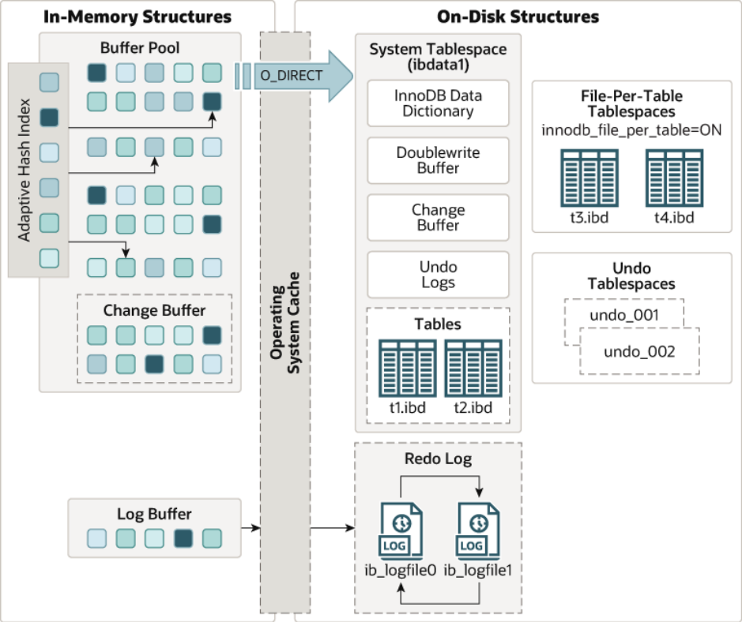
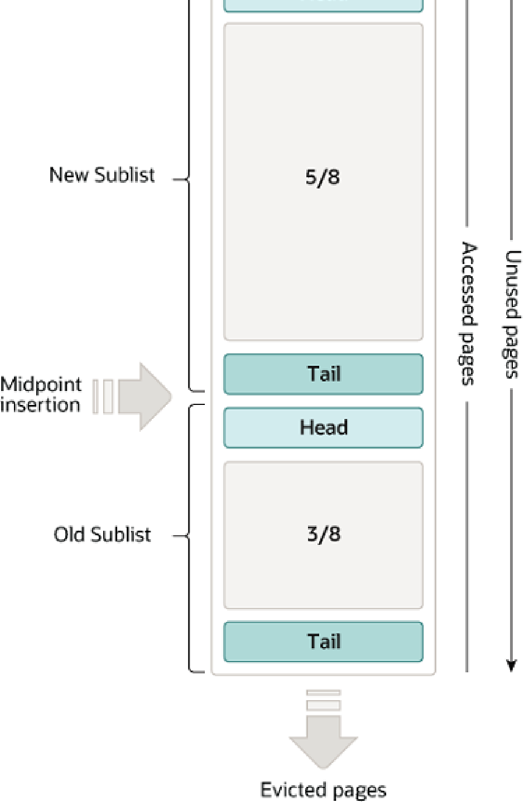
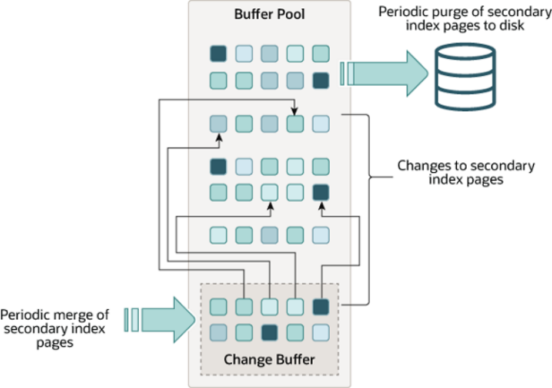
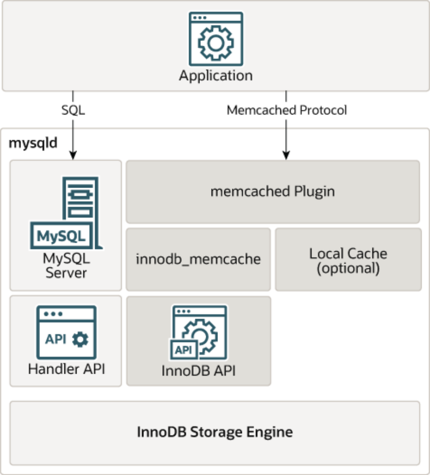

## Table of Contents

14.1 Introduction to InnoDB ........................................................................................................... 1983

14.1.1 Benefits of Using InnoDB Tables ................................................................................ 1984

14.1.2 Best Practices for InnoDB Tables ............................................................................... 1985

14.1.3 Checking InnoDB Availability ...................................................................................... 1986

14.1.4 Testing and Benchmarking with InnoDB ...................................................................... 1986

14.1.5 Turning Off InnoDB .................................................................................................... 1987

14.2 InnoDB and the ACID Model ................................................................................................. 1988

14.3 InnoDB Multi-Versioning ........................................................................................................ 1989

14.4 InnoDB Architecture .............................................................................................................. 1990

14.5 InnoDB In-Memory Structures ................................................................................................ 1991

14.5.1 Buffer Pool ................................................................................................................. 1991

14.5.2 Change Buffer ............................................................................................................ 1997

14.5.3 Adaptive Hash Index .................................................................................................. 2001

14.5.4 Log Buffer .................................................................................................................. 2002

14.6 InnoDB On-Disk Structures .................................................................................................... 2002

14.6.1 Tables ....................................................................................................................... 2002

14.6.2 Indexes ...................................................................................................................... 2022

14.6.3 Tablespaces ............................................................................................................... 2028

14.6.4 InnoDB Data Dictionary .............................................................................................. 2035

14.6.5 Doublewrite Buffer ...................................................................................................... 2035

14.6.6 Redo Log ................................................................................................................... 2035

14.6.7 Undo Logs ................................................................................................................. 2036

14.7 InnoDB Locking and Transaction Model ................................................................................. 2037

14.7.1 InnoDB Locking .......................................................................................................... 2038

14.7.2 InnoDB Transaction Model .......................................................................................... 2042

14.7.3 Locks Set by Different SQL Statements in InnoDB ....................................................... 2050

14.7.4 Phantom Rows ........................................................................................................... 2053

14.7.5 Deadlocks in InnoDB .................................................................................................. 2054

14.8 InnoDB Configuration ............................................................................................................ 2057

14.8.1 InnoDB Startup Configuration ...................................................................................... 2057

14.8.2 Configuring InnoDB for Read-Only Operation ............................................................... 2062

14.8.3 InnoDB Buffer Pool Configuration ................................................................................ 2063

14.8.4 Configuring the Memory Allocator for InnoDB .............................................................. 2070

14.8.5 Configuring Thread Concurrency for InnoDB ................................................................ 2070

14.8.6 Configuring the Number of Background InnoDB I/O Threads ........................................ 2072

14.8.7 Using Asynchronous I/O on Linux ............................................................................... 2072

14.8.8 Configuring InnoDB I/O Capacity ................................................................................ 2073

14.8.9 Configuring Spin Lock Polling ..................................................................................... 2074

14.8.10 Purge Configuration .................................................................................................. 2075

14.8.11 Configuring Optimizer Statistics for InnoDB ................................................................ 2076

14.8.12 Configuring the Merge Threshold for Index Pages ...................................................... 2088

14.9 InnoDB Table Compression ................................................................................................... 2090

14.9.1 Overview of Table Compression ................................................................................. 2090

14.9.2 Enabling Compression for a Table .............................................................................. 2091

14.9.3 Tuning Compression for InnoDB Tables ...................................................................... 2092

14.9.4 Monitoring InnoDB Table Compression at Runtime ...................................................... 2096

14.9.5 How Compression Works for InnoDB Tables ............................................................... 2097

14.9.6 Compression for OLTP Workloads .............................................................................. 2100

14.9.7 SQL Compression Syntax Warnings and Errors ........................................................... 2101

14.10 InnoDB File-Format Management ......................................................................................... 2103

14.10.1 Enabling File Formats ............................................................................................... 2104

14.10.2 Verifying File Format Compatibility ............................................................................ 2104

14.10.3 Identifying the File Format in Use .............................................................................. 2107

14.10.4 Modifying the File Format ......................................................................................... 2108

14.11 InnoDB Row Formats .......................................................................................................... 2108

14.12 InnoDB Disk I/O and File Space Management ...................................................................... 2114

14.12.1 InnoDB Disk I/O ....................................................................................................... 2114

14.12.2 File Space Management ........................................................................................... 2115

14.12.3 InnoDB Checkpoints ................................................................................................. 2116

14.12.4 Defragmenting a Table ............................................................................................. 2116

14.12.5 Reclaiming Disk Space with TRUNCATE TABLE ....................................................... 2117

14.13 InnoDB and Online DDL ...................................................................................................... 2117

14.13.1 Online DDL Operations ............................................................................................. 2118

14.13.2 Online DDL Performance and Concurrency ............................................................... 2127

14.13.3 Online DDL Space Requirements .............................................................................. 2130

14.13.4 Simplifying DDL Statements with Online DDL ............................................................ 2131

14.13.5 Online DDL Failure Conditions .................................................................................. 2131

14.13.6 Online DDL Limitations ............................................................................................. 2132

14.14 InnoDB Startup Options and System Variables ..................................................................... 2133

14.15 InnoDB INFORMATION_SCHEMA Tables ............................................................................ 2205

14.15.1 InnoDB INFORMATION_SCHEMA Tables about Compression ................................... 2206

14.15.2 InnoDB INFORMATION_SCHEMA Transaction and Locking Information ..................... 2207

14.15.3 InnoDB INFORMATION_SCHEMA System Tables ..................................................... 2213

14.15.4 InnoDB INFORMATION_SCHEMA FULLTEXT Index Tables ...................................... 2219

14.15.5 InnoDB INFORMATION_SCHEMA Buffer Pool Tables ............................................... 2222

14.15.6 InnoDB INFORMATION_SCHEMA Metrics Table ....................................................... 2226

14.16 InnoDB Integration with MySQL Performance Schema .......................................................... 2235

14.16.1 Monitoring InnoDB Mutex Waits Using Performance Schema ...................................... 2236

14.17 InnoDB Monitors ................................................................................................................. 2240

14.17.1 InnoDB Monitor Types .............................................................................................. 2240

14.17.2 Enabling InnoDB Monitors ........................................................................................ 2241

14.17.3 InnoDB Standard Monitor and Lock Monitor Output .................................................... 2244

14.17.4 InnoDB Tablespace Monitor Output ........................................................................... 2249

14.17.5 InnoDB Table Monitor Output .................................................................................... 2251

14.18 InnoDB Backup and Recovery ............................................................................................. 2255

14.18.1 InnoDB Backup ........................................................................................................ 2255

14.18.2 InnoDB Recovery ..................................................................................................... 2256

14.19 InnoDB and MySQL Replication ........................................................................................... 2258

14.20 InnoDB memcached Plugin .................................................................................................. 2260

14.20.1 Benefits of the InnoDB memcached Plugin ................................................................ 2260

14.20.2 InnoDB memcached Architecture .............................................................................. 2261

14.20.3 Setting Up the InnoDB memcached Plugin ................................................................ 2265

14.20.4 Security Considerations for the InnoDB memcached Plugin ........................................ 2271

14.20.5 Writing Applications for the InnoDB memcached Plugin .............................................. 2273

14.20.6 The InnoDB memcached Plugin and Replication ........................................................ 2285

14.20.7 InnoDB memcached Plugin Internals ......................................................................... 2289

14.20.8 Troubleshooting the InnoDB memcached Plugin ........................................................ 2294

14.21 InnoDB Troubleshooting ...................................................................................................... 2296

14.21.1 Troubleshooting InnoDB I/O Problems ....................................................................... 2296

14.21.2 Forcing InnoDB Recovery ......................................................................................... 2297

14.21.3 Troubleshooting InnoDB Data Dictionary Operations .................................................. 2298

14.21.4 InnoDB Error Handling .............................................................................................. 2302 Introduction to InnoDB

14.22 InnoDB Limits ..................................................................................................................... 2303

14.23 InnoDB Restrictions and Limitations ..................................................................................... 2304

## 14.1 Introduction to InnoDB

`InnoDB` is a general-purpose storage engine that balances high reliability and high performance. In MySQL 5.6, `InnoDB` is the default MySQL storage engine. Unless you have configured a different default storage engine, issuing a `CREATE TABLE` statement without an `ENGINE` clause creates an `InnoDB` table.

`InnoDB` includes all the features that were part of the InnoDB Plugin for MySQL 5.1, plus new features specific to MySQL 5.5 and higher.

Note The `mysql` and `INFORMATION_SCHEMA` databases that implement some of the MySQL internals still use `MyISAM`. In particular, you cannot switch the grant tables to use `InnoDB`.

> Key Advantages of InnoDB

- Its DML operations follow the ACID model, with transactions featuring commit, rollback, and crash-

recovery capabilities to protect user data. See Section 14.2, “InnoDB and the ACID Model”.

- Row-level locking and Oracle-style consistent reads increase multi-user concurrency and performance.

See Section 14.7, “InnoDB Locking and Transaction Model”.

- `InnoDB` tables arrange your data on disk to optimize queries based on primary keys. Each `InnoDB` table

has a primary key index called the clustered index that organizes the data to minimize I/O for primary key lookups. See Section 14.6.2.1, “Clustered and Secondary Indexes”.

- To maintain data integrity, `InnoDB` supports `FOREIGN KEY` constraints. With foreign keys, inserts,

updates, and deletes are checked to ensure they do not result in inconsistencies across related tables.

See Section 13.1.17.5, “FOREIGN KEY Constraints”.

Table 14.1 InnoDB Storage Engine Features Feature Support B-tree indexes Yes Backup/point-in-time recovery (Implemented in Yes the server, rather than in the storage engine.)Cluster database support No Clustered indexes Yes Compressed data Yes Data caches Yes Encrypted data Yes (Implemented in the server via encryption functions; In MySQL 5.7 and later, data-at-rest encryption is supported.)Foreign key support Yes Full-text search indexes Yes (Support for FULLTEXT indexes is available in MySQL 5.6 and later.)Geospatial data type support Yes InnoDB Enhancements and New Features Feature Support Geospatial indexing support Yes (Support for geospatial indexing is available in MySQL 5.7 and later.)Hash indexes No (InnoDB utilizes hash indexes internally for its Adaptive Hash Index feature.)Index caches Yes Locking granularity Row MVCC Yes Replication support (Implemented in the server, Yes rather than in the storage engine.)Storage limits 64TB T-tree indexes No Transactions Yes Update statistics for data dictionary Yes To compare the features of `InnoDB` with other storage engines provided with MySQL, see the Storage Engine Features table in Chapter 15, Alternative Storage Engines.

> InnoDB Enhancements and New Features

For information about `InnoDB` enhancements and new features, refer to:

- The `InnoDB` enhancements list in Section 1.3, “What Is New in MySQL 5.6”.
- The Release Notes.

> Additional InnoDB Information and Resources

- For `InnoDB`-related terms and definitions, see the MySQL Glossary.
- For a forum dedicated to the `InnoDB` storage engine, see MySQL Forums::InnoDB.
- `InnoDB` is published under the same GNU GPL License Version 2 (of June 1991) as MySQL. For more

information on MySQL licensing, see http://www.mysql.com/company/legal/licensing/.

### 14.1.1 Benefits of Using InnoDB Tables

`InnoDB` tables have the following benefits:

- If the server unexpectedly exits because of a hardware or software issue, regardless of what was

happening in the database at the time, you don't need to do anything special after restarting the database. `InnoDB` crash recovery automatically finalizes changes that were committed before the time of the crash, and undoes changes that were in process but not committed, permitting you to restart and continue from where you left off. See Section 14.18.2, “InnoDB Recovery”.

- The `InnoDB` storage engine maintains its own buffer pool that caches table and index data in main

memory as data is accessed. Frequently used data is processed directly from memory. This cache applies to many types of information and speeds up processing. On dedicated database servers, up to 80% of physical memory is often assigned to the buffer pool. See Section 14.5.1, “Buffer Pool”.

- If you split up related data into different tables, you can set up foreign keys that enforce referential

integrity. See Section 13.1.17.5, “FOREIGN KEY Constraints”.

Best Practices for InnoDB Tables

- If data becomes corrupted on disk or in memory, a checksum mechanism alerts you to the bogus data

before you use it. The `innodb_checksum_algorithm` variable defines the checksum algorithm used by `InnoDB`.

- When you design a database with appropriate primary key columns for each table, operations involving

those columns are automatically optimized. It is very fast to reference the primary key columns in `WHERE`clauses, `ORDER BY` clauses, `GROUP BY` clauses, and join operations. See Section 14.6.2.1, “Clustered and Secondary Indexes”.

- Inserts, updates, and deletes are optimized by an automatic mechanism called change buffering.

`InnoDB` not only allows concurrent read and write access to the same table, it caches changed data to streamline disk I/O. See Section 14.5.2, “Change Buffer”.

- Performance benefits are not limited to large tables with long-running queries. When the same rows are

accessed over and over from a table, the Adaptive Hash Index takes over to make these lookups even faster, as if they came out of a hash table. See Section 14.5.3, “Adaptive Hash Index”.

- You can compress tables and associated indexes. See Section 14.9, “InnoDB Table Compression”.
- You can create and drop indexes and perform other DDL operations with much less impact on

performance and availability. See Section 14.13.1, “Online DDL Operations”.

- Truncating a file-per-table tablespace is very fast and can free up disk space for the operating system to

reuse rather than only `InnoDB`. See Section 14.6.3.2, “File-Per-Table Tablespaces”.

- The storage layout for table data is more efficient for `BLOB` and long text fields, with the `DYNAMIC` row

format. See Section 14.11, “InnoDB Row Formats”.

- You can monitor the internal workings of the storage engine by querying `INFORMATION_SCHEMA` tables.

See Section 14.15, “InnoDB INFORMATION_SCHEMA Tables”.

- You can monitor the performance details of the storage engine by querying Performance Schema tables.

See Section 14.16, “InnoDB Integration with MySQL Performance Schema”.

- You can mix `InnoDB` tables with tables from other MySQL storage engines, even within the same

statement. For example, you can use a join operation to combine data from `InnoDB` and `MEMORY` tables in a single query.

- `InnoDB` has been designed for CPU efficiency and maximum performance when processing large data

volumes.

- `InnoDB` tables can handle large quantities of data, even on operating systems where file size is limited

to 2GB.

For `InnoDB`-specific tuning techniques you can apply to your MySQL server and application code, see Section 8.5, “Optimizing for InnoDB Tables”.

### 14.1.2 Best Practices for InnoDB Tables

This section describes best practices when using `InnoDB` tables.

- Specify a primary key for every table using the most frequently queried column or columns, or an auto-

increment value if there is no obvious primary key.

- Use joins wherever data is pulled from multiple tables based on identical ID values from those tables.

For fast join performance, define foreign keys on the join columns, and declare those columns with the same data type in each table. Adding foreign keys ensures that referenced columns are indexed, which Checking InnoDB Availability can improve performance. Foreign keys also propagate deletes and updates to all affected tables, and prevent insertion of data in a child table if the corresponding IDs are not present in the parent table.

- Turn off autocommit. Committing hundreds of times a second puts a cap on performance (limited by the

write speed of your storage device).

- Group sets of related DML operations into transactions by bracketing them with `START TRANSACTION`

and `COMMIT` statements. While you don't want to commit too often, you also don't want to issue huge batches of `INSERT`, `UPDATE`, or `DELETE` statements that run for hours without committing.

- Do not use `LOCK TABLES` statements. `InnoDB` can handle multiple sessions all reading and writing to

the same table at once without sacrificing reliability or high performance. To get exclusive write access to a set of rows, use the `SELECT ... FOR UPDATE` syntax to lock just the rows you intend to update.

- Enable the `innodb_file_per_table` variable to put the data and indexes for individual tables into

separate files instead of the system tablespace. This setting is required to use other features, such as table compression. The `innodb_file_per_table` variable is enabled by default.

- Evaluate whether your data and access patterns benefit from the `InnoDB` table compression feature.

You can compress `InnoDB` tables without sacrificing read/write capability.

- Run the server with the `--sql_mode=NO_ENGINE_SUBSTITUTION` option to prevent tables from being

created with storage engines that you do not want to use.

### 14.1.3 Checking InnoDB Availability

To determine whether your server supports `InnoDB`:

- Issue the `SHOW ENGINES` statement to view the available MySQL storage engines.

```
mysql> SHOW ENGINES;
```

Alternatively, query the Information Schema `ENGINES` table.

```
mysql> SELECT * FROM INFORMATION_SCHEMA.ENGINES;
```

(Now that `InnoDB` is the default MySQL storage engine, only very specialized environments might not support it.)

- If `InnoDB` is not present, you have a `mysqld` binary that was compiled without `InnoDB` support and you

need to get a different one.

- If `InnoDB` is present but disabled, go back through your startup options and configuration file and get rid

of any `--skip-innodb` option.

### 14.1.4 Testing and Benchmarking with InnoDB

If `InnoDB` is not the default storage engine, you can determine if your database server and applications work correctly with `InnoDB` by restarting the server with `--default-storage-engine=InnoDB` on the command line or with `default-storage-engine=innodb` defined in the `[mysqld]` section of the MySQL server option file.

Since changing the default storage engine only affects newly created tables, run your application installation and setup steps to confirm that everything installs properly, then exercise the application features to make sure the data loading, editing, and querying features work. If a table relies on a feature that is specific to another storage engine, you receive an error. In this case, add the`ENGINE=other_engine_name` clause to the `CREATE TABLE` statement to avoid the error.

Turning Off InnoDB If you did not make a deliberate decision about the storage engine, and you want to preview how certain tables work when created using `InnoDB`, issue the command `ALTER TABLE table_name``ENGINE=InnoDB;` for each table. Alternatively, to run test queries and other statements without disturbing the original table, make a copy:

```
CREATE TABLE ... ENGINE=InnoDB AS SELECT * FROM other_engine_table;
```

To assess performance with a full application under a realistic workload, install the latest MySQL server and run benchmarks.

Test the full application lifecycle, from installation, through heavy usage, and server restart. Kill the server process while the database is busy to simulate a power failure, and verify that the data is recovered successfully when you restart the server.

Test any replication configurations, especially if you use different MySQL versions and options on the source server and replicas.

### 14.1.5 Turning Off InnoDB

Oracle recommends `InnoDB` as the preferred storage engine for typical database applications, from single-user wikis and blogs running on a local system, to high-end applications pushing the limits of performance.

In MySQL 5.6, `InnoDB` is the default storage engine for new tables.

If you do not want to use `InnoDB` tables:

- Start the server with the `--innodb=OFF` or `--skip-innodb` option to disable the `InnoDB` storage

engine.

Note As of MySQL 5.6.21, the `--skip-innodb` option still works but it is deprecated and returns a warning when used. Expect it to be removed in a future MySQL release. This also applies to its synonyms (`--innodb=OFF`, `--disable-``innodb`, and so forth).

- Because the default storage engine is `InnoDB`, the server cannot start unless you also use `--`

`default-storage-engine` and `--default-tmp-storage-engine` to set the default to some other engine for both permanent and `TEMPORARY` tables.

- To prevent the server from crashing when the `InnoDB`-related `information_schema` tables are

queried, also disable the plugins associated with those tables. Specify in the `[mysqld]` section of the MySQL configuration file:

```
loose-innodb-trx=0
loose-innodb-locks=0
loose-innodb-lock-waits=0
loose-innodb-cmp=0
loose-innodb-cmp-per-index=0
loose-innodb-cmp-per-index-reset=0
loose-innodb-cmp-reset=0
loose-innodb-cmpmem=0
loose-innodb-cmpmem-reset=0
loose-innodb-buffer-page=0
loose-innodb-buffer-page-lru=0
loose-innodb-buffer-pool-stats=0
loose-innodb-metrics=0
loose-innodb-ft-default-stopword=0
loose-innodb-ft-inserted=0
loose-innodb-ft-deleted=0
loose-innodb-ft-being-deleted=0
```

InnoDB and the ACID Model

```
loose-innodb-ft-config=0
loose-innodb-ft-index-cache=0
loose-innodb-ft-index-table=0
loose-innodb-sys-tables=0
loose-innodb-sys-tablestats=0
loose-innodb-sys-indexes=0
loose-innodb-sys-columns=0
loose-innodb-sys-fields=0
loose-innodb-sys-foreign=0
loose-innodb-sys-foreign-cols=0
```

## 14.2 InnoDB and the ACID Model

The ACID model is a set of database design principles that emphasize aspects of reliability that are important for business data and mission-critical applications. MySQL includes components such as the`InnoDB` storage engine that adhere closely to the ACID model so that data is not corrupted and results are not distorted by exceptional conditions such as software crashes and hardware malfunctions. When you rely on ACID-compliant features, you do not need to reinvent the wheel of consistency checking and crash recovery mechanisms. In cases where you have additional software safeguards, ultra-reliable hardware,or an application that can tolerate a small amount of data loss or inconsistency, you can adjust MySQL settings to trade some of the ACID reliability for greater performance or throughput.

The following sections discuss how MySQL features, in particular the `InnoDB` storage engine, interact with the categories of the ACID model:

- A: atomicity.
- C: consistency.
- I:: isolation.
- D: durability.

> Atomicity

The atomicity aspect of the ACID model mainly involves `InnoDB` transactions. Related MySQL features include:

- The `autocommit` setting.
- The `COMMIT` statement.
- The `ROLLBACK` statement.

> Consistency

The consistency aspect of the ACID model mainly involves internal `InnoDB` processing to protect data from crashes. Related MySQL features include:

- The `InnoDB` doublewrite buffer. See Section 14.6.5, “Doublewrite Buffer”.
- `InnoDB` crash recovery. See InnoDB Crash Recovery.

> Isolation

The isolation aspect of the ACID model mainly involves `InnoDB` transactions, in particular the isolation level that applies to each transaction. Related MySQL features include:

- The `autocommit` setting.

Durability

- Transaction isolation levels and the `SET TRANSACTION` statement. See Section 14.7.2.1, “Transaction

Isolation Levels”.

- The low-level details of `InnoDB` locking. Details can be viewed in the `INFORMATION_SCHEMA` tables.

See Section 14.15.2, “InnoDB INFORMATION_SCHEMA Transaction and Locking Information”.

> Durability

The durability aspect of the ACID model involves MySQL software features interacting with your particular hardware configuration. Because of the many possibilities depending on the capabilities of your CPU,network, and storage devices, this aspect is the most complicated to provide concrete guidelines for. (And those guidelines might take the form of “buy new hardware”.) Related MySQL features include:

- The `InnoDB` doublewrite buffer. See Section 14.6.5, “Doublewrite Buffer”.
- The `innodb_flush_log_at_trx_commit` variable.
- The `sync_binlog` variable.
- The `innodb_file_per_table` variable.
- The write buffer in a storage device, such as a disk drive, SSD, or RAID array.
- A battery-backed cache in a storage device.
- The operating system used to run MySQL, in particular its support for the `fsync()` system call.
- An uninterruptible power supply (UPS) protecting the electrical power to all computer servers and

storage devices that run MySQL servers and store MySQL data.

- Your backup strategy, such as frequency and types of backups, and backup retention periods.
- For distributed or hosted data applications, the particular characteristics of the data centers where the

hardware for the MySQL servers is located, and network connections between the data centers.

## 14.3 InnoDB Multi-Versioning

`InnoDB` is a multi-version storage engine. It keeps information about old versions of changed rows to support transactional features such as concurrency and rollback. This information is stored in the system tablespace or undo tablespaces in a data structure called a rollback segment. See Section 14.6.3.3,“Undo Tablespaces”. `InnoDB` uses the information in the rollback segment to perform the undo operations needed in a transaction rollback. It also uses the information to build earlier versions of a row for a consistent read. See Section 14.7.2.3, “Consistent Nonlocking Reads”.

Internally, `InnoDB` adds three fields to each row stored in the database:

- A 6-byte `DB_TRX_ID` field indicates the transaction identifier for the last transaction that inserted or

updated the row. Also, a deletion is treated internally as an update where a special bit in the row is set to mark it as deleted.

- A 7-byte `DB_ROLL_PTR` field called the roll pointer. The roll pointer points to an undo log record written

to the rollback segment. If the row was updated, the undo log record contains the information necessary to rebuild the content of the row before it was updated.

- A 6-byte `DB_ROW_ID` field contains a row ID that increases monotonically as new rows are inserted. If

`InnoDB` generates a clustered index automatically, the index contains row ID values. Otherwise, the`DB_ROW_ID` column does not appear in any index.

Multi-Versioning and Secondary Indexes Undo logs in the rollback segment are divided into insert and update undo logs. Insert undo logs are needed only in transaction rollback and can be discarded as soon as the transaction commits. Update undo logs are used also in consistent reads, but they can be discarded only after there is no transaction present for which `InnoDB` has assigned a snapshot that in a consistent read could require the information in the update undo log to build an earlier version of a database row. For additional information about undo logs, see Section 14.6.7, “Undo Logs”.

It is recommend that you commit transactions regularly, including transactions that issue only consistent reads. Otherwise, `InnoDB` cannot discard data from the update undo logs, and the rollback segment may grow too big, filling up the tablespace in which it resides. For information about managing undo tablespaces, see Section 14.6.3.3, “Undo Tablespaces”.

The physical size of an undo log record in the rollback segment is typically smaller than the corresponding inserted or updated row. You can use this information to calculate the space needed for your rollback segment.

In the `InnoDB` multi-versioning scheme, a row is not physically removed from the database immediately when you delete it with an SQL statement. `InnoDB` only physically removes the corresponding row and its index records when it discards the update undo log record written for the deletion. This removal operation is called a purge, and it is quite fast, usually taking the same order of time as the SQL statement that did the deletion.

If you insert and delete rows in smallish batches at about the same rate in the table, the purge thread can start to lag behind and the table can grow bigger and bigger because of all the “dead” rows, making everything disk-bound and very slow. In such cases, throttle new row operations, and allocate more resources to the purge thread by tuning the `innodb_max_purge_lag` system variable. For more information, see Section 14.8.10, “Purge Configuration”.

> Multi-Versioning and Secondary Indexes

`InnoDB` multiversion concurrency control (MVCC) treats secondary indexes differently than clustered indexes. Records in a clustered index are updated in-place, and their hidden system columns point undo log entries from which earlier versions of records can be reconstructed. Unlike clustered index records,secondary index records do not contain hidden system columns nor are they updated in-place.

When a secondary index column is updated, old secondary index records are delete-marked, new records are inserted, and delete-marked records are eventually purged. When a secondary index record is delete-marked or the secondary index page is updated by a newer transaction, `InnoDB` looks up the database record in the clustered index. In the clustered index, the record's `DB_TRX_ID` is checked, and the correct version of the record is retrieved from the undo log if the record was modified after the reading transaction was initiated.

If a secondary index record is marked for deletion or the secondary index page is updated by a newer transaction, the covering index technique is not used. Instead of returning values from the index structure,`InnoDB` looks up the record in the clustered index.

However, if the index condition pushdown (ICP) optimization is enabled, and parts of the `WHERE` condition can be evaluated using only fields from the index, the MySQL server still pushes this part of the `WHERE`condition down to the storage engine where it is evaluated using the index. If no matching records are found, the clustered index lookup is avoided. If matching records are found, even among delete-marked records, `InnoDB` looks up the record in the clustered index.

## 14.4 InnoDB Architecture

InnoDB In-Memory Structures The following diagram shows in-memory and on-disk structures that comprise the `InnoDB` storage engine architecture. For information about each structure, see Section 14.5, “InnoDB In-Memory Structures”, and Section 14.6, “InnoDB On-Disk Structures”.

> Figure 14.1 InnoDB Architecture



## 14.5 InnoDB In-Memory Structures

This section describes `InnoDB` in-memory structures and related topics.

### 14.5.1 Buffer Pool

The buffer pool is an area in main memory where `InnoDB` caches table and index data as it is accessed.

The buffer pool permits frequently used data to be accessed directly from memory, which speeds up processing. On dedicated servers, up to 80% of physical memory is often assigned to the buffer pool.

For efficiency of high-volume read operations, the buffer pool is divided into pages that can potentially hold multiple rows. For efficiency of cache management, the buffer pool is implemented as a linked list of pages; data that is rarely used is aged out of the cache using a variation of the least recently used (LRU)algorithm.

Buffer Pool Knowing how to take advantage of the buffer pool to keep frequently accessed data in memory is an important aspect of MySQL tuning.

> Buffer Pool LRU Algorithm

The buffer pool is managed as a list using a variation of the LRU algorithm. When room is needed to add a new page to the buffer pool, the least recently used page is evicted and a new page is added to the middle of the list. This midpoint insertion strategy treats the list as two sublists:

- At the head, a sublist of new (“young”) pages that were accessed recently
- At the tail, a sublist of old pages that were accessed less recently



Buffer Pool Figure 14.2 Buffer Pool List Buffer Pool The algorithm keeps frequently used pages in the new sublist. The old sublist contains less frequently used pages; these pages are candidates for eviction.

By default, the algorithm operates as follows:

- 3/8 of the buffer pool is devoted to the old sublist.
- The midpoint of the list is the boundary where the tail of the new sublist meets the head of the old sublist.
- When `InnoDB` reads a page into the buffer pool, it initially inserts it at the midpoint (the head of the old

sublist). A page can be read because it is required for a user-initiated operation such as an SQL query,or as part of a read-ahead operation performed automatically by `InnoDB`.

- Accessing a page in the old sublist makes it “young”, moving it to the head of the new sublist. If the page

was read because it was required by a user-initiated operation, the first access occurs immediately and the page is made young. If the page was read due to a read-ahead operation, the first access does not occur immediately and might not occur at all before the page is evicted.

- As the database operates, pages in the buffer pool that are not accessed “age” by moving toward the tail

of the list. Pages in both the new and old sublists age as other pages are made new. Pages in the old sublist also age as pages are inserted at the midpoint. Eventually, a page that remains unused reaches the tail of the old sublist and is evicted.

By default, pages read by queries are immediately moved into the new sublist, meaning they stay in the buffer pool longer. A table scan, performed for a `mysqldump` operation or a `SELECT` statement with no`WHERE` clause, for example, can bring a large amount of data into the buffer pool and evict an equivalent amount of older data, even if the new data is never used again. Similarly, pages that are loaded by the read-ahead background thread and accessed only once are moved to the head of the new list. These situations can push frequently used pages to the old sublist where they become subject to eviction. For information about optimizing this behavior, see Section 14.8.3.2, “Making the Buffer Pool Scan Resistant”,and Section 14.8.3.3, “Configuring InnoDB Buffer Pool Prefetching (Read-Ahead)”.

`InnoDB` Standard Monitor output contains several fields in the `BUFFER POOL AND MEMORY` section regarding operation of the buffer pool LRU algorithm. For details, see Monitoring the Buffer Pool Using the InnoDB Standard Monitor.

> Buffer Pool Configuration

You can configure the various aspects of the buffer pool to improve performance.

- Ideally, you set the size of the buffer pool to as large a value as practical, leaving enough memory

for other processes on the server to run without excessive paging. The larger the buffer pool,the more `InnoDB` acts like an in-memory database, reading data from disk once and then accessing the data from memory during subsequent reads. Buffer pool size is configured using the`innodb_buffer_pool_size` configuration option.

- On 64-bit systems with sufficient memory, you can split the buffer pool into multiple parts to minimize

contention for memory structures among concurrent operations. For details, see Section 14.8.3.1,“Configuring Multiple Buffer Pool Instances”.

- You can keep frequently accessed data in memory regardless of sudden spikes of activity from

operations that would bring large amounts of infrequently accessed data into the buffer pool. For details,see Section 14.8.3.2, “Making the Buffer Pool Scan Resistant”.

- You can control how and when to perform read-ahead requests to prefetch pages into the buffer pool

asynchronously in anticipation that the pages may be needed soon. For details, see Section 14.8.3.3,“Configuring InnoDB Buffer Pool Prefetching (Read-Ahead)”.

Buffer Pool

- You can control when background flushing occurs and whether or not the rate of flushing is dynamically

adjusted based on workload. For details, see Section 14.8.3.4, “Configuring Buffer Pool Flushing”.

- You can configure how `InnoDB` preserves the current buffer pool state to avoid a lengthy warmup period

after a server restart. For details, see Section 14.8.3.5, “Saving and Restoring the Buffer Pool State”.

> Monitoring the Buffer Pool Using the InnoDB Standard Monitor

`InnoDB` Standard Monitor output, which can be accessed using `SHOW ENGINE INNODB STATUS`,provides metrics regarding operation of the buffer pool. Buffer pool metrics are located in the `BUFFER``POOL AND MEMORY` section of `InnoDB` Standard Monitor output:

```
----------------------
BUFFER POOL AND MEMORY
----------------------
Total memory allocated 2197815296; in additional pool allocated 0
Dictionary memory allocated 155455
Buffer pool size   131071
Free buffers       92158
Database pages     38770
Old database pages 14271
Modified db pages  619
Pending reads 0
Pending writes: LRU 0, flush list 0, single page 0
Pages made young 4, not young 0
0.00 youngs/s, 0.00 non-youngs/s
Pages read 322, created 38448, written 42083
0.00 reads/s, 222.30 creates/s, 159.47 writes/s
Buffer pool hit rate 1000 / 1000, young-making rate 0 / 1000 not 0 / 1000
Pages read ahead 0.00/s, evicted without access 0.00/s, Random read ahead
0.00/s
LRU len: 38770, unzip_LRU len: 0
I/O sum[0]:cur[0], unzip sum[0]:cur[0]
```

The following table describes buffer pool metrics reported by the `InnoDB` Standard Monitor.

Per second averages provided in `InnoDB` Standard Monitor output are based on the elapsed time since`InnoDB` Standard Monitor output was last printed.

Table 14.2 InnoDB Buffer Pool Metrics Name Description Total memory allocated The total memory allocated for the buffer pool in bytes.

additional pool allocated The total memory allocated for the additional pool in bytes.

Dictionary memory allocated The total memory allocated for the `InnoDB` data dictionary in bytes.

Buffer pool size The total size in pages allocated to the buffer pool.

Free buffers The total size in pages of the buffer pool free list.

Database pages The total size in pages of the buffer pool LRU list.

Old database pages The total size in pages of the buffer pool old LRU sublist.

Modified db pages The current number of pages modified in the buffer pool.

Pending reads The number of buffer pool pages waiting to be read into the buffer pool.

Buffer Pool Name Description Pending writes LRU The number of old dirty pages within the buffer pool to be written from the bottom of the LRU list.

Pending writes flush list The number of buffer pool pages to be flushed during checkpointing.

Pending writes single page The number of pending independent page writes within the buffer pool.

Pages made young The total number of pages made young in the buffer pool LRU list (moved to the head of sublist of “new”pages).

Pages made not young The total number of pages not made young in the buffer pool LRU list (pages that have remained in the “old” sublist without being made young).

youngs/s The per second average of accesses to old pages in the buffer pool LRU list that have resulted in making pages young. See the notes that follow this table for more information.

non-youngs/s The per second average of accesses to old pages in the buffer pool LRU list that have resulted in not making pages young. See the notes that follow this table for more information.

Pages read The total number of pages read from the buffer pool.

Pages created The total number of pages created within the buffer pool.

Pages written The total number of pages written from the buffer pool.

reads/s The per second average number of buffer pool page reads per second.

creates/s The average number of buffer pool pages created per second.

writes/s The average number of buffer pool page writes per second.

Buffer pool hit rate The buffer pool page hit rate for pages read from the buffer pool vs from disk storage.

young-making rate The average hit rate at which page accesses have resulted in making pages young. See the notes that follow this table for more information.

not (young-making rate) The average hit rate at which page accesses have not resulted in making pages young. See the notes that follow this table for more information.

Pages read ahead The per second average of read ahead operations.

Pages evicted without access The per second average of the pages evicted without being accessed from the buffer pool.

Random read ahead The per second average of random read ahead operations.

LRU len The total size in pages of the buffer pool LRU list.

Change Buffer Name Description unzip_LRU len The length (in pages) of the buffer pool unzip_LRU list.

I/O sum The total number of buffer pool LRU list pages accessed.

I/O cur The total number of buffer pool LRU list pages accessed in the current interval.

I/O unzip sum The total number of buffer pool unzip_LRU list pages decompressed.

I/O unzip cur The total number of buffer pool unzip_LRU list pages decompressed in the current interval.

> Notes:

- The `youngs/s` metric is applicable only to old pages. It is based on the number of page accesses.

There can be multiple accesses for a given page, all of which are counted. If you see very low `youngs/`s values when there are no large scans occurring, consider reducing the delay time or increasing the percentage of the buffer pool used for the old sublist. Increasing the percentage makes the old sublist larger so that it takes longer for pages in that sublist to move to the tail, which increases the likelihood that those pages are accessed again and made young. See Section 14.8.3.2, “Making the Buffer Pool Scan Resistant”.

- The `non-youngs/s` metric is applicable only to old pages. It is based on the number of page accesses.

There can be multiple accesses for a given page, all of which are counted. If you do not see a higher`non-youngs/s` value when performing large table scans (and a higher `youngs/s` value), increase the delay value. See Section 14.8.3.2, “Making the Buffer Pool Scan Resistant”.

- The `young-making` rate accounts for all buffer pool page accesses, not just accesses for pages in the

old sublist. The `young-making` rate and `not` rate do not normally add up to the overall buffer pool hit rate. Page hits in the old sublist cause pages to move to the new sublist, but page hits in the new sublist cause pages to move to the head of the list only if they are a certain distance from the head.

- `not (young-making rate)` is the average hit rate at which page accesses have not resulted in

making pages young due to the delay defined by `innodb_old_blocks_time` not being met, or due to page hits in the new sublist that did not result in pages being moved to the head. This rate accounts for all buffer pool page accesses, not just accesses for pages in the old sublist.

Buffer pool server status variables and the `INNODB_BUFFER_POOL_STATS` table provide many of the same buffer pool metrics found in `InnoDB` Standard Monitor output. For more information, see Example 14.10, “Querying the INNODB_BUFFER_POOL_STATS Table”.

### 14.5.2 Change Buffer

The change buffer is a special data structure that caches changes to secondary index pages when those pages are not in the buffer pool. The buffered changes, which may result from `INSERT`, `UPDATE`, or`DELETE` operations (DML), are merged later when the pages are loaded into the buffer pool by other read operations.

Change Buffer Figure 14.3 Change Buffer



Unlike clustered indexes, secondary indexes are usually nonunique, and inserts into secondary indexes happen in a relatively random order. Similarly, deletes and updates may affect secondary index pages that are not adjacently located in an index tree. Merging cached changes at a later time, when affected pages are read into the buffer pool by other operations, avoids substantial random access I/O that would be required to read secondary index pages into the buffer pool from disk.

Periodically, the purge operation that runs when the system is mostly idle, or during a slow shutdown,writes the updated index pages to disk. The purge operation can write disk blocks for a series of index values more efficiently than if each value were written to disk immediately.

Change buffer merging may take several hours when there are many affected rows and numerous secondary indexes to update. During this time, disk I/O is increased, which can cause a significant slowdown for disk-bound queries. Change buffer merging may also continue to occur after a transaction is committed, and even after a server shutdown and restart (see Section 14.21.2, “Forcing InnoDB Recovery”for more information).

In memory, the change buffer occupies part of the buffer pool. On disk, the change buffer is part of the system tablespace, where index changes are buffered when the database server is shut down.

The type of data cached in the change buffer is governed by the `innodb_change_buffering` variable.

For more information, see Configuring Change Buffering. You can also configure the maximum change buffer size. For more information, see Configuring the Change Buffer Maximum Size.

Change buffering is not supported for a secondary index if the index contains a descending index column or if the primary key includes a descending index column.

Change Buffer For answers to frequently asked questions about the change buffer, see Section A.16, “MySQL 5.6 FAQ:InnoDB Change Buffer”.

> Configuring Change Buffering

When `INSERT`, `UPDATE`, and `DELETE` operations are performed on a table, the values of indexed columns(particularly the values of secondary keys) are often in an unsorted order, requiring substantial I/O to bring secondary indexes up to date. The change buffer caches changes to secondary index entries when the relevant page is not in the buffer pool, thus avoiding expensive I/O operations by not immediately reading in the page from disk. The buffered changes are merged when the page is loaded into the buffer pool, and the updated page is later flushed to disk. The `InnoDB` main thread merges buffered changes when the server is nearly idle, and during a slow shutdown.

Because it can result in fewer disk reads and writes, change buffering is most valuable for workloads that are I/O-bound; for example, applications with a high volume of DML operations such as bulk inserts benefit from change buffering.

However, the change buffer occupies a part of the buffer pool, reducing the memory available to cache data pages. If the working set almost fits in the buffer pool, or if your tables have relatively few secondary indexes, it may be useful to disable change buffering. If the working data set fits entirely within the buffer pool, change buffering does not impose extra overhead, because it only applies to pages that are not in the buffer pool.

The `innodb_change_buffering` variable controls the extent to which `InnoDB` performs change buffering. You can enable or disable buffering for inserts, delete operations (when index records are initially marked for deletion) and purge operations (when index records are physically deleted). An update operation is a combination of an insert and a delete. The default `innodb_change_buffering` value is

```
all.
```

Permitted `innodb_change_buffering` values include:

```
- all
```

The default value: buffer inserts, delete-marking operations, and purges.

```
- none
```

Do not buffer any operations.

```
- inserts
```

Buffer insert operations.

```
- deletes
```

Buffer delete-marking operations.

```
- changes
```

Buffer both inserts and delete-marking operations.

```
- purges
```

Buffer physical deletion operations that happen in the background.

You can set the `innodb_change_buffering` variable in the MySQL option file (`my.cnf` or `my.ini`) or change it dynamically with the `SET GLOBAL` statement, which requires privileges sufficient to set global Change Buffer system variables. See Section 5.1.8.1, “System Variable Privileges”. Changing the setting affects the buffering of new operations; the merging of existing buffered entries is not affected.

> Configuring the Change Buffer Maximum Size

The `innodb_change_buffer_max_size` variable permits configuring the maximum size of the change buffer as a percentage of the total size of the buffer pool. By default,`innodb_change_buffer_max_size` is set to 25. The maximum setting is 50.

Consider increasing `innodb_change_buffer_max_size` on a MySQL server with heavy insert, update,and delete activity, where change buffer merging does not keep pace with new change buffer entries,causing the change buffer to reach its maximum size limit.

Consider decreasing `innodb_change_buffer_max_size` on a MySQL server with static data used for reporting, or if the change buffer consumes too much of the memory space shared with the buffer pool,causing pages to age out of the buffer pool sooner than desired.

Test different settings with a representative workload to determine an optimal configuration. The`innodb_change_buffer_max_size` variable is dynamic, which permits modifying the setting without restarting the server.

> Monitoring the Change Buffer

The following options are available for change buffer monitoring:

- `InnoDB` Standard Monitor output includes change buffer status information. To view monitor data, issue

the `SHOW ENGINE INNODB STATUS` statement.

```
mysql> SHOW ENGINE INNODB STATUS\G
```

Change buffer status information is located under the `INSERT BUFFER AND ADAPTIVE HASH INDEX`heading and appears similar to the following:

```
-------------------------------------
INSERT BUFFER AND ADAPTIVE HASH INDEX
-------------------------------------
Ibuf: size 1, free list len 0, seg size 2, 0 merges
merged operations:
insert 0, delete mark 0, delete 0
discarded operations:
insert 0, delete mark 0, delete 0
Hash table size 4425293, used cells 32, node heap has 1 buffer(s)
13577.57 hash searches/s, 202.47 non-hash searches/s
```

For more information, see Section 14.17.3, “InnoDB Standard Monitor and Lock Monitor Output”.

- The Information Schema `INNODB_METRICS` table provides most of the data points found in `InnoDB`

Standard Monitor output plus other data points. To view change buffer metrics and a description of each,issue the following query:

```
mysql> SELECT NAME, COMMENT FROM INFORMATION_SCHEMA.INNODB_METRICS WHERE NAME LIKE '%ibuf%'\G
```

For `INNODB_METRICS` table usage information, see Section 14.15.6, “InnoDB INFORMATION_SCHEMA Metrics Table”.

- The Information Schema `INNODB_BUFFER_PAGE` table provides metadata about each page in the buffer

pool, including change buffer index and change buffer bitmap pages. Change buffer pages are identified by `PAGE_TYPE`. `IBUF_INDEX` is the page type for change buffer index pages, and `IBUF_BITMAP` is the page type for change buffer bitmap pages.

Adaptive Hash Index Warning Querying the `INNODB_BUFFER_PAGE` table can introduce significant performance overhead. To avoid impacting performance, reproduce the issue you want to investigate on a test instance and run your queries on the test instance.

For example, you can query the `INNODB_BUFFER_PAGE` table to determine the approximate number of`IBUF_INDEX` and `IBUF_BITMAP` pages as a percentage of total buffer pool pages.

```
mysql> SELECT (SELECT COUNT(*) FROM INFORMATION_SCHEMA.INNODB_BUFFER_PAGE
WHERE PAGE_TYPE LIKE 'IBUF%') AS change_buffer_pages,
(SELECT COUNT(*) FROM INFORMATION_SCHEMA.INNODB_BUFFER_PAGE) AS total_pages,
(SELECT ((change_buffer_pages/total_pages)*100))
AS change_buffer_page_percentage;
+---------------------+-------------+-------------------------------+
| change_buffer_pages | total_pages | change_buffer_page_percentage |
+---------------------+-------------+-------------------------------+
|                  25 |        8192 |                        0.3052 |
+---------------------+-------------+-------------------------------+
```

For information about other data provided by the `INNODB_BUFFER_PAGE` table, see Section 21.4.2,“The INFORMATION_SCHEMA INNODB_BUFFER_PAGE Table”. For related usage information, see Section 14.15.5, “InnoDB INFORMATION_SCHEMA Buffer Pool Tables”.

- Performance Schema provides change buffer mutex wait instrumentation for advanced performance

monitoring. To view change buffer instrumentation, issue the following query:

```
mysql> SELECT * FROM performance_schema.setup_instruments
WHERE NAME LIKE '%wait/synch/mutex/innodb/ibuf%';
+-------------------------------------------------------+---------+-------+
| NAME                                                  | ENABLED | TIMED |
+-------------------------------------------------------+---------+-------+
| wait/synch/mutex/innodb/ibuf_bitmap_mutex             | YES     | YES   |
| wait/synch/mutex/innodb/ibuf_mutex                    | YES     | YES   |
| wait/synch/mutex/innodb/ibuf_pessimistic_insert_mutex | YES     | YES   |
+-------------------------------------------------------+---------+-------+
```

For information about monitoring `InnoDB` mutex waits, see Section 14.16.1, “Monitoring InnoDB Mutex Waits Using Performance Schema”.

### 14.5.3 Adaptive Hash Index

The adaptive hash index enables `InnoDB` to perform more like an in-memory database on systems with appropriate combinations of workload and sufficient memory for the buffer pool without sacrificing transactional features or reliability. The adaptive hash index is enabled by the`innodb_adaptive_hash_index` variable, or turned off at server startup by `--skip-innodb-`

```
adaptive-hash-index.
```

Based on the observed pattern of searches, a hash index is built using a prefix of the index key. The prefix can be any length, and it may be that only some values in the B-tree appear in the hash index. Hash indexes are built on demand for the pages of the index that are accessed often.

If a table fits almost entirely in main memory, a hash index speeds up queries by enabling direct lookup of any element, turning the index value into a sort of pointer. `InnoDB` has a mechanism that monitors index searches. If `InnoDB` notices that queries could benefit from building a hash index, it does so automatically.

With some workloads, the speedup from hash index lookups greatly outweighs the extra work to monitor index lookups and maintain the hash index structure. Access to the adaptive hash index can sometimes become a source of contention under heavy workloads, such as multiple concurrent joins. Queries with Log Buffer`LIKE` operators and % wildcards also tend not to benefit. For workloads that do not benefit from the adaptive hash index, turning it off reduces unnecessary performance overhead. Because it is difficult to predict in advance whether the adaptive hash index is appropriate for a particular system and workload,consider running benchmarks with it enabled and disabled.

You can monitor adaptive hash index use and contention in the `SEMAPHORES` section of `SHOW ENGINE``INNODB STATUS` output. If there are numerous threads waiting on rw-latches created in `btr0sea.c`, it might be useful to disable the adaptive hash index.

For information about the performance characteristics of hash indexes, see Section 8.3.8, “Comparison of B-Tree and Hash Indexes”.

### 14.5.4 Log Buffer

The log buffer is the memory area that holds data to be written to the log files on disk. Log buffer size is defined by the `innodb_log_buffer_size` variable. The default size is 16MB. The contents of the log buffer are periodically flushed to disk. A large log buffer enables large transactions to run without the need to write redo log data to disk before the transactions commit. Thus, if you have transactions that update,insert, or delete many rows, increasing the size of the log buffer saves disk I/O.

The `innodb_flush_log_at_trx_commit` variable controls how the contents of the log buffer are written and flushed to disk. The `innodb_flush_log_at_timeout` variable controls log flushing frequency.

For related information, see Memory Configuration, and Section 8.5.4, “Optimizing InnoDB Redo Logging”.

## 14.6 InnoDB On-Disk Structures

This section describes `InnoDB` on-disk structures and related topics.

### 14.6.1 Tables

This section covers topics related to `InnoDB` tables.

#### 14.6.1.1 Creating InnoDB Tables

`InnoDB` tables are created using the `CREATE TABLE` statement; for example:

```
CREATE TABLE t1 (a INT, b CHAR (20), PRIMARY KEY (a)) ENGINE=InnoDB;
```

The `ENGINE=InnoDB` clause is not required when `InnoDB` is defined as the default storage engine, which it is by default. However, the `ENGINE` clause is useful if the `CREATE TABLE` statement is to be replayed on a different MySQL Server instance where the default storage engine is not `InnoDB` or is unknown. You can determine the default storage engine on a MySQL Server instance by issuing the following statement:

```
mysql> SELECT @@default_storage_engine;
+--------------------------+
| @@default_storage_engine |
+--------------------------+
| InnoDB                   |
+--------------------------+
```

`InnoDB` tables are created in file-per-table tablespaces by default. To create an `InnoDB` table in the`InnoDB` system tablespace, disable the `innodb_file_per_table` variable before creating the table. For more information, see Section 14.6.3, “Tablespaces”.

.frm Files Tables MySQL stores data dictionary information for tables in .frm files in database directories. Unlike other MySQL storage engines, `InnoDB` also encodes information about the table in its own internal data dictionary inside the system tablespace. When MySQL drops a table or a database, it deletes one or more `.frm` files as well as the corresponding entries inside the `InnoDB` data dictionary. You cannot move`InnoDB` tables between databases simply by moving the `.frm` files. For information about moving `InnoDB`tables, see Section 14.6.1.4, “Moving or Copying InnoDB Tables”.

InnoDB Tables and Row Formats The row format of an `InnoDB` table determines how its rows are physically stored on disk. `InnoDB`supports four row formats, each with different storage characteristics. Supported row formats include`REDUNDANT`, `COMPACT`, `DYNAMIC`, and `COMPRESSED`. The `COMPACT` row format is the default. For information about row format characteristics, see Section 14.11, “InnoDB Row Formats”.

Although the `COMPACT` row format is fine for basic experimentation, consider using the `DYNAMIC` or`COMPRESSED` row format to take advantage of `InnoDB` features such as table compression and efficient off-page storage of long column values.

The row format of a table is defined using the `ROW_FORMAT` table option in a `CREATE TABLE` or `ALTER``TABLE` statement. See Defining the Row Format of a Table Primary Keys It is recommended that you define a primary key for each table that you create. When selecting primary key columns, choose columns with the following characteristics:

- Columns that are referenced by the most important queries.
- Columns that are never left blank.
- Columns that never have duplicate values.
- Columns that rarely if ever change value once inserted.

For example, in a table containing information about people, you would not create a primary key on`(firstname, lastname)` because more than one person can have the same name, a name column may be left blank, and sometimes people change their names. With so many constraints, often there is not an obvious set of columns to use as a primary key, so you create a new column with a numeric ID to serve as all or part of the primary key. You can declare an auto-increment column so that ascending values are filled in automatically as rows are inserted:

```
# The value of ID can act like a pointer between related items in different tables.
CREATE TABLE t5 (id INT AUTO_INCREMENT, b CHAR (20), PRIMARY KEY (id));
# The primary key can consist of more than one column. Any autoinc column must come first.
CREATE TABLE t6 (id INT AUTO_INCREMENT, a INT, b CHAR (20), PRIMARY KEY (id,a));
```

For more information about auto-increment columns, see Section 14.6.1.6, “AUTO_INCREMENT Handling in InnoDB”.

Although a table works correctly without defining a primary key, the primary key is involved with many aspects of performance and is a crucial design aspect for any large or frequently used table. It is recommended that you always specify a primary key in the `CREATE TABLE` statement. If you create the table, load data, and then run `ALTER TABLE` to add a primary key later, that operation is much slower than defining the primary key when creating the table. For more information about primary keys, see Section 14.6.2.1, “Clustered and Secondary Indexes”.

Viewing InnoDB Table Properties To view the properties of an `InnoDB` table, issue a `SHOW TABLE STATUS` statement:Tables

```
mysql> SHOW TABLE STATUS FROM test LIKE 't%' \G;
*************************** 1. row ***************************
Name: t1
Engine: InnoDB
Version: 10
Row_format: Compact
Rows: 0
Avg_row_length: 0
Data_length: 16384
Max_data_length: 0
Index_length: 0
Data_free: 0
Auto_increment: NULL
Create_time: 2015-03-16 16:26:52
Update_time: NULL
Check_time: NULL
Collation: latin1_swedish_ci
Checksum: NULL
Create_options:
Comment:
1 row in set (0.00 sec)
```

For information about `SHOW TABLE STATUS` output, see Section 13.7.5.37, “SHOW TABLE STATUS Statement”.

You can also access `InnoDB` table properties by querying the `InnoDB` Information Schema system tables:

```
mysql> SELECT * FROM INFORMATION_SCHEMA.INNODB_SYS_TABLES WHERE NAME='test/t1' \G
*************************** 1. row ***************************
TABLE_ID: 42
NAME: test/t1
FLAG: 1
N_COLS: 5
SPACE: 24
FILE_FORMAT: Antelope
ROW_FORMAT: Compact
ZIP_PAGE_SIZE: 0
1 row in set (0.02 sec)
```

For more information, see Section 14.15.3, “InnoDB INFORMATION_SCHEMA System Tables”.

#### 14.6.1.2 Creating Tables Externally

There are different reasons for creating `InnoDB` tables externally; that is, creating tables outside of the data directory. Those reasons might include space management, I/O optimization, or placing tables on a storage device with particular performance or capacity characteristics, for example.

You can create an `InnoDB` table in an external directory by specifying a `DATA DIRECTORY` clause in the`CREATE TABLE` statement.

```
CREATE TABLE t1 (c1 INT PRIMARY KEY) DATA DIRECTORY = '/external/directory';
```

The `DATA DIRECTORY` clause is supported for tables created in file-per-table tablespaces. Tables are implicitly created in file-per-table tablespaces when the `innodb_file_per_table` variable is enabled,which it is by default.

```
mysql> SELECT @@innodb_file_per_table;
+-------------------------+
| @@innodb_file_per_table |
+-------------------------+
|                       1 |
+-------------------------+
```

For more information about file-per-table tablespaces, see Section 14.6.3.2, “File-Per-Table Tablespaces”.

Tables Be sure of the directory location you choose, as the `DATA DIRECTORY` clause cannot be used with `ALTER``TABLE` to change the location later.

When you specify a `DATA DIRECTORY` clause in a `CREATE TABLE` statement, the table's data file(`table_name.ibd`) is created in a schema directory under the specified directory, and an `.isl` file(`table_name.isl`) that contains the data file path is created in the schema directory under the MySQL data directory. An `.isl` file is similar in function to a symbolic link. (Actual symbolic links are not supported for use with `InnoDB` data files.)The following example demonstrates creating a table in an external directory using the `DATA DIRECTORY`clause. It is assumed that the `innodb_file_per_table` variable is enabled.

```
mysql> USE test;
Database changed
mysql> CREATE TABLE t1 (c1 INT PRIMARY KEY) DATA DIRECTORY = '/external/directory';
# MySQL creates the table's data file in a schema directory
# under the external directory
$> cd /external/directory/test
$> ls
t1.ibd
# An .isl file that contains the data file path is created
# in the schema directory under the MySQL data directory
$> cd /path/to/mysql/data/test
$> ls
db.opt  t1.frm  t1.isl
```

> Usage Notes:

- MySQL initially holds the tablespace data file open, preventing you from dismounting the device, but

might eventually close the file if the server is busy. Be careful not to accidentally dismount an external device while MySQL is running, or start MySQL while the device is disconnected. Attempting to access a table when the associated data file is missing causes a serious error that requires a server restart.

A server restart might fail if the data file is not found at the expected path. In this case, manually remove the `.isl` file from the schema directory. After restarting, drop the table to remove the `.frm` file and the information about the table from the data dictionary.

- Before placing a table on an NFS-mounted volume, review potential issues outlined in Using NFS with

MySQL.

- If using an LVM snapshot, file copy, or other file-based mechanism to back up the table's data file,

always use the `FLUSH TABLES ... FOR EXPORT` statement first to ensure that all changes buffered in memory are flushed to disk before the backup occurs.

- Using the `DATA DIRECTORY` clause to create a table in an external directory is an alternative to using

symbolic links, which `InnoDB` does not support.

- The `DATA DIRECTORY` clause is not supported in a replication environment where the source and

replica reside on the same host. The `DATA DIRECTORY` clause requires a full directory path. Replicating the path in this case would cause the source and replica to create the table in same location.

#### 14.6.1.3 Importing InnoDB Tables

This section describes how to import tables using the Transportable Tablespaces feature, which permits importing tables that reside in file-per-table tablespaces. There are many reasons why you might want to import tables:Tables

- To run reports on a non-production MySQL server instance to avoid placing extra load on a production

server.

- To copy data to a new replica server.
- To restore a table from a backed-up tablespace file.
- As a faster way of moving data than importing a dump file, which requires reinserting data and rebuilding

indexes.

- To move a data to a server with storage media that is better suited to your storage requirements. For

example, you might move busy tables to an SSD device, or move large tables to a high-capacity HDD device.

The Transportable Tablespaces feature is described under the following topics in this section:

- Prerequisites
- Importing a Tablespace
- Limitations
- Usage Notes
- Internals

> Prerequisites

- The `innodb_file_per_table` variable must be enabled, which it is by default.
- The page size of the tablespace must match the page size of the destination MySQL server instance.

`InnoDB` page size is defined by the `innodb_page_size` variable, which is configured when initializing a MySQL server instance.

- If the table has a foreign key relationship, `foreign_key_checks` must be disabled before executing

`DISCARD TABLESPACE`. Also, you should export all foreign key related tables at the same logical point in time, as the `ALTER TABLE ... IMPORT TABLESPACE` feature does not enforce foreign key constraints on imported data. To do so, stop updating the related tables, commit all transactions, acquire shared locks on the tables, and perform the export operations.

- When importing a table from another MySQL server instance, both MySQL server instances must have

General Availability (GA) status and must be the same version. Otherwise, the table must be created on the same MySQL server instance into which it is being imported.

- If the table was created outside of the data directory by specifying the `DATA DIRECTORY` clause in the

`CREATE TABLE` statement, the table that you replace on the destination instance must be defined with the same `DATA DIRECTORY` clause. A schema mismatch error is reported if the clauses do not match.

To determine if the source table was defined with a `DATA DIRECTORY` clause, use `SHOW CREATE``TABLE` to view the table definition. For information about using the `DATA DIRECTORY` clause, see Section 14.6.1.2, “Creating Tables Externally”.

Importing a Tablespace This example demonstrates how to import a table that resides in a file-per-table tablespace.

1. On the destination instance, create a table with the same definition as the table you intend to import.

(You can obtain the table definition using `SHOW CREATE TABLE` syntax.) If the table definition does not match, a schema mismatch error is reported when you attempt the import operation.

```
mysql> USE test;
```

Tables

```
mysql> CREATE TABLE t1 (c1 INT) ENGINE=INNODB;
```

2. On the destination instance, discard the tablespace of the table that you just created. (Before importing,

you must discard the tablespace of the receiving table.)

```
mysql> ALTER TABLE t1 DISCARD TABLESPACE;
```

3. On the source instance, run `FLUSH TABLES ... FOR EXPORT` to quiesce the table you intend to

import. When a table is quiesced, only read-only transactions are permitted on the table.

```
mysql> USE test;
mysql> FLUSH TABLES t1 FOR EXPORT;
```

`FLUSH TABLES ... FOR EXPORT` ensures that changes to the named table are flushed to disk so that a binary table copy can be made while the server is running. When `FLUSH TABLES ... FOR``EXPORT` is run, `InnoDB` generates a `.cfg` metadata file in the schema directory of the table. The `.cfg`file contains metadata that is used for schema verification during the import operation.

4. Copy the `.ibd` file and `.cfg` metadata file from the source instance to the destination instance. For

example:

```
$> scp /path/to/datadir/test/t1.{ibd,cfg} destination-server:/path/to/datadir/test
```

The `.ibd` file and `.cfg` file must be copied before releasing the shared locks, as described in the next step.

5. On the source instance, use `UNLOCK TABLES` to release the locks acquired by the `FLUSH`

`TABLES ... FOR EXPORT` statement:

```
mysql> USE test;
mysql> UNLOCK TABLES;
```

6. On the destination instance, import the tablespace:

```
mysql> USE test;
mysql> ALTER TABLE t1 IMPORT TABLESPACE;
```

> Limitations

- The Transportable Tablespaces feature is only supported for tables that reside in file-per-table

tablespaces. It is not supported for the tables that reside in the system tablespace. Tables in the system tablespace cannot be quiesced.

- `DISCARD TABLESPACE` is not supported for partitioned tables, which means that importing partitioned

tables is not supported. If you run `ALTER TABLE ... DISCARD TABLESPACE` on a partitioned table,the following error is returned: `ERROR 1031 (HY000): Table storage engine for 'part'`

```
doesn't have this option.
```

- `FLUSH TABLES ... FOR EXPORT` is not supported on tables with a `FULLTEXT` index, as full-text

search auxiliary tables cannot be flushed. After importing a table with a `FULLTEXT` index, run `OPTIMIZE``TABLE` to rebuild the `FULLTEXT` indexes. Alternatively, drop `FULLTEXT` indexes before the export operation and recreate the indexes after importing the table on the destination instance.

> Usage Notes

- A `.cfg` metadata file is not required to import a table. However, metadata checks are not performed

when importing without a `.cfg` file, and a warning similar to the following is issued:

```
Message: InnoDB: IO Read error: (2, No such file or directory) Error opening '.\
test\t.cfg', will attempt to import without schema verification
```

Tables

```
1 row in set (0.00 sec)
```

Importing without a `.cfg` metadata file should only be considered if no schema mismatches are expected. The ability to import without a `.cfg` file could be useful in crash recovery scenarios where metadata is not accessible.

- On Windows, `InnoDB` stores database, tablespace, and table names internally in lowercase. To avoid

import problems on case-sensitive operating systems such as Linux and Unix, create all databases,tablespaces, and tables using lowercase names. A convenient way to accomplish this is to add`lower_case_table_names=1` to the `[mysqld]` section of your `my.cnf` or `my.ini` file before creating databases, tablespaces, or tables:

```
[mysqld]
lower_case_table_names=1
```

Internals The following information describes internals and messages written to the error log during a table import procedure.

When `ALTER TABLE ... DISCARD TABLESPACE` is run on the destination instance:

- The table is locked in X mode.
- The tablespace is detached from the table.

When `FLUSH TABLES ... FOR EXPORT` is run on the source instance:

- The table being flushed for export is locked in shared mode.
- The purge coordinator thread is stopped.
- Dirty pages are synchronized to disk.
- Table metadata is written to the binary `.cfg` file.

Expected error log messages for this operation:

```
[Note] InnoDB: Sync to disk of '"test"."t1"' started.
[Note] InnoDB: Stopping purge
[Note] InnoDB: Writing table metadata to './test/t1.cfg'
[Note] InnoDB: Table '"test"."t1"' flushed to disk
```

When `UNLOCK TABLES` is run on the source instance:

- The binary `.cfg` file is deleted.
- The shared lock on the table being imported is released and the purge coordinator thread is restarted.

Expected error log messages for this operation:

```
[Note] InnoDB: Deleting the meta-data file './test/t1.cfg'
[Note] InnoDB: Resuming purge
```

When `ALTER TABLE ... IMPORT TABLESPACE` is run on the destination instance, the import algorithm performs the following operations for the tablespace being imported:

- Each tablespace page is checked for corruption.
- The space ID and log sequence numbers (LSNs) on each page are updated.
- Flags are validated and LSN updated for the header page.

Tables

- Btree pages are updated.
- The page state is set to dirty so that it is written to disk.

Expected error log messages for this operation:

```
[Note] InnoDB: Importing tablespace for table 'test/t1' that was exported
from host 'host_name'
[Note] InnoDB: Phase I - Update all pages
[Note] InnoDB: Sync to disk
[Note] InnoDB: Sync to disk - done!
[Note] InnoDB: Phase III - Flush changes to disk
[Note] InnoDB: Phase IV - Flush complete
```

Note You may also receive a warning that a tablespace is discarded (if you discarded the tablespace for the destination table) and a message stating that statistics could not be calculated due to a missing `.ibd` file:

```
[Warning] InnoDB: Table "test"."t1" tablespace is set as discarded.
7f34d9a37700 InnoDB: cannot calculate statistics for table
"test"."t1" because the .ibd file is missing. For help, please refer to
http://dev.mysql.com/doc/refman/5.6/en/innodb-troubleshooting.html
```

#### 14.6.1.4 Moving or Copying InnoDB Tables

This section describes techniques for moving or copying some or all `InnoDB` tables to a different server or instance. For example, you might move an entire MySQL instance to a larger, faster server; you might clone an entire MySQL instance to a new replica server; you might copy individual tables to another instance to develop and test an application, or to a data warehouse server to produce reports.

On Windows, `InnoDB` always stores database and table names internally in lowercase. To move databases in a binary format from Unix to Windows or from Windows to Unix, create all databases and tables using lowercase names. A convenient way to accomplish this is to add the following line to the`[mysqld]` section of your `my.cnf` or `my.ini` file before creating any databases or tables:

```
[mysqld]
lower_case_table_names=1
```

Techniques for moving or copying `InnoDB` tables include:

- Importing Tables
- MySQL Enterprise Backup
- Copying Data Files (Cold Backup Method)
- Restoring from a Logical Backup

Importing Tables A table that resides in a file-per-table tablespace can be imported from another MySQL server instance or from a backup using the Transportable Tablespace feature. See Section 14.6.1.3, “Importing InnoDB Tables”.

MySQL Enterprise Backup The MySQL Enterprise Backup product lets you back up a running MySQL database with minimal disruption to operations while producing a consistent snapshot of the database. When MySQL Enterprise Backup is copying tables, reads and writes can continue. In addition, MySQL Enterprise Backup can create Tables compressed backup files, and back up subsets of tables. In conjunction with the MySQL binary log, you can perform point-in-time recovery. MySQL Enterprise Backup is included as part of the MySQL Enterprise subscription.

For more details about MySQL Enterprise Backup, see Section 24.2, “MySQL Enterprise Backup Overview”.

Copying Data Files (Cold Backup Method)You can move an `InnoDB` database simply by copying all the relevant files listed under "Cold Backups" in Section 14.18.1, “InnoDB Backup”.

`InnoDB` data and log files are binary-compatible on all platforms having the same floating-point number format. If the floating-point formats differ but you have not used `FLOAT` or `DOUBLE` data types in your tables, then the procedure is the same: simply copy the relevant files.

When you move or copy `.ibd` files, the database directory name must be the same on the source and destination systems. The table definition stored in the `InnoDB` shared tablespace includes the database name. The transaction IDs and log sequence numbers stored in the tablespace files also differ between databases.

To move an `.ibd` file and the associated table from one database to another, use a `RENAME TABLE`statement:

```
RENAME TABLE db1.tbl_name TO db2.tbl_name;
```

If you have a “clean” backup of an `.ibd` file, you can restore it to the MySQL installation from which it originated as follows:

1. The table must not have been dropped or truncated since you copied the `.ibd` file, because doing so

changes the table ID stored inside the tablespace.

2. Issue this `ALTER TABLE` statement to delete the current `.ibd` file:

```
ALTER TABLE tbl_name DISCARD TABLESPACE;
```

3. Copy the backup `.ibd` file to the proper database directory.
4. Issue this `ALTER TABLE` statement to tell `InnoDB` to use the new `.ibd` file for the table:

```
ALTER TABLE tbl_name IMPORT TABLESPACE;
```

Note The `ALTER TABLE ... IMPORT TABLESPACE` feature does not enforce foreign key constraints on imported data.

In this context, a “clean” `.ibd` file backup is one for which the following requirements are satisfied:

- There are no uncommitted modifications by transactions in the `.ibd` file.
- There are no unmerged insert buffer entries in the `.ibd` file.
- Purge has removed all delete-marked index records from the `.ibd` file.
- `mysqld` has flushed all modified pages of the `.ibd` file from the buffer pool to the file.

You can make a clean backup `.ibd` file using the following method:

1. Stop all activity from the `mysqld` server and commit all transactions.

Tables

2. Wait until `SHOW ENGINE INNODB STATUS` shows that there are no active transactions in the

database, and the main thread status of `InnoDB` is `Waiting for server activity`. Then you can make a copy of the `.ibd` file.

Another method for making a clean copy of an `.ibd` file is to use the MySQL Enterprise Backup product:

1. Use MySQL Enterprise Backup to back up the `InnoDB` installation.
2. Start a second `mysqld` server on the backup and let it clean up the `.ibd` files in the backup.

Restoring from a Logical Backup You can use a utility such as `mysqldump` to perform a logical backup, which produces a set of SQL statements that can be executed to reproduce the original database object definitions and table data for transfer to another SQL server. Using this method, it does not matter whether the formats differ or if your tables contain floating-point data.

To improve the performance of this method, disable `autocommit` when importing data. Perform a commit only after importing an entire table or segment of a table.

#### 14.6.1.5 Converting Tables from MyISAM to InnoDB

If you have `MyISAM` tables that you want to convert to `InnoDB` for better reliability and scalability, review the following guidelines and tips before converting.

- Adjusting Memory Usage for MyISAM and InnoDB
- Handling Too-Long Or Too-Short Transactions
- Handling Deadlocks
- Storage Layout
- Converting an Existing Table
- Cloning the Structure of a Table
- Transferring Data
- Storage Requirements
- Defining Primary Keys
- Application Performance Considerations
- Understanding Files Associated with InnoDB Tables

Adjusting Memory Usage for MyISAM and InnoDB As you transition away from `MyISAM` tables, lower the value of the `key_buffer_size`configuration option to free memory no longer needed for caching results. Increase the value of the`innodb_buffer_pool_size` configuration option, which performs a similar role of allocating cache memory for `InnoDB` tables. The `InnoDB` buffer pool caches both table data and index data, speeding up lookups for queries and keeping query results in memory for reuse. For guidance regarding buffer pool size configuration, see Section 8.12.4.1, “How MySQL Uses Memory”.

On a busy server, run benchmarks with the query cache turned off. The `InnoDB` buffer pool provides similar benefits, so the query cache might be tying up memory unnecessarily. For information about the query cache, see Section 8.10.3, “The MySQL Query Cache”.

Tables Handling Too-Long Or Too-Short Transactions Because `MyISAM` tables do not support transactions, you might not have paid much attention to the`autocommit` configuration option and the `COMMIT` and `ROLLBACK` statements. These keywords are important to allow multiple sessions to read and write `InnoDB` tables concurrently, providing substantial scalability benefits in write-heavy workloads.

While a transaction is open, the system keeps a snapshot of the data as seen at the beginning of the transaction, which can cause substantial overhead if the system inserts, updates, and deletes millions of rows while a stray transaction keeps running. Thus, take care to avoid transactions that run for too long:

- If you are using a `mysql` session for interactive experiments, always `COMMIT` (to finalize the changes) or

`ROLLBACK` (to undo the changes) when finished. Close down interactive sessions rather than leave them open for long periods, to avoid keeping transactions open for long periods by accident.

- Make sure that any error handlers in your application also `ROLLBACK` incomplete changes or `COMMIT`

completed changes.

- `ROLLBACK` is a relatively expensive operation, because `INSERT`, `UPDATE`, and `DELETE` operations are

written to `InnoDB` tables prior to the `COMMIT`, with the expectation that most changes are committed successfully and rollbacks are rare. When experimenting with large volumes of data, avoid making changes to large numbers of rows and then rolling back those changes.

- When loading large volumes of data with a sequence of `INSERT` statements, periodically `COMMIT` the

results to avoid having transactions that last for hours. In typical load operations for data warehousing,if something goes wrong, you truncate the table (using `TRUNCATE TABLE`) and start over from the beginning rather than doing a `ROLLBACK`.

The preceding tips save memory and disk space that can be wasted during too-long transactions. When transactions are shorter than they should be, the problem is excessive I/O. With each `COMMIT`, MySQL makes sure each change is safely recorded to disk, which involves some I/O.

- For most operations on `InnoDB` tables, you should use the setting `autocommit=0`. From an efficiency

perspective, this avoids unnecessary I/O when you issue large numbers of consecutive `INSERT`,`UPDATE`, or `DELETE` statements. From a safety perspective, this allows you to issue a `ROLLBACK`statement to recover lost or garbled data if you make a mistake on the `mysql` command line, or in an exception handler in your application.

- `autocommit=1` is suitable for `InnoDB` tables when running a sequence of queries for generating

reports or analyzing statistics. In this situation, there is no I/O penalty related to `COMMIT` or `ROLLBACK`,and `InnoDB` can automatically optimize the read-only workload.

- If you make a series of related changes, finalize all the changes at once with a single `COMMIT` at the

end. For example, if you insert related pieces of information into several tables, do a single `COMMIT`after making all the changes. Or if you run many consecutive `INSERT` statements, do a single `COMMIT`after all the data is loaded; if you are doing millions of `INSERT` statements, perhaps split up the huge transaction by issuing a `COMMIT` every ten thousand or hundred thousand records, so the transaction does not grow too large.

- Remember that even a `SELECT` statement opens a transaction, so after running some report or

debugging queries in an interactive `mysql` session, either issue a `COMMIT` or close the `mysql` session.

For related information, see Section 14.7.2.2, “autocommit, Commit, and Rollback”.

Handling Deadlocks You might see warning messages referring to “deadlocks” in the MySQL error log, or the output of `SHOW``ENGINE INNODB STATUS`. A deadlock is not a serious issue for `InnoDB` tables, and often does not Tables require any corrective action. When two transactions start modifying multiple tables, accessing the tables in a different order, they can reach a state where each transaction is waiting for the other and neither can proceed. MySQL immediately detects this condition and cancels (rolls back) the “smaller” transaction,allowing the other to proceed.

Your applications do need error-handling logic to restart a transaction that is forcibly cancelled like this.

When you re-issue the same SQL statements as before, the original timing issue no longer applies.

Either the other transaction has already finished and yours can proceed, or the other transaction is still in progress and your transaction waits until it finishes.

If deadlock warnings occur constantly, you might review the application code to reorder the SQL operations in a consistent way, or to shorten the transactions. You can test with the`innodb_print_all_deadlocks` option enabled to see all deadlock warnings in the MySQL error log,rather than only the last warning in the `SHOW ENGINE INNODB STATUS` output.

For more information, see Section 14.7.5, “Deadlocks in InnoDB”.

Storage Layout To get the best performance from `InnoDB` tables, you can adjust a number of parameters related to storage layout.

When you convert `MyISAM` tables that are large, frequently accessed, and hold vital data, investigate and consider the `innodb_file_per_table`, `innodb_file_format`, and `innodb_page_size` variables,and the `ROW_FORMAT` and `KEY_BLOCK_SIZE` clauses of the `CREATE TABLE` statement.

During your initial experiments, the most important setting is `innodb_file_per_table`. When this setting is enabled, which is the default as of MySQL 5.6.6, new `InnoDB` tables are implicitly created in file-per-table tablespaces. In contrast with the `InnoDB` system tablespace, file-per-table tablespaces allow disk space to be reclaimed by the operating system when a table is truncated or dropped. File-per-table tablespaces also support the Barracuda file format and associated features such as table compression,efficient off-page storage for long variable-length columns, and large index prefixes. For more information,see Section 14.6.3.2, “File-Per-Table Tablespaces”.

Converting an Existing Table To convert a non-`InnoDB` table to use `InnoDB` use `ALTER TABLE`:

```
ALTER TABLE table_name ENGINE=InnoDB;
```

Warning Do not convert MySQL system tables in the `mysql` database from `MyISAM` to`InnoDB` tables. This is an unsupported operation. If you do this, MySQL does not restart until you restore the old system tables from a backup or regenerate them by reinitializing the data directory (see Section 2.10.1, “Initializing the Data Directory”).

Cloning the Structure of a Table You might make an `InnoDB` table that is a clone of a MyISAM table, rather than using `ALTER TABLE` to perform conversion, to test the old and new table side-by-side before switching.

Create an empty `InnoDB` table with identical column and index definitions. Use `SHOW CREATE TABLE``table_name\G` to see the full `CREATE TABLE` statement to use. Change the `ENGINE` clause to

```
ENGINE=INNODB.
```

Transferring Data Tables To transfer a large volume of data into an empty `InnoDB` table created as shown in the previous section,insert the rows with `INSERT INTO innodb_table SELECT * FROM myisam_table ORDER BY`

```
primary_key_columns.
```

You can also create the indexes for the `InnoDB` table after inserting the data. Historically, creating new secondary indexes was a slow operation for `InnoDB`, but now you can create the indexes after the data is loaded with relatively little overhead from the index creation step.

If you have `UNIQUE` constraints on secondary keys, you can speed up a table import by turning off the uniqueness checks temporarily during the import operation:

```
SET unique_checks=0;
... import operation ...
SET unique_checks=1;
```

For big tables, this saves disk I/O because `InnoDB` can use its change buffer to write secondary index records as a batch. Be certain that the data contains no duplicate keys. `unique_checks` permits but does not require storage engines to ignore duplicate keys.

For better control over the insertion process, you can insert big tables in pieces:

```
INSERT INTO newtable SELECT * FROM oldtable
WHERE yourkey > something AND yourkey <= somethingelse;
```

After all records are inserted, you can rename the tables.

During the conversion of big tables, increase the size of the `InnoDB` buffer pool to reduce disk I/O.

Typically, the recommended buffer pool size is 50 to 75 percent of system memory. You can also increase the size of `InnoDB` log files.

Storage Requirements If you intend to make several temporary copies of your data in `InnoDB` tables during the conversion process, it is recommended that you create the tables in file-per-table tablespaces so that you can reclaim the disk space when you drop the tables. When the `innodb_file_per_table` configuration option is enabled (the default), newly created `InnoDB` tables are implicitly created in file-per-table tablespaces.

Whether you convert the `MyISAM` table directly or create a cloned `InnoDB` table, make sure that you have sufficient disk space to hold both the old and new tables during the process. `InnoDB` tables require more disk space than `MyISAM` tables. If an `ALTER TABLE` operation runs out of space, it starts a rollback, and that can take hours if it is disk-bound. For inserts, `InnoDB` uses the insert buffer to merge secondary index records to indexes in batches. That saves a lot of disk I/O. For rollback, no such mechanism is used, and the rollback can take 30 times longer than the insertion.

In the case of a runaway rollback, if you do not have valuable data in your database, it may be advisable to kill the database process rather than wait for millions of disk I/O operations to complete. For the complete procedure, see Section 14.21.2, “Forcing InnoDB Recovery”.

Defining Primary Keys The `PRIMARY KEY` clause is a critical factor affecting the performance of MySQL queries and the space usage for tables and indexes. The primary key uniquely identifies a row in a table. Every row in the table should have a primary key value, and no two rows can have the same primary key value.

These are guidelines for the primary key, followed by more detailed explanations.

- Declare a `PRIMARY KEY` for each table. Typically, it is the most important column that you refer to in

`WHERE` clauses when looking up a single row.

Tables

- Declare the `PRIMARY KEY` clause in the original `CREATE TABLE` statement, rather than adding it later

through an `ALTER TABLE` statement.

- Choose the column and its data type carefully. Prefer numeric columns over character or string ones.
- Consider using an auto-increment column if there is not another stable, unique, non-null, numeric

column to use.

- An auto-increment column is also a good choice if there is any doubt whether the value of the primary

key column could ever change. Changing the value of a primary key column is an expensive operation,possibly involving rearranging data within the table and within each secondary index.

Consider adding a primary key to any table that does not already have one. Use the smallest practical numeric type based on the maximum projected size of the table. This can make each row slightly more compact, which can yield substantial space savings for large tables. The space savings are multiplied if the table has any secondary indexes, because the primary key value is repeated in each secondary index entry. In addition to reducing data size on disk, a small primary key also lets more data fit into the buffer pool, speeding up all kinds of operations and improving concurrency.

If the table already has a primary key on some longer column, such as a `VARCHAR`, consider adding a new unsigned `AUTO_INCREMENT` column and switching the primary key to that, even if that column is not referenced in queries. This design change can produce substantial space savings in the secondary indexes. You can designate the former primary key columns as `UNIQUE NOT NULL` to enforce the same constraints as the `PRIMARY KEY` clause, that is, to prevent duplicate or null values across all those columns.

If you spread related information across multiple tables, typically each table uses the same column for its primary key. For example, a personnel database might have several tables, each with a primary key of employee number. A sales database might have some tables with a primary key of customer number, and other tables with a primary key of order number. Because lookups using the primary key are very fast, you can construct efficient join queries for such tables.

If you leave the `PRIMARY KEY` clause out entirely, MySQL creates an invisible one for you. It is a 6-byte value that might be longer than you need, thus wasting space. Because it is hidden, you cannot refer to it in queries.

Application Performance Considerations The reliability and scalability features of `InnoDB` require more disk storage than equivalent `MyISAM` tables.

You might change the column and index definitions slightly, for better space utilization, reduced I/O and memory consumption when processing result sets, and better query optimization plans making efficient use of index lookups.

If you set up a numeric ID column for the primary key, use that value to cross-reference with related values in any other tables, particularly for join queries. For example, rather than accepting a country name as input and doing queries searching for the same name, do one lookup to determine the country ID, then do other queries (or a single join query) to look up relevant information across several tables. Rather than storing a customer or catalog item number as a string of digits, potentially using up several bytes, convert it to a numeric ID for storing and querying. A 4-byte unsigned `INT` column can index over 4 billion items (with the US meaning of billion: 1000 million). For the ranges of the different integer types, see Section 11.1.2,“Integer Types (Exact Value) - INTEGER, INT, SMALLINT, TINYINT, MEDIUMINT, BIGINT”.

Understanding Files Associated with InnoDB Tables`InnoDB` files require more care and planning than `MyISAM` files do.

- You must not delete the ibdata files that represent the `InnoDB` system tablespace.

Tables

- Methods of moving or copying `InnoDB` tables to a different server are described in Section 14.6.1.4,

“Moving or Copying InnoDB Tables”.

#### 14.6.1.6 AUTO_INCREMENT Handling in InnoDB

`InnoDB` provides a configurable locking mechanism that can significantly improve scalability and performance of SQL statements that add rows to tables with `AUTO_INCREMENT` columns. To use the`AUTO_INCREMENT` mechanism with an `InnoDB` table, an `AUTO_INCREMENT` column must be defined as the first or only column of some index such that it is possible to perform the equivalent of an indexed`SELECT MAX(ai_col)` lookup on the table to obtain the maximum column value. The index is not required to be a `PRIMARY KEY` or `UNIQUE`, but to avoid duplicate values in the `AUTO_INCREMENT` column,those index types are recommended.

This section describes the `AUTO_INCREMENT` lock modes, usage implications of different`AUTO_INCREMENT` lock mode settings, and how `InnoDB` initializes the `AUTO_INCREMENT` counter.

- InnoDB AUTO_INCREMENT Lock Modes
- InnoDB AUTO_INCREMENT Lock Mode Usage Implications
- InnoDB AUTO_INCREMENT Counter Initialization
- Notes

InnoDB AUTO_INCREMENT Lock Modes This section describes the `AUTO_INCREMENT` lock modes used to generate auto-increment values, and how each lock mode affects replication. The auto-increment lock mode is configured at startup using the`innodb_autoinc_lock_mode` variable.

The following terms are used in describing `innodb_autoinc_lock_mode` settings:

- “`INSERT`-like” statements

All statements that generate new rows in a table, including `INSERT`, `INSERT ... SELECT`, `REPLACE`,`REPLACE ... SELECT`, and `LOAD DATA`. Includes “simple-inserts”, “bulk-inserts”, and “mixed-mode”inserts.

- “Simple inserts”

Statements for which the number of rows to be inserted can be determined in advance (when the statement is initially processed). This includes single-row and multiple-row `INSERT` and `REPLACE`statements that do not have a nested subquery, but not `INSERT ... ON DUPLICATE KEY UPDATE`.

- “Bulk inserts”

Statements for which the number of rows to be inserted (and the number of required auto-increment values) is not known in advance. This includes `INSERT ... SELECT`, `REPLACE ... SELECT`, and`LOAD DATA` statements, but not plain `INSERT`. `InnoDB` assigns new values for the `AUTO_INCREMENT`column one at a time as each row is processed.

- “Mixed-mode inserts”

These are “simple insert” statements that specify the auto-increment value for some (but not all) of the new rows. An example follows, where `c1` is an `AUTO_INCREMENT` column of table `t1`:

```
INSERT INTO t1 (c1,c2) VALUES (1,'a'), (NULL,'b'), (5,'c'), (NULL,'d');
```

Tables Another type of “mixed-mode insert” is `INSERT ... ON DUPLICATE KEY UPDATE`, which in the worst case is in effect an `INSERT` followed by a `UPDATE`, where the allocated value for the `AUTO_INCREMENT`column may or may not be used during the update phase.

There are three possible settings for the `innodb_autoinc_lock_mode` variable. The settings are 0, 1, or 2, for “traditional”, “consecutive”, or “interleaved” lock mode, respectively.

- `innodb_autoinc_lock_mode = 0` (“traditional” lock mode)

The traditional lock mode provides the same behavior that existed before the`innodb_autoinc_lock_mode` variable was introduced. The traditional lock mode option is provided for backward compatibility, performance testing, and working around issues with “mixed-mode inserts”,due to possible differences in semantics.

In this lock mode, all “INSERT-like” statements obtain a special table-level `AUTO-INC` lock for inserts into tables with `AUTO_INCREMENT` columns. This lock is normally held to the end of the statement (not to the end of the transaction) to ensure that auto-increment values are assigned in a predictable and repeatable order for a given sequence of `INSERT` statements, and to ensure that auto-increment values assigned by any given statement are consecutive.

In the case of statement-based replication, this means that when an SQL statement is replicated on a replica server, the same values are used for the auto-increment column as on the source server.

The result of execution of multiple `INSERT` statements is deterministic, and the replica reproduces the same data as on the source. If auto-increment values generated by multiple `INSERT` statements were interleaved, the result of two concurrent `INSERT` statements would be nondeterministic, and could not reliably be propagated to a replica server using statement-based replication.

To make this clear, consider an example that uses this table:

```
CREATE TABLE t1 (
c1 INT(11) NOT NULL AUTO_INCREMENT,
c2 VARCHAR(10) DEFAULT NULL,
PRIMARY KEY (c1)
) ENGINE=InnoDB;
```

Suppose that there are two transactions running, each inserting rows into a table with an`AUTO_INCREMENT` column. One transaction is using an `INSERT ... SELECT` statement that inserts 1000 rows, and another is using a simple `INSERT` statement that inserts one row:

```
Tx1: INSERT INTO t1 (c2) SELECT 1000 rows from another table ...
Tx2: INSERT INTO t1 (c2) VALUES ('xxx');
```

`InnoDB` cannot tell in advance how many rows are retrieved from the `SELECT` in the `INSERT` statement in Tx1, and it assigns the auto-increment values one at a time as the statement proceeds. With a table-level lock, held to the end of the statement, only one `INSERT` statement referring to table `t1` can execute at a time, and the generation of auto-increment numbers by different statements is not interleaved. The auto-increment values generated by the Tx1 `INSERT ... SELECT` statement are consecutive, and the(single) auto-increment value used by the `INSERT` statement in Tx2 is either smaller or larger than all those used for Tx1, depending on which statement executes first.

As long as the SQL statements execute in the same order when replayed from the binary log (when using statement-based replication, or in recovery scenarios), the results are the same as they were when Tx1 and Tx2 first ran. Thus, table-level locks held until the end of a statement make `INSERT` statements using auto-increment safe for use with statement-based replication. However, those table-level locks limit concurrency and scalability when multiple transactions are executing insert statements at the same time.

Tables In the preceding example, if there were no table-level lock, the value of the auto-increment column used for the `INSERT` in Tx2 depends on precisely when the statement executes. If the `INSERT` of Tx2 executes while the `INSERT` of Tx1 is running (rather than before it starts or after it completes), the specific auto-increment values assigned by the two `INSERT` statements are nondeterministic, and may vary from run to run.

Under the consecutive lock mode, `InnoDB` can avoid using table-level `AUTO-INC` locks for “simple insert” statements where the number of rows is known in advance, and still preserve deterministic execution and safety for statement-based replication.

If you are not using the binary log to replay SQL statements as part of recovery or replication, the interleaved lock mode can be used to eliminate all use of table-level `AUTO-INC` locks for even greater concurrency and performance, at the cost of permitting gaps in auto-increment numbers assigned by a statement and potentially having the numbers assigned by concurrently executing statements interleaved.

- `innodb_autoinc_lock_mode = 1` (“consecutive” lock mode)

This is the default lock mode. In this mode, “bulk inserts” use the special `AUTO-INC` table-level lock and hold it until the end of the statement. This applies to all `INSERT ... SELECT`, `REPLACE ... SELECT`,and `LOAD DATA` statements. Only one statement holding the `AUTO-INC` lock can execute at a time.

If the source table of the bulk insert operation is different from the target table, the `AUTO-INC` lock on the target table is taken after a shared lock is taken on the first row selected from the source table. If the source and target of the bulk insert operation are the same table, the `AUTO-INC` lock is taken after shared locks are taken on all selected rows.

“Simple inserts” (for which the number of rows to be inserted is known in advance) avoid table-level`AUTO-INC` locks by obtaining the required number of auto-increment values under the control of a mutex (a light-weight lock) that is only held for the duration of the allocation process, not until the statement completes. No table-level `AUTO-INC` lock is used unless an `AUTO-INC` lock is held by another transaction. If another transaction holds an `AUTO-INC` lock, a “simple insert” waits for the `AUTO-INC`lock, as if it were a “bulk insert”.

This lock mode ensures that, in the presence of `INSERT` statements where the number of rows is not known in advance (and where auto-increment numbers are assigned as the statement progresses), all auto-increment values assigned by any “`INSERT`-like” statement are consecutive, and operations are safe for statement-based replication.

Simply put, this lock mode significantly improves scalability while being safe for use with statement-based replication. Further, as with “traditional” lock mode, auto-increment numbers assigned by any given statement are consecutive. There is no change in semantics compared to “traditional” mode for any statement that uses auto-increment, with one important exception.

The exception is for “mixed-mode inserts”, where the user provides explicit values for an`AUTO_INCREMENT` column for some, but not all, rows in a multiple-row “simple insert”. For such inserts,`InnoDB` allocates more auto-increment values than the number of rows to be inserted. However, all values automatically assigned are consecutively generated (and thus higher than) the auto-increment value generated by the most recently executed previous statement. “Excess” numbers are lost.

- `innodb_autoinc_lock_mode = 2` (“interleaved” lock mode)

In this lock mode, no “`INSERT`-like” statements use the table-level `AUTO-INC` lock, and multiple statements can execute at the same time. This is the fastest and most scalable lock mode, but it is not safe when using statement-based replication or recovery scenarios when SQL statements are replayed from the binary log.

Tables In this lock mode, auto-increment values are guaranteed to be unique and monotonically increasing across all concurrently executing “`INSERT`-like” statements. However, because multiple statements can be generating numbers at the same time (that is, allocation of numbers is interleaved across statements), the values generated for the rows inserted by any given statement may not be consecutive.

If the only statements executing are “simple inserts” where the number of rows to be inserted is known ahead of time, there are no gaps in the numbers generated for a single statement, except for “mixed-mode inserts”. However, when “bulk inserts” are executed, there may be gaps in the auto-increment values assigned by any given statement.

> InnoDB AUTO_INCREMENT Lock Mode Usage Implications

- Using auto-increment with replication

If you are using statement-based replication, set `innodb_autoinc_lock_mode` to 0 or 1 and use the same value on the source and its replicas. Auto-increment values are not ensured to be the same on the replicas as on the source if you use `innodb_autoinc_lock_mode` = 2 (“interleaved”) or configurations where the source and replicas do not use the same lock mode.

If you are using row-based or mixed-format replication, all of the auto-increment lock modes are safe,since row-based replication is not sensitive to the order of execution of the SQL statements (and the mixed format uses row-based replication for any statements that are unsafe for statement-based replication).

- “Lost” auto-increment values and sequence gaps

In all lock modes (0, 1, and 2), if a transaction that generated auto-increment values rolls back, those auto-increment values are “lost”. Once a value is generated for an auto-increment column, it cannot be rolled back, whether or not the “`INSERT`-like” statement is completed, and whether or not the containing transaction is rolled back. Such lost values are not reused. Thus, there may be gaps in the values stored in an `AUTO_INCREMENT` column of a table.

- Specifying NULL or 0 for the `AUTO_INCREMENT` column

In all lock modes (0, 1, and 2), if a user specifies NULL or 0 for the `AUTO_INCREMENT` column in an`INSERT`, `InnoDB` treats the row as if the value was not specified and generates a new value for it.

- Assigning a negative value to the `AUTO_INCREMENT` column

In all lock modes (0, 1, and 2), the behavior of the auto-increment mechanism is undefined if you assign a negative value to the `AUTO_INCREMENT` column.

- If the `AUTO_INCREMENT` value becomes larger than the maximum integer for the specified integer type

In all lock modes (0, 1, and 2), the behavior of the auto-increment mechanism is undefined if the value becomes larger than the maximum integer that can be stored in the specified integer type.

- Gaps in auto-increment values for “bulk inserts”

With `innodb_autoinc_lock_mode` set to 0 (“traditional”) or 1 (“consecutive”), the auto-increment values generated by any given statement are consecutive, without gaps, because the table-level `AUTO-``INC` lock is held until the end of the statement, and only one such statement can execute at a time.

With `innodb_autoinc_lock_mode` set to 2 (“interleaved”), there may be gaps in the auto-increment values generated by “bulk inserts,” but only if there are concurrently executing “`INSERT`-like” statements.

Tables For lock modes 1 or 2, gaps may occur between successive statements because for bulk inserts the exact number of auto-increment values required by each statement may not be known and overestimation is possible.

- Auto-increment values assigned by “mixed-mode inserts”

Consider a “mixed-mode insert,” where a “simple insert” specifies the auto-increment value for some(but not all) resulting rows. Such a statement behaves differently in lock modes 0, 1, and 2. For example,assume `c1` is an `AUTO_INCREMENT` column of table `t1`, and that the most recent automatically generated sequence number is 100.

```
mysql> CREATE TABLE t1 (
-> c1 INT UNSIGNED NOT NULL AUTO_INCREMENT PRIMARY KEY,
-> c2 CHAR(1)
-> ) ENGINE = INNODB;
```

Now, consider the following “mixed-mode insert” statement:

```
mysql> INSERT INTO t1 (c1,c2) VALUES (1,'a'), (NULL,'b'), (5,'c'), (NULL,'d');
```

With `innodb_autoinc_lock_mode` set to 0 (“traditional”), the four new rows are:

```
mysql> SELECT c1, c2 FROM t1 ORDER BY c2;
+-----+------+
| c1  | c2   |
+-----+------+
|   1 | a    |
| 101 | b    |
|   5 | c    |
| 102 | d    |
+-----+------+
```

The next available auto-increment value is 103 because the auto-increment values are allocated one at a time, not all at once at the beginning of statement execution. This result is true whether or not there are concurrently executing “`INSERT`-like” statements (of any type).

With `innodb_autoinc_lock_mode` set to 1 (“consecutive”), the four new rows are also:

```
mysql> SELECT c1, c2 FROM t1 ORDER BY c2;
+-----+------+
| c1  | c2   |
+-----+------+
|   1 | a    |
| 101 | b    |
|   5 | c    |
| 102 | d    |
+-----+------+
```

However, in this case, the next available auto-increment value is 105, not 103 because four auto-increment values are allocated at the time the statement is processed, but only two are used. This result is true whether or not there are concurrently executing “`INSERT`-like” statements (of any type).

With `innodb_autoinc_lock_mode` set to 2 (“interleaved”), the four new rows are:

```
mysql> SELECT c1, c2 FROM t1 ORDER BY c2;
+-----+------+
| c1  | c2   |
+-----+------+
|   1 | a    |
|   x | b    |
|   5 | c    |
```

Tables

```
|   y | d    |
+-----+------+
```

The values of x and y are unique and larger than any previously generated rows. However, the specific values of x and y depend on the number of auto-increment values generated by concurrently executing statements.

Finally, consider the following statement, issued when the most-recently generated sequence number is 100:

```
mysql> INSERT INTO t1 (c1,c2) VALUES (1,'a'), (NULL,'b'), (101,'c'), (NULL,'d');
```

With any `innodb_autoinc_lock_mode` setting, this statement generates a duplicate-key error 23000(`Can't write; duplicate key in table`) because 101 is allocated for the row `(NULL, 'b')`and insertion of the row `(101, 'c')` fails.

- Modifying `AUTO_INCREMENT` column values in the middle of a sequence of `INSERT` statements

In all lock modes (0, 1, and 2), modifying an `AUTO_INCREMENT` column value in the middle of a sequence of `INSERT` statements could lead to “Duplicate entry” errors. For example, if you perform an`UPDATE` operation that changes an `AUTO_INCREMENT` column value to a value larger than the current maximum auto-increment value, subsequent `INSERT` operations that do not specify an unused auto-increment value could encounter “Duplicate entry” errors. This behavior is demonstrated in the following example.

```
mysql> CREATE TABLE t1 (
-> c1 INT NOT NULL AUTO_INCREMENT,
-> PRIMARY KEY (c1)
->  ) ENGINE = InnoDB;
mysql> INSERT INTO t1 VALUES(0), (0), (3);
mysql> SELECT c1 FROM t1;
+----+
| c1 |
+----+
|  1 |
|  2 |
|  3 |
+----+
mysql> UPDATE t1 SET c1 = 4 WHERE c1 = 1;
mysql> SELECT c1 FROM t1;
+----+
| c1 |
+----+
|  2 |
|  3 |
|  4 |
+----+
mysql> INSERT INTO t1 VALUES(0);
ERROR 1062 (23000): Duplicate entry '4' for key 'PRIMARY'
```

InnoDB AUTO_INCREMENT Counter Initialization This section describes how `InnoDB` initializes `AUTO_INCREMENT` counters.

If you specify an `AUTO_INCREMENT` column for an `InnoDB` table, the table handle in the `InnoDB` data dictionary contains a special counter called the auto-increment counter that is used in assigning new values for the column. This counter is stored only in main memory, not on disk.

Indexes To initialize an auto-increment counter after a server restart, `InnoDB` executes the equivalent of the following statement on the first insert into a table containing an `AUTO_INCREMENT` column.

```
SELECT MAX(ai_col) FROM table_name FOR UPDATE;
```

`InnoDB` increments the value retrieved by the statement and assigns it to the column and to the auto-increment counter for the table. By default, the value is incremented by 1. This default can be overridden by the `auto_increment_increment` configuration setting.

If the table is empty, `InnoDB` uses the value 1. This default can be overridden by the`auto_increment_offset` configuration setting.

If a `SHOW TABLE STATUS` statement examines the table before the auto-increment counter is initialized,`InnoDB` initializes but does not increment the value. The value is stored for use by later inserts. This initialization uses a normal exclusive-locking read on the table and the lock lasts to the end of the transaction. `InnoDB` follows the same procedure for initializing the auto-increment counter for a newly created table.

After the auto-increment counter has been initialized, if you do not explicitly specify a value for an`AUTO_INCREMENT` column, `InnoDB` increments the counter and assigns the new value to the column. If you insert a row that explicitly specifies the column value, and the value is greater than the current counter value, the counter is set to the specified column value.

`InnoDB` uses the in-memory auto-increment counter as long as the server runs. When the server is stopped and restarted, `InnoDB` reinitializes the counter for each table for the first `INSERT` to the table, as described earlier.

A server restart also cancels the effect of the `AUTO_INCREMENT = N` table option in `CREATE TABLE` and`ALTER TABLE` statements, which you can use with `InnoDB` tables to set the initial counter value or alter the current counter value.

> Notes

- When an `AUTO_INCREMENT` integer column runs out of values, a subsequent `INSERT` operation returns

a duplicate-key error. This is general MySQL behavior.

- When you restart the MySQL server, `InnoDB` may reuse an old value that was generated for an

`AUTO_INCREMENT` column but never stored (that is, a value that was generated during an old transaction that was rolled back).

### 14.6.2 Indexes

This section covers topics related to `InnoDB` indexes.

#### 14.6.2.1 Clustered and Secondary Indexes

Each `InnoDB` table has a special index called the clustered index that stores row data. Typically, the clustered index is synonymous with the primary key. To get the best performance from queries, inserts,and other database operations, it is important to understand how `InnoDB` uses the clustered index to optimize the common lookup and DML operations.

- When you define a `PRIMARY KEY` on a table, `InnoDB` uses it as the clustered index. A primary key

should be defined for each table. If there is no logical unique and non-null column or set of columns to use a the primary key, add an auto-increment column. Auto-increment column values are unique and are added automatically as new rows are inserted.

- If you do not define a `PRIMARY KEY` for a table, `InnoDB` uses the first `UNIQUE` index with all key

columns defined as `NOT NULL` as the clustered index.

Indexes

- If a table has no `PRIMARY KEY` or suitable `UNIQUE` index, `InnoDB` generates a hidden clustered index

named `GEN_CLUST_INDEX` on a synthetic column that contains row ID values. The rows are ordered by the row ID that `InnoDB` assigns. The row ID is a 6-byte field that increases monotonically as new rows are inserted. Thus, the rows ordered by the row ID are physically in order of insertion.

How the Clustered Index Speeds Up Queries Accessing a row through the clustered index is fast because the index search leads directly to the page that contains the row data. If a table is large, the clustered index architecture often saves a disk I/O operation when compared to storage organizations that store row data using a different page from the index record.

How Secondary Indexes Relate to the Clustered Index Indexes other than the clustered index are known as secondary indexes. In `InnoDB`, each record in a secondary index contains the primary key columns for the row, as well as the columns specified for the secondary index. `InnoDB` uses this primary key value to search for the row in the clustered index.

If the primary key is long, the secondary indexes use more space, so it is advantageous to have a short primary key.

For guidelines to take advantage of `InnoDB` clustered and secondary indexes, see Section 8.3,“Optimization and Indexes”.

#### 14.6.2.2 The Physical Structure of an InnoDB Index

All `InnoDB` indexes are B-trees where the index records are stored in the leaf pages of the tree. The default size of an index page is 16KB. The page size is determined by the `innodb_page_size` setting when the MySQL instance is initialized. See Section 14.8.1, “InnoDB Startup Configuration”.

When new records are inserted into an `InnoDB` clustered index, `InnoDB` tries to leave 1/16 of the page free for future insertions and updates of the index records. If index records are inserted in a sequential order (ascending or descending), the resulting index pages are about 15/16 full. If records are inserted in a random order, the pages are from 1/2 to 15/16 full. If the fill factor of an index page drops below 1/2,`InnoDB` tries to contract the index tree to free the page.

#### 14.6.2.3 InnoDB Full-Text Indexes

Full-text indexes are created on text-based columns (`CHAR`, `VARCHAR`, or `TEXT` columns) to speed up queries and DML operations on data contained within those columns.

A full-text index is defined as part of a `CREATE TABLE` statement or added to an existing table using

```
ALTER TABLE or CREATE INDEX.
```

Full-text search is performed using `MATCH() ... AGAINST` syntax. For usage information, see Section 12.10, “Full-Text Search Functions”.

`InnoDB` full-text indexes are described under the following topics in this section:

- InnoDB Full-Text Index Design
- InnoDB Full-Text Index Tables
- InnoDB Full-Text Index Cache
- InnoDB Full-Text Index DOC_ID and FTS_DOC_ID Column
- InnoDB Full-Text Index Deletion Handling

Indexes

- InnoDB Full-Text Index Transaction Handling
- Monitoring InnoDB Full-Text Indexes

InnoDB Full-Text Index Design`InnoDB` full-text indexes have an inverted index design. Inverted indexes store a list of words, and for each word, a list of documents that the word appears in. To support proximity search, position information for each word is also stored, as a byte offset.

InnoDB Full-Text Index Tables When an `InnoDB` full-text index is created, a set of index tables is created, as shown in the following example:

```
mysql> CREATE TABLE opening_lines (
id INT UNSIGNED AUTO_INCREMENT NOT NULL PRIMARY KEY,
opening_line TEXT(500),
author VARCHAR(200),
title VARCHAR(200),
FULLTEXT idx (opening_line)
) ENGINE=InnoDB;
mysql> SELECT table_id, name, space from INFORMATION_SCHEMA.INNODB_SYS_TABLES
WHERE name LIKE 'test/%';
+----------+----------------------------------------------------+-------+
| table_id | name                                               | space |
+----------+----------------------------------------------------+-------+
|      333 | test/FTS_0000000000000147_00000000000001c9_INDEX_1 |   289 |
|      334 | test/FTS_0000000000000147_00000000000001c9_INDEX_2 |   290 |
|      335 | test/FTS_0000000000000147_00000000000001c9_INDEX_3 |   291 |
|      336 | test/FTS_0000000000000147_00000000000001c9_INDEX_4 |   292 |
|      337 | test/FTS_0000000000000147_00000000000001c9_INDEX_5 |   293 |
|      338 | test/FTS_0000000000000147_00000000000001c9_INDEX_6 |   294 |
|      330 | test/FTS_0000000000000147_BEING_DELETED            |   286 |
|      331 | test/FTS_0000000000000147_BEING_DELETED_CACHE      |   287 |
|      332 | test/FTS_0000000000000147_CONFIG                   |   288 |
|      328 | test/FTS_0000000000000147_DELETED                  |   284 |
|      329 | test/FTS_0000000000000147_DELETED_CACHE            |   285 |
|      327 | test/opening_lines                                 |   283 |
+----------+----------------------------------------------------+-------+
```

The first six index tables comprise the inverted index and are referred to as auxiliary index tables. When incoming documents are tokenized, the individual words (also referred to as “tokens”) are inserted into the index tables along with position information and an associated `DOC_ID`. The words are fully sorted and partitioned among the six index tables based on the character set sort weight of the word's first character.

The inverted index is partitioned into six auxiliary index tables to support parallel index creation. By default,two threads tokenize, sort, and insert words and associated data into the index tables. The number of threads that perform this work is configurable using the `innodb_ft_sort_pll_degree` variable.

Consider increasing the number of threads when creating full-text indexes on large tables.

Auxiliary index table names are prefixed with `fts_` and postfixed with `index_#`. Each auxiliary index table is associated with the indexed table by a hex value in the auxiliary index table name that matches the`table_id` of the indexed table. For example, the `table_id` of the `test/opening_lines` table is 327,for which the hex value is 0x147. As shown in the preceding example, the “147” hex value appears in the names of auxiliary index tables that are associated with the `test/opening_lines` table.

A hex value representing the `index_id` of the full-text index also appears in auxiliary index table names. For example, in the auxiliary table name `test/``FTS_0000000000000147_00000000000001c9_INDEX_1`, the hex value `1c9` has a decimal value of Indexes

457. The index defined on the `opening_lines` table (`idx`) can be identified by querying the Information

Schema `INNODB_SYS_INDEXES` table for this value (457).

```
mysql> SELECT index_id, name, table_id, space from INFORMATION_SCHEMA.INNODB_SYS_INDEXES
WHERE index_id=457;
+----------+------+----------+-------+
| index_id | name | table_id | space |
+----------+------+----------+-------+
|      457 | idx  |      327 |   283 |
+----------+------+----------+-------+
```

Index tables are stored in their own tablespace when `innodb_file_per_table` is enabled. If`innodb_file_per_table` is disabled, index tables are stored in the `InnoDB` system tablespace (space 0).

Note Due to a bug introduced in MySQL 5.6.5, index tables are created in the `InnoDB`system tablespace (space 0) when `innodb_file_per_table` is enabled. The bug is fixed in MySQL 5.6.20 and MySQL 5.7.5 (Bug#18635485).

The other index tables shown in the preceding example are referred to as common index tables and are used for deletion handling and storing the internal state of full-text indexes. Unlike the inverted index tables, which are created for each full-text index, this set of tables is common to all full-text indexes created on a particular table.

Common index tables are retained even if full-text indexes are dropped. When a full-text index is dropped,the `FTS_DOC_ID` column that was created for the index is retained, as removing the `FTS_DOC_ID` column would require rebuilding the previously indexed table. Common index tables are required to manage the`FTS_DOC_ID` column.

```
- FTS_*_DELETED and FTS_*_DELETED_CACHE
```

Contain the document IDs (DOC_ID) for documents that are deleted but whose data is not yet removed from the full-text index. The `FTS_*_DELETED_CACHE` is the in-memory version of the `FTS_*_DELETED`table.

```
- FTS_*_BEING_DELETED and FTS_*_BEING_DELETED_CACHE
```

Contain the document IDs (DOC_ID) for documents that are deleted and whose data is currently in the process of being removed from the full-text index. The `FTS_*_BEING_DELETED_CACHE` table is the in-memory version of the `FTS_*_BEING_DELETED` table.

```
- FTS_*_CONFIG
```

Stores information about the internal state of the full-text index. Most importantly, it stores the`FTS_SYNCED_DOC_ID`, which identifies documents that have been parsed and flushed to disk. In case of crash recovery, `FTS_SYNCED_DOC_ID` values are used to identify documents that have not been flushed to disk so that the documents can be re-parsed and added back to the full-text index cache. To view the data in this table, query the Information Schema `INNODB_FT_CONFIG` table.

InnoDB Full-Text Index Cache When a document is inserted, it is tokenized, and the individual words and associated data are inserted into the full-text index. This process, even for small documents, can result in numerous small insertions into the auxiliary index tables, making concurrent access to these tables a point of contention. To avoid this problem, `InnoDB` uses a full-text index cache to temporarily cache index table insertions for recently inserted rows. This in-memory cache structure holds insertions until the cache is full and Indexes then batch flushes them to disk (to the auxiliary index tables). You can query the Information Schema`INNODB_FT_INDEX_CACHE` table to view tokenized data for recently inserted rows.

The caching and batch flushing behavior avoids frequent updates to auxiliary index tables, which could result in concurrent access issues during busy insert and update times. The batching technique also avoids multiple insertions for the same word, and minimizes duplicate entries. Instead of flushing each word individually, insertions for the same word are merged and flushed to disk as a single entry, improving insertion efficiency while keeping auxiliary index tables as small as possible.

The `innodb_ft_cache_size` variable is used to configure the full-text index cache size (on a per-table basis), which affects how often the full-text index cache is flushed. You can also define a global full-text index cache size limit for all tables in a given instance using the `innodb_ft_total_cache_size`variable.

The full-text index cache stores the same information as auxiliary index tables. However, the full-text index cache only caches tokenized data for recently inserted rows. The data that is already flushed to disk (to the auxiliary index tables) is not brought back into the full-text index cache when queried. The data in auxiliary index tables is queried directly, and results from the auxiliary index tables are merged with results from the full-text index cache before being returned.

InnoDB Full-Text Index DOC_ID and FTS_DOC_ID Column`InnoDB` uses a unique document identifier referred to as the `DOC_ID` to map words in the full-text index to document records where the word appears. The mapping requires an `FTS_DOC_ID` column on the indexed table. If an `FTS_DOC_ID` column is not defined, `InnoDB` automatically adds a hidden `FTS_DOC_ID` column when the full-text index is created. The following example demonstrates this behavior.

The following table definition does not include an `FTS_DOC_ID` column:

```
mysql> CREATE TABLE opening_lines (
id INT UNSIGNED AUTO_INCREMENT NOT NULL PRIMARY KEY,
opening_line TEXT(500),
author VARCHAR(200),
title VARCHAR(200)
) ENGINE=InnoDB;
```

When you create a full-text index on the table using `CREATE FULLTEXT INDEX` syntax, a warning is returned which reports that `InnoDB` is rebuilding the table to add the `FTS_DOC_ID` column.

```
mysql> CREATE FULLTEXT INDEX idx ON opening_lines(opening_line);
Query OK, 0 rows affected, 1 warning (0.19 sec)
Records: 0  Duplicates: 0  Warnings: 1
mysql> SHOW WARNINGS;
+---------+------+--------------------------------------------------+
| Level   | Code | Message                                          |
+---------+------+--------------------------------------------------+
| Warning |  124 | InnoDB rebuilding table to add column FTS_DOC_ID |
+---------+------+--------------------------------------------------+
```

The same warning is returned when using `ALTER TABLE` to add a full-text index to a table that does not have an `FTS_DOC_ID` column. If you create a full-text index at `CREATE TABLE` time and do not specify an`FTS_DOC_ID` column, `InnoDB` adds a hidden `FTS_DOC_ID` column, without warning.

Defining an `FTS_DOC_ID` column at `CREATE TABLE` time is less expensive than creating a full-text index on a table that is already loaded with data. If an `FTS_DOC_ID` column is defined on a table prior to loading data, the table and its indexes do not have to be rebuilt to add the new column. If you are not concerned with `CREATE FULLTEXT INDEX` performance, leave out the `FTS_DOC_ID` column to have`InnoDB` create it for you. `InnoDB` creates a hidden `FTS_DOC_ID` column along with a unique index(`FTS_DOC_ID_INDEX`) on the `FTS_DOC_ID` column. If you want to create your own `FTS_DOC_ID` column,Indexes the column must be defined as `BIGINT UNSIGNED NOT NULL` and named `FTS_DOC_ID` (all uppercase),as in the following example:Note The `FTS_DOC_ID` column does not need to be defined as an `AUTO_INCREMENT`column, but doing so could make loading data easier.

```
mysql> CREATE TABLE opening_lines (
FTS_DOC_ID BIGINT UNSIGNED AUTO_INCREMENT NOT NULL PRIMARY KEY,
opening_line TEXT(500),
author VARCHAR(200),
title VARCHAR(200)
) ENGINE=InnoDB;
```

If you choose to define the `FTS_DOC_ID` column yourself, you are responsible for managing the column to avoid empty or duplicate values. `FTS_DOC_ID` values cannot be reused, which means `FTS_DOC_ID`values must be ever increasing.

Optionally, you can create the required unique `FTS_DOC_ID_INDEX` (all uppercase) on the `FTS_DOC_ID`column.

```
mysql> CREATE UNIQUE INDEX FTS_DOC_ID_INDEX on opening_lines(FTS_DOC_ID);
```

If you do not create the `FTS_DOC_ID_INDEX`, `InnoDB` creates it automatically.

Before MySQL 5.6.31, the permitted gap between the largest used `FTS_DOC_ID` value and new`FTS_DOC_ID` value is 10000. In MySQL 5.6.31 and later, the permitted gap is 65535.

To avoid rebuilding the table, the `FTS_DOC_ID` column is retained when dropping a full-text index.

InnoDB Full-Text Index Deletion Handling Deleting a record that has a full-text index column could result in numerous small deletions in the auxiliary index tables, making concurrent access to these tables a point of contention. To avoid this problem, the`DOC_ID` of a deleted document is logged in a special `FTS_*_DELETED` table whenever a record is deleted from an indexed table, and the indexed record remains in the full-text index. Before returning query results,information in the `FTS_*_DELETED` table is used to filter out deleted `DOC_ID`s. The benefit of this design is that deletions are fast and inexpensive. The drawback is that the size of the index is not immediately reduced after deleting records. To remove full-text index entries for deleted records, run `OPTIMIZE TABLE`on the indexed table with `innodb_optimize_fulltext_only=ON` to rebuild the full-text index. For more information, see Optimizing InnoDB Full-Text Indexes.

InnoDB Full-Text Index Transaction Handling`InnoDB` full-text indexes have special transaction handling characteristics due its caching and batch processing behavior. Specifically, updates and insertions on a full-text index are processed at transaction commit time, which means that a full-text search can only see committed data. The following example demonstrates this behavior. The full-text search only returns a result after the inserted lines are committed.

```
mysql> CREATE TABLE opening_lines (
id INT UNSIGNED AUTO_INCREMENT NOT NULL PRIMARY KEY,
opening_line TEXT(500),
author VARCHAR(200),
title VARCHAR(200),
FULLTEXT idx (opening_line)
) ENGINE=InnoDB;
mysql> BEGIN;
```

Tablespaces

```
mysql> INSERT INTO opening_lines(opening_line,author,title) VALUES
('Call me Ishmael.','Herman Melville','Moby-Dick'),
('A screaming comes across the sky.','Thomas Pynchon','Gravity\'s Rainbow'),
('I am an invisible man.','Ralph Ellison','Invisible Man'),
('Where now? Who now? When now?','Samuel Beckett','The Unnamable'),
('It was love at first sight.','Joseph Heller','Catch-22'),
('All this happened, more or less.','Kurt Vonnegut','Slaughterhouse-Five'),
('Mrs. Dalloway said she would buy the flowers herself.','Virginia Woolf','Mrs. Dalloway'),
('It was a pleasure to burn.','Ray Bradbury','Fahrenheit 451');
mysql> SELECT COUNT(*) FROM opening_lines WHERE MATCH(opening_line) AGAINST('Ishmael');
+----------+
| COUNT(*) |
+----------+
|        0 |
+----------+
mysql> COMMIT;
mysql> SELECT COUNT(*) FROM opening_lines WHERE MATCH(opening_line) AGAINST('Ishmael');
+----------+
| COUNT(*) |
+----------+
|        1 |
+----------+
```

Monitoring InnoDB Full-Text Indexes You can monitor and examine the special text-processing aspects of `InnoDB` full-text indexes by querying the following `INFORMATION_SCHEMA` tables:

```
- INNODB_FT_CONFIG
- INNODB_FT_INDEX_TABLE
- INNODB_FT_INDEX_CACHE
- INNODB_FT_DEFAULT_STOPWORD
- INNODB_FT_DELETED
- INNODB_FT_BEING_DELETED
```

You can also view basic information for full-text indexes and tables by querying `INNODB_SYS_INDEXES`

```
and INNODB_SYS_TABLES.
```

For more information, see Section 14.15.4, “InnoDB INFORMATION_SCHEMA FULLTEXT Index Tables”.

### 14.6.3 Tablespaces

This section covers topics related to `InnoDB` tablespaces.

#### 14.6.3.1 The System Tablespace

The system tablespace is the storage area for the `InnoDB` data dictionary, the doublewrite buffer, the change buffer, and undo logs. It may also contain table and index data if tables are created in the system tablespace rather than file-per-table tablespaces.

The system tablespace can have one or more data files. By default, a single system tablespace data file,named `ibdata1`, is created in the data directory. The size and number of system tablespace data files is defined by the `innodb_data_file_path` startup option. For configuration information, see System Tablespace Data File Configuration.

Tablespaces Additional information about the system tablespace is provided under the following topics in the section:

- Resizing the System Tablespace
- Using Raw Disk Partitions for the System Tablespace

Resizing the System Tablespace This section describes how to increase or decrease the size of the system tablespace.

Increasing the Size of the System Tablespace The easiest way to increase the size of the system tablespace is to configure it to be auto-extending. To do so, specify the `autoextend` attribute for the last data file in the `innodb_data_file_path` setting, and restart the server. For example:

```
innodb_data_file_path=ibdata1:10M:autoextend
```

When the `autoextend` attribute is specified, the data file automatically increases in size by 8MB increments as space is required. The `innodb_autoextend_increment` variable controls the increment size.

You can also increase system tablespace size by adding another data file. To do so:

1. Stop the MySQL server.
2. If the last data file in the `innodb_data_file_path` setting is defined with the `autoextend` attribute,

remove it, and modify the size attribute to reflect the current data file size. To determine the appropriate data file size to specify, check your file system for the file size, and round that value down to the closest MB value, where a MB is equal to 1024 x 1024 bytes.

3. Append a new data file to the `innodb_data_file_path` setting, optionally specifying the

`autoextend` attribute. The `autoextend` attribute can be specified only for the last data file in the`innodb_data_file_path` setting.

4. Start the MySQL server.

For example, this tablespace has one auto-extending data file:

```
innodb_data_home_dir =
innodb_data_file_path = /ibdata/ibdata1:10M:autoextend
```

Suppose that the data file has grown to 988MB over time. This is the `innodb_data_file_path` setting after modifying the size attribute to reflect the current data file size, and after specifying a new 50MB auto-extending data file:

```
innodb_data_home_dir =
innodb_data_file_path = /ibdata/ibdata1:988M;/disk2/ibdata2:50M:autoextend
```

When adding a new data file, do not specify an existing file name. `InnoDB` creates and initializes the new data file when you start the server.

Note You cannot increase the size of an existing system tablespace data file by changing its size attribute. For example, changing the `innodb_data_file_path` setting from `ibdata1:10M:autoextend` to `ibdata1:12M:autoextend` produces the following error when starting the server:

```
[ERROR] [MY-012263] [InnoDB] The Auto-extending innodb_system
data file './ibdata1' is of a different size 640 pages (rounded down to MB) than
```

Tablespaces

```
specified in the .cnf file: initial 768 pages, max 0 (relevant if non-zero) pages!
```

The error indicates that the existing data file size (expressed in `InnoDB` pages) is different from the data file size specified in the configuration file. If you encounter this error, restore the previous `innodb_data_file_path` setting, and refer to the system tablespace resizing instructions.

Decreasing the Size of the InnoDB System Tablespace You cannot remove a data file from the system tablespace. To decrease the system tablespace size, use this procedure:

1. Use `mysqldump` to dump all of your `InnoDB` tables, including `InnoDB` tables located in the `mysql`

schema. Identify `InnoDB` tables in the `mysql` schema using the following query:

```
mysql> SELECT TABLE_NAME from INFORMATION_SCHEMA.TABLES WHERE TABLE_SCHEMA='mysql' and ENGINE='InnoDB';
+----------------------+
| table_name           |
+----------------------+
| innodb_index_stats   |
| innodb_table_stats   |
| slave_master_info    |
| slave_relay_log_info |
| slave_worker_info    |
+----------------------+
5 rows in set (0.00 sec)
```

2. Stop the server.
3. Remove all of the existing tablespace files (`*.ibd`), including the `ibdata` and `ib_log` files. Do not

forget to remove `*.ibd` files for tables located in the `mysql` schema.

4. Remove any `.frm` files for `InnoDB` tables.
5. Configure the data files for the new system tablespace. See System Tablespace Data File

Configuration.

6. Restart the server.
7. Import the dump files.

Note If your databases only use the `InnoDB` engine, it may be simpler to dump all databases, stop the server, remove all databases and `InnoDB` log files, restart the server, and import the dump files.

To avoid large system tablespaces, consider using file-per-table tablespaces for your data. File-per-table tablespaces are the default tablespace type and are used implicitly when creating an `InnoDB` table. Unlike the system tablespace, file-per-table tablespaces return disk space to the operating system when they are truncated or dropped. For more information, see Section 14.6.3.2, “File-Per-Table Tablespaces”.

Using Raw Disk Partitions for the System Tablespace Raw disk partitions can be used as system tablespace data files. This technique enables nonbuffered I/O on Windows and some Linux and Unix systems without file system overhead. Perform tests with and without raw partitions to verify whether they improve performance on your system.

When using a raw disk partition, ensure that the user ID that runs the MySQL server has read and write privileges for that partition. For example, if running the server as the `mysql` user, the partition must be Tablespaces readable and writeable by `mysql`. If running the server with the `--memlock` option, the server must be run as `root`, so the partition must be readable and writeable by `root`.

The procedures described below involve option file modification. For additional information, see Section 4.2.2.2, “Using Option Files”.

> Allocating a Raw Disk Partition on Linux and Unix Systems

1. When creating a new data file, specify the keyword `newraw` immediately after the data file size for the

`innodb_data_file_path` option. The partition must be at least as large as the size that you specify.

Note that 1MB in `InnoDB` is 1024 × 1024 bytes, whereas 1MB in disk specifications usually means 1,000,000 bytes.

```
[mysqld]
innodb_data_home_dir=
innodb_data_file_path=/dev/hdd1:3Gnewraw;/dev/hdd2:2Gnewraw
```

2. Restart the server. `InnoDB` notices the `newraw` keyword and initializes the new partition. However,

do not create or change any `InnoDB` tables yet. Otherwise, when you next restart the server, `InnoDB`reinitializes the partition and your changes are lost. (As a safety measure `InnoDB` prevents users from modifying data when any partition with `newraw` is specified.)

3. After `InnoDB` has initialized the new partition, stop the server, change `newraw` in the data file

specification to `raw`:

```
[mysqld]
innodb_data_home_dir=
innodb_data_file_path=/dev/hdd1:3Graw;/dev/hdd2:2Graw
```

4. Restart the server. `InnoDB` now permits changes to be made.

Allocating a Raw Disk Partition on Windows On Windows systems, the same steps and accompanying guidelines described for Linux and Unix systems apply except that the `innodb_data_file_path` setting differs slightly on Windows.

1. When creating a new data file, specify the keyword `newraw` immediately after the data file size for the

```
innodb_data_file_path option:
[mysqld]
innodb_data_home_dir=
innodb_data_file_path=//./D::10Gnewraw
```

The `//./` corresponds to the Windows syntax of `\\.\` for accessing physical drives. In the example above, `D:` is the drive letter of the partition.

2. Restart the server. `InnoDB` notices the `newraw` keyword and initializes the new partition.
3. After `InnoDB` has initialized the new partition, stop the server, change `newraw` in the data file

specification to `raw`:

```
[mysqld]
innodb_data_home_dir=
innodb_data_file_path=//./D::10Graw
```

4. Restart the server. `InnoDB` now permits changes to be made.

#### 14.6.3.2 File-Per-Table Tablespaces

A file-per-table tablespace contains data and indexes for a single `InnoDB` table, and is stored on the file system in a single data file.

Tablespaces File-per-table tablespace characteristics are described under the following topics in this section:

- File-Per-Table Tablespace Configuration
- File-Per-Table Tablespace Data Files
- File-Per-Table Tablespace Advantages
- File-Per-Table Tablespace Disadvantages

File-Per-Table Tablespace Configuration`InnoDB` creates tables in file-per-table tablespaces by default. This behavior is controlled by the`innodb_file_per_table` variable. Disabling `innodb_file_per_table` causes `InnoDB` to create tables in the system tablespace.

An `innodb_file_per_table` setting can be specified in an option file or configured at runtime using a`SET GLOBAL` statement. Changing the setting at runtime requires privileges sufficient to set global system variables. See Section 5.1.8.1, “System Variable Privileges”.

Option file:

```
[mysqld]
innodb_file_per_table=ON
```

Using `SET GLOBAL` at runtime:

```
mysql> SET GLOBAL innodb_file_per_table=ON;
```

`innodb_file_per_table` is enabled by default in MySQL 5.6 and higher. You might consider disabling it if backward compatibility with earlier versions of MySQL is a concern.

Warning Disabling `innodb_file_per_table` prevents table-copying `ALTER TABLE`operations from implicitly moving a table that resides in the system tablespace to a file-per-table tablespace. A table-copying `ALTER TABLE` operation recreates the table using the current `innodb_file_per_table` setting. This behavior does not apply when adding or dropping secondary indexes, nor does it apply to `ALTER``TABLE` operations that use the `INPLACE` algorithm.

File-Per-Table Tablespace Data Files A file-per-table tablespace is created in an `.ibd` data file in a schema directory under the MySQL data directory. The `.ibd` file is named for the table (`table_name.ibd`). For example, the data file for table`test.t1` is created in the `test` directory under the MySQL data directory:

```
mysql> USE test;
mysql> CREATE TABLE t1 (
id INT PRIMARY KEY AUTO_INCREMENT,
name VARCHAR(100)
) ENGINE = InnoDB;
$> cd /path/to/mysql/data/test
$> ls
t1.ibd
```

You can use the `DATA DIRECTORY` clause of the `CREATE TABLE` statement to implicitly create a file-per-table tablespace data file outside of the data directory. For more information, see Section 14.6.1.2,“Creating Tables Externally”.

Tablespaces File-Per-Table Tablespace Advantages File-per-table tablespaces have the following advantages over the shared system tablespace.

- Disk space is returned to the operating system after truncating or dropping a table created in a file-

per-table tablespace. Truncating or dropping a table stored in the system tablespace creates free space within the system tablespace, which can only be used for `InnoDB` data. In other words, a system tablespace does not shrink in size after a table is truncated or dropped.

- A table-copying `ALTER TABLE` operation on a table that resides in the system tablespace can increase

the amount of disk space occupied by the tablespace. Such operations may require as much additional space as the data in the table plus indexes. This space is not released back to the operating system as it is for file-per-table tablespaces.

- `TRUNCATE TABLE` performance is better when executed on tables that reside in file-per-table

tablespaces.

- File-per-table tablespace data files can be created on separate storage devices for I/O optimization,

space management, or backup purposes. See Section 14.6.1.2, “Creating Tables Externally”.

- You can import table that resides in a file-per-table tablespace from another MySQL instance. See

Section 14.6.1.3, “Importing InnoDB Tables”.

- Tables created in file-per-table tablespaces use the Barracuda file format. See Section 14.10, “InnoDB

File-Format Management”. The Barracuda file format enables features associated with `DYNAMIC` and`COMPRESSED` row formats. See Section 14.11, “InnoDB Row Formats”.

- Tables stored in individual tablespace data files can save time and improve chances for a successful

recovery when data corruption occurs, when backups or binary logs are unavailable, or when the MySQL server instance cannot be restarted.

- Tables created in file-per-table tablespaces cab be backed up or restored quickly using MySQL

Enterprise Backup, without interrupting the use of other `InnoDB` tables. This is beneficial for tables on varying backup schedules or that require backup less frequently. See Making a Partial Backup for details.

- File-per-table tablespaces permit monitoring table size on the file system by monitoring the size of the

tablespace data file.

- Common Linux file systems do not permit concurrent writes to a single file such as a system tablespace

data file when `innodb_flush_method` is set to `O_DIRECT`. As a result, there are possible performance improvements when using file-per-table tablespaces in conjunction with this setting.

- Tables in the shared system tablespace, which contains other structures such as the `InnoDB` data

dictionary and undo logs, are limited in size by the 64TB tablespace size limit. By comparison, each file-per-table tablespace has a 64TB size limit, which provides plenty of room for individual tables to grow in size.

File-Per-Table Tablespace Disadvantages File-per-table tablespaces have the following disadvantages compared to the shared system tablespace.

- With file-per-table tablespaces, each table may have unused space that can only be utilized by rows of

the same table, which can lead to wasted space if not properly managed.

- `fsync` operations are performed on multiple file-per-table data files instead of a shared system

tablespace data file. Because `fsync` operations are per file, write operations for multiple tables cannot be combined, which can result in a higher total number of `fsync` operations.

Tablespaces

- `mysqld` must keep an open file handle for each file-per-table tablespace, which may impact

performance if you have numerous tables in file-per-table tablespaces.

- More file descriptors are required when each table has its own data file.
- There is potential for more fragmentation, which can impede `DROP TABLE` and table scan performance.

However, if fragmentation is managed, file-per-table tablespaces can improve performance for these operations.

- The buffer pool is scanned when dropping a table that resides in a file-per-table tablespace, which can

take several seconds for large buffer pools. The scan is performed with a broad internal lock, which may delay other operations.

- The `innodb_autoextend_increment` variable, which defines the increment size for extending

the size of an auto-extending system tablespace file when it becomes full, does not apply to file-per-table tablespace files, which are auto-extending regardless of the `innodb_autoextend_increment`setting. Initial file-per-table tablespace extensions are by small amounts, after which extensions occur in increments of 4MB.

#### 14.6.3.3 Undo Tablespaces

Undo tablespaces contain undo logs, which are collections of records containing information about how to undo the latest change by a transaction to a clustered index record.

Undo logs are stored in the system tablespace by default but can be stored in one or more undo tablespaces instead. Using undo tablespaces can reducing the amount of space required for undo logs in any one tablespace. The I/O patterns for undo logs also make undo tablespaces good candidates for SSD storage.

The number of undo tablespaces used by `InnoDB` is controlled by the `innodb_undo_tablespaces`option. This option can only be configured when initializing the MySQL instance. It cannot be changed afterward.

Undo tablespaces and individual segments inside those tablespaces cannot be dropped.

Configuring Undo Tablespaces This procedure describes how to configure undo tablespaces. When undo tablespaces are configured,undo logs are stored in the undo tablespaces instead of the system tablespace.

The number of undo tablespaces can only be configured when initializing a MySQL instance and is fixed for the life of the instance, so it is recommended that you perform the following procedure on a test instance with a representative workload before deploying the configuration to a production system.

To configure undo tablespaces:

1. Specify a directory location for undo tablespaces using the `innodb_undo_directory` variable. If a

directory location is not specified, undo tablespaces are created in the data directory.

2. Define the number of rollback segments using the `innodb_rollback_segments` variable. Start with

a relatively low value and increase it incrementally over time to examine the effect on performance. The default setting for `innodb_rollback_segments` is 128, which is also the maximum value.

One rollback segment is always assigned to the system tablespace. Therefore, to allocate rollback segments to undo tablespaces, set `innodb_rollback_segments` to a value greater than 1. For example, if you have two undo tablespaces, set `innodb_rollback_segments` to 3 to assign one rollback segment to each of the two undo tablespaces. Rollback segments are distributed among undo tablespaces in a circular fashion.

InnoDB Data Dictionary When you add undo tablespaces, the rollback segment in the system tablespace is rendered inactive.

3. Define the number of undo tablespaces using the `innodb_undo_tablespaces` option. The specified

number of undo tablespaces is fixed for the life of the MySQL instance, so if you are uncertain about an optimal value, estimate on the high side.

4. Create a new MySQL test instance using the configuration settings you have chosen.
5. Use a realistic workload on your test instance with data volume similar to your production servers to

test the configuration.

6. Benchmark the performance of I/O intensive workloads.
7. Periodically increase the value of `innodb_rollback_segments` and rerun performance tests until

there are no further improvements in I/O performance.

### 14.6.4 InnoDB Data Dictionary

The `InnoDB` data dictionary is comprised of internal system tables that contain metadata used to keep track of objects such as tables, indexes, and table columns. The metadata is physically located in the`InnoDB` system tablespace. For historical reasons, data dictionary metadata overlaps to some degree with information stored in `InnoDB` table metadata files (`.frm` files).

### 14.6.5 Doublewrite Buffer

The doublewrite buffer is a storage area where `InnoDB` writes pages flushed from the buffer pool before writing the pages to their proper positions in the `InnoDB` data files. If there is an operating system, storage subsystem, or unexpected `mysqld` process exit in the middle of a page write, `InnoDB` can find a good copy of the page from the doublewrite buffer during crash recovery.

Although data is written twice, the doublewrite buffer does not require twice as much I/O overhead or twice as many I/O operations. Data is written to the doublewrite buffer in a large sequential chunk, with a single `fsync()` call to the operating system (except in the case that `innodb_flush_method` is set to

```
O_DIRECT_NO_FSYNC).
```

The doublewrite buffer is enabled by default. To disable the doublewrite buffer, set

```
innodb_doublewrite to 0.
```

### 14.6.6 Redo Log

The redo log is a disk-based data structure used during crash recovery to correct data written by incomplete transactions. During normal operations, the redo log encodes requests to change table data that result from SQL statements or low-level API calls. Modifications that did not finish updating the data files before an unexpected shutdown are replayed automatically during initialization, and before connections are accepted. For information about the role of the redo log in crash recovery, see Section 14.18.2, “InnoDB Recovery”.

By default, the redo log is physically represented on disk by two files named `ib_logfile0` and`ib_logfile1`. MySQL writes to the redo log files in a circular fashion. Data in the redo log is encoded in terms of records affected; this data is collectively referred to as redo. The passage of data through the redo log is represented by an ever-increasing LSN value.

Information and procedures related to redo logs are described under the following topics in the section:

- Changing the Number or Size of Redo Log Files

Undo Logs

- Related Topics

> Changing the Number or Size of Redo Log Files

To change the number or size of `InnoDB` redo log files in MySQL 5.6.7 or earlier, perform the following steps:

1. If `innodb_fast_shutdown` is set to 2, set `innodb_fast_shutdown` to 1:

```
mysql> SET GLOBAL innodb_fast_shutdown = 1;
```

2. After ensuring that `innodb_fast_shutdown` is not set to 2, stop the MySQL server and make sure

that it shuts down without errors (to ensure that there is no information for outstanding transactions in the log).

3. Copy the old log files into a safe place in case something went wrong during the shutdown and you

need them to recover the tablespace.

4. Delete the old log files from the log file directory.
5. Edit `my.cnf` to change the log file configuration.
6. Start the MySQL server again. `mysqld` sees that no `InnoDB` log files exist at startup and creates new

ones.

The `innodb_fast_shutdown` setting is no longer relevant when changing the number or the size of`InnoDB` log files. Additionally, you are no longer required to remove old log files, although you may still want to copy the old log files to a safe place, as a backup. To change the number or size of `InnoDB` log files, perform the following steps:

1. Stop the MySQL server and make sure that it shuts down without errors.
2. Edit `my.cnf` to change the log file configuration. To change the log file size,

configure `innodb_log_file_size`. To increase the number of log files, configure

```
innodb_log_files_in_group.
```

3. Start the MySQL server again.

If `InnoDB` detects that the `innodb_log_file_size` differs from the redo log file size, it writes a log checkpoint, closes and removes the old log files, creates new log files at the requested size, and opens the new log files.

> Related Topics

- Redo Log File Configuration
- Section 8.5.4, “Optimizing InnoDB Redo Logging”

### 14.6.7 Undo Logs

An undo log is a collection of undo log records associated with a single read-write transaction. An undo log record contains information about how to undo the latest change by a transaction to a clustered index record. If another transaction needs to see the original data as part of a consistent read operation, the unmodified data is retrieved from undo log records. Undo logs exist within undo log segments, which are contained within rollback segments. By default, rollback segments are physically part of the system tablespace, but they can also reside in undo tablespaces. For more information, see Section 14.6.3.3,“Undo Tablespaces”.

InnoDB Locking and Transaction Model`InnoDB` supports 128 rollback segments. The `innodb_rollback_segments` variable defines the number of rollback segments used by `InnoDB`.

The number of transactions that a rollback segment supports depends on the number of undo slots in the rollback segment and the number of undo logs required by each transaction. The number of undo slots in a rollback segment differs according to `InnoDB` page size.

> InnoDB Page Size Number of Undo Slots in a Rollback Segment(InnoDB Page Size / 16)

```
4096 (4KB)  256
8192 (8KB)  512
16384 (16KB)  1024
```

A transaction is assigned up to two undo logs, one for each of the following operation types:

1. `INSERT` operations
2. `UPDATE` and `DELETE` operations

Undo logs are assigned as needed. For example, a transaction that performs `INSERT`, `UPDATE`, and`DELETE` operations is assigned two undo logs. A transaction that performs only `INSERT` operations is assigned a single undo log. Undo logs are assigned to a transaction from a rollback segment that is also assigned to the transaction.

An undo log assigned to a transaction remains attached to the transaction for its duration. For example, an undo log assigned to a transaction for an `INSERT` operation is used for all `INSERT` operations performed by that transaction.

Given the factors described above, the following formulas can be used to estimate the number of concurrent read-write transactions that `InnoDB` is capable of supporting.

Note It is possible to encounter a concurrent transaction limit error before reaching the number of concurrent read-write transactions that `InnoDB` is capable of supporting.

This occurs when the rollback segment assigned to a transaction runs out of undo slots. In such cases, try rerunning the transaction.

- If each transaction performs either an `INSERT` or an `UPDATE` or `DELETE` operation, the number of

concurrent read-write transactions that `InnoDB` is capable of supporting is:

```
(innodb_page_size / 16) * innodb_rollback_segments
```

- If each transaction performs an `INSERT` and an `UPDATE` or `DELETE` operation, the number of concurrent

read-write transactions that `InnoDB` is capable of supporting is:

```
(innodb_page_size / 16 / 2) * innodb_rollback_segments
```

## 14.7 InnoDB Locking and Transaction Model

To implement a large-scale, busy, or highly reliable database application, to port substantial code from a different database system, or to tune MySQL performance, it is important to understand `InnoDB` locking and the `InnoDB` transaction model.

This section discusses several topics related to `InnoDB` locking and the `InnoDB` transaction model with which you should be familiar.

InnoDB Locking

- Section 14.7.1, “InnoDB Locking” describes lock types used by `InnoDB`.
- Section 14.7.2, “InnoDB Transaction Model” describes transaction isolation levels and the locking

strategies used by each. It also discusses the use of `autocommit`, consistent non-locking reads, and locking reads.

- Section 14.7.3, “Locks Set by Different SQL Statements in InnoDB” discusses specific types of locks set

in `InnoDB` for various statements.

- Section 14.7.4, “Phantom Rows” describes how `InnoDB` uses next-key locking to avoid phantom rows.
- Section 14.7.5, “Deadlocks in InnoDB” provides a deadlock example, discusses deadlock detection, and

provides tips for minimizing and handling deadlocks in `InnoDB`.

### 14.7.1 InnoDB Locking

This section describes lock types used by `InnoDB`.

- Shared and Exclusive Locks
- Intention Locks
- Record Locks
- Gap Locks
- Next-Key Locks
- Insert Intention Locks
- AUTO-INC Locks

> Shared and Exclusive Locks

`InnoDB` implements standard row-level locking where there are two types of locks, shared (S) locks and exclusive (X) locks.

- A shared (S) lock permits the transaction that holds the lock to read a row.
- An exclusive (X) lock permits the transaction that holds the lock to update or delete a row.

If transaction `T1` holds a shared (S) lock on row r, then requests from some distinct transaction `T2` for a lock on row r are handled as follows:

- A request by `T2` for an S lock can be granted immediately. As a result, both `T1` and `T2` hold an S lock on

r.

- A request by `T2` for an X lock cannot be granted immediately.

If a transaction `T1` holds an exclusive (X) lock on row r, a request from some distinct transaction `T2` for a lock of either type on r cannot be granted immediately. Instead, transaction `T2` has to wait for transaction`T1` to release its lock on row r.

> Intention Locks

`InnoDB` supports multiple granularity locking which permits coexistence of row locks and table locks.

For example, a statement such as `LOCK TABLES ... WRITE` takes an exclusive lock (an X lock) on the specified table. To make locking at multiple granularity levels practical, `InnoDB` uses intention locks.

Intention locks are table-level locks that indicate which type of lock (shared or exclusive) a transaction requires later for a row in a table. There are two types of intention locks:InnoDB Locking

- An intention shared lock (`IS`) indicates that a transaction intends to set a shared lock on individual rows

in a table.

- An intention exclusive lock (`IX`) indicates that a transaction intends to set an exclusive lock on individual

rows in a table.

For example, `SELECT ... LOCK IN SHARE MODE` sets an `IS` lock, and `SELECT ... FOR UPDATE`sets an `IX` lock.

The intention locking protocol is as follows:

- Before a transaction can acquire a shared lock on a row in a table, it must first acquire an `IS` lock or

stronger on the table.

- Before a transaction can acquire an exclusive lock on a row in a table, it must first acquire an `IX` lock on

the table.

Table-level lock type compatibility is summarized in the following matrix.

```
X  IX  S  IS
```

X Conflict Conflict Conflict Conflict`IX` Conflict Compatible Conflict Compatible S Conflict Conflict Compatible Compatible`IS` Conflict Compatible Compatible Compatible A lock is granted to a requesting transaction if it is compatible with existing locks, but not if it conflicts with existing locks. A transaction waits until the conflicting existing lock is released. If a lock request conflicts with an existing lock and cannot be granted because it would cause deadlock, an error occurs.

Intention locks do not block anything except full table requests (for example, `LOCK TABLES ... WRITE`).

The main purpose of intention locks is to show that someone is locking a row, or going to lock a row in the table.

Transaction data for an intention lock appears similar to the following in `SHOW ENGINE INNODB STATUS`and InnoDB monitor output:

```
TABLE LOCK table `test`.`t` trx id 10080 lock mode IX
```

> Record Locks

A record lock is a lock on an index record. For example, `SELECT c1 FROM t WHERE c1 = 10 FOR``UPDATE;` prevents any other transaction from inserting, updating, or deleting rows where the value of `t.c1`is 10.

Record locks always lock index records, even if a table is defined with no indexes. For such cases,`InnoDB` creates a hidden clustered index and uses this index for record locking. See Section 14.6.2.1,“Clustered and Secondary Indexes”.

Transaction data for a record lock appears similar to the following in `SHOW ENGINE INNODB STATUS` and InnoDB monitor output:

```
RECORD LOCKS space id 58 page no 3 n bits 72 index `PRIMARY` of table `test`.`t`
trx id 10078 lock_mode X locks rec but not gap
Record lock, heap no 2 PHYSICAL RECORD: n_fields 3; compact format; info bits 0
0: len 4; hex 8000000a; asc     ;;
1: len 6; hex 00000000274f; asc     'O;;
```

InnoDB Locking

```
2: len 7; hex b60000019d0110; asc        ;;
```

> Gap Locks

A gap lock is a lock on a gap between index records, or a lock on the gap before the first or after the last index record. For example, `SELECT c1 FROM t WHERE c1 BETWEEN 10 and 20 FOR UPDATE;`prevents other transactions from inserting a value of 15 into column `t.c1`, whether or not there was already any such value in the column, because the gaps between all existing values in the range are locked.

A gap might span a single index value, multiple index values, or even be empty.

Gap locks are part of the tradeoff between performance and concurrency, and are used in some transaction isolation levels and not others.

Gap locking is not needed for statements that lock rows using a unique index to search for a unique row.

(This does not include the case that the search condition includes only some columns of a multiple-column unique index; in that case, gap locking does occur.) For example, if the `id` column has a unique index, the following statement uses only an index-record lock for the row having `id` value 100 and it does not matter whether other sessions insert rows in the preceding gap:

```
SELECT * FROM child WHERE id = 100;
```

If `id` is not indexed or has a nonunique index, the statement does lock the preceding gap.

It is also worth noting here that conflicting locks can be held on a gap by different transactions. For example, transaction A can hold a shared gap lock (gap S-lock) on a gap while transaction B holds an exclusive gap lock (gap X-lock) on the same gap. The reason conflicting gap locks are allowed is that if a record is purged from an index, the gap locks held on the record by different transactions must be merged.

Gap locks in `InnoDB` are “purely inhibitive”, which means that their only purpose is to prevent other transactions from inserting to the gap. Gap locks can co-exist. A gap lock taken by one transaction does not prevent another transaction from taking a gap lock on the same gap. There is no difference between shared and exclusive gap locks. They do not conflict with each other, and they perform the same function.

Gap locking can be disabled explicitly. This occurs if you change the transaction isolation level to `READ``COMMITTED` or enable the `innodb_locks_unsafe_for_binlog` system variable (which is now deprecated). In this case, gap locking is disabled for searches and index scans and is used only for foreign-key constraint checking and duplicate-key checking.

There are also other effects of using the `READ COMMITTED` isolation level or enabling`innodb_locks_unsafe_for_binlog`. Record locks for nonmatching rows are released after MySQL has evaluated the `WHERE` condition. For `UPDATE` statements, `InnoDB` does a “semi-consistent” read,such that it returns the latest committed version to MySQL so that MySQL can determine whether the row matches the `WHERE` condition of the `UPDATE`.

> Next-Key Locks

A next-key lock is a combination of a record lock on the index record and a gap lock on the gap before the index record.

`InnoDB` performs row-level locking in such a way that when it searches or scans a table index, it sets shared or exclusive locks on the index records it encounters. Thus, the row-level locks are actually index-record locks. A next-key lock on an index record also affects the “gap” before that index record. That is, a next-key lock is an index-record lock plus a gap lock on the gap preceding the index record. If one session has a shared or exclusive lock on record R in an index, another session cannot insert a new index record in the gap immediately before R in the index order.

InnoDB Locking Suppose that an index contains the values 10, 11, 13, and 20. The possible next-key locks for this index cover the following intervals, where a round bracket denotes exclusion of the interval endpoint and a square bracket denotes inclusion of the endpoint:

```
(negative infinity, 10]
(10, 11]
(11, 13]
(13, 20]
(20, positive infinity)
```

For the last interval, the next-key lock locks the gap above the largest value in the index and the“supremum” pseudo-record having a value higher than any value actually in the index. The supremum is not a real index record, so, in effect, this next-key lock locks only the gap following the largest index value.

By default, `InnoDB` operates in `REPEATABLE READ` transaction isolation level and with the`innodb_locks_unsafe_for_binlog` system variable disabled. In this case, `InnoDB` uses next-key locks for searches and index scans, which prevents phantom rows (see Section 14.7.4, “Phantom Rows”).

Transaction data for a next-key lock appears similar to the following in `SHOW ENGINE INNODB STATUS`and InnoDB monitor output:

```
RECORD LOCKS space id 58 page no 3 n bits 72 index `PRIMARY` of table `test`.`t`
trx id 10080 lock_mode X
Record lock, heap no 1 PHYSICAL RECORD: n_fields 1; compact format; info bits 0
0: len 8; hex 73757072656d756d; asc supremum;;
Record lock, heap no 2 PHYSICAL RECORD: n_fields 3; compact format; info bits 0
0: len 4; hex 8000000a; asc     ;;
1: len 6; hex 00000000274f; asc     'O;;
2: len 7; hex b60000019d0110; asc        ;;
```

> Insert Intention Locks

An insert intention lock is a type of gap lock set by `INSERT` operations prior to row insertion. This lock signals the intent to insert in such a way that multiple transactions inserting into the same index gap need not wait for each other if they are not inserting at the same position within the gap. Suppose that there are index records with values of 4 and 7. Separate transactions that attempt to insert values of 5 and 6,respectively, each lock the gap between 4 and 7 with insert intention locks prior to obtaining the exclusive lock on the inserted row, but do not block each other because the rows are nonconflicting.

The following example demonstrates a transaction taking an insert intention lock prior to obtaining an exclusive lock on the inserted record. The example involves two clients, A and B.

Client A creates a table containing two index records (90 and 102) and then starts a transaction that places an exclusive lock on index records with an ID greater than 100. The exclusive lock includes a gap lock before record 102:

```
mysql> CREATE TABLE child (id int(11) NOT NULL, PRIMARY KEY(id)) ENGINE=InnoDB;
mysql> INSERT INTO child (id) values (90),(102);
mysql> START TRANSACTION;
mysql> SELECT * FROM child WHERE id > 100 FOR UPDATE;
+-----+
| id  |
+-----+
| 102 |
+-----+
```

Client B begins a transaction to insert a record into the gap. The transaction takes an insert intention lock while it waits to obtain an exclusive lock.

```
mysql> START TRANSACTION;
```

InnoDB Transaction Model

```
mysql> INSERT INTO child (id) VALUES (101);
```

Transaction data for an insert intention lock appears similar to the following in `SHOW ENGINE INNODB``STATUS` and InnoDB monitor output:

```
RECORD LOCKS space id 31 page no 3 n bits 72 index `PRIMARY` of table `test`.`child`
trx id 8731 lock_mode X locks gap before rec insert intention waiting
Record lock, heap no 3 PHYSICAL RECORD: n_fields 3; compact format; info bits 0
0: len 4; hex 80000066; asc    f;;
1: len 6; hex 000000002215; asc     " ;;
2: len 7; hex 9000000172011c; asc     r  ;;...
```

> AUTO-INC Locks

An `AUTO-INC` lock is a special table-level lock taken by transactions inserting into tables with`AUTO_INCREMENT` columns. In the simplest case, if one transaction is inserting values into the table,any other transactions must wait to do their own inserts into that table, so that rows inserted by the first transaction receive consecutive primary key values.

The `innodb_autoinc_lock_mode` variable controls the algorithm used for auto-increment locking.

It allows you to choose how to trade off between predictable sequences of auto-increment values and maximum concurrency for insert operations.

For more information, see Section 14.6.1.6, “AUTO_INCREMENT Handling in InnoDB”.

### 14.7.2 InnoDB Transaction Model

The `InnoDB` transaction model aims combine the best properties of a multi-versioning database with traditional two-phase locking. `InnoDB` performs locking at the row level and runs queries as nonlocking consistent reads by default, in the style of Oracle. The lock information in `InnoDB` is stored space-efficiently so that lock escalation is not needed. Typically, several users are permitted to lock every row in`InnoDB` tables, or any random subset of the rows, without causing `InnoDB` memory exhaustion.

#### 14.7.2.1 Transaction Isolation Levels

Transaction isolation is one of the foundations of database processing. Isolation is the I in the acronym ACID; the isolation level is the setting that fine-tunes the balance between performance and reliability,consistency, and reproducibility of results when multiple transactions are making changes and performing queries at the same time.

`InnoDB` offers all four transaction isolation levels described by the SQL:1992 standard: `READ``UNCOMMITTED`, `READ COMMITTED`, `REPEATABLE READ`, and `SERIALIZABLE`. The default isolation level

```
for InnoDB is REPEATABLE READ.
```

A user can change the isolation level for a single session or for all subsequent connections with the`SET TRANSACTION` statement. To set the server's default isolation level for all connections, use the `--``transaction-isolation` option on the command line or in an option file. For detailed information about isolation levels and level-setting syntax, see Section 13.3.6, “SET TRANSACTION Statement”.

`InnoDB` supports each of the transaction isolation levels described here using different locking strategies.

You can enforce a high degree of consistency with the default `REPEATABLE READ` level, for operations on crucial data where ACID compliance is important. Or you can relax the consistency rules with`READ COMMITTED` or even `READ UNCOMMITTED`, in situations such as bulk reporting where precise consistency and repeatable results are less important than minimizing the amount of overhead for locking.

`SERIALIZABLE` enforces even stricter rules than `REPEATABLE READ`, and is used mainly in specialized situations, such as with XA transactions and for troubleshooting issues with concurrency and deadlocks.

The following list describes how MySQL supports the different transaction levels. The list goes from the most commonly used level to the least used.

InnoDB Transaction Model

```
- REPEATABLE READ
```

This is the default isolation level for `InnoDB`. Consistent reads within the same transaction read the snapshot established by the first read. This means that if you issue several plain (nonlocking) `SELECT`statements within the same transaction, these `SELECT` statements are consistent also with respect to each other. See Section 14.7.2.3, “Consistent Nonlocking Reads”.

For locking reads (`SELECT` with `FOR UPDATE` or `LOCK IN SHARE MODE`), `UPDATE`, and `DELETE`statements, locking depends on whether the statement uses a unique index with a unique search condition, or a range-type search condition.

- For a unique index with a unique search condition, `InnoDB` locks only the index record found, not the

gap before it.

- For other search conditions, `InnoDB` locks the index range scanned, using gap locks or next-key locks

to block insertions by other sessions into the gaps covered by the range. For information about gap locks and next-key locks, see Section 14.7.1, “InnoDB Locking”.

```
- READ COMMITTED
```

Each consistent read, even within the same transaction, sets and reads its own fresh snapshot. For information about consistent reads, see Section 14.7.2.3, “Consistent Nonlocking Reads”.

For locking reads (`SELECT` with `FOR UPDATE` or `LOCK IN SHARE MODE`), `UPDATE` statements, and`DELETE` statements, `InnoDB` locks only index records, not the gaps before them, and thus permits the free insertion of new records next to locked records. Gap locking is only used for foreign-key constraint checking and duplicate-key checking.

Because gap locking is disabled, phantom row problems may occur, as other sessions can insert new rows into the gaps. For information about phantom rows, see Section 14.7.4, “Phantom Rows”.

Only row-based binary logging is supported with the `READ COMMITTED` isolation level. If you use `READ``COMMITTED` with `binlog_format=MIXED`, the server automatically uses row-based logging.

Using `READ COMMITTED` has additional effects:

- For `UPDATE` or `DELETE` statements, `InnoDB` holds locks only for rows that it updates or deletes.

Record locks for nonmatching rows are released after MySQL has evaluated the `WHERE` condition.

This greatly reduces the probability of deadlocks, but they can still happen.

- For `UPDATE` statements, if a row is already locked, `InnoDB` performs a “semi-consistent” read,

returning the latest committed version to MySQL so that MySQL can determine whether the row matches the `WHERE` condition of the `UPDATE`. If the row matches (must be updated), MySQL reads the row again and this time `InnoDB` either locks it or waits for a lock on it.

Consider the following example, beginning with this table:

```
CREATE TABLE t (a INT NOT NULL, b INT) ENGINE = InnoDB;
INSERT INTO t VALUES (1,2),(2,3),(3,2),(4,3),(5,2);
COMMIT;
```

In this case, the table has no indexes, so searches and index scans use the hidden clustered index for record locking (see Section 14.6.2.1, “Clustered and Secondary Indexes”) rather than indexed columns.

Suppose that one session performs an `UPDATE` using these statements:

```
# Session A
START TRANSACTION;
```

InnoDB Transaction Model

```
UPDATE t SET b = 5 WHERE b = 3;
```

Suppose also that a second session performs an `UPDATE` by executing this statement following those of the first session:

```
# Session B
UPDATE t SET b = 4 WHERE b = 2;
```

As `InnoDB` executes each `UPDATE`, it first acquires an exclusive lock for each row that it reads, and then determines whether to modify it. If `InnoDB` does not modify the row, it releases the lock. Otherwise,`InnoDB` retains the lock until the end of the transaction. This affects transaction processing as follows.

When using the default `REPEATABLE READ` isolation level, the first `UPDATE` acquires an x-lock on each row that it reads and does not release any of them:

```
x-lock(1,2); retain x-lock
x-lock(2,3); update(2,3) to (2,5); retain x-lock
x-lock(3,2); retain x-lock
x-lock(4,3); update(4,3) to (4,5); retain x-lock
x-lock(5,2); retain x-lock
```

The second `UPDATE` blocks as soon as it tries to acquire any locks (because first update has retained locks on all rows), and does not proceed until the first `UPDATE` commits or rolls back:

```
x-lock(1,2); block and wait for first UPDATE to commit or roll back
```

If `READ COMMITTED` is used instead, the first `UPDATE` acquires an x-lock on each row that it reads and releases those for rows that it does not modify:

```
x-lock(1,2); unlock(1,2)
x-lock(2,3); update(2,3) to (2,5); retain x-lock
x-lock(3,2); unlock(3,2)
x-lock(4,3); update(4,3) to (4,5); retain x-lock
x-lock(5,2); unlock(5,2)
```

For the second `UPDATE`, `InnoDB` does a “semi-consistent” read, returning the latest committed version of each row that it reads to MySQL so that MySQL can determine whether the row matches the `WHERE`condition of the `UPDATE`:

```
x-lock(1,2); update(1,2) to (1,4); retain x-lock
x-lock(2,3); unlock(2,3)
x-lock(3,2); update(3,2) to (3,4); retain x-lock
x-lock(4,3); unlock(4,3)
x-lock(5,2); update(5,2) to (5,4); retain x-lock
```

However, if the `WHERE` condition includes an indexed column, and `InnoDB` uses the index, only the indexed column is considered when taking and retaining record locks. In the following example, the first`UPDATE` takes and retains an x-lock on each row where b = 2. The second `UPDATE` blocks when it tries to acquire x-locks on the same records, as it also uses the index defined on column b.

```
CREATE TABLE t (a INT NOT NULL, b INT, c INT, INDEX (b)) ENGINE = InnoDB;
INSERT INTO t VALUES (1,2,3),(2,2,4);
COMMIT;
# Session A
START TRANSACTION;
UPDATE t SET b = 3 WHERE b = 2 AND c = 3;
# Session B
```

InnoDB Transaction Model

```
UPDATE t SET b = 4 WHERE b = 2 AND c = 4;
```

The effects of using the `READ COMMITTED` isolation level are the same as enabling the deprecated`innodb_locks_unsafe_for_binlog` variable, with these exceptions:

- Enabling `innodb_locks_unsafe_for_binlog` is a global setting and affects all sessions, whereas

the isolation level can be set globally for all sessions, or individually per session.

- `innodb_locks_unsafe_for_binlog` can be set only at server startup, whereas the isolation level

can be set at startup or changed at runtime.

`READ COMMITTED` therefore offers finer and more flexible control than

```
innodb_locks_unsafe_for_binlog.
- READ UNCOMMITTED
```

`SELECT` statements are performed in a nonlocking fashion, but a possible earlier version of a row might be used. Thus, using this isolation level, such reads are not consistent. This is also called a dirty read.

Otherwise, this isolation level works like `READ COMMITTED`.

```
- SERIALIZABLE
```

This level is like `REPEATABLE READ`, but `InnoDB` implicitly converts all plain `SELECT` statements to`SELECT ... LOCK IN SHARE MODE` if `autocommit` is disabled. If `autocommit` is enabled, the`SELECT` is its own transaction. It therefore is known to be read only and can be serialized if performed as a consistent (nonlocking) read and need not block for other transactions. (To force a plain `SELECT` to block if other transactions have modified the selected rows, disable `autocommit`.)

#### 14.7.2.2 autocommit, Commit, and Rollback

In `InnoDB`, all user activity occurs inside a transaction. If `autocommit` mode is enabled, each SQL statement forms a single transaction on its own. By default, MySQL starts the session for each new connection with `autocommit` enabled, so MySQL does a commit after each SQL statement if that statement did not return an error. If a statement returns an error, the commit or rollback behavior depends on the error. See Section 14.21.4, “InnoDB Error Handling”.

A session that has `autocommit` enabled can perform a multiple-statement transaction by starting it with an explicit `START TRANSACTION` or `BEGIN` statement and ending it with a `COMMIT` or `ROLLBACK`statement. See Section 13.3.1, “START TRANSACTION, COMMIT, and ROLLBACK Statements”.

If `autocommit` mode is disabled within a session with `SET autocommit = 0`, the session always has a transaction open. A `COMMIT` or `ROLLBACK` statement ends the current transaction and a new one starts.

If a session that has `autocommit` disabled ends without explicitly committing the final transaction, MySQL rolls back that transaction.

Some statements implicitly end a transaction, as if you had done a `COMMIT` before executing the statement. For details, see Section 13.3.3, “Statements That Cause an Implicit Commit”.

A `COMMIT` means that the changes made in the current transaction are made permanent and become visible to other sessions. A `ROLLBACK` statement, on the other hand, cancels all modifications made by the current transaction. Both `COMMIT` and `ROLLBACK` release all `InnoDB` locks that were set during the current transaction.

Grouping DML Operations with Transactions By default, connection to the MySQL server begins with autocommit mode enabled, which automatically commits every SQL statement as you execute it. This mode of operation might be unfamiliar if you have InnoDB Transaction Model experience with other database systems, where it is standard practice to issue a sequence of DML statements and commit them or roll them back all together.

To use multiple-statement transactions, switch autocommit off with the SQL statement `SET autocommit``= 0` and end each transaction with `COMMIT` or `ROLLBACK` as appropriate. To leave autocommit on, begin each transaction with `START TRANSACTION` and end it with `COMMIT` or `ROLLBACK`. The following example shows two transactions. The first is committed; the second is rolled back.

```
$> mysql test
mysql> CREATE TABLE customer (a INT, b CHAR (20), INDEX (a));
Query OK, 0 rows affected (0.00 sec)
mysql> -- Do a transaction with autocommit turned on.
mysql> START TRANSACTION;
Query OK, 0 rows affected (0.00 sec)
mysql> INSERT INTO customer VALUES (10, 'Heikki');
Query OK, 1 row affected (0.00 sec)
mysql> COMMIT;
Query OK, 0 rows affected (0.00 sec)
mysql> -- Do another transaction with autocommit turned off.
mysql> SET autocommit=0;
Query OK, 0 rows affected (0.00 sec)
mysql> INSERT INTO customer VALUES (15, 'John');
Query OK, 1 row affected (0.00 sec)
mysql> INSERT INTO customer VALUES (20, 'Paul');
Query OK, 1 row affected (0.00 sec)
mysql> DELETE FROM customer WHERE b = 'Heikki';
Query OK, 1 row affected (0.00 sec)
mysql> -- Now we undo those last 2 inserts and the delete.
mysql> ROLLBACK;
Query OK, 0 rows affected (0.00 sec)
mysql> SELECT * FROM customer;
+------+--------+
| a    | b      |
+------+--------+
|   10 | Heikki |
+------+--------+
1 row in set (0.00 sec)
mysql>
```

Transactions in Client-Side Languages In APIs such as PHP, Perl DBI, JDBC, ODBC, or the standard C call interface of MySQL, you can send transaction control statements such as `COMMIT` to the MySQL server as strings just like any other SQL statements such as `SELECT` or `INSERT`. Some APIs also offer separate special transaction commit and rollback functions or methods.

#### 14.7.2.3 Consistent Nonlocking Reads

A consistent read means that `InnoDB` uses multi-versioning to present to a query a snapshot of the database at a point in time. The query sees the changes made by transactions that committed before that point in time, and no changes made by later or uncommitted transactions. The exception to this rule is that the query sees the changes made by earlier statements within the same transaction. This exception causes the following anomaly: If you update some rows in a table, a `SELECT` sees the latest version of the updated rows, but it might also see older versions of any rows. If other sessions simultaneously update the same table, the anomaly means that you might see the table in a state that never existed in the database.

If the transaction isolation level is `REPEATABLE READ` (the default level), all consistent reads within the same transaction read the snapshot established by the first such read in that transaction. You can get a fresher snapshot for your queries by committing the current transaction and after that issuing new queries.

InnoDB Transaction Model With `READ COMMITTED` isolation level, each consistent read within a transaction sets and reads its own fresh snapshot.

Consistent read is the default mode in which `InnoDB` processes `SELECT` statements in `READ COMMITTED`and `REPEATABLE READ` isolation levels. A consistent read does not set any locks on the tables it accesses, and therefore other sessions are free to modify those tables at the same time a consistent read is being performed on the table.

Suppose that you are running in the default `REPEATABLE READ` isolation level. When you issue a consistent read (that is, an ordinary `SELECT` statement), `InnoDB` gives your transaction a timepoint according to which your query sees the database. If another transaction deletes a row and commits after your timepoint was assigned, you do not see the row as having been deleted. Inserts and updates are treated similarly.

Note The snapshot of the database state applies to `SELECT` statements within a transaction, not necessarily to DML statements. If you insert or modify some rows and then commit that transaction, a `DELETE` or `UPDATE` statement issued from another concurrent `REPEATABLE READ` transaction could affect those just-committed rows, even though the session could not query them. If a transaction does update or delete rows committed by a different transaction, those changes do become visible to the current transaction. For example, you might encounter a situation like the following:

```
SELECT COUNT(c1) FROM t1 WHERE c1 = 'xyz';
-- Returns 0: no rows match.
DELETE FROM t1 WHERE c1 = 'xyz';
-- Deletes several rows recently committed by other transaction.
SELECT COUNT(c2) FROM t1 WHERE c2 = 'abc';
-- Returns 0: no rows match.
UPDATE t1 SET c2 = 'cba' WHERE c2 = 'abc';
-- Affects 10 rows: another txn just committed 10 rows with 'abc' values.
SELECT COUNT(c2) FROM t1 WHERE c2 = 'cba';
-- Returns 10: this txn can now see the rows it just updated.
```

You can advance your timepoint by committing your transaction and then doing another `SELECT` or `START`

```
TRANSACTION WITH CONSISTENT SNAPSHOT.
```

This is called multi-versioned concurrency control.

In the following example, session A sees the row inserted by B only when B has committed the insert and A has committed as well, so that the timepoint is advanced past the commit of B.

```
Session A              Session B
SET autocommit=0;      SET autocommit=0;
time
|          SELECT * FROM t;
|          empty set
|                                 INSERT INTO t VALUES (1, 2);
|
v          SELECT * FROM t;
empty set
COMMIT;
SELECT * FROM t;
empty set
COMMIT;
```

InnoDB Transaction Model

```
SELECT * FROM t;
---------------------
|    1    |    2    |
---------------------
```

If you want to see the “freshest” state of the database, use either the `READ COMMITTED` isolation level or a locking read:

```
SELECT * FROM t LOCK IN SHARE MODE;
```

With `READ COMMITTED` isolation level, each consistent read within a transaction sets and reads its own fresh snapshot. With `LOCK IN SHARE MODE`, a locking read occurs instead: A `SELECT` blocks until the transaction containing the freshest rows ends (see Section 14.7.2.4, “Locking Reads”).

Consistent read does not work over certain DDL statements:

- Consistent read does not work over `DROP TABLE`, because MySQL cannot use a table that has been

dropped and `InnoDB` destroys the table.

- Consistent read does not work over `ALTER TABLE` operations that make a temporary copy of the

original table and delete the original table when the temporary copy is built. When you reissue a consistent read within a transaction, rows in the new table are not visible because those rows did not exist when the transaction's snapshot was taken. In this case, the transaction returns an error:`ER_TABLE_DEF_CHANGED`, “Table definition has changed, please retry transaction”.

The type of read varies for select operations in clauses like `INSERT INTO ... SELECT`, `UPDATE ...``(SELECT)`, and `CREATE TABLE ... SELECT` that do not specify `FOR UPDATE` or `LOCK IN SHARE`

```
MODE:
```

- By default, `InnoDB` uses stronger locks in those statements and the `SELECT` part acts like `READ`

`COMMITTED`, where each consistent read, even within the same transaction, sets and reads its own fresh snapshot.

- To perform a nonlocking read in such cases, enable the `innodb_locks_unsafe_for_binlog`

option and set the isolation level of the transaction to `READ UNCOMMITTED`, `READ COMMITTED`, or`REPEATABLE READ` to avoid setting locks on rows read from the selected table.

#### 14.7.2.4 Locking Reads

If you query data and then insert or update related data within the same transaction, the regular `SELECT`statement does not give enough protection. Other transactions can update or delete the same rows you just queried. `InnoDB` supports two types of locking reads that offer extra safety:

```
- SELECT ... LOCK IN SHARE MODE
```

Sets a shared mode lock on any rows that are read. Other sessions can read the rows, but cannot modify them until your transaction commits. If any of these rows were changed by another transaction that has not yet committed, your query waits until that transaction ends and then uses the latest values.

```
- SELECT ... FOR UPDATE
```

For index records the search encounters, locks the rows and any associated index entries, the same as if you issued an `UPDATE` statement for those rows. Other transactions are blocked from updating those rows, from doing `SELECT ... LOCK IN SHARE MODE`, or from reading the data in certain transaction isolation levels. Consistent reads ignore any locks set on the records that exist in the read view. (Old versions of a record cannot be locked; they are reconstructed by applying undo logs on an in-memory copy of the record.)InnoDB Transaction Model These clauses are primarily useful when dealing with tree-structured or graph-structured data, either in a single table or split across multiple tables. You traverse edges or tree branches from one place to another,while reserving the right to come back and change any of these “pointer” values.

All locks set by `LOCK IN SHARE MODE` and `FOR UPDATE` queries are released when the transaction is committed or rolled back.

Note Locking reads are only possible when autocommit is disabled (either by beginning transaction with `START TRANSACTION` or by setting `autocommit` to 0.

A locking read clause in an outer statement does not lock the rows of a table in a nested subquery unless a locking read clause is also specified in the subquery. For example, the following statement does not lock rows in table `t2`.

```
SELECT * FROM t1 WHERE c1 = (SELECT c1 FROM t2) FOR UPDATE;
```

To lock rows in table `t2`, add a locking read clause to the subquery:

```
SELECT * FROM t1 WHERE c1 = (SELECT c1 FROM t2 FOR UPDATE) FOR UPDATE;
```

Locking Read Examples Suppose that you want to insert a new row into a table `child`, and make sure that the child row has a parent row in table `parent`. Your application code can ensure referential integrity throughout this sequence of operations.

First, use a consistent read to query the table `PARENT` and verify that the parent row exists. Can you safely insert the child row to table `CHILD`? No, because some other session could delete the parent row in the moment between your `SELECT` and your `INSERT`, without you being aware of it.

To avoid this potential issue, perform the `SELECT` using `LOCK IN SHARE MODE`:

```
SELECT * FROM parent WHERE NAME = 'Jones' LOCK IN SHARE MODE;
```

After the `LOCK IN SHARE MODE` query returns the parent `'Jones'`, you can safely add the child record to the `CHILD` table and commit the transaction. Any transaction that tries to acquire an exclusive lock in the applicable row in the `PARENT` table waits until you are finished, that is, until the data in all tables is in a consistent state.

For another example, consider an integer counter field in a table `CHILD_CODES`, used to assign a unique identifier to each child added to table `CHILD`. Do not use either consistent read or a shared mode read to read the present value of the counter, because two users of the database could see the same value for the counter, and a duplicate-key error occurs if two transactions attempt to add rows with the same identifier to the `CHILD` table.

Here, `LOCK IN SHARE MODE` is not a good solution because if two users read the counter at the same time, at least one of them ends up in deadlock when it attempts to update the counter.

To implement reading and incrementing the counter, first perform a locking read of the counter using `FOR``UPDATE`, and then increment the counter. For example:

```
SELECT counter_field FROM child_codes FOR UPDATE;
UPDATE child_codes SET counter_field = counter_field + 1;
```

A `SELECT ... FOR UPDATE` reads the latest available data, setting exclusive locks on each row it reads.

Thus, it sets the same locks a searched SQL `UPDATE` would set on the rows.

Locks Set by Different SQL Statements in InnoDB The preceding description is merely an example of how `SELECT ... FOR UPDATE` works. In MySQL, the specific task of generating a unique identifier actually can be accomplished using only a single access to the table:

```
UPDATE child_codes SET counter_field = LAST_INSERT_ID(counter_field + 1);
SELECT LAST_INSERT_ID();
```

The `SELECT` statement merely retrieves the identifier information (specific to the current connection). It does not access any table.

### 14.7.3 Locks Set by Different SQL Statements in InnoDB

A locking read, an `UPDATE`, or a `DELETE` generally set record locks on every index record that is scanned in the processing of an SQL statement. It does not matter whether there are `WHERE` conditions in the statement that would exclude the row. `InnoDB` does not remember the exact `WHERE` condition, but only knows which index ranges were scanned. The locks are normally next-key locks that also block inserts into the “gap” immediately before the record. However, gap locking can be disabled explicitly, which causes next-key locking not to be used. For more information, see Section 14.7.1, “InnoDB Locking”. The transaction isolation level can also affect which locks are set; see Section 14.7.2.1, “Transaction Isolation Levels”.

If a secondary index is used in a search and the index record locks to be set are exclusive, `InnoDB` also retrieves the corresponding clustered index records and sets locks on them.

If you have no indexes suitable for your statement and MySQL must scan the entire table to process the statement, every row of the table becomes locked, which in turn blocks all inserts by other users to the table. It is important to create good indexes so that your queries do not scan more rows than necessary.

`InnoDB` sets specific types of locks as follows.

- `SELECT ... FROM` is a consistent read, reading a snapshot of the database and setting no locks

unless the transaction isolation level is set to `SERIALIZABLE`. For `SERIALIZABLE` level, the search sets shared next-key locks on the index records it encounters. However, only an index record lock is required for statements that lock rows using a unique index to search for a unique row.

- For locking reads (`SELECT` with `FOR UPDATE` or `LOCK IN SHARE MODE`), `UPDATE`, and `DELETE`

statements, the locks that are taken depend on whether the statement uses a unique index with a unique search condition or a range-type search condition.

- For a unique index with a unique search condition, `InnoDB` locks only the index record found, not the

gap before it.

- For other search conditions, and for non-unique indexes, `InnoDB` locks the index range scanned,

using gap locks or next-key locks to block insertions by other sessions into the gaps covered by the range. For information about gap locks and next-key locks, see Section 14.7.1, “InnoDB Locking”.

- For index records the search encounters, `SELECT ... FOR UPDATE` blocks other sessions from doing

`SELECT ... LOCK IN SHARE MODE` or from reading in certain transaction isolation levels. Consistent reads ignore any locks set on the records that exist in the read view.

- `UPDATE ... WHERE ...` sets an exclusive next-key lock on every record the search encounters.

However, only an index record lock is required for statements that lock rows using a unique index to search for a unique row.

- When `UPDATE` modifies a clustered index record, implicit locks are taken on affected secondary index

records. The `UPDATE` operation also takes shared locks on affected secondary index records when Locks Set by Different SQL Statements in InnoDB performing duplicate check scans prior to inserting new secondary index records, and when inserting new secondary index records.

- `DELETE FROM ... WHERE ...` sets an exclusive next-key lock on every record the search

encounters. However, only an index record lock is required for statements that lock rows using a unique index to search for a unique row.

- `INSERT` sets an exclusive lock on the inserted row. This lock is an index-record lock, not a next-key lock

(that is, there is no gap lock) and does not prevent other sessions from inserting into the gap before the inserted row.

Prior to inserting the row, a type of gap lock called an insert intention gap lock is set. This lock signals the intent to insert in such a way that multiple transactions inserting into the same index gap need not wait for each other if they are not inserting at the same position within the gap. Suppose that there are index records with values of 4 and 7. Separate transactions that attempt to insert values of 5 and 6 each lock the gap between 4 and 7 with insert intention locks prior to obtaining the exclusive lock on the inserted row, but do not block each other because the rows are nonconflicting.

If a duplicate-key error occurs, a shared lock on the duplicate index record is set. This use of a shared lock can result in deadlock should there be multiple sessions trying to insert the same row if another session already has an exclusive lock. This can occur if another session deletes the row. Suppose that an `InnoDB` table `t1` has the following structure:

```
CREATE TABLE t1 (i INT, PRIMARY KEY (i)) ENGINE = InnoDB;
```

Now suppose that three sessions perform the following operations in order:Session 1:

```
START TRANSACTION;
INSERT INTO t1 VALUES(1);
```

Session 2:

```
START TRANSACTION;
INSERT INTO t1 VALUES(1);
```

Session 3:

```
START TRANSACTION;
INSERT INTO t1 VALUES(1);
```

Session 1:

```
ROLLBACK;
```

The first operation by session 1 acquires an exclusive lock for the row. The operations by sessions 2 and 3 both result in a duplicate-key error and they both request a shared lock for the row. When session 1 rolls back, it releases its exclusive lock on the row and the queued shared lock requests for sessions 2 and 3 are granted. At this point, sessions 2 and 3 deadlock: Neither can acquire an exclusive lock for the row because of the shared lock held by the other.

A similar situation occurs if the table already contains a row with key value 1 and three sessions perform the following operations in order:Session 1:

```
START TRANSACTION;
DELETE FROM t1 WHERE i = 1;
```

Locks Set by Different SQL Statements in InnoDB Session 2:

```
START TRANSACTION;
INSERT INTO t1 VALUES(1);
```

Session 3:

```
START TRANSACTION;
INSERT INTO t1 VALUES(1);
```

Session 1:

```
COMMIT;
```

The first operation by session 1 acquires an exclusive lock for the row. The operations by sessions 2 and 3 both result in a duplicate-key error and they both request a shared lock for the row. When session 1 commits, it releases its exclusive lock on the row and the queued shared lock requests for sessions 2 and 3 are granted. At this point, sessions 2 and 3 deadlock: Neither can acquire an exclusive lock for the row because of the shared lock held by the other.

- `INSERT ... ON DUPLICATE KEY UPDATE` differs from a simple `INSERT` in that an exclusive lock

rather than a shared lock is placed on the row to be updated when a duplicate-key error occurs. An exclusive index-record lock is taken for a duplicate primary key value. An exclusive next-key lock is taken for a duplicate unique key value.

- `REPLACE` is done like an `INSERT` if there is no collision on a unique key. Otherwise, an exclusive next-

key lock is placed on the row to be replaced.

- `INSERT INTO T SELECT ... FROM S WHERE ...` sets an exclusive index record lock (without

a gap lock) on each row inserted into T. If the transaction isolation level is `READ COMMITTED`,or `innodb_locks_unsafe_for_binlog` is enabled and the transaction isolation level is not`SERIALIZABLE`, `InnoDB` does the search on S as a consistent read (no locks). Otherwise, `InnoDB` sets shared next-key locks on rows from S. `InnoDB` has to set locks in the latter case: During roll-forward recovery using a statement-based binary log, every SQL statement must be executed in exactly the same way it was done originally.

`CREATE TABLE ... SELECT ...` performs the `SELECT` with shared next-key locks or as a consistent read, as for `INSERT ... SELECT`.

When a `SELECT` is used in the constructs `REPLACE INTO t SELECT ... FROM s WHERE ...` or`UPDATE t ... WHERE col IN (SELECT ... FROM s ...)`, `InnoDB` sets shared next-key locks on rows from table s.

- `InnoDB` sets an exclusive lock on the end of the index associated with the `AUTO_INCREMENT` column

while initializing a previously specified `AUTO_INCREMENT` column on a table.

With `innodb_autoinc_lock_mode=0`, `InnoDB` uses a special `AUTO-INC` table lock mode where the lock is obtained and held to the end of the current SQL statement (not to the end of the entire transaction) while accessing the auto-increment counter. Other clients cannot insert into the table while the `AUTO-INC` table lock is held. The same behavior occurs for “bulk inserts” with `innodb_autoinc_lock_mode=1`. Table-level `AUTO-INC` locks are not used with`innodb_autoinc_lock_mode=2`. For more information, See Section 14.6.1.6, “AUTO_INCREMENT Handling in InnoDB”.

`InnoDB` fetches the value of a previously initialized `AUTO_INCREMENT` column without setting any locks.

Phantom Rows

- If a `FOREIGN KEY` constraint is defined on a table, any insert, update, or delete that requires the

constraint condition to be checked sets shared record-level locks on the records that it looks at to check the constraint. `InnoDB` also sets these locks in the case where the constraint fails.

- `LOCK TABLES` sets table locks, but it is the higher MySQL layer above the `InnoDB` layer that sets these

locks. `InnoDB` is aware of table locks if `innodb_table_locks = 1` (the default) and `autocommit =`0, and the MySQL layer above `InnoDB` knows about row-level locks.

Otherwise, `InnoDB`'s automatic deadlock detection cannot detect deadlocks where such table locks are involved. Also, because in this case the higher MySQL layer does not know about row-level locks, it is possible to get a table lock on a table where another session currently has row-level locks. However, this does not endanger transaction integrity, as discussed in Section 14.7.5.2, “Deadlock Detection”.

- `LOCK TABLES` acquires two locks on each table if `innodb_table_locks=1` (the default). In addition to

a table lock on the MySQL layer, it also acquires an `InnoDB` table lock. To avoid acquiring `InnoDB` table locks, set `innodb_table_locks=0`. If no `InnoDB` table lock is acquired, `LOCK TABLES` completes even if some records of the tables are being locked by other transactions.

In MySQL 5.6, `innodb_table_locks=0` has no effect for tables locked explicitly with `LOCK``TABLES ... WRITE`. It does have an effect for tables locked for read or write by `LOCK TABLES ...``WRITE` implicitly (for example, through triggers) or by `LOCK TABLES ... READ`.

- All `InnoDB` locks held by a transaction are released when the transaction is committed or aborted. Thus,

it does not make much sense to invoke `LOCK TABLES` on `InnoDB` tables in `autocommit=1` mode because the acquired `InnoDB` table locks would be released immediately.

- You cannot lock additional tables in the middle of a transaction because `LOCK TABLES` performs an

implicit `COMMIT` and `UNLOCK TABLES`.

### 14.7.4 Phantom Rows

The so-called phantom problem occurs within a transaction when the same query produces different sets of rows at different times. For example, if a `SELECT` is executed twice, but returns a row the second time that was not returned the first time, the row is a “phantom” row.

Suppose that there is an index on the `id` column of the `child` table and that you want to read and lock all rows from the table having an identifier value larger than 100, with the intention of updating some column in the selected rows later:

```
SELECT * FROM child WHERE id > 100 FOR UPDATE;
```

The query scans the index starting from the first record where `id` is bigger than 100. Let the table contain rows having `id` values of 90 and 102. If the locks set on the index records in the scanned range do not lock out inserts made in the gaps (in this case, the gap between 90 and 102), another session can insert a new row into the table with an `id` of 101. If you were to execute the same `SELECT` within the same transaction, you would see a new row with an `id` of 101 (a “phantom”) in the result set returned by the query. If we regard a set of rows as a data item, the new phantom child would violate the isolation principle of transactions that a transaction should be able to run so that the data it has read does not change during the transaction.

To prevent phantoms, `InnoDB` uses an algorithm called next-key locking that combines index-row locking with gap locking. `InnoDB` performs row-level locking in such a way that when it searches or scans a table index, it sets shared or exclusive locks on the index records it encounters. Thus, the row-level locks are actually index-record locks. In addition, a next-key lock on an index record also affects the “gap” before the index record. That is, a next-key lock is an index-record lock plus a gap lock on the gap preceding the Deadlocks in InnoDB index record. If one session has a shared or exclusive lock on record R in an index, another session cannot insert a new index record in the gap immediately before R in the index order.

When `InnoDB` scans an index, it can also lock the gap after the last record in the index. Just that happens in the preceding example: To prevent any insert into the table where `id` would be bigger than 100, the locks set by `InnoDB` include a lock on the gap following `id` value 102.

You can use next-key locking to implement a uniqueness check in your application: If you read your data in share mode and do not see a duplicate for a row you are going to insert, then you can safely insert your row and know that the next-key lock set on the successor of your row during the read prevents anyone meanwhile inserting a duplicate for your row. Thus, the next-key locking enables you to “lock” the nonexistence of something in your table.

Gap locking can be disabled as discussed in Section 14.7.1, “InnoDB Locking”. This may cause phantom problems because other sessions can insert new rows into the gaps when gap locking is disabled.

### 14.7.5 Deadlocks in InnoDB

A deadlock is a situation where different transactions are unable to proceed because each holds a lock that the other needs. Because both transactions are waiting for a resource to become available, neither ever release the locks it holds.

A deadlock can occur when transactions lock rows in multiple tables (through statements such as`UPDATE` or `SELECT ... FOR UPDATE`), but in the opposite order. A deadlock can also occur when such statements lock ranges of index records and gaps, with each transaction acquiring some locks but not others due to a timing issue. For a deadlock example, see Section 14.7.5.1, “An InnoDB Deadlock Example”.

To reduce the possibility of deadlocks, use transactions rather than `LOCK TABLES` statements; keep transactions that insert or update data small enough that they do not stay open for long periods of time; when different transactions update multiple tables or large ranges of rows, use the same order of operations (such as `SELECT ... FOR UPDATE`) in each transaction; create indexes on the columns used in `SELECT ... FOR UPDATE` and `UPDATE ... WHERE` statements. The possibility of deadlocks is not affected by the isolation level, because the isolation level changes the behavior of read operations, while deadlocks occur because of write operations. For more information about avoiding and recovering from deadlock conditions, see Section 14.7.5.3, “How to Minimize and Handle Deadlocks”.

If a deadlock does occur, `InnoDB` detects the condition and rolls back one of the transactions (the victim).

Thus, even if your application logic is correct, you must still handle the case where a transaction must be retried. To view the last deadlock in an `InnoDB` user transaction, use t`SHOW ENGINE INNODB STATUS`.

If frequent deadlocks highlight a problem with transaction structure or application error handling, enable`innodb_print_all_deadlocks` to print information about all deadlocks to the `mysqld` error log. For more information about how deadlocks are automatically detected and handled, see Section 14.7.5.2,“Deadlock Detection”.

#### 14.7.5.1 An InnoDB Deadlock Example

The following example illustrates how an error can occur when a lock request causes a deadlock. The example involves two clients, A and B.

First, client A creates a table containing one row, and then begins a transaction. Within the transaction, A obtains an S lock on the row by selecting it in share mode:

```
mysql> CREATE TABLE t (i INT) ENGINE = InnoDB;
Query OK, 0 rows affected (1.07 sec)
```

Deadlocks in InnoDB

```
mysql> INSERT INTO t (i) VALUES(1);
Query OK, 1 row affected (0.09 sec)
mysql> START TRANSACTION;
Query OK, 0 rows affected (0.00 sec)
mysql> SELECT * FROM t WHERE i = 1 LOCK IN SHARE MODE;
+------+
| i    |
+------+
|    1 |
+------+
```

Next, client B begins a transaction and attempts to delete the row from the table:

```
mysql> START TRANSACTION;
Query OK, 0 rows affected (0.00 sec)
mysql> DELETE FROM t WHERE i = 1;
```

The delete operation requires an X lock. The lock cannot be granted because it is incompatible with the S lock that client A holds, so the request goes on the queue of lock requests for the row and client B blocks.

Finally, client A also attempts to delete the row from the table:

```
mysql> DELETE FROM t WHERE i = 1;
```

Deadlock occurs here because client A needs an X lock to delete the row. However, that lock request cannot be granted because client B already has a request for an X lock and is waiting for client A to release its S lock. Nor can the S lock held by A be upgraded to an X lock because of the prior request by B for an X lock. As a result, `InnoDB` generates an error for one of the clients and releases its locks. The client returns this error:

```
ERROR 1213 (40001): Deadlock found when trying to get lock;
try restarting transaction
```

At that point, the lock request for the other client can be granted and it deletes the row from the table.

#### 14.7.5.2 Deadlock Detection

`InnoDB` automatically detects transaction deadlocks and rolls back a transaction or transactions to break the deadlock. `InnoDB` tries to pick small transactions to roll back, where the size of a transaction is determined by the number of rows inserted, updated, or deleted.

`InnoDB` is aware of table locks if `innodb_table_locks = 1` (the default) and `autocommit = 0`, and the MySQL layer above it knows about row-level locks. Otherwise, `InnoDB` cannot detect deadlocks where a table lock set by a MySQL `LOCK TABLES` statement or a lock set by a storage engine other than `InnoDB`is involved. Resolve these situations by setting the value of the `innodb_lock_wait_timeout` system variable.

If the `LATEST DETECTED DEADLOCK` section of `InnoDB` Monitor output includes a message stating,

```
“TOO DEEP OR LONG SEARCH IN THE LOCK TABLE WAITS-FOR GRAPH, WE WILL ROLL BACK
```

`FOLLOWING TRANSACTION`,” this indicates that the number of transactions on the wait-for list has reached a limit of 200. A wait-for list that exceeds 200 transactions is treated as a deadlock and the transaction attempting to check the wait-for list is rolled back. The same error may also occur if the locking thread must look at more than 1,000,000 locks owned by transactions on the wait-for list.

For techniques to organize database operations to avoid deadlocks, see Section 14.7.5, “Deadlocks in InnoDB”.

Deadlocks in InnoDB

#### 14.7.5.3 How to Minimize and Handle Deadlocks

This section builds on the conceptual information about deadlocks in Section 14.7.5.2, “Deadlock Detection”. It explains how to organize database operations to minimize deadlocks and the subsequent error handling required in applications.

Deadlocks are a classic problem in transactional databases, but they are not dangerous unless they are so frequent that you cannot run certain transactions at all. Normally, you must write your applications so that they are always prepared to re-issue a transaction if it gets rolled back because of a deadlock.

`InnoDB` uses automatic row-level locking. You can get deadlocks even in the case of transactions that just insert or delete a single row. That is because these operations are not really “atomic”; they automatically set locks on the (possibly several) index records of the row inserted or deleted.

You can cope with deadlocks and reduce the likelihood of their occurrence with the following techniques:

- At any time, issue `SHOW ENGINE INNODB STATUS` to determine the cause of the most recent

deadlock. That can help you to tune your application to avoid deadlocks.

- If frequent deadlock warnings cause concern, collect more extensive debugging information by enabling

the `innodb_print_all_deadlocks` variable. Information about each deadlock, not just the latest one, is recorded in the MySQL error log. Disable this option when you are finished debugging.

- Always be prepared to re-issue a transaction if it fails due to deadlock. Deadlocks are not dangerous.

Just try again.

- Keep transactions small and short in duration to make them less prone to collision.
- Commit transactions immediately after making a set of related changes to make them less prone

to collision. In particular, do not leave an interactive `mysql` session open for a long time with an uncommitted transaction.

- If you use locking reads (`SELECT ... FOR UPDATE` or `SELECT ... LOCK IN SHARE MODE`), try

using a lower isolation level such as `READ COMMITTED`.

- When modifying multiple tables within a transaction, or different sets of rows in the same table, do

those operations in a consistent order each time. Then transactions form well-defined queues and do not deadlock. For example, organize database operations into functions within your application, or call stored routines, rather than coding multiple similar sequences of `INSERT`, `UPDATE`, and `DELETE`statements in different places.

- Add well-chosen indexes to your tables so that your queries scan fewer index records and set fewer

locks. Use `EXPLAIN SELECT` to determine which indexes the MySQL server regards as the most appropriate for your queries.

- Use less locking. If you can afford to permit a `SELECT` to return data from an old snapshot, do not add

a `FOR UPDATE` or `LOCK IN SHARE MODE` clause to it. Using the `READ COMMITTED` isolation level is good here, because each consistent read within the same transaction reads from its own fresh snapshot.

- If nothing else helps, serialize your transactions with table-level locks. The correct way to use

`LOCK TABLES` with transactional tables, such as `InnoDB` tables, is to begin a transaction with `SET``autocommit = 0` (not `START TRANSACTION`) followed by `LOCK TABLES`, and to not call `UNLOCK``TABLES` until you commit the transaction explicitly. For example, if you need to write to table `t1` and read from table `t2`, you can do this:

```
SET autocommit=0;
LOCK TABLES t1 WRITE, t2 READ, ...;
```

InnoDB Configuration

```
... do something with tables t1 and t2 here ...
COMMIT;
UNLOCK TABLES;
```

Table-level locks prevent concurrent updates to the table, avoiding deadlocks at the expense of less responsiveness for a busy system.

- Another way to serialize transactions is to create an auxiliary “semaphore” table that contains just

a single row. Have each transaction update that row before accessing other tables. In that way, all transactions happen in a serial fashion. Note that the `InnoDB` instant deadlock detection algorithm also works in this case, because the serializing lock is a row-level lock. With MySQL table-level locks, the timeout method must be used to resolve deadlocks.

## 14.8 InnoDB Configuration

This section provides configuration information and procedures for `InnoDB` initialization, startup, and various components and features of the `InnoDB` storage engine. For information about optimizing database operations for `InnoDB` tables, see Section 8.5, “Optimizing for InnoDB Tables”.

### 14.8.1 InnoDB Startup Configuration

The first decisions to make about `InnoDB` configuration involve the configuration of data files, log files,page size, and memory buffers, which should be configured before initializing `InnoDB`. Modifying the configuration after `InnoDB` is initialized may involve non-trivial procedures.

This section provides information about specifying `InnoDB` settings in a configuration file, viewing `InnoDB`initialization information, and important storage considerations.

- Specifying Options in a MySQL Configuration File
- Viewing InnoDB Initialization Information
- Important Storage Considerations
- System Tablespace Data File Configuration
- Redo Log File Configuration
- Undo Tablespace Configuration
- Page Size Configuration
- Memory Configuration

> Specifying Options in a MySQL Configuration File

Because MySQL uses data file, log file, and page size settings to initialize `InnoDB`, it is recommended that you define these settings in an option file that MySQL reads at startup, prior to initializing `InnoDB`.

Normally, `InnoDB` is initialized when the MySQL server is started for the first time.

You can place `InnoDB` settings in the `[mysqld]` group of any option file that your server reads when it starts. The locations of MySQL option files are described in Section 4.2.2.2, “Using Option Files”.

To make sure that `mysqld` reads options only from a specific file, use the `--defaults-file` option as the first option on the command line when starting the server:

```
mysqld --defaults-file=path_to_option_file
```

InnoDB Startup Configuration

> Viewing InnoDB Initialization Information

To view `InnoDB` initialization information during startup, start `mysqld` from a command prompt, which prints initialization information to the console.

For example, on Windows, if `mysqld` is located in `C:\Program Files\MySQL\MySQL Server``5.6\bin`, start the MySQL server like this:

```
C:\> "C:\Program Files\MySQL\MySQL Server 5.6\bin\mysqld" --console
```

On Unix-like systems, `mysqld` is located in the `bin` directory of your MySQL installation:

```
$> bin/mysqld --user=mysql &
```

If you do not send server output to the console, check the error log after startup to see the initialization information `InnoDB` printed during the startup process.

For information about starting MySQL using other methods, see Section 2.10.5, “Starting and Stopping MySQL Automatically”.

Note`InnoDB` does not open all user tables and associated data files at startup. However,`InnoDB` does check for the existence of tablespace files referenced in the data dictionary. If a tablespace file is not found, `InnoDB` logs an error and continues the startup sequence. Tablespace files referenced in the redo log may be opened during crash recovery for redo application.

> Important Storage Considerations

Review the following storage-related considerations before proceeding with your startup configuration.

- In some cases, you can improve database performance by placing data and log files on separate

physical disks. You can also use raw disk partitions (raw devices) for `InnoDB` data files, which may speed up I/O. See Using Raw Disk Partitions for the System Tablespace.

- `InnoDB` is a transaction-safe (ACID compliant) storage engine with commit, rollback, and crash-

recovery capabilities to protect user data. However, it cannot do so if the underlying operating system or hardware does not work as advertised. Many operating systems or disk subsystems may delay or reorder write operations to improve performance. On some operating systems, the very `fsync()`system call that should wait until all unwritten data for a file has been flushed might actually return before the data has been flushed to stable storage. Because of this, an operating system crash or a power outage may destroy recently committed data, or in the worst case, even corrupt the database because write operations have been reordered. If data integrity is important to you, perform “pull-the-plug” tests before using anything in production. On macOS, `InnoDB` uses a special `fcntl()` file flush method.

Under Linux, it is advisable to disable the write-back cache.

On ATA/SATA disk drives, a command such `hdparm -W0 /dev/hda` may work to disable the write-back cache. Beware that some drives or disk controllers may be unable to disable the write-back cache.

- With regard to `InnoDB` recovery capabilities that protect user data, `InnoDB` uses a file flush

technique involving a structure called the doublewrite buffer, which is enabled by default(`innodb_doublewrite=ON`). The doublewrite buffer adds safety to recovery following an unexpected exit or power outage, and improves performance on most varieties of Unix by reducing the need for`fsync()` operations. It is recommended that the `innodb_doublewrite` option remains enabled if you InnoDB Startup Configuration are concerned with data integrity or possible failures. For information about the doublewrite buffer, see Section 14.12.1, “InnoDB Disk I/O”.

- Before using NFS with `InnoDB`, review potential issues outlined in Using NFS with MySQL.
- Running MySQL server on a 4K sector hard drive on Windows is not supported with

`innodb_flush_method=async_unbuffered`, which is the default setting. The workaround is to use

```
innodb_flush_method=normal.
```

> System Tablespace Data File Configuration

The `innodb_data_file_path` option defines the name, size, and attributes of `InnoDB` system tablespace data files. If you do not configure this option prior to initializing the MySQL server, the default behavior is to create a single auto-extending data file, slightly larger than 12MB, named `ibdata1`:

```
mysql> SHOW VARIABLES LIKE 'innodb_data_file_path';
+-----------------------+------------------------+
| Variable_name         | Value                  |
+-----------------------+------------------------+
| innodb_data_file_path | ibdata1:12M:autoextend |
+-----------------------+------------------------+
```

The full data file specification syntax includes the file name, file size, `autoextend` attribute, and `max`attribute:

```
file_name:file_size[:autoextend[:max:max_file_size]]
```

File sizes are specified in kilobytes, megabytes, or gigabytes by appending K, M or G to the size value. If specifying the data file size in kilobytes, do so in multiples of 1024. Otherwise, kilobyte values are rounded to nearest megabyte (MB) boundary. The sum of file sizes must be, at a minimum, slightly larger than 12MB.

You can specify more than one data file using a semicolon-separated list. For example:

```
[mysqld]
innodb_data_file_path=ibdata1:50M;ibdata2:50M:autoextend
```

The `autoextend` and `max` attributes can be used only for the data file that is specified last.

When the `autoextend` attribute is specified, the data file automatically increases in size by 64MB increments as space is required. The `innodb_autoextend_increment` variable controls the increment size.

To specify a maximum size for an auto-extending data file, use the `max` attribute following the`autoextend` attribute. Use the `max` attribute only in cases where constraining disk usage is of critical importance. The following configuration permits `ibdata1` to grow to a limit of 500MB:

```
[mysqld]
innodb_data_file_path=ibdata1:12M:autoextend:max:500M
```

If your disk becomes full, you can add a data file on another disk. For instructions, see Resizing the System Tablespace.

The size limit for individual files is determined by your operating system. You can set the file size to more than 4GB on operating systems that support large files. You can also use raw disk partitions as data files.

See Using Raw Disk Partitions for the System Tablespace.

`InnoDB` is not aware of the file system maximum file size, so be cautious on file systems where the maximum file size is a small value such as 2GB.

InnoDB Startup Configuration System tablespace files are created in the data directory by default (`datadir`). To specify an alternate location, use the `innodb_data_home_dir` option. For example, to create a system tablespace data file in a directory named `myibdata`, use this configuration:

```
[mysqld]
innodb_data_home_dir = /myibdata/
innodb_data_file_path=ibdata1:50M:autoextend
```

A trailing slash is required when specifying a value for `innodb_data_home_dir`. `InnoDB` does not create directories, so ensure that the specified directory exists before you start the server. Also, ensure sure that the MySQL server has the proper access rights to create files in the directory.

`InnoDB` forms the directory path for each data file by textually concatenating the value of`innodb_data_home_dir` to the data file name. If `innodb_data_home_dir` is not defined, the default value is “./”, which is the data directory. (The MySQL server changes its current working directory to the data directory when it begins executing.)If you specify `innodb_data_home_dir` as an empty string, you can specify absolute paths for data files listed in the `innodb_data_file_path` value. The following configuration is equivalent to the preceding one:

```
[mysqld]
innodb_data_home_dir =
innodb_data_file_path=/myibdata/ibdata1:50M:autoextend
```

> Redo Log File Configuration

`InnoDB` creates two 5MB redo log files named `ib_logfile0` and `ib_logfile1` in the data directory by default.

The following options can be used to modify the default configuration:

- `innodb_log_group_home_dir` defines directory path to the `InnoDB` log files. If this option is not

configured, `InnoDB` log files are created in the MySQL data directory (`datadir`).

You might use this option to place `InnoDB` log files in a different physical storage location than `InnoDB`data files to avoid potential I/O resource conflicts. For example:

```
[mysqld]
innodb_log_group_home_dir = /dr3/iblogs
```

Note`InnoDB` does not create directories, so make sure that the log directory exists before you start the server. Use the Unix or DOS `mkdir` command to create any necessary directories.

Make sure that the MySQL server has the proper access rights to create files in the log directory. More generally, the server must have access rights in any directory where it needs to create log files.

- `innodb_log_files_in_group` defines the number of log files in the log group. The default and

recommended value is 2.

- `innodb_log_file_size` defines the size in bytes of each log file in the log group. The combined log

file size (`innodb_log_file_size` * `innodb_log_files_in_group`) cannot exceed the maximum value, which is slightly less than 512GB. A pair of 255 GB log files, for example, approaches the limit but does not exceed it. The default log file size is 48MB. Generally, the combined size of the log files should be large enough that the server can smooth out peaks and troughs in workload activity, which InnoDB Startup Configuration often means that there is enough redo log space to handle more than an hour of write activity. A larger log file size means less checkpoint flush activity in the buffer pool, which reduces disk I/O. For additional information, see Section 8.5.4, “Optimizing InnoDB Redo Logging”.

> Undo Tablespace Configuration

Undo logs are part of the system tablespace by default. However, you can choose to store undo logs in one or more separate undo tablespaces, typically on a different storage device.

The `innodb_undo_directory` configuration option defines the path where `InnoDB` creates separate tablespaces for the undo logs. This option is typically used in conjunction with the`innodb_rollback_segments` and `innodb_undo_tablespaces` options, which determine the disk layout of the undo logs outside the system tablespace.

For more information, see Section 14.6.3.3, “Undo Tablespaces”.

> Page Size Configuration

The `innodb_page_size` option specifies the page size for all `InnoDB` tablespaces in a MySQL instance.

This value is set when the instance is created and remains constant afterward. Valid values are 16KB (the default), 8KB, and 4KB. Alternatively, you can specify page size in bytes (16384, 8192, 4096).

The default 16KB page size is appropriate for a wide range of workloads, particularly for queries involving table scans and DML operations involving bulk updates. Smaller page sizes might be more efficient for OLTP workloads involving many small writes, where contention can be an issue when a single page contains many rows. Smaller pages can also be more efficient for SSD storage devices, which typically use small block sizes. Keeping the `InnoDB` page size close to the storage device block size minimizes the amount of unchanged data that is rewritten to disk.

> Memory Configuration

MySQL allocates memory to various caches and buffers to improve performance of database operations.

When allocating memory for `InnoDB`, always consider memory required by the operating system, memory allocated to other applications, and memory allocated for other MySQL buffers and caches. For example, if you use `MyISAM` tables, consider the amount of memory allocated for the key buffer (`key_buffer_size`).

For an overview of MySQL buffers and caches, see Section 8.12.4.1, “How MySQL Uses Memory”.

Buffers specific to `InnoDB` are configured using the following parameters:

- `innodb_buffer_pool_size` defines size of the buffer pool, which is the memory area that holds

cached data for `InnoDB` tables, indexes, and other auxiliary buffers. The size of the buffer pool is important for system performance, and it is typically recommended that `innodb_buffer_pool_size`is configured to 50 to 75 percent of system memory. The default buffer pool size is 128MB. For additional guidance, see Section 8.12.4.1, “How MySQL Uses Memory”. For information about how to configure `InnoDB` buffer pool size, see Configuring InnoDB Buffer Pool Size. Buffer pool size can be configured at startup.

On systems with a large amount of memory, you can improve concurrency by dividing the buffer pool into multiple buffer pool instances. The number of buffer pool instances is controlled by the by`innodb_buffer_pool_instances` option. By default, `InnoDB` creates one buffer pool instance.

The number of buffer pool instances can be configured at startup. For more information, see Section 14.8.3.1, “Configuring Multiple Buffer Pool Instances”.

- `innodb_additional_mem_pool_size` defines size in bytes of a memory pool `InnoDB` uses to

store data dictionary information and other internal data structures. The more tables you have in your application, the more memory you allocate here. If `InnoDB` runs out of memory in this pool, it starts to Configuring InnoDB for Read-Only Operation allocate memory from the operating system and writes warning messages to the MySQL error log. The default value is 8MB. `innodb_additional_mem_pool_size` is deprecated in MySQL 5.6.3.

- `innodb_log_buffer_size` defines the size of the buffer that `InnoDB` uses to write to the log files on

disk. The default size is 8MB. A large log buffer enables large transactions to run without writing the log to disk before the transactions commit. If you have transactions that update, insert, or delete many rows,you might consider increasing the size of the log buffer to save disk I/O. `innodb_log_buffer_size`can be configured at startup. For related information, see Section 8.5.4, “Optimizing InnoDB Redo Logging”.

Warning On 32-bit GNU/Linux x86, if memory usage is set too high, `glibc` may permit the process heap to grow over the thread stacks, causing a server failure. It is a risk if the memory allocated to the `mysqld` process for global and per-thread buffers and caches is close to or exceeds 2GB.

A formula similar to the following that calculates global and per-thread memory allocation for MySQL can be used to estimate MySQL memory usage. You may need to modify the formula to account for buffers and caches in your MySQL version and configuration. For an overview of MySQL buffers and caches, see Section 8.12.4.1, “How MySQL Uses Memory”.

```
innodb_buffer_pool_size
+ key_buffer_size
+ max_connections*(sort_buffer_size+read_buffer_size+binlog_cache_size)
+ max_connections*2MB
```

Each thread uses a stack (often 2MB, but only 256KB in MySQL binaries provided by Oracle Corporation.) and in the worst case also uses `sort_buffer_size +``read_buffer_size` additional memory.

On Linux, if the kernel is enabled for large page support, `InnoDB` can use large pages to allocate memory for its buffer pool and additional memory pool. See Section 8.12.4.2, “Enabling Large Page Support”.

### 14.8.2 Configuring InnoDB for Read-Only Operation

You can query `InnoDB` tables where the MySQL data directory is on read-only media by enabling the `--``innodb-read-only` configuration option at server startup.

> How to Enable

To prepare an instance for read-only operation, make sure all the necessary information is flushed to the data files before storing it on the read-only medium. Run the server with change buffering disabled(`innodb_change_buffering=0`) and do a slow shutdown.

To enable read-only mode for an entire MySQL instance, specify the following configuration options at server startup:

```
- --innodb-read-only=1
```

- If the instance is on read-only media such as a DVD or CD, or the `/var` directory is not writeable by all:

```
--pid-file=path_on_writeable_media and --event-scheduler=disabled
```

> Usage Scenarios

This mode of operation is appropriate in situations such as:InnoDB Buffer Pool Configuration

- Distributing a MySQL application, or a set of MySQL data, on a read-only storage medium such as a

DVD or CD.

- Multiple MySQL instances querying the same data directory simultaneously, typically in a data

warehousing configuration. You might use this technique to avoid bottlenecks that can occur with a heavily loaded MySQL instance, or you might use different configuration options for the various instances to tune each one for particular kinds of queries.

- Querying data that has been put into a read-only state for security or data integrity reasons, such as

archived backup data.

Note This feature is mainly intended for flexibility in distribution and deployment,rather than raw performance based on the read-only aspect. See Section 8.5.3,“Optimizing InnoDB Read-Only Transactions” for ways to tune the performance of read-only queries, which do not require making the entire server read-only.

> How It Works

When the server is run in read-only mode through the `--innodb-read-only` option, certain `InnoDB`features and components are reduced or turned off entirely:

- No change buffering is done, in particular no merges from the change buffer. To make sure the change

buffer is empty when you prepare the instance for read-only operation, disable change buffering(`innodb_change_buffering=0`) and do a slow shutdown first.

- There is no crash recovery phase at startup. The instance must have performed a slow shutdown before

being put into the read-only state.

- Because the redo log is not used in read-only operation, you can set `innodb_log_file_size` to the

smallest size possible (1 MB) before making the instance read-only.

- All background threads other than I/O read threads are turned off. As a consequence, a read-only

instance cannot encounter any deadlocks.

- Information about deadlocks, monitor output, and so on is not written to temporary files. As a

consequence, `SHOW ENGINE INNODB STATUS` does not produce any output.

- If the MySQL server is started with `--innodb-read-only` but the data directory is still on writeable

media, the root user can still perform DCL operations such as `GRANT` and `REVOKE`.

- Changes to configuration option settings that would normally change the behavior of write operations,

have no effect when the server is in read-only mode.

- The MVCC processing to enforce isolation levels is turned off. All queries read the latest version of a

record, because update and deletes are not possible.

- The undo log is not used. Disable any settings for the `innodb_undo_tablespaces` and

`innodb_undo_directory` configuration options.

### 14.8.3 InnoDB Buffer Pool Configuration

This section provides configuration and tuning information for the `InnoDB` buffer pool.

#### 14.8.3.1 Configuring Multiple Buffer Pool Instances

InnoDB Buffer Pool Configuration For systems with buffer pools in the multi-gigabyte range, dividing the buffer pool into separate instances can improve concurrency, by reducing contention as different threads read and write to cached pages. This feature is typically intended for systems with a buffer pool size in the multi-gigabyte range. Multiple buffer pool instances are configured using the `innodb_buffer_pool_instances` configuration option, and you might also adjust the `innodb_buffer_pool_size` value.

When the `InnoDB` buffer pool is large, many data requests can be satisfied by retrieving from memory.

You might encounter bottlenecks from multiple threads trying to access the buffer pool at once. You can enable multiple buffer pools to minimize this contention. Each page that is stored in or read from the buffer pool is assigned to one of the buffer pools randomly, using a hashing function. Each buffer pool manages its own free lists, flush lists, LRUs, and all other data structures connected to a buffer pool, and is protected by its own buffer pool mutex.

To enable multiple buffer pool instances, set the `innodb_buffer_pool_instances` configuration option to a value greater than 1 (the default) up to 64 (the maximum). This option takes effect only when you set`innodb_buffer_pool_size` to a size of 1GB or more. The total size you specify is divided among all the buffer pools. For best efficiency, specify a combination of `innodb_buffer_pool_instances` and`innodb_buffer_pool_size` so that each buffer pool instance is at least 1GB.

#### 14.8.3.2 Making the Buffer Pool Scan Resistant

Rather than using a strict LRU algorithm, `InnoDB` uses a technique to minimize the amount of data that is brought into the buffer pool and never accessed again. The goal is to make sure that frequently accessed(“hot”) pages remain in the buffer pool, even as read-ahead and full table scans bring in new blocks that might or might not be accessed afterward.

Newly read blocks are inserted into the middle of the LRU list. All newly read pages are inserted at a location that by default is `3/8` from the tail of the LRU list. The pages are moved to the front of the list (the most-recently used end) when they are accessed in the buffer pool for the first time. Thus, pages that are never accessed never make it to the front portion of the LRU list, and “age out” sooner than with a strict LRU approach. This arrangement divides the LRU list into two segments, where the pages downstream of the insertion point are considered “old” and are desirable victims for LRU eviction.

For an explanation of the inner workings of the `InnoDB` buffer pool and specifics about the LRU algorithm,see Section 14.5.1, “Buffer Pool”.

You can control the insertion point in the LRU list and choose whether `InnoDB` applies the same optimization to blocks brought into the buffer pool by table or index scans. The configuration parameter`innodb_old_blocks_pct` controls the percentage of “old” blocks in the LRU list. The default value of`innodb_old_blocks_pct` is 37, corresponding to the original fixed ratio of 3/8. The value range is 5(new pages in the buffer pool age out very quickly) to 95 (only 5% of the buffer pool is reserved for hot pages, making the algorithm close to the familiar LRU strategy).

The optimization that keeps the buffer pool from being churned by read-ahead can avoid similar problems due to table or index scans. In these scans, a data page is typically accessed a few times in quick succession and is never touched again. The configuration parameter `innodb_old_blocks_time`specifies the time window (in milliseconds) after the first access to a page during which it can be accessed without being moved to the front (most-recently used end) of the LRU list. The default value of`innodb_old_blocks_time` is 1000. Increasing this value makes more and more blocks likely to age out faster from the buffer pool.

Both `innodb_old_blocks_pct` and `innodb_old_blocks_time` can be specified in the MySQL option file (`my.cnf` or `my.ini`) or changed at runtime with the `SET GLOBAL` statement. Changing the value at runtime requires privileges sufficient to set global system variables. See Section 5.1.8.1, “System Variable Privileges”.

InnoDB Buffer Pool Configuration To help you gauge the effect of setting these parameters, the `SHOW ENGINE INNODB STATUS` command reports buffer pool statistics. For details, see Monitoring the Buffer Pool Using the InnoDB Standard Monitor.

Because the effects of these parameters can vary widely based on your hardware configuration, your data,and the details of your workload, always benchmark to verify the effectiveness before changing these settings in any performance-critical or production environment.

In mixed workloads where most of the activity is OLTP type with periodic batch reporting queries which result in large scans, setting the value of `innodb_old_blocks_time` during the batch runs can help keep the working set of the normal workload in the buffer pool.

When scanning large tables that cannot fit entirely in the buffer pool, setting `innodb_old_blocks_pct` to a small value keeps the data that is only read once from consuming a significant portion of the buffer pool.

For example, setting `innodb_old_blocks_pct=5` restricts this data that is only read once to 5% of the buffer pool.

When scanning small tables that do fit into memory, there is less overhead for moving pages around within the buffer pool, so you can leave `innodb_old_blocks_pct` at its default value, or even higher, such as

```
innodb_old_blocks_pct=50.
```

The effect of the `innodb_old_blocks_time` parameter is harder to predict than the`innodb_old_blocks_pct` parameter, is relatively small, and varies more with the workload. To arrive at an optimal value, conduct your own benchmarks if the performance improvement from adjusting`innodb_old_blocks_pct` is not sufficient.

#### 14.8.3.3 Configuring InnoDB Buffer Pool Prefetching (Read-Ahead)

A read-ahead request is an I/O request to prefetch multiple pages in the buffer pool asynchronously, in anticipation that these pages may be needed soon. The requests bring in all the pages in one extent.

`InnoDB` uses two read-ahead algorithms to improve I/O performance:Linear read-ahead is a technique that predicts what pages might be needed soon based on pages in the buffer pool being accessed sequentially. You control when `InnoDB` performs a read-ahead operation by adjusting the number of sequential page accesses required to trigger an asynchronous read request,using the configuration parameter `innodb_read_ahead_threshold`. Before this parameter was added,`InnoDB` would only calculate whether to issue an asynchronous prefetch request for the entire next extent when it read the last page of the current extent.

The configuration parameter `innodb_read_ahead_threshold` controls how sensitive `InnoDB` is in detecting patterns of sequential page access. If the number of pages read sequentially from an extent is greater than or equal to `innodb_read_ahead_threshold`, `InnoDB` initiates an asynchronous read-ahead operation of the entire following extent. `innodb_read_ahead_threshold` can be set to any value from 0-64. The default value is 56. The higher the value, the more strict the access pattern check. For example, if you set the value to 48, `InnoDB` triggers a linear read-ahead request only when 48 pages in the current extent have been accessed sequentially. If the value is 8, `InnoDB` triggers an asynchronous read-ahead even if as few as 8 pages in the extent are accessed sequentially. You can set the value of this parameter in the MySQL configuration file, or change it dynamically with the `SET GLOBAL` statement,which requires privileges sufficient to set global system variables. See Section 5.1.8.1, “System Variable Privileges”.

Random read-ahead is a technique that predicts when pages might be needed soon based on pages already in the buffer pool, regardless of the order in which those pages were read. If 13 consecutive pages from the same extent are found in the buffer pool, `InnoDB` asynchronously issues a request InnoDB Buffer Pool Configuration to prefetch the remaining pages of the extent. To enable this feature, set the configuration variable

```
innodb_random_read_ahead to ON.
```

The `SHOW ENGINE INNODB STATUS` command displays statistics to help you evaluate the effectiveness of the read-ahead algorithm. Statistics include counter information for the following global status variables:

```
- Innodb_buffer_pool_read_ahead
- Innodb_buffer_pool_read_ahead_evicted
- Innodb_buffer_pool_read_ahead_rnd
```

This information can be useful when fine-tuning the `innodb_random_read_ahead` setting.

For more information about I/O performance, see Section 8.5.8, “Optimizing InnoDB Disk I/O” and Section 8.12.2, “Optimizing Disk I/O”.

#### 14.8.3.4 Configuring Buffer Pool Flushing

`InnoDB` performs certain tasks in the background, including flushing of dirty pages from the buffer pool.

Dirty pages are those that have been modified but are not yet written to the data files on disk.

Buffer pool flushing is initiated when the percentage of dirty pages reaches the low water mark value defined by the `innodb_max_dirty_pages_pct_lwm` variable. The default low water mark is 0, which disables this early flushing behaviour.

The purpose of the `innodb_max_dirty_pages_pct_lwm` threshold is to control the percentage dirty pages in the buffer pool and to prevent the amount of dirty pages from reaching the threshold defined by the `innodb_max_dirty_pages_pct` variable, which has a default value of 75. `InnoDB`aggressively flushes buffer pool pages if the percentage of dirty pages in the buffer pool reaches the`innodb_max_dirty_pages_pct` threshold.

When configuring `innodb_max_dirty_pages_pct_lwm`, the value should always be lower than the

```
innodb_max_dirty_pages_pct value.
```

Additional variables permit fine-tuning of buffer pool flushing behavior:

- The `innodb_flush_neighbors` variable defines whether flushing a page from the buffer pool also

flushes other dirty pages in the same extent.

- A setting of 0 disables `innodb_flush_neighbors`. Dirty pages in the same extent are not flushed.
- The default setting of 1 flushes contiguous dirty pages in the same extent.
- A setting of 2 flushes dirty pages in the same extent.

When table data is stored on a traditional HDD storage device, flushing neighbor pages in one operation reduces I/O overhead (primarily for disk seek operations) compared to flushing individual pages at different times. For table data stored on SSD, seek time is not a significant factor and you can disable this setting to spread out write operations.

- The `innodb_lru_scan_depth` variable specifies, per buffer pool instance, how far down the buffer

pool LRU list the page cleaner thread scans looking for dirty pages to flush. This is a background operation performed by a page cleaner thread once per second.

A setting smaller than the default is generally suitable for most workloads. A value that is significantly higher than necessary may impact performance. Only consider increasing the value if you have spare InnoDB Buffer Pool Configuration I/O capacity under a typical workload. Conversely, if a write-intensive workload saturates your I/O capacity, decrease the value, especially in the case of a large buffer pool.

When tuning `innodb_lru_scan_depth`, start with a low value and configure the setting upward with the goal of rarely seeing zero free pages. Also, consider adjusting `innodb_lru_scan_depth`when changing the number of buffer pool instances, since `innodb_lru_scan_depth` *`innodb_buffer_pool_instances` defines the amount of work performed by the page cleaner thread each second.

The `innodb_flush_neighbors` and `innodb_lru_scan_depth` variables are primarily intended for write-intensive workloads. With heavy DML activity, flushing can fall behind if it is not aggressive enough,or disk writes can saturate I/O capacity if flushing is too aggressive. The ideal settings depend on your workload, data access patterns, and storage configuration (for example, whether data is stored on HDD or SSD devices).

Adaptive Flushing`InnoDB` uses an adaptive flushing algorithm to dynamically adjust the rate of flushing based on the speed of redo log generation and the current rate of flushing. The intent is to smooth overall performance by ensuring that flushing activity keeps pace with the current workload. Automatically adjusting the flushing rate helps avoid sudden dips in throughput that can occur when bursts of I/O activity due to buffer pool flushing affects the I/O capacity available for ordinary read and write activity.

Sharp checkpoints, which are typically associated with write-intensive workloads that generate a lot of redo entries, can cause a sudden change in throughput, for example. A sharp checkpoint occurs when `InnoDB`wants to reuse a portion of a log file. Before doing so, all dirty pages with redo entries in that portion of the log file must be flushed. If log files become full, a sharp checkpoint occurs, causing a temporary reduction in throughput. This scenario can occur even if `innodb_max_dirty_pages_pct` threshold is not reached.

The adaptive flushing algorithm helps avoid such scenarios by tracking the number of dirty pages in the buffer pool and the rate at which redo log records are being generated. Based on this information,it decides how many dirty pages to flush from the buffer pool each second, which permits it to manage sudden changes in workload.

The `innodb_adaptive_flushing_lwm` variable defines a low water mark for redo log capacity. When that threshold is crossed, adaptive flushing is enabled, even if the `innodb_adaptive_flushing` variable is disabled.

Internal benchmarking has shown that the algorithm not only maintains throughput over time, but can also improve overall throughput significantly. However, adaptive flushing can affect the I/O pattern of a workload significantly and may not be appropriate in all cases. It gives the most benefit when the redo log is in danger of filling up. If adaptive flushing is not appropriate to the characteristics of your workload,you can disable it. Adaptive flushing controlled by the `innodb_adaptive_flushing` variable, which is enabled by default.

`innodb_flushing_avg_loops` defines the number of iterations that `InnoDB` keeps the previously calculated snapshot of the flushing state, controlling how quickly adaptive flushing responds to foreground workload changes. A high `innodb_flushing_avg_loops` value means that `InnoDB` keeps the previously calculated snapshot longer, so adaptive flushing responds more slowly. When setting a high value it is important to ensure that redo log utilization does not reach 75% (the hardcoded limit at which asynchronous flushing starts), and that the `innodb_max_dirty_pages_pct` threshold keeps the number of dirty pages to a level that is appropriate for the workload.

Systems with consistent workloads, a large log file size (`innodb_log_file_size`), and small spikes that do not reach 75% log space utilization should use a high `innodb_flushing_avg_loops` value to keep InnoDB Buffer Pool Configuration flushing as smooth as possible. For systems with extreme load spikes or log files that do not provide a lot of space, a smaller value allows flushing to closely track workload changes, and helps to avoid reaching 75% log space utilization.

Be aware that if flushing falls behind, the rate of buffer pool flushing can exceed the I/O capacity available to `InnoDB`, as defined by `innodb_io_capacity` setting. The `innodb_io_capacity_max` value defines an upper limit on I/O capacity in such situations, so that a spike in I/O activity does not consume the entire I/O capacity of the server.

The `innodb_io_capacity` setting is applicable to all buffer pool instances. When dirty pages are flushed, I/O capacity is divided equally among buffer pool instances.

#### 14.8.3.5 Saving and Restoring the Buffer Pool State

To avoid a lengthy warmup period after restarting the server, particularly for instances with large buffer pools, you can save the buffer pool state at server shutdown and restore the buffer pool to the same state at server startup.

After restarting a busy server, there is typically a warmup period with steadily increasing throughput,as disk pages that were in the buffer pool are brought back into memory (as the same data is queried,updated, and so on). The ability to restore the buffer pool to the pre-shutdown state shortens the warmup period by reloading disk pages that were in the buffer pool before the restart rather than waiting for DML operations to access corresponding rows. Also, I/O requests can be performed in large batches, making the overall I/O faster. Page loading happens in the background, and does not delay database startup.

In addition to saving the buffer pool state at shutdown and restoring it at startup, you can save and restore the buffer pool state at any time, while the server is running. For example, you can save the state of the buffer pool after reaching a stable throughput under a steady workload. You could also restore the previous buffer pool state after running reports or maintenance jobs that bring data pages into the buffer pool that are only requited for those operations, or after running some other non-typical workload.

Even though a buffer pool can be many gigabytes in size, the buffer pool data that `InnoDB` saves to disk is tiny by comparison. Only tablespace IDs and page IDs necessary to locate the appropriate pages are saved to disk. This information is derived from the `INNODB_BUFFER_PAGE_LRU` `INFORMATION_SCHEMA`table. By default, tablespace ID and page ID data is saved in a file named `ib_buffer_pool`,which is saved to the `InnoDB` data directory. The file name and location can be modified using the`innodb_buffer_pool_filename` configuration parameter.

Because data is cached in and aged out of the buffer pool as it is with regular database operations, there is no problem if the disk pages are recently updated, or if a DML operation involves data that has not yet been loaded. The loading mechanism skips requested pages that no longer exist.

The underlying mechanism involves a background thread that is dispatched to perform the dump and load operations.

Disk pages from compressed tables are loaded into the buffer pool in their compressed form. Pages are uncompressed as usual when page contents are accessed during DML operations. Because uncompressing pages is a CPU-intensive process, it is more efficient for concurrency to perform the operation in a connection thread rather than in the single thread that performs the buffer pool restore operation.

Operations related to saving and restoring the buffer pool state are described in the following topics:

- Saving the Buffer Pool State at Shutdown and Restoring it at Startup
- Saving and Restoring the Buffer Pool State Online

InnoDB Buffer Pool Configuration

- Displaying Buffer Pool Dump Progress
- Displaying Buffer Pool Load Progress
- Aborting a Buffer Pool Load Operation

Saving the Buffer Pool State at Shutdown and Restoring it at Startup To save the state of the buffer pool at server shutdown, issue the following statement prior to shutting down the server:

```
SET GLOBAL innodb_buffer_pool_dump_at_shutdown=ON;
```

To restore the buffer pool state at server startup, specify the `--innodb-buffer-pool-load-at-``startup` option when starting the server:

```
mysqld --innodb-buffer-pool-load-at-startup=ON;
```

Saving and Restoring the Buffer Pool State Online To save the state of the buffer pool while MySQL server is running, issue the following statement:

```
SET GLOBAL innodb_buffer_pool_dump_now=ON;
```

To restore the buffer pool state while MySQL is running, issue the following statement:

```
SET GLOBAL innodb_buffer_pool_load_now=ON;
```

Displaying Buffer Pool Dump Progress To display progress when saving the buffer pool state to disk, use one of the following options:

```
SHOW STATUS LIKE 'Innodb_buffer_pool_dump_status';
```

or:

```
SELECT variable_value FROM information_schema.global_status WHERE
variable_name = 'INNODB_BUFFER_POOL_DUMP_STATUS';
```

If the operation has not yet started, “not started” is returned. If the operation is complete, the completion time is printed (e.g. Finished at 110505 12:18:02). If the operation is in progress, status information is provided (e.g. Dumping buffer pool 5/7, page 237/2873).

Displaying Buffer Pool Load Progress To display progress when loading the buffer pool, use one of the following options:

```
SHOW STATUS LIKE 'Innodb_buffer_pool_load_status';
```

or:

```
SELECT variable_value FROM information_schema.global_status WHERE
variable_name = 'INNODB_BUFFER_POOL_LOAD_STATUS';
```

If the operation has not yet started, “not started” is returned. If the operation is complete, the completion time is printed (e.g. Finished at 110505 12:23:24). If the operation is in progress, status information is provided (e.g. Loaded 123/22301 pages).

Configuring the Memory Allocator for InnoDB Aborting a Buffer Pool Load Operation To abort a buffer pool load operation, issue the following statement:

```
SET GLOBAL innodb_buffer_pool_load_abort=ON;
```

### 14.8.4 Configuring the Memory Allocator for InnoDB

When `InnoDB` was developed, the memory allocators supplied with operating systems and run-time libraries were often lacking in performance and scalability. At that time, there were no memory allocator libraries tuned for multi-core CPUs. Therefore, `InnoDB` implemented its own memory allocator in the `mem`subsystem. This allocator is guarded by a single mutex, which may become a bottleneck. `InnoDB` also implements a wrapper interface around the system allocator (`malloc` and `free`) that is likewise guarded by a single mutex.

Today, as multi-core systems have become more widely available, and as operating systems have matured, significant improvements have been made in the memory allocators provided with operating systems. These new memory allocators perform better and are more scalable than they were in the past.

Most workloads, especially those where memory is frequently allocated and released (such as multi-table joins), benefit from using a more highly tuned memory allocator as opposed to the internal, `InnoDB`-specific memory allocator.

You can control whether `InnoDB` uses its own memory allocator or an allocator of the operating system,by setting the value of the system configuration parameter `innodb_use_sys_malloc` in the MySQL option file (`my.cnf` or `my.ini`). If set to `ON` or 1 (the default), `InnoDB` uses the `malloc` and `free`functions of the underlying system rather than manage memory pools itself. This parameter is not dynamic,and takes effect only when the system is started. To continue to use the `InnoDB` memory allocator, set

```
innodb_use_sys_malloc to 0.
```

When the `InnoDB` memory allocator is disabled, `InnoDB` ignores the value of the parameter`innodb_additional_mem_pool_size`. The `InnoDB` memory allocator uses an additional memory pool for satisfying allocation requests without having to fall back to the system memory allocator. When the `InnoDB` memory allocator is disabled, all such allocation requests are fulfilled by the system memory allocator.

On Unix-like systems that use dynamic linking, replacing the memory allocator may be as easy as making the environment variable `LD_PRELOAD` or `LD_LIBRARY_PATH` point to the dynamic library that implements the allocator. On other systems, some relinking may be necessary. Please refer to the documentation of the memory allocator library of your choice.

Since `InnoDB` cannot track all memory use when the system memory allocator is used(`innodb_use_sys_malloc` is `ON`), the section “BUFFER POOL AND MEMORY” in the output of the`SHOW ENGINE INNODB STATUS` command only includes the buffer pool statistics in the “Total memory allocated”. Any memory allocated using the `mem` subsystem or using `ut_malloc` is excluded.

> Note

```
innodb_use_sys_malloc and innodb_additional_mem_pool_size were
```

deprecated in MySQL 5.6.3 and are removed in MySQL 5.7.4.

For more information about the performance implications of `InnoDB` memory usage, see Section 8.10,“Buffering and Caching”.

### 14.8.5 Configuring Thread Concurrency for InnoDB

Configuring Thread Concurrency for InnoDB`InnoDB` uses operating system threads to process requests from user transactions. (Transactions may issue many requests to `InnoDB` before they commit or roll back.) On modern operating systems and servers with multi-core processors, where context switching is efficient, most workloads run well without any limit on the number of concurrent threads. Scalability improvements in MySQL 5.5 and up reduce the need to limit the number of concurrently executing threads inside `InnoDB`.

In situations where it is helpful to minimize context switching between threads, `InnoDB` can use a number of techniques to limit the number of concurrently executing operating system threads (and thus the number of requests that are processed at any one time). When `InnoDB` receives a new request from a user session, if the number of threads concurrently executing is at a pre-defined limit, the new request sleeps for a short time before it tries again. A request that cannot be rescheduled after the sleep is put in a first-in/first-out queue and eventually is processed. Threads waiting for locks are not counted in the number of concurrently executing threads.

You can limit the number of concurrent threads by setting the configuration parameter`innodb_thread_concurrency`. Once the number of executing threads reaches this limit,additional threads sleep for a number of microseconds, set by the configuration parameter`innodb_thread_sleep_delay`, before being placed into the queue.

Previously, it required experimentation to find the optimal value for `innodb_thread_sleep_delay`, and the optimal value could change depending on the workload. In MySQL 5.6.3 and higher, you can set the configuration option `innodb_adaptive_max_sleep_delay` to the highest value you would allow for`innodb_thread_sleep_delay`, and `InnoDB` automatically adjusts `innodb_thread_sleep_delay`up or down depending on the current thread-scheduling activity. This dynamic adjustment helps the thread scheduling mechanism to work smoothly during times when the system is lightly loaded and when it is operating near full capacity.

The default value for `innodb_thread_concurrency` and the implied default limit on the number of concurrent threads has been changed in various releases of MySQL and `InnoDB`. The default value of`innodb_thread_concurrency` is 0, so that by default there is no limit on the number of concurrently executing threads.

`InnoDB` causes threads to sleep only when the number of concurrent threads is limited. When there is no limit on the number of threads, all contend equally to be scheduled. That is, if`innodb_thread_concurrency` is 0, the value of `innodb_thread_sleep_delay` is ignored.

When there is a limit on the number of threads (when `innodb_thread_concurrency` is > 0), `InnoDB`reduces context switching overhead by permitting multiple requests made during the execution of a single SQL statement to enter `InnoDB` without observing the limit set by `innodb_thread_concurrency`. Since an SQL statement (such as a join) may comprise multiple row operations within `InnoDB`, `InnoDB` assigns a specified number of “tickets” that allow a thread to be scheduled repeatedly with minimal overhead.

When a new SQL statement starts, a thread has no tickets, and it must observe`innodb_thread_concurrency`. Once the thread is entitled to enter `InnoDB`, it is assigned a number of tickets that it can use for subsequently entering `InnoDB` to perform row operations. If the tickets run out, the thread is evicted, and `innodb_thread_concurrency` is observed again which may place the thread back into the first-in/first-out queue of waiting threads. When the thread is once again entitled to enter `InnoDB`, tickets are assigned again. The number of tickets assigned is specified by the global option`innodb_concurrency_tickets`, which is 5000 by default. A thread that is waiting for a lock is given one ticket once the lock becomes available.

The correct values of these variables depend on your environment and workload. Try a range of different values to determine what value works for your applications. Before limiting the number of concurrently Configuring the Number of Background InnoDB I/O Threads executing threads, review configuration options that may improve the performance of `InnoDB` on multi-core and multi-processor computers, such as `innodb_adaptive_hash_index`.

For general performance information about MySQL thread handling, see Section 5.1.11.1, “Connection Interfaces”.

### 14.8.6 Configuring the Number of Background InnoDB I/O Threads

`InnoDB` uses background threads to service various types of I/O requests. You can configure the number of background threads that service read and write I/O on data pages using the`innodb_read_io_threads` and `innodb_write_io_threads` configuration parameters. These parameters signify the number of background threads used for read and write requests, respectively. They are effective on all supported platforms. You can set values for these parameters in the MySQL option file(`my.cnf` or `my.ini`); you cannot change values dynamically. The default value for these parameters is 4 and permissible values range from `1-64`.

The purpose of these configuration options to make `InnoDB` more scalable on high end systems. Each background thread can handle up to 256 pending I/O requests. A major source of background I/O is read-ahead requests. `InnoDB` tries to balance the load of incoming requests in such way that most background threads share work equally. `InnoDB` also attempts to allocate read requests from the same extent to the same thread, to increase the chances of coalescing the requests. If you have a high end I/O subsystem and you see more than 64 × `innodb_read_io_threads` pending read requests in`SHOW ENGINE INNODB STATUS` output, you might improve performance by increasing the value of

```
innodb_read_io_threads.
```

On Linux systems, `InnoDB` uses the asynchronous I/O subsystem by default to perform read-ahead and write requests for data file pages, which changes the way that `InnoDB` background threads service these types of I/O requests. For more information, see Section 14.8.7, “Using Asynchronous I/O on Linux”.

For more information about `InnoDB` I/O performance, see Section 8.5.8, “Optimizing InnoDB Disk I/O”.

### 14.8.7 Using Asynchronous I/O on Linux

`InnoDB` uses the asynchronous I/O subsystem (native AIO) on Linux to perform read-ahead and write requests for data file pages. This behavior is controlled by the `innodb_use_native_aio` configuration option, which applies to Linux systems only and is enabled by default. On other Unix-like systems, `InnoDB`uses synchronous I/O only. Historically, `InnoDB` only used asynchronous I/O on Windows systems. Using the asynchronous I/O subsystem on Linux requires the `libaio` library.

With synchronous I/O, query threads queue I/O requests, and `InnoDB` background threads retrieve the queued requests one at a time, issuing a synchronous I/O call for each. When an I/O request is completed and the I/O call returns, the `InnoDB` background thread that is handling the request calls an I/O completion routine and returns to process the next request. The number of requests that can be processed in parallel is n, where n is the number of `InnoDB` background threads. The number of `InnoDB` background threads is controlled by `innodb_read_io_threads` and `innodb_write_io_threads`. See Section 14.8.6,“Configuring the Number of Background InnoDB I/O Threads”.

With native AIO, query threads dispatch I/O requests directly to the operating system, thereby removing the limit imposed by the number of background threads. `InnoDB` background threads wait for I/O events to signal completed requests. When a request is completed, a background thread calls an I/O completion routine and resumes waiting for I/O events.

The advantage of native AIO is scalability for heavily I/O-bound systems that typically show many pending reads/writes in `SHOW ENGINE INNODB STATUS\G` output. The increase in parallel processing when using Configuring InnoDB I/O Capacity native AIO means that the type of I/O scheduler or properties of the disk array controller have a greater influence on I/O performance.

A potential disadvantage of native AIO for heavily I/O-bound systems is lack of control over the number of I/O write requests dispatched to the operating system at once. Too many I/O write requests dispatched to the operating system for parallel processing could, in some cases, result in I/O read starvation, depending on the amount of I/O activity and system capabilities.

If a problem with the asynchronous I/O subsystem in the OS prevents `InnoDB` from starting, you can start the server with `innodb_use_native_aio=0`. This option may also be disabled automatically during startup if `InnoDB` detects a potential problem such as a combination of `tmpdir` location, `tmpfs` file system, and Linux kernel that does not support asynchronous I/O on `tmpfs`.

### 14.8.8 Configuring InnoDB I/O Capacity

The `InnoDB` master thread and other threads perform various tasks in the background, most of which are I/O related, such as flushing dirty pages from the buffer pool and writing changes from the change buffer to the appropriate secondary indexes. `InnoDB` attempts to perform these tasks in a way that does not adversely affect the normal working of the server. It tries to estimate the available I/O bandwidth and tune its activities to take advantage of available capacity.

The `innodb_io_capacity` variable defines the overall I/O capacity available to `InnoDB`. It should be set to approximately the number of I/O operations that the system can perform per second (IOPS). When`innodb_io_capacity` is set, `InnoDB` estimates the I/O bandwidth available for background tasks based on the set value.

You can set `innodb_io_capacity` to a value of 100 or greater. The default value is 200. Typically,values around 100 are appropriate for consumer-level storage devices, such as hard drives up to 7200 RPMs. Faster hard drives, RAID configurations, and solid state drives (SSDs) benefit from higher values.

Ideally, keep the setting as low as practical, but not so low that background activities fall behind. If the value is too high, data is removed from the buffer pool and change buffer too quickly for caching to provide a significant benefit. For busy systems capable of higher I/O rates, you can set a higher value to help the server handle the background maintenance work associated with a high rate of row changes. Generally,you can increase the value as a function of the number of drives used for `InnoDB` I/O. For example, you can increase the value on systems that use multiple disks or SSDs.

The default setting of 200 is generally sufficient for a lower-end SSD. For a higher-end, bus-attached SSD,consider a higher setting such as 1000, for example. For systems with individual 5400 RPM or 7200 RPM drives, you might lower the value to 100, which represents an estimated proportion of the I/O operations per second (IOPS) available to older-generation disk drives that can perform about 100 IOPS.

Although you can specify a high value such as a million, in practice such large values have little benefit.

Generally, a value higher than 20000 is not recommended unless you are certain that lower values are insufficient for your workload.

Consider write workload when tuning `innodb_io_capacity`. Systems with large write workloads are likely to benefit from a higher setting. A lower setting may be sufficient for systems with a small write workload.

The `innodb_io_capacity` setting is not a per buffer pool instance setting. Available I/O capacity is distributed equally among buffer pool instances for flushing activities.

You can set the `innodb_io_capacity` value in the MySQL option file (`my.cnf` or `my.ini`) or modify it at runtime using a `SET GLOBAL` statement, which requires privileges sufficient to set global system variables. See Section 5.1.8.1, “System Variable Privileges”.

Configuring Spin Lock Polling

> Configuring an I/O Capacity Maximum

If flushing activity falls behind, `InnoDB` can flush more aggressively, at a higher rate of I/O operations per second (IOPS) than defined by the `innodb_io_capacity` variable. The `innodb_io_capacity_max`variable defines a maximum number of IOPS performed by `InnoDB` background tasks in such situations.

If you specify an `innodb_io_capacity` setting at startup but do not specify a value for`innodb_io_capacity_max`, `innodb_io_capacity_max` defaults to twice the value of`innodb_io_capacity` or 2000, whichever value is greater.

When configuring `innodb_io_capacity_max`, twice the `innodb_io_capacity` is often a good starting point. The default value of 2000 is intended for workloads that use an SSD or more than one regular disk drive. A setting of 2000 is likely too high for workloads that do not use SSDs or multiple disk drives,and could allow too much flushing. For a single regular disk drive, a setting between 200 and 400 is recommended. For a high-end, bus-attached SSD, consider a higher setting such as 2500. As with the`innodb_io_capacity` setting, keep the setting as low as practical, but not so low that `InnoDB` cannot sufficiently extend rate of IOPS beyond the `innodb_io_capacity` setting.

Consider write workload when tuning `innodb_io_capacity_max`. Systems with large write workloads may benefit from a higher setting. A lower setting may be sufficient for systems with a small write workload.

`innodb_io_capacity_max` cannot be set to a value lower than the `innodb_io_capacity` value.

Setting `innodb_io_capacity_max` to `DEFAULT` using a `SET` statement (`SET GLOBAL``innodb_io_capacity_max=DEFAULT`) sets `innodb_io_capacity_max` to the maximum value.

The `innodb_io_capacity_max` limit applies to all buffer pool instances. It is not a per buffer pool instance setting.

### 14.8.9 Configuring Spin Lock Polling

`InnoDB` mutexes and rw-locks are typically reserved for short intervals. On a multi-core system, it can be more efficient for a thread to continuously check if it can acquire a mutex or rw-lock for a period of time before it sleeps. If the mutex or rw-lock becomes available during this period, the thread can continue immediately, in the same time slice. However, too-frequent polling of a shared object such as a mutex or rw-lock by multiple threads can cause “cache ping pong”, which results in processors invalidating portions of each other's cache. `InnoDB` minimizes this issue by forcing a random delay between polls to desychronize polling activity. The random delay is implemented as a spin-wait loop.

The duration of a spin-wait loop is determined by the number of PAUSE instructions that occur in the loop.

That number is generated by randomly selecting an integer ranging from 0 up to but not including the`innodb_spin_wait_delay` value, and multiplying that value by 50. For example, an integer is randomly selected from the following range for an `innodb_spin_wait_delay` setting of 6:

```
{0,1,2,3,4,5}
```

The selected integer is multiplied by 50, resulting in one of six possible PAUSE instruction values:

```
{0,50,100,150,200,250}
```

For that set of values, 250 is the maximum number of PAUSE instructions that can occur in a spin-wait loop. An `innodb_spin_wait_delay` setting of 5 results in a set of five possible values`{0,50,100,150,200}`, where 200 is the maximum number of PAUSE instructions, and so on. In this way, the `innodb_spin_wait_delay` setting controls the maximum delay between spin lock polls.

The duration of the delay loop depends on the C compiler and the target processor. In the 100MHz Pentium era, an `innodb_spin_wait_delay` unit was calibrated to be equivalent to one microsecond.

Purge Configuration That time equivalence did not hold, but PAUSE instruction duration has remained fairly constant in terms of processor cycles relative to other CPU instructions on most processor architectures.

On a system where all processor cores share a fast cache memory, you might reduce the maximum delay or disable the busy loop altogether by setting `innodb_spin_wait_delay=0`. On a system with multiple processor chips, the effect of cache invalidation can be more significant and you might increase the maximum delay.

The `innodb_spin_wait_delay` variable is dynamic. It can be specified in a MySQL option file or modified at runtime using a `SET GLOBAL` statement. Runtime modification requires privileges sufficient to set global system variables. See Section 5.1.8.1, “System Variable Privileges”.

### 14.8.10 Purge Configuration

`InnoDB` does not physically remove a row from the database immediately when you delete it with an SQL statement. A row and its index records are only physically removed when `InnoDB` discards the undo log record written for the deletion. This removal operation, which only occurs after the row is no longer required for multi-version concurrency control (MVCC) or rollback, is called a purge.

Purge runs on a periodic schedule. It parses and processes undo log pages from the history list, which is a list of undo log pages for committed transactions that is maintained by the `InnoDB` transaction system.

Purge frees the undo log pages from the history list after processing them.

> Configuring Purge Threads

Purge operations are performed in the background by one or more purge threads. The number of purge threads is controlled by the `innodb_purge_threads` variable. The default value is 1. If DML action is concentrated on a single table, purge operations for the table are performed by a single purge thread. If DML action is concentrated on a few tables, keep the `innodb_purge_threads` setting low so that the threads do not contend with each other for access to the busy tables. If DML operations are spread across many tables, consider a higher `innodb_purge_threads` setting. The maximum number of purge threads is 32.

The `innodb_purge_threads` setting is the maximum number of purge threads permitted. The purge system automatically adjusts the number of purge threads that are used.

> Configuring Purge Batch Size

The `innodb_purge_batch_size` variable defines the number of undo log pages that purge parses and processes in one batch from the history list. The default value is 300. In a multithreaded purge configuration, the coordinator purge thread divides `innodb_purge_batch_size` by`innodb_purge_threads` and assigns that number of pages to each purge thread.

The purge system also frees the undo log pages that are no longer required. It does so every 128 iterations through the undo logs. In addition to defining the number of undo log pages parsed and processed in a batch, the `innodb_purge_batch_size` variable defines the number of undo log pages that purge frees every 128 iterations through the undo logs.

The `innodb_purge_batch_size` variable is intended for advanced performance tuning and experimentation. Most users need not change `innodb_purge_batch_size` from its default value.

> Configuring the Maximum Purge Lag

The `innodb_max_purge_lag` variable defines the desired maximum purge lag. When the purge lag exceeds the `innodb_max_purge_lag` threshold, a delay is imposed on `INSERT`, `UPDATE`, and `DELETE`Configuring Optimizer Statistics for InnoDB operations to allow time for purge operations to catch up. The default value is 0, which means there is no maximum purge lag and no delay.

The `InnoDB` transaction system maintains a list of transactions that have index records delete-marked by`UPDATE` or `DELETE` operations. The length of the list is the purge lag. The purge lag delay is calculated by the following formula, which results in a minimum delay of 5000 microseconds:

```
(purge lag/innodb_max_purge_lag - 0.5) * 10000
```

The delay is calculated at the beginning of a purge batch.

A typical `innodb_max_purge_lag` setting for a problematic workload might be 1000000 (1 million),assuming that transactions are small, only 100 bytes in size, and it is permissible to have 100MB of unpurged table rows.

The purge lag is presented as the `History list length` value in the `TRANSACTIONS` section of `SHOW``ENGINE INNODB STATUS` output.

```
mysql> SHOW ENGINE INNODB STATUS;
...
------------
TRANSACTIONS
------------
Trx id counter 0 290328385
Purge done for trx's n:o < 0 290315608 undo n:o < 0 17
History list length 20
```

The `History list length` is typically a low value, usually less than a few thousand, but a write-heavy workload or long running transactions can cause it to increase, even for transactions that are read only. The reason that a long running transaction can cause the `History list length` to increase is that under a consistent read transaction isolation level such as `REPEATABLE READ`, a transaction must return the same result as when the read view for that transaction was created. Consequently, the `InnoDB`multi-version concurrency control (MVCC) system must keep a copy of the data in the undo log until all transactions that depend on that data have completed. The following are examples of long running transactions that could cause the `History list length` to increase:

- A `mysqldump` operation that uses the `--single-transaction` option while there is a significant

amount of concurrent DML.

- Running a `SELECT` query after disabling `autocommit`, and forgetting to issue an explicit `COMMIT` or

```
ROLLBACK.
```

To prevent excessive delays in extreme situations where the purge lag becomes huge, you can limit the delay by setting the `innodb_max_purge_lag_delay` variable. The `innodb_max_purge_lag_delay`variable specifies the maximum delay in microseconds for the delay imposed when the`innodb_max_purge_lag` threshold is exceeded. The specified `innodb_max_purge_lag_delay` value is an upper limit on the delay period calculated by the `innodb_max_purge_lag` formula.

### 14.8.11 Configuring Optimizer Statistics for InnoDB

This section describes how to configure persistent and non-persistent optimizer statistics for `InnoDB`tables. Persistent optimizer statistics were introduced in MySQL 5.6.2 and were made the default in MySQL 5.6.6 (`innodb_stats_persistent=ON`).

Persistent optimizer statistics are persisted across server restarts, allowing for greater plan stability and more consistent query performance. Persistent optimizer statistics also provide control and flexibility with these additional benefits:Configuring Optimizer Statistics for InnoDB

- You can use the `innodb_stats_auto_recalc` configuration option to control whether statistics are

updated automatically after substantial changes to a table.

- You can use the `STATS_PERSISTENT`, `STATS_AUTO_RECALC`, and `STATS_SAMPLE_PAGES` clauses

with `CREATE TABLE` and `ALTER TABLE` statements to configure optimizer statistics for individual tables.

- You can query optimizer statistics data in the `mysql.innodb_table_stats` and

```
mysql.innodb_index_stats tables.
```

- You can view the `last_update` column of the `mysql.innodb_table_stats` and

`mysql.innodb_index_stats` tables to see when statistics were last updated.

- You can manually modify the `mysql.innodb_table_stats` and `mysql.innodb_index_stats`

tables to force a specific query optimization plan or to test alternative plans without modifying the database.

Non-persistent optimizer statistics are cleared on each server restart and after some other operations, and recomputed on the next table access. As a result, different estimates could be produced when recomputing statistics, leading to different choices in execution plans and variations in query performance.

This section also provides information about estimating `ANALYZE TABLE` complexity, which may be useful when attempting to achieve a balance between accurate statistics and `ANALYZE TABLE` execution time.

#### 14.8.11.1 Configuring Persistent Optimizer Statistics Parameters

The persistent optimizer statistics feature improves plan stability by storing statistics to disk and making them persistent across server restarts so that the optimizer is more likely to make consistent choices each time for a given query.

Optimizer statistics are persisted to disk when `innodb_stats_persistent=ON` or when individual tables are defined with `STATS_PERSISTENT=1`. `innodb_stats_persistent` is enabled by default as of MySQL 5.6.6.

Formerly, optimizer statistics were cleared when restarting the server and after some other types of operations, and recomputed on the next table access. Consequently, different estimates could be produced when recalculating statistics leading to different choices in query execution plans and variation in query performance.

Persistent statistics are stored in the `mysql.innodb_table_stats` and `mysql.innodb_index_stats`tables. See InnoDB Persistent Statistics Tables.

If you prefer not to persist optimizer statistics to disk, see Section 14.8.11.2, “Configuring Non-Persistent Optimizer Statistics Parameters”

##### Configuring Automatic Statistics Calculation for Persistent Optimizer Statistics

The `innodb_stats_auto_recalc` variable, which is enabled by default, controls whether statistics are calculated automatically when a table undergoes changes to more than 10% of its rows. You can also configure automatic statistics recalculation for individual tables by specifying the `STATS_AUTO_RECALC`clause when creating or altering a table.

Because of the asynchronous nature of automatic statistics recalculation, which occurs in the background,statistics may not be recalculated instantly after running a DML operation that affects more than 10% of a table, even when `innodb_stats_auto_recalc` is enabled. Statistics recalculation can be delayed by few seconds in some cases. If up-to-date statistics are required immediately, run `ANALYZE TABLE` to initiate a synchronous (foreground) recalculation of statistics.

Configuring Optimizer Statistics for InnoDB If `innodb_stats_auto_recalc` is disabled, you can ensure the accuracy of optimizer statistics by executing the `ANALYZE TABLE` statement after making substantial changes to indexed columns. You might also consider adding `ANALYZE TABLE` to setup scripts that you run after loading data, and running`ANALYZE TABLE` on a schedule at times of low activity.

When an index is added to an existing table, or when a column is added or dropped, index statistics are calculated and added to the `innodb_index_stats` table regardless of the value of

```
innodb_stats_auto_recalc.
```

##### Configuring Optimizer Statistics Parameters for Individual Tables

```
innodb_stats_persistent, innodb_stats_auto_recalc, and
```

`innodb_stats_persistent_sample_pages` are global variables. To override these system-wide settings and configure optimizer statistics parameters for individual tables, you can define

```
STATS_PERSISTENT, STATS_AUTO_RECALC, and STATS_SAMPLE_PAGES clauses in CREATE TABLE or
```

`ALTER TABLE` statements.

- `STATS_PERSISTENT` specifies whether to enable persistent statistics for an `InnoDB` table. The

value `DEFAULT` causes the persistent statistics setting for the table to be determined by the`innodb_stats_persistent` setting. A value of 1 enables persistent statistics for the table, while a value of 0 disables the feature. After enabling persistent statistics for an individual table, use `ANALYZE``TABLE` to calculate statistics after table data is loaded.

- `STATS_AUTO_RECALC` specifies whether to automatically recalculate persistent statistics. The

value `DEFAULT` causes the persistent statistics setting for the table to be determined by the`innodb_stats_auto_recalc` setting. A value of 1 causes statistics to be recalculated when 10% of table data has changed. A value 0 prevents automatic recalculation for the table. When using a value of 0, use `ANALYZE TABLE` to recalculate statistics after making substantial changes to the table.

- `STATS_SAMPLE_PAGES` specifies the number of index pages to sample when cardinality and other

statistics are calculated for an indexed column, by an `ANALYZE TABLE` operation, for example.

All three clauses are specified in the following `CREATE TABLE` example:

```
CREATE TABLE `t1` (
`id` int(8) NOT NULL auto_increment,
`data` varchar(255),
`date` datetime,
PRIMARY KEY  (`id`),
INDEX `DATE_IX` (`date`)
) ENGINE=InnoDB,
STATS_PERSISTENT=1,
STATS_AUTO_RECALC=1,
STATS_SAMPLE_PAGES=25;
```

##### Configuring the Number of Sampled Pages for InnoDB Optimizer Statistics

The optimizer uses estimated statistics about key distributions to choose the indexes for an execution plan, based on the relative selectivity of the index. Operations such as `ANALYZE TABLE` cause `InnoDB`to sample random pages from each index on a table to estimate the cardinality of the index. This sampling technique is known as a random dive.

The `innodb_stats_persistent_sample_pages` controls the number of sampled pages. You can adjust the setting at runtime to manage the quality of statistics estimates used by the optimizer. The default value is 20. Consider modifying the setting when encountering the following issues:

1. Statistics are not accurate enough and the optimizer chooses suboptimal plans, as shown in

`EXPLAIN` output. You can check the accuracy of statistics by comparing the actual cardinality of an Configuring Optimizer Statistics for InnoDB index (determined by running `SELECT DISTINCT` on the index columns) with the estimates in the

```
mysql.innodb_index_stats table.
```

If it is determined that statistics are not accurate enough, the value of`innodb_stats_persistent_sample_pages` should be increased until the statistics estimates are sufficiently accurate. Increasing `innodb_stats_persistent_sample_pages` too much, however,could cause `ANALYZE TABLE` to run slowly.

2. `ANALYZE TABLE` is too slow. In this case `innodb_stats_persistent_sample_pages` should

be decreased until `ANALYZE TABLE` execution time is acceptable. Decreasing the value too much,however, could lead to the first problem of inaccurate statistics and suboptimal query execution plans.

If a balance cannot be achieved between accurate statistics and `ANALYZE TABLE` execution time,consider decreasing the number of indexed columns in the table or limiting the number of partitions to reduce `ANALYZE TABLE` complexity. The number of columns in the table's primary key is also important to consider, as primary key columns are appended to each nonunique index.

For related information, see Section 14.8.11.3, “Estimating ANALYZE TABLE Complexity for InnoDB Tables”.

##### Including Delete-marked Records in Persistent Statistics Calculations

By default, `InnoDB` reads uncommitted data when calculating statistics. In the case of an uncommitted transaction that deletes rows from a table, delete-marked records are excluded when calculating row estimates and index statistics, which can lead to non-optimal execution plans for other transactions that are operating on the table concurrently using a transaction isolation level other than `READ UNCOMMITTED`. To avoid this scenario, `innodb_stats_include_delete_marked` can be enabled to ensure that delete-marked records are included when calculating persistent optimizer statistics.

When `innodb_stats_include_delete_marked` is enabled, `ANALYZE TABLE` considers delete-marked records when recalculating statistics.

`innodb_stats_include_delete_marked` is a global setting that affects all `InnoDB` tables, and it is only applicable to persistent optimizer statistics.

`innodb_stats_include_delete_marked` was introduced in MySQL 5.6.34.

##### InnoDB Persistent Statistics Tables

The persistent statistics feature relies on the internally managed tables in the `mysql` database, named`innodb_table_stats` and `innodb_index_stats`. These tables are set up automatically in all install,upgrade, and build-from-source procedures.

Table 14.3 Columns of innodb_table_stats Column name Description`database_name` Database name`table_name` Table name, partition name, or subpartition name`last_update` A timestamp indicating the last time that `InnoDB`updated this row`n_rows` The number of rows in the table`clustered_index_size` The size of the primary index, in pages Configuring Optimizer Statistics for InnoDB Column name Description`sum_of_other_index_sizes` The total size of other (non-primary) indexes, in pages Table 14.4 Columns of innodb_index_stats Column name Description`database_name` Database name`table_name` Table name, partition name, or subpartition name`index_name` Index name`last_update` A timestamp indicating the last time that `InnoDB`updated this row`stat_name` The name of the statistic, whose value is reported in the `stat_value` column`stat_value` The value of the statistic that is named in`stat_name` column`sample_size` The number of pages sampled for the estimate provided in the `stat_value` column`stat_description` Description of the statistic that is named in the`stat_name` column The `innodb_table_stats` and `innodb_index_stats` tables include a `last_update` column that shows when index statistics were last updated:

```
mysql> SELECT * FROM innodb_table_stats \G
*************************** 1. row ***************************
database_name: sakila
table_name: actor
last_update: 2014-05-28 16:16:44
n_rows: 200
clustered_index_size: 1
sum_of_other_index_sizes: 1
...
mysql> SELECT * FROM innodb_index_stats \G
*************************** 1. row ***************************
database_name: sakila
table_name: actor
index_name: PRIMARY
last_update: 2014-05-28 16:16:44
stat_name: n_diff_pfx01
stat_value: 200
sample_size: 1
...
```

The `innodb_table_stats` and `innodb_index_stats` tables can be updated manually, which makes it possible to force a specific query optimization plan or test alternative plans without modifying the database.

If you manually update statistics, use the `FLUSH TABLE tbl_name` statement to load the updated statistics.

Persistent statistics are considered local information, because they relate to the server instance. The`innodb_table_stats` and `innodb_index_stats` tables are therefore not replicated when automatic statistics recalculation takes place. If you run `ANALYZE TABLE` to initiate a synchronous recalculation of statistics, this statement is replicated (unless you suppressed logging for it), and recalculation takes place on the replicas.

Configuring Optimizer Statistics for InnoDB

##### InnoDB Persistent Statistics Tables Example

The `innodb_table_stats` table contains one row for each table. The following example demonstrates the type of data collected.

Table `t1` contains a primary index (columns a, b) secondary index (columns c, d), and unique index(columns e, f):

```
CREATE TABLE t1 (
a INT, b INT, c INT, d INT, e INT, f INT,
PRIMARY KEY (a, b), KEY i1 (c, d), UNIQUE KEY i2uniq (e, f)
) ENGINE=INNODB;
```

After inserting five rows of sample data, table `t1` appears as follows:

```
mysql> SELECT * FROM t1;
+---+---+------+------+------+------+
| a | b | c    | d    | e    | f    |
+---+---+------+------+------+------+
| 1 | 1 |   10 |   11 |  100 |  101 |
| 1 | 2 |   10 |   11 |  200 |  102 |
| 1 | 3 |   10 |   11 |  100 |  103 |
| 1 | 4 |   10 |   12 |  200 |  104 |
| 1 | 5 |   10 |   12 |  100 |  105 |
+---+---+------+------+------+------+
```

To immediately update statistics, run `ANALYZE TABLE` (if `innodb_stats_auto_recalc` is enabled,statistics are updated automatically within a few seconds assuming that the 10% threshold for changed table rows is reached):

```
mysql> ANALYZE TABLE t1;
+---------+---------+----------+----------+
| Table   | Op      | Msg_type | Msg_text |
+---------+---------+----------+----------+
| test.t1 | analyze | status   | OK       |
+---------+---------+----------+----------+
```

Table statistics for table `t1` show the last time `InnoDB` updated the table statistics (`2014-03-14``14:36:34`), the number of rows in the table (5), the clustered index size (1 page), and the combined size of the other indexes (2 pages).

```
mysql> SELECT * FROM mysql.innodb_table_stats WHERE table_name like 't1'\G
*************************** 1. row ***************************
database_name: test
table_name: t1
last_update: 2014-03-14 14:36:34
n_rows: 5
clustered_index_size: 1
sum_of_other_index_sizes: 2
```

The `innodb_index_stats` table contains multiple rows for each index. Each row in the`innodb_index_stats` table provides data related to a particular index statistic which is named in the`stat_name` column and described in the `stat_description` column. For example:

```
mysql> SELECT index_name, stat_name, stat_value, stat_description
FROM mysql.innodb_index_stats WHERE table_name like 't1';
+------------+--------------+------------+-----------------------------------+
| index_name | stat_name    | stat_value | stat_description                  |
+------------+--------------+------------+-----------------------------------+
| PRIMARY    | n_diff_pfx01 |          1 | a                                 |
| PRIMARY    | n_diff_pfx02 |          5 | a,b                               |
| PRIMARY    | n_leaf_pages |          1 | Number of leaf pages in the index |
| PRIMARY    | size         |          1 | Number of pages in the index      |
```

Configuring Optimizer Statistics for InnoDB

```
| i1         | n_diff_pfx01 |          1 | c                                 |
| i1         | n_diff_pfx02 |          2 | c,d                               |
| i1         | n_diff_pfx03 |          2 | c,d,a                             |
| i1         | n_diff_pfx04 |          5 | c,d,a,b                           |
| i1         | n_leaf_pages |          1 | Number of leaf pages in the index |
| i1         | size         |          1 | Number of pages in the index      |
| i2uniq     | n_diff_pfx01 |          2 | e                                 |
| i2uniq     | n_diff_pfx02 |          5 | e,f                               |
| i2uniq     | n_leaf_pages |          1 | Number of leaf pages in the index |
| i2uniq     | size         |          1 | Number of pages in the index      |
+------------+--------------+------------+-----------------------------------+
```

The `stat_name` column shows the following types of statistics:

- `size`: Where `stat_name`=`size`, the `stat_value` column displays the total number of pages in the

index.

- `n_leaf_pages`: Where `stat_name`=`n_leaf_pages`, the `stat_value` column displays the number of

leaf pages in the index.

- `n_diff_pfxNN`: Where `stat_name`=`n_diff_pfx01`, the `stat_value` column displays the number

of distinct values in the first column of the index. Where `stat_name`=`n_diff_pfx02`, the `stat_value`column displays the number of distinct values in the first two columns of the index, and so on. Where`stat_name`=`n_diff_pfxNN`, the `stat_description` column shows a comma separated list of the index columns that are counted.

To further illustrate the `n_diff_pfxNN` statistic, which provides cardinality data, consider once again the`t1` table example that was introduced previously. As shown below, the `t1` table is created with a primary index (columns a, b), a secondary index (columns c, d), and a unique index (columns e, f):

```
CREATE TABLE t1 (
a INT, b INT, c INT, d INT, e INT, f INT,
PRIMARY KEY (a, b), KEY i1 (c, d), UNIQUE KEY i2uniq (e, f)
) ENGINE=INNODB;
```

After inserting five rows of sample data, table `t1` appears as follows:

```
mysql> SELECT * FROM t1;
+---+---+------+------+------+------+
| a | b | c    | d    | e    | f    |
+---+---+------+------+------+------+
| 1 | 1 |   10 |   11 |  100 |  101 |
| 1 | 2 |   10 |   11 |  200 |  102 |
| 1 | 3 |   10 |   11 |  100 |  103 |
| 1 | 4 |   10 |   12 |  200 |  104 |
| 1 | 5 |   10 |   12 |  100 |  105 |
+---+---+------+------+------+------+
```

When you query the `index_name`, `stat_name`, `stat_value`, and `stat_description`, where`stat_name LIKE 'n_diff%'`, the following result set is returned:

```
mysql> SELECT index_name, stat_name, stat_value, stat_description
FROM mysql.innodb_index_stats
WHERE table_name like 't1' AND stat_name LIKE 'n_diff%';
+------------+--------------+------------+------------------+
| index_name | stat_name    | stat_value | stat_description |
+------------+--------------+------------+------------------+
| PRIMARY    | n_diff_pfx01 |          1 | a                |
| PRIMARY    | n_diff_pfx02 |          5 | a,b              |
| i1         | n_diff_pfx01 |          1 | c                |
| i1         | n_diff_pfx02 |          2 | c,d              |
| i1         | n_diff_pfx03 |          2 | c,d,a            |
| i1         | n_diff_pfx04 |          5 | c,d,a,b          |
```

Configuring Optimizer Statistics for InnoDB

```
| i2uniq     | n_diff_pfx01 |          2 | e                |
| i2uniq     | n_diff_pfx02 |          5 | e,f              |
+------------+--------------+------------+------------------+
```

For the `PRIMARY` index, there are two `n_diff%` rows. The number of rows is equal to the number of columns in the index.

Note For nonunique indexes, `InnoDB` appends the columns of the primary key.

- Where `index_name`=`PRIMARY` and `stat_name`=`n_diff_pfx01`, the `stat_value` is 1, which

indicates that there is a single distinct value in the first column of the index (column a). The number of distinct values in column a is confirmed by viewing the data in column a in table `t1`, in which there is a single distinct value (1). The counted column (a) is shown in the `stat_description` column of the result set.

- Where `index_name`=`PRIMARY` and `stat_name`=`n_diff_pfx02`, the `stat_value` is 5, which

indicates that there are five distinct values in the two columns of the index (`a,b`). The number of distinct values in columns a and b is confirmed by viewing the data in columns a and b in table `t1`, in which there are five distinct values: (`1,1`), (`1,2`), (`1,3`), (`1,4`) and (`1,5`). The counted columns (`a,b`) are shown in the `stat_description` column of the result set.

For the secondary index (`i1`), there are four `n_diff%` rows. Only two columns are defined for the secondary index (`c,d`) but there are four `n_diff%` rows for the secondary index because `InnoDB` suffixes all nonunique indexes with the primary key. As a result, there are four `n_diff%` rows instead of two to account for the both the secondary index columns (`c,d`) and the primary key columns (`a,b`).

- Where `index_name`=`i1` and `stat_name`=`n_diff_pfx01`, the `stat_value` is 1, which indicates that

there is a single distinct value in the first column of the index (column c). The number of distinct values in column c is confirmed by viewing the data in column c in table `t1`, in which there is a single distinct value: (10). The counted column (c) is shown in the `stat_description` column of the result set.

- Where `index_name`=`i1` and `stat_name`=`n_diff_pfx02`, the `stat_value` is 2, which indicates

that there are two distinct values in the first two columns of the index (`c,d`). The number of distinct values in columns c an d is confirmed by viewing the data in columns c and d in table `t1`, in which there are two distinct values: (`10,11`) and (`10,12`). The counted columns (`c,d`) are shown in the`stat_description` column of the result set.

- Where `index_name`=`i1` and `stat_name`=`n_diff_pfx03`, the `stat_value` is 2, which indicates

that there are two distinct values in the first three columns of the index (`c,d,a`). The number of distinct values in columns c, d, and a is confirmed by viewing the data in column c, d, and a in table `t1`, in which there are two distinct values: (`10,11,1`) and (`10,12,1`). The counted columns (`c,d,a`) are shown in the `stat_description` column of the result set.

- Where `index_name`=`i1` and `stat_name`=`n_diff_pfx04`, the `stat_value` is 5, which indicates

that there are five distinct values in the four columns of the index (`c,d,a,b`). The number of distinct values in columns c, d, a and b is confirmed by viewing the data in columns c, d, a, and b in table `t1`,in which there are five distinct values: (`10,11,1,1`), (`10,11,1,2`), (`10,11,1,3`), (`10,12,1,4`), and(`10,12,1,5`). The counted columns (`c,d,a,b`) are shown in the `stat_description` column of the result set.

For the unique index (`i2uniq`), there are two `n_diff%` rows.

- Where `index_name`=`i2uniq` and `stat_name`=`n_diff_pfx01`, the `stat_value` is 2, which indicates

that there are two distinct values in the first column of the index (column e). The number of distinct Configuring Optimizer Statistics for InnoDB values in column e is confirmed by viewing the data in column e in table `t1`, in which there are two distinct values: (100) and (200). The counted column (e) is shown in the `stat_description` column of the result set.

- Where `index_name`=`i2uniq` and `stat_name`=`n_diff_pfx02`, the `stat_value` is 5, which indicates

that there are five distinct values in the two columns of the index (`e,f`). The number of distinct values in columns e and f is confirmed by viewing the data in columns e and f in table `t1`, in which there are five distinct values: (`100,101`), (`200,102`), (`100,103`), (`200,104`), and (`100,105`). The counted columns(`e,f`) are shown in the `stat_description` column of the result set.

##### Retrieving Index Size Using the innodb_index_stats Table

You can retrieve the index size for tables, partitions, or subpartitions can using the `innodb_index_stats`table. In the following example, index sizes are retrieved for table `t1`. For a definition of table `t1` and corresponding index statistics, see InnoDB Persistent Statistics Tables Example.

```
mysql> SELECT SUM(stat_value) pages, index_name,
SUM(stat_value)*@@innodb_page_size size
FROM mysql.innodb_index_stats WHERE table_name='t1'
AND stat_name = 'size' GROUP BY index_name;
+-------+------------+-------+
| pages | index_name | size  |
+-------+------------+-------+
|     1 | PRIMARY    | 16384 |
|     1 | i1         | 16384 |
|     1 | i2uniq     | 16384 |
+-------+------------+-------+
```

For partitions or subpartitions, you can use the same query with a modified `WHERE` clause to retrieve index sizes. For example, the following query retrieves index sizes for partitions of table `t1`:

```
mysql> SELECT SUM(stat_value) pages, index_name,
SUM(stat_value)*@@innodb_page_size size
FROM mysql.innodb_index_stats WHERE table_name like 't1#P%'
AND stat_name = 'size' GROUP BY index_name;
```

#### 14.8.11.2 Configuring Non-Persistent Optimizer Statistics Parameters

This section describes how to configure non-persistent optimizer statistics. Optimizer statistics are not persisted to disk when `innodb_stats_persistent=OFF` or when individual tables are created or altered with `STATS_PERSISTENT=0`. Instead, statistics are stored in memory, and are lost when the server is shut down. Statistics are also updated periodically by certain operations and under certain conditions.

As of MySQL 5.6.6, optimizer statistics are persisted to disk by default, enabled by the`innodb_stats_persistent` configuration option. For information about persistent optimizer statistics,see Section 14.8.11.1, “Configuring Persistent Optimizer Statistics Parameters”.

Optimizer Statistics Updates Non-persistent optimizer statistics are updated when:

- Running `ANALYZE TABLE`.
- Running `SHOW TABLE STATUS`, `SHOW INDEX`, or querying the Information Schema `TABLES` or

`STATISTICS` tables with the `innodb_stats_on_metadata` option enabled.

The default setting for `innodb_stats_on_metadata` was changed to `OFF` when persistent optimizer statistics were enabled by default in MySQL 5.6.6. Enabling `innodb_stats_on_metadata` may Configuring Optimizer Statistics for InnoDB reduce access speed for schemas that have a large number of tables or indexes, and reduce stability of execution plans for queries that involve `InnoDB` tables. `innodb_stats_on_metadata` is configured globally using a `SET` statement.

```
SET GLOBAL innodb_stats_on_metadata=ON
```

Note`innodb_stats_on_metadata` only applies when optimizer statistics are configured to be non-persistent (when `innodb_stats_persistent` is disabled).

- Starting a `mysql` client with the `--auto-rehash` option enabled, which is the default. The `auto-`

`rehash` option causes all `InnoDB` tables to be opened, and the open table operations cause statistics to be recalculated.

To improve the start up time of the `mysql` client and to updating statistics, you can turn off `auto-``rehash` using the `--disable-auto-rehash` option. The `auto-rehash` feature enables automatic name completion of database, table, and column names for interactive users.

- A table is first opened.
- `InnoDB` detects that 1 / 16 of table has been modified since the last time statistics were updated.

Configuring the Number of Sampled Pages The MySQL query optimizer uses estimated statistics about key distributions to choose the indexes for an execution plan, based on the relative selectivity of the index. When `InnoDB` updates optimizer statistics, it samples random pages from each index on a table to estimate the cardinality of the index. (This technique is known as random dives.)To give you control over the quality of the statistics estimate (and thus better information for the query optimizer), you can change the number of sampled pages using the parameter`innodb_stats_transient_sample_pages`. The default number of sampled pages is 8, which could be insufficient to produce an accurate estimate, leading to poor index choices by the query optimizer. This technique is especially important for large tables and tables used in joins. Unnecessary full table scans for such tables can be a substantial performance issue. See Section 8.2.1.19, “Avoiding Full Table Scans” for tips on tuning such queries. `innodb_stats_transient_sample_pages` is a global parameter that can be set at runtime.

The value of `innodb_stats_transient_sample_pages` affects the index sampling for all `InnoDB`tables and indexes when `innodb_stats_persistent=0`. Be aware of the following potentially significant impacts when you change the index sample size:

- Small values like 1 or 2 can result in inaccurate estimates of cardinality.
- Increasing the `innodb_stats_transient_sample_pages` value might require more disk reads.

Values much larger than 8 (say, 100), can cause a significant slowdown in the time it takes to open a table or execute `SHOW TABLE STATUS`.

- The optimizer might choose very different query plans based on different estimates of index selectivity.

Whatever value of `innodb_stats_transient_sample_pages` works best for a system, set the option and leave it at that value. Choose a value that results in reasonably accurate estimates for all tables in your database without requiring excessive I/O. Because the statistics are automatically recalculated at various times other than on execution of `ANALYZE TABLE`, it does not make sense to increase the index sample size, run `ANALYZE TABLE`, then decrease sample size again.

Configuring Optimizer Statistics for InnoDB Smaller tables generally require fewer index samples than larger tables. If your database has many large tables, consider using a higher value for `innodb_stats_transient_sample_pages` than if you have mostly smaller tables.

#### 14.8.11.3 Estimating ANALYZE TABLE Complexity for InnoDB Tables

`ANALYZE TABLE` complexity for `InnoDB` tables is dependent on:

- The number of pages sampled, as defined by `innodb_stats_persistent_sample_pages`.
- The number of indexed columns in a table
- The number of partitions. If a table has no partitions, the number of partitions is considered to be 1.

Using these parameters, an approximate formula for estimating `ANALYZE TABLE` complexity would be:The value of `innodb_stats_persistent_sample_pages` * number of indexed columns in a table * the number of partitions Typically, the greater the resulting value, the greater the execution time for `ANALYZE TABLE`.

Note`innodb_stats_persistent_sample_pages` defines the number of pages sampled at a global level. To set the number of pages sampled for an individual table, use the `STATS_SAMPLE_PAGES` option with `CREATE TABLE` or `ALTER``TABLE`. For more information, see Section 14.8.11.1, “Configuring Persistent Optimizer Statistics Parameters”.

If `innodb_stats_persistent=OFF`, the number of pages sampled is defined by `innodb_stats_transient_sample_pages`. See Section 14.8.11.2,“Configuring Non-Persistent Optimizer Statistics Parameters” for additional information.

For a more in-depth approach to estimating `ANALYZE TABLE` complexity, consider the following example.

In Big O notation, `ANALYZE TABLE` complexity is described as:

```
O(n_sample
* (n_cols_in_uniq_i
+ n_cols_in_non_uniq_i
+ n_cols_in_pk * (1 + n_non_uniq_i))
* n_part)
```

where:

- `n_sample` is the number of pages sampled (defined by

```
innodb_stats_persistent_sample_pages)
```

- `n_cols_in_uniq_i` is total number of all columns in all unique indexes (not counting the primary key

columns)

- `n_cols_in_non_uniq_i` is the total number of all columns in all nonunique indexes
- `n_cols_in_pk` is the number of columns in the primary key (if a primary key is not defined, `InnoDB`

creates a single column primary key internally)

- `n_non_uniq_i` is the number of nonunique indexes in the table

Configuring Optimizer Statistics for InnoDB

- `n_part` is the number of partitions. If no partitions are defined, the table is considered to be a single

partition.

Now, consider the following table (table t), which has a primary key (2 columns), a unique index (2 columns), and two nonunique indexes (two columns each):

```
CREATE TABLE t (
a INT,
b INT,
c INT,
d INT,
e INT,
f INT,
g INT,
h INT,
PRIMARY KEY (a, b),
UNIQUE KEY i1uniq (c, d),
KEY i2nonuniq (e, f),
KEY i3nonuniq (g, h)
);
```

For the column and index data required by the algorithm described above, query the`mysql.innodb_index_stats` persistent index statistics table for table t. The `n_diff_pfx%` statistics show the columns that are counted for each index. For example, columns a and b are counted for the primary key index. For the nonunique indexes, the primary key columns (a,b) are counted in addition to the user defined columns.

Note For additional information about the `InnoDB` persistent statistics tables, see Section 14.8.11.1, “Configuring Persistent Optimizer Statistics Parameters”

```
mysql> SELECT index_name, stat_name, stat_description
FROM mysql.innodb_index_stats WHERE
database_name='test' AND
table_name='t' AND
stat_name like 'n_diff_pfx%';
+------------+--------------+------------------+
| index_name | stat_name    | stat_description |
+------------+--------------+------------------+
| PRIMARY    | n_diff_pfx01 | a                |
| PRIMARY    | n_diff_pfx02 | a,b              |
| i1uniq     | n_diff_pfx01 | c                |
| i1uniq     | n_diff_pfx02 | c,d              |
| i2nonuniq  | n_diff_pfx01 | e                |
| i2nonuniq  | n_diff_pfx02 | e,f              |
| i2nonuniq  | n_diff_pfx03 | e,f,a            |
| i2nonuniq  | n_diff_pfx04 | e,f,a,b          |
| i3nonuniq  | n_diff_pfx01 | g                |
| i3nonuniq  | n_diff_pfx02 | g,h              |
| i3nonuniq  | n_diff_pfx03 | g,h,a            |
| i3nonuniq  | n_diff_pfx04 | g,h,a,b          |
+------------+--------------+------------------+
```

Based on the index statistics data shown above and the table definition, the following values can be determined:

- `n_cols_in_uniq_i`, the total number of all columns in all unique indexes not counting the primary key

columns, is 2 (c and d)

- `n_cols_in_non_uniq_i`, the total number of all columns in all nonunique indexes, is 4 (e, f, g and h)
- `n_cols_in_pk`, the number of columns in the primary key, is 2 (a and b)

Configuring the Merge Threshold for Index Pages

- `n_non_uniq_i`, the number of nonunique indexes in the table, is 2 (`i2nonuniq` and `i3nonuniq`))
- `n_part`, the number of partitions, is 1.

You can now calculate `innodb_stats_persistent_sample_pages` * (2 +4 + 2 * (1 + 2)) * 1 to determine the number of leaf pages that are scanned. With`innodb_stats_persistent_sample_pages` set to the default value of 20, and with a default page size of 16 `KiB` (`innodb_page_size`=16384), you can then estimate that 20 * 12 * 16384 `bytes` are read for table t, or about 4 `MiB`.

Note All 4 `MiB` may not be read from disk, as some leaf pages may already be cached in the buffer pool.

### 14.8.12 Configuring the Merge Threshold for Index Pages

Staring in MySQL 5.7.6, you can configure the `MERGE_THRESHOLD` value for index pages. If the “page-full”percentage for an index page falls below the `MERGE_THRESHOLD` value when a row is deleted or when a row is shortened by an `UPDATE` operation, `InnoDB` attempts to merge the index page with a neighboring index page. The default `MERGE_THRESHOLD` value is 50, which is the previously hardcoded value. The minimum `MERGE_THRESHOLD` value is 1 and the maximum value is 50.

When the “page-full” percentage for an index page falls below 50%, which is the default`MERGE_THRESHOLD` setting, `InnoDB` attempts to merge the index page with a neighboring page. If both pages are close to 50% full, a page split can occur soon after the pages are merged. If this merge-split behavior occurs frequently, it can have an adverse affect on performance. To avoid frequent merge-splits,you can lower the `MERGE_THRESHOLD` value so that `InnoDB` attempts page merges at a lower “page-full”percentage. Merging pages at a lower page-full percentage leaves more room in index pages and helps reduce merge-split behavior.

The `MERGE_THRESHOLD` for index pages can be defined for a table or for individual indexes. A`MERGE_THRESHOLD` value defined for an individual index takes priority over a `MERGE_THRESHOLD` value defined for the table. If undefined, the `MERGE_THRESHOLD` value defaults to 50.

> Setting MERGE_THRESHOLD for a Table

You can set the `MERGE_THRESHOLD` value for a table using the `table_option` `COMMENT` clause of the`CREATE TABLE` statement. For example:

```
CREATE TABLE t1 (
id INT,
KEY id_index (id)
) COMMENT='MERGE_THRESHOLD=45';
```

You can also set the `MERGE_THRESHOLD` value for an existing table using the `table_option` `COMMENT`clause with `ALTER TABLE`:

```
CREATE TABLE t1 (
id INT,
KEY id_index (id)
);
ALTER TABLE t1 COMMENT='MERGE_THRESHOLD=40';
```

> Setting MERGE_THRESHOLD for Individual Indexes

To set the `MERGE_THRESHOLD` value for an individual index, you can use the `index_option` `COMMENT`clause with `CREATE TABLE`, `ALTER TABLE`, or `CREATE INDEX`, as shown in the following examples:Configuring the Merge Threshold for Index Pages

- Setting `MERGE_THRESHOLD` for an individual index using `CREATE TABLE`:

```
CREATE TABLE t1 (
id INT,
KEY id_index (id) COMMENT 'MERGE_THRESHOLD=40'
);
```

- Setting `MERGE_THRESHOLD` for an individual index using `ALTER TABLE`:

```
CREATE TABLE t1 (
id INT,
KEY id_index (id)
);
ALTER TABLE t1 DROP KEY id_index;
ALTER TABLE t1 ADD KEY id_index (id) COMMENT 'MERGE_THRESHOLD=40';
```

- Setting `MERGE_THRESHOLD` for an individual index using `CREATE INDEX`:

```
CREATE TABLE t1 (id INT);
CREATE INDEX id_index ON t1 (id) COMMENT 'MERGE_THRESHOLD=40';
```

Note You cannot modify the `MERGE_THRESHOLD` value at the index level for`GEN_CLUST_INDEX`, which is the clustered index created by `InnoDB` when an`InnoDB` table is created without a primary key or unique key index. You can only modify the `MERGE_THRESHOLD` value for `GEN_CLUST_INDEX` by setting`MERGE_THRESHOLD` for the table.

> Querying the MERGE_THRESHOLD Value for an Index

The current `MERGE_THRESHOLD` value for an index can be obtained by querying the`INNODB_SYS_INDEXES` table. For example:

```
mysql> SELECT * FROM INFORMATION_SCHEMA.INNODB_SYS_INDEXES WHERE NAME='id_index' \G
*************************** 1. row ***************************
INDEX_ID: 91
NAME: id_index
TABLE_ID: 68
TYPE: 0
N_FIELDS: 1
PAGE_NO: 4
SPACE: 57
MERGE_THRESHOLD: 40
```

You can use `SHOW CREATE TABLE` to view the `MERGE_THRESHOLD` value for a table, if explicitly defined using the `table_option` `COMMENT` clause:

```
mysql> SHOW CREATE TABLE t2 \G
*************************** 1. row ***************************
Table: t2
Create Table: CREATE TABLE `t2` (
`id` int(11) DEFAULT NULL,
KEY `id_index` (`id`) COMMENT 'MERGE_THRESHOLD=40'
) ENGINE=InnoDB DEFAULT CHARSET=latin1
```

Note A `MERGE_THRESHOLD` value defined at the index level takes priority over a`MERGE_THRESHOLD` value defined for the table. If undefined, `MERGE_THRESHOLD`defaults to 50% (`MERGE_THRESHOLD=50`, which is the previously hardcoded value.

InnoDB Table Compression Likewise, you can use `SHOW INDEX` to view the `MERGE_THRESHOLD` value for an index, if explicitly defined using the `index_option` `COMMENT` clause:

```
mysql> SHOW INDEX FROM t2 \G
*************************** 1. row ***************************
Table: t2
Non_unique: 1
Key_name: id_index
Seq_in_index: 1
Column_name: id
Collation: A
Cardinality: 0
Sub_part: NULL
Packed: NULL
Null: YES
Index_type: BTREE
Comment:
Index_comment: MERGE_THRESHOLD=40
```

> Measuring the Effect of MERGE_THRESHOLD Settings

The `INNODB_METRICS` table provides two counters that can be used to measure the effect of a`MERGE_THRESHOLD` setting on index page merges.

```
mysql> SELECT NAME, COMMENT FROM INFORMATION_SCHEMA.INNODB_METRICS
WHERE NAME like '%index_page_merge%';
+-----------------------------+----------------------------------------+
| NAME                        | COMMENT                                |
+-----------------------------+----------------------------------------+
| index_page_merge_attempts   | Number of index page merge attempts    |
| index_page_merge_successful | Number of successful index page merges |
+-----------------------------+----------------------------------------+
```

When lowering the `MERGE_THRESHOLD` value, the objectives are:

- A smaller number of page merge attempts and successful page merges
- A similar number of page merge attempts and successful page merges

A `MERGE_THRESHOLD` setting that is too small could result in large data files due to an excessive amount of empty page space.

For information about using `INNODB_METRICS` counters, see Section 14.15.6, “InnoDB INFORMATION_SCHEMA Metrics Table”.

## 14.9 InnoDB Table Compression

By using the SQL syntax and MySQL configuration options for compression, you can create tables where the data is stored in compressed form. Compression can help to improve both raw performance and scalability. The compression means less data is transferred between disk and memory, and takes up less space on disk and in memory. The benefits are amplified for tables with secondary indexes, because index data is compressed also. Compression can be especially important for SSD storage devices, because they tend to have lower capacity than HDD devices.

### 14.9.1 Overview of Table Compression

Because processors and cache memories have increased in speed more than disk storage devices, many workloads are disk-bound. Data compression enables smaller database size, reduced I/O, and improved throughput, at the small cost of increased CPU utilization. Compression is especially valuable for read-intensive applications, on systems with enough RAM to keep frequently used data in memory.

Enabling Compression for a Table An InnoDB table created with `ROW_FORMAT=COMPRESSED` can use a smaller page size on disk than the usual 16KB default. Smaller pages require less I/O to read from and write to disk, which is especially valuable for SSD devices.

The page size is specified through the `KEY_BLOCK_SIZE` parameter. The different page size means the table must be in its own `.ibd` file rather than in the system tablespace, which requires enabling the `innodb_file_per_table` option. The level of compression is the same regardless of the`KEY_BLOCK_SIZE` value. As you specify smaller values for `KEY_BLOCK_SIZE`, you get the I/O benefits of increasingly smaller pages. But if you specify a value that is too small, there is additional overhead to reorganize the pages when data values cannot be compressed enough to fit multiple rows in each page.

There is a hard limit on how small `KEY_BLOCK_SIZE` can be for a table, based on the lengths of the key columns for each of its indexes. Specify a value that is too small, and the `CREATE TABLE` or `ALTER``TABLE` statement fails.

In the buffer pool, the compressed data is held in small pages, with a page size based on the`KEY_BLOCK_SIZE` value. For extracting or updating the column values, MySQL also creates a 16KB page in the buffer pool with the uncompressed data. Within the buffer pool, any updates to the uncompressed page are also re-written back to the equivalent compressed page. You might need to size your buffer pool to accommodate the additional data of both compressed and uncompressed pages, although the uncompressed pages are evicted from the buffer pool when space is needed, and then uncompressed again on the next access.

### 14.9.2 Enabling Compression for a Table

Before creating a compressed table, make sure the `innodb_file_per_table` configuration option is enabled, and `innodb_file_format` is set to `Barracuda`. You can set these parameters in the MySQL configuration file `my.cnf` or `my.ini`, or with the `SET` statement without shutting down the MySQL server.

To enable compression for a table, you use the clauses `ROW_FORMAT=COMPRESSED`, `KEY_BLOCK_SIZE`,or both in a `CREATE TABLE` or `ALTER TABLE` statement.

To create a compressed table, you might use statements like these:

```
SET GLOBAL innodb_file_per_table=1;
SET GLOBAL innodb_file_format=Barracuda;
CREATE TABLE t1
(c1 INT PRIMARY KEY)
ROW_FORMAT=COMPRESSED
KEY_BLOCK_SIZE=8;
```

- If you specify `ROW_FORMAT=COMPRESSED`, you can omit `KEY_BLOCK_SIZE`; the default page size value

is used, which is half the `innodb_page_size` value.

- If you specify `KEY_BLOCK_SIZE`, you can omit `ROW_FORMAT=COMPRESSED`; compression is enabled

automatically.

- To determine the best value for `KEY_BLOCK_SIZE`, typically you create several copies of the same table

with different values for this clause, then measure the size of the resulting `.ibd` files and see how well each performs with a realistic workload.

- The `KEY_BLOCK_SIZE` value is treated as a hint; a different size could be used by `InnoDB` if necessary.

A value of 0 represents the default compressed page size, which is half of the `innodb_page_size`value. The `KEY_BLOCK_SIZE` can only be less than or equal to the `innodb_page_size` value.

If you specify a value greater than the `innodb_page_size` value, the specified value is ignored,a warning is issued, and `KEY_BLOCK_SIZE` is set to half of the `innodb_page_size` value. If`innodb_strict_mode=ON`, specifying an invalid `KEY_BLOCK_SIZE` value returns an error.

Tuning Compression for InnoDB Tables

- For additional performance-related configuration options, see Section 14.9.3, “Tuning Compression for

InnoDB Tables”.

The default uncompressed size of `InnoDB` data pages is 16KB. Depending on the combination of option values, MySQL uses a page size of 1KB, 2KB, 4KB, 8KB, or 16KB for the `.ibd` file of the table. The actual compression algorithm is not affected by the `KEY_BLOCK_SIZE` value; the value determines how large each compressed chunk is, which in turn affects how many rows can be packed into each compressed page.

Setting `KEY_BLOCK_SIZE` equal to the `InnoDB` page size does not typically result in much compression.

For example, setting `KEY_BLOCK_SIZE=16` typically would not result in much compression, since the normal `InnoDB` page size is 16KB. This setting may still be useful for tables with many long `BLOB`,`VARCHAR` or `TEXT` columns, because such values often do compress well, and might therefore require fewer overflow pages as described in Section 14.9.5, “How Compression Works for InnoDB Tables”.

All indexes of a table (including the clustered index) are compressed using the same page size, as specified in the `CREATE TABLE` or `ALTER TABLE` statement. Table attributes such as `ROW_FORMAT` and`KEY_BLOCK_SIZE` are not part of the `CREATE INDEX` syntax for `InnoDB` tables, and are ignored if they are specified (although you see them in the output of the `SHOW CREATE TABLE` statement).

> Restrictions on Compressed Tables

Because MySQL versions prior to 5.1 cannot process compressed tables, using compression requires specifying the configuration parameter `innodb_file_format=Barracuda`, to avoid accidentally introducing compatibility issues.

Table compression is also not available for the InnoDB system tablespace. The system tablespace(space 0, the `ibdata*` files) can contain user data, but it also contains internal system information, and therefore is never compressed. Thus, compression applies only to tables (and indexes) stored in their own tablespaces, that is, created with the `innodb_file_per_table` option enabled.

Compression applies to an entire table and all its associated indexes, not to individual rows, despite the clause name `ROW_FORMAT`.

### 14.9.3 Tuning Compression for InnoDB Tables

Most often, the internal optimizations described in InnoDB Data Storage and Compression ensure that the system runs well with compressed data. However, because the efficiency of compression depends on the nature of your data, you can make decisions that affect the performance of compressed tables:

- Which tables to compress.
- What compressed page size to use.
- Whether to adjust the size of the buffer pool based on run-time performance characteristics, such as the

amount of time the system spends compressing and uncompressing data. Whether the workload is more like a data warehouse (primarily queries) or an OLTP system (mix of queries and DML).

- If the system performs DML operations on compressed tables, and the way the data is distributed

leads to expensive compression failures at runtime, you might adjust additional advanced configuration options.

Use the guidelines in this section to help make those architectural and configuration choices. When you are ready to conduct long-term testing and put compressed tables into production, see Section 14.9.4,“Monitoring InnoDB Table Compression at Runtime” for ways to verify the effectiveness of those choices under real-world conditions.

Tuning Compression for InnoDB Tables

> When to Use Compression

In general, compression works best on tables that include a reasonable number of character string columns and where the data is read far more often than it is written. Because there are no guaranteed ways to predict whether or not compression benefits a particular situation, always test with a specific workload and data set running on a representative configuration. Consider the following factors when deciding which tables to compress.

> Data Characteristics and Compression

A key determinant of the efficiency of compression in reducing the size of data files is the nature of the data itself. Recall that compression works by identifying repeated strings of bytes in a block of data. Completely randomized data is the worst case. Typical data often has repeated values, and so compresses effectively. Character strings often compress well, whether defined in `CHAR`, `VARCHAR`, `TEXT`or `BLOB` columns. On the other hand, tables containing mostly binary data (integers or floating point numbers) or data that is previously compressed (for example JPEG or PNG images) may not generally compress well, significantly or at all.

You choose whether to turn on compression for each InnoDB table. A table and all of its indexes use the same (compressed) page size. It might be that the primary key (clustered) index, which contains the data for all columns of a table, compresses more effectively than the secondary indexes. For those cases where there are long rows, the use of compression might result in long column values being stored “off-page”, as discussed in DYNAMIC Row Format. Those overflow pages may compress well. Given these considerations, for many applications, some tables compress more effectively than others, and you might find that your workload performs best only with a subset of tables compressed.

To determine whether or not to compress a particular table, conduct experiments. You can get a rough estimate of how efficiently your data can be compressed by using a utility that implements LZ77 compression (such as `gzip` or WinZip) on a copy of the .ibd file for an uncompressed table. You can expect less compression from a MySQL compressed table than from file-based compression tools,because MySQL compresses data in chunks based on the page size, 16KB by default. In addition to user data, the page format includes some internal system data that is not compressed. File-based compression utilities can examine much larger chunks of data, and so might find more repeated strings in a huge file than MySQL can find in an individual page.

Another way to test compression on a specific table is to copy some data from your uncompressed table to a similar, compressed table (having all the same indexes) and look at the size of the resulting `.ibd` file.

For example:

```
USE test;
SET GLOBAL innodb_file_per_table=1;
SET GLOBAL innodb_file_format=Barracuda;
SET GLOBAL autocommit=0;
-- Create an uncompressed table with a million or two rows.
CREATE TABLE big_table AS SELECT * FROM information_schema.columns;
INSERT INTO big_table SELECT * FROM big_table;
INSERT INTO big_table SELECT * FROM big_table;
INSERT INTO big_table SELECT * FROM big_table;
INSERT INTO big_table SELECT * FROM big_table;
INSERT INTO big_table SELECT * FROM big_table;
INSERT INTO big_table SELECT * FROM big_table;
INSERT INTO big_table SELECT * FROM big_table;
INSERT INTO big_table SELECT * FROM big_table;
INSERT INTO big_table SELECT * FROM big_table;
INSERT INTO big_table SELECT * FROM big_table;
COMMIT;
ALTER TABLE big_table ADD id int unsigned NOT NULL PRIMARY KEY auto_increment;
```

Tuning Compression for InnoDB Tables

```
SHOW CREATE TABLE big_table\G
select count(id) from big_table;
-- Check how much space is needed for the uncompressed table.
\! ls -l data/test/big_table.ibd
CREATE TABLE key_block_size_4 LIKE big_table;
ALTER TABLE key_block_size_4 key_block_size=4 row_format=compressed;
INSERT INTO key_block_size_4 SELECT * FROM big_table;
commit;
-- Check how much space is needed for a compressed table
-- with particular compression settings.
\! ls -l data/test/key_block_size_4.ibd
```

This experiment produced the following numbers, which of course could vary considerably depending on your table structure and data:

```
-rw-rw----  1 cirrus  staff  310378496 Jan  9 13:44 data/test/big_table.ibd
-rw-rw----  1 cirrus  staff  83886080 Jan  9 15:10 data/test/key_block_size_4.ibd
```

To see whether compression is efficient for your particular workload:

- For simple tests, use a MySQL instance with no other compressed tables and run queries against the

Information Schema `INNODB_CMP` table.

- For more elaborate tests involving workloads with multiple compressed tables, run queries

against the Information Schema `INNODB_CMP_PER_INDEX` table. Because the statistics in the`INNODB_CMP_PER_INDEX` table are expensive to collect, you must enable the configuration option`innodb_cmp_per_index_enabled` before querying that table, and you might restrict such testing to a development server or a non-critical replica server.

- Run some typical SQL statements against the compressed table you are testing.
- Examine the ratio of successful compression operations to overall compression operations by

querying the Information Schema `INNODB_CMP` or `INNODB_CMP_PER_INDEX` table, and comparing

```
COMPRESS_OPS to COMPRESS_OPS_OK.
```

- If a high percentage of compression operations complete successfully, the table might be a good

candidate for compression.

- If you get a high proportion of compression failures, you can adjust `innodb_compression_level`,

```
innodb_compression_failure_threshold_pct, and innodb_compression_pad_pct_max
```

options as described in Section 14.9.6, “Compression for OLTP Workloads”, and try further tests.

> Database Compression versus Application Compression

Decide whether to compress data in your application or in the table; do not use both types of compression for the same data. When you compress the data in the application and store the results in a compressed table, extra space savings are extremely unlikely, and the double compression just wastes CPU cycles.

> Compressing in the Database

When enabled, MySQL table compression is automatic and applies to all columns and index values.

The columns can still be tested with operators such as `LIKE`, and sort operations can still use indexes even when the index values are compressed. Because indexes are often a significant fraction of the total size of a database, compression could result in significant savings in storage, I/O or processor time. The Tuning Compression for InnoDB Tables compression and decompression operations happen on the database server, which likely is a powerful system that is sized to handle the expected load.

> Compressing in the Application

If you compress data such as text in your application, before it is inserted into the database, You might save overhead for data that does not compress well by compressing some columns and not others. This approach uses CPU cycles for compression and uncompression on the client machine rather than the database server, which might be appropriate for a distributed application with many clients, or where the client machine has spare CPU cycles.

> Hybrid Approach

Of course, it is possible to combine these approaches. For some applications, it may be appropriate to use some compressed tables and some uncompressed tables. It may be best to externally compress some data (and store it in uncompressed tables) and allow MySQL to compress (some of) the other tables in the application. As always, up-front design and real-life testing are valuable in reaching the right decision.

> Workload Characteristics and Compression

In addition to choosing which tables to compress (and the page size), the workload is another key determinant of performance. If the application is dominated by reads, rather than updates, fewer pages need to be reorganized and recompressed after the index page runs out of room for the per-page“modification log” that MySQL maintains for compressed data. If the updates predominantly change non-indexed columns or those containing `BLOB`s or large strings that happen to be stored “off-page”,the overhead of compression may be acceptable. If the only changes to a table are `INSERT`s that use a monotonically increasing primary key, and there are few secondary indexes, there is little need to reorganize and recompress index pages. Since MySQL can “delete-mark” and delete rows on compressed pages “in place” by modifying uncompressed data, `DELETE` operations on a table are relatively efficient.

For some environments, the time it takes to load data can be as important as run-time retrieval. Especially in data warehouse environments, many tables may be read-only or read-mostly. In those cases, it might or might not be acceptable to pay the price of compression in terms of increased load time, unless the resulting savings in fewer disk reads or in storage cost is significant.

Fundamentally, compression works best when the CPU time is available for compressing and uncompressing data. Thus, if your workload is I/O bound, rather than CPU-bound, you might find that compression can improve overall performance. When you test your application performance with different compression configurations, test on a platform similar to the planned configuration of the production system.

> Configuration Characteristics and Compression

Reading and writing database pages from and to disk is the slowest aspect of system performance.

Compression attempts to reduce I/O by using CPU time to compress and uncompress data, and is most effective when I/O is a relatively scarce resource compared to processor cycles.

This is often especially the case when running in a multi-user environment with fast, multi-core CPUs.

When a page of a compressed table is in memory, MySQL often uses additional memory, typically 16KB,in the buffer pool for an uncompressed copy of the page. The adaptive LRU algorithm attempts to balance the use of memory between compressed and uncompressed pages to take into account whether the workload is running in an I/O-bound or CPU-bound manner. Still, a configuration with more memory dedicated to the buffer pool tends to run better when using compressed tables than a configuration where memory is highly constrained.

Monitoring InnoDB Table Compression at Runtime

> Choosing the Compressed Page Size

The optimal setting of the compressed page size depends on the type and distribution of data that the table and its indexes contain. The compressed page size should always be bigger than the maximum record size, or operations may fail as noted in Compression of B-Tree Pages.

Setting the compressed page size too large wastes some space, but the pages do not have to be compressed as often. If the compressed page size is set too small, inserts or updates may require time-consuming recompression, and the B-tree nodes may have to be split more frequently, leading to bigger data files and less efficient indexing.

Typically, you set the compressed page size to 8K or 4K bytes. Given that the maximum row size for an InnoDB table is around 8K, `KEY_BLOCK_SIZE=8` is usually a safe choice.

### 14.9.4 Monitoring InnoDB Table Compression at Runtime

Overall application performance, CPU and I/O utilization and the size of disk files are good indicators of how effective compression is for your application. This section builds on the performance tuning advice from Section 14.9.3, “Tuning Compression for InnoDB Tables”, and shows how to find problems that might not turn up during initial testing.

To dig deeper into performance considerations for compressed tables, you can monitor compression performance at runtime using the Information Schema tables described in Example 14.1, “Using the Compression Information Schema Tables”. These tables reflect the internal use of memory and the rates of compression used overall.

The `INNODB_CMP` table reports information about compression activity for each compressed page size (`KEY_BLOCK_SIZE`) in use. The information in these tables is system-wide: it summarizes the compression statistics across all compressed tables in your database. You can use this data to help decide whether or not to compress a table by examining these tables when no other compressed tables are being accessed. It involves relatively low overhead on the server, so you might query it periodically on a production server to check the overall efficiency of the compression feature.

The `INNODB_CMP_PER_INDEX` table reports information about compression activity for individual tables and indexes. This information is more targeted and more useful for evaluating compression efficiency and diagnosing performance issues one table or index at a time. (Because that each `InnoDB` table is represented as a clustered index, MySQL does not make a big distinction between tables and indexes in this context.) The `INNODB_CMP_PER_INDEX` table does involve substantial overhead, so it is more suitable for development servers, where you can compare the effects of different workloads, data, and compression settings in isolation. To guard against imposing this monitoring overhead by accident, you must enable the `innodb_cmp_per_index_enabled` configuration option before you can query the

```
INNODB_CMP_PER_INDEX table.
```

The key statistics to consider are the number of, and amount of time spent performing, compression and uncompression operations. Since MySQL splits B-tree nodes when they are too full to contain the compressed data following a modification, compare the number of “successful” compression operations with the number of such operations overall. Based on the information in the `INNODB_CMP` and`INNODB_CMP_PER_INDEX` tables and overall application performance and hardware resource utilization,you might make changes in your hardware configuration, adjust the size of the buffer pool, choose a different page size, or select a different set of tables to compress.

If the amount of CPU time required for compressing and uncompressing is high, changing to faster or multi-core CPUs can help improve performance with the same data, application workload and set of compressed tables. Increasing the size of the buffer pool might also help performance, so that more How Compression Works for InnoDB Tables uncompressed pages can stay in memory, reducing the need to uncompress pages that exist in memory only in compressed form.

A large number of compression operations overall (compared to the number of `INSERT`, `UPDATE` and`DELETE` operations in your application and the size of the database) could indicate that some of your compressed tables are being updated too heavily for effective compression. If so, choose a larger page size, or be more selective about which tables you compress.

If the number of “successful” compression operations (`COMPRESS_OPS_OK`) is a high percentage of the total number of compression operations (`COMPRESS_OPS`), then the system is likely performing well. If the ratio is low, then MySQL is reorganizing, recompressing, and splitting B-tree nodes more often than is desirable. In this case, avoid compressing some tables, or increase `KEY_BLOCK_SIZE` for some of the compressed tables. You might turn off compression for tables that cause the number of “compression failures” in your application to be more than 1% or 2% of the total. (Such a failure ratio might be acceptable during a temporary operation such as a data load).

### 14.9.5 How Compression Works for InnoDB Tables

This section describes some internal implementation details about compression for InnoDB tables. The information presented here may be helpful in tuning for performance, but is not necessary to know for basic use of compression.

> Compression Algorithms

Some operating systems implement compression at the file system level. Files are typically divided into fixed-size blocks that are compressed into variable-size blocks, which easily leads into fragmentation.

Every time something inside a block is modified, the whole block is recompressed before it is written to disk. These properties make this compression technique unsuitable for use in an update-intensive database system.

MySQL implements compression with the help of the well-known zlib library, which implements the LZ77 compression algorithm. This compression algorithm is mature, robust, and efficient in both CPU utilization and in reduction of data size. The algorithm is “lossless”, so that the original uncompressed data can always be reconstructed from the compressed form. LZ77 compression works by finding sequences of data that are repeated within the data to be compressed. The patterns of values in your data determine how well it compresses, but typical user data often compresses by 50% or more.

Note Prior to MySQL 5.6.42, `InnoDB` supports the `zlib` library up to version 1.2.3. In MySQL 5.6.42 and later, `InnoDB` supports the `zlib` library up to version 1.2.11.

Unlike compression performed by an application, or compression features of some other database management systems, InnoDB compression applies both to user data and to indexes. In many cases,indexes can constitute 40-50% or more of the total database size, so this difference is significant. When compression is working well for a data set, the size of the InnoDB data files (the `.ibd` files) is 25% to 50%of the uncompressed size or possibly smaller. Depending on the workload, this smaller database can in turn lead to a reduction in I/O, and an increase in throughput, at a modest cost in terms of increased CPU utilization. You can adjust the balance between compression level and CPU overhead by modifying the`innodb_compression_level` configuration option.

> InnoDB Data Storage and Compression

All user data in InnoDB tables is stored in pages comprising a B-tree index (the clustered index). In some other database systems, this type of index is called an “index-organized table”. Each row in the index node How Compression Works for InnoDB Tables contains the values of the (user-specified or system-generated) primary key and all the other columns of the table.

Secondary indexes in InnoDB tables are also B-trees, containing pairs of values: the index key and a pointer to a row in the clustered index. The pointer is in fact the value of the primary key of the table, which is used to access the clustered index if columns other than the index key and primary key are required.

Secondary index records must always fit on a single B-tree page.

The compression of B-tree nodes (of both clustered and secondary indexes) is handled differently from compression of overflow pages used to store long `VARCHAR`, `BLOB`, or `TEXT` columns, as explained in the following sections.

> Compression of B-Tree Pages

Because they are frequently updated, B-tree pages require special treatment. It is important to minimize the number of times B-tree nodes are split, as well as to minimize the need to uncompress and recompress their content.

One technique MySQL uses is to maintain some system information in the B-tree node in uncompressed form, thus facilitating certain in-place updates. For example, this allows rows to be delete-marked and deleted without any compression operation.

In addition, MySQL attempts to avoid unnecessary uncompression and recompression of index pages when they are changed. Within each B-tree page, the system keeps an uncompressed “modification log” to record changes made to the page. Updates and inserts of small records may be written to this modification log without requiring the entire page to be completely reconstructed.

When the space for the modification log runs out, InnoDB uncompresses the page, applies the changes and recompresses the page. If recompression fails (a situation known as a compression failure), the B-tree nodes are split and the process is repeated until the update or insert succeeds.

To avoid frequent compression failures in write-intensive workloads, such as for OLTP applications,MySQL sometimes reserves some empty space (padding) in the page, so that the modification log fills up sooner and the page is recompressed while there is still enough room to avoid splitting it.

The amount of padding space left in each page varies as the system keeps track of the frequency of page splits. On a busy server doing frequent writes to compressed tables, you can adjust the

```
innodb_compression_failure_threshold_pct, and innodb_compression_pad_pct_max
```

configuration options to fine-tune this mechanism.

Generally, MySQL requires that each B-tree page in an InnoDB table can accommodate at least two records. For compressed tables, this requirement has been relaxed. Leaf pages of B-tree nodes (whether of the primary key or secondary indexes) only need to accommodate one record, but that record must fit, in uncompressed form, in the per-page modification log. If `innodb_strict_mode` is `ON`, MySQL checks the maximum row size during `CREATE TABLE` or `CREATE INDEX`. If the row does not fit, the following error message is issued: `ERROR HY000: Too big row`.

If you create a table when `innodb_strict_mode` is OFF, and a subsequent `INSERT` or `UPDATE`statement attempts to create an index entry that does not fit in the size of the compressed page, the operation fails with `ERROR 42000: Row size too large`. (This error message does not name the index for which the record is too large, or mention the length of the index record or the maximum record size on that particular index page.) To solve this problem, rebuild the table with `ALTER TABLE` and select a larger compressed page size (`KEY_BLOCK_SIZE`), shorten any column prefix indexes, or disable compression entirely with `ROW_FORMAT=DYNAMIC` or `ROW_FORMAT=COMPACT`.

> Compressing BLOB, VARCHAR, and TEXT Columns

How Compression Works for InnoDB Tables In an InnoDB table, `BLOB`, `VARCHAR`, and `TEXT` columns that are not part of the primary key may be stored on separately allocated overflow pages. We refer to these columns as off-page columns. Their values are stored on singly-linked lists of overflow pages.

For tables created in `ROW_FORMAT=DYNAMIC` or `ROW_FORMAT=COMPRESSED`, the values of `BLOB`, `TEXT`,or `VARCHAR` columns may be stored fully off-page, depending on their length and the length of the entire row. For columns that are stored off-page, the clustered index record only contains 20-byte pointers to the overflow pages, one per column. Whether any columns are stored off-page depends on the page size and the total size of the row. When the row is too long to fit entirely within the page of the clustered index,MySQL chooses the longest columns for off-page storage until the row fits on the clustered index page. As noted above, if a row does not fit by itself on a compressed page, an error occurs.

Note For tables created in `ROW_FORMAT=DYNAMIC` or `ROW_FORMAT=COMPRESSED`,`TEXT` and `BLOB` columns that are less than or equal to 40 bytes are always stored in-line.

Tables created in older versions of MySQL use the Antelope file format, which supports only`ROW_FORMAT=REDUNDANT` and `ROW_FORMAT=COMPACT`. In these formats, MySQL stores the first 768 bytes of `BLOB`, `VARCHAR`, and `TEXT` columns in the clustered index record along with the primary key. The 768-byte prefix is followed by a 20-byte pointer to the overflow pages that contain the rest of the column value.

When a table is in `COMPRESSED` format, all data written to overflow pages is compressed “as is”; that is,MySQL applies the zlib compression algorithm to the entire data item. Other than the data, compressed overflow pages contain an uncompressed header and trailer comprising a page checksum and a link to the next overflow page, among other things. Therefore, very significant storage savings can be obtained for longer `BLOB`, `TEXT`, or `VARCHAR` columns if the data is highly compressible, as is often the case with text data. Image data, such as `JPEG`, is typically already compressed and so does not benefit much from being stored in a compressed table; the double compression can waste CPU cycles for little or no space savings.

The overflow pages are of the same size as other pages. A row containing ten columns stored off-page occupies ten overflow pages, even if the total length of the columns is only 8K bytes. In an uncompressed table, ten uncompressed overflow pages occupy 160K bytes. In a compressed table with an 8K page size,they occupy only 80K bytes. Thus, it is often more efficient to use compressed table format for tables with long column values.

Using a 16K compressed page size can reduce storage and I/O costs for `BLOB`, `VARCHAR`, or `TEXT`columns, because such data often compress well, and might therefore require fewer overflow pages, even though the B-tree nodes themselves take as many pages as in the uncompressed form.

> Compression and the InnoDB Buffer Pool

In a compressed InnoDB table, every compressed page (whether 1K, 2K, 4K or 8K) corresponds to an uncompressed page of 16K bytes (or a smaller size if `innodb_page_size` is set). To access the data in a page, MySQL reads the compressed page from disk if it is not already in the buffer pool, then uncompresses the page to its original form. This section describes how InnoDB manages the buffer pool with respect to pages of compressed tables.

To minimize I/O and to reduce the need to uncompress a page, at times the buffer pool contains both the compressed and uncompressed form of a database page. To make room for other required database pages, MySQL can evict from the buffer pool an uncompressed page, while leaving the compressed page Compression for OLTP Workloads in memory. Or, if a page has not been accessed in a while, the compressed form of the page might be written to disk, to free space for other data. Thus, at any given time, the buffer pool might contain both the compressed and uncompressed forms of the page, or only the compressed form of the page, or neither.

MySQL keeps track of which pages to keep in memory and which to evict using a least-recently-used(LRU) list, so that hot (frequently accessed) data tends to stay in memory. When compressed tables are accessed, MySQL uses an adaptive LRU algorithm to achieve an appropriate balance of compressed and uncompressed pages in memory. This adaptive algorithm is sensitive to whether the system is running in an I/O-bound or CPU-bound manner. The goal is to avoid spending too much processing time uncompressing pages when the CPU is busy, and to avoid doing excess I/O when the CPU has spare cycles that can be used for uncompressing compressed pages (that may already be in memory). When the system is I/O-bound, the algorithm prefers to evict the uncompressed copy of a page rather than both copies, to make more room for other disk pages to become memory resident. When the system is CPU-bound, MySQL prefers to evict both the compressed and uncompressed page, so that more memory can be used for “hot” pages and reducing the need to uncompress data in memory only in compressed form.

> Compression and the InnoDB Redo Log Files

Before a compressed page is written to a data file, MySQL writes a copy of the page to the redo log (if it has been recompressed since the last time it was written to the database). This is done to ensure that redo logs are usable for crash recovery, even in the unlikely case that the `zlib` library is upgraded and that change introduces a compatibility problem with the compressed data. Therefore, some increase in the size of log files, or a need for more frequent checkpoints, can be expected when using compression.

The amount of increase in the log file size or checkpoint frequency depends on the number of times compressed pages are modified in a way that requires reorganization and recompression.

Compressed tables use a different file format for the redo log and the per-table tablespaces than in MySQL

5.1 and earlier. The MySQL Enterprise Backup product supports this latest Barracuda file format for compressed InnoDB tables.

### 14.9.6 Compression for OLTP Workloads

Traditionally, the `InnoDB` compression feature was recommended primarily for read-only or read-mostly workloads, such as in a data warehouse configuration. The rise of SSD storage devices, which are fast but relatively small and expensive, makes compression attractive also for `OLTP` workloads: high-traffic,interactive websites can reduce their storage requirements and their I/O operations per second (IOPS) by using compressed tables with applications that do frequent `INSERT`, `UPDATE`, and `DELETE` operations.

Configuration options introduced in MySQL 5.6 let you adjust the way compression works for a particular MySQL instance, with an emphasis on performance and scalability for write-intensive operations:

- `innodb_compression_level` lets you turn the degree of compression up or down. A higher value lets

you fit more data onto a storage device, at the expense of more CPU overhead during compression. A lower value lets you reduce CPU overhead when storage space is not critical, or you expect the data is not especially compressible.

- `innodb_compression_failure_threshold_pct` specifies a cutoff point for compression failures

during updates to a compressed table. When this threshold is passed, MySQL begins to leave additional free space within each new compressed page, dynamically adjusting the amount of free space up to the percentage of page size specified by `innodb_compression_pad_pct_max`

- `innodb_compression_pad_pct_max` lets you adjust the maximum amount of space reserved within

each page to record changes to compressed rows, without needing to compress the entire page again.

The higher the value, the more changes can be recorded without recompressing the page. MySQL uses SQL Compression Syntax Warnings and Errors a variable amount of free space for the pages within each compressed table, only when a designated percentage of compression operations “fail” at runtime, requiring an expensive operation to split the compressed page.

- `innodb_log_compressed_pages` lets you disable writing of images of re-compressed pages to

the redo log. Re-compression may occur when changes are made to compressed data. This option is enabled by default to prevent corruption that could occur if a different version of the `zlib` compression algorithm is used during recovery. If you are certain that the `zlib` version is not subject to change,disable `innodb_log_compressed_pages` to reduce redo log generation for workloads that modify compressed data.

Because working with compressed data sometimes involves keeping both compressed and uncompressed versions of a page in memory at the same time, when using compression with an OLTP-style workload, be prepared to increase the value of the `innodb_buffer_pool_size` configuration option.

### 14.9.7 SQL Compression Syntax Warnings and Errors

```
Specifying ROW_FORMAT=COMPRESSED or KEY_BLOCK_SIZE in CREATE TABLE or ALTER TABLE
```

statements produces the following warnings if the Barracuda file format is not enabled. You can view them with the `SHOW WARNINGS` statement.

Level Code Message Warning 1478 `InnoDB: KEY_BLOCK_SIZE`

```
requires
innodb_file_per_table.
```

Warning 1478 `InnoDB: KEY_BLOCK_SIZE`

```
requires
innodb_file_format=1
```

Warning 1478 `InnoDB: ignoring`

```
KEY_BLOCK_SIZE=4.
```

Warning 1478 `InnoDB:`

```
ROW_FORMAT=COMPRESSED
requires
innodb_file_per_table.
```

Warning 1478 `InnoDB: assuming`

```
ROW_FORMAT=COMPACT.
```

Notes:

- By default, these messages are only warnings, not errors, and the table is created without compression,

as if the options were not specified.

- When `innodb_strict_mode` is enabled, MySQL generates an error, not a warning, for these cases.

The table is not created if the current configuration does not permit using compressed tables.

The “non-strict” behavior lets you import a `mysqldump` file into a database that does not support compressed tables, even if the source database contained compressed tables. In that case, MySQL creates the table in `ROW_FORMAT=COMPACT` instead of preventing the operation.

To import the dump file into a new database, and have the tables re-created as they exist in the original database, ensure the server has the proper settings for the configuration parameters

```
innodb_file_format and innodb_file_per_table.
```

SQL Compression Syntax Warnings and Errors The attribute `KEY_BLOCK_SIZE` is permitted only when `ROW_FORMAT` is specified as `COMPRESSED` or is omitted. Specifying a `KEY_BLOCK_SIZE` with any other `ROW_FORMAT` generates a warning that you can view with `SHOW WARNINGS`. However, the table is non-compressed; the specified `KEY_BLOCK_SIZE` is ignored).

Level Code Message Warning 1478 `InnoDB: ignoring`

```
KEY_BLOCK_SIZE=n unless
ROW_FORMAT=COMPRESSED.
```

If you are running with `innodb_strict_mode` enabled, the combination of a `KEY_BLOCK_SIZE` with any`ROW_FORMAT` other than `COMPRESSED` generates an error, not a warning, and the table is not created.

Table 14.5, “ROW_FORMAT and KEY_BLOCK_SIZE Options” provides an overview the `ROW_FORMAT`and `KEY_BLOCK_SIZE` options that are used with `CREATE TABLE` or `ALTER TABLE`.

Table 14.5 ROW_FORMAT and KEY_BLOCK_SIZE Options Option Usage Notes Description`ROW_FORMAT=REDUNDANT` Storage format used prior to Less efficient than MySQL 5.0.3 `ROW_FORMAT=COMPACT`; for backward compatibility`ROW_FORMAT=COMPACT` Default storage format since Stores a prefix of 768 bytes MySQL 5.0.3 of long column values in the clustered index page, with the remaining bytes stored in an overflow page`ROW_FORMAT=DYNAMIC` Available only with `innodb_file` Store values within the clustered`_format=Barracuda` index page if they fit; if not, stores only a 20-byte pointer to an overflow page (no prefix)`ROW_FORMAT=COMPRESSED` Available only with `innodb_file` Compresses the table and`_format=Barracuda` indexes using zlib`KEY_BLOCK_SIZE=n` Available only with `innodb_file` Specifies compressed`_format=Barracuda` page size of 1, 2, 4, 8 or 16 kilobytes; implies

```
ROW_FORMAT=COMPRESSED
```

Table 14.6, “CREATE/ALTER TABLE Warnings and Errors when InnoDB Strict Mode is OFF” summarizes error conditions that occur with certain combinations of configuration parameters and options on the`CREATE TABLE` or `ALTER TABLE` statements, and how the options appear in the output of `SHOW TABLE`

```
STATUS.
```

When `innodb_strict_mode` is `OFF`, MySQL creates or alters the table, but ignores certain settings as shown below. You can see the warning messages in the MySQL error log. When `innodb_strict_mode`is `ON`, these specified combinations of options generate errors, and the table is not created or altered. To see the full description of the error condition, issue the `SHOW ERRORS` statement: example:

```
mysql> CREATE TABLE x (id INT PRIMARY KEY, c INT)
-> ENGINE=INNODB KEY_BLOCK_SIZE=33333;
```

InnoDB File-Format Management

```
ERROR 1005 (HY000): Can't create table 'test.x' (errno: 1478)
mysql> SHOW ERRORS;
+-------+------+-------------------------------------------+
| Level | Code | Message                                   |
+-------+------+-------------------------------------------+
| Error | 1478 | InnoDB: invalid KEY_BLOCK_SIZE=33333.     |
| Error | 1005 | Can't create table 'test.x' (errno: 1478) |
+-------+------+-------------------------------------------+
```

> Table 14.6 CREATE/ALTER TABLE Warnings and Errors when InnoDB Strict Mode is OFF Syntax Warning or Error Condition Resulting `ROW_FORMAT`, as shown in `SHOW TABLE STATUS`

```
ROW_FORMAT=REDUNDANT  None  REDUNDANT
ROW_FORMAT=COMPACT  None  COMPACT
```

`ROW_FORMAT=COMPRESSED` Ignored unless both `COMPACT`

```
or ROW_FORMAT=DYNAMIC or  innodb_file_format=Barracuda
```

`KEY_BLOCK_SIZE` is specified and `innodb_file_per_table`are enabled Invalid `KEY_BLOCK_SIZE` is `KEY_BLOCK_SIZE` is ignored the requested row format, or specified (not 1, 2, 4, 8 or 16) `COMPACT` by default

```
ROW_FORMAT=COMPRESSED  None; KEY_BLOCK_SIZE  COMPRESSED
```

and valid `KEY_BLOCK_SIZE` are specified is used specified`KEY_BLOCK_SIZE` is specified `KEY_BLOCK_SIZE` is ignored `REDUNDANT`, `COMPACT` or

```
with REDUNDANT, COMPACT or  DYNAMIC
```

`DYNAMIC` row format`ROW_FORMAT` is not one of Ignored if recognized by the `COMPACT` or N/A`REDUNDANT`, `COMPACT`, `DYNAMIC` MySQL parser. Otherwise, an or `COMPRESSED` error is issued.

When `innodb_strict_mode` is `ON`, MySQL rejects invalid `ROW_FORMAT` or `KEY_BLOCK_SIZE`parameters. For compatibility with earlier versions of MySQL, strict mode is not enabled by default; instead,MySQL issues warnings (not errors) for ignored invalid parameters.

It is not possible to see the chosen `KEY_BLOCK_SIZE` using `SHOW TABLE STATUS`. The statement `SHOW``CREATE TABLE` displays the `KEY_BLOCK_SIZE` (even if it was ignored when creating the table). The real compressed page size of the table cannot be displayed by MySQL.

## 14.10 InnoDB File-Format Management

As `InnoDB` evolves, data file formats that are not compatible with prior versions of `InnoDB` are sometimes required to support new features. To help manage compatibility in upgrade and downgrade situations, and systems that run different versions of MySQL, `InnoDB` uses named file formats. `InnoDB` currently supports two named file formats, Antelope and Barracuda.

- Antelope is the original `InnoDB` file format, which previously did not have a name. It supports COMPACT

and REDUNDANT row formats for `InnoDB` tables and is the default file format in MySQL 5.6 to ensure maximum compatibility with earlier MySQL versions that do not support the Barracuda file format.

- Barracuda is the newest file format. It supports all `InnoDB` row formats including the newer

COMPRESSED and DYNAMIC row formats. The features associated with COMPRESSED and Enabling File Formats DYNAMIC row formats include compressed tables, efficient storage of off-page columns, and index key prefixes up to 3072 bytes (`innodb_large_prefix`). See Section 14.11, “InnoDB Row Formats”.

This section discusses enabling `InnoDB` file formats, verifying compatibility of different file formats between MySQL releases, identifying the file format in use, and downgrading the file format.

### 14.10.1 Enabling File Formats

The `innodb_file_format` configuration option enables an `InnoDB` file format for file-per-table tablespaces.

`Antelope` is the default `innodb_file_format`.

To preclude the use of features supported by the Barracuda file that make your database inaccessible to the built-in `InnoDB` in MySQL 5.1 and prior releases, set `innodb_file_format` to `Antelope`.

Alternatively, you can disable `innodb_file_per_table` to have new tables created in the system tablespace. The system tablespace is stored in the original Antelope file format.

You can set the value of `innodb_file_format` on the command line when you start `mysqld`, or in the option file (`my.cnf` on Unix, `my.ini` on Windows). You can also change it dynamically with a `SET``GLOBAL` statement.

```
SET GLOBAL innodb_file_format=Barracuda;
```

Although Oracle recommends using the Barracuda format for new tables where practical, in MySQL 5.6 the default file format is Antelope, for maximum compatibility with replication configurations containing earlier MySQL releases.

### 14.10.2 Verifying File Format Compatibility

InnoDB incorporates several checks to guard against the possible crashes and data corruptions that might occur if you run an old release of the MySQL server on InnoDB data files that use a newer file format.

These checks take place when the server is started, and when you first access a table. This section describes these checks, how you can control them, and error and warning conditions that might arise.

> Backward Compatibility

You only need to consider backward file format compatibility when using a recent version of InnoDB(MySQL 5.5 and higher with InnoDB) alongside an older version (MySQL 5.1 or earlier, with the built-in InnoDB rather than the InnoDB Plugin). To minimize the chance of compatibility issues, you can standardize on the InnoDB Plugin for all your MySQL 5.1 and earlier database servers.

In general, a newer version of InnoDB may create a table or index that cannot safely be read or written with an older version of InnoDB without risk of crashes, hangs, wrong results or corruptions. InnoDB includes a mechanism to guard against these conditions, and to help preserve compatibility among database files and versions of InnoDB. This mechanism lets you take advantage of some new features of an InnoDB release(such as performance improvements and bug fixes), and still preserve the option of using your database with a prior version of InnoDB, by preventing accidental use of new features that create downward-incompatible disk files.

If a version of InnoDB supports a particular file format (whether or not that format is the default), you can query and update any table that requires that format or an earlier format. Only the creation of new tables using new features is limited based on the particular file format enabled. Conversely, if a tablespace contains a table or index that uses a file format that is not supported, it cannot be accessed at all, even for read access.

Verifying File Format Compatibility The only way to “downgrade” an InnoDB tablespace to the earlier Antelope file format is to copy the data to a new table, in a tablespace that uses the earlier format.

The easiest way to determine the file format of an existing InnoDB tablespace is to examine the properties of the table it contains, using the `SHOW TABLE STATUS` command or querying the table`INFORMATION_SCHEMA.TABLES`. If the `Row_format` of the table is reported as `'Compressed'` or`'Dynamic'`, the tablespace containing the table uses the Barracuda format. Otherwise, it uses the prior InnoDB file format, Antelope.

> Internal Details

Every InnoDB file-per-table tablespace (represented by a `*.ibd` file) file is labeled with a file format identifier. The system tablespace (represented by the `ibdata` files) is tagged with the “highest” file format in use in a group of InnoDB database files, and this tag is checked when the files are opened.

Creating a compressed table, or a table with `ROW_FORMAT=DYNAMIC`, updates the file header of the corresponding file-per-table `.ibd` file and the table type in the InnoDB data dictionary with the identifier for the Barracuda file format. From that point forward, the table cannot be used with a version of InnoDB that does not support the Barracuda file format. To protect against anomalous behavior, InnoDB performs a compatibility check when the table is opened. (In many cases, the `ALTER TABLE` statement recreates a table and thus changes its properties. The special case of adding or dropping indexes without rebuilding the table is described in Section 14.13.1, “Online DDL Operations”.)

> Definition of ib-file set

To avoid confusion, for the purposes of this discussion we define the term “ib-file set” to mean the set of operating system files that InnoDB manages as a unit. The ib-file set includes the following files:

- The system tablespace (one or more `ibdata` files) that contain internal system information (including

internal catalogs and undo information) and may include user data and indexes.

- Zero or more single-table tablespaces (also called “file per table” files, named `*.ibd` files).
- InnoDB log files; usually two, `ib_logfile0` and `ib_logfile1`. Used for crash recovery and in

backups.

An “ib-file set” does not include the corresponding `.frm` files that contain metadata about InnoDB tables.

The `.frm` files are created and managed by MySQL, and can sometimes get out of sync with the internal metadata in InnoDB.

Multiple tables, even from more than one database, can be stored in a single “ib-file set”. (In MySQL, a“database” is a logical collection of tables, what other systems refer to as a “schema” or “catalog”.)

#### 14.10.2.1 Compatibility Check When InnoDB Is Started

To prevent possible crashes or data corruptions when InnoDB opens an ib-file set, it checks that it can fully support the file formats in use within the ib-file set. If the system is restarted following a crash, or a “fast shutdown” (i.e., `innodb_fast_shutdown` is greater than zero), there may be on-disk data structures(such as redo or undo entries, or doublewrite pages) that are in a “too-new” format for the current software.

During the recovery process, serious damage can be done to your data files if these data structures are accessed. The startup check of the file format occurs before any recovery process begins, thereby preventing consistency issues with the new tables or startup problems for the MySQL server.

Beginning with version InnoDB 1.0.1, the system tablespace records an identifier or tag for the “highest”file format used by any table in any of the tablespaces that is part of the ib-file set. Checks against this file Verifying File Format Compatibility format tag are controlled by the configuration parameter `innodb_file_format_check`, which is `ON` by default.

If the file format tag in the system tablespace is newer or higher than the highest version supported by the particular currently executing software and if `innodb_file_format_check` is `ON`, the following error is issued when the server is started:

```
InnoDB: Error: the system tablespace is in a
file format that this version doesn't support
```

You can also set `innodb_file_format` to a file format name. Doing so prevents InnoDB from starting if the current software does not support the file format specified. It also sets the “high water mark” to the value you specify. The ability to set `innodb_file_format_check` is useful (with future releases) if you manually “downgrade” all of the tables in an ib-file set. You can then rely on the file format check at startup if you subsequently use an older version of InnoDB to access the ib-file set.

In some limited circumstances, you might want to start the server and use an ib-file set that is in a new file format that is not supported by the software you are using. If you set the configuration parameter`innodb_file_format_check` to `OFF`, InnoDB opens the database, but issues this warning message in the error log:

```
InnoDB: Warning: the system tablespace is in a
file format that this version doesn't support
```

Note This is a dangerous setting, as it permits the recovery process to run, possibly corrupting your database if the previous shutdown was an unexpected exit or “fast shutdown”. You should only set `innodb_file_format_check` to `OFF` if you are sure that the previous shutdown was done with `innodb_fast_shutdown=0`, so that essentially no recovery process occurs.

The parameter `innodb_file_format_check` affects only what happens when a database is opened,not subsequently. Conversely, the parameter `innodb_file_format` (which enables a specific format)only determines whether or not a new table can be created in the enabled format and has no effect on whether or not a database can be opened.

The file format tag is a “high water mark”, and as such it is increased after the server is started, if a table in a “higher” format is created or an existing table is accessed for read or write (assuming its format is supported). If you access an existing table in a format higher than the format the running software supports, the system tablespace tag is not updated, but table-level compatibility checking applies (and an error is issued), as described in Section 14.10.2.2, “Compatibility Check When a Table Is Opened”.

Any time the high water mark is updated, the value of `innodb_file_format_check` is updated as well, so the command `SELECT @@innodb_file_format_check;` displays the name of the latest file format known to be used by tables in the currently open ib-file set and supported by the currently executing software.

#### 14.10.2.2 Compatibility Check When a Table Is Opened

When a table is first accessed, InnoDB (including some releases prior to InnoDB 1.0) checks that the file format of the tablespace in which the table is stored is fully supported. This check prevents crashes or corruptions that would otherwise occur when tables using a “too new” data structure are encountered.

All tables using any file format supported by a release can be read or written (assuming the user has sufficient privileges). The setting of the system configuration parameter `innodb_file_format` can prevent creating a new table that uses a specific file format, even if the file format is supported by a Identifying the File Format in Use given release. Such a setting might be used to preserve backward compatibility, but it does not prevent accessing any table that uses a supported format.

Versions of MySQL older than 5.0.21 cannot reliably use database files created by newer versions if a new file format was used when a table was created. To prevent various error conditions or corruptions,InnoDB checks file format compatibility when it opens a file (for example, upon first access to a table). If the currently running version of InnoDB does not support the file format identified by the table type in the InnoDB data dictionary, MySQL reports the following error:

```
ERROR 1146 (42S02): Table 'test.t1' doesn't exist
```

InnoDB also writes a message to the error log:

```
InnoDB: table test/t1: unknown table type 33
```

The table type should be equal to the tablespace flags, which contains the file format version as discussed in Section 14.10.3, “Identifying the File Format in Use”.

Versions of InnoDB prior to MySQL 4.1 did not include table format identifiers in the database files, and versions prior to MySQL 5.0.21 did not include a table format compatibility check. Therefore, there is no way to ensure proper operations if a table in a newer file format is used with versions of InnoDB prior to

5.0.21.

The file format management capability in InnoDB 1.0 and higher (tablespace tagging and run-time checks)allows InnoDB to verify as soon as possible that the running version of software can properly process the tables existing in the database.

If you permit InnoDB to open a database containing files in a format it does not support (by setting the parameter `innodb_file_format_check` to `OFF`), the table-level checking described in this section still applies.

Users are strongly urged not to use database files that contain Barracuda file format tables with releases of InnoDB older than the MySQL 5.1 with the InnoDB Plugin. It may be possible to rebuild such tables to use the Antelope format.

### 14.10.3 Identifying the File Format in Use

If you enable a different file format using the `innodb_file_format` configuration option, the change only applies to newly created tables. Also, when you create a new table, the tablespace containing the table is tagged with the “earliest” or “simplest” file format that is required to support the table's features. For example, if you enable the `Barracuda` file format, and create a new table that does not use the Dynamic or Compressed row format, the new tablespace that contains the table is tagged as using the `Antelope`file format .

It is easy to identify the file format used by a given table. The table uses the `Antelope` file format if the row format reported by `SHOW TABLE STATUS` is either `Compact` or `Redundant`. The table uses the`Barracuda` file format if the row format reported by `SHOW TABLE STATUS` is either `Compressed` or

```
Dynamic.
mysql> SHOW TABLE STATUS\G
*************************** 1. row ***************************
Name: t1
Engine: InnoDB
Version: 10
Row_format: Compact
Rows: 0
```

Modifying the File Format

```
Avg_row_length: 0
Data_length: 16384
Max_data_length: 0
Index_length: 16384
Data_free: 0
Auto_increment: 1
Create_time: 2014-11-03 13:32:10
Update_time: NULL
Check_time: NULL
Collation: latin1_swedish_ci
Checksum: NULL
Create_options:
Comment:
```

You can also identify the file format used by a given table or tablespace using `InnoDB``INFORMATION_SCHEMA` tables. For example:

```
mysql> SELECT * FROM INFORMATION_SCHEMA.INNODB_SYS_TABLES WHERE NAME='test/t1'\G
*************************** 1. row ***************************
TABLE_ID: 44
NAME: test/t1
FLAG: 1
N_COLS: 6
SPACE: 30
FILE_FORMAT: Antelope
ROW_FORMAT: Compact
ZIP_PAGE_SIZE: 0
mysql> SELECT * FROM INFORMATION_SCHEMA.INNODB_SYS_TABLESPACES WHERE NAME='test/t1'\G
*************************** 1. row ***************************
SPACE: 30
NAME: test/t1
FLAG: 0
FILE_FORMAT: Antelope
ROW_FORMAT: Compact or Redundant
PAGE_SIZE: 16384
ZIP_PAGE_SIZE: 0
```

### 14.10.4 Modifying the File Format

Each InnoDB tablespace file (with a name matching `*.ibd`) is tagged with the file format used to create its table and indexes. The way to modify the file format is to re-create the table and its indexes. The easiest way to recreate a table and its indexes is to use the following command on each table that you want to modify:

```
ALTER TABLE t ROW_FORMAT=format_name;
```

If you are modifying the file format to downgrade to an older MySQL version, there may be incompatibilities in table storage formats that require additional steps. For information about downgrading to a previous MySQL version, see Section 2.12, “Downgrading MySQL”.

## 14.11 InnoDB Row Formats

The row format of a table determines how its rows are physically stored, which in turn can affect the performance of queries and DML operations. As more rows fit into a single disk page, queries and index lookups can work faster, less cache memory is required in the buffer pool, and less I/O is required to write out updated values.

The data in each table is divided into pages. The pages that make up each table are arranged in a tree data structure called a B-tree index. Table data and secondary indexes both use this type of structure. The REDUNDANT Row Format B-tree index that represents an entire table is known as the clustered index, which is organized according to the primary key columns. The nodes of a clustered index data structure contain the values of all columns in the row. The nodes of a secondary index structure contain the values of index columns and primary key columns.

Variable-length columns are an exception to the rule that column values are stored in B-tree index nodes.

Variable-length columns that are too long to fit on a B-tree page are stored on separately allocated disk pages called overflow pages. Such columns are referred to as off-page columns. The values of off-page columns are stored in singly-linked lists of overflow pages, with each such column having its own list of one or more overflow pages. Depending on column length, all or a prefix of variable-length column values are stored in the B-tree to avoid wasting storage and having to read a separate page.

The `InnoDB` storage engine supports four row formats: `REDUNDANT`, `COMPACT`, `DYNAMIC`, and

```
COMPRESSED.
```

Table 14.7 InnoDB Row Format Overview Row Format Compact Enhanced Large Index Compression Supported Required Storage Variable- Key Prefix Support Tablespace File Format CharacteristicsLength Support Types Column Storage`REDUNDANT` No No No No system, file- Antelope or per-table Barracuda`COMPACT` Yes No No No system, file- Antelope or per-table Barracuda`DYNAMIC` Yes Yes Yes No file-per-table Barracuda`COMPRESSED` Yes Yes Yes Yes file-per-table Barracuda The topics that follow describe row format storage characteristics and how to define and determine the row format of a table.

- REDUNDANT Row Format
- COMPACT Row Format
- DYNAMIC Row Format
- COMPRESSED Row Format
- Defining the Row Format of a Table
- Determining the Row Format of a Table

> REDUNDANT Row Format

The `REDUNDANT` format provides compatibility with older versions of MySQL.

The `REDUNDANT` row format is supported by both `InnoDB` file formats (`Antelope` and `Barracuda`). For more information, see Section 14.10, “InnoDB File-Format Management”.

Tables that use the `REDUNDANT` row format store the first 768 bytes of variable-length column values(`VARCHAR`, `VARBINARY`, and `BLOB` and `TEXT` types) in the index record within the B-tree node, with the COMPACT Row Format remainder stored on overflow pages. Fixed-length columns greater than or equal to 768 bytes are encoded as variable-length columns, which can be stored off-page. For example, a `CHAR(255)` column can exceed 768 bytes if the maximum byte length of the character set is greater than 3, as it is with `utf8mb4`.

If the value of a column is 768 bytes or less, an overflow page is not used, and some savings in I/O may result, since the value is stored entirely in the B-tree node. This works well for relatively short `BLOB` column values, but may cause B-tree nodes to fill with data rather than key values, reducing their efficiency. Tables with many `BLOB` columns could cause B-tree nodes to become too full, and contain too few rows, making the entire index less efficient than if rows were shorter or column values were stored off-page.

> REDUNDANT Row Format Storage Characteristics

The `REDUNDANT` row format has the following storage characteristics:

- Each index record contains a 6-byte header. The header is used to link together consecutive records,

and for row-level locking.

- Records in the clustered index contain fields for all user-defined columns. In addition, there is a 6-byte

transaction ID field and a 7-byte roll pointer field.

- If no primary key is defined for a table, each clustered index record also contains a 6-byte row ID field.
- Each secondary index record contains all the primary key columns defined for the clustered index key

that are not in the secondary index.

- A record contains a pointer to each field of the record. If the total length of the fields in a record is less

than 128 bytes, the pointer is one byte; otherwise, two bytes. The array of pointers is called the record directory. The area where the pointers point is the data part of the record.

- Internally, fixed-length character columns such as `CHAR(10)` are stored in fixed-length format. Trailing

spaces are not truncated from `VARCHAR` columns.

- Fixed-length columns greater than or equal to 768 bytes are encoded as variable-length columns, which

can be stored off-page. For example, a `CHAR(255)` column can exceed 768 bytes if the maximum byte length of the character set is greater than 3, as it is with `utf8mb4`.

- An SQL `NULL` value reserves one or two bytes in the record directory. An SQL `NULL` value reserves

zero bytes in the data part of the record if stored in a variable-length column. For a fixed-length column,the fixed length of the column is reserved in the data part of the record. Reserving fixed space for `NULL`values permits columns to be updated in place from `NULL` to non-`NULL` values without causing index page fragmentation.

> COMPACT Row Format

The `COMPACT` row format reduces row storage space by about 20% compared to the `REDUNDANT` row format, at the cost of increasing CPU use for some operations. If your workload is a typical one that is limited by cache hit rates and disk speed, `COMPACT` format is likely to be faster. If the workload is limited by CPU speed, compact format might be slower.

The `COMPACT` row format is supported by both `InnoDB` file formats (`Antelope` and `Barracuda`). For more information, see Section 14.10, “InnoDB File-Format Management”.

Tables that use the `COMPACT` row format store the first 768 bytes of variable-length column values(`VARCHAR`, `VARBINARY`, and `BLOB` and `TEXT` types) in the index record within the B-tree node, with the remainder stored on overflow pages. Fixed-length columns greater than or equal to 768 bytes are encoded COMPACT Row Format as variable-length columns, which can be stored off-page. For example, a `CHAR(255)` column can exceed 768 bytes if the maximum byte length of the character set is greater than 3, as it is with `utf8mb4`.

If the value of a column is 768 bytes or less, an overflow page is not used, and some savings in I/O may result, since the value is stored entirely in the B-tree node. This works well for relatively short `BLOB` column values, but may cause B-tree nodes to fill with data rather than key values, reducing their efficiency. Tables with many `BLOB` columns could cause B-tree nodes to become too full, and contain too few rows, making the entire index less efficient than if rows were shorter or column values were stored off-page.

> COMPACT Row Format Storage Characteristics

The `COMPACT` row format has the following storage characteristics:

- Each index record contains a 5-byte header that may be preceded by a variable-length header. The

header is used to link together consecutive records, and for row-level locking.

- The variable-length part of the record header contains a bit vector for indicating `NULL` columns. If the

number of columns in the index that can be `NULL` is N, the bit vector occupies `CEILING(N/8)` bytes.

(For example, if there are anywhere from 9 to 16 columns that can be `NULL`, the bit vector uses two bytes.) Columns that are `NULL` do not occupy space other than the bit in this vector. The variable-length part of the header also contains the lengths of variable-length columns. Each length takes one or two bytes, depending on the maximum length of the column. If all columns in the index are `NOT NULL` and have a fixed length, the record header has no variable-length part.

- For each non-`NULL` variable-length field, the record header contains the length of the column in one or

two bytes. Two bytes are only needed if part of the column is stored externally in overflow pages or the maximum length exceeds 255 bytes and the actual length exceeds 127 bytes. For an externally stored column, the 2-byte length indicates the length of the internally stored part plus the 20-byte pointer to the externally stored part. The internal part is 768 bytes, so the length is 768+20. The 20-byte pointer stores the true length of the column.

- The record header is followed by the data contents of non-`NULL` columns.
- Records in the clustered index contain fields for all user-defined columns. In addition, there is a 6-byte

transaction ID field and a 7-byte roll pointer field.

- If no primary key is defined for a table, each clustered index record also contains a 6-byte row ID field.
- Each secondary index record contains all the primary key columns defined for the clustered index key

that are not in the secondary index. If any of the primary key columns are variable length, the record header for each secondary index has a variable-length part to record their lengths, even if the secondary index is defined on fixed-length columns.

- Internally, for nonvariable-length character sets, fixed-length character columns such as `CHAR(10)` are

stored in a fixed-length format.

Trailing spaces are not truncated from `VARCHAR` columns.

- Internally, for variable-length character sets such as `utf8mb3` and `utf8mb4`, `InnoDB` attempts to store

`CHAR(N)` in N bytes by trimming trailing spaces. If the byte length of a `CHAR(N)` column value exceeds N bytes, trailing spaces are trimmed to a minimum of the column value byte length. The maximum length of a `CHAR(N)` column is the maximum character byte length × N.

A minimum of N bytes is reserved for `CHAR(N)`. Reserving the minimum space N in many cases enables column updates to be done in place without causing index page fragmentation. By comparison,`CHAR(N)` columns occupy the maximum character byte length × N when using the `REDUNDANT` row format.

DYNAMIC Row Format Fixed-length columns greater than or equal to 768 bytes are encoded as variable-length fields, which can be stored off-page. For example, a `CHAR(255)` column can exceed 768 bytes if the maximum byte length of the character set is greater than 3, as it is with `utf8mb4`.

> DYNAMIC Row Format

The `DYNAMIC` row format offers the same storage characteristics as the `COMPACT` row format but adds enhanced storage capabilities for long variable-length columns and supports large index key prefixes.

The `DYNAMIC` row format is supported by the `Barracuda` file format. For more information, see Section 14.10, “InnoDB File-Format Management”. To create tables that use the `DYNAMIC` row format, the`innodb_file_format` variable must be set to `Barracuda`, and the `innodb_file_per_table` variable must be enabled.

When a table is created with `ROW_FORMAT=DYNAMIC`, `InnoDB` can store long variable-length column values (for `VARCHAR`, `VARBINARY`, and `BLOB` and `TEXT` types) fully off-page, with the clustered index record containing only a 20-byte pointer to the overflow page. Fixed-length fields greater than or equal to 768 bytes are encoded as variable-length fields. For example, a `CHAR(255)` column can exceed 768 bytes if the maximum byte length of the character set is greater than 3, as it is with `utf8mb4`.

Whether columns are stored off-page depends on the page size and the total size of the row. When a row is too long, the longest columns are chosen for off-page storage until the clustered index record fits on the B-tree page. `TEXT` and `BLOB` columns that are less than or equal to 40 bytes are stored in line.

The `DYNAMIC` row format maintains the efficiency of storing the entire row in the index node if it fits (as do the `COMPACT` and `REDUNDANT` formats), but the `DYNAMIC` row format avoids the problem of filling B-tree nodes with a large number of data bytes of long columns. The `DYNAMIC` row format is based on the idea that if a portion of a long data value is stored off-page, it is usually most efficient to store the entire value off-page. With `DYNAMIC` format, shorter columns are likely to remain in the B-tree node, minimizing the number of overflow pages required for a given row.

The `DYNAMIC` row format supports index key prefixes up to 3072 bytes. This feature is controlled by the`innodb_large_prefix` variable, which is disabled by default. See the `innodb_large_prefix` variable description for more information.

> DYNAMIC Row Format Storage Characteristics

The `DYNAMIC` row format is a variation of the `COMPACT` row format. For storage characteristics, see COMPACT Row Format Storage Characteristics.

> COMPRESSED Row Format

The `COMPRESSED` row format offers the same the storage characteristics and capabilities as the `DYNAMIC`row format but adds support for table and index data compression.

The `COMPRESSED` row format is supported by the `Barracuda` file format. For more information, see Section 14.10, “InnoDB File-Format Management”. To create tables that use the `COMPRESSED` row format,the `innodb_file_format` variable must be set to `Barracuda`, and the `innodb_file_per_table`variable must be enabled.

The `COMPRESSED` row format uses similar internal details for off-page storage as the `DYNAMIC` row format,with additional storage and performance considerations from the table and index data being compressed and using smaller page sizes. With the `COMPRESSED` row format, the `KEY_BLOCK_SIZE` option controls Defining the Row Format of a Table how much column data is stored in the clustered index, and how much is placed on overflow pages. For more information about the `COMPRESSED` row format, see InnoDB Table Compression.

The `COMPRESSED` row format supports index key prefixes up to 3072 bytes. This feature is controlled by the `innodb_large_prefix` variable, which is disabled by default. See the `innodb_large_prefix`variable description for more information.

> Compressed Row Format Storage Characteristics

The `COMPRESSED` row format is a variation of the `COMPACT` row format. For storage characteristics, see COMPACT Row Format Storage Characteristics.

> Defining the Row Format of a Table

The default row format for `InnoDB` tables is `COMPACT`.

The row format of a table can be defined explicitly using the `ROW_FORMAT` table option in a `CREATE``TABLE` or `ALTER TABLE` statement. For example:

```
CREATE TABLE t1 (c1 INT) ROW_FORMAT=COMPACT;
```

`ROW_FORMAT` options include `REDUNDANT`, `COMPACT`, `DYNAMIC`, and `COMPRESSED`.

To create tables that use the `DYNAMIC` or `COMPRESSED` row format, the `innodb_file_format` variable must be set to `Barracuda`, and the `innodb_file_per_table` variable must be enabled. Otherwise, if`innodb_strict_mode` is not enabled, `InnoDB` tables are created with the default `COMPACT` row format.

Oracle recommends enabling `innodb_strict_mode` when using the `ROW_FORMAT` table option in`CREATE TABLE` and `ALTER TABLE` statements.

> Determining the Row Format of a Table

To determine the row format of a table, use `SHOW TABLE STATUS`:

```
mysql> SHOW TABLE STATUS IN test1\G
*************************** 1. row ***************************
Name: t1
Engine: InnoDB
Version: 10
Row_format: Compact
Rows: 0
Avg_row_length: 0
Data_length: 16384
Max_data_length: 0
Index_length: 16384
Data_free: 0
Auto_increment: 1
Create_time: 2014-10-31 16:02:01
Update_time: NULL
Check_time: NULL
Collation: latin1_swedish_ci
Checksum: NULL
Create_options:
Comment:
```

Alternatively, query the Information Schema `INNODB_SYS_TABLES` table:

```
mysql> SELECT NAME, ROW_FORMAT FROM INFORMATION_SCHEMA.INNODB_SYS_TABLES WHERE NAME='test1/t1';
+----------+------------+
| NAME     | ROW_FORMAT |
```

InnoDB Disk I/O and File Space Management

```
+----------+------------+
| test1/t1 | Dynamic    |
+----------+------------+
```

## 14.12 InnoDB Disk I/O and File Space Management

As a DBA, you must manage disk I/O to keep the I/O subsystem from becoming saturated, and manage disk space to avoid filling up storage devices. The ACID design model requires a certain amount of I/O that might seem redundant, but helps to ensure data reliability. Within these constraints, `InnoDB`tries to optimize the database work and the organization of disk files to minimize the amount of disk I/O.

Sometimes, I/O is postponed until the database is not busy, or until everything needs to be brought to a consistent state, such as during a database restart after a fast shutdown.

This section discusses the main considerations for I/O and disk space with the default kind of MySQL tables (also known as `InnoDB` tables):

- Controlling the amount of background I/O used to improve query performance.
- Enabling or disabling features that provide extra durability at the expense of additional I/O.
- Organizing tables into many small files, a few larger files, or a combination of both.
- Balancing the size of redo log files against the I/O activity that occurs when the log files become full.
- How to reorganize a table for optimal query performance.

### 14.12.1 InnoDB Disk I/O

`InnoDB` uses asynchronous disk I/O where possible, by creating a number of threads to handle I/O operations, while permitting other database operations to proceed while the I/O is still in progress. On Linux and Windows platforms, `InnoDB` uses the available OS and library functions to perform “native”asynchronous I/O. On other platforms, `InnoDB` still uses I/O threads, but the threads may actually wait for I/O requests to complete; this technique is known as “simulated” asynchronous I/O.

> Read-Ahead

If `InnoDB` can determine there is a high probability that data might be needed soon, it performs read-ahead operations to bring that data into the buffer pool so that it is available in memory. Making a few large read requests for contiguous data can be more efficient than making several small, spread-out requests.

There are two read-ahead heuristics in `InnoDB`:

- In sequential read-ahead, if `InnoDB` notices that the access pattern to a segment in the tablespace is

sequential, it posts in advance a batch of reads of database pages to the I/O system.

- In random read-ahead, if `InnoDB` notices that some area in a tablespace seems to be in the process of

being fully read into the buffer pool, it posts the remaining reads to the I/O system.

For information about configuring read-ahead heuristics, see Section 14.8.3.3, “Configuring InnoDB Buffer Pool Prefetching (Read-Ahead)”.

> Doublewrite Buffer

`InnoDB` uses a novel file flush technique involving a structure called the doublewrite buffer, which is enabled by default (`innodb_doublewrite=ON`). It adds safety to recovery following an unexpected exit or power outage, and improves performance on most varieties of Unix by reducing the need for `fsync()`operations.

File Space Management Before writing pages to a data file, `InnoDB` first writes them to a contiguous tablespace area called the doublewrite buffer. Only after the write and the flush to the doublewrite buffer has completed does `InnoDB`write the pages to their proper positions in the data file. If there is an operating system, storage subsystem,or unexpected `mysqld` process exit in the middle of a page write (causing a torn page condition), `InnoDB`can later find a good copy of the page from the doublewrite buffer during recovery.

### 14.12.2 File Space Management

The data files that you define in the configuration file using the `innodb_data_file_path` configuration option form the `InnoDB` system tablespace. The files are logically concatenated to form the system tablespace. There is no striping in use. You cannot define where within the system tablespace your tables are allocated. In a newly created system tablespace, `InnoDB` allocates space starting from the first data file.

To avoid the issues that come with storing all tables and indexes inside the system tablespace, you can enable the `innodb_file_per_table` configuration option (the default), which stores each newly created table in a separate tablespace file (with extension `.ibd`). For tables stored this way, there is less fragmentation within the disk file, and when the table is truncated, the space is returned to the operating system rather than still being reserved by InnoDB within the system tablespace.

> Pages, Extents, Segments, and Tablespaces

Each tablespace consists of database pages. Every tablespace in a MySQL instance has the same page size. By default, all tablespaces have a page size of 16KB; you can reduce the page size to 8KB or 4KB by specifying the `innodb_page_size` option when you create the MySQL instance.

The pages are grouped into extents of size 1MB (64 consecutive 16KB pages, or 128 8KB pages, or 256 4KB pages). The “files” inside a tablespace are called segments in `InnoDB`. (These segments are different from the rollback segment, which actually contains many tablespace segments.)When a segment grows inside the tablespace, `InnoDB` allocates the first 32 pages to it one at a time. After that, `InnoDB` starts to allocate whole extents to the segment. `InnoDB` can add up to 4 extents at a time to a large segment to ensure good sequentiality of data.

Two segments are allocated for each index in `InnoDB`. One is for nonleaf nodes of the B-tree, the other is for the leaf nodes. Keeping the leaf nodes contiguous on disk enables better sequential I/O operations,because these leaf nodes contain the actual table data.

Some pages in the tablespace contain bitmaps of other pages, and therefore a few extents in an `InnoDB`tablespace cannot be allocated to segments as a whole, but only as individual pages.

When you ask for available free space in the tablespace by issuing a `SHOW TABLE STATUS` statement,`InnoDB` reports the extents that are definitely free in the tablespace. `InnoDB` always reserves some extents for cleanup and other internal purposes; these reserved extents are not included in the free space.

When you delete data from a table, `InnoDB` contracts the corresponding B-tree indexes. Whether the freed space becomes available for other users depends on whether the pattern of deletes frees individual pages or extents to the tablespace. Dropping a table or deleting all rows from it is guaranteed to release the space to other users, but remember that deleted rows are physically removed only by the purge operation,which happens automatically some time after they are no longer needed for transaction rollbacks or consistent reads. (See Section 14.3, “InnoDB Multi-Versioning”.)To see information about the tablespace, use the Tablespace Monitor. See Section 14.17, “InnoDB Monitors”.

InnoDB Checkpoints

> How Pages Relate to Table Rows

The maximum row length is slightly less than half a database page. For example, the maximum row length is slightly less than 8KB for the default 16KB `InnoDB` page size, which is defined by the`innodb_page_size` configuration option.

If a row does not exceed the half page limit, all of it is stored locally within the page. If a row exceeds the half page limit, variable-length columns are chosen for external off-page storage until the row fits within half a page. External off-page storage for variable-length columns differs by row format:

- COMPACT and REDUNDANT Row Formats

When a variable-length column is chosen for external off-page storage, `InnoDB` stores the first 768 bytes locally in the row, and the rest externally into overflow pages. Each such column has its own list of overflow pages. The 768-byte prefix is accompanied by a 20-byte value that stores the true length of the column and points into the overflow list where the rest of the value is stored. See Section 14.11, “InnoDB Row Formats”.

- DYNAMIC and COMPRESSED Row Formats

When a variable-length column is chosen for external off-page storage, `InnoDB` stores a 20-byte pointer locally in the row, and the rest externally into overflow pages. See Section 14.11, “InnoDB Row Formats”.

`LONGBLOB` and `LONGTEXT` columns must be less than 4GB, and the total row length, including `BLOB` and`TEXT` columns, must be less than 4GB.

### 14.12.3 InnoDB Checkpoints

Making your log files very large may reduce disk I/O during checkpointing. It often makes sense to set the total size of the log files as large as the buffer pool or even larger. Although in the past large log files could make crash recovery take excessive time, starting with MySQL 5.5, performance enhancements to crash recovery make it possible to use large log files with fast startup after a crash. (Strictly speaking, this performance improvement is available for MySQL 5.1 with the InnoDB Plugin 1.0.7 and higher. It is with MySQL 5.5 that this improvement is available in the default InnoDB storage engine.)

> How Checkpoint Processing Works

`InnoDB` implements a checkpoint mechanism known as fuzzy checkpointing. `InnoDB` flushes modified database pages from the buffer pool in small batches. There is no need to flush the buffer pool in one single batch, which would disrupt processing of user SQL statements during the checkpointing process.

During crash recovery, `InnoDB` looks for a checkpoint label written to the log files. It knows that all modifications to the database before the label are present in the disk image of the database. Then `InnoDB`scans the log files forward from the checkpoint, applying the logged modifications to the database.

### 14.12.4 Defragmenting a Table

Random insertions into or deletions from a secondary index can cause the index to become fragmented.

Fragmentation means that the physical ordering of the index pages on the disk is not close to the index ordering of the records on the pages, or that there are many unused pages in the 64-page blocks that were allocated to the index.

One symptom of fragmentation is that a table takes more space than it “should” take. How much that is exactly, is difficult to determine. All `InnoDB` data and indexes are stored in B-trees, and their fill factor may vary from 50% to 100%. Another symptom of fragmentation is that a table scan such as this takes more time than it “should” take:Reclaiming Disk Space with TRUNCATE TABLE

```
SELECT COUNT(*) FROM t WHERE non_indexed_column <> 12345;
```

The preceding query requires MySQL to perform a full table scan, the slowest type of query for a large table.

To speed up index scans, you can periodically perform a “null” `ALTER TABLE` operation, which causes MySQL to rebuild the table:

```
ALTER TABLE tbl_name ENGINE=INNODB
```

As of MySQL 5.6.3, you can also use `ALTER TABLE tbl_name FORCE` to perform a “null” alter operation that rebuilds the table. Previously the `FORCE` option was recognized but ignored.

As of MySQL 5.6.17, both `ALTER TABLE tbl_name ENGINE=INNODB` and `ALTER TABLE tbl_name``FORCE` use online DDL. For more information, see Section 14.13, “InnoDB and Online DDL”.

Another way to perform a defragmentation operation is to use `mysqldump` to dump the table to a text file,drop the table, and reload it from the dump file.

If the insertions into an index are always ascending and records are deleted only from the end, the `InnoDB`filespace management algorithm guarantees that fragmentation in the index does not occur.

### 14.12.5 Reclaiming Disk Space with TRUNCATE TABLE

To reclaim operating system disk space when truncating an `InnoDB` table, the table must be stored in its own .ibd file. For a table to be stored in its own .ibd file, `innodb_file_per_table` must enabled when the table is created. Additionally, there cannot be a foreign key constraint between the table being truncated and other tables, otherwise the `TRUNCATE TABLE` operation fails. A foreign key constraint between two columns in the same table, however, is permitted.

When a table is truncated, it is dropped and re-created in a new `.ibd` file, and the freed space is returned to the operating system. This is in contrast to truncating `InnoDB` tables that are stored within the `InnoDB`system tablespace (tables created when `innodb_file_per_table=OFF`), where only `InnoDB` can use the freed space after the table is truncated.

The ability to truncate tables and return disk space to the operating system also means that physical backups can be smaller. Truncating tables that are stored in the system tablespace (tables created when`innodb_file_per_table=OFF`) leaves blocks of unused space in the system tablespace.

## 14.13 InnoDB and Online DDL

The online DDL feature provides support for in-place table alterations and concurrent DML. Benefits of this feature include:

- Improved responsiveness and availability in busy production environments, where making a table

unavailable for minutes or hours is not practical.

- The ability to adjust the balance between performance and concurrency during DDL operations using the

`LOCK` clause. See The LOCK clause.

- Less disk space usage and I/O overhead than the table-copy method.

The online DDL feature builds on the fast index creation feature that is available in MySQL 5.5, which optimized `CREATE INDEX` and `DROP INDEX` to avoid table-copying behavior.

The NDB Cluster `NDB` storage engine also supports online table schema changes, but uses its own syntax that is not compatible with the syntax used for `InnoDB` online DDL operations. For more information, see Section 18.6.12, “Online Operations with ALTER TABLE in NDB Cluster”.

Online DDL Operations Typically, you do not need to do anything special to enable online DDL. By default, MySQL performs the operation in place, as permitted, with as little locking as possible.

You can control aspects of a DDL operation using the `ALGORITHM` and `LOCK` clauses of the `ALTER TABLE`statement. These clauses are placed at the end of the statement, separated from the table and column specifications by commas. For example:

```
ALTER TABLE tbl_name ADD PRIMARY KEY (column), ALGORITHM=INPLACE, LOCK=NONE;
```

The `LOCK` clause is useful for fine-tuning the degree of concurrent access to the table. The `ALGORITHM`clause is primarily intended for performance comparisons and as a fallback to the older table-copying behavior in case you encounter any issues. For example:

- To avoid accidentally making the table unavailable for reads, writes, or both, specify a clause on the

`ALTER TABLE` statement such as `LOCK=NONE` (permit reads and writes) or `LOCK=SHARED` (permit reads). The operation halts immediately if the requested level of concurrency is not available.

- To compare performance, run a statement with `ALGORITHM=INPLACE` and `ALGORITHM=COPY`.

Alternatively, run a statement with the `old_alter_table` configuration option disabled and enabled.

- To avoid tying up the server with an `ALTER TABLE` operation that copies the table, include

`ALGORITHM=INPLACE`. The statement halts immediately if it cannot use the in-place mechanism.

### 14.13.1 Online DDL Operations

Online support details, syntax examples, and usage notes for DDL operations are provided under the following topics in this section.

- Index Operations
- Primary Key Operations
- Column Operations
- Foreign Key Operations
- Table Operations
- Partitioning Operations

> Index Operations

The following table provides an overview of online DDL support for index operations. An asterisk indicates additional information, an exception, or a dependency. For details, see Syntax and Usage Notes.

Table 14.8 Online DDL Support for Index Operations Operation In Place Rebuilds Table Permits Only Modifies Concurrent DML Metadata Creating or adding Yes No Yes No a secondary index Dropping an index Yes No Yes Yes Adding a `FULLTEXT` Yes* No* No No index Changing the index Yes No Yes Yes type Online DDL Operations Syntax and Usage Notes

- Creating or adding a secondary index

```
CREATE INDEX name ON table (col_list);
ALTER TABLE tbl_name ADD INDEX name (col_list);
```

The table remains available for read and write operations while the index is being created. The `CREATE``INDEX` statement only finishes after all transactions that are accessing the table are completed, so that the initial state of the index reflects the most recent contents of the table.

Online DDL support for adding secondary indexes means that you can generally speed the overall process of creating and loading a table and associated indexes by creating the table without secondary indexes, then adding secondary indexes after the data is loaded.

A newly created secondary index contains only the committed data in the table at the time the `CREATE``INDEX` or `ALTER TABLE` statement finishes executing. It does not contain any uncommitted values, old versions of values, or values marked for deletion but not yet removed from the old index.

If the server exits while creating a secondary index, upon recovery, MySQL drops any partially created indexes. You must re-run the `ALTER TABLE` or `CREATE INDEX` statement.

Some factors affect the performance, space usage, and semantics of this operation. For details, see Section 14.13.6, “Online DDL Limitations”.

- Dropping an index

```
DROP INDEX name ON table;
ALTER TABLE tbl_name DROP INDEX name;
```

The table remains available for read and write operations while the index is being dropped. The `DROP``INDEX` statement only finishes after all transactions that are accessing the table are completed, so that the initial state of the index reflects the most recent contents of the table.

- Adding a `FULLTEXT` index

```
CREATE FULLTEXT INDEX name ON table(column);
```

Adding the first `FULLTEXT` index rebuilds the table if there is no user-defined `FTS_DOC_ID` column.

Additional `FULLTEXT` indexes may be added without rebuilding the table.

- Changing the index type (`USING {BTREE | HASH}`)

```
ALTER TABLE tbl_name DROP INDEX i1, ADD INDEX i1(key_part,...) USING BTREE, ALGORITHM=INPLACE;
```

> Primary Key Operations

The following table provides an overview of online DDL support for primary key operations. An asterisk indicates additional information, an exception, or a dependency. See Syntax and Usage Notes.

Table 14.9 Online DDL Support for Primary Key Operations Operation In Place Rebuilds Table Permits Only Modifies Concurrent DML Metadata Adding a primary Yes* Yes* Yes No key Online DDL Operations Operation In Place Rebuilds Table Permits Only Modifies Concurrent DML Metadata Dropping a primary No Yes No No key Dropping a primary Yes Yes Yes No key and adding another Syntax and Usage Notes

- Adding a primary key

```
ALTER TABLE tbl_name ADD PRIMARY KEY (column), ALGORITHM=INPLACE, LOCK=NONE;
```

Rebuilds the table in place. Data is reorganized substantially, making it an expensive operation.

`ALGORITHM=INPLACE` is not permitted under certain conditions if columns have to be converted to `NOT`

```
NULL.
```

Restructuring the clustered index always requires copying table data. Thus, it is best to define the primary key when you create a table, rather than issuing `ALTER TABLE ... ADD PRIMARY KEY` later.

When you create a `UNIQUE` or `PRIMARY KEY` index, MySQL must do some extra work. For `UNIQUE`indexes, MySQL checks that the table contains no duplicate values for the key. For a `PRIMARY KEY`index, MySQL also checks that none of the `PRIMARY KEY` columns contains a `NULL`.

When you add a primary key using the `ALGORITHM=COPY` clause, MySQL converts `NULL` values in the associated columns to default values: 0 for numbers, an empty string for character-based columns and BLOBs, and 0000-00-00 00:00:00 for `DATETIME`. This is a non-standard behavior that Oracle recommends you not rely on. Adding a primary key using `ALGORITHM=INPLACE` is only permitted when the `SQL_MODE` setting includes the `strict_trans_tables` or `strict_all_tables` flags; when the `SQL_MODE` setting is strict, `ALGORITHM=INPLACE` is permitted, but the statement can still fail if the requested primary key columns contain `NULL` values. The `ALGORITHM=INPLACE` behavior is more standard-compliant.

If you create a table without a primary key, `InnoDB` chooses one for you, which can be the first `UNIQUE`key defined on `NOT NULL` columns, or a system-generated key. To avoid uncertainty and the potential space requirement for an extra hidden column, specify the `PRIMARY KEY` clause as part of the `CREATE``TABLE` statement.

MySQL creates a new clustered index by copying the existing data from the original table to a temporary table that has the desired index structure. Once the data is completely copied to the temporary table, the original table is renamed with a different temporary table name. The temporary table comprising the new clustered index is renamed with the name of the original table, and the original table is dropped from the database.

The online performance enhancements that apply to operations on secondary indexes do not apply to the primary key index. The rows of an InnoDB table are stored in a clustered index organized based on the primary key, forming what some database systems call an “index-organized table”. Because the table structure is closely tied to the primary key, redefining the primary key still requires copying the data.

When an operation on the primary key uses `ALGORITHM=INPLACE`, even though the data is still copied,it is more efficient than using `ALGORITHM=COPY` because:

- No undo logging or associated redo logging is required for `ALGORITHM=INPLACE`. These operations

add overhead to DDL statements that use `ALGORITHM=COPY`.

Online DDL Operations

- The secondary index entries are pre-sorted, and so can be loaded in order.
- The change buffer is not used, because there are no random-access inserts into the secondary

indexes.

If the server exits while creating a new clustered index, no data is lost, but you must complete the recovery process using the temporary tables that exist during the process. Since it is rare to re-create a clustered index or re-define primary keys on large tables, or to encounter a system crash during this operation, this manual does not provide information on recovering from this scenario.

- Dropping a primary key

```
ALTER TABLE tbl_name DROP PRIMARY KEY, ALGORITHM=COPY;
```

Only `ALGORITHM=COPY` supports dropping a primary key without adding a new one in the same `ALTER``TABLE` statement.

- Dropping a primary key and adding another

```
ALTER TABLE tbl_name DROP PRIMARY KEY, ADD PRIMARY KEY (column), ALGORITHM=INPLACE, LOCK=NONE;
```

Data is reorganized substantially, making it an expensive operation.

> Column Operations

The following table provides an overview of online DDL support for column operations. An asterisk indicates additional information, an exception, or a dependency. For details, see Syntax and Usage Notes.

Table 14.10 Online DDL Support for Column Operations Operation In Place Rebuilds Table Permits Only Modifies Concurrent DML Metadata Adding a column Yes Yes Yes* No Dropping a column Yes Yes Yes No Renaming a column Yes No Yes* Yes Reordering columns Yes Yes Yes No Setting a column Yes No Yes Yes default value Changing the No Yes No No column data type Dropping the Yes No Yes Yes column default value Changing the auto- Yes No Yes No*increment value Making a column Yes Yes* Yes No

```
NULL
```

Making a column Yes* Yes* Yes No

```
NOT NULL
```

Modifying the Yes No Yes Yes definition of an Online DDL Operations Operation In Place Rebuilds Table Permits Only Modifies Concurrent DML Metadata

```
ENUM or SET
```

column Syntax and Usage Notes

- Adding a column

```
ALTER TABLE tbl_name ADD COLUMN column_name column_definition, ALGORITHM=INPLACE, LOCK=NONE;
```

Concurrent DML is not permitted when adding an auto-increment column. Data is reorganized substantially, making it an expensive operation. At a minimum, `ALGORITHM=INPLACE, LOCK=SHARED`is required.

- Dropping a column

```
ALTER TABLE tbl_name DROP COLUMN column_name, ALGORITHM=INPLACE, LOCK=NONE;
```

Data is reorganized substantially, making it an expensive operation.

- Renaming a column

```
ALTER TABLE tbl CHANGE old_col_name new_col_name data_type, ALGORITHM=INPLACE, LOCK=NONE;
```

To permit concurrent DML, keep the same data type and only change the column name.

When you keep the same data type and `[NOT] NULL` attribute, only changing the column name, the operation can always be performed online.

You can also rename a column that is part of a foreign key constraint. The foreign key definition is automatically updated to use the new column name. Renaming a column participating in a foreign key only works with `ALGORITHM=INPLACE`. If you use the `ALGORITHM=COPY` clause, or some other condition causes the operation to use `ALGORITHM=COPY`, the `ALTER TABLE` statement fails.

- Reordering columns

To reorder columns, use `FIRST` or `AFTER` in `CHANGE` or `MODIFY` operations.

```
ALTER TABLE tbl_name MODIFY COLUMN col_name column_definition FIRST, ALGORITHM=INPLACE, LOCK=NONE;
```

Data is reorganized substantially, making it an expensive operation.

- Changing the column data type

```
ALTER TABLE tbl_name CHANGE c1 c1 BIGINT, ALGORITHM=COPY;
```

Changing the column data type is only supported with `ALGORITHM=COPY`.

- Setting a column default value

```
ALTER TABLE tbl_name ALTER COLUMN col SET DEFAULT literal, ALGORITHM=INPLACE, LOCK=NONE;
```

Only modifies table metadata. Default column values are stored in the .frm file for the table, not the`InnoDB` data dictionary.

- Dropping a column default value

```
ALTER TABLE tbl ALTER COLUMN col DROP DEFAULT, ALGORITHM=INPLACE, LOCK=NONE;
```

Online DDL Operations

- Changing the auto-increment value

```
ALTER TABLE table AUTO_INCREMENT=next_value, ALGORITHM=INPLACE, LOCK=NONE;
```

Modifies a value stored in memory, not the data file.

In a distributed system using replication or sharding, you sometimes reset the auto-increment counter for a table to a specific value. The next row inserted into the table uses the specified value for its auto-increment column. You might also use this technique in a data warehousing environment where you periodically empty all the tables and reload them, and restart the auto-increment sequence from 1.

- Making a column `NULL`

```
ALTER TABLE tbl_name MODIFY COLUMN column_name data_type NULL, ALGORITHM=INPLACE, LOCK=NONE;
```

Rebuilds the table in place. Data is reorganized substantially, making it an expensive operation.

- Making a column `NOT NULL`

```
ALTER TABLE tbl_name MODIFY COLUMN column_name data_type NOT NULL, ALGORITHM=INPLACE, LOCK=NONE;
```

Rebuilds the table in place. `STRICT_ALL_TABLES` or `STRICT_TRANS_TABLES` `SQL_MODE` is required for the operation to succeed. The operation fails if the column contains NULL values. The server prohibits changes to foreign key columns that have the potential to cause loss of referential integrity. See Section 13.1.7, “ALTER TABLE Statement”. Data is reorganized substantially, making it an expensive operation.

- Modifying the definition of an `ENUM` or `SET` column

```
CREATE TABLE t1 (c1 ENUM('a', 'b', 'c'));
ALTER TABLE t1 MODIFY COLUMN c1 ENUM('a', 'b', 'c', 'd'), ALGORITHM=INPLACE, LOCK=NONE;
```

Modifying the definition of an `ENUM` or `SET` column by adding new enumeration or set members to the end of the list of valid member values may be performed in place, as long as the storage size of the data type does not change. For example, adding a member to a `SET` column that has 8 members changes the required storage per value from 1 byte to 2 bytes; this requires a table copy. Adding members in the middle of the list causes renumbering of existing members, which requires a table copy.

> Foreign Key Operations

The following table provides an overview of online DDL support for foreign key operations. An asterisk indicates additional information, an exception, or a dependency. For details, see Syntax and Usage Notes.

Table 14.11 Online DDL Support for Foreign Key Operations Operation In Place Rebuilds Table Permits Only Modifies Concurrent DML Metadata Adding a foreign Yes* No Yes Yes key constraint Dropping a foreign Yes No Yes Yes key constraint Syntax and Usage Notes

- Adding a foreign key constraint

The `INPLACE` algorithm is supported when `foreign_key_checks` is disabled. Otherwise, only the`COPY` algorithm is supported.

Online DDL Operations

```
ALTER TABLE tbl1 ADD CONSTRAINT fk_name FOREIGN KEY index (col1)
REFERENCES tbl2(col2) referential_actions;
```

- Dropping a foreign key constraint

```
ALTER TABLE tbl DROP FOREIGN KEY fk_name;
```

Dropping a foreign key can be performed online with the `foreign_key_checks` option enabled or disabled.

If you do not know the names of the foreign key constraints on a particular table, issue the following statement and find the constraint name in the `CONSTRAINT` clause for each foreign key:

```
SHOW CREATE TABLE table\G
```

Or, query the Information Schema `TABLE_CONSTRAINTS` table and use the `CONSTRAINT_NAME` and`CONSTRAINT_TYPE` columns to identify the foreign key names.

You can also drop a foreign key and its associated index in a single statement:

```
ALTER TABLE table DROP FOREIGN KEY constraint, DROP INDEX index;
```

Note If foreign keys are already present in the table being altered (that is, it is a child table containing a `FOREIGN KEY ... REFERENCE` clause), additional restrictions apply to online DDL operations, even those not directly involving the foreign key columns:

- An `ALTER TABLE` on the child table could wait for another transaction to commit,

if a change to the parent table causes associated changes in the child table through an `ON UPDATE` or `ON DELETE` clause using the `CASCADE` or `SET NULL`parameters.

- In the same way, if a table is the parent table in a foreign key relationship, even

though it does not contain any `FOREIGN KEY` clauses, it could wait for the `ALTER``TABLE` to complete if an `INSERT`, `UPDATE`, or `DELETE` statement causes an `ON``UPDATE` or `ON DELETE` action in the child table.

> Table Operations

The following table provides an overview of online DDL support for table operations. An asterisk indicates additional information, an exception, or a dependency. For details, see Syntax and Usage Notes.

Table 14.12 Online DDL Support for Table Operations Operation In Place Rebuilds Table Permits Only Modifies Concurrent DML Metadata Changing the Yes Yes Yes No

```
ROW_FORMAT
```

Changing the Yes Yes Yes No

```
KEY_BLOCK_SIZE
```

Setting persistent Yes No Yes Yes table statistics Specifying a Yes Yes* No No character set Online DDL Operations Operation In Place Rebuilds Table Permits Only Modifies Concurrent DML Metadata Converting a No Yes No No character set Optimizing a table Yes* Yes Yes No Rebuilding with the Yes* Yes Yes No`FORCE` option Performing a null Yes* Yes Yes No rebuild Renaming a table Yes No Yes Yes Syntax and Usage Notes

- Changing the `ROW_FORMAT`

```
ALTER TABLE tbl_name ROW_FORMAT = row_format, ALGORITHM=INPLACE, LOCK=NONE;
```

Data is reorganized substantially, making it an expensive operation.

For additional information about the `ROW_FORMAT` option, see Table Options.

- Changing the `KEY_BLOCK_SIZE`

```
ALTER TABLE tbl_name KEY_BLOCK_SIZE = value, ALGORITHM=INPLACE, LOCK=NONE;
```

Data is reorganized substantially, making it an expensive operation.

For additional information about the `KEY_BLOCK_SIZE` option, see Table Options.

- Setting persistent table statistics options

```
ALTER TABLE tbl_name STATS_PERSISTENT=0, STATS_SAMPLE_PAGES=20, STATS_AUTO_RECALC=1, ALGORITHM=INPLACE, L
```

Only modifies table metadata.

Persistent statistics include `STATS_PERSISTENT`, `STATS_AUTO_RECALC`, and `STATS_SAMPLE_PAGES`.

For more information, see Section 14.8.11.1, “Configuring Persistent Optimizer Statistics Parameters”.

- Specifying a character set

```
ALTER TABLE tbl_name CHARACTER SET = charset_name, ALGORITHM=INPLACE, LOCK=NONE;
```

Rebuilds the table if the new character encoding is different.

- Converting a character set

```
ALTER TABLE tbl_name CONVERT TO CHARACTER SET charset_name, ALGORITHM=COPY;
```

Rebuilds the table if the new character encoding is different.

- Optimizing a table

```
OPTIMIZE TABLE tbl_name;
```

Performed in-place as of MySQL 5.6.17. In-place operation is not supported for tables with `FULLTEXT`indexes. The operation uses the `INPLACE` algorithm, but `ALGORITHM` and `LOCK` syntax is not permitted.

- Rebuilding a table with the `FORCE` option

Online DDL Operations

```
ALTER TABLE tbl_name FORCE, ALGORITHM=INPLACE, LOCK=NONE;
```

Uses `ALGORITHM=INPLACE` as of MySQL 5.6.17. `ALGORITHM=INPLACE` is not supported for tables with `FULLTEXT` indexes.

- Performing a "null" rebuild

```
ALTER TABLE tbl_name ENGINE=InnoDB, ALGORITHM=INPLACE, LOCK=NONE;
```

Uses `ALGORITHM=INPLACE` as of MySQL 5.6.17. `ALGORITHM=INPLACE` is not supported for tables with `FULLTEXT` indexes.

- Renaming a table

```
ALTER TABLE old_tbl_name RENAME TO new_tbl_name, ALGORITHM=INPLACE, LOCK=NONE;
```

MySQL renames files that correspond to the table `tbl_name` without making a copy. (You can also use the `RENAME TABLE` statement to rename tables. See Section 13.1.32, “RENAME TABLE Statement”.)Privileges granted specifically for the renamed table are not migrated to the new name. They must be changed manually.

> Partitioning Operations

With the exception of `ALTER TABLE` partitioning clauses, online DDL operations for partitioned `InnoDB`tables follow the same rules that apply to regular `InnoDB` tables.

`ALTER TABLE` partitioning clauses do not go through the same internal online DDL API as regular non-partitioned `InnoDB` tables, and most do not support `ALGORITHM` and `LOCK` clauses.

If you use a partitioning clause in an `ALTER TABLE` statement, the partitioned table is repartitioned using the `ALTER TABLE` `COPY` algorithm. In other words, a new partitioned table is created with the new partitioning scheme. The newly created table includes any changes applied by the `ALTER TABLE`statement and the table data is copied into the new table structure.

If you do not modify table partitioning using `ALTER TABLE` partitioning clauses that use the `COPY` algorithm or perform any other partition management in your `ALTER TABLE` statement, `ALTER TABLE` performs supported `INPLACE` operations on each table partition. Be aware, however, that when `INPLACE` `ALTER``TABLE` operations are performed on each partition, there is increased demand on system resources due to operations being performed on multiple partitions.

Even though partitioning clauses of the `ALTER TABLE` statement do not go through the same internal online DDL API as regular non-partitioned `InnoDB` tables, MySQL still attempts to minimize data copying and locking where possible:

- `ADD PARTITION` and `DROP PARTITION` for tables partitioned by `RANGE` or `LIST` do not copy existing

data.

- `TRUNCATE PARTITION` does not copy existing data.
- Concurrent queries are allowed during `ADD PARTITION` and `COALESCE PARTITION` for tables

partitioned by `HASH` or `LIST`. MySQL copies the data while holding a shared lock.

```
- For REORGANIZE PARTITION, REBUILD PARTITION, or ADD PARTITION or COALESCE PARTITION
```

for a table partitioned by `LINEAR HASH` or `LIST`, concurrent queries are allowed. Data from the affected partitions is copied while holding a shared metadata (read) lock on the table.

- `PARTITION BY` and `REMOVE PARTITIONING` permit concurrent queries.

Online DDL Performance and Concurrency`ALTER TABLE` statements that change a table's partitioning cannot use `ALGORITHM` with `DEFAULT`, `COPY`,or `INPLACE`. (MySQL 5.6.11 and later support such statements using `ALGORITHM=1` or `ALGORITHM=2`when performing upgrades or downgrades.) Such `ALTER TABLE` statements also do not support a `LOCK`clause.

For additional information about `ALTER TABLE` partitioning clauses, see Partitioning Options, and Section 13.1.7.1, “ALTER TABLE Partition Operations”. For information about partitioning in general, see Chapter 19, Partitioning.

### 14.13.2 Online DDL Performance and Concurrency

Online DDL improves several aspects of MySQL operation:

- Applications that access the table are more responsive because queries and DML operations on the

table can proceed while the DDL operation is in progress. Reduced locking and waiting for MySQL server resources leads to greater scalability, even for operations that are not involved in the DDL operation.

- In-place operations avoid the disk I/O and CPU cycles associated with the table-copy method, which

minimizes overall load on the database. Minimizing load helps maintain good performance and high throughput during the DDL operation.

- In-place operations read less data into the buffer pool than the table-copy operations, which reduces

purging of frequently accessed data from memory. Purging of frequently accessed data can cause a temporary performance dip after a DDL operation.

> The LOCK clause

By default, MySQL uses as little locking as possible during a DDL operation. The `LOCK` clause can be specified to enforce more restrictive locking, if required. If the `LOCK` clause specifies a less restrictive level of locking than is permitted for a particular DDL operation, the statement fails with an error. `LOCK` clauses are described below, in order of least to most restrictive:

```
- LOCK=NONE:
```

Permits concurrent queries and DML.

For example, use this clause for tables involving customer signups or purchases, to avoid making the tables unavailable during lengthy DDL operations.

```
- LOCK=SHARED:
```

Permits concurrent queries but blocks DML.

For example, use this clause on data warehouse tables, where you can delay data load operations until the DDL operation is finished, but queries cannot be delayed for long periods.

```
- LOCK=DEFAULT:
```

Permits as much concurrency as possible (concurrent queries, DML, or both). Omitting the `LOCK` clause is the same as specifying `LOCK=DEFAULT`.

Use this clause when you know that the default locking level of the DDL statement does not cause availability problems for the table.

```
- LOCK=EXCLUSIVE:
```

Online DDL Performance and Concurrency Blocks concurrent queries and DML.

Use this clause if the primary concern is finishing the DDL operation in the shortest amount of time possible, and concurrent query and DML access is not necessary. You might also use this clause if the server is supposed to be idle, to avoid unexpected table accesses.

> Online DDL and Metadata Locks

Online DDL operations can be viewed as having three phases:

- Phase 1: Initialization

In the initialization phase, the server determines how much concurrency is permitted during the operation, taking into account storage engine capabilities, operations specified in the statement, and user-specified `ALGORITHM` and `LOCK` options. During this phase, a shared upgradeable metadata lock is taken to protect the current table definition.

- Phase 2: Execution

In this phase, the statement is prepared and executed. Whether the metadata lock is upgraded to exclusive depends on the factors assessed in the initialization phase. If an exclusive metadata lock is required, it is only taken briefly during statement preparation.

- Phase 3: Commit Table Definition

In the commit table definition phase, the metadata lock is upgraded to exclusive to evict the old table definition and commit the new one. Once granted, the duration of the exclusive metadata lock is brief.

Due to the exclusive metadata lock requirements outlined above, an online DDL operation may have to wait for concurrent transactions that hold metadata locks on the table to commit or rollback. Transactions started before or during the DDL operation can hold metadata locks on the table being altered. In the case of a long running or inactive transaction, an online DDL operation can time out waiting for an exclusive metadata lock. Additionally, a pending exclusive metadata lock requested by an online DDL operation blocks subsequent transactions on the table.

The following example demonstrates an online DDL operation waiting for an exclusive metadata lock, and how a pending metadata lock blocks subsequent transactions on the table.

Session 1:

```
mysql> CREATE TABLE t1 (c1 INT) ENGINE=InnoDB;
mysql> START TRANSACTION;
mysql> SELECT * FROM t1;
```

The session 1 `SELECT` statement takes a shared metadata lock on table t1.

Session 2:

```
mysql> ALTER TABLE t1 ADD COLUMN x INT, ALGORITHM=INPLACE, LOCK=NONE;
```

The online DDL operation in session 2, which requires an exclusive metadata lock on table t1 to commit table definition changes, must wait for the session 1 transaction to commit or roll back.

Session 3:

```
mysql> SELECT * FROM t1;
```

The `SELECT` statement issued in session 3 is blocked waiting for the exclusive metadata lock requested by the `ALTER TABLE` operation in session 2 to be granted.

Online DDL Performance and Concurrency You can use `SHOW FULL PROCESSLIST` to determine if transactions are waiting for a metadata lock.

```
mysql> SHOW FULL PROCESSLIST\G
...
*************************** 2. row ***************************
Id: 5
User: root
Host: localhost
db: test
Command: Query
Time: 44
State: Waiting for table metadata lock
Info: ALTER TABLE t1 ADD COLUMN x INT, ALGORITHM=INPLACE, LOCK=NONE
...
*************************** 4. row ***************************
Id: 7
User: root
Host: localhost
db: test
Command: Query
Time: 5
State: Waiting for table metadata lock
Info: SELECT * FROM t1
4 rows in set (0.00 sec)
```

> Online DDL Performance

The performance of a DDL operation is largely determined by whether the operation is performed in place and whether it rebuilds the table.

To assess the relative performance of a DDL operation, you can compare results using`ALGORITHM=INPLACE` with results using `ALGORITHM=COPY`. Alternatively, you can compare results with`old_alter_table` disabled and enabled.

For DDL operations that modify table data, you can determine whether a DDL operation performs changes in place or performs a table copy by looking at the “rows affected” value displayed after the command finishes. For example:

- Changing the default value of a column (fast, does not affect the table data):

```
Query OK, 0 rows affected (0.07 sec)
```

- Adding an index (takes time, but `0 rows affected` shows that the table is not copied):

```
Query OK, 0 rows affected (21.42 sec)
```

- Changing the data type of a column (takes substantial time and requires rebuilding all the rows of the

table):

```
Query OK, 1671168 rows affected (1 min 35.54 sec)
```

Before running a DDL operation on a large table, check whether the operation is fast or slow as follows:

1. Clone the table structure.
2. Populate the cloned table with a small amount of data.
3. Run the DDL operation on the cloned table.
4. Check whether the “rows affected” value is zero or not. A nonzero value means the operation copies

table data, which might require special planning. For example, you might do the DDL operation during a period of scheduled downtime, or on each replica server one at a time.

Online DDL Space Requirements Note For a greater understanding of the MySQL processing associated with a DDL operation, examine `Performance Schema` and `INFORMATION_SCHEMA` tables related to `InnoDB` before and after DDL operations to see the number of physical reads, writes, memory allocations, and so on.

Because there is some processing work involved with recording the changes made by concurrent DML operations, then applying those changes at the end, an online DDL operation could take longer overall than the table-copy mechanism that blocks table access from other sessions. The reduction in raw performance is balanced against better responsiveness for applications that use the table. When evaluating the techniques for changing table structure, consider end-user perception of performance, based on factors such as load times for web pages.

### 14.13.3 Online DDL Space Requirements

Online DDL operations have the following space requirements:

- Temporary log files:

A temporary log file records concurrent DML when an online DDL operation creates an index or alters a table. The temporary log file is extended as required by the value of `innodb_sort_buffer_size`up to a maximum specified by `innodb_online_alter_log_max_size`. If the operation takes a long time and concurrent DML modifies the table so much that the size of the temporary log file exceeds the value of `innodb_online_alter_log_max_size`, the online DDL operation fails with a`DB_ONLINE_LOG_TOO_BIG` error and uncommitted concurrent DML operations are rolled back. A large`innodb_online_alter_log_max_size` setting permits more DML during an online DDL operation,but it also extends the period of time at the end of the DDL operation when the table is locked to apply logged DML.

The `innodb_sort_buffer_size` variable also defines the size of the temporary log file read buffer and write buffer.

- Temporary sort files:

Online DDL operations that rebuild the table write temporary sort files to the MySQL temporary directory(`$TMPDIR` on Unix, `%TEMP%` on Windows, or the directory specified by `--tmpdir`) during index creation.

Temporary sort files are not created in the directory that contains the original table. Each temporary sort file is large enough to hold one column of data, and each sort file is removed when its data is merged into the final table or index. Operations involving temporary sort files may require temporary space equal to the amount of data in the table plus indexes. An error is reported if online DDL operation uses all of the available disk space on the file system where the data directory resides.

If the MySQL temporary directory is not large enough to hold the sort files, set `tmpdir` to a different directory. Alternatively, define a separate temporary directory for online DDL operations using`innodb_tmpdir`. This option was introduced in MySQL 5.6.29 to help avoid temporary directory overflows that could occur as a result of large temporary sort files.

- Intermediate table files:

Some online DDL operations that rebuild the table create a temporary intermediate table file in the same directory as the original table. An intermediate table file may require space equal to the size of the original table. Intermediate table file names begin with `#sql-ib` prefix and only appear briefly during the online DDL operation.

The `innodb_tmpdir` option is not applicable to intermediate table files.

Simplifying DDL Statements with Online DDL

### 14.13.4 Simplifying DDL Statements with Online DDL

Before the introduction of online DDL, it was common practice to combine many DDL operations into a single `ALTER TABLE` statement. Because each `ALTER TABLE` statement involved copying and rebuilding the table, it was more efficient to make several changes to the same table at once, since those changes could all be done with a single rebuild operation for the table. The downside was that SQL code involving DDL operations was harder to maintain and to reuse in different scripts. If the specific changes were different each time, you might have to construct a new complex `ALTER TABLE` for each slightly different scenario.

For DDL operations that can be done in place, you can separate them into individual `ALTER TABLE`statements for easier scripting and maintenance, without sacrificing efficiency. For example, you might take a complicated statement such as:

```
ALTER TABLE t1 ADD INDEX i1(c1), ADD UNIQUE INDEX i2(c2),
CHANGE c4_old_name c4_new_name INTEGER UNSIGNED;
```

and break it down into simpler parts that can be tested and performed independently, such as:

```
ALTER TABLE t1 ADD INDEX i1(c1);
ALTER TABLE t1 ADD UNIQUE INDEX i2(c2);
ALTER TABLE t1 CHANGE c4_old_name c4_new_name INTEGER UNSIGNED NOT NULL;
```

You might still use multi-part `ALTER TABLE` statements for:

- Operations that must be performed in a specific sequence, such as creating an index followed by a

foreign key constraint that uses that index.

- Operations all using the same specific `LOCK` clause, that you want to either succeed or fail as a group.
- Operations that cannot be performed in place, that is, that still use the table-copy method.
- Operations for which you specify `ALGORITHM=COPY` or `old_alter_table=1`, to force the table-

copying behavior if needed for precise backward-compatibility in specialized scenarios.

### 14.13.5 Online DDL Failure Conditions

The failure of an online DDL operation is typically due to one of the following conditions:

- An `ALGORITHM` clause specifies an algorithm that is not compatible with the particular type of DDL

operation or storage engine.

- A `LOCK` clause specifies a low degree of locking (`SHARED` or `NONE`) that is not compatible with the

particular type of DDL operation.

- A timeout occurs while waiting for an exclusive lock on the table, which may be needed briefly during the

initial and final phases of the DDL operation.

- The `tmpdir` or `innodb_tmpdir` file system runs out of disk space, while MySQL writes temporary

sort files on disk during index creation. For more information, see Section 14.13.3, “Online DDL Space Requirements”.

- The operation takes a long time and concurrent DML modifies the table so much that the size of the

temporary online log exceeds the value of the `innodb_online_alter_log_max_size` configuration option. This condition causes a `DB_ONLINE_LOG_TOO_BIG` error.

- Concurrent DML makes changes to the table that are allowed with the original table definition, but not

with the new one. The operation only fails at the very end, when MySQL tries to apply all the changes from concurrent DML statements. For example, you might insert duplicate values into a column while a unique index is being created, or you might insert `NULL` values into a column while creating a primary Online DDL Limitations key index on that column. The changes made by the concurrent DML take precedence, and the `ALTER``TABLE` operation is effectively rolled back.

### 14.13.6 Online DDL Limitations

The following limitations apply to online DDL operations:

- The table is copied when creating an index on a `TEMPORARY TABLE`.
- The `ALTER TABLE` clause `LOCK=NONE` is not permitted if there are `ON...CASCADE` or `ON...SET NULL`

constraints on the table.

- Before an online DDL operation can finish, it must wait for transactions that hold metadata locks on the

table to commit or roll back. An online DDL operation may briefly require an exclusive metadata lock on the table during its execution phase, and always requires one in the final phase of the operation when updating the table definition. Consequently, transactions holding metadata locks on the table can cause an online DDL operation to block. The transactions that hold metadata locks on the table may have been started before or during the online DDL operation. A long running or inactive transaction that holds a metadata lock on the table can cause an online DDL operation to timeout.

- An online DDL operation on a table in a foreign key relationship does not wait for a transaction executing

on the other table in the foreign key relationship to commit or rollback. The transaction holds an exclusive metadata lock on the table it is updating and shared metadata lock on the foreign-key-related table (required for foreign key checking). The shared metadata lock permits the online DDL operation to proceed but blocks the operation in its final phase, when an exclusive metadata lock is required to update the table definition. This scenario can result in deadlocks as other transactions wait for the online DDL operation to finish.

- When running an online DDL operation, the thread that runs the `ALTER TABLE` statement applies

an online log of DML operations that were run concurrently on the same table from other connection threads. When the DML operations are applied, it is possible to encounter a duplicate key entry error(`ERROR 1062 (23000): Duplicate entry`), even if the duplicate entry is only temporary and would be reverted by a later entry in the online log. This is similar to the idea of a foreign key constraint check in `InnoDB` in which constraints must hold during a transaction.

- `OPTIMIZE TABLE` for an `InnoDB` table is mapped to an `ALTER TABLE` operation to rebuild the table

and update index statistics and free unused space in the clustered index. Prior to 5.6.17, there is no online DDL support for this operation. Secondary indexes are not created as efficiently because keys are inserted in the order they appeared in the primary key. As of 5.6.17, `OPTIMIZE TABLE` is supported with the addition of online DDL support for rebuilding regular and partitioned `InnoDB` tables.

- Tables created before MySQL 5.6 that include temporal columns (`DATE`, `DATETIME` or `TIMESTAMP`) and

have not been rebuilt using `ALGORITHM=COPY` do not support `ALGORITHM=INPLACE`. In this case, an`ALTER TABLE ... ALGORITHM=INPLACE` operation returns the following error:

```
ERROR 1846 (0A000): ALGORITHM=INPLACE is not supported.
Reason: Cannot change column type INPLACE. Try ALGORITHM=COPY.
```

- The following limitations are generally applicable to online DDL operations on large tables that involve

rebuilding the table:

- There is no mechanism to pause an online DDL operation or to throttle I/O or CPU usage for an online

DDL operation.

- Progress monitoring capability for online DDL operations is limited until MySQL 5.7.6, which

introduces Performance Schema stage events for monitoring `ALTER TABLE` progress. See Monitoring ALTER TABLE Progress for InnoDB Tables Using Performance Schema.

InnoDB Startup Options and System Variables

- Rollback of an online DDL operation can be expensive should the operation fail.
- Long running online DDL operations can cause replication lag. An online DDL operation must finish

running on the source before it is run on the replica. Also, DML that was processed concurrently on the source is only processed on the replica after the DDL operation on the replica is completed.

For additional information related to running online DDL operations on large tables, see Section 14.13.2,“Online DDL Performance and Concurrency”.

## 14.14 InnoDB Startup Options and System Variables

- System variables that are true or false can be enabled at server startup by naming them, or disabled

by using a `--skip-` prefix. For example, to enable or disable the `InnoDB` adaptive hash index, you

```
can use --innodb-adaptive-hash-index or --skip-innodb-adaptive-hash-index on the
```

command line, or `innodb_adaptive_hash_index` or `skip_innodb_adaptive_hash_index` in an option file.

- System variables that take a numeric value can be specified as `--var_name=value` on the command

line or as `var_name=value` in option files.

- Many system variables can be changed at runtime (see Section 5.1.8.2, “Dynamic System Variables”).
- For information about `GLOBAL` and `SESSION` variable scope modifiers, refer to the `SET` statement

documentation.

- Certain options control the locations and layout of the `InnoDB` data files. Section 14.8.1, “InnoDB

Startup Configuration” explains how to use these options.

- Some options, which you might not use initially, help tune `InnoDB` performance characteristics based on

machine capacity and your database workload.

- For more information on specifying options and system variables, see Section 4.2.2, “Specifying

Program Options”.

Table 14.13 InnoDB Option and Variable Reference Name Cmd-Line Option File System Var Status Var Var Scope Dynamic daemon_memcached_enable_binlogYes Yes Yes Global No daemon_memcached_engine_lib_nameYes Yes Yes Global No daemon_memcached_engine_lib_pathYes Yes Yes Global No daemon_memcached_optionYes Yes Yes Global No daemon_memcached_r_batch_sizeYes Yes Yes Global No daemon_memcached_w_batch_sizeYes Yes Yes Global No foreign_key_checks Yes Both Yes ignore_builtin_innodbYes Yes Yes Global No innodb Yes Yes innodb_adaptive_flushingYes Yes Yes Global Yes innodb_adaptive_flushing_lwmYes Yes Yes Global Yes innodb_adaptive_hash_indexYes Yes Yes Global Yes innodb_adaptive_max_sleep_delayYes Yes Yes Global Yes InnoDB Startup Options and System Variables Name Cmd-Line Option File System Var Status Var Var Scope Dynamic innodb_additional_mem_pool_sizeYes Yes Yes Global No innodb_api_bk_commit_intervalYes Yes Yes Global Yes innodb_api_disable_rowlockYes Yes Yes Global No innodb_api_enable_binlogYes Yes Yes Global No innodb_api_enable_mdlYes Yes Yes Global No innodb_api_trx_levelYes Yes Yes Global Yes innodb_autoextend_incrementYes Yes Yes Global Yes innodb_autoinc_lock_modeYes Yes Yes Global No Innodb_available_undo_logs Yes Global No Innodb_buffer_pool_bytes_data Yes Global No Innodb_buffer_pool_bytes_dirty Yes Global No innodb_buffer_pool_dump_at_shutdownYes Yes Yes Global Yes innodb_buffer_pool_dump_nowYes Yes Yes Global Yes Innodb_buffer_pool_dump_status Yes Global No innodb_buffer_pool_filenameYes Yes Yes Global Yes innodb_buffer_pool_instancesYes Yes Yes Global No innodb_buffer_pool_load_abortYes Yes Yes Global Yes innodb_buffer_pool_load_at_startupYes Yes Yes Global No innodb_buffer_pool_load_nowYes Yes Yes Global Yes Innodb_buffer_pool_load_status Yes Global No Innodb_buffer_pool_pages_data Yes Global No Innodb_buffer_pool_pages_dirty Yes Global No Innodb_buffer_pool_pages_flushed Yes Global No Innodb_buffer_pool_pages_free Yes Global No Innodb_buffer_pool_pages_latched Yes Global No Innodb_buffer_pool_pages_misc Yes Global No Innodb_buffer_pool_pages_total Yes Global No Innodb_buffer_pool_read_ahead Yes Global No Innodb_buffer_pool_read_ahead_evicted Yes Global No Innodb_buffer_pool_read_ahead_rnd Yes Global No Innodb_buffer_pool_read_requests Yes Global No Innodb_buffer_pool_reads Yes Global No innodb_buffer_pool_sizeYes Yes Yes Global No Innodb_buffer_pool_wait_free Yes Global No Innodb_buffer_pool_write_requests Yes Global No innodb_change_buffer_max_sizeYes Yes Yes Global Yes innodb_change_bufferingYes Yes Yes Global Yes innodb_change_buffering_debugYes Yes Yes Global Yes InnoDB Startup Options and System Variables Name Cmd-Line Option File System Var Status Var Var Scope Dynamic innodb_checksum_algorithmYes Yes Yes Global Yes innodb_checksumsYes Yes Yes Global No innodb_cmp_per_index_enabledYes Yes Yes Global Yes innodb_commit_concurrencyYes Yes Yes Global Yes innodb_compression_failure_threshold_pctYes Yes Yes Global Yes innodb_compression_levelYes Yes Yes Global Yes innodb_compression_pad_pct_maxYes Yes Yes Global Yes innodb_concurrency_ticketsYes Yes Yes Global Yes innodb_data_file_pathYes Yes Yes Global No Innodb_data_fsyncs Yes Global No innodb_data_home_dirYes Yes Yes Global No Innodb_data_pending_fsyncs Yes Global No Innodb_data_pending_reads Yes Global No Innodb_data_pending_writes Yes Global No Innodb_data_read Yes Global No Innodb_data_reads Yes Global No Innodb_data_writes Yes Global No Innodb_data_written Yes Global No Innodb_dblwr_pages_written Yes Global No Innodb_dblwr_writes Yes Global No innodb_disable_sort_file_cacheYes Yes Yes Global Yes innodb_doublewriteYes Yes Yes Global No innodb_fast_shutdownYes Yes Yes Global Yes innodb_fil_make_page_dirty_debugYes Yes Yes Global Yes innodb_file_formatYes Yes Yes Global Yes innodb_file_format_checkYes Yes Yes Global No innodb_file_format_maxYes Yes Yes Global Yes innodb_file_per_tableYes Yes Yes Global Yes innodb_flush_log_at_timeoutYes Yes Yes Global Yes innodb_flush_log_at_trx_commitYes Yes Yes Global Yes innodb_flush_methodYes Yes Yes Global No innodb_flush_neighborsYes Yes Yes Global Yes innodb_flushing_avg_loopsYes Yes Yes Global Yes innodb_force_load_corruptedYes Yes Yes Global No innodb_force_recoveryYes Yes Yes Global No innodb_ft_aux_table Yes Global Yes innodb_ft_cache_sizeYes Yes Yes Global No innodb_ft_enable_diag_printYes Yes Yes Global Yes InnoDB Startup Options and System Variables Name Cmd-Line Option File System Var Status Var Var Scope Dynamic innodb_ft_enable_stopwordYes Yes Yes Both Yes innodb_ft_max_token_sizeYes Yes Yes Global No innodb_ft_min_token_sizeYes Yes Yes Global No innodb_ft_num_word_optimizeYes Yes Yes Global Yes innodb_ft_result_cache_limitYes Yes Yes Global Yes innodb_ft_server_stopword_tableYes Yes Yes Global Yes innodb_ft_sort_pll_degreeYes Yes Yes Global No innodb_ft_total_cache_sizeYes Yes Yes Global No innodb_ft_user_stopword_tableYes Yes Yes Both Yes Innodb_have_atomic_builtins Yes Global No innodb_io_capacityYes Yes Yes Global Yes innodb_io_capacity_maxYes Yes Yes Global Yes innodb_large_prefixYes Yes Yes Global Yes innodb_limit_optimistic_insert_debugYes Yes Yes Global Yes innodb_lock_wait_timeoutYes Yes Yes Both Yes innodb_locks_unsafe_for_binlogYes Yes Yes Global No innodb_log_buffer_sizeYes Yes Yes Global No innodb_log_checkpoint_nowYes Yes Yes Global Yes innodb_log_compressed_pagesYes Yes Yes Global Yes innodb_log_file_sizeYes Yes Yes Global No innodb_log_files_in_groupYes Yes Yes Global No innodb_log_group_home_dirYes Yes Yes Global No Innodb_log_waits Yes Global No Innodb_log_write_requests Yes Global No Innodb_log_writes Yes Global No innodb_lru_scan_depthYes Yes Yes Global Yes innodb_max_dirty_pages_pctYes Yes Yes Global Yes innodb_max_dirty_pages_pct_lwmYes Yes Yes Global Yes innodb_max_purge_lagYes Yes Yes Global Yes innodb_max_purge_lag_delayYes Yes Yes Global Yes innodb_mirrored_log_groupsYes Yes Yes Global No innodb_monitor_disableYes Yes Yes Global Yes innodb_monitor_enableYes Yes Yes Global Yes innodb_monitor_resetYes Yes Yes Global Yes innodb_monitor_reset_allYes Yes Yes Global Yes Innodb_num_open_files Yes Global No innodb_numa_interleaveYes Yes Yes Global No innodb_old_blocks_pctYes Yes Yes Global Yes InnoDB Startup Options and System Variables Name Cmd-Line Option File System Var Status Var Var Scope Dynamic innodb_old_blocks_timeYes Yes Yes Global Yes innodb_online_alter_log_max_sizeYes Yes Yes Global Yes innodb_open_filesYes Yes Yes Global No innodb_optimize_fulltext_onlyYes Yes Yes Global Yes Innodb_os_log_fsyncs Yes Global No Innodb_os_log_pending_fsyncs Yes Global No Innodb_os_log_pending_writes Yes Global No Innodb_os_log_written Yes Global No Innodb_page_size Yes Global No innodb_page_sizeYes Yes Yes Global No Innodb_pages_created Yes Global No Innodb_pages_read Yes Global No Innodb_pages_written Yes Global No innodb_print_all_deadlocksYes Yes Yes Global Yes innodb_purge_batch_sizeYes Yes Yes Global Yes innodb_purge_threadsYes Yes Yes Global No innodb_random_read_aheadYes Yes Yes Global Yes innodb_read_ahead_thresholdYes Yes Yes Global Yes innodb_read_io_threadsYes Yes Yes Global No innodb_read_onlyYes Yes Yes Global No innodb_replication_delayYes Yes Yes Global Yes innodb_rollback_on_timeoutYes Yes Yes Global No innodb_rollback_segmentsYes Yes Yes Global Yes Innodb_row_lock_current_waits Yes Global No Innodb_row_lock_time Yes Global No Innodb_row_lock_time_avg Yes Global No Innodb_row_lock_time_max Yes Global No Innodb_row_lock_waits Yes Global No Innodb_rows_deleted Yes Global No Innodb_rows_inserted Yes Global No Innodb_rows_read Yes Global No Innodb_rows_updated Yes Global No innodb_saved_page_number_debugYes Yes Yes Global Yes innodb_sort_buffer_sizeYes Yes Yes Global No innodb_spin_wait_delayYes Yes Yes Global Yes innodb_stats_auto_recalcYes Yes Yes Global Yes innodb_stats_include_delete_markedYes Yes Yes Global Yes innodb_stats_methodYes Yes Yes Global Yes InnoDB Command Options Name Cmd-Line Option File System Var Status Var Var Scope Dynamic innodb_stats_on_metadataYes Yes Yes Global Yes innodb_stats_persistentYes Yes Yes Global Yes innodb_stats_persistent_sample_pagesYes Yes Yes Global Yes innodb_stats_sample_pagesYes Yes Yes Global Yes innodb_stats_transient_sample_pagesYes Yes Yes Global Yes innodb- Yes Yes status-file innodb_status_outputYes Yes Yes Global Yes innodb_status_output_locksYes Yes Yes Global Yes innodb_strict_modeYes Yes Yes Both Yes innodb_support_xaYes Yes Yes Both Yes innodb_sync_array_sizeYes Yes Yes Global No innodb_sync_spin_loopsYes Yes Yes Global Yes innodb_table_locksYes Yes Yes Both Yes innodb_thread_concurrencyYes Yes Yes Global Yes innodb_thread_sleep_delayYes Yes Yes Global Yes innodb_tmpdir Yes Yes Yes Both Yes Innodb_truncated_status_writes Yes Global No innodb_trx_purge_view_update_only_debugYes Yes Yes Global Yes innodb_trx_rseg_n_slots_debugYes Yes Yes Global Yes innodb_undo_directoryYes Yes Yes Global No innodb_undo_logsYes Yes Yes Global Yes innodb_undo_tablespacesYes Yes Yes Global No innodb_use_native_aioYes Yes Yes Global No innodb_use_sys_mallocYes Yes Yes Global No innodb_version Yes Global No innodb_write_io_threadsYes Yes Yes Global No timed_mutexesYes Yes Yes Global Yes unique_checks Yes Both Yes

> InnoDB Command Options

```
- --innodb[=value]
```

Command-Line Format `--innodb[=value]`Deprecated 5.6.21 Type Enumeration Default Value `ON`Valid Values `OFF`

```
ON
```

InnoDB System Variables

```
FORCE
```

Controls loading of the `InnoDB` storage engine, if the server was compiled with `InnoDB` support. This option has a tristate format, with possible values of `OFF`, `ON`, or `FORCE`. See Section 5.5.1, “Installing and Uninstalling Plugins”.

To disable `InnoDB`, use `--innodb=OFF` or `--skip-innodb`. In this case, because the default storage engine is `InnoDB`, the server does not start unless you also use `--default-storage-engine` and`--default-tmp-storage-engine` to set the default to some other engine for both permanent and`TEMPORARY` tables.

As of MySQL 5.6.21, `--innodb=OFF` and `--skip-innodb` options are deprecated and their use results in a warning. Expect these options to be removed in a future MySQL release.

```
- --innodb-status-file
```

Command-Line Format `--innodb-status-file[={OFF|ON}]`Type Boolean Default Value `OFF`The `--innodb-status-file` startup option controls whether `InnoDB` creates a file named`innodb_status.pid` in the data directory and writes `SHOW ENGINE INNODB STATUS` output to it every 15 seconds, approximately.

The `innodb_status.pid` file is not created by default. To create it, start `mysqld` with the `--innodb-``status-file` option. `InnoDB` removes the file when the server is shut down normally. If an abnormal shutdown occurs, the status file may have to be removed manually.

The `--innodb-status-file` option is intended for temporary use, as `SHOW ENGINE INNODB``STATUS` output generation can affect performance, and the `innodb_status.pid` file can become quite large over time.

For related information, see Section 14.17.2, “Enabling InnoDB Monitors”.

```
- --skip-innodb
```

Disable the `InnoDB` storage engine. See the description of `--innodb`.

> InnoDB System Variables

```
- daemon_memcached_enable_binlog
```

Command-Line Format `--daemon-memcached-enable-`

```
binlog[={OFF|ON}]
```

System Variable `daemon_memcached_enable_binlog`Scope Global Dynamic No Type Boolean Default Value `OFF`InnoDB System Variables Enable this option on the source server to use the `InnoDB` `memcached` plugin (`daemon_memcached`)with the MySQL binary log. This option can only be set at server startup. You must also enable the MySQL binary log on the source server using the `--log-bin` option.

For more information, see Section 14.20.6, “The InnoDB memcached Plugin and Replication”.

```
- daemon_memcached_engine_lib_name
```

Command-Line Format `--daemon-memcached-engine-lib-`

```
name=file_name
```

System Variable `daemon_memcached_engine_lib_name`Scope Global Dynamic No Type File name Default Value `innodb_engine.so`Specifies the shared library that implements the `InnoDB` `memcached` plugin.

For more information, see Section 14.20.3, “Setting Up the InnoDB memcached Plugin”.

```
- daemon_memcached_engine_lib_path
```

Command-Line Format `--daemon-memcached-engine-lib-`

```
path=dir_name
```

System Variable `daemon_memcached_engine_lib_path`Scope Global Dynamic No Type Directory name Default Value `NULL`The path of the directory containing the shared library that implements the `InnoDB` `memcached` plugin.

The default value is NULL, representing the MySQL plugin directory. You should not need to modify this parameter unless specifying a `memcached` plugin for a different storage engine that is located outside of the MySQL plugin directory.

For more information, see Section 14.20.3, “Setting Up the InnoDB memcached Plugin”.

```
- daemon_memcached_option
```

Command-Line Format `--daemon-memcached-option=options`System Variable `daemon_memcached_option`Scope Global Dynamic No Type String Default Value Used to pass space-separated memcached options to the underlying `memcached` memory object caching daemon on startup. For example, you might change the port that `memcached` listens on, reduce InnoDB System Variables the maximum number of simultaneous connections, change the maximum memory size for a key-value pair, or enable debugging messages for the error log.

See Section 14.20.3, “Setting Up the InnoDB memcached Plugin” for usage details. For information about `memcached` options, refer to the `memcached` man page.

```
- daemon_memcached_r_batch_size
```

Command-Line Format `--daemon-memcached-r-batch-size=#`System Variable `daemon_memcached_r_batch_size`Scope Global Dynamic No Type Integer Default Value 1 Minimum Value 1 Maximum Value 1073741824 Specifies how many `memcached` read operations (`get` operations) to perform before doing a `COMMIT` to start a new transaction. Counterpart of `daemon_memcached_w_batch_size`.

This value is set to 1 by default, so that any changes made to the table through SQL statements are immediately visible to `memcached` operations. You might increase it to reduce the overhead from frequent commits on a system where the underlying table is only being accessed through the`memcached` interface. If you set the value too large, the amount of undo or redo data could impose some storage overhead, as with any long-running transaction.

For more information, see Section 14.20.3, “Setting Up the InnoDB memcached Plugin”.

```
- daemon_memcached_w_batch_size
```

Command-Line Format `--daemon-memcached-w-batch-size=#`System Variable `daemon_memcached_w_batch_size`Scope Global Dynamic No Type Integer Default Value 1 Minimum Value 1 Maximum Value 1048576 Specifies how many `memcached` write operations, such as `add`, `set`, and `incr`, to perform before doing a `COMMIT` to start a new transaction. Counterpart of `daemon_memcached_r_batch_size`.

This value is set to 1 by default, on the assumption that data being stored is important to preserve in case of an outage and should immediately be committed. When storing non-critical data, you might increase this value to reduce the overhead from frequent commits; but then the last N-1 uncommitted write operations could be lost if an unexpected exit occurs.

For more information, see Section 14.20.3, “Setting Up the InnoDB memcached Plugin”.

```
- ignore_builtin_innodb
```

InnoDB System Variables Command-Line Format `--ignore-builtin-innodb[={OFF|ON}]`Deprecated Yes System Variable `ignore_builtin_innodb`Scope Global Dynamic No Type Boolean In earlier versions of MySQL, enabling this variable caused the server to behave as if the built-in `InnoDB`were not present, which enabled the `InnoDB Plugin` to be used instead. In MySQL 5.6, `InnoDB` is the default storage engine and `InnoDB Plugin` is not used, so this variable has no effect. As of MySQL

5.6.5, it is ignored.

```
- innodb_adaptive_flushing
```

Command-Line Format `--innodb-adaptive-flushing[={OFF|ON}]`System Variable `innodb_adaptive_flushing`Scope Global Dynamic Yes Type Boolean Default Value `ON`Specifies whether to dynamically adjust the rate of flushing dirty pages in the `InnoDB` buffer pool based on the workload. Adjusting the flush rate dynamically is intended to avoid bursts of I/O activity.

This setting is enabled by default. See Section 14.8.3.4, “Configuring Buffer Pool Flushing” for more information. For general I/O tuning advice, see Section 8.5.8, “Optimizing InnoDB Disk I/O”.

```
- innodb_adaptive_flushing_lwm
```

Command-Line Format `--innodb-adaptive-flushing-lwm=#`System Variable `innodb_adaptive_flushing_lwm`Scope Global Dynamic Yes Type Integer Default Value 10 Minimum Value 0 Maximum Value 70 Defines the low water mark representing percentage of redo log capacity at which adaptive flushing is enabled. For more information, see Section 14.8.3.4, “Configuring Buffer Pool Flushing”.

```
- innodb_adaptive_hash_index
```

Command-Line Format `--innodb-adaptive-hash-index[={OFF|`

```
ON}]
```

System Variable `innodb_adaptive_hash_index`InnoDB System Variables Scope Global Dynamic Yes Type Boolean Default Value `ON`Whether the `InnoDB` adaptive hash index is enabled or disabled. It may be desirable, depending on your workload, to dynamically enable or disable adaptive hash indexing to improve query performance.

Because the adaptive hash index may not be useful for all workloads, conduct benchmarks with it both enabled and disabled, using realistic workloads. See Section 14.5.3, “Adaptive Hash Index” for details.

This variable is enabled by default. You can modify this parameter using the `SET GLOBAL` statement,without restarting the server. Changing the setting at runtime requires privileges sufficient to set global system variables. See Section 5.1.8.1, “System Variable Privileges”. You can also use `--skip-``innodb-adaptive-hash-index` at server startup to disable it.

Disabling the adaptive hash index empties the hash table immediately. Normal operations can continue while the hash table is emptied, and executing queries that were using the hash table access the index B-trees directly instead. When the adaptive hash index is re-enabled, the hash table is populated again during normal operation.

```
- innodb_adaptive_max_sleep_delay
```

Command-Line Format `--innodb-adaptive-max-sleep-delay=#`System Variable `innodb_adaptive_max_sleep_delay`Scope Global Dynamic Yes Type Integer Default Value 150000 Minimum Value 0 Maximum Value 1000000 Unit microseconds Permits `InnoDB` to automatically adjust the value of `innodb_thread_sleep_delay` up or down according to the current workload. Any nonzero value enables automated, dynamic adjustment of the `innodb_thread_sleep_delay` value, up to the maximum value specified in the`innodb_adaptive_max_sleep_delay` option. The value represents the number of microseconds.

This option can be useful in busy systems, with greater than 16 `InnoDB` threads. (In practice, it is most valuable for MySQL systems with hundreds or thousands of simultaneous connections.)For more information, see Section 14.8.5, “Configuring Thread Concurrency for InnoDB”.

```
- innodb_additional_mem_pool_size
```

Command-Line Format `--innodb-additional-mem-pool-size=#`Deprecated Yes System Variable `innodb_additional_mem_pool_size`Scope Global Dynamic No InnoDB System Variables Type Integer Default Value 8388608 Minimum Value 2097152 Maximum Value 4294967295 Unit bytes The size in bytes of a memory pool `InnoDB` uses to store data dictionary information and other internal data structures. The more tables you have in your application, the more memory you allocate here. If`InnoDB` runs out of memory in this pool, it starts to allocate memory from the operating system and writes warning messages to the MySQL error log. The default value is 8MB.

This variable relates to the `InnoDB` internal memory allocator, which is unused if`innodb_use_sys_malloc` is enabled. For more information, see Section 14.8.4, “Configuring the Memory Allocator for InnoDB”.

As of MySQL 5.6.3, `innodb_additional_mem_pool_size` is deprecated; expect it to be removed in a future MySQL release.

```
- innodb_api_bk_commit_interval
```

Command-Line Format `--innodb-api-bk-commit-interval=#`System Variable `innodb_api_bk_commit_interval`Scope Global Dynamic Yes Type Integer Default Value 5 Minimum Value 1 Maximum Value 1073741824 Unit seconds How often to auto-commit idle connections that use the `InnoDB` `memcached` interface, in seconds. For more information, see Section 14.20.5.4, “Controlling Transactional Behavior of the InnoDB memcached Plugin”.

```
- innodb_api_disable_rowlock
```

Command-Line Format `--innodb-api-disable-rowlock[={OFF|`

```
ON}]
```

System Variable `innodb_api_disable_rowlock`Scope Global Dynamic No Type Boolean Default Value `OFF`Use this option to disable row locks when `InnoDB` `memcached` performs DML operations. By default,`innodb_api_disable_rowlock` is disabled, which means that `memcached` requests row locks for`get` and `set` operations. When `innodb_api_disable_rowlock` is enabled, `memcached` requests a table lock instead of row locks.

InnoDB System Variables`innodb_api_disable_rowlock` is not dynamic. It must be specified on the `mysqld` command line or entered in the MySQL configuration file. Configuration takes effect when the plugin is installed, which occurs when the MySQL server is started.

For more information, see Section 14.20.5.4, “Controlling Transactional Behavior of the InnoDB memcached Plugin”.

```
- innodb_api_enable_binlog
```

Command-Line Format `--innodb-api-enable-binlog[={OFF|ON}]`System Variable `innodb_api_enable_binlog`Scope Global Dynamic No Type Boolean Default Value `OFF`Lets you use the `InnoDB` `memcached` plugin with the MySQL binary log. For more information, see Enabling the InnoDB memcached Binary Log.

```
- innodb_api_enable_mdl
```

Command-Line Format `--innodb-api-enable-mdl[={OFF|ON}]`System Variable `innodb_api_enable_mdl`Scope Global Dynamic No Type Boolean Default Value `OFF`Locks the table used by the `InnoDB` `memcached` plugin, so that it cannot be dropped or altered by DDL through the SQL interface. For more information, see Section 14.20.5.4, “Controlling Transactional Behavior of the InnoDB memcached Plugin”.

```
- innodb_api_trx_level
```

Command-Line Format `--innodb-api-trx-level=#`System Variable `innodb_api_trx_level`Scope Global Dynamic Yes Type Integer Default Value 0 Minimum Value 0 Maximum Value 3 Controls the transaction isolation level on queries processed by the `memcached` interface. The constants corresponding to the familiar names are:

```
- 0 = READ UNCOMMITTED
```

InnoDB System Variables

```
- 1 = READ COMMITTED
- 2 = REPEATABLE READ
- 3 = SERIALIZABLE
```

For more information, see Section 14.20.5.4, “Controlling Transactional Behavior of the InnoDB memcached Plugin”.

```
- innodb_autoextend_increment
```

Command-Line Format `--innodb-autoextend-increment=#`System Variable `innodb_autoextend_increment`Scope Global Dynamic Yes Type Integer Default Value 64 Minimum Value 1 Maximum Value 1000 Unit megabytes The increment size (in megabytes) for extending the size of an auto-extending `InnoDB` system tablespace file when it becomes full. The default value is 64. For related information, see System Tablespace Data File Configuration, and Resizing the System Tablespace.

The `innodb_autoextend_increment` setting does not affect file-per-table tablespace files. These files are auto-extending regardless of of the `innodb_autoextend_increment` setting. The initial extensions are by small amounts, after which extensions occur in increments of 4MB.

```
- innodb_autoinc_lock_mode
```

Command-Line Format `--innodb-autoinc-lock-mode=#`System Variable `innodb_autoinc_lock_mode`Scope Global Dynamic No Type Integer Default Value 1 Valid Values 0

```
1
2
```

The lock mode to use for generating auto-increment values. Permissible values are 0, 1, or 2, for traditional, consecutive, or interleaved, respectively. The default setting is 1 (consecutive). For the characteristics of each lock mode, see InnoDB AUTO_INCREMENT Lock Modes.

InnoDB System Variables

```
- innodb_buffer_pool_dump_at_shutdown
```

Command-Line Format `--innodb-buffer-pool-dump-at-`

```
shutdown[={OFF|ON}]
```

System Variable `innodb_buffer_pool_dump_at_shutdown`Scope Global Dynamic Yes Type Boolean Default Value `OFF`Specifies whether to record the pages cached in the `InnoDB` buffer pool when the MySQL server is shut down, to shorten the warmup process at the next restart. Typically used in combination with

```
innodb_buffer_pool_load_at_startup.
```

For more information, see Section 14.8.3.5, “Saving and Restoring the Buffer Pool State”.

```
- innodb_buffer_pool_dump_now
```

Command-Line Format `--innodb-buffer-pool-dump-now[={OFF|`

```
ON}]
```

System Variable `innodb_buffer_pool_dump_now`Scope Global Dynamic Yes Type Boolean Default Value `OFF`Immediately records the pages cached in the `InnoDB` buffer pool. Typically used in combination with

```
innodb_buffer_pool_load_now.
```

For more information, see Section 14.8.3.5, “Saving and Restoring the Buffer Pool State”.

```
- innodb_buffer_pool_filename
```

Command-Line Format `--innodb-buffer-pool-`

```
filename=file_name
```

System Variable `innodb_buffer_pool_filename`Scope Global Dynamic Yes Type File name Default Value `ib_buffer_pool`Specifies the name of the file that holds the list of tablespace IDs and page IDs produced by

```
innodb_buffer_pool_dump_at_shutdown or innodb_buffer_pool_dump_now. Tablespace
```

IDs and page IDs are saved in the following format: `space, page_id`. By default, the file is named InnoDB System Variables`ib_buffer_pool` and is located in the `InnoDB` data directory. A non-default location must be specified relative to the data directory.

A file name can be specified at runtime, using a `SET` statement:

```
SET GLOBAL innodb_buffer_pool_filename='file_name';
```

You can also specify a file name at startup, in a startup string or MySQL configuration file. When specifying a file name at startup, the file must exist or `InnoDB` returns a startup error indicating that there is no such file or directory.

For more information, see Section 14.8.3.5, “Saving and Restoring the Buffer Pool State”.

```
- innodb_buffer_pool_instances
```

Command-Line Format `--innodb-buffer-pool-instances=#`System Variable `innodb_buffer_pool_instances`Scope Global Dynamic No Type Integer Default Value (Windows, 32-bit platforms) `(autosized)`Default Value (Other) `8 (or 1 if innodb_buffer_pool_size <`

```
1GB)
```

Minimum Value 1 Maximum Value 64 The number of regions that the `InnoDB` buffer pool is divided into. For systems with buffer pools in the multi-gigabyte range, dividing the buffer pool into separate instances can improve concurrency, by reducing contention as different threads read and write to cached pages. Each page that is stored in or read from the buffer pool is assigned to one of the buffer pool instances randomly, using a hashing function. Each buffer pool manages its own free lists, flush lists, LRUs, and all other data structures connected to a buffer pool, and is protected by its own buffer pool mutex.

This option only takes effect when setting `innodb_buffer_pool_size` to a size of 1GB or more. The total size you specify is divided among all the buffer pools. For best efficiency, specify a combination of `innodb_buffer_pool_instances` and `innodb_buffer_pool_size` so that each buffer pool instance is at least 1GB.

Before MySQL 5.6.6, the default is 1. The default value in MySQL 5.6.6 and higher on 32-bit Windows systems depends on the value of `innodb_buffer_pool_size`, as described below:

- If `innodb_buffer_pool_size` is greater than 1.3GB, the default for

`innodb_buffer_pool_instances` is `innodb_buffer_pool_size`/128MB, with individual memory allocation requests for each chunk. 1.3GB was chosen as the boundary at which there is significant risk for 32-bit Windows to be unable to allocate the contiguous address space needed for a single buffer pool.

InnoDB System Variables

- Otherwise, the default is 1.

On all other platforms, the default value in MySQL 5.6.6 and higher is 8 when`innodb_buffer_pool_size` is greater than or equal to 1GB. Otherwise, the default is 1.

Note A bug in MySQL 5.6 causes `SHOW VARIABLES` to report an `innodb_buffer_pool_instances` value of 8 when`innodb_buffer_pool_size` is less than 1GB and only one buffer pool instance is present (Bug #18343670). As an alternative, you can use `SHOW``ENGINE INNODB STATUS` to check the number of buffer pool instances. If there are multiple buffer pool instances, `SHOW ENGINE INNODB STATUS` output includes an `INDIVIDUAL BUFFER POOL INFO` section.

```
- innodb_buffer_pool_load_abort
```

Command-Line Format `--innodb-buffer-pool-load-`

```
abort[={OFF|ON}]
```

System Variable `innodb_buffer_pool_load_abort`Scope Global Dynamic Yes Type Boolean Default Value `OFF`Interrupts the process of restoring `InnoDB` buffer pool contents triggered by

```
innodb_buffer_pool_load_at_startup or innodb_buffer_pool_load_now.
```

For more information, see Section 14.8.3.5, “Saving and Restoring the Buffer Pool State”.

```
- innodb_buffer_pool_load_at_startup
```

Command-Line Format `--innodb-buffer-pool-load-at-`

```
startup[={OFF|ON}]
```

System Variable `innodb_buffer_pool_load_at_startup`Scope Global Dynamic No Type Boolean Default Value `OFF`Specifies that, on MySQL server startup, the `InnoDB` buffer pool is automatically warmed up by loading the same pages it held at an earlier time. Typically used in combination with

```
innodb_buffer_pool_dump_at_shutdown.
```

For more information, see Section 14.8.3.5, “Saving and Restoring the Buffer Pool State”.

```
- innodb_buffer_pool_load_now
```

Command-Line Format `--innodb-buffer-pool-load-now[={OFF|`

```
ON}]
```

InnoDB System Variables System Variable `innodb_buffer_pool_load_now`Scope Global Dynamic Yes Type Boolean Default Value `OFF`Immediately warms up the `InnoDB` buffer pool by loading a set of data pages, without waiting for a server restart. Can be useful to bring cache memory back to a known state during benchmarking, or to ready the MySQL server to resume its normal workload after running queries for reports or maintenance.

For more information, see Section 14.8.3.5, “Saving and Restoring the Buffer Pool State”.

```
- innodb_buffer_pool_size
```

Command-Line Format `--innodb-buffer-pool-size=#`System Variable `innodb_buffer_pool_size`Scope Global Dynamic No Type Integer Default Value 134217728 Minimum Value 5242880 Maximum Value (64-bit platforms) `2**64-1`Maximum Value (32-bit platforms) `2**32-1`Unit bytes The size in bytes of the buffer pool, the memory area where `InnoDB` caches table and index data. The default value is 134217728 bytes (128MB). The maximum value depends on the CPU architecture;

the maximum is 4294967295 (232-1) on 32-bit systems and 18446744073709551615 (264-1) on 64-bit systems. On 32-bit systems, the CPU architecture and operating system may impose a lower practical maximum size than the stated maximum. When the size of the buffer pool is greater than 1GB, setting`innodb_buffer_pool_instances` to a value greater than 1 can improve the scalability on a busy server.

A larger buffer pool requires less disk I/O to access the same table data more than once. On a dedicated database server, you might set the buffer pool size to 80% of the machine's physical memory size. Be aware of the following potential issues when configuring buffer pool size, and be prepared to scale back the size of the buffer pool if necessary.

- Competition for physical memory can cause paging in the operating system.
- `InnoDB` reserves additional memory for buffers and control structures, so that the total allocated

space is approximately 10% greater than the specified buffer pool size.

- Address space for the buffer pool must be contiguous, which can be an issue on Windows systems

with DLLs that load at specific addresses.

- The time to initialize the buffer pool is roughly proportional to its size. On instances with large buffer

pools, initialization time might be significant. To reduce the initialization period, you can save the buffer pool state at server shutdown and restore it at server startup. See Section 14.8.3.5, “Saving and Restoring the Buffer Pool State”.

InnoDB System Variables

```
- innodb_change_buffer_max_size
```

Command-Line Format `--innodb-change-buffer-max-size=#`System Variable `innodb_change_buffer_max_size`Scope Global Dynamic Yes Type Integer Default Value 25 Minimum Value 0 Maximum Value 50 Maximum size for the `InnoDB` change buffer, as a percentage of the total size of the buffer pool. You might increase this value for a MySQL server with heavy insert, update, and delete activity, or decrease it for a MySQL server with unchanging data used for reporting. For more information, see Section 14.5.2,“Change Buffer”. For general I/O tuning advice, see Section 8.5.8, “Optimizing InnoDB Disk I/O”.

```
- innodb_change_buffering
```

Command-Line Format `--innodb-change-buffering=value`System Variable `innodb_change_buffering`Scope Global Dynamic Yes Type Enumeration Default Value `all`Valid Values `none`

```
inserts
deletes
changes
purges
all
```

Whether `InnoDB` performs change buffering, an optimization that delays write operations to secondary indexes so that the I/O operations can be performed sequentially. Permitted values are described in the following table.

Table 14.14 Permitted Values for innodb_change_buffering Value Description`none` Do not buffer any operations.

`inserts` Buffer insert operations.

`deletes` Buffer delete marking operations; strictly speaking,the writes that mark index records for later deletion during a purge operation.

`changes` Buffer inserts and delete-marking operations.

InnoDB System Variables Value Description`purges` Buffer the physical deletion operations that happen in the background.

`all` The default. Buffer inserts, delete-marking operations, and purges.

For more information, see Section 14.5.2, “Change Buffer”. For general I/O tuning advice, see Section 8.5.8, “Optimizing InnoDB Disk I/O”.

```
- innodb_change_buffering_debug
```

Command-Line Format `--innodb-change-buffering-debug=#`System Variable `innodb_change_buffering_debug`Scope Global Dynamic Yes Type Integer Default Value 0 Minimum Value 0 Maximum Value 2 Sets a debug flag for `InnoDB` change buffering. A value of 1 forces all changes to the change buffer. A value of 2 causes an unexpected exit at merge. A default value of 0 indicates that the change buffering debug flag is not set. This option is only available when debugging support is compiled in using the`WITH_DEBUG` `CMake` option.

```
- innodb_checksum_algorithm
```

Command-Line Format `--innodb-checksum-algorithm=value`System Variable `innodb_checksum_algorithm`Scope Global Dynamic Yes Type Enumeration Default Value `innodb`Valid Values `crc32`

```
strict_crc32
innodb
strict_innodb
none
```

InnoDB System Variables

```
strict_none
```

Specifies how to generate and verify the checksum stored in the disk blocks of `InnoDB` tablespaces.

`innodb_checksum_algorithm` replaces the `innodb_checksums` option in MySQL 5.6.3. The following values are provided for compatibility:

```
- innodb_checksum_algorithm=innodb is the same as innodb_checksums=ON
- innodb_checksum_algorithm=none is the same as innodb_checksums=OFF
```

To avoid conflicts, remove references to `innodb_checksums` from MySQL configuration files and startup scripts.

The value `innodb` is backward-compatible with earlier versions of MySQL. The value `crc32` uses an algorithm that is faster to compute the checksum for every modified block, and to check the checksums for each disk read. It scans blocks 64 bits at a time, which is faster than the `innodb` checksum algorithm, which scans blocks 8 bits at a time. The value `none` writes a constant value in the checksum field rather than computing a value based on the block data. The blocks in a tablespace can use a mix of old, new, and no checksum values, being updated gradually as the data is modified; once blocks in a tablespace are modified to use the `crc32` algorithm, the associated tables cannot be read by earlier versions of MySQL.

The strict form of a checksum algorithm reports an error if it encounters a valid but non-matching checksum value in a tablespace. It is recommended that you only use strict settings in a new instance,to set up tablespaces for the first time. Strict settings are somewhat faster, because they do not need to compute all checksum values during disk reads.

Note Prior to MySQL 5.6.25, a strict mode setting for `innodb_checksum_algorithm`caused `InnoDB` to halt when encountering a valid but non-matching checksum.

In MySQL 5.6.25 and later, only an error message is printed, and the page is accepted as valid if it has a valid `innodb`, `crc32` or `none` checksum.

The following table shows the difference between the `none`, `innodb`, and `crc32` option values, and their strict counterparts. `none`, `innodb`, and `crc32` write the specified type of checksum value into each data block, but for compatibility accept other checksum values when verifying a block during a read operation. Strict settings also accept valid checksum values but print an error message when a valid non-matching checksum value is encountered. Using the strict form can make verification faster if all`InnoDB` data files in an instance are created under an identical `innodb_checksum_algorithm` value.

Table 14.15 Permitted innodb_checksum_algorithm Values Value Generated checksum (when Permitted checksums (when writing) reading)none A constant number. Any of the checksums generated by `none`, `innodb`, or `crc32`.

innodb A checksum calculated in Any of the checksums generated software, using the original by `none`, `innodb`, or `crc32`.

algorithm from `InnoDB`.

InnoDB System Variables Value Generated checksum (when Permitted checksums (when writing) reading)crc32 A checksum calculated using the Any of the checksums generated`crc32` algorithm, possibly done by `none`, `innodb`, or `crc32`.

with a hardware assist.

strict_none A constant number Any of the checksums generated by `none`, `innodb`, or `crc32`.

`InnoDB` prints an error message if a valid but non-matching checksum is encountered.

strict_innodb A checksum calculated in Any of the checksums generated software, using the original by `none`, `innodb`, or `crc32`.

algorithm from `InnoDB`. `InnoDB` prints an error message if a valid but non-matching checksum is encountered.

strict_crc32 A checksum calculated using the Any of the checksums generated`crc32` algorithm, possibly done by `none`, `innodb`, or `crc32`.

with a hardware assist. `InnoDB` prints an error message if a valid but non-matching checksum is encountered.

The default value for `innodb_checksum_algorithm` was changed from `innodb` to `crc32` in MySQL

5.6.6, but switched back to `innodb` in 5.6.7 for backward compatibility of `InnoDB` data files, and for use with MySQL Enterprise Backup. The limitations encountered included:

- `.ibd` files containing CRC32 checksums could cause problems downgrading to MySQL versions

prior to 5.6.3. MySQL 5.6.3 and up recognizes either the new or old checksum values for the block as correct when reading the block from disk, ensuring that data blocks are compatible during upgrade and downgrade regardless of the algorithm setting. If data written with new checksum values is processed by a version of MySQL earlier than 5.6.3, it could be reported as corrupted.

- Versions of MySQL Enterprise Backup up to 3.8.0 do not support backing up tablespaces that use

CRC32 checksums. MySQL Enterprise Backup adds CRC32 checksum support in 3.8.1, with some limitations. Refer to the MySQL Enterprise Backup 3.8.1 Change History for more information.

```
- innodb_checksums
```

Command-Line Format `--innodb-checksums[={OFF|ON}]`Deprecated Yes System Variable `innodb_checksums`Scope Global Dynamic No Type Boolean Default Value `ON``InnoDB` can use checksum validation on all tablespace pages read from disk to ensure extra fault tolerance against hardware faults or corrupted data files. This validation is enabled by default. Under specialized circumstances (such as when running benchmarks) this safety feature can be disabled with InnoDB System Variables`--skip-innodb-checksums`. You can specify the method of calculating the checksum using the

```
innodb_checksum_algorithm option.
```

In MySQL 5.6.3 and higher, `innodb_checksums` is deprecated, replaced by

```
innodb_checksum_algorithm. innodb_checksum_algorithm=innodb is the same as
```

`innodb_checksums=ON` (the default). `innodb_checksum_algorithm=none` is the same as`innodb_checksums=OFF`. Remove `innodb_checksums` options from your configuration files and startup scripts to avoid conflicts with `innodb_checksum_algorithm`: `innodb_checksums=OFF`automatically sets `innodb_checksum_algorithm=none`; `innodb_checksums=ON` is ignored and overridden by any other setting for `innodb_checksum_algorithm`.

```
- innodb_cmp_per_index_enabled
```

Command-Line Format `--innodb-cmp-per-index-enabled[={OFF|`

```
ON}]
```

System Variable `innodb_cmp_per_index_enabled`Scope Global Dynamic Yes Type Boolean Default Value `OFF`Enables per-index compression-related statistics in the Information Schema `INNODB_CMP_PER_INDEX`table. Because these statistics can be expensive to gather, only enable this option on development, test,or replica instances during performance tuning related to `InnoDB` compressed tables.

For more information, see Section 21.4.7, “The INFORMATION_SCHEMA INNODB_CMP_PER_INDEX and INNODB_CMP_PER_INDEX_RESET Tables”, and Section 14.9.4, “Monitoring InnoDB Table Compression at Runtime”.

```
- innodb_commit_concurrency
```

Command-Line Format `--innodb-commit-concurrency=#`System Variable `innodb_commit_concurrency`Scope Global Dynamic Yes Type Integer Default Value 0 Minimum Value 0 Maximum Value 1000 The number of threads that can commit at the same time. A value of 0 (the default) permits any number of transactions to commit simultaneously.

The value of `innodb_commit_concurrency` cannot be changed at runtime from zero to nonzero or vice versa. The value can be changed from one nonzero value to another.

```
- innodb_compression_failure_threshold_pct
```

Command-Line Format `--innodb-compression-failure-`

```
threshold-pct=#  2155
```

InnoDB System Variables System Variable `innodb_compression_failure_threshold_pct`Scope Global Dynamic Yes Type Integer Default Value 5 Minimum Value 0 Maximum Value 100 Defines the compression failure rate threshold for a table, as a percentage, at which point MySQL begins adding padding within compressed pages to avoid expensive compression failures. When this threshold is passed, MySQL begins to leave additional free space within each new compressed page, dynamically adjusting the amount of free space up to the percentage of page size specified by `innodb_compression_pad_pct_max`. A value of zero disables the mechanism that monitors compression efficiency and dynamically adjusts the padding amount.

For more information, see Section 14.9.6, “Compression for OLTP Workloads”.

```
- innodb_compression_level
```

Command-Line Format `--innodb-compression-level=#`System Variable `innodb_compression_level`Scope Global Dynamic Yes Type Integer Default Value 6 Minimum Value 0 Maximum Value 9 Specifies the level of zlib compression to use for `InnoDB` compressed tables and indexes. A higher value lets you fit more data onto a storage device, at the expense of more CPU overhead during compression. A lower value lets you reduce CPU overhead when storage space is not critical, or you expect the data is not especially compressible.

For more information, see Section 14.9.6, “Compression for OLTP Workloads”.

```
- innodb_compression_pad_pct_max
```

Command-Line Format `--innodb-compression-pad-pct-max=#`System Variable `innodb_compression_pad_pct_max`Scope Global Dynamic Yes Type Integer Default Value 50 Minimum Value 0 InnoDB System Variables Maximum Value 75 Specifies the maximum percentage that can be reserved as free space within each compressed page, allowing room to reorganize the data and modification log within the page when a compressed table or index is updated and the data might be recompressed. Only applies when`innodb_compression_failure_threshold_pct` is set to a nonzero value, and the rate of compression failures passes the cutoff point.

For more information, see Section 14.9.6, “Compression for OLTP Workloads”.

```
- innodb_concurrency_tickets
```

Command-Line Format `--innodb-concurrency-tickets=#`System Variable `innodb_concurrency_tickets`Scope Global Dynamic Yes Type Integer Default Value 5000 Minimum Value 1 Maximum Value 4294967295 Determines the number of threads that can enter `InnoDB` concurrently. A thread is placed in a queue when it tries to enter `InnoDB` if the number of threads has already reached the concurrency limit.

When a thread is permitted to enter `InnoDB`, it is given a number of “ tickets” equal to the value of`innodb_concurrency_tickets`, and the thread can enter and leave `InnoDB` freely until it has used up its tickets. After that point, the thread again becomes subject to the concurrency check (and possible queuing) the next time it tries to enter `InnoDB`. The default value is 5000 as of MySQL 5.6.6, 500 before that.

With a small `innodb_concurrency_tickets` value, small transactions that only need to process a few rows compete fairly with larger transactions that process many rows. The disadvantage of a small`innodb_concurrency_tickets` value is that large transactions must loop through the queue many times before they can complete, which extends the amount of time required to complete their task.

With a large `innodb_concurrency_tickets` value, large transactions spend less time waiting for a position at the end of the queue (controlled by `innodb_thread_concurrency`) and more time retrieving rows. Large transactions also require fewer trips through the queue to complete their task. The disadvantage of a large `innodb_concurrency_tickets` value is that too many large transactions running at the same time can starve smaller transactions by making them wait a longer time before executing.

With a nonzero `innodb_thread_concurrency` value, you may need to adjust the`innodb_concurrency_tickets` value up or down to find the optimal balance between larger and smaller transactions. The `SHOW ENGINE INNODB STATUS` report shows the number of tickets remaining for an executing transaction in its current pass through the queue. This data may also be obtained from the `TRX_CONCURRENCY_TICKETS` column of the Information Schema `INNODB_TRX` table.

For more information, see Section 14.8.5, “Configuring Thread Concurrency for InnoDB”.

```
- innodb_data_file_path
```

Command-Line Format `--innodb-data-file-path=file_name`InnoDB System Variables System Variable `innodb_data_file_path`Scope Global Dynamic No Type String Default Value `ibdata1:12M:autoextend`Defines the name, size, and attributes of `InnoDB` system tablespace data files. If you do not specify a value for `innodb_data_file_path`, the default behavior is to create a single auto-extending data file,slightly larger than 12MB, named `ibdata1`.

The full syntax for a data file specification includes the file name, file size, `autoextend` attribute, and`max` attribute:

```
file_name:file_size[:autoextend[:max:max_file_size]]
```

File sizes are specified in kilobytes, megabytes, or gigabytes by appending K, M or G to the size value.

If specifying the data file size in kilobytes, do so in multiples of 1024. Otherwise, KB values are rounded to nearest megabyte (MB) boundary. The sum of file sizes must be, at a minimum, slightly larger than 12MB.

For additional configuration information, see System Tablespace Data File Configuration. For resizing instructions, see Resizing the System Tablespace.

```
- innodb_data_home_dir
```

Command-Line Format `--innodb-data-home-dir=dir_name`System Variable `innodb_data_home_dir`Scope Global Dynamic No Type Directory name The common part of the directory path for `InnoDB` system tablespace data files. The default value is the MySQL `data` directory. The setting is concatenated with the `innodb_data_file_path` setting. If you specify the value as an empty string, you can specify an absolute path for `innodb_data_file_path`.

A trailing slash is required when specifying a value for `innodb_data_home_dir`. For example:

```
[mysqld]
innodb_data_home_dir = /path/to/myibdata/
```

This setting does not affect the location of file-per-table tablespaces.

For related information, see Section 14.8.1, “InnoDB Startup Configuration”.

```
- innodb_disable_sort_file_cache
```

Command-Line Format `--innodb-disable-sort-file-`

```
cache[={OFF|ON}]
```

System Variable `innodb_disable_sort_file_cache`Scope Global Dynamic Yes InnoDB System Variables Type Boolean Default Value `OFF`Disables the operating system file system cache for merge-sort temporary files. The effect is to open such files with the equivalent of `O_DIRECT`.

```
- innodb_doublewrite
```

Command-Line Format `--innodb-doublewrite[={OFF|ON}]`System Variable `innodb_doublewrite`Scope Global Dynamic No Type Boolean Default Value `ON`When enabled (the default), `InnoDB` stores all data twice, first to the doublewrite buffer, then to the actual data files. This variable can be turned off with `--skip-innodb-doublewrite` for benchmarks or cases when top performance is needed rather than concern for data integrity or possible failures.

For related information, see Section 14.6.5, “Doublewrite Buffer”.

```
- innodb_fast_shutdown
```

Command-Line Format `--innodb-fast-shutdown=#`System Variable `innodb_fast_shutdown`Scope Global Dynamic Yes Type Integer Default Value 1 Valid Values 0

```
1
2
```

The `InnoDB` shutdown mode. If the value is 0, `InnoDB` does a slow shutdown, a full purge and a change buffer merge before shutting down. If the value is 1 (the default), `InnoDB` skips these operations at shutdown, a process known as a fast shutdown. If the value is 2, `InnoDB` flushes its logs and shuts down cold, as if MySQL had crashed; no committed transactions are lost, but the crash recovery operation makes the next startup take longer.

The slow shutdown can take minutes, or even hours in extreme cases where substantial amounts of data are still buffered. Use the slow shutdown technique before upgrading or downgrading between MySQL major releases, so that all data files are fully prepared in case the upgrade process updates the file format.

Use `innodb_fast_shutdown=2` in emergency or troubleshooting situations, to get the absolute fastest shutdown if data is at risk of corruption.

InnoDB System Variables

```
- innodb_fil_make_page_dirty_debug
```

Command-Line Format `--innodb-fil-make-page-dirty-debug=#`Introduced 5.6.17 System Variable `innodb_fil_make_page_dirty_debug`Scope Global Dynamic Yes Type Integer Default Value 0 Minimum Value 0 Maximum Value `2**32-1`By default, setting `innodb_fil_make_page_dirty_debug` to the ID of a tablespace immediately dirties the first page of the tablespace. If `innodb_saved_page_number_debug` is set to a non-default value, setting `innodb_fil_make_page_dirty_debug` dirties the specified page. The`innodb_fil_make_page_dirty_debug` option is only available if debugging support is compiled in using the `WITH_DEBUG` `CMake` option.

```
- innodb_file_format
```

Command-Line Format `--innodb-file-format=value`System Variable `innodb_file_format`Scope Global Dynamic Yes Type String Default Value `Antelope`Valid Values `Antelope`

```
Barracuda
```

Enables an `InnoDB` file format for file-per-table tablespaces. Supported file formats are `Antelope` and`Barracuda`. `Antelope` is the original `InnoDB` file format, which supports `REDUNDANT` and `COMPACT`row formats for `InnoDB` tables. `Barracuda` is the newer file format, which supports `COMPRESSED` and`DYNAMIC` row formats.

`COMPRESSED` and `DYNAMIC` row formats enable important storage features for `InnoDB` tables. See Section 14.11, “InnoDB Row Formats”.

To create tables that use `COMPRESSED` or `DYNAMIC` row format, the `Barracuda` file format and`innodb_file_per_table` must be enabled.

Changing the `innodb_file_format` setting does not affect the file format of existing `InnoDB`tablespace files.

For more information, see Section 14.10, “InnoDB File-Format Management”.

```
- innodb_file_format_check
```

Command-Line Format `--innodb-file-format-check[={OFF|ON}]`InnoDB System Variables System Variable `innodb_file_format_check`Scope Global Dynamic No Type Boolean Default Value `ON`This variable can be set to 1 or 0 at server startup to enable or disable whether `InnoDB` checks the file format tag in the system tablespace (for example, `Antelope` or `Barracuda`). If the tag is checked and is higher than that supported by the current version of `InnoDB`, an error occurs and `InnoDB` does not start. If the tag is not higher, `InnoDB` sets the value of `innodb_file_format_max` to the file format tag.

Note Despite the default value sometimes being displayed as `ON` or `OFF`, always use the numeric values 1 or 0 to turn this option on or off in your configuration file or command line string.

For more information, see Section 14.10.2.1, “Compatibility Check When InnoDB Is Started”.

```
- innodb_file_format_max
```

Command-Line Format `--innodb-file-format-max=value`System Variable `innodb_file_format_max`Scope Global Dynamic Yes Type String Default Value `Antelope`Valid Values `Antelope`

```
Barracuda
```

At server startup, `InnoDB` sets the value of this variable to the file format tag in the system tablespace(for example, `Antelope` or `Barracuda`). If the server creates or opens a table with a “higher” file format, it sets the value of `innodb_file_format_max` to that format.

For related information, see Section 14.10, “InnoDB File-Format Management”.

```
- innodb_file_per_table
```

Command-Line Format `--innodb-file-per-table[={OFF|ON}]`System Variable `innodb_file_per_table`Scope Global Dynamic Yes Type Boolean Default Value `ON`When `innodb_file_per_table` is enabled, tables are created in file-per-table tablespaces. When disabled, tables are created in the system tablespace. For information about file-per-table tablespaces,InnoDB System Variables see Section 14.6.3.2, “File-Per-Table Tablespaces”. For information about the `InnoDB` system tablespace, see Section 14.6.3.1, “The System Tablespace”.

The `innodb_file_per_table` variable can be configured at runtime using a `SET GLOBAL` statement,specified on the command line at startup, or specified in an option file. Configuration at runtime requires privileges sufficient to set global system variables (see Section 5.1.8.1, “System Variable Privileges”)and immediately affects the operation of all connections.

When a table that resides in a file-per-table tablespace is truncated or dropped, the freed space is returned to the operating system. Truncating or dropping a table that resides in the system tablespace only frees space in the system tablespace. Freed space in the system tablespace can be used again for`InnoDB` data but is not returned to the operating system, as system tablespace data files never shrink.

When `innodb_file_per_table` is enabled, a table-copying `ALTER TABLE` operation on a table that resides in the system tablespace implicitly re-creates the table in a file-per-table tablespace. To prevent this from occurring, disable `innodb_file_per_table` before executing table-copying `ALTER TABLE`operations on tables that reside in the system tablespace.

```
- innodb_flush_log_at_timeout
```

Command-Line Format `--innodb-flush-log-at-timeout=#`System Variable `innodb_flush_log_at_timeout`Scope Global Dynamic Yes Type Integer Default Value 1 Minimum Value 1 Maximum Value 2700 Unit seconds Write and flush the logs every N seconds. `innodb_flush_log_at_timeout` allows the timeout period between flushes to be increased in order to reduce flushing and avoid impacting performance of binary log group commit. Prior to the introduction of this configuration option, flushing frequency was once per second. The default setting for `innodb_flush_log_at_timeout` is also once per second.

```
- innodb_flush_log_at_trx_commit
```

Command-Line Format `--innodb-flush-log-at-trx-commit=#`System Variable `innodb_flush_log_at_trx_commit`Scope Global Dynamic Yes Type Enumeration Default Value 1 Valid Values 0

```
1
```

InnoDB System Variables

```
2
```

Controls the balance between strict ACID compliance for commit operations and higher performance that is possible when commit-related I/O operations are rearranged and done in batches. You can achieve better performance by changing the default value but then you can lose transactions in a crash.

- The default setting of 1 is required for full ACID compliance. Logs are written and flushed to disk at

each transaction commit.

- With a setting of 0, logs are written and flushed to disk once per second. Transactions for which logs

have not been flushed can be lost in a crash.

- With a setting of 2, logs are written after each transaction commit and flushed to disk once per second.

Transactions for which logs have not been flushed can be lost in a crash.

- For settings 0 and 2, once-per-second flushing is not 100% guaranteed. Flushing may occur more

frequently due to DDL changes and other internal `InnoDB` activities that cause logs to be flushed independently of the `innodb_flush_log_at_trx_commit` setting, and sometimes less frequently due to scheduling issues. If logs are flushed once per second, up to one second of transactions can be lost in a crash. If logs are flushed more or less frequently than once per second, the amount of transactions that can be lost varies accordingly.

- Log flushing frequency is controlled by `innodb_flush_log_at_timeout`, which allows you to set

log flushing frequency to N seconds (where N is `1 ... 2700`, with a default value of 1). However, any unexpected `mysqld` process exit can erase up to N seconds of transactions.

- DDL changes and other internal `InnoDB` activities flush the log independently of the

```
innodb_flush_log_at_trx_commit setting.
```

- `InnoDB` crash recovery works regardless of the `innodb_flush_log_at_trx_commit` setting.

Transactions are either applied entirely or erased entirely.

For durability and consistency in a replication setup that uses `InnoDB` with transactions:

- If binary logging is enabled, set `sync_binlog=1`.
- Always set `innodb_flush_log_at_trx_commit=1`.

Caution Many operating systems and some disk hardware fool the flush-to-disk operation.

They may tell `mysqld` that the flush has taken place, even though it has not.

In this case, the durability of transactions is not guaranteed even with the recommended settings, and in the worst case, a power outage can corrupt`InnoDB` data. Using a battery-backed disk cache in the SCSI disk controller or in the disk itself speeds up file flushes, and makes the operation safer. You can also try to disable the caching of disk writes in hardware caches.

```
- innodb_flush_method
```

Command-Line Format `--innodb-flush-method=value`System Variable `innodb_flush_method`Scope Global Dynamic No InnoDB System Variables Type String Default Value `NULL`Valid Values (Unix) `fsync`

```
O_DSYNC
littlesync
nosync
O_DIRECT
O_DIRECT_NO_FSYNC
```

Valid Values (Windows) `async_unbuffered`

```
normal
unbuffered
```

Defines the method used to flush data to `InnoDB` data files and log files, which can affect I/O throughput.

If `innodb_flush_method` is set to `NULL` on a Unix-like system, the `fsync` option is used by default.

If `innodb_flush_method` is set to `NULL` on Windows, the `async_unbuffered` option is used by default.

The `innodb_flush_method` options for Unix-like systems include:

- `fsync`: `InnoDB` uses the `fsync()` system call to flush both the data and log files. `fsync` is the

default setting.

- `O_DSYNC`: `InnoDB` uses `O_SYNC` to open and flush the log files, and `fsync()` to flush the data files.

`InnoDB` does not use `O_DSYNC` directly because there have been problems with it on many varieties of Unix.

- `littlesync`: This option is used for internal performance testing and is currently unsupported. Use at

your own risk.

- `nosync`: This option is used for internal performance testing and is currently unsupported. Use at your

own risk.

- `O_DIRECT`: `InnoDB` uses `O_DIRECT` (or `directio()` on Solaris) to open the data files, and uses

`fsync()` to flush both the data and log files. This option is available on some GNU/Linux versions,FreeBSD, and Solaris.

- `O_DIRECT_NO_FSYNC`: `InnoDB` uses `O_DIRECT` during flushing I/O, but skips the `fsync()` system

call after each write operation.

This setting is not suitable for file systems such as XFS and EXT4, which require an `fsync()` system call to synchronize file system metadata changes. If you are not sure whether your file system requires an `fsync()` system call to synchronize file system metadata changes, use `O_DIRECT` instead.

Data loss is possible if redo log files and data files reside on different storage devices, and an unexpected exit occurs before data file writes are flushed from a device cache that is not battery-InnoDB System Variables backed. If you use or intend to use different storage devices for redo log files and data files, and your data files reside on a device with a cache that is not battery-backed, use `O_DIRECT` instead.

The `innodb_flush_method` options for Windows systems include:

- `async_unbuffered`: `InnoDB` uses Windows asynchronous I/O and non-buffered I/O.

`async_unbuffered` is the default setting on Windows systems.

Running MySQL server on a 4K sector hard drive on Windows is not supported with`async_unbuffered`. The workaround is to use `innodb_flush_method=normal`.

- `normal`: `InnoDB` uses simulated asynchronous I/O and buffered I/O. This option is used for internal

performance testing and is currently unsupported. Use at your own risk.

- `unbuffered`: `InnoDB` uses simulated asynchronous I/O and non-buffered I/O. This option is used for

internal performance testing and is currently unsupported. Use at your own risk.

How each setting affects performance depends on hardware configuration and workload. Benchmark your particular configuration to decide which setting to use, or whether to keep the default setting.

Examine the `Innodb_data_fsyncs` status variable to see the overall number of `fsync()` calls for each setting. The mix of read and write operations in your workload can affect how a setting performs.

For example, on a system with a hardware RAID controller and battery-backed write cache, `O_DIRECT`can help to avoid double buffering between the `InnoDB` buffer pool and the operating system file system cache. On some systems where `InnoDB` data and log files are located on a SAN, the default value or`O_DSYNC` might be faster for a read-heavy workload with mostly `SELECT` statements. Always test this parameter with hardware and workload that reflect your production environment. For general I/O tuning advice, see Section 8.5.8, “Optimizing InnoDB Disk I/O”.

```
- innodb_flush_neighbors
```

Command-Line Format `--innodb-flush-neighbors=#`System Variable `innodb_flush_neighbors`Scope Global Dynamic Yes Type Enumeration Default Value 1 Valid Values 0

```
1
2
```

Specifies whether flushing a page from the `InnoDB` buffer pool also flushes other dirty pages in the same extent.

- A setting of 0 disables `innodb_flush_neighbors`. Dirty pages in the same extent are not flushed.
- The default setting of 1 flushes contiguous dirty pages in the same extent.
- A setting of 2 flushes dirty pages in the same extent.

When the table data is stored on a traditional HDD storage device, flushing such neighbor pages in one operation reduces I/O overhead (primarily for disk seek operations) compared to flushing individual pages at different times. For table data stored on SSD, seek time is not a significant factor and you InnoDB System Variables can turn this setting off to spread out write operations. For related information, see Section 14.8.3.4,“Configuring Buffer Pool Flushing”.

```
- innodb_flushing_avg_loops
```

Command-Line Format `--innodb-flushing-avg-loops=#`System Variable `innodb_flushing_avg_loops`Scope Global Dynamic Yes Type Integer Default Value 30 Minimum Value 1 Maximum Value 1000 Number of iterations for which `InnoDB` keeps the previously calculated snapshot of the flushing state,controlling how quickly adaptive flushing responds to changing workloads. Increasing the value makes the rate of flush operations change smoothly and gradually as the workload changes. Decreasing the value makes adaptive flushing adjust quickly to workload changes, which can cause spikes in flushing activity if the workload increases and decreases suddenly.

For related information, see Section 14.8.3.4, “Configuring Buffer Pool Flushing”.

```
- innodb_force_load_corrupted
```

Command-Line Format `--innodb-force-load-corrupted[={OFF|`

```
ON}]
```

System Variable `innodb_force_load_corrupted`Scope Global Dynamic No Type Boolean Default Value `OFF`Permits `InnoDB` to load tables at startup that are marked as corrupted. Use only during troubleshooting,to recover data that is otherwise inaccessible. When troubleshooting is complete, disable this setting and restart the server.

```
- innodb_force_recovery
```

Command-Line Format `--innodb-force-recovery=#`System Variable `innodb_force_recovery`Scope Global Dynamic No Type Integer Default Value 0 Minimum Value 0 InnoDB System Variables Maximum Value 6 The crash recovery mode, typically only changed in serious troubleshooting situations. Possible values are from 0 to 6. For the meanings of these values and important information about`innodb_force_recovery`, see Section 14.21.2, “Forcing InnoDB Recovery”.

Warning Only set this variable to a value greater than 0 in an emergency situation so that you can start `InnoDB` and dump your tables. As a safety measure, `InnoDB` prevents `INSERT`, `UPDATE`, or `DELETE` operations when `innodb_force_recovery` is greater than 0. As of 5.6.15, an`innodb_force_recovery` setting of 4 or greater places `InnoDB` into read-only mode.

These restrictions may cause replication administration commands to fail with an error because replication settings

```
such as relay_log_info_repository=TABLE and
```

`master_info_repository=TABLE` store information in `InnoDB` tables.

```
- innodb_ft_aux_table
```

System Variable `innodb_ft_aux_table`Scope Global Dynamic Yes Type String Specifies the qualified name of an `InnoDB` table containing a `FULLTEXT` index. This variable is intended for diagnostic purposes and can only be set at runtime. For example:

```
SET GLOBAL innodb_ft_aux_table = 'test/t1';
```

After you set this variable to a name in the format `db_name/table_name`, the `INFORMATION_SCHEMA`

```
tables INNODB_FT_INDEX_TABLE, INNODB_FT_INDEX_CACHE, INNODB_FT_CONFIG,
```

`INNODB_FT_DELETED`, and `INNODB_FT_BEING_DELETED` show information about the search index for the specified table.

For more information, see Section 14.15.4, “InnoDB INFORMATION_SCHEMA FULLTEXT Index Tables”.

```
- innodb_ft_cache_size
```

Command-Line Format `--innodb-ft-cache-size=#`System Variable `innodb_ft_cache_size`Scope Global Dynamic No Type Integer Default Value 8000000 Minimum Value 1600000 Maximum Value 80000000 Unit bytes InnoDB System Variables The memory allocated, in bytes, for the `InnoDB` FULLTEXT search index cache, which holds a parsed document in memory while creating an `InnoDB` `FULLTEXT` index. Index inserts and updates are only committed to disk when the `innodb_ft_cache_size` size limit is reached.

`innodb_ft_cache_size` defines the cache size on a per table basis. To set a global limit for all tables,

```
see innodb_ft_total_cache_size.
```

For more information, see InnoDB Full-Text Index Cache.

```
- innodb_ft_enable_diag_print
```

Command-Line Format `--innodb-ft-enable-diag-print[={OFF|`

```
ON}]
```

System Variable `innodb_ft_enable_diag_print`Scope Global Dynamic Yes Type Boolean Default Value `OFF`Whether to enable additional full-text search (FTS) diagnostic output. This option is primarily intended for advanced FTS debugging and is not of interest to most users. Output is printed to the error log and includes information such as:

- FTS index sync progress (when the FTS cache limit is reached). For example:

```
FTS SYNC for table test, deleted count: 100 size: 10000 bytes
SYNC words: 100
```

- FTS optimize progress. For example:

```
FTS start optimize test
FTS_OPTIMIZE: optimize "mysql"
FTS_OPTIMIZE: processed "mysql"
```

- FTS index build progress. For example:

```
Number of doc processed: 1000
```

- For FTS queries, the query parsing tree, word weight, query processing time, and memory usage are

printed. For example:

```
FTS Search Processing time: 1 secs: 100 millisec: row(s) 10000
Full Search Memory: 245666 (bytes),  Row: 10000
- innodb_ft_enable_stopword
```

Command-Line Format `--innodb-ft-enable-stopword[={OFF|`

```
ON}]
```

System Variable `innodb_ft_enable_stopword`Scope Global, Session Dynamic Yes Type Boolean InnoDB System Variables Default Value `ON`Specifies that a set of stopwords is associated with an `InnoDB` `FULLTEXT` index at the time the index is created. If the `innodb_ft_user_stopword_table` option is set, the stopwords are taken from that table. Else, if the `innodb_ft_server_stopword_table` option is set, the stopwords are taken from that table. Otherwise, a built-in set of default stopwords is used.

For more information, see Section 12.10.4, “Full-Text Stopwords”.

```
- innodb_ft_max_token_size
```

Command-Line Format `--innodb-ft-max-token-size=#`System Variable `innodb_ft_max_token_size`Scope Global Dynamic No Type Integer Default Value 84 Minimum Value 10 Maximum Value (≥ 5.6.14) 84 Maximum Value (≤ 5.6.13) 252 Maximum character length of words that are stored in an

InnoDB

`FULLTEXT` index. Setting a limit on this value reduces the size of the index, thus speeding up queries,by omitting long keywords or arbitrary collections of letters that are not real words and are not likely to be search terms.

For more information, see Section 12.10.6, “Fine-Tuning MySQL Full-Text Search”.

```
- innodb_ft_min_token_size
```

Command-Line Format `--innodb-ft-min-token-size=#`System Variable `innodb_ft_min_token_size`Scope Global Dynamic No Type Integer Default Value 3 Minimum Value 0 Maximum Value 16 Minimum length of words that are stored in an `InnoDB` `FULLTEXT` index. Increasing this value reduces the size of the index, thus speeding up queries, by omitting common words that are unlikely to be significant in a search context, such as the English words “a” and “to”. For content using a CJK (Chinese,Japanese, Korean) character set, specify a value of 1.

For more information, see Section 12.10.6, “Fine-Tuning MySQL Full-Text Search”.

```
- innodb_ft_num_word_optimize
```

InnoDB System Variables Command-Line Format `--innodb-ft-num-word-optimize=#`System Variable `innodb_ft_num_word_optimize`Scope Global Dynamic Yes Type Integer Default Value 2000 Minimum Value 1000 Maximum Value 10000 Number of words to process during each `OPTIMIZE TABLE` operation on an `InnoDB` `FULLTEXT` index.

Because a bulk insert or update operation to a table containing a full-text search index could require substantial index maintenance to incorporate all changes, you might do a series of `OPTIMIZE TABLE`statements, each picking up where the last left off.

For more information, see Section 12.10.6, “Fine-Tuning MySQL Full-Text Search”.

```
- innodb_ft_result_cache_limit
```

Command-Line Format `--innodb-ft-result-cache-limit=#`Introduced 5.6.13 System Variable `innodb_ft_result_cache_limit`Scope Global Dynamic Yes Type Integer Default Value 2000000000 Minimum Value 1000000 Maximum Value (≥ 5.6.17) `2**32-1`Maximum Value (Unix, 64-bit platforms, ≥ 5.6.13, ≤ `2**64-1`

5.6.16)Maximum Value (Unix, 32-bit platforms, ≥ 5.6.13, ≤ `2**32-1`

5.6.16)Maximum Value (Windows, ≥ 5.6.13, ≤ 5.6.16) `2**32-1`Unit bytes The `InnoDB` full-text search query result cache limit (defined in bytes) per full-text search query or per thread. Intermediate and final `InnoDB` full-text search query results are handled in memory. Use`innodb_ft_result_cache_limit` to place a size limit on the full-text search query result cache to avoid excessive memory consumption in case of very large `InnoDB` full-text search query results(millions or hundreds of millions of rows, for example). Memory is allocated as required when a full-text search query is processed. If the result cache size limit is reached, an error is returned indicating that the query exceeds the maximum allowed memory.

As of MySQL 5.6.17, the maximum value of `innodb_ft_result_cache_limit` for all platform types and bit sizes is 2**32-1.

InnoDB System Variables

```
- innodb_ft_server_stopword_table
```

Command-Line Format `--innodb-ft-server-stopword-`

```
table=db_name/table_name
```

System Variable `innodb_ft_server_stopword_table`Scope Global Dynamic Yes Type String Default Value `NULL`This option is used to specify your own `InnoDB` `FULLTEXT` index stopword list for all`InnoDB` tables. To configure your own stopword list for a specific `InnoDB` table, use

```
innodb_ft_user_stopword_table.
```

Set `innodb_ft_server_stopword_table` to the name of the table containing a list of stopwords, in the format `db_name/table_name`.

The stopword table must exist before you configure `innodb_ft_server_stopword_table`.

`innodb_ft_enable_stopword` must be enabled and `innodb_ft_server_stopword_table`option must be configured before you create the `FULLTEXT` index.

The stopword table must be an `InnoDB` table, containing a single `VARCHAR` column named `value`.

For more information, see Section 12.10.4, “Full-Text Stopwords”.

```
- innodb_ft_sort_pll_degree
```

Command-Line Format `--innodb-ft-sort-pll-degree=#`System Variable `innodb_ft_sort_pll_degree`Scope Global Dynamic No Type Integer Default Value 2 Minimum Value 1 Maximum Value 32 Number of threads used in parallel to index and tokenize text in an `InnoDB` `FULLTEXT` index when building a search index.

For related information, see Section 14.6.2.3, “InnoDB Full-Text Indexes”, and

```
innodb_sort_buffer_size.
- innodb_ft_total_cache_size
```

Command-Line Format `--innodb-ft-total-cache-size=#`Introduced 5.6.13 System Variable `innodb_ft_total_cache_size`Scope Global Dynamic No InnoDB System Variables Type Integer Default Value 640000000 Minimum Value 32000000 Maximum Value 1600000000 Unit bytes The total memory allocated, in bytes, for the `InnoDB` full-text search index cache for all tables. Creating numerous tables, each with a `FULLTEXT` search index, could consume a significant portion of available memory. `innodb_ft_total_cache_size` defines a global memory limit for all full-text search indexes to help avoid excessive memory consumption. If the global limit is reached by an index operation, a forced sync is triggered.

For more information, see InnoDB Full-Text Index Cache.

```
- innodb_ft_user_stopword_table
```

Command-Line Format `--innodb-ft-user-stopword-`

```
table=db_name/table_name
```

System Variable `innodb_ft_user_stopword_table`Scope Global, Session Dynamic Yes Type String Default Value `NULL`This option is used to specify your own `InnoDB` `FULLTEXT` index stopword list on a specific table. To configure your own stopword list for all `InnoDB` tables, use `innodb_ft_server_stopword_table`.

Set `innodb_ft_user_stopword_table` to the name of the table containing a list of stopwords, in the format `db_name/table_name`.

The stopword table must exist before you configure `innodb_ft_user_stopword_table`.

`innodb_ft_enable_stopword` must be enabled and `innodb_ft_user_stopword_table` must be configured before you create the `FULLTEXT` index.

The stopword table must be an `InnoDB` table, containing a single `VARCHAR` column named `value`.

For more information, see Section 12.10.4, “Full-Text Stopwords”.

```
- innodb_io_capacity
```

Command-Line Format `--innodb-io-capacity=#`System Variable `innodb_io_capacity`Scope Global Dynamic Yes Type Integer Default Value 200 Minimum Value 100 Maximum Value (64-bit platforms) `2**64-1`InnoDB System Variables Maximum Value (32-bit platforms) `2**32-1`The `innodb_io_capacity` variable defines the number of I/O operations per second (IOPS) available to `InnoDB` background tasks, such as flushing pages from the buffer pool and merging data from the change buffer.

For information about configuring the `innodb_io_capacity` variable, see Section 14.8.8, “Configuring InnoDB I/O Capacity”.

```
- innodb_io_capacity_max
```

Command-Line Format `--innodb-io-capacity-max=#`System Variable `innodb_io_capacity_max`Scope Global Dynamic Yes Type Integer Default Value `see description`Minimum Value 100 Maximum Value (32-bit platforms) `2**32-1`Maximum Value (Unix, 64-bit platforms) `2**64-1`Maximum Value (Windows, 64-bit platforms) `2**32-1`If flushing activity falls behind, `InnoDB` can flush more aggressively, at a higher rate of I/O operations per second (IOPS) than defined by the `innodb_io_capacity` variable. The`innodb_io_capacity_max` variable defines a maximum number of IOPS performed by `InnoDB`background tasks in such situations.

For information about configuring the `innodb_io_capacity_max` variable, see Section 14.8.8,“Configuring InnoDB I/O Capacity”.

```
- innodb_large_prefix
```

Command-Line Format `--innodb-large-prefix[={OFF|ON}]`System Variable `innodb_large_prefix`Scope Global Dynamic Yes Type Boolean Default Value `OFF`Enable this option to allow index key prefixes longer than 767 bytes (up to 3072 bytes) for `InnoDB` tables that use `DYNAMIC` or `COMPRESSED` row format. (Creating such tables also requires the option values`innodb_file_format=barracuda` and `innodb_file_per_table=true`.) See Section 14.22,“InnoDB Limits” for maximums associated with index key prefixes under various settings.

For tables that use `REDUNDANT` or `COMPACT` row format, this option does not affect the permitted index key prefix length.

InnoDB System Variables

```
- innodb_limit_optimistic_insert_debug
```

Command-Line Format `--innodb-limit-optimistic-insert-`

```
debug=#
```

System Variable `innodb_limit_optimistic_insert_debug`Scope Global Dynamic Yes Type Integer Default Value 0 Minimum Value 0 Maximum Value `2**32-1`Limits the number of records per B-tree page. A default value of 0 means that no limit is imposed. This option is only available if debugging support is compiled in using the `WITH_DEBUG` `CMake` option.

```
- innodb_lock_wait_timeout
```

Command-Line Format `--innodb-lock-wait-timeout=#`System Variable `innodb_lock_wait_timeout`Scope Global, Session Dynamic Yes Type Integer Default Value 50 Minimum Value 1 Maximum Value 1073741824 Unit seconds The length of time in seconds an `InnoDB` transaction waits for a row lock before giving up. The default value is 50 seconds. A transaction that tries to access a row that is locked by another `InnoDB`transaction waits at most this many seconds for write access to the row before issuing the following error:

```
ERROR 1205 (HY000): Lock wait timeout exceeded; try restarting transaction
```

When a lock wait timeout occurs, the current statement is rolled back (not the entire transaction). To have the entire transaction roll back, start the server with the `--innodb-rollback-on-timeout`option. See also Section 14.21.4, “InnoDB Error Handling”.

You might decrease this value for highly interactive applications or OLTP systems, to display user feedback quickly or put the update into a queue for processing later. You might increase this value for InnoDB System Variables long-running back-end operations, such as a transform step in a data warehouse that waits for other large insert or update operations to finish.

`innodb_lock_wait_timeout` applies to `InnoDB` row locks only. A MySQL table lock does not happen inside `InnoDB` and this timeout does not apply to waits for table locks.

The lock wait timeout value does not apply to deadlocks, because `InnoDB` detects them immediately and rolls back one of the deadlocked transactions. See Section 14.7.5.2, “Deadlock Detection”.

`innodb_lock_wait_timeout` can be set at runtime with the `SET GLOBAL` or `SET SESSION`statement. Changing the `GLOBAL` setting requires privileges sufficient to set global system variables (see Section 5.1.8.1, “System Variable Privileges”) and affects the operation of all clients that subsequently connect. Any client can change the `SESSION` setting for `innodb_lock_wait_timeout`, which affects only that client.

```
- innodb_locks_unsafe_for_binlog
```

Command-Line Format `--innodb-locks-unsafe-for-`

```
binlog[={OFF|ON}]
```

Deprecated Yes System Variable `innodb_locks_unsafe_for_binlog`Scope Global Dynamic No Type Boolean Default Value `OFF`This variable affects how `InnoDB` uses gap locking for searches and index scans.

`innodb_locks_unsafe_for_binlog` is deprecated; expect it to be removed in a future MySQL release.

Normally, `InnoDB` uses an algorithm called next-key locking that combines index-row locking with gap locking. `InnoDB` performs row-level locking in such a way that when it searches or scans a table index, it sets shared or exclusive locks on the index records it encounters. Thus, row-level locks are actually index-record locks. In addition, a next-key lock on an index record also affects the gap before the index record. That is, a next-key lock is an index-record lock plus a gap lock on the gap preceding the index record. If one session has a shared or exclusive lock on record R in an index, another session cannot insert a new index record in the gap immediately before R in the index order. See Section 14.7.1,“InnoDB Locking”.

By default, the value of `innodb_locks_unsafe_for_binlog` is 0 (disabled), which means that gap locking is enabled: `InnoDB` uses next-key locks for searches and index scans. To enable the variable,InnoDB System Variables set it to 1. This causes gap locking to be disabled: `InnoDB` uses only index-record locks for searches and index scans.

Enabling `innodb_locks_unsafe_for_binlog` does not disable the use of gap locking for foreign-key constraint checking or duplicate-key checking.

The effects of enabling `innodb_locks_unsafe_for_binlog` are the same as setting the transaction isolation level to `READ COMMITTED`, with these exceptions:

- Enabling `innodb_locks_unsafe_for_binlog` is a global setting and affects all sessions, whereas

the isolation level can be set globally for all sessions, or individually per session.

- `innodb_locks_unsafe_for_binlog` can be set only at server startup, whereas the isolation level

can be set at startup or changed at runtime.

`READ COMMITTED` therefore offers finer and more flexible control than`innodb_locks_unsafe_for_binlog`. For more information about the effect of isolation level on gap locking, see Section 14.7.2.1, “Transaction Isolation Levels”.

Enabling `innodb_locks_unsafe_for_binlog` may cause phantom problems because other sessions can insert new rows into the gaps when gap locking is disabled. Suppose that there is an index on the `id` column of the `child` table and that you want to read and lock all rows from the table having an identifier value larger than 100, with the intention of updating some column in the selected rows later:

```
SELECT * FROM child WHERE id > 100 FOR UPDATE;
```

The query scans the index starting from the first record where the `id` is greater than 100. If the locks set on the index records in that range do not lock out inserts made in the gaps, another session can insert a new row into the table. Consequently, if you were to execute the same `SELECT` again within the same transaction, you would see a new row in the result set returned by the query. This also means that if new items are added to the database, `InnoDB` does not guarantee serializability. Therefore, if`innodb_locks_unsafe_for_binlog` is enabled, `InnoDB` guarantees at most an isolation level of`READ COMMITTED`. (Conflict serializability is still guaranteed.) For more information about phantoms,see Section 14.7.4, “Phantom Rows”.

Enabling `innodb_locks_unsafe_for_binlog` has additional effects:

- For `UPDATE` or `DELETE` statements, `InnoDB` holds locks only for rows that it updates or deletes.

Record locks for nonmatching rows are released after MySQL has evaluated the `WHERE` condition.

This greatly reduces the probability of deadlocks, but they can still happen.

- For `UPDATE` statements, if a row is already locked, `InnoDB` performs a “semi-consistent” read,

returning the latest committed version to MySQL so that MySQL can determine whether the row matches the `WHERE` condition of the `UPDATE`. If the row matches (must be updated), MySQL reads the row again and this time `InnoDB` either locks it or waits for a lock on it.

Consider the following example, beginning with this table:

```
CREATE TABLE t (a INT NOT NULL, b INT) ENGINE = InnoDB;
INSERT INTO t VALUES (1,2),(2,3),(3,2),(4,3),(5,2);
```

InnoDB System Variables

```
COMMIT;
```

In this case, table has no indexes, so searches and index scans use the hidden clustered index for record locking (see Section 14.6.2.1, “Clustered and Secondary Indexes”).

Suppose that one client performs an `UPDATE` using these statements:

```
SET autocommit = 0;
UPDATE t SET b = 5 WHERE b = 3;
```

Suppose also that a second client performs an `UPDATE` by executing these statements following those of the first client:

```
SET autocommit = 0;
UPDATE t SET b = 4 WHERE b = 2;
```

As `InnoDB` executes each `UPDATE`, it first acquires an exclusive lock for each row, and then determines whether to modify it. If `InnoDB` does not modify the row and `innodb_locks_unsafe_for_binlog`is enabled, it releases the lock. Otherwise, `InnoDB` retains the lock until the end of the transaction. This affects transaction processing as follows.

If `innodb_locks_unsafe_for_binlog` is disabled, the first `UPDATE` acquires x-locks and does not release any of them:

```
x-lock(1,2); retain x-lock
x-lock(2,3); update(2,3) to (2,5); retain x-lock
x-lock(3,2); retain x-lock
x-lock(4,3); update(4,3) to (4,5); retain x-lock
x-lock(5,2); retain x-lock
```

The second `UPDATE` blocks as soon as it tries to acquire any locks (because the first update has retained locks on all rows), and does not proceed until the first `UPDATE` commits or rolls back:

```
x-lock(1,2); block and wait for first UPDATE to commit or roll back
```

If `innodb_locks_unsafe_for_binlog` is enabled, the first `UPDATE` acquires x-locks and releases those for rows that it does not modify:

```
x-lock(1,2); unlock(1,2)
x-lock(2,3); update(2,3) to (2,5); retain x-lock
x-lock(3,2); unlock(3,2)
x-lock(4,3); update(4,3) to (4,5); retain x-lock
x-lock(5,2); unlock(5,2)
```

For the second `UPDATE`, `InnoDB` does a “semi-consistent” read, returning the latest committed version of each row to MySQL so that MySQL can determine whether the row matches the `WHERE` condition of the `UPDATE`:

```
x-lock(1,2); update(1,2) to (1,4); retain x-lock
x-lock(2,3); unlock(2,3)
x-lock(3,2); update(3,2) to (3,4); retain x-lock
x-lock(4,3); unlock(4,3)
x-lock(5,2); update(5,2) to (5,4); retain x-lock
- innodb_log_buffer_size
```

Command-Line Format `--innodb-log-buffer-size=#`System Variable `innodb_log_buffer_size`Scope Global InnoDB System Variables Dynamic No Type Integer Default Value 8388608 Minimum Value 262144 Maximum Value 4294967295 The size in bytes of the buffer that `InnoDB` uses to write to the log files on disk. The default value is 8MB. A large log buffer enables large transactions to run without the need to write the log to disk before the transactions commit. Thus, if you have transactions that update, insert, or delete many rows,making the log buffer larger saves disk I/O. For related information, see Memory Configuration, and Section 8.5.4, “Optimizing InnoDB Redo Logging”. For general I/O tuning advice, see Section 8.5.8,“Optimizing InnoDB Disk I/O”.

```
- innodb_log_checkpoint_now
```

Command-Line Format `--innodb-log-checkpoint-now[={OFF|`

```
ON}]
```

Introduced 5.6.12 System Variable `innodb_log_checkpoint_now`Scope Global Dynamic Yes Type Boolean Default Value `OFF`Enable this debug option to force `InnoDB` to write a checkpoint. This option is only available if debugging support is compiled in using the `WITH_DEBUG` `CMake` option.

```
- innodb_log_compressed_pages
```

Command-Line Format `--innodb-log-compressed-pages[={OFF|`

```
ON}]
```

Introduced 5.6.11 System Variable `innodb_log_compressed_pages`Scope Global Dynamic Yes Type Boolean Default Value `ON`Specifies whether images of re-compressed pages are written to the redo log. Re-compression may occur when changes are made to compressed data.

`innodb_log_compressed_pages` is enabled by default to prevent corruption that could occur if a different version of the `zlib` compression algorithm is used during recovery. If you are certain that the`zlib` version is not subject to change, you can disable `innodb_log_compressed_pages` to reduce redo log generation for workloads that modify compressed data.

To measure the effect of enabling or disabling `innodb_log_compressed_pages`, compare redo log generation for both settings under the same workload. Options for measuring redo log generation include InnoDB System Variables observing the `Log sequence number` (LSN) in the `LOG` section of `SHOW ENGINE INNODB STATUS`output, or monitoring `Innodb_os_log_written` status for the number of bytes written to the redo log files.

For related information, see Section 14.9.6, “Compression for OLTP Workloads”.

```
- innodb_log_file_size
```

Command-Line Format `--innodb-log-file-size=#`System Variable `innodb_log_file_size`Scope Global Dynamic No Type Integer Default Value 50331648 Minimum Value 1048576 Maximum Value `512GB / innodb_log_files_in_group`Unit bytes The size in bytes of each log file in a log group. The combined size of log files(`innodb_log_file_size` * `innodb_log_files_in_group`) cannot exceed a maximum value that is slightly less than 512GB. A pair of 255 GB log files, for example, approaches the limit but does not exceed it. The default value is 48MB.

Generally, the combined size of the log files should be large enough that the server can smooth out peaks and troughs in workload activity, which often means that there is enough redo log space to handle more than an hour of write activity. The larger the value, the less checkpoint flush activity is required in the buffer pool, saving disk I/O. Larger log files also make crash recovery slower.

Important Due to Bug #69477, redo log writes for large, externally stored `BLOB` fields could overwrite the most recent checkpoint. To address this bug, a patch introduced in MySQL 5.6.20 limits the size of redo log `BLOB` writes to 10% of the redo log file size. As a result of this limit, `innodb_log_file_size` should be set to a value greater than 10 times the largest `BLOB` data size found in the rows of your tables plus the length of other variable length fields (`VARCHAR`, `VARBINARY`, and `TEXT`type fields).

In MySQL 5.6.22, the redo log `BLOB` write limit is relaxed to 10% of the total redo log size (`innodb_log_file_size` * `innodb_log_files_in_group`). (Bug#19498877)For related information, see Redo Log File Configuration. For general I/O tuning advice, see Section 8.5.8, “Optimizing InnoDB Disk I/O”.

```
- innodb_log_files_in_group
```

Command-Line Format `--innodb-log-files-in-group=#`System Variable `innodb_log_files_in_group`Scope Global Dynamic No InnoDB System Variables Type Integer Default Value 2 Minimum Value 2 Maximum Value 100 The number of log files in the log group. `InnoDB` writes to the files in a circular fashion. The default (and recommended) value is 2. The location of the files is specified by `innodb_log_group_home_dir`. The combined size of log files (`innodb_log_file_size` * `innodb_log_files_in_group`) can be up to 512GB.

For related information, see Redo Log File Configuration.

```
- innodb_log_group_home_dir
```

Command-Line Format `--innodb-log-group-home-dir=dir_name`System Variable `innodb_log_group_home_dir`Scope Global Dynamic No Type Directory name The directory path to the `InnoDB` redo log files, whose number is specified by`innodb_log_files_in_group`. If you do not specify any `InnoDB` log variables, the default is to create two files named `ib_logfile0` and `ib_logfile1` in the MySQL data directory. Log file size is given by the `innodb_log_file_size` system variable.

For related information, see Redo Log File Configuration.

```
- innodb_lru_scan_depth
```

Command-Line Format `--innodb-lru-scan-depth=#`System Variable `innodb_lru_scan_depth`Scope Global Dynamic Yes Type Integer Default Value 1024 Minimum Value 100 Maximum Value (64-bit platforms) `2**64-1`Maximum Value (32-bit platforms) `2**32-1`A parameter that influences the algorithms and heuristics for the flush operation for the `InnoDB` buffer pool. Primarily of interest to performance experts tuning I/O-intensive workloads. It specifies, per buffer pool instance, how far down the buffer pool LRU page list the page cleaner thread scans looking for dirty pages to flush. This is a background operation performed once per second.

A setting smaller than the default is generally suitable for most workloads. A value that is much higher than necessary may impact performance. Only consider increasing the value if you have spare I/O InnoDB System Variables capacity under a typical workload. Conversely, if a write-intensive workload saturates your I/O capacity,decrease the value, especially in the case of a large buffer pool.

When tuning `innodb_lru_scan_depth`, start with a low value and configure the setting upward with the goal of rarely seeing zero free pages. Also, consider adjusting `innodb_lru_scan_depth`when changing the number of buffer pool instances, since `innodb_lru_scan_depth` *`innodb_buffer_pool_instances` defines the amount of work performed by the page cleaner thread each second.

For related information, see Section 14.8.3.4, “Configuring Buffer Pool Flushing”. For general I/O tuning advice, see Section 8.5.8, “Optimizing InnoDB Disk I/O”.

```
- innodb_max_dirty_pages_pct
```

Command-Line Format `--innodb-max-dirty-pages-pct=#`System Variable `innodb_max_dirty_pages_pct`Scope Global Dynamic Yes Type Numeric Default Value 75 Minimum Value 0 Maximum Value 99`InnoDB` tries to flush data from the buffer pool so that the percentage of dirty pages does not exceed this value. Specify an integer in the range from 0 to 99. The default value is 75.

The `innodb_max_dirty_pages_pct` setting establishes a target for flushing activity. It does not affect the rate of flushing. For information about managing the rate of flushing, see Section 14.8.3.4,“Configuring Buffer Pool Flushing”.

For related information, see Section 14.8.3.4, “Configuring Buffer Pool Flushing”. For general I/O tuning advice, see Section 8.5.8, “Optimizing InnoDB Disk I/O”.

```
- innodb_max_dirty_pages_pct_lwm
```

Command-Line Format `--innodb-max-dirty-pages-pct-lwm=#`System Variable `innodb_max_dirty_pages_pct_lwm`Scope Global Dynamic Yes Type Numeric Default Value 0 Minimum Value 0 Maximum Value 99 Defines a low water mark representing the percentage of dirty pages at which preflushing is enabled to control the dirty page ratio. The default of 0 disables the pre-flushing behavior entirely. The configured value should always be lower than the `innodb_max_dirty_pages_pct` value. For more information,see Section 14.8.3.4, “Configuring Buffer Pool Flushing”.

```
- innodb_max_purge_lag
```

InnoDB System Variables Command-Line Format `--innodb-max-purge-lag=#`System Variable `innodb_max_purge_lag`Scope Global Dynamic Yes Type Integer Default Value 0 Minimum Value 0 Maximum Value 4294967295 Defines the desired maximum purge lag. If this value is exceeded, a delay is imposed on `INSERT`,`UPDATE`, and `DELETE` operations to allow time for purge to catch up. The default value is 0, which means there is no maximum purge lag and no delay.

For more information, see Section 14.8.10, “Purge Configuration”.

```
- innodb_max_purge_lag_delay
```

Command-Line Format `--innodb-max-purge-lag-delay=#`System Variable `innodb_max_purge_lag_delay`Scope Global Dynamic Yes Type Integer Default Value 0 Minimum Value 0 Maximum Value 10000000 Unit microseconds Specifies the maximum delay in microseconds for the delay imposed when the`innodb_max_purge_lag` threshold is exceeded. The specified `innodb_max_purge_lag_delay`value is an upper limit on the delay period calculated by the `innodb_max_purge_lag` formula.

For more information, see Section 14.8.10, “Purge Configuration”.

```
- innodb_mirrored_log_groups
```

Has no effect. This variable is deprecated as of MySQL 5.6.11; expect it to be removed in a future MySQL release.

```
- innodb_monitor_disable
```

Command-Line Format `--innodb-monitor-disable={counter|`

```
module|pattern|all}
```

System Variable `innodb_monitor_disable`Scope Global Dynamic Yes InnoDB System Variables Type String This variable acts as a switch, disabling `InnoDB` metrics counters. Counter data may be queried using the Information Schema `INNODB_METRICS` table. For usage information, see Section 14.15.6, “InnoDB INFORMATION_SCHEMA Metrics Table”.

```
- innodb_monitor_enable
```

Command-Line Format `--innodb-monitor-enable={counter|`

```
module|pattern|all}
```

System Variable `innodb_monitor_enable`Scope Global Dynamic Yes Type String This variable acts as a switch, enabling `InnoDB` metrics counters. Counter data may be queried using the Information Schema `INNODB_METRICS` table. For usage information, see Section 14.15.6, “InnoDB INFORMATION_SCHEMA Metrics Table”.

```
- innodb_monitor_reset
```

Command-Line Format `--innodb-monitor-reset={counter|`

```
module|pattern|all}
```

System Variable `innodb_monitor_reset`Scope Global Dynamic Yes Type Enumeration Default Value `NULL`Valid Values `counter`

```
module
pattern
all
```

This variable acts as a switch, resetting the count value for `InnoDB` metrics counters to zero. Counter data may be queried using the Information Schema `INNODB_METRICS` table. For usage information, see Section 14.15.6, “InnoDB INFORMATION_SCHEMA Metrics Table”.

```
- innodb_monitor_reset_all
```

Command-Line Format `--innodb-monitor-reset-all={counter|`

```
module|pattern|all}
```

System Variable `innodb_monitor_reset_all`Scope Global Dynamic Yes Type Enumeration Default Value `NULL`InnoDB System Variables Valid Values `counter`

```
module
pattern
all
```

This variable acts as a switch, resetting all values (minimum, maximum, and so on) for `InnoDB` metrics counters. Counter data may be queried using the Information Schema `INNODB_METRICS` table. For usage information, see Section 14.15.6, “InnoDB INFORMATION_SCHEMA Metrics Table”.

```
- innodb_numa_interleave
```

Command-Line Format `--innodb-numa-interleave[={OFF|ON}]`Introduced 5.6.27 System Variable `innodb_numa_interleave`Scope Global Dynamic No Type Boolean Default Value `OFF`Enables the NUMA interleave memory policy for allocation of the `InnoDB` buffer pool. When`innodb_numa_interleave` is enabled, the NUMA memory policy is set to `MPOL_INTERLEAVE` for the `mysqld` process. After the `InnoDB` buffer pool is allocated, the NUMA memory policy is set back to`MPOL_DEFAULT`. For the `innodb_numa_interleave` option to be available, MySQL must be compiled on a NUMA-enabled Linux system.

```
- innodb_old_blocks_pct
```

Command-Line Format `--innodb-old-blocks-pct=#`System Variable `innodb_old_blocks_pct`Scope Global Dynamic Yes Type Integer Default Value 37 Minimum Value 5 Maximum Value 95 Specifies the approximate percentage of the `InnoDB` buffer pool used for the old block sublist. The range of values is 5 to 95. The default value is 37 (that is, 3/8 of the pool). Often used in combination

```
with innodb_old_blocks_time.
```

For more information, see Section 14.8.3.2, “Making the Buffer Pool Scan Resistant”. For information about buffer pool management, the LRU algorithm, and eviction policies, see Section 14.5.1, “Buffer Pool”.

```
- innodb_old_blocks_time
```

Command-Line Format `--innodb-old-blocks-time=#`InnoDB System Variables System Variable `innodb_old_blocks_time`Scope Global Dynamic Yes Type Integer Default Value 1000 Minimum Value 0 Maximum Value `2**32-1`Unit milliseconds Non-zero values protect against the buffer pool being filled by data that is referenced only for a brief period, such as during a full table scan. Increasing this value offers more protection against full table scans interfering with data cached in the buffer pool.

Specifies how long in milliseconds a block inserted into the old sublist must stay there after its first access before it can be moved to the new sublist. If the value is 0, a block inserted into the old sublist moves immediately to the new sublist the first time it is accessed, no matter how soon after insertion the access occurs. If the value is greater than 0, blocks remain in the old sublist until an access occurs at least that many milliseconds after the first access. For example, a value of 1000 causes blocks to stay in the old sublist for 1 second after the first access before they become eligible to move to the new sublist.

The default value is 1000 as of MySQL 5.6.6, 0 before that.

This variable is often used in combination with `innodb_old_blocks_pct`. For more information,see Section 14.8.3.2, “Making the Buffer Pool Scan Resistant”. For information about buffer pool management, the LRU algorithm, and eviction policies, see Section 14.5.1, “Buffer Pool”.

```
- innodb_online_alter_log_max_size
```

Command-Line Format `--innodb-online-alter-log-max-size=#`System Variable `innodb_online_alter_log_max_size`Scope Global Dynamic Yes Type Integer Default Value 134217728 Minimum Value 65536 Maximum Value `2**64-1`Unit bytes Specifies an upper limit in bytes on the size of the temporary log files used during online DDL operations for `InnoDB` tables. There is one such log file for each index being created or table being altered. This log file stores data inserted, updated, or deleted in the table during the DDL operation. The temporary log file is extended when needed by the value of `innodb_sort_buffer_size`, up to the maximum specified by `innodb_online_alter_log_max_size`. If a temporary log file exceeds the upper size limit, the`ALTER TABLE` operation fails and all uncommitted concurrent DML operations are rolled back. Thus, a large value for this option allows more DML to happen during an online DDL operation, but also extends the period of time at the end of the DDL operation when the table is locked to apply the data from the log.

```
- innodb_open_files
```

InnoDB System Variables Command-Line Format `--innodb-open-files=#`System Variable `innodb_open_files`Scope Global Dynamic No Type Integer Default Value `-1` (signifies autosizing; do not assign this literal value)Minimum Value 10 Maximum Value 2147483647 Specifies the maximum number of files that `InnoDB` can have open at one time. The minimum value is

10. If `innodb_file_per_table` is disabled, the default value is 300; otherwise, the default value is

300 or the `table_open_cache` setting, whichever is higher.

```
- innodb_optimize_fulltext_only
```

Command-Line Format `--innodb-optimize-fulltext-`

```
only[={OFF|ON}]
```

System Variable `innodb_optimize_fulltext_only`Scope Global Dynamic Yes Type Boolean Default Value `OFF`Changes the way `OPTIMIZE TABLE` operates on `InnoDB` tables. Intended to be enabled temporarily,during maintenance operations for `InnoDB` tables with `FULLTEXT` indexes.

By default, `OPTIMIZE TABLE` reorganizes data in the clustered index of the table. When this option is enabled, `OPTIMIZE TABLE` skips the reorganization of table data, and instead processes newly added,deleted, and updated token data for `InnoDB` `FULLTEXT` indexes. For more information, see Optimizing InnoDB Full-Text Indexes.

```
- innodb_page_size
```

Command-Line Format `--innodb-page-size=#`System Variable `innodb_page_size`Scope Global Dynamic No Type Enumeration Default Value 16384 Valid Values 4096

```
8192
```

InnoDB System Variables

```
16384
```

Specifies the page size for `InnoDB` tablespaces. Values can be specified in bytes or kilobytes. For example, a 16 kilobyte page size value can be specified as 16384, 16KB, or 16k.

`innodb_page_size` can only be configured prior to initializing the MySQL instance and cannot be changed afterward. If no value is specified, the instance is initialized using the default page size. See Section 14.8.1, “InnoDB Startup Configuration”.

The default `16KB` page size is appropriate for a wide range of workloads, particularly for queries involving table scans and DML operations involving bulk updates. Smaller page sizes might be more efficient for OLTP workloads involving many small writes, where contention can be an issue when single pages contain many rows. Smaller pages might also be efficient with SSD storage devices, which typically use small block sizes. Keeping the `InnoDB` page size close to the storage device block size minimizes the amount of unchanged data that is rewritten to disk. For general I/O tuning advice, see Section 8.5.8, “Optimizing InnoDB Disk I/O”.

A MySQL instance using a particular `InnoDB` page size cannot use data files or log files from an instance that uses a different page size.

```
- innodb_print_all_deadlocks
```

Command-Line Format `--innodb-print-all-deadlocks[={OFF|`

```
ON}]
```

System Variable `innodb_print_all_deadlocks`Scope Global Dynamic Yes Type Boolean Default Value `OFF`When this option is enabled, information about all deadlocks in `InnoDB` user transactions is recorded in the `mysqld` error log. Otherwise, you see information about only the last deadlock, using the `SHOW``ENGINE INNODB STATUS` command. An occasional `InnoDB` deadlock is not necessarily an issue,because `InnoDB` detects the condition immediately and rolls back one of the transactions automatically.

You might use this option to troubleshoot why deadlocks are occurring if an application does not have appropriate error-handling logic to detect the rollback and retry its operation. A large number of deadlocks might indicate the need to restructure transactions that issue DML or `SELECT ... FOR``UPDATE` statements for multiple tables, so that each transaction accesses the tables in the same order,thus avoiding the deadlock condition.

For related information, see Section 14.7.5, “Deadlocks in InnoDB”.

```
- innodb_purge_batch_size
```

Command-Line Format `--innodb-purge-batch-size=#`System Variable `innodb_purge_batch_size`Scope Global Dynamic Yes Type Integer InnoDB System Variables Default Value 300 Minimum Value 1 Maximum Value 5000 Defines the number of undo log pages that purge parses and processes in one batch from the history list. In a multithreaded purge configuration, the coordinator purge thread divides`innodb_purge_batch_size` by `innodb_purge_threads` and assigns that number of pages to each purge thread. The `innodb_purge_batch_size` variable also defines the number of undo log pages that purge frees after every 128 iterations through the undo logs.

The `innodb_purge_batch_size` option is intended for advanced performance tuning in combination with the `innodb_purge_threads` setting. Most users need not change `innodb_purge_batch_size`from its default value.

For related information, see Section 14.8.10, “Purge Configuration”.

```
- innodb_purge_threads
```

Command-Line Format `--innodb-purge-threads=#`System Variable `innodb_purge_threads`Scope Global Dynamic No Type Integer Default Value 1 Minimum Value 1 Maximum Value 32 The number of background threads devoted to the `InnoDB` purge operation. Increasing the value creates additional purge threads, which can improve efficiency on systems where DML operations are performed on multiple tables.

For related information, see Section 14.8.10, “Purge Configuration”.

```
- innodb_random_read_ahead
```

Command-Line Format `--innodb-random-read-ahead[={OFF|ON}]`System Variable `innodb_random_read_ahead`Scope Global Dynamic Yes Type Boolean Default Value `OFF`Enables the random read-ahead technique for optimizing `InnoDB` I/O.

For details about performance considerations for different types of read-ahead requests, see Section 14.8.3.3, “Configuring InnoDB Buffer Pool Prefetching (Read-Ahead)”. For general I/O tuning advice, see Section 8.5.8, “Optimizing InnoDB Disk I/O”.

InnoDB System Variables

```
- innodb_read_ahead_threshold
```

Command-Line Format `--innodb-read-ahead-threshold=#`System Variable `innodb_read_ahead_threshold`Scope Global Dynamic Yes Type Integer Default Value 56 Minimum Value 0 Maximum Value 64 Controls the sensitivity of linear read-ahead that `InnoDB` uses to prefetch pages into the buffer pool.

If `InnoDB` reads at least `innodb_read_ahead_threshold` pages sequentially from an extent (64 pages), it initiates an asynchronous read for the entire following extent. The permissible range of values is 0 to 64. As of MySQL 5.6.1, a value of 0 disables read-ahead. Prior to 5.6.1, a value of 0 would trigger a read-ahead upon reading the boundary page of a 64 page extent. For the default of 56, `InnoDB` must read at least 56 pages sequentially from an extent to initiate an asynchronous read for the following extent.

Knowing how many pages are read through the read-ahead mechanism, and how many of these pages are evicted from the buffer pool without ever being accessed, can be useful when fine-tuning the `innodb_read_ahead_threshold` setting. `SHOW ENGINE INNODB STATUS`output displays counter information from the `Innodb_buffer_pool_read_ahead` and`Innodb_buffer_pool_read_ahead_evicted` global status variables, which report the number of pages brought into the buffer pool by read-ahead requests, and the number of such pages evicted from the buffer pool without ever being accessed, respectively. The status variables report global values since the last server restart.

`SHOW ENGINE INNODB STATUS` also shows the rate at which the read-ahead pages are read and the rate at which such pages are evicted without being accessed. The per-second averages are based on the statistics collected since the last invocation of `SHOW ENGINE INNODB STATUS` and are displayed in the `BUFFER POOL AND MEMORY` section of the `SHOW ENGINE INNODB STATUS` output.

For more information, see Section 14.8.3.3, “Configuring InnoDB Buffer Pool Prefetching (Read-Ahead)”.

For general I/O tuning advice, see Section 8.5.8, “Optimizing InnoDB Disk I/O”.

```
- innodb_read_io_threads
```

Command-Line Format `--innodb-read-io-threads=#`System Variable `innodb_read_io_threads`Scope Global Dynamic No Type Integer Default Value 4 Minimum Value 1 Maximum Value 64 The number of I/O threads for read operations in `InnoDB`. Its counterpart for write threads is`innodb_write_io_threads`. For more information, see Section 14.8.6, “Configuring the Number of InnoDB System Variables Background InnoDB I/O Threads”. For general I/O tuning advice, see Section 8.5.8, “Optimizing InnoDB Disk I/O”.

Note On Linux systems, running multiple MySQL servers (typically more than 12) with default settings for `innodb_read_io_threads`,`innodb_write_io_threads`, and the Linux `aio-max-nr` setting can exceed system limits. Ideally, increase the `aio-max-nr` setting; as a workaround, you might reduce the settings for one or both of the MySQL variables.

```
- innodb_read_only
```

Command-Line Format `--innodb-read-only[={OFF|ON}]`System Variable `innodb_read_only`Scope Global Dynamic No Type Boolean Default Value `OFF`Starts `InnoDB` in read-only mode. For distributing database applications or data sets on read-only media. Can also be used in data warehouses to share the same data directory between multiple instances. For more information, see Section 14.8.2, “Configuring InnoDB for Read-Only Operation”.

```
- innodb_replication_delay
```

Command-Line Format `--innodb-replication-delay=#`System Variable `innodb_replication_delay`Scope Global Dynamic Yes Type Integer Default Value 0 Minimum Value 0 Maximum Value 4294967295 Unit milliseconds The replication thread delay in milliseconds on a replica server if `innodb_thread_concurrency` is reached.

```
- innodb_rollback_on_timeout
```

Command-Line Format `--innodb-rollback-on-timeout[={OFF|`

```
ON}]
```

System Variable `innodb_rollback_on_timeout`Scope Global Dynamic No Type Boolean Default Value `OFF`InnoDB System Variables`InnoDB` rolls back only the last statement on a transaction timeout by default. If `--innodb-rollback-``on-timeout` is specified, a transaction timeout causes `InnoDB` to abort and roll back the entire transaction (the same behavior as in MySQL 4.1).

For more information, see Section 14.21.4, “InnoDB Error Handling”.

```
- innodb_rollback_segments
```

Command-Line Format `--innodb-rollback-segments=#`System Variable `innodb_rollback_segments`Scope Global Dynamic Yes Type Integer Default Value 128 Minimum Value 1 Maximum Value 128 Defines the number of rollback segments used by `InnoDB` for transactions that generate undo records.

The number of transactions that each rollback segment supports depends on the `InnoDB` page size and the number of undo logs assigned to each transaction. For more information, see Section 14.6.7, “Undo Logs”.

This setting is appropriate for tuning performance if you observe mutex contention related to the undo logs.

Although you can increase or decrease the number of rollback segments used by `InnoDB`, the number of rollback segments physically present in the system never decreases. Thus, you might start with a low value and gradually increase it to avoid allocating rollback segments that are not required. The`innodb_rollback_segments` default and maximum value is 128.

For related information, see Section 14.3, “InnoDB Multi-Versioning”. For information about configuring separate undo tablespaces, see Section 14.6.3.3, “Undo Tablespaces”.

```
- innodb_saved_page_number_debug
```

Command-Line Format `--innodb-saved-page-number-debug=#`Introduced 5.6.17 System Variable `innodb_saved_page_number_debug`Scope Global Dynamic Yes Type Integer Default Value 0 Minimum Value 0 Maximum Value `2**23-1`Saves a page number. Setting the `innodb_fil_make_page_dirty_debug` option dirties the page

```
defined by innodb_saved_page_number_debug. The innodb_saved_page_number_debug
```

option is only available if debugging support is compiled in using the `WITH_DEBUG` `CMake` option.

InnoDB System Variables

```
- innodb_sort_buffer_size
```

Command-Line Format `--innodb-sort-buffer-size=#`System Variable `innodb_sort_buffer_size`Scope Global Dynamic No Type Integer Default Value 1048576 Minimum Value 65536 Maximum Value 67108864 Unit bytes This variable defines:

- The sort buffer size for online DDL operations that create or rebuild secondary indexes.
- The amount by which the temporary log file is extended when recording concurrent DML during an

online DDL operation, and the size of the temporary log file read buffer and write buffer.

For related information, see Section 14.13.3, “Online DDL Space Requirements”.

```
- innodb_spin_wait_delay
```

Command-Line Format `--innodb-spin-wait-delay=#`System Variable `innodb_spin_wait_delay`Scope Global Dynamic Yes Type Integer Default Value 6 Minimum Value 0 Maximum Value (64-bit platforms) `2**64-1`Maximum Value (32-bit platforms) `2**32-1`The maximum delay between polls for a spin lock. The low-level implementation of this mechanism varies depending on the combination of hardware and operating system, so the delay does not correspond to a fixed time interval. For more information, see Section 14.8.9, “Configuring Spin Lock Polling”.

```
- innodb_stats_auto_recalc
```

Command-Line Format `--innodb-stats-auto-recalc[={OFF|ON}]`System Variable `innodb_stats_auto_recalc`Scope Global Dynamic Yes Type Boolean InnoDB System Variables Default Value `ON`Causes `InnoDB` to automatically recalculate persistent statistics after the data in a table is changed substantially. The threshold value is 10% of the rows in the table. This setting applies to tables created when the `innodb_stats_persistent` option is enabled. Automatic statistics recalculation may also be configured by specifying `STATS_PERSISTENT=1` in a `CREATE TABLE` or `ALTER``TABLE` statement. The amount of data sampled to produce the statistics is controlled by the

```
innodb_stats_persistent_sample_pages variable.
```

For more information, see Section 14.8.11.1, “Configuring Persistent Optimizer Statistics Parameters”.

```
- innodb_stats_include_delete_marked
```

Command-Line Format `--innodb-stats-include-delete-`

```
marked[={OFF|ON}]
```

Introduced 5.6.35 System Variable `innodb_stats_include_delete_marked`Scope Global Dynamic Yes Type Boolean Default Value `OFF`By default, `InnoDB` reads uncommitted data when calculating statistics. In the case of an uncommitted transaction that deletes rows from a table, `InnoDB` excludes records that are delete-marked when calculating row estimates and index statistics, which can lead to non-optimal execution plans for other transactions that are operating on the table concurrently using a transaction isolation level other than`READ UNCOMMITTED`. To avoid this scenario, `innodb_stats_include_delete_marked` can be enabled to ensure that `InnoDB` includes delete-marked records when calculating persistent optimizer statistics.

When `innodb_stats_include_delete_marked` is enabled, `ANALYZE TABLE` considers delete-marked records when recalculating statistics.

`innodb_stats_include_delete_marked` is a global setting that affects all `InnoDB` tables. It is only applicable to persistent optimizer statistics.

For related information, see Section 14.8.11.1, “Configuring Persistent Optimizer Statistics Parameters”.

```
- innodb_stats_method
```

Command-Line Format `--innodb-stats-method=value`System Variable `innodb_stats_method`Scope Global Dynamic Yes Type Enumeration Default Value `nulls_equal`Valid Values `nulls_equal`

```
nulls_unequal
```

InnoDB System Variables

```
nulls_ignored
```

How the server treats `NULL` values when collecting statistics about the distribution of index values for`InnoDB` tables. Permitted values are `nulls_equal`, `nulls_unequal`, and `nulls_ignored`. For`nulls_equal`, all `NULL` index values are considered equal and form a single value group with a size equal to the number of `NULL` values. For `nulls_unequal`, `NULL` values are considered unequal, and each `NULL` forms a distinct value group of size 1. For `nulls_ignored`, `NULL` values are ignored.

The method used to generate table statistics influences how the optimizer chooses indexes for query execution, as described in Section 8.3.7, “InnoDB and MyISAM Index Statistics Collection”.

```
- innodb_stats_on_metadata
```

Command-Line Format `--innodb-stats-on-metadata[={OFF|ON}]`System Variable `innodb_stats_on_metadata`Scope Global Dynamic Yes Type Boolean Default Value `OFF`This option only applies when optimizer statistics are configured to be non-persistent. Optimizer statistics are not persisted to disk when `innodb_stats_persistent` is disabled or when individual tables are created or altered with `STATS_PERSISTENT=0`. For more information, see Section 14.8.11.2,“Configuring Non-Persistent Optimizer Statistics Parameters”.

When `innodb_stats_on_metadata` is enabled, `InnoDB` updates non-persistent statistics when metadata statements such as `SHOW TABLE STATUS` or `SHOW INDEX` are run, or when accessing the Information Schema `TABLES` or `STATISTICS` tables. (These updates are similar to what happens for`ANALYZE TABLE`.) When disabled, `InnoDB` does not update statistics during these operations. Leaving the setting disabled can improve access speed for schemas that have a large number of tables or indexes. It can also improve the stability of execution plans for queries that involve `InnoDB` tables.

To change the setting, issue the statement `SET GLOBAL innodb_stats_on_metadata=mode`,where `mode` is either `ON` or `OFF` (or 1 or 0). Changing the setting requires privileges sufficient to set global system variables (see Section 5.1.8.1, “System Variable Privileges”) and immediately affects the operation of all connections.

```
- innodb_stats_persistent
```

Command-Line Format `--innodb-stats-persistent[={OFF|ON}]`System Variable `innodb_stats_persistent`Scope Global Dynamic Yes Type Boolean Default Value `ON`Specifies whether `InnoDB` index statistics are persisted to disk. Otherwise, statistics may be recalculated frequently which can lead to variations in query execution plans. This setting is stored with each table when the table is created. You can set `innodb_stats_persistent` at the global level before creating a table, or use the `STATS_PERSISTENT` clause of the `CREATE TABLE` and `ALTER`InnoDB System Variables`TABLE` statements to override the system-wide setting and configure persistent statistics for individual tables.

For more information, see Section 14.8.11.1, “Configuring Persistent Optimizer Statistics Parameters”.

```
- innodb_stats_persistent_sample_pages
```

Command-Line Format `--innodb-stats-persistent-sample-`

```
pages=#
```

System Variable `innodb_stats_persistent_sample_pages`Scope Global Dynamic Yes Type Integer Default Value 20 Minimum Value 1 Maximum Value 18446744073709551615 The number of index pages to sample when estimating cardinality and other statistics for an indexed column, such as those calculated by `ANALYZE TABLE`. Increasing the value improves the accuracy of index statistics, which can improve the query execution plan, at the expense of increased I/O during the execution of `ANALYZE TABLE` for an `InnoDB` table. For more information, see Section 14.8.11.1,“Configuring Persistent Optimizer Statistics Parameters”.

Note Setting a high value for `innodb_stats_persistent_sample_pages` could result in lengthy `ANALYZE TABLE` execution time. To estimate the number of database pages accessed by `ANALYZE TABLE`, see Section 14.8.11.3,“Estimating ANALYZE TABLE Complexity for InnoDB Tables”.

```
innodb_stats_persistent_sample_pages only applies when innodb_stats_persistent
```

is enabled for a table; when `innodb_stats_persistent` is disabled,`innodb_stats_transient_sample_pages` applies instead.

```
- innodb_stats_sample_pages
```

Command-Line Format `--innodb-stats-sample-pages=#`Deprecated Yes System Variable `innodb_stats_sample_pages`Scope Global Dynamic Yes Type Integer Default Value 8 Minimum Value 1 Maximum Value `2**64-1`Deprecated. Use `innodb_stats_transient_sample_pages` instead.

InnoDB System Variables

```
- innodb_stats_transient_sample_pages
```

Command-Line Format `--innodb-stats-transient-sample-`

```
pages=#
```

System Variable `innodb_stats_transient_sample_pages`Scope Global Dynamic Yes Type Integer Default Value 8 Minimum Value 1 Maximum Value 18446744073709551615 The number of index pages to sample when estimating cardinality and other statistics for an indexed column, such as those calculated by `ANALYZE TABLE`. The default value is 8. Increasing the value improves the accuracy of index statistics, which can improve the query execution plan, at the expense of increased I/O when opening an `InnoDB` table or recalculating statistics. For more information, see Section 14.8.11.2, “Configuring Non-Persistent Optimizer Statistics Parameters”.

Note Setting a high value for `innodb_stats_transient_sample_pages` could result in lengthy `ANALYZE TABLE` execution time. To estimate the number of database pages accessed by `ANALYZE TABLE`, see Section 14.8.11.3,“Estimating ANALYZE TABLE Complexity for InnoDB Tables”.

```
innodb_stats_transient_sample_pages only applies when innodb_stats_persistent
```

is disabled for a table; when `innodb_stats_persistent` is enabled,`innodb_stats_persistent_sample_pages` applies instead. Takes the place of`innodb_stats_sample_pages`. For more information, see Section 14.8.11.2, “Configuring Non-Persistent Optimizer Statistics Parameters”.

```
- innodb_status_output
```

Command-Line Format `--innodb-status-output[={OFF|ON}]`Introduced 5.6.16 System Variable `innodb_status_output`Scope Global Dynamic Yes Type Boolean Default Value `OFF`Enables or disables periodic output for the standard `InnoDB` Monitor. Also used in combination with`innodb_status_output_locks` to enable or disable periodic output for the `InnoDB` Lock Monitor.

For more information, see Section 14.17.2, “Enabling InnoDB Monitors”.

```
- innodb_status_output_locks
```

Command-Line Format `--innodb-status-output-locks[={OFF|`

```
ON}]
```

InnoDB System Variables Introduced 5.6.16 System Variable `innodb_status_output_locks`Scope Global Dynamic Yes Type Boolean Default Value `OFF`Enables or disables the `InnoDB` Lock Monitor. When enabled, the `InnoDB` Lock Monitor prints additional information about locks in `SHOW ENGINE INNODB STATUS` output and in periodic output printed to the MySQL error log. Periodic output for the `InnoDB` Lock Monitor is printed as part of the standard `InnoDB`Monitor output. The standard `InnoDB` Monitor must therefore be enabled for the `InnoDB` Lock Monitor to print data to the MySQL error log periodically. For more information, see Section 14.17.2, “Enabling InnoDB Monitors”.

```
- innodb_strict_mode
```

Command-Line Format `--innodb-strict-mode[={OFF|ON}]`System Variable `innodb_strict_mode`Scope Global, Session Dynamic Yes Type Boolean Default Value `OFF`When `innodb_strict_mode` is enabled, `InnoDB` returns errors rather than warnings when checking for invalid or incompatible table options.

It checks that `KEY_BLOCK_SIZE`, `ROW_FORMAT`, `DATA DIRECTORY`, `TEMPORARY`, and `TABLESPACE`options are compatible with each other and other settings.

`innodb_strict_mode=ON` also enables a row size check when creating or altering a table, to prevent`INSERT` or `UPDATE` from failing due to the record being too large for the selected page size.

You can enable or disable `innodb_strict_mode` on the command line when starting `mysqld`, or in a MySQL configuration file. You can also enable or disable `innodb_strict_mode` at runtime with the statement `SET [GLOBAL|SESSION] innodb_strict_mode=mode`, where `mode` is either `ON`or `OFF`. Changing the `GLOBAL` setting requires privileges sufficient to set global system variables (see Section 5.1.8.1, “System Variable Privileges”) and affects the operation of all clients that subsequently connect. Any client can change the `SESSION` setting for `innodb_strict_mode`, and the setting affects only that client.

```
- innodb_support_xa
```

Command-Line Format `--innodb-support-xa[={OFF|ON}]`System Variable `innodb_support_xa`Scope Global, Session Dynamic Yes Type Boolean InnoDB System Variables Default Value `ON`Enables `InnoDB` support for two-phase commit in XA transactions, causing an extra disk flush for transaction preparation. The XA mechanism is used internally and is essential for any server that has its binary log turned on and is accepting changes to its data from more than one thread. If you disable`innodb_support_xa`, transactions can be written to the binary log in a different order than the live database is committing them, which can produce different data when the binary log is replayed in disaster recovery or on a replica. Do not disable `innodb_support_xa` on a replication source server unless you have an unusual setup where only one thread is able to change data.

For a server that is accepting data changes from only one thread, it is safe and recommended to disable this option to improve performance for `InnoDB` tables. For example, you can turn it off on replicas where only the replication SQL thread is changing data.

You can also disable this option if you do not need it for safe binary logging or replication, and you also do not use an external XA transaction manager.

```
- innodb_sync_array_size
```

Command-Line Format `--innodb-sync-array-size=#`System Variable `innodb_sync_array_size`Scope Global Dynamic No Type Integer Default Value 1 Minimum Value 1 Maximum Value 1024 Defines the size of the mutex/lock wait array. Increasing the value splits the internal data structure used to coordinate threads, for higher concurrency in workloads with large numbers of waiting threads. This setting must be configured when the MySQL instance is starting up, and cannot be changed afterward.

Increasing the value is recommended for workloads that frequently produce a large number of waiting threads, typically greater than 768.

```
- innodb_sync_spin_loops
```

Command-Line Format `--innodb-sync-spin-loops=#`System Variable `innodb_sync_spin_loops`Scope Global Dynamic Yes Type Integer Default Value 30 Minimum Value 0 Maximum Value 4294967295 The number of times a thread waits for an `InnoDB` mutex to be freed before the thread is suspended.

InnoDB System Variables

```
- innodb_table_locks
```

Command-Line Format `--innodb-table-locks[={OFF|ON}]`System Variable `innodb_table_locks`Scope Global, Session Dynamic Yes Type Boolean Default Value `ON`If `autocommit = 0`, `InnoDB` honors `LOCK TABLES`; MySQL does not return from `LOCK TABLES ...``WRITE` until all other threads have released all their locks to the table. The default value of`innodb_table_locks` is 1, which means that `LOCK TABLES` causes InnoDB to lock a table internally

```
if autocommit = 0.
```

`innodb_table_locks = 0` has no effect for tables locked explicitly with `LOCK TABLES ... WRITE`.

It does have an effect for tables locked for read or write by `LOCK TABLES ... WRITE` implicitly (for example, through triggers) or by `LOCK TABLES ... READ`.

For related information, see Section 14.7, “InnoDB Locking and Transaction Model”.

```
- innodb_thread_concurrency
```

Command-Line Format `--innodb-thread-concurrency=#`System Variable `innodb_thread_concurrency`Scope Global Dynamic Yes Type Integer Default Value 0 Minimum Value 0 Maximum Value 1000 Defines the maximum number of threads permitted inside of `InnoDB`. A value of 0 (the default) is interpreted as infinite concurrency (no limit). This variable is intended for performance tuning on high concurrency systems.

`InnoDB` tries to keep the number of threads inside `InnoDB` less than or equal to the`innodb_thread_concurrency` limit. Once the limit is reached, additional threads are placed into a“First In, First Out” (FIFO) queue for waiting threads. Threads waiting for locks are not counted in the number of concurrently executing threads.

The correct setting depends on workload and computing environment. Consider setting this variable if your MySQL instance shares CPU resources with other applications or if your workload or number of concurrent users is growing. Test a range of values to determine the setting that provides the best performance. `innodb_thread_concurrency` is a dynamic variable, which permits experimenting InnoDB System Variables with different settings on a live test system. If a particular setting performs poorly, you can quickly set`innodb_thread_concurrency` back to 0.

Use the following guidelines to help find and maintain an appropriate setting:

- If the number of concurrent user threads for a workload is consistently small and does not affect

performance, set `innodb_thread_concurrency=0` (no limit).

- If your workload is consistently heavy or occasionally spikes, set an `innodb_thread_concurrency`

value and adjust it until you find the number of threads that provides the best performance. For example, suppose that your system typically has 40 to 50 users, but periodically the number increases to 60, 70, or more. Through testing, you find that performance remains largely stable with a limit of 80 concurrent users. In this case, set `innodb_thread_concurrency` to 80.

- If you do not want `InnoDB` to use more than a certain number of virtual CPUs for user threads (20

virtual CPUs, for example), set `innodb_thread_concurrency` to this number (or possibly lower,depending on performance testing). If your goal is to isolate MySQL from other applications, consider binding the `mysqld` process exclusively to the virtual CPUs. Be aware, however, that exclusive binding can result in non-optimal hardware usage if the `mysqld` process is not consistently busy. In this case, you can bind the `mysqld` process to the virtual CPUs but allow other applications to use some or all of the virtual CPUs.

Note From an operating system perspective, using a resource management solution to manage how CPU time is shared among applications may be preferable to binding the `mysqld` process. For example, you could assign 90% of virtual CPU time to a given application while other critical processes are not running,and scale that value back to 40% when other critical processes are running.

- In some cases, the optimal `innodb_thread_concurrency` setting can be smaller than the number

of virtual CPUs.

- An `innodb_thread_concurrency` value that is too high can cause performance regression due to

increased contention on system internals and resources.

- Monitor and analyze your system regularly. Changes to workload, number of users, or computing

environment may require that you adjust the `innodb_thread_concurrency` setting.

A value of 0 disables the `queries inside InnoDB` and `queries in queue` counters in the `ROW``OPERATIONS` section of `SHOW ENGINE INNODB STATUS` output.

For related information, see Section 14.8.5, “Configuring Thread Concurrency for InnoDB”.

```
- innodb_thread_sleep_delay
```

Command-Line Format `--innodb-thread-sleep-delay=#`System Variable `innodb_thread_sleep_delay`Scope Global Dynamic Yes Type Integer Default Value 10000 Minimum Value 0 InnoDB System Variables Maximum Value (64-bit platforms, ≤ 5.6.16) 18446744073709551615 Maximum Value (32-bit platforms, ≤ 5.6.16) 4294967295 Maximum Value (≥ 5.6.17) 1000000 Unit microseconds Defines how long `InnoDB` threads sleep before joining the `InnoDB` queue, in microseconds. The default value is 10000. A value of 0 disables sleep. You can set `innodb_adaptive_max_sleep_delay` to the highest value you would allow for `innodb_thread_sleep_delay`, and `InnoDB` automatically adjusts`innodb_thread_sleep_delay` up or down depending on current thread-scheduling activity. This dynamic adjustment helps the thread scheduling mechanism to work smoothly during times when the system is lightly loaded or when it is operating near full capacity.

For more information, see Section 14.8.5, “Configuring Thread Concurrency for InnoDB”.

```
- innodb_tmpdir
```

Command-Line Format `--innodb-tmpdir=dir_name`Introduced 5.6.29 System Variable `innodb_tmpdir`Scope Global, Session Dynamic Yes Type Directory name Default Value `NULL`Used to define an alternate directory for temporary sort files created during online `ALTER TABLE`operations that rebuild the table.

Online `ALTER TABLE` operations that rebuild the table also create an intermediate table file in the same directory as the original table. The `innodb_tmpdir` option is not applicable to intermediate table files.

A valid value is any directory path other than the MySQL data directory path. If the value is NULL(the default), temporary files are created MySQL temporary directory (`$TMPDIR` on Unix, `%TEMP%` on Windows, or the directory specified by the `--tmpdir` configuration option). If a directory is specified,existence of the directory and permissions are only checked when `innodb_tmpdir` is configured using a `SET` statement. If a symlink is provided in a directory string, the symlink is resolved and stored as an absolute path. The path should not exceed 512 bytes. An online `ALTER TABLE` operation reports an error if `innodb_tmpdir` is set to an invalid directory. `innodb_tmpdir` overrides the MySQL `tmpdir`setting but only for online `ALTER TABLE` operations.

The `FILE` privilege is required to configure `innodb_tmpdir`.

The `innodb_tmpdir` option was introduced to help avoid overflowing a temporary file directory located on a `tmpfs` file system. Such overflows could occur as a result of large temporary sort files created during online `ALTER TABLE` operations that rebuild the table.

In replication environments, only consider replicating the `innodb_tmpdir` setting if all servers have the same operating system environment. Otherwise, replicating the `innodb_tmpdir` setting could result in a replication failure when running online `ALTER TABLE` operations that rebuild the table. If server InnoDB System Variables operating environments differ, it is recommended that you configure `innodb_tmpdir` on each server individually.

For more information, see Section 14.13.3, “Online DDL Space Requirements”. For information about online `ALTER TABLE` operations, see Section 14.13, “InnoDB and Online DDL”.

```
- innodb_trx_purge_view_update_only_debug
```

Command-Line Format `--innodb-trx-purge-view-update-only-`

```
debug[={OFF|ON}]
```

System Variable `innodb_trx_purge_view_update_only_debug`Scope Global Dynamic Yes Type Boolean Default Value `OFF`Pauses purging of delete-marked records while allowing the purge view to be updated. This option artificially creates a situation in which the purge view is updated but purges have not yet been performed. This option is only available if debugging support is compiled in using the `WITH_DEBUG``CMake` option.

```
- innodb_trx_rseg_n_slots_debug
```

Command-Line Format `--innodb-trx-rseg-n-slots-debug=#`System Variable `innodb_trx_rseg_n_slots_debug`Scope Global Dynamic Yes Type Integer Default Value 0 Minimum Value 0 Maximum Value 1024 Sets a debug flag that limits `TRX_RSEG_N_SLOTS` to a given value for the`trx_rsegf_undo_find_free` function that looks for free slots for undo log segments. This option is only available if debugging support is compiled in using the `WITH_DEBUG` `CMake` option.

```
- innodb_undo_directory
```

Command-Line Format `--innodb-undo-directory=dir_name`System Variable `innodb_undo_directory`Scope Global Dynamic No Type Directory name Default Value .

The relative or absolute directory path where `InnoDB` creates undo tablespaces. Typically used to place undo logs on a different storage device. Used in conjunction with `innodb_rollback_segments` and InnoDB System Variables`innodb_undo_tablespaces`. The default value of “.” represents the same directory where `InnoDB`creates its other log files by default.

Note An absolute directory path must be set for embedded MySQL installations.

Otherwise, the server may not be able to locate undo tablespaces that are created when the MySQL instance is initialized.

For more information, see Section 14.6.3.3, “Undo Tablespaces”.

```
- innodb_undo_logs
```

Command-Line Format `--innodb-undo-logs=#`System Variable `innodb_undo_logs`Scope Global Dynamic Yes Type Integer Default Value 128 Minimum Value 1 Maximum Value 128 Defines the number of rollback segments used by `InnoDB`. The `innodb_undo_logs` option is an alias for `innodb_rollback_segments`. For more information, see the description of

```
innodb_rollback_segments.
- innodb_undo_tablespaces
```

Command-Line Format `--innodb-undo-tablespaces=#`System Variable `innodb_undo_tablespaces`Scope Global Dynamic No Type Integer Default Value 0 Minimum Value 0 Maximum Value 126 The number of undo tablespaces used by `InnoDB`. The default value is 0.

Because undo logs can become large during long-running transactions, having undo logs in multiple tablespaces reduces the maximum size of any one tablespace. The undo tablespace files are created in the location defined by `innodb_undo_directory`, with names in the form of `undoN`, where N is a sequential series of integers (including leading zeros) representing the space ID. The default size of an undo tablespace file is 10MiB.

Important`innodb_undo_tablespaces` can only be configured prior to initializing the MySQL instance and cannot be changed afterward. If no value is specified,the instance is initialized using the default setting of 0. Attempting to restart InnoDB System Variables`InnoDB` with a greater number of undo tablespaces than specified when the MySQL instance was initialized results in a startup failure and an error stating that`InnoDB` did not find the expected number of undo tablespaces.

For more information, see Section 14.6.3.3, “Undo Tablespaces”.

```
- innodb_use_native_aio
```

Command-Line Format `--innodb-use-native-aio[={OFF|ON}]`System Variable `innodb_use_native_aio`Scope Global Dynamic No Type Boolean Default Value `ON`Specifies whether to use the Linux asynchronous I/O subsystem. This variable applies to Linux systems only, and cannot be changed while the server is running. Normally, you do not need to configure this option, because it is enabled by default.

The asynchronous I/O capability that `InnoDB` has on Windows systems is available on Linux systems.

(Other Unix-like systems continue to use synchronous I/O calls.) This feature improves the scalability of heavily I/O-bound systems, which typically show many pending reads/writes in `SHOW ENGINE INNODB``STATUS\G` output.

Running with a large number of `InnoDB` I/O threads, and especially running multiple such instances on the same server machine, can exceed capacity limits on Linux systems. In this case, you may receive the following error:

```
EAGAIN: The specified maxevents exceeds the user's limit of available events.
```

You can typically address this error by writing a higher limit to `/proc/sys/fs/aio-max-nr`.

However, if a problem with the asynchronous I/O subsystem in the OS prevents `InnoDB` from starting,you can start the server with `innodb_use_native_aio=0`. This option may also be disabled automatically during startup if `InnoDB` detects a potential problem such as a combination of `tmpdir`location, `tmpfs` file system, and Linux kernel that does not support AIO on `tmpfs`.

For more information, see Section 14.8.7, “Using Asynchronous I/O on Linux”.

```
- innodb_use_sys_malloc
```

Command-Line Format `--innodb-use-sys-malloc[={OFF|ON}]`Deprecated Yes System Variable `innodb_use_sys_malloc`Scope Global Dynamic No Type Boolean InnoDB INFORMATION_SCHEMA Tables Default Value `ON`Enables the operating system memory allocator. If disabled, `InnoDB` uses its own allocator. The default value is `ON`. For more information, see Section 14.8.4, “Configuring the Memory Allocator for InnoDB”.

`innodb_use_sys_malloc` is deprecated; expect it to be removed in a future MySQL release.

```
- innodb_version
```

The `InnoDB` version number. Starting in MySQL 5.6.11, separate version numbering for `InnoDB` is discontinued and this value is the same the `version` number of the server.

```
- innodb_write_io_threads
```

Command-Line Format `--innodb-write-io-threads=#`System Variable `innodb_write_io_threads`Scope Global Dynamic No Type Integer Default Value 4 Minimum Value 1 Maximum Value 64 The number of I/O threads for write operations in `InnoDB`. The default value is 4. Its counterpart for read threads is `innodb_read_io_threads`. For more information, see Section 14.8.6, “Configuring the Number of Background InnoDB I/O Threads”. For general I/O tuning advice, see Section 8.5.8,“Optimizing InnoDB Disk I/O”.

Note On Linux systems, running multiple MySQL servers (typically more than 12) with default settings for `innodb_read_io_threads`,`innodb_write_io_threads`, and the Linux `aio-max-nr` setting can exceed system limits. Ideally, increase the `aio-max-nr` setting; as a workaround, you might reduce the settings for one or both of the MySQL variables.

Also take into consideration the value of `sync_binlog`, which controls synchronization of the binary log to disk.

For general I/O tuning advice, see Section 8.5.8, “Optimizing InnoDB Disk I/O”.

## 14.15 InnoDB INFORMATION_SCHEMA Tables

This section provides information and usage examples for `InnoDB` `INFORMATION_SCHEMA` tables.

`InnoDB` `INFORMATION_SCHEMA` tables provide metadata, status information, and statistics about various aspects of the `InnoDB` storage engine. You can view a list of `InnoDB` `INFORMATION_SCHEMA` tables by issuing a `SHOW TABLES` statement on the `INFORMATION_SCHEMA` database:

```
mysql> SHOW TABLES FROM INFORMATION_SCHEMA LIKE 'INNODB%';
```

For table definitions, see Section 21.4, “INFORMATION_SCHEMA InnoDB Tables”. For general information regarding the `MySQL` `INFORMATION_SCHEMA` database, see Chapter 21,INFORMATION_SCHEMA Tables.

InnoDB INFORMATION_SCHEMA Tables about Compression

### 14.15.1 InnoDB INFORMATION_SCHEMA Tables about Compression

There are two pairs of `InnoDB` `INFORMATION_SCHEMA` tables about compression that can provide insight into how well compression is working overall:

- `INNODB_CMP` and `INNODB_CMP_RESET` provide information about the number of compression

operations and the amount of time spent performing compression.

- `INNODB_CMPMEM` and `INNODB_CMPMEM_RESET` provide information about the way memory is allocated

for compression.

#### 14.15.1.1 INNODB_CMP and INNODB_CMP_RESET

The `INNODB_CMP` and `INNODB_CMP_RESET` tables provide status information about operations related to compressed tables, which are described in Section 14.9, “InnoDB Table Compression”. The `PAGE_SIZE`column reports the compressed page size.

These two tables have identical contents, but reading from `INNODB_CMP_RESET` resets the statistics on compression and uncompression operations. For example, if you archive the output of`INNODB_CMP_RESET` every 60 minutes, you see the statistics for each hourly period. If you monitor the output of `INNODB_CMP` (making sure never to read `INNODB_CMP_RESET`), you see the cumulative statistics since InnoDB was started.

For the table definition, see Section 21.4.5, “The INFORMATION_SCHEMA INNODB_CMP and INNODB_CMP_RESET Tables”.

#### 14.15.1.2 INNODB_CMPMEM and INNODB_CMPMEM_RESET

The `INNODB_CMPMEM` and `INNODB_CMPMEM_RESET` tables provide status information about compressed pages that reside in the buffer pool. Please consult Section 14.9, “InnoDB Table Compression” for further information on compressed tables and the use of the buffer pool. The `INNODB_CMP` and`INNODB_CMP_RESET` tables should provide more useful statistics on compression.

Internal Details`InnoDB` uses a buddy allocator system to manage memory allocated to pages of various sizes, from 1KB to 16KB. Each row of the two tables described here corresponds to a single page size.

The `INNODB_CMPMEM` and `INNODB_CMPMEM_RESET` tables have identical contents, but reading from`INNODB_CMPMEM_RESET` resets the statistics on relocation operations. For example, if every 60 minutes you archived the output of `INNODB_CMPMEM_RESET`, it would show the hourly statistics. If you never read `INNODB_CMPMEM_RESET` and monitored the output of `INNODB_CMPMEM` instead, it would show the cumulative statistics since `InnoDB` was started.

For the table definition, see Section 21.4.6, “The INFORMATION_SCHEMA INNODB_CMPMEM and INNODB_CMPMEM_RESET Tables”.

#### 14.15.1.3 Using the Compression Information Schema Tables

Example 14.1 Using the Compression Information Schema Tables The following is sample output from a database that contains compressed tables (see Section 14.9,“InnoDB Table Compression”, `INNODB_CMP`, `INNODB_CMP_PER_INDEX`, and `INNODB_CMPMEM`).

The following table shows the contents of the Information Schema `INNODB_CMP` table under a light workload. The only compressed page size that the buffer pool contains is 8K. Compressing or uncompressing pages has consumed less than a second since the time the statistics were reset, because the columns `COMPRESS_TIME` and `UNCOMPRESS_TIME` are zero.

InnoDB INFORMATION_SCHEMA Transaction and Locking Information page size compress ops compress ops compress time uncompress uncompress ok ops time 1024 0 0 0 0 0 2048 0 0 0 0 0 4096 0 0 0 0 0 8192 1048 921 0 61 0 16384 0 0 0 0 0 According to `INNODB_CMPMEM`, there are 6169 compressed 8KB pages in the buffer pool. The only other allocated block size is 64 bytes. The smallest `PAGE_SIZE` in `INNODB_CMPMEM` is used for block descriptors of those compressed pages for which no uncompressed page exists in the buffer pool. We see that there are 5910 such pages. Indirectly, we see that 259 (6169-5910) compressed pages also exist in the buffer pool in uncompressed form.

The following table shows the contents of the Information Schema `INNODB_CMPMEM` table under a light workload. Some memory is unusable due to fragmentation of the memory allocator for compressed pages: `SUM(PAGE_SIZE*PAGES_FREE)=6784`. This is because small memory allocation requests are fulfilled by splitting bigger blocks, starting from the 16K blocks that are allocated from the main buffer pool, using the buddy allocation system. The fragmentation is this low because some allocated blocks have been relocated (copied) to form bigger adjacent free blocks.

This copying of `SUM(PAGE_SIZE*RELOCATION_OPS)` bytes has consumed less than a second

```
(SUM(RELOCATION_TIME)=0).
```

page size pages used pages free relocation ops relocation time 64 5910 0 2436 0 128 0 1 0 0 256 0 0 0 0 512 0 1 0 0 1024 0 0 0 0 2048 0 1 0 0 4096 0 1 0 0 8192 6169 0 5 0 16384 0 0 0 0

### 14.15.2 InnoDB INFORMATION_SCHEMA Transaction and Locking Information

Three `InnoDB` `INFORMATION_SCHEMA` tables enable you to monitor transactions and diagnose potential locking problems:

- `INNODB_TRX`: Provides information about every transaction currently executing inside `InnoDB`, including

the transaction state (for example, whether it is running or waiting for a lock), when the transaction started, and the particular SQL statement the transaction is executing.

- `INNODB_LOCKS`: Each transaction in InnoDB that is waiting for another transaction to release a lock

(`INNODB_TRX.TRX_STATE` is `LOCK WAIT`) is blocked by exactly one blocking lock request. That blocking lock request is for a row or table lock held by another transaction in an incompatible mode.

A lock that blocks a transaction is always held in a mode incompatible with the mode of requested lock (read vs. write, shared vs. exclusive). The blocked transaction cannot proceed until the other transaction commits or rolls back, thereby releasing the requested lock. For every blocked transaction,InnoDB INFORMATION_SCHEMA Transaction and Locking Information`INNODB_LOCKS` contains one row that describes each lock the transaction has requested, and for which it is waiting. `INNODB_LOCKS` also contains one row for each lock that is blocking another transaction,whatever the state of the transaction that holds the lock (`INNODB_TRX.TRX_STATE` is `RUNNING`, `LOCK`

```
WAIT, ROLLING BACK or COMMITTING).
```

- `INNODB_LOCK_WAITS`: This table indicates which transactions are waiting for a given lock, or for

which lock a given transaction is waiting. This table contains one or more rows for each blocked transaction, indicating the lock it has requested and any locks that are blocking that request. The`REQUESTED_LOCK_ID` value refers to the lock requested by a transaction, and the `BLOCKING_LOCK_ID`value refers to the lock (held by another transaction) that prevents the first transaction from proceeding.

For any given blocked transaction, all rows in `INNODB_LOCK_WAITS` have the same value for`REQUESTED_LOCK_ID` and different values for `BLOCKING_LOCK_ID`.

For more information about the preceding tables, see Section 21.4.26, “The INFORMATION_SCHEMA INNODB_TRX Table”, Section 21.4.14, “The INFORMATION_SCHEMA INNODB_LOCKS Table”, and Section 21.4.15, “The INFORMATION_SCHEMA INNODB_LOCK_WAITS Table”.

#### 14.15.2.1 Using InnoDB Transaction and Locking Information

Identifying Blocking Transactions It is sometimes helpful to identify which transaction blocks another. The tables that contain information about `InnoDB` transactions and data locks enable you to determine which transaction is waiting for another, and which resource is being requested. (For descriptions of these tables, see Section 14.15.2,“InnoDB INFORMATION_SCHEMA Transaction and Locking Information”.)Suppose that three sessions are running concurrently. Each session corresponds to a MySQL thread, and executes one transaction after another. Consider the state of the system when these sessions have issued the following statements, but none has yet committed its transaction:

- Session A:

```
BEGIN;
SELECT a FROM t FOR UPDATE;
SELECT SLEEP(100);
```

- Session B:

```
SELECT b FROM t FOR UPDATE;
```

- Session C:

```
SELECT c FROM t FOR UPDATE;
```

In this scenario, use the following query to see which transactions are waiting and which transactions are blocking them:

```
SELECT
r.trx_id waiting_trx_id,
r.trx_mysql_thread_id waiting_thread,
r.trx_query waiting_query,
b.trx_id blocking_trx_id,
b.trx_mysql_thread_id blocking_thread,
b.trx_query blocking_query
FROM       information_schema.innodb_lock_waits w
INNER JOIN information_schema.innodb_trx b
ON b.trx_id = w.blocking_trx_id
INNER JOIN information_schema.innodb_trx r
ON r.trx_id = w.requesting_trx_id;
```

InnoDB INFORMATION_SCHEMA Transaction and Locking Information waiting trx id waiting thread waiting query blocking trx id blocking thread blocking query

```
A4  6  SELECT b  A3  5  SELECT
FROM t FOR  SLEEP(100)
UPDATE
A5  7  SELECT c  A3  5  SELECT
FROM t FOR  SLEEP(100)
UPDATE
A5  7  SELECT c  A4  6  SELECT b
FROM t FOR  FROM t FOR
UPDATE  UPDATE
```

In the preceding table, you can identify sessions by the “waiting query” or “blocking query” columns. As you can see:

- Session B (trx id `A4`, thread 6) and Session C (trx id `A5`, thread 7) are both waiting for Session A (trx id

`A3`, thread 5).

- Session C is waiting for Session B as well as Session A.

You can see the underlying data in the tables `INNODB_TRX`, `INNODB_LOCKS`, and `INNODB_LOCK_WAITS`.

The following table shows some sample contents of the Information Schema `INNODB_TRX` table.

> trx id trx state trx started trx trx wait trx weight trx mysql trx query requested started thread id lock id

```
A3  RUNNING  2008-01-15NULL  NULL  2  5  SELECT
16:44:54  SLEEP(100)
A4  LOCK WAIT 2008-01-15A4:1:3:2 2008-01-152  6  SELECT
16:45:09  16:45:09  b FROM
t FOR
UPDATE
A5  LOCK WAIT 2008-01-15A5:1:3:2 2008-01-152  7  SELECT
16:45:14  16:45:14  c FROM
t FOR
UPDATE
```

The following table shows some sample contents of the Information Schema `INNODB_LOCKS` table.

> lock id lock trx id lock mode lock type lock table lock index lock data

```
A3:1:3:2  A3  X  RECORD  test.t  PRIMARY  0x0200
A4:1:3:2  A4  X  RECORD  test.t  PRIMARY  0x0200
A5:1:3:2  A5  X  RECORD  test.t  PRIMARY  0x0200
```

The following table shows some sample contents of the Information Schema `INNODB_LOCK_WAITS` table.

> requesting trx id requested lock id blocking trx id blocking lock id

```
A4  A4:1:3:2  A3  A3:1:3:2
A5  A5:1:3:2  A3  A3:1:3:2
A5  A5:1:3:2  A4  A4:1:3:2
```

InnoDB INFORMATION_SCHEMA Transaction and Locking Information Correlating InnoDB Transactions with MySQL Sessions Sometimes it is useful to correlate internal `InnoDB` locking information with the session-level information maintained by MySQL. For example, you might like to know, for a given `InnoDB` transaction ID, the corresponding MySQL session ID and name of the session that may be holding a lock, and thus blocking other transactions.

The following output from the `INFORMATION_SCHEMA` tables is taken from a somewhat loaded system. As can be seen, there are several transactions running.

The following `INNODB_LOCKS` and `INNODB_LOCK_WAITS` tables show that:

- Transaction `77F` (executing an `INSERT`) is waiting for transactions `77E`, `77D`, and `77B` to commit.
- Transaction `77E` (executing an `INSERT`) is waiting for transactions `77D` and `77B` to commit.
- Transaction `77D` (executing an `INSERT`) is waiting for transaction `77B` to commit.
- Transaction `77B` (executing an `INSERT`) is waiting for transaction `77A` to commit.
- Transaction `77A` is running, currently executing `SELECT`.
- Transaction `E56` (executing an `INSERT`) is waiting for transaction `E55` to commit.
- Transaction `E55` (executing an `INSERT`) is waiting for transaction `19C` to commit.
- Transaction `19C` is running, currently executing an `INSERT`.

Note There may be inconsistencies between queries shown in the`INFORMATION_SCHEMA` `PROCESSLIST` and `INNODB_TRX` tables. For an explanation, see Section 14.15.2.3, “Persistence and Consistency of InnoDB Transaction and Locking Information”.

The following table shows the contents of the Information Schema `PROCESSLIST` table for a system running a heavy workload.

> ID USER HOST DB COMMAND TIME STATE INFO

```
384  root  localhost test  Query  10  update  INSERT
INTO t2
VALUES …
257  root  localhost test  Query  3  update  INSERT
INTO t2
VALUES …
130  root  localhost test  Query  0  update  INSERT
INTO t2
VALUES …
61  root  localhost test  Query  1  update  INSERT
INTO t2
VALUES …
8  root  localhost test  Query  1  update  INSERT
INTO t2
VALUES …
```

InnoDB INFORMATION_SCHEMA Transaction and Locking Information ID USER HOST DB COMMAND TIME STATE INFO

```
4  root  localhost test  Query  0  preparing SELECT
* FROM
PROCESSLIST
2  root  localhost test  Sleep  566  NULL
```

The following table shows the contents of the Information Schema `INNODB_TRX` table for a system running a heavy workload.

> trx id trx state trx started trx trx wait trx weight trx mysql trx query requested started thread id lock id

```
77F  LOCK WAIT 2008-01-1577F  2008-01-151  876  INSERT
13:10:16  13:10:16  INTO t09
(D, B, C)
VALUES …
77E  LOCK WAIT 2008-01-1577E  2008-01-151  875  INSERT
13:10:16  13:10:16  INTO t09
(D, B, C)
VALUES …
77D  LOCK WAIT 2008-01-1577D  2008-01-151  874  INSERT
13:10:16  13:10:16  INTO t09
(D, B, C)
VALUES …
77B  LOCK WAIT 2008-01-1577B:733:12:12008-01-154  873  INSERT
13:10:16  13:10:16  INTO t09
(D, B, C)
VALUES …
77A  RUNNING  2008-01-15NULL  NULL  4  872  SELECT
13:10:16  b, c FROM
t09 WHERE
…
E56  LOCK WAIT 2008-01-15E56:743:6:2008-01-155  384  INSERT
13:10:06  13:10:06  INTO t2
VALUES …
E55  LOCK WAIT 2008-01-15E55:743:38:22008-01-15965  257  INSERT
13:10:06  13:10:13  INTO t2
VALUES …
19C  RUNNING  2008-01-15NULL  NULL  2900  130  INSERT
13:09:10  INTO t2
VALUES …
E15  RUNNING  2008-01-15NULL  NULL  5395  61  INSERT
13:08:59  INTO t2
VALUES …
51D  RUNNING  2008-01-15NULL  NULL  9807  8  INSERT
13:08:47  INTO t2
VALUES …
```

The following table shows the contents of the Information Schema `INNODB_LOCK_WAITS` table for a system running a heavy workload.

InnoDB INFORMATION_SCHEMA Transaction and Locking Information requesting trx id requested lock id blocking trx id blocking lock id

```
77F  77F:806  77E  77E:806
77F  77F:806  77D  77D:806
77F  77F:806  77B  77B:806
77E  77E:806  77D  77D:806
77E  77E:806  77B  77B:806
77D  77D:806  77B  77B:806
77B  77B:733:12:1  77A  77A:733:12:1
E56  E56:743:6:2  E55  E55:743:6:2
E55  E55:743:38:2  19C  19C:743:38:2
```

The following table shows the contents of the Information Schema `INNODB_LOCKS` table for a system running a heavy workload.

> lock id lock trx id lock mode lock type lock table lock index lock data

```
77F:806  77F  AUTO_INC  TABLE  test.t09  NULL  NULL
77E:806  77E  AUTO_INC  TABLE  test.t09  NULL  NULL
77D:806  77D  AUTO_INC  TABLE  test.t09  NULL  NULL
77B:806  77B  AUTO_INC  TABLE  test.t09  NULL  NULL
77B:733:12:177B  X  RECORD  test.t09  PRIMARY  supremum
pseudo-
record
77A:733:12:177A  X  RECORD  test.t09  PRIMARY  supremum
pseudo-
record
E56:743:6:2 E56  S  RECORD  test.t2  PRIMARY  0, 0
E55:743:6:2 E55  X  RECORD  test.t2  PRIMARY  0, 0
E55:743:38:2E55  S  RECORD  test.t2  PRIMARY  1922, 1922
19C:743:38:219C  X  RECORD  test.t2  PRIMARY  1922, 1922
```

#### 14.15.2.2 InnoDB Lock and Lock-Wait Information

When a transaction updates a row in a table, or locks it with `SELECT FOR UPDATE`, `InnoDB` establishes a list or queue of locks on that row. Similarly, `InnoDB` maintains a list of locks on a table for table-level locks.

If a second transaction wants to update a row or lock a table already locked by a prior transaction in an incompatible mode, `InnoDB` adds a lock request for the row to the corresponding queue. For a lock to be acquired by a transaction, all incompatible lock requests previously entered into the lock queue for that row or table must be removed (which occurs when the transactions holding or requesting those locks either commit or roll back).

A transaction may have any number of lock requests for different rows or tables. At any given time, a transaction may request a lock that is held by another transaction, in which case it is blocked by that other transaction. The requesting transaction must wait for the transaction that holds the blocking lock to commit or roll back. If a transaction is not waiting for a lock, it is in a `RUNNING` state. If a transaction is waiting for a lock, it is in a `LOCK WAIT` state. (The `INFORMATION_SCHEMA` `INNODB_TRX` table indicates transaction state values.)InnoDB INFORMATION_SCHEMA System Tables The `INNODB_LOCKS` table holds one or more rows for each `LOCK WAIT` transaction, indicating any lock requests that prevent its progress. This table also contains one row describing each lock in a queue of locks pending for a given row or table. The `INNODB_LOCK_WAITS` table shows which locks already held by a transaction are blocking locks requested by other transactions.

> 14.15.2.3 Persistence and Consistency of InnoDB Transaction and Locking Information

The data exposed by the transaction and locking tables (`INNODB_TRX`, `INNODB_LOCKS`, and`INNODB_LOCK_WAITS`) represents a glimpse into fast-changing data. This is not like user tables, where the data changes only when application-initiated updates occur. The underlying data is internal system-managed data, and can change very quickly.

For performance reasons, and to minimize the chance of misleading joins between the transaction and locking tables, `InnoDB` collects the required transaction and locking information into an intermediate buffer whenever a `SELECT` on any of the tables is issued. This buffer is refreshed only if more than 0.1 seconds has elapsed since the last time the buffer was read. The data needed to fill the three tables is fetched atomically and consistently and is saved in this global internal buffer, forming a point-in-time “snapshot”. If multiple table accesses occur within 0.1 seconds (as they almost certainly do when MySQL processes a join among these tables), then the same snapshot is used to satisfy the query.

A correct result is returned when you join any of these tables together in a single query, because the data for the three tables comes from the same snapshot. Because the buffer is not refreshed with every query of any of these tables, if you issue separate queries against these tables within a tenth of a second, the results are the same from query to query. On the other hand, two separate queries of the same or different tables issued more than a tenth of a second apart may see different results, since the data come from different snapshots.

Because `InnoDB` must temporarily stall while the transaction and locking data is collected, too frequent queries of these tables can negatively impact performance as seen by other users.

As these tables contain sensitive information (at least `INNODB_LOCKS.LOCK_DATA` and`INNODB_TRX.TRX_QUERY`), for security reasons, only the users with the `PROCESS` privilege are allowed to`SELECT` from them.

As described previously, the data that fills the transaction and locking tables (`INNODB_TRX`,`INNODB_LOCKS` and `INNODB_LOCK_WAITS`) is fetched automatically and saved to an intermediate buffer that provides a “point-in-time” snapshot. The data across all three tables is consistent when queried from the same snapshot. However, the underlying data changes so fast that similar glimpses at other,similarly fast-changing data, may not be in synchrony. Thus, you should be careful when comparing data in the `InnoDB` transaction and locking tables with data in the `PROCESSLIST` table. The data from the`PROCESSLIST` table does not come from the same snapshot as the data about locking and transactions.

Even if you issue a single `SELECT` (joining `INNODB_TRX` and `PROCESSLIST`, for example), the content of those tables is generally not consistent. `INNODB_TRX` may reference rows that are not present in`PROCESSLIST` or the currently executing SQL query of a transaction shown in `INNODB_TRX.TRX_QUERY`may differ from the one in `PROCESSLIST.INFO`.

### 14.15.3 InnoDB INFORMATION_SCHEMA System Tables

As of MySQL 5.6, you can extract metadata about schema objects managed by `InnoDB` using `InnoDB``INFORMATION_SCHEMA` system tables. This information comes from the `InnoDB` internal system tables(also referred to as the `InnoDB` data dictionary), which cannot be queried directly like regular `InnoDB`tables. Traditionally, you would get this type of information using the techniques from Section 14.17,“InnoDB Monitors”, setting up `InnoDB` monitors and parsing the output from the `SHOW ENGINE INNODB``STATUS` statement. The `InnoDB` `INFORMATION_SCHEMA` table interface allows you to query this data using SQL.

InnoDB INFORMATION_SCHEMA System Tables With the exception of `INNODB_SYS_TABLESTATS`, for which there is no corresponding internal system table, `InnoDB` `INFORMATION_SCHEMA` system tables are populated with data read directly from internal`InnoDB` system tables rather than from metadata that is cached in memory.

`InnoDB` `INFORMATION_SCHEMA` system tables include the tables listed below. `INNODB_SYS_DATAFILES`and `INNODB_SYS_TABLESPACES` were added in MySQL 5.6.6 with the introduction of support for the`DATA DIRECTORY='directory'` clause of the `CREATE TABLE` statement, which allows `InnoDB` file-per-table tablespaces (`.ibd` files) to be created in a location outside the MySQL data directory.

```
mysql> SHOW TABLES FROM INFORMATION_SCHEMA LIKE 'INNODB_SYS%';
+--------------------------------------------+
| Tables_in_information_schema (INNODB_SYS%) |
+--------------------------------------------+
| INNODB_SYS_DATAFILES                       |
| INNODB_SYS_TABLESTATS                      |
| INNODB_SYS_FOREIGN                         |
| INNODB_SYS_COLUMNS                         |
| INNODB_SYS_INDEXES                         |
| INNODB_SYS_FIELDS                          |
| INNODB_SYS_TABLESPACES                     |
| INNODB_SYS_FOREIGN_COLS                    |
| INNODB_SYS_TABLES                          |
+--------------------------------------------+
```

The table names are indicative of the type of data provided:

- `INNODB_SYS_TABLES` provides metadata about `InnoDB` tables, equivalent to the information in the

`SYS_TABLES` table in the `InnoDB` data dictionary.

- `INNODB_SYS_COLUMNS` provides metadata about `InnoDB` table columns, equivalent to the information

in the `SYS_COLUMNS` table in the `InnoDB` data dictionary.

- `INNODB_SYS_INDEXES` provides metadata about `InnoDB` indexes, equivalent to the information in the

`SYS_INDEXES` table in the `InnoDB` data dictionary.

- `INNODB_SYS_FIELDS` provides metadata about the key columns (fields) of `InnoDB` indexes, equivalent

to the information in the `SYS_FIELDS` table in the `InnoDB` data dictionary.

- `INNODB_SYS_TABLESTATS` provides a view of low-level status information about `InnoDB` tables that is

derived from in-memory data structures. There is no corresponding internal `InnoDB` system table.

- `INNODB_SYS_DATAFILES` provides data file path information for `InnoDB` file-per-table tablespaces,

equivalent to information in the `SYS_DATAFILES` table in the `InnoDB` data dictionary.

- `INNODB_SYS_TABLESPACES` provides metadata about `InnoDB` file-per-table tablespaces, equivalent to

the information in the `SYS_TABLESPACES` table in the `InnoDB` data dictionary.

- `INNODB_SYS_FOREIGN` provides metadata about foreign keys defined on `InnoDB` tables, equivalent to

the information in the `SYS_FOREIGN` table in the `InnoDB` data dictionary.

- `INNODB_SYS_FOREIGN_COLS` provides metadata about the columns of foreign keys that are defined

on `InnoDB` tables, equivalent to the information in the `SYS_FOREIGN_COLS` table in the `InnoDB` data dictionary.

`InnoDB` `INFORMATION_SCHEMA` system tables can be joined together through fields such as `TABLE_ID`,`INDEX_ID`, and `SPACE`, allowing you to easily retrieve all available data for an object you want to study or monitor.

Refer to the `InnoDB` INFORMATION_SCHEMA documentation for information about the columns of each table.

InnoDB INFORMATION_SCHEMA System Tables Example 14.2 InnoDB INFORMATION_SCHEMA System Tables This example uses a simple table (`t1`) with a single index (`i1`) to demonstrate the type of metadata found in the `InnoDB` `INFORMATION_SCHEMA` system tables.

1. Create a test database and table `t1`:

```
mysql> CREATE DATABASE test;
mysql> USE test;
mysql> CREATE TABLE t1 (
col1 INT,
col2 CHAR(10),
col3 VARCHAR(10))
ENGINE = InnoDB;
mysql> CREATE INDEX i1 ON t1(col1);
```

2. After creating the table `t1`, query `INNODB_SYS_TABLES` to locate the metadata for `test/t1`:

```
mysql> SELECT * FROM INFORMATION_SCHEMA.INNODB_SYS_TABLES WHERE NAME='test/t1' \G
*************************** 1. row ***************************
TABLE_ID: 71
NAME: test/t1
FLAG: 1
N_COLS: 6
SPACE: 57
FILE_FORMAT: Antelope
ROW_FORMAT: Compact
ZIP_PAGE_SIZE: 0
...
```

Table `t1` has a `TABLE_ID` of 71. The `FLAG` field provides bit level information about table format and storage characteristics. There are six columns, three of which are hidden columns created by `InnoDB`(`DB_ROW_ID`, `DB_TRX_ID`, and `DB_ROLL_PTR`). The ID of the table's `SPACE` is 57 (a value of 0 would indicate that the table resides in the system tablespace). The `FILE_FORMAT` is Antelope, and the`ROW_FORMAT` is Compact. `ZIP_PAGE_SIZE` only applies to tables with a `Compressed` row format.

3. Using the `TABLE_ID` information from `INNODB_SYS_TABLES`, query the `INNODB_SYS_COLUMNS` table

for information about the table's columns.

```
mysql> SELECT * FROM INFORMATION_SCHEMA.INNODB_SYS_COLUMNS where TABLE_ID = 71 \G
*************************** 1. row ***************************
TABLE_ID: 71
NAME: col1
POS: 0
MTYPE: 6
PRTYPE: 1027
LEN: 4
*************************** 2. row ***************************
TABLE_ID: 71
NAME: col2
POS: 1
MTYPE: 2
PRTYPE: 524542
LEN: 10
*************************** 3. row ***************************
TABLE_ID: 71
NAME: col3
POS: 2
MTYPE: 1
PRTYPE: 524303
LEN: 10
```

InnoDB INFORMATION_SCHEMA System Tables In addition to the `TABLE_ID` and column `NAME`, `INNODB_SYS_COLUMNS` provides the ordinal position(`POS`) of each column (starting from 0 and incrementing sequentially), the column `MTYPE` or “main type” (6 = INT, 2 = CHAR, 1 = VARCHAR), the `PRTYPE` or “precise type” (a binary value with bits that represent the MySQL data type, character set code, and nullability), and the column length (`LEN`).

4. Using the `TABLE_ID` information from `INNODB_SYS_TABLES` once again, query

`INNODB_SYS_INDEXES` for information about the indexes associated with table `t1`.

```
mysql> SELECT * FROM INFORMATION_SCHEMA.INNODB_SYS_INDEXES WHERE TABLE_ID = 71 \G
*************************** 1. row ***************************
INDEX_ID: 111
NAME: GEN_CLUST_INDEX
TABLE_ID: 71
TYPE: 1
N_FIELDS: 0
PAGE_NO: 3
SPACE: 57
*************************** 2. row ***************************
INDEX_ID: 112
NAME: i1
TABLE_ID: 71
TYPE: 0
N_FIELDS: 1
PAGE_NO: 4
SPACE: 57
```

`INNODB_SYS_INDEXES` returns data for two indexes. The first index is `GEN_CLUST_INDEX`, which is a clustered index created by `InnoDB` if the table does not have a user-defined clustered index. The second index (`i1`) is the user-defined secondary index.

The `INDEX_ID` is an identifier for the index that is unique across all databases in an instance. The`TABLE_ID` identifies the table that the index is associated with. The index `TYPE` value indicates the type of index (1 = Clustered Index, 0 = Secondary index). The `N_FILEDS` value is the number of fields that comprise the index. `PAGE_NO` is the root page number of the index B-tree, and `SPACE` is the ID of the tablespace where the index resides. A nonzero value indicates that the index does not reside in the system tablespace.

5. Using the `INDEX_ID` information from `INNODB_SYS_INDEXES`, query `INNODB_SYS_FIELDS` for

information about the fields of index `i1`.

```
mysql> SELECT * FROM INFORMATION_SCHEMA.INNODB_SYS_FIELDS where INDEX_ID = 112 \G
*************************** 1. row ***************************
INDEX_ID: 112
NAME: col1
POS: 0
```

`INNODB_SYS_FIELDS` provides the `NAME` of the indexed field and its ordinal position within the index.

If the index (i1) had been defined on multiple fields, `INNODB_SYS_FIELDS` would provide metadata for each of the indexed fields.

6. Using the `SPACE` information from `INNODB_SYS_TABLES`, query `INNODB_SYS_TABLESPACES` table

for information about the table's tablespace.

```
mysql> SELECT * FROM INFORMATION_SCHEMA.INNODB_SYS_TABLESPACES WHERE SPACE = 57 \G
*************************** 1. row ***************************
SPACE: 57
NAME: test/t1
FLAG: 0
FILE_FORMAT: Antelope
ROW_FORMAT: Compact or Redundant
PAGE_SIZE: 16384
```

InnoDB INFORMATION_SCHEMA System Tables

```
ZIP_PAGE_SIZE: 0
```

In addition to the `SPACE` ID of the tablespace and the `NAME` of the associated table,`INNODB_SYS_TABLESPACES` provides tablespace `FLAG` data, which is bit level information about tablespace format and storage characteristics. Also provided are tablespace `FILE_FORMAT`,`ROW_FORMAT`, `PAGE_SIZE`, and several other tablespace metadata items.

7. Using the `SPACE` information from `INNODB_SYS_TABLES` once again, query

`INNODB_SYS_DATAFILES` for the location of the tablespace data file.

```
mysql> SELECT * FROM INFORMATION_SCHEMA.INNODB_SYS_DATAFILES WHERE SPACE = 57 \G
*************************** 1. row ***************************
SPACE: 57
PATH: ./test/t1.ibd
```

The datafile is located in the `test` directory under MySQL's `data` directory. If a file-per-table tablespace were created in a location outside the MySQL data directory using the `DATA DIRECTORY`clause of the `CREATE TABLE` statement, the tablespace `PATH` would be a fully qualified directory path.

8. As a final step, insert a row into table `t1` (`TABLE_ID = 71`) and view the data in the

`INNODB_SYS_TABLESTATS` table. The data in this table is used by the MySQL optimizer to calculate which index to use when querying an `InnoDB` table. This information is derived from in-memory data structures. There is no corresponding internal `InnoDB` system table.

```
mysql> INSERT INTO t1 VALUES(5, 'abc', 'def');
Query OK, 1 row affected (0.06 sec)
mysql> SELECT * FROM INFORMATION_SCHEMA.INNODB_SYS_TABLESTATS where TABLE_ID = 71 \G
*************************** 1. row ***************************
TABLE_ID: 71
NAME: test/t1
STATS_INITIALIZED: Initialized
NUM_ROWS: 1
CLUST_INDEX_SIZE: 1
OTHER_INDEX_SIZE: 0
MODIFIED_COUNTER: 1
AUTOINC: 0
REF_COUNT: 1
```

The `STATS_INITIALIZED` field indicates whether or not statistics have been collected for the table.

`NUM_ROWS` is the current estimated number of rows in the table. The `CLUST_INDEX_SIZE` and`OTHER_INDEX_SIZE` fields report the number of pages on disk that store clustered and secondary indexes for the table, respectively. The `MODIFIED_COUNTER` value shows the number of rows modified by DML operations and cascade operations from foreign keys. The `AUTOINC` value is the next number to be issued for any autoincrement-based operation. There are no autoincrement columns defined on table `t1`, so the value is 0. The `REF_COUNT` value is a counter. When the counter reaches 0, it signifies that the table metadata can be evicted from the table cache.

Example 14.3 Foreign Key INFORMATION_SCHEMA System Tables The `INNODB_SYS_FOREIGN` and `INNODB_SYS_FOREIGN_COLS` tables provide data about foreign key relationships. This example uses a parent table and child table with a foreign key relationship to demonstrate the data found in the `INNODB_SYS_FOREIGN` and `INNODB_SYS_FOREIGN_COLS` tables.

1. Create the test database with parent and child tables:

```
mysql> CREATE DATABASE test;
mysql> USE test;
mysql> CREATE TABLE parent (id INT NOT NULL,
```

InnoDB INFORMATION_SCHEMA System Tables

```
PRIMARY KEY (id)) ENGINE=INNODB;
mysql> CREATE TABLE child (id INT, parent_id INT,
INDEX par_ind (parent_id),
CONSTRAINT fk1
FOREIGN KEY (parent_id) REFERENCES parent(id)
ON DELETE CASCADE) ENGINE=INNODB;
```

2. After the parent and child tables are created, query `INNODB_SYS_FOREIGN` and locate the foreign key

data for the `test/child` and `test/parent` foreign key relationship:

```
mysql> SELECT * FROM INFORMATION_SCHEMA.INNODB_SYS_FOREIGN \G
*************************** 1. row ***************************
ID: test/fk1
FOR_NAME: test/child
REF_NAME: test/parent
N_COLS: 1
TYPE: 1
```

Metadata includes the foreign key `ID` (`fk1`), which is named for the `CONSTRAINT` that was defined on the child table. The `FOR_NAME` is the name of the child table where the foreign key is defined.

`REF_NAME` is the name of the parent table (the “referenced” table). `N_COLS` is the number of columns in the foreign key index. `TYPE` is a numerical value representing bit flags that provide additional information about the foreign key column. In this case, the `TYPE` value is 1, which indicates that the`ON DELETE CASCADE` option was specified for the foreign key. See the `INNODB_SYS_FOREIGN` table definition for more information about `TYPE` values.

3. Using the foreign key `ID`, query `INNODB_SYS_FOREIGN_COLS` to view data about the columns of the

foreign key.

```
mysql> SELECT * FROM INFORMATION_SCHEMA.INNODB_SYS_FOREIGN_COLS WHERE ID = 'test/fk1' \G
*************************** 1. row ***************************
ID: test/fk1
FOR_COL_NAME: parent_id
REF_COL_NAME: id
POS: 0
```

`FOR_COL_NAME` is the name of the foreign key column in the child table, and `REF_COL_NAME` is the name of the referenced column in the parent table. The `POS` value is the ordinal position of the key field within the foreign key index, starting at zero.

Example 14.4 Joining InnoDB INFORMATION_SCHEMA System Tables This example demonstrates joining three `InnoDB` `INFORMATION_SCHEMA` system tables(`INNODB_SYS_TABLES`, `INNODB_SYS_TABLESPACES`, and `INNODB_SYS_TABLESTATS`) to gather file format, row format, page size, and index size information about tables in the employees sample database.

The following table name aliases are used to shorten the query string:

```
- INFORMATION_SCHEMA.INNODB_SYS_TABLES: a
- INFORMATION_SCHEMA.INNODB_SYS_TABLESPACES: b
- INFORMATION_SCHEMA.INNODB_SYS_TABLESTATS: c
```

An `IF()` control flow function is used to account for compressed tables. If a table is compressed, the index size is calculated using `ZIP_PAGE_SIZE` rather than `PAGE_SIZE`. `CLUST_INDEX_SIZE` and`OTHER_INDEX_SIZE`, which are reported in bytes, are divided by `1024*1024` to provide index sizes in megabytes (MBs). MB values are rounded to zero decimal spaces using the `ROUND()` function.

```
mysql> SELECT a.NAME, a.FILE_FORMAT, a.ROW_FORMAT,
@page_size :=
```

InnoDB INFORMATION_SCHEMA FULLTEXT Index Tables

```
IF(a.ROW_FORMAT='Compressed',
b.ZIP_PAGE_SIZE, b.PAGE_SIZE)
AS page_size,
ROUND((@page_size * c.CLUST_INDEX_SIZE)
/(1024*1024)) AS pk_mb,
ROUND((@page_size * c.OTHER_INDEX_SIZE)
/(1024*1024)) AS secidx_mb
FROM INFORMATION_SCHEMA.INNODB_SYS_TABLES a
INNER JOIN INFORMATION_SCHEMA.INNODB_SYS_TABLESPACES b on a.NAME = b.NAME
INNER JOIN INFORMATION_SCHEMA.INNODB_SYS_TABLESTATS c on b.NAME = c.NAME
WHERE a.NAME LIKE 'employees/%'
ORDER BY a.NAME DESC;
+------------------------+-------------+------------+-----------+-------+-----------+
| NAME                   | FILE_FORMAT | ROW_FORMAT | page_size | pk_mb | secidx_mb |
+------------------------+-------------+------------+-----------+-------+-----------+
| employees/titles       | Antelope    | Compact    |     16384 |    20 |        11 |
| employees/salaries     | Antelope    | Compact    |     16384 |    91 |        33 |
| employees/employees    | Antelope    | Compact    |     16384 |    15 |         0 |
| employees/dept_manager | Antelope    | Compact    |     16384 |     0 |         0 |
| employees/dept_emp     | Antelope    | Compact    |     16384 |    12 |        10 |
| employees/departments  | Antelope    | Compact    |     16384 |     0 |         0 |
+------------------------+-------------+------------+-----------+-------+-----------+
```

### 14.15.4 InnoDB INFORMATION_SCHEMA FULLTEXT Index Tables

The following tables provide metadata for `FULLTEXT` indexes:

```
mysql> SHOW TABLES FROM INFORMATION_SCHEMA LIKE 'INNODB_FT%';
+-------------------------------------------+
| Tables_in_INFORMATION_SCHEMA (INNODB_FT%) |
+-------------------------------------------+
| INNODB_FT_CONFIG                          |
| INNODB_FT_BEING_DELETED                   |
| INNODB_FT_DELETED                         |
| INNODB_FT_DEFAULT_STOPWORD                |
| INNODB_FT_INDEX_TABLE                     |
| INNODB_FT_INDEX_CACHE                     |
+-------------------------------------------+
```

> Table Overview

- `INNODB_FT_CONFIG`: Provides metadata about the `FULLTEXT` index and associated processing for an

`InnoDB` table.

- Provides a snapshot of the `INNODB_FT_DELETED` table; it is used only during an `OPTIMIZE TABLE`

maintenance operation. When `OPTIMIZE TABLE` is run, the `INNODB_FT_BEING_DELETED` table is emptied, and `DOC_ID` values are removed from the `INNODB_FT_DELETED` table. Because the contents of `INNODB_FT_BEING_DELETED` typically have a short lifetime, this table has limited utility for monitoring or debugging. For information about running `OPTIMIZE TABLE` on tables with `FULLTEXT`indexes, see Section 12.10.6, “Fine-Tuning MySQL Full-Text Search”.

- `INNODB_FT_DELETED`: Stores rows that are deleted from the `FULLTEXT` index for an `InnoDB` table.

To avoid expensive index reorganization during DML operations for an `InnoDB` `FULLTEXT` index, the information about newly deleted words is stored separately, filtered out of search results when you do a text search, and removed from the main search index only when you issue an `OPTIMIZE TABLE`statement for the `InnoDB` table.

- `INNODB_FT_DEFAULT_STOPWORD`: Holds a list of stopwords that are used by default when creating a

`FULLTEXT` index on `InnoDB` tables.

For information about the `INNODB_FT_DEFAULT_STOPWORD` table, see Section 12.10.4, “Full-Text Stopwords”.

InnoDB INFORMATION_SCHEMA FULLTEXT Index Tables

- `INNODB_FT_INDEX_TABLE`: Provides information about the inverted index used to process text

searches against the `FULLTEXT` index of an `InnoDB` table.

- `INNODB_FT_INDEX_CACHE`: Provides token information about newly inserted rows in a `FULLTEXT`

index. To avoid expensive index reorganization during DML operations, the information about newly indexed words is stored separately, and combined with the main search index only when `OPTIMIZE``TABLE` is run, when the server is shut down, or when the cache size exceeds a limit defined by the`innodb_ft_cache_size` or `innodb_ft_total_cache_size` system variable.

Note With the exception of the `INNODB_FT_DEFAULT_STOPWORD` table, these tables are empty initially. Before querying any of them, set the value of the`innodb_ft_aux_table` system variable to the name (including the database name) of the table that contains the `FULLTEXT` index (for example, `test/`

```
articles).
```

Example 14.5 InnoDB FULLTEXT Index INFORMATION_SCHEMA Tables This example uses a table with a `FULLTEXT` index to demonstrate the data contained in the `FULLTEXT`index `INFORMATION_SCHEMA` tables.

1. Create a table with a `FULLTEXT` index and insert some data:

```
mysql> CREATE TABLE articles (
id INT UNSIGNED AUTO_INCREMENT NOT NULL PRIMARY KEY,
title VARCHAR(200),
body TEXT,
FULLTEXT (title,body)
) ENGINE=InnoDB;
mysql> INSERT INTO articles (title,body) VALUES
('MySQL Tutorial','DBMS stands for DataBase ...'),
('How To Use MySQL Well','After you went through a ...'),
('Optimizing MySQL','In this tutorial we show ...'),
('1001 MySQL Tricks','1. Never run mysqld as root. 2. ...'),
('MySQL vs. YourSQL','In the following database comparison ...'),
('MySQL Security','When configured properly, MySQL ...');
```

2. Set the `innodb_ft_aux_table` variable to the name of the table with the `FULLTEXT` index. If

this variable is not set, the `InnoDB` `FULLTEXT` `INFORMATION_SCHEMA` tables are empty, with the exception of `INNODB_FT_DEFAULT_STOPWORD`.

```
SET GLOBAL innodb_ft_aux_table = 'test/articles';
```

3. Query the `INNODB_FT_INDEX_CACHE` table, which shows information about newly inserted rows in

a `FULLTEXT` index. To avoid expensive index reorganization during DML operations, data for newly inserted rows remains in the `FULLTEXT` index cache until `OPTIMIZE TABLE` is run (or until the server is shut down or cache limits are exceeded).

```
mysql> SELECT * FROM INFORMATION_SCHEMA.INNODB_FT_INDEX_CACHE LIMIT 5;
+------------+--------------+-------------+-----------+--------+----------+
| WORD       | FIRST_DOC_ID | LAST_DOC_ID | DOC_COUNT | DOC_ID | POSITION |
+------------+--------------+-------------+-----------+--------+----------+
| 1001       |            5 |           5 |         1 |      5 |        0 |
| after      |            3 |           3 |         1 |      3 |       22 |
| comparison |            6 |           6 |         1 |      6 |       44 |
| configured |            7 |           7 |         1 |      7 |       20 |
| database   |            2 |           6 |         2 |      2 |       31 |
+------------+--------------+-------------+-----------+--------+----------+
```

InnoDB INFORMATION_SCHEMA FULLTEXT Index Tables

4. Enable the `innodb_optimize_fulltext_only` system variable and run `OPTIMIZE TABLE` on the

table that contains the `FULLTEXT` index. This operation flushes the contents of the `FULLTEXT` index cache to the main `FULLTEXT` index. `innodb_optimize_fulltext_only` changes the way the`OPTIMIZE TABLE` statement operates on `InnoDB` tables, and is intended to be enabled temporarily,during maintenance operations on `InnoDB` tables with `FULLTEXT` indexes.

```
mysql> SET GLOBAL innodb_optimize_fulltext_only=ON;
mysql> OPTIMIZE TABLE articles;
+---------------+----------+----------+----------+
| Table         | Op       | Msg_type | Msg_text |
+---------------+----------+----------+----------+
| test.articles | optimize | status   | OK       |
+---------------+----------+----------+----------+
```

5. Query the `INNODB_FT_INDEX_TABLE` table to view information about data in the main `FULLTEXT`

index, including information about the data that was just flushed from the `FULLTEXT` index cache.

```
mysql> SELECT * FROM INFORMATION_SCHEMA.INNODB_FT_INDEX_TABLE LIMIT 5;
+------------+--------------+-------------+-----------+--------+----------+
| WORD       | FIRST_DOC_ID | LAST_DOC_ID | DOC_COUNT | DOC_ID | POSITION |
+------------+--------------+-------------+-----------+--------+----------+
| 1001       |            5 |           5 |         1 |      5 |        0 |
| after      |            3 |           3 |         1 |      3 |       22 |
| comparison |            6 |           6 |         1 |      6 |       44 |
| configured |            7 |           7 |         1 |      7 |       20 |
| database   |            2 |           6 |         2 |      2 |       31 |
+------------+--------------+-------------+-----------+--------+----------+
```

The `INNODB_FT_INDEX_CACHE` table is now empty since the `OPTIMIZE TABLE` operation flushed the`FULLTEXT` index cache.

```
mysql> SELECT * FROM INFORMATION_SCHEMA.INNODB_FT_INDEX_CACHE LIMIT 5;
Empty set (0.00 sec)
```

6. Delete some records from the `test/articles` table.

```
mysql> DELETE FROM test.articles WHERE id < 4;
```

7. Query the `INNODB_FT_DELETED` table. This table records rows that are deleted from the `FULLTEXT`

index. To avoid expensive index reorganization during DML operations, information about newly deleted records is stored separately, filtered out of search results when you do a text search, and removed from the main search index when you run `OPTIMIZE TABLE`.

```
mysql> SELECT * FROM INFORMATION_SCHEMA.INNODB_FT_DELETED;
+--------+
| DOC_ID |
+--------+
|      2 |
|      3 |
|      4 |
+--------+
```

8. Run `OPTIMIZE TABLE` to remove the deleted records.

```
mysql> OPTIMIZE TABLE articles;
+---------------+----------+----------+----------+
| Table         | Op       | Msg_type | Msg_text |
+---------------+----------+----------+----------+
| test.articles | optimize | status   | OK       |
+---------------+----------+----------+----------+
```

The `INNODB_FT_DELETED` table should now be empty.

InnoDB INFORMATION_SCHEMA Buffer Pool Tables

```
mysql> SELECT * FROM INFORMATION_SCHEMA.INNODB_FT_DELETED;
Empty set (0.00 sec)
```

9. Query the `INNODB_FT_CONFIG` table. This table contains metadata about the `FULLTEXT` index and

related processing:

- `optimize_checkpoint_limit`: The number of seconds after which an `OPTIMIZE TABLE` run

stops.

- `synced_doc_id`: The next `DOC_ID` to be issued.
- `stopword_table_name`: The `database/table` name for a user-defined stopword table. The

`VALUE` column is empty if there is no user-defined stopword table.

- `use_stopword`: Indicates whether a stopword table is used, which is defined when the `FULLTEXT`

index is created.

```
mysql> SELECT * FROM INFORMATION_SCHEMA.INNODB_FT_CONFIG;
+---------------------------+-------+
| KEY                       | VALUE |
+---------------------------+-------+
| optimize_checkpoint_limit | 180   |
| synced_doc_id             | 8     |
| stopword_table_name       |       |
| use_stopword              | 1     |
+---------------------------+-------+
```

10. Disable `innodb_optimize_fulltext_only`, since it is intended to be enabled only temporarily:

```
mysql> SET GLOBAL innodb_optimize_fulltext_only=OFF;
```

### 14.15.5 InnoDB INFORMATION_SCHEMA Buffer Pool Tables

The `InnoDB` `INFORMATION_SCHEMA` buffer pool tables provide buffer pool status information and metadata about the pages within the `InnoDB` buffer pool.

The `InnoDB` `INFORMATION_SCHEMA` buffer pool tables include those listed below:

```
mysql> SHOW TABLES FROM INFORMATION_SCHEMA LIKE 'INNODB_BUFFER%';
+-----------------------------------------------+
| Tables_in_INFORMATION_SCHEMA (INNODB_BUFFER%) |
+-----------------------------------------------+
| INNODB_BUFFER_PAGE_LRU                        |
| INNODB_BUFFER_PAGE                            |
| INNODB_BUFFER_POOL_STATS                      |
+-----------------------------------------------+
```

> Table Overview

- `INNODB_BUFFER_PAGE`: Holds information about each page in the `InnoDB` buffer pool.
- `INNODB_BUFFER_PAGE_LRU`: Holds information about the pages in the `InnoDB` buffer pool,

in particular how they are ordered in the LRU list that determines which pages to evict from the buffer pool when it becomes full. The `INNODB_BUFFER_PAGE_LRU` table has the same columns as the `INNODB_BUFFER_PAGE` table, except that the `INNODB_BUFFER_PAGE_LRU` table has an`LRU_POSITION` column instead of a `BLOCK_ID` column.

- `INNODB_BUFFER_POOL_STATS`: Provides buffer pool status information. Much of the same information

is provided by `SHOW ENGINE INNODB STATUS` output, or may be obtained using `InnoDB` buffer pool server status variables.

InnoDB INFORMATION_SCHEMA Buffer Pool Tables Warning Querying the `INNODB_BUFFER_PAGE` or `INNODB_BUFFER_PAGE_LRU` table can affect performance. Do not query these tables on a production system unless you are aware of the performance impact and have determined it to be acceptable. To avoid impacting performance on a production system, reproduce the issue you want to investigate and query buffer pool statistics on a test instance.

Example 14.6 Querying System Data in the INNODB_BUFFER_PAGE Table This query provides an approximate count of pages that contain system data by excluding pages where the`TABLE_NAME` value is either `NULL` or includes a slash / or period . in the table name, which indicates a user-defined table.

```
mysql> SELECT COUNT(*) FROM INFORMATION_SCHEMA.INNODB_BUFFER_PAGE
WHERE TABLE_NAME IS NULL OR (INSTR(TABLE_NAME, '/') = 0 AND INSTR(TABLE_NAME, '.') = 0);
+----------+
| COUNT(*) |
+----------+
|     1320 |
+----------+
```

This query returns the approximate number of pages that contain system data, the total number of buffer pool pages, and an approximate percentage of pages that contain system data.

```
mysql> SELECT
(SELECT COUNT(*) FROM INFORMATION_SCHEMA.INNODB_BUFFER_PAGE
WHERE TABLE_NAME IS NULL OR (INSTR(TABLE_NAME, '/') = 0 AND INSTR(TABLE_NAME, '.') = 0)
) AS system_pages,
(
SELECT COUNT(*)
FROM INFORMATION_SCHEMA.INNODB_BUFFER_PAGE
) AS total_pages,
(
SELECT ROUND((system_pages/total_pages) * 100)
) AS system_page_percentage;
+--------------+-------------+------------------------+
| system_pages | total_pages | system_page_percentage |
+--------------+-------------+------------------------+
|         1320 |        8192 |                     16 |
+--------------+-------------+------------------------+
```

The type of system data in the buffer pool can be determined by querying the `PAGE_TYPE` value. For example, the following query returns eight distinct `PAGE_TYPE` values among the pages that contain system data:

```
mysql> SELECT DISTINCT PAGE_TYPE FROM INFORMATION_SCHEMA.INNODB_BUFFER_PAGE
WHERE TABLE_NAME IS NULL OR (INSTR(TABLE_NAME, '/') = 0 AND INSTR(TABLE_NAME, '.') = 0);
+-------------------+
| PAGE_TYPE         |
+-------------------+
| SYSTEM            |
| IBUF_BITMAP       |
| UNDO_LOG          |
| UNKNOWN           |
| FILE_SPACE_HEADER |
| INODE             |
| ALLOCATED         |
| TRX_SYSTEM        |
+-------------------+
```

InnoDB INFORMATION_SCHEMA Buffer Pool Tables Example 14.7 Querying User Data in the INNODB_BUFFER_PAGE Table This query provides an approximate count of pages containing user data by counting pages where the

```
TABLE_NAME value is NOT NULL and NOT LIKE '%INNODB_SYS_TABLES%'.
mysql> SELECT COUNT(*) FROM INFORMATION_SCHEMA.INNODB_BUFFER_PAGE
WHERE TABLE_NAME IS NOT NULL;
+----------+
| COUNT(*) |
+----------+
|     6872 |
+----------+
```

This query returns the approximate number of pages that contain user data, the total number of buffer pool pages, and an approximate percentage of pages that contain user data.

```
mysql> SELECT
(SELECT COUNT(*) FROM INFORMATION_SCHEMA.INNODB_BUFFER_PAGE
WHERE TABLE_NAME IS NOT NULL AND (INSTR(TABLE_NAME, '/') > 0 OR INSTR(TABLE_NAME, '.') > 0)
) AS user_pages,
(
SELECT COUNT(*)
FROM INFORMATION_SCHEMA.INNODB_BUFFER_PAGE
) AS total_pages,
(
SELECT ROUND((user_pages/total_pages) * 100)
) AS user_page_percentage;
+------------+-------------+----------------------+
| user_pages | total_pages | user_page_percentage |
+------------+-------------+----------------------+
|       6872 |        8192 |                   84 |
+------------+-------------+----------------------+
```

This query identifies user-defined tables with pages in the buffer pool:

```
mysql> SELECT DISTINCT TABLE_NAME FROM INFORMATION_SCHEMA.INNODB_BUFFER_PAGE
WHERE TABLE_NAME IS NOT NULL AND (INSTR(TABLE_NAME, '/') > 0 OR INSTR(TABLE_NAME, '.') > 0)
AND TABLE_NAME NOT LIKE '`mysql`.`innodb_%';
+-------------------------+
| TABLE_NAME              |
+-------------------------+
| `employees`.`salaries`  |
| `employees`.`employees` |
+-------------------------+
```

Example 14.8 Querying Index Data in the INNODB_BUFFER_PAGE Table For information about index pages, query the `INDEX_NAME` column using the name of the index. For example, the following query returns the number of pages and total data size of pages for the `emp_no`index that is defined on the `employees.salaries` table:

```
mysql> SELECT INDEX_NAME, COUNT(*) AS Pages,
ROUND(SUM(IF(COMPRESSED_SIZE = 0, @@GLOBAL.innodb_page_size, COMPRESSED_SIZE))/1024/1024)
AS 'Total Data (MB)'
FROM INFORMATION_SCHEMA.INNODB_BUFFER_PAGE
WHERE INDEX_NAME='emp_no' AND TABLE_NAME = '`employees`.`salaries`';
+------------+-------+-----------------+
| INDEX_NAME | Pages | Total Data (MB) |
+------------+-------+-----------------+
| emp_no     |  1756 |              27 |
+------------+-------+-----------------+
```

This query returns the number of pages and total data size of pages for all indexes defined on the

```
employees.salaries table:
```

InnoDB INFORMATION_SCHEMA Buffer Pool Tables

```
mysql> SELECT INDEX_NAME, COUNT(*) AS Pages,
ROUND(SUM(IF(COMPRESSED_SIZE = 0, @@GLOBAL.innodb_page_size, COMPRESSED_SIZE))/1024/1024)
AS 'Total Data (MB)'
FROM INFORMATION_SCHEMA.INNODB_BUFFER_PAGE
WHERE TABLE_NAME = '`employees`.`salaries`'
GROUP BY INDEX_NAME;
+------------+-------+-----------------+
| INDEX_NAME | Pages | Total Data (MB) |
+------------+-------+-----------------+
| emp_no     |  1756 |              27 |
| PRIMARY    |  4838 |              76 |
+------------+-------+-----------------+
```

Example 14.9 Querying LRU_POSITION Data in the INNODB_BUFFER_PAGE_LRU Table The `INNODB_BUFFER_PAGE_LRU` table holds information about the pages in the `InnoDB` buffer pool, in particular how they are ordered that determines which pages to evict from the buffer pool when it becomes full. The definition for this page is the same as for `INNODB_BUFFER_PAGE`, except this table has an`LRU_POSITION` column instead of a `BLOCK_ID` column.

This query counts the number of positions at a specific location in the LRU list occupied by pages of the

```
employees.employees table.
mysql> SELECT COUNT(LRU_POSITION) FROM INFORMATION_SCHEMA.INNODB_BUFFER_PAGE_LRU
WHERE TABLE_NAME='`employees`.`employees`' AND LRU_POSITION < 3072;
+---------------------+
| COUNT(LRU_POSITION) |
+---------------------+
|                 275 |
+---------------------+
```

Example 14.10 Querying the INNODB_BUFFER_POOL_STATS Table The `INNODB_BUFFER_POOL_STATS` table provides information similar to `SHOW ENGINE INNODB``STATUS` and `InnoDB` buffer pool status variables.

```
mysql> SELECT * FROM information_schema.INNODB_BUFFER_POOL_STATS \G
*************************** 1. row ***************************
POOL_ID: 0
POOL_SIZE: 8192
FREE_BUFFERS: 1024
DATABASE_PAGES: 7029
OLD_DATABASE_PAGES: 2574
MODIFIED_DATABASE_PAGES: 0
PENDING_DECOMPRESS: 0
PENDING_READS: 0
PENDING_FLUSH_LRU: 0
PENDING_FLUSH_LIST: 0
PAGES_MADE_YOUNG: 173
PAGES_NOT_MADE_YOUNG: 3721891
PAGES_MADE_YOUNG_RATE: 0
PAGES_MADE_NOT_YOUNG_RATE: 0
NUMBER_PAGES_READ: 1075
NUMBER_PAGES_CREATED: 12594
NUMBER_PAGES_WRITTEN: 13525
PAGES_READ_RATE: 0
PAGES_CREATE_RATE: 0
PAGES_WRITTEN_RATE: 0
NUMBER_PAGES_GET: 27873240
HIT_RATE: 0
YOUNG_MAKE_PER_THOUSAND_GETS: 0
NOT_YOUNG_MAKE_PER_THOUSAND_GETS: 0
NUMBER_PAGES_READ_AHEAD: 576
NUMBER_READ_AHEAD_EVICTED: 0
READ_AHEAD_RATE: 0
```

InnoDB INFORMATION_SCHEMA Metrics Table

```
READ_AHEAD_EVICTED_RATE: 0
LRU_IO_TOTAL: 0
LRU_IO_CURRENT: 0
UNCOMPRESS_TOTAL: 0
UNCOMPRESS_CURRENT: 0
```

For comparison, `SHOW ENGINE INNODB STATUS` output and `InnoDB` buffer pool status variable output is shown below, based on the same data set.

For more information about `SHOW ENGINE INNODB STATUS` output, see Section 14.17.3, “InnoDB Standard Monitor and Lock Monitor Output”.

```
mysql> SHOW ENGINE INNODB STATUS \G
...
----------------------
BUFFER POOL AND MEMORY
----------------------
Total memory allocated 137363456; in additional pool allocated 0
Dictionary memory allocated 99725
Buffer pool size   8192
Free buffers       1024
Database pages     7029
Old database pages 2574
Modified db pages  0
Pending reads 0
Pending writes: LRU 0, flush list 0, single page 0
Pages made young 173, not young 3721891
0.00 youngs/s, 0.00 non-youngs/s
Pages read 1075, created 12594, written 13525
0.00 reads/s, 0.00 creates/s, 0.00 writes/s
No buffer pool page gets since the last printout
Pages read ahead 0.00/s, evicted without access 0.00/s, Random read ahead 0.00/s
LRU len: 7029, unzip_LRU len: 0
I/O sum[0]:cur[0], unzip sum[0]:cur[0]
...
```

For status variable descriptions, see Section 5.1.9, “Server Status Variables”.

```
mysql> SHOW STATUS LIKE 'Innodb_buffer%';
+---------------------------------------+-------------+
| Variable_name                         | Value       |
+---------------------------------------+-------------+
| Innodb_buffer_pool_dump_status        | not started |
| Innodb_buffer_pool_load_status        | not started |
| Innodb_buffer_pool_pages_data         | 7029        |
| Innodb_buffer_pool_bytes_data         | 115163136   |
| Innodb_buffer_pool_pages_dirty        | 0           |
| Innodb_buffer_pool_bytes_dirty        | 0           |
| Innodb_buffer_pool_pages_flushed      | 13525       |
| Innodb_buffer_pool_pages_free         | 1024        |
| Innodb_buffer_pool_pages_misc         | 139         |
| Innodb_buffer_pool_pages_total        | 8192        |
| Innodb_buffer_pool_read_ahead_rnd     | 0           |
| Innodb_buffer_pool_read_ahead         | 576         |
| Innodb_buffer_pool_read_ahead_evicted | 0           |
| Innodb_buffer_pool_read_requests      | 27873240    |
| Innodb_buffer_pool_reads              | 500         |
| Innodb_buffer_pool_wait_free          | 0           |
| Innodb_buffer_pool_write_requests     | 11966441    |
+---------------------------------------+-------------+
```

### 14.15.6 InnoDB INFORMATION_SCHEMA Metrics Table

The `INNODB_METRICS` table provides information about `InnoDB` performance and resource-related counters.

InnoDB INFORMATION_SCHEMA Metrics Table`INNODB_METRICS` table columns are shown below. For column descriptions, see Section 21.4.16, “The INFORMATION_SCHEMA INNODB_METRICS Table”.

```
mysql> SELECT * FROM INFORMATION_SCHEMA.INNODB_METRICS WHERE NAME="dml_inserts" \G
*************************** 1. row ***************************
NAME: dml_inserts
SUBSYSTEM: dml
COUNT: 46273
MAX_COUNT: 46273
MIN_COUNT: NULL
AVG_COUNT: 492.2659574468085
COUNT_RESET: 46273
MAX_COUNT_RESET: 46273
MIN_COUNT_RESET: NULL
AVG_COUNT_RESET: NULL
TIME_ENABLED: 2014-11-28 16:07:53
TIME_DISABLED: NULL
TIME_ELAPSED: 94
TIME_RESET: NULL
STATUS: enabled
TYPE: status_counter
COMMENT: Number of rows inserted
```

> Enabling, Disabling, and Resetting Counters

You can enable, disable, and reset counters using the following variables:

- `innodb_monitor_enable`: Enables counters.

```
SET GLOBAL innodb_monitor_enable = [counter-name|module_name|pattern|all];
```

- `innodb_monitor_disable`: Disables counters.

```
SET GLOBAL innodb_monitor_disable = [counter-name|module_name|pattern|all];
```

- `innodb_monitor_reset`: Resets counter values to zero.

```
SET GLOBAL innodb_monitor_reset = [counter-name|module_name|pattern|all];
```

- `innodb_monitor_reset_all`: Resets all counter values. A counter must be disabled before using

```
innodb_monitor_reset_all.
SET GLOBAL innodb_monitor_reset_all = [counter-name|module_name|pattern|all];
```

Counters and counter modules can also be enabled at startup using the MySQL server configuration file. For example, to enable the `log` module, `metadata_table_handles_opened` and`metadata_table_handles_closed` counters, enter the following line in the `[mysqld]` section of the MySQL server configuration file.

```
[mysqld]
innodb_monitor_enable = module_recovery,metadata_table_handles_opened,metadata_table_handles_closed
```

When enabling multiple counters or modules in a configuration file, specify the `innodb_monitor_enable`variable followed by counter and module names separated by a comma, as shown above. Only the`innodb_monitor_enable` variable can be used in a configuration file. The `innodb_monitor_disable`and `innodb_monitor_reset` variables are supported on the command line only.

Note Because each counter adds a degree of runtime overhead, use counters conservatively on production servers to diagnose specific issues or monitor specific functionality. A test or development server is recommended for more extensive use of counters.

InnoDB INFORMATION_SCHEMA Metrics Table

> Counters

The list of available counters is subject to change. Query the Information Schema `INNODB_METRICS` table for counters available in your MySQL server version.

The counters enabled by default correspond to those shown in `SHOW ENGINE INNODB STATUS` output.

Counters shown in `SHOW ENGINE INNODB STATUS` output are always enabled at a system level but can be disable for the `INNODB_METRICS` table. Counter status is not persistent. Unless configured otherwise,counters revert to their default enabled or disabled status when the server is restarted.

If you run programs that would be affected by the addition or removal of counters, it is recommended that you review the releases notes and query the `INNODB_METRICS` table to identify those changes as part of your upgrade process.

```
mysql> SELECT name, subsystem, status FROM INFORMATION_SCHEMA.INNODB_METRICS ORDER BY NAME;
+------------------------------------------+---------------------+----------+
| name                                     | subsystem           | status   |
+------------------------------------------+---------------------+----------+
| adaptive_hash_pages_added                | adaptive_hash_index | disabled |
| adaptive_hash_pages_removed              | adaptive_hash_index | disabled |
| adaptive_hash_rows_added                 | adaptive_hash_index | disabled |
| adaptive_hash_rows_deleted_no_hash_entry | adaptive_hash_index | disabled |
| adaptive_hash_rows_removed               | adaptive_hash_index | disabled |
| adaptive_hash_rows_updated               | adaptive_hash_index | disabled |
| adaptive_hash_searches                   | adaptive_hash_index | enabled  |
| adaptive_hash_searches_btree             | adaptive_hash_index | disabled |
| buffer_data_reads                        | buffer              | enabled  |
| buffer_data_written                      | buffer              | enabled  |
| buffer_flush_adaptive                    | buffer              | disabled |
| buffer_flush_adaptive_pages              | buffer              | disabled |
| buffer_flush_adaptive_total_pages        | buffer              | disabled |
| buffer_flush_avg_page_rate               | buffer              | disabled |
| buffer_flush_background                  | buffer              | disabled |
| buffer_flush_background_pages            | buffer              | disabled |
| buffer_flush_background_total_pages      | buffer              | disabled |
| buffer_flush_batches                     | buffer              | disabled |
| buffer_flush_batch_num_scan              | buffer              | disabled |
| buffer_flush_batch_pages                 | buffer              | disabled |
| buffer_flush_batch_rescan                | buffer              | disabled |
| buffer_flush_batch_scanned               | buffer              | disabled |
| buffer_flush_batch_scanned_per_call      | buffer              | disabled |
| buffer_flush_batch_total_pages           | buffer              | disabled |
| buffer_flush_lsn_avg_rate                | buffer              | disabled |
| buffer_flush_neighbor                    | buffer              | disabled |
| buffer_flush_neighbor_pages              | buffer              | disabled |
| buffer_flush_neighbor_total_pages        | buffer              | disabled |
| buffer_flush_n_to_flush_requested        | buffer              | disabled |
| buffer_flush_pct_for_dirty               | buffer              | disabled |
| buffer_flush_pct_for_lsn                 | buffer              | disabled |
| buffer_flush_sync                        | buffer              | disabled |
| buffer_flush_sync_pages                  | buffer              | disabled |
| buffer_flush_sync_total_pages            | buffer              | disabled |
| buffer_flush_sync_waits                  | buffer              | disabled |
| buffer_LRU_batches                       | buffer              | disabled |
| buffer_LRU_batch_num_scan                | buffer              | disabled |
| buffer_LRU_batch_pages                   | buffer              | disabled |
| buffer_LRU_batch_scanned                 | buffer              | disabled |
| buffer_LRU_batch_scanned_per_call        | buffer              | disabled |
| buffer_LRU_batch_total_pages             | buffer              | disabled |
| buffer_LRU_get_free_search               | Buffer              | disabled |
| buffer_LRU_search_num_scan               | buffer              | disabled |
| buffer_LRU_search_scanned                | buffer              | disabled |
| buffer_LRU_search_scanned_per_call       | buffer              | disabled |
| buffer_LRU_single_flush_failure_count    | Buffer              | disabled |
| buffer_LRU_single_flush_num_scan         | buffer              | disabled |
```

InnoDB INFORMATION_SCHEMA Metrics Table

```
| buffer_LRU_single_flush_scanned          | buffer              | disabled |
| buffer_LRU_single_flush_scanned_per_call | buffer              | disabled |
| buffer_LRU_unzip_search_num_scan         | buffer              | disabled |
| buffer_LRU_unzip_search_scanned          | buffer              | disabled |
| buffer_LRU_unzip_search_scanned_per_call | buffer              | disabled |
| buffer_pages_created                     | buffer              | enabled  |
| buffer_pages_read                        | buffer              | enabled  |
| buffer_pages_written                     | buffer              | enabled  |
| buffer_page_read_blob                    | buffer_page_io      | disabled |
| buffer_page_read_fsp_hdr                 | buffer_page_io      | disabled |
| buffer_page_read_ibuf_bitmap             | buffer_page_io      | disabled |
| buffer_page_read_ibuf_free_list          | buffer_page_io      | disabled |
| buffer_page_read_index_ibuf_leaf         | buffer_page_io      | disabled |
| buffer_page_read_index_ibuf_non_leaf     | buffer_page_io      | disabled |
| buffer_page_read_index_inode             | buffer_page_io      | disabled |
| buffer_page_read_index_leaf              | buffer_page_io      | disabled |
| buffer_page_read_index_non_leaf          | buffer_page_io      | disabled |
| buffer_page_read_other                   | buffer_page_io      | disabled |
| buffer_page_read_system_page             | buffer_page_io      | disabled |
| buffer_page_read_trx_system              | buffer_page_io      | disabled |
| buffer_page_read_undo_log                | buffer_page_io      | disabled |
| buffer_page_read_xdes                    | buffer_page_io      | disabled |
| buffer_page_read_zblob                   | buffer_page_io      | disabled |
| buffer_page_read_zblob2                  | buffer_page_io      | disabled |
| buffer_page_written_blob                 | buffer_page_io      | disabled |
| buffer_page_written_fsp_hdr              | buffer_page_io      | disabled |
| buffer_page_written_ibuf_bitmap          | buffer_page_io      | disabled |
| buffer_page_written_ibuf_free_list       | buffer_page_io      | disabled |
| buffer_page_written_index_ibuf_leaf      | buffer_page_io      | disabled |
| buffer_page_written_index_ibuf_non_leaf  | buffer_page_io      | disabled |
| buffer_page_written_index_inode          | buffer_page_io      | disabled |
| buffer_page_written_index_leaf           | buffer_page_io      | disabled |
| buffer_page_written_index_non_leaf       | buffer_page_io      | disabled |
| buffer_page_written_other                | buffer_page_io      | disabled |
| buffer_page_written_system_page          | buffer_page_io      | disabled |
| buffer_page_written_trx_system           | buffer_page_io      | disabled |
| buffer_page_written_undo_log             | buffer_page_io      | disabled |
| buffer_page_written_xdes                 | buffer_page_io      | disabled |
| buffer_page_written_zblob                | buffer_page_io      | disabled |
| buffer_page_written_zblob2               | buffer_page_io      | disabled |
| buffer_pool_bytes_data                   | buffer              | enabled  |
| buffer_pool_bytes_dirty                  | buffer              | enabled  |
| buffer_pool_pages_data                   | buffer              | enabled  |
| buffer_pool_pages_dirty                  | buffer              | enabled  |
| buffer_pool_pages_free                   | buffer              | enabled  |
| buffer_pool_pages_misc                   | buffer              | enabled  |
| buffer_pool_pages_total                  | buffer              | enabled  |
| buffer_pool_reads                        | buffer              | enabled  |
| buffer_pool_read_ahead                   | buffer              | enabled  |
| buffer_pool_read_ahead_evicted           | buffer              | enabled  |
| buffer_pool_read_requests                | buffer              | enabled  |
| buffer_pool_size                         | server              | enabled  |
| buffer_pool_wait_free                    | buffer              | enabled  |
| buffer_pool_write_requests               | buffer              | enabled  |
| compression_pad_decrements               | compression         | disabled |
| compression_pad_increments               | compression         | disabled |
| compress_pages_compressed                | compression         | disabled |
| compress_pages_decompressed              | compression         | disabled |
| ddl_background_drop_indexes              | ddl                 | disabled |
| ddl_background_drop_tables               | ddl                 | disabled |
| ddl_online_create_index                  | ddl                 | disabled |
| ddl_pending_alter_table                  | ddl                 | disabled |
| dml_deletes                              | dml                 | enabled  |
| dml_inserts                              | dml                 | enabled  |
| dml_reads                                | dml                 | enabled  |
| dml_updates                              | dml                 | enabled  |
| file_num_open_files                      | file_system         | enabled  |
```

InnoDB INFORMATION_SCHEMA Metrics Table

```
| ibuf_merges                              | change_buffer       | enabled  |
| ibuf_merges_delete                       | change_buffer       | enabled  |
| ibuf_merges_delete_mark                  | change_buffer       | enabled  |
| ibuf_merges_discard_delete               | change_buffer       | enabled  |
| ibuf_merges_discard_delete_mark          | change_buffer       | enabled  |
| ibuf_merges_discard_insert               | change_buffer       | enabled  |
| ibuf_merges_insert                       | change_buffer       | enabled  |
| ibuf_size                                | change_buffer       | enabled  |
| icp_attempts                             | icp                 | disabled |
| icp_match                                | icp                 | disabled |
| icp_no_match                             | icp                 | disabled |
| icp_out_of_range                         | icp                 | disabled |
| index_page_discards                      | index               | disabled |
| index_page_merge_attempts                | index               | disabled |
| index_page_merge_successful              | index               | disabled |
| index_page_reorg_attempts                | index               | disabled |
| index_page_reorg_successful              | index               | disabled |
| index_page_splits                        | index               | disabled |
| innodb_activity_count                    | server              | enabled  |
| innodb_background_drop_table_usec        | server              | disabled |
| innodb_checkpoint_usec                   | server              | disabled |
| innodb_dblwr_pages_written               | server              | enabled  |
| innodb_dblwr_writes                      | server              | enabled  |
| innodb_dict_lru_usec                     | server              | disabled |
| innodb_ibuf_merge_usec                   | server              | disabled |
| innodb_log_flush_usec                    | server              | disabled |
| innodb_master_active_loops               | server              | disabled |
| innodb_master_idle_loops                 | server              | disabled |
| innodb_master_purge_usec                 | server              | disabled |
| innodb_master_thread_sleeps              | server              | disabled |
| innodb_mem_validate_usec                 | server              | disabled |
| innodb_page_size                         | server              | enabled  |
| innodb_rwlock_s_os_waits                 | server              | enabled  |
| innodb_rwlock_s_spin_rounds              | server              | enabled  |
| innodb_rwlock_s_spin_waits               | server              | enabled  |
| innodb_rwlock_x_os_waits                 | server              | enabled  |
| innodb_rwlock_x_spin_rounds              | server              | enabled  |
| innodb_rwlock_x_spin_waits               | server              | enabled  |
| lock_deadlocks                           | lock                | enabled  |
| lock_rec_locks                           | lock                | disabled |
| lock_rec_lock_created                    | lock                | disabled |
| lock_rec_lock_removed                    | lock                | disabled |
| lock_rec_lock_requests                   | lock                | disabled |
| lock_rec_lock_waits                      | lock                | disabled |
| lock_row_lock_current_waits              | lock                | enabled  |
| lock_row_lock_time                       | lock                | enabled  |
| lock_row_lock_time_avg                   | lock                | enabled  |
| lock_row_lock_time_max                   | lock                | enabled  |
| lock_row_lock_waits                      | lock                | enabled  |
| lock_table_locks                         | lock                | disabled |
| lock_table_lock_created                  | lock                | disabled |
| lock_table_lock_removed                  | lock                | disabled |
| lock_table_lock_waits                    | lock                | disabled |
| lock_timeouts                            | lock                | enabled  |
| log_checkpoints                          | recovery            | disabled |
| log_lsn_buf_pool_oldest                  | recovery            | disabled |
| log_lsn_checkpoint_age                   | recovery            | disabled |
| log_lsn_current                          | recovery            | disabled |
| log_lsn_last_checkpoint                  | recovery            | disabled |
| log_lsn_last_flush                       | recovery            | disabled |
| log_max_modified_age_async               | recovery            | disabled |
| log_max_modified_age_sync                | recovery            | disabled |
| log_num_log_io                           | recovery            | disabled |
| log_pending_checkpoint_writes            | recovery            | disabled |
| log_pending_log_writes                   | recovery            | disabled |
| log_waits                                | recovery            | enabled  |
| log_writes                               | recovery            | enabled  |
```

InnoDB INFORMATION_SCHEMA Metrics Table

```
| log_write_requests                       | recovery            | enabled  |
| metadata_mem_pool_size                   | metadata            | enabled  |
| metadata_table_handles_closed            | metadata            | disabled |
| metadata_table_handles_opened            | metadata            | disabled |
| metadata_table_reference_count           | metadata            | disabled |
| os_data_fsyncs                           | os                  | enabled  |
| os_data_reads                            | os                  | enabled  |
| os_data_writes                           | os                  | enabled  |
| os_log_bytes_written                     | os                  | enabled  |
| os_log_fsyncs                            | os                  | enabled  |
| os_log_pending_fsyncs                    | os                  | enabled  |
| os_log_pending_writes                    | os                  | enabled  |
| os_pending_reads                         | os                  | disabled |
| os_pending_writes                        | os                  | disabled |
| purge_del_mark_records                   | purge               | disabled |
| purge_dml_delay_usec                     | purge               | disabled |
| purge_invoked                            | purge               | disabled |
| purge_resume_count                       | purge               | disabled |
| purge_stop_count                         | purge               | disabled |
| purge_undo_log_pages                     | purge               | disabled |
| purge_upd_exist_or_extern_records        | purge               | disabled |
| trx_active_transactions                  | transaction         | disabled |
| trx_commits_insert_update                | transaction         | disabled |
| trx_nl_ro_commits                        | transaction         | disabled |
| trx_rollbacks                            | transaction         | disabled |
| trx_rollbacks_savepoint                  | transaction         | disabled |
| trx_rollback_active                      | transaction         | disabled |
| trx_ro_commits                           | transaction         | disabled |
| trx_rseg_current_size                    | transaction         | disabled |
| trx_rseg_history_len                     | transaction         | enabled  |
| trx_rw_commits                           | transaction         | disabled |
| trx_undo_slots_cached                    | transaction         | disabled |
| trx_undo_slots_used                      | transaction         | disabled |
+------------------------------------------+---------------------+----------+
214 rows in set (0.00 sec)
```

> Counter Modules

Each counter is associated with a particular module. Module names can be used to enable, disable,or reset all counters for a particular subsystem. For example, use `module_dml` to enable all counters associated with the `dml` subsystem.

```
mysql> SET GLOBAL innodb_monitor_enable = module_dml;
mysql> SELECT name, subsystem, status FROM INFORMATION_SCHEMA.INNODB_METRICS
WHERE subsystem ='dml';
+-------------+-----------+---------+
| name        | subsystem | status  |
+-------------+-----------+---------+
| dml_reads   | dml       | enabled |
| dml_inserts | dml       | enabled |
| dml_deletes | dml       | enabled |
| dml_updates | dml       | enabled |
+-------------+-----------+---------+
```

Module names can be used with `innodb_monitor_enable` and related variables.

Module names and corresponding `SUBSYSTEM` names are listed below.

- `module_adaptive_hash` (subsystem = `adaptive_hash_index`)
- `module_buffer` (subsystem = `buffer`)
- `module_buffer_page` (subsystem = `buffer_page_io`)
- `module_compress` (subsystem = `compression`)

InnoDB INFORMATION_SCHEMA Metrics Table

- `module_ddl` (subsystem = `ddl`)
- `module_dml` (subsystem = `dml`)
- `module_file` (subsystem = `file_system`)
- `module_ibuf_system` (subsystem = `change_buffer`)
- `module_icp` (subsystem = `icp`)
- `module_index` (subsystem = `index`)
- `module_innodb` (subsystem = `innodb`)
- `module_lock` (subsystem = `lock`)
- `module_log` (subsystem = `recovery`)
- `module_metadata` (subsystem = `metadata`)
- `module_os` (subsystem = `os`)
- `module_purge` (subsystem = `purge`)
- `module_trx` (subsystem = `transaction`)

Example 14.11 Working with INNODB_METRICS Table Counters This example demonstrates enabling, disabling, and resetting a counter, and querying counter data in the`INNODB_METRICS` table.

1. Create a simple `InnoDB` table:

```
mysql> USE test;
Database changed
mysql> CREATE TABLE t1 (c1 INT) ENGINE=INNODB;
Query OK, 0 rows affected (0.02 sec)
```

2. Enable the `dml_inserts` counter.

```
mysql> SET GLOBAL innodb_monitor_enable = dml_inserts;
Query OK, 0 rows affected (0.01 sec)
```

A description of the `dml_inserts` counter can be found in the `COMMENT` column of the`INNODB_METRICS` table:

```
mysql> SELECT NAME, COMMENT FROM INFORMATION_SCHEMA.INNODB_METRICS WHERE NAME="dml_inserts";
+-------------+-------------------------+
| NAME        | COMMENT                 |
+-------------+-------------------------+
| dml_inserts | Number of rows inserted |
+-------------+-------------------------+
```

3. Query the `INNODB_METRICS` table for the `dml_inserts` counter data. Because no DML operations

have been performed, the counter values are zero or NULL. The `TIME_ENABLED` and `TIME_ELAPSED`values indicate when the counter was last enabled and how many seconds have elapsed since that time.

```
mysql>  SELECT * FROM INFORMATION_SCHEMA.INNODB_METRICS WHERE NAME="dml_inserts" \G
*************************** 1. row ***************************
NAME: dml_inserts
SUBSYSTEM: dml
COUNT: 0
```

InnoDB INFORMATION_SCHEMA Metrics Table

```
MAX_COUNT: 0
MIN_COUNT: NULL
AVG_COUNT: 0
COUNT_RESET: 0
MAX_COUNT_RESET: 0
MIN_COUNT_RESET: NULL
AVG_COUNT_RESET: NULL
TIME_ENABLED: 2014-12-04 14:18:28
TIME_DISABLED: NULL
TIME_ELAPSED: 28
TIME_RESET: NULL
STATUS: enabled
TYPE: status_counter
COMMENT: Number of rows inserted
```

4. Insert three rows of data into the table.

```
mysql> INSERT INTO t1 values(1);
Query OK, 1 row affected (0.00 sec)
mysql> INSERT INTO t1 values(2);
Query OK, 1 row affected (0.00 sec)
mysql> INSERT INTO t1 values(3);
Query OK, 1 row affected (0.00 sec)
```

5. Query the `INNODB_METRICS` table again for the `dml_inserts` counter data. A number of counter

values have now incremented including `COUNT`, `MAX_COUNT`, `AVG_COUNT`, and `COUNT_RESET`. Refer to the `INNODB_METRICS` table definition for descriptions of these values.

```
mysql>  SELECT * FROM INFORMATION_SCHEMA.INNODB_METRICS WHERE NAME="dml_inserts"\G
*************************** 1. row ***************************
NAME: dml_inserts
SUBSYSTEM: dml
COUNT: 3
MAX_COUNT: 3
MIN_COUNT: NULL
AVG_COUNT: 0.046153846153846156
COUNT_RESET: 3
MAX_COUNT_RESET: 3
MIN_COUNT_RESET: NULL
AVG_COUNT_RESET: NULL
TIME_ENABLED: 2014-12-04 14:18:28
TIME_DISABLED: NULL
TIME_ELAPSED: 65
TIME_RESET: NULL
STATUS: enabled
TYPE: status_counter
COMMENT: Number of rows inserted
```

6. Reset the `dml_inserts` counter and query the `INNODB_METRICS` table again for the `dml_inserts`

counter data. The `%_RESET` values that were reported previously, such as `COUNT_RESET` and`MAX_RESET`, are set back to zero. Values such as `COUNT`, `MAX_COUNT`, and `AVG_COUNT`, which cumulatively collect data from the time the counter is enabled, are unaffected by the reset.

```
mysql> SET GLOBAL innodb_monitor_reset = dml_inserts;
Query OK, 0 rows affected (0.00 sec)
mysql> SELECT * FROM INFORMATION_SCHEMA.INNODB_METRICS WHERE NAME="dml_inserts"\G
*************************** 1. row ***************************
NAME: dml_inserts
SUBSYSTEM: dml
COUNT: 3
MAX_COUNT: 3
MIN_COUNT: NULL
```

InnoDB INFORMATION_SCHEMA Metrics Table

```
AVG_COUNT: 0.03529411764705882
COUNT_RESET: 0
MAX_COUNT_RESET: 0
MIN_COUNT_RESET: NULL
AVG_COUNT_RESET: 0
TIME_ENABLED: 2014-12-04 14:18:28
TIME_DISABLED: NULL
TIME_ELAPSED: 85
TIME_RESET: 2014-12-04 14:19:44
STATUS: enabled
TYPE: status_counter
COMMENT: Number of rows inserted
```

7. To reset all counter values, you must first disable the counter. Disabling the counter sets the `STATUS`

value to `disabled`.

```
mysql> SET GLOBAL innodb_monitor_disable = dml_inserts;
Query OK, 0 rows affected (0.00 sec)
mysql> SELECT * FROM INFORMATION_SCHEMA.INNODB_METRICS WHERE NAME="dml_inserts"\G
*************************** 1. row ***************************
NAME: dml_inserts
SUBSYSTEM: dml
COUNT: 3
MAX_COUNT: 3
MIN_COUNT: NULL
AVG_COUNT: 0.030612244897959183
COUNT_RESET: 0
MAX_COUNT_RESET: 0
MIN_COUNT_RESET: NULL
AVG_COUNT_RESET: 0
TIME_ENABLED: 2014-12-04 14:18:28
TIME_DISABLED: 2014-12-04 14:20:06
TIME_ELAPSED: 98
TIME_RESET: NULL
STATUS: disabled
TYPE: status_counter
COMMENT: Number of rows inserted
```

Note Wildcard match is supported for counter and module names. For example,instead of specifying the full `dml_inserts` counter name, you can specify`dml_i%`. You can also enable, disable, or reset multiple counters or modules at once using a wildcard match. For example, specify `dml_%` to enable, disable, or reset all counters that begin with `dml_`.

8. After the counter is disabled, you can reset all counter values using the

`innodb_monitor_reset_all` option. All values are set to zero or NULL.

```
mysql> SET GLOBAL innodb_monitor_reset_all = dml_inserts;
Query OK, 0 rows affected (0.00 sec)
mysql> SELECT * FROM INFORMATION_SCHEMA.INNODB_METRICS WHERE NAME="dml_inserts"\G
*************************** 1. row ***************************
NAME: dml_inserts
SUBSYSTEM: dml
COUNT: 0
MAX_COUNT: NULL
MIN_COUNT: NULL
AVG_COUNT: NULL
COUNT_RESET: 0
MAX_COUNT_RESET: NULL
MIN_COUNT_RESET: NULL
AVG_COUNT_RESET: NULL
```

InnoDB Integration with MySQL Performance Schema

```
TIME_ENABLED: NULL
TIME_DISABLED: NULL
TIME_ELAPSED: NULL
TIME_RESET: NULL
STATUS: disabled
TYPE: status_counter
COMMENT: Number of rows inserted
```

## 14.16 InnoDB Integration with MySQL Performance Schema

This section provides a brief introduction to `InnoDB` integration with Performance Schema. For comprehensive Performance Schema documentation, see Chapter 22, MySQL Performance Schema.

You can profile certain internal `InnoDB` operations using the MySQL Performance Schema feature. This type of tuning is primarily for expert users who evaluate optimization strategies to overcome performance bottlenecks. DBAs can also use this feature for capacity planning, to see whether their typical workload encounters any performance bottlenecks with a particular combination of CPU, RAM, and disk storage;

and if so, to judge whether performance can be improved by increasing the capacity of some part of the system.

To use this feature to examine `InnoDB` performance:

- You must be generally familiar with how to use the Performance Schema feature. For example, you

should know how enable instruments and consumers, and how to query `performance_schema` tables to retrieve data. For an introductory overview, see Section 22.1, “Performance Schema Quick Start”.

- You should be familiar with Performance Schema instruments that are available for `InnoDB`. To view

`InnoDB`-related instruments, you can query the `setup_instruments` table for instrument names that contain '`innodb`'.

```
mysql> SELECT *
FROM performance_schema.setup_instruments
WHERE NAME LIKE '%innodb%';
+-------------------------------------------------------+---------+-------+
| NAME                                                  | ENABLED | TIMED |
+-------------------------------------------------------+---------+-------+
| wait/synch/mutex/innodb/commit_cond_mutex             | NO      | NO    |
| wait/synch/mutex/innodb/innobase_share_mutex          | NO      | NO    |
| wait/synch/mutex/innodb/autoinc_mutex                 | NO      | NO    |
| wait/synch/mutex/innodb/buf_pool_mutex                | NO      | NO    |
| wait/synch/mutex/innodb/buf_pool_zip_mutex            | NO      | NO    |
| wait/synch/mutex/innodb/cache_last_read_mutex         | NO      | NO    |
| wait/synch/mutex/innodb/dict_foreign_err_mutex        | NO      | NO    |
| wait/synch/mutex/innodb/dict_sys_mutex                | NO      | NO    |
| wait/synch/mutex/innodb/file_format_max_mutex         | NO      | NO    |
| wait/synch/mutex/innodb/fil_system_mutex              | NO      | NO    |
| wait/synch/mutex/innodb/flush_list_mutex              | NO      | NO    |
| wait/synch/mutex/innodb/fts_bg_threads_mutex          | NO      | NO    |
| wait/synch/mutex/innodb/fts_delete_mutex              | NO      | NO    |
| wait/synch/mutex/innodb/fts_optimize_mutex            | NO      | NO    |
...
| wait/synch/rwlock/innodb/btr_search_latch             | NO      | NO    |
| wait/synch/rwlock/innodb/dict_operation_lock          | NO      | NO    |
| wait/synch/rwlock/innodb/fil_space_latch              | NO      | NO    |
| wait/synch/rwlock/innodb/checkpoint_lock              | NO      | NO    |
| wait/synch/rwlock/innodb/fts_cache_rw_lock            | NO      | NO    |
| wait/synch/rwlock/innodb/fts_cache_init_rw_lock       | NO      | NO    |
| wait/synch/rwlock/innodb/trx_i_s_cache_lock           | NO      | NO    |
| wait/synch/rwlock/innodb/trx_purge_latch              | NO      | NO    |
| wait/synch/rwlock/innodb/index_tree_rw_lock           | NO      | NO    |
| wait/synch/rwlock/innodb/index_online_log             | NO      | NO    |
| wait/synch/rwlock/innodb/dict_table_stats             | NO      | NO    |
```

Monitoring InnoDB Mutex Waits Using Performance Schema

```
| wait/synch/rwlock/innodb/hash_table_locks             | NO      | NO    |
| wait/synch/cond/innodb/commit_cond                    | NO      | NO    |
| wait/io/file/innodb/innodb_data_file                  | YES     | YES   |
| wait/io/file/innodb/innodb_log_file                   | YES     | YES   |
| wait/io/file/innodb/innodb_temp_file                  | YES     | YES   |
+-------------------------------------------------------+---------+-------+
62 rows in set (0.00 sec)
```

For additional information about the instrumented `InnoDB` objects, you can query Performance Schema instances tables, which provide additional information about instrumented objects. Instance tables relevant to `InnoDB` include:

- The `mutex_instances` table
- The `rwlock_instances` table
- The `cond_instances` table
- The `file_instances` table

Note Mutexes and RW-locks related to the `InnoDB` buffer pool are not included in this coverage; the same applies to the output of the `SHOW ENGINE INNODB MUTEX`command.

For example, to view information about instrumented `InnoDB` file objects seen by the Performance Schema when executing file I/O instrumentation, you might issue the following query:

```
mysql> SELECT *
FROM performance_schema.file_instances
WHERE EVENT_NAME LIKE '%innodb%'\G
*************************** 1. row ***************************
FILE_NAME: /path/to/mysql-5.6/data/ibdata1
EVENT_NAME: wait/io/file/innodb/innodb_data_file
OPEN_COUNT: 2
*************************** 2. row ***************************
FILE_NAME: /path/to/mysql-5.6/data/ib_logfile0
EVENT_NAME: wait/io/file/innodb/innodb_log_file
OPEN_COUNT: 2
*************************** 3. row ***************************
FILE_NAME: /path/to/mysql-5.6/data/ib_logfile1
EVENT_NAME: wait/io/file/innodb/innodb_log_file
OPEN_COUNT: 2
...
```

- You should be familiar with `performance_schema` tables that store `InnoDB` event data. Tables

relevant to `InnoDB`-related events include:

- The Wait Event tables, which store wait events.
- The Summary tables, which provide aggregated information for terminated events over time. Summary

tables include file I/O summary tables, which aggregate information about I/O operations.

If you are only interested in `InnoDB`-related objects, use the clause `WHERE EVENT_NAME LIKE``'%innodb%'` or `WHERE NAME LIKE '%innodb%'` (as required) when querying these tables.

### 14.16.1 Monitoring InnoDB Mutex Waits Using Performance Schema

A mutex is a synchronization mechanism used in the code to enforce that only one thread at a given time can have access to a common resource. When two or more threads executing in the server need to access Monitoring InnoDB Mutex Waits Using Performance Schema the same resource, the threads compete against each other. The first thread to obtain a lock on the mutex causes the other threads to wait until the lock is released.

For `InnoDB` mutexes that are instrumented, mutex waits can be monitored using Performance Schema.

Wait event data collected in Performance Schema tables can help identify mutexes with the most waits or the greatest total wait time, for example.

The following example demonstrates how to enable `InnoDB` mutex wait instruments, how to enable associated consumers, and how to query wait event data.

1. To view available `InnoDB` mutex wait instruments, query the Performance Schema

`setup_instruments` table, as shown below. All `InnoDB` mutex wait instruments are disabled by default.

```
mysql> SELECT *
FROM performance_schema.setup_instruments
WHERE NAME LIKE '%wait/synch/mutex/innodb%';
+-------------------------------------------------------+---------+-------+
| NAME                                                  | ENABLED | TIMED |
+-------------------------------------------------------+---------+-------+
| wait/synch/mutex/innodb/commit_cond_mutex             | NO      | NO    |
| wait/synch/mutex/innodb/innobase_share_mutex          | NO      | NO    |
| wait/synch/mutex/innodb/autoinc_mutex                 | NO      | NO    |
| wait/synch/mutex/innodb/buf_pool_mutex                | NO      | NO    |
| wait/synch/mutex/innodb/buf_pool_zip_mutex            | NO      | NO    |
| wait/synch/mutex/innodb/cache_last_read_mutex         | NO      | NO    |
| wait/synch/mutex/innodb/dict_foreign_err_mutex        | NO      | NO    |
| wait/synch/mutex/innodb/dict_sys_mutex                | NO      | NO    |
| wait/synch/mutex/innodb/file_format_max_mutex         | NO      | NO    |
| wait/synch/mutex/innodb/fil_system_mutex              | NO      | NO    |
| wait/synch/mutex/innodb/flush_list_mutex              | NO      | NO    |
| wait/synch/mutex/innodb/fts_bg_threads_mutex          | NO      | NO    |
| wait/synch/mutex/innodb/fts_delete_mutex              | NO      | NO    |
| wait/synch/mutex/innodb/fts_optimize_mutex            | NO      | NO    |
| wait/synch/mutex/innodb/fts_doc_id_mutex              | NO      | NO    |
| wait/synch/mutex/innodb/fts_pll_tokenize_mutex        | NO      | NO    |
| wait/synch/mutex/innodb/log_flush_order_mutex         | NO      | NO    |
| wait/synch/mutex/innodb/hash_table_mutex              | NO      | NO    |
| wait/synch/mutex/innodb/ibuf_bitmap_mutex             | NO      | NO    |
| wait/synch/mutex/innodb/ibuf_mutex                    | NO      | NO    |
| wait/synch/mutex/innodb/ibuf_pessimistic_insert_mutex | NO      | NO    |
| wait/synch/mutex/innodb/log_sys_mutex                 | NO      | NO    |
| wait/synch/mutex/innodb/mem_pool_mutex                | NO      | NO    |
| wait/synch/mutex/innodb/mutex_list_mutex              | NO      | NO    |
| wait/synch/mutex/innodb/page_zip_stat_per_index_mutex | NO      | NO    |
| wait/synch/mutex/innodb/purge_sys_bh_mutex            | NO      | NO    |
| wait/synch/mutex/innodb/recv_sys_mutex                | NO      | NO    |
| wait/synch/mutex/innodb/recv_writer_mutex             | NO      | NO    |
| wait/synch/mutex/innodb/rseg_mutex                    | NO      | NO    |
| wait/synch/mutex/innodb/rw_lock_list_mutex            | NO      | NO    |
| wait/synch/mutex/innodb/rw_lock_mutex                 | NO      | NO    |
| wait/synch/mutex/innodb/srv_dict_tmpfile_mutex        | NO      | NO    |
| wait/synch/mutex/innodb/srv_innodb_monitor_mutex      | NO      | NO    |
| wait/synch/mutex/innodb/srv_misc_tmpfile_mutex        | NO      | NO    |
| wait/synch/mutex/innodb/srv_monitor_file_mutex        | NO      | NO    |
| wait/synch/mutex/innodb/buf_dblwr_mutex               | NO      | NO    |
| wait/synch/mutex/innodb/trx_undo_mutex                | NO      | NO    |
| wait/synch/mutex/innodb/srv_sys_mutex                 | NO      | NO    |
| wait/synch/mutex/innodb/lock_mutex                    | NO      | NO    |
| wait/synch/mutex/innodb/lock_wait_mutex               | NO      | NO    |
| wait/synch/mutex/innodb/trx_mutex                     | NO      | NO    |
| wait/synch/mutex/innodb/srv_threads_mutex             | NO      | NO    |
| wait/synch/mutex/innodb/os_mutex                      | NO      | NO    |
| wait/synch/mutex/innodb/ut_list_mutex                 | NO      | NO    |
| wait/synch/mutex/innodb/trx_sys_mutex                 | NO      | NO    |
```

Monitoring InnoDB Mutex Waits Using Performance Schema

```
| wait/synch/mutex/innodb/zip_pad_mutex                 | NO      | NO    |
+-------------------------------------------------------+---------+-------+
46 rows in set (0.00 sec)
```

2. Some `InnoDB` mutex instances are created at server startup and are only instrumented if the

associated instrument is also enabled at server startup. To ensure that all `InnoDB` mutex instances are instrumented and enabled, add the following `performance-schema-instrument` rule to your MySQL configuration file:

```
performance-schema-instrument='wait/synch/mutex/innodb/%=ON'
```

If you do not require wait event data for all `InnoDB` mutexes, you can disable specific instruments by adding additional `performance-schema-instrument` rules to your MySQL configuration file. For example, to disable `InnoDB` mutex wait event instruments related to full-text search, add the following rule:

```
performance-schema-instrument='wait/synch/mutex/innodb/fts%=OFF'
```

Note Rules with a longer prefix such as `wait/synch/mutex/innodb/fts%` take precedence over rules with shorter prefixes such as `wait/synch/mutex/`

```
innodb/%.
```

After adding the `performance-schema-instrument` rules to your configuration file, restart the server. All the `InnoDB` mutexes except for those related to full text search are enabled. To verify,query the `setup_instruments` table. The `ENABLED` and `TIMED` columns should be set to `YES` for the instruments that you enabled.

```
mysql> SELECT *
FROM performance_schema.setup_instruments
WHERE NAME LIKE '%wait/synch/mutex/innodb%';
+-------------------------------------------------------+---------+-------+
| NAME                                                  | ENABLED | TIMED |
+-------------------------------------------------------+---------+-------+
| wait/synch/mutex/innodb/commit_cond_mutex             | YES     | YES   |
| wait/synch/mutex/innodb/innobase_share_mutex          | YES     | YES   |
| wait/synch/mutex/innodb/autoinc_mutex                 | YES     | YES   |
...
| wait/synch/mutex/innodb/zip_pad_mutex                 | YES     | YES   |
+-------------------------------------------------------+---------+-------+
46 rows in set (0.00 sec)
```

3. Enable wait event consumers by updating the `setup_consumers` table. Wait event consumers are

disabled by default.

```
mysql> UPDATE performance_schema.setup_consumers
SET enabled = 'YES'
WHERE name like 'events_waits%';
Query OK, 3 rows affected (0.00 sec)
Rows matched: 3  Changed: 3  Warnings: 0
```

You can verify that wait event consumers are enabled by querying the `setup_consumers` table.

```
The events_waits_current, events_waits_history, and events_waits_history_long
```

consumers should be enabled.

```
mysql> SELECT * FROM performance_schema.setup_consumers;
+--------------------------------+---------+
| NAME                           | ENABLED |
+--------------------------------+---------+
| events_stages_current          | NO      |
| events_stages_history          | NO      |
```

Monitoring InnoDB Mutex Waits Using Performance Schema

```
| events_stages_history_long     | NO      |
| events_statements_current      | YES     |
| events_statements_history      | NO      |
| events_statements_history_long | NO      |
| events_waits_current           | YES     |
| events_waits_history           | YES     |
| events_waits_history_long      | YES     |
| global_instrumentation         | YES     |
| thread_instrumentation         | YES     |
| statements_digest              | YES     |
+--------------------------------+---------+
12 rows in set (0.00 sec)
```

4. Once instruments and consumers are enabled, run the workload that you want to monitor. In this

example, the `mysqlslap` load emulation client is used to simulate a workload.

```
$> ./mysqlslap --auto-generate-sql --concurrency=100 --iterations=10
--number-of-queries=1000 --number-char-cols=6 --number-int-cols=6;
```

5. Query the wait event data. In this example, wait event data is queried from the

`events_waits_summary_global_by_event_name` table which aggregates data found in the

```
events_waits_current, events_waits_history, and events_waits_history_long tables.
```

Data is summarized by event name (`EVENT_NAME`), which is the name of the instrument that produced the event. Summarized data includes:

```
- COUNT_STAR
```

The number of summarized wait events.

```
- SUM_TIMER_WAIT
```

The total wait time of the summarized timed wait events.

```
- MIN_TIMER_WAIT
```

The minimum wait time of the summarized timed wait events.

```
- AVG_TIMER_WAIT
```

The average wait time of the summarized timed wait events.

```
- MAX_TIMER_WAIT
```

The maximum wait time of the summarized timed wait events.

The following query returns the instrument name (`EVENT_NAME`), the number of wait events(`COUNT_STAR`), and the total wait time for the events for that instrument (`SUM_TIMER_WAIT`).

Because waits are timed in picoseconds (trillionths of a second) by default, wait times are divided by 1000000000 to show wait times in milliseconds. Data is presented in descending order, by the number of summarized wait events (`COUNT_STAR`). You can adjust the `ORDER BY` clause to order the data by total wait time.

```
mysql> SELECT EVENT_NAME, COUNT_STAR, SUM_TIMER_WAIT/1000000000 SUM_TIMER_WAIT_MS
FROM performance_schema.events_waits_summary_global_by_event_name
WHERE SUM_TIMER_WAIT > 0 AND EVENT_NAME LIKE 'wait/synch/mutex/innodb/%'
ORDER BY COUNT_STAR DESC;
+--------------------------------------------------+------------+-------------------+
| EVENT_NAME                                       | COUNT_STAR | SUM_TIMER_WAIT_MS |
+--------------------------------------------------+------------+-------------------+
| wait/synch/mutex/innodb/srv_threads_mutex        |     454474 |           16.3490 |
| wait/synch/mutex/innodb/trx_mutex                |     107586 |            8.2415 |
```

InnoDB Monitors

```
| wait/synch/mutex/innodb/log_sys_mutex            |      37292 |          460.9484 |
| wait/synch/mutex/innodb/redo_rseg_mutex          |      31077 |            3.2212 |
| wait/synch/mutex/innodb/trx_sys_mutex            |      20005 |          447.8246 |
| wait/synch/mutex/innodb/lock_mutex               |      19293 |          728.4862 |
| wait/synch/mutex/innodb/fil_system_mutex         |      15789 |            1.3710 |
| wait/synch/mutex/innodb/dict_sys_mutex           |       9606 |          319.7662 |
| wait/synch/mutex/innodb/rw_lock_list_mutex       |       8351 |            0.2046 |
| wait/synch/mutex/innodb/trx_undo_mutex           |       6274 |            0.5573 |
| wait/synch/mutex/innodb/buf_pool_mutex           |       3230 |            7.3861 |
| wait/synch/mutex/innodb/trx_pool_mutex           |       2225 |         9591.4174 |
| wait/synch/mutex/innodb/innobase_share_mutex     |       2025 |            0.1891 |
| wait/synch/mutex/innodb/flush_list_mutex         |       1421 |            0.1452 |
| wait/synch/mutex/innodb/trx_pool_manager_mutex   |       1115 |            0.1503 |
| wait/synch/mutex/innodb/file_format_max_mutex    |       1032 |            0.0445 |
| wait/synch/mutex/innodb/buf_dblwr_mutex          |        594 |            0.0950 |
| wait/synch/mutex/innodb/log_flush_order_mutex    |        502 |            0.0489 |
| wait/synch/mutex/innodb/srv_sys_mutex            |        417 |            0.6856 |
| wait/synch/mutex/innodb/recalc_pool_mutex        |        406 |            0.0842 |
| wait/synch/mutex/innodb/purge_sys_pq_mutex       |        365 |            0.0302 |
| wait/synch/mutex/innodb/recv_sys_mutex           |        273 |            0.0121 |
| wait/synch/mutex/innodb/lock_wait_mutex          |        170 |            0.0852 |
| wait/synch/mutex/innodb/noredo_rseg_mutex        |         32 |            0.0008 |
| wait/synch/mutex/innodb/ibuf_mutex               |         10 |            0.0024 |
| wait/synch/mutex/innodb/srv_innodb_monitor_mutex |          2 |            0.0005 |
| wait/synch/mutex/innodb/autoinc_mutex            |          2 |            0.0004 |
| wait/synch/mutex/innodb/recv_writer_mutex        |          1 |            0.0001 |
+--------------------------------------------------+------------+-------------------+
28 rows in set (0.03 sec)
```

Note The preceding result set includes wait event data produced during the startup process. To exclude this data, you can truncate the`events_waits_summary_global_by_event_name` table immediately after startup and before running your workload. However, the truncate operation itself may produce a negligible amount wait event data.

```
mysql> TRUNCATE performance_schema.events_waits_summary_global_by_event_name;
```

## 14.17 InnoDB Monitors

`InnoDB` monitors provide information about the `InnoDB` internal state. This information is useful for performance tuning.

### 14.17.1 InnoDB Monitor Types

There are four types of `InnoDB` monitors:

- The standard `InnoDB` Monitor displays the following types of information:
- Work done by the main background thread
- Semaphore waits
- Data about the most recent foreign key and deadlock errors
- Lock waits for transactions
- Table and record locks held by active transactions
- Pending I/O operations and related statistics

Enabling InnoDB Monitors

- Insert buffer and adaptive hash index statistics
- Redo log data
- Buffer pool statistics
- Row operation data
- The `InnoDB` Lock Monitor prints additional lock information as part of the standard `InnoDB` Monitor

output.

- The `InnoDB` Tablespace Monitor prints a list of file segments in the shared tablespace and validates the

tablespace allocation data structures.

- The `InnoDB` Table Monitor prints the contents of the `InnoDB` internal data dictionary.

Note The Tablespace Monitor and Table Monitor are deprecated; expect them to be removed in a future MySQL release. Similar information for the Table Monitor can be obtained from `InnoDB` `INFORMATION_SCHEMA` tables. See Section 21.4,“INFORMATION_SCHEMA InnoDB Tables”.

For additional information about `InnoDB` table and tablespace monitors, see Mark Leith: InnoDB Table and Tablespace Monitors.

### 14.17.2 Enabling InnoDB Monitors

When `InnoDB` monitors are enabled for periodic output, `InnoDB` writes the output to `mysqld` server standard error output (`stderr`) every 15 seconds, approximately.

`InnoDB` sends the monitor output to `stderr` rather than to `stdout` or fixed-size memory buffers to avoid potential buffer overflows.

On Windows, `stderr` is directed to the default log file unless configured otherwise. If you want to direct the output to the console window rather than to the error log, start the server from a command prompt in a console window with the `--console` option. For more information, see Section 5.4.2.1, “Error Logging on Windows”.

On Unix and Unix-like systems, `stderr` is typically directed to the terminal unless configured otherwise.

For more information, see Section 5.4.2.2, “Error Logging on Unix and Unix-Like Systems”.

`InnoDB` monitors should only be enabled when you actually want to see monitor information because output generation causes some performance decrement. Also, if monitor output is directed to the error log,the log may become quite large if you forget to disable the monitor later by dropping the monitor table.

Note To assist with troubleshooting, `InnoDB` temporarily enables standard `InnoDB`Monitor output under certain conditions. For more information, see Section 14.21,“InnoDB Troubleshooting”.

Each monitor begins with a header containing a timestamp and the monitor name. For example:

```
=====================================
2014-10-16 16:28:15 7feee43c5700 INNODB MONITOR OUTPUT
=====================================
```

Enabling InnoDB Monitors The header for the standard `InnoDB` Monitor (`INNODB MONITOR OUTPUT`) is also used for the Lock Monitor because the latter produces the same output with the addition of extra lock information.

Enabling the `InnoDB` Standard Monitor and Lock Monitor for periodic output may be performed in one of two ways:

- Using a `CREATE TABLE` statement to create a specially named `InnoDB` table that is associated with

the monitor. For example, to enable the standard `InnoDB` Monitor, you would create an `InnoDB` table named `innodb_monitor`. The Tablespace Monitor and Table Monitor are also enabled using the`CREATE TABLE` method.

Using `CREATE TABLE` syntax is just a way to pass a command to the `InnoDB` engine through MySQL's SQL parser. The only things that matter are the table name and that it be an `InnoDB` table. The structure of the table and the database where the table is created are not relevant. If you shut down the server,the monitor does not restart automatically when you restart the server. Drop the monitor table and issue a new `CREATE TABLE` statement to start the monitor.

Note The `CREATE TABLE` method of enabling `InnoDB` monitors is deprecated and may be removed in a future release. As of MySQL 5.6.16, you can enable the standard `InnoDB` Monitor and `InnoDB` Lock Monitor using the

```
innodb_status_output and innodb_status_output_locks system
```

variables.

- Using the `innodb_status_output` and `innodb_status_output_locks` system variables,

introduced in MySQL 5.6.16.

The `PROCESS` privilege is required to enable or disable `InnoDB` Monitors.

> Enabling the Standard InnoDB Monitor

To enable the standard InnoDB Monitor for periodic output, create the `innodb_monitor` table:

```
CREATE TABLE innodb_monitor (a INT) ENGINE=INNODB;
```

To disable the standard `InnoDB` Monitor, drop the table:

```
DROP TABLE innodb_monitor;
```

As of MySQL 5.6.16, you can also enable the standard `InnoDB` Monitor by setting the`innodb_status_output` system variable to `ON`.

```
SET GLOBAL innodb_status_output=ON;
```

To disable the standard `InnoDB` Monitor, set `innodb_status_output` to `OFF`.

When you shut down the server, the `innodb_status_output` variable is set to the default `OFF` value.

> Enabling the InnoDB Lock Monitor

To enable the `InnoDB` Lock Monitor for periodic output, create the `innodb_lock_monitor` table:

```
CREATE TABLE innodb_lock_monitor (a INT) ENGINE=INNODB;
```

To disable the `InnoDB` Lock Monitor, drop the table:

```
DROP TABLE innodb_lock_monitor;
```

As of MySQL 5.6.16, you can also enable the `InnoDB` Lock Monitor by setting the`innodb_status_output_locks` system variable to `ON`. As with the `CREATE TABLE` method for Enabling InnoDB Monitors enabling `InnoDB` Monitors, both the `InnoDB` standard Monitor and `InnoDB` Lock Monitor must be enabled to have `InnoDB`Lock Monitor data printed periodically:

```
SET GLOBAL innodb_status_output=ON;
SET GLOBAL innodb_status_output_locks=ON;
```

When you shut down the server, the `innodb_status_output` and `innodb_status_output_locks`variables are set to the default `OFF` value.

To disable the `InnoDB` Lock Monitor, set `innodb_status_output_locks` to `OFF`. Set`innodb_status_output` to OFF to also disable the standard `InnoDB` Monitor.

Note To enable the `InnoDB` Lock Monitor for `SHOW ENGINE INNODB STATUS` output,you are only required to enable `innodb_status_output_locks`.

> Obtaining Standard InnoDB Monitor Output On Demand

As an alternative to enabling the standard `InnoDB` Monitor for periodic output, you can obtain standard`InnoDB` Monitor output on demand using the `SHOW ENGINE INNODB STATUS` SQL statement, which fetches the output to your client program. If you are using the `mysql` interactive client, the output is more readable if you replace the usual semicolon statement terminator with `\G`:

```
mysql> SHOW ENGINE INNODB STATUS\G
```

`SHOW ENGINE INNODB STATUS` output also includes `InnoDB` Lock Monitor data if the `InnoDB` Lock Monitor is enabled.

> Directing Standard InnoDB Monitor Output to a Status File

Standard `InnoDB` Monitor output can be enabled and directed to a status file by specifying the `--``innodb-status-file` option at startup. When this option is used, `InnoDB` creates a file named`innodb_status.pid` in the data directory and writes output to it every 15 seconds, approximately.

`InnoDB` removes the status file when the server is shut down normally. If an abnormal shutdown occurs,the status file may have to be removed manually.

The `--innodb-status-file` option is intended for temporary use, as output generation can affect performance, and the `innodb_status.pid` file can become quite large over time.

> Enabling the InnoDB Tablespace Monitor

To enable the `InnoDB` Tablespace Monitor for periodic output, create the

```
innodb_tablespace_monitor table:
CREATE TABLE innodb_tablespace_monitor (a INT) ENGINE=INNODB;
```

To disable the standard `InnoDB` Tablespace Monitor, drop the table:

```
DROP TABLE innodb_tablespace_monitor;
```

Note The Tablespace Monitor is deprecated; expect it to be removed in a future MySQL release.

> Enabling the InnoDB Table Monitor

To enable the `InnoDB` Table Monitor for periodic output, create the `innodb_table_monitor` table:InnoDB Standard Monitor and Lock Monitor Output

```
CREATE TABLE innodb_table_monitor (a INT) ENGINE=INNODB;
```

To disable the `InnoDB` Table Monitor, drop the table:

```
DROP TABLE innodb_table_monitor;
```

Note The Table Monitor is deprecated; expect it to be removed in a future MySQL release.

### 14.17.3 InnoDB Standard Monitor and Lock Monitor Output

The Lock Monitor is the same as the Standard Monitor except that it includes additional lock information.

Enabling either monitor for periodic output turns on the same output stream, but the stream includes extra information if the Lock Monitor is enabled. For example, if you enable the Standard Monitor and Lock Monitor, that turns on a single output stream. The stream includes extra lock information until you disable the Lock Monitor.

Standard Monitor output is limited to 1MB when produced using the `SHOW ENGINE INNODB STATUS`statement. This limit does not apply to output written to server standard error output (`stderr`).

Example Standard Monitor output:

```
mysql> SHOW ENGINE INNODB STATUS\G
*************************** 1. row ***************************
Type: InnoDB
Name:
Status:
=====================================
2014-10-17 10:33:50 7f47bcd64700 INNODB MONITOR OUTPUT
=====================================
Per second averages calculated from the last 6 seconds
-----------------
BACKGROUND THREAD
-----------------
srv_master_thread loops: 167 srv_active, 0 srv_shutdown, 3023 srv_idle
srv_master_thread log flush and writes: 3190
----------
SEMAPHORES
----------
OS WAIT ARRAY INFO: reservation count 1040
OS WAIT ARRAY INFO: signal count 959
Mutex spin waits 677, rounds 20336, OS waits 644
RW-shared spins 180, rounds 5400, OS waits 180
RW-excl spins 0, rounds 6420, OS waits 214
Spin rounds per wait: 30.04 mutex, 30.00 RW-shared, 6420.00 RW-excl
------------------------
LATEST FOREIGN KEY ERROR
------------------------
2014-10-17 09:51:31 7f47bcde6700 Transaction:
TRANSACTION 436786, ACTIVE 0 sec inserting
mysql tables in use 1, locked 1
4 lock struct(s), heap size 1184, 3 row lock(s), undo log entries 3
MySQL thread id 1, OS thread handle 0x7f47bcde6700, query id 96 localhost
root update
INSERT INTO child VALUES
(NULL, 1)
, (NULL, 2)
, (NULL, 3)
, (NULL, 4)
, (NULL, 5)
, (NULL, 6)
Foreign key constraint fails for table `mysql`.`child`:
```

InnoDB Standard Monitor and Lock Monitor Output

```
,
CONSTRAINT `child_ibfk_1` FOREIGN KEY (`parent_id`) REFERENCES `parent`
(`id`)
ON DELETE CASCADE ON UPDATE CASCADE
Trying to add in child table, in index `par_ind` tuple:
DATA TUPLE: 2 fields;
0: len 4; hex 80000003; asc     ;;
1: len 4; hex 80000003; asc     ;;
But in parent table `mysql`.`parent`, in index `PRIMARY`,
the closest match we can find is record:
PHYSICAL RECORD: n_fields 3; compact format; info bits 0
0: len 4; hex 80000004; asc     ;;
1: len 6; hex 00000006aa26; asc      &;;
2: len 7; hex 9d000001610137; asc     a 7;;
------------------------
LATEST DETECTED DEADLOCK
------------------------
2014-10-17 09:52:38 7f47bcde6700
*** (1) TRANSACTION:
TRANSACTION 436801, ACTIVE 12 sec starting index read
mysql tables in use 1, locked 1
LOCK WAIT 2 lock struct(s), heap size 360, 1 row lock(s)
MySQL thread id 2, OS thread handle 0x7f47bcda5700, query id 102 localhost
root updating
DELETE FROM t WHERE i = 1
*** (1) WAITING FOR THIS LOCK TO BE GRANTED:
RECORD LOCKS space id 3693 page no 3 n bits 72 index `GEN_CLUST_INDEX` of
table `mysql`.`t` trx id 436801 lock_mode X waiting
Record lock, heap no 2 PHYSICAL RECORD: n_fields 4; compact format; info
bits 0
0: len 6; hex 000000003a00; asc     : ;;
1: len 6; hex 00000006aa3f; asc      ?;;
2: len 7; hex ad0000021d0110; asc        ;;
3: len 4; hex 80000001; asc     ;;
*** (2) TRANSACTION:
TRANSACTION 436800, ACTIVE 34 sec starting index read
mysql tables in use 1, locked 1
4 lock struct(s), heap size 1184, 3 row lock(s)
MySQL thread id 1, OS thread handle 0x7f47bcde6700, query id 103 localhost
root updating
DELETE FROM t WHERE i = 1
*** (2) HOLDS THE LOCK(S):
RECORD LOCKS space id 3693 page no 3 n bits 72 index `GEN_CLUST_INDEX` of
table `mysql`.`t` trx id 436800 lock mode S
Record lock, heap no 1 PHYSICAL RECORD: n_fields 1; compact format; info
bits 0 0: len 8; hex 73757072656d756d; asc supremum;;
Record lock, heap no 2 PHYSICAL RECORD: n_fields 4; compact format; info
bits 0
0: len 6; hex 000000003a00; asc     : ;;
1: len 6; hex 00000006aa3f; asc      ?;;
2: len 7; hex ad0000021d0110; asc        ;;
3: len 4; hex 80000001; asc     ;;
*** (2) WAITING FOR THIS LOCK TO BE GRANTED:
RECORD LOCKS space id 3693 page no 3 n bits 72 index `GEN_CLUST_INDEX` of
table `mysql`.`t` trx id 436800 lock_mode X waiting
Record lock, heap no 2 PHYSICAL RECORD: n_fields 4; compact format; info
bits 0
0: len 6; hex 000000003a00; asc     : ;;
1: len 6; hex 00000006aa3f; asc      ?;;
2: len 7; hex ad0000021d0110; asc        ;;
3: len 4; hex 80000001; asc     ;;
*** WE ROLL BACK TRANSACTION (1)
```

InnoDB Standard Monitor and Lock Monitor Output

```
------------
TRANSACTIONS
------------
Trx id counter 437661
Purge done for trx's n:o < 437657 undo n:o < 0 state: running but
idle History list length 371
LIST OF TRANSACTIONS FOR EACH SESSION:
---TRANSACTION 0, not started
MySQL thread id 10, OS thread handle 0x7f47bcd64700, query id 1001 localhost
root init
SHOW ENGINE INNODB STATUS
---TRANSACTION 436801, not started
MySQL thread id 2, OS thread handle 0x7f47bcda5700, query id 102 localhost
root ceaning up
---TRANSACTION 437660, ACTIVE 0 sec inserting
mysql tables in use 1, locked 1
43 lock struct(s), heap size 6544, 6474 row lock(s), undo log entries 7124
MySQL thread id 14, OS thread handle 0x7f47bcde6700, query id 1000 localhost
root update
INSERT INTO `dept_emp` VALUES (100258,'d002','1994-03-21','9999-01-01'),
(100259, 'd005','1998-11-04','9999-01-01'),(100259,'d008','1988-02-03',
'1998-11-04'),(100 260,'d005','1998-09-18','9999-01-01'),(100261,'d004',
'1989-03-11','9999-01-01'), (100262,'d008','1996-08-12','9999-01-01'),
(100263,'d002','1998-06-24','1998-10-0 5'),(100264,'d005','1989-11-09',
'9999-01-01'),(100265,'d001','1992-06-27','9999- 01-01'),(100266,'d009',
'1990-09-10','9999-01-01'),(100267,'d009','1992-04-14','9 999-01-01'),
(100268,'d005','1998-05-01','2000-04-07'),(100269,'d007','1994-01-02',
'1999-09-18'),(100269,'d009','1999-09-
--------
FILE I/O
--------
I/O thread 0 state: waiting for completed aio requests (insert buffer thread)
I/O thread 1 state: waiting for completed aio requests (log thread)
I/O thread 2 state: waiting for completed aio requests (read thread)
I/O thread 3 state: waiting for completed aio requests (read thread)
I/O thread 4 state: waiting for completed aio requests (read thread)
I/O thread 5 state: waiting for completed aio requests (read thread)
I/O thread 6 state: waiting for completed aio requests (write thread)
I/O thread 7 state: waiting for completed aio requests (write thread)
I/O thread 8 state: waiting for completed aio requests (write thread)
I/O thread 9 state: waiting for completed aio requests (write thread)
Pending normal aio reads: 0 [0, 0, 0, 0] , aio writes: 0 [0, 0, 0, 0] ,
ibuf aio reads: 0, log i/o's: 0, sync i/o's: 0
Pending flushes (fsync) log: 0; buffer pool: 0
344 OS file reads, 45666 OS file writes, 4030 OS fsyncs
0.00 reads/s, 0 avg bytes/read, 202.80 writes/s, 48.33 fsyncs/s
-------------------------------------
INSERT BUFFER AND ADAPTIVE HASH INDEX
-------------------------------------
Ibuf: size 1, free list len 0, seg size 2, 0 merges
merged operations:
insert 0, delete mark 0, delete 0
discarded operations:
insert 0, delete mark 0, delete 0
Hash table size 4425293, node heap has 143 buffer(s)
137083.82 hash searches/s, 2495.92 non-hash searches/s
---
LOG
---
Log sequence number 3091027710
Log flushed up to   3090240098
Pages flushed up to 3074432960
Last checkpoint at  3050856266
0 pending log writes, 0 pending chkp writes
1187 log i/o's done, 14.67 log i/o's/second
----------------------
BUFFER POOL AND MEMORY
```

InnoDB Standard Monitor and Lock Monitor Output

```
----------------------
Total memory allocated 2197815296; in additional pool allocated 0
Dictionary memory allocated 155455
Buffer pool size   131071
Free buffers       92158
Database pages     38770
Old database pages 14271
Modified db pages  619
Pending reads 0
Pending writes: LRU 0, flush list 0, single page 0
Pages made young 4, not young 0
0.00 youngs/s, 0.00 non-youngs/s
Pages read 322, created 38448, written 42083
0.00 reads/s, 222.30 creates/s, 159.47 writes/s
Buffer pool hit rate 1000 / 1000, young-making rate 0 / 1000 not 0 / 1000
Pages read ahead 0.00/s, evicted without access 0.00/s, Random read ahead
0.00/s
LRU len: 38770, unzip_LRU len: 0
I/O sum[0]:cur[0], unzip sum[0]:cur[0]
----------------------
INDIVIDUAL BUFFER POOL INFO
----------------------
---BUFFER POOL 0
Buffer pool size   65536
Free buffers       46120
Database pages     19345
Old database pages 7121
Modified db pages  291
Pending reads 0
Pending writes: LRU 0, flush list 0, single page 0
Pages made young 3, not young 0
0.00 youngs/s, 0.00 non-youngs/s
Pages read 163, created 19182, written 21149
0.00 reads/s, 103.48 creates/s, 83.15 writes/s
Buffer pool hit rate 1000 / 1000, young-making rate 0 / 1000 not 0 / 1000
Pages read ahead 0.00/s, evicted without access 0.00/s, Random read ahead
0.00/s
LRU len: 19345, unzip_LRU len: 0
I/O sum[0]:cur[0], unzip sum[0]:cur[0]
---BUFFER POOL 1
Buffer pool size   65535
Free buffers       46038
Database pages     19425
Old database pages 7150
Modified db pages  328
Pending reads 0
Pending writes: LRU 0, flush list 0, single page 0
Pages made young 1, not young 0
0.00 youngs/s, 0.00 non-youngs/s
Pages read 159, created 19266, written 20934
0.00 reads/s, 118.81 creates/s, 76.32 writes/s
Buffer pool hit rate 1000 / 1000, young-making rate 0 / 1000 not 0 / 1000
Pages read ahead 0.00/s, evicted without access 0.00/s, Random read ahead
0.00/s
LRU len: 19425, unzip_LRU len: 0
I/O sum[0]:cur[0], unzip sum[0]:cur[0]
--------------
ROW OPERATIONS
--------------
0 queries inside InnoDB, 0 queries in queue
0 read views open inside InnoDB
Main thread process no. 54607, id 139946075744000, state: sleeping
Number of rows inserted 12163964, updated 0, deleted 3, read 4
67807.03 inserts/s, 0.00 updates/s, 0.00 deletes/s, 0.00 reads/s
----------------------------
END OF INNODB MONITOR OUTPUT
============================
```

InnoDB Standard Monitor and Lock Monitor Output

> Standard Monitor Output Sections

For a description of each metric reported by the Standard Monitor, refer to the Metrics chapter in the Oracle Enterprise Manager for MySQL Database User's Guide.

```
- Status
```

This section shows the timestamp, the monitor name, and the number of seconds that per-second averages are based on. The number of seconds is the elapsed time between the current time and the last time `InnoDB` Monitor output was printed.

```
- BACKGROUND THREAD
```

The `srv_master_thread` lines shows work done by the main background thread.

```
- SEMAPHORES
```

This section reports threads waiting for a semaphore and statistics on how many times threads have needed a spin or a wait on a mutex or a rw-lock semaphore. A large number of threads waiting for semaphores may be a result of disk I/O, or contention problems inside `InnoDB`. Contention can be due to heavy parallelism of queries or problems in operating system thread scheduling. Setting the`innodb_thread_concurrency` system variable smaller than the default value might help in such situations. The `Spin rounds per wait` line shows the number of spinlock rounds per OS wait for a mutex.

```
- LATEST FOREIGN KEY ERROR
```

This section provides information about the most recent foreign key constraint error. It is not present if no such error has occurred. The contents include the statement that failed as well as information about the constraint that failed and the referenced and referencing tables.

```
- LATEST DETECTED DEADLOCK
```

This section provides information about the most recent deadlock. It is not present if no deadlock has occurred. The contents show which transactions are involved, the statement each was attempting to execute, the locks they have and need, and which transaction `InnoDB` decided to roll back to break the deadlock. The lock modes reported in this section are explained in Section 14.7.1, “InnoDB Locking”.

```
- TRANSACTIONS
```

If this section reports lock waits, your applications might have lock contention. The output can also help to trace the reasons for transaction deadlocks.

```
- FILE I/O
```

This section provides information about threads that `InnoDB` uses to perform various types of I/O. The first few of these are dedicated to general `InnoDB` processing. The contents also display information for pending I/O operations and statistics for I/O performance.

The number of these threads are controlled by the `innodb_read_io_threads` and`innodb_write_io_threads` parameters. See Section 14.14, “InnoDB Startup Options and System Variables”.

```
- INSERT BUFFER AND ADAPTIVE HASH INDEX
```

This section shows the status of the `InnoDB` insert buffer (also referred to as the change buffer) and the adaptive hash index.

InnoDB Tablespace Monitor Output For related information, see Section 14.5.2, “Change Buffer”, and Section 14.5.3, “Adaptive Hash Index”.

```
- LOG
```

This section displays information about the `InnoDB` log. The contents include the current log sequence number, how far the log has been flushed to disk, and the position at which `InnoDB` last took a checkpoint. (See Section 14.12.3, “InnoDB Checkpoints”.) The section also displays information about pending writes and write performance statistics.

```
- BUFFER POOL AND MEMORY
```

This section gives you statistics on pages read and written. You can calculate from these numbers how many data file I/O operations your queries currently are doing.

For buffer pool statistics descriptions, see Monitoring the Buffer Pool Using the InnoDB Standard Monitor. For additional information about the operation of the buffer pool, see Section 14.5.1, “Buffer Pool”.

```
- ROW OPERATIONS
```

This section shows what the main thread is doing, including the number and performance rate for each type of row operation.

### 14.17.4 InnoDB Tablespace Monitor Output

Note The `InnoDB` Tablespace Monitor is deprecated and may be removed in a future release.

The `InnoDB` Tablespace Monitor prints information about the file segments in the shared tablespace and validates the tablespace allocation data structures. The Tablespace Monitor does not describe file-per-table tablespaces created with the `innodb_file_per_table` option.

Example `InnoDB` Tablespace Monitor output:

```
================================================
090408 21:28:09 INNODB TABLESPACE MONITOR OUTPUT
================================================
FILE SPACE INFO: id 0
size 13440, free limit 3136, free extents 28
not full frag extents 2: used pages 78, full frag extents 3
first seg id not used 0 23845
SEGMENT id 0 1 space 0; page 2; res 96 used 46; full ext 0
fragm pages 32; free extents 0; not full extents 1: pages 14
SEGMENT id 0 2 space 0; page 2; res 1 used 1; full ext 0
fragm pages 1; free extents 0; not full extents 0: pages 0
SEGMENT id 0 3 space 0; page 2; res 1 used 1; full ext 0
fragm pages 1; free extents 0; not full extents 0: pages 0
...
SEGMENT id 0 15 space 0; page 2; res 160 used 160; full ext 2
fragm pages 32; free extents 0; not full extents 0: pages 0
SEGMENT id 0 488 space 0; page 2; res 1 used 1; full ext 0
fragm pages 1; free extents 0; not full extents 0: pages 0
SEGMENT id 0 17 space 0; page 2; res 1 used 1; full ext 0
fragm pages 1; free extents 0; not full extents 0: pages 0
...
SEGMENT id 0 171 space 0; page 2; res 592 used 481; full ext 7
fragm pages 16; free extents 0; not full extents 2: pages 17
SEGMENT id 0 172 space 0; page 2; res 1 used 1; full ext 0
```

InnoDB Tablespace Monitor Output

```
fragm pages 1; free extents 0; not full extents 0: pages 0
SEGMENT id 0 173 space 0; page 2; res 96 used 44; full ext 0
fragm pages 32; free extents 0; not full extents 1: pages 12
...
SEGMENT id 0 601 space 0; page 2; res 1 used 1; full ext 0
fragm pages 1; free extents 0; not full extents 0: pages 0
NUMBER of file segments: 73
Validating tablespace
Validation ok
---------------------------------------
END OF INNODB TABLESPACE MONITOR OUTPUT
=======================================
```

The Tablespace Monitor output includes information about the shared tablespace as a whole, followed by a list containing a breakdown for each segment within the tablespace.

In this example using the default page size, the tablespace consists of database pages that are 16KB each. The pages are grouped into extents of size 1MB (64 consecutive pages).

The initial part of the output that displays overall tablespace information has this format:

```
FILE SPACE INFO: id 0
size 13440, free limit 3136, free extents 28
not full frag extents 2: used pages 78, full frag extents 3
first seg id not used 0 23845
```

Overall tablespace information includes these values:

- `id`

The tablespace ID. A value of 0 refers to the shared tablespace.

```
- size
```

The current tablespace size in pages.

```
- free limit
```

The minimum page number for which the free list has not been initialized. Pages at or above this limit are free.

```
- free extents
```

The number of free extents.

```
- not full frag extents, used pages
```

The number of fragment extents that are not completely filled, and the number of pages in those extents that have been allocated.

```
- full frag extents
```

The number of completely full fragment extents.

```
- first seg id not used
```

The first unused segment ID.

Individual segment information has this format:

```
SEGMENT id 0 15 space 0; page 2; res 160 used 160; full ext 2
```

InnoDB Table Monitor Output

```
fragm pages 32; free extents 0; not full extents 0: pages 0
```

Segment information includes these values:

- `id`:

The segment ID.

```
- space, page
```

The tablespace number and page within the tablespace where the segment “inode” is located. A tablespace number of 0 indicates the shared tablespace. `InnoDB` uses inodes to keep track of segments in the tablespace. The other fields displayed for a segment (`id`, `res`, and so forth) are derived from information in the inode.

```
- res
```

The number of pages allocated (reserved) for the segment.

```
- used
```

The number of allocated pages in use by the segment.

```
- full ext
```

The number of extents allocated for the segment that are completely used.

```
- fragm pages
```

The number of initial pages that have been allocated to the segment.

```
- free extents
```

The number of extents allocated for the segment that are completely unused.

```
- not full extents
```

The number of extents allocated for the segment that are partially used.

```
- pages
```

The number of pages used within the not-full extents.

When a segment grows, it starts as a single page, and `InnoDB` allocates the first pages for it one at a time,up to 32 pages (this is the `fragm pages` value). After that, `InnoDB` allocates complete extents. `InnoDB`can add up to 4 extents at a time to a large segment to ensure good sequentiality of data.

For the example segment shown earlier, it has 32 fragment pages, plus 2 full extents (64 pages each), for a total of 160 pages used out of 160 pages allocated. The following segment has 32 fragment pages and one partially full extent using 14 pages for a total of 46 pages used out of 96 pages allocated:

```
SEGMENT id 0 1 space 0; page 2; res 96 used 46; full ext 0
fragm pages 32; free extents 0; not full extents 1: pages 14
```

It is possible for a segment that has extents allocated to it to have a `fragm pages` value less than 32 if some of the individual pages have been deallocated subsequent to extent allocation.

### 14.17.5 InnoDB Table Monitor Output

InnoDB Table Monitor Output Note The `InnoDB` Table Monitor is deprecated and may be removed in a future release.

Similar information can be obtained from `InnoDB` `INFORMATION_SCHEMA` tables.

See Section 21.4, “INFORMATION_SCHEMA InnoDB Tables”.

The `InnoDB` Table Monitor prints the contents of the `InnoDB` internal data dictionary.

The output contains one section per table. The `SYS_FOREIGN` and `SYS_FOREIGN_COLS` sections are for internal data dictionary tables that maintain information about foreign keys. There are also sections for the Table Monitor table and each user-created `InnoDB` table. Suppose that the following two tables have been created in the `test` database:

```
CREATE TABLE parent
(
par_id    INT NOT NULL,
fname      CHAR(20),
lname      CHAR(20),
PRIMARY KEY (par_id),
UNIQUE INDEX (lname, fname)
) ENGINE = INNODB;
CREATE TABLE child
(
par_id      INT NOT NULL,
child_id    INT NOT NULL,
name        VARCHAR(40),
birth       DATE,
weight      DECIMAL(10,2),
misc_info   VARCHAR(255),
last_update TIMESTAMP,
PRIMARY KEY (par_id, child_id),
INDEX (name),
FOREIGN KEY (par_id) REFERENCES parent (par_id)
ON DELETE CASCADE
ON UPDATE CASCADE
) ENGINE = INNODB;
```

Then the Table Monitor output looks something like this (reformatted slightly):

```
===========================================
090420 12:09:32 INNODB TABLE MONITOR OUTPUT
===========================================
--------------------------------------
TABLE: name SYS_FOREIGN, id 0 11, columns 7, indexes 3, appr.rows 1
COLUMNS: ID: DATA_VARCHAR DATA_ENGLISH len 0;
FOR_NAME: DATA_VARCHAR DATA_ENGLISH len 0;
REF_NAME: DATA_VARCHAR DATA_ENGLISH len 0;
N_COLS: DATA_INT len 4;
DB_ROW_ID: DATA_SYS prtype 256 len 6;
DB_TRX_ID: DATA_SYS prtype 257 len 6;
INDEX: name ID_IND, id 0 11, fields 1/6, uniq 1, type 3
root page 46, appr.key vals 1, leaf pages 1, size pages 1
FIELDS:  ID DB_TRX_ID DB_ROLL_PTR FOR_NAME REF_NAME N_COLS
INDEX: name FOR_IND, id 0 12, fields 1/2, uniq 2, type 0
root page 47, appr.key vals 1, leaf pages 1, size pages 1
FIELDS:  FOR_NAME ID
INDEX: name REF_IND, id 0 13, fields 1/2, uniq 2, type 0
root page 48, appr.key vals 1, leaf pages 1, size pages 1
FIELDS:  REF_NAME ID
--------------------------------------
TABLE: name SYS_FOREIGN_COLS, id 0 12, columns 7, indexes 1, appr.rows 1
COLUMNS: ID: DATA_VARCHAR DATA_ENGLISH len 0;
POS: DATA_INT len 4;
FOR_COL_NAME: DATA_VARCHAR DATA_ENGLISH len 0;
```

InnoDB Table Monitor Output

```
REF_COL_NAME: DATA_VARCHAR DATA_ENGLISH len 0;
DB_ROW_ID: DATA_SYS prtype 256 len 6;
DB_TRX_ID: DATA_SYS prtype 257 len 6;
INDEX: name ID_IND, id 0 14, fields 2/6, uniq 2, type 3
root page 49, appr.key vals 1, leaf pages 1, size pages 1
FIELDS:  ID POS DB_TRX_ID DB_ROLL_PTR FOR_COL_NAME REF_COL_NAME
--------------------------------------
TABLE: name test/child, id 0 14, columns 10, indexes 2, appr.rows 201
COLUMNS: par_id: DATA_INT DATA_BINARY_TYPE DATA_NOT_NULL len 4;
child_id: DATA_INT DATA_BINARY_TYPE DATA_NOT_NULL len 4;
name: DATA_VARCHAR prtype 524303 len 40;
birth: DATA_INT DATA_BINARY_TYPE len 3;
weight: DATA_FIXBINARY DATA_BINARY_TYPE len 5;
misc_info: DATA_VARCHAR prtype 524303 len 255;
last_update: DATA_INT DATA_UNSIGNED DATA_BINARY_TYPE DATA_NOT_NULL len 4;
DB_ROW_ID: DATA_SYS prtype 256 len 6;
DB_TRX_ID: DATA_SYS prtype 257 len 6;
INDEX: name PRIMARY, id 0 17, fields 2/9, uniq 2, type 3
root page 52, appr.key vals 201, leaf pages 5, size pages 6
FIELDS:  par_id child_id DB_TRX_ID DB_ROLL_PTR name birth weight misc_info last_update
INDEX: name name, id 0 18, fields 1/3, uniq 3, type 0
root page 53, appr.key vals 210, leaf pages 1, size pages 1
FIELDS:  name par_id child_id
FOREIGN KEY CONSTRAINT test/child_ibfk_1: test/child ( par_id )
REFERENCES test/parent ( par_id )
--------------------------------------
TABLE: name test/innodb_table_monitor, id 0 15, columns 4, indexes 1, appr.rows 0
COLUMNS: i: DATA_INT DATA_BINARY_TYPE len 4;
DB_ROW_ID: DATA_SYS prtype 256 len 6;
DB_TRX_ID: DATA_SYS prtype 257 len 6;
INDEX: name GEN_CLUST_INDEX, id 0 19, fields 0/4, uniq 1, type 1
root page 193, appr.key vals 0, leaf pages 1, size pages 1
FIELDS:  DB_ROW_ID DB_TRX_ID DB_ROLL_PTR i
--------------------------------------
TABLE: name test/parent, id 0 13, columns 6, indexes 2, appr.rows 299
COLUMNS: par_id: DATA_INT DATA_BINARY_TYPE DATA_NOT_NULL len 4;
fname: DATA_CHAR prtype 524542 len 20;
lname: DATA_CHAR prtype 524542 len 20;
DB_ROW_ID: DATA_SYS prtype 256 len 6;
DB_TRX_ID: DATA_SYS prtype 257 len 6;
INDEX: name PRIMARY, id 0 15, fields 1/5, uniq 1, type 3
root page 50, appr.key vals 299, leaf pages 2, size pages 3
FIELDS:  par_id DB_TRX_ID DB_ROLL_PTR fname lname
INDEX: name lname, id 0 16, fields 2/3, uniq 2, type 2
root page 51, appr.key vals 300, leaf pages 1, size pages 1
FIELDS:  lname fname par_id
FOREIGN KEY CONSTRAINT test/child_ibfk_1: test/child ( par_id )
REFERENCES test/parent ( par_id )
-----------------------------------
END OF INNODB TABLE MONITOR OUTPUT
==================================
```

For each table, Table Monitor output contains a section that displays general information about the table and specific information about its columns, indexes, and foreign keys.

The general information for each table includes the table name (in `db_name/tbl_name` format except for internal tables), its ID, the number of columns and indexes, and an approximate row count.

The `COLUMNS` part of a table section lists each column in the table. Information for each column indicates its name and data type characteristics. Some internal columns are added by `InnoDB`, such as `DB_ROW_ID`(row ID), `DB_TRX_ID` (transaction ID), and `DB_ROLL_PTR` (a pointer to the rollback/undo data).

```
- DATA_xxx
```

These symbols indicate the data type. There may be multiple `DATA_xxx` symbols for a given column.

InnoDB Table Monitor Output

```
- prtype
```

The column's “precise” type. This field includes information such as the column data type, character set code, nullability, signedness, and whether it is a binary string. This field is described in the `innobase/``include/data0type.h` source file.

```
- len
```

The column length in bytes.

Each `INDEX` part of the table section provides the name and characteristics of one table index:

```
- name
```

The index name. If the name is `PRIMARY`, the index is a primary key. If the name is `GEN_CLUST_INDEX`,the index is the clustered index that is created automatically if the table definition doesn't include a primary key or non-`NULL` unique index. See Section 14.6.2.1, “Clustered and Secondary Indexes”.

- `id`

The index ID.

```
- fields
```

The number of fields in the index, as a value in `m/n` format:

- m is the number of user-defined columns; that is, the number of columns you would see in the index

definition in a `CREATE TABLE` statement.

- n is the total number of index columns, including those added internally. For the clustered index,

the total includes the other columns in the table definition, plus any columns added internally. For a secondary index, the total includes the columns from the primary key that are not part of the secondary index.

```
- uniq
```

The number of leading fields that are enough to determine index values uniquely.

```
- type
```

The index type. This is a bit field. For example, 1 indicates a clustered index and 2 indicates a unique index, so a clustered index (which always contains unique values), has the `type` value 3. An index with`type` value 0 is neither clustered nor unique. The flag values are defined in the `innobase/include/``dict0mem.h` source file.

```
- root page
```

The index root page number.

```
- appr. key vals
```

The approximate index cardinality.

```
- leaf pages
```

The approximate number of leaf pages in the index.

```
- size pages
```

InnoDB Backup and Recovery The approximate total number of pages in the index.

```
- FIELDS
```

The names of the fields in the index. For a clustered index that was generated automatically, the field list begins with the internal `DB_ROW_ID` (row ID) field. `DB_TRX_ID` and `DB_ROLL_PTR` are always added internally to the clustered index, following the fields that comprise the primary key. For a secondary index, the final fields are those from the primary key that are not part of the secondary index.

The end of the table section lists the `FOREIGN KEY` definitions that apply to the table. This information appears whether the table is a referencing or referenced table.

## 14.18 InnoDB Backup and Recovery

This section covers topics related to `InnoDB` backup and recovery.

- For information about backup techniques applicable to `InnoDB`, see Section 14.18.1, “InnoDB Backup”.
- For information about point-in-time recovery, recovery from disk failure or corruption, and how `InnoDB`

performs crash recovery, see Section 14.18.2, “InnoDB Recovery”.

### 14.18.1 InnoDB Backup

The key to safe database management is making regular backups. Depending on your data volume,number of MySQL servers, and database workload, you can use these backup techniques, alone or in combination: hot backup with MySQL Enterprise Backup; cold backup by copying files while the MySQL server is shut down; logical backup with `mysqldump` for smaller data volumes or to record the structure of schema objects. Hot and cold backups are physical backups that copy actual data files, which can be used directly by the `mysqld` server for faster restore.

Using MySQL Enterprise Backup is the recommended method for backing up `InnoDB` data.

Note`InnoDB` does not support databases that are restored using third-party backup tools.

> Hot Backups

The `mysqlbackup` command, part of the MySQL Enterprise Backup component, lets you back up a running MySQL instance, including `InnoDB` tables, with minimal disruption to operations while producing a consistent snapshot of the database. When `mysqlbackup` is copying `InnoDB` tables, reads and writes to `InnoDB` tables can continue. MySQL Enterprise Backup can also create compressed backup files, and back up subsets of tables and databases. In conjunction with the MySQL binary log, users can perform point-in-time recovery. MySQL Enterprise Backup is part of the MySQL Enterprise subscription. For more details, see Section 24.2, “MySQL Enterprise Backup Overview”.

> Cold Backups

If you can shut down the MySQL server, you can make a physical backup that consists of all files used by`InnoDB` to manage its tables. Use the following procedure:

1. Perform a slow shutdown of the MySQL server and make sure that it stops without errors.
2. Copy all `InnoDB` data files (`ibdata` files and `.ibd` files) into a safe place.

InnoDB Recovery

3. Copy all the `.frm` files for `InnoDB` tables to a safe place.
4. Copy all `InnoDB` log files (`ib_logfile` files) to a safe place.
5. Copy your `my.cnf` configuration file or files to a safe place.

> Logical Backups Using mysqldump

In addition to physical backups, it is recommended that you regularly create logical backups by dumping your tables using `mysqldump`. A binary file might be corrupted without you noticing it. Dumped tables are stored into text files that are human-readable, so spotting table corruption becomes easier. Also, because the format is simpler, the chance for serious data corruption is smaller. `mysqldump` also has a `--single-``transaction` option for making a consistent snapshot without locking out other clients. See Section 7.3.1,“Establishing a Backup Policy”.

Replication works with `InnoDB` tables, so you can use MySQL replication capabilities to keep a copy of your database at database sites requiring high availability. See Section 14.19, “InnoDB and MySQL Replication”.

### 14.18.2 InnoDB Recovery

This section describes `InnoDB` recovery. Topics include:

- Point-in-Time Recovery
- Recovery from Data Corruption or Disk Failure
- InnoDB Crash Recovery

> Point-in-Time Recovery

To recover an `InnoDB` database to the present from the time at which the physical backup was made, you must run MySQL server with binary logging enabled, even before taking the backup. To achieve point-in-time recovery after restoring a backup, you can apply changes from the binary log that occurred after the backup was made. See Section 7.5, “Point-in-Time (Incremental) Recovery Using the Binary Log”.

> Recovery from Data Corruption or Disk Failure

If your database becomes corrupted or disk failure occurs, you must perform the recovery using a backup.

In the case of corruption, first find a backup that is not corrupted. After restoring the base backup, do a point-in-time recovery from the binary log files using `mysqlbinlog` and `mysql` to restore the changes that occurred after the backup was made.

In some cases of database corruption, it is enough to dump, drop, and re-create one or a few corrupt tables. You can use the `CHECK TABLE` statement to check whether a table is corrupt, although `CHECK``TABLE` naturally cannot detect every possible kind of corruption. You can use the Tablespace Monitor to check the integrity of the file space management inside the tablespace files.

In some cases, apparent database page corruption is actually due to the operating system corrupting its own file cache, and the data on disk may be okay. It is best to try restarting the computer first. Doing so may eliminate errors that appeared to be database page corruption. If MySQL still has trouble starting because of `InnoDB` consistency problems, see Section 14.21.2, “Forcing InnoDB Recovery” for steps to start the instance in recovery mode, which permits you to dump the data.

> InnoDB Crash Recovery

InnoDB Recovery To recover from an unexpected MySQL server exit, the only requirement is to restart the MySQL server.

`InnoDB` automatically checks the logs and performs a roll-forward of the database to the present. `InnoDB`automatically rolls back uncommitted transactions that were present at the time of the crash. During recovery, `mysqld` displays output similar to this:

```
InnoDB: Log scan progressed past the checkpoint lsn 430875675
InnoDB: Database was not shutdown normally!
InnoDB: Starting crash recovery.
InnoDB: Reading tablespace information from the .ibd files...
InnoDB: Restoring possible half-written data pages
InnoDB: from the doublewrite buffer...
InnoDB: Doing recovery: scanned up to log sequence number 436118528
InnoDB: Doing recovery: scanned up to log sequence number 441361408
InnoDB: Doing recovery: scanned up to log sequence number 446604288
InnoDB: Doing recovery: scanned up to log sequence number 451847168
InnoDB: Doing recovery: scanned up to log sequence number 457090048
InnoDB: Doing recovery: scanned up to log sequence number 462332928
InnoDB: Doing recovery: scanned up to log sequence number 467575808
InnoDB: Doing recovery: scanned up to log sequence number 472818688
InnoDB: Doing recovery: scanned up to log sequence number 478061568
InnoDB: Starting an apply batch of log records to the database...
InnoDB: Progress in percent: 0 1 2 3 4 5 6 7 8 9 10 11 12 13 14 15
16 17 18 19 20 21 22 23 24 25 26 27 28 29 30 31 32 33 34 35 36 37
38 39 40 41 42 43 44 45 46 47 48 49 50 51 52 53 54 55 56 57 58 59
60 61 62 63 64 65 66 67 68 69 70 71 72 73 74 75 76 77 78 79 80 81
82 83 84 85 86 87 88 89 90 91 92 93 94 95 96 97 98 99
InnoDB: Apply batch completed
InnoDB: Doing recovery: scanned up to log sequence number 483304448
InnoDB: Doing recovery: scanned up to log sequence number 488547328
InnoDB: Doing recovery: scanned up to log sequence number 493790208
InnoDB: Doing recovery: scanned up to log sequence number 496426509
InnoDB: 1 transaction(s) which must be rolled back or cleaned up
InnoDB: in total 1441473 row operations to undo
InnoDB: Trx id counter is 2304
InnoDB: Starting an apply batch of log records to the database...
InnoDB: Progress in percent: 1 2 3 4 5 6 7 8 9 10 11 12 13 14 15
16 17 18 19 20 21 22 23 24 25 26 27 28 29 30 31 32 33 34 35 36 37
38 39 40 41 42 43 44 45 46 47 48 49 50 51 52 53 54 55 56 57 58 59
60 61 62 63 64 65 66 67 68 69 70 71 72 73 74 75 76 77 78 79 80 81
82 83 84 85 86 87 88 89 90 91 92 93 94 95 96 97 98 99
InnoDB: Apply batch completed
...
InnoDB: Waiting for purge to start
Starting in background the rollback of uncommitted transactions
InnoDB: Rolling back trx with id 2022, 1441473 rows to undo
...
InnoDB: 5.6.36 started; log sequence number 496426509
...
./mysqld: ready for connections.
```

The `InnoDB` crash recovery process consists of several steps:

- Redo log application

Redo log application is the first step and is performed during initialization, before accepting any connections. If all changes are flushed from the buffer pool to the tablespaces (`ibdata*` and `*.ibd`files) at the time of the shutdown or crash, redo log application is skipped. `InnoDB` also skips redo log application if redo log files are missing at startup.

Removing redo logs to speed up recovery is not recommended, even if some data loss is acceptable.

Removing redo logs should only be considered after a clean shutdown, with `innodb_fast_shutdown`set to 0 or 1.

InnoDB and MySQL Replication

- Roll back of incomplete transactions

Incomplete transactions are any transactions that were active at the time of unexpected exit or fast shutdown. The time it takes to roll back an incomplete transaction can be three or four times the amount of time a transaction is active before it is interrupted, depending on server load.

You cannot cancel transactions that are being rolled back. In extreme cases, when rolling back transactions is expected to take an exceptionally long time, it may be faster to start `InnoDB` with an`innodb_force_recovery` setting of 3 or greater. See Section 14.21.2, “Forcing InnoDB Recovery”.

- Change buffer merge

Applying changes from the change buffer (part of the system tablespace) to leaf pages of secondary indexes, as the index pages are read to the buffer pool.

- Purge

Deleting delete-marked records that are no longer visible to active transactions.

The steps that follow redo log application do not depend on the redo log (other than for logging the writes)and are performed in parallel with normal processing. Of these, only rollback of incomplete transactions is special to crash recovery. The insert buffer merge and the purge are performed during normal processing.

After redo log application, `InnoDB` attempts to accept connections as early as possible, to reduce downtime. As part of crash recovery, `InnoDB` rolls back transactions that were not committed or in `XA``PREPARE` state when the server exited. The rollback is performed by a background thread, executed in parallel with transactions from new connections. Until the rollback operation is completed, new connections may encounter locking conflicts with recovered transactions.

In most situations, even if the MySQL server was killed unexpectedly in the middle of heavy activity,the recovery process happens automatically and no action is required of the DBA. If a hardware failure or severe system error corrupted `InnoDB` data, MySQL might refuse to start. In this case, see Section 14.21.2, “Forcing InnoDB Recovery”.

For information about the binary log and `InnoDB` crash recovery, see Section 5.4.4, “The Binary Log”.

## 14.19 InnoDB and MySQL Replication

It is possible to use replication in a way where the storage engine on the replica is not the same as the storage engine on the source. For example, you can replicate modifications to an `InnoDB` table on the source to a `MyISAM` table on the replica. For more information see, Section 17.3.3, “Using Replication with Different Source and Replica Storage Engines”.

For information about setting up a replica, see Section 17.1.1.8, “Setting Up Replication with Existing Data”. To make a new replica without taking down the source or an existing replica, use the MySQL Enterprise Backup product.

Transactions that fail on the source do not affect replication. MySQL replication is based on the binary log where MySQL writes SQL statements that modify data. A transaction that fails (for example, because of a foreign key violation, or because it is rolled back) is not written to the binary log, so it is not sent to replicas.

See Section 13.3.1, “START TRANSACTION, COMMIT, and ROLLBACK Statements”.

Replication and CASCADE. Cascading actions for `InnoDB` tables on the source are executed on the replica only if the tables sharing the foreign key relation use `InnoDB` on both the source and replica. This is true whether you are using statement-based or row-based replication. Suppose that you have started replication, and then create two tables on the source using the following `CREATE TABLE` statements:InnoDB and MySQL Replication

```
CREATE TABLE fc1 (
i INT PRIMARY KEY,
j INT
) ENGINE = InnoDB;
CREATE TABLE fc2 (
m INT PRIMARY KEY,
n INT,
FOREIGN KEY ni (n) REFERENCES fc1 (i)
ON DELETE CASCADE
) ENGINE = InnoDB;
```

If the replica does not have `InnoDB` support enabled, the tables on the replica are created, but they use the `MyISAM` storage engine, and the `FOREIGN KEY` option is ignored. Now we insert some rows into the tables on the source:

```
source> INSERT INTO fc1 VALUES (1, 1), (2, 2);
Query OK, 2 rows affected (0.09 sec)
Records: 2  Duplicates: 0  Warnings: 0
source> INSERT INTO fc2 VALUES (1, 1), (2, 2), (3, 1);
Query OK, 3 rows affected (0.19 sec)
Records: 3  Duplicates: 0  Warnings: 0
```

At this point, on both the source and the replica, table `fc1` contains 2 rows, and table `fc2` contains 3 rows,as shown here:

```
source> SELECT * FROM fc1;
+---+------+
| i | j    |
+---+------+
| 1 |    1 |
| 2 |    2 |
+---+------+
2 rows in set (0.00 sec)
source> SELECT * FROM fc2;
+---+------+
| m | n    |
+---+------+
| 1 |    1 |
| 2 |    2 |
| 3 |    1 |
+---+------+
3 rows in set (0.00 sec)
replica> SELECT * FROM fc1;
+---+------+
| i | j    |
+---+------+
| 1 |    1 |
| 2 |    2 |
+---+------+
2 rows in set (0.00 sec)
replica> SELECT * FROM fc2;
+---+------+
| m | n    |
+---+------+
| 1 |    1 |
| 2 |    2 |
| 3 |    1 |
+---+------+
3 rows in set (0.00 sec)
```

Now suppose that you perform the following `DELETE` statement on the source:InnoDB memcached Plugin

```
source> DELETE FROM fc1 WHERE i=1;
Query OK, 1 row affected (0.09 sec)
```

Due to the cascade, table `fc2` on the source now contains only 1 row:

```
source> SELECT * FROM fc2;
+---+---+
| m | n |
+---+---+
| 2 | 2 |
+---+---+
1 row in set (0.00 sec)
```

However, the cascade does not propagate on the replica because on the replica the `DELETE` for `fc1`deletes no rows from `fc2`. The replica's copy of `fc2` still contains all of the rows that were originally inserted:

```
replica> SELECT * FROM fc2;
+---+---+
| m | n |
+---+---+
| 1 | 1 |
| 3 | 1 |
| 2 | 2 |
+---+---+
3 rows in set (0.00 sec)
```

This difference is due to the fact that the cascading deletes are handled internally by the `InnoDB` storage engine, which means that none of the changes are logged.

## 14.20 InnoDB memcached Plugin

The `InnoDB` `memcached` plugin (`daemon_memcached`) provides an integrated `memcached` daemon that automatically stores and retrieves data from `InnoDB` tables, turning the MySQL server into a fast “key-value store”. Instead of formulating queries in SQL, you can use simple `get`, `set`, and `incr` operations that avoid the performance overhead associated with SQL parsing and constructing a query optimization plan. You can also access the same `InnoDB` tables through SQL for convenience, complex queries, bulk operations, and other strengths of traditional database software.

This “NoSQL-style” interface uses the `memcached` API to speed up database operations, letting `InnoDB`handle memory caching using its buffer pool mechanism. Data modified through `memcached` operations such as `add`, `set`, and `incr` are stored to disk, in `InnoDB` tables. The combination of `memcached`simplicity and `InnoDB` reliability and consistency provides users with the best of both worlds, as explained in Section 14.20.1, “Benefits of the InnoDB memcached Plugin”. For an architectural overview, see Section 14.20.2, “InnoDB memcached Architecture”.

### 14.20.1 Benefits of the InnoDB memcached Plugin

This section outlines advantages the `daemon_memcached` plugin. The combination of `InnoDB` tables and`memcached` offers advantages over using either by themselves.

- Direct access to the `InnoDB` storage engine avoids the parsing and planning overhead of SQL.
- Running `memcached` in the same process space as the MySQL server avoids the network overhead of

passing requests back and forth.

- Data written using the `memcached` protocol is transparently written to an `InnoDB` table, without going

through the MySQL SQL layer. You can control frequency of writes to achieve higher raw performance when updating non-critical data.

InnoDB memcached Architecture

- Data requested through the `memcached` protocol is transparently queried from an `InnoDB` table, without

going through the MySQL SQL layer.

- Subsequent requests for the same data is served from the `InnoDB` buffer pool. The buffer pool

handles the in-memory caching. You can tune performance of data-intensive operations using `InnoDB`configuration options.

- Data can be unstructured or structured, depending on the type of application. You can create a new

table for data, or use existing tables.

- `InnoDB` can handle composing and decomposing multiple column values into a single `memcached`

item value, reducing the amount of string parsing and concatenation required in your application. For example, you can store the string value `2|4|6|8` in the `memcached` cache, and have `InnoDB` split the value based on a separator character, then store the result in four numeric columns.

- The transfer between memory and disk is handled automatically, simplifying application logic.
- Data is stored in a MySQL database to protect against crashes, outages, and corruption.
- You can access the underlying `InnoDB` table through SQL for reporting, analysis, ad hoc queries, bulk

loading, multi-step transactional computations, set operations such as union and intersection, and other operations suited to the expressiveness and flexibility of SQL.

- You can ensure high availability by using the `daemon_memcached` plugin on a source server in

combination with MySQL replication.

- The integration of `memcached` with MySQL provides a way to make in-memory data persistent, so you

can use it for more significant kinds of data. You can use more `add`, `incr`, and similar write operations in your application without concern that data could be lost. You can stop and start the `memcached`server without losing updates made to cached data. To guard against unexpected outages, you can take advantage of `InnoDB` crash recovery, replication, and backup capabilities.

- The way `InnoDB` does fast primary key lookups is a natural fit for `memcached` single-item queries. The

direct, low-level database access path used by the `daemon_memcached` plugin is much more efficient for key-value lookups than equivalent SQL queries.

- The serialization features of `memcached`, which can turn complex data structures, binary files, or even

code blocks into storeable strings, offer a simple way to get such objects into a database.

- Because you can access the underlying data through SQL, you can produce reports, search or update

across multiple keys, and call functions such as `AVG()` and `MAX()` on `memcached` data. All of these operations are expensive or complicated using `memcached` by itself.

- You do not need to manually load data into `memcached` at startup. As particular keys are requested by

an application, values are retrieved from the database automatically, and cached in memory using the`InnoDB` buffer pool.

- Because `memcached` consumes relatively little CPU, and its memory footprint is easy to control, it can

run comfortably alongside a MySQL instance on the same system.

- Because data consistency is enforced by mechanisms used for regular `InnoDB` tables, you do not have

to worry about stale `memcached` data or fallback logic to query the database in the case of a missing key.

### 14.20.2 InnoDB memcached Architecture

The `InnoDB` `memcached` plugin implements `memcached` as a MySQL plugin daemon that accesses the`InnoDB` storage engine directly, bypassing the MySQL SQL layer.

InnoDB memcached Architecture The following diagram illustrates how an application accesses data through the `daemon_memcached`plugin, compared with SQL.

> Figure 14.4 MySQL Server with Integrated `memcached` Server



Features of the `daemon_memcached` plugin:

- `memcached` as a daemon plugin of `mysqld`. Both `mysqld` and `memcached` run in the same process

space, with very low latency access to data.

- Direct access to `InnoDB` tables, bypassing the SQL parser, the optimizer, and even the Handler API

layer.

InnoDB memcached Architecture

- Standard `memcached` protocols, including the text-based protocol and the binary protocol. The

`daemon_memcached` plugin passes all 55 compatibility tests of the `memcapable` command.

- Multi-column support. You can map multiple columns into the “value” part of the key-value store, with

column values delimited by a user-specified separator character.

- By default, the `memcached` protocol is used to read and write data directly to `InnoDB`, letting MySQL

manage in-memory caching using the `InnoDB` buffer pool. The default settings represent a combination of high reliability and the fewest surprises for database applications. For example, default settings avoid uncommitted data on the database side, or stale data returned for `memcached` `get` requests.

- Advanced users can configure the system as a traditional `memcached` server, with all data cached only

in the `memcached` engine (memory caching), or use a combination of the “`memcached` engine” (memory caching) and the `InnoDB` `memcached` engine (`InnoDB` as back-end persistent storage).

- Control over how often data is passed back and forth between `InnoDB` and `memcached` operations

```
through the innodb_api_bk_commit_interval, daemon_memcached_r_batch_size, and
```

`daemon_memcached_w_batch_size` configuration options. Batch size options default to a value of 1 for maximum reliability.

- The ability to specify `memcached` options through the `daemon_memcached_option` configuration

parameter. For example, you can change the port that `memcached` listens on, reduce the maximum number of simultaneous connections, change the maximum memory size for a key-value pair, or enable debugging messages for the error log.

- The `innodb_api_trx_level` configuration option controls the transaction isolation level on queries

processed by `memcached`. Although `memcached` has no concept of transactions, you can use this option to control how soon `memcached` sees changes caused by SQL statements issued on the table used by the `daemon_memcached` plugin. By default, `innodb_api_trx_level` is set to `READ`

```
UNCOMMITTED.
```

- The `innodb_api_enable_mdl` option can be used to lock the table at the MySQL level, so that the

mapped table cannot be dropped or altered by DDL through the SQL interface. Without the lock, the table can be dropped from the MySQL layer, but kept in `InnoDB` storage until `memcached` or some other user stops using it. “MDL” stands for “metadata locking”.

> Differences Between InnoDB memcached and Traditional memcached

You may already be familiar with using `memcached` with MySQL, as described in Section 16.2, “Using MySQL with `memcached`”. This section describes how features of the integrated `InnoDB` `memcached`plugin differ from traditional `memcached`.

- Installation: The `memcached` library comes with the MySQL server, making installation and setup

relatively easy. Installation involves running the `innodb_memcached_config.sql` script to create a `demo_test` table for `memcached` to use, issuing an `INSTALL PLUGIN` statement to enable the`daemon_memcached` plugin, and adding desired `memcached` options to a MySQL configuration file or startup script. You might still install the traditional `memcached` distribution for additional utilities such as

```
memcp, memcat, and memcapable.
```

For comparison with traditional `memcached`, see Section 16.2.1, “Installing `memcached`”.

- Deployment: With traditional `memcached`, it is typical to run large numbers of low-capacity `memcached`

servers. A typical deployment of the `daemon_memcached` plugin, however, involves a smaller number of moderate or high-powered servers that are already running MySQL. The benefit of this configuration is in improving efficiency of individual database servers rather than exploiting unused memory or distributing lookups across large numbers of servers. In the default configuration, very little memory is used for InnoDB memcached Architecture`memcached`, and in-memory lookups are served from the `InnoDB` buffer pool, which automatically caches the most recently and frequently used data. As with a traditional MySQL server instance, keep the value of the `innodb_buffer_pool_size` configuration option as high as practical (without causing paging at the OS level), so that as much work as possible is performed in memory.

For comparison with traditional `memcached`, see Section 16.2.2.2, “`memcached` Deployment”.

- Expiry: By default (that is, using the `innodb_only` caching policy), the latest data from the `InnoDB`

table is always returned, so the expiry options have no practical effect. If you change the caching policy to `caching` or `cache_only`, the expiry options work as usual, but requested data might be stale if it is updated in the underlying table before it expires from the memory cache.

For comparison with traditional `memcached`, see Section 16.2.2.4, “Data Expiry”.

- Namespaces: `memcached` is like a large directory where you give files elaborate names with

prefixes and suffixes to keep the files from conflicting. The `daemon_memcached` plugin lets you use similar naming conventions for keys, with one addition. Key names in the format`@@table_id.key`.`table_id` are decoded to reference a specific a table, using mapping data from the`innodb_memcache.containers` table. The `key` is looked up in or written to the specified table.

The `@@` notation only works for individual calls to `get`, `add`, and `set` functions, but not others such as`incr` or `delete`. To designate a default table for subsequent `memcached` operations within a session,perform a `get` request using the `@@` notation with a `table_id`, but without the key portion. For example:

```
get @@table_id
```

Subsequent `get`, `set`, `incr`, `delete`, and other operations use the table designated by `table_id` in

```
the innodb_memcache.containers.name column.
```

For comparison with traditional `memcached`, see Section 16.2.2.3, “Using Namespaces”.

- Hashing and distribution: The default configuration, which uses the `innodb_only` caching policy, is

suitable for a traditional deployment configuration where all data is available on all servers, such as a set of replica servers.

If you physically divide data, as in a sharded configuration, you can split data across several machines running the `daemon_memcached` plugin, and use the traditional `memcached` hashing mechanism to route requests to a particular machine. On the MySQL side, you would typically let all data be inserted by `add` requests to `memcached` so that appropriate values are stored in the database on the appropriate server.

For comparison with traditional `memcached`, see Section 16.2.2.5, “`memcached` Hashing/Distribution Types”.

- Memory usage: By default (with the `innodb_only` caching policy), the `memcached` protocol passes

information back and forth with `InnoDB` tables, and the `InnoDB` buffer pool handles in-memory lookups instead of `memcached` memory usage growing and shrinking. Relatively little memory is used on the`memcached` side.

If you switch the caching policy to `caching` or `cache_only`, the normal rules of `memcached` memory usage apply. Memory for `memcached` data values is allocated in terms of “slabs”. You can control slab size and maximum memory used for `memcached`.

Either way, you can monitor and troubleshoot the `daemon_memcached` plugin using the familiar statistics system, accessed through the standard protocol, over a `telnet` session, for example. Extra utilities are not included with the `daemon_memcached` plugin. You can use the `memcached-tool` script to install a full `memcached` distribution.

Setting Up the InnoDB memcached Plugin For comparison with traditional `memcached`, see Section 16.2.2.7, “Memory Allocation within

```
memcached”.
```

- Thread usage: MySQL threads and `memcached` threads co-exist on the same server. Limits imposed on

threads by the operating system apply to the total number of threads.

For comparison with traditional `memcached`, see Section 16.2.2.8, “`memcached` Thread Support”.

- Log usage: Because the `memcached` daemon is run alongside the MySQL server and writes to `stderr`,

the `-v`, `-vv`, and `-vvv` options for logging write output to the MySQL error log.

For comparison with traditional `memcached`, see Section 16.2.2.9, “`memcached` Logs”.

- `memcached` operations: Familiar `memcached` operations such as `get`, `set`, `add`, and `delete` are

available. Serialization (that is, the exact string format representing complex data structures) depends on the language interface.

For comparison with traditional `memcached`, see Section 16.2.3.1, “Basic `memcached` Operations”.

- Using `memcached` as a MySQL front end: This is the primary purpose of the `InnoDB` `memcached`

plugin. An integrated `memcached` daemon improves application performance, and having `InnoDB`handle data transfers between memory and disk simplifies application logic.

For comparison with traditional `memcached`, see Section 16.2.3.2, “Using `memcached` as a MySQL Caching Layer”.

- Utilities: The MySQL server includes the `libmemcached` library but not additional command-line utilities.

To use commands such as `memcp`, `memcat`, and `memcapable` commands, install a full `memcached`distribution. When `memrm` and `memflush` remove items from the cache, the items are also removed from the underlying `InnoDB` table.

For comparison with traditional `memcached`, see `libmemcached` Command-Line Utilities.

- Programming interfaces: You can access the MySQL server through the `daemon_memcached` plugin

using all supported languages: C and C++, Java, Perl, Python, and PHP. Specify the server hostname and port as with a traditional `memcached` server. By default, the `daemon_memcached` plugin listens on port 11211. You can use both the text and binary protocols. You can customize the behavior of`memcached` functions at runtime. Serialization (that is, the exact string format representing complex data structures) depends on the language interface.

For comparison with traditional `memcached`, see Section 16.2.3, “Developing a `memcached` Application”.

- Frequently asked questions: MySQL has an extensive FAQ for traditional `memcached`. The FAQ is

mostly applicable, except that using `InnoDB` tables as a storage medium for `memcached` data means that you can use `memcached` for more write-intensive applications than before, rather than as a read-only cache.

See Section 16.2.5, “`memcached` FAQ”.

### 14.20.3 Setting Up the InnoDB memcached Plugin

This section describes how to set up the `daemon_memcached` plugin on a MySQL server. Because the`memcached` daemon is tightly integrated with the MySQL server to avoid network traffic and minimize latency, you perform this process on each MySQL instance that uses this feature.

Setting Up the InnoDB memcached Plugin Note Before setting up the `daemon_memcached` plugin, consult Section 14.20.4,“Security Considerations for the InnoDB memcached Plugin” to understand the security procedures required to prevent unauthorized access.

> Prerequisites

- The `daemon_memcached` plugin is only supported on Linux, Solaris, and macOS platforms. Other

operating systems are not supported.

- When building MySQL from source, you must build with `-DWITH_INNODB_MEMCACHED=ON`. This build

option generates two shared libraries in the MySQL plugin directory (`plugin_dir`) that are required to run the `daemon_memcached` plugin:

- `libmemcached.so`: the `memcached` daemon plugin to MySQL.
- `innodb_engine.so`: an `InnoDB` API plugin to `memcached`.
- `libevent` must be installed.
- If you did not build MySQL from source, the `libevent` library is not included in your installation. Use

the installation method for your operating system to install `libevent` 1.4.12 or later. For example,depending on the operating system, you might use `apt-get`, `yum`, or `port install`. For example,on Ubuntu Linux, use:

```
sudo apt-get install libevent-dev
```

- If you installed MySQL from a source code release, `libevent` 1.4.12 is bundled with the package

and is located at the top level of the MySQL source code directory. If you use the bundled version of`libevent`, no action is required. If you want to use a local system version of `libevent`, you must build MySQL with the `-DWITH_LIBEVENT` build option set to `system` or `yes`.

> Installing and Configuring the InnoDB memcached Plugin

1. Configure the `daemon_memcached` plugin so it can interact with `InnoDB` tables by running the

`innodb_memcached_config.sql` configuration script, which is located in `MYSQL_HOME/share`.

This script installs the `innodb_memcache` database with three required tables (`cache_policies`,`config_options`, and `containers`). It also installs the `demo_test` sample table in the `test`database.

```
mysql> source MYSQL_HOME/share/innodb_memcached_config.sql
```

Running the `innodb_memcached_config.sql` script is a one-time operation. The tables remain in place if you later uninstall and re-install the `daemon_memcached` plugin.

```
mysql> USE innodb_memcache;
mysql> SHOW TABLES;
+---------------------------+
| Tables_in_innodb_memcache |
+---------------------------+
| cache_policies            |
| config_options            |
| containers                |
+---------------------------+
mysql> USE test;
mysql> SHOW TABLES;
+----------------+
```

Setting Up the InnoDB memcached Plugin

```
| Tables_in_test |
+----------------+
| demo_test      |
+----------------+
```

Of these tables, the `innodb_memcache.containers` table is the most important. Entries in the`containers` table provide a mapping to `InnoDB` table columns. Each `InnoDB` table used with the`daemon_memcached` plugin requires an entry in the `containers` table.

The `innodb_memcached_config.sql` script inserts a single entry in the `containers` table that provides a mapping for the `demo_test` table. It also inserts a single row of data into the `demo_test`table. This data allows you to immediately verify the installation after the setup is completed.

```
mysql> SELECT * FROM innodb_memcache.containers\G
*************************** 1. row ***************************
name: aaa
db_schema: test
db_table: demo_test
key_columns: c1
value_columns: c2
flags: c3
cas_column: c4
expire_time_column: c5
unique_idx_name_on_key: PRIMARY
mysql> SELECT * FROM test.demo_test;
+----+------------------+------+------+------+
| c1 | c2               | c3   | c4   | c5   |
+----+------------------+------+------+------+
| AA | HELLO, HELLO     |    8 |    0 |    0 |
+----+------------------+------+------+------+
```

For more information about `innodb_memcache` tables and the `demo_test` sample table, see Section 14.20.7, “InnoDB memcached Plugin Internals”.

2. Activate the `daemon_memcached` plugin by running the `INSTALL PLUGIN` statement:

```
mysql> INSTALL PLUGIN daemon_memcached soname "libmemcached.so";
```

Once the plugin is installed, it is automatically activated each time the MySQL server is restarted.

> Verifying the InnoDB and memcached Setup

To verify the `daemon_memcached` plugin setup, use a `telnet` session to issue `memcached` commands.

By default, the `memcached` daemon listens on port 11211.

1. Retrieve data from the `test.demo_test` table. The single row of data in the `demo_test` table has a

key value of `AA`.

```
telnet localhost 11211
Trying 127.0.0.1...
Connected to localhost.
Escape character is '^]'.
get AA
VALUE AA 8 12
HELLO, HELLO
END
```

2. Insert data using a `set` command.

```
set BB 10 0 16
GOODBYE, GOODBYE
STORED
```

Setting Up the InnoDB memcached Plugin where:

- `set` is the command to store a value
- `BB` is the key
- 10 is a flag for the operation; ignored by `memcached` but may be used by the client to indicate any

type of information; specify 0 if unused

- 0 is the expiration time (TTL); specify 0 if unused
- 16 is the length of the supplied value block in bytes
- `GOODBYE, GOODBYE` is the value that is stored
3. Verify that the data inserted is stored in MySQL by connecting to the MySQL server and querying the

`test.demo_test` table.

```
mysql> SELECT * FROM test.demo_test;
+----+------------------+------+------+------+
| c1 | c2               | c3   | c4   | c5   |
+----+------------------+------+------+------+
| AA | HELLO, HELLO     |    8 |    0 |    0 |
| BB | GOODBYE, GOODBYE |   10 |    1 |    0 |
+----+------------------+------+------+------+
```

4. Return to the telnet session and retrieve the data that you inserted earlier using key `BB`.

```
get BB
VALUE BB 10 16
GOODBYE, GOODBYE
END
quit
```

If you shut down the MySQL server, which also shuts off the integrated `memcached` server, further attempts to access the `memcached` data fail with a connection error. Normally, the `memcached` data also disappears at this point, and you would require application logic to load the data back into memory when`memcached` is restarted. However, the `InnoDB` `memcached` plugin automates this process for you.

When you restart MySQL, `get` operations once again return the key-value pairs you stored in the earlier`memcached` session. When a key is requested and the associated value is not already in the memory cache, the value is automatically queried from the MySQL `test.demo_test` table.

> Creating a New Table and Column Mapping

This example shows how to setup your own `InnoDB` table with the `daemon_memcached` plugin.

1. Create an `InnoDB` table. The table must have a key column with a unique index. The key column of

the city table is `city_id`, which is defined as the primary key. The table must also include columns for`flags`, `cas`, and `expiry` values. There may be one or more value columns. The `city` table has three value columns (`name`, `state`, `country`).

Note There is no special requirement with respect to column names as along as a valid mapping is added to the `innodb_memcache.containers` table.

```
mysql> CREATE TABLE city (
city_id VARCHAR(32),
name VARCHAR(1024),
```

Setting Up the InnoDB memcached Plugin

```
state VARCHAR(1024),
country VARCHAR(1024),
flags INT,
cas BIGINT UNSIGNED,
expiry INT,
primary key(city_id)
) ENGINE=InnoDB;
```

2. Add an entry to the `innodb_memcache.containers` table so that the `daemon_memcached` plugin

knows how to access the `InnoDB` table. The entry must satisfy the `innodb_memcache.containers`table definition. For a description of each field, see Section 14.20.7, “InnoDB memcached Plugin Internals”.

```
mysql> DESCRIBE innodb_memcache.containers;
+------------------------+--------------+------+-----+---------+-------+
| Field                  | Type         | Null | Key | Default | Extra |
+------------------------+--------------+------+-----+---------+-------+
| name                   | varchar(50)  | NO   | PRI | NULL    |       |
| db_schema              | varchar(250) | NO   |     | NULL    |       |
| db_table               | varchar(250) | NO   |     | NULL    |       |
| key_columns            | varchar(250) | NO   |     | NULL    |       |
| value_columns          | varchar(250) | YES  |     | NULL    |       |
| flags                  | varchar(250) | NO   |     | 0       |       |
| cas_column             | varchar(250) | YES  |     | NULL    |       |
| expire_time_column     | varchar(250) | YES  |     | NULL    |       |
| unique_idx_name_on_key | varchar(250) | NO   |     | NULL    |       |
+------------------------+--------------+------+-----+---------+-------+
```

The `innodb_memcache.containers` table entry for the city table is defined as:

```
mysql> INSERT INTO `innodb_memcache`.`containers` (
`name`, `db_schema`, `db_table`, `key_columns`, `value_columns`,
`flags`, `cas_column`, `expire_time_column`, `unique_idx_name_on_key`)
VALUES ('default', 'test', 'city', 'city_id', 'name|state|country',
'flags','cas','expiry','PRIMARY');
```

- `default` is specified for the `containers.name` column to configure the `city` table as the default

`InnoDB` table to be used with the `daemon_memcached` plugin.

- Multiple `InnoDB` table columns (`name`, `state`, `country`) are mapped to

`containers.value_columns` using a “|” delimiter.

- The `flags`, `cas_column`, and `expire_time_column` fields of the

`innodb_memcache.containers` table are typically not significant in applications using the`daemon_memcached` plugin. However, a designated `InnoDB` table column is required for each.

When inserting data, specify 0 for these columns if they are unused.

3. After updating the `innodb_memcache.containers` table, restart the `daemon_memcache` plugin to

apply the changes.

```
mysql> UNINSTALL PLUGIN daemon_memcached;
mysql> INSTALL PLUGIN daemon_memcached soname "libmemcached.so";
```

4. Using telnet, insert data into the `city` table using a `memcached` `set` command.

```
telnet localhost 11211
Trying 127.0.0.1...
Connected to localhost.
Escape character is '^]'.
set B 0 0 22
BANGALORE|BANGALORE|IN
STORED
```

Setting Up the InnoDB memcached Plugin

5. Using MySQL, query the `test.city` table to verify that the data you inserted was stored.

```
mysql> SELECT * FROM test.city;
+---------+-----------+-----------+---------+-------+------+--------+
| city_id | name      | state     | country | flags | cas  | expiry |
+---------+-----------+-----------+---------+-------+------+--------+
| B       | BANGALORE | BANGALORE | IN      |     0 |    3 |      0 |
+---------+-----------+-----------+---------+-------+------+--------+
```

6. Using MySQL, insert additional data into the `test.city` table.

```
mysql> INSERT INTO city VALUES ('C','CHENNAI','TAMIL NADU','IN', 0, 0 ,0);
mysql> INSERT INTO city VALUES ('D','DELHI','DELHI','IN', 0, 0, 0);
mysql> INSERT INTO city VALUES ('H','HYDERABAD','TELANGANA','IN', 0, 0, 0);
mysql> INSERT INTO city VALUES ('M','MUMBAI','MAHARASHTRA','IN', 0, 0, 0);
```

Note It is recommended that you specify a value of 0 for the `flags`, `cas_column`,and `expire_time_column` fields if they are unused.

7. Using telnet, issue a `memcached` `get` command to retrieve data you inserted using MySQL.

```
get H
VALUE H 0 22
HYDERABAD|TELANGANA|IN
END
```

> Configuring the InnoDB memcached Plugin

Traditional `memcached` configuration options may be specified in a MySQL configuration file or a `mysqld`startup string, encoded in the argument of the `daemon_memcached_option` configuration parameter.

`memcached` configuration options take effect when the plugin is loaded, which occurs each time the MySQL server is started.

For example, to make `memcached` listen on port 11222 instead of the default port 11211, specify `-p11222`as an argument of the `daemon_memcached_option` configuration option:

```
mysqld .... --daemon_memcached_option="-p11222"
```

Other `memcached` options can be encoded in the `daemon_memcached_option` string. For example, you can specify options to reduce the maximum number of simultaneous connections, change the maximum memory size for a key-value pair, or enable debugging messages for the error log, and so on.

There are also configuration options specific to the `daemon_memcached` plugin. These include:

- `daemon_memcached_engine_lib_name`: Specifies the shared library that implements the `InnoDB`

`memcached` plugin. The default setting is `innodb_engine.so`.

- `daemon_memcached_engine_lib_path`: The path of the directory containing the shared library that

implements the `InnoDB` `memcached` plugin. The default is NULL, representing the plugin directory.

- `daemon_memcached_r_batch_size`: Defines the batch commit size for read operations

(`get`). It specifies the number of `memcached` read operations after which a commit occurs.

`daemon_memcached_r_batch_size` is set to 1 by default so that every `get` request accesses the most recently committed data in the `InnoDB` table, whether the data was updated through `memcached`or by SQL. When the value is greater than 1, the counter for read operations is incremented with each`get` call. A `flush_all` call resets both read and write counters.

- `daemon_memcached_w_batch_size`: Defines the batch commit size for write operations (`set`,

`replace`, `append`, `prepend`, `incr`, `decr`, and so on). `daemon_memcached_w_batch_size` is set Security Considerations for the InnoDB memcached Plugin to 1 by default so that no uncommitted data is lost in case of an outage, and so that SQL queries on the underlying table access the most recent data. When the value is greater than 1, the counter for write operations is incremented for each `add`, `set`, `incr`, `decr`, and `delete` call. A `flush_all` call resets both read and write counters.

By default, you do not need to modify `daemon_memcached_engine_lib_name` or`daemon_memcached_engine_lib_path`. You might configure these options if, for example, you want to use a different storage engine for `memcached` (such as the NDB `memcached` engine).

`daemon_memcached` plugin configuration parameters may be specified in the MySQL configuration file or in a `mysqld` startup string. They take effect when you load the `daemon_memcached` plugin.

When making changes to `daemon_memcached` plugin configuration, reload the plugin to apply the changes. To do so, issue the following statements:

```
mysql> UNINSTALL PLUGIN daemon_memcached;
mysql> INSTALL PLUGIN daemon_memcached soname "libmemcached.so";
```

Configuration settings, required tables, and data are preserved when the plugin is restarted.

For additional information about enabling and disabling plugins, see Section 5.5.1, “Installing and Uninstalling Plugins”.

### 14.20.4 Security Considerations for the InnoDB memcached Plugin

Caution Consult this section before deploying the `daemon_memcached` plugin on a production server, or even on a test server if the MySQL instance contains sensitive data.

Because `memcached` does not use an authentication mechanism by default, and the optional SASL authentication is not as strong as traditional DBMS security measures, only keep non-sensitive data in the MySQL instance that uses the `daemon_memcached` plugin, and wall off any servers that use this configuration from potential intruders. Do not allow `memcached` access to these servers from the Internet;

only allow access from within a firewalled intranet, ideally from a subnet whose membership you can restrict.

> Password-Protecting memcached Using SASL

SASL support provides the capability to protect your MySQL database from unauthenticated access through `memcached` clients. This section explains how to enable SASL with the `daemon_memcached`plugin. The steps are almost identical to those performed to enabled SASL for a traditional `memcached`server.

SASL stands for “Simple Authentication and Security Layer”, a standard for adding authentication support to connection-based protocols. `memcached` added SASL support in version 1.4.3.

SASL authentication is only supported with the binary protocol.

`memcached` clients are only able to access `InnoDB` tables that are registered in the`innodb_memcache.containers` table. Even though a DBA can place access restrictions on such tables, access through `memcached` applications cannot be controlled. For this reason, SASL support is provided to control access to `InnoDB` tables associated with the `daemon_memcached` plugin.

The following section shows how to build, enable, and test an SASL-enabled `daemon_memcached` plugin.

Security Considerations for the InnoDB memcached Plugin

> Building and Enabling SASL with the InnoDB memcached Plugin

By default, an SASL-enabled `daemon_memcached` plugin is not included in MySQL release packages,since an SASL-enabled `daemon_memcached` plugin requires building `memcached` with SASL libraries.

To enable SASL support, download the MySQL source and rebuild the `daemon_memcached` plugin after downloading the SASL libraries:

1. Install the SASL development and utility libraries. For example, on Ubuntu, use `apt-get` to obtain the

libraries:

```
sudo apt-get -f install libsasl2-2 sasl2-bin libsasl2-2 libsasl2-dev libsasl2-modules
```

2. Build the `daemon_memcached` plugin shared libraries with SASL capability by adding

`ENABLE_MEMCACHED_SASL=1` to your `cmake` options. `memcached` also provides simple cleartext password support, which facilitates testing. To enable simple cleartext password support, specify the

```
ENABLE_MEMCACHED_SASL_PWDB=1 cmake option.
```

In summary, add following three `cmake` options:

```
cmake ... -DWITH_INNODB_MEMCACHED=1 -DENABLE_MEMCACHED_SASL=1 -DENABLE_MEMCACHED_SASL_PWDB=1
```

3. Install the `daemon_memcached` plugin, as described in Section 14.20.3, “Setting Up the InnoDB

memcached Plugin”.

4. Configure a user name and password file. (This example uses `memcached` simple cleartext password

support.)a. In a file, create a user named `testname` and define the password as `testpasswd`:

```
echo "testname:testpasswd:::::::" >/home/jy/memcached-sasl-db
```

b. Configure the `MEMCACHED_SASL_PWDB` environment variable to inform `memcached` of the user name and password file:

```
export MEMCACHED_SASL_PWDB=/home/jy/memcached-sasl-db
```

c. Inform `memcached` that a cleartext password is used:

```
echo "mech_list: plain" > /home/jy/work2/msasl/clients/memcached.conf
export SASL_CONF_PATH=/home/jy/work2/msasl/clients
```

5. Enable SASL by restarting the MySQL server with the `memcached` `-S` option encoded in the

`daemon_memcached_option` configuration parameter:

```
mysqld ... --daemon_memcached_option="-S"
```

6. To test the setup, use an SASL-enabled client such as SASL-enabled libmemcached.

```
memcp --servers=localhost:11211 --binary  --username=testname
--password=password myfile.txt
memcat --servers=localhost:11211 --binary --username=testname
--password=password myfile.txt
```

If you specify an incorrect user name or password, the operation is rejected with a `memcache error``AUTHENTICATION FAILURE` message. In this case, examine the cleartext password set in the`memcached-sasl-db` file to verify that the credentials you supplied are correct.

Writing Applications for the InnoDB memcached Plugin There are other methods to test SASL authentication with `memcached`, but the method described above is the most straightforward.

### 14.20.5 Writing Applications for the InnoDB memcached Plugin

Typically, writing an application for the `InnoDB` `memcached` plugin involves some degree of rewriting or adapting existing code that uses MySQL or the `memcached` API.

- With the `daemon_memcached` plugin, instead of many traditional `memcached` servers running on low-

powered machines, you have the same number of `memcached` servers as MySQL servers, running on relatively high-powered machines with substantial disk storage and memory. You might reuse some existing code that works with the `memcached` API, but adaptation is likely required due to the different server configuration.

- The data stored through the `daemon_memcached` plugin goes into `VARCHAR`, `TEXT`, or `BLOB` columns,

and must be converted to do numeric operations. You can perform the conversion on the application side, or by using the `CAST()` function in queries.

- Coming from a database background, you might be used to general-purpose SQL tables with many

columns. The tables accessed by `memcached` code likely have only a few or even a single column holding data values.

- You might adapt parts of your application that perform single-row queries, inserts, updates, or deletes,

to improve performance in critical sections of code. Both queries (read) and DML (write) operations can be substantially faster when performed through the `InnoDB` `memcached` interface. The performance improvement for writes is typically greater than the performance improvement for reads, so you might focus on adapting code that performs logging or records interactive choices on a website.

The following sections explore these points in more detail.

#### 14.20.5.1 Adapting an Existing MySQL Schema for the InnoDB memcached Plugin

Consider these aspects of `memcached` applications when adapting an existing MySQL schema or application to use the `daemon_memcached` plugin:

- `memcached` keys cannot contain spaces or newlines, because these characters are used as separators

in the ASCII protocol. If you are using lookup values that contain spaces, transform or hash them into values without spaces before using them as keys in calls to `add()`, `set()`, `get()`, and so on. Although theoretically these characters are allowed in keys in programs that use the binary protocol, you should restrict the characters used in keys to ensure compatibility with a broad range of clients.

- If there is a short numeric primary key column in an `InnoDB` table, use it as the unique lookup key for

`memcached` by converting the integer to a string value. If the `memcached` server is used for multiple applications, or with more than one `InnoDB` table, consider modifying the name to ensure that it is unique. For example, prepend the table name, or the database name and the table name, before the numeric value.

Note The `daemon_memcached` plugin supports inserts and reads on mapped `InnoDB`tables that have an `INTEGER` defined as the primary key.

- You cannot use a partitioned table for data queried or stored using `memcached`.
- The `memcached` protocol passes numeric values around as strings. To store numeric values in the

underlying `InnoDB` table, to implement counters that can be used in SQL functions such as `SUM()` or`AVG()`, for example:Writing Applications for the InnoDB memcached Plugin

- Use `VARCHAR` columns with enough characters to hold all the digits of the largest expected number

(and additional characters if appropriate for the negative sign, decimal point, or both).

- In any query that performs arithmetic using column values, use the `CAST()` function to convert the

values from string to integer, or to some other numeric type. For example:

```
# Alphabetic entries are returned as zero.
SELECT CAST(c2 as unsigned integer) FROM demo_test;
# Since there could be numeric values of 0, can't disqualify them.
# Test the string values to find the ones that are integers, and average only those.
SELECT AVG(cast(c2 as unsigned integer)) FROM demo_test
WHERE c2 BETWEEN '0' and '9999999999';
# Views let you hide the complexity of queries. The results are already converted;
# no need to repeat conversion functions and WHERE clauses each time.
CREATE VIEW numbers AS SELECT c1 KEY, CAST(c2 AS UNSIGNED INTEGER) val
FROM demo_test WHERE c2 BETWEEN '0' and '9999999999';
SELECT SUM(val) FROM numbers;
```

Note Any alphabetic values in the result set are converted into 0 by the call to`CAST()`. When using functions such as `AVG()`, which depend on the number of rows in the result set, include `WHERE` clauses to filter out non-numeric values.

- If the `InnoDB` column used as a key could have values longer than 250 bytes, hash the value to less

than 250 bytes.

- To use an existing table with the `daemon_memcached` plugin, define an entry for it in the

`innodb_memcache.containers` table. To make that table the default for all `memcached` requests,specify a value of `default` in the `name` column, then restart the MySQL server to make the change take effect. If you use multiple tables for different classes of `memcached` data, set up multiple entries in the `innodb_memcache.containers` table with `name` values of your choice, then issue a `memcached`request in the form of `get @@name` or `set @@name` within the application to specify the table to be used for subsequent `memcached` requests.

For an example of using a table other than the predefined `test.demo_test` table, see Example 14.12,“Using Your Own Table with an InnoDB memcached Application”. For the required table layout, see Section 14.20.7, “InnoDB memcached Plugin Internals”.

- To use multiple `InnoDB` table column values with `memcached` key-value pairs, specify column names

separated by comma, semicolon, space, or pipe characters in the `value_columns` field of the`innodb_memcache.containers` entry for the `InnoDB` table. For example, specify `col1,col2,col3`or `col1|col2|col3` in the `value_columns` field.

Concatenate the column values into a single string using the pipe character as a separator before passing the string to `memcached` `add` or `set` calls. The string is unpacked automatically into the correct column. Each `get` call returns a single string containing the column values that is also delimited by the pipe character. You can unpack the values using the appropriate application language syntax.

Example 14.12 Using Your Own Table with an InnoDB memcached Application This example shows how to use your own table with a sample Python application that uses `memcached` for data manipulation.

Writing Applications for the InnoDB memcached Plugin The example assumes that the `daemon_memcached` plugin is installed as described in Section 14.20.3,“Setting Up the InnoDB memcached Plugin”. It also assumes that your system is configured to run a Python script that uses the `python-memcache` module.

1. Create the `multicol` table which stores country information including population, area, and driver side

data (`'R'` for right and `'L'` for left).

```
mysql> USE test;
mysql> CREATE TABLE `multicol` (
`country` varchar(128) NOT NULL DEFAULT '',
`population` varchar(10) DEFAULT NULL,
`area_sq_km` varchar(9) DEFAULT NULL,
`drive_side` varchar(1) DEFAULT NULL,
`c3` int(11) DEFAULT NULL,
`c4` bigint(20) unsigned DEFAULT NULL,
`c5` int(11) DEFAULT NULL,
PRIMARY KEY (`country`)
) ENGINE=InnoDB DEFAULT CHARSET=latin1;
```

2. Insert a record into the `innodb_memcache.containers` table so that the `daemon_memcached`

plugin can access the `multicol` table.

```
mysql> INSERT INTO innodb_memcache.containers
(name,db_schema,db_table,key_columns,value_columns,flags,cas_column,
expire_time_column,unique_idx_name_on_key)
VALUES
('bbb','test','multicol','country','population,area_sq_km,drive_side',
'c3','c4','c5','PRIMARY');
mysql> COMMIT;
```

- The `innodb_memcache.containers` record for the `multicol` table specifies a `name` value of

`'bbb'`, which is the table identifier.

Note If a single `InnoDB` table is used for all `memcached` applications, the `name`value can be set to `default` to avoid using `@@` notation to switch tables.

- The `db_schema` column is set to `test`, which is the name of the database where the `multicol`

table resides.

- The `db_table` column is set to `multicol`, which is the name of the `InnoDB` table.
- `key_columns` is set to the unique `country` column. The `country` column is defined as the primary

key in the `multicol` table definition.

- Rather than a single `InnoDB` table column to hold a composite data value, data is divided among

three table columns (`population`, `area_sq_km`, and `drive_side`). To accommodate multiple value columns, a comma-separated list of columns is specified in the `value_columns` field. The columns defined in the `value_columns` field are the columns used when storing or retrieving values.

- Values for the `flags`, `expire_time`, and `cas_column` fields are based on values used in the

`demo.test` sample table. These fields are typically not significant in applications that use the`daemon_memcached` plugin because MySQL keeps data synchronized, and there is no need to worry about data expiring or becoming stale.

Writing Applications for the InnoDB memcached Plugin

- The `unique_idx_name_on_key` field is set to `PRIMARY`, which refers to the primary index defined

on the unique `country` column in the `multicol` table.

3. Copy the sample Python application into a file. In this example, the sample script is copied to a file

named `multicol.py`.

The sample Python application inserts data into the `multicol` table and retrieves data for all keys,demonstrating how to access an `InnoDB` table through the `daemon_memcached` plugin.

```
import sys, os
import memcache
def connect_to_memcached():
memc = memcache.Client(['127.0.0.1:11211'], debug=0);
print "Connected to memcached."
return memc
def banner(message):
print
print "=" * len(message)
print message
print "=" * len(message)
country_data = [
("Canada","34820000","9984670","R"),
("USA","314242000","9826675","R"),
("Ireland","6399152","84421","L"),
("UK","62262000","243610","L"),
("Mexico","113910608","1972550","R"),
("Denmark","5543453","43094","R"),
("Norway","5002942","385252","R"),
("UAE","8264070","83600","R"),
("India","1210193422","3287263","L"),
("China","1347350000","9640821","R"),
]
def switch_table(memc,table):
key = "@@" + table
print "Switching default table to '" + table + "' by issuing GET for '" + key + "'."
result = memc.get(key)
def insert_country_data(memc):
banner("Inserting initial data via memcached interface")
for item in country_data:
country = item[0]
population = item[1]
area = item[2]
drive_side = item[3]
key = country
value = "|".join([population,area,drive_side])
print "Key = " + key
print "Value = " + value
if memc.add(key,value):
print "Added new key, value pair."
else:
print "Updating value for existing key."
memc.set(key,value)
def query_country_data(memc):
banner("Retrieving data for all keys (country names)")
for item in country_data:
key = item[0]
result = memc.get(key)
```

Writing Applications for the InnoDB memcached Plugin

```
print "Here is the result retrieved from the database for key " + key + ":"
print result
(m_population, m_area, m_drive_side) = result.split("|")
print "Unpacked population value: " + m_population
print "Unpacked area value      : " + m_area
print "Unpacked drive side value: " + m_drive_side
if __name__ == '__main__':
memc = connect_to_memcached()
switch_table(memc,"bbb")
insert_country_data(memc)
query_country_data(memc)
sys.exit(0)
```

Sample Python application notes:

- No database authorization is required to run the application, since data manipulation is performed

through the `memcached` interface. The only required information is the port number on the local system where the `memcached` daemon listens.

- To make sure the application uses the `multicol` table, the `switch_table()` function is called,

which performs a dummy `get` or `set` request using `@@` notation. The `name` value in the request is`bbb`, which is the `multicol` table identifier defined in the `innodb_memcache.containers.name`field.

A more descriptive `name` value might be used in a real-world application. This example simply illustrates that a table identifier is specified rather than the table name in `get @@...` requests.

- The utility functions used to insert and query data demonstrate how to turn a Python data structure

into pipe-separated values for sending data to MySQL with `add` or `set` requests, and how to unpack the pipe-separated values returned by `get` requests. This extra processing is only required when mapping a single `memcached` value to multiple MySQL table columns.

4. Run the sample Python application.

```
$> python multicol.py
```

If successful, the sample application returns this output:

```
Connected to memcached.
Switching default table to 'bbb' by issuing GET for '@@bbb'.
==============================================
Inserting initial data via memcached interface
==============================================
Key = Canada
Value = 34820000|9984670|R
Added new key, value pair.
Key = USA
Value = 314242000|9826675|R
Added new key, value pair.
Key = Ireland
Value = 6399152|84421|L
Added new key, value pair.
Key = UK
Value = 62262000|243610|L
Added new key, value pair.
Key = Mexico
Value = 113910608|1972550|R
Added new key, value pair.
Key = Denmark
```

Writing Applications for the InnoDB memcached Plugin

```
Value = 5543453|43094|R
Added new key, value pair.
Key = Norway
Value = 5002942|385252|R
Added new key, value pair.
Key = UAE
Value = 8264070|83600|R
Added new key, value pair.
Key = India
Value = 1210193422|3287263|L
Added new key, value pair.
Key = China
Value = 1347350000|9640821|R
Added new key, value pair.
============================================
Retrieving data for all keys (country names)
============================================
Here is the result retrieved from the database for key Canada:
34820000|9984670|R
Unpacked population value: 34820000
Unpacked area value      : 9984670
Unpacked drive side value: R
Here is the result retrieved from the database for key USA:
314242000|9826675|R
Unpacked population value: 314242000
Unpacked area value      : 9826675
Unpacked drive side value: R
Here is the result retrieved from the database for key Ireland:
6399152|84421|L
Unpacked population value: 6399152
Unpacked area value      : 84421
Unpacked drive side value: L
Here is the result retrieved from the database for key UK:
62262000|243610|L
Unpacked population value: 62262000
Unpacked area value      : 243610
Unpacked drive side value: L
Here is the result retrieved from the database for key Mexico:
113910608|1972550|R
Unpacked population value: 113910608
Unpacked area value      : 1972550
Unpacked drive side value: R
Here is the result retrieved from the database for key Denmark:
5543453|43094|R
Unpacked population value: 5543453
Unpacked area value      : 43094
Unpacked drive side value: R
Here is the result retrieved from the database for key Norway:
5002942|385252|R
Unpacked population value: 5002942
Unpacked area value      : 385252
Unpacked drive side value: R
Here is the result retrieved from the database for key UAE:
8264070|83600|R
Unpacked population value: 8264070
Unpacked area value      : 83600
Unpacked drive side value: R
Here is the result retrieved from the database for key India:
1210193422|3287263|L
Unpacked population value: 1210193422
Unpacked area value      : 3287263
Unpacked drive side value: L
Here is the result retrieved from the database for key China:
1347350000|9640821|R
Unpacked population value: 1347350000
Unpacked area value      : 9640821
```

Writing Applications for the InnoDB memcached Plugin

```
Unpacked drive side value: R
```

5. Query the `innodb_memcache.containers` table to view the record you inserted earlier for the

`multicol` table. The first record is the sample entry for the `demo_test` table that is created during the initial `daemon_memcached` plugin setup. The second record is the entry you inserted for the`multicol` table.

```
mysql> SELECT * FROM innodb_memcache.containers\G
*************************** 1. row ***************************
name: aaa
db_schema: test
db_table: demo_test
key_columns: c1
value_columns: c2
flags: c3
cas_column: c4
expire_time_column: c5
unique_idx_name_on_key: PRIMARY
*************************** 2. row ***************************
name: bbb
db_schema: test
db_table: multicol
key_columns: country
value_columns: population,area_sq_km,drive_side
flags: c3
cas_column: c4
expire_time_column: c5
unique_idx_name_on_key: PRIMARY
```

6. Query the `multicol` table to view data inserted by the sample Python application. The data is

available for MySQL queries, which demonstrates how the same data can be accessed using SQL or through applications (using the appropriate MySQL Connector or API).

```
mysql> SELECT * FROM test.multicol;
+---------+------------+------------+------------+------+------+------+
| country | population | area_sq_km | drive_side | c3   | c4   | c5   |
+---------+------------+------------+------------+------+------+------+
| Canada  | 34820000   | 9984670    | R          |    0 |   11 |    0 |
| China   | 1347350000 | 9640821    | R          |    0 |   20 |    0 |
| Denmark | 5543453    | 43094      | R          |    0 |   16 |    0 |
| India   | 1210193422 | 3287263    | L          |    0 |   19 |    0 |
| Ireland | 6399152    | 84421      | L          |    0 |   13 |    0 |
| Mexico  | 113910608  | 1972550    | R          |    0 |   15 |    0 |
| Norway  | 5002942    | 385252     | R          |    0 |   17 |    0 |
| UAE     | 8264070    | 83600      | R          |    0 |   18 |    0 |
| UK      | 62262000   | 243610     | L          |    0 |   14 |    0 |
| USA     | 314242000  | 9826675    | R          |    0 |   12 |    0 |
+---------+------------+------------+------------+------+------+------+
```

Note Always allow sufficient size to hold necessary digits, decimal points, sign characters, leading zeros, and so on when defining the length for columns that are treated as numbers. Too-long values in a string column such as a `VARCHAR`are truncated by removing some characters, which could produce nonsensical numeric values.

7. Optionally, run report-type queries on the `InnoDB` table that stores the `memcached` data.

You can produce reports through SQL queries, performing calculations and tests across any columns,not just the `country` key column. (Because the following examples use data from only a few countries,the numbers are for illustration purposes only.) The following queries return the average population of Writing Applications for the InnoDB memcached Plugin countries where people drive on the right, and the average size of countries whose names start with“U”:

```
mysql> SELECT AVG(population) FROM multicol WHERE drive_side = 'R';
+-------------------+
| avg(population)   |
+-------------------+
| 261304724.7142857 |
+-------------------+
mysql> SELECT SUM(area_sq_km) FROM multicol WHERE country LIKE 'U%';
+-----------------+
| sum(area_sq_km) |
+-----------------+
|        10153885 |
+-----------------+
```

Because the `population` and `area_sq_km` columns store character data rather than strongly typed numeric data, functions such as `AVG()` and `SUM()` work by converting each value to a number first.

This approach does not work for operators such as < or >, for example, when comparing character-based values, `9 > 1000`, which is not expected from a clause such as `ORDER BY population``DESC`. For the most accurate type treatment, perform queries against views that cast numeric columns to the appropriate types. This technique lets you issue simple `SELECT *` queries from database applications, while ensuring that casting, filtering, and ordering is correct. The following example shows a view that can be queried to find the top three countries in descending order of population, with the results reflecting the latest data in the `multicol` table, and with population and area figures treated as numbers:

```
mysql> CREATE VIEW populous_countries AS
SELECT
country,
cast(population as unsigned integer) population,
cast(area_sq_km as unsigned integer) area_sq_km,
drive_side FROM multicol
ORDER BY CAST(population as unsigned integer) DESC
LIMIT 3;
mysql> SELECT * FROM populous_countries;
+---------+------------+------------+------------+
| country | population | area_sq_km | drive_side |
+---------+------------+------------+------------+
| China   | 1347350000 |    9640821 | R          |
| India   | 1210193422 |    3287263 | L          |
| USA     |  314242000 |    9826675 | R          |
+---------+------------+------------+------------+
mysql> DESC populous_countries;
+------------+---------------------+------+-----+---------+-------+
| Field      | Type                | Null | Key | Default | Extra |
+------------+---------------------+------+-----+---------+-------+
| country    | varchar(128)        | NO   |     |         |       |
| population | bigint(10) unsigned | YES  |     | NULL    |       |
| area_sq_km | int(9) unsigned     | YES  |     | NULL    |       |
| drive_side | varchar(1)          | YES  |     | NULL    |       |
+------------+---------------------+------+-----+---------+-------+
```

#### 14.20.5.2 Adapting a memcached Application for the InnoDB memcached Plugin

Consider these aspects of MySQL and `InnoDB` tables when adapting existing `memcached` applications to use the `daemon_memcached` plugin:

- If there are key values longer than a few bytes, it may be more efficient to use a numeric auto-increment

column as the primary key of the `InnoDB` table, and to create a unique secondary index on the column Writing Applications for the InnoDB memcached Plugin that contains the `memcached` key values. This is because `InnoDB` performs best for large-scale insertions if primary key values are added in sorted order (as they are with auto-increment values).

Primary key values are included in secondary indexes, which takes up unnecessary space if the primary key is a long string value.

- If you store several different classes of information using `memcached`, consider setting

up a separate `InnoDB` table for each type of data. Define additional table identifiers in the`innodb_memcache.containers` table, and use the `@@table_id.key` notation to store and retrieve items from different tables. Physically dividing different types of information allows you tune the characteristics of each table for optimum space utilization, performance, and reliability. For example,you might enable compression for a table that holds blog posts, but not for a table that holds thumbnail images. You might back up one table more frequently than another because it holds critical data. You might create additional secondary indexes on tables that are frequently used to generate reports using SQL.

- Preferably, configure a stable set of table definitions for use with the `daemon_memcached` plugin, and

leave the tables in place permanently. Changes to the `innodb_memcache.containers` table take effect the next time the `innodb_memcache.containers` table is queried. Entries in the containers table are processed at startup, and are consulted whenever an unrecognized table identifier (as defined by `containers.name`) is requested using `@@` notation. Thus, new entries are visible as soon as you use the associated table identifier, but changes to existing entries require a server restart before they take effect.

- When you use the default `innodb_only` caching policy, calls to `add()`, `set()`, `incr()`, and so

on can succeed but still trigger debugging messages such as `while expecting 'STORED',``got unexpected response 'NOT_STORED`. Debug messages occur because new and updated values are sent directly to the `InnoDB` table without being saved in the memory cache, due to the`innodb_only` caching policy.

#### 14.20.5.3 Tuning InnoDB memcached Plugin Performance

Because using `InnoDB` in combination with `memcached` involves writing all data to disk, whether immediately or sometime later, raw performance is expected to be somewhat slower than using`memcached` by itself. When using the `InnoDB` `memcached` plugin, focus tuning goals for `memcached`operations on achieving better performance than equivalent SQL operations.

Benchmarks suggest that queries and DML operations (inserts, updates, and deletes) that use the`memcached` interface are faster than traditional SQL. DML operations typically see a larger improvements.

Therefore, consider adapting write-intensive applications to use the `memcached` interface first. Also consider prioritizing adaptation of write-intensive applications that use fast, lightweight mechanisms that lack reliability.

Adapting SQL Queries The types of queries that are most suited to simple `GET` requests are those with a single clause or a set of`AND` conditions in the `WHERE` clause:

```
SQL:
SELECT col FROM tbl WHERE key = 'key_value';
memcached:
get key_value
SQL:
SELECT col FROM tbl WHERE col1 = val1 and col2 = val2 and col3 = val3;
memcached:
# Since you must always know these 3 values to look up the key,
```

Writing Applications for the InnoDB memcached Plugin

```
# combine them into a unique string and use that as the key
# for all ADD, SET, and GET operations.
key_value = val1 + ":" + val2 + ":" + val3
get key_value
SQL:
SELECT 'key exists!' FROM tbl
WHERE EXISTS (SELECT col1 FROM tbl WHERE KEY = 'key_value') LIMIT 1;
memcached:
# Test for existence of key by asking for its value and checking if the call succeeds,
# ignoring the value itself. For existence checking, you typically only store a very
# short value such as "1".
get key_value
```

Using System Memory For best performance, deploy the `daemon_memcached` plugin on machines that are configured as typical database servers, where the majority of system RAM is devoted to the `InnoDB` buffer pool, through the`innodb_buffer_pool_size` configuration option. For systems with multi-gigabyte buffer pools, consider raising the value of `innodb_buffer_pool_instances` for maximum throughput when most operations involve data that is already cached in memory.

Reducing Redundant I/O`InnoDB` has a number of settings that let you choose the balance between high reliability, in case of a crash, and the amount of I/O overhead during high write workloads. For example, consider setting the`innodb_doublewrite` to 0 and `innodb_flush_log_at_trx_commit` to 2. Measure performance with different `innodb_flush_method` settings.

For other ways to reduce or tune I/O for table operations, see Section 8.5.8, “Optimizing InnoDB Disk I/O”.

Reducing Transactional Overhead A default value of 1 for `daemon_memcached_r_batch_size` and `daemon_memcached_w_batch_size`is intended for maximum reliability of results and safety of stored or updated data.

Depending on the type of application, you might increase one or both of these settings to reduce the overhead of frequent commit operations. On a busy system, you might increase`daemon_memcached_r_batch_size`, knowing that changes to data made through SQL may not become visible to `memcached` immediately (that is, until N more `get` operations are processed). When processing data where every write operation must be reliably stored, leave `daemon_memcached_w_batch_size` set to 1. Increase the setting when processing large numbers of updates intended only for statistical analysis,where losing the last N updates in an unexpected exit is an acceptable risk.

For example, imagine a system that monitors traffic crossing a busy bridge, recording data for approximately 100,000 vehicles each day. If the application counts different types of vehicles to analyze traffic patterns, changing `daemon_memcached_w_batch_size` from 1 to 100 reduces I/O overhead for commit operations by 99%. In case of an outage, a maximum of 100 records are lost, which may be an acceptable margin of error. If instead the application performed automated toll collection for each car, you would set `daemon_memcached_w_batch_size` to 1 to ensure that each toll record is immediately saved to disk.

Because of the way `InnoDB` organizes `memcached` key values on disk, if you have a large number of keys to create, it may be faster to sort the data items by key value in the application and `add` them in sorted order, rather than create keys in arbitrary order.

The `memslap` command, which is part of the regular `memcached` distribution but not included with the`daemon_memcached` plugin, can be useful for benchmarking different configurations. It can also be used Writing Applications for the InnoDB memcached Plugin to generate sample key-value pairs to use in your own benchmarks. See `libmemcached` Command-Line Utilities for details.

#### 14.20.5.4 Controlling Transactional Behavior of the InnoDB memcached Plugin

Unlike traditional `memcached`, the `daemon_memcached` plugin allows you to control durability of data values produced through calls to `add`, `set`, `incr`, and so on. By default, data written through the`memcached` interface is stored to disk, and calls to `get` return the most recent value from disk. Although the default behavior does not offer the best possible raw performance, it is still fast compared to the SQL interface for `InnoDB` tables.

As you gain experience using the `daemon_memcached` plugin, you can consider relaxing durability settings for non-critical classes of data, at the risk of losing some updated values in the event of an outage,or returning data that is slightly out-of-date.

Frequency of Commits One tradeoff between durability and raw performance is how frequently new and changed data is committed. If data is critical, is should be committed immediately so that it is safe in case of an unexpected exit or outage. If data is less critical, such as counters that are reset after an unexpected exit or logging data that you can afford to lose, you might prefer higher raw throughput that is available with less frequent commits.

When a `memcached` operation inserts, updates, or deletes data in the underlying `InnoDB` table, the change might be committed to the `InnoDB` table instantly (if `daemon_memcached_w_batch_size=1`) or some time later (if the `daemon_memcached_w_batch_size` value is greater than 1). In either case, the change cannot be rolled back. If you increase the value of `daemon_memcached_w_batch_size` to avoid high I/O overhead during busy times, commits could become infrequent when the workload decreases. As a safety measure, a background thread automatically commits changes made through the `memcached` API at regular intervals. The interval is controlled by the `innodb_api_bk_commit_interval` configuration option, which has a default setting of 5 seconds.

When a `memcached` operation inserts or updates data in the underlying `InnoDB` table, the changed data is immediately visible to other `memcached` requests because the new value remains in the memory cache,even if it is not yet committed on the MySQL side.

Transaction Isolation When a `memcached` operation such as `get` or `incr` causes a query or DML operation on the underlying `InnoDB` table, you can control whether the operation sees the very latest data written to the table, only data that has been committed, or other variations of transaction isolation level. Use the`innodb_api_trx_level` configuration option to control this feature. The numeric values specified for this option correspond to isolation levels such as `REPEATABLE READ`. See the description of the`innodb_api_trx_level` option for information about other settings.

A strict isolation level ensures that data you retrieve is not rolled back or changed suddenly causing subsequent queries to return different values. However, strict isolation levels require greater locking overhead, which can cause waits. For a NoSQL-style application that does not use long-running transactions, you can typically use the default isolation level or switch to a less strict isolation level.

Disabling Row Locks for memcached DML Operations The `innodb_api_disable_rowlock` option can be used to disable row locks when`memcached` requests through the `daemon_memcached` plugin cause DML operations. By default,`innodb_api_disable_rowlock` is set to `OFF` which means that `memcached` requests row locks for `get`and `set` operations. When `innodb_api_disable_rowlock` is set to `ON`, `memcached` requests a table lock instead of row locks.

Writing Applications for the InnoDB memcached Plugin The `innodb_api_disable_rowlock` option is not dynamic. It must be specified at startup on the`mysqld` command line or entered in a MySQL configuration file.

Allowing or Disallowing DDL By default, you can perform DDL operations such as `ALTER TABLE` on tables used by the`daemon_memcached` plugin. To avoid potential slowdowns when these tables are used for high-throughput applications, disable DDL operations on these tables by enabling `innodb_api_enable_mdl` at startup.

This option is less appropriate when accessing the same tables through both `memcached` and SQL,because it blocks `CREATE INDEX` statements on the tables, which could be important for running reporting queries.

Storing Data on Disk, in Memory, or Both The `innodb_memcache.cache_policies` table specifies whether to store data written through the`memcached` interface to disk (`innodb_only`, the default); in memory only, as with traditional `memcached`(`cache_only`); or both (`caching`).

With the `caching` setting, if `memcached` cannot find a key in memory, it searches for the value in an`InnoDB` table. Values returned from `get` calls under the `caching` setting could be out-of-date if the values were updated on disk in the `InnoDB` table but are not yet expired from the memory cache.

The caching policy can be set independently for `get`, `set` (including `incr` and `decr`), `delete`, and`flush` operations.

For example, you might allow `get` and `set` operations to query or update a table and the `memcached`memory cache at the same time (using the `caching` setting), while making `delete`, `flush`, or both operate only on the in-memory copy (using the `cache_only` setting). That way, deleting or flushing an item only expires the item from the cache, and the latest value is returned from the `InnoDB` table the next time the item is requested.

```
mysql> SELECT * FROM innodb_memcache.cache_policies;
+--------------+-------------+-------------+---------------+--------------+
| policy_name  | get_policy  | set_policy  | delete_policy | flush_policy |
+--------------+-------------+-------------+---------------+--------------+
| cache_policy | innodb_only | innodb_only | innodb_only   | innodb_only  |
+--------------+-------------+-------------+---------------+--------------+
mysql> UPDATE innodb_memcache.cache_policies SET set_policy = 'caching'
WHERE policy_name = 'cache_policy';
```

`innodb_memcache.cache_policies` values are only read at startup. After changing values in this table, uninstall and reinstall the `daemon_memcached` plugin to ensure that changes take effect.

```
mysql> UNINSTALL PLUGIN daemon_memcached;
mysql> INSTALL PLUGIN daemon_memcached soname "libmemcached.so";
```

#### 14.20.5.5 Adapting DML Statements to memcached Operations

Benchmarks suggest that the `daemon_memcached` plugin speeds up DML operations (inserts, updates,and deletes) more than it speeds up queries. Therefore, consider focussing initial development efforts on write-intensive applications that are I/O-bound, and look for opportunities to use MySQL with the`daemon_memcached` plugin for new write-intensive applications.

Single-row DML statements are the easiest types of statements to turn into `memcached` operations.

`INSERT` becomes `add`, `UPDATE` becomes `set`, `incr` or `decr`, and `DELETE` becomes `delete`. These operations are guaranteed to only affect one row when issued through the `memcached` interface, because the `key` is unique within the table.

The InnoDB memcached Plugin and Replication In the following SQL examples, `t1` refers to the table used for `memcached` operations, based on the configuration in the `innodb_memcache.containers` table. `key` refers to the column listed under`key_columns`, and `val` refers to the column listed under `value_columns`.

```
INSERT INTO t1 (key,val) VALUES (some_key,some_value);
SELECT val FROM t1 WHERE key = some_key;
UPDATE t1 SET val = new_value WHERE key = some_key;
UPDATE t1 SET val = val + x WHERE key = some_key;
DELETE FROM t1 WHERE key = some_key;
```

The following `TRUNCATE TABLE` and `DELETE` statements, which remove all rows from the table,correspond to the `flush_all` operation, where `t1` is configured as the table for `memcached` operations,as in the previous example.

```
TRUNCATE TABLE t1;
DELETE FROM t1;
```

#### 14.20.5.6 Performing DML and DDL Statements on the Underlying InnoDB Table

You can access the underlying `InnoDB` table (which is `test.demo_test` by default) through standard SQL interfaces. However, there are some restrictions:

- When querying a table that is also accessed through the `memcached` interface, remember that

`memcached` operations can be configured to be committed periodically rather than after every write operation. This behavior is controlled by the `daemon_memcached_w_batch_size` option. If this option is set to a value greater than 1, use `READ UNCOMMITTED` queries to find rows that were just inserted.

```
mysql> SET SESSSION TRANSACTION ISOLATION LEVEL READ UNCOMMITTED;
mysql> SELECT * FROM demo_test;
+------+------+------+------+-----------+------+------+------+------+------+------+
| cx   | cy   | c1   | cz   | c2        | ca   | CB   | c3   | cu   | c4   | C5   |
+------+------+------+------+-----------+------+------+------+------+------+------+
| NULL | NULL | a11  | NULL | 123456789 | NULL | NULL |   10 | NULL |    3 | NULL |
+------+------+------+------+-----------+------+------+------+------+------+------+
```

- When modifying a table using SQL that is also accessed through the `memcached` interface, you can

configure `memcached` operations to start a new transaction periodically rather than for every read operation. This behavior is controlled by the `daemon_memcached_r_batch_size` option. If this option is set to a value greater than 1, changes made to the table using SQL are not immediately visible to`memcached` operations.

- The `InnoDB` table is either IS (intention shared) or IX (intention exclusive) locked for all

operations in a transaction. If you increase `daemon_memcached_r_batch_size` and`daemon_memcached_w_batch_size` substantially from their default value of 1, the table is most likely locked between each operation, preventing DDL statements on the table.

### 14.20.6 The InnoDB memcached Plugin and Replication

Because the `daemon_memcached` plugin supports the MySQL binary log, updates made on a source server through the `memcached` interface can be replicated for backup, balancing intensive read workloads,and high availability. All `memcached` commands are supported with binary logging.

You do not need to set up the `daemon_memcached` plugin on replica servers. The primary advantage of this configuration is increased write throughput on the source. The speed of the replication mechanism is not affected.

The following sections show how to use the binary log capability when using the `daemon_memcached`plugin with MySQL replication. It is assumed that you have completed the setup described in Section 14.20.3, “Setting Up the InnoDB memcached Plugin”.

The InnoDB memcached Plugin and Replication

> Enabling the InnoDB memcached Binary Log

1. To use the `daemon_memcached` plugin with the MySQL binary log, enable the

`innodb_api_enable_binlog` configuration option on the source server. This option can only be set at server startup. You must also enable the MySQL binary log on the source server using the `--log-``bin` option. You can add these options to the MySQL configuration file, or on the `mysqld` command line.

```
mysqld ... --log-bin -–innodb_api_enable_binlog=1
```

2. Configure the source and replica server, as described in Section 17.1.1, “How to Set Up Replication”.
3. Use `mysqldump` to create a source data snapshot, and sync the snapshot to the replica server.

```
source $> mysqldump --all-databases --lock-all-tables > dbdump.db
replica $> mysql < dbdump.db
```

4. On the source server, issue `SHOW MASTER STATUS` to obtain the source binary log coordinates.

```
mysql> SHOW MASTER STATUS;
```

5. On the replica server, use a `CHANGE MASTER TO` statement to set up a replica server using the source

binary log coordinates.

```
mysql> CHANGE MASTER TO
MASTER_HOST='localhost',
MASTER_USER='root',
MASTER_PASSWORD='',
MASTER_PORT = 13000,
MASTER_LOG_FILE='0.000001,
MASTER_LOG_POS=114;
```

6. Start the replica.

```
mysql> START SLAVE;
```

If the error log prints output similar to the following, the replica is ready for replication.

```
2013-09-24T13:04:38.639684Z 49 [Note] Slave I/O thread: connected to
master 'root@localhost:13000', replication started in log '0.000001'
at position 114
```

> Testing the InnoDB memcached Replication Configuration

This example demonstrates how to test the `InnoDB` `memcached` replication configuration using the`memcached` and telnet to insert, update, and delete data. A MySQL client is used to verify results on the source and replica servers.

The example uses the `demo_test` table, which was created by the `innodb_memcached_config.sql`configuration script during the initial setup of the `daemon_memcached` plugin. The `demo_test` table contains a single example record.

1. Use the `set` command to insert a record with a key of `test1`, a flag value of 10, an expiration value of

0, a cas value of 1, and a value of `t1`.

```
telnet 127.0.0.1 11211
Trying 127.0.0.1...
Connected to 127.0.0.1.
Escape character is '^]'.
set test1 10 0 1
t1
STORED
```

The InnoDB memcached Plugin and Replication

2. On the source server, check that the record was inserted into the `demo_test` table. Assuming the

`demo_test` table was not previously modified, there should be two records. The example record with a key of `AA`, and the record you just inserted, with a key of `test1`. The `c1` column maps to the key, the`c2` column to the value, the `c3` column to the flag value, the `c4` column to the cas value, and the `c5`column to the expiration time. The expiration time was set to 0, since it is unused.

```
mysql> SELECT * FROM test.demo_test;
+-------+--------------+------+------+------+
| c1    | c2           | c3   | c4   | c5   |
+-------+--------------+------+------+------+
| AA    | HELLO, HELLO |    8 |    0 |    0 |
| test1 | t1           |   10 |    1 |    0 |
+-------+--------------+------+------+------+
```

3. Check to verify that the same record was replicated to the replica server.

```
mysql> SELECT * FROM test.demo_test;
+-------+--------------+------+------+------+
| c1    | c2           | c3   | c4   | c5   |
+-------+--------------+------+------+------+
| AA    | HELLO, HELLO |    8 |    0 |    0 |
| test1 | t1           |   10 |    1 |    0 |
+-------+--------------+------+------+------+
```

4. Use the `set` command to update the key to a value of `new`.

```
telnet 127.0.0.1 11211
Trying 127.0.0.1...
Connected to 127.0.0.1.
Escape character is '^]'.
set test1 10 0 2
new
STORED
```

The update is replicated to the replica server (notice that the `cas` value is also updated).

```
mysql> SELECT * FROM test.demo_test;
+-------+--------------+------+------+------+
| c1    | c2           | c3   | c4   | c5   |
+-------+--------------+------+------+------+
| AA    | HELLO, HELLO |    8 |    0 |    0 |
| test1 | new          |   10 |    2 |    0 |
+-------+--------------+------+------+------+
```

5. Delete the `test1` record using a `delete` command.

```
telnet 127.0.0.1 11211
Trying 127.0.0.1...
Connected to 127.0.0.1.
Escape character is '^]'.
delete test1
DELETED
```

When the `delete` operation is replicated to the replica, the `test1` record on the replica is also deleted.

```
mysql> SELECT * FROM test.demo_test;
+----+--------------+------+------+------+
| c1 | c2           | c3   | c4   | c5   |
+----+--------------+------+------+------+
| AA | HELLO, HELLO |    8 |    0 |    0 |
+----+--------------+------+------+------+
```

6. Remove all rows from the table using the `flush_all` command.

```
telnet 127.0.0.1 11211
```

The InnoDB memcached Plugin and Replication

```
Trying 127.0.0.1...
Connected to 127.0.0.1.
Escape character is '^]'.
flush_all
OK
mysql> SELECT * FROM test.demo_test;
Empty set (0.00 sec)
```

7. Telnet to the source server and enter two new records.

```
telnet 127.0.0.1 11211
Trying 127.0.0.1...
Connected to 127.0.0.1.
Escape character is '^]'
set test2 10 0 4
again
STORED
set test3 10 0 5
again1
STORED
```

8. Confirm that the two records were replicated to the replica server.

```
mysql> SELECT * FROM test.demo_test;
+-------+--------------+------+------+------+
| c1    | c2           | c3   | c4   | c5   |
+-------+--------------+------+------+------+
| test2 | again        |   10 |    4 |    0 |
| test3 | again1       |   10 |    5 |    0 |
+-------+--------------+------+------+------+
```

9. Remove all rows from the table using the `flush_all` command.

```
telnet 127.0.0.1 11211
Trying 127.0.0.1...
Connected to 127.0.0.1.
Escape character is '^]'.
flush_all
OK
```

10. Check to ensure that the `flush_all` operation was replicated on the replica server.

```
mysql> SELECT * FROM test.demo_test;
Empty set (0.00 sec)
```

> InnoDB memcached Binary Log Notes

Binary Log Format:

- Most `memcached` operations are mapped to DML statements (analogous to insert, delete, update).

Since there is no actual SQL statement being processed by the MySQL server, all `memcached`commands (except for `flush_all`) use Row-Based Replication (RBR) logging, which is independent of any server `binlog_format` setting.

- The `memcached` `flush_all` command is mapped to the `TRUNCATE TABLE` command. Since DDL

commands can only use statement-based logging, the `flush_all` command is replicated by sending a`TRUNCATE TABLE` statement.

Transactions:

- The concept of transactions has not typically been part of `memcached` applications. For performance

considerations, `daemon_memcached_r_batch_size` and `daemon_memcached_w_batch_size` are InnoDB memcached Plugin Internals used to control the batch size for read and write transactions. These settings do not affect replication.

Each SQL operation on the underlying `InnoDB` table is replicated after successful completion.

- The default value of `daemon_memcached_w_batch_size` is 1, which means that each

`memcached` write operation is committed immediately. This default setting incurs a certain amount of performance overhead to avoid inconsistencies in the data that is visible on the source and replica servers. The replicated records are always available immediately on the replica server. If you set`daemon_memcached_w_batch_size` to a value greater than 1, records inserted or updated through`memcached` are not immediately visible on the source server; to view the records on the source server before they are committed, issue `SET TRANSACTION ISOLATION LEVEL READ UNCOMMITTED`.

### 14.20.7 InnoDB memcached Plugin Internals

> InnoDB API for the InnoDB memcached Plugin

The `InnoDB` `memcached` engine accesses `InnoDB` through `InnoDB` APIs, most of which are directly adopted from embedded `InnoDB`. `InnoDB` API functions are passed to the `InnoDB` `memcached` engine as callback functions. `InnoDB` API functions access the `InnoDB` tables directly, and are mostly DML operations with the exception of `TRUNCATE TABLE`.

`memcached` commands are implemented through the `InnoDB` `memcached` API. The following table outlines how `memcached` commands are mapped to DML or DDL operations.

Table 14.16 memcached Commands and Associated DML or DDL Operations memcached Command DML or DDL Operations`get` a read/fetch command`set` a search followed by an `INSERT` or `UPDATE`(depending on whether or not a key exists)`add` a search followed by an `INSERT` or `UPDATE``replace` a search followed by an `UPDATE``append` a search followed by an `UPDATE` (appends data to the result before `UPDATE`)`prepend` a search followed by an `UPDATE` (prepends data to the result before `UPDATE`)`incr` a search followed by an `UPDATE``decr` a search followed by an `UPDATE``delete` a search followed by a `DELETE`

```
flush_all  TRUNCATE TABLE (DDL)
```

> InnoDB memcached Plugin Configuration Tables

This section describes configuration tables used by the `daemon_memcached` plugin. The`cache_policies` table, `config_options` table, and `containers` table are created by the`innodb_memcached_config.sql` configuration script in the `innodb_memcache` database.

```
mysql> USE innodb_memcache;
Database changed
mysql> SHOW TABLES;
+---------------------------+
| Tables_in_innodb_memcache |
+---------------------------+
| cache_policies            |
| config_options            |
```

InnoDB memcached Plugin Internals

```
| containers                |
+---------------------------+
```

> cache_policies Table

The `cache_policies` table defines a cache policy for the `InnoDB` `memcached` installation. You can specify individual policies for `get`, `set`, `delete`, and `flush` operations, within a single cache policy. The default setting for all operations is `innodb_only`.

- `innodb_only`: Use `InnoDB` as the data store.
- `cache_only`: Use the `memcached` engine as the data store.
- `caching`: Use both `InnoDB` and the `memcached` engine as data stores. In this case, if `memcached`

cannot find a key in memory, it searches for the value in an `InnoDB` table.

- `disable`: Disable caching.

Table 14.17 cache_policies Columns Column Description`policy_name` Name of the cache policy. The default cache policy name is `cache_policy`.

`get_policy` The cache policy for get operations. Valid values

```
are innodb_only, cache_only, caching, or
```

`disabled`. The default setting is `innodb_only`.

`set_policy` The cache policy for set operations. Valid values

```
are innodb_only, cache_only, caching, or
```

`disabled`. The default setting is `innodb_only`.

`delete_policy` The cache policy for delete operations. Valid values

```
are innodb_only, cache_only, caching, or
```

`disabled`. The default setting is `innodb_only`.

`flush_policy` The cache policy for flush operations. Valid values

```
are innodb_only, cache_only, caching, or
```

`disabled`. The default setting is `innodb_only`.

> config_options Table

The `config_options` table stores `memcached`-related settings that can be changed at runtime using SQL. Supported configuration options are `separator` and `table_map_delimiter`.

Table 14.18 config_options Columns Column Description`Name` Name of the `memcached`-related configuration option. The following configuration options are supported by the `config_options` table:

- `separator`: Used to separate values of a

long string into separate values when there are multiple `value_columns` defined. By default,the `separator` is a | character. For example, if you define `col1, col2` as value columns, and you define | as the separator, you can issue the following `memcached` command to insert values into `col1` and `col2`, respectively:InnoDB memcached Plugin Internals Column Description

```
set keyx 10 0 19
valuecolx|valuecoly
```

`valuecol1x` is stored in `col1` and `valuecoly`is stored in `col2`.

- `table_map_delimiter`: The character

separating the schema name and the table name when you use the `@@` notation in a key name to access a key in a specific table. For example,`@@t1.some_key` and `@@t2.some_key` have the same key value, but are stored in different tables.

`Value` The value assigned to the `memcached`-related configuration option.

> containers Table

The `containers` table is the most important of the three configuration tables. Each `InnoDB` table that is used to store `memcached` values must have an entry in the `containers` table. The entry provides a mapping between `InnoDB` table columns and container table columns, which is required for `memcached` to work with `InnoDB` tables.

The `containers` table contains a default entry for the `test.demo_test` table, which is created by the`innodb_memcached_config.sql` configuration script. To use the `daemon_memcached` plugin with your own `InnoDB` table, you must create an entry in the `containers` table.

Table 14.19 containers Columns Column Description`name` The name given to the container. If an `InnoDB`table is not requested by name using `@@` notation,the `daemon_memcached` plugin uses the `InnoDB`table with a `containers.name` value of `default`.

If there is no such entry, the first entry in the`containers` table, ordered alphabetically by `name`(ascending), determines the default `InnoDB` table.

`db_schema` The name of the database where the `InnoDB` table resides. This is a required value.

`db_table` The name of the `InnoDB` table that stores`memcached` values. This is a required value.

`key_columns` The column in the `InnoDB` table that contains lookup key values for `memcached` operations. This is a required value.

`value_columns` The `InnoDB` table columns (one or more) that store `memcached` data. Multiple columns can be specified using the separator character specified in

```
the innodb_memcached.config_options table.
```

By default, the separator is a pipe character (“|”). To specify multiple columns, separate them with the defined separator character. For example: `col1|``col2|col3`. This is a required value.

InnoDB memcached Plugin Internals Column Description`flags` The `InnoDB` table columns that are used as flags(a user-defined numeric value that is stored and retrieved along with the main value) for `memcached`.

A flag value can be used as a column specifier for some operations (such as `incr`, `prepend`) if a`memcached` value is mapped to multiple columns,so that an operation is performed on a specified column. For example, if you have mapped a`value_columns` to three `InnoDB` table columns,and only want the increment operation performed on one columns, use the `flags` column to specify the column. If you do not use the `flags` column, set a value of 0 to indicate that it is unused.

`cas_column` The `InnoDB` table column that stores compare-and-swap (cas) values. The `cas_column` value is related to the way `memcached` hashes requests to different servers and caches data in memory.

Because the `InnoDB` `memcached` plugin is tightly integrated with a single `memcached` daemon, and the in-memory caching mechanism is handled by MySQL and the InnoDB buffer pool, this column is rarely needed. If you do not use this column, set a value of 0 to indicate that it is unused.

`expire_time_column` The `InnoDB` table column that stores expiration values. The `expire_time_column` value is related to the way `memcached` hashes requests to different servers and caches data in memory. Because the`InnoDB` `memcached` plugin is tightly integrated with a single `memcached` daemon, and the in-memory caching mechanism is handled by MySQL and the buffer pool, this columns is rarely needed. If you do not use this column, set a value of 0 to indicate that it is unused. As of MySQL 5.6.25, maximum expire time is defined as `INT_MAX32` or 2147483647 seconds (approximately 68 years).

`unique_idx_name_on_key` The name of the index on the key column. It must be a unique index. It can be the primary key or a secondary index. Preferably, use the primary key of the `InnoDB` table. Using the primary key avoids a lookup that is performed when using a secondary index. You cannot make a covering index for `memcached` lookups; `InnoDB` returns an error if you try to define a composite secondary index over both the key and value columns.

> containers Table Column Constraints

- You must supply a value for `db_schema`, `db_name`, `key_columns`, `value_columns` and

`unique_idx_name_on_key`. Specify 0 for `flags`, `cas_column`, and `expire_time_column` if they are unused. Failing to do so could cause your setup to fail.

InnoDB memcached Plugin Internals

- `key_columns`: The maximum limit for a `memcached` key is 250 characters, which is enforced by

`memcached`. The mapped key must be a non-Null `CHAR` or `VARCHAR` type.

- `value_columns`: Must be mapped to a `CHAR`, `VARCHAR`, or `BLOB` column. There is no length restriction

and the value can be NULL.

- `cas_column`: The `cas` value is a 64 bit integer. It must be mapped to a `BIGINT` of at least 8 bytes. If

you do not use this column, set a value of 0 to indicate that it is unused.

- `expiration_time_column`: Must mapped to an `INTEGER` of at least 4 bytes. Expiration time is

defined as a 32-bit integer for Unix time (the number of seconds since January 1, 1970, as a 32-bit value), or the number of seconds starting from the current time. For the latter, the number of seconds may not exceed 60*60*24*30 (the number of seconds in 30 days). If the number sent by a client is larger, the server considers it to be a real Unix time value rather than an offset from the current time. If you do not use this column, set a value of 0 to indicate that it is unused.

- `flags`: Must be mapped to an `INTEGER` of at least 32-bits and can be NULL. If you do not use this

column, set a value of 0 to indicate that it is unused.

A pre-check is performed at plugin load time to enforce column constraints. If mismatches are found, the plugin is not loaded.

> Multiple Value Column Mapping

- During plugin initialization, when `InnoDB` `memcached` is configured with information defined in the

`containers` table, each mapped column defined in `containers.value_columns` is verified against the mapped `InnoDB` table. If multiple `InnoDB` table columns are mapped, there is a check to ensure that each column exists and is the right type.

- At run-time, for `memcached` insert operations, if there are more delimited values than the number of

mapped columns, only the number of mapped values are taken. For example, if there are six mapped columns, and seven delimited values are provided, only the first six delimited values are taken. The seventh delimited value is ignored.

- If there are fewer delimited values than mapped columns, unfilled columns are set to NULL. If an unfilled

column cannot be set to NULL, insert operations fail.

- If a table has more columns than mapped values, the extra columns do not affect results.

> The demo_test Example Table

The `innodb_memcached_config.sql` configuration script creates a `demo_test` table in the `test`database, which can be used to verify `InnoDB` `memcached` plugin installation immediately after setup.

The `innodb_memcached_config.sql` configuration script also creates an entry for the `demo_test`table in the `innodb_memcache.containers` table.

```
mysql> SELECT * FROM innodb_memcache.containers\G
*************************** 1. row ***************************
name: aaa
db_schema: test
db_table: demo_test
key_columns: c1
value_columns: c2
flags: c3
cas_column: c4
expire_time_column: c5
unique_idx_name_on_key: PRIMARY
mysql> SELECT * FROM test.demo_test;
```

Troubleshooting the InnoDB memcached Plugin

```
+----+------------------+------+------+------+
| c1 | c2               | c3   | c4   | c5   |
+----+------------------+------+------+------+
| AA | HELLO, HELLO     |    8 |    0 |    0 |
+----+------------------+------+------+------+
```

### 14.20.8 Troubleshooting the InnoDB memcached Plugin

This section describes issues that you may encounter when using the `InnoDB` `memcached` plugin.

- If you encounter the following error in the MySQL error log, the server might fail to start:

```
failed to set rlimit for open files. Try running as root or requesting
smaller maxconns value.
```

The error message is from the `memcached` daemon. One solution is to raise the OS limit for the number of open files. The commands for checking and increasing the open file limit varies by operating system.

This example shows commands for Linux and macOS:

```
# Linux
$> ulimit -n
1024
$> ulimit -n 4096
$> ulimit -n
4096
# macOS
$> ulimit -n
256
$> ulimit -n 4096
$> ulimit -n
4096
```

The other solution is to reduce the number of concurrent connections permitted for the `memcached`daemon. To do so, encode the `-c` `memcached` option in the `daemon_memcached_option`configuration parameter in the MySQL configuration file. The `-c` option has a default value of 1024.

```
[mysqld]
...
loose-daemon_memcached_option='-c 64'
```

- To troubleshoot problems where the `memcached` daemon is unable to store or retrieve `InnoDB`

table data, encode the `-vvv` `memcached` option in the `daemon_memcached_option` configuration parameter in the MySQL configuration file. Examine the MySQL error log for debug output related to`memcached` operations.

```
[mysqld]
...
loose-daemon_memcached_option='-vvv'
```

- If columns specified to hold `memcached` values are the wrong data type, such as a numeric type instead

of a string type, attempts to store key-value pairs fail with no specific error code or message.

- If the `daemon_memcached` plugin causes MySQL server startup issues, you can temporarily disable the

`daemon_memcached` plugin while troubleshooting by adding this line under the `[mysqld]` group in the MySQL configuration file:

```
daemon_memcached=OFF
```

For example, if you run the `INSTALL PLUGIN` statement before running the`innodb_memcached_config.sql` configuration script to set up the necessary database and tables,Troubleshooting the InnoDB memcached Plugin the server might unexpectedly exit and fail to start. The server could also fail to start if you incorrectly configure an entry in the `innodb_memcache.containers` table.

To uninstall the `memcached` plugin for a MySQL instance, issue the following statement:

```
mysql> UNINSTALL PLUGIN daemon_memcached;
```

- If you run more than one instance of MySQL on the same machine with the `daemon_memcached` plugin

enabled in each instance, use the `daemon_memcached_option` configuration parameter to specify a unique `memcached` port for each `daemon_memcached` plugin.

- If an SQL statement cannot find the `InnoDB` table or finds no data in the table, but `memcached`

API calls retrieve the expected data, you may be missing an entry for the `InnoDB` table in the`innodb_memcache.containers` table, or you may have not switched to the correct `InnoDB` table by issuing a `get` or `set` request using `@@table_id` notation. This problem could also occur if you change an existing entry in the `innodb_memcache.containers` table without restarting the MySQL server afterward. The free-form storage mechanism is flexible enough that your requests to store or retrieve a multi-column value such as `col1|col2|col3` may still work, even if the daemon is using the`test.demo_test` table which stores values in a single column.

- When defining your own `InnoDB` table for use with the `daemon_memcached` plugin, and columns

in the table are defined as `NOT NULL`, ensure that values are supplied for the `NOT NULL` columns when inserting a record for the table into the `innodb_memcache.containers` table. If the `INSERT`statement for the `innodb_memcache.containers` record contains fewer delimited values than there are mapped columns, unfilled columns are set to `NULL`. Attempting to insert a `NULL` value into a`NOT NULL` column causes the `INSERT` to fail, which may only become evident after you reinitialize the`daemon_memcached` plugin to apply changes to the `innodb_memcache.containers` table.

- If `cas_column` and `expire_time_column` fields of the `innodb_memcached.containers` table are

set to `NULL`, the following error is returned when attempting to load the `memcached` plugin:

```
InnoDB_Memcached: column 6 in the entry for config table 'containers' in
database 'innodb_memcache' has an invalid NULL value.
```

The `memcached` plugin rejects usage of `NULL` in the `cas_column` and `expire_time_column`columns. Set the value of these columns to 0 when the columns are unused.

- As the length of the `memcached` key and values increase, you might encounter size and length limits.
- When the key exceeds 250 bytes, `memcached` operations return an error. This is currently a fixed limit

within `memcached`.

- `InnoDB` table limits may be encountered if values exceed 768 bytes in size, 3072 bytes in size, or half

of the `innodb_page_size` value. These limits primarily apply if you intend to create an index on a value column to run report-generating queries on that column using SQL. See Section 14.22, “InnoDB Limits” for details.

- The maximum size for the key-value combination is 1 MB.
- If you share configuration files across MySQL servers of different versions, using the latest configuration

options for the `daemon_memcached` plugin could cause startup errors on older MySQL versions. To avoid compatibility problems, use the `loose` prefix with option names. For example, use `loose-`

```
daemon_memcached_option='-c 64' instead of daemon_memcached_option='-c 64'.
```

- There is no restriction or check in place to validate character set settings. `memcached` stores and

retrieves keys and values in bytes and is therefore not character set-sensitive. However, you must ensure that the `memcached` client and the MySQL table use the same character set.

InnoDB Troubleshooting

## 14.21 InnoDB Troubleshooting

The following general guidelines apply to troubleshooting `InnoDB` problems:

- When an operation fails or you suspect a bug, look at the MySQL server error log (see Section 5.4.2,

“The Error Log”). Server Error Message Reference provides troubleshooting information for some of the common `InnoDB`-specific errors that you may encounter.

- If the failure is related to a deadlock, run with the `innodb_print_all_deadlocks` option enabled

so that details about each deadlock are printed to the MySQL server error log. For information about deadlocks, see Section 14.7.5, “Deadlocks in InnoDB”.

- Issues relating to the `InnoDB` data dictionary include failed `CREATE TABLE` statements (orphan table

files), inability to open `InnoDB` files, and `system cannot find the path specified` errors. For information about these sorts of problems and errors, see Section 14.21.3, “Troubleshooting InnoDB Data Dictionary Operations”.

- When troubleshooting, it is usually best to run the MySQL server from the command prompt, rather than

through `mysqld_safe` or as a Windows service. You can then see what `mysqld` prints to the console,and so have a better grasp of what is going on. On Windows, start `mysqld` with the `--console` option to direct the output to the console window.

- Enable the `InnoDB` Monitors to obtain information about a problem (see Section 14.17, “InnoDB

Monitors”). If the problem is performance-related, or your server appears to be hung, you should enable the standard Monitor to print information about the internal state of `InnoDB`. If the problem is with locks,enable the Lock Monitor. If the problem is in creation of tables or other data dictionary operations,enable the Table Monitor to print the contents of the `InnoDB` internal data dictionary. To see tablespace information enable the Tablespace Monitor.

`InnoDB` temporarily enables standard `InnoDB` Monitor output under the following conditions:

- A long semaphore wait
- `InnoDB` cannot find free blocks in the buffer pool
- Over 67% of the buffer pool is occupied by lock heaps or the adaptive hash index
- If you suspect that a table is corrupt, run `CHECK TABLE` on that table.

### 14.21.1 Troubleshooting InnoDB I/O Problems

The troubleshooting steps for `InnoDB` I/O problems depend on when the problem occurs: during startup of the MySQL server, or during normal operations when a DML or DDL statement fails due to problems at the file system level.

> Initialization Problems

If something goes wrong when `InnoDB` attempts to initialize its tablespace or its log files, delete all files created by `InnoDB`: all `ibdata` files and all `ib_logfile` files. If you already created some `InnoDB`tables, also delete the corresponding `.frm` files for these tables, and any `.ibd` files if you are using multiple tablespaces, from the MySQL database directories. Then try the `InnoDB` database creation again.

For easiest troubleshooting, start the MySQL server from a command prompt so that you see what is happening.

Forcing InnoDB Recovery

> Runtime Problems

If `InnoDB` prints an operating system error during a file operation, usually the problem has one of the following solutions:

- Make sure the `InnoDB` data file directory and the `InnoDB` log directory exist.
- Make sure `mysqld` has access rights to create files in those directories.
- Make sure `mysqld` can read the proper `my.cnf` or `my.ini` option file, so that it starts with the options

that you specified.

- Make sure the disk is not full and you are not exceeding any disk quota.
- Make sure that the names you specify for subdirectories and data files do not clash.
- Doublecheck the syntax of the `innodb_data_home_dir` and `innodb_data_file_path` values. In

particular, any `MAX` value in the `innodb_data_file_path` option is a hard limit, and exceeding that limit causes a fatal error.

### 14.21.2 Forcing InnoDB Recovery

To investigate database page corruption, you might dump your tables from the database with `SELECT ...``INTO OUTFILE`. Usually, most of the data obtained in this way is intact. Serious corruption might cause `SELECT * FROM tbl_name` statements or `InnoDB` background operations to unexpectedly exit or assert, or even cause `InnoDB` roll-forward recovery to crash. In such cases, you can use the`innodb_force_recovery` option to force the `InnoDB` storage engine to start up while preventing background operations from running, so that you can dump your tables. For example, you can add the following line to the `[mysqld]` section of your option file before restarting the server:

```
[mysqld]
innodb_force_recovery = 1
```

For information about using option files, see Section 4.2.2.2, “Using Option Files”.

Warning Only set `innodb_force_recovery` to a value greater than 0 in an emergency situation, so that you can start `InnoDB` and dump your tables. Before doing so, ensure that you have a backup copy of your database in case you need to recreate it. Values of 4 or greater can permanently corrupt data files. Only use an `innodb_force_recovery` setting of 4 or greater on a production server instance after you have successfully tested the setting on a separate physical copy of your database. When forcing `InnoDB` recovery, you should always start with `innodb_force_recovery=1` and only increase the value incrementally, as necessary.

`innodb_force_recovery` is 0 by default (normal startup without forced recovery). The permissible nonzero values for `innodb_force_recovery` are 1 to 6. A larger value includes the functionality of lesser values. For example, a value of 3 includes all of the functionality of values 1 and 2.

If you are able to dump your tables with an `innodb_force_recovery` value of 3 or less, then you are relatively safe that only some data on corrupt individual pages is lost. A value of 4 or greater is considered dangerous because data files can be permanently corrupted. A value of 6 is considered drastic because database pages are left in an obsolete state, which in turn may introduce more corruption into B-trees and other database structures.

Troubleshooting InnoDB Data Dictionary Operations As a safety measure, `InnoDB` prevents `INSERT`, `UPDATE`, or `DELETE` operations when`innodb_force_recovery` is greater than 0. As of MySQL 5.6.15, an `innodb_force_recovery` setting of 4 or greater places `InnoDB` in read-only mode.

```
- 1 (SRV_FORCE_IGNORE_CORRUPT)
```

Lets the server run even if it detects a corrupt page. Tries to make `SELECT * FROM tbl_name` jump over corrupt index records and pages, which helps in dumping tables.

```
- 2 (SRV_FORCE_NO_BACKGROUND)
```

Prevents the master thread and any purge threads from running. If an unexpected exit would occur during the purge operation, this recovery value prevents it.

```
- 3 (SRV_FORCE_NO_TRX_UNDO)
```

Does not run transaction rollbacks after crash recovery.

```
- 4 (SRV_FORCE_NO_IBUF_MERGE)
```

Prevents insert buffer merge operations. If they would cause a crash, does not do them. Does not calculate table statistics. This value can permanently corrupt data files. After using this value, be prepared to drop and recreate all secondary indexes. As of MySQL 5.6.15, sets `InnoDB` to read-only.

```
- 5 (SRV_FORCE_NO_UNDO_LOG_SCAN)
```

Does not look at undo logs when starting the database: `InnoDB` treats even incomplete transactions as committed. This value can permanently corrupt data files. As of MySQL 5.6.15, sets `InnoDB` to read-only.

```
- 6 (SRV_FORCE_NO_LOG_REDO)
```

Does not do the redo log roll-forward in connection with recovery. This value can permanently corrupt data files. Leaves database pages in an obsolete state, which in turn may introduce more corruption into B-trees and other database structures. As of MySQL 5.6.15, sets `InnoDB` to read-only.

You can `SELECT` from tables to dump them. With an `innodb_force_recovery` value of 3 or less you can `DROP` or `CREATE` tables. As of MySQL 5.6.27, `DROP TABLE` is also supported with an`innodb_force_recovery` value greater than 3.

If you know that a given table is causing an unexpected exit on rollback, you can drop it. If you encounter a runaway rollback caused by a failing mass import or `ALTER TABLE`, you can kill the `mysqld` process and set `innodb_force_recovery` to 3 to bring the database up without the rollback, and then `DROP` the table that is causing the runaway rollback.

If corruption within the table data prevents you from dumping the entire table contents, a query with an`ORDER BY primary_key DESC` clause might be able to dump the portion of the table after the corrupted part.

If a high `innodb_force_recovery` value is required to start `InnoDB`, there may be corrupted data structures that could cause complex queries (queries containing `WHERE`, `ORDER BY`, or other clauses) to fail. In this case, you may only be able to run basic `SELECT * FROM t` queries.

### 14.21.3 Troubleshooting InnoDB Data Dictionary Operations

Information about table definitions is stored both in the `.frm` files, and in the InnoDB data dictionary. If you move `.frm` files around, or if the server crashes in the middle of a data dictionary operation, these sources of information can become inconsistent.

Troubleshooting InnoDB Data Dictionary Operations If a data dictionary corruption or consistency issue prevents you from starting `InnoDB`, see Section 14.21.2, “Forcing InnoDB Recovery” for information about manual recovery.

> CREATE TABLE Failure Due to Orphan Table

A symptom of an out-of-sync data dictionary is that a `CREATE TABLE` statement fails. If this occurs, look in the server's error log. If the log says that the table already exists inside the `InnoDB` internal data dictionary,you have an orphan table inside the `InnoDB` tablespace files that has no corresponding `.frm` file. The error message looks like this:

```
InnoDB: Error: table test/parent already exists in InnoDB internal
InnoDB: data dictionary. Have you deleted the .frm file
InnoDB: and not used DROP TABLE? Have you used DROP DATABASE
InnoDB: for InnoDB tables in MySQL version <= 3.23.43?
InnoDB: See the Restrictions section of the InnoDB manual.
InnoDB: You can drop the orphaned table inside InnoDB by
InnoDB: creating an InnoDB table with the same name in another
InnoDB: database and moving the .frm file to the current database.
InnoDB: Then MySQL thinks the table exists, and DROP TABLE will
InnoDB: succeed.
```

You can drop the orphan table by following the instructions given in the error message. If you are still unable to use `DROP TABLE` successfully, the problem may be due to name completion in the `mysql` client.

To work around this problem, start the `mysql` client with the `--skip-auto-rehash` option and try `DROP``TABLE` again. (With name completion on, `mysql` tries to construct a list of table names, which fails when a problem such as just described exists.)

> Cannot Open File Error

Another symptom of an out-of-sync data dictionary is that MySQL prints an error that it cannot open an`InnoDB` file:

```
ERROR 1016: Can't open file: 'child2.ibd'. (errno: 1)
```

In the error log you can find a message like this:

```
InnoDB: Cannot find table test/child2 from the internal data dictionary
InnoDB: of InnoDB though the .frm file for the table exists. Maybe you
InnoDB: have deleted and recreated InnoDB data files but have forgotten
InnoDB: to delete the corresponding .frm files of InnoDB tables?
```

This means that there is an orphan `.frm` file without a corresponding table inside `InnoDB`. You can drop the orphan `.frm` file by deleting it manually.

> Orphan Intermediate Tables

If MySQL exits in the middle of an in-place `ALTER TABLE` operation (`ALGORITHM=INPLACE`), you may be left with an orphan intermediate table that takes up space on your system. This section describes how to identify and remove orphan intermediate tables.

Intermediate table names begin with an `#sql-ib` prefix (e.g., `#sql-ib87-856498050`). The accompanying `.frm` file has an `#sql-*` prefix and is named differently (e.g., `#sql-36ab_2.frm`).

To identify orphan intermediate tables on your system, you can view Table Monitor output or query`INFORMATION_SCHEMA.INNODB_SYS_TABLES`. Look for table names that begin with `#sql`. If the original table resides in a file-per-table tablespace, the tablespace file (the `#sql-*.ibd` file) for the orphan intermediate table should be visible in the database directory.

```
SELECT * FROM INFORMATION_SCHEMA.INNODB_SYS_TABLES WHERE NAME LIKE '%#sql%';
```

To remove an orphan intermediate table, perform the following steps:Troubleshooting InnoDB Data Dictionary Operations

1. In the database directory, rename the `#sql-*.frm` file to match the base name of the orphan

intermediate table:

```
$> mv #sql-36ab_2.frm #sql-ib87-856498050.frm
```

Note If there is no `.frm` file, you can recreate it. The `.frm` file must have the same table schema as the orphan intermediate table (it must have the same columns and indexes) and must be placed in the database directory of the orphan intermediate table.

2. Drop the orphan intermediate table by issuing a `DROP TABLE` statement, prefixing the name of the

table with `#mysql50#` and enclosing the table name in backticks. For example:

```
mysql> DROP TABLE `#mysql50##sql-ib87-856498050`;
```

The `#mysql50#` prefix tells MySQL to ignore `file name safe encoding` introduced in MySQL

5.1. Enclosing the table name in backticks is required to perform SQL statements on table names with special characters such as “#”.

Note If MySQL exits in the middle of an in-place `ALTER TABLE` operation on a partitioned table, you may be left with multiple orphan intermediate tables, one per partition. In this case, use the following procedure to remove the orphan intermediate tables:

1. In a separate instance of the same MySQL version, create a non-partitioned

table with the same schema name and columns as the partitioned table.

2. Copy the `.frm` file of the non-partitioned table to the database directory with the

orphan intermediate tables.

3. Make a copy of the `.frm` file for each table, and rename the `.frm` files to match

names of the orphan intermediate tables (as described above).

4. Perform a `DROP TABLE` operation (as described above) for each table.

> Orphan Temporary Tables

If MySQL exits in the middle of a table-copying `ALTER TABLE` operation (`ALGORITHM=COPY`), you may be left with an orphan temporary table that takes up space on your system. This section describes how to identify and remove orphan temporary tables.

Orphan temporary table names begin with an `#sql-` prefix (e.g., `#sql-540_3`). The accompanying `.frm`file has the same base name as the orphan temporary table.

Note If there is no `.frm` file, you can recreate it. The `.frm` file must have the same table schema as the orphan temporary table (it must have the same columns and indexes) and must be placed in the database directory of the orphan temporary table.

To identify orphan temporary tables on your system, you can view Table Monitor output or query`INFORMATION_SCHEMA.INNODB_SYS_TABLES`. Look for table names that begin with `#sql`. If the original Troubleshooting InnoDB Data Dictionary Operations table resides in a file-per-table tablespace, the tablespace file (the `#sql-*.ibd` file) for the orphan temporary table should be visible in the database directory.

```
SELECT * FROM INFORMATION_SCHEMA.INNODB_SYS_TABLES WHERE NAME LIKE '%#sql%';
```

To remove an orphan temporary table, drop the table by issuing a `DROP TABLE` statement, prefixing the name of the table with `#mysql50#` and enclosing the table name in backticks. For example:

```
mysql> DROP TABLE `#mysql50##sql-540_3`;
```

The `#mysql50#` prefix tells MySQL to ignore `file name safe encoding` introduced in MySQL 5.1.

Enclosing the table name in backticks is required to perform SQL statements on table names with special characters such as “#”.

Note If MySQL exits in the middle of an table-copying `ALTER TABLE` operation on a partitioned table, you may be left with multiple orphan temporary tables, one per partition. In this case, use the following procedure to remove the orphan temporary tables:

1. In a separate instance of the same MySQL version, create a non-partitioned

table with the same schema name and columns as the partitioned table.

2. Copy the `.frm` file of the non-partitioned table to the database directory with the

orphan temporary tables.

3. Make a copy of the `.frm` file for each table, and rename the `.frm` files to match

the names of the orphan temporary tables (as described above).

4. Perform a `DROP TABLE` operation (as described above) for each table.

> Tablespace Does Not Exist

With `innodb_file_per_table` enabled, the following message might occur if the `.frm` or `.ibd` files (or both) are missing:

```
InnoDB: in InnoDB data dictionary has tablespace id N,
InnoDB: but tablespace with that id or name does not exist. Have
InnoDB: you deleted or moved .ibd files?
InnoDB: This may also be a table created with CREATE TEMPORARY TABLE
InnoDB: whose .ibd and .frm files MySQL automatically removed, but the
InnoDB: table still exists in the InnoDB internal data dictionary.
```

If this occurs, try the following procedure to resolve the problem:

1. Create a matching `.frm` file in some other database directory and copy it to the database directory

where the orphan table is located.

2. Issue `DROP TABLE` for the original table. That should successfully drop the table and `InnoDB` should

print a warning to the error log that the `.ibd` file was missing.

> Restoring Orphaned File-Per-Table ibd Files

This procedure describes how to restore orphan file-per-table `.ibd` files to another MySQL instance. You might use this procedure if the system tablespace is lost or unrecoverable and you want to restore `.ibd`file backups on a new MySQL instance.

InnoDB Error Handling The procedure assumes that you only have `.ibd` file backups, you are recovering to the same version of MySQL that initially created the orphan `.ibd` files, and that `.ibd` file backups are clean. See Section 14.6.1.4, “Moving or Copying InnoDB Tables” for information about creating clean backups.

Table import limitations outlined in Section 14.6.1.3, “Importing InnoDB Tables” are applicable to this procedure.

1. On the new MySQL instance, recreate the table in a database of the same name.

```
mysql> CREATE DATABASE sakila;
mysql> USE sakila;
mysql> CREATE TABLE actor (
actor_id SMALLINT UNSIGNED NOT NULL AUTO_INCREMENT,
first_name VARCHAR(45) NOT NULL,
last_name VARCHAR(45) NOT NULL,
last_update TIMESTAMP NOT NULL DEFAULT CURRENT_TIMESTAMP ON UPDATE CURRENT_TIMESTAMP,
PRIMARY KEY  (actor_id),
KEY idx_actor_last_name (last_name)
)ENGINE=InnoDB DEFAULT CHARSET=utf8;
```

2. Discard the tablespace of the newly created table.

```
mysql> ALTER TABLE sakila.actor DISCARD TABLESPACE;
```

3. Copy the orphan `.ibd` file from your backup directory to the new database directory.

```
$> cp /backup_directory/actor.ibd path/to/mysql-5.6/data/sakila/
```

4. Ensure that the `.ibd` file has the necessary file permissions.
5. Import the orphan `.ibd` file. A warning is issued indicating that `InnoDB` attempts to import the file

without schema verification.

```
mysql> ALTER TABLE sakila.actor IMPORT TABLESPACE; SHOW WARNINGS;
Query OK, 0 rows affected, 1 warning (0.15 sec)
Warning | 1810 | InnoDB: IO Read error: (2, No such file or directory)
Error opening './sakila/actor.cfg', will attempt to import
without schema verification
```

6. Query the table to verify that the `.ibd` file was successfully restored.

```
mysql> SELECT COUNT(*) FROM sakila.actor;
+----------+
| count(*) |
+----------+
|      200 |
+----------+
```

### 14.21.4 InnoDB Error Handling

The following items describe how `InnoDB` performs error handling. `InnoDB` sometimes rolls back only the statement that failed, other times it rolls back the entire transaction.

- If you run out of file space in a tablespace, a MySQL `Table is full` error occurs and `InnoDB` rolls

back the SQL statement.

- A transaction deadlock causes `InnoDB` to roll back the entire transaction. Retry the entire transaction

when this happens.

InnoDB Limits A lock wait timeout causes `InnoDB` to roll back the current statement (the statement that was waiting for the lock and encountered the timeout). To have the entire transaction roll back, start the server with`--innodb-rollback-on-timeout` enabled. Retry the statement if using the default behavior, or the entire transaction if `--innodb-rollback-on-timeout` is enabled.

Both deadlocks and lock wait timeouts are normal on busy servers and it is necessary for applications to be aware that they may happen and handle them by retrying. You can make them less likely by doing as little work as possible between the first change to data during a transaction and the commit, so the locks are held for the shortest possible time and for the smallest possible number of rows. Sometimes splitting work between different transactions may be practical and helpful.

- A duplicate-key error rolls back the SQL statement, if you have not specified the `IGNORE` option in your

statement.

- A `row too long error` rolls back the SQL statement.
- Other errors are mostly detected by the MySQL layer of code (above the `InnoDB` storage engine level),

and they roll back the corresponding SQL statement. Locks are not released in a rollback of a single SQL statement.

During implicit rollbacks, as well as during the execution of an explicit `ROLLBACK` SQL statement, `SHOW``PROCESSLIST` displays `Rolling back` in the `State` column for the relevant connection.

## 14.22 InnoDB Limits

This section describes limits for `InnoDB` tables, indexes, tablespaces, and other aspects of the `InnoDB`storage engine.

- A table can contain a maximum of 1017 columns (raised in MySQL 5.6.9 from the earlier limit of 1000).
- A table can contain a maximum of 64 secondary indexes.
- By default, the index key prefix length limit is 767 bytes. See Section 13.1.13, “CREATE INDEX

Statement”. For example, you might hit this limit with a column prefix index of more than 255 characters on a `TEXT` or `VARCHAR` column, assuming a `utf8mb3` character set and the maximum of 3 bytes for each character. When the `innodb_large_prefix` configuration option is enabled, the index key prefix length limit is raised to 3072 bytes for `InnoDB` tables that use the `DYNAMIC` or `COMPRESSED` row format.

Attempting to use an index key prefix length that exceeds the limit returns an error. To avoid such errors in replication configurations, avoid enabling `innodb_large_prefix` on the source if it cannot also be enabled on replicas.

If you reduce the `InnoDB` page size to 8KB or 4KB by specifying the `innodb_page_size` option when creating the MySQL instance, the maximum length of the index key is lowered proportionally, based on the limit of 3072 bytes for a 16KB page size. That is, the maximum index key length is 1536 bytes when the page size is 8KB, and 768 bytes when the page size is 4KB.

The limits that apply to index key prefixes also apply to full-column index keys.

- A maximum of 16 columns is permitted for multicolumn indexes. Exceeding the limit returns an error.

```
ERROR 1070 (42000): Too many key parts specified; max 16 parts allowed
```

- The maximum row size, excluding any variable-length columns that are stored off-page, is slightly less

than half of a page. That is, the maximum row size is about 8000 bytes for the default page size of 16KB. If you reduce the page size by specifying the `innodb_page_size` option when creating the InnoDB Restrictions and Limitations MySQL instance, the maximum row size is 4000 bytes for 8KB pages, or 2000 bytes for 4KB pages.

`LONGBLOB` and `LONGTEXT` columns must be less than 4GB, and the total row size, including `BLOB` and`TEXT` columns must be less than 4GB.

If a row is less than half a page long, all of it is stored locally within the page. If it exceeds half a page,variable-length columns are chosen for external off-page storage until the row fits within half a page, as described in Section 14.12.2, “File Space Management”.

- Although `InnoDB` supports row sizes larger than 65,535 bytes internally, MySQL itself imposes a row-

size limit of 65,535 for the combined size of all columns. See Section 8.4.7, “Limits on Table Column Count and Row Size”.

- On some older operating systems, files must be less than 2GB. This is not an `InnoDB` limitation. If you

require a large system tablespace, configure it using several smaller data files rather than one large data file, or distribute table data across file-per-table data files.

- The combined maximum size for `InnoDB` log files is 512GB.
- The minimum tablespace size is slightly larger than 10MB. The maximum tablespace size depends on

the `InnoDB` page size.

Table 14.20 InnoDB Maximum Tablespace Size InnoDB Page Size Maximum Tablespace Size 4KB 16TB 8KB 32TB 16KB 64TB The maximum tablespace size is also the maximum size for a table.

- Tablespace files cannot exceed 4GB on Windows 32-bit systems (Bug #80149).
- An `InnoDB` instance supports up to 2^32 (4294967296) tablespaces, with a small number of those

tablespaces reserved for undo and temporary tables.

- Shared tablespaces support up to 2^32 (4294967296) tables.
- The path of a tablespace file, including the file name, cannot exceed the `MAX_PATH` limit on Windows.

Prior to Windows 10, the `MAX_PATH` limit is 260 characters. As of Windows 10, version 1607, `MAX_PATH`limitations are removed from common Win32 file and directory functions, but you must enable the new behavior.

- For limits associated with concurrent read-write transactions, see Section 14.6.7, “Undo Logs”.

## 14.23 InnoDB Restrictions and Limitations

This section describes restrictions and limitations of the `InnoDB` storage engine.

- You cannot create a table with a column name that matches the name of an internal `InnoDB` column

(including `DB_ROW_ID`, `DB_TRX_ID`, and `DB_ROLL_PTR`. This restriction applies to use of the names in any lettercase.

```
mysql> CREATE TABLE t1 (c1 INT, db_row_id INT) ENGINE=INNODB;
ERROR 1166 (42000): Incorrect column name 'db_row_id'
```

- `SHOW TABLE STATUS` does not provide accurate statistics for `InnoDB` tables except for the physical

size reserved by the table. The row count is only a rough estimate used in SQL optimization.

InnoDB Restrictions and Limitations

- `InnoDB` does not keep an internal count of rows in a table because concurrent transactions might “see”

different numbers of rows at the same time. Consequently, `SELECT COUNT(*)` statements only count rows visible to the current transaction.

For information about how `InnoDB` processes `SELECT COUNT(*)` statements, refer to the `COUNT()`description in Section 12.19.1, “Aggregate Function Descriptions”.

- There is no guarantee that `InnoDB` functions normally with a page size greater than 16KB. Problems

compiling or running `InnoDB` may occur. In particular, `ROW_FORMAT=COMPRESSED` in the Barracuda file format assumes that the page size is at most 16KB and uses 14-bit pointers.

- A MySQL instance using a particular `InnoDB` page size (`innodb_page_size`) cannot use data files or

log files from an instance that uses a different page size.

- `InnoDB` does not support indexes on spatial data type columns.
- For limitations associated with importing tables using the Transportable Tablespaces feature, see Table

Import Limitations.

- For limitations associated with online DDL, see Section 14.13.6, “Online DDL Limitations”.
