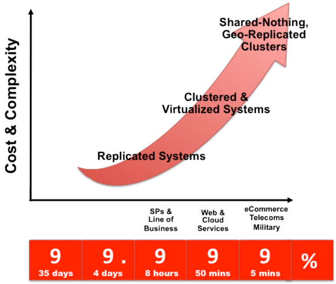
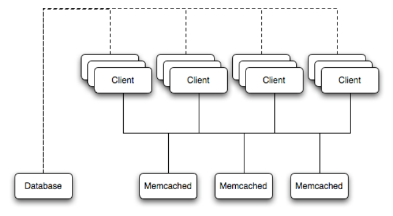
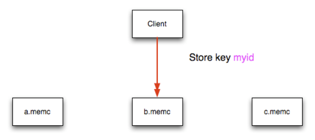
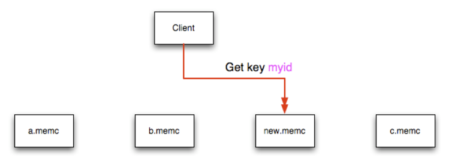
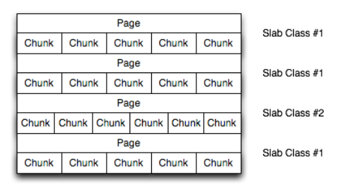
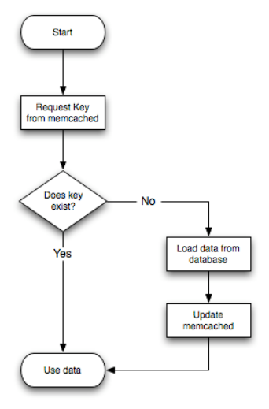

## Table of Contents

16.1 Using ZFS Replication ........................................................................................................... 2347

16.1.1 Using ZFS for File System Replication ........................................................................ 2348

16.1.2 Configuring MySQL for ZFS Replication ...................................................................... 2349

16.1.3 Handling MySQL Recovery with ZFS .......................................................................... 2350

16.2 Using MySQL with `memcached` ............................................................................................. 2350

16.2.1 Installing `memcached` ................................................................................................. 2351

16.2.2 Using `memcached` ...................................................................................................... 2353

16.2.3 Developing a `memcached` Application ......................................................................... 2372

16.2.4 Getting `memcached` Statistics ..................................................................................... 2397

16.2.5 `memcached` FAQ ....................................................................................................... 2407 Data is the currency of today's web, mobile, social, enterprise and cloud applications. Ensuring data is always available is a top priority for any organization. Minutes of downtime can result in significant loss of revenue and reputation.

There is no “one size fits all” approach to delivering High Availability (HA). Unique application attributes,business requirements, operational capabilities and legacy infrastructure can all influence HA technology selection. And technology is only one element in delivering HA: people and processes are just as critical as the technology itself.

MySQL is deployed into many applications demanding availability and scalability. Availability refers to the ability to cope with, and if necessary recover from, failures on the host, including failures of MySQL,the operating system, or the hardware and maintenance activity that may otherwise cause downtime.

Scalability refers to the ability to spread both the database and the load of your application queries across multiple MySQL servers.

Because each application has different operational and availability requirements, MySQL offers a range of certified and supported solutions, delivering the appropriate levels of High Availability (HA) and scalability to meet service level requirements. Such solutions extend from replication, through virtualization and geographically redundant, multi-data center solutions delivering 99.999% uptime.

Selecting the right high availability solution for an application largely depends on:

- The level of availability required.
- The type of application being deployed.
- Accepted best practices within your own environment.

The primary solutions supported by MySQL include:

- MySQL Replication. Learn more: Chapter 17, Replication.
- MySQL Cluster. Learn more: Chapter 18, MySQL NDB Cluster 7.3 and NDB Cluster 7.4.
- Oracle MySQL Cloud Service. Learn more about MySQL Cloud Service.
- Oracle Clusterware Agent for MySQL. Learn more about Oracle Clusterware.
- MySQL with Solaris Cluster. Learn more about Solaris Cluster.

Further options are available using third-party solutions.

Each architecture used to achieve highly available database services is differentiated by the levels of uptime it offers. These architectures can be grouped into three main categories:

- Data Replication.
- Clustered & Virtualized Systems.
- Shared-Nothing, Geographically-Replicated Clusters.

As illustrated in the following figure, each of these architectures offers progressively higher levels of uptime, which must be balanced against potentially greater levels of cost and complexity that each can incur. Simply deploying a high availability architecture is not a guarantee of actually delivering HA. In fact,a poorly implemented and maintained shared-nothing cluster could easily deliver lower levels of availability than a simple data replication solution.

> Figure 16.1 Tradeoffs: Cost and Complexity versus Availability



The following table compares the HA and Scalability capabilities of the various MySQL solutions:Table 16.1 Feature Comparison of MySQL HA Solutions Requirement MySQL Replication MySQL Cluster Availability Platform Support All Supported by MySQL All Supported by MySQL Cluster Server (https://www.mysql.com/ (https://www.mysql.com/support/support/supportedplatforms/ supportedplatforms/cluster.html)database.html)Automated IP Failover No Depends on Connector and Configuration Automated Database Failover No Yes Automatic Data Resynchronization No Yes Using ZFS Replication Requirement MySQL Replication MySQL Cluster Typical Failover Time User / Script Dependent 1 Second and Less Synchronous Replication No, Asynchronous and Yes Semisynchronous Shared Storage No, Distributed No, Distributed Geographic redundancy support Yes Yes, via MySQL Replication Update Schema On-Line No Yes Scalability Number of Nodes One Master, Multiple Slaves 255 Built-in Load Balancing Reads, via MySQL Replication Yes, Reads and Writes Supports Read-Intensive Yes Yes Workloads Supports Write-Intensive Yes, via Application-Level Yes, via Auto-Sharding Workloads Sharding Scale On-Line (add nodes, No Yes repartition, etc.)

## 16.1 Using ZFS Replication

To support high availability environments, providing an instant copy of the information on both the currently active machine and the hot backup is a critical part of the HA solution. There are many solutions to this problem, such as Chapter 17, Replication.

The ZFS file system provides functionality to create a snapshot of the file system contents, transfer the snapshot to another machine, and extract the snapshot to recreate the file system. You can create a snapshot at any time, and you can create as many snapshots as you like. By continually creating,transferring, and restoring snapshots, you can provide synchronization between one or more machines in a fashion similar to DRBD.

The following example shows a simple Solaris system running with a single ZFS pool, mounted at /

```
scratchpool:
Filesystem             size   used  avail capacity  Mounted on
/dev/dsk/c0d0s0        4.6G   3.7G   886M    82%    /
/devices                 0K     0K     0K     0%    /devices
ctfs                     0K     0K     0K     0%    /system/contract
proc                     0K     0K     0K     0%    /proc
mnttab                   0K     0K     0K     0%    /etc/mnttab
swap                   1.4G   892K   1.4G     1%    /etc/svc/volatile
objfs                    0K     0K     0K     0%    /system/object
/usr/lib/libc/libc_hwcap1.so.1
4.6G   3.7G   886M    82%    /lib/libc.so.1
fd                       0K     0K     0K     0%    /dev/fd
swap                   1.4G    40K   1.4G     1%    /tmp
swap                   1.4G    28K   1.4G     1%    /var/run
/dev/dsk/c0d0s7         26G   913M    25G     4%    /export/home
scratchpool             16G    24K    16G     1%    /scratchpool
```

The MySQL data is stored in a directory on `/scratchpool`. To help demonstrate some of the basic replication functionality, there are also other items stored in `/scratchpool` as well:

```
total 17
drwxr-xr-x  31 root     bin           50 Jul 21 07:32 DTT/
drwxr-xr-x   4 root     bin            5 Jul 21 07:32 SUNWmlib/
drwxr-xr-x  14 root     sys           16 Nov  5 09:56 SUNWspro/
```

Using ZFS for File System Replication

```
drwxrwxrwx  19 1000     1000          40 Nov  6 19:16 emacs-22.1/
```

To create a snapshot of the file system, you use `zfs snapshot`, specifying the pool and the snapshot name:

```
#> zfs snapshot scratchpool@snap1
```

To list the snapshots already taken:

```
#> zfs list -t snapshot
NAME                USED  AVAIL  REFER  MOUNTPOINT
scratchpool@snap1      0      -  24.5K  -
scratchpool@snap2      0      -  24.5K  -
```

The snapshots themselves are stored within the file system metadata, and the space required to keep them varies as time goes on because of the way the snapshots are created. The initial creation of a snapshot is very quick, because instead of taking an entire copy of the data and metadata required to hold the entire snapshot, ZFS records only the point in time and metadata of when the snapshot was created.

As more changes to the original file system are made, the size of the snapshot increases because more space is required to keep the record of the old blocks. If you create lots of snapshots, say one per day, and then delete the snapshots from earlier in the week, the size of the newer snapshots might also increase, as the changes that make up the newer state have to be included in the more recent snapshots, rather than being spread over the seven snapshots that make up the week.

You cannot directly back up the snapshots because they exist within the file system metadata rather than as regular files. To get the snapshot into a format that you can copy to another file system, tape, and so on,you use the `zfs send` command to create a stream version of the snapshot.

For example, to write the snapshot out to a file:

```
#> zfs send scratchpool@snap1 >/backup/scratchpool-snap1
```

Or tape:

```
#> zfs send scratchpool@snap1 >/dev/rmt/0
```

You can also write out the incremental changes between two snapshots using `zfs send`:

```
#> zfs send scratchpool@snap1 scratchpool@snap2 >/backup/scratchpool-changes
```

To recover a snapshot, you use `zfs recv`, which applies the snapshot information either to a new file system, or to an existing one.

### 16.1.1 Using ZFS for File System Replication

Because `zfs send` and `zfs recv` use streams to exchange data, you can use them to replicate information from one system to another by combining `zfs send`, `ssh`, and `zfs recv`.

For example, to copy a snapshot of the `scratchpool` file system to a new file system called `slavepool`on a new server, you would use the following command. This sequence combines the snapshot of`scratchpool`, the transmission to the replica machine (using `ssh` with login credentials), and the recovery of the snapshot on the replica using `zfs recv`:

```
#> zfs send scratchpool@snap1 |ssh id@host pfexec zfs recv -F slavepool
```

The first part of the pipeline, `zfs send scratchpool@snap1`, streams the snapshot. The `ssh`command, and the command that it executes on the other server, `pfexec zfs recv -F slavepool`,receives the streamed snapshot data and writes it to slavepool. In this instance, I've specified the `-F` option which forces the snapshot data to be applied, and is therefore destructive. This is fine, as I'm creating the first version of my replicated file system.

Configuring MySQL for ZFS Replication On the replica machine, the replicated file system contains the exact same content:

```
#> ls -al /slavepool/
total 23
drwxr-xr-x   6 root     root           7 Nov  8 09:13 ./
drwxr-xr-x  29 root     root          34 Nov  9 07:06 ../
drwxr-xr-x  31 root     bin           50 Jul 21 07:32 DTT/
drwxr-xr-x   4 root     bin            5 Jul 21 07:32 SUNWmlib/
drwxr-xr-x  14 root     sys           16 Nov  5 09:56 SUNWspro/
drwxrwxrwx  19 1000     1000          40 Nov  6 19:16 emacs-22.1/
```

Once a snapshot has been created, to synchronize the file system again, you create a new snapshot and then use the incremental snapshot feature of `zfs send` to send the changes between the two snapshots to the replica machine again:

```
#> zfs send -i scratchpool@snapshot1 scratchpool@snapshot2 |ssh id@host pfexec zfs recv slavepool
```

This operation only succeeds if the file system on the replica machine has not been modified at all. You cannot apply the incremental changes to a destination file system that has changed. In the example above,the `ls` command would cause problems by changing the metadata, such as the last access time for files or directories.

To prevent changes on the replica file system, set the file system on the replica to be read-only:

```
#> zfs set readonly=on slavepool
```

Setting `readonly` means that you cannot change the file system on the replica by normal means,including the file system metadata. Operations that would normally update metadata (like our `ls`) silently perform their function without attempting to update the file system state.

In essence, the replica file system is nothing but a static copy of the original file system. However, even when configured to be read-only, a file system can have snapshots applied to it. With the file system set to read only, re-run the initial copy:

```
#> zfs send scratchpool@snap1 |ssh id@host pfexec zfs recv -F slavepool
```

Now you can make changes to the original file system and replicate them to the replica.

### 16.1.2 Configuring MySQL for ZFS Replication

Configuring MySQL on the source file system is a case of creating the data on the file system that you intend to replicate. The configuration file in the example below has been updated to use `/scratchpool/``mysql-data` as the data directory, and now you can initialize the tables:

```
#> mysql_install_db --defaults-file=/etc/mysql/5.5/my.cnf --user=mysql
```

To synchronize the initial information, perform a new snapshot and then send an incremental snapshot to the replica using `zfs send`:

```
#> zfs snapshot scratchpool@snap2
#> zfs send -i scratchpool@snap1 scratchpool@snap2|ssh id@host pfexec zfs recv slavepool
```

Doublecheck that the replica has the data by looking at the MySQL data directory on the `slavepool`:

```
#> ls -al /slavepool/mysql-data/
```

Now you can start up MySQL, create some data, and then replicate the changes using `zfs send`/ `zfs``recv` to the replica to synchronize the changes.

The rate at which you perform the synchronization depends on your application and environment. The limitation is the speed required to perform the snapshot and then to send the changes over the network.

Handling MySQL Recovery with ZFS To automate the process, create a script that performs the snapshot, send, and receive operation, and use`cron` to synchronize the changes at set times or intervals.

### 16.1.3 Handling MySQL Recovery with ZFS

When using ZFS replication to provide a constant copy of your data, ensure that you can recover your tables, either manually or automatically, in the event of a failure of the original system.

In the event of a failure, follow this sequence:

1. Stop the script on the source, if it is still up and running.
2. Set the replica file system to be read/write:

```
#> zfs set readonly=off slavepool
```

3. Start up `mysqld` on the replica. If you are using `InnoDB`, you get auto-recovery, if it is needed, to make

sure the table data is correct, as shown here when I started up from our mid-INSERT snapshot:

```
InnoDB: The log sequence number in ibdata files does not match
InnoDB: the log sequence number in the ib_logfiles!
081109 15:59:59  InnoDB: Database was not shut down normally!
InnoDB: Starting crash recovery.
InnoDB: Reading tablespace information from the .ibd files...
InnoDB: Restoring possible half-written data pages from the doublewrite
InnoDB: buffer...
081109 16:00:03  InnoDB: Started; log sequence number 0 1142807951
081109 16:00:03 [Note] /slavepool/mysql-5.0.67-solaris10-i386/bin/mysqld: ready for connections.
Version: '5.0.67'  socket: '/tmp/mysql.sock'  port: 3306  MySQL Community Server (GPL)
```

Use `InnoDB` tables and a regular synchronization schedule to reduce the risk for significant data loss. On MyISAM tables, you might need to run `REPAIR TABLE`, and you might even have lost some information.

## 16.2 Using MySQL with memcached

`memcached` is a simple, highly scalable key-based cache that stores data and objects wherever dedicated or spare RAM is available for quick access by applications, without going through layers of parsing or disk I/O. To use, you run the `memcached` command on one or more hosts and then use the shared cache to store objects. For more usage instructions, see Section 16.2.2, “Using `memcached`”Benefits of using `memcached` include:

- Because all information is stored in RAM, the access speed is faster than loading the information each

time from disk.

- Because the “value” portion of the key-value pair does not have any data type restrictions, you can

cache data such as complex structures, documents, images, or a mixture of such things.

- If you use the in-memory cache to hold transient information, or as a read-only cache for information

also stored in a database, the failure of any `memcached` server is not critical. For persistent data, you can fall back to an alternative lookup method using database queries, and reload the data into RAM on a different server.

The typical usage environment is to modify your application so that information is read from the cache provided by `memcached`. If the information is not in `memcached`, then the data is loaded from the MySQL database and written into the cache so that future requests for the same object benefit from the cached data.

For a typical deployment layout, see Figure 16.2, “`memcached` Architecture Overview”.

Installing `memcached`Figure 16.2 `memcached` Architecture Overview



In the example structure, any of the clients can contact one of the `memcached` servers to request a given key. Each client is configured to talk to all of the servers shown in the illustration. Within the client, when the request is made to store the information, the key used to reference the data is hashed and this hash is then used to select one of the `memcached` servers. The selection of the `memcached` server takes place on the client before the server is contacted, keeping the process lightweight.

The same algorithm is used again when a client requests the same key. The same key generates the same hash, and the same `memcached` server is selected as the source for the data. Using this method,the cached data is spread among all of the `memcached` servers, and the cached information is accessible from any client. The result is a distributed, memory-based, cache that can return information, particularly complex data and structures, much faster than natively reading the information from the database.

The data held within a traditional `memcached` server is never stored on disk (only in RAM, which means there is no persistence of data), and the RAM cache is always populated from the backing store (a MySQL database). If a `memcached` server fails, the data can always be recovered from the MySQL database.

### 16.2.1 Installing memcached

You can build and install `memcached` from the source code directly, or you can use an existing operating system package or installation.

Installing `memcached` from a Binary Distribution To install `memcached` on a Red Hat, or Fedora host, use `yum`:

```
#> yum install memcached
```

Note On CentOS, you may be able to obtain a suitable RPM from another source, or use the source tarball.

To install `memcached` on a Debian or Ubuntu host, use `apt-get`:

```
#> apt-get install memcached
```

To install `memcached` on a Gentoo host, use `emerge`:

```
#> emerge install memcached
```

Building `memcached` from Source Installing `memcached`On other Unix-based platforms, including Solaris, AIX, HP-UX and macOS, and Linux distributions not mentioned already, you must install from source. For Linux, make sure you have a 2.6-based kernel, which includes the improved `epoll` interface. For all platforms, ensure that you have `libevent` 1.1 or higher installed. You can obtain `libevent` from `libevent` web page.

You can obtain the source for `memcached` from `memcached` website.

To build `memcached`, follow these steps:

1. Extract the `memcached` source package:

```
$> gunzip -c memcached-1.2.5.tar.gz | tar xf -
```

2. Change to the `memcached-1.2.5 directory:`

```
$> cd memcached-1.2.5
```

3. Run `configure`

```
$> ./configure
```

Some additional options you might specify to the `configure`:

```
- --prefix
```

To specify a different installation directory, use the `--prefix` option:

```
$> ./configure --prefix=/opt
```

The default is to use the `/usr/local` directory.

```
- --with-libevent
```

If you have installed `libevent` and `configure` cannot find the library, use the `--with-libevent`option to specify the location of the installed library.

```
- --enable-64bit
```

To build a 64-bit version of `memcached` (which enables you to use a single instance with a large RAM allocation), use `--enable-64bit`.

```
- --enable-threads
```

To enable multithreading support in `memcached`, which improves the response times on servers with a heavy load, use `--enable-threads`. You must have support for the POSIX threads within your operating system to enable thread support. For more information on the threading support, see Section 16.2.2.8, “`memcached` Thread Support”.

```
- --enable-dtrace
```

`memcached` includes a range of DTrace threads that can be used to monitor and benchmark a`memcached` instance. For more information, see Section 16.2.2.6, “Using `memcached` and DTrace”.

4. Run `make` to build `memcached`:

```
$> make
```

5. Run `make install` to install `memcached`:

```
$> make install
```

Using `memcached`

### 16.2.2 Using memcached

To start using `memcached`, start the `memcached` service on one or more servers. Running `memcached`sets up the server, allocates the memory and starts listening for connections from clients.

Note You do not need to be a privileged user (`root`) to run `memcached` except to listen on one of the privileged TCP/IP ports (below 1024). You must, however, use a user that has not had their memory limits restricted using `setrlimit` or similar.

To start the server, run `memcached` as a nonprivileged (that is, non-`root`) user:

```
$> memcached
```

By default, `memcached` uses the following settings:

- Memory allocation of 64MB
- Listens for connections on all network interfaces, using port 11211
- Supports a maximum of 1024 simultaneous connections

Typically, you would specify the full combination of options that you want when starting `memcached`, and normally provide a startup script to handle the initialization of `memcached`. For example, the following line starts `memcached` with a maximum of 1024MB RAM for the cache, listening on port 11211 on the IP address 198.51.100.110, running as a background daemon:

```
$> memcached -d -m 1024 -p 11211 -l 198.51.100.110
```

To ensure that `memcached` is started up on boot, check the init script and configuration parameters.

#### 16.2.2.1 memcached Command-Line Options

`memcached` supports the following options:

```
- -u user
```

If you start `memcached` as `root`, use the `-u` option to specify the user for executing `memcached`:

```
$> memcached -u memcache
- -m memory
```

Set the amount of memory allocated to `memcached` for object storage. Default is 64MB.

To increase the amount of memory allocated for the cache, use the `-m` option to specify the amount of RAM to be allocated (in megabytes). The more RAM you allocate, the more data you can store and therefore the more effective your cache is.

Warning Do not specify a memory allocation larger than your available RAM. If you specify too large a value, then some RAM allocated for `memcached` uses swap space,and not physical RAM. This may lead to delays when storing and retrieving values, because data is swapped to disk, instead of storing the data directly in RAM.

You can use the output of the `vmstat` command to get the free memory, as shown in `free` column:Using `memcached`

```
$> vmstat
kthr      memory            page            disk          faults      cpu
r b w   swap  free  re  mf pi po fr de sr s1 s2 -- --   in   sy   cs us sy id
0 0 0 5170504 3450392 2  7  2  0  0  0  4  0  0  0  0  296   54  199  0  0 100
```

For example, to allocate 3GB of RAM:

```
$> memcached -m 3072
```

On 32-bit x86 systems where you are using PAE to access memory above the 4GB limit, you cannot allocate RAM beyond the maximum process size. You can get around this by running multiple instances of `memcached`, each listening on a different port:

```
$> memcached -m 1024 -p11211
$> memcached -m 1024 -p11212
$> memcached -m 1024 -p11213
```

Note On all systems, particularly 32-bit, ensure that you leave enough room for both`memcached` application in addition to the memory setting. For example, if you have a dedicated `memcached` host with 4GB of RAM, do not set the memory size above 3500MB. Failure to do this may cause either an unexpected exit or severe performance issues.

```
- -l interface
```

Specify a network interface/address to listen for connections. The default is to listen on all available address (`INADDR_ANY`).

```
$> memcached -l 198.51.100.110
```

Support for IPv6 address support was added in `memcached` 1.2.5.

```
- -p port
```

Specify the TCP port to use for connections. Default is 18080.

```
$> memcached -p 18080
- -U port
```

Specify the UDP port to use for connections. Default is 11211, 0 switches UDP off.

```
$> memcached -U 18080
- -s socket
```

Specify a Unix socket to listen on.

If you are running `memcached` on the same server as the clients, you can disable the network interface and use a local Unix socket using the `-s` option:

```
$> memcached -s /tmp/memcached
```

Using a Unix socket automatically disables network support, and saves network ports (allowing more ports to be used by your web server or other process).

Using `memcached`

```
- -a mask
```

Specify the access mask to be used for the Unix socket, in octal. Default is 0700.

```
- -c connections
```

Specify the maximum number of simultaneous connections to the `memcached` service. The default is

1024.

```
$> memcached -c 2048
```

Use this option, either to reduce the number of connections (to prevent overloading `memcached` service)or to increase the number to make more effective use of the server running `memcached` server.

```
- -t threads
```

Specify the number of threads to use when processing incoming requests.

By default, `memcached` is configured to use 4 concurrent threads. The threading improves the performance of storing and retrieving data in the cache, using a locking system to prevent different threads overwriting or updating the same values. To increase or decrease the number of threads, use the `-t` option:

```
$> memcached -t 8
```

- `-d`

Run `memcached` as a daemon (background) process:

```
$> memcached -d
```

- `-r`

Maximize the size of the core file limit. In the event of a failure, this attempts to dump the entire memory space to disk as a core file, up to any limits imposed by `setrlimit`.

- `-M`

Return an error to the client when the memory has been exhausted. This replaces the normal behavior of removing older items from the cache to make way for new items.

- `-k`

Lock down all paged memory. This reserves the memory before use, instead of allocating new slabs of memory as new items are stored in the cache.

Note There is a user-level limit on how much memory you can lock. Trying to allocate more than the available memory fails. You can set the limit for the user you started the daemon with (not for the `-u user` user) within the shell by using

```
ulimit -S -l NUM_KB
```

- `-v`

Verbose mode. Prints errors and warnings while executing the main event loop.

Using `memcached`

```
- -vv
```

Very verbose mode. In addition to information printed by `-v`, also prints each client command and the response.

```
- -vvv
```

Extremely verbose mode. In addition to information printed by `-vv`, also show the internal state transitions.

- `-h`

Print the help message and exit.

- `-i`

Print the `memcached` and `libevent` license.

```
- -I mem
```

Specify the maximum size permitted for storing an object within the `memcached` instance. The size supports a unit postfix (k for kilobytes, m for megabytes). For example, to increase the maximum supported object size to 32MB:

```
$> memcached -I 32m
```

The maximum object size you can specify is 128MB, the default remains at 1MB.

This option was added in 1.4.2.

- `-b`

Set the backlog queue limit. The backlog queue configures how many network connections can be waiting to be processed by `memcached`. Increasing this limit may reduce errors received by the client that it is not able to connect to the `memcached` instance, but does not improve the performance of the server. The default is 1024.

```
- -P pidfile
```

Save the process ID of the `memcached` instance into `file`.

- `-f`

Set the chunk size growth factor. When allocating new memory chunks, the allocated size of new chunks is determined by multiplying the default slab size by this factor.

To see the effects of this option without extensive testing, use the `-vv` command-line option to show the calculated slab sizes. For more information, see Section 16.2.2.9, “`memcached` Logs”.

```
- -n bytes
```

The minimum space allocated for the key+value+flags information. The default is 48 bytes.

- `-L`

On systems that support large memory pages, enables large memory page use. Using large memory pages enables `memcached` to allocate the item cache in one large chunk, which can improve the performance by reducing the number misses when accessing memory.

Using `memcached`

- `-C`

Disable the use of compare and swap (CAS) operations.

This option was added in `memcached` 1.3.x.

```
- -D char
```

Set the default character to be used as a delimiter between the key prefixes and IDs. This is used for the per-prefix statistics reporting (see Section 16.2.4, “Getting `memcached` Statistics”). The default is the colon (:). If this option is used, statistics collection is turned on automatically. If not used, you can enable stats collection by sending the `stats detail on` command to the server.

This option was added in `memcached` 1.3.x.

```
- -R num
```

Sets the maximum number of requests per event process. The default is 20.

```
- -B protocol
```

Set the binding protocol, that is, the default `memcached` protocol support for client connections. Options are `ascii`, `binary` or `auto`. Automatic (`auto`) is the default.

This option was added in `memcached` 1.4.0.

#### 16.2.2.2 memcached Deployment

When using `memcached` you can use a number of different potential deployment strategies and topologies.

The exact strategy to use depends on your application and environment. When developing a system for deploying `memcached` within your system, keep in mind the following points:

- `memcached` is only a caching mechanism. It shouldn't be used to store information that you cannot

otherwise afford to lose and then load from a different location.

- There is no security built into the `memcached` protocol. At a minimum, make sure that the servers

running `memcached` are only accessible from inside your network, and that the network ports being used are blocked (using a firewall or similar). If the information that is being stored on the `memcached` servers is sensitive, encrypt it before storing it in `memcached`.

- `memcached` does not provide any sort of failover. Because there is no communication between different

`memcached` instances. If an instance fails, your application must capable of removing it from the list,reloading the data and then writing data to another `memcached` instance.

- Latency between the clients and the `memcached` can be a problem if you are using different physical

machines for these tasks. If you find that the latency is a problem, move the `memcached` instances to be on the clients.

- Key length is determined by the `memcached` server. The default maximum key size is 250 bytes.
- Try to use at least two `memcached` instances, especially for multiple clients, to avoid having a single

point of failure. Ideally, create as many `memcached` nodes as possible. When adding and removing`memcached` instances from a pool, the hashing and distribution of key-value pairs may be affected. For information on how to avoid problems, see Section 16.2.2.5, “`memcached` Hashing/Distribution Types”.

#### 16.2.2.3 Using Namespaces

The `memcached` cache is a very simple massive key-value storage system, and as such there is no way of compartmentalizing data automatically into different sections. For example, if you are storing information by Using `memcached`the unique ID returned from a MySQL database, then storing the data from two different tables could run into issues because the same ID might be valid in both tables.

Some interfaces provide an automated mechanism for creating namespaces when storing information into the cache. In practice, these namespaces are merely a prefix before a given ID that is applied every time a value is stored or retrieve from the cache.

You can implement the same basic principle by using keys that describe the object and the unique identifier within the key that you supply when the object is stored. For example, when storing user data,prefix the ID of the user with `user:` or `user-`.

Note Using namespaces or prefixes only controls the keys stored/retrieved. There is no security within `memcached`, and therefore no way to enforce that a particular client only accesses keys with a particular namespace. Namespaces are only useful as a method of identifying data and preventing corruption of key-value pairs.

#### 16.2.2.4 Data Expiry

There are two types of data expiry within a `memcached` instance. The first type is applied at the point when you store a new key-value pair into the `memcached` instance. If there is not enough space within a suitable slab to store the value, then an existing least recently used (LRU) object is removed (evicted) from the cache to make room for the new item.

The LRU algorithm ensures that the object that is removed is one that is either no longer in active use or that was used so long ago that its data is potentially out of date or of little value. However, in a system where the memory allocated to `memcached` is smaller than the number of regularly used objects required in the cache, a lot of expired items could be removed from the cache even though they are in active use.

You use the statistics mechanism to get a better idea of the level of evictions (expired objects). For more information, see Section 16.2.4, “Getting `memcached` Statistics”.

You can change this eviction behavior by setting the `-M` command-line option when starting `memcached`.

This option forces an error to be returned when the memory has been exhausted, instead of automatically evicting older data.

The second type of expiry system is an explicit mechanism that you can set when a key-value pair is inserted into the cache, or when deleting an item from the cache. Using an expiration time can be a useful way of ensuring that the data in the cache is up to date and in line with your application needs and requirements.

A typical scenario for explicitly setting the expiry time might include caching session data for a user when accessing a website. `memcached` uses a lazy expiry mechanism where the explicit expiry time that has been set is compared with the current time when the object is requested. Only objects that have not expired are returned.

You can also set the expiry time when explicitly deleting an object from the cache. In this case, the expiry time is really a timeout and indicates the period when any attempts to set the value for a given key are rejected.

#### 16.2.2.5 memcached Hashing/Distribution Types

The `memcached` client interface supports a number of different distribution algorithms that are used in multi-server configurations to determine which host should be used when setting or getting data from a given `memcached` instance. When you get or set a value, a hash is constructed from the supplied key and Using `memcached`then used to select a host from the list of configured servers. Because the hashing mechanism uses the supplied key as the basis for the hash, the same server is selected during both set and get operations.

You can think of this process as follows. Given an array of servers (a, b, and c), the client uses a hashing algorithm that returns an integer based on the key being stored or retrieved. The resulting value is then used to select a server from the list of servers configured in the client. Most standard client hashing within`memcache` clients uses a simple modulus calculation on the value against the number of configured`memcached` servers. You can summarize the process in pseudocode as:

```
@memcservers = ['a.memc','b.memc','c.memc'];
$value = hash($key);
$chosen = $value % length(@memcservers);
```

Replacing the above with values:

```
@memcservers = ['a.memc','b.memc','c.memc'];
$value = hash('myid');
$chosen = 7009 % 3;
```

In the above example, the client hashing algorithm chooses the server at index 1 (`7009 % 3 = 1`), and stores or retrieves the key and value with that server.

Note This selection and hashing process is handled automatically by the `memcached`client you are using; you need only provide the list of `memcached` servers to use.

You can see a graphical representation of this below in Figure 16.3, “`memcached` Hash Selection”.

> Figure 16.3 `memcached` Hash Selection



The same hashing and selection process takes place during any operation on the specified key within the`memcached` client.

Using this method provides a number of advantages:

- The hashing and selection of the server to contact is handled entirely within the client. This eliminates

the need to perform network communication to determine the right machine to contact.

- Because the determination of the `memcached` server occurs entirely within the client, the server can be

selected automatically regardless of the operation being executed (set, get, increment, etc.).

- Because the determination is handled within the client, the hashing algorithm returns the same value for

a given key; values are not affected or reset by differences in the server environment.

- Selection is very fast. The hashing algorithm on the key value is quick and the resulting selection of the

server is from a simple array of available machines.

Using `memcached`

- Using client-side hashing simplifies the distribution of data over each `memcached` server. Natural

distribution of the values returned by the hashing algorithm means that keys are automatically spread over the available servers.

Providing that the list of servers configured within the client remains the same, the same stored key returns the same value, and therefore selects the same server.

However, if you do not use the same hashing mechanism then the same data may be recorded on different servers by different interfaces, both wasting space on your `memcached` and leading to potential differences in the information.

Note One way to use a multi-interface compatible hashing mechanism is to use the`libmemcached` library and the associated interfaces. Because the interfaces for the different languages (including C, Perl, and Python) use the same client library interface, they always generate the same hash code from the ID.

The problem with client-side selection of the server is that the list of the servers (including their sequential order) must remain consistent on each client using the `memcached` servers, and the servers must be available. If you try to perform an operation on a key when:

- A new `memcached` instance has been added to the list of available instances
- A `memcached` instance has been removed from the list of available instances
- The order of the `memcached` instances has changed

When the hashing algorithm is used on the given key, but with a different list of servers, the hash calculation may choose a different server from the list.

If a new `memcached` instance is added into the list of servers, as `new.memc` is in the example below, then a GET operation using the same key, `myid`, can result in a cache-miss. This is because the same value is computed from the key, which selects the same index from the array of servers, but index 2 now points to the new server, not the server `c.memc` where the data was originally stored. This would result in a cache miss, even though the key exists within the cache on another `memcached` instance.

> Figure 16.4 `memcached` Hash Selection with New `memcached` instance



This means that servers `c.memc` and `new.memc` both contain the information for key `myid`, but the information stored against the key in each server may be different in each instance. A more significant problem is a much higher number of cache-misses when retrieving data, as the addition of a new server changes the distribution of keys, and this in turn requires rebuilding the cached data on the `memcached`instances, causing an increase in database reads.

Using `memcached`The same effect can occur if you actively manage the list of servers configured in your clients, adding and removing the configured `memcached` instances as each instance is identified as being available. For example, removing a `memcached` instance when the client notices that the instance can no longer be contacted can cause the server selection to fail as described here.

To prevent this causing significant problems and invalidating your cache, you can select the hashing algorithm used to select the server. There are two common types of hashing algorithm, consistent and modula.

With consistent hashing algorithms, the same key when applied to a list of servers always uses the same server to store or retrieve the keys, even if the list of configured servers changes. This means that you can add and remove servers from the configure list and always use the same server for a given key. There are two types of consistent hashing algorithms available, Ketama and Wheel. Both types are supported by`libmemcached`, and implementations are available for PHP and Java.

Any consistent hashing algorithm has some limitations. When you add servers to an existing list of configured servers, keys are distributed to the new servers as part of the normal distribution. When you remove servers from the list, the keys are re-allocated to another server within the list, meaning that the cache needs to be re-populated with the information. Also, a consistent hashing algorithm does not resolve the issue where you want consistent selection of a server across multiple clients, but where each client contains a different list of servers. The consistency is enforced only within a single client.

With a modula hashing algorithm, the client selects a server by first computing the hash and then choosing a server from the list of configured servers. As the list of servers changes, so the server selected when using a modula hashing algorithm also changes. The result is the behavior described above; changes to the list of servers mean that different servers are selected when retrieving data, leading to cache misses and increase in database load as the cache is re-seeded with information.

If you use only a single `memcached` instance for each client, or your list of `memcached` servers configured for a client never changes, then the selection of a hashing algorithm is irrelevant, as it has no noticeable effect.

If you change your servers regularly, or you use a common set of servers that are shared among a large number of clients, then using a consistent hashing algorithm should help to ensure that your cache data is not duplicated and the data is evenly distributed.

#### 16.2.2.6 Using memcached and DTrace

`memcached` includes a number of different DTrace probes that can be used to monitor the operation of the server. The probes included can monitor individual connections, slab allocations, and modifications to the hash table when a key-value pair is added, updated, or removed.

For more information on DTrace and writing DTrace scripts, read the DTrace User Guide.

Support for DTrace probes was added to `memcached` 1.2.6 includes a number of DTrace probes that can be used to help monitor your application. DTrace is supported on Solaris 10, OpenSolaris, OS X 10.5 and FreeBSD. To enable the DTrace probes in `memcached`, build from source and use the `--enable-``dtrace` option. For more information, see Section 16.2.1, “Installing `memcached`”.

The probes supported by `memcached` are:

```
- conn-allocate(connid)
```

Fired when a connection object is allocated from the connection pool.

- `connid`: The connection ID.

Using `memcached`

```
- conn-release(connid)
```

Fired when a connection object is released back to the connection pool.

Arguments:

- `connid`: The connection ID.

```
- conn-create(ptr)
```

Fired when a new connection object is being created (that is, there are no free connection objects in the connection pool).

Arguments:

- `ptr`: A pointer to the connection. object

```
- conn-destroy(ptr)
```

Fired when a connection object is being destroyed.

Arguments:

- `ptr`: A pointer to the connection object.

```
- conn-dispatch(connid, threadid)
```

Fired when a connection is dispatched from the main or connection-management thread to a worker thread.

Arguments:

- `connid`: The connection ID.
- `threadid`: The thread ID.

```
- slabs-allocate(size, slabclass, slabsize, ptr)
```

Allocate memory from the slab allocator.

Arguments:

- `size`: The requested size.
- `slabclass`: The allocation is fulfilled in this class.
- `slabsize`: The size of each item in this class.
- `ptr`: A pointer to allocated memory.

```
- slabs-allocate-failed(size, slabclass)
```

Failed to allocate memory (out of memory).

Arguments:

- `size`: The requested size.
- `slabclass`: The class that failed to fulfill the request.

Using `memcached`

```
- slabs-slabclass-allocate(slabclass)
```

Fired when a slab class needs more space.

Arguments:

- `slabclass`: The class that needs more memory.

```
- slabs-slabclass-allocate-failed(slabclass)
```

Failed to allocate memory (out of memory).

Arguments:

- `slabclass`: The class that failed to grab more memory.

```
- slabs-free(size, slabclass, ptr)
```

Release memory.

Arguments:

- `size`: The amount of memory to release, in bytes.
- `slabclass`: The class the memory belongs to.
- `ptr`: A pointer to the memory to release.

```
- assoc-find(key, depth)
```

Fired when we have searched the hash table for a named key. These two elements provide an insight into how well the hash function operates. Traversals are a sign of a less optimal function, wasting CPU capacity.

Arguments:

- `key`: The key searched for.
- `depth`: The depth in the list of hash table.

```
- assoc-insert(key, nokeys)
```

Fired when a new item has been inserted.

Arguments:

- `key`: The key just inserted.
- `nokeys`: The total number of keys currently being stored, including the key for which insert was called.

Using `memcached`

```
- assoc-delete(key, nokeys)
```

Fired when a new item has been removed.

Arguments:

- `key`: The key just deleted.
- `nokeys`: The total number of keys currently being stored, excluding the key for which delete was

called.

```
- item-link(key, size)
```

Fired when an item is being linked in the cache.

Arguments:

- `key`: The items key.
- `size`: The size of the data.

```
- item-unlink(key, size)
```

Fired when an item is being deleted.

Arguments:

- `key`: The items key.
- `size`: The size of the data.

```
- item-remove(key, size)
```

Fired when the refcount for an item is reduced.

Arguments:

- `key`: The item's key.
- `size`: The size of the data.

```
- item-update(key, size)
```

Fired when the "last referenced" time is updated.

Arguments:

- `key`: The item's key.
- `size`: The size of the data.

Using `memcached`

```
- item-replace(oldkey, oldsize, newkey, newsize)
```

Fired when an item is being replaced with another item.

Arguments:

- `oldkey`: The key of the item to replace.
- `oldsize`: The size of the old item.
- `newkey`: The key of the new item.
- `newsize`: The size of the new item.

```
- process-command-start(connid, request, size)
```

Fired when the processing of a command starts.

Arguments:

- `connid`: The connection ID.
- `request`: The incoming request.
- `size`: The size of the request.

```
- process-command-end(connid, response, size)
```

Fired when the processing of a command is done.

Arguments:

- `connid`: The connection ID.
- `response`: The response to send back to the client.
- `size`: The size of the response.

```
- command-get(connid, key, size)
```

Fired for a `get` command.

Arguments:

- `connid`: The connection ID.
- `key`: The requested key.
- `size`: The size of the key's data (or -1 if not found).

```
- command-gets(connid, key, size, casid)
```

Fired for a `gets` command.

Arguments:

- `connid`: The connection ID.
- `key`: The requested key.

Using `memcached`

- `size`: The size of the key's data (or -1 if not found).
- `casid`: The casid for the item.

```
- command-add(connid, key, size)
```

Fired for a `add` command.

Arguments:

- `connid`: The connection ID.
- `key`: The requested key.
- `size`: The new size of the key's data (or -1 if not found).

```
- command-set(connid, key, size)
```

Fired for a `set` command.

Arguments:

- `connid`: The connection ID.
- `key`: The requested key.
- `size`: The new size of the key's data (or -1 if not found).

```
- command-replace(connid, key, size)
```

Fired for a `replace` command.

Arguments:

- `connid`: The connection ID.
- `key`: The requested key.
- `size`: The new size of the key's data (or -1 if not found).

```
- command-prepend(connid, key, size)
```

Fired for a `prepend` command.

Arguments:

- `connid`: The connection ID.
- `key`: The requested key.
- `size`: The new size of the key's data (or -1 if not found).

Using `memcached`

```
- command-append(connid, key, size)
```

Fired for a `append` command.

Arguments:

- `connid`: The connection ID.
- `key`: The requested key.
- `size`: The new size of the key's data (or -1 if not found).

```
- command-cas(connid, key, size, casid)
```

Fired for a `cas` command.

Arguments:

- `connid`: The connection ID.
- `key`: The requested key.
- `size`: The size of the key's data (or -1 if not found).
- `casid`: The cas ID requested.

```
- command-incr(connid, key, val)
```

Fired for `incr` command.

Arguments:

- `connid`: The connection ID.
- `key`: The requested key.
- `val`: The new value.

```
- command-decr(connid, key, val)
```

Fired for `decr` command.

Arguments:

- `connid`: The connection ID.
- `key`: The requested key.
- `val`: The new value.

```
- command-delete(connid, key, exptime)
```

Fired for a `delete` command.

Arguments:

- `connid`: The connection ID.
- `key`: The requested key.

Using `memcached`

- `exptime`: The expiry time.

#### 16.2.2.7 Memory Allocation within memcached

When you first start `memcached`, the memory that you have configured is not automatically allocated.

Instead, `memcached` only starts allocating and reserving physical memory once you start saving information into the cache.

When you start to store data into the cache, `memcached` does not allocate the memory for the data on an item by item basis. Instead, a slab allocation is used to optimize memory usage and prevent memory fragmentation when information expires from the cache.

With slab allocation, memory is reserved in blocks of 1MB. The slab is divided up into a number of blocks of equal size. When you try to store a value into the cache, `memcached` checks the size of the value that you are adding to the cache and determines which slab contains the right size allocation for the item. If a slab with the item size already exists, the item is written to the block within the slab.

If the new item is bigger than the size of any existing blocks, then a new slab is created, divided up into blocks of a suitable size. If an existing slab with the right block size already exists, but there are no free blocks, a new slab is created. If you update an existing item with data that is larger than the existing block allocation for that key, then the key is re-allocated into a suitable slab.

For example, the default size for the smallest block is 88 bytes (40 bytes of value, and the default 48 bytes for the key and flag data). If the size of the first item you store into the cache is less than 40 bytes, then a slab with a block size of 88 bytes is created and the value stored.

If the size of the data that you intend to store is larger than this value, then the block size is increased by the chunk size factor until a block size large enough to hold the value is determined. The block size is always a function of the scale factor, rounded up to a block size which is exactly divisible into the chunk size.

For a sample of the structure, see Figure 16.5, “Memory Allocation in `memcached`”.

> Figure 16.5 Memory Allocation in `memcached`



The result is that you have multiple pages allocated within the range of memory allocated to `memcached`.

Each page is 1MB in size (by default), and is split into a different number of chunks, according to the chunk size required to store the key-value pairs. Each instance has multiple pages allocated, and a page is always created when a new item needs to be created requiring a chunk of a particular size. A slab may consist of multiple pages, and each page within a slab contains an equal number of chunks.

Using `memcached`The chunk size of a new slab is determined by the base chunk size combined with the chunk size growth factor. For example, if the initial chunks are 104 bytes in size, and the default chunk size growth factor is used (1.25), then the next chunk size allocated would be the best power of 2 fit for 104*1.25, or 136 bytes.

Allocating the pages in this way ensures that memory does not get fragmented. However, depending on the distribution of the objects that you store, it may lead to an inefficient distribution of the slabs and chunks if you have significantly different sized items. For example, having a relatively small number of items within each chunk size may waste a lot of memory with just few chunks in each allocated page.

You can tune the growth factor to reduce this effect by using the `-f` command line option, which adapts the growth factor applied to make more effective use of the chunks and slabs allocated. For information on how to determine the current slab allocation statistics, see Section 16.2.4.2, “`memcached` Slabs Statistics”.

If your operating system supports it, you can also start `memcached` with the `-L` command line option.

This option preallocates all the memory during startup using large memory pages. This can improve performance by reducing the number of misses in the CPU memory cache.

#### 16.2.2.8 memcached Thread Support

If you enable the thread implementation within when building `memcached` from source, then `memcached`uses multiple threads in addition to the `libevent` system to handle requests.

When enabled, the threading implementation operates as follows:

- Threading is handled by wrapping functions within the code to provide basic protection from updating the

same global structures at the same time.

- Each thread uses its own instance of the `libevent` to help improve performance.
- TCP/IP connections are handled with a single thread listening on the TCP/IP socket. Each connection

is then distributed to one of the active threads on a simple round-robin basis. Each connection then operates solely within this thread while the connection remains open.

- For UDP connections, all the threads listen to a single UDP socket for incoming requests. Threads

that are not currently dealing with another request ignore the incoming packet. One of the remaining,nonbusy, threads reads the request and sends the response. This implementation can lead to increased CPU load as threads wake from sleep to potentially process the request.

Using threads can increase the performance on servers that have multiple CPU cores available, as the requests to update the hash table can be spread between the individual threads. To minimize overhead from the locking mechanism employed, experiment with different thread values to achieve the best performance based on the number and type of requests within your given workload.

#### 16.2.2.9 memcached Logs

If you enable verbose mode, using the `-v`, `-vv`, or `-vvv` options, then the information output by`memcached` includes details of the operations being performed.

Without the verbose options, `memcached` normally produces no output during normal operating.

- Output when using `-v`

The lowest verbosity level shows you:

- Errors and warnings
- Transient errors
- Protocol and socket errors, including exhausting available connections

Using `memcached`

- Each registered client connection, including the socket descriptor number and the protocol used.

For example:

```
32: Client using the ascii protocol
33: Client using the ascii protocol
```

The socket descriptor is only valid while the client remains connected. Non-persistent connections may not be effectively represented.

Examples of the error messages output at this level include:

```
<%d send buffer was %d, now %d
Can't listen for events on fd %d
Can't read from libevent pipe
Catastrophic: event fd doesn't match conn fd!
Couldn't build response
Couldn't realloc input buffer
Couldn't update event
Failed to build UDP headers
Failed to read, and not due to blocking
Too many open connections
Unexpected state %d
```

- Output when using `-vv`

When using the second level of verbosity, you get more detailed information about protocol operations,keys updated, chunk and network operatings and details.

During the initial start-up of `memcached` with this level of verbosity, you are shown the sizes of the individual slab classes, the chunk sizes, and the number of entries per slab. These do not show the allocation of the slabs, just the slabs that would be created when data is added. You are also given information about the listen queues and buffers used to send information. A sample of the output generated for a TCP/IP based system with the default memory and growth factors is given below:

```
$> memcached -vv
slab class   1: chunk size     80 perslab 13107
slab class   2: chunk size    104 perslab 10082
slab class   3: chunk size    136 perslab  7710
slab class   4: chunk size    176 perslab  5957
slab class   5: chunk size    224 perslab  4681
slab class   6: chunk size    280 perslab  3744
slab class   7: chunk size    352 perslab  2978
slab class   8: chunk size    440 perslab  2383
slab class   9: chunk size    552 perslab  1899
slab class  10: chunk size    696 perslab  1506
slab class  11: chunk size    872 perslab  1202
slab class  12: chunk size   1096 perslab   956
slab class  13: chunk size   1376 perslab   762
slab class  14: chunk size   1720 perslab   609
slab class  15: chunk size   2152 perslab   487
slab class  16: chunk size   2696 perslab   388
slab class  17: chunk size   3376 perslab   310
slab class  18: chunk size   4224 perslab   248
slab class  19: chunk size   5280 perslab   198
slab class  20: chunk size   6600 perslab   158
slab class  21: chunk size   8256 perslab   127
slab class  22: chunk size  10320 perslab   101
slab class  23: chunk size  12904 perslab    81
slab class  24: chunk size  16136 perslab    64
slab class  25: chunk size  20176 perslab    51
slab class  26: chunk size  25224 perslab    41
slab class  27: chunk size  31536 perslab    33
```

Using `memcached`

```
slab class  28: chunk size  39424 perslab    26
slab class  29: chunk size  49280 perslab    21
slab class  30: chunk size  61600 perslab    17
slab class  31: chunk size  77000 perslab    13
slab class  32: chunk size  96256 perslab    10
slab class  33: chunk size 120320 perslab     8
slab class  34: chunk size 150400 perslab     6
slab class  35: chunk size 188000 perslab     5
slab class  36: chunk size 235000 perslab     4
slab class  37: chunk size 293752 perslab     3
slab class  38: chunk size 367192 perslab     2
slab class  39: chunk size 458992 perslab     2
<26 server listening (auto-negotiate)
<29 server listening (auto-negotiate)
<30 send buffer was 57344, now 2097152
<31 send buffer was 57344, now 2097152
<30 server listening (udp)
<30 server listening (udp)
<31 server listening (udp)
<30 server listening (udp)
<30 server listening (udp)
<31 server listening (udp)
<31 server listening (udp)
<31 server listening (udp)
```

Using this verbosity level can be a useful way to check the effects of the growth factor used on slabs with different memory allocations, which in turn can be used to better tune the growth factor to suit the data you are storing in the cache. For example, if you set the growth factor to 4 (quadrupling the size of each slab):

```
$> memcached -f 4 -m 1g -vv
slab class   1: chunk size     80 perslab 13107
slab class   2: chunk size    320 perslab  3276
slab class   3: chunk size   1280 perslab   819
slab class   4: chunk size   5120 perslab   204
slab class   5: chunk size  20480 perslab    51
slab class   6: chunk size  81920 perslab    12
slab class   7: chunk size 327680 perslab     3
...
```

During use of the cache, this verbosity level also prints out detailed information on the storage and recovery of keys and other information. An example of the output during a typical set/get and increment/decrement operation is shown below.

```
32: Client using the ascii protocol
<32 set my_key 0 0 10
>32 STORED
<32 set object_key 1 0 36
>32 STORED
<32 get my_key
>32 sending key my_key
>32 END
<32 get object_key
>32 sending key object_key
>32 END
<32 set key 0 0 6
>32 STORED
<32 incr key 1
>32 789544
<32 decr key 1
>32 789543
<32 incr key 2
>32 789545
<32 set my_key 0 0 10
>32 STORED
```

Developing a `memcached` Application

```
<32 set object_key 1 0 36
>32 STORED
<32 get my_key
>32 sending key my_key
>32 END
<32 get object_key
>32 sending key object_key1 1 36
>32 END
<32 set key 0 0 6
>32 STORED
<32 incr key 1
>32 789544
<32 decr key 1
>32 789543
<32 incr key 2
>32 789545
```

During client communication, for each line, the initial character shows the direction of flow of the information. The < for communication from the client to the `memcached` server and > for communication back to the client. The number is the numeric socket descriptor for the connection.

- Output when using `-vvv`

This level of verbosity includes the transitions of connections between different states in the event library while reading and writing content to/from the clients. It should be used to diagnose and identify issues in client communication. For example, you can use this information to determine if `memcached` is taking a long time to return information to the client, during the read of the client operation or before returning and completing the operation. An example of the typical sequence for a set operation is provided below:

```
<32 new auto-negotiating client connection
32: going from conn_new_cmd to conn_waiting
32: going from conn_waiting to conn_read
32: going from conn_read to conn_parse_cmd
32: Client using the ascii protocol
<32 set my_key 0 0 10
32: going from conn_parse_cmd to conn_nread
> NOT FOUND my_key
>32 STORED
32: going from conn_nread to conn_write
32: going from conn_write to conn_new_cmd
32: going from conn_new_cmd to conn_waiting
32: going from conn_waiting to conn_read
32: going from conn_read to conn_closing
<32 connection closed.
```

All of the verbosity levels in `memcached` are designed to be used during debugging or examination of issues. The quantity of information generated, particularly when using `-vvv`, is significant, particularly on a busy server. Also be aware that writing the error information out, especially to disk, may negate some of the performance gains you achieve by using `memcached`. Therefore, use in production or deployment environments is not recommended.

### 16.2.3 Developing a memcached Application

A number of language interfaces let applications store and retrieve information with `memcached` servers.

You can write `memcached` applications in popular languages such as Perl, PHP, Python, C, and Java.

Data stored into a `memcached` server is referred to by a single string (the key), with storage into the cache and retrieval from the cache using the key as the reference. The cache therefore operates like a large associative array or hash table. It is not possible to structure or otherwise organize the information stored in the cache. To emulate database notions such as multiple tables or composite key values, you must Developing a `memcached` Application encode the extra information into the strings used as keys. For example, to store or look up the address corresponding to a specific latitude and longitude, you might turn those two numeric values into a single comma-separated string to use as a key.

#### 16.2.3.1 Basic memcached Operations

The interface to `memcached` supports the following methods for storing and retrieving information in the cache, and these are consistent across all the different APIs, although the language specific mechanics might be different:

- `get(key)`: Retrieves information from the cache. Returns the value associated with the key if the

specified key exists. Returns `NULL`, `nil`, `undefined`, or the closest equivalent in the corresponding language, if the specified key does not exist.

- `set(key, value [, expiry])`: Sets the item associated with a key in the cache to the specified

value. This either updates an existing item if the key already exists, or adds a new key-value pair if the key doesn't exist. If the expiry time is specified, then the item expires (and is deleted) when the expiry time is reached. The time is specified in seconds, and is taken as a relative time if the value is less than 30 days (30*24*60*60), or an absolute time (epoch) if larger than this value.

- `add(key, value [, expiry])`: Adds the key and associated value to the cache, if the specified key

does not already exist.

- `replace(key, value [, expiry])`: Replaces the item associated with the specified `key`, only if

the key already exists. The new value is given by the `value` parameter.

- `delete(key [, time])`: Deletes the `key` and its associated item from the cache. If you supply a

`time`, then adding another item with the specified `key` is blocked for the specified period.

- `incr(key , value)`: Increments the item associated with the `key` by the specified `value`.
- `decr(key , value)`: Decrements the item associated with the `key` by the specified `value`.
- `flush_all`: Invalidates (or expires) all the current items in the cache. Technically they still exist (they

are not deleted), but they are silently destroyed the next time you try to access them.

In all implementations, most or all of these functions are duplicated through the corresponding native language interface.

When practical, use `memcached` to store full items, rather than caching a single column value from the database. For example, when displaying a record about an object (invoice, user history, or blog post), load all the data for the associated entry from the database, and compile it into the internal structure that would normally be required by the application. Save the complete object in the cache.

Complex data structures cannot be stored directly. Most interfaces serialize the data for you, that is, put it in a textual form that can reconstruct the original pointers and nesting. Perl uses `Storable`, PHP uses`serialize`, Python uses `cPickle` (or `Pickle`) and Java uses the `Serializable` interface. In most cases, the serialization interface used is customizable. To share data stored in `memcached` instances between different language interfaces, consider using a common serialization solution such as JSON(Javascript Object Notation).

#### 16.2.3.2 Using memcached as a MySQL Caching Layer

When using `memcached` to cache MySQL data, your application must retrieve data from the database and load the appropriate key-value pairs into the cache. Then, subsequent lookups can be done directly from the cache.

Developing a `memcached` Application Because MySQL has its own in-memory caching mechanisms for queried data, such as the `InnoDB` buffer pool and the MySQL query cache, look for opportunities beyond loading individual column values or rows into the cache. Prefer to cache composite values, such as those retrieved from multiple tables through a join query, or result sets assembled from multiple rows.

Caution Limit the information in the cache to non-sensitive data, because there is no security required to access or update the information within a `memcached` instance.

Anybody with access to the machine has the ability to read, view and potentially update the information. To keep the data secure, encrypt the information before caching it. To restrict the users capable of connecting to the server, either disable network access, or use IPTables or similar techniques to restrict access to the`memcached` ports to a select set of hosts.

You can introduce `memcached` to an existing application, even if caching was not part of the original design. In many languages and environments the changes to the application is just a few lines, first to attempt to read from the cache when loading data, fall back to the old method if the information is not cached, and to update the cache with information once the data has been read.

The general sequence for using `memcached` in any language as a caching solution for MySQL is as follows:

1. Request the item from the cache.
2. If the item exists, use the item data.
3. If the item does not exist, load the data from MySQL, and store the value into the cache. This means

the value is available to the next client that requests it from the cache.

For a flow diagram of this sequence, see Figure 16.6, “Typical `memcached` Application Flowchart”.

> Figure 16.6 Typical `memcached` Application Flowchart



Developing a `memcached` Application Adapting Database Best Practices to `memcached` Applications The most direct way to cache MySQL data is to use a 2-column table, where the first column is a primary key. Because of the uniqueness requirements for `memcached` keys, make sure your database schema makes appropriate use of primary keys and unique constraints.

If you combine multiple column values into a single `memcached` item value, choose data types to make it easy to parse the value back into its components, for example by using a separator character between numeric values.

The queries that map most easily to `memcached` lookups are those with a single `WHERE` clause, using an =or `IN` operator. For complicated `WHERE` clauses, or those using operators such as <, >, `BETWEEN`, or `LIKE`,`memcached` does not provide a simple or efficient way to scan through or filter the keys or associated values, so typically you perform those operations as SQL queries on the underlying database.

#### 16.2.3.3 Using libmemcached with C and C++

The `libmemcached` library provides both C and C++ interfaces to `memcached` and is also the basis for a number of different additional API implementations, including Perl and Python. Understanding the core`libmemcached` functions can help when using these other interfaces.

The C library is the most comprehensive interface library for `memcached` and provides functions and operational systems not always exposed in interfaces not based on the `libmemcached` library.

The different functions can be divided up according to their basic operation. In addition to functions that interface to the core API, a number of utility functions provide extended functionality, such as appending and prepending data.

To build and install `libmemcached`, download the `libmemcached` package, run `configure`, and then build and install:

```
$> tar xjf libmemcached-0.21.tar.gz
$> cd libmemcached-0.21
$> ./configure
$> make
$> make install
```

On many Linux operating systems, you can install the corresponding `libmemcached` package through the usual `yum`, `apt-get`, or similar commands.

To build an application that uses the library, first set the list of servers. Either directly manipulate the servers configured within the main `memcached_st` structure, or separately populate a list of servers, and then add this list to the `memcached_st` structure. The latter method is used in the following example. Once the server list has been set, you can call the functions to store or retrieve data. A simple application for setting a preset value to `localhost` is provided here:

```
#include <stdio.h>
#include <string.h>
#include <unistd.h>
#include <libmemcached/memcached.h>
int main(int argc, char *argv[])
{
memcached_server_st *servers = NULL;
memcached_st *memc;
memcached_return rc;
char *key= "keystring";
char *value= "keyvalue";
```

Developing a `memcached` Application

```
memcached_server_st *memcached_servers_parse (char *server_strings);
memc= memcached_create(NULL);
servers= memcached_server_list_append(servers, "localhost", 11211, &rc);
rc= memcached_server_push(memc, servers);
if (rc == MEMCACHED_SUCCESS)
fprintf(stderr,"Added server successfully\n");
else
fprintf(stderr,"Couldn't add server: %s\n",memcached_strerror(memc, rc));
rc= memcached_set(memc, key, strlen(key), value, strlen(value), (time_t)0, (uint32_t)0);
if (rc == MEMCACHED_SUCCESS)
fprintf(stderr,"Key stored successfully\n");
else
fprintf(stderr,"Couldn't store key: %s\n",memcached_strerror(memc, rc));
return 0;
}
```

To test the success of an operation, use the return value, or populated result code, for a given function.

The value is always set to `MEMCACHED_SUCCESS` if the operation succeeded. In the event of a failure, use the `memcached_strerror()` function to translate the result code into a printable string.

To build the application, specify the `memcached` library:

```
$> gcc -o memc_basic memc_basic.c -lmemcached
```

Running the above sample application, after starting a `memcached` server, should return a success message:

```
$> memc_basic
Added server successfully
Key stored successfully
```

##### libmemcached Base Functions

The base `libmemcached` functions let you create, destroy and clone the main `memcached_st` structure that is used to interface with the `memcached` servers. The main functions are defined below:

```
memcached_st *memcached_create (memcached_st *ptr);
```

Creates a new `memcached_st` structure for use with the other `libmemcached` API functions. You can supply an existing, static, `memcached_st` structure, or `NULL` to have a new structured allocated. Returns a pointer to the created structure, or `NULL` on failure.

```
void memcached_free (memcached_st *ptr);
```

Frees the structure and memory allocated to a previously created `memcached_st` structure.

```
memcached_st *memcached_clone(memcached_st *clone, memcached_st *source);
```

Clones an existing `memcached` structure from the specified `source`, copying the defaults and list of servers defined in the structure.

##### libmemcached Server Functions

The `libmemcached` API uses a list of servers, stored within the `memcached_server_st` structure, to act as the list of servers used by the rest of the functions. To use `memcached`, you first create the server list,and then apply the list of servers to a valid `libmemcached` object.

Developing a `memcached` Application Because the list of servers, and the list of servers within an active `libmemcached` object can be manipulated separately, you can update and manage server lists while an active `libmemcached` interface is running.

The functions for manipulating the list of servers within a `memcached_st` structure are:

```
memcached_return
memcached_server_add (memcached_st *ptr,
char *hostname,
unsigned int port);
```

Adds a server, using the given `hostname` and `port` into the `memcached_st` structure given in `ptr`.

```
memcached_return
memcached_server_add_unix_socket (memcached_st *ptr,
char *socket);
```

Adds a Unix socket to the list of servers configured in the `memcached_st` structure.

```
unsigned int memcached_server_count (memcached_st *ptr);
```

Returns a count of the number of configured servers within the `memcached_st` structure.

```
memcached_server_st *
memcached_server_list (memcached_st *ptr);
```

Returns an array of all the defined hosts within a `memcached_st` structure.

```
memcached_return
memcached_server_push (memcached_st *ptr,
memcached_server_st *list);
```

Pushes an existing list of servers onto list of servers configured for a current `memcached_st` structure.

This adds servers to the end of the existing list, and duplicates are not checked.

The `memcached_server_st` structure can be used to create a list of `memcached` servers which can then be applied individually to `memcached_st` structures.

```
memcached_server_st *
memcached_server_list_append (memcached_server_st *ptr,
char *hostname,
unsigned int port,
memcached_return *error);
```

Adds a server, with `hostname` and `port`, to the server list in `ptr`. The result code is handled by the`error` argument, which should point to an existing `memcached_return` variable. The function returns a pointer to the returned list.

```
unsigned int memcached_server_list_count (memcached_server_st *ptr);
```

Returns the number of the servers in the server list.

```
void memcached_server_list_free (memcached_server_st *ptr);
```

Frees the memory associated with a server list.

```
memcached_server_st *memcached_servers_parse (char *server_strings);
```

Parses a string containing a list of servers, where individual servers are separated by a comma, space,or both, and where individual servers are of the form `server[:port]`. The return value is a server list structure.

Developing a `memcached` Application

##### libmemcached Set Functions

The set-related functions within `libmemcached` provide the same functionality as the core functions supported by the `memcached` protocol. The full definition for the different functions is the same for all the base functions (`add`, `replace`, `prepend`, `append`). For example, the function definition for

```
memcached_set() is:
memcached_return
memcached_set (memcached_st *ptr,
const char *key,
size_t key_length,
const char *value,
size_t value_length,
time_t expiration,
uint32_t flags);
```

The `ptr` is the `memcached_st` structure. The `key` and `key_length` define the key name and length,and `value` and `value_length` the corresponding value and length. You can also set the expiration and optional flags. For more information, see Controlling `libmemcached` Behaviors.

The following table outlines the remainder of the set-related `libmemcached` functions and the equivalent core functions supported by the `memcached` protocol.

`libmemcached` Function Equivalent Core Function`memcached_set(memc, key, key_length,` Generic `set()` operation.

```
value, value_length, expiration,
flags)
```

`memcached_add(memc, key, key_length,` Generic `add()` function.

```
value, value_length, expiration,
flags)
memcached_replace(memc, key,  Generic replace().
key_length, value, value_length,
expiration, flags)
```

`memcached_prepend(memc, key,` Prepends the specified `value` before the current`key_length, value, value_length,` value of the specified `key`.

```
expiration, flags)
```

`memcached_append(memc, key,` Appends the specified `value` after the current value`key_length, value, value_length,` of the specified `key`.

```
expiration, flags)
```

`memcached_cas(memc, key, key_length,` Overwrites the data for a given key as long as the`value, value_length, expiration,` corresponding `cas` value is still the same within the`flags, cas)` server.

`memcached_set_by_key(memc, master_key,` Similar to the generic `set()`, but has the option of`master_key_length, key, key_length,` an additional master key that can be used to identify`value, value_length, expiration,` an individual server.

```
flags)
```

`memcached_add_by_key(memc, master_key,` Similar to the generic `add()`, but has the option of`master_key_length, key, key_length,` an additional master key that can be used to identify`value, value_length, expiration,` an individual server.

```
flags)
```

`memcached_replace_by_key(memc,` Similar to the generic `replace()`, but has the`master_key, master_key_length, key,` option of an additional master key that can be used to identify an individual server.

Developing a `memcached` Application`libmemcached` Function Equivalent Core Function

```
key_length, value, value_length,
expiration, flags)
```

`memcached_prepend_by_key(memc,` Similar to the `memcached_prepend()`, but has the`master_key, master_key_length, key,` option of an additional master key that can be used`key_length, value, value_length,` to identify an individual server.

```
expiration, flags)
```

`memcached_append_by_key(memc,` Similar to the `memcached_append()`, but has the`master_key, master_key_length, key,` option of an additional master key that can be used`key_length, value, value_length,` to identify an individual server.

```
expiration, flags)
```

`memcached_cas_by_key(memc, master_key,` Similar to the `memcached_cas()`, but has the`master_key_length, key, key_length,` option of an additional master key that can be used`value, value_length, expiration,` to identify an individual server.

```
flags)
```

The `by_key` methods add two further arguments that define the master key, to be used and applied during the hashing stage for selecting the servers. You can see this in the following definition:

```
memcached_return
memcached_set_by_key(memcached_st *ptr,
const char *master_key,
size_t master_key_length,
const char *key,
size_t key_length,
const char *value,
size_t value_length,
time_t expiration,
uint32_t flags);
```

All the functions return a value of type `memcached_return`, which you can compare against the`MEMCACHED_SUCCESS` constant.

##### libmemcached Get Functions

The `libmemcached` functions provide both direct access to a single item, and a multiple-key request mechanism that provides much faster responses when fetching a large number of keys simultaneously.

The main get-style function, which is equivalent to the generic `get()` is `memcached_get()`. This function returns a string pointer, pointing to the value associated with the specified key.

```
char *memcached_get (memcached_st *ptr,
const char *key, size_t key_length,
size_t *value_length,
uint32_t *flags,
memcached_return *error);
```

A multi-key get, `memcached_mget()`, is also available. Using a multiple key get operation is much quicker to do in one block than retrieving the key values with individual calls to `memcached_get()`. To start the multi-key get, call `memcached_mget()`:

```
memcached_return
memcached_mget (memcached_st *ptr,
char **keys, size_t *key_length,
unsigned int number_of_keys);
```

The return value is the success of the operation. The `keys` parameter should be an array of strings containing the keys, and `key_length` an array containing the length of each corresponding key.

`number_of_keys` is the number of keys supplied in the array.

Developing a `memcached` Application To fetch the individual values, use `memcached_fetch()` to get each corresponding value.

```
char *memcached_fetch (memcached_st *ptr,
const char *key, size_t *key_length,
size_t *value_length,
uint32_t *flags,
memcached_return *error);
```

The function returns the key value, with the `key`, `key_length` and `value_length` parameters being populated with the corresponding key and length information. The function returns `NULL` when there are no more values to be returned. A full example, including the populating of the key data and the return of the information is provided here.

```
#include <stdio.h>
#include <sstring.h>
#include <unistd.h>
#include <libmemcached/memcached.h>
int main(int argc, char *argv[])
{
memcached_server_st *servers = NULL;
memcached_st *memc;
memcached_return rc;
char *keys[]= {"huey", "dewey", "louie"};
size_t key_length[3];
char *values[]= {"red", "blue", "green"};
size_t value_length[3];
unsigned int x;
uint32_t flags;
char return_key[MEMCACHED_MAX_KEY];
size_t return_key_length;
char *return_value;
size_t return_value_length;
memc= memcached_create(NULL);
servers= memcached_server_list_append(servers, "localhost", 11211, &rc);
rc= memcached_server_push(memc, servers);
if (rc == MEMCACHED_SUCCESS)
fprintf(stderr,"Added server successfully\n");
else
fprintf(stderr,"Couldn't add server: %s\n",memcached_strerror(memc, rc));
for(x= 0; x < 3; x++)
{
key_length[x] = strlen(keys[x]);
value_length[x] = strlen(values[x]);
rc= memcached_set(memc, keys[x], key_length[x], values[x],
value_length[x], (time_t)0, (uint32_t)0);
if (rc == MEMCACHED_SUCCESS)
fprintf(stderr,"Key %s stored successfully\n",keys[x]);
else
fprintf(stderr,"Couldn't store key: %s\n",memcached_strerror(memc, rc));
}
rc= memcached_mget(memc, keys, key_length, 3);
if (rc == MEMCACHED_SUCCESS)
{
while ((return_value= memcached_fetch(memc, return_key, &return_key_length,
&return_value_length, &flags, &rc)) != NULL)
{
if (rc == MEMCACHED_SUCCESS)
```

Developing a `memcached` Application

```
{
fprintf(stderr,"Key %s returned %s\n",return_key, return_value);
}
}
}
return 0;
}
```

Running the above application produces the following output:

```
$> memc_multi_fetch
Added server successfully
Key huey stored successfully
Key dewey stored successfully
Key louie stored successfully
Key huey returned red
Key dewey returned blue
Key louie returned green
```

##### Controlling libmemcached Behaviors

The behavior of `libmemcached` can be modified by setting one or more behavior flags. These can either be set globally, or they can be applied during the call to individual functions. Some behaviors also accept an additional setting, such as the hashing mechanism used when selecting servers.

To set global behaviors:

```
memcached_return
memcached_behavior_set (memcached_st *ptr,
memcached_behavior flag,
uint64_t data);
```

To get the current behavior setting:

```
uint64_t
memcached_behavior_get (memcached_st *ptr,
memcached_behavior flag);
```

The following table describes `libmemcached` behavior flags.

Behavior Description`MEMCACHED_BEHAVIOR_NO_BLOCK` Caused `libmemcached` to use asynchronous I/O.

`MEMCACHED_BEHAVIOR_TCP_NODELAY` Turns on no-delay for network sockets.

`MEMCACHED_BEHAVIOR_HASH` Without a value, sets the default hashing algorithm for keys to use MD5. Other valid values include `MEMCACHED_HASH_DEFAULT`,

```
MEMCACHED_HASH_MD5, MEMCACHED_HASH_CRC,
MEMCACHED_HASH_FNV1_64,
MEMCACHED_HASH_FNV1A_64,
MEMCACHED_HASH_FNV1_32, and
MEMCACHED_HASH_FNV1A_32.
```

`MEMCACHED_BEHAVIOR_DISTRIBUTION` Changes the method of selecting the server used to store a given value. The default method

```
is MEMCACHED_DISTRIBUTION_MODULA.
```

You can enable consistent hashing by setting

```
MEMCACHED_DISTRIBUTION_CONSISTENT.
```

Developing a `memcached` Application Behavior Description

```
MEMCACHED_DISTRIBUTION_CONSISTENT
```

is an alias for the value

```
MEMCACHED_DISTRIBUTION_CONSISTENT_KETAMA.
```

`MEMCACHED_BEHAVIOR_CACHE_LOOKUPS` Cache the lookups made to the DNS service. This can improve the performance if you are using names instead of IP addresses for individual hosts.

`MEMCACHED_BEHAVIOR_SUPPORT_CAS` Support CAS operations. By default, this is disabled because it imposes a performance penalty.

`MEMCACHED_BEHAVIOR_KETAMA` Sets the default distribution to

```
MEMCACHED_DISTRIBUTION_CONSISTENT_KETAMA
```

and the hash to `MEMCACHED_HASH_MD5`.

`MEMCACHED_BEHAVIOR_POLL_TIMEOUT` Modify the timeout value used by `poll()`. Supply a`signed int` pointer for the timeout value.

`MEMCACHED_BEHAVIOR_BUFFER_REQUESTS` Buffers IO requests instead of them being sent. A get operation, or closing the connection causes the data to be flushed.

`MEMCACHED_BEHAVIOR_VERIFY_KEY` Forces `libmemcached` to verify that a specified key is valid.

`MEMCACHED_BEHAVIOR_SORT_HOSTS` If set, hosts added to the list of configured hosts for a `memcached_st` structure are placed into the host list in sorted order. This breaks consistent hashing if that behavior has been enabled.

`MEMCACHED_BEHAVIOR_CONNECT_TIMEOUT` In nonblocking mode this changes the value of the timeout during socket connection.

##### libmemcached Command-Line Utilities

In addition to the main C library interface, `libmemcached` also includes a number of command-line utilities that can be useful when working with and debugging `memcached` applications.

All of the command-line tools accept a number of arguments, the most critical of which is `servers`, which specifies the list of servers to connect to when returning information.

The main tools are:

- `memcat`: Display the value for each ID given on the command line:

```
$> memcat --servers=localhost hwkey
Hello world
```

- `memcp`: Copy the contents of a file into the cache, using the file name as the key:

```
$> echo "Hello World" > hwkey
$> memcp --servers=localhost hwkey
$> memcat --servers=localhost hwkey
Hello world
```

- `memrm`: Remove an item from the cache:

```
$> memcat --servers=localhost hwkey
Hello world
$> memrm --servers=localhost hwkey
$> memcat --servers=localhost hwkey
```

Developing a `memcached` Application

- `memslap`: Test the load on one or more `memcached` servers, simulating get/set and multiple client

operations. For example, you can simulate the load of 100 clients performing get operations:

```
$> memslap --servers=localhost --concurrency=100 --flush --test=get
memslap --servers=localhost --concurrency=100 --flush --test=get Threads connecting to servers 100
Took 13.571 seconds to read data
```

- `memflush`: Flush (empty) the contents of the `memcached` cache.

```
$> memflush --servers=localhost
```

#### 16.2.3.4 Using MySQL and memcached with Perl

The `Cache::Memcached` module provides a native interface to the Memcache protocol, and provides support for the core functions offered by `memcached`. Install the module using your operating system's package management system, or using `CPAN`:

```
#> perl -MCPAN -e 'install Cache::Memcached'
```

To use `memcached` from Perl through the `Cache::Memcached` module, first create a new`Cache::Memcached` object that defines the list of servers and other parameters for the connection. The only argument is a hash containing the options for the cache interface. For example, to create a new instance that uses three `memcached` servers:

```
use Cache::Memcached;
my $cache = new Cache::Memcached {
'servers' => [
'198.51.100.100:11211',
'198.51.100.101:11211',
'198.51.100.102:11211',
],
};
```

Note When using the `Cache::Memcached` interface with multiple servers, the API automatically performs certain operations across all the servers in the group. For example, getting statistical information through `Cache::Memcached` returns a hash that contains data on a host-by-host basis, as well as generalized statistics for all the servers in the group.

You can set additional properties on the cache object instance when it is created by specifying the option as part of the option hash. Alternatively, you can use a corresponding method on the instance:

- `servers` or method `set_servers()`: Specifies the list of the servers to be used. The servers list

should be a reference to an array of servers, with each element as the address and port number combination (separated by a colon). You can also specify a local connection through a Unix socket (for example `/tmp/sock/memcached`). To specify the server with a weight (indicating how much more frequently the server should be used during hashing), specify an array reference with the `memcached`server instance and a weight number. Higher numbers give higher priority.

- `compress_threshold` or method `set_compress_threshold()`: Specifies the threshold when

values are compressed. Values larger than the specified number are automatically compressed (using`zlib`) during storage and retrieval.

- `no_rehash` or method `set_norehash()`: Disables finding a new server if the original choice is

unavailable.

- `readonly` or method `set_readonly()`: Disables writes to the `memcached` servers.

Developing a `memcached` Application Once the `Cache::Memcached` object instance has been configured, you can use the `set()` and `get()`methods to store and retrieve information from the `memcached` servers. Objects stored in the cache are automatically serialized and deserialized using the `Storable` module.

The `Cache::Memcached` interface supports the following methods for storing/retrieving data, and relate to the generic methods as shown in the table.

`Cache::Memcached` Function Equivalent Generic Method`get()` Generic `get()`.

`get_multi(keys)` Gets multiple `keys` from memcache using just one query. Returns a hash reference of key-value pairs.

`set()` Generic `set()`.

`add()` Generic `add()`.

`replace()` Generic `replace()`.

`delete()` Generic `delete()`.

`incr()` Generic `incr()`.

`decr()` Generic `decr()`.

Below is a complete example for using `memcached` with Perl and the `Cache::Memcached` module:

```
#!/usr/bin/perl
use Cache::Memcached;
use DBI;
use Data::Dumper;
# Configure the memcached server
my $cache = new Cache::Memcached {
'servers' => [
'localhost:11211',
],
};
# Get the film name from the command line
# memcached keys must not contain spaces, so create
# a key name by replacing spaces with underscores
my $filmname = shift or die "Must specify the film name\n";
my $filmkey = $filmname;
$filmkey =~ s/ /_/;
# Load the data from the cache
my $filmdata = $cache->get($filmkey);
# If the data wasn't in the cache, then we load it from the database
if (!defined($filmdata))
{
$filmdata = load_filmdata($filmname);
if (defined($filmdata))
{
# Set the data into the cache, using the key
if ($cache->set($filmkey,$filmdata))
{
```

Developing a `memcached` Application

```
print STDERR "Film data loaded from database and cached\n";
}
else
{
print STDERR "Couldn't store to cache\n";
}
}
else
{
die "Couldn't find $filmname\n";
}
}
else
{
print STDERR "Film data loaded from Memcached\n";
}
sub load_filmdata
{
my ($filmname) = @_;
my $dsn = "DBI:mysql:database=sakila;host=localhost;port=3306";
$dbh = DBI->connect($dsn, 'sakila','password');
my ($filmbase) = $dbh->selectrow_hashref(sprintf('select * from film where title = %s',
$dbh->quote($filmname)));
if (!defined($filmname))
{
return (undef);
}
$filmbase->{stars} =
$dbh->selectall_arrayref(sprintf('select concat(first_name," ",last_name) ' .
'from film_actor left join (actor) ' .
'on (film_actor.actor_id = actor.actor_id) ' .
' where film_id=%s',
$dbh->quote($filmbase->{film_id})));
return($filmbase);
}
```

The example uses the Sakila database, obtaining film data from the database and writing a composite record of the film and actors to `memcached`. When calling it for a film does not exist, you get this result:

```
$> memcached-sakila.pl "ROCK INSTINCT"
Film data loaded from database and cached
```

When accessing a film that has already been added to the cache:

```
$> memcached-sakila.pl "ROCK INSTINCT"
Film data loaded from Memcached
```

#### 16.2.3.5 Using MySQL and memcached with Python

The Python `memcache` module interfaces to `memcached` servers, and is written in pure Python (that is,without using one of the C APIs). You can download and install a copy from Python Memcached.

To install, download the package and then run the Python installer:

```
python setup.py install
running install
running bdist_egg
running egg_info
```

Developing a `memcached` Application

```
creating python_memcached.egg-info
...
removing 'build/bdist.linux-x86_64/egg' (and everything under it)
Processing python_memcached-1.43-py2.4.egg
creating /usr/lib64/python2.4/site-packages/python_memcached-1.43-py2.4.egg
Extracting python_memcached-1.43-py2.4.egg to /usr/lib64/python2.4/site-packages
Adding python-memcached 1.43 to easy-install.pth file
Installed /usr/lib64/python2.4/site-packages/python_memcached-1.43-py2.4.egg
Processing dependencies for python-memcached==1.43
Finished processing dependencies for python-memcached==1.43
```

Once installed, the `memcache` module provides a class-based interface to your `memcached` servers. When you store Python data structures as `memcached` items, they are automatically serialized (turned into string values) using the Python `cPickle` or `pickle` modules.

To create a new `memcache` interface, import the `memcache` module and create a new instance of the`memcache.Client` class. For example, if the `memcached` daemon is running on localhost using the default port:

```
import memcache
memc = memcache.Client(['127.0.0.1:11211'])
```

The first argument is an array of strings containing the server and port number for each `memcached`instance to use. To enable debugging, set the optional `debug` parameter to 1.

By default, the hashing mechanism used to divide the items among multiple servers is `crc32`. To change the function used, set the value of `memcache.serverHashFunction` to the alternate function to use. For example:

```
from zlib import adler32
memcache.serverHashFunction = adler32
```

Once you have defined the servers to use within the `memcache` instance, the core functions provide the same functionality as in the generic interface specification. The following table provides a summary of the supported functions.

Python `memcache` Function Equivalent Generic Function`get()` Generic `get()`.

`get_multi(keys)` Gets multiple values from the supplied array of`keys`. Returns a hash reference of key-value pairs.

`set()` Generic `set()`.

`set_multi(dict [, expiry [,` Sets multiple key-value pairs from the supplied

```
key_prefix]])  dict.
```

`add()` Generic `add()`.

`replace()` Generic `replace()`.

`prepend(key, value [, expiry])` Prepends the supplied `value` to the value of the existing `key`.

`append(key, value [, expiry[)` Appends the supplied `value` to the value of the existing `key`.

`delete()` Generic `delete()`.

`delete_multi(keys [, expiry [,` Deletes all the keys from the hash matching each`key_prefix]] )` string in the array `keys`.

`incr()` Generic `incr()`.

Developing a `memcached` Application Python `memcache` Function Equivalent Generic Function`decr()` Generic `decr()`.

Note Within the Python `memcache` module, all the `*_multi()`functions support an optional `key_prefix` parameter. If supplied, then the string is used as a prefix to all key lookups. For example, if you call:

```
memc.get_multi(['a','b'], key_prefix='users:')
```

The function retrieves the keys `users:a` and `users:b` from the servers.

Here is an example showing the storage and retrieval of information to a `memcache` instance, loading the raw data from MySQL:

```
import sys
import MySQLdb
import memcache
memc = memcache.Client(['127.0.0.1:11211'], debug=1);
try:
conn = MySQLdb.connect (host = "localhost",
user = "sakila",
passwd = "password",
db = "sakila")
except MySQLdb.Error, e:
print "Error %d: %s" % (e.args[0], e.args[1])
sys.exit (1)
popularfilms = memc.get('top5films')
if not popularfilms:
cursor = conn.cursor()
cursor.execute('select film_id,title from film order by rental_rate desc limit 5')
rows = cursor.fetchall()
memc.set('top5films',rows,60)
print "Updated memcached with MySQL data"
else:
print "Loaded data from memcached"
for row in popularfilms:
print "%s, %s" % (row[0], row[1])
```

When executed for the first time, the data is loaded from the MySQL database and stored to the`memcached` server.

```
$> python memc_python.py
Updated memcached with MySQL data
```

Because the data is automatically serialized using `cPickle`/`pickle`, when you load the data back from`memcached`, you can use the object directly. In the example above, the information stored to `memcached`is in the form of rows from a Python DB cursor. When accessing the information (within the 60 second expiry time), the data is loaded from `memcached` and dumped:

```
$> python memc_python.py
Loaded data from memcached
2, ACE GOLDFINGER
7, AIRPLANE SIERRA
8, AIRPORT POLLOCK
10, ALADDIN CALENDAR
13, ALI FOREVER
```

Developing a `memcached` Application The serialization and deserialization happens automatically. Because serialization of Python data may be incompatible with other interfaces and languages, you can change the serialization module used during initialization. For example, you might use JSON format when you store complex data structures using a script written in one language, and access them in a script written in a different language.

#### 16.2.3.6 Using MySQL and memcached with PHP

PHP provides support for the Memcache functions through a PECL extension. To enable the PHP`memcache` extensions, build PHP using the `--enable-memcache` option to `configure` when building from source.

If you are installing on a Red Hat-based server, you can install the `php-pecl-memcache` RPM:

```
#> yum --install php-pecl-memcache
```

On Debian-based distributions, use the `php-memcache` package.

To set global runtime configuration options, specify the configuration option values within your `php.ini`file. The following table provides the name, default value, and a description for each global runtime configuration option.

Configuration option Default Description`memcache.allow_failover` 1 Specifies whether another server in the list should be queried if the first server selected fails.

`memcache.max_failover_attempts`20 Specifies the number of servers to try before returning a failure.

`memcache.chunk_size` 8192 Defines the size of network chunks used to exchange data with the `memcached` server.

`memcache.default_port` 11211 Defines the default port to use when communicating with the`memcached` servers.

`memcache.hash_strategy` standard Specifies which hash strategy to use. Set to `consistent` to enable servers to be added or removed from the pool without causing the keys to be remapped to other servers. When set to`standard`, an older (modula)strategy is used that potentially uses different servers for storage.

`memcache.hash_function` crc32 Specifies which function to use when mapping keys to servers.

`crc32` uses the standard CRC32 hash. `fnv` uses the FNV-1a hashing algorithm.

To create a connection to a `memcached` server, create a new `Memcache` object and then specify the connection options. For example:

```
<?php
```

Developing a `memcached` Application

```
$cache = new Memcache;
$cache->connect('localhost',11211);
?>
```

This opens an immediate connection to the specified server.

To use multiple `memcached` servers, you need to add servers to the memcache object using

```
addServer():
bool Memcache::addServer ( string $host [, int $port [, bool $persistent
[, int $weight [, int $timeout [, int $retry_interval
[, bool $status [, callback $failure_callback
]]]]]]] )
```

The server management mechanism within the `php-memcache` module is a critical part of the interface as it controls the main interface to the `memcached` instances and how the different instances are selected through the hashing mechanism.

To create a simple connection to two `memcached` instances:

```
<?php
$cache = new Memcache;
$cache->addServer('198.51.100.100',11211);
$cache->addServer('198.51.100.101',11211);
?>
```

In this scenario, the instance connection is not explicitly opened, but only opened when you try to store or retrieve a value. To enable persistent connections to `memcached` instances, set the `$persistent`argument to true. This is the default setting, and causes the connections to remain open.

To help control the distribution of keys to different instances, use the global `memcache.hash_strategy`setting. This sets the hashing mechanism used to select. You can also add another weight to each server,which effectively increases the number of times the instance entry appears in the instance list, therefore increasing the likelihood of the instance being chosen over other instances. To set the weight, set the value of the `$weight` argument to more than one.

The functions for setting and retrieving information are identical to the generic functional interface offered by `memcached`, as shown in the following table.

PECL `memcache` Function Generic Function`get()` Generic `get()`.

`set()` Generic `set()`.

`add()` Generic `add()`.

`replace()` Generic `replace()`.

`delete()` Generic `delete()`.

`increment()` Generic `incr()`.

`decrement()` Generic `decr()`.

A full example of the PECL `memcache` interface is provided below. The code loads film data from the Sakila database when the user provides a film name. The data stored into the `memcached` instance is recorded as a `mysqli` result row, and the API automatically serializes the information for you.

Developing a `memcached` Application

```
<?php
$memc = new Memcache;
$memc->addServer('localhost','11211');
if(empty($_POST['film'])) {
?>
<html xmlns="http://www.w3.org/1999/xhtml" xml:lang="en" lang="en">
<head>
<meta http-equiv="Content-Type" content="text/html; charset=utf-8" />
<title>Simple Memcache Lookup</title>
</head>
<body>
<form method="post">
<p><b>Film</b>: <input type="text" size="20" name="film"></p>
<input type="submit">
</form>
<hr/>
<?php
} else {
echo "Loading data...\n";
$film   = htmlspecialchars($_POST['film'], ENT_QUOTES, 'UTF-8');
$mfilms = $memc->get($film);
if ($mfilms) {
printf("<p>Film data for %s loaded from memcache</p>", $mfilms['title']);
foreach (array_keys($mfilms) as $key) {
printf("<p><b>%s</b>: %s</p>", $key, $mfilms[$key]);
}
} else {
$mysqli = mysqli('localhost','sakila','<replaceable>password</replaceable>','sakila');
if (mysqli_connect_error()) {
sprintf("Database error: (%d) %s", mysqli_connect_errno(), mysqli_connect_error());
exit;
}
$sql = sprintf('SELECT * FROM film WHERE title="%s"', $mysqli->real_escape_string($film));
$result = $mysqli->query($sql);
if (!$result) {
sprintf("Database error: (%d) %s", $mysqli->errno, $mysqli->error);
exit;
}
$row = $result->fetch_assoc();
$memc->set($row['title'], $row);
printf("<p>Loaded (%s) from MySQL</p>", htmlspecialchars($row['title'], ENT_QUOTES, 'UTF-8');
}
}
?>
</body>
</html>
```

With PHP, the connections to the `memcached` instances are kept open as long as the PHP and associated Apache instance remain running. When adding or removing servers from the list in a running instance (for Developing a `memcached` Application example, when starting another script that mentions additional servers), the connections are shared, but the script only selects among the instances explicitly configured within the script.

To ensure that changes to the server list within a script do not cause problems, make sure to use the consistent hashing mechanism.

#### 16.2.3.7 Using MySQL and memcached with Java

The `com.danga.MemCached` class within Java provides a native interface to `memcached` instances.

You can obtain the client from https://github.com/gwhalin/Memcached-Java-Client/downloads. The Java class uses hashes that are compatible with `libmemcached`, so you can mix and match Java and`libmemcached` applications accessing the same `memcached` instances. The serialization between Java and other interfaces are not compatible. If this is a problem, use JSON or a similar nonbinary serialization format.

On most systems, you can download the package and use the `jar` directly.

To use the `com.danga.MemCached` interface, you create a `MemCachedClient` instance and then configure the list of servers by configuring the `SockIOPool`. Through the pool specification you set up the server list, weighting, and the connection parameters to optimized the connections between your client and the `memcached` instances that you configure.

Generally, you can configure the `memcached` interface once within a single class, then use this interface throughout the rest of your application.

For example, to create a basic interface, first configure the `MemCachedClient` and base `SockIOPool`settings:

```
public class MyClass {
protected static MemCachedClient mcc = new MemCachedClient();
static {
String[] servers =
{
"localhost:11211",
};
Integer[] weights = { 1 };
SockIOPool pool = SockIOPool.getInstance();
pool.setServers( servers );
pool.setWeights( weights );
```

In the above sample, the list of servers is configured by creating an array of the `memcached` instances to use. You can then configure individual weights for each server.

The remainder of the properties for the connection are optional, but you can set the connection numbers(initial connections, minimum connections, maximum connections, and the idle timeout) by setting the pool parameters:

```
pool.setInitConn( 5 );
pool.setMinConn( 5 );
pool.setMaxConn( 250 );
pool.setMaxIdle( 1000 * 60 * 60 * 6
```

Once the parameters have been configured, initialize the connection pool:Developing a `memcached` Application

```
pool.initialize();
```

The pool, and the connection to your `memcached` instances should now be ready to use.

To set the hashing algorithm used to select the server used when storing a given key, use

```
pool.setHashingAlg():
pool.setHashingAlg( SockIOPool.NEW_COMPAT_HASH );
```

Valid values are `NEW_COMPAT_HASH`, `OLD_COMPAT_HASH` and `NATIVE_HASH` are also basic modula hashing algorithms. For a consistent hashing algorithm, use `CONSISTENT_HASH`. These constants are equivalent to the corresponding hash settings within `libmemcached`.

The following table outlines the Java `com.danga.MemCached` methods and the equivalent generic methods in the `memcached` interface specification.

Java `com.danga.MemCached` Method Equivalent Generic Method`get()` Generic `get()`.

`getMulti(keys)` Get the values of multiple `keys`, returning the information as Hash map using`java.lang.String` for the keys and`java.lang.Object` for the corresponding values.

`set()` Generic `set()`.

`add()` Generic `add()`.

`replace()` Generic `replace()`.

`delete()` Generic `delete()`.

`incr()` Generic `incr()`.

`decr()` Generic `decr()`.

#### 16.2.3.8 Using the memcached TCP Text Protocol

Communicating with a `memcached` server can be achieved through either the TCP or UDP protocols.

When using the TCP protocol, you can use a simple text based interface for the exchange of information.

When communicating with `memcached`, you can connect to the server using the port configured for the server. You can open a connection with the server without requiring authorization or login. As soon as you have connected, you can start to send commands to the server. When you have finished, you can terminate the connection without sending any specific disconnection command. Clients are encouraged to keep their connections open to decrease latency and improve performance.

Data is sent to the `memcached` server in two forms:

- Text lines, which are used to send commands to the server, and receive responses from the server.
- Unstructured data, which is used to receive or send the value information for a given key. Data is

returned to the client in exactly the format it was provided.

Both text lines (commands and responses) and unstructured data are always terminated with the string `\r``\n`. Because the data being stored may contain this sequence, the length of the data (returned by the client before the unstructured data is transmitted should be used to determine the end of the data.

Commands to the server are structured according to their operation:Developing a `memcached` Application

- Storage commands: `set`, `add`, `replace`, `append`, `prepend`, `cas`

Storage commands to the server take the form:

```
command key [flags] [exptime] length [noreply]
```

Or when using compare and swap (cas):

```
cas key [flags] [exptime] length [casunique] [noreply]
```

Where:

- `command`: The command name.
- `set`: Store value against key
- `add`: Store this value against key if the key does not already exist
- `replace`: Store this value against key if the key already exists
- `append`: Append the supplied value to the end of the value for the specified key. The `flags` and

`exptime` arguments should not be used.

- `prepend`: Append value currently in the cache to the end of the supplied value for the specified key.

The `flags` and `exptime` arguments should not be used.

- `cas`: Set the specified key to the supplied value, only if the supplied `casunique` matches. This is

effectively the equivalent of change the information if nobody has updated it since I last fetched it.

- `key`: The key. All data is stored using a the specific key. The key cannot contain control characters or

whitespace, and can be up to 250 characters in size.

- `flags`: The flags for the operation (as an integer). Flags in `memcached` are transparent. The

`memcached` server ignores the contents of the flags. They can be used by the client to indicate any type of information. In `memcached` 1.2.0 and lower the value is a 16-bit integer value. In `memcached`

1.2.1 and higher the value is a 32-bit integer.

- `exptime`: The expiry time, or zero for no expiry.
- `length`: The length of the supplied value block in bytes, excluding the terminating `\r\n` characters.
- `casunique`: A unique 64-bit value of an existing entry. This is used to compare against the existing

value. Use the value returned by the `gets` command when issuing `cas` updates.

- `noreply`: Tells the server not to reply to the command.

For example, to store the value `abcdef` into the key `xyzkey`, you would use:

```
set xyzkey 0 0 6\r\nabcdef\r\n
```

The return value from the server is one line, specifying the status or error information. For more information, see Table 16.3, “memcached Protocol Responses”.

- Retrieval commands: `get`, `gets`

Retrieval commands take the form:

```
get key1 [key2 .... keyn]
gets key1 [key2 ... keyn]
```

Developing a `memcached` Application You can supply multiple keys to the commands, with each requested key separated by whitespace.

The server responds with an information line of the form:

```
VALUE key flags bytes [casunique]
```

Where:

- `key`: The key name.
- `flags`: The value of the flag integer supplied to the `memcached` server when the value was stored.
- `bytes`: The size (excluding the terminating `\r\n` character sequence) of the stored value.
- `casunique`: The unique 64-bit integer that identifies the item.

The information line is immediately followed by the value data block. For example:

```
get xyzkey\r\n
VALUE xyzkey 0 6\r\n
abcdef\r\n
```

If you have requested multiple keys, an information line and data block is returned for each key found. If a requested key does not exist in the cache, no information is returned.

- Delete commands: `delete`

Deletion commands take the form:

```
delete key [time] [noreply]
```

Where:

- `key`: The key name.
- `time`: The time in seconds (or a specific Unix time) for which the client wishes the server to refuse

`add` or `replace` commands on this key. All `add`, `replace`, `get`, and `gets` commands fail during this period. `set` operations succeed. After this period, the key is deleted permanently and all commands are accepted.

If not supplied, the value is assumed to be zero (delete immediately).

- `noreply`: Tells the server not to reply to the command.

Responses to the command are either `DELETED` to indicate that the key was successfully removed, or`NOT_FOUND` to indicate that the specified key could not be found.

- Increment/Decrement: `incr`, `decr`

The increment and decrement commands change the value of a key within the server without performing a separate get/set sequence. The operations assume that the currently stored value is a 64-bit integer.

If the stored value is not a 64-bit integer, then the value is assumed to be zero before the increment or decrement operation is applied.

Increment and decrement commands take the form:

```
incr key value [noreply]
```

Developing a `memcached` Application

```
decr key value [noreply]
```

Where:

- `key`: The key name.
- `value`: An integer to be used as the increment or decrement value.
- `noreply`: Tells the server not to reply to the command.

The response is:

- `NOT_FOUND`: The specified key could not be located.
- `value`: The new value associated with the specified key.

Values are assumed to be unsigned. For `decr` operations, the value is never decremented below 0. For`incr` operations, the value wraps around the 64-bit maximum.

- Statistics commands: `stats`

The `stats` command provides detailed statistical information about the current status of the `memcached`instance and the data it is storing.

Statistics commands take the form:

```
STAT [name] [value]
```

Where:

- `name`: The optional name of the statistics to return. If not specified, the general statistics are returned.
- `value`: A specific value to be used when performing certain statistics operations.

The return value is a list of statistics data, formatted as follows:

```
STAT name value
```

The statistics are terminated with a single line, `END`.

For more information, see Section 16.2.4, “Getting `memcached` Statistics”.

For reference, a list of the different commands supported and their formats is provided below.

> Table 16.2 memcached Command Reference Command Command Formats

```
set  set key flags exptime length, set key
flags exptime length noreply
add  add key flags exptime length, add key
flags exptime length noreply
replace  replace key flags exptime length,
replace key flags exptime length
noreply
append  append key length, append key length
noreply
```

Developing a `memcached` Application Command Command Formats

```
prepend  prepend key length, prepend key length
noreply
cas  cas key flags exptime length casunique,
cas key flags exptime length casunique
noreply
get  get key1 [key2 ... keyn]
gets
delete  delete key, delete key noreply, delete
key expiry, delete key expiry noreply
incr  incr key, incr key noreply, incr key
value, incr key value noreply
decr  decr key, decr key noreply, decr key
value, decr key value noreply
stat  stat, stat name, stat name value
```

When sending a command to the server, the response from the server is one of the settings in the following table. All response values from the server are terminated by `\r\n`:Table 16.3 memcached Protocol Responses String Description`STORED` Value has successfully been stored.

`NOT_STORED` The value was not stored, but not because of an error. For commands where you are adding a or updating a value if it exists (such as `add` and`replace`), or where the item has already been set to be deleted.

`EXISTS` When using a `cas` command, the item you are trying to store already exists and has been modified since you last checked it.

`NOT_FOUND` The item you are trying to store, update or delete does not exist or has already been deleted.

`ERROR` You submitted a nonexistent command name.

`CLIENT_ERROR errorstring` There was an error in the input line, the detail is contained in `errorstring`.

`SERVER_ERROR errorstring` There was an error in the server that prevents it from returning the information. In extreme conditions, the server may disconnect the client after this error occurs.

`VALUE keys flags length` The requested key has been found, and the stored`key`, `flags` and data block are returned, of the specified `length`.

`DELETED` The requested key was deleted from the server.

`STAT name value` A line of statistics data.

`END` The end of the statistics data.

Getting `memcached` Statistics

### 16.2.4 Getting memcached Statistics

The `memcached` system has a built-in statistics system that collects information about the data being stored into the cache, cache hit ratios, and detailed information on the memory usage and distribution of information through the slab allocation used to store individual items. Statistics are provided at both a basic level that provide the core statistics, and more specific statistics for specific areas of the `memcached`server.

This information can be useful to ensure that you are getting the correct level of cache and memory usage,and that your slab allocation and configuration properties are set at an optimal level.

The stats interface is available through the standard `memcached` protocol, so the reports can be accessed by using `telnet` to connect to the `memcached`. The supplied `memcached-tool` includes support for obtaining the Section 16.2.4.2, “`memcached` Slabs Statistics” and Section 16.2.4.1, “`memcached` General Statistics” information. For more information, see Section 16.2.4.6, “Using `memcached-tool`”.

Alternatively, most of the language API interfaces provide a function for obtaining the statistics from the server.

For example, to get the basic stats using `telnet`:

```
$> telnet localhost 11211
Trying ::1...
Connected to localhost.
Escape character is '^]'.
stats
STAT pid 23599
STAT uptime 675
STAT time 1211439587
STAT version 1.2.5
STAT pointer_size 32
STAT rusage_user 1.404992
STAT rusage_system 4.694685
STAT curr_items 32
STAT total_items 56361
STAT bytes 2642
STAT curr_connections 53
STAT total_connections 438
STAT connection_structures 55
STAT cmd_get 113482
STAT cmd_set 80519
STAT get_hits 78926
STAT get_misses 34556
STAT evictions 0
STAT bytes_read 6379783
STAT bytes_written 4860179
STAT limit_maxbytes 67108864
STAT threads 1
END
```

When using Perl and the `Cache::Memcached` module, the `stats()` function returns information about all the servers currently configured in the connection object, and total statistics for all the `memcached` servers as a whole.

For example, the following Perl script obtains the stats and dumps the hash reference that is returned:

```
use Cache::Memcached;
use Data::Dumper;
my $memc = new Cache::Memcached;
$memc->set_servers(\@ARGV);
```

Getting `memcached` Statistics

```
print Dumper($memc->stats());
```

When executed on the same `memcached` as used in the `Telnet` example above we get a hash reference with the host by host and total statistics:

```
$VAR1 = {
'hosts' => {
'localhost:11211' => {
'misc' => {
'bytes' => '2421',
'curr_connections' => '3',
'connection_structures' => '56',
'pointer_size' => '32',
'time' => '1211440166',
'total_items' => '410956',
'cmd_set' => '588167',
'bytes_written' => '35715151',
'evictions' => '0',
'curr_items' => '31',
'pid' => '23599',
'limit_maxbytes' => '67108864',
'uptime' => '1254',
'rusage_user' => '9.857805',
'cmd_get' => '838451',
'rusage_system' => '34.096988',
'version' => '1.2.5',
'get_hits' => '581511',
'bytes_read' => '46665716',
'threads' => '1',
'total_connections' => '3104',
'get_misses' => '256940'
},
'sizes' => {
'128' => '16',
'64' => '15'
}
}
},
'self' => {},
'total' => {
'cmd_get' => 838451,
'bytes' => 2421,
'get_hits' => 581511,
'connection_structures' => 56,
'bytes_read' => 46665716,
'total_items' => 410956,
'total_connections' => 3104,
'cmd_set' => 588167,
'bytes_written' => 35715151,
'curr_items' => 31,
'get_misses' => 256940
}
};
```

The statistics are divided up into a number of distinct sections, and then can be requested by adding the type to the `stats` command. Each statistics output is covered in more detail in the following sections.

- General statistics, see Section 16.2.4.1, “`memcached` General Statistics”.
- Slab statistics (`slabs`), see Section 16.2.4.2, “`memcached` Slabs Statistics”.
- Item statistics (`items`), see Section 16.2.4.3, “`memcached` Item Statistics”.
- Size statistics (`sizes`), see Section 16.2.4.4, “`memcached` Size Statistics”.
- Detailed status (`detail`), see Section 16.2.4.5, “`memcached` Detail Statistics”.

Getting `memcached` Statistics

#### 16.2.4.1 memcached General Statistics

The output of the general statistics provides an overview of the performance and use of the `memcached`instance. The statistics returned by the command and their meaning is shown in the following table.

The following terms are used to define the value type for each statistics value:

- `32u`: 32-bit unsigned integer
- `64u`: 64-bit unsigned integer
- `32u:32u`: Two 32-bit unsigned integers separated by a colon
- `String`: Character string

Statistic Data type Description Version`pid` 32u Process ID of the`memcached` instance.

`uptime` 32u Uptime (in seconds)for this `memcached`instance.

`time` 32u Current time (as epoch).

`version` string Version string of this instance.

`pointer_size` string Size of pointers for this host specified in bits (32 or 64).

`rusage_user` 32u:32u Total user time for this instance(seconds:microseconds).

`rusage_system` 32u:32u Total system time for this instance(seconds:microseconds).

`curr_items` 32u Current number of items stored by this instance.

`total_items` 32u Total number of items stored during the life of this instance.

`bytes` 64u Current number of bytes used by this server to store items.

`curr_connections` 32u Current number of open connections.

`total_connections` 32u Total number of connections opened since the server started running.

`connection_structures`32u Number of connection structures allocated by the server.

Getting `memcached` Statistics Statistic Data type Description Version`cmd_get` 64u Total number of retrieval requests (`get`operations).

`cmd_set` 64u Total number of storage requests (`set`operations).

`get_hits` 64u Number of keys that have been requested and found present.

`get_misses` 64u Number of items that have been requested and not found.

`delete_hits` 64u Number of keys that have 1.3.x been deleted and found present.

`delete_misses` 64u Number of items that 1.3.x have been delete and not found.

`incr_hits` 64u Number of keys that have 1.3.x been incremented and found present.

`incr_misses` 64u Number of items that 1.3.x have been incremented and not found.

`decr_hits` 64u Number of keys that have 1.3.x been decremented and found present.

`decr_misses` 64u Number of items that 1.3.x have been decremented and not found.

`cas_hits` 64u Number of keys that 1.3.x have been compared and swapped and found present.

`cas_misses` 64u Number of items that 1.3.x have been compared and swapped and not found.

`cas_badvalue` 64u Number of keys that 1.3.x have been compared and swapped, but the comparison (original)value did not match the supplied value.

`evictions` 64u Number of valid items removed from cache to free memory for new items.

Getting `memcached` Statistics Statistic Data type Description Version`bytes_read` 64u Total number of bytes read by this server from network.

`bytes_written` 64u Total number of bytes sent by this server to network.

`limit_maxbytes` 32u Number of bytes this server is permitted to use for storage.

`threads` 32u Number of worker threads requested.

`conn_yields` 64u Number of yields for 1.4.0 connections (related to the `-R` option).

The most useful statistics from those given here are the number of cache hits, misses, and evictions.

A large number of `get_misses` may just be an indication that the cache is still being populated with information. The number should, over time, decrease in comparison to the number of cache `get_hits`.

If, however, you have a large number of cache misses compared to cache hits after an extended period of execution, it may be an indication that the size of the cache is too small and you either need to increase the total memory size, or increase the number of the `memcached` instances to improve the hit ratio.

A large number of `evictions` from the cache, particularly in comparison to the number of items stored is a sign that your cache is too small to hold the amount of information that you regularly want to keep cached. Instead of items being retained in the cache, items are being evicted to make way for new items keeping the turnover of items in the cache high, reducing the efficiency of the cache.

#### 16.2.4.2 memcached Slabs Statistics

To get the `slabs` statistics, use the `stats slabs` command, or the API equivalent.

The slab statistics provide you with information about the slabs that have created and allocated for storing information within the cache. You get information both on each individual slab-class and total statistics for the whole slab.

```
STAT 1:chunk_size 104
STAT 1:chunks_per_page 10082
STAT 1:total_pages 1
STAT 1:total_chunks 10082
STAT 1:used_chunks 10081
STAT 1:free_chunks 1
STAT 1:free_chunks_end 10079
STAT 9:chunk_size 696
STAT 9:chunks_per_page 1506
STAT 9:total_pages 63
STAT 9:total_chunks 94878
STAT 9:used_chunks 94878
STAT 9:free_chunks 0
STAT 9:free_chunks_end 0
STAT active_slabs 2
STAT total_malloced 67083616
END
```

Individual stats for each slab class are prefixed with the slab ID. A unique ID is given to each allocated slab from the smallest size up to the largest. The prefix number indicates the slab class number in relation to Getting `memcached` Statistics the calculated chunk from the specified growth factor. Hence in the example, 1 is the first chunk size and 9 is the 9th chunk allocated size.

The parameters returned for each chunk size and a description of each parameter are provided in the following table.

Statistic Description Version`chunk_size` Space allocated to each chunk within this slab class.

`chunks_per_page` Number of chunks within a single page for this slab class.

`total_pages` Number of pages allocated to this slab class.

`total_chunks` Number of chunks allocated to the slab class.

`used_chunks` Number of chunks allocated to an item..

`free_chunks` Number of chunks not yet allocated to items.

`free_chunks_end` Number of free chunks at the end of the last allocated page.

`get_hits` Number of get hits to this chunk 1.3.x`cmd_set` Number of set commands on this 1.3.x chunk`delete_hits` Number of delete hits to this 1.3.x chunk`incr_hits` Number of increment hits to this 1.3.x chunk`decr_hits` Number of decrement hits to this 1.3.x chunk`cas_hits` Number of CAS hits to this chunk 1.3.x`cas_badval` Number of CAS hits on this chunk 1.3.x where the existing value did not match`mem_requested` The true amount of memory of 1.4.1 memory requested within this chunk The following additional statistics cover the information for the entire server, rather than on a chunk by chunk basis:Statistic Description Version`active_slabs` Total number of slab classes allocated.

`total_malloced` Total amount of memory allocated to slab pages.

Getting `memcached` Statistics The key values in the slab statistics are the `chunk_size`, and the corresponding `total_chunks` and`used_chunks` parameters. These given an indication of the size usage of the chunks within the system.

Remember that one key-value pair is placed into a chunk of a suitable size.

From these stats, you can get an idea of your size and chunk allocation and distribution. If you store many items with a number of largely different sizes, consider adjusting the chunk size growth factor to increase in larger steps to prevent chunk and memory wastage. A good indication of a bad growth factor is a high number of different slab classes, but with relatively few chunks actually in use within each slab. Increasing the growth factor creates fewer slab classes and therefore makes better use of the allocated pages.

#### 16.2.4.3 memcached Item Statistics

To get the `items` statistics, use the `stats items` command, or the API equivalent.

The `items` statistics give information about the individual items allocated within a given slab class.

```
STAT items:2:number 1
STAT items:2:age 452
STAT items:2:evicted 0
STAT items:2:evicted_nonzero 0
STAT items:2:evicted_time 2
STAT items:2:outofmemory 0
STAT items:2:tailrepairs 0
...
STAT items:27:number 1
STAT items:27:age 452
STAT items:27:evicted 0
STAT items:27:evicted_nonzero 0
STAT items:27:evicted_time 2
STAT items:27:outofmemory 0
STAT items:27:tailrepairs 0
```

The prefix number against each statistics relates to the corresponding chunk size, as returned by the`stats slabs` statistics. The result is a display of the number of items stored within each chunk within each slab size, and specific statistics about their age, eviction counts, and out of memory counts. A summary of the statistics is given in the following table.

Statistic Description Version`number` The number of items currently stored in this slab class.

`age` The age of the oldest item within the slab class, in seconds.

`evicted` The number of items evicted to make way for new entries.

`evicted_time` The time of the last evicted entry`evicted_nonzero` The time of the last evicted non- 1.4.0 zero entry`outofmemory` The number of items for this slab class that have triggered an out of memory error (only value when the `-M` command line option is in effect).

`tailrepairs` Number of times the entries for a particular ID need repairing Getting `memcached` Statistics Item level statistics can be used to determine how many items are stored within a given slab and their freshness and recycle rate. You can use this to help identify whether there are certain slab classes that are triggering a much larger number of evictions that others.

#### 16.2.4.4 memcached Size Statistics

To get size statistics, use the `stats sizes` command, or the API equivalent.

The size statistics provide information about the sizes and number of items of each size within the cache.

The information is returned as two columns, the first column is the size of the item (rounded up to the nearest 32 byte boundary), and the second column is the count of the number of items of that size within the cache:

```
96 35
128 38
160 807
192 804
224 410
256 222
288 83
320 39
352 53
384 33
416 64
448 51
480 30
512 54
544 39
576 10065
```

Caution Running this statistic locks up your cache as each item is read from the cache and its size calculated. On a large cache, this may take some time and prevent any set or get operations until the process completes.

The item size statistics are useful only to determine the sizes of the objects you are storing. Since the actual memory allocation is relevant only in terms of the chunk size and page size, the information is only useful during a careful debugging or diagnostic session.

#### 16.2.4.5 memcached Detail Statistics

For `memcached` 1.3.x and higher, you can enable and obtain detailed statistics about the get, set, and del operations on theindividual keys stored in the cache, and determine whether the attempts hit (found) a particular key. These operations are only recorded while the detailed stats analysis is turned on.

To enable detailed statistics, you must send the `stats detail on` command to the `memcached` server:

```
$ telnet localhost 11211
Trying 127.0.0.1...
Connected to tiger.
Escape character is '^]'.
stats detail on
OK
```

Individual statistics are recorded for every `get`, `set` and `del` operation on a key, including keys that are not currently stored in the server. For example, if an attempt is made to obtain the value of key `abckey`and it does not exist, the `get` operating on the specified key are recorded while detailed statistics are in effect, even if the key is not currently stored. The `hits`, that is, the number of `get` or `del` operations for a key that exists in the server are also counted.

To turn detailed statistics off, send the `stats detail off` command to the `memcached` server:Getting `memcached` Statistics

```
$ telnet localhost 11211
Trying 127.0.0.1...
Connected to tiger.
Escape character is '^]'.
stats detail off
OK
```

To obtain the detailed statistics recorded during the process, send the `stats detail dump` command to the `memcached` server:

```
stats detail dump
PREFIX hykkey get 0 hit 0 set 1 del 0
PREFIX xyzkey get 0 hit 0 set 1 del 0
PREFIX yukkey get 1 hit 0 set 0 del 0
PREFIX abckey get 3 hit 3 set 1 del 0
END
```

You can use the detailed statistics information to determine whether your `memcached` clients are using a large number of keys that do not exist in the server by comparing the `hit` and `get` or `del` counts.

Because the information is recorded by key, you can also determine whether the failures or operations are clustered around specific keys.

#### 16.2.4.6 Using memcached-tool

The `memcached-tool`, located within the `scripts` directory within the `memcached` source directory. The tool provides convenient access to some reports and statistics from any `memcached` instance.

The basic format of the command is:

```
$> ./memcached-tool hostname:port [command]
```

The default output produces a list of the slab allocations and usage. For example:

```
$> memcached-tool localhost:11211 display
#  Item_Size  Max_age   Pages   Count   Full?  Evicted Evict_Time OOM
1      80B        93s       1      20      no        0        0    0
2     104B        93s       1      16      no        0        0    0
3     136B      1335s       1      28      no        0        0    0
4     176B      1335s       1      24      no        0        0    0
5     224B      1335s       1      32      no        0        0    0
6     280B      1335s       1      34      no        0        0    0
7     352B      1335s       1      36      no        0        0    0
8     440B      1335s       1      46      no        0        0    0
9     552B      1335s       1      58      no        0        0    0
10     696B      1335s       1      66      no        0        0    0
11     872B      1335s       1      89      no        0        0    0
12     1.1K      1335s       1     112      no        0        0    0
13     1.3K      1335s       1     145      no        0        0    0
14     1.7K      1335s       1     123      no        0        0    0
15     2.1K      1335s       1     198      no        0        0    0
16     2.6K      1335s       1     199      no        0        0    0
17     3.3K      1335s       1     229      no        0        0    0
18     4.1K      1335s       1     248     yes       36        2    0
19     5.2K      1335s       2     328      no        0        0    0
20     6.4K      1335s       2     316     yes      387        1    0
21     8.1K      1335s       3     381     yes      492        1    0
22    10.1K      1335s       3     303     yes      598        2    0
23    12.6K      1335s       5     405     yes      605        1    0
24    15.8K      1335s       6     384     yes      766        2    0
25    19.7K      1335s       7     357     yes      908      170    0
26    24.6K      1336s       7     287     yes     1012        1    0
27    30.8K      1336s       7     231     yes     1193      169    0
28    38.5K      1336s       4     104     yes     1323      169    0
29    48.1K      1336s       1      21     yes     1287        1    0
30    60.2K      1336s       1      17     yes     1093      169    0
```

Getting `memcached` Statistics

```
31    75.2K      1337s       1      13     yes      713      168    0
32    94.0K      1337s       1      10     yes      278      168    0
33   117.5K      1336s       1       3      no        0        0    0
```

This output is the same if you specify the `command` as `display`:

```
$> memcached-tool localhost:11211 display
#  Item_Size  Max_age   Pages   Count   Full?  Evicted Evict_Time OOM
1      80B        93s       1      20      no        0        0    0
2     104B        93s       1      16      no        0        0    0
...
```

The output shows a summarized version of the output from the `slabs` statistics. The columns provided in the output are shown below:

- #: The slab number
- `Item_Size`: The size of the slab
- `Max_age`: The age of the oldest item in the slab
- `Pages`: The number of pages allocated to the slab
- `Count`: The number of items in this slab
- `Full?`: Whether the slab is fully populated
- `Evicted`: The number of objects evicted from this slab
- `Evict_Time`: The time (in seconds) since the last eviction
- `OOM`: The number of items that have triggered an out of memory error

You can also obtain a dump of the general statistics for the server using the `stats` command:

```
$> memcached-tool localhost:11211 stats
#localhost:11211   Field       Value
accepting_conns           1
bytes         162
bytes_read         485
bytes_written        6820
cas_badval           0
cas_hits           0
cas_misses           0
cmd_flush           0
cmd_get           4
cmd_set           2
conn_yields           0
connection_structures          11
curr_connections          10
curr_items           2
decr_hits           0
decr_misses           1
delete_hits           0
delete_misses           0
evictions           0
get_hits           4
get_misses           0
incr_hits           0
incr_misses           2
limit_maxbytes    67108864
listen_disabled_num           0
pid       12981
pointer_size          32
memcached FAQ
rusage_system    0.013911
rusage_user    0.011876
threads           4
time  1255518565
total_connections          20
total_items           2
uptime         880
version       1.4.2
```

### 16.2.5 memcached FAQ

16.2.5.1 Can memcached be run on a Windows environment? ....................................................... 2407

16.2.5.2 What is the maximum size of an object you can store in memcached? Is that configurable? .. 2407

16.2.5.3 Is it true that `memcached` is much more effective with db-read-intensive applications than with db-write-intensive applications? .................................................................................... 2407

16.2.5.4 Is there any overhead in not using persistent connections? If persistent is always recommended, what are the downsides (for example, locking up)? ........................................ 2408

16.2.5.5 How is an event such as a crash of one of the `memcached` servers handled by the`memcached` client? ............................................................................................................. 2408

16.2.5.6 What is a recommended hardware configuration for a memcached server? ......................... 2408

16.2.5.7 Is memcached more effective for video and audio as opposed to textual read/writes? .......... 2408

16.2.5.8 Can `memcached` work with ASPX? .................................................................................. 2408

16.2.5.9 How expensive is it to establish a memcache connection? Should those connections be pooled? .............................................................................................................................. 2408

16.2.5.10 How is the data handled when the `memcached` server is down? ...................................... 2409

16.2.5.11 How are auto-increment columns in the MySQL database coordinated across multiple instances of memcached? ................................................................................................... 2409

16.2.5.12 Is compression available? .............................................................................................. 2409

16.2.5.13 Can we implement different types of `memcached` as different nodes in the same server, so can there be deterministic and non-deterministic in the same server? .................................... 2409

16.2.5.14 What are best practices for testing an implementation, to ensure that it improves performance, and to measure the impact of `memcached` configuration changes? And would you recommend keeping the configuration very simple to start? ............................................ 2409

> 16.2.5.1.Can memcached be run on a Windows environment?

No. Currently `memcached` is available only on the Unix/Linux platform. There is an unofficial port available, see http://www.codeplex.com/memcachedproviders.

> 16.2.5.2.What is the maximum size of an object you can store in memcached? Is that configurable?

The default maximum object size is 1MB. In `memcached` 1.4.2 and later, you can change the maximum size of an object using the `-I` command line option.

For versions before this, to increase this size, you have to re-compile `memcached`. You can modify the value of the `POWER_BLOCK` within the `slabs.c` file within the source.

In `memcached` 1.4.2 and higher, you can configure the maximum supported object size by using the`-I` command-line option. For example, to increase the maximum object size to 5MB:

```
$ memcached -I 5m
```

If an object is larger than the maximum object size, you must manually split it. `memcached` is very simple: you give it a key and some data, it tries to cache it in RAM. If you try to store more than the default maximum size, the value is just truncated for speed reasons.

16.2.5.3.Is it true that `memcached` is much more effective with db-read-intensive applications than with db-write-intensive applications?

```
memcached FAQ
```

Yes. `memcached` plays no role in database writes; it is a method of caching data already read from the database in RAM.

16.2.5.4.Is there any overhead in not using persistent connections? If persistent is always recommended,what are the downsides (for example, locking up)?

If you do not use persistent connections when communicating with `memcached`, there is a small increase in the latency of opening the connection each time. The effect is comparable to use nonpersistent connections with MySQL.

In general, the chance of locking or other issues with persistent connections is minimal, because there is very little locking within `memcached`. If there is a problem, eventually your request times out and returns no result, meaning that your application must load from MySQL again.

16.2.5.5.How is an event such as a crash of one of the `memcached` servers handled by the `memcached`client?

There is no automatic handling of this. If your client fails to get a response from a server, code a fallback mechanism to load the data from the MySQL database.

The client APIs all provide the ability to add and remove `memcached` instances on the fly. If within your application you notice that `memcached` server is no longer responding, you can remove the server from the list of servers, and keys are automatically redistributed to another `memcached`server in the list. If retaining the cache content on all your servers is important, make sure you use an API that supports a consistent hashing algorithm. For more information, see Section 16.2.2.5,“`memcached` Hashing/Distribution Types”.

> 16.2.5.6.What is a recommended hardware configuration for a memcached server?

`memcached` has a very low processing overhead. All that is required is spare physical RAM capacity. A `memcached` server does not require a dedicated machine. If you have web, application,or database servers that have spare RAM capacity, then use them with `memcached`.

To build and deploy a dedicated `memcached` server, use a relatively low-power CPU, lots of RAM,and one or more Gigabit Ethernet interfaces.

> 16.2.5.7.Is memcached more effective for video and audio as opposed to textual read/writes?

`memcached` works equally well for all kinds of data. To `memcached`, any value you store is just a stream of data. Remember, though, that the maximum size of an object you can store in`memcached` is 1MB, but can be configured to be larger by using the `-I` option in `memcached` 1.4.2 and later, or by modifying the source in versions before 1.4.2. If you plan on using `memcached`with audio and video content, you should to increase the maximum object size. Also remember that`memcached` is a solution for caching information for reading. It shouldn't be used for writes, except when updating the information in the cache.

> 16.2.5.8.Can `memcached` work with ASPX?

There are ports and interfaces for many languages and environments. ASPX relies on an underlying language such as C# or VisualBasic, and if you are using ASP.NET then there is a C# `memcached`library. For more information, see https://sourceforge.net/projects/memcacheddotnet/.

> 16.2.5.9.How expensive is it to establish a memcache connection? Should those connections be pooled?

Opening the connection is relatively inexpensive, because there is no security, authentication or other handshake taking place before you can start sending requests and getting results. Most APIs support a persistent connection to a `memcached` instance to reduce the latency. Connection pooling

```
memcached FAQ
```

would depend on the API you are using, but if you are communicating directly over TCP/IP, then connection pooling would provide some small performance benefit.

> 16.2.5.10.How is the data handled when the `memcached` server is down?

The behavior is entirely application dependent. Most applications fall back to loading the data from the database (just as if they were updating the `memcached` information). If you are using multiple `memcached` servers, you might also remove a downed server from the list to prevent it from affecting performance. Otherwise, the client continues to attempt to communicate with the`memcached` server that corresponds to the key you are trying to load.

16.2.5.11.How are auto-increment columns in the MySQL database coordinated across multiple instances of memcached?

They aren't. There is no relationship between MySQL and `memcached` unless your application (or, if you are using the MySQL loadable functions for `memcached`, your database definition) creates one.

If you are storing information based on an auto-increment key into multiple instances of`memcached`, the information is only stored on one of the `memcached` instances anyway. The client uses the key value to determine which `memcached` instance to store the information. It doesn't store the same information across all the instances, as that would be a waste of cache memory.

> 16.2.5.12.Is compression available?

Yes. Most of the client APIs support some sort of compression, and some even allow you to specify the threshold at which a value is deemed appropriate for compression during storage.

16.2.5.13.Can we implement different types of `memcached` as different nodes in the same server, so can there be deterministic and non-deterministic in the same server?

Yes. You can run multiple instances of `memcached` on a single server, and in your client configuration you choose the list of servers you want to use.

16.2.5.14.What are best practices for testing an implementation, to ensure that it improves performance, and to measure the impact of `memcached` configuration changes? And would you recommend keeping the configuration very simple to start?

The best way to test the performance is to start up a `memcached` instance. First, modify your application so that it stores the data just before the data is about to be used or displayed into`memcached`. Since the APIs handle the serialization of the data, it should just be a one-line modification to your code. Then, modify the start of the process that would normally load that information from MySQL with the code that requests the data from `memcached`. If the data cannot be loaded from `memcached`, default to the MySQL process.

All of the changes required should not require many lines of code. To get the most benefit, make sure you cache entire objects (for example, all the components of a web page, blog post, discussion thread, and so on), rather than using `memcached` as a simple cache of individual rows of MySQL tables.

Keeping the configuration simple at the start, or even over the long term, is easy with `memcached`.

Once you have the basic structure up and running, often the only ongoing change is to add more servers into the list of servers used by your applications. You don't need to manage the `memcached`servers, and there is no complex configuration; just add more servers to the list and let the client API and the `memcached` servers make the decisions.
