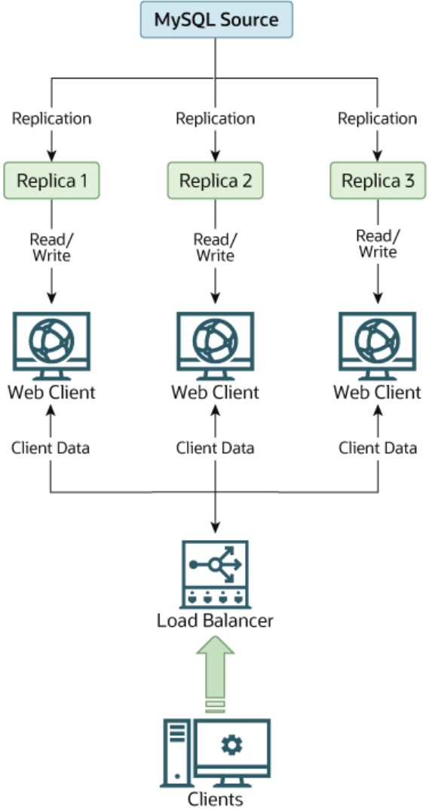
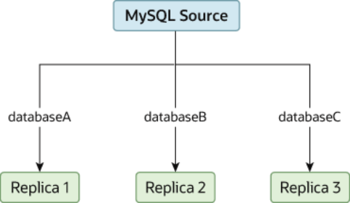
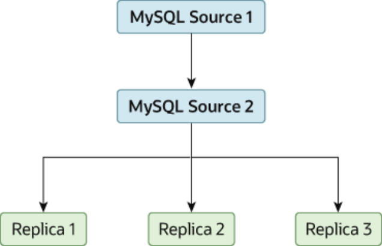
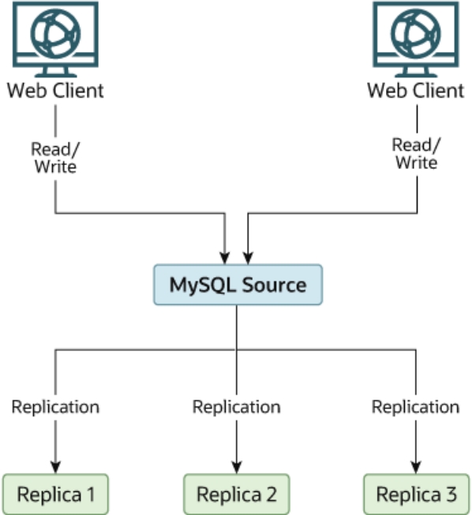
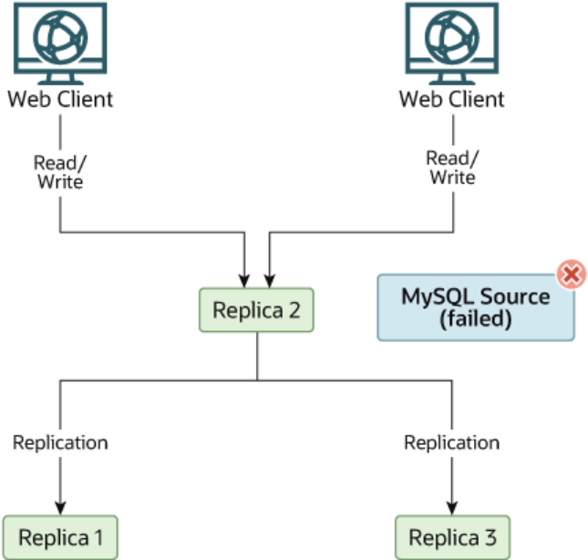

## Table of Contents

17.1 Replication Configuration ....................................................................................................... 2412

17.1.1 How to Set Up Replication .......................................................................................... 2413

17.1.2 Replication Formats .................................................................................................... 2423

17.1.3 Replication with Global Transaction Identifiers ............................................................. 2431

17.1.4 Replication and Binary Logging Options and Variables ................................................. 2440

17.1.5 Common Replication Administration Tasks .................................................................. 2506

17.2 Replication Implementation .................................................................................................... 2508

17.2.1 Replication Threads .................................................................................................... 2509

17.2.2 Relay Log and Replication Metadata Repositories ........................................................ 2512

17.2.3 How Servers Evaluate Replication Filtering Rules ........................................................ 2518

17.3 Replication Solutions ............................................................................................................. 2524

17.3.1 Using Replication for Backups .................................................................................... 2524

17.3.2 Handling an Unexpected Halt of a Replica Server ........................................................ 2528

17.3.3 Using Replication with Different Source and Replica Storage Engines ........................... 2530

17.3.4 Using Replication for Scale-Out .................................................................................. 2531

17.3.5 Replicating Different Databases to Different Replicas ................................................... 2533

17.3.6 Improving Replication Performance ............................................................................. 2534

17.3.7 Switching Sources During Failover .............................................................................. 2536

17.3.8 Setting Up Replication to Use Encrypted Connections .................................................. 2538

17.3.9 Semisynchronous Replication ..................................................................................... 2540

17.3.10 Delayed Replication .................................................................................................. 2544

17.4 Replication Notes and Tips .................................................................................................... 2545

17.4.1 Replication Features and Issues ................................................................................. 2545

17.4.2 Replication Compatibility Between MySQL Versions ..................................................... 2569

17.4.3 Upgrading a Replication Setup .................................................................................... 2570

17.4.4 Troubleshooting Replication ........................................................................................ 2572

17.4.5 How to Report Replication Bugs or Problems .............................................................. 2573 Replication enables data from one MySQL database server (the source) to be replicated to one or more MySQL database servers (the replicas). Replication is asynchronous by default, therefore replicas do not need to be connected permanently to receive updates from the source. This means that updates can occur over long-distance connections and even over temporary or intermittent connections such as a dial-up service. Depending on the configuration, you can replicate all databases, selected databases, or even selected tables within a database.

For answers to some questions often asked by those who are new to MySQL Replication, see Section A.14, “MySQL 5.6 FAQ: Replication”.

Advantages of replication in MySQL include:

- Scale-out solutions - spreading the load among multiple replicas to improve performance. In this

environment, all writes and updates must take place on the replication source server. Reads, however,may take place on one or more replicas. This model can improve the performance of writes (since the source is dedicated to updates), while dramatically increasing read speed across an increasing number of replicas.

- Data security - because data is replicated to the replica, and the replica can pause the replication

process, it is possible to run backup services on the replica without corrupting the corresponding data on the source.

Replication Configuration

- Analytics - live data can be created on the source, while the analysis of the information can take place on

the replica without affecting the performance of the source.

- Long-distance data distribution - if a branch office would like to work with a copy of your main data, you

can use replication to create a local copy of the data for their use without requiring permanent access to the source.

Replication in MySQL features support for one-way, asynchronous replication, in which one server acts as the source, while one or more other servers act as replicas. This is in contrast to the synchronous replication which is a characteristic of NDB Cluster (see Chapter 18, MySQL NDB Cluster 7.3 and NDB Cluster 7.4). In MySQL 5.6, an interface to semisynchronous replication is supported in addition to the built-in asynchronous replication. With semisynchronous replication, a commit performed on the source blocks before returning to the session that performed the transaction until at least one replica acknowledges that it has received and logged the events for the transaction. See Section 17.3.9,“Semisynchronous Replication” MySQL 5.6 also supports delayed replication such that a replica server deliberately lags behind the source by at least a specified amount of time. See Section 17.3.10, “Delayed Replication”. For scenarios where synchronous replication is required, use NDB Cluster (see Chapter 18,MySQL NDB Cluster 7.3 and NDB Cluster 7.4).

There are a number of solutions available for setting up replication between two servers, but the best method to use depends on the presence of data and the engine types you are using. For more information on the available options, see Section 17.1.1, “How to Set Up Replication”.

There are two core types of replication format, Statement Based Replication (SBR), which replicates entire SQL statements, and Row Based Replication (RBR), which replicates only the changed rows. You may also use a third variety, Mixed Based Replication (MBR). For more information on the different replication formats, see Section 17.1.2, “Replication Formats”. In MySQL 5.6, statement-based format is the default.

MySQL 5.6.5 and later supports transactional replication based on global transaction identifiers (GTIDs).

When using this type of replication, it is not necessary to work directly with log files or positions within these files, which greatly simplifies many common replication tasks. Because replication using GTIDs is entirely transactional, consistency between source and replica is guaranteed as long as all transactions committed on the source have also been applied on the replica. For more information about GTIDs and GTID-based replication, see Section 17.1.3, “Replication with Global Transaction Identifiers”.

Replication is controlled through a number of different options and variables. These control the core operation of the replication, timeouts, and the databases and filters that can be applied on databases and tables. For more information on the available options, see Section 17.1.4, “Replication and Binary Logging Options and Variables”.

You can use replication to solve a number of different problems, including problems with performance,supporting the backup of different databases, and as part of a larger solution to alleviate system failures.

For information on how to address these issues, see Section 17.3, “Replication Solutions”.

For notes and tips on how different data types and statements are treated during replication, including details of replication features, version compatibility, upgrades, and problems and their resolution, including an FAQ, see Section 17.4, “Replication Notes and Tips”.

For detailed information on the implementation of replication, how replication works, the process and contents of the binary log, background threads and the rules used to decide how statements are recorded and replication, see Section 17.2, “Replication Implementation”.

## 17.1 Replication Configuration

Replication between servers in MySQL is based on the binary logging mechanism. The MySQL instance operating as the replication source server (the source of the database changes) writes updates and changes as “events” to the binary log. The information in the binary log is stored in different logging formats How to Set Up Replication according to the database changes being recorded. Replicas are configured to read the binary log from the source and to execute the events in the binary log on the replica's local database.

Important You cannot configure the source to log only certain events.

The source is “dumb” in this scenario. Once binary logging has been enabled, all statements are recorded in the binary log. Each replica receives a copy of the entire contents of the binary log. It is the responsibility of the replica to decide which statements in the binary log should be executed; you cannot configure the source to log only certain events. If you do not specify otherwise, all events in the source's binary log are executed on the replica. If required, you can configure the replica to process only events that apply to particular databases or tables.

Each replica keeps a record of the binary log coordinates: The file name and position within the file that it has read and processed from the source. This means that multiple replicas can be connected to the source and executing different parts of the same binary log. Because the replicas control this process, individual replicas can be connected and disconnected from the server without affecting the source's operation. Also,because each replica records the current position within the binary log, it is possible for replicas to be disconnected, reconnect and then resume processing.

The source and each replica must be configured with a unique ID (using the `server_id` system variable).

In addition, each replica must be configured with information about the source's host name, log file name,and position within that file. These details can be controlled from within a MySQL session using the`CHANGE MASTER TO` statement on the replica. The details are stored within the replica's connection metadata repository, which can be either a file or a table (see Section 17.2.2, “Relay Log and Replication Metadata Repositories”).

This section describes the setup and configuration required for a replication environment, including step-by-step instructions for creating a new replication environment. The major components of this section are:

- For a guide to setting up two or more servers for replication, Section 17.1.1, “How to Set Up Replication”,

deals with the configuration of the systems and provides methods for copying data between the source and replicas.

- Events in the binary log are recorded using a number of formats. These are referred to as statement-

based replication (SBR) or row-based replication (RBR). A third type, mixed-format replication (MIXED),uses SBR or RBR replication automatically to take advantage of the benefits of both SBR and RBR formats when appropriate. The different formats are discussed in Section 17.1.2, “Replication Formats”.

- Detailed information on the different configuration options and variables that apply to replication is

provided in Section 17.1.4, “Replication and Binary Logging Options and Variables”.

- Once started, the replication process should require little administration or monitoring. However, for

advice on common tasks that you may want to execute, see Section 17.1.5, “Common Replication Administration Tasks”.

### 17.1.1 How to Set Up Replication

This section describes how to set up complete replication of a MySQL server. There are a number of different methods for setting up replication, and the exact method to use depends on how you are setting up replication, and whether you already have data within your source database.

There are some generic tasks that are common to all replication setups:

- On the source, you must enable binary logging and configure a unique server ID. This might require a

server restart. See Section 17.1.1.1, “Setting the Replication Source Configuration”.

How to Set Up Replication

- On each replica that you want to connect to the source, you must configure a unique server ID. This

might require a server restart. See Section 17.1.1.2, “Setting the Replica Configuration”.

- Optionally, create a separate user for your replicas to use during authentication with the source when

reading the binary log for replication. See Section 17.1.1.3, “Creating a User for Replication”.

- Before creating a data snapshot or starting the replication process, you should record the position of

the binary log on the source. You need this information when configuring the replica so that the replica knows where within the binary log to start executing events. See Section 17.1.1.4, “Obtaining the Replication Source Binary Log Coordinates”.

- If you already have data on your source and want to use it to synchronize your replica, you need to

create a data snapshot. There are different methods to create the database snapshot, depending on the size of the database and the location of the files. Create a snapshot using `mysqldump` (see Section 17.1.1.5, “Creating a Data Snapshot Using mysqldump”) or by copying the data files directly (see Section 17.1.1.6, “Creating a Data Snapshot Using Raw Data Files”).

- Configure the replica with settings for connecting to the source, such as the host name, login credentials,

and binary log file name and position. See Section 17.1.1.10, “Setting the Source Configuration on the Replica”.

After configuring the basic options, select your scenario:

- To set up replication for a fresh installation of a source and replicas that contain no data, see

Section 17.1.1.7, “Setting Up Replication with New Source and Replicas”.

- To set up replication of a new source using the data from an existing MySQL server, see

Section 17.1.1.8, “Setting Up Replication with Existing Data”.

- To add replicas to an existing replication environment, see Section 17.1.1.9, “Introducing Additional

Replicas to an Existing Replication Environment”.

Before administering MySQL replication servers, read this entire chapter and try all statements mentioned in Section 13.4.1, “SQL Statements for Controlling Replication Source Servers”, and Section 13.4.2, “SQL Statements for Controlling Replica Servers”. Also familiarize yourself with the replication startup options described in Section 17.1.4, “Replication and Binary Logging Options and Variables”.

Note Certain steps within the setup process require the `SUPER` privilege. If you do not have this privilege, it might not be possible to enable replication.

#### 17.1.1.1 Setting the Replication Source Configuration

On a replication source server, you must enable binary logging and establish a unique server ID. If this has not already been done, a server restart is required.

Binary logging must be enabled on the source because the binary log is the basis for replicating changes from the source to its replicas. If binary logging is not enabled using the `log-bin` option, replication is not possible.

Each server within a replication group must be configured with a unique server ID. This ID is used to identify individual servers within the group, and must be a positive integer between 1 and (232)−1. How you organize and select the numbers is your choice.

To configure the binary log and server ID options, shut down the MySQL server and edit the `my.cnf` or`my.ini` file. Within the `[mysqld]` section of the configuration file, add the `log-bin` and `server-id`How to Set Up Replication options. If these options already exist, but are commented out, uncomment the options and alter them according to your needs. For example, to enable binary logging using a log file name prefix of `mysql-bin`,and configure a server ID of 1, use these lines:

```
[mysqld]
log-bin=mysql-bin
server-id=1
```

After making the changes, restart the server.

Note If you do not set `server_id` (or set it explicitly to its default value of 0), the source refuses any connections from replicas.

Note For the greatest possible durability and consistency in a replication setup using `InnoDB` with transactions, you should use`innodb_flush_log_at_trx_commit=1` and `sync_binlog=1` in the source`my.cnf` file.

Note Ensure that the `skip_networking` system variable is not enabled on your replication source server. If networking has been disabled, the replica can not communicate with the source and replication fails.

#### 17.1.1.2 Setting the Replica Configuration

On a replica, you must establish a unique server ID. If this has not already been done, this part of replica setup requires a server restart.

If the replica server ID is not already set, or the current value conflicts with the value that you have chosen for the replication source server, shut down the replica server and edit the `[mysqld]` section of the configuration file to specify a unique server ID. For example:

```
[mysqld]
server-id=2
```

After making the changes, restart the server.

If you are setting up multiple replicas, each one must have a unique `server_id` value that differs from that of the source and from any of the other replicas.

Note If you do not set `server_id` (or set it explicitly to its default value of 0), the replica refuses to connect to a source.

You do not have to enable binary logging on the replica for replication to be set up. However, if you enable binary logging on the replica, you can use the replica's binary log for data backups and crash recovery, and also use the replica as part of a more complex replication topology. For example, where this replica then acts as a source to other replicas.

#### 17.1.1.3 Creating a User for Replication

Each replica connects to the source using a MySQL user name and password, so there must be a user account on the source server that the replica can use to connect. Any account can be used for this How to Set Up Replication operation, providing it has been granted the `REPLICATION SLAVE` privilege. You can choose to create a different account for each replica, or connect to the source using the same account for each replica.

Although you do not have to create an account specifically for replication, you should be aware that the replication user name and password are stored in plain text in the replica's connection metadata repository file or table (see Section 17.2.2.2, “Replication Metadata Repositories”). Therefore, you may want to create a separate account that has privileges only for the replication process, to minimize the possibility of compromise to other accounts.

To create a new account, use `CREATE USER`. To grant this account the privileges required for replication,use the `GRANT` statement. If you create an account solely for the purposes of replication, that account needs only the `REPLICATION SLAVE` privilege. For example, to set up a new user, `repl`, that can connect for replication from any host within the `example.com` domain, issue these statements on the source:

```
mysql> CREATE USER 'repl'@'%.example.com' IDENTIFIED BY 'password';
mysql> GRANT REPLICATION SLAVE ON *.* TO 'repl'@'%.example.com';
```

See Section 13.7.1, “Account Management Statements”, for more information on statements for manipulation of user accounts.

#### 17.1.1.4 Obtaining the Replication Source Binary Log Coordinates

To configure the replica to start the replication process at the correct point, you need to note the source's current coordinates within its binary log.

Warning This procedure uses `FLUSH TABLES WITH READ LOCK`, which blocks `COMMIT`operations for `InnoDB` tables.

If you have existing data on your source server that you want to synchronize on your replicas before starting the replication process, you must stop processing statements on the source, and then obtain its current binary log coordinates and dump its data, before permitting the source to continue executing statements. If you do not stop the execution of statements, the data dump and the source status information that you use does not match and you may end up with inconsistent or corrupted databases on the replicas.

If you are planning to shut down the source to create a data snapshot, you can optionally skip this procedure and instead store a copy of the binary log index file along with the data snapshot. In that situation, the source creates a new binary log file on restart. The source's binary log coordinates where the replica must start the replication process are therefore the start of that new file, which is the next binary log file on the source following after the files that are listed in the copied binary log index file.

To obtain the source's binary log coordinates, follow these steps:

1. Start a session on the source by connecting to it with the command-line client, and flush all tables and

block write statements by executing the `FLUSH TABLES WITH READ LOCK` statement:

```
mysql> FLUSH TABLES WITH READ LOCK;
```

Warning Leave the client from which you issued the `FLUSH TABLES` statement running so that the read lock remains in effect. If you exit the client, the lock is released.

2. In a different session on the source, use the `SHOW MASTER STATUS` statement to determine the

current binary log file name and position:How to Set Up Replication

```
mysql > SHOW MASTER STATUS;
+------------------+----------+--------------+------------------+
| File             | Position | Binlog_Do_DB | Binlog_Ignore_DB |
+------------------+----------+--------------+------------------+
| mysql-bin.000003 | 73       | test         | manual,mysql     |
+------------------+----------+--------------+------------------+
```

The `File` column shows the name of the log file and `Position` shows the position within the file. In this example, the binary log file is `mysql-bin.000003` and the position is 73. Record these values.

You need them later when you are setting up the replica. They represent the replication coordinates at which the replica should begin processing new updates from the source.

If the source has been running previously without binary logging enabled, the log file name and position values displayed by `SHOW MASTER STATUS` or `mysqldump --master-data` is empty. In that case,the values that you need to use later when specifying the binary log file and position are the empty string (`''`) and 4.

You now have the information you need to enable the replica to start reading from the binary log in the correct place to start replication.

If you have existing data that needs be to synchronized with the replica before you start replication, leave the client running so that the lock remains in place and then proceed to Section 17.1.1.5, “Creating a Data Snapshot Using mysqldump”, or Section 17.1.1.6, “Creating a Data Snapshot Using Raw Data Files”. The idea here is to prevent any further changes so that the data copied to the replicas is in synchrony with the source.

If you are setting up a brand new source and replica replication group, you can exit the first session to release the read lock.

#### 17.1.1.5 Creating a Data Snapshot Using mysqldump

One way to create a snapshot of the data in an existing source database is to use the `mysqldump` tool to create a dump of all the databases you want to replicate. Once the data dump has been completed, you then import this data into the replica before starting the replication process.

The example shown here dumps all databases to a file named `dbdump.db`, and includes the `--master-``data` option which automatically appends the `CHANGE MASTER TO` statement required on the replica to start the replication process:

```
$> mysqldump --all-databases --master-data > dbdump.db
```

If you do not use `--master-data`, then it is necessary to lock all tables in a separate session manually(using `FLUSH TABLES WITH READ LOCK`) prior to running `mysqldump`, then exiting or running UNLOCK TABLES from the second session to release the locks. You must also obtain binary log position information matching the snapshot, using `SHOW MASTER STATUS`, and use this to issue the appropriate `CHANGE``MASTER TO` statement when starting the replica.

When choosing databases to include in the dump, remember that you need to filter out databases on each replica that you do not want to include in the replication process.

To import the data, either copy the dump file to the replica, or access the file from the source when connecting remotely to the replica.

#### 17.1.1.6 Creating a Data Snapshot Using Raw Data Files

If your database is large, copying the raw data files can be more efficient than using `mysqldump` and importing the file on each replica. This technique skips the overhead of updating indexes as the `INSERT`statements are replayed.

How to Set Up Replication Using this method with tables in storage engines with complex caching or logging algorithms requires extra steps to produce a perfect “point in time” snapshot: the initial copy command might leave out cache information and logging updates, even if you have acquired a global read lock. How the storage engine responds to this depends on its crash recovery abilities.

This method also does not work reliably if the source and replica have different values for`ft_stopword_file`, `ft_min_word_len`, or `ft_max_word_len` and you are copying tables having full-text indexes.

If you use `InnoDB` tables, you can use the `mysqlbackup` command from the MySQL Enterprise Backup component to produce a consistent snapshot. This command records the log name and offset corresponding to the snapshot to be later used on the replica. MySQL Enterprise Backup is a commercial product that is included as part of a MySQL Enterprise subscription. See Section 24.2, “MySQL Enterprise Backup Overview” for detailed information.

Otherwise, use the cold backup technique to obtain a reliable binary snapshot of `InnoDB` tables: copy all data files after doing a slow shutdown of the MySQL Server.

To create a raw data snapshot of `MyISAM` tables, you can use standard copy tools such as `cp` or `copy`, a remote copy tool such as `scp` or `rsync`, an archiving tool such as `zip` or `tar`, or a file system snapshot tool such as `dump`, providing that your MySQL data files exist on a single file system. If you are replicating only certain databases, copy only those files that relate to those tables. (For `InnoDB`, all tables in all databases are stored in the system tablespace files, unless you have the `innodb_file_per_table`option enabled.)You might want to specifically exclude the following files from your archive:

- Files relating to the `mysql` database.
- The replica's connection metadata repository file, if used (see Section 17.2.2, “Relay Log and Replication

Metadata Repositories”).

- The source's binary log files, with the exception of the binary log index file if you are going to use this to

locate the source's binary log coordinates for the replica.

- Any relay log files.

To get the most consistent results with a raw data snapshot, shut down the source server during the process, as follows:

1. Acquire a read lock and get the source's status. See Section 17.1.1.4, “Obtaining the Replication

Source Binary Log Coordinates”.

2. In a separate session, shut down the source server:

```
$> mysqladmin shutdown
```

3. Make a copy of the MySQL data files. The following examples show common ways to do this. You need

to choose only one of them:

```
$> tar cf /tmp/db.tar ./data
$> zip -r /tmp/db.zip ./data
$> rsync --recursive ./data /tmp/dbdata
```

4. Restart the source server.

If you are not using `InnoDB` tables, you can get a snapshot of the system from a source without shutting down the server as described in the following steps:How to Set Up Replication

1. Acquire a read lock and get the source's status. See Section 17.1.1.4, “Obtaining the Replication

Source Binary Log Coordinates”.

2. Make a copy of the MySQL data files. The following examples show common ways to do this. You need

to choose only one of them:

```
$> tar cf /tmp/db.tar ./data
$> zip -r /tmp/db.zip ./data
$> rsync --recursive ./data /tmp/dbdata
```

3. In the client where you acquired the read lock, release the lock:

```
mysql> UNLOCK TABLES;
```

Once you have created the archive or copy of the database, copy the files to each replica before starting the replication process.

#### 17.1.1.7 Setting Up Replication with New Source and Replicas

The easiest and most straightforward method for setting up replication is to use new source and replica servers.

You can also use this method if you are setting up new servers but have an existing dump of the databases from a different server that you want to load into your replication configuration. By loading the data into a new source, the data is automatically replicated to the replicas.

To set up replication between a new source and replica:

1. Configure the MySQL source with the necessary configuration properties. See Section 17.1.1.1,

“Setting the Replication Source Configuration”.

2. Start up the MySQL source.
3. Set up a user. See Section 17.1.1.3, “Creating a User for Replication”.
4. Obtain the source's status information, or a copy of the source's binary log index file made during a

shutdown for the data snapshot. See Section 17.1.1.4, “Obtaining the Replication Source Binary Log Coordinates”.

5. On the source, release the read lock:

```
mysql> UNLOCK TABLES;
```

6. On the replica, edit the MySQL configuration. See Section 17.1.1.2, “Setting the Replica Configuration”.
7. Start up the MySQL replica server.
8. Execute a `CHANGE MASTER TO` statement to set the replication source server configuration. See

Section 17.1.1.10, “Setting the Source Configuration on the Replica”.

Perform the replica setup steps on each replica.

Because there is no data to load or exchange on a new server configuration you do not need to copy or import any information.

If you are setting up a new replication environment using the data from a different existing database server,you must now run the dump file generated from that server on the new source. The database updates are automatically propagated to the replicas:

```
$> mysql -h source < fulldb.dump
```

How to Set Up Replication

#### 17.1.1.8 Setting Up Replication with Existing Data

When setting up replication with existing data, you must decide how best to get the data from the source to the replica before starting the replication service.

The basic process for setting up replication with existing data is as follows:

1. With the MySQL source running, create a user to be used by the replica when connecting to the source

during replication. See Section 17.1.1.3, “Creating a User for Replication”.

2. If you have not already configured the `server_id` system variable and enabled binary logging on the

source server, you must shut it down to configure these options. See Section 17.1.1.1, “Setting the Replication Source Configuration”.

If you have to shut down your source server, this is a good opportunity to take a snapshot of its databases. You should obtain the source status (see Section 17.1.1.4, “Obtaining the Replication Source Binary Log Coordinates”) before taking down the source, updating the configuration and taking a snapshot. For information on how to create a snapshot using raw data files, see Section 17.1.1.6,“Creating a Data Snapshot Using Raw Data Files”.

3. If your source server is already correctly configured, obtain its status (see Section 17.1.1.4, “Obtaining

the Replication Source Binary Log Coordinates”) and then use `mysqldump` to take a snapshot (see Section 17.1.1.5, “Creating a Data Snapshot Using mysqldump”) or take a raw snapshot of the live server using the guide in Section 17.1.1.6, “Creating a Data Snapshot Using Raw Data Files”.

4. Update the configuration of the replica. See Section 17.1.1.2, “Setting the Replica Configuration”.
5. The next step depends on how you created the snapshot of data on the source.

If you used `mysqldump`:a. Start the replica, using the `--skip-slave-start` option so that replication does not start.

b. Import the dump file:

```
$> mysql < fulldb.dump
```

If you created a snapshot using the raw data files:a. Extract the data files into the replica's data directory. For example:

```
$> tar xvf dbdump.tar
```

You may need to set permissions and ownership on the files so that the replica server can access and modify them.

b. Start the replica, using the `--skip-slave-start` option so that replication does not start.

6. Configure the replica with the replication coordinates from the source. This tells the replica the binary

log file and position within the file where replication needs to start. Also, configure the replica with the login credentials and host name of the source. For more information on the `CHANGE MASTER TO`statement required, see Section 17.1.1.10, “Setting the Source Configuration on the Replica”.

7. Start the replication threads:

```
mysql> START SLAVE;
```

After you have performed this procedure, the replica should connect to the source and catch up on any updates that have occurred since the snapshot was taken.

How to Set Up Replication If you have forgotten to set the `server_id` system variable for the source, replicas cannot connect to it.

If you have forgotten to set the `server_id` system variable for the replica, you get the following error in the replica's error log:

```
Warning: You should set server-id to a non-0 value if master_host
is set; we will force server id to 2, but this MySQL server will
not act as a slave.
```

You also find error messages in the replica's error log if it is not able to replicate for any other reason.

The replica uses information stored in its connection metadata repository to keep track of how much of the source's binary log it has processed. The repository can be in the form of files or a table, as determined by the value set for the `master_info_repository` system variable. When a replica runs with `master_info_repository=FILE`, you can find in its data directory two files, named `master.info`and `relay-log.info`. If `master_info_repository=TABLE` instead, this information is saved in the table `master_slave_info` in the `mysql` system database. In either case, do not remove or edit the files or table unless you know exactly what you are doing and fully understand the implications. Even in that case, it is preferred that you use the `CHANGE MASTER TO` statement to change replication parameters.

The replica can use the values specified in the statement to update the status files automatically. See Section 17.2.2, “Relay Log and Replication Metadata Repositories”, for more information.

Note The contents of the connection metadata repository override some of the server options specified on the command line or in `my.cnf`. See Section 17.1.4,“Replication and Binary Logging Options and Variables”, for more details.

A single snapshot of the source suffices for multiple replicas. To set up additional replicas, use the same source snapshot and follow the replica portion of the procedure just described.

#### 17.1.1.9 Introducing Additional Replicas to an Existing Replication Environment

You can add another replica to an existing replication configuration without stopping the source. To do this, you can set up the new replica by copying the data directory of an existing replica, and giving the new replica a different server ID (which is user-specified) and server UUID (which is generated at startup).

To duplicate an existing replica:

1. Stop the existing replica and record the replica status information, particularly the source's binary log

file and relay log file positions. You can view the replica status by issuing `SHOW SLAVE STATUS` as follows:

```
mysql> STOP SLAVE;
mysql> SHOW SLAVE STATUS\G
```

2. Shut down the existing replica:

```
$> mysqladmin shutdown
```

3. Copy the data directory from the existing replica to the new replica, including the log files and relay log

files. You can do this by creating an archive using `tar` or `WinZip`, or by performing a direct copy using a tool such as `cp` or `rsync`.

> Important

- Before copying, verify that all the files relating to the existing replica actually

are stored in the data directory. For example, the `InnoDB` system tablespace,undo tablespace, and redo log might be stored in an alternative location.

How to Set Up Replication`InnoDB` tablespace files and file-per-table tablespaces might have been created in other directories. The binary logs and relay logs for the replica might be in their own directories outside the data directory. Check through the system variables that are set for the existing replica and look for any alternative paths that have been specified. If you find any, copy these directories over as well.

- During copying, if files have been used for the replication metadata

repositories (see Section 17.2.2, “Relay Log and Replication Metadata Repositories”), which is the default in MySQL 5.6, ensure that you also copy these files from the existing replica to the new replica. If tables have been used for the repositories, the tables are in the data directory.

- After copying, delete the `auto.cnf` file from the copy of the data directory on

the new replica, so that the new replica is started with a different generated server UUID. The server UUID must be unique.

A common problem that is encountered when adding new replicas is that the new slave fails with a series of warning and error messages like these:

```
071118 16:44:10 [Warning] Neither --relay-log nor --relay-log-index were used; so
replication may break when this MySQL server acts as a slave and has his hostname
changed!! Please use '--relay-log=new_replica_hostname-relay-bin' to avoid this problem.
071118 16:44:10 [ERROR] Failed to open the relay log './old_replica_hostname-relay-bin.003525'
(relay_log_pos 22940879)
071118 16:44:10 [ERROR] Could not find target log during relay log initialization
071118 16:44:10 [ERROR] Failed to initialize the master info structure
```

This situation can occur if the `relay_log` system variable is not specified, as the relay log files contain the host name as part of their file names. This is also true of the relay log index file if the`relay_log_index` system variable is not used. For more information about these variables, see Section 17.1.4, “Replication and Binary Logging Options and Variables”.

To avoid this problem, use the same value for `relay_log` on the new replica that was used on the existing replica. If this option was not set explicitly on the existing replica, use`existing_replica_hostname-relay-bin`. If this is not possible, copy the existing replica's relay log index file to the new replica and set the `relay_log_index` system variable on the new replica to match what was used on the existing replica. If this option was not set explicitly on the existing replica,use `existing_replica_hostname-relay-bin.index`. Alternatively, if you have already tried to start the new replica after following the remaining steps in this section and have encountered errors like those described previously, then perform the following steps:a. If you have not already done so, issue `STOP SLAVE` on the new replica.

If you have already started the existing replica again, issue `STOP SLAVE` on the existing replica as well.

b. Copy the contents of the existing replica's relay log index file into the new replica's relay log index file, making sure to overwrite any content already in the file.

c. Proceed with the remaining steps in this section.

4. When copying is complete, restart the existing replica.
5. On the new replica, edit the configuration and give the new replica a unique server ID (using the

`server_id` system variable) that is not used by the source or any of the existing replicas.

Replication Formats

6. Start the new replica server, specifying the `--skip-slave-start` option so that replication does not

start yet. Issue `SHOW SLAVE STATUS` to confirm that the new replica has the correct settings when compared with the existing replica. Also display the server ID and server UUID and verify that these are correct and unique for the new replica.

7. Start the replication threads by issuing a `START SLAVE` statement:

```
mysql> START SLAVE;
```

The new replica now uses the information in its connection metadata repository to start the replication process.

#### 17.1.1.10 Setting the Source Configuration on the Replica

To set up the replica to communicate with the source for replication, you must tell the replica the necessary connection information. To do this, execute the following statement on the replica, replacing the option values with the actual values relevant to your system:

```
mysql> CHANGE MASTER TO
->     MASTER_HOST='source_host_name',
->     MASTER_USER='replication_user_name',
->     MASTER_PASSWORD='replication_password',
->     MASTER_LOG_FILE='recorded_log_file_name',
->     MASTER_LOG_POS=recorded_log_position;
```

Note Replication cannot use Unix socket files. You must be able to connect to the replication source server using TCP/IP.

The `CHANGE MASTER TO` statement has other options as well. For example, it is possible to set up secure replication using SSL. For a full list of options, and information about the maximum permissible length for the string-valued options, see Section 13.4.2.1, “CHANGE MASTER TO Statement”.

### 17.1.2 Replication Formats

Replication works because events written to the binary log are read from the source and then processed on the replica. The events are recorded within the binary log in different formats according to the type of event. The different replication formats used correspond to the binary logging format used when the events were recorded in the source's binary log. The correlation between binary logging formats and the terms used during replication are:

- When using statement-based binary logging, the source writes SQL statements to the binary log.

Replication of the source to the replica works by executing the SQL statements on the replica. This is called statement-based replication (often abbreviated as SBR), which corresponds to the standard MySQL statement-based binary logging format. Replication capabilities in MySQL version 5.1.4 and earlier used this format exclusively.

- When using row-based logging, the source writes events to the binary log that indicate how individual

table rows are changed. Replication of the source to the replica works by copying the events representing the changes to the table rows to the replica. This is called row-based replication (often abbreviated as RBR). In row-based replication, the source writes events to the binary log that indicate how individual table rows are changed.

- You can also configure MySQL to use a mix of both statement-based and row-based logging, depending

on which is most appropriate for the change to be logged. This is called mixed-format logging. When using mixed-format logging, a statement-based log is used by default. Depending on certain statements,Replication Formats and also the storage engine being used, the log is automatically switched to row-based in particular cases. Replication using the mixed format is often referred to as mixed-based replication or mixed-format replication. For more information, see Section 5.4.4.3, “Mixed Binary Logging Format”.

In MySQL 5.6, statement-based format is the default.

> NDB Cluster. The default binary logging format in all MySQL NDB Cluster 7.3 and MySQL NDB Cluster

7.4 releases is `MIXED`. You should note that NDB Cluster Replication always uses row-based replication,and that the `NDB` storage engine is incompatible with statement-based replication. See Section 18.7.2,“General Requirements for NDB Cluster Replication”, for more information.

When using `MIXED` format, the binary logging format is determined in part by the storage engine being used and the statement being executed. For more information on mixed-format logging and the rules governing the support of different logging formats, see Section 5.4.4.3, “Mixed Binary Logging Format”.

The logging format in a running MySQL server is controlled by setting the `binlog_format` server system variable. This variable can be set with session or global scope. The rules governing when and how the new setting takes effect are the same as for other MySQL server system variables. Setting the variable for the current session lasts only until the end of that session, and the change is not visible to other sessions.

Setting the variable globally takes effect for clients that connect after the change, but not for any current client sessions, including the session where the variable setting was changed. To make the global system variable setting permanent so that it applies across server restarts, you must set it in an option file. For more information, see Section 13.7.4.1, “SET Syntax for Variable Assignment”.

There are conditions under which you cannot change the binary logging format at runtime or doing so causes replication to fail. See Section 5.4.4.2, “Setting The Binary Log Format”.

Changing the global `binlog_format` value requires privileges sufficient to set global system variables.

Changing the session `binlog_format` value requires privileges sufficient to set restricted session system variables. See Section 5.1.8.1, “System Variable Privileges”.

The statement-based and row-based replication formats have different issues and limitations. For a comparison of their relative advantages and disadvantages, see Section 17.1.2.1, “Advantages and Disadvantages of Statement-Based and Row-Based Replication”.

With statement-based replication, you may encounter issues with replicating stored routines or triggers. You can avoid these issues by using row-based replication instead. For more information, see Section 20.7, “Stored Program Binary Logging”.

> 17.1.2.1 Advantages and Disadvantages of Statement-Based and Row-Based Replication

Each binary logging format has advantages and disadvantages. For most users, the mixed replication format should provide the best combination of data integrity and performance. If, however, you want to take advantage of the features specific to the statement-based or row-based replication format when performing certain tasks, you can use the information in this section, which provides a summary of their relative advantages and disadvantages, to determine which is best for your needs.

- Advantages of statement-based replication
- Disadvantages of statement-based replication
- Advantages of row-based replication
- Disadvantages of row-based replication

Advantages of statement-based replication Replication Formats

- Proven technology.
- Less data written to log files. When updates or deletes affect many rows, this results in much less

storage space required for log files. This also means that taking and restoring from backups can be accomplished more quickly.

- Log files contain all statements that made any changes, so they can be used to audit the database.

> Disadvantages of statement-based replication

- Statements that are unsafe for SBR.

Not all statements which modify data (such as `INSERT` `DELETE`, `UPDATE`, and `REPLACE` statements)can be replicated using statement-based replication. Any nondeterministic behavior is difficult to replicate when using statement-based replication. Examples of such DML (Data Modification Language)statements include the following:

- A statement that depends on a loadable function or stored program that is nondeterministic, since the

value returned by such a function or stored program or depends on factors other than the parameters supplied to it. (Row-based replication, however, simply replicates the value returned by the function or stored program, so its effect on table rows and data is the same on both the source and replica.) See Section 17.4.1.16, “Replication of Invoked Features”, for more information.

- `DELETE` and `UPDATE` statements that use a `LIMIT` clause without an `ORDER BY` are nondeterministic.

See Section 17.4.1.17, “Replication and LIMIT”.

- Statements using any of the following functions cannot be replicated properly using statement-based

replication:

```
- LOAD_FILE()
- UUID(), UUID_SHORT()
- USER()
- FOUND_ROWS()
```

- `SYSDATE()` (unless both the source and the replica are started with the `--sysdate-is-now`

option)

```
- GET_LOCK()
- IS_FREE_LOCK()
- IS_USED_LOCK()
- MASTER_POS_WAIT()
- RAND()
- RELEASE_LOCK()
- SLEEP()
- VERSION()
```

However, all other functions are replicated correctly using statement-based replication, including`NOW()` and so forth.

Replication Formats For more information, see Section 17.4.1.15, “Replication and System Functions”.

Statements that cannot be replicated correctly using statement-based replication are logged with a warning like the one shown here:

```
[Warning] Statement is not safe to log in statement format.
```

A similar warning is also issued to the client in such cases. The client can display it using `SHOW`

```
WARNINGS.
```

- `INSERT ... SELECT` requires a greater number of row-level locks than with row-based replication.
- `UPDATE` statements that require a table scan (because no index is used in the `WHERE` clause) must lock

a greater number of rows than with row-based replication.

- For `InnoDB`: An `INSERT` statement that uses `AUTO_INCREMENT` blocks other nonconflicting `INSERT`

statements.

- For complex statements, the statement must be evaluated and executed on the replica before the rows

are updated or inserted. With row-based replication, the replica only has to modify the affected rows, not execute the full statement.

- If there is an error in evaluation on the replica, particularly when executing complex statements,

statement-based replication may slowly increase the margin of error across the affected rows over time.

See Section 17.4.1.27, “Replica Errors During Replication”.

- Stored functions execute with the same `NOW()` value as the calling statement. However, this is not true

of stored procedures.

- Deterministic loadable functions must be applied on the replicas.
- Table definitions must be (nearly) identical on source and replica. See Section 17.4.1.9, “Replication with

Differing Table Definitions on Source and Replica”, for more information.

> Advantages of row-based replication

- All changes can be replicated. This is the safest form of replication.

Note Statements that update the information in the `mysql` database, such as `GRANT`,`REVOKE` and the manipulation of triggers, stored routines (including stored procedures), and views, are all replicated to replicas using statement-based replication.

For statements such as `CREATE TABLE ... SELECT`, a `CREATE` statement is generated from the table definition and replicated using statement-based format,while the row insertions are replicated using row-based format.

- The technology is the same as in most other database management systems; knowledge about other

systems transfers to MySQL.

- Fewer row locks are required on the source, which thus achieves higher concurrency, for the following

types of statements:

```
- INSERT ... SELECT
```

- `INSERT` statements with `AUTO_INCREMENT`

Replication Formats

- `UPDATE` or `DELETE` statements with `WHERE` clauses that do not use keys or do not change most of the

examined rows.

- Fewer row locks are required on the replica for any `INSERT`, `UPDATE`, or `DELETE` statement.

> Disadvantages of row-based replication

- RBR can generate more data that must be logged. To replicate a DML statement (such as an `UPDATE` or

`DELETE` statement), statement-based replication writes only the statement to the binary log. By contrast,row-based replication writes each changed row to the binary log. If the statement changes many rows,row-based replication may write significantly more data to the binary log; this is true even for statements that are rolled back. This also means that taking and restoring from backup can require more time.

In addition, the binary log is locked for a longer time to write the data, which may cause concurrency problems. Use `binlog_row_image=minimal` to reduce the disadvantage considerably.

- Deterministic loadable functions that generate large `BLOB` values take longer to replicate with row-based

replication than with statement-based replication. This is because the `BLOB` column value is logged,rather than the statement generating the data.

- You cannot see on the replica what statements were received from the source and executed.

However, you can see what data was changed using `mysqlbinlog` with the options `--base64-`

```
output=DECODE-ROWS and --verbose.
```

Alternatively, use the `binlog_rows_query_log_events` variable added in MySQL 5.6.2, which if enabled adds a `Rows_query` event with the statement to `mysqlbinlog` output when the `-vv` option is used.

- For tables using the `MyISAM` storage engine, a stronger lock is required on the replica for `INSERT`

statements when applying them as row-based events to the binary log than when applying them as statements. This means that concurrent inserts on `MyISAM` tables are not supported when using row-based replication.

#### 17.1.2.2 Usage of Row-Based Logging and Replication

MySQL uses statement-based logging (SBL), row-based logging (RBL) or mixed-format logging. The type of binary log used impacts the size and efficiency of logging. Therefore the choice between row-based replication (RBR) or statement-based replication (SBR) depends on your application and environment. This section describes known issues when using a row-based format log, and discusses some best practices using it in replication.

For additional information, see Section 17.1.2, “Replication Formats”, and Section 17.1.2.1, “Advantages and Disadvantages of Statement-Based and Row-Based Replication”.

For information about issues specific to NDB Cluster Replication (which depends on row-based replication), see Section 18.7.3, “Known Issues in NDB Cluster Replication”.

- Row-based logging of temporary tables. As noted in Section 17.4.1.29, “Replication and

Temporary Tables”, temporary tables are not replicated when using row-based format. When using mixed format logging, “safe” statements involving temporary tables are logged using statement-based format. For more information, see Section 17.1.2.1, “Advantages and Disadvantages of Statement-Based and Row-Based Replication”.

Temporary tables are not replicated when using row-based format because there is no need. In addition,because temporary tables can be read only from the thread which created them, there is seldom if ever any benefit obtained from replicating them, even when using statement-based format.

Replication Formats In MySQL 5.6, you can switch from statement-based to row-based binary logging mode even when temporary tables have been created. However, while using the row-based format, the MySQL server cannot determine the logging mode that was in effect when a given temporary table was created. For this reason, the server in such cases logs a `DROP TEMPORARY TABLE IF EXISTS` statement for each temporary table that still exists for a given client session when that session ends. While this means that it is possible that an unnecessary `DROP TEMPORARY TABLE` statement might be logged in some cases, the statement is harmless, and does not cause an error even if the table does not exist, due to the presence of the `IF EXISTS` option.

Note From MySQL 8.0, this behavior is changed because the MySQL server tracks the logging mode that was in effect when each temporary table was created. The`DROP TEMPORARY TABLE IF EXISTS` statement is therefore not necessarily logged for each temporary table. From that release, when a given client session ends, the server logs a `DROP TEMPORARY TABLE IF EXISTS` statement for each temporary table that still exists and was created when statement-based binary logging was in use. If row-based or mixed format binary logging was in use when the table was created, the `DROP TEMPORARY TABLE IF EXISTS`statement is not logged.

Nontransactional DML statements involving temporary tables are allowed when using`binlog_format=ROW`, as long as any nontransactional tables affected by the statements are temporary tables (Bug #14272672).

- RBL and synchronization of nontransactional tables. When many rows are affected, the set of

changes is split into several events; when the statement commits, all of these events are written to the binary log. When executing on the replica, a table lock is taken on all tables involved, and then the rows are applied in batch mode. (This may or may not be effective, depending on the engine used for the replica's copy of the table.)

- Latency and binary log size. RBL writes changes for each row to the binary log and so its size can

increase quite rapidly. This can significantly increase the time required to make changes on the replica that match those on the source. You should be aware of the potential for this delay in your applications.

- Reading the binary log. `mysqlbinlog` displays row-based events in the binary log using the

`BINLOG` statement (see Section 13.7.6.1, “BINLOG Statement”). This statement displays an event as a base 64-encoded string, the meaning of which is not evident. When invoked with the `--base64-``output=DECODE-ROWS` and `--verbose` options, `mysqlbinlog` formats the contents of the binary log to be human readable. When binary log events were written in row-based format and you want to read or recover from a replication or database failure you can use this command to read contents of the binary log. For more information, see Section 4.6.8.2, “mysqlbinlog Row Event Display”.

- Binary log execution errors and slave_exec_mode. If `slave_exec_mode` is `IDEMPOTENT`, a

failure to apply changes from RBL because the original row cannot be found does not trigger an error or cause replication to fail. This means that it is possible that updates are not applied on the replica, so that the source and replica are no longer synchronized. Latency issues and use of nontransactional tables with RBR when `slave_exec_mode` is `IDEMPOTENT` can cause the source and replica to diverge even further. For more information about `slave_exec_mode`, see Section 5.1.7, “Server System Variables”.

Note`slave_exec_mode=IDEMPOTENT` is generally useful only for circular replication or multi-source replication with NDB Cluster, for which `IDEMPOTENT` is the default value.

Replication Formats For other scenarios, setting `slave_exec_mode` to `STRICT` is normally sufficient; this is the default value.

Note Formerly, the default value when using NDB Cluster was`slave_exec_mode=IDEMPOTENT`, but this is no longer the case in MySQL NDB Cluster 7.3 and later.

- Filtering based on server ID not supported. In MySQL 5.6, you can filter based on server ID by

using the `IGNORE_SERVER_IDS` option for the `CHANGE MASTER TO` statement. This option works with statement-based and row-based logging formats. Another method to filter out changes on some replicas is to use a `WHERE` clause that includes the relation `@@server_id <> id_value` clause with `UPDATE`and `DELETE` statements. For example, `WHERE @@server_id <> 1`. However, this does not work correctly with row-based logging. To use the `server_id` system variable for statement filtering, use statement-based logging.

- Database-level replication options. The effects of the `--replicate-do-db`, `--replicate-`

`ignore-db`, and `--replicate-rewrite-db` options differ considerably depending on whether row-based or statement-based logging is used. Therefore, it is recommended to avoid database-level options and instead use table-level options such as `--replicate-do-table` and `--replicate-ignore-``table`. For more information about these options and the impact replication format has on how they operate, see Section 17.1.4, “Replication and Binary Logging Options and Variables”.

- RBL, nontransactional tables, and stopped replicas. When using row-based logging, if the replica

server is stopped while a replication thread is updating a nontransactional table, the replica database can reach an inconsistent state. For this reason, it is recommended that you use a transactional storage engine such as `InnoDB` for all tables replicated using the row-based format. Use of `STOP SLAVE` or`STOP SLAVE SQL_THREAD` prior to shutting down the replica MySQL server helps prevent issues from occurring, and is always recommended regardless of the logging format or storage engine you use.

#### 17.1.2.3 Determination of Safe and Unsafe Statements in Binary Logging

The “safeness” of a statement in MySQL Replication, refers to whether the statement and its effects can be replicated correctly using statement-based format. If this is true of the statement, we refer to the statement as safe; otherwise, we refer to it as unsafe.

In general, a statement is safe if it deterministic, and unsafe if it is not. However, certain nondeterministic functions are not considered unsafe (see Nondeterministic functions not considered unsafe, later in this section). In addition, statements using results from floating-point math functions—which are hardware-dependent—are always considered unsafe (see Section 17.4.1.12, “Replication and Floating-Point Values”).

Handling of safe and unsafe statements. A statement is treated differently depending on whether the statement is considered safe, and with respect to the binary logging format (that is, the current value of

```
binlog_format).
```

- When using row-based logging, no distinction is made in the treatment of safe and unsafe statements.
- When using mixed-format logging, statements flagged as unsafe are logged using the row-based format;

statements regarded as safe are logged using the statement-based format.

- When using statement-based logging, statements flagged as being unsafe generate a warning to this

effect. Safe statements are logged normally.

Replication Formats Each statement flagged as unsafe generates a warning. Formerly, if a large number of such statements were executed on the source, this could lead to excessively large error log files. To prevent this, MySQL provides a warning suppression mechanism (introduced in MySQL 5.6.7), which behaves as follows:Whenever the 50 most recent `ER_BINLOG_UNSAFE_STATEMENT` warnings have been generated more than 50 times in any 50-second period, warning suppression is enabled. When activated, this causes such warnings not to be written to the error log; instead, for each 50 warnings of this type, a note `The last``warning was repeated N times in last S seconds` is written to the error log. This continues as long as the 50 most recent such warnings were issued in 50 seconds or less; once the rate has decreased below this threshold, the warnings are once again logged normally. Warning suppression has no effect on how the safety of statements for statement-based logging is determined, nor on how warnings are sent to the client. MySQL clients still receive one warning for each such statement.

For more information, see Section 17.1.2, “Replication Formats”.

> Statements considered unsafe.

Statements with the following characteristics are considered unsafe:

- Statements containing system functions that may return a different value on replica.

These functions include `FOUND_ROWS()`, `GET_LOCK()`, `IS_FREE_LOCK()`, `IS_USED_LOCK()`,

```
LOAD_FILE(), MASTER_POS_WAIT(), PASSWORD(), RAND(), RELEASE_LOCK(), ROW_COUNT(),
SESSION_USER(), SLEEP(), SYSDATE(), SYSTEM_USER(), USER(), UUID(), and UUID_SHORT().
```

Nondeterministic functions not considered unsafe. Although these functions are not deterministic,they are treated as safe for purposes of logging and replication: `CONNECTION_ID()`, `CURDATE()`,

```
CURRENT_DATE(), CURRENT_TIME(), CURRENT_TIMESTAMP(), CURTIME(),, LAST_INSERT_ID(),
LOCALTIME(), LOCALTIMESTAMP(), NOW(), UNIX_TIMESTAMP(), UTC_DATE(), UTC_TIME(), and
UTC_TIMESTAMP().
```

For more information, see Section 17.4.1.15, “Replication and System Functions”.

- References to system variables. Most system variables are not replicated correctly using the

statement-based format. See Section 17.4.1.35, “Replication and Variables”. For exceptions, see Section 5.4.4.3, “Mixed Binary Logging Format”.

- Loadable Functions. Since we have no control over what a loadable function does, we must assume

that it is executing unsafe statements.

- Trigger or stored program updates a table having an AUTO_INCREMENT column. This is unsafe

because the order in which the rows are updated may differ on the source and the replica.

In addition, an `INSERT` into a table that has a composite primary key containing an `AUTO_INCREMENT`column that is not the first column of this composite key is unsafe.

For more information, see Section 17.4.1.1, “Replication and AUTO_INCREMENT”.

- INSERT DELAYED statement. This statement is considered unsafe because the insertion of the

rows may interleave with concurrently executing statements.

- INSERT ... ON DUPLICATE KEY UPDATE statements on tables with multiple primary or unique

keys. When executed against a table that contains more than one primary or unique key, this statement is considered unsafe, being sensitive to the order in which the storage engine checks the keys, which is not deterministic, and on which the choice of rows updated by the MySQL Server depends.

An `INSERT ... ON DUPLICATE KEY UPDATE` statement against a table having more than one unique or primary key is marked as unsafe for statement-based replication beginning with MySQL 5.6.6.

(Bug #11765650, Bug #58637)Replication with Global Transaction Identifiers

- Updates using LIMIT. The order in which rows are retrieved is not specified, and is therefore

considered unsafe. See Section 17.4.1.17, “Replication and LIMIT”.

- Accesses or references log tables. The contents of the system log table may differ between source

and replica.

- Nontransactional operations after transactional operations. Within a transaction, allowing any

nontransactional reads or writes to execute after any transactional reads or writes is considered unsafe.

For more information, see Section 17.4.1.32, “Replication and Transactions”.

- Accesses or references self-logging tables. All reads and writes to self-logging tables are

considered unsafe. Within a transaction, any statement following a read or write to self-logging tables is also considered unsafe.

- LOAD DATA statements. `LOAD DATA` is treated as unsafe and when `binlog_format=mixed` the

statement is logged in row-based format. When `binlog_format=statement` `LOAD DATA` does not generate a warning, unlike other unsafe statements.

For additional information, see Section 17.4.1, “Replication Features and Issues”.

### 17.1.3 Replication with Global Transaction Identifiers

This section explains transaction-based replication using global transaction identifiers (GTIDs), introduced in MySQL 5.6.5. When using GTIDs, each transaction can be identified and tracked as it is committed on the originating server and applied by any replicas; this means that it is not necessary when using GTIDs to refer to log files or positions within those files when starting a new replica or failing over to a new source,which greatly simplifies these tasks. Because GTID-based replication is completely transaction-based, it is simple to determine whether sources and replicas are consistent; as long as all transactions committed on a source are also committed on a replica, consistency between the two is guaranteed. You can use either statement-based or row-based replication with GTIDs (see Section 17.1.2, “Replication Formats”);

however, for best results, we recommend that you use the row-based format.

This section discusses the following topics:

- How GTIDs are defined and created, and how they are represented in the MySQL Server (see

Section 17.1.3.1, “GTID Concepts”).

- A general procedure for setting up and starting GTID-based replication (see Section 17.1.3.2, “Setting

Up Replication Using GTIDs”).

- Suggested methods for provisioning new replication servers when using GTIDs (see Section 17.1.3.3,

“Using GTIDs for Failover and Scaleout”).

- Restrictions and limitations that you should be aware of when using GTID-based replication (see

Section 17.1.3.4, “Restrictions on Replication with GTIDs”).

- A procedure for disabling GTIDs, which you must do if you have enabled GTIDs and are downgrading to

a MySQL release that does not support GTIDs (see Section 17.1.3.5, “Disabling GTID Transactions”).

For information about MySQL Server options and variables relating to GTID-based replication, see Section 17.1.4.5, “Global Transaction ID Options and Variables”. See also Section 12.18, “Functions Used with Global Transaction IDs”, which describes SQL functions supported by MySQL 5.6 for use with GTIDs.

Replication with Global Transaction Identifiers Note GTIDs are not compatible or supported with the `NDB` storage engine used by NDB Cluster. Enabling GTIDs in NDB Cluster is very likely to cause problems with `NDB`,and to cause NDB Cluster Replication to fail as well.

#### 17.1.3.1 GTID Concepts

A global transaction identifier (GTID) is a unique identifier created and associated with each transaction committed on the server of origin (source). This identifier is unique not only to the server on which it originated, but is unique across all servers in a given replication setup. There is a 1-to-1 mapping between all transactions and all GTIDs.

A GTID is represented as a pair of coordinates, separated by a colon character (:), as shown here:

```
GTID = source_id:transaction_id
```

The `source_id` identifies the originating server. Normally, the server's `server_uuid` is used for this purpose. The `transaction_id` is a sequence number determined by the order in which the transaction was committed on this server; for example, the first transaction to be committed has 1 as its`transaction_id`, and the tenth transaction to be committed on the same originating server is assigned a `transaction_id` of 10. It is not possible for a transaction to have 0 as a sequence number in a GTID. For example, the twenty-third transaction to be committed originally on the server with the UUID`3E11FA47-71CA-11E1-9E33-C80AA9429562` has this GTID:

```
3E11FA47-71CA-11E1-9E33-C80AA9429562:23
```

This format is used to represent GTIDs in the output of statements such as `SHOW SLAVE STATUS` as well as in the binary log. They can also be seen when viewing the log file with `mysqlbinlog` `--base64-``output=DECODE-ROWS` or in the output from `SHOW BINLOG EVENTS`.

As written in the output of statements such as `SHOW MASTER STATUS` or `SHOW SLAVE STATUS`, a sequence of GTIDs originating from the same server may be collapsed into a single expression, as shown here.

```
3E11FA47-71CA-11E1-9E33-C80AA9429562:1-5
```

The example just shown represents the first through fifth transactions originating on the MySQL Server

```
whose server_uuid is 3E11FA47-71CA-11E1-9E33-C80AA9429562.
```

In MySQL 5.6.6 and later, this format is also used to supply the argument required by the `START SLAVE`options `SQL_BEFORE_GTIDS` and `SQL_AFTER_GTIDS`.

GTID Sets A GTID set is a set of global transaction identifiers which is represented as shown here:

```
gtid_set:
uuid_set [, uuid_set] ...
| ''
uuid_set:
uuid:interval[:interval]...
uuid:
hhhhhhhh-hhhh-hhhh-hhhh-hhhhhhhhhhhh
h:
[0-9|A-F]
```

Replication with Global Transaction Identifiers

```
interval:
n[-n]
(n >= 1)
```

GTID sets are used in the MySQL Server in several ways. For example, the values stored by the`gtid_executed` and `gtid_purged` system variables are represented as GTID sets. In addition, the functions `GTID_SUBSET()` and `GTID_SUBTRACT()` require GTID sets as input.

GTIDs are always preserved between source and replica. This means that you can always determine the source for any transaction applied on any replica by examining its binary log. In addition, once a transaction with a given GTID is committed on a given server, any subsequent transaction having the same GTID is ignored by that server. Thus, a transaction committed on the source can be applied no more than once on the replica, which helps to guarantee consistency.

When GTIDs are in use, the replica has no need for any nonlocal data, such as the name of a file on the source and a position within that file. All necessary information for synchronizing with the source is obtained directly from the replication data stream. From the perspective of the database administrator or developer, GTIDs entirely take the place of the file-offset pairs previously required to determine points for starting, stopping, or resuming the flow of data between source and replica. This means that,when you are using GTIDs for replication, you do not need (or want) to include `MASTER_LOG_FILE` or`MASTER_LOG_POS` options in the `CHANGE MASTER TO` statement used to direct a replica to replicate from a given source; in place of these options, it is necessary only to enable the `MASTER_AUTO_POSITION`option introduced in MySQL 5.6.5. For the exact steps needed to configure and start sources and replicas using GTID-based replication, see Section 17.1.3.2, “Setting Up Replication Using GTIDs”.

The generation and lifecycle of a GTID consists of the following steps:

1. A transaction is executed and committed on the source.

This transaction is assigned a GTID using the source's UUID and the smallest nonzero transaction sequence number not yet used on this server; the GTID is written to the source's binary log(immediately preceding the transaction itself in the log).

2. After the binary log data is transmitted to the replica and stored in the replica's relay log (using

established mechanisms for this process—see Section 17.2, “Replication Implementation”, for details),the replica reads the GTID and sets the value of its `gtid_next` system variable as this GTID. This tells the replica that the next transaction must be logged using this GTID.

The replica sets `gtid_next` in a session context.

3. The replica checks to make sure that this GTID has not already been used to log a transaction in its

own binary log. If and only if this GTID has not been used, the replica then writes the GTID and applies the transaction (and writes the transaction to its binary log). By reading and checking the transaction's GTID first, before processing the transaction itself, the replica guarantees not only that no previous transaction having this GTID has been applied on the replica, but also that no other session has already read this GTID but has not yet committed the associated transaction. In other words, multiple clients are not permitted to apply the same transaction concurrently.

4. Because `gtid_next` is not empty, the replica does not attempt to generate a GTID for this transaction

but instead writes the GTID stored in this variable, that is, the GTID obtained from the source,immediately preceding the transaction in its binary log.

#### 17.1.3.2 Setting Up Replication Using GTIDs

This section describes a process for configuring and starting GTID-based replication in MySQL 5.6. This is a “cold start” procedure that assumes either that you are starting the replication source server for the first Replication with Global Transaction Identifiers time, or that it is possible to stop it; for information about provisioning replicas using GTIDs from a running source, see Section 17.1.3.3, “Using GTIDs for Failover and Scaleout”.

The key steps in this startup process for the simplest possible GTID replication topology, consisting of one source and one replica, are as follows:

1. If replication is already running, synchronize both servers by making them read-only.
2. Stop both servers.
3. Restart both servers with GTIDs, binary logging, and replica update logging enabled, and with

statements that are unsafe for GTID-based replication disabled. In addition, the servers should be started in read-only mode, and the replication SQL and I/O threads should be prevented from starting on the replica.

The `mysqld` options necessary to start the servers as described are discussed in the example that follows later in this section.

4. Instruct the replica to use the source as the replication data source and to use auto-positioning. The

SQL statements needed to accomplish this step are described in the example that follows later in this section.

5. Take a new backup. Binary logs containing transactions without GTIDs cannot be used on servers

where GTIDs are enabled, so backups taken before this point cannot be used with your new configuration.

6. Start the replica, then disable read-only mode again on both servers, so that they can accept updates.

In the following example, two servers are already running as source and replica, using MySQL's “classic”file-based replication protocol.

Most of the steps that follow require the use of the MySQL `root` account or another MySQL user account that has the `SUPER` privilege. `mysqladmin` `shutdown` requires either the `SUPER` privilege or the`SHUTDOWN` privilege.

Step 1: Synchronize the servers. Make the servers read-only. To do this, enable the `read_only`system variable by executing the following statement on both servers:

```
mysql> SET @@GLOBAL.read_only = ON;
```

Wait for all ongoing transactions to commit or roll back. Then, allow the replica to catch up with the source.

It is extremely important that you make sure the replica has processed all updates before continuing.

If you use binary logs for anything other than replication, for example to do point in time backup and restore, wait until you do not need the old binary logs containing transactions without GTIDs. Ideally, wait for the server to purge all binary logs, and wait for any existing backup to expire.

Important It is important to understand that logs containing transactions without GTIDs cannot be used on servers where GTIDs are enabled. Before proceeding, you must be sure that transactions without GTIDs do not exist anywhere in the topology.

Step 2: Stop both servers. Stop each server using `mysqladmin` as shown here, where `username` is the user name for a MySQL user having sufficient privileges to shut down the server:

```
$> mysqladmin -uusername -p shutdown
```

Then supply this user's password at the prompt.

Replication with Global Transaction Identifiers Step 3: Restart both servers with GTIDs enabled. To enable binary logging with global transaction identifiers, each server must be started with GTID mode, binary logging, replica update logging enabled,and with statements that are unsafe for GTID-based replication disabled. In addition, you should prevent unwanted or accidental updates from being performed on either server by starting both in read-only mode.

This means that both servers must be started with (at least) the options shown in the following invocation

```
of mysqld_safe:
$> mysqld_safe --gtid_mode=ON --log-bin --log-slave-updates --enforce-gtid-consistency &
```

In addition, you should start the replica with the `--skip-slave-start` option along with the other server options specified in the example just shown.

Note`gtid_mode` is not a boolean, but an enumeration. Use one of the values `ON` or `OFF`only, when setting this option. Using a numeric value such as 0 or 1 can lead to unexpected results.

For more information about the `gtid_mode` and `enforce_gtid_consistency` system variables, see Section 17.1.4.5, “Global Transaction ID Options and Variables”.

Depending on your configuration, supply additional options to `mysqld_safe` or other `mysqld` startup script.

Step 4: Direct the replica to use the source. Tell the replica to use the replication source server as the data source, and to use GTID-based auto-positioning rather than file-based positioning. Execute a`CHANGE MASTER TO` statement on the replica, using the `MASTER_AUTO_POSITION` option to tell the replica that transactions are identified by GTIDs.

You may also need to supply appropriate values for the source's host name and port number as well as the user name and password for a replication user account which can be used by the replica to connect to the source; if these have already been set prior to Step 1 and no further changes need to be made, the corresponding options can safely be omitted from the statement shown here.

```
mysql> CHANGE MASTER TO
>     MASTER_HOST = host,
>     MASTER_PORT = port,
>     MASTER_USER = user,
>     MASTER_PASSWORD = password,
>     MASTER_AUTO_POSITION = 1;
```

Neither the `MASTER_LOG_FILE` option nor the `MASTER_LOG_POS` option may be used with`MASTER_AUTO_POSITION` set equal to 1. Attempting to do so causes the `CHANGE MASTER TO` statement to fail with an error.

Step 5: Take a new backup. Existing backups that were made before you enabled GTIDs can no longer be used on these servers now that you have enabled GTIDs. Take a new backup at this point, so that you are not left without a usable backup.

For instance, you can execute `FLUSH LOGS` on the server where you are taking backups. Then either explicitly take a backup or wait for the next iteration of any periodic backup routine you may have set up.

> Step 6: Start the replica and disable read-only mode. Start the replica like this:

```
mysql> START SLAVE;
```

Allow the source to begin accepting updates once again by running the following statement:

```
mysql> SET @@GLOBAL.read_only = OFF;
```

Replication with Global Transaction Identifiers GTID-based replication should now be running, and you can begin (or resume) activity on the source as before. Section 17.1.3.3, “Using GTIDs for Failover and Scaleout”, discusses creation of new replicas when using GTIDs.

#### 17.1.3.3 Using GTIDs for Failover and Scaleout

There are a number of techniques when using MySQL Replication with Global Transaction Identifiers(GTIDs) in MySQL 5.6.9 and later for provisioning a new replica which can then be used for scaleout, being promoted to source as necessary for failover. In this section, we discuss the four techniques listed here:

- Simple replication
- Copying data and transactions to the replica
- Injecting empty transactions
- Excluding transactions with gtid_purged

Global transaction identifiers were added to MySQL Replication for the purpose of simplifying in general management of the replication data flow and of failover activities in particular. Each identifier uniquely identifies a set of binary log events that together make up a transaction. GTIDs play a key role in applying changes to the database: the server automatically skips any transaction having an identifier which the server recognizes as one that it has processed before. This behavior is critical for automatic replication positioning and correct failover.

The mapping between identifiers and sets of events comprising a given transaction is captured in the binary log. This poses some challenges when provisioning a new server with data from another existing server. To reproduce the identifier set on the new server, it is necessary to copy the identifiers from the old server to the new one, and to preserve the relationship between the identifiers and the actual events This is neccessary for restoring a replica that is immediately available as a candidate to become a new source on failover or switchover.

Simple replication. This is the easiest way to reproduce all identifiers and transactions on a new server; you simply make the new server into the replica of a source that has the entire execution history,and enable global transaction identifiers on both servers. See Section 17.1.3.2, “Setting Up Replication Using GTIDs”, for more information.

Once replication is started, the new server copies the entire binary log from the source and thus obtains all information about all GTIDs.

This method is simple and effective, but requires the replica to read the binary log from the source; it can sometimes take a comparatively long time for the new replica to catch up with the source, so this method is not suitable for fast failover or restoring from backup. This section explains how to avoid fetching all of the execution history from the source by copying binary log files to the new server.

Copying data and transactions to the replica. Playing back the entire transaction history can be time-consuming, and represents a major bottleneck when setting up a new replica. To eliminate this requirement, a snapshot of the data set, the binary logs and the global transaction information the source contains is imported to the replica. The binary log is played back, after which replication can be started,allowing the replica to become current with any remaining transactions.

There are several variants of this method, the difference being in the manner in which data dumps and transactions from binary logs are transferred to the replica, as outlined here:Data Set 1. Use the `mysql` client to import a dump file created with `mysqldump`.

Use the `--master-data` option to include binary logging information and `--set-gtid-purged` (available in MySQL 5.6.9 Replication with Global Transaction Identifiers and later) to `AUTO` (the default) or `ON`, to include information about executed transactions. You should have `gtid_mode=ON` while importing the dump on the replica. (Bug #14832472)

2. Stop the replica, copy the contents of the source's data directory to

the replica's data directory, then restart the replica.

Transaction History If `gtid_mode` is not `ON`, restart the server with GTID mode enabled.

1. Import the binary log using `mysqlbinlog`, with the `--read-from-`

```
remote-server and --read-from-remote-master options.
```

2. Copy the source's binary log files to the replica. You can make

copies from the replica using `mysqlbinlog` `--read-from-``remote-server` `--raw`. These can be read in to the replica in either of the following ways:

- Update the replica's `binlog.index` file to point to the copied

log files. Then execute a `CHANGE MASTER TO` statement in the`mysql` client to point to the first log file, and `START SLAVE` to read them.

- Use `mysqlbinlog` > `file` (without the `--raw` option) to export

the binary log files to SQL files that can be processed by the`mysql` client.

See also Section 4.6.8.3, “Using mysqlbinlog to Back Up Binary Log Files”.

This method has the advantage that a new server is available almost immediately; only those transactions that were committed while the snapshot or dump file was being replayed still need to be obtained from the existing source. This means that the replica's availability is not instantanteous, but only a relatively short amount of time should be required for the replica to catch up with these few remaining transactions.

Copying over binary logs to the target server in advance is usually faster than reading the entire transaction execution history from the source in real time. However, it may not always be feasible to move these files to the target when required, due to size or other considerations. The two remaining methods for provisioning a new replica discussed in this section use other means to transfer information about transactions to the new replica.

Injecting empty transactions. The source's global `gtid_executed` variable contains the set of all transactions executed on the source. Rather than copy the binary logs when taking a snapshot to provision a new server, you can instead note the content of `gtid_executed` on the server from which the snapshot was taken. Before adding the new server to the replication chain, simply commit an empty transaction on the new server for each transaction identifier contained in the source's `gtid_executed`, like this:

```
SET GTID_NEXT='aaa-bbb-ccc-ddd:N';
BEGIN;
COMMIT;
SET GTID_NEXT='AUTOMATIC';
```

Once all transaction identifiers have been reinstated in this way using empty transactions, you must flush and purge the replica's binary logs, as shown here, where N is the nonzero suffix of the current binary log file name:

```
FLUSH LOGS;
PURGE BINARY LOGS TO 'source-bin.00000N';
```

Replication with Global Transaction Identifiers You should do this to prevent this server from flooding the replication stream with false transactions in the event that it is later promoted to source. (The `FLUSH LOGS` statement forces the creation of a new binary log file; `PURGE BINARY LOGS` purges the empty transactions, but retains their identifiers.)This method creates a server that is essentially a snapshot, but in time is able to become a source as its binary log history converges with that of the replication stream (that is, as it catches up with the source or sources). This outcome is similar in effect to that obtained using the remaining provisioning method, which we discuss in the next few paragraphs.

Excluding transactions with gtid_purged. The source's global `gtid_purged` variable contains the set of all transactions that have been purged from the source's binary log. As with the method discussed previously (see Injecting empty transactions), you can record the value of `gtid_executed` on the server from which the snapshot was taken (in place of copying the binary logs to the new server). Unlike the previous method, there is no need to commit empty transactions (or to issue `PURGE BINARY LOGS`);

instead, you can set `gtid_purged` on the replica directly, based on the value of `gtid_executed` on the server from which the backup or snapshot was taken.

Note Prior to MySQL 5.6.9, `gtid_purged` was not settable. (Bug #14797808)As with the method using empty transactions, this method creates a server that is functionally a snapshot,but in time is able to become a source as its binary log history converges with that of the replication source server or group.

#### 17.1.3.4 Restrictions on Replication with GTIDs

Because GTID-based replication is dependent on transactions, some features otherwise available in MySQL are not supported when using it. This section provides information about restrictions on and limitations of replication with GTIDs.

Updates involving nontransactional storage engines. When using GTIDs, updates to tables using nontransactional storage engines such as `MyISAM` cannot be made in the same statement or transaction as updates to tables using transactional storage engines such as `InnoDB`.

This restriction is due to the fact that updates to tables that use a nontransactional storage engine mixed with updates to tables that use a transactional storage engine within the same transaction can result in multiple GTIDs being assigned to the same transaction.

Such problems can also occur when the source and the replica use different storage engines for their respective versions of the same table, where one storage engine is transactional and the other is not.

In any of the cases just mentioned, the one-to-one correspondence between transactions and GTIDs is broken, with the result that GTID-based replication cannot function correctly.

CREATE TABLE ... SELECT statements. `CREATE TABLE ... SELECT` is not safe for statement-based replication. When using row-based replication, this statement is actually logged as two separate events—one for the creation of the table, and another for the insertion of rows from the source table into the new table just created. When this statement is executed within a transaction, it is possible in some cases for these two events to receive the same transaction identifier, which means that the transaction containing the inserts is skipped by the replica. Therefore, `CREATE TABLE ... SELECT` is not supported when using GTID-based replication.

Temporary tables. `CREATE TEMPORARY TABLE` and `DROP TEMPORARY TABLE` statements are not supported inside transactions when using GTIDs (that is, when the server was started with the `--``enforce-gtid-consistency` option). It is possible to use these statements with GTIDs enabled, but only outside of any transaction, and only with `autocommit=1`.

Replication with Global Transaction Identifiers Preventing execution of unsupported statements. In order to prevent execution of statements that would cause GTID-based replication to fail, all servers must be started with the `--enforce-gtid-``consistency` option when enabling GTIDs. This causes statements of any of the types discussed previously in this section to fail with an error.

For information about other required startup options when enabling GTIDs, see Section 17.1.3.2, “Setting Up Replication Using GTIDs”.

`sql_slave_skip_counter` is not supported when using GTIDs. If you need to skip transactions, use the value of the source's `gtid_executed` variable instead; see Injecting empty transactions, for more information.

GTID mode and mysqldump. In MySQL 5.6.9 and later, it is possible to import a dump made using`mysqldump` into a MySQL Server running with GTID mode enabled, provided that there are no GTIDs in the target server's binary log.

Prior to MySQL 5.6.9, `mysqldump` did not record global transaction IDs, and it was necessary to use the binary log and `mysqlbinlog` to restore GTIDs. (Bug #14797808, Bug #14832472)GTID mode and mysql_upgrade. Prior to MySQL 5.6.7, `mysql_upgrade` could not connect to a MySQL Server that was running with global transaction identifiers (GTIDs) enabled (`gtid_mode=ON`)unless `mysql_upgrade` was run with `--write-binlog=OFF`. Otherwise, `mysqld` had to be restarted with `gtid_mode=OFF` before running `mysql_upgrade`, then restarted with `gtid_mode=ON` afterwards.

In MySQL 5.6.7 and later, where `mysql_upgrade` runs with `--write-binlog=OFF` by default. (Bug#13833710). Do not enable this option when the server is running with (`gtid_mode=ON`).

#### 17.1.3.5 Disabling GTID Transactions

If you have enabled GTIDs in MySQL 5.6 and want to downgrade to a MySQL release that does not support GTIDs, you must carry out this procedure to disable GTIDs before downgrading. In MySQL 5.6,you must take the servers offline in order to disable GTIDs.

1. On each replica, disable auto-positioning by running the following statements:

```
STOP SLAVE;
CHANGE MASTER TO MASTER_AUTO_POSITION = 0, MASTER_LOG_FILE = file, \
MASTER_LOG_POS = position;
START SLAVE;
```

2. On each server, stop updates by running the following statement:

```
SET @@GLOBAL.READ_ONLY = ON;
```

3. Wait for all ongoing transactions to commit or roll back. Then, wait for a safe period of time, depending

on your deployment, for all transactions that currently exist in any binary log to replicate to all replicas. It is extremely important that you make sure all replicas have processed all updates before continuing.

If you use binary logs for anything other than replication, for example to do point in time backup and restore, wait until you do not need the old binary logs containing GTID transactions. Ideally, wait for the server to purge all binary logs, and wait for any existing backup to expire.

Important It is important to understand that logs containing GTID transactions cannot be used on servers where GTIDs are disabled. Before proceeding, you must be sure that GTID transactions do not exist anywhere in the topology.

Replication and Binary Logging Options and Variables

4. Stop each server using `mysqladmin` as shown here, where `username` is the user name for a MySQL

user having sufficient privileges to shut down the server:

```
$> mysqladmin -uusername -p shutdown
```

Then supply this user's password at the prompt.

5. On each server, set `gtid_mode=OFF` and `enforce_gtid_consistency=OFF` in `my.cnf`.
6. Restart each server in read-only mode, using `mysqld_safe` or another `mysqld` startup script, and

specifying the option `--read_only=ON` on the command line. Starting the servers in read-only mode prevents unwanted or accidental updates from being performed on any server.

7. Take a new backup at this point, so that you are not left without a usable backup. Existing backups

that were made before you disabled GTIDs can no longer be used on these servers now that you have disabled GTIDs. For instance, you can execute `FLUSH LOGS` on the server where you are taking backups. Then either explicitly take a backup or wait for the next iteration of any periodic backup routine you may have set up.

8. On each server, re-enable updates by running the following statement:

```
SET @@GLOBAL.READ_ONLY = OFF;
```

If you want to downgrade to an earlier version of MySQL, you can do so now, using the normal downgrade procedure.

### 17.1.4 Replication and Binary Logging Options and Variables

The following sections contain information about `mysqld` options and server variables that are used in replication and for controlling the binary log. Options and variables for use on replication source servers and replicas are covered separately, as are options and variables relating to binary logging. A set of quick-reference tables providing basic information about these options and variables is also included.

Of particular importance is the `server_id` system variable.

Command-Line Format `--server-id=#`System Variable `server_id`Scope Global Dynamic Yes Type Integer Default Value 0 Minimum Value 0 Maximum Value 4294967295 This variable specifies the server ID.

On a replication source server and each replica, you must specify `server_id` to establish a unique replication ID in the range from 1 to 232 − 1. “Unique”, means that each ID must be different from every other ID in use by any other replication source server or replica. For additional information, see Section 17.1.4.2, “Replication Source Options and Variables”, and Section 17.1.4.3, “Replica Server Options and Variables”.

If you do not specify `server_id`, the default server ID is 0. If the server ID is set to 0, binary logging takes place, but a source with a server ID of 0 refuses any connections from replicas, and a replica with a server ID of 0 refuses to connect to a source. Note that although you can change the server ID dynamically to a Replication and Binary Logging Options and Variables nonzero value, doing so does not enable replication to start immediately. You must change the server ID and then restart the server to initialize the replica.

In MySQL 5.6, whether the server ID is set to 0 explicitly or the default is allowed to be used, the server sets the `server_id` system variable to 1; this is a known issue that is fixed in MySQL 5.7.

For more information, see Section 17.1.1.2, “Setting the Replica Configuration”.

```
server_uuid
```

Beginning with MySQL 5.6, the server generates a true UUID in addition to the `server_id` value supplied by the user. This is available as the global, read-only `server_uuid` system variable.

System Variable `server_uuid`Scope Global Dynamic No Type String When starting, the MySQL server automatically obtains a UUID as follows:

1.  Attempt to read and use the UUID written in the file `data_dir/auto.cnf` (where `data_dir` is the

server's data directory).

2. If `data_dir/auto.cnf` is not found, generate a new UUID and save it to this file, creating the file if

necessary.

The `auto.cnf` file has a format similar to that used for `my.cnf` or `my.ini` files. In MySQL 5.6, `auto.cnf`has only a single `[auto]` section containing a single `server_uuid` setting and value; the file's contents appear similar to what is shown here:

```
[auto]
server_uuid=8a94f357-aab4-11df-86ab-c80aa9429562
```

Important The `auto.cnf` file is automatically generated; do not attempt to write or modify this file.

Also beginning with MySQL 5.6, when using MySQL replication, sources and replicas know one another's UUIDs. The value of a replica's UUID can be seen in the output of `SHOW SLAVE HOSTS`. Once `START``SLAVE` has been executed (but not before), the value of the source's UUID is available on the replica in the output of `SHOW SLAVE STATUS`.

Note Issuing a `STOP SLAVE` or `RESET SLAVE` statement does not reset the source's UUID as used on the replica.

A server's `server_uuid` is also used in GTIDs for transactions originating on that server. For more information, see Section 17.1.3, “Replication with Global Transaction Identifiers”.

When starting, the replication I/O thread generates an error and aborts if its source's UUID is equal to its own unless the `--replicate-same-server-id` option has been set. In addition, the replication I/O thread generates a warning if either of the following is true:

- No source having the expected `server_uuid` exists.
- The source's `server_uuid` has changed, although no `CHANGE MASTER TO` statement has ever been

executed.

Replication and Binary Logging Options and Variables Note The addition of the `server_uuid` system variable in MySQL 5.6 does not change the requirement for setting a unique `server_id` value for each MySQL server as part of preparing and running MySQL replication, as described earlier in this section.

#### 17.1.4.1 Replication and Binary Logging Option and Variable Reference

The following two sections provide basic information about the MySQL command-line options and system variables applicable to replication and the binary log.

Replication Options and Variables The command-line options and system variables in the following list relate to replication source servers and replicas. Section 17.1.4.2, “Replication Source Options and Variables” provides more detailed information about options and variables relating to replication source servers. For more information about options and variables relating to replicas, see Section 17.1.4.3, “Replica Server Options and Variables”.

- `abort-slave-event-count`: Option used by mysql-test for debugging and testing of replication.
- `auto_increment_increment`: AUTO_INCREMENT columns are incremented by this value.
- `auto_increment_offset`: Offset added to AUTO_INCREMENT columns.
- `Com_change_master`: Count of CHANGE REPLICATION SOURCE TO and CHANGE MASTER TO

statements.

- `Com_show_master_status`: Count of SHOW MASTER STATUS statements.
- `Com_show_slave_hosts`: Count of SHOW REPLICAS and SHOW SLAVE HOSTS statements.
- `Com_show_slave_status`: Count of SHOW REPLICA STATUS and SHOW SLAVE STATUS

statements.

- `Com_slave_start`: Count of START REPLICA and START SLAVE statements.
- `Com_slave_stop`: Count of STOP REPLICA and STOP SLAVE statements.
- `disconnect-slave-event-count`: Option used by mysql-test for debugging and testing of

replication.

- `enforce_gtid_consistency`: Prevents execution of statements that cannot be logged in

transactionally safe manner.

- `expire_logs_days`: Purge binary logs after this many days.
- `gtid_executed`: Global: All GTIDs in binary log (global) or current transaction (session). Read-only.
- `gtid_mode`: Controls whether GTID based logging is enabled and what type of transactions logs can

contain.

- `gtid_next`: Specifies GTID for next statement to execute; see documentation for details.
- `gtid_owned`: Set of GTIDs owned by this client (session), or by all clients, together with thread ID of

owner (global). Read-only.

- `gtid_purged`: Set of all GTIDs that have been purged from binary log.
- `init_slave`: Statements that are executed when replica connects to source.

Replication and Binary Logging Options and Variables

- `log_bin_trust_function_creators`: If equal to 0 (default), then when --log-bin is used, stored

function creation is allowed only to users having SUPER privilege and only if function created does not break binary logging.

- `master-info-file`: Location and name of file that remembers source and where I/O replication thread

is in source's binary log.

- `master-retry-count`: Number of tries replica makes to connect to source before giving up.
- `master_info_repository`: Whether to write connection metadata repository, containing source

information and replication I/O thread location in source's binary log, to file or table.

- `max_relay_log_size`: If nonzero, relay log is rotated automatically when its size exceeds this value. If

zero, size at which rotation occurs is determined by value of max_binlog_size.

- `relay_log`: Location and base name to use for relay logs.
- `relay_log_basename`: Complete path to relay log, including file name.
- `relay_log_index`: Location and name to use for file that keeps list of last relay logs.
- `relay_log_info_file`: File name for applier metadata repository in which replica records information

about relay logs.

- `relay_log_info_repository`: Whether to write location of replication SQL thread in relay logs to file

or table.

- `relay_log_purge`: Determines whether relay logs are purged.
- `relay_log_recovery`: Whether automatic recovery of relay log files from source at startup is enabled;

must be enabled for crash-safe replica.

- `relay_log_space_limit`: Maximum space to use for all relay logs.
- `replicate-do-db`: Tells replication SQL thread to restrict replication to specified database.
- `replicate-do-table`: Tells replication SQL thread to restrict replication to specified table.
- `replicate-ignore-db`: Tells replication SQL thread not to replicate to specified database.
- `replicate-ignore-table`: Tells replication SQL thread not to replicate to specified table.
- `replicate-rewrite-db`: Updates to database with different name from original.
- `replicate-same-server-id`: In replication, if enabled, do not skip events having our server id.
- `replicate-wild-do-table`: Tells replication SQL thread to restrict replication to tables that match

specified wildcard pattern.

- `replicate-wild-ignore-table`: Tells replication SQL thread not to replicate to tables that match

given wildcard pattern.

- `report_host`: Host name or IP of replica to be reported to source during replica registration.
- `report_password`: Arbitrary password which replica server should report to source; not same as

password for replication user account.

- `report_port`: Port for connecting to replica reported to source during replica registration.
- `report_user`: Arbitrary user name which replica server should report to source; not same as name

used for replication user account.

Replication and Binary Logging Options and Variables

- `Rpl_semi_sync_master_clients`: Number of semisynchronous replicas.
- `rpl_semi_sync_master_enabled`: Whether semisynchronous replication is enabled on source.
- `Rpl_semi_sync_master_net_avg_wait_time`: Average time source has waited for replies from

replica.

- `Rpl_semi_sync_master_net_wait_time`: Total time source has waited for replies from replica.
- `Rpl_semi_sync_master_net_waits`: Total number of times source waited for replies from replica.
- `Rpl_semi_sync_master_no_times`: Number of times source turned off semisynchronous replication.
- `Rpl_semi_sync_master_no_tx`: Number of commits not acknowledged successfully.
- `Rpl_semi_sync_master_status`: Whether semisynchronous replication is operational on source.
- `Rpl_semi_sync_master_timefunc_failures`: Number of times source failed when calling time

functions.

- `rpl_semi_sync_master_timeout`: Number of milliseconds to wait for replica acknowledgment.
- `rpl_semi_sync_master_trace_level`: Semisynchronous replication debug trace level on source.
- `Rpl_semi_sync_master_tx_avg_wait_time`: Average time source waited for each transaction.
- `Rpl_semi_sync_master_tx_wait_time`: Total time source waited for transactions.
- `Rpl_semi_sync_master_tx_waits`: Total number of times source waited for transactions.
- `rpl_semi_sync_master_wait_no_slave`: Whether source waits for timeout even with no replicas.
- `Rpl_semi_sync_master_wait_pos_backtraverse`: Total number of times source has waited for

event with binary coordinates lower than events waited for previously.

- `Rpl_semi_sync_master_wait_sessions`: Number of sessions currently waiting for replica replies.
- `Rpl_semi_sync_master_yes_tx`: Number of commits acknowledged successfully.
- `rpl_semi_sync_slave_enabled`: Whether semisynchronous replication is enabled on replica.
- `Rpl_semi_sync_slave_status`: Whether semisynchronous replication is operational on replica.
- `rpl_semi_sync_slave_trace_level`: Semisynchronous replication debug trace level on replica.
- `rpl_stop_slave_timeout`: Number of seconds that STOP REPLICA or STOP SLAVE waits before

timing out.

- `server_uuid`: Server's globally unique ID, automatically (re)generated at server start.
- `show-slave-auth-info`: Show user name and password in SHOW REPLICAS and SHOW SLAVE

HOSTS on this source.

- `simplified_binlog_gtid_recovery`: Renamed to binlog_gtid_simple_recovery.
- `skip-slave-start`: If set, replication is not autostarted when replica server starts.
- `slave-skip-errors`: Tells replication thread to continue replication when query returns error from

provided list.

- `slave_checkpoint_group`: Maximum number of transactions processed by multithreaded replica

before checkpoint operation is called to update progress status. Not supported by NDB Cluster.

Replication and Binary Logging Options and Variables

- `slave_checkpoint_period`: Update progress status of multithreaded replica and flush relay log info

to disk after this number of milliseconds. Not supported by NDB Cluster.

- `slave_compressed_protocol`: Use compression of source/replica protocol.
- `slave_exec_mode`: Allows for switching replication thread between IDEMPOTENT mode (key and

some other errors suppressed) and STRICT mode; STRICT mode is default, except for NDB Cluster,where IDEMPOTENT is always used.

- `Slave_heartbeat_period`: Replica's replication heartbeat interval, in seconds.
- `Slave_last_heartbeat`: Shows when latest heartbeat signal was received, in TIMESTAMP format.
- `slave_load_tmpdir`: Location where replica should put its temporary files when replicating LOAD

DATA statements.

- `slave_max_allowed_packet`: Maximum size, in bytes, of packet that can be sent from replication

source server to replica; overrides max_allowed_packet.

- `slave_net_timeout`: Number of seconds to wait for more data from source/replica connection before

aborting read.

- `Slave_open_temp_tables`: Number of temporary tables that replication SQL thread currently has

open.

- `slave_parallel_workers`: Number of applier threads for executing replication transactions in

parallel; 0 or 1 disables replica multithreading. NDB Cluster: see documentation.

- `slave_pending_jobs_size_max`: Maximum size of replica worker queues holding events not yet

applied.

- `Slave_received_heartbeats`: Number of heartbeats received by replica since previous reset.
- `Slave_retried_transactions`: Total number of times since startup that replication SQL thread has

retried transactions.

- `Slave_rows_last_search_algorithm_used`: Search algorithm most recently used by this replica

to locate rows for row-based replication (index, table, or hash scan).

- `slave_rows_search_algorithms`: Determines search algorithms used for replica update batching.

Any 2 or 3 from this list: INDEX_SEARCH, TABLE_SCAN, HASH_SCAN.

- `Slave_running`: State of this server as replica (replication I/O thread status).
- `slave_transaction_retries`: Number of times replication SQL thread retries transaction in case it

failed with deadlock or elapsed lock wait timeout, before giving up and stopping.

- `slave_type_conversions`: Controls type conversion mode on replica. Value is list of zero or

more elements from this list: ALL_LOSSY, ALL_NON_LOSSY. Set to empty string to disallow type conversions between source and replica.

- `sql_log_bin`: Controls binary logging for current session.
- `sql_slave_skip_counter`: Number of events from source that replica should skip. Not compatible

with GTID replication.

- `sync_master_info`: Synchronize source information after every #th event.
- `sync_relay_log`: Synchronize relay log to disk after every #th event.
- `sync_relay_log_info`: Synchronize relay.info file to disk after every #th event.

Replication and Binary Logging Options and Variables For a listing of all command-line options, system variables, and status variables used with `mysqld`, see Section 5.1.3, “Server Option, System Variable, and Status Variable Reference”.

Binary Logging Options and Variables The command-line options and system variables in the following list relate to the binary log.

Section 17.1.4.4, “Binary Log Options and Variables”, provides more detailed information about options and variables relating to binary logging. For additional general information about the binary log, see Section 5.4.4, “The Binary Log”.

- `binlog-checksum`: Enable/disable binary log checksums.
- `binlog-do-db`: Limits binary logging to specific databases.
- `binlog-ignore-db`: Tells source that updates to given database should not be written to binary log.
- `binlog-row-event-max-size`: Binary log max event size.
- `Binlog_cache_disk_use`: Number of transactions which used temporary file instead of binary log

cache.

- `binlog_cache_size`: Size of cache to hold SQL statements for binary log during transaction.
- `Binlog_cache_use`: Number of transactions that used temporary binary log cache.
- `binlog_checksum`: Enable/disable binary log checksums.
- `binlog_direct_non_transactional_updates`: Causes updates using statement format to

nontransactional engines to be written directly to binary log. See documentation before using.

- `binlog_error_action`: Controls what happens when server cannot write to binary log.
- `binlog_format`: Specifies format of binary log.
- `binlog_gtid_simple_recovery`: Controls how binary logs are iterated during GTID recovery.
- `binlog_max_flush_queue_time`: How long to read transactions before flushing to binary log.
- `binlog_order_commits`: Whether to commit in same order as writes to binary log.
- `binlog_row_image`: Use full or minimal images when logging row changes.
- `binlog_rows_query_log_events`: When enabled, enables logging of rows query log events when

using row-based logging. Disabled by default. Do not enable when producing logs for pre-5.6 replicas/readers.

- `Binlog_stmt_cache_disk_use`: Number of nontransactional statements that used temporary file

instead of binary log statement cache.

- `binlog_stmt_cache_size`: Size of cache to hold nontransactional statements for binary log during

transaction.

- `Binlog_stmt_cache_use`: Number of statements that used temporary binary log statement cache.
- `binlogging_impossible_mode`: Deprecated and later removed. Use binlog_error_action instead.
- `Com_show_binlog_events`: Count of SHOW BINLOG EVENTS statements.
- `Com_show_binlogs`: Count of SHOW BINLOGS statements.
- `log-bin`: Base name for binary log files.

Replication and Binary Logging Options and Variables

- `log-bin-index`: Name of binary log index file.
- `log_bin`: Whether binary log is enabled.
- `log_bin_basename`: Path and base name for binary log files.
- `log_bin_use_v1_row_events`: Whether server is using version 1 binary log row events.
- `log_slave_updates`: Whether replica should log updates performed by its replication SQL thread to

its own binary log.

- `master_verify_checksum`: Cause source to examine checksums when reading from binary log.
- `max-binlog-dump-events`: Option used by mysql-test for debugging and testing of replication.
- `max_binlog_cache_size`: Can be used to restrict total size used to cache multi-statement

transaction.

- `max_binlog_size`: Binary log is rotated automatically when size exceeds this value.
- `max_binlog_stmt_cache_size`: Can be used to restrict total size used to cache all nontransactional

statements during transaction.

- `slave-sql-verify-checksum`: Cause replica to examine checksums when reading from relay log.
- `slave_sql_verify_checksum`: Cause replica to examine checksums when reading from relay log.
- `sporadic-binlog-dump-fail`: Option used by mysql-test for debugging and testing of replication.
- `sync_binlog`: Synchronously flush binary log to disk after every #th event.

For a listing of all command-line options, system and status variables used with `mysqld`, see Section 5.1.3, “Server Option, System Variable, and Status Variable Reference”.

#### 17.1.4.2 Replication Source Options and Variables

This section describes the server options and system variables that you can use on replication source servers. You can specify the options either on the command line or in an option file. You can specify system variable values using `SET`.

On the source and each replica, you must set the `server_id` system variable to establish a unique replication ID. For each server, you should pick a unique positive integer in the range from 1 to 232 − 1,and each ID must be different from every other ID in use by any other replication source server or replica.

Example: `server-id=3`.

For options used on the source for controlling binary logging, see Section 17.1.4.4, “Binary Log Options and Variables”.

Startup Options for Replication Source Servers The following list describes startup options for controlling replication source servers. Replication-related system variables are discussed later in this section.

```
- --show-slave-auth-info
```

Command-Line Format `--show-slave-auth-info[={OFF|ON}]`Type Boolean Default Value `OFF`Replication and Binary Logging Options and Variables Display replica user names and passwords in the output of `SHOW SLAVE HOSTS` on the replication source server for replicas started with the `--report-user` and `--report-password` options.

System Variables Used on Replication Sources The following system variables are used to control replication source servers:

```
- auto_increment_increment
```

Command-Line Format `--auto-increment-increment=#`System Variable `auto_increment_increment`Scope Global, Session Dynamic Yes Type Integer Default Value 1 Minimum Value 1 Maximum Value 65535`auto_increment_increment` and `auto_increment_offset` are intended for use with source-to-source replication, and can be used to control the operation of `AUTO_INCREMENT` columns. Both variables have global and session values, and each can assume an integer value between 1 and 65,535 inclusive. Setting the value of either of these two variables to 0 causes its value to be set to 1 instead. Attempting to set the value of either of these two variables to an integer greater than 65,535 or less than 0 causes its value to be set to 65,535 instead. Attempting to set the value of`auto_increment_increment` or `auto_increment_offset` to a noninteger value produces an error, and the actual value of the variable remains unchanged.

Note`auto_increment_increment` is also supported for use with `NDB` tables.

These two variables affect `AUTO_INCREMENT` column behavior as follows:

- `auto_increment_increment` controls the interval between successive column values. For

example:

```
mysql> SHOW VARIABLES LIKE 'auto_inc%';
+--------------------------+-------+
| Variable_name            | Value |
+--------------------------+-------+
| auto_increment_increment | 1     |
| auto_increment_offset    | 1     |
+--------------------------+-------+
2 rows in set (0.00 sec)
mysql> CREATE TABLE autoinc1
-> (col INT NOT NULL AUTO_INCREMENT PRIMARY KEY);
Query OK, 0 rows affected (0.04 sec)
mysql> SET @@auto_increment_increment=10;
Query OK, 0 rows affected (0.00 sec)
mysql> SHOW VARIABLES LIKE 'auto_inc%';
+--------------------------+-------+
| Variable_name            | Value |
```

Replication and Binary Logging Options and Variables

```
+--------------------------+-------+
| auto_increment_increment | 10    |
| auto_increment_offset    | 1     |
+--------------------------+-------+
2 rows in set (0.01 sec)
mysql> INSERT INTO autoinc1 VALUES (NULL), (NULL), (NULL), (NULL);
Query OK, 4 rows affected (0.00 sec)
Records: 4  Duplicates: 0  Warnings: 0
mysql> SELECT col FROM autoinc1;
+-----+
| col |
+-----+
|   1 |
|  11 |
|  21 |
|  31 |
+-----+
4 rows in set (0.00 sec)
```

- `auto_increment_offset` determines the starting point for the `AUTO_INCREMENT` column value.

Consider the following, assuming that these statements are executed during the same session as the example given in the description for `auto_increment_increment`:

```
mysql> SET @@auto_increment_offset=5;
Query OK, 0 rows affected (0.00 sec)
mysql> SHOW VARIABLES LIKE 'auto_inc%';
+--------------------------+-------+
| Variable_name            | Value |
+--------------------------+-------+
| auto_increment_increment | 10    |
| auto_increment_offset    | 5     |
+--------------------------+-------+
2 rows in set (0.00 sec)
mysql> CREATE TABLE autoinc2
-> (col INT NOT NULL AUTO_INCREMENT PRIMARY KEY);
Query OK, 0 rows affected (0.06 sec)
mysql> INSERT INTO autoinc2 VALUES (NULL), (NULL), (NULL), (NULL);
Query OK, 4 rows affected (0.00 sec)
Records: 4  Duplicates: 0  Warnings: 0
mysql> SELECT col FROM autoinc2;
+-----+
| col |
+-----+
|   5 |
|  15 |
|  25 |
|  35 |
+-----+
4 rows in set (0.02 sec)
```

When the value of `auto_increment_offset` is greater than that of`auto_increment_increment`, the value of `auto_increment_offset` is ignored.

If either of these variables is changed, and then new rows inserted into a table containing an `AUTO_INCREMENT` column, the results may seem counterintuitive because the series of`AUTO_INCREMENT` values is calculated without regard to any values already present in the column, and Replication and Binary Logging Options and Variables the next value inserted is the least value in the series that is greater than the maximum existing value in the `AUTO_INCREMENT` column. The series is calculated like this:

```
auto_increment_offset + N × auto_increment_increment
```

where N is a positive integer value in the series [1, 2, 3, ...]. For example:

```
mysql> SHOW VARIABLES LIKE 'auto_inc%';
+--------------------------+-------+
| Variable_name            | Value |
+--------------------------+-------+
| auto_increment_increment | 10    |
| auto_increment_offset    | 5     |
+--------------------------+-------+
2 rows in set (0.00 sec)
mysql> SELECT col FROM autoinc1;
+-----+
| col |
+-----+
|   1 |
|  11 |
|  21 |
|  31 |
+-----+
4 rows in set (0.00 sec)
mysql> INSERT INTO autoinc1 VALUES (NULL), (NULL), (NULL), (NULL);
Query OK, 4 rows affected (0.00 sec)
Records: 4  Duplicates: 0  Warnings: 0
mysql> SELECT col FROM autoinc1;
+-----+
| col |
+-----+
|   1 |
|  11 |
|  21 |
|  31 |
|  35 |
|  45 |
|  55 |
|  65 |
+-----+
8 rows in set (0.00 sec)
```

The values shown for `auto_increment_increment` and `auto_increment_offset` generate the series 5 + N × 10, that is, [5, 15, 25, 35, 45, ...]. The highest value present in the `col` column prior to the`INSERT` is 31, and the next available value in the `AUTO_INCREMENT` series is 35, so the inserted values for `col` begin at that point and the results are as shown for the `SELECT` query.

It is not possible to restrict the effects of these two variables to a single table; these variables control the behavior of all `AUTO_INCREMENT` columns in all tables on the MySQL server. If the global value of either variable is set, its effects persist until the global value is changed or overridden by setting the session value, or until `mysqld` is restarted. If the local value is set, the new value affects `AUTO_INCREMENT`columns for all tables into which new rows are inserted by the current user for the duration of the session, unless the values are changed during that session.

The default value of `auto_increment_increment` is 1. See Section 17.4.1.1, “Replication and AUTO_INCREMENT”.

Replication and Binary Logging Options and Variables

```
- auto_increment_offset
```

Command-Line Format `--auto-increment-offset=#`System Variable `auto_increment_offset`Scope Global, Session Dynamic Yes Type Integer Default Value 1 Minimum Value 1 Maximum Value 65535 This variable has a default value of 1. For more information, see the description for

```
auto_increment_increment.
```

Note`auto_increment_offset` is also supported for use with `NDB` tables.

```
- rpl_semi_sync_master_enabled
```

Command-Line Format `--rpl-semi-sync-master-enabled[={OFF|`

```
ON}]
```

System Variable `rpl_semi_sync_master_enabled`Scope Global Dynamic Yes Type Boolean Default Value `OFF`Controls whether semisynchronous replication is enabled on the source. To enable or disable the plugin,set this variable to `ON` or `OFF` (or 1 or 0), respectively. The default is `OFF`.

This variable is available only if the source-side semisynchronous replication plugin is installed.

```
- rpl_semi_sync_master_timeout
```

Command-Line Format `--rpl-semi-sync-master-timeout=#`System Variable `rpl_semi_sync_master_timeout`Scope Global Dynamic Yes Type Integer Default Value 10000 Minimum Value 0 Maximum Value 4294967295 Replication and Binary Logging Options and Variables Unit milliseconds A value in milliseconds that controls how long the source waits on a commit for acknowledgment from a replica before timing out and reverting to asynchronous replication. The default value is 10000 (10 seconds).

This variable is available only if the source-side semisynchronous replication plugin is installed.

```
- rpl_semi_sync_master_trace_level
```

Command-Line Format `--rpl-semi-sync-master-trace-level=#`System Variable `rpl_semi_sync_master_trace_level`Scope Global Dynamic Yes Type Integer Default Value 32 Minimum Value 0 Maximum Value 4294967295 The semisynchronous replication debug trace level on the source. Four levels are defined:

- 1 = general level (for example, time function failures)
- 16 = detail level (more verbose information)
- 32 = net wait level (more information about network waits)
- 64 = function level (information about function entry and exit)

This variable is available only if the source-side semisynchronous replication plugin is installed.

```
- rpl_semi_sync_master_wait_no_slave
```

Command-Line Format `--rpl-semi-sync-master-wait-no-`

```
slave[={OFF|ON}]
```

System Variable `rpl_semi_sync_master_wait_no_slave`Scope Global Dynamic Yes Type Boolean Default Value `ON`With semisynchronous replication, for each transaction, the source waits until timeout for acknowledgment of receipt from some semisynchronous replica. If no response occurs during this period, the source reverts to normal replication. This variable controls whether the source waits for the timeout to expire before reverting to normal replication even if the replica count drops to zero during the timeout period.

If the value is `ON` (the default), it is permissible for the replica count to drop to zero during the timeout period (for example, if replicas disconnect). The source still waits for the timeout, so as long as some replica reconnects and acknowledges the transaction within the timeout interval, semisynchronous replication continues.

Replication and Binary Logging Options and Variables If the value is `OFF`, the source reverts to normal replication if the replica count drops to zero during the timeout period.

This variable is available only if the source-side semisynchronous replication plugin is installed.

#### 17.1.4.3 Replica Server Options and Variables

- Startup Options for Replica Servers
- Options for Logging Replica Status to Tables
- Obsolete Replica Options
- System Variables Used on Replica Servers

Specify the options either on the command line or in an option file. Many of the options can be set while the server is running by using the `CHANGE MASTER TO` statement. Specify system variable values using `SET`.

Server ID. On the source and each slave, you must set the `server_id` system variable to establish a unique replication ID in the range from 1 to 232 − 1. “Unique” means that each ID must be different from every other ID in use by any other replication source server or replica. Example `my.cnf` file:

```
[mysqld]
server-id=3
```

Startup Options for Replica Servers This section explains startup options for controlling replicas. Many of these options can be set while the server is running by using the `CHANGE MASTER TO` statement. Others, such as the `--replicate-*`options, can be set only when the replica server starts. Replication-related system variables are discussed later in this section.

```
- --abort-slave-event-count
```

Command-Line Format `--abort-slave-event-count=#`Type Integer Default Value 0 Minimum Value 0 When this option is set to some positive integer `value` other than 0 (the default) it affects replication behavior as follows: After the replication SQL thread has started, `value` log events are permitted to be executed; after that, the replication SQL thread does not receive any more events, just as if the network connection from the source were cut. The thread continues to run, and the output from `SHOW SLAVE``STATUS` displays `Yes` in both the `Slave_IO_Running` and the `Slave_SQL_Running` columns, but no further events are read from the relay log.

This option is used internally by the MySQL test suite for replication testing and debugging. It is not intended for use in a production setting.

```
- --disconnect-slave-event-count
```

Command-Line Format `--disconnect-slave-event-count=#`Type Integer Default Value 0 Replication and Binary Logging Options and Variables This option is used internally by the MySQL test suite for replication testing and debugging. It is not intended for use in a production setting.

```
- --log-slow-slave-statements
```

Command-Line Format `--log-slow-slave-statements[={OFF|``ON}]` (5.6.10)Removed 5.6.11 Type Boolean Default Value `OFF`This command-line option was removed in MySQL 5.6.11 and replaced by the`log_slow_slave_statements` system variable. The system variable can be set on the command line or in option files the same way as the option, so there is no need for any changes at server startup, but the system variable also makes it possible to examine or set the value at runtime.

```
- --log-warnings[=level]
```

Command-Line Format `--log-warnings[=#]`System Variable `log_warnings`Scope Global Dynamic Yes Type Integer Default Value 1 Minimum Value 0 Maximum Value (64-bit platforms) 18446744073709551615 Maximum Value (32-bit platforms) 4294967295 Causes the server to record more messages to the error log about what it is doing. With respect to replication, the server generates warnings that it succeeded in reconnecting after a network or connection failure, and provides information about how each replication thread started. This option is enabled (1) by default; to disable it, use `--log-warnings=0`. If the value is greater than 1, aborted connections are written to the error log, and access-denied errors for new connection attempts are written. See Section B.3.2.10, “Communication Errors and Aborted Connections”.

Note The effects of this option are not limited to replication. It affects diagnostic messages across a spectrum of server activities.

```
- --master-info-file=file_name
```

Command-Line Format `--master-info-file=file_name`Type File name Default Value `master.info`The name to use for the file in which the replica records information about the replication source server.

The default name is `master.info` in the data directory. For information about the format of this file, see Section 17.2.2.2, “Replication Metadata Repositories”.

Replication and Binary Logging Options and Variables

```
- --master-retry-count=count
```

Command-Line Format `--master-retry-count=#`Deprecated Yes Type Integer Default Value 86400 Minimum Value 0 Maximum Value (64-bit platforms) 18446744073709551615 Maximum Value (32-bit platforms) 4294967295 The number of times that the replica tries to connect to the replication source server before giving up.

Reconnects are attempted at intervals set by the `MASTER_CONNECT_RETRY` option of the `CHANGE``MASTER TO` statement (default 60). Reconnection attempts are triggered when the replica reaches its connection timeout (specified by the `slave_net_timeout` system variable) without receiving data from the source. The default value is 86400. A value of 0 means “infinite”; the replica attempts to connect forever.

This option is deprecated; expect it be removed in a future MySQL release. Applications should be updated to use the `MASTER_RETRY_COUNT` option of the `CHANGE MASTER TO` statement instead.

```
- --max-relay-log-size=size
```

Command-Line Format `--max-relay-log-size=#`System Variable `max_relay_log_size`Scope Global Dynamic Yes Type Integer Default Value 0 Minimum Value 0 Maximum Value 1073741824 Unit bytes Block Size 4096 The size at which the server rotates relay log files automatically. If this value is nonzero, the relay log is rotated automatically when its size exceeds this value. If this value is zero (the default), the size at which relay log rotation occurs is determined by the value of `max_binlog_size`. For more information, see Section 17.2.2.1, “The Relay Log”.

```
- --relay-log-purge={0|1}
```

Command-Line Format `--relay-log-purge[={OFF|ON}]`System Variable `relay_log_purge`Scope Global Dynamic Yes Type Boolean Replication and Binary Logging Options and Variables Default Value `ON`Disable or enable automatic purging of relay logs as soon as they are no longer needed. The default value is 1 (enabled). This is a global variable that can be changed dynamically with `SET GLOBAL``relay_log_purge = N`. Disabling purging of relay logs when enabling the `--relay-log-recovery`option puts data consistency at risk.

```
- --relay-log-space-limit=size
```

Command-Line Format `--relay-log-space-limit=#`System Variable `relay_log_space_limit`Scope Global Dynamic No Type Integer Default Value 0 Minimum Value 0 Maximum Value 18446744073709551615 Unit bytes This option places an upper limit on the total size in bytes of all relay logs on the replica. A value of 0 means “no limit”. This is useful for a replica server host that has limited disk space. When the limit is reached, the replication I/O thread stops reading binary log events from the replication source server until the SQL thread has caught up and deleted some unused relay logs. Note that this limit is not absolute: There are cases where the SQL thread needs more events before it can delete relay logs. In that case, the I/O thread exceeds the limit until it becomes possible for the SQL thread to delete some relay logs because not doing so would cause a deadlock. You should not set `--relay-log-space-``limit` to less than twice the value of `--max-relay-log-size` (or `--max-binlog-size` if `--max-``relay-log-size` is 0). In that case, there is a chance that the I/O thread waits for free space because`--relay-log-space-limit` is exceeded, but the SQL thread has no relay log to purge and is unable to satisfy the I/O thread. This forces the I/O thread to ignore `--relay-log-space-limit` temporarily.

```
- --replicate-do-db=db_name
```

Command-Line Format `--replicate-do-db=name`Type String The effects of this option depend on whether statement-based or row-based replication is in use.

Statement-based replication. Tell the replication SQL thread to restrict replication to statements where the default database (that is, the one selected by `USE`) is `db_name`. To specify more than one database, use this option multiple times, once for each database; however, doing so does not replicate Replication and Binary Logging Options and Variables cross-database statements such as `UPDATE some_db.some_table SET foo='bar'` while a different database (or no database) is selected.

Warning To specify multiple databases you must use multiple instances of this option.

Because database names can contain commas, if you supply a comma separated list, then the list is treated as the name of a single database.

An example of what does not work as you might expect when using statement-based replication: If the replica is started with `--replicate-do-db=sales` and you issue the following statements on the source, the `UPDATE` statement is not replicated:

```
USE prices;
UPDATE sales.january SET amount=amount+1000;
```

The main reason for this “check just the default database” behavior is that it is difficult from the statement alone to know whether it should be replicated (for example, if you are using multiple-table `DELETE`statements or multiple-table `UPDATE` statements that act across multiple databases). It is also faster to check only the default database rather than all databases if there is no need.

> Row-based replication. Tells the replication SQL thread to restrict replication to database `db_name`.

Only tables belonging to `db_name` are changed; the current database has no effect on this. Suppose that the replica is started with `--replicate-do-db=sales` and row-based replication is in effect, and then the following statements are run on the source:

```
USE prices;
UPDATE sales.february SET amount=amount+100;
```

The `february` table in the `sales` database on the replica is changed in accordance with the `UPDATE`statement; this occurs whether or not the `USE` statement was issued. However, issuing the following statements on the source has no effect on the replica when using row-based replication and `--`

```
replicate-do-db=sales:
USE prices;
UPDATE prices.march SET amount=amount-25;
```

Even if the statement `USE prices` were changed to `USE sales`, the `UPDATE` statement's effects would still not be replicated.

Another important difference in how `--replicate-do-db` is handled in statement-based replication as opposed to row-based replication occurs with regard to statements that refer to multiple databases.

Suppose that the replica is started with `--replicate-do-db=db1`, and the following statements are executed on the source:

```
USE db1;
UPDATE db1.table1, db2.table2 SET db1.table1.col1 = 10, db2.table2.col2 = 20;
```

If you are using statement-based replication, then both tables are updated on the replica. However,when using row-based replication, only `table1` is affected on the replica; since `table2` is in a different database, `table2` on the replica is not changed by the `UPDATE`. Now suppose that, instead of the `USE``db1` statement, a `USE db4` statement had been used:

```
USE db4;
UPDATE db1.table1, db2.table2 SET db1.table1.col1 = 10, db2.table2.col2 = 20;
```

In this case, the `UPDATE` statement would have no effect on the replica when using statement-based replication. However, if you are using row-based replication, the `UPDATE` would change `table1` on the Replication and Binary Logging Options and Variables replica, but not `table2`—in other words, only tables in the database named by `--replicate-do-db`are changed, and the choice of default database has no effect on this behavior.

If you need cross-database updates to work, use `--replicate-wild-do-table=db_name.%`instead. See Section 17.2.3, “How Servers Evaluate Replication Filtering Rules”.

Note This option affects replication in the same manner that `--binlog-do-db` affects binary logging, and the effects of the replication format on how `--replicate-``do-db` affects replication behavior are the same as those of the logging format on the behavior of `--binlog-do-db`.

This option has no effect on `BEGIN`, `COMMIT`, or `ROLLBACK` statements.

```
- --replicate-ignore-db=db_name
```

Command-Line Format `--replicate-ignore-db=name`Type String As with `--replicate-do-db`, the effects of this option depend on whether statement-based or row-based replication is in use.

Statement-based replication. Tells the replication SQL thread not to replicate any statement where the default database (that is, the one selected by `USE`) is `db_name`.

Row-based replication. Tells the replication SQL thread not to update any tables in the database`db_name`. The default database has no effect.

When using statement-based replication, the following example does not work as you might expect.

Suppose that the replica is started with `--replicate-ignore-db=sales` and you issue the following statements on the source:

```
USE prices;
UPDATE sales.january SET amount=amount+1000;
```

The `UPDATE` statement is replicated in such a case because `--replicate-ignore-db` applies only to the default database (determined by the `USE` statement). Because the `sales` database was specified explicitly in the statement, the statement has not been filtered. However, when using row-based replication, the `UPDATE` statement's effects are not propagated to the replica, and the replica's copy of the `sales.january` table is unchanged; in this instance, `--replicate-ignore-db=sales`Replication and Binary Logging Options and Variables causes all changes made to tables in the source's copy of the `sales` database to be ignored by the replica.

To specify more than one database to ignore, use this option multiple times, once for each database.

Because database names can contain commas, if you supply a comma separated list, then the list is treated as the name of a single database.

You should not use this option if you are using cross-database updates and you do not want these updates to be replicated. See Section 17.2.3, “How Servers Evaluate Replication Filtering Rules”.

If you need cross-database updates to work, use `--replicate-wild-ignore-table=db_name.%`instead. See Section 17.2.3, “How Servers Evaluate Replication Filtering Rules”.

Note This option affects replication in the same manner that `--binlog-ignore-``db` affects binary logging, and the effects of the replication format on how `--``replicate-ignore-db` affects replication behavior are the same as those of the logging format on the behavior of `--binlog-ignore-db`.

This option has no effect on `BEGIN`, `COMMIT`, or `ROLLBACK` statements.

```
- --replicate-do-table=db_name.tbl_name
```

Command-Line Format `--replicate-do-table=name`Type String Creates a replication filter by telling the replication SQL thread to restrict replication to a given table.

To specify more than one table, use this option multiple times, once for each table. This works for both cross-database updates and default database updates, in contrast to `--replicate-do-db`. See Section 17.2.3, “How Servers Evaluate Replication Filtering Rules”.

This option affects only statements that apply to tables. It does not affect statements that apply only to other database objects, such as stored routines. To filter statements operating on stored routines, use one or more of the `--replicate-*-db` options.

```
- --replicate-ignore-table=db_name.tbl_name
```

Command-Line Format `--replicate-ignore-table=name`Type String Creates a replication filter by telling the replication SQL thread not to replicate any statement that updates the specified table, even if any other tables might be updated by the same statement. To specify more than one table to ignore, use this option multiple times, once for each table. This works for cross-database updates, in contrast to `--replicate-ignore-db`. See Section 17.2.3, “How Servers Evaluate Replication Filtering Rules”.

This option affects only statements that apply to tables. It does not affect statements that apply only to other database objects, such as stored routines. To filter statements operating on stored routines, use one or more of the `--replicate-*-db` options.

```
- --replicate-rewrite-db=from_name->to_name
```

Command-Line Format `--replicate-rewrite-db=old_name-`

```
>new_name
```

Replication and Binary Logging Options and Variables Type String Tells the replica to create a replication filter that translates the specified database to `to_name` if it was`from_name` on the source. Only statements involving tables are affected, not statements such as

```
CREATE DATABASE, DROP DATABASE, and ALTER DATABASE.
```

To specify multiple rewrites, use this option multiple times. The server uses the first one with a`from_name` value that matches. The database name translation is done before the `--replicate-`* rules are tested. You can also create such a filter by issuing a `CHANGE REPLICATION FILTER``REPLICATE_REWRITE_DB` statement.

If you use the `--replicate-rewrite-db` option on the command line and the > character is special to your command interpreter, quote the option value. For example:

```
$> mysqld --replicate-rewrite-db="olddb->newdb"
```

The effect of the `--replicate-rewrite-db` option differs depending on whether statement-based or row-based binary logging format is used for the query. With statement-based format, DML statements are translated based on the current database, as specified by the `USE` statement. With row-based format, DML statements are translated based on the database where the modified table exists. DDL statements are always filtered based on the current database, as specified by the `USE` statement,regardless of the binary logging format.

To ensure that rewriting produces the expected results, particularly in combination with other replication filtering options, follow these recommendations when you use the `--replicate-rewrite-db` option:

- Create the `from_name` and `to_name` databases manually on the source and the replica with different

names.

- If you use statement-based or mixed binary logging format, do not use cross-database queries, and do

not specify database names in queries. For both DDL and DML statements, rely on the `USE` statement to specify the current database, and use only the table name in queries.

- If you use row-based binary logging format exclusively, for DDL statements, rely on the `USE` statement

to specify the current database, and use only the table name in queries. For DML statements, you can use a fully qualified table name (`db`.`table`) if you want.

If these recommendations are followed, it is safe to use the `--replicate-rewrite-db` option in combination with table-level replication filtering options such as `--replicate-do-table`.

```
- --replicate-same-server-id
```

Command-Line Format `--replicate-same-server-id[={OFF|ON}]`Type Boolean Default Value `OFF`To be used on replica servers. Usually you should use the default setting of 0, to prevent infinite loops caused by circular replication. If set to 1, the replica does not skip events having its own server ID.

Normally, this is useful only in rare configurations. Cannot be set to 1 if `log_slave_updates` is enabled. By default, the replication I/O thread does not write binary log events to the relay log if they have the replica's server ID (this optimization helps save disk usage). If you want to use `--replicate-``same-server-id`, be sure to start the replica with this option before you make the replica read its own events that you want the replication SQL thread to execute.

Replication and Binary Logging Options and Variables

```
- --replicate-wild-do-table=db_name.tbl_name
```

Command-Line Format `--replicate-wild-do-table=name`Type String Creates a replication filter by telling the replication SQL thread to restrict replication to statements where any of the updated tables match the specified database and table name patterns. Patterns can contain the % and _ wildcard characters, which have the same meaning as for the `LIKE` pattern-matching operator. To specify more than one table, use this option multiple times, once for each table. This works for cross-database updates. See Section 17.2.3, “How Servers Evaluate Replication Filtering Rules”.

This option applies to tables, views, and triggers. It does not apply to stored procedures and functions, or events. To filter statements operating on the latter objects, use one or more of the `--replicate-*-db`options.

Example: `--replicate-wild-do-table=foo%.bar%` replicates only updates that use a table where the database name starts with `foo` and the table name starts with `bar`.

If the table name pattern is %, it matches any table name and the option also applies to database-level statements (`CREATE DATABASE`, `DROP DATABASE`, and `ALTER DATABASE`). For example, if you use`--replicate-wild-do-table=foo%.%`, database-level statements are replicated if the database name matches the pattern `foo%`.

To include literal wildcard characters in the database or table name patterns, escape them with a backslash. For example, to replicate all tables of a database that is named `my_own%db`, but not replicate tables from the `my1ownAABCdb` database, you should escape the _ and % characters like this: `--``replicate-wild-do-table=my\_own\%db`. If you use the option on the command line, you might need to double the backslashes or quote the option value, depending on your command interpreter. For example, with the `bash` shell, you would need to type `--replicate-wild-do-table=my\\_own\\`

```
%db.
- --replicate-wild-ignore-table=db_name.tbl_name
```

Command-Line Format `--replicate-wild-ignore-table=name`Type String Creates a replication filter which keeps the replication SQL thread from replicating a statement in which any table matches the given wildcard pattern. To specify more than one table to ignore, use this option multiple times, once for each table. This works for cross-database updates. See Section 17.2.3, “How Servers Evaluate Replication Filtering Rules”.

Example: `--replicate-wild-ignore-table=foo%.bar%` does not replicate updates that use a table where the database name starts with `foo` and the table name starts with `bar`.

For information about how matching works, see the description of the `--replicate-wild-do-table`option. The rules for including literal wildcard characters in the option value are the same as for `--`

```
replicate-wild-ignore-table as well.
- --skip-slave-start
```

Command-Line Format `--skip-slave-start[={OFF|ON}]`System Variable `skip_slave_start`Scope Global 2461 Replication and Binary Logging Options and Variables Dynamic No Type Boolean Default Value `OFF`Tells the replica server not to start the replication threads when the server starts. To start the threads later, use a `START SLAVE` statement.

```
- --slave-skip-errors=[err_code1,err_code2,...|all|ddl_exist_errors]
```

Command-Line Format `--slave-skip-errors=name`System Variable `slave_skip_errors`Scope Global Dynamic No Type String Default Value `OFF`Valid Values `OFF`

```
[list of error codes]
all
ddl_exist_errors
```

Normally, replication stops when an error occurs on the replica. This gives you the opportunity to resolve the inconsistency in the data manually. This option tells the replication SQL thread to continue replication when a statement returns any of the errors listed in the option value.

Do not use this option unless you fully understand why you are getting errors. If there are no bugs in your replication setup and client programs, and no bugs in MySQL itself, an error that stops replication should never occur. Indiscriminate use of this option results in replicas becoming hopelessly out of synchrony with the source, with you having no idea why this has occurred.

For error codes, you should use the numbers provided by the error message in the replica's error log and in the output of `SHOW SLAVE STATUS`. Appendix B, Error Messages and Common Problems, lists server error codes.

You can also (but should not) use the very nonrecommended value of `all` to cause the replica to ignore all error messages and keeps going regardless of what happens. Needless to say, if you use `all`, there are no guarantees regarding the integrity of your data. Please do not complain (or file bug reports) in this case if the replica's data is not anywhere close to what it is on the source. You have been warned.

MySQL 5.6 as well as MySQL NDB Cluster 7.3 and later support an additional shorthand value `ddl_exist_errors`, which is equivalent to the error code list

```
1007,1008,1050,1051,1054,1060,1061,1068,1094,1146.
```

This option does not work in the same way when replicating between NDB Clusters, due to the internal`NDB` mechanism for checking epoch sequence numbers; as soon as `NDB` detects an epoch number that is missing or otherwise out of sequence, it immediately stops the replica applier thread.

Examples:

```
--slave-skip-errors=1062,1053
--slave-skip-errors=all
```

Replication and Binary Logging Options and Variables

```
--slave-skip-errors=ddl_exist_errors
- --slave-sql-verify-checksum={0|1}
```

Command-Line Format `--slave-sql-verify-checksum[={OFF|`

```
ON}]
```

Type Boolean Default Value `ON`When this option is enabled, the replica examines checksums read from the relay log. In the event of a mismatch, replication stops with an error.

Options for Logging Replica Status to Tables MySQL 5.6 and higher supports logging of replica status information to tables rather than files. Writing of the replica's connection metadata repository and applier metadata repository can be configured separately using these two system variables:

```
- master_info_repository
- relay_log_info_repository
```

For information about these variables, see Section 17.1.4.3, “Replica Server Options and Variables”.

The replication metadata repositories and their contents are considered local to a given MySQL Server.

They are not replicated, and changes to them are not written to the binary log.

For more information, see Section 17.2.2, “Relay Log and Replication Metadata Repositories”.

Obsolete Replica Options The following options have been removed and replaced by the functions of the `CHANGE MASTER TO ...`statement (see Section 13.4.2.1, “CHANGE MASTER TO Statement”). If you attempt to start `mysqld` with any of these options in MySQL 5.6, the server aborts with an `unknown variable` error.

```
- --master-host
- --master-user
- --master-password
- --master-port
- --master-connect-retry
- --master-ssl
- --master-ssl-ca
- --master-ssl-capath
- --master-ssl-cert
- --master-ssl-cipher
- --master-ssl-key
```

Replication and Binary Logging Options and Variables System Variables Used on Replica Servers The following list describes system variables for controlling replica servers. They can be set at server startup and some of them can be changed at runtime using `SET`. Server options used with replicas are listed earlier in this section.

```
- init_slave
```

Command-Line Format `--init-slave=name`System Variable `init_slave`Scope Global Dynamic Yes Type String This variable is similar to `init_connect`, but is a string to be executed by a replica server each time the replication SQL thread starts. The format of the string is the same as for the `init_connect`variable.

Note The replication SQL thread sends an acknowledgment to the client before it executes `init_slave`. Therefore, it is not guaranteed that `init_slave` has been executed when `START SLAVE` returns. See Section 13.4.2.5, “START SLAVE Statement”, for more information.

```
- log_slow_slave_statements
```

Command-Line Format `--log-slow-slave-statements[={OFF|`

```
ON}]
```

Introduced 5.6.11 System Variable `log_slow_slave_statements`Scope Global Dynamic Yes Type Boolean Default Value `OFF`When the slow query log is enabled, this variable enables logging for queries that have taken more than `long_query_time` seconds to execute on the replica. Note that if row-based replication is in use(`binlog_format=ROW`), `log_slow_slave_statements` has no effect. Queries are only added to the replica's slow query log when they are logged in statement format in the binary log, that is, when`binlog_format=STATEMENT` is set, or when `binlog_format=MIXED` is set and the statement is logged in statement format. Slow queries that are logged in row format when `binlog_format=MIXED`is set, or that are logged when `binlog_format=ROW` is set, are not added to the replica's slow query log, even if `log_slow_slave_statements` is enabled.

Setting `log_slow_slave_statements` has no immediate effect. The state of the variable applies on all subsequent `START SLAVE` statements. Also note that the global setting for `long_query_time`applies for the lifetime of the SQL thread. If you change that setting, you must stop and restart the replication SQL thread to implement the change there (for example, by issuing `STOP SLAVE` and `START``SLAVE` statements with the `SQL_THREAD` option).

Replication and Binary Logging Options and Variables

```
- master_info_repository
```

Command-Line Format `--master-info-repository={FILE|TABLE}`System Variable `master_info_repository`Scope Global Dynamic Yes Type String Default Value `FILE`Valid Values `FILE`

```
TABLE
```

The setting of this variable determines whether the replica server logs source status and connection information to a `FILE` (`master.info`), or to a `TABLE` (`mysql.slave_master_info`).

The setting of this variable also has a direct influence on the effect had by the setting of the`sync_master_info` system variable; see that variable description for further information.

For `FILE` logging, you can change the name of the file using the `--master-info-file` server option.

```
- max_relay_log_size
```

Command-Line Format `--max-relay-log-size=#`System Variable `max_relay_log_size`Scope Global Dynamic Yes Type Integer Default Value 0 Minimum Value 0 Maximum Value 1073741824 Unit bytes Block Size 4096 If a write by a replica to its relay log causes the current log file size to exceed the value of this variable, the replica rotates the relay logs (closes the current file and opens the next one). If`max_relay_log_size` is 0, the server uses `max_binlog_size` for both the binary log and the relay log. If `max_relay_log_size` is greater than 0, it constrains the size of the relay log, which enables you to have different sizes for the two logs. You must set `max_relay_log_size` to between 4096 bytes and 1GB (inclusive), or to 0. The default value is 0. See Section 17.2.1, “Replication Threads”.

```
- relay_log
```

Command-Line Format `--relay-log=file_name`System Variable `relay_log`Scope Global Dynamic No Replication and Binary Logging Options and Variables Type File name The base name for the relay log. The default base name is `host_name-relay-bin`.

The server writes the file in the data directory unless the base name is given with a leading absolute path name to specify a different directory. The server creates relay log files in sequence by adding a numeric suffix to the base name.

Due to the manner in which MySQL parses server options, if you specify this variable at server startup,you must supply a value; the default base name is used only if the option is not actually specified. If you specify the `relay_log` system variable at server startup without specifying a value, unexpected behavior is likely to result; this behavior depends on the other options used, the order in which they are specified, and whether they are specified on the command line or in an option file. For more information about how MySQL handles server options, see Section 4.2.2, “Specifying Program Options”.

If you specify this variable, the value specified is also used as the base name for the relay log index file. You can override this behavior by specifying a different relay log index file base name using the`relay_log_index` system variable.

When the server reads an entry from the index file, it checks whether the entry contains a relative path. If it does, the relative part of the path is replaced with the absolute path set using the `relay_log` system variable. An absolute path remains unchanged; in such a case, the index must be edited manually to enable the new path or paths to be used.

You may find the `relay_log` system variable useful in performing the following tasks:

- Creating relay logs whose names are independent of host names.
- If you need to put the relay logs in some area other than the data directory because your relay logs

tend to be very large and you do not want to decrease `max_relay_log_size`.

- To increase speed by using load-balancing between disks.

You can obtain the relay log file name (and path) from the `relay_log_basename` system variable.

```
- relay_log_basename
```

System Variable `relay_log_basename`Scope Global Dynamic No Type File name Default Value `datadir + '/' + hostname + '-relay-`

```
bin'
```

Holds the base name and complete path to the relay log file. The maximum variable length is 256. This variable is set by the server and is read only.

```
- relay_log_index
```

Command-Line Format `--relay-log-index=file_name`System Variable `relay_log_index`Scope Global Dynamic No Replication and Binary Logging Options and Variables Type File name Default Value `*host_name*-relay-bin.index`The name for the relay log index file. The maximum variable length is 256. The default name is`host_name-relay-bin.index` in the data directory, where `host_name` is the name of the replica server.

Due to the manner in which MySQL parses server options, if you specify this variable at server startup,you must supply a value; the default base name is used only if the option is not actually specified. If you specify the `relay_log_index` system variable at server startup without specifying a value, unexpected behavior is likely to result; this behavior depends on the other options used, the order in which they are specified, and whether they are specified on the command line or in an option file. For more information about how MySQL handles server options, see Section 4.2.2, “Specifying Program Options”.

```
- relay_log_info_file
```

Command-Line Format `--relay-log-info-file=file_name`System Variable `relay_log_info_file`Scope Global Dynamic No Type File name Default Value `relay-log.info`The name of the file in which the replica records information about the relay logs. The default name is `relay-log.info` in the data directory. For information about the format of this file, see Section 17.2.2.2, “Replication Metadata Repositories”.

```
- relay_log_info_repository
```

Command-Line Format `--relay-log-info-repository=value`System Variable `relay_log_info_repository`Scope Global Dynamic Yes Type String Default Value `FILE`Valid Values `FILE`

```
TABLE
```

This variable determines whether the replica's position in the relay logs is written to a `FILE` (`relay-`

```
log.info) or to a TABLE (mysql.slave_relay_log_info).
```

The setting of this variable also has a direct influence on the effect had by the setting of the`sync_relay_log_info` system variable; see that variable descrption for further information.

This option can be used to make a replica resilient to unexpected halts. See Section 17.3.2, “Handling an Unexpected Halt of a Replica Server”, for more information.

Replication and Binary Logging Options and Variables

```
- relay_log_purge
```

Command-Line Format `--relay-log-purge[={OFF|ON}]`System Variable `relay_log_purge`Scope Global Dynamic Yes Type Boolean Default Value `ON`Disables or enables automatic purging of relay log files as soon as they are not needed any more. The default value is 1 (`ON`).

```
- relay_log_recovery
```

Command-Line Format `--relay-log-recovery[={OFF|ON}]`System Variable `relay_log_recovery`Scope Global Dynamic No Type Boolean Default Value `OFF`If enabled, this variable enables automatic relay log recovery immediately following server startup.

The recovery process creates a new relay log file, initializes the SQL thread position to this new relay log, and initializes the I/O thread to the SQL thread position. Reading of the relay log from the source then continues. This global variable is read-only at runtime. Its value can set with the `--relay-log-``recovery` option at replica startup, which should be used following an unexpected halt of a replica to ensure that no possibly corrupted relay logs are processed. This option can be enabled to make a replica resilient to unexpected halts. See Section 17.3.2, “Handling an Unexpected Halt of a Replica Server” for more information.

This variable also interacts with the `relay_log_purge` variable, which controls purging of logs when they are no longer needed. Enabling `relay_log_recovery` when `relay_log_purge` is disabled risks reading the relay log from files that were not purged, leading to data inconsistency.

When `relay_log_recovery` is enabled and the replica has stopped due to errors encountered while running in multithreaded mode, you cannot execute `CHANGE MASTER TO` if there are any gaps in the log. The solution in this situation is to issue `START SLAVE UNTIL SQL_AFTER_MTS_GAPS` to ensure that all gaps are processed before switching back to single-threaded mode or executing a `CHANGE``MASTER TO` statement.

```
- relay_log_space_limit
```

Command-Line Format `--relay-log-space-limit=#`System Variable `relay_log_space_limit`Scope Global Dynamic No Type Integer Default Value 0 Replication and Binary Logging Options and Variables Minimum Value 0 Maximum Value 18446744073709551615 Unit bytes The maximum amount of space to use for all relay logs.

```
- report_host
```

Command-Line Format `--report-host=host_name`System Variable `report_host`Scope Global Dynamic No Type String The host name or IP address of the replica to be reported to the replication source server during replica registration. This value appears in the output of `SHOW SLAVE HOSTS` on the source server. Leave the value unset if you do not want the replica to register itself with the source.

Note It is not sufficient for the source to simply read the IP address of the replica from the TCP/IP socket after the replica connects. Due to NAT and other routing issues, that IP may not be valid for connecting to the replica from the source or other hosts.

```
- report_password
```

Command-Line Format `--report-password=name`System Variable `report_password`Scope Global Dynamic No Type String The account password to be reported to the source during replica registration. This value appears in the output of `SHOW SLAVE HOSTS` on the source if the source was started with `--show-slave-auth-`

```
info.
```

Although the name of this variable might imply otherwise, `report_password` is not connected to the MySQL user privilege system and so is not necessarily (or even likely to be) the same as the password for the MySQL replication user account.

```
- report_port
```

Command-Line Format `--report-port=port_num`System Variable `report_port`Scope Global Dynamic No Type Integer Default Value `[slave_port]`Replication and Binary Logging Options and Variables Minimum Value 0 Maximum Value 65535 The TCP/IP port number for connecting to the replica, to be reported to the source during replica registration. Set this only if the replica is listening on a nondefault port or if you have a special tunnel from the source or other clients to the replica. If you are not sure, do not use this option.

The default value for this option is the port number actually used by the replica. This is also the default value displayed by `SHOW SLAVE HOSTS`.

```
- report_user
```

Command-Line Format `--report-user=name`System Variable `report_user`Scope Global Dynamic No Type String The account user name of the replica to be reported to the replication source server during replica registration. This value appears in the output of `SHOW SLAVE HOSTS` on the source if the source was started with `--show-slave-auth-info`.

Although the name of this variable might imply otherwise, `report_user` is not connected to the MySQL user privilege system and so is not necessarily (or even likely to be) the same as the name of the MySQL replication user account.

```
- rpl_semi_sync_slave_enabled
```

Command-Line Format `--rpl-semi-sync-slave-enabled[={OFF|`

```
ON}]
```

System Variable `rpl_semi_sync_slave_enabled`Scope Global Dynamic Yes Type Boolean Default Value `OFF`Controls whether semisynchronous replication is enabled on the replica. To enable or disable the plugin,set this variable to `ON` or `OFF` (or 1 or 0), respectively. The default is `OFF`.

This variable is available only if the replica-side semisynchronous replication plugin is installed.

```
- rpl_semi_sync_slave_trace_level
```

Command-Line Format `--rpl-semi-sync-slave-trace-level=#`System Variable `rpl_semi_sync_slave_trace_level`Scope Global Dynamic Yes Type Integer Default Value 32 Replication and Binary Logging Options and Variables Minimum Value 0 Maximum Value 4294967295 The semisynchronous replication debug trace level on the replica. See`rpl_semi_sync_master_trace_level` for the permissible values.

This variable is available only if the replica-side semisynchronous replication plugin is installed.

```
- rpl_stop_slave_timeout
```

Command-Line Format `--rpl-stop-slave-timeout=#`Introduced 5.6.13 System Variable `rpl_stop_slave_timeout`Scope Global Dynamic Yes Type Integer Default Value 31536000 Minimum Value 2 Maximum Value 31536000 Unit seconds In MySQL 5.6.13 and higher, you can control the length of time (in seconds) that `STOP SLAVE` waits before timing out by setting this variable. This can be used to avoid deadlocks between `STOP SLAVE`and other SQL statements using different client connections to the replica.

The maximum and default value of `rpl_stop_slave_timeout` is 31536000 seconds (1 year). The minimum is 2 seconds. Changes to this variable take effect for subsequent `STOP SLAVE` statements.

This variable affects only the client that issues a `STOP SLAVE` statement. When the timeout is reached,the issuing client returns an error message stating that the command execution is incomplete. The client then stops waiting for the replication threads to stop, but the replication threads continue to try to stop,and the `STOP SLAVE` instruction remains in effect. Once the replication threads are no longer busy, the`STOP SLAVE` statement is executed and the replica stops.

```
- slave_checkpoint_group
```

Command-Line Format `--slave-checkpoint-group=#`System Variable `slave_checkpoint_group`Scope Global Dynamic Yes Type Integer Default Value 512 Minimum Value 32 Maximum Value 524280 Replication and Binary Logging Options and Variables Block Size 8 Sets the maximum number of transactions that can be processed by a multithreaded replica before a checkpoint operation is called to update its status as shown by `SHOW SLAVE STATUS`. Setting this variable has no effect on replicas for which multithreading is not enabled.

Note Multithreaded replicas are not currently supported by NDB Cluster, which silently ignores the setting for this variable. See Section 18.7.3, “Known Issues in NDB Cluster Replication”, for more information.

This variable works in combination with the `slave_checkpoint_period` system variable in such a way that, when either limit is exceeded, the checkpoint is executed and the counters tracking both the number of transactions and the time elapsed since the last checkpoint are reset.

The minimum allowed value for this variable is 32, unless the server was built using `-DWITH_DEBUG`, in which case the minimum value is 1. The effective value is always a multiple of 8; you can set it to a value that is not such a multiple, but the server rounds it down to the next lower multiple of 8 before storing the value. (Exception: No such rounding is performed by the debug server.) Regardless of how the server was built, the default value is 512, and the maximum allowed value is 524280.

```
- slave_checkpoint_period
```

Command-Line Format `--slave-checkpoint-period=#`System Variable `slave_checkpoint_period`Scope Global Dynamic Yes Type Integer Default Value 300 Minimum Value 1 Maximum Value 4294967295 Unit milliseconds Sets the maximum time (in milliseconds) that is allowed to pass before a checkpoint operation is called to update the status of a multithreaded replica as shown by `SHOW SLAVE STATUS`. Setting this variable has no effect on replicas for which multithreading is not enabled.

Note Multithreaded replicas are not currently supported by NDB Cluster, which silently ignores the setting for this variable. See Section 18.7.3, “Known Issues in NDB Cluster Replication”, for more information.

This variable works in combination with the `slave_checkpoint_group` system variable in such a way that, when either limit is exceeded, the checkpoint is executed and the counters tracking both the number of transactions and the time elapsed since the last checkpoint are reset.

The minimum allowed value for this variable is 1, unless the server was built using `-DWITH_DEBUG`,in which case the minimum value is 0. Regardless of how the server was built, the default value is 300 milliseconds, and the maximum possible value is 4294967295 milliseconds (approximately 49.7 days).

Replication and Binary Logging Options and Variables

```
- slave_compressed_protocol
```

Command-Line Format `--slave-compressed-protocol[={OFF|`

```
ON}]
```

System Variable `slave_compressed_protocol`Scope Global Dynamic Yes Type Boolean Default Value `OFF`Whether to use compression of the source/replica protocol if both source and replica support it. If this variable is disabled (the default), connections are uncompressed. See also Section 4.2.6, “Connection Compression Control”.

```
- slave_exec_mode
```

Command-Line Format `--slave-exec-mode=mode`System Variable `slave_exec_mode`Scope Global Dynamic Yes Type Enumeration Default Value `IDEMPOTENT` (NDB)`STRICT` (Other)Valid Values `STRICT`

```
IDEMPOTENT
```

Controls how a replication thread resolves conflicts and errors during replication. `IDEMPOTENT` mode causes suppression of duplicate-key and no-key-found errors; `STRICT` means no such suppression takes place.

`IDEMPOTENT` mode is intended for use in multi-source replication, circular replication, and some other special replication scenarios for NDB Cluster Replication. (See Section 18.7.10, “NDB Cluster Replication: Bidirectional and Circular Replication”, and Section 18.7.11, “NDB Cluster Replication Conflict Resolution”, for more information.) NDB Cluster ignores any value explicitly set for`slave_exec_mode`, and always treats it as `IDEMPOTENT`.

In MySQL Server 5.6, `STRICT` mode is the default value.

For storage engines other than `NDB`, `IDEMPOTENT` mode should be used only when you are absolutely sure that duplicate-key errors and key-not-found errors can safely be ignored. It is meant to be used in fail-over scenarios for NDB Cluster where multi-source replication or circular replication is employed, and is not recommended for use in other cases.

```
- slave_load_tmpdir
```

Command-Line Format `--slave-load-tmpdir=dir_name`System Variable `slave_load_tmpdir`Scope Global Replication and Binary Logging Options and Variables Dynamic No Type Directory name Default Value `Value of --tmpdir`The name of the directory where the replica creates temporary files. Setting this variable takes effect for all replication channels immediately, including running channels. The variable value is by default equal to the value of the `tmpdir` system variable, or the default that applies when that system variable is not specified.

When the replication SQL thread replicates a `LOAD DATA` statement, it extracts the file to be loaded from the relay log into temporary files, and then loads these into the table. If the file loaded on the source is huge, the temporary files on the replica are huge, too. Therefore, it might be advisable to use this option to tell the replica to put temporary files in a directory located in some file system that has a lot of available space. In that case, the relay logs are huge as well, so you might also want to set the`relay_log` system variable to place the relay logs in that file system.

The directory specified by this option should be located in a disk-based file system (not a memory-based file system) so that the temporary files used to replicate `LOAD DATA` statements can survive machine restarts. The directory also should not be one that is cleared by the operating system during the system startup process. However, replication can now continue after a restart if the temporary files have been removed.

```
- slave_max_allowed_packet
```

Command-Line Format `--slave-max-allowed-packet=#`System Variable `slave_max_allowed_packet`Scope Global Dynamic Yes Type Integer Default Value 1073741824 Minimum Value 1024 Maximum Value 1073741824 Unit bytes Block Size 1024 This variable sets the maximum packet size for the replication SQL and I/O threads, so that large updates using row-based replication do not cause replication to fail because an update exceeded

```
max_allowed_packet.
```

This global variable always has a value that is a positive integer multiple of 1024; if you set it to some value that is not, the value is rounded down to the next highest multiple of 1024 for it is stored or used;

setting `slave_max_allowed_packet` to 0 causes 1024 to be used. (A truncation warning is issued in all such cases.) The default and maximum value is 1073741824 (1 GB); the minimum is 1024.

```
- slave_net_timeout
```

Command-Line Format `--slave-net-timeout=#`System Variable `slave_net_timeout`Scope Global Replication and Binary Logging Options and Variables Dynamic Yes Type Integer Default Value 3600 Minimum Value 1 Maximum Value 31536000 Unit seconds The number of seconds to wait for more data from the source before the replica considers the connection broken, aborts the read, and tries to reconnect. The first retry occurs immediately after the timeout. The interval between retries is controlled by the `MASTER_CONNECT_RETRY` option for the`CHANGE MASTER TO` statement, and the number of reconnection attempts is limited by the `--master-``retry-count` option. The default is 3600 seconds (one hour).

```
- slave_parallel_workers
```

Command-Line Format `--slave-parallel-workers=#`System Variable `slave_parallel_workers`Scope Global Dynamic Yes Type Integer Default Value 0 Minimum Value 0 Maximum Value 1024 Sets the number of worker threads on the replica for executing replication events (transactions) in parallel. Setting this variable to 0 (the default) disables parallel execution. The maximum is 1024.

Note Multithreaded replicas are not currently supported by NDB Cluster, which silently ignores the setting for this variable. See Section 18.7.3, “Known Issues in NDB Cluster Replication”, for more information.

When parallel execution is enabled, the replication SQL thread acts as the coordinator for the worker threads, among which transactions are distributed on a per-database basis. This means that a worker thread on the replica can process successive transactions on a given database without waiting for updates to other databases to complete. The current implementation of multithreading on the replica assumes that the data is partitioned per database, and that updates within a given database occur in the same relative order as they do on the source, in order to work correctly. However, transactions do not need to be coordinated between any two databases.

Due to the fact that transactions on different databases can occur in a different order on the replica than on the source, checking for the most recently executed transaction does not guarantee that all previous transactions from the source have been executed on the replica. This has implications for logging and recovery when using a multithreaded replica. For information about how to interpret binary logging information when using multithreading on the replica, see Section 13.7.5.35, “SHOW SLAVE STATUS Replication and Binary Logging Options and Variables Statement”. In addition, this means that `START SLAVE UNTIL` is not supported with a multithreaded replica.

When multithreading is enabled, `slave_transaction_retries` is treated as equal to 0, and cannot be changed. (Currently, retrying of transactions is not supported with multithreaded replicas.)You should also note that enforcing foreign key relationships between tables in different databases causes multithreaded replicas to use sequential rather than parallel mode, which can have a negative impact on performance. (Bug #14092635)Multithreaded replicas are not currently supported by NDB Cluster. See Section 18.7.3, “Known Issues in NDB Cluster Replication”, for more information about how `NDB` handles settings for this variable.

```
- slave_pending_jobs_size_max
```

Command-Line Format `--slave-pending-jobs-size-max=#`System Variable `slave_pending_jobs_size_max`Scope Global Dynamic Yes Type Integer Default Value `16M`Minimum Value 1024 Maximum Value `16EiB`Unit bytes Block Size 1024 For multithreaded replicas, this variable sets the maximum amount of memory (in bytes) available to worker queues on the replica holding events not yet applied. Setting this variable has no effect on replicas for which multithreading is not enabled.

The minimum possible value for this variable is 1024; the default is 16MB. The maximum possible value is 18446744073709551615 (16 exabytes). Values that are not exact multiples of 1024 are rounded down to the next-highest multiple of 1024 prior to being stored.

The value of this variable is a soft limit and can be set to match the normal workload. If an unusually large event exceeds this size, the transaction is held until all the worker threads on the replica have empty queues, and then processed. All subsequent transactions are held until the large transaction has been completed.

```
- slave_rows_search_algorithms
```

Command-Line Format `--slave-rows-search-algorithms=value`System Variable `slave_rows_search_algorithms`Scope Global Dynamic Yes Type Set Default Value `TABLE_SCAN,INDEX_SCAN`Valid Values `TABLE_SCAN,INDEX_SCAN`Replication and Binary Logging Options and Variables

```
INDEX_SCAN,HASH_SCAN
TABLE_SCAN,HASH_SCAN
TABLE_SCAN,INDEX_SCAN,HASH_SCAN
```

(equivalent to INDEX_SCAN,HASH_SCAN)When preparing batches of rows for row-based logging and replication, this variable controls how the rows are searched for matches—that is, whether or not hashing is used for searches using a primary or unique key, some other key, or using no key at all. Setting this variable takes effect for all replication channels immediately, including running channels. option.

Specify a comma-separated list of any 2 (or all 3) values from the list `INDEX_SCAN`, `TABLE_SCAN`,`HASH_SCAN`. The value is expected as a string, so if set at runtime rather than at server startup, the value must be quoted. In addition, the value must not contain any spaces. Possible combinations (lists)and their effects are shown in the following table:

```
Index used / option  INDEX_SCAN,HASH_SCANINDEX_SCAN,TABLE_SCANTABLE_SCAN,HASH_SCAN
```

> value or

```
INDEX_SCAN,TABLE_SCAN,HASH_SCAN
```

Primary key or unique Index scan Index scan Hash scan over index key(Other) Key Hash scan over index Index scan Hash scan over index No index Hash scan Table scan Hash scan The order in which the algorithms are specified in the list makes no difference to the order in which they are displayed by a `SELECT` or `SHOW VARIABLES` statement (which is the same as that used in the table just shown previously).

- The default value is `TABLE_SCAN,INDEX_SCAN`, which means that all searches that can use indexes

do use them, and searches without any indexes use table scans.

- To use hashing for any searches that do not use a primary or unique key, set this option to

`INDEX_SCAN,HASH_SCAN`. Specifying `INDEX_SCAN,TABLE_SCAN,HASH_SCAN` has the same effect as specifying `INDEX_SCAN,HASH_SCAN`.

- To force hashing for all searches, set this option to `TABLE_SCAN,HASH_SCAN`.

It is possible to specify a single value, but this is not optimal, because setting a single value limits searches to using only that algorithm. In particular, setting `INDEX_SCAN` alone is not recommended, as in that case searches are unable to find rows at all if no index is present.

Note There is a performance advantage for `INDEX_SCAN` and `HASH_SCAN` only if the row events are big enough. The size of row events is configured using `--``binlog-row-event-max-size`. For example, suppose a `DELETE` statement which deletes 25,000 rows generates large `Delete_row_event` events. In this case if `slave_rows_search_algorithms` is set to `INDEX_SCAN` or`HASH_SCAN` there is a performance improvement. However, if there are 25,000`DELETE` statements and each is represented by a separate event then setting

```
slave_rows_search_algorithms to INDEX_SCAN or HASH_SCAN provides
```

no performance improvement while executing these separate events.

Replication and Binary Logging Options and Variables

```
- slave_skip_errors
```

Command-Line Format `--slave-skip-errors=name`System Variable `slave_skip_errors`Scope Global Dynamic No Type String Default Value `OFF`Valid Values `OFF`

```
[list of error codes]
all
ddl_exist_errors
```

Normally, replication stops when an error occurs on the replica. This gives you the opportunity to resolve the inconsistency in the data manually. This variable tells the replication SQL thread to continue replication when a statement returns any of the errors listed in the variable value.

```
- slave_sql_verify_checksum
```

Command-Line Format `--slave-sql-verify-checksum[={OFF|`

```
ON}]
```

System Variable `slave_sql_verify_checksum`Scope Global Dynamic Yes Type Boolean Default Value `ON`Cause the replication SQL thread to verify data using the checksums read from the relay log. In the event of a mismatch, the replica stops with an error.

Note The replication I/O thread always reads checksums if possible when accepting events from over the network.

```
- slave_transaction_retries
```

Command-Line Format `--slave-transaction-retries=#`System Variable `slave_transaction_retries`Scope Global Dynamic Yes Type Integer Default Value 10 Minimum Value 0 2478 Maximum Value (64-bit platforms) 18446744073709551615 Replication and Binary Logging Options and Variables Maximum Value (32-bit platforms) 4294967295 If a replication SQL thread fails to execute a transaction because of an `InnoDB` deadlock or because the transaction's execution time exceeded `InnoDB`'s `innodb_lock_wait_timeout` or `NDB`'s

```
TransactionDeadlockDetectionTimeout or TransactionInactiveTimeout, it automatically
```

retries `slave_transaction_retries` times before stopping with an error. The default value is 10.

Transactions cannot be retried when using a multithreaded replica. In other words, whenever`slave_parallel_workers` is greater than 0, `slave_transaction_retries` is treated as equal to 0, and cannot be changed.

```
- slave_type_conversions
```

Command-Line Format `--slave-type-conversions=set`System Variable `slave_type_conversions`Scope Global Dynamic Yes Type Set Default Value Valid Values (≥ 5.6.13) `ALL_LOSSY`

```
ALL_NON_LOSSY
ALL_SIGNED
ALL_UNSIGNED
```

Valid Values (≤ 5.6.12) `ALL_LOSSY`

```
ALL_NON_LOSSY
```

Controls the type conversion mode in effect on the replica when using row-based replication. In MySQL 5.6.13 and higher, its value is a comma-delimited set of zero or more elements from the list:`ALL_LOSSY`, `ALL_NON_LOSSY`, `ALL_SIGNED`, `ALL_UNSIGNED`. Set this variable to an empty string to disallow type conversions between the source and the replica. Changes require a restart of the replica to take effect.

`ALL_SIGNED` and `ALL_UNSIGNED` were added in MySQL 5.6.13 (Bug#15831300). For additional information on type conversion modes applicable to attribute promotion and demotion in row-based replication, see Row-based replication: attribute promotion and demotion.

```
- sql_slave_skip_counter
```

System Variable `sql_slave_skip_counter`Scope Global Dynamic Yes Type Integer Default Value 0 Minimum Value 0 Replication and Binary Logging Options and Variables Maximum Value 4294967295 The number of events from the source that a replica server should skip.

This option is incompatible with GTID-based replication, and must not be set to a nonzero value when `gtid_mode=ON`. In MySQL 5.6.10 and higher, trying to do so is specifically disallowed. (Bug#15833516) If you need to skip transactions when employing GTIDs, use `gtid_executed` from the source instead. See Injecting empty transactions, for information about how to do this.

Important If skipping the number of events specified by setting this variable would cause the replica to begin in the middle of an event group, the replica continues to skip until it finds the beginning of the next event group and begins from that point. For more information, see Section 13.4.2.4, “SET GLOBAL sql_slave_skip_counter Statement”.

```
- sync_master_info
```

Command-Line Format `--sync-master-info=#`System Variable `sync_master_info`Scope Global Dynamic Yes Type Integer Default Value 10000 Minimum Value 0 Maximum Value 4294967295 The effects of this variable on a replica depend on whether the replica's `master_info_repository` is set to `FILE` or `TABLE`, as explained in the following paragraphs.

master_info_repository = FILE. If the value of `sync_master_info` is greater than 0, the replica synchronizes its `master.info` file to disk (using `fdatasync()`) after every `sync_master_info`events. If it is 0, the MySQL server performs no synchronization of the `master.info` file to disk;

instead, the server relies on the operating system to flush its contents periodically as with any other file.

master_info_repository = TABLE. If the value of `sync_master_info` is greater than 0, the replica updates its connection metadata repository table after every `sync_master_info` events. If it is 0, the table is never updated.

```
- sync_relay_log
```

Command-Line Format `--sync-relay-log=#`System Variable `sync_relay_log`Scope Global Dynamic Yes Type Integer Default Value 10000 Minimum Value 0 Replication and Binary Logging Options and Variables Maximum Value 4294967295 If the value of this variable is greater than 0, the MySQL server synchronizes its relay log to disk (using`fdatasync()`) after every `sync_relay_log` events are written to the relay log.

Setting `sync_relay_log` to 0 causes no synchronization to be done to disk; in this case, the server relies on the operating system to flush the relay log's contents from time to time as for any other file.

A value of 1 is the safest choice because in the event of an unexpected exit you lose at most one event from the relay log. However, it is also the slowest choice (unless the disk has a battery-backed cache,which makes synchronization very fast).

```
- sync_relay_log_info
```

Command-Line Format `--sync-relay-log-info=#`System Variable `sync_relay_log_info`Scope Global Dynamic Yes Type Integer Default Value 10000 Minimum Value 0 Maximum Value 4294967295 The default value for `sync_relay_log_info` is 10000.

The effects of this variable on the replica depend on the server's `relay_log_info_repository`setting (`FILE` or `TABLE`). If the setting is `TABLE`, the effects of the variable also depend on whether the storage engine used by the relay log info table is transactional (such as `InnoDB`) or not transactional(`MyISAM`). The effects of these factors on the behavior of the server for `sync_relay_log_info` values of zero and greater than zero are as follows:`sync_relay_log_info = 0` • If `relay_log_info_repository` is set to `FILE`, the MySQL server performs no synchronization of the `relay-log.info` file to disk; instead, the server relies on the operating system to flush its contents periodically as with any other file.

- If `relay_log_info_repository` is set to `TABLE`, and the

storage engine for that table is transactional, the table is updated after each transaction. (The `sync_relay_log_info` setting is effectively ignored in this case.)

- If `relay_log_info_repository` is set to `TABLE`, and the

storage engine for that table is not transactional, the table is never updated.

`sync_relay_log_info = N` • If `relay_log_info_repository` is set to `FILE`, the`> 0` replica synchronizes its `relay-log.info` file to disk (using`fdatasync()`) after every N transactions.

- If `relay_log_info_repository` is set to `TABLE`, and the

storage engine for that table is transactional, the table is updated Replication and Binary Logging Options and Variables after each transaction. (The `sync_relay_log_info` setting is effectively ignored in this case.)

- If `relay_log_info_repository` is set to `TABLE`, and the

storage engine for that table is not transactional, the table is updated after every N events.

#### 17.1.4.4 Binary Log Options and Variables

- Startup Options Used with Binary Logging
- System Variables Used with Binary Logging

You can use the `mysqld` options and system variables that are described in this section to affect the operation of the binary log as well as to control which statements are written to the binary log. For additional information about the binary log, see Section 5.4.4, “The Binary Log”. For additional information about using MySQL server options and system variables, see Section 5.1.6, “Server Command Options”,and Section 5.1.7, “Server System Variables”.

Startup Options Used with Binary Logging The following list describes startup options for enabling and configuring the binary log. System variables used with binary logging are discussed later in this section.

```
- --binlog-row-event-max-size=N
```

Command-Line Format `--binlog-row-event-max-size=#`Type Integer Default Value 8192 Minimum Value 256 Maximum Value (64-bit platforms) 18446744073709551615 Maximum Value (32-bit platforms) 4294967295 Unit bytes Specify the maximum size of a row-based binary log event, in bytes. Rows are grouped into events smaller than this size if possible. The value should be a multiple of 256. See Section 17.1.2, “Replication Formats”.

```
- --log-bin[=base_name]
```

Command-Line Format `--log-bin=file_name`Type File name Enables binary logging. With binary logging enabled, the server logs all statements that change data to the binary log, which is used for backup and replication. The binary log is a sequence of files with a base name and numeric extension. For information on the format and management of the binary log, see Section 5.4.4, “The Binary Log”.

The option value, if given, is the base name for the log sequence. The server creates binary log files in sequence by adding a numeric suffix to the base name. It is recommended that you specify a base name(see Section B.3.7, “Known Issues in MySQL”, for the reason). Otherwise, MySQL uses `host_name-``bin` as the base name.

Replication and Binary Logging Options and Variables If you supply a value for the `--log-bin` option, the value is used as the base name for the log sequence. The server creates binary log files in sequence by adding a numeric suffix to the base name.

In MySQL 5.6, the default base name is the name of the process ID file, with the suffix `-bin`. That name can be set with the `--pid-file` option, and it defaults to the name of the host machine. It is recommended that you specify a base name using the `--log-bin` option, so that you can continue to use the same binary log file names regardless of changes to the default name.

The default location for binary log files is the data directory. You can use the `--log-bin` option to specify an alternative location, by adding a leading absolute path name to the base name to specify a different directory. When the server reads an entry from the binary log index file, which tracks the binary log files that have been used, it checks whether the entry contains a relative path. If it does, the relative part of the path is replaced with the absolute path set using the `--log-bin` option. An absolute path recorded in the binary log index file remains unchanged; in such a case, the index file must be edited manually to enable a new path or paths to be used. (In older versions of MySQL, manual intervention was required whenever relocating the binary log or relay log files.) (Bug #11745230, Bug #12133)Setting this option causes the `log_bin` system variable to be set to `ON` (or 1), and not to the base name.

The binary log file base name and any specified path are available as the `log_bin_basename` system variable.

If you want to disable binary logging for a server start but keep the `--log-bin` setting intact, you can specify the `--skip-log-bin` or `--disable-log-bin` option at startup. Specify the option after the`--log-bin` option, so that it takes precedence. When binary logging is disabled, the `log_bin` system variable is set to OFF.

```
- --log-bin-index[=file_name]
```

Command-Line Format `--log-bin-index=file_name`System Variable `log_bin_index`Scope Global Dynamic No Type File name The name for the binary log index file, which contains the names of the binary log files. By default, it has the same location and base name as the value specified for the binary log files using the `--log-bin`option, plus the extension `.index`. If you do not specify `--log-bin`, the default binary log index file name is `binlog.index`. If you omit the file name and do not specify one with `--log-bin`, the default binary log index file name is `host_name-bin.index`, using the name of the host machine.

For information on the format and management of the binary log, see Section 5.4.4, “The Binary Log”.

Statement selection options. The options in the following list affect which statements are written to the binary log, and thus sent by a replication source server to its replicas. There are also options for replica servers that control which statements received from the source should be executed or ignored. For details,see Section 17.1.4.3, “Replica Server Options and Variables”.

```
- --binlog-do-db=db_name
```

Command-Line Format `--binlog-do-db=name`Type String Replication and Binary Logging Options and Variables This option affects binary logging in a manner similar to the way that `--replicate-do-db` affects replication.

The effects of this option depend on whether the statement-based or row-based logging format is in use, in the same way that the effects of `--replicate-do-db` depend on whether statement-based or row-based replication is in use. You should keep in mind that the format used to log a given statement may not necessarily be the same as that indicated by the value of `binlog_format`. For example, DDL statements such as `CREATE TABLE` and `ALTER TABLE` are always logged as statements, without regard to the logging format in effect, so the following statement-based rules for `--binlog-do-db`always apply in determining whether or not the statement is logged.

Statement-based logging. Only those statements are written to the binary log where the default database (that is, the one selected by `USE`) is `db_name`. To specify more than one database, use this option multiple times, once for each database; however, doing so does not cause cross-database statements such as `UPDATE some_db.some_table SET foo='bar'` to be logged while a different database (or no database) is selected.

Warning To specify multiple databases you must use multiple instances of this option.

Because database names can contain commas, the list is treated as the name of a single database if you supply a comma-separated list.

An example of what does not work as you might expect when using statement-based logging: If the server is started with `--binlog-do-db=sales` and you issue the following statements, the `UPDATE`statement is not logged:

```
USE prices;
UPDATE sales.january SET amount=amount+1000;
```

The main reason for this “just check the default database” behavior is that it is difficult from the statement alone to know whether it should be replicated (for example, if you are using multiple-table `DELETE`statements or multiple-table `UPDATE` statements that act across multiple databases). It is also faster to check only the default database rather than all databases if there is no need.

Another case which may not be self-evident occurs when a given database is replicated even though it was not specified when setting the option. If the server is started with `--binlog-do-db=sales`, the following `UPDATE` statement is logged even though `prices` was not included when setting `--binlog-`

```
do-db:
USE sales;
UPDATE prices.discounts SET percentage = percentage + 10;
```

Because `sales` is the default database when the `UPDATE` statement is issued, the `UPDATE` is logged.

Row-based logging. Logging is restricted to database `db_name`. Only changes to tables belonging to `db_name` are logged; the default database has no effect on this. Suppose that the server is started with `--binlog-do-db=sales` and row-based logging is in effect, and then the following statements are executed:

```
USE prices;
UPDATE sales.february SET amount=amount+100;
```

The changes to the `february` table in the `sales` database are logged in accordance with the `UPDATE`statement; this occurs whether or not the `USE` statement was issued. However, when using the row-Replication and Binary Logging Options and Variables based logging format and `--binlog-do-db=sales`, changes made by the following `UPDATE` are not logged:

```
USE prices;
UPDATE prices.march SET amount=amount-25;
```

Even if the `USE prices` statement were changed to `USE sales`, the `UPDATE` statement's effects would still not be written to the binary log.

Another important difference in `--binlog-do-db` handling for statement-based logging as opposed to the row-based logging occurs with regard to statements that refer to multiple databases. Suppose that the server is started with `--binlog-do-db=db1`, and the following statements are executed:

```
USE db1;
UPDATE db1.table1, db2.table2 SET db1.table1.col1 = 10, db2.table2.col2 = 20;
```

If you are using statement-based logging, the updates to both tables are written to the binary log.

However, when using the row-based format, only the changes to `table1` are logged; `table2` is in a different database, so it is not changed by the `UPDATE`. Now suppose that, instead of the `USE db1`statement, a `USE db4` statement had been used:

```
USE db4;
UPDATE db1.table1, db2.table2 SET db1.table1.col1 = 10, db2.table2.col2 = 20;
```

In this case, the `UPDATE` statement is not written to the binary log when using statement-based logging.

However, when using row-based logging, the change to `table1` is logged, but not that to `table2`—in other words, only changes to tables in the database named by `--binlog-do-db` are logged, and the choice of default database has no effect on this behavior.

```
- --binlog-ignore-db=db_name
```

Command-Line Format `--binlog-ignore-db=name`Type String This option affects binary logging in a manner similar to the way that `--replicate-ignore-db` affects replication.

The effects of this option depend on whether the statement-based or row-based logging format is in use,in the same way that the effects of `--replicate-ignore-db` depend on whether statement-based or row-based replication is in use. You should keep in mind that the format used to log a given statement may not necessarily be the same as that indicated by the value of `binlog_format`. For example, DDL statements such as `CREATE TABLE` and `ALTER TABLE` are always logged as statements, without regard to the logging format in effect, so the following statement-based rules for `--binlog-ignore-db`always apply in determining whether or not the statement is logged.

Statement-based logging. Tells the server to not log any statement where the default database (that is, the one selected by `USE`) is `db_name`.

Prior to MySQL 5.6.12, this option caused any statements containing fully qualified table names not to be logged if there was no default database specified (that is, when `SELECT` `DATABASE()` returned `NULL`).

Replication and Binary Logging Options and Variables In MySQL 5.6.12 and higher, when there is no default database, no `--binlog-ignore-db` options are applied, and such statements are always logged. (Bug #11829838, Bug #60188)Row-based format. Tells the server not to log updates to any tables in the database `db_name`. The current database has no effect.

When using statement-based logging, the following example does not work as you might expect.

Suppose that the server is started with `--binlog-ignore-db=sales` and you issue the following statements:

```
USE prices;
UPDATE sales.january SET amount=amount+1000;
```

The `UPDATE` statement is logged in such a case because `--binlog-ignore-db` applies only to the default database (determined by the `USE` statement). Because the `sales` database was specified explicitly in the statement, the statement has not been filtered. However, when using row-based logging,the `UPDATE` statement's effects are not written to the binary log, which means that no changes to the`sales.january` table are logged; in this instance, `--binlog-ignore-db=sales` causes all changes made to tables in the source's copy of the `sales` database to be ignored for purposes of binary logging.

To specify more than one database to ignore, use this option multiple times, once for each database.

Because database names can contain commas, the list is treated as the name of a single database if you supply a comma-separated list.

You should not use this option if you are using cross-database updates and you do not want these updates to be logged.

Checksum options. MySQL supports reading and writing of binary log checksums. These are enabled using the two options listed here:

```
- --binlog-checksum={NONE|CRC32}
```

Command-Line Format `--binlog-checksum=type`Type String Default Value `CRC32`Valid Values `NONE`

```
CRC32
```

Enabling this option causes the source to write checksums for events written to the binary log. Set to`NONE` to disable, or the name of the algorithm to be used for generating checksums; currently, only CRC32 checksums are supported.

To control reading of checksums by the replica (from the relay log), use the `--slave-sql-verify-``checksum` option.

Testing and debugging options. The following binary log options are used in replication testing and debugging. They are not intended for use in normal operations.

```
- --max-binlog-dump-events=N
```

Command-Line Format `--max-binlog-dump-events=#`Type Integer Default Value 0 Replication and Binary Logging Options and Variables This option is used internally by the MySQL test suite for replication testing and debugging.

```
- --sporadic-binlog-dump-fail
```

Command-Line Format `--sporadic-binlog-dump-fail[={OFF|`

```
ON}]
```

Type Boolean Default Value `OFF`This option is used internally by the MySQL test suite for replication testing and debugging.

System Variables Used with Binary Logging The following list describes system variables for controlling binary logging. They can be set at server startup and some of them can be changed at runtime using `SET`. Server options used to control binary logging are listed earlier in this section.

```
- binlog_cache_size
```

Command-Line Format `--binlog-cache-size=#`System Variable `binlog_cache_size`Scope Global Dynamic Yes Type Integer Default Value 32768 Minimum Value 4096 Maximum Value (64-bit platforms) 18446744073709547520 Maximum Value (32-bit platforms) 4294963200 Unit bytes Block Size 4096 The size of the cache to hold changes to the binary log during a transaction. A binary log cache is allocated for each client if the server supports any transactional storage engines and if the server has the binary log enabled (`--log-bin` option). If you often use large transactions, you can increase this cache size to get better performance. The `Binlog_cache_use` and `Binlog_cache_disk_use` status variables can be useful for tuning the size of this variable. See Section 5.4.4, “The Binary Log”.

`binlog_cache_size` sets the size for the transaction cache only; the size of the statement cache is governed by the `binlog_stmt_cache_size` system variable.

```
- binlog_checksum
```

Command-Line Format `--binlog-checksum=name`System Variable `binlog_checksum`Scope Global Dynamic Yes Type String Default Value `CRC32`Replication and Binary Logging Options and Variables Valid Values `NONE`

```
CRC32
```

When enabled, this variable causes the replication source server to write a checksum for each event in the binary log. `binlog_checksum` supports the values `NONE` (disabled) and `CRC32`. The default is

```
CRC32.
```

When `binlog_checksum` is disabled (value `NONE`), the server verifies that it is writing only complete events to the binary log by writing and checking the event length (rather than a checksum) for each event.

Changing the value of this variable causes the binary log to be rotated; checksums are always written to an entire binary log file, and never to only part of one.

Setting this variable on the source to a value unrecognized by the replica causes the replica to set its own `binlog_checksum` value to `NONE`, and to stop replication with an error. (Bug #13553750,Bug #61096) If backward compatibility with older replicas is a concern, you may want to set the value explicitly to `NONE`.

```
- binlog_direct_non_transactional_updates
```

Command-Line Format `--binlog-direct-non-transactional-`

```
updates[={OFF|ON}]
```

System Variable `binlog_direct_non_transactional_updates`Scope Global, Session Dynamic Yes Type Boolean Default Value `OFF`Due to concurrency issues, a replica can become inconsistent when a transaction contains updates to both transactional and nontransactional tables. MySQL tries to preserve causality among these statements by writing nontransactional statements to the transaction cache, which is flushed upon commit. However, problems arise when modifications done to nontransactional tables on behalf of a transaction become immediately visible to other connections because these changes may not be written immediately into the binary log.

The `binlog_direct_non_transactional_updates` variable offers one possible workaround to this issue. By default, this variable is disabled. Enabling `binlog_direct_non_transactional_updates`causes updates to nontransactional tables to be written directly to the binary log, rather than to the transaction cache.

`binlog_direct_non_transactional_updates` works only for statements that are replicated using the statement-based binary logging format; that is, it works only when the value of `binlog_format`is `STATEMENT`, or when `binlog_format` is `MIXED` and a given statement is being replicated using the statement-based format. This variable has no effect when the binary log format is `ROW`, or when`binlog_format` is set to `MIXED` and a given statement is replicated using the row-based format.

Important Before enabling this variable, you must make certain that there are no dependencies between transactional and nontransactional tables; an example of such a dependency would be the statement `INSERT INTO myisam_table`Replication and Binary Logging Options and Variables`SELECT * FROM innodb_table`. Otherwise, such statements are likely to cause the replica to diverge from the source.

In MySQL 5.6, this variable has no effect when the binary log format is `ROW` or `MIXED`. (Bug #51291)

```
- binlog_error_action
```

Command-Line Format `--binlog-error-action[=value]`Introduced 5.6.22 System Variable `binlog_error_action`Scope Global Dynamic Yes Type Enumeration Default Value `IGNORE_ERROR`Valid Values `IGNORE_ERROR`

```
ABORT_SERVER
```

Controls what happens when the server encounters an error such as not being able to write to, flush or synchronize the binary log, which can cause the source's binary log to become inconsistent and replicas to lose synchronization.

In MySQL 5.6, this variable defaults to `IGNORE_ERROR`. If the server encounters such an error, it continues the ongoing transaction, logs the error then halts logging, and continues performing updates.

To resume binary logging `log_bin` must be enabled again, which requires a server restart. This setting provides backward compatibility with older versions of MySQL.

Setting this variable to `ABORT_SERVER` makes the server halt logging and shut down whenever it encounters such an error with the binary log. On restart, recovery proceeds as in the case of an unexpected server halt (see Section 17.3.2, “Handling an Unexpected Halt of a Replica Server”). This is the recommended setting, particularly in complex replication environments.

In previous releases this variable was named `binlogging_impossible_mode`.

```
- binlog_format
```

Command-Line Format `--binlog-format=format`System Variable `binlog_format`Scope Global, Session Dynamic Yes Type Enumeration Default Value (≥ 5.6.10-ndb-7.3.1) `MIXED`Default Value `STATEMENT`Valid Values `MIXED`

```
STATEMENT
```

Replication and Binary Logging Options and Variables

```
ROW
```

This variable sets the binary logging format, and can be any one of `STATEMENT`, `ROW`, or `MIXED`. See Section 17.1.2, “Replication Formats”.

`binlog_format` can be set at startup or at runtime, except that under some conditions, changing this variable at runtime is not possible or causes replication to fail, as described later.

In MySQL 5.6, the default format is `STATEMENT`. Exception: In MySQL NDB Cluster 7.3 and later, the default is `MIXED`; statement-based replication is not supported for NDB Cluster.

Setting the session value of this system variable is a restricted operation. The session user must have privileges sufficient to set restricted session variables. See Section 5.1.8.1, “System Variable Privileges”.

The rules governing when changes to this variable take effect and how long the effect lasts are the same as for other MySQL server system variables. For more information, see Section 13.7.4.1, “SET Syntax for Variable Assignment”.

When `MIXED` is specified, statement-based replication is used, except for cases where only row-based replication is guaranteed to lead to proper results. For example, this happens when statements contain loadable functions or the `UUID()` function.

For details of how stored programs (stored procedures and functions, triggers, and events) are handled when each binary logging format is set, see Section 20.7, “Stored Program Binary Logging”.

There are exceptions when you cannot switch the replication format at runtime:

- From within a stored function or a trigger.
- If the session is currently in row-based replication mode and has open temporary tables.
- From within a transaction.

Trying to switch the format in those cases results in an error.

Changing the logging format on a replication source server does not cause a replica to change its logging format to match. Switching the replication format while replication is ongoing can cause issues if a replica has binary logging enabled, and the change results in the replica using `STATEMENT` format logging while the source is using `ROW` or `MIXED` format logging. A replica is not able to convert binary log entries received in `ROW` logging format to `STATEMENT` format for use in its own binary log, so this situation can cause replication to fail. For more information, see Section 5.4.4.2, “Setting The Binary Log Format”.

The binary log format affects the behavior of the following server options:

```
- --replicate-do-db
- --replicate-ignore-db
- --binlog-do-db
- --binlog-ignore-db
```

These effects are discussed in detail in the descriptions of the individual options.

Replication and Binary Logging Options and Variables

```
- binlogging_impossible_mode
```

Command-Line Format `--binlogging-impossible-mode[=value]`Introduced 5.6.20 Deprecated 5.6.22 System Variable `binlogging_impossible_mode`Scope Global, Session Dynamic Yes Type Enumeration Default Value `IGNORE_ERROR`Valid Values `IGNORE_ERROR`

```
ABORT_SERVER
```

This option is deprecated; expect it to be removed in a future MySQL release. Use the`binlog_error_action` variable to control what happens when the server cannot write to the binary log.

```
- binlog_max_flush_queue_time
```

Command-Line Format `--binlog-max-flush-queue-time=#`System Variable `binlog_max_flush_queue_time`Scope Global Dynamic Yes Type Integer Default Value 0 Minimum Value 0 Maximum Value 100000 Unit microseconds How long in microseconds to keep reading transactions from the flush queue before proceeding with the group commit (and syncing the log to disk, if `sync_binlog` is greater than 0). If the value is 0 (the default), there is no timeout and the server keeps reading new transactions until the queue is empty.

Normally, `binlog_max_flush_queue_time` can remain set to 0. If the server processes a large number of connections (for example, 100 or more) and many short transactions with low-latency requirements, it may be useful to set the value larger than 0 to force more frequent flushes to disk.

```
- binlog_order_commits
```

Command-Line Format `--binlog-order-commits[={OFF|ON}]`System Variable `binlog_order_commits`Scope Global Dynamic Yes Type Boolean Replication and Binary Logging Options and Variables Default Value `ON`When this variable is enabled on a replication source server (which is the default), transaction commit instructions issued to storage engines are serialized on a single thread, so that transactions are always committed in the same order as they are written to the binary log. Disabling this variable permits transaction commit instructions to be issued using multiple threads. Used in combination with binary log group commit, this prevents the commit rate of a single transaction being a bottleneck to throughput, and might therefore produce a performance improvement.

Transactions are written to the binary log at the point when all the storage engines involved have confirmed that the transaction is prepared to commit. The binary log group commit logic then commits a group of transactions after their binary log write has taken place. When `binlog_order_commits` is disabled, because multiple threads are used for this process, transactions in a commit group might be committed in a different order from their order in the binary log. (Transactions from a single client always commit in chronological order.) In many cases this does not matter, as operations carried out in separate transactions should produce consistent results, and if that is not the case, a single transaction ought to be used instead.

```
- binlog_row_image
```

Command-Line Format `--binlog-row-image=image_type`System Variable `binlog_row_image`Scope Global, Session Dynamic Yes Type Enumeration Default Value `full`Valid Values `full` (Log all columns)`minimal` (Log only changed columns, and columns needed to identify rows)`noblob` (Log all columns, except for unneeded BLOB and TEXT columns)For MySQL row-based replication, this variable determines how row images are written to the binary log.

In MySQL row-based replication, each row change event contains two images, a “before” image whose columns are matched against when searching for the row to be updated, and an “after” image containing the changes. Normally, MySQL logs full rows (that is, all columns) for both the before and after images.

However, it is not strictly necessary to include every column in both images, and we can often save disk,memory, and network usage by logging only those columns which are actually required.

Note When deleting a row, only the before image is logged, since there are no changed values to propagate following the deletion. When inserting a row, only the after image is logged, since there is no existing row to be matched. Only when updating a row are both the before and after images required, and both written to the binary log.

For the before image, it is necessary only that the minimum set of columns required to uniquely identify rows is logged. If the table containing the row has a primary key, then only the primary key column or columns are written to the binary log. Otherwise, if the table has a unique key all of whose columns are Replication and Binary Logging Options and Variables`NOT NULL`, then only the columns in the unique key need be logged. (If the table has neither a primary key nor a unique key without any `NULL` columns, then all columns must be used in the before image, and logged.) In the after image, it is necessary to log only the columns which have actually changed.

You can cause the server to log full or minimal rows using the `binlog_row_image` system variable.

This variable actually takes one of three possible values, as shown in the following list:

- `full`: Log all columns in both the before image and the after image.
- `minimal`: Log only those columns in the before image that are required to identify the row to

be changed; log only those columns in the after image where a value was specified by the SQL statement, or generated by auto-increment.

- `noblob`: Log all columns (same as `full`), except for `BLOB` and `TEXT` columns that are not required to

identify rows, or that have not changed.

Note This variable is not supported by NDB Cluster; setting it has no effect on the logging of `NDB` tables. (Bug #16316828)The default value is `full`.

When using `minimal` or `noblob`, deletes and updates are guaranteed to work correctly for a given table if and only if the following conditions are true for both the source and destination tables:

- All columns must be present and in the same order; each column must use the same data type as its

counterpart in the other table.

- The tables must have identical primary key definitions.

(In other words, the tables must be identical with the possible exception of indexes that are not part of the tables' primary keys.)If these conditions are not met, it is possible that the primary key column values in the destination table may prove insufficient to provide a unique match for a delete or update. In this event, no warning or error is issued; the source and replica silently diverge, thus breaking consistency.

Setting this variable has no effect when the binary logging format is `STATEMENT`. When`binlog_format` is `MIXED`, the setting for `binlog_row_image` is applied to changes that are logged using row-based format, but this setting has no effect on changes logged as statements.

Setting `binlog_row_image` on either the global or session level does not cause an implicit commit;

this means that this variable can be changed while a transaction is in progress without affecting the transaction.

```
- binlog_rows_query_log_events
```

Command-Line Format `--binlog-rows-query-log-events[={OFF|`

```
ON}]
```

System Variable `binlog_rows_query_log_events`Scope Global, Session Dynamic Yes Type Boolean Replication and Binary Logging Options and Variables Default Value `OFF`This system variable affects row-based logging only. When enabled, it causes the server to write informational log events such as row query log events into its binary log. This information can be used for debugging and related purposes, such as obtaining the original query issued on the source when it cannot be reconstructed from the row updates.

These informational events are normally ignored by MySQL programs reading the binary log and so cause no issues when replicating or restoring from backup. To view them, increase the verbosity level by using mysqlbinlog's `--verbose` option twice, either as `-vv` or `--verbose --verbose`.

```
- binlog_stmt_cache_size
```

Command-Line Format `--binlog-stmt-cache-size=#`System Variable `binlog_stmt_cache_size`Scope Global Dynamic Yes Type Integer Default Value 32768 Minimum Value 4096 Maximum Value (64-bit platforms) 18446744073709547520 Maximum Value (32-bit platforms) 4294963200 Unit bytes Block Size 4096 This variable determines the size of the cache for the binary log to hold nontransactional statements issued during a transaction. Separate binary log transaction and statement caches are allocated for each client if the server supports any transactional storage engines and if the server has the binary log enabled (`--log-bin` option). If you often use large nontransactional statements during transactions,you can increase this cache size to get better performance. The `Binlog_stmt_cache_use` and`Binlog_stmt_cache_disk_use` status variables can be useful for tuning the size of this variable. See Section 5.4.4, “The Binary Log”.

The `binlog_cache_size` system variable sets the size for the transaction cache.

```
- expire_logs_days
```

Command-Line Format `--expire-logs-days=#`System Variable `expire_logs_days`Scope Global Dynamic Yes Type Integer Default Value 0 Minimum Value 0 Maximum Value 99 Replication and Binary Logging Options and Variables Unit days The number of days for automatic binary log file removal. The default is 0, which means “no automatic removal.” Possible removals happen at startup and when the binary log is flushed. Log flushing occurs as indicated in Section 5.4, “MySQL Server Logs”.

To remove binary log files manually, use the `PURGE BINARY LOGS` statement. See Section 13.4.1.1,“PURGE BINARY LOGS Statement”.

```
- log_bin
```

System Variable `log_bin`Scope Global Dynamic No Type Boolean Whether the binary log is enabled. If the `--log-bin` option is used, then the value of this variable is`ON`; otherwise it is `OFF`. This variable reports only on the status of binary logging (enabled or disabled); it does not actually report the value to which `--log-bin` is set.

See Section 5.4.4, “The Binary Log”.

```
- log_bin_basename
```

System Variable `log_bin_basename`Scope Global Dynamic No Type File name Holds the base name and path for the binary log files, which can be set with the `--log-bin` server option. The maximum variable length is 256. In MySQL 5.6, the default base name is the name of the process ID file, with the suffix `-bin`. That name can be set with the `--pid-file` option, and it defaults to the name of the host machine. The default location for the binary log files is the data directory.

```
- log_bin_index
```

Command-Line Format `--log-bin-index=file_name`System Variable `log_bin_index`Scope Global Dynamic No Type File name Holds the base name and path for the binary log index file, which can be set with the `--log-bin-``index` server option. The maximum variable length is 256.

```
- log_bin_trust_function_creators
```

Command-Line Format `--log-bin-trust-function-`

```
creators[={OFF|ON}]
```

System Variable `log_bin_trust_function_creators`Replication and Binary Logging Options and Variables Scope Global Dynamic Yes Type Boolean Default Value `OFF`This variable applies when binary logging is enabled. It controls whether stored function creators can be trusted not to create stored functions that cause unsafe events to be written to the binary log. If set to 0 (the default), users are not permitted to create or alter stored functions unless they have the `SUPER`privilege in addition to the `CREATE ROUTINE` or `ALTER ROUTINE` privilege. A setting of 0 also enforces the restriction that a function must be declared with the `DETERMINISTIC` characteristic, or with the`READS SQL DATA` or `NO SQL` characteristic. If the variable is set to 1, MySQL does not enforce these restrictions on stored function creation. This variable also applies to trigger creation. See Section 20.7,“Stored Program Binary Logging”.

```
- log_bin_use_v1_row_events
```

Command-Line Format `--log-bin-use-v1-row-events[={OFF|`

```
ON}]
```

System Variable `log_bin_use_v1_row_events`Scope Global Dynamic Yes Type Boolean Default Value `OFF`Whether Version 2 binary logging is in use. If this variable is 0 (disabled, the default), Version 2 binary log events are in use. If this variable is 1 (enabled), the server writes the binary log using Version 1 logging events (the only version of binary log events used in previous releases), and thus produces a binary log that can be read by older replicas.

MySQL 5.6 uses Version 2 binary log row events by default. However, Version 2 events cannot be read by MySQL Server releases prior to MySQL 5.6.6. Enabling `log_bin_use_v1_row_events` causes`mysqld` to write the binary log using Version 1 logging events.

This variable is read-only at runtime. To switch between Version 1 and Version 2 binary event binary logging, it is necessary to set `log_bin_use_v1_row_events` at server startup.

Other than when performing upgrades of NDB Cluster Replication, `log_bin_use_v1_row_events`is chiefly of interest when setting up replication conflict detection and resolution using `NDB``$EPOCH_TRANS()` as the conflict detection function, which requires Version 2 binary log row events.

Thus, this variable and `--ndb-log-transaction-id` are not compatible.

Note MySQL NDB Cluster 7.3 and higher use Version 2 binary log row events by default. You should keep this mind when planning upgrades or downgrades, and for setups using NDB Cluster Replication.

For more information, see Section 18.7.11, “NDB Cluster Replication Conflict Resolution”.

```
- log_slave_updates
```

Command-Line Format `--log-slave-updates[={OFF|ON}]`Replication and Binary Logging Options and Variables System Variable `log_slave_updates`Scope Global Dynamic No Type Boolean Default Value `OFF`Whether updates received by a replica from a replication source server should be logged to the replica's own binary log.

Normally, a replica does not log to its own binary log any updates that are received from a source.

Enabling this variable causes the replica to write the updates performed by its replication SQL thread to its own binary log. For this option to have any effect, the replica must also be started with the `--log-``bin` option to enable binary logging. See Section 17.1.4, “Replication and Binary Logging Options and Variables”. A warning is issued if you enable `log_slave_updates` without also starting the server with the `--log-bin` option.

`log_slave_updates` is enabled when you want to chain replication servers. For example, you might want to set up replication servers using this arrangement:

```
A -> B -> C
```

Here, A serves as the source for the replica B, and B serves as the source for the replica C. For this to work, B must be both a source and a replica. You must start both A and B with `--log-bin` to enable binary logging, and B with `log_slave_updates` enabled so that updates received from A are logged by B to its binary log.

```
- master_verify_checksum
```

Command-Line Format `--master-verify-checksum[={OFF|ON}]`System Variable `master_verify_checksum`Scope Global Dynamic Yes Type Boolean Default Value `OFF`Enabling this variable causes the source to verify events read from the binary log by examining checksums, and to stop with an error in the event of a mismatch. `master_verify_checksum` is disabled by default; in this case, the source uses the event length from the binary log to verify events, so that only complete events are read from the binary log.

```
- max_binlog_cache_size
```

Command-Line Format `--max-binlog-cache-size=#`System Variable `max_binlog_cache_size`Scope Global Dynamic Yes Type Integer Default Value 18446744073709547520 Minimum Value 4096 Replication and Binary Logging Options and Variables Maximum Value 18446744073709547520 Unit bytes Block Size 4096 If a transaction requires more than this many bytes of memory, the server generates a `Multi-`

```
statement transaction required more than 'max_binlog_cache_size' bytes of
```

`storage` error. The minimum value is 4096. The maximum possible value is 16EB (exabytes). The maximum recommended value is 4GB; this is due to the fact that MySQL currently cannot work with binary log positions greater than 4GB.

`max_binlog_cache_size` sets the size for the transaction cache only; the upper limit for the statement cache is governed by the `max_binlog_stmt_cache_size` system variable.

In MySQL 5.6, the visibility to sessions of `max_binlog_cache_size` matches that of the`binlog_cache_size` system variable; in other words, changing its value effects only new sessions that are started after the value is changed.

```
- max_binlog_size
```

Command-Line Format `--max-binlog-size=#`System Variable `max_binlog_size`Scope Global Dynamic Yes Type Integer Default Value 1073741824 Minimum Value 4096 Maximum Value 1073741824 Unit bytes Block Size 4096 If a write to the binary log causes the current log file size to exceed the value of this variable, the server rotates the binary logs (closes the current file and opens the next one). The minimum value is 4096 bytes. The maximum and default value is 1GB.

A transaction is written in one chunk to the binary log, so it is never split between several binary logs.

Therefore, if you have big transactions, you might see binary log files larger than `max_binlog_size`.

If `max_relay_log_size` is 0, the value of `max_binlog_size` applies to relay logs as well.

```
- max_binlog_stmt_cache_size
```

Command-Line Format `--max-binlog-stmt-cache-size=#`System Variable `max_binlog_stmt_cache_size`Scope Global Dynamic Yes Type Integer Default Value 18446744073709547520 Minimum Value 4096 Replication and Binary Logging Options and Variables Maximum Value 18446744073709547520 Unit bytes Block Size 4096 If nontransactional statements within a transaction require more than this many bytes of memory, the server generates an error. The minimum value is 4096. The maximum and default values are 4GB on 32-bit platforms and 16EB (exabytes) on 64-bit platforms.

`max_binlog_stmt_cache_size` sets the size for the statement cache only; the upper limit for the transaction cache is governed exclusively by the `max_binlog_cache_size` system variable.

```
- sql_log_bin
```

System Variable `sql_log_bin`Scope Session Dynamic Yes Type Boolean Default Value `ON`This variable controls whether logging to the binary log is enabled for the current session (assuming that the binary log itself is enabled). The default value is `ON`. To disable or enable binary logging for the current session, set the session `sql_log_bin` variable to `OFF` or `ON`.

Set this variable to `OFF` for a session to temporarily disable binary logging while making changes to the source you do not want replicated to the replica.

Setting the session value of this system variable is a restricted operation. The session user must have privileges sufficient to set restricted session variables. See Section 5.1.8.1, “System Variable Privileges”.

It is not possible to set the session value of `sql_log_bin` within a transaction or subquery.

Setting this variable to `OFF` prevents GTIDs from being assigned to transactions in the binary log. If you are using GTIDs for replication, this means that, even when binary logging is later enabled once again,the GTIDs written into the log from this point do not account for any transactions that occurred in the meantime—in effect, those transactions are lost.

As of MySQL 5.6.22, the global `sql_log_bin` variable is read only and cannot be modified. The global scope is deprecated; expect it to be removed in a future MySQL release. Prior to 5.6.22, `sql_log_bin`can be set as a global or session variable. Setting `sql_log_bin` globally is only detected when a new session is started. Any sessions previously running are not impacted when setting `sql_log_bin`globally.

Warning Incorrect use of `sql_log_bin` with a global scope means any changes made in an already running session are still being recorded to the binary log and therefore replicated. Exercise extreme caution using `sql_log_bin` with a global scope as the above situation could cause unexpected results including replication failure.

```
- sync_binlog
```

Command-Line Format `--sync-binlog=#`Replication and Binary Logging Options and Variables System Variable `sync_binlog`Scope Global Dynamic Yes Type Integer Default Value 0 Minimum Value 0 Maximum Value 4294967295 Controls how often the MySQL server synchronizes the binary log to disk.

- `sync_binlog=0`: Disables synchronization of the binary log to disk by the MySQL server. Instead,

the MySQL server relies on the operating system to flush the binary log to disk from time to time as it does for any other file. This setting provides the best performance, but in the event of a power failure or operating system crash, it is possible that the server has committed transactions that have not been synchronized to the binary log.

- `sync_binlog=1`: Enables synchronization of the binary log to disk before transactions are

committed. This is the safest setting but can have a negative impact on performance due to the increased number of disk writes. In the event of a power failure or operating system crash,transactions that are missing from the binary log are only in a prepared state. This permits the automatic recovery routine to roll back the transactions, which guarantees that no transaction is lost from the binary log.

- `sync_binlog=N`, where N is a value other than 0 or 1: The binary log is synchronized to disk after

N binary log commit groups have been collected. In the event of a power failure or operating system crash, it is possible that the server has committed transactions that have not been flushed to the binary log. This setting can have a negative impact on performance due to the increased number of disk writes. A higher value improves performance, but with an increased risk of data loss.

For the greatest possible durability and consistency in a replication setup that uses `InnoDB` with transactions, use these settings:

```
- sync_binlog=1.
- innodb_flush_log_at_trx_commit=1.
```

Caution Many operating systems and some disk hardware fool the flush-to-disk operation.

They may tell `mysqld` that the flush has taken place, even though it has not.

In this case, the durability of transactions is not guaranteed even with the recommended settings, and in the worst case, a power outage can corrupt`InnoDB` data. Using a battery-backed disk cache in the SCSI disk controller or in the disk itself speeds up file flushes, and makes the operation safer. You can also try to disable the caching of disk writes in hardware caches.

#### 17.1.4.5 Global Transaction ID Options and Variables

- System Variables Used with GTID Replication

The MySQL Server system variables described in this section are used to monitor and control Global Transaction Identifiers (GTIDs). For additional information, see Section 17.1.3, “Replication with Global Transaction Identifiers”.

Replication and Binary Logging Options and Variables System Variables Used with GTID Replication The following system variables are used with GTID-based replication:

```
- binlog_gtid_simple_recovery
```

Command-Line Format `--binlog-gtid-simple-recovery[={OFF|`

```
ON}]
```

Introduced 5.6.23 System Variable `binlog_gtid_simple_recovery`Scope Global Dynamic No Type Boolean Default Value `OFF`This variable controls how binary log files are iterated during the search for GTIDs when MySQL starts or restarts. In MySQL version 5.6.21, this variable was added as `simplified_binlog_gtid_recovery`and in MySQL version 5.6.23 it was renamed to `binlog_gtid_simple_recovery`.

When `binlog_gtid_simple_recovery=FALSE`, the iteration starts from the newest file to initialize`gtid_executed`, and starts from the oldest file to initialize `gtid_purged`. This process could take a long time if you had a large number of binary log files without GTID events, for example created when

```
gtid_mode=OFF.
```

When `binlog_gtid_simple_recovery=TRUE`, the server does not open more than two binary logs when iterating to populate `gtid_purged` and `gtid_executed`, either during server restart or when binary logs are being purged.

Note If this option is enabled, `gtid_executed` and `gtid_purged` may be initialized incorrectly in the following situations:

- Some binary logs were generated when `gtid_mode` was `ON`, but `gtid_mode`

was `OFF` for the newest binary log.

- A `SET GTID_PURGED` statement was issued after the oldest existing binary log

was generated.

If an incorrect GTID set is computed in either situation, it remains incorrect even if the server is later restarted, regardless of the value of this option.

```
- enforce_gtid_consistency
```

Command-Line Format `--enforce-gtid-consistency[=value]`System Variable `enforce_gtid_consistency`Scope Global Dynamic No Type Boolean Default Value `OFF`Replication and Binary Logging Options and Variables When this variable is true, the server enforces GTID consistency by allowing execution of only those statements that can be logged in a transactionally safe manner. You must enable GTID consistency(by enabling `enforce_gtid_consistency`) before you can start the server with `gtid_mode=ON`;

otherwise, enabling GTID mode fails with an error. You can (and should) enable GTID consistency prior to using `gtid_mode`, in order to test whether the system is ready to use GTIDs.

Since only transactionally safe statements can be logged when `enforce_gtid_consistency` is true,it follows that the operations listed here cannot be used when this is the case:

- `CREATE TABLE ... SELECT` statements
- `CREATE TEMPORARY TABLE` statements inside transactions
- Transactions or statements that update both transactional and nontransactional tables.

This variable is read-only at runtime and must be set at server startup.

Nontransactional DML statements involving temporary tables are allowed when using`binlog_format=ROW`, as long as any nontransactional tables affected by the statements are temporary tables (Bug #14272672).

In MySQL 5.6, it is possible but not recommended to run `mysql_upgrade` on a server where`gtid_mode=ON`, since the MySQL system tables use the `MyISAM` storage engine, which is nontransactional.

This option allows single statements updating nontransactional tables, which is intended chiefly for use with programs such as `mysql_install_db` and `mysql_upgrade`. (Bug #14722659)

```
- gtid_executed
```

System Variable `gtid_executed`Scope Global, Session Dynamic No Type String Replication and Binary Logging Options and Variables Unit set of GTIDs When used with global scope, this variable contains a representation of the set of all transactions that are logged in the binary log. This is the same as the value of the `Executed_Gtid_Set` column in the output of `SHOW MASTER STATUS` and `SHOW SLAVE STATUS`.

When used with session scope, this variable contains a representation of the set of transactions that are written to the cache in the current session.

The set of transactions that can be found in the binary logs at any given time is equal to

```
GTID_SUBTRACT(@@GLOBAL.gtid_executed, @@GLOBAL.gtid_purged); that is, to all
```

transactions in the binary log that have not yet been purged.

When the server starts, `@@GLOBAL.gtid_executed` is initialized to the union of the following two sets:

- The GTIDs listed in the `Previous_gtids_log_event` of the newest binary log
- The GTIDs found in every `Gtid_log_event` in the newest binary log.

Thereafter, GTIDs are added to the set as transactions are executed.

Issuing `RESET MASTER` causes the global value (but not the session value) of this variable to be reset to an empty string. GTIDs are not otherwise removed from this set other than when the set is cleared due to `RESET MASTER`. The set is also cleared if the server is shut down and all binary logs are removed.

```
- gtid_mode
```

Command-Line Format `--gtid-mode=MODE`System Variable `gtid_mode`Scope Global Dynamic No Type Enumeration Default Value `OFF`Valid Values `OFF`

```
UPGRADE_STEP_1
UPGRADE_STEP_2
ON
```

This variable specifies whether global transaction identifiers (GTIDs) are used to identify transactions.

This variable is read-only at runtime and must be set at server startup.

Starting the server with `gtid_mode=ON` requires that the server also be started with the `--log-bin`, `--`

```
log-slave-updates, and --enforce-gtid-consistency options.
```

Setting this option to `OFF` when there are GTIDs in the binary log or in the relay log, or to `ON` when there remain anonymous transactions to be executed, causes an error.

Important This option does not employ boolean values; its values are in fact enumerated.

You should not attempt to use numeric values when setting this option, as Replication and Binary Logging Options and Variables these may lead to unexpected results. The values `UPGRADE_STEP_1` and`UPGRADE_STEP_2` are reserved for future use, but currently are not supported in production; if you set `gtid_mode` to either of these two values, the server refuses to start.

The values of `gtid_purged` and `gtid_executed` are not persistent while `gtid_mode=off`.

Therefore, after changing `gtid_mode` to `OFF`, once all binary logs containing GTIDs are purged, the values of these variables are lost.

```
- gtid_next
```

System Variable `gtid_next`Scope Session Dynamic Yes Type Enumeration Default Value `AUTOMATIC`Valid Values `AUTOMATIC`

```
ANONYMOUS
UUID:NUMBER
```

This variable is used to specify whether and how the next GTID is obtained.

Setting the session value of this system variable is a restricted operation. The session user must have privileges sufficient to set restricted session variables. See Section 5.1.8.1, “System Variable Privileges”.

`gtid_next` can take any of the following values:

- `AUTOMATIC`: Use the next automatically-generated global transaction ID.
- `ANONYMOUS`: Transactions do not have global identifiers, and are identified by file and position only.
- A global transaction ID in `UUID`:`NUMBER` format.

Setting this variable has no effect if `gtid_mode` is `OFF`.

Prior to MySQL 5.6.20, when GTIDs were enabled but `gtid_next` was not `AUTOMATIC`, `DROP TABLE`did not work correctly when used on a combination of nontemporary tables with temporary tables, or of temporary tables using transactional storage engines with temporary tables using nontransactional storage engines. In MySQL 5.6.20 and higher, `DROP TABLE` or `DROP TEMPORARY TABLE` fails with an explicit error when used with either of these combinations of tables. (Bug #17620053)In MySQL 5.6.11 only, you cannot execute any of the statements `CHANGE MASTER TO`, `START SLAVE`,

```
STOP SLAVE, REPAIR TABLE, OPTIMIZE TABLE, ANALYZE TABLE, CHECK TABLE, CREATE
SERVER, ALTER SERVER, DROP SERVER, CACHE INDEX, LOAD INDEX INTO CACHE, FLUSH, or
```

`RESET` when `gtid_next` is set to any value other than `AUTOMATIC`; in such cases, the statement fails with an error. Such statements are not disallowed in MySQL 5.6.12 and later. (Bug #16062608, Bug#16715809, Bug #69045)

```
- gtid_owned
```

System Variable `gtid_owned`Scope Global, Session Replication and Binary Logging Options and Variables Dynamic No Type String Unit set of GTIDs This read-only variable holds a list whose contents depend on its scope. When used with session scope,the list holds all GTIDs that are owned by this client; when used with global scope, it holds a list of all GTIDs along with their owners.

```
- gtid_purged
```

System Variable `gtid_purged`Scope Global Dynamic Yes Type String Unit set of GTIDs The set of all transactions that have been purged from the binary log. This is a subset of the set of transactions in `gtid_executed`.

When the server starts, the global value of `gtid_purged` is initialized to the set of GTIDs contained by the `Previous_gtid_log_event` of the oldest binary log. When a binary log is purged, `gtid_purged`is re-read from the binary log that has now become the oldest one.

To update the value of this variable, `gtid_mode` must be `ON`, `gtid_executed` must be the empty string, and therefore `gtid_purged` is also the empty string. This can occur either when replication has not been started previously, or when replication was not previously using GTIDs.

After executing `SET gtid_purged`, you should note down the current binary log file name, which can be checked using `SHOW MASTER STATUS`. If the server is restarted before this file has been purged,then you should use `binlog_gtid_simple_recovery=0` (the default in 5.6) to avoid `gtid_purged`or `gtid_executed` being computed incorrectly.

Issuing `RESET MASTER` causes the value of this variable to be reset to an empty string.

```
- simplified_binlog_gtid_recovery
```

Command-Line Format `--simplified-binlog-gtid-`

```
recovery[={OFF|ON}]
```

Introduced 5.6.21 Deprecated 5.6.23 System Variable `simplified_binlog_gtid_recovery`Scope Global Dynamic No Type Boolean Default Value `OFF`This option is deprecated; expect it to be removed in a future MySQL release. Use the`binlog_gtid_simple_recovery` variable to control how MySQL iterates through binary log files after a crash.

Common Replication Administration Tasks

### 17.1.5 Common Replication Administration Tasks

Once replication has been started it should execute without requiring much regular administration.

Depending on your replication environment, you should check the replication status of each slave periodically, daily, or even more frequently.

#### 17.1.5.1 Checking Replication Status

The most common task when managing a replication process is to ensure that replication is taking place and that there have been no errors between the slave and the source. The primary statement for this is`SHOW SLAVE STATUS`, which you must execute on each slave:

```
mysql> SHOW SLAVE STATUS\G
*************************** 1. row ***************************
Slave_IO_State: Waiting for master to send event
Master_Host: source1
Master_User: root
Master_Port: 3306
Connect_Retry: 60
Master_Log_File: mysql-bin.000004
Read_Master_Log_Pos: 931
Relay_Log_File: slave1-relay-bin.000056
Relay_Log_Pos: 950
Relay_Master_Log_File: mysql-bin.000004
Slave_IO_Running: Yes
Slave_SQL_Running: Yes
Replicate_Do_DB:
Replicate_Ignore_DB:
Replicate_Do_Table:
Replicate_Ignore_Table:
Replicate_Wild_Do_Table:
Replicate_Wild_Ignore_Table:
Last_Errno: 0
Last_Error:
Skip_Counter: 0
Exec_Master_Log_Pos: 931
Relay_Log_Space: 1365
Until_Condition: None
Until_Log_File:
Until_Log_Pos: 0
Master_SSL_Allowed: No
Master_SSL_CA_File:
Master_SSL_CA_Path:
Master_SSL_Cert:
Master_SSL_Cipher:
Master_SSL_Key:
Seconds_Behind_Master: 0
Master_SSL_Verify_Server_Cert: No
Last_IO_Errno: 0
Last_IO_Error:
Last_SQL_Errno: 0
Last_SQL_Error:
Replicate_Ignore_Server_Ids: 0
```

The key fields from the status report to examine are:

- `Slave_IO_State`: The current status of the slave. See Section 8.14.7, “Replication Replica I/O Thread

States”, and Section 8.14.8, “Replication Replica SQL Thread States”, for more information.

- `Slave_IO_Running`: Whether the I/O thread for reading the source's binary log is running. Normally,

you want this to be `Yes` unless you have not yet started replication or have explicitly stopped it with `STOP`

```
SLAVE.
```

Common Replication Administration Tasks

- `Slave_SQL_Running`: Whether the SQL thread for executing events in the relay log is running. As with

the I/O thread, this should normally be `Yes`.

- `Last_IO_Error`, `Last_SQL_Error`: The last errors registered by the I/O and SQL threads when

processing the relay log. Ideally these should be blank, indicating no errors.

- `Seconds_Behind_Master`: The number of seconds that the slave SQL thread is behind processing the

source's binary log. A high number (or an increasing one) can indicate that the slave is unable to handle events from the source in a timely fashion.

A value of 0 for `Seconds_Behind_Master` can usually be interpreted as meaning that the slave has caught up with the source, but there are some cases where this is not strictly true. For example, this can occur if the network connection between source and slave is broken but the slave I/O thread has not yet noticed this—that is, `slave_net_timeout` has not yet elapsed.

It is also possible that transient values for `Seconds_Behind_Master` may not reflect the situation accurately. When the slave SQL thread has caught up on I/O, `Seconds_Behind_Master` displays 0;

but when the slave I/O thread is still queuing up a new event, `Seconds_Behind_Master` may show a large value until the SQL thread finishes executing the new event. This is especially likely when the events have old timestamps; in such cases, if you execute `SHOW SLAVE STATUS` several times in a relatively short period, you may see this value change back and forth repeatedly between 0 and a relatively large value.

Several pairs of fields provide information about the progress of the slave in reading events from the source's binary log and processing them in the relay log:

- (`Master_Log_file`, `Read_Master_Log_Pos`): Coordinates in the source's binary log indicating how

far the slave I/O thread has read events from that log.

- (`Relay_Master_Log_File`, `Exec_Master_Log_Pos`): Coordinates in the source's binary log

indicating how far the slave SQL thread has executed events received from that log.

- (`Relay_Log_File`, `Relay_Log_Pos`): Coordinates in the slave relay log indicating how far the

slave SQL thread has executed the relay log. These correspond to the preceding coordinates, but are expressed in the replica's relay log coordinates rather than the source's binary log coordinates.

The `SHOW STATUS` statement also provides some information relating specifically to replication slaves. The replication heartbeat information displayed by `SHOW STATUS` lets you check that the replication connection is active even if the source has not sent events to the slave recently. The source sends a heartbeat signal to a slave if there are no updates to, and no unsent events in, the binary log for a longer period than the heartbeat interval. The `MASTER_HEARTBEAT_PERIOD` setting on the source (set by the `CHANGE MASTER``TO` statement) specifies the frequency of the heartbeat, which defaults to half of the connection timeout interval for the slave (`slave_net_timeout`). The `Slave_last_heartbeat` variable for `SHOW STATUS`shows when the replication slave last received a heartbeat signal.

On the source, you can check the status of connected slaves using `SHOW PROCESSLIST` to examine the list of running processes. Slave connections have `Binlog Dump` in the `Command` field:

```
mysql> SHOW PROCESSLIST \G;
*************************** 4. row ***************************
Id: 10
User: root
Host: slave1:58371
db: NULL
Command: Binlog Dump
Time: 777
State: Has sent all binlog to slave; waiting for binlog to be updated
Info: NULL
```

Replication Implementation Because it is the slave that drives the replication process, very little information is available in this report.

For slaves that were started with the `--report-host` option and are connected to the source, the `SHOW``SLAVE HOSTS` statement on the source shows basic information about the slaves. The output includes the ID of the slave server, the value of the `--report-host` option, the connecting port, and source ID:

```
mysql> SHOW SLAVE HOSTS;
+-----------+--------+------+-------------------+-----------+
| Server_id | Host   | Port | Rpl_recovery_rank | Master_id |
+-----------+--------+------+-------------------+-----------+
|        10 | slave1 | 3306 |                 0 |         1 |
+-----------+--------+------+-------------------+-----------+
1 row in set (0.00 sec)
```

#### 17.1.5.2 Pausing Replication on the Slave

You can stop and start the replication of statements on the slave using the `STOP SLAVE` and `START``SLAVE` statements.

To stop processing of the binary log from the source, use `STOP SLAVE`:

```
mysql> STOP SLAVE;
```

When replication is stopped, the slave I/O thread stops reading events from the source's binary log and writing them to the relay log, and the SQL thread stops reading events from the relay log and executing them. You can pause the I/O or SQL thread individually by specifying the thread type:

```
mysql> STOP SLAVE IO_THREAD;
mysql> STOP SLAVE SQL_THREAD;
```

To start execution again, use the `START SLAVE` statement:

```
mysql> START SLAVE;
```

To start a particular thread, specify the thread type:

```
mysql> START SLAVE IO_THREAD;
mysql> START SLAVE SQL_THREAD;
```

For a slave that performs updates only by processing events from the source, stopping only the SQL thread can be useful if you want to perform a backup or other task. The I/O thread continues to read events from the source but they are not executed. This makes it easier for the slave to catch up when you restart the SQL thread.

Stopping only the I/O thread enables the events in the relay log to be executed by the SQL thread up to the point where the relay log ends. This can be useful when you want to pause execution to catch up with events already received from the source, when you want to perform administration on the slave but also ensure that it has processed all updates to a specific point. This method can also be used to pause event receipt on the slave while you conduct administration on the source. Stopping the I/O thread but permitting the SQL thread to run helps ensure that there is not a massive backlog of events to be executed when replication is started again.

## 17.2 Replication Implementation

Replication is based on the replication source server keeping track of all changes to its databases(updates, deletes, and so on) in its binary log. The binary log serves as a written record of all events that modify database structure or content (data) from the moment the server was started. Typically, `SELECT`statements are not recorded because they modify neither database structure nor content.

Each replica that connects to the replication source server requests a copy of the binary log. That is, it pulls the data from the source, rather than the source pushing the data to the replica. The replica also executes Replication Threads the events from the binary log that it receives. This has the effect of repeating the original changes just as they were made on the source. Tables are created or their structure modified, and data is inserted, deleted,and updated according to the changes that were originally made on the source.

Because each replica is independent, the replaying of the changes from the source's binary log occurs independently on each replica that is connected to the source. In addition, because each replica receives a copy of the binary log only by requesting it from the source, the replica is able to read and update the copy of the database at its own pace and can start and stop the replication process at will without affecting the ability to update to the latest database status on either the source or replica side.

For more information on the specifics of the replication implementation, see Section 17.2.1, “Replication Threads”.

Sources and replicas report their status in respect of the replication process regularly so that you can monitor them. See Section 8.14, “Examining Server Thread (Process) Information”, for descriptions of all replicated-related states.

The source's binary log is written to a local relay log on the replica before it is processed. The replica also records information about the current position with the source's binary log and the local relay log. See Section 17.2.2, “Relay Log and Replication Metadata Repositories”.

Database changes are filtered on the replica according to a set of rules that are applied according to the various configuration options and variables that control event evaluation. For details on how these rules are applied, see Section 17.2.3, “How Servers Evaluate Replication Filtering Rules”.

### 17.2.1 Replication Threads

MySQL replication capabilities are implemented using three main threads, one on the source server and two on the replica:

- Binary log dump thread. The source creates a thread to send the binary log contents to a replica

when the replica connects. This thread can be identified in the output of `SHOW PROCESSLIST` on the source as the `Binlog Dump` thread.

The binary log dump thread acquires a lock on the source's binary log for reading each event that is to be sent to the replica. As soon as the event has been read, the lock is released, even before the event is sent to the replica.

- Replication I/O thread. When a `START SLAVE` statement is issued on a replica server, the replica

creates an I/O thread, which connects to the source and asks it to send the updates recorded in its binary logs.

The replication I/O thread reads the updates that the source's `Binlog Dump` thread sends (see previous item) and copies them to local files that comprise the replica's relay log.

The state of this thread is shown as `Slave_IO_running` in the output of `SHOW SLAVE STATUS`.

- Replication SQL thread. The replica creates an SQL thread to read the relay log that is written by

the replication I/O thread and execute the transactions contained in it.

There are three main threads for each source/replica connection. A source that has multiple replicas creates one binary log dump thread for each currently connected replica, and each replica has its own replication I/O and SQL threads.

A replica uses two threads to separate reading updates from the source and executing them into independent tasks. Thus, the task of reading transactions is not slowed down if the process of applying them is slow. For example, if the replica server has not been running for a while, its I/O thread can quickly fetch all the binary log contents from the source when the replica starts, even if the SQL thread lags far Replication Threads behind. If the replica stops before the SQL thread has executed all the fetched statements, the I/O thread has at least fetched everything so that a safe copy of the transactions is stored locally in the replica's relay logs, ready for execution the next time that the replica starts.

You can enable further parallelization for tasks on a replica by setting the `slave_parallel_workers`system variable to a value greater than 0 (the default). When this system variable is set, the replica creates the specified number of worker threads to apply transactions, plus a coordinator thread to manage them.

A replica with `slave_parallel_workers` set to a value greater than 0 is called a multithreaded replica.

With this setup, transactions that fail can be retried.

Note Multithreaded replicas are not currently supported by NDB Cluster, which silently ignores the setting for this variable. See Section 18.7.3, “Known Issues in NDB Cluster Replication” for more information.

#### 17.2.1.1 Monitoring Replication Main Threads

The `SHOW PROCESSLIST` statement provides information that tells you what is happening on the source and on the replica regarding replication. For information on source states, see Section 8.14.6, “Replication Source Thread States”. For replica states, see Section 8.14.7, “Replication Replica I/O Thread States”, and Section 8.14.8, “Replication Replica SQL Thread States”.

The following example illustrates how the three main replication threads, the binary log dump thread,replicatin I/O thread, and replication SQL thread, show up in the output from `SHOW PROCESSLIST`.

On the source server, the output from `SHOW PROCESSLIST` looks like this:

```
mysql> SHOW PROCESSLIST\G
*************************** 1. row ***************************
Id: 2
User: root
Host: localhost:32931
db: NULL
Command: Binlog Dump
Time: 94
State: Has sent all binlog to slave; waiting for binlog to
be updated
Info: NULL
```

Here, thread 2 is a `Binlog Dump` thread that services a connected replica. The `State` information indicates that all outstanding updates have been sent to the replica and that the source is waiting for more updates to occur. If you see no `Binlog Dump` threads on a source server, this means that replication is not running; that is, no replicas are currently connected.

On a replica server, the output from `SHOW PROCESSLIST` looks like this:

```
mysql> SHOW PROCESSLIST\G
*************************** 1. row ***************************
Id: 10
User: system user
Host:
db: NULL
Command: Connect
Time: 11
State: Waiting for master to send event
Info: NULL
*************************** 2. row ***************************
Id: 11
User: system user
Host:
db: NULL
```

Replication Threads

```
Command: Connect
Time: 11
State: Has read all relay log; waiting for the slave I/O
thread to update it
Info: NULL
```

The `State` information indicates that thread 10 is the replication I/O thread that is communicating with the source server, and thread 11 is the replication SQL thread that is processing the updates stored in the relay logs. At the time that `SHOW PROCESSLIST` was run, both threads were idle, waiting for further updates.

The value in the `Time` column can show how late the replica is compared to the source. See Section A.14,“MySQL 5.6 FAQ: Replication”. If sufficient time elapses on the source side without activity on the `Binlog``Dump` thread, the source determines that the replica is no longer connected. As for any other client connection, the timeouts for this depend on the values of `net_write_timeout` and `net_retry_count`;

for more information about these, see Section 5.1.7, “Server System Variables”.

The `SHOW SLAVE STATUS` statement provides additional information about replication processing on a replica server. See Section 17.1.5.1, “Checking Replication Status”.

#### 17.2.1.2 Monitoring Replication Applier Worker Threads

A multithreaded replica's coordinator thread prints statistics to the replica's error log on a regular basis if the verbosity setting is set to display informational messages. The statistics are printed depending on the volume of events that the coordinator thread has assigned to applier worker threads, with a maximum frequency of once every 120 seconds. The message lists the following statistics:Seconds elapsed The difference in seconds between the current time and the last time this information was printed to the error log.

Events assigned The total number of events that the coordinator thread has queued to all applier worker threads since the coordinator thread was started.

Worker queues filled over The current number of events that are queued to any of the applier overrun level worker threads in excess of the overrun level, which is set at 90% of the maximum queue length of 16384 events. If this value is zero, no applier worker threads are operating at the upper limit of their capacity.

Waited due to worker queue full The number of times that the coordinator thread had to wait to schedule an event because an applier worker thread's queue was full. If this value is zero, no applier worker threads exhausted their capacity.

Waited due to the total size The number of times that the coordinator thread had to wait to schedule an event because the `slave_pending_jobs_size_max` limit had been reached. This system variable sets the maximum amount of memory (in bytes) available to applier worker thread queues holding events not yet applied. If an unusually large event exceeds this size,the transaction is held until all the applier worker threads have empty queues, and then processed. All subsequent transactions are held until the large transaction has been completed.

Waited at clock conflicts The number of nanoseconds that the coordinator thread had to wait to schedule an event because a transaction that the event depended on had not yet been committed. If `slave_parallel_type` is set to`DATABASE` (rather than `LOGICAL_CLOCK`), this value is always zero.

Waited (count) when workers The number of times that the coordinator thread slept for a short occupied period, which it might do in two situations. The first situation is where Relay Log and Replication Metadata Repositories the coordinator thread assigns an event and finds the applier worker thread's queue is filled beyond the underrun level of 10% of the maximum queue length, in which case it sleeps for a maximum of 1 millisecond. The second situation is where `slave_parallel_type` is set to `LOGICAL_CLOCK` and the coordinator thread needs to assign the first event of a transaction to an applier worker thread's queue, it only does this to a worker with an empty queue, so if no queues are empty,the coordinator thread sleeps until one becomes empty.

Waited when workers occupied The number of nanoseconds that the coordinator thread slept while waiting for an empty applier worker thread queue (that is, in the second situation described above, where `slave_parallel_type` is set to `LOGICAL_CLOCK` and the first event of a transaction needs to be assigned).

### 17.2.2 Relay Log and Replication Metadata Repositories

A replica server creates several repositories of information to use for the replication process:

- The replica's relay log, which is written by the replication I/O thread, contains the transactions read from

the replication source server's binary log. The transactions in the relay log are applied on the replica by the replication SQL thread. For information about the relay log, see Section 17.2.2.1, “The Relay Log”.

- The replica's connection metadata repository contains information that the replication I/O thread

needs to connect to the replication source server and retrieve transactions from the source's binary log. The connection metadata repository is written to the `master.info` file or to the

```
mysql.slave_master_info table.
```

- The replica's applier metadata repository contains information that the replication SQL thread needs to

read and apply transactions from the replica's relay log. The applier metadata repository is written to the`relay-log.info` file or to the `mysql.slave_relay_log_info` table.

The connection metadata repository and applier metadata repository are collectively known as the replication metadata repositories. For information about these, see Section 17.2.2.2, “Replication Metadata Repositories”.

The `mysql.slave_master_info` and `mysql.slave_relay_log_info` tables are created using the transactional storage engine `InnoDB`. Updates to the replica's applier metadata repository table are committed together with the transactions, meaning that the replica's progress information recorded in that repository is always consistent with what has been applied to the database, even in the event of an unexpected server halt. The `--relay-log-recovery` option must be enabled on the replica to guarantee resilience. For more details, see Section 17.3.2, “Handling an Unexpected Halt of a Replica Server”.

#### 17.2.2.1 The Relay Log

The relay log, like the binary log, consists of a set of numbered files containing events that describe database changes, and an index file that contains the names of all used relay log files.

The term “relay log file” generally denotes an individual numbered file containing database events. The term “relay log” collectively denotes the set of numbered relay log files plus the index file.

Relay log files have the same format as binary log files and can be read using `mysqlbinlog` (see Section 4.6.8, “mysqlbinlog — Utility for Processing Binary Log Files”).

By default, relay log file names have the form `host_name-relay-bin.nnnnnn` in the data directory,where `host_name` is the name of the replica server host and `nnnnnn` is a sequence number. Successive Relay Log and Replication Metadata Repositories relay log files are created using successive sequence numbers, beginning with 000001. The replica uses an index file to track the relay log files currently in use. The default relay log index file name is`host_name-relay-bin.index` in the data directory.

The default relay log file and relay log index file names can be overridden with, respectively, the`relay_log` and `relay_log_index` system variables (see Section 17.1.4, “Replication and Binary Logging Options and Variables”).

If a replica uses the default host-based relay log file names, changing the replica server's host name after replication has been set up can cause replication to fail with the errors `Failed to open the relay`

```
log and Could not find target log during relay log initialization. This is a known
```

issue (see Bug #2122). If you anticipate that a replica's host name might change in the future (for example,if networking is set up on the replica such that its host name can be modified using DHCP), you can avoid this issue entirely by using the `relay_log` and `relay_log_index` system variables to specify relay log file names explicitly when you initially set up the replica. This makes the names independent of server host name changes.

If you encounter the issue after replication has already begun, one way to work around it is to stop the replica server, prepend the contents of the old relay log index file to the new one, and then restart the replica. On a Unix system, this can be done as shown here:

```
$> cat new_relay_log_name.index >> old_relay_log_name.index
$> mv old_relay_log_name.index new_relay_log_name.index
```

A replica server creates a new relay log file under the following conditions:

- Each time the I/O thread starts.
- When the logs are flushed (for example, with `FLUSH LOGS` or `mysqladmin flush-logs`).
- When the size of the current relay log file becomes “too large,” determined as follows:
- If the value of `max_relay_log_size` is greater than 0, that is the maximum relay log file size.
- If the value of `max_relay_log_size` is 0, `max_binlog_size` determines the maximum relay log

file size.

The SQL thread automatically deletes each relay log file after it has executed all events in the file and no longer needs it. There is no explicit mechanism for deleting relay logs because the SQL thread takes care of doing so. However, `FLUSH LOGS` rotates relay logs, which influences when the SQL thread deletes them.

#### 17.2.2.2 Replication Metadata Repositories

A replica server creates two replication metadata repositories, the connection metadata repository and the applier metadata repository. The replication metadata repositories survive a replica server's shutdown. If binary log file position based replication is in use, when the replica restarts, it reads the two repositories to determine how far it previously proceeded in reading the binary log from the source and in processing its own relay log.

- The replica's connection metadata repository contains information that the replication I/O thread needs

to connect to the replication source server and retrieve transactions from the source's binary log. The metadata in this repository includes the connection configuration, the replication user account details,the SSL settings for the connection, and the file name and position where the replication I/O thread is currently reading from the source's binary log.

- The replica's applier metadata repository contains information that the replication SQL thread needs to

read and apply transactions from the replica's relay log. The metadata in this repository includes the file Relay Log and Replication Metadata Repositories name and position up to which the replication SQL thread has executed the transactions in the relay log, and the equivalent position in the source's binary log. It also includes metadata for the process of applying transactions, such as the number of worker threads.

By default, the replication metadata repositories are created as files in the data directory named`master.info` and `relay-log.info`, or with alternative names and locations specified by the`--master-info-file` option and `relay_log_info_file` system variable. To create the replication metadata repositories as tables, specify `master_info_repository=TABLE` and`relay_log_info_repository=TABLE` at server startup. In that case, the replica's connection metadata repository is written to the `slave_master_info` table in the `mysql` system schema, and the replica's applier metadata repository is written to the `slave_relay_log_info` table in the `mysql` system schema.

A warning message is issued if `mysqld` is unable to initialize the tables for the replication metadata repositories, but the replica is allowed to continue starting. This situation is most likely to occur when upgrading from a version of MySQL that does not support the use of tables for the repositories to one in which they are supported.

> Important

1. Do not attempt to update or insert rows in the `mysql.slave_master_info`

or `mysql.slave_relay_log_info` tables manually. Doing so can cause undefined behavior, and is not supported. Execution of any statement requiring a write lock on either or both of the `slave_master_info` and`slave_relay_log_info` tables is disallowed while replication is ongoing(although statements that perform only reads are permitted at any time).

2. Access to the replica's connection metadata repository file or table should be

restricted to the database administrator, because it contains the replication user account name and password for connecting to the source. Use a restricted access mode to protect database backups that include this repository.

`RESET SLAVE` clears the data in the replication metadata repositories, with the exception of the replication connection parameters (depending on the MySQL Server release and repository type). For details, see the description for `RESET SLAVE`.

In MySQL 5.6.5 and earlier, the `slave_master_info` and `slave_relay_log_info` tables used`MyISAM` by default, which meant that it was necessary before starting replication to change the storage engine used by these tables by issuing `ALTER TABLE ... ENGINE=InnoDB`, as shown here:

```
ALTER TABLE mysql.slave_master_info ENGINE=InnoDB;
ALTER TABLE mysql.slave_relay_log_info ENGINE=InnoDB;
```

The `ALTER TABLE` statements must be executed by the MySQL `root` or other user account with the appropriate privileges on the `mysql` system database. You should not attempt to do this while replication is running; beginning with MySQL 5.6.3, trying to execute an `ALTER TABLE` on either these tables while replication is ongoing is disallowed.

From MySQL 5.6.6, if you set `master_info_repository` and `relay_log_info_repository` to`TABLE`, the `mysql.slave_master_info` and `mysql.slave_relay_log_info` tables are created using the `InnoDB` transactional storage engine. As a table, updates to the replica's applier metadata repository are committed together with the transactions, meaning that the replica's progress information recorded in that log is always consistent with what has been applied to the database, even in the event of an unexpected server halt. The `--relay-log-recovery` option must be enabled on the replica to guarantee resilience. For more details, see Section 17.3.2, “Handling an Unexpected Halt of a Replica Server”.

When you back up the replica's data or transfer a snapshot of its data to create a new replica, ensure that you include the `mysql.slave_master_info` and `mysql.slave_relay_log_info` tables containing Relay Log and Replication Metadata Repositories the replication metadata repositories, or the equivalent files (`master.info` and `relay-log.info` in the data directory, unless you specified alternative names and locations). When binary log file position based replication is in use, the replication metadata repositories are needed to resume replication after restarting the restored or copied replica. If you do not have the relay log files, but still have the replica's applier metadata repository, you can check it to determine how far the replication SQL thread has executed in the source's binary log. Then you can use a `CHANGE MASTER TO` statement with the `MASTER_LOG_FILE`and `MASTER_LOG_POS` options to tell the replica to re-read the binary logs from the source from that point(provided that the required binary logs still exist on the source).

One additional repository, the applier worker metadata repository, is created primarily for internal use, and holds status information about worker threads on a multithreaded replica. The applier worker metadata repository includes the names and positions for the relay log file and the source's binary log file for each worker thread. If the replica's applier metadata repository is created as a table, which is the default,the applier worker metadata repository is written to the `mysql.slave_worker_info` table. If the applier metadata repository is written to a file, the applier worker metadata repository is written to the`worker-relay-log.info` file. For external use, status information for worker threads is presented in the Performance Schema `replication_applier_status_by_worker` table.

The replication metadata repositories originally contained information similar to that shown in the output of the `SHOW SLAVE STATUS` statement, which is discussed in Section 13.4.2, “SQL Statements for Controlling Replica Servers”. Further information has since been added to the replication metadata repositories which is not displayed by the `SHOW SLAVE STATUS` statement.

For the connection metadata repository, the following table shows the correspondence between the columns in the `mysql.slave_master_info` table, the columns displayed by `SHOW SLAVE STATUS`,and the lines in the `master.info` file.

`master.info` File Line `slave_master_info` `SHOW SLAVE STATUS` Description Table Column Column 1 `Number_of_lines` [None] Number of lines in the file, or columns in the table 2 `Master_log_name` `Master_Log_File` The name of the binary log currently being read from the source 3 `Master_log_pos` `Read_Master_Log_Pos` The current position within the binary log that has been read from the source 4 `Host` `Master_Host` The host name of the source server 5 `User_name` `Master_User` The replication user name used to connect to the source 6 `User_password` Password (not shown by The password used to`SHOW SLAVE STATUS`) connect to the source 7 `Port` `Master_Port` The network port used to connect to the source 8 `Connect_retry` `Connect_Retry` The period (in seconds)that the replica waits before trying to reconnect to the source Relay Log and Replication Metadata Repositories`master.info` File Line `slave_master_info` `SHOW SLAVE STATUS` Description Table Column Column 9 `Enabled_ssl` `Master_SSL_Allowed` Indicates whether the server supports SSL connections 10 `Ssl_ca` `Master_SSL_CA_File` The file used for the Certificate Authority (CA)certificate 11 `Ssl_capath` `Master_SSL_CA_Path` The path to the Certificate Authority (CA)certificates 12 `Ssl_cert` `Master_SSL_Cert` The name of the SSL certificate file 13 `Ssl_cipher` `Master_SSL_Cipher` The list of possible ciphers used in the handshake for the SSL connection 14 `Ssl_key` `Master_SSL_Key` The name of the SSL key file 15 `Ssl_verify_server_cert``Master_SSL_Verify_Server_Cert`Whether to verify the server certificate 16 `Heartbeat` [None] Interval between replication heartbeats, in seconds 17 `Bind` `Master_Bind` Which of the replica's network interfaces should be used for connecting to the source 18 `Ignored_server_ids` `Replicate_Ignore_Server_Ids`The list of server IDs to be ignored. Note that for

```
Ignored_server_ids
```

the list of server IDs is preceded by the total number of server IDs to ignore.

19 `Uuid` `Master_UUID` The source's unique ID 20 `Retry_count` `Master_Retry_Count` Maximum number of reconnection attempts permitted 21 `Ssl_crl` [None] Path to an SSL certificate revocation-list file 22 `Ssl_crl_path` [None] Path to a directory containing SSL certificate revocation-list files 23 `Enabled_auto_positionAuto_position` If autopositioning is in use or not (added in MySQL version 5.6.5)Relay Log and Replication Metadata Repositories For the applier metadata repository, the following table shows the correspondence between the columns in the `mysql.slave_relay_log_info` table, the columns displayed by `SHOW SLAVE STATUS`, and the lines in the `relay-log.info` file.

Line in `relay-` `slave_relay_log_info``SHOW SLAVE STATUS` Description`log.info` Table Column Column 1 `Number_of_lines` [None] Number of lines in the file or columns in the table 2 `Relay_log_name` `Relay_Log_File` The name of the current relay log file 3 `Relay_log_pos` `Relay_Log_Pos` The current position within the relay log file;

events up to this position have been executed on the replica database 4 `Master_log_name` `Relay_Master_Log_File`The name of the source's binary log file from which the events in the relay log file were read 5 `Master_log_pos` `Exec_Master_Log_Pos` The equivalent position within the source's binary log file of events that have already been executed 5 `Sql_delay` `SQL_Delay` The number of seconds that the replica must lag the source 6 `Number_of_workers` [None] The number of worker threads on the replica for executing replication events (transactions) in parallel 7 `Id` [None] ID used for internal purposes; currently this is always 1 Prior to MySQL 5.6, the `relay-log.info` file does not include a line count or a delay value (and the`slave_relay_log_info` table is not available).

Line Status Column Description 1 `Relay_Log_File` The name of the current relay log file 2 `Relay_Log_Pos` The current position within the relay log file; events up to this position have been executed on the replica database 3 `Relay_Master_Log_File` The name of the source's binary log file from which the events in the relay log file were read How Servers Evaluate Replication Filtering Rules Line Status Column Description 4 `Exec_Master_Log_Pos` The equivalent position within the source's binary log file of events that have already been executed Note If you downgrade a replica server to a version older than MySQL 5.6, the older server does not read the `relay-log.info` file correctly. To address this, modify the file in a text editor by deleting the initial line containing the number of lines.

The contents of the `relay-log.info` file and the states shown by the `SHOW SLAVE STATUS` statement might not match if the `relay-log.info` file has not been flushed to disk. Ideally, you should only view`relay-log.info` on a replica that is offline (that is, `mysqld` is not running). For a running system, you can use `SHOW SLAVE STATUS`, or query the `slave_master_info` and `slave_relay_log_info`tables if you are writing the replication metadata repositories to tables.

### 17.2.3 How Servers Evaluate Replication Filtering Rules

If a replication source server does not write a statement to its binary log, the statement is not replicated.

If the server does log the statement, the statement is sent to all replicas and each replica determines whether to execute it or ignore it.

On the source, you can control which databases to log changes for by using the `--binlog-do-db` and`--binlog-ignore-db` options to control binary logging. For a description of the rules that servers use in evaluating these options, see Section 17.2.3.1, “Evaluation of Database-Level Replication and Binary Logging Options”. You should not use these options to control which databases and tables are replicated.

Instead, use filtering on the replica to control the events that are executed on the replica.

On the replica side, decisions about whether to execute or ignore statements received from the source are made according to the `--replicate-*` options that the replica was started with. (See Section 17.1.4,“Replication and Binary Logging Options and Variables”.)In the simplest case, when there are no `--replicate-*` options, the replica executes all statements that it receives from the source. Otherwise, the result depends on the particular options given.

Database-level options (`--replicate-do-db`, `--replicate-ignore-db`) are checked first; see Section 17.2.3.1, “Evaluation of Database-Level Replication and Binary Logging Options”, for a description of this process. If no database-level options are used, option checking proceeds to any table-level options that may be in use (see Section 17.2.3.2, “Evaluation of Table-Level Replication Options”, for a discussion of these). If one or more database-level options are used but none are matched, the statement is not replicated.

For statements affecting databases only (that is, `CREATE DATABASE`, `DROP DATABASE`, and `ALTER``DATABASE`), database-level options always take precedence over any `--replicate-wild-do-table`options. In other words, for such statements, `--replicate-wild-do-table` options are checked if and only if there are no database-level options that apply. This is a change in behavior from previous versions of MySQL, where the statement `CREATE DATABASE dbx` was not replicated if the replica had been started with `--replicate-do-db=dbx` `--replicate-wild-do-table=db%.t1`. (Bug #46110)To make it easier to determine what effect an option set has, it is recommended that you avoid mixing `*-``do-*` and `*-ignore-*` options, or wildcard options with options that do not employ wildcards.

If any `--replicate-rewrite-db` options were specified, they are applied before the `--replicate-*`filtering rules are tested.

How Servers Evaluate Replication Filtering Rules Note In MySQL 5.6, all replication filtering options follow the same rules for case sensitivity that apply to names of databases and tables elsewhere in the MySQL server, including the effects of the `lower_case_table_names` system variable.

This is a change from previous versions of MySQL. (Bug #51639)

#### 17.2.3.1 Evaluation of Database-Level Replication and Binary Logging Options

When evaluating replication options, the replica begins by checking to see whether there are any `--``replicate-do-db` or `--replicate-ignore-db` options that apply. When using `--binlog-do-db` or`--binlog-ignore-db`, the process is similar, but the options are checked on the source.

The database that is checked for a match depends on the binary log format of the statement that is being handled. If the statement has been logged using the row format, the database where data is to be changed is the database that is checked. If the statement has been logged using the statement format, the default database (specified with a `USE` statement) is the database that is checked.

Note Only DML statements can be logged using the row format. DDL statements are always logged as statements, even when `binlog_format=ROW`. All DDL statements are therefore always filtered according to the rules for statement-based replication. This means that you must select the default database explicitly with a`USE` statement in order for a DDL statement to be applied.

For replication, the steps involved are listed here:

1. Which logging format is used?
- STATEMENT. Test the default database.
- ROW. Test the database affected by the changes.
2. Are there any `--replicate-do-db` options?
- Yes. Does the database match any of them?
- Yes. Continue to Step 4.
- No. Ignore the update and exit.
- No. Continue to step 3.
3. Are there any `--replicate-ignore-db` options?
- Yes. Does the database match any of them?
- Yes. Ignore the update and exit.
- No. Continue to step 4.
- No. Continue to step 4.
4. Proceed to checking the table-level replication options, if there are any. For a description of how these

options are checked, see Section 17.2.3.2, “Evaluation of Table-Level Replication Options”.

How Servers Evaluate Replication Filtering Rules Important A statement that is still permitted at this stage is not yet actually executed. The statement is not executed until all table-level options (if any) have also been checked, and the outcome of that process permits execution of the statement.

For binary logging, the steps involved are listed here:

1. Are there any `--binlog-do-db` or `--binlog-ignore-db` options?
- Yes. Continue to step 2.
- No. Log the statement and exit.
2. Is there a default database (has any database been selected by `USE`)?
- Yes. Continue to step 3.
- No. Ignore the statement and exit.
3. There is a default database. Are there any `--binlog-do-db` options?
- Yes. Do any of them match the database?
- Yes. Log the statement and exit.
- No. Ignore the statement and exit.
- No. Continue to step 4.
4. Do any of the `--binlog-ignore-db` options match the database?
- Yes. Ignore the statement and exit.
- No. Log the statement and exit.

Important For statement-based logging, an exception is made in the rules just given for the`CREATE DATABASE`, `ALTER DATABASE`, and `DROP DATABASE` statements. In those cases, the database being created, altered, or dropped replaces the default database when determining whether to log or ignore updates.

`--binlog-do-db` can sometimes mean “ignore other databases”. For example, when using statement-based logging, a server running with only `--binlog-do-db=sales` does not write to the binary log statements for which the default database differs from `sales`. When using row-based logging with the same option, the server logs only those updates that change data in `sales`.

#### 17.2.3.2 Evaluation of Table-Level Replication Options

The replica checks for and evaluates table options only if either of the following two conditions is true:

- No matching database options were found.
- One or more database options were found, and were evaluated to arrive at an “execute” condition

according to the rules described in the previous section (see Section 17.2.3.1, “Evaluation of Database-Level Replication and Binary Logging Options”).

How Servers Evaluate Replication Filtering Rules First, as a preliminary condition, the replica checks whether statement-based replication is enabled. If so,and the statement occurs within a stored function, the replica executes the statement and exits. If row-based replication is enabled, the replica does not know whether a statement occurred within a stored function on the source, so this condition does not apply.

Note For statement-based replication, replication events represent statements (all changes making up a given event are associated with a single SQL statement); for row-based replication, each event represents a change in a single table row (thus a single statement such as `UPDATE mytable SET mycol = 1` may yield many row-based events). When viewed in terms of events, the process of checking table options is the same for both row-based and statement-based replication.

Having reached this point, if there are no table options, the replica simply executes all events. If there are any `--replicate-do-table` or `--replicate-wild-do-table` options, the event must match one of these if it is to be executed; otherwise, it is ignored. If there are any `--replicate-ignore-table` or `--``replicate-wild-ignore-table` options, all events are executed except those that match any of these options.

The following steps describe this evaluation in more detail. The starting point is the end of the evaluation of the database-level options, as described in Section 17.2.3.1, “Evaluation of Database-Level Replication and Binary Logging Options”.

1. Are there any table replication options?
- Yes. Continue to step 2.
- No. Execute the update and exit.
2. Which logging format is used?
- STATEMENT. Carry out the remaining steps for each statement that performs an update.
- ROW. Carry out the remaining steps for each update of a table row.
3. Are there any `--replicate-do-table` options?
- Yes. Does the table match any of them?
- Yes. Execute the update and exit.
- No. Continue to step 4.
- No. Continue to step 4.
4. Are there any `--replicate-ignore-table` options?
- Yes. Does the table match any of them?
- Yes. Ignore the update and exit.
- No. Continue to step 5.
- No. Continue to step 5.
5. Are there any `--replicate-wild-do-table` options?

How Servers Evaluate Replication Filtering Rules

- Yes. Does the table match any of them?
- Yes. Execute the update and exit.
- No. Continue to step 6.
- No. Continue to step 6.
6. Are there any `--replicate-wild-ignore-table` options?
- Yes. Does the table match any of them?
- Yes. Ignore the update and exit.
- No. Continue to step 7.
- No. Continue to step 7.
7. Is there another table to be tested?
- Yes. Go back to step 3.
- No. Continue to step 8.
8. Are there any `--replicate-do-table` or `--replicate-wild-do-table` options?
- Yes. Ignore the update and exit.
- No. Execute the update and exit.

Note Statement-based replication stops if a single SQL statement operates on both a table that is included by a `--replicate-do-table` or `--replicate-wild-``do-table` option, and another table that is ignored by a `--replicate-ignore-``table` or `--replicate-wild-ignore-table` option. The replica must either execute or ignore the complete statement (which forms a replication event), and it cannot logically do this. This also applies to row-based replication for DDL statements, because DDL statements are always logged as statements, without regard to the logging format in effect. The only type of statement that can update both an included and an ignored table and still be replicated successfully is a DML statement that has been logged with `binlog_format=ROW`.

#### 17.2.3.3 Interactions Between Replication Filtering Options

If you use a combination of database-level and table-level replication filtering options, the replica first accepts or ignores events using the database options, then it evaluates all events permitted by those options according to the table options. This can sometimes lead to results that seem counterintuitive. It is also important to note that the results vary depending on whether the operation is logged using statement-based or row-based binary logging format. If you want to be sure that your replication filters always operate in the same way independently of the binary logging format, which is particularly important if you are using mixed binary logging format, follow the guidance in this topic.

The effect of the replication filtering options differs between binary logging formats because of the way the database name is identified. With statement-based format, DML statements are handled based on the current database, as specified by the `USE` statement. With row-based format, DML statements are handled How Servers Evaluate Replication Filtering Rules based on the database where the modified table exists. DDL statements are always filtered based on the current database, as specified by the `USE` statement, regardless of the binary logging format.

An operation that involves multiple tables can also be affected differently by replication filtering options depending on the binary logging format. Operations to watch out for include transactions involving multi-table `UPDATE` statements, triggers, cascading foreign keys, stored functions that update multiple tables,and DML statements that invoke stored functions that update one or more tables. If these operations update both filtered-in and filtered-out tables, the results can vary with the binary logging format.

If you need to guarantee that your replication filters operate consistently regardless of the binary logging format, particularly if you are using mixed binary logging format (`binlog_format=MIXED`), use only table-level replication filtering options, and do not use database-level replication filtering options. Also, do not use multi-table DML statements that update both filtered-in and filtered-out tables.

If you need to use a combination of database-level and table-level replication filters, and want these to operate as consistently as possible, choose one of the following strategies:

1. If you use row-based binary logging format (`binlog_format=ROW`), for DDL statements, rely on

the `USE` statement to set the database and do not specify the database name. You can consider changing to row-based binary logging format for improved consistency with replication filtering. See Section 5.4.4.2, “Setting The Binary Log Format” for the conditions that apply to changing the binary logging format.

2. If you use statement-based or mixed binary logging format (`binlog_format=STATEMENT` or `MIXED`),

for both DML and DDL statements, rely on the `USE` statement and do not use the database name. Also,do not use multi-table DML statements that update both filtered-in and filtered-out tables.

Example 17.1 A `--replicate-ignore-db` option and a `--replicate-do-table` option On the replication source server, the following statements are issued:

```
USE db1;
CREATE TABLE t2 LIKE t1;
INSERT INTO db2.t3 VALUES (1);
```

The replica has the following replication filtering options set:

```
replicate-ignore-db = db1
replicate-do-table = db2.t3
```

The DDL statement `CREATE TABLE` creates the table in `db1`, as specified by the preceding `USE`statement. The replica filters out this statement according to its `--replicate-ignore-db = db1`option, because `db1` is the current database. This result is the same whatever the binary logging format is on the replication source server. However, the result of the DML `INSERT` statement is different depending on the binary logging format:

- If row-based binary logging format is in use on the source (`binlog_format=ROW`), the replica evaluates

the `INSERT` operation using the database where the table exists, which is named as `db2`. The database-level option `--replicate-ignore-db = db1`, which is evaluated first, therefore does not apply. The table-level option `--replicate-do-table = db2.t3` does apply, so the replica applies the change to table `t3`.

- If statement-based binary logging format is in use on the source (`binlog_format=STATEMENT`), the

replica evaluates the `INSERT` operation using the default database, which was set by the `USE` statement to `db1` and has not been changed. According to its database-level `--replicate-ignore-db = db1`option, it therefore ignores the operation and does not apply the change to table `t3`. The table-level option `--replicate-do-table = db2.t3` is not checked, because the statement already matched a database-level option and was ignored.

Replication Solutions If the `--replicate-ignore-db = db1` option on the replica is necessary, and the use of statement-based (or mixed) binary logging format on the source is also necessary, the results can be made consistent by omitting the database name from the `INSERT` statement and relying on a `USE` statement instead, as follows:

```
USE db1;
CREATE TABLE t2 LIKE t1;
USE db2;
INSERT INTO t3 VALUES (1);
```

In this case, the replica always evaluates the `INSERT` statement based on the database `db2`. Whether the operation is logged in statement-based or row-based binary format, the results remain the same.

## 17.3 Replication Solutions

Replication can be used in many different environments for a range of purposes. This section provides general notes and advice on using replication for specific solution types.

For information on using replication in a backup environment, including notes on the setup, backup procedure, and files to back up, see Section 17.3.1, “Using Replication for Backups”.

For advice and tips on using different storage engines on the source and replicas, see Section 17.3.3,“Using Replication with Different Source and Replica Storage Engines”.

Using replication as a scale-out solution requires some changes in the logic and operation of applications that use the solution. See Section 17.3.4, “Using Replication for Scale-Out”.

For performance or data distribution reasons, you may want to replicate different databases to different replicas. See Section 17.3.5, “Replicating Different Databases to Different Replicas”As the number of replicas increases, the load on the source can increase and lead to reduced performance(because of the need to replicate the binary log to each replica). For tips on improving your replication performance, including using a single secondary server as a replication source server, see Section 17.3.6,“Improving Replication Performance”.

For guidance on switching sources, or converting replicas into sources as part of an emergency failover solution, see Section 17.3.7, “Switching Sources During Failover”.

To secure your replication communication, you can encrypt the communication channel. For step-by-step instructions, see Section 17.3.8, “Setting Up Replication to Use Encrypted Connections”.

### 17.3.1 Using Replication for Backups

To use replication as a backup solution, replicate data from the source to a replica, and then back up the replica. The replica can be paused and shut down without affecting the running operation of the source,so you can produce an effective snapshot of “live” data that would otherwise require the source to be shut down.

How you back up a database depends on its size and whether you are backing up only the data, or the data and the replica state so that you can rebuild the replica in the event of failure. There are therefore two choices:

- If you are using replication as a solution to enable you to back up the data on the source, and the size of

your database is not too large, the `mysqldump` tool may be suitable. See Section 17.3.1.1, “Backing Up a Replica Using mysqldump”.

Using Replication for Backups

- For larger databases, where `mysqldump` would be impractical or inefficient, you can back up the raw

data files instead. Using the raw data files option also means that you can back up the binary and relay logs that enable you to recreate the replica in the event of a replica failure. For more information, see Section 17.3.1.2, “Backing Up Raw Data from a Replica”.

Another backup strategy, which can be used for either source or replica servers, is to put the server in a read-only state. The backup is performed against the read-only server, which then is changed back to its usual read/write operational status. See Section 17.3.1.3, “Backing Up a Source or Replica by Making It Read Only”.

#### 17.3.1.1 Backing Up a Replica Using mysqldump

Using `mysqldump` to create a copy of a database enables you to capture all of the data in the database in a format that enables the information to be imported into another instance of MySQL Server (see Section 4.5.4, “mysqldump — A Database Backup Program”). Because the format of the information is SQL statements, the file can easily be distributed and applied to running servers in the event that you need access to the data in an emergency. However, if the size of your data set is very large, `mysqldump` may be impractical.

When using `mysqldump`, you should stop replication on the replica before starting the dump process to ensure that the dump contains a consistent set of data:

1. Stop the replica from processing requests. You can stop replication completely on the replica using

```
mysqladmin:
$> mysqladmin stop-slave
```

Alternatively, you can stop only the replication SQL thread to pause event execution:

```
$> mysql -e 'STOP SLAVE SQL_THREAD;'
```

This enables the replica to continue to receive data change events from the source's binary log and store them in the relay logs using the I/O thread, but prevents the replica from executing these events and changing its data. Within busy replication environments, permitting the I/O thread to run during backup may speed up the catch-up process when you restart the replication SQL thread.

2. Run `mysqldump` to dump your databases. You may either dump all databases or select databases to

be dumped. For example, to dump all databases:

```
$> mysqldump --all-databases > fulldb.dump
```

3. Once the dump has completed, start replication operations again:

```
$> mysqladmin start-slave
```

In the preceding example, you may want to add login credentials (user name, password) to the commands,and bundle the process up into a script that you can run automatically each day.

If you use this approach, make sure you monitor the replication process to ensure that the time taken to run the backup does not affect the replica's ability to keep up with events from the source. See Section 17.1.5.1, “Checking Replication Status”. If the replica is unable to keep up, you may want to add another replica and distribute the backup process. For an example of how to configure this scenario, see Section 17.3.5, “Replicating Different Databases to Different Replicas”.

#### 17.3.1.2 Backing Up Raw Data from a Replica

To guarantee the integrity of the files that are copied, backing up the raw data files on your replica should take place while the replica server is shut down. If the MySQL server is still running, background tasks may Using Replication for Backups still be updating the database files, particularly those involving storage engines with background processes such as `InnoDB`. With `InnoDB`, these problems should be resolved during crash recovery, but since the replica server can be shut down during the backup process without affecting the execution of the source it makes sense to take advantage of this capability.

To shut down the server and back up the files:

1. Shut down the replica MySQL server:

```
$> mysqladmin shutdown
```

2. Copy the data files. You can use any suitable copying or archive utility, including `cp`, `tar` or `WinZip`.

For example, assuming that the data directory is located under the current directory, you can archive the entire directory as follows:

```
$> tar cf /tmp/dbbackup.tar ./data
```

3. Start the MySQL server again. Under Unix:

```
$> mysqld_safe &
```

Under Windows:

```
C:\> "C:\Program Files\MySQL\MySQL Server 5.6\bin\mysqld"
```

Normally you should back up the entire data directory for the replica MySQL server. If you want to be able to restore the data and operate as a replica (for example, in the event of failure of the replica), then in addition to the replica's data, you should also back up the replication metadata repositories, and the relay log files. These files are needed to resume replication after you restore the replica's data.

If you lose the relay logs but still have the `relay-log.info` file, you can check it to determine how far the SQL thread has executed in the source's binary logs. Then you can use `CHANGE MASTER TO` with the`MASTER_LOG_FILE` and `MASTER_LOG_POS` options to tell the replica to re-read the binary logs from that point. This requires that the binary logs still exist on the replication source server.

If your replica is replicating `LOAD DATA` statements, you should also back up any `SQL_LOAD-*` files that exist in the directory that the replica uses for this purpose. The replica needs these files to resume replication of any interrupted `LOAD DATA` operations. The location of this directory is the value of the`slave_load_tmpdir` system variable. If the server was not started with that variable set, the directory location is the value of the `tmpdir` system variable.

#### 17.3.1.3 Backing Up a Source or Replica by Making It Read Only

It is possible to back up either source or replica servers in a replication setup by acquiring a global read lock and manipulating the `read_only` system variable to change the read-only state of the server to be backed up:

1. Make the server read-only, so that it processes only retrievals and blocks updates.
2. Perform the backup.
3. Change the server back to its normal read/write state.

Note The instructions in this section place the server to be backed up in a state that is safe for backup methods that get the data from the server, such as `mysqldump`(see Section 4.5.4, “mysqldump — A Database Backup Program”). You should not Using Replication for Backups attempt to use these instructions to make a binary backup by copying files directly because the server may still have modified data cached in memory and not flushed to disk.

The following instructions describe how to do this for a replication source server and for a replica. For both scenarios discussed here, suppose that you have the following replication setup:

- A replication source server S1
- A replica server R1 that has S1 as its source
- A client C1 connected to S1
- A client C2 connected to R1

In either scenario, the statements to acquire the global read lock and manipulate the `read_only` variable are performed on the server to be backed up and do not propagate to any replicas of that server.

Scenario 1: Backup with a Read-Only Source Put the source S1 in a read-only state by executing these statements on it:

```
mysql> FLUSH TABLES WITH READ LOCK;
mysql> SET GLOBAL read_only = ON;
```

While S1 is in a read-only state, the following properties are true:

- Requests for updates sent by C1 to S1 block because the server is in read-only mode.
- Requests for query results sent by C1 to S1 succeed.
- Making a backup on S1 is safe.
- Making a backup on R1 is not safe. This server is still running, and might be processing the binary log or

update requests coming from client C2.

While S1 is read only, perform the backup. For example, you can use `mysqldump`.

After the backup operation on S1 completes, restore S1 to its normal operational state by executing these statements:

```
mysql> SET GLOBAL read_only = OFF;
mysql> UNLOCK TABLES;
```

Although performing the backup on S1 is safe (as far as the backup is concerned), it is not optimal for performance because clients of S1 are blocked from executing updates.

This strategy applies to backing up a source server in a replication setup, but can also be used for a single server in a nonreplication setting.

Scenario 2: Backup with a Read-Only Replica Put the replica R1 in a read-only state by executing these statements on it:

```
mysql> FLUSH TABLES WITH READ LOCK;
mysql> SET GLOBAL read_only = ON;
```

While R1 is in a read-only state, the following properties are true:Handling an Unexpected Halt of a Replica Server

- The source S1 continues to operate, so making a backup on S1 is not safe.
- The replica R1 is stopped, so making a backup on R1 is safe.

These properties provide the basis for a popular backup scenario: Having one replica busy performing a backup for a while is not a problem because it does not affect the entire network, and the system is still running during the backup. In particular, clients can still perform updates on the replication source server,which remains unaffected by backup activity on the replica.

While R1 is read only, perform the backup. For example, you can use `mysqldump`.

After the backup operation on R1 completes, restore R1 to its normal operational state by executing these statements:

```
mysql> SET GLOBAL read_only = OFF;
mysql> UNLOCK TABLES;
```

After the replica is restored to normal operation, it again synchronizes to the source by catching up with any outstanding updates from the binary log of the source.

### 17.3.2 Handling an Unexpected Halt of a Replica Server

In order for replication to be resilient to unexpected halts of the server (sometimes described as crash-safe) it must be possible for the replica to recover its state before halting. This section describes the impact of an unexpected halt of a replica during replication and how to configure a replica for the best chance of recovery to continue replication.

After an unexpected halt of a replica, upon restart the replica's SQL thread must recover which transactions have been executed already. The information required for recovery is stored in the replica's applier metadata repository. In older MySQL Server versions, this log could only be created as a file in the data directory that was updated after the transaction had been applied. This held the risk of losing synchrony with the source depending at which stage of processing a transaction the replica halted, or even corruption of the file itself. In MySQL 5.6 you can instead use an `InnoDB` table to store the applier metadata repository. By using this transactional storage engine the information is always recoverable upon restart. As a table, updates to the applier metadata repository are committed together with the transactions,meaning that the replica's progress information recorded in that repository is always consistent with what has been applied to the database, even in the event of an unexpected server halt.

To configure MySQL 5.6 to store the applier metadata repository as an `InnoDB` table, set the system variable `relay_log_info_repository` to `TABLE`. The server then stores information required for the recovery of the replication SQL thread in the `mysql.slave_relay_log_info` table. For further information on the replication metadata repositories, see Section 17.2.2, “Relay Log and Replication Metadata Repositories”.

Exactly how a replica recovers from an unexpected halt is influenced by the chosen method of replication, whether the replica is single-threaded or multithreaded, the setting of variables such as`relay_log_recovery`, and whether features such as `MASTER_AUTO_POSITION` are being used.

The following table shows the impact of these different factors on how a single-threaded replica recovers from an unexpected halt.

Table 17.1 Factors Influencing Single-threaded Replica Recovery GTID MASTER_AUTO_POSITION`relay_log_recovery``relay_log_info_repository`Crash type Recovery Relay log guaranteed impact OFF Not relevant 1 TABLE Server Yes Lost Handling an Unexpected Halt of a Replica Server GTID MASTER_AUTO_POSITION`relay_log_recovery``relay_log_info_repository`Crash type Recovery Relay log guaranteed impact OFF Not relevant 1 Any OS No Lost OFF Not relevant 0 TABLE Server Yes Remains OFF Not relevant 0 TABLE OS No Remains ON ON 1 Not relevant Not relevant Yes Lost ON OFF 0 TABLE Server Yes Remains ON OFF 0 Any OS No Remains As the table shows, when using a single-threaded replica the following configurations are most resilient to unexpected halts:

- When using GTIDs and `MASTER_AUTO_POSITION`, set `relay_log_recovery=1`. With this

configuration the setting of `relay_log_info_repository` and other variables does not impact on recovery. Note that to guarantee recovery, `sync_binlog=1` must also be set on the replica, so that the replica's binary log is synchronized to disk at each write. Otherwise, committed transactions might not be present in the replica's binary log.

- When using file position based replication, set `relay_log_recovery=1` and

```
relay_log_info_repository=TABLE.
```

Note During recovery the relay log is lost.

The following table shows the impact of these different factors on how a multithreaded replica recovers from an unexpected halt.

Table 17.2 Factors Influencing Multithreaded Replica Recovery GTID `sync_relay_log``MASTER_AUTO_POSITION``relay_log_recovery``relay_log_info_repository`Crash type Recovery Relay log guaranteed impact OFF 1 Not relevant 1 TABLE Any Yes Lost OFF >1 Not relevant 1 TABLE Server Yes Lost OFF >1 Not relevant 1 Any OS No Lost OFF 1 Not relevant 0 TABLE Server Yes Remains OFF 1 Not relevant 0 TABLE OS No Remains ON Any ON 1 Any Any Yes Lost ON 1 OFF 0 TABLE Server Yes Remains ON 1 OFF 0 Any OS No Remains As the table shows, when using a multithreaded replica the following configurations are most resilient to unexpected halts:

- When using GTIDs and `MASTER_AUTO_POSITION`, set `relay_log_recovery=1`. With this

configuration the setting of `relay_log_info_repository` and other variables does not impact on recovery.

- When using file position based replication, set `relay_log_recovery=1`, `sync_relay_log=1`, and

```
relay_log_info_repository=TABLE.
```

Using Replication with Different Source and Replica Storage Engines Note During recovery the relay log is lost.

It is important to note the impact of `sync_relay_log=1`, which requires a write of to the relay log per transaction. Although this setting is the most resilient to an unexpected halt, with at most one unwritten transaction being lost, it also has the potential to greatly increase the load on storage. Without`sync_relay_log=1`, the effect of an unexpected halt depends on how the relay log is handled by the operating system. Also note that when `relay_log_recovery=0`, the next time the replica is started after an unexpected halt the relay log is processed as part of recovery. After this process completes, the relay log is deleted.

An unexpected halt of a multithreaded replica using the recommended file position based replication configuration above may result in a relay log with transaction inconsistencies (gaps in the sequence of transactions) caused by the unexpected halt. See Replication and Transaction Inconsistencies. In MySQL

5.7.13 and later, if the relay log recovery process encounters such transaction inconsistencies they are filled and the recovery process continues automatically. In MySQL versions prior to MySQL 5.7.13, this process is not automatic and requires starting the server with `relay_log_recovery=0`, starting the replica with `START SLAVE UNTIL SQL_AFTER_MTS_GAPS` to fix any transaction inconsistencies and then restarting the replica with `relay_log_recovery=1`.

When you are using multi-source replication and `relay_log_recovery=1`, after restarting due to an unexpected halt all replication channels go through the relay log recovery process. Any inconsistencies found in the relay log due to an unexpected halt of a multithreaded replica are filled.

### 17.3.3 Using Replication with Different Source and Replica Storage Engines

It does not matter for the replication process whether the source table on the replication source server and the replicated table on the replica use different engine types. In fact, the `default_storage_engine` and`storage_engine` system variables are not replicated.

This provides a number of benefits in the replication process in that you can take advantage of different engine types for different replication scenarios. For example, in a typical scale-out scenario (see Section 17.3.4, “Using Replication for Scale-Out”), you want to use `InnoDB` tables on the source to take advantage of the transactional functionality, but use `MyISAM` on the replicas where transaction support is not required because the data is only read. When using replication in a data-logging environment you may want to use the `Archive` storage engine on the replica.

Configuring different engines on the source and replica depends on how you set up the initial replication process:

- If you used `mysqldump` to create the database snapshot on your source, you could edit the dump file

text to change the engine type used on each table.

Another alternative for `mysqldump` is to disable engine types that you do not want to use on the replica before using the dump to build the data on the replica. For example, you can add the `--skip-``federated` option on your replica to disable the `FEDERATED` engine. If a specific engine does not exist for a table to be created, MySQL will use the default engine type, usually `MyISAM`. (This requires that the`NO_ENGINE_SUBSTITUTION` SQL mode is not enabled.) If you want to disable additional engines in this way, you may want to consider building a special binary to be used on the replica that only supports the engines you want.

- If you are using raw data files (a binary backup) to set up the replica, you cannot change the initial table

format. Instead, use `ALTER TABLE` to change the table types after the replica has been started.

Using Replication for Scale-Out

- For new source/replica replication setups where there are currently no tables on the source, avoid

specifying the engine type when creating new tables.

If you are already running a replication solution and want to convert your existing tables to another engine type, follow these steps:

1. Stop the replica from running replication updates:

```
mysql> STOP SLAVE;
```

This enables you to change engine types without interruptions.

2. Execute an `ALTER TABLE ... ENGINE='engine_type'` for each table to be changed.
3. Start the replication process again:

```
mysql> START SLAVE;
```

Although the `default_storage_engine` variable is not replicated, be aware that `CREATE TABLE` and`ALTER TABLE` statements that include the engine specification are correctly replicated to the replica. For example, if you have a CSV table and you execute:

```
mysql> ALTER TABLE csvtable Engine='MyISAM';
```

The previous statement is replicated to the replica and the engine type on the replica is converted to`MyISAM`, even if you have previously changed the table type on the replica to an engine other than CSV. If you want to retain engine differences on the source and replica, you should be careful to use the`default_storage_engine` variable on the source when creating a new table. For example, instead of:

```
mysql> CREATE TABLE tablea (columna int) Engine=MyISAM;
```

Use this format:

```
mysql> SET default_storage_engine=MyISAM;
mysql> CREATE TABLE tablea (columna int);
```

When replicated, the `default_storage_engine` variable is ignored, and the `CREATE TABLE` statement executes on the replica using the replica's default engine.

### 17.3.4 Using Replication for Scale-Out

You can use replication as a scale-out solution; that is, where you want to split up the load of database queries across multiple database servers, within some reasonable limitations.

Because replication works from the distribution of one source to one or more replicas, using replication for scale-out works best in an environment where you have a high number of reads and low number of writes/updates. Most websites fit into this category, where users are browsing the website, reading articles,posts, or viewing products. Updates only occur during session management, or when making a purchase or adding a comment/message to a forum.

Replication in this situation enables you to distribute the reads over the replicas, while still enabling your web servers to communicate with the replication source server when a write is required. You can see a sample replication layout for this scenario in Figure 17.1, “Using Replication to Improve Performance During Scale-Out”.

Using Replication for Scale-Out Figure 17.1 Using Replication to Improve Performance During Scale-Out



If the part of your code that is responsible for database access has been properly abstracted/modularized,converting it to run with a replicated setup should be very smooth and easy. Change the implementation of your database access to send all writes to the source, and to send reads to either the source or a replica. If your code does not have this level of abstraction, setting up a replicated system gives you the opportunity and motivation to clean it up. Start by creating a wrapper library or module that implements the following functions:Replicating Different Databases to Different Replicas

```
- safe_writer_connect()
- safe_reader_connect()
- safe_reader_statement()
- safe_writer_statement()
```

`safe_` in each function name means that the function takes care of handling all error conditions. You can use different names for the functions. The important thing is to have a unified interface for connecting for reads, connecting for writes, doing a read, and doing a write.

Then convert your client code to use the wrapper library. This may be a painful and scary process at first, but it pays off in the long run. All applications that use the approach just described are able to take advantage of a source/replica configuration, even one involving multiple replicas. The code is much easier to maintain, and adding troubleshooting options is trivial. You need modify only one or two functions (for example, to log how long each statement took, or which statement among those issued gave you an error).

If you have written a lot of code, you may want to automate the conversion task by using the `replace`utility that comes with standard MySQL distributions, or write your own conversion script. Ideally, your code uses consistent programming style conventions. If not, then you are probably better off rewriting it anyway,or at least going through and manually regularizing it to use a consistent style.

### 17.3.5 Replicating Different Databases to Different Replicas

There may be situations where you have a single source and want to replicate different databases to different replicas. For example, you may want to distribute different sales data to different departments to help spread the load during data analysis. A sample of this layout is shown in Figure 17.2, “Replicating Databases to Separate Replicas”.

> Figure 17.2 Replicating Databases to Separate Replicas



You can achieve this separation by configuring the source and replicas as normal, and then limiting the binary log statements that each replica processes by using the `--replicate-wild-do-table`configuration option on each replica.

Important You should not use `--replicate-do-db` for this purpose when using statement-based replication, since statement-based replication causes this option's effects to vary according to the database that is currently selected. This applies to mixed-Improving Replication Performance format replication as well, since this enables some updates to be replicated using the statement-based format.

However, it should be safe to use `--replicate-do-db` for this purpose if you are using row-based replication only, since in this case the currently selected database has no effect on the option's operation.

For example, to support the separation as shown in Figure 17.2, “Replicating Databases to Separate Replicas”, you should configure each replica as follows, before executing `START SLAVE`:

- Replica 1 should use `--replicate-wild-do-table=databaseA.%`.
- Replica 2 should use `--replicate-wild-do-table=databaseB.%`.
- Replica 3 should use `--replicate-wild-do-table=databaseC.%`.

Each replica in this configuration receives the entire binary log from the source, but executes only those events from the binary log that apply to the databases and tables included by the `--replicate-wild-``do-table` option in effect on that replica.

If you have data that must be synchronized to the replicas before replication starts, you have a number of choices:

- Synchronize all the data to each replica, and delete the databases, tables, or both that you do not want

to keep.

- Use `mysqldump` to create a separate dump file for each database and load the appropriate dump file on

each replica.

- Use a raw data file dump and include only the specific files and databases that you need for each

replica.

Note This does not work with `InnoDB` databases unless you use

```
innodb_file_per_table.
```

### 17.3.6 Improving Replication Performance

As the number of replicas connecting to a replication source server increases, the load, although minimal,also increases, as each replica uses a client connection to the source. Also, as each replica must receive a full copy of the source's binary log, the network load on the source may also increase and create a bottleneck.

If you are using a large number of replicas connected to one source, and that source is also busy processing requests (for example, as part of a scale-out solution), then you may want to improve the performance of the replication process.

One way to improve the performance of the replication process is to create a deeper replication structure that enables the source to replicate to only one replica, and for the remaining replicas to connect to this primary replica for their individual replication requirements. A sample of this structure is shown in Figure 17.3, “Using an Additional Replication Source to Improve Performance”.

Improving Replication Performance Figure 17.3 Using an Additional Replication Source to Improve Performance



For this to work, you must configure the MySQL instances as follows:

- Source 1 is the primary source where all changes and updates are written to the database. Binary

logging should be enabled on this machine.

- Source 2 is the replica to Source 1 that provides the replication functionality to the remainder of the

replicas in the replication structure. Source 2 is the only machine permitted to connect to Source 1.

Source 2 also has binary logging enabled, and the `log_slave_updates` system variable enabled so that replication instructions from Source 1 are also written to Source 2's binary log so that they can then be replicated to the true replicas.

- Replica 1, Replica 2, and Replica 3 act as replicas to Source 2, and replicate the information from

Source 2, which actually consists of the updates logged on Source 1.

The above solution reduces the client load and the network interface load on the primary source, which should improve the overall performance of the primary source when used as a direct database solution.

If your replicas are having trouble keeping up with the replication process on the source, there are a number of options available:

- If possible, put the relay logs and the data files on different physical drives. To do this, set the

`relay_log` system variable to specify the location of the relay log.

- If the replicas are significantly slower than the source, you may want to divide up the responsibility for

replicating different databases to different replicas. See Section 17.3.5, “Replicating Different Databases to Different Replicas”.

- If your source makes use of transactions and you are not concerned about transaction support on your

replicas, use `MyISAM` or another nontransactional engine on the replicas. See Section 17.3.3, “Using Replication with Different Source and Replica Storage Engines”.

- If your replicas are not acting as sources, and you have a potential solution in place to ensure that you

can bring up a source in the event of failure, then you can disable the `log_slave_updates` system variable. This prevents “dumb” replicas from also logging events they have executed into their own binary log.

Switching Sources During Failover

### 17.3.7 Switching Sources During Failover

You can tell a replica to change to a new source using the `CHANGE MASTER TO` statement. The replica does not check whether the databases on the source are compatible with those on the replica; it simply begins reading and executing events from the specified coordinates in the new source's binary log. In a failover situation, all the servers in the group are typically executing the same events from the same binary log file, so changing the source of the events should not affect the structure or integrity of the database,provided that you exercise care in making the change.

Replicas should be run with binary logging enabled (the `--log-bin` option), which is the default. If you are not using GTIDs for replication, then the replicas should also be run with `--log-slave-updates=OFF`(logging replica updates is the default). In this way, the replica is ready to become a source without restarting the replica `mysqld`. Assume that you have the structure shown in Figure 17.4, “Redundancy Using Replication, Initial Structure”.

> Figure 17.4 Redundancy Using Replication, Initial Structure



In this diagram, the `Source` holds the source database, the `Replica*` hosts are replicas, and the `Web``Client` machines are issuing database reads and writes. Web clients that issue only reads (and would normally be connected to the replicas) are not shown, as they do not need to switch to a new server in the event of failure. For a more detailed example of a read/write scale-out replication structure, see Section 17.3.4, “Using Replication for Scale-Out”.

Each MySQL replica (`Replica 1`, `Replica 2`, and `Replica 3`) is a replica running with binary logging enabled, and with `--log-slave-updates=OFF`. Because updates received by a replica from the source Switching Sources During Failover are not written to the binary log when `--log-slave-updates=OFF` is specified, the binary log on each replica is initially empty. If for some reason `Source` becomes unavailable, you can pick one of the replicas to become the new source. For example, if you pick `Replica 1`, all `Web Clients` should be redirected to `Replica 1`, which writes the updates to its binary log. `Replica 2` and `Replica 3` should then replicate from `Replica 1`.

The reason for running the replica with `--log-slave-updates=OFF` is to prevent replicas from receiving updates twice in case you cause one of the replicas to become the new source. If `Replica 1` has `--``log-slave-updates` enabled, which is the default, it writes any updates that it receives from `Source` in its own binary log. This means that, when `Replica 2` changes from `Source` to `Replica 1` as its source,it may receive updates from `Replica 1` that it has already received from `Source`.

Make sure that all replicas have processed any statements in their relay log. On each replica, issue `STOP``SLAVE IO_THREAD`, then check the output of `SHOW PROCESSLIST` until you see `Has read all relay``log`. When this is true for all replicas, they can be reconfigured to the new setup. On the replica `Replica`1 being promoted to become the source, issue `STOP SLAVE` and `RESET MASTER`.

On the other replicas `Replica 2` and `Replica 3`, use `STOP SLAVE` and `CHANGE MASTER TO``MASTER_HOST='Replica1'` (where `'Replica1'` represents the real host name of `Replica 1`). To use `CHANGE MASTER TO`, add all information about how to connect to `Replica 1` from `Replica 2` or`Replica 3` (`user`, `password`, `port`). When issuing the statement in this scenario, there is no need to specify the name of the `Replica 1` binary log file or log position to read from, since the first binary log file and position 4 are the defaults. Finally, execute `START SLAVE` on `Replica 2` and `Replica 3`.

Once the new replication setup is in place, you need to tell each `Web Client` to direct its statements to `Replica 1`. From that point on, all updates sent by `Web Client` to `Replica 1` are written to the binary log of `Replica 1`, which then contains every update sent to `Replica 1` since `Source` became unavailable.

The resulting server structure is shown in Figure 17.5, “Redundancy Using Replication, After Source Failure”.

Setting Up Replication to Use Encrypted Connections Figure 17.5 Redundancy Using Replication, After Source Failure



When `Source` becomes available again, you should make it a replica of `Replica 1`. To do this, issue on `Source` the same `CHANGE MASTER TO` statement as that issued on `Replica 2` and `Replica 3`previously. `Source` then becomes a replica of `Replica 1` and picks up the `Web Client` writes that it missed while it was offline.

To make `Source` a source again, use the preceding procedure as if `Replica 1` were unavailable and`Source` were to be the new source. During this procedure, do not forget to run `RESET MASTER` on`Source` before making `Replica 1`, `Replica 2`, and `Replica 3` replicas of `Source`. If you fail to do this, the replicas may pick up stale writes from the `Web Client` applications dating from before the point at which `Source` became unavailable.

You should be aware that there is no synchronization between replicas, even when they share the same source, and thus some replicas might be considerably ahead of others. This means that in some cases the procedure outlined in the previous example might not work as expected. In practice, however, relay logs on all replicas should be relatively close together.

One way to keep applications informed about the location of the source is to have a dynamic DNS entry for the source host. With `BIND`, you can use `nsupdate` to update the DNS dynamically.

### 17.3.8 Setting Up Replication to Use Encrypted Connections

To use an encrypted connection for the transfer of the binary log required during replication, both the source and the replica servers must support encrypted network connections. If either server does not support encrypted connections (because it has not been compiled or configured for them), replication through an encrypted connection is not possible.

Setting Up Replication to Use Encrypted Connections Setting up encrypted connections for replication is similar to doing so for client/server connections.

You must obtain (or create) a suitable security certificate that you can use on the source, and a similar certificate (from the same certificate authority) on each replica. You must also obtain suitable key files.

For more information on setting up a server and client for encrypted connections, see Section 6.3.1,“Configuring MySQL to Use Encrypted Connections”.

To enable encrypted connections on the source, you must create or obtain suitable certificate and key files,and then add the following configuration parameters to the source's configuration within the `[mysqld]`section of the source's `my.cnf` file, changing the file names as necessary:

```
[mysqld]
ssl_ca=cacert.pem
ssl_cert=server-cert.pem
ssl_key=server-key.pem
```

The paths to the files may be relative or absolute; we recommend that you always use complete paths for this purpose.

The configuration parameters are as follows:

- `ssl_ca`: The path name of the Certificate Authority (CA) certificate file. (`--ssl-capath` is similar but

specifies the path name of a directory of CA certificate files.)

- `ssl_cert`: The path name of the server public key certificate file. This certificate can be sent to the

client and authenticated against the CA certificate that it has.

- `ssl_key`: The path name of the server private key file.

To enable encrypted connections on the replica, use the `CHANGE MASTER TO` statement.

- To name the replica's certificate and SSL private key files using `CHANGE MASTER TO`, add the

appropriate `MASTER_SSL_xxx` options, like this:

```
-> MASTER_SSL_CA = 'ca_file_name',
-> MASTER_SSL_CAPATH = 'ca_directory_name',
-> MASTER_SSL_CERT = 'cert_file_name',
-> MASTER_SSL_KEY = 'key_file_name',
```

These options correspond to the `--ssl-xxx` options with the same names, as described in Command Options for Encrypted Connections. For these options to take effect, `MASTER_SSL=1` must also be set.

For a replication connection, specifying a value for either of `MASTER_SSL_CA` or `MASTER_SSL_CAPATH`corresponds to setting `--ssl-mode=VERIFY_CA`. The connection attempt succeeds only if a valid matching Certificate Authority (CA) certificate is found using the specified information.

- To activate host name identity verification, add the `MASTER_SSL_VERIFY_SERVER_CERT` option:

```
-> MASTER_SSL_VERIFY_SERVER_CERT=1,
```

- After the source information has been updated, start the replication process on the replica, like this:

```
mysql> START SLAVE;
```

You can use the `SHOW SLAVE STATUS` statement to confirm that an encrypted connection was established successfully.

- If you want to enforce the use of encrypted connections during replication, create a user with the

`REPLICATION SLAVE` privilege and use the `REQUIRE SSL` option for that user. For example:

```
mysql> CREATE USER 'repl'@'%.example.com' IDENTIFIED BY 'password';
mysql> GRANT REPLICATION SLAVE ON *.*
```

Semisynchronous Replication

```
-> TO 'repl'@'%.example.com' REQUIRE SSL;
```

If you have an existing replication user account on the source, you can add `REQUIRE SSL` to it with this statement:

```
mysql> GRANT USAGE ON *.*
-> TO 'repl'@'%.example.com' REQUIRE SSL;
```

### 17.3.9 Semisynchronous Replication

In addition to the built-in asynchronous replication, MySQL 5.6 supports an interface to semisynchronous replication that is implemented by plugins. This section discusses what semisynchronous replication is and how it works. The following sections cover the administrative interface to semisynchronous replication and how to install, configure, and monitor it.

MySQL replication by default is asynchronous. The source writes events to its binary log and replicas request them when they are ready. The source does not know whether or when a replica has retrieved and processed the transactions, and there is no guarantee that any event ever reaches any replica. With asynchronous replication, if the source crashes, transactions that it has committed might not have been transmitted to any replica. Failover from source to replica in this case might result in failover to a server that is missing transactions relative to the source.

With fully synchronous replication, when a source commits a transaction, all replicas must also have committed the transaction before the source returns to the session that performed the transaction.

Fully synchronous replication means failover from the source to any replica is possible at any time. The drawback of fully synchronous replication is that there might be a lot of delay to complete a transaction.

Semisynchronous replication falls between asynchronous and fully synchronous replication. The source waits until at least one replica has received and logged the events, and then commits the transaction. The source does not wait for all replicas to acknowledge receipt, and it requires only an acknowledgement from the replicas, not that the events have been fully executed and committed on the replica side.

Semisynchronous replication therefore guarantees that if the source crashes, all the transactions that it has committed have been transmitted to at least one replica.

Important With semisynchronous replication, if the source crashes and a failover to a replica is carried out, the failed source should not be reused as the replication source server,and should be discarded. It could have transactions that were not acknowledged by any replica, which were therefore not committed before the failover.

The performance impact of semisynchronous replication compared to asynchronous replication is the tradeoff for increased data integrity. The amount of slowdown is at least the TCP/IP roundtrip time to send the commit to the replica and wait for the acknowledgment of receipt by the replica. This means that semisynchronous replication works best for close servers communicating over fast networks, and worst for distant servers communicating over slow networks. Semisynchronous replication also places a rate limit on busy sessions by constraining the speed at which binary log events can be sent from source to replica.

When one user is too busy, this slows it down, which can be useful in some deployment situations.

Semisynchronous replication between a source and its replicas operates as follows:

- A replica indicates whether it is semisynchronous-capable when it connects to the source.
- If semisynchronous replication is enabled on the source side and there is at least one semisynchronous

replica, a thread that performs a transaction commit on the source blocks after the commit is done and waits until at least one semisynchronous replica acknowledges that it has received all events for the transaction, or until a timeout occurs.

Semisynchronous Replication

- The replica acknowledges receipt of a transaction's events only after the events have been written to its

relay log and flushed to disk.

- If a timeout occurs without any replica having acknowledged the transaction, the source reverts to

asynchronous replication. When at least one semisynchronous replica catches up, the source returns to semisynchronous replication.

- Semisynchronous replication must be enabled on both the source and replica sides. If semisynchronous

replication is disabled on the source, or enabled on the source but on no replicas, the source uses asynchronous replication.

While the source is blocking (waiting for acknowledgment from a replica after having performed a commit),it does not return to the session that performed the transaction. When the block ends, the source returns to the session, which then can proceed to execute other statements. At this point, the transaction has committed on the source side, and receipt of its events has been acknowledged by at least one replica.

Blocking also occurs after rollbacks that are written to the binary log, which occurs when a transaction that modifies nontransactional tables is rolled back. The rolled-back transaction is logged even though it has no effect for transactional tables because the modifications to the nontransactional tables cannot be rolled back and must be sent to replicas.

For statements that do not occur in transactional context (that is, when no transaction has been started with `START TRANSACTION` or `SET autocommit = 0`), autocommit is enabled and each statement commits implicitly. With semisynchronous replication, the source blocks after committing each such statement, just as it does for explicit transaction commits.

#### 17.3.9.1 Semisynchronous Replication Administrative Interface

The administrative interface to semisynchronous replication has several components:

- Two plugins implement semisynchronous capability. There is one plugin for the source side and one for

the replica side.

- System variables control plugin behavior. Some examples:

```
- rpl_semi_sync_master_enabled
```

Controls whether semisynchronous replication is enabled on the source. To enable or disable the plugin, set this variable to 1 or 0, respectively. The default is 0 (off).

```
- rpl_semi_sync_master_timeout
```

A value in milliseconds that controls how long the source waits on a commit for acknowledgment from a replica before timing out and reverting to asynchronous replication. The default value is 10000 (10 seconds).

```
- rpl_semi_sync_slave_enabled
```

Similar to `rpl_semi_sync_master_enabled`, but controls the replica plugin.

All `rpl_semi_sync_xxx` system variables are described at Section 17.1.4.2, “Replication Source Options and Variables”.

- Status variables enable semisynchronous replication monitoring. Some examples:

```
- Rpl_semi_sync_master_clients
```

The number of semisynchronous replicas.

Semisynchronous Replication

```
- Rpl_semi_sync_master_status
```

Whether semisynchronous replication currently is operational on the source. The value is 1 if the plugin has been enabled and a commit acknowledgment has not occurred. It is 0 if the plugin is not enabled or the source has fallen back to asynchronous replication due to commit acknowledgment timeout.

```
- Rpl_semi_sync_master_no_tx
```

The number of commits that were not acknowledged successfully by a replica.

```
- Rpl_semi_sync_master_yes_tx
```

The number of commits that were acknowledged successfully by a replica.

```
- Rpl_semi_sync_slave_status
```

Whether semisynchronous replication currently is operational on the replica. This is 1 if the plugin has been enabled and the replication I/O thread is running, 0 otherwise.

All `Rpl_semi_sync_xxx` status variables are described at Section 5.1.9, “Server Status Variables”.

The system and status variables are available only if the appropriate source or replica plugin has been installed with `INSTALL PLUGIN`.

#### 17.3.9.2 Semisynchronous Replication Installation and Configuration

Semisynchronous replication is implemented using plugins, so the plugins must be installed into the server to make them available. After a plugin has been installed, you control it by means of the system variables associated with it. These system variables are unavailable until the associated plugin has been installed.

This section describes how to install the semisynchronous replication plugins. For general information about installing plugins, see Section 5.5.1, “Installing and Uninstalling Plugins”.

To use semisynchronous replication, the following requirements must be satisfied:

- The capability of installing plugins requires a MySQL server that supports dynamic loading. To verify

this, check that the value of the `have_dynamic_loading` system variable is `YES`. Binary distributions should support dynamic loading.

- Replication must already be working, see Section 17.1, “Replication Configuration”.

To set up semisynchronous replication, use the following instructions. The `INSTALL PLUGIN`, `SET``GLOBAL`, `STOP SLAVE`, and `START SLAVE` statements mentioned here require the `SUPER` privilege.

MySQL distributions include semisynchronous replication plugin files for the source side and the replica side.

To be usable by a source or replica server, the appropriate plugin library file must be located in the MySQL plugin directory (the directory named by the `plugin_dir` system variable). If necessary, configure the plugin directory location by setting the value of `plugin_dir` at server startup.

The plugin library file base names are `semisync_master` and `semisync_slave`. The file name suffix differs per platform (for example, `.so` for Unix and Unix-like systems, `.dll` for Windows).

The source plugin library file must be present in the plugin directory of the source server. The replica plugin library file must be present in the plugin directory of each replica server.

Semisynchronous Replication To load the plugins, use the `INSTALL PLUGIN` statement on the source and on each replica that is to be semisynchronous, adjusting the `.so` suffix for your platform as necessary.

On the source:

```
INSTALL PLUGIN rpl_semi_sync_master SONAME 'semisync_master.so';
```

On each replica:

```
INSTALL PLUGIN rpl_semi_sync_slave SONAME 'semisync_slave.so';
```

If an attempt to install a plugin results in an error on Linux similar to that shown here, you must install

```
libimf:
mysql> INSTALL PLUGIN rpl_semi_sync_master SONAME 'semisync_master.so';
ERROR 1126 (HY000): Can't open shared library
'/usr/local/mysql/lib/plugin/semisync_master.so'
(errno: 22 libimf.so: cannot open shared object file:
No such file or directory)
```

You can obtain `libimf` from https://dev.mysql.com/downloads/os-linux.html.

To see which plugins are installed, use the `SHOW PLUGINS` statement, or query the Information Schema`PLUGINS` table.

To verify plugin installation, examine the Information Schema `PLUGINS` table or use the `SHOW PLUGINS`statement (see Section 5.5.2, “Obtaining Server Plugin Information”). For example:

```
mysql> SELECT PLUGIN_NAME, PLUGIN_STATUS
FROM INFORMATION_SCHEMA.PLUGINS
WHERE PLUGIN_NAME LIKE '%semi%';
+----------------------+---------------+
| PLUGIN_NAME          | PLUGIN_STATUS |
+----------------------+---------------+
| rpl_semi_sync_master | ACTIVE        |
+----------------------+---------------+
```

If the plugin fails to initialize, check the server error log for diagnostic messages.

After a semisynchronous replication plugin has been installed, it is disabled by default. The plugins must be enabled both on the source side and the replica side to enable semisynchronous replication. If only one side is enabled, replication is asynchronous.

To control whether an installed plugin is enabled, set the appropriate system variables. You can set these variables at runtime using `SET GLOBAL`, or at server startup on the command line or in an option file.

At runtime, these source-side system variables are available:

```
SET GLOBAL rpl_semi_sync_master_enabled = {0|1};
SET GLOBAL rpl_semi_sync_master_timeout = N;
```

On the replica side, this system variable is available:

```
SET GLOBAL rpl_semi_sync_slave_enabled = {0|1};
```

For `rpl_semi_sync_master_enabled` or `rpl_semi_sync_slave_enabled`, the value should be 1 to enable semisynchronous replication or 0 to disable it. By default, these variables are set to 0.

For `rpl_semi_sync_master_timeout`, the value N is given in milliseconds. The default value is 10000(10 seconds).

Delayed Replication If you enable semisynchronous replication on a replica at runtime, you must also start the replication I/O thread (stopping it first if it is already running) to cause the replica to connect to the source and register as a semisynchronous replica:

```
STOP SLAVE IO_THREAD;
START SLAVE IO_THREAD;
```

If the I/O thread is already running and you do not restart it, the replica continues to use asynchronous replication.

At server startup, the variables that control semisynchronous replication can be set as command-line options or in an option file. A setting listed in an option file takes effect each time the server starts. For example, you can set the variables in `my.cnf` files on the source and replica sides as follows.

On the source:

```
[mysqld]
rpl_semi_sync_master_enabled=1
rpl_semi_sync_master_timeout=1000 # 1 second
```

On each replica:

```
[mysqld]
rpl_semi_sync_slave_enabled=1
```

#### 17.3.9.3 Semisynchronous Replication Monitoring

The plugins for the semisynchronous replication capability expose several system and status variables that you can examine to determine its configuration and operational state.

The system variable reflect how semisynchronous replication is configured. To check their values, use

```
SHOW VARIABLES:
mysql> SHOW VARIABLES LIKE 'rpl_semi_sync%';
```

The status variables enable you to monitor the operation of semisynchronous replication. To check their values, use `SHOW STATUS`:

```
mysql> SHOW STATUS LIKE 'Rpl_semi_sync%';
```

When the source switches between asynchronous or semisynchronous replication due to commit-blocking timeout or a replica catching up, it sets the value of the `Rpl_semi_sync_master_status` status variable appropriately. Automatic fallback from semisynchronous to asynchronous replication on the source means that it is possible for the `rpl_semi_sync_master_enabled` system variable to have a value of 1 on the source side even when semisynchronous replication is in fact not operational at the moment. You can monitor the `Rpl_semi_sync_master_status` status variable to determine whether the source currently is using asynchronous or semisynchronous replication.

To see how many semisynchronous replicas are connected, check `Rpl_semi_sync_master_clients`.

The number of commits that have been acknowledged successfully or unsuccessfully by replicas are indicated by the `Rpl_semi_sync_master_yes_tx` and `Rpl_semi_sync_master_no_tx` variables.

On the replica side, `Rpl_semi_sync_slave_status` indicates whether semisynchronous replication currently is operational.

### 17.3.10 Delayed Replication

Replication Notes and Tips MySQL 5.6 supports delayed replication such that a replica server deliberately lags behind the source by at least a specified amount of time. The default delay is 0 seconds. Use the `MASTER_DELAY` option for`CHANGE MASTER TO` to set the delay to N seconds:

```
CHANGE MASTER TO MASTER_DELAY = N;
```

An event received from the source is not executed until at least N seconds later than its execution on the source. The exceptions are that there is no delay for format description events or log file rotation events,which affect only the internal state of the SQL thread.

Delayed replication can be used for several purposes:

- To protect against user mistakes on the source. A DBA can roll back a delayed replica to the time just

before the disaster.

- To test how the system behaves when there is a lag. For example, in an application, a lag might be

caused by a heavy load on the replica. However, it can be difficult to generate this load level. Delayed replication can simulate the lag without having to simulate the load. It can also be used to debug conditions related to a lagging replica.

- To inspect what the database looked like long ago, without having to reload a backup. For example, if

the delay is one week and the DBA needs to see what the database looked like before the last few days'worth of development, the delayed replica can be inspected.

`START SLAVE` and `STOP SLAVE` take effect immediately and ignore any delay. `RESET SLAVE` resets the delay to 0.

`SHOW SLAVE STATUS` has three fields that provide information about the delay:

- `SQL_Delay`: A nonnegative integer indicating the number of seconds that the replica must lag the

source.

```
- SQL_Remaining_Delay: When Slave_SQL_Running_State is Waiting until MASTER_DELAY
```

`seconds after master executed event`, this field contains an integer indicating the number of seconds left of the delay. At other times, this field is `NULL`.

- `Slave_SQL_Running_State`: A string indicating the state of the SQL thread (analogous to

`Slave_IO_State`). The value is identical to the `State` value of the SQL thread as displayed by `SHOW`

```
PROCESSLIST.
```

When the replication SQL thread is waiting for the delay to elapse before executing an event, `SHOW``PROCESSLIST` displays its `State` value as `Waiting until MASTER_DELAY seconds after`

```
master executed event.
```

The `relay-log.info` file now contains the delay value, so the file format has changed. See Section 17.2.2.2, “Replication Metadata Repositories”. In particular, the first line of the file now indicates how many lines are in the file. If you downgrade a replica server to a version older than MySQL 5.6, the older server does not read the file correctly. To address this, modify the file in a text editor to delete the initial line containing the number of lines.

## 17.4 Replication Notes and Tips

### 17.4.1 Replication Features and Issues

The following sections provide information about what is supported and what is not in MySQL replication,and about specific issues and situations that may occur when replicating certain statements.

Replication Features and Issues Statement-based replication depends on compatibility at the SQL level between the source and replica. In other words, successful SBR requires that any SQL features used be supported by both the source and the replica servers. For example, if you use a feature on the replication source server that exists in MySQL

5.6 but was removed in MySQL 5.7, errors occur if you replicate to a replica that uses MySQL 5.7. Such incompatibilities also can occur within a release series when using pre-production releases of MySQL.

For this reason, use Generally Available (GA) releases of MySQL for statement-based replication in a production setting, since we do not introduce new SQL statements or change their behavior within a given release series once that series reaches GA release status.

If you are planning to use statement-based replication between MySQL 5.6 and a previous MySQL release series, it is also a good idea to consult the edition of the MySQL Reference Manual corresponding to the earlier release series for information regarding the replication characteristics of that series.

With MySQL's statement-based replication, there may be issues with replicating stored routines or triggers.

You can avoid these issues by using MySQL's row-based replication instead. For a detailed list of issues,see Section 20.7, “Stored Program Binary Logging”. For more information about row-based logging and row-based replication, see Section 5.4.4.1, “Binary Logging Formats”, and Section 17.1.2, “Replication Formats”.

For additional information specific to replication and `InnoDB`, see Section 14.19, “InnoDB and MySQL Replication”. For information relating to replication with NDB Cluster, see Section 18.7, “NDB Cluster Replication”.

#### 17.4.1.1 Replication and AUTO_INCREMENT

Statement-based replication of `AUTO_INCREMENT`, `LAST_INSERT_ID()`, and `TIMESTAMP` values is done correctly, subject to the following exceptions:

- When using statement-based replication prior to MySQL 5.6.10, `AUTO_INCREMENT` columns in tables

on the replica must match the same columns on the source; that is, `AUTO_INCREMENT` columns must be replicated to `AUTO_INCREMENT` columns. (Bug #12669186)

- A statement invoking a trigger or function that causes an update to an `AUTO_INCREMENT` column is not

replicated correctly using statement-based replication. In MySQL 5.6, such statements are marked as unsafe. (Bug #45677)

- An `INSERT` into a table that has a composite primary key that includes an `AUTO_INCREMENT` column

that is not the first column of this composite key is not safe for statement-based logging or replication.

Beginning with MySQL 5.6.6, such statements are marked as unsafe. (Bug #11754117, Bug #45670)This issue does not affect tables using the `InnoDB` storage engine, since an `InnoDB` table with an AUTO_INCREMENT column requires at least one key where the auto-increment column is the only or leftmost column.

- Adding an `AUTO_INCREMENT` column to a table with `ALTER TABLE` might not produce the same

ordering of the rows on the replica and the source. This occurs because the order in which the rows are numbered depends on the specific storage engine used for the table and the order in which the rows were inserted. If it is important to have the same order on the source and replica, the rows must be ordered before assigning an `AUTO_INCREMENT` number. Assuming that you want to add an`AUTO_INCREMENT` column to a table `t1` that has columns `col1` and `col2`, the following statements produce a new table `t2` identical to `t1` but with an `AUTO_INCREMENT` column:

```
CREATE TABLE t2 LIKE t1;
ALTER TABLE t2 ADD id INT AUTO_INCREMENT PRIMARY KEY;
INSERT INTO t2 SELECT * FROM t1 ORDER BY col1, col2;
```

Replication Features and Issues Important To guarantee the same ordering on both source and replica, the `ORDER BY`clause must name all columns of `t1`.

The instructions just given are subject to the limitations of `CREATE TABLE ... LIKE`: Foreign key definitions are ignored, as are the `DATA DIRECTORY` and `INDEX DIRECTORY` table options. If a table definition includes any of those characteristics, create `t2` using a `CREATE TABLE` statement that is identical to the one used to create `t1`, but with the addition of the `AUTO_INCREMENT` column.

Regardless of the method used to create and populate the copy having the `AUTO_INCREMENT` column,the final step is to drop the original table and then rename the copy:

```
DROP t1;
ALTER TABLE t2 RENAME t1;
```

See also Section B.3.6.1, “Problems with ALTER TABLE”.

#### 17.4.1.2 Replication and BLACKHOLE Tables

The `BLACKHOLE` storage engine accepts data but discards it and does not store it. When performing binary logging, all inserts to such tables are always logged, regardless of the logging format in use. Updates and deletes are handled differently depending on whether statement based or row based logging is in use.

With the statement based logging format, all statements affecting `BLACKHOLE` tables are logged, but their effects ignored. When using row-based logging, updates and deletes to such tables are simply skipped—they are not written to the binary log. In MySQL 5.6.12 and later, a warning is logged whenever this occurs(Bug #13004581)For this reason we recommend when you replicate to tables using the `BLACKHOLE` storage engine that you have the `binlog_format` server variable set to `STATEMENT`, and not to either `ROW` or `MIXED`.

#### 17.4.1.3 Replication and Character Sets

The following applies to replication between MySQL servers that use different character sets:

- If the source has databases with a character set different from the global `character_set_server`

value, you should design your `CREATE TABLE` statements so that they do not implicitly rely on the database default character set. A good workaround is to state the character set and collation explicitly in`CREATE TABLE` statements.

#### 17.4.1.4 Replication and CHECKSUM TABLE

`CHECKSUM TABLE` returns a checksum that is calculated row by row, using a method that depends on the table row storage format. The storage format is not guaranteed to remain the same between MySQL versions, so the checksum value might change following an upgrade.

#### 17.4.1.5 Replication of CREATE SERVER, ALTER SERVER, and DROP SERVER

In MySQL 5.6, the statements `CREATE SERVER`, `ALTER SERVER`, and `DROP SERVER` are not written to the binary log, regardless of the binary logging format that is in use.

#### 17.4.1.6 Replication of CREATE ... IF NOT EXISTS Statements

MySQL applies these rules when various `CREATE ... IF NOT EXISTS` statements are replicated:

- Every `CREATE DATABASE IF NOT EXISTS` statement is replicated, whether or not the database

already exists on the source.

Replication Features and Issues

- Similarly, every `CREATE TABLE IF NOT EXISTS` statement without a `SELECT` is replicated, whether or

not the table already exists on the source. This includes `CREATE TABLE IF NOT EXISTS ... LIKE`.

Replication of `CREATE TABLE IF NOT EXISTS ... SELECT` follows somewhat different rules; see Section 17.4.1.7, “Replication of CREATE TABLE ... SELECT Statements”, for more information.

- `CREATE EVENT IF NOT EXISTS` is always replicated in MySQL 5.6, whether or not the event named

in the statement already exists on the source.

See also Bug #45574.

#### 17.4.1.7 Replication of CREATE TABLE ... SELECT Statements

MySQL applies these rules when `CREATE TABLE ... SELECT` statements are replicated:

- `CREATE TABLE ... SELECT` always performs an implicit commit (Section 13.3.3, “Statements That

Cause an Implicit Commit”).

- If the destination table does not exist, logging occurs as follows. It does not matter whether `IF NOT`

`EXISTS` is present.

- `STATEMENT` or `MIXED` format: The statement is logged as written.
- `ROW` format: The statement is logged as a `CREATE TABLE` statement followed by a series of insert-row

events.

- If the statement fails, nothing is logged. This includes the case that the destination table exists and `IF`

`NOT EXISTS` is not given.

- If the destination table exists and `IF NOT EXISTS` is given, MySQL ignores the statement completely;

nothing is inserted or logged.

MySQL 5.6 does not allow a `CREATE TABLE ... SELECT` statement to make any changes in tables other than the table that is created by the statement. Some older versions of MySQL permitted these statements to do so; this means that, when using replication between a MySQL 5.6 or later replica and a source running a previous version of MySQL, a `CREATE TABLE ... SELECT` statement causing changes in other tables on the source fails on the replica, causing replication to stop. To prevent this from happening, you should use row-based replication, rewrite the offending statement before running it on the source, or upgrade the source to MySQL 5.6. (If you choose to upgrade the source, keep in mind that such a `CREATE TABLE ... SELECT` statement fails following the upgrade unless it is rewritten to remove any side effects on other tables.)

#### 17.4.1.8 Replication of CURRENT_USER()

The following statements support use of the `CURRENT_USER()` function to take the place of the name of,and possibly the host for, an affected user or a definer:

```
- DROP USER
- RENAME USER
- GRANT
- REVOKE
- CREATE FUNCTION
- CREATE PROCEDURE
```

Replication Features and Issues

```
- CREATE TRIGGER
- CREATE EVENT
- CREATE VIEW
- ALTER EVENT
- ALTER VIEW
- SET PASSWORD
```

When binary logging is enabled and `CURRENT_USER()` or `CURRENT_USER` is used as the definer in any of these statements, MySQL Server ensures that the statement is applied to the same user on both the source and the replica when the statement is replicated. In some cases, such as statements that change passwords, the function reference is expanded before it is written to the binary log, so that the statement includes the user name. For all other cases, the name of the current user on the source is replicated to the replica as metadata, and the replica applies the statement to the current user named in the metadata,rather than to the current user on the replica.

#### 17.4.1.9 Replication with Differing Table Definitions on Source and Replica

Source and target tables for replication do not have to be identical. A table on the source can have more or fewer columns than the replica's copy of the table. In addition, corresponding table columns on the source and the replica can use different data types, subject to certain conditions.

Note Replication between tables which are partitioned differently from one another is not supported. See Section 17.4.1.23, “Replication and Partitioning”.

In all cases where the source and target tables do not have identical definitions, the database and table names must be the same on both the source and the replica. Additional conditions are discussed, with examples, in the following two sections.

##### Replication with More Columns on Source or Replica

You can replicate a table from the source to the replica such that the source and replica copies of the table have differing numbers of columns, subject to the following conditions:

- Columns common to both versions of the table must be defined in the same order on the source and the

replica.

(This is true even if both tables have the same number of columns.)

- Columns common to both versions of the table must be defined before any additional columns.

This means that executing an `ALTER TABLE` statement on the replica where a new column is inserted into the table within the range of columns common to both tables causes replication to fail, as shown in the following example:Suppose that a table t, existing on the source and the replica, is defined by the following `CREATE``TABLE` statement:

```
CREATE TABLE t (
c1 INT,
c2 INT,
c3 INT
);
```

Replication Features and Issues Suppose that the `ALTER TABLE` statement shown here is executed on the replica:

```
ALTER TABLE t ADD COLUMN cnew1 INT AFTER c3;
```

The previous `ALTER TABLE` is permitted on the replica because the columns `c1`, `c2`, and `c3` that are common to both versions of table t remain grouped together in both versions of the table, before any columns that differ.

However, the following `ALTER TABLE` statement cannot be executed on the replica without causing replication to break:

```
ALTER TABLE t ADD COLUMN cnew2 INT AFTER c2;
```

Replication fails after execution on the replica of the `ALTER TABLE` statement just shown, because the new column `cnew2` comes between columns common to both versions of t.

- Each “extra” column in the version of the table having more columns must have a default value.

A column's default value is determined by a number of factors, including its type, whether it is defined with a `DEFAULT` option, whether it is declared as `NULL`, and the server SQL mode in effect at the time of its creation; for more information, see Section 11.5, “Data Type Default Values”).

In addition, when the replica's copy of the table has more columns than the source's copy, each column common to the tables must use the same data type in both tables.

> Examples. The following examples illustrate some valid and invalid table definitions:More columns on the source. The following table definitions are valid and replicate correctly:

```
source> CREATE TABLE t1 (c1 INT, c2 INT, c3 INT);
replica>  CREATE TABLE t1 (c1 INT, c2 INT);
```

The following table definitions would raise an error because the definitions of the columns common to both versions of the table are in a different order on the replica than they are on the source:

```
source> CREATE TABLE t1 (c1 INT, c2 INT, c3 INT);
replica>  CREATE TABLE t1 (c2 INT, c1 INT);
```

The following table definitions would also raise an error because the definition of the extra column on the source appears before the definitions of the columns common to both versions of the table:

```
source> CREATE TABLE t1 (c3 INT, c1 INT, c2 INT);
replica>  CREATE TABLE t1 (c1 INT, c2 INT);
```

> More columns on the replica. The following table definitions are valid and replicate correctly:

```
source> CREATE TABLE t1 (c1 INT, c2 INT);
replica>  CREATE TABLE t1 (c1 INT, c2 INT, c3 INT);
```

The following definitions raise an error because the columns common to both versions of the table are not defined in the same order on both the source and the replica:

```
source> CREATE TABLE t1 (c1 INT, c2 INT);
replica>  CREATE TABLE t1 (c2 INT, c1 INT, c3 INT);
```

The following table definitions also raise an error because the definition for the extra column in the replica's version of the table appears before the definitions for the columns which are common to both versions of the table:

```
source> CREATE TABLE t1 (c1 INT, c2 INT);
```

Replication Features and Issues

```
replica>  CREATE TABLE t1 (c3 INT, c1 INT, c2 INT);
```

The following table definitions fail because the replica's version of the table has additional columns compared to the source's version, and the two versions of the table use different data types for the common column `c2`:

```
source> CREATE TABLE t1 (c1 INT, c2 BIGINT);
replica>  CREATE TABLE t1 (c1 INT, c2 INT, c3 INT);
```

##### Replication of Columns Having Different Data Types

Corresponding columns on the source's and the replica's copies of the same table ideally should have the same data type. However, beginning with MySQL 5.1.21, this is not always strictly enforced, as long as certain conditions are met.

All other things being equal, it is always possible to replicate from a column of a given data type to another column of the same type and same size or width, where applicable, or larger. For example, you can replicate from a `CHAR(10)` column to another `CHAR(10)`, or from a `CHAR(10)` column to a `CHAR(25)`column without any problems. In certain cases, it also possible to replicate from a column having one data type (on the source) to a column having a different data type (on the replica); when the data type of the source's version of the column is promoted to a type that is the same size or larger on the replica, this is known as attribute promotion.

Attribute promotion can be used with both statement-based and row-based replication, and is not dependent on the storage engine used by either the source or the replica. However, the choice of logging format does have an effect on the type conversions that are permitted; the particulars are discussed later in this section.

Important Whether you use statement-based or row-based replication, the replica's copy of the table cannot contain more columns than the source's copy if you wish to employ attribute promotion.

Statement-based replication. When using statement-based replication, a simple rule of thumb to follow is, “If the statement run on the source would also execute successfully on the replica, it should also replicate successfully”. In other words, if the statement uses a value that is compatible with the type of a given column on the replica, the statement can be replicated. For example, you can insert any value that fits in a `TINYINT` column into a `BIGINT` column as well; it follows that, even if you change the type of a`TINYINT` column in the replica's copy of a table to `BIGINT`, any insert into that column on the source that succeeds should also succeed on the replica, since it is impossible to have a legal `TINYINT` value that is large enough to exceed a `BIGINT` column.

Prior to MySQL 5.6.10, when using statement-based replication, `AUTO_INCREMENT` columns were required to be the same on both the source and the replica; otherwise, updates could be applied to the wrong table on the replica. (Bug #12669186)Row-based replication: attribute promotion and demotion. Row-based replication in MySQL 5.6 supports attribute promotion and demotion between smaller data types and larger types. It is also possible to specify whether or not to permit lossy (truncated) or non-lossy conversions of demoted column values,as explained later in this section.

Lossy and non-lossy conversions. In the event that the target type cannot represent the value being inserted, a decision must be made on how to handle the conversion. If we permit the conversion but truncate (or otherwise modify) the source value to achieve a “fit” in the target column, we make what is known as a lossy conversion. A conversion which does not require truncation or similar modifications to fit the source column value in the target column is a non-lossy conversion.

Replication Features and Issues Type conversion modes (slave_type_conversions variable). The setting of the`slave_type_conversions` global server variable controls the type conversion mode used on the replica. This variable takes a set of values from the following table, which shows the effects of each mode on the replica's type-conversion behavior:Mode Effect`ALL_LOSSY` In this mode, type conversions that would mean loss of information are permitted.

This does not imply that non-lossy conversions are permitted, merely that only cases requiring either lossy conversions or no conversion at all are permitted; for example, enabling only this mode permits an `INT` column to be converted to `TINYINT`(a lossy conversion), but not a `TINYINT` column to an `INT` column (non-lossy). Attempting the latter conversion in this case would cause replication to stop with an error on the replica.

`ALL_NON_LOSSY` This mode permits conversions that do not require truncation or other special handling of the source value; that is, it permits conversions where the target type has a wider range than the source type.

Setting this mode has no bearing on whether lossy conversions are permitted; this is controlled with the`ALL_LOSSY` mode. If only `ALL_NON_LOSSY` is set,but not `ALL_LOSSY`, then attempting a conversion that would result in the loss of data (such as `INT` to`TINYINT`, or `CHAR(25)` to `VARCHAR(20)`) causes the replica to stop with an error.

`ALL_LOSSY,ALL_NON_LOSSY` When this mode is set, all supported type conversions are permitted, whether or not they are lossy conversions.

`ALL_SIGNED` Treat promoted integer types as signed values (the default behavior).

`ALL_UNSIGNED` Treat promoted integer types as unsigned values.

`ALL_SIGNED,ALL_UNSIGNED` Treat promoted integer types as signed if possible,otherwise as unsigned.

[empty] When `slave_type_conversions` is not set, no attribute promotion or demotion is permitted; this means that all columns in the source and target tables must be of the same types.

This mode is the default.

When an integer type is promoted, its signedness is not preserved. By default, the replica treats all such values as signed. Beginning with MySQL 5.6.13, you can control this behavior using `ALL_SIGNED`,`ALL_UNSIGNED`, or both. (Bug#15831300) `ALL_SIGNED` tells the replica to treat all promoted integer types as signed; `ALL_UNSIGNED` instructs it to treat these as unsigned. Specifying both causes the replica to treat the value as signed if possible, otherwise to treat it as unsigned; the order in which they are listed is not significant. Neither `ALL_SIGNED` nor `ALL_UNSIGNED` has any effect if at least one of `ALL_LOSSY` or`ALL_NONLOSSY` is not also used.

Replication Features and Issues Changing the type conversion mode requires restarting the replica with the new`slave_type_conversions` setting.

Supported conversions. Supported conversions between different but similar data types are shown in the following list:

- Between any of the integer types `TINYINT`, `SMALLINT`, `MEDIUMINT`, `INT`, and `BIGINT`.

This includes conversions between the signed and unsigned versions of these types.

Lossy conversions are made by truncating the source value to the maximum (or minimum) permitted by the target column. For ensuring non-lossy conversions when going from unsigned to signed types,the target column must be large enough to accommodate the range of values in the source column. For example, you can demote `TINYINT UNSIGNED` non-lossily to `SMALLINT`, but not to `TINYINT`.

- Between any of the decimal types `DECIMAL`, `FLOAT`, `DOUBLE`, and `NUMERIC`.

`FLOAT` to `DOUBLE` is a non-lossy conversion; `DOUBLE` to `FLOAT` can only be handled lossily. A conversion from `DECIMAL(M,D)` to `DECIMAL(M',D')` where `D' >= D` and `(M'-D') >= (M-D`) is non-lossy; for any case where `M' < M`, `D' < D`, or both, only a lossy conversion can be made.

For any of the decimal types, if a value to be stored cannot be fit in the target type, the value is rounded down according to the rounding rules defined for the server elsewhere in the documentation. See Section 12.21.4, “Rounding Behavior”, for information about how this is done for decimal types.

- Between any of the string types `CHAR`, `VARCHAR`, and `TEXT`, including conversions between different

widths.

Conversion of a `CHAR`, `VARCHAR`, or `TEXT` to a `CHAR`, `VARCHAR`, or `TEXT` column the same size or larger is never lossy. Lossy conversion is handled by inserting only the first N characters of the string on the replica, where N is the width of the target column.

Important Replication between columns using different character sets is not supported.

- Between any of the binary data types `BINARY`, `VARBINARY`, and `BLOB`, including conversions between

different widths.

Conversion of a `BINARY`, `VARBINARY`, or `BLOB` to a `BINARY`, `VARBINARY`, or `BLOB` column the same size or larger is never lossy. Lossy conversion is handled by inserting only the first N bytes of the string on the replica, where N is the width of the target column.

- Between any 2 `BIT` columns of any 2 sizes.

When inserting a value from a `BIT(M)` column into a `BIT(M')` column, where `M' > M`, the most significant bits of the `BIT(M')` columns are cleared (set to zero) and the M bits of the `BIT(M)` value are set as the least significant bits of the `BIT(M')` column.

When inserting a value from a source `BIT(M)` column into a target `BIT(M')` column, where `M' < M`,the maximum possible value for the `BIT(M')` column is assigned; in other words, an “all-set” value is assigned to the target column.

Conversions between types not in the previous list are not permitted.

#### 17.4.1.10 Replication and DIRECTORY Table Options

Replication Features and Issues If a `DATA DIRECTORY` or `INDEX DIRECTORY` table option is used in a `CREATE TABLE` statement on the source server, the table option is also used on the replica. This can cause problems if no corresponding directory exists in the replica's host file system or if it exists but is not accessible to the replica server. This can be overridden by using the `NO_DIR_IN_CREATE` server SQL mode on the replica, which causes the replica to ignore the `DATA DIRECTORY` and `INDEX DIRECTORY` table options when replicating `CREATE``TABLE` statements. The result is that `MyISAM` data and index files are created in the table's database directory.

For more information, see Section 5.1.10, “Server SQL Modes”.

#### 17.4.1.11 Replication of DROP ... IF EXISTS Statements

```
The DROP DATABASE IF EXISTS, DROP TABLE IF EXISTS, and DROP VIEW IF EXISTS
```

statements are always replicated, even if the database, table, or view to be dropped does not exist on the source. This is to ensure that the object to be dropped no longer exists on either the source or the replica,once the replica has caught up with the source.

`DROP ... IF EXISTS` statements for stored programs (stored procedures and functions, triggers, and events) are also replicated, even if the stored program to be dropped does not exist on the source.

#### 17.4.1.12 Replication and Floating-Point Values

With statement-based replication, values are converted from decimal to binary. Because conversions between decimal and binary representations of them may be approximate, comparisons involving floating-point values are inexact. This is true for operations that use floating-point values explicitly, or that use values that are converted to floating-point implicitly. Comparisons of floating-point values might yield different results on source and replica servers due to differences in computer architecture, the compiler used to build MySQL, and so forth. See Section 12.3, “Type Conversion in Expression Evaluation”, and Section B.3.4.8, “Problems with Floating-Point Values”.

#### 17.4.1.13 Replication and FLUSH

Some forms of the `FLUSH` statement are not logged because they could cause problems if replicated to a replica: `FLUSH LOGS` and `FLUSH TABLES WITH READ LOCK`. For a syntax example, see Section 13.7.6.3, “FLUSH Statement”. The `FLUSH TABLES`, `ANALYZE TABLE`, `OPTIMIZE TABLE`,and `REPAIR TABLE` statements are written to the binary log and thus replicated to replicas. This is not normally a problem because these statements do not modify table data.

However, this behavior can cause difficulties under certain circumstances. If you replicate the privilege tables in the `mysql` database and update those tables directly without using `GRANT`, you must issue a `FLUSH PRIVILEGES` on the replicas to put the new privileges into effect. In addition, if you use`FLUSH TABLES` when renaming a `MyISAM` table that is part of a `MERGE` table, you must issue `FLUSH``TABLES` manually on the replicas. These statements are written to the binary log unless you specify`NO_WRITE_TO_BINLOG` or its alias `LOCAL`.

#### 17.4.1.14 Replication and Fractional Seconds Support

MySQL 5.6.4 and up permits fractional seconds for `TIME`, `DATETIME`, and `TIMESTAMP` values, with up to microseconds (6 digits) precision. See Section 11.2.7, “Fractional Seconds in Time Values”.

There may be problems replicating from a source server that understands fractional seconds to an older replica that does not:

- For `CREATE TABLE` statements containing columns that have an `fsp` (fractional seconds precision)

value greater than 0, replication fails due to parser errors.

Replication Features and Issues

- Statements that use temporal data types with an `fsp` value of 0 works with statement-based logging

but not row-based logging. In the latter case, the data types have binary formats and type codes on the source that differ from those on the replica.

- Some expression results differ on source and replica. Examples: On the source, the `timestamp`

system variable returns a value that includes a microseconds fractional part; on the replica, it returns an integer. On the source, functions that return a result that includes the current time (such as `CURTIME()`,`SYSDATE()`, or `UTC_TIMESTAMP()`) interpret an argument as an `fsp` value and the return value includes a fractional seconds part of that many digits. On the replica, these functions permit an argument but ignore it.

#### 17.4.1.15 Replication and System Functions

Certain functions do not replicate well under some conditions:

```
- The USER(), CURRENT_USER() (or CURRENT_USER), UUID(), VERSION(), and LOAD_FILE()
```

functions are replicated without change and thus do not work reliably on the replica unless row-based replication is enabled. (See Section 17.1.2, “Replication Formats”.)`USER()` and `CURRENT_USER()` are automatically replicated using row-based replication when using`MIXED` mode, and generate a warning in `STATEMENT` mode. (See also Section 17.4.1.8, “Replication of CURRENT_USER()”.) This is also true for `VERSION()` and `RAND()`.

- For `NOW()`, the binary log includes the timestamp. This means that the value as returned by the call

to this function on the source is replicated to the replica. To avoid unexpected results when replicating between MySQL servers in different time zones, set the time zone on both source and replica. For more information, see Section 17.4.1.31, “Replication and Time Zones”.

To explain the potential problems when replicating between servers which are in different time zones,suppose that the source is located in New York, the replica is located in Stockholm, and both servers are using local time. Suppose further that, on the source, you create a table `mytable`, perform an `INSERT`statement on this table, and then select from the table, as shown here:

```
mysql> CREATE TABLE mytable (mycol TEXT);
Query OK, 0 rows affected (0.06 sec)
mysql> INSERT INTO mytable VALUES ( NOW() );
Query OK, 1 row affected (0.00 sec)
mysql> SELECT * FROM mytable;
+---------------------+
| mycol               |
+---------------------+
| 2009-09-01 12:00:00 |
+---------------------+
1 row in set (0.00 sec)
```

Local time in Stockholm is 6 hours later than in New York; so, if you issue `SELECT NOW()` on the replica at that exact same instant, the value `2009-09-01 18:00:00` is returned. For this reason, if you select from the replica's copy of `mytable` after the `CREATE TABLE` and `INSERT` statements just shown have been replicated, you might expect `mycol` to contain the value `2009-09-01 18:00:00`. However, this is not the case; when you select from the replica's copy of `mytable`, you obtain exactly the same result as on the source:

```
mysql> SELECT * FROM mytable;
+---------------------+
| mycol               |
+---------------------+
| 2009-09-01 12:00:00 |
```

Replication Features and Issues

```
+---------------------+
1 row in set (0.00 sec)
```

Unlike `NOW()`, the `SYSDATE()` function is not replication-safe because it is not affected by `SET``TIMESTAMP` statements in the binary log and is nondeterministic if statement-based logging is used. This is not a problem if row-based logging is used.

An alternative is to use the `--sysdate-is-now` option to cause `SYSDATE()` to be an alias for `NOW()`.

This must be done on the source and the replica to work correctly. In such cases, a warning is still issued by this function, but can safely be ignored as long as `--sysdate-is-now` is used on both the source and the replica.

`SYSDATE()` is automatically replicated using row-based replication when using `MIXED` mode, and generates a warning in `STATEMENT` mode.

See also Section 17.4.1.31, “Replication and Time Zones”.

- The following restriction applies to statement-based replication only, not to row-based replication. The

`GET_LOCK()`, `RELEASE_LOCK()`, `IS_FREE_LOCK()`, and `IS_USED_LOCK()` functions that handle user-level locks are replicated without the replica knowing the concurrency context on the source.

Therefore, these functions should not be used to insert into a source table because the content on the replica would differ. For example, do not issue a statement such as `INSERT INTO mytable``VALUES(GET_LOCK(...))`. These functions are automatically replicated using row-based replication when using `MIXED` mode, and generate a warning in `STATEMENT` mode.

As a workaround for the preceding limitations when statement-based replication is in effect, you can use the strategy of saving the problematic function result in a user variable and referring to the variable in a later statement. For example, the following single-row `INSERT` is problematic due to the reference to the`UUID()` function:

```
INSERT INTO t VALUES(UUID());
```

To work around the problem, do this instead:

```
SET @my_uuid = UUID();
INSERT INTO t VALUES(@my_uuid);
```

That sequence of statements replicates because the value of `@my_uuid` is stored in the binary log as a user-variable event prior to the `INSERT` statement and is available for use in the `INSERT`.

The same idea applies to multiple-row inserts, but is more cumbersome to use. For a two-row insert, you can do this:

```
SET @my_uuid1 = UUID(); @my_uuid2 = UUID();
INSERT INTO t VALUES(@my_uuid1),(@my_uuid2);
```

However, if the number of rows is large or unknown, the workaround is difficult or impracticable. For example, you cannot convert the following statement to one in which a given individual user variable is associated with each row:

```
INSERT INTO t2 SELECT UUID(), * FROM t1;
```

Within a stored function, `RAND()` replicates correctly as long as it is invoked only once during the execution of the function. (You can consider the function execution timestamp and random number seed as implicit inputs that are identical on the source and replica.)The `FOUND_ROWS()` and `ROW_COUNT()` functions are not replicated reliably using statement-based replication. A workaround is to store the result of the function call in a user variable, and then use that in Replication Features and Issues the `INSERT` statement. For example, if you wish to store the result in a table named `mytable`, you might normally do so like this:

```
SELECT SQL_CALC_FOUND_ROWS FROM mytable LIMIT 1;
INSERT INTO mytable VALUES( FOUND_ROWS() );
```

However, if you are replicating `mytable`, you should use `SELECT ... INTO`, and then store the variable in the table, like this:

```
SELECT SQL_CALC_FOUND_ROWS INTO @found_rows FROM mytable LIMIT 1;
INSERT INTO mytable VALUES(@found_rows);
```

In this way, the user variable is replicated as part of the context, and applied on the replica correctly.

These functions are automatically replicated using row-based replication when using `MIXED` mode, and generate a warning in `STATEMENT` mode. (Bug #12092, Bug #30244)Prior to MySQL 5.6.15, the value of `LAST_INSERT_ID()` was not replicated correctly if any filtering options such as `--replicate-ignore-db` and `--replicate-do-table` were enabled on the replica.

(Bug #17234370, BUG# 69861)

#### 17.4.1.16 Replication of Invoked Features

Replication of invoked features such as loadable functions and stored programs (stored procedures and functions, triggers, and events) provides the following characteristics:

- The effects of the feature are always replicated.
- The following statements are replicated using statement-based replication:

```
- CREATE EVENT
- ALTER EVENT
- DROP EVENT
- CREATE PROCEDURE
- DROP PROCEDURE
- CREATE FUNCTION
- DROP FUNCTION
- CREATE TRIGGER
- DROP TRIGGER
```

However, the effects of features created, modified, or dropped using these statements are replicated using row-based replication.

Note Attempting to replicate invoked features using statement-based replication produces the warning `Statement is not safe to log in statement``format`. For example, trying to replicate a loadable function with statement-based replication generates this warning because it currently cannot be determined by the MySQL server whether the function is deterministic. If you are Replication Features and Issues absolutely certain that the invoked feature's effects are deterministic, you can safely disregard such warnings.

- In the case of `CREATE EVENT` and `ALTER EVENT`:
- The status of the event is set to `SLAVESIDE_DISABLED` on the replica regardless of the state

specified (this does not apply to `DROP EVENT`).

- The source on which the event was created is identified on the replica by its server ID. The

`ORIGINATOR` column in `INFORMATION_SCHEMA.EVENTS` and the `originator` column in`mysql.event` store this information. See Section 21.3.8, “The INFORMATION_SCHEMA EVENTS Table”, and Section 13.7.5.19, “SHOW EVENTS Statement”, for more information.

- The feature implementation resides on the replica in a renewable state so that if the source fails, the

replica can be used as the source without loss of event processing.

To determine whether there are any scheduled events on a MySQL server that were created on a different server (that was acting as a replication source server), query the Information Schema `EVENTS` table in a manner similar to what is shown here:

```
SELECT EVENT_SCHEMA, EVENT_NAME
FROM INFORMATION_SCHEMA.EVENTS
WHERE STATUS = 'SLAVESIDE_DISABLED';
```

Alternatively, you can use the `SHOW EVENTS` statement, like this:

```
SHOW EVENTS
WHERE STATUS = 'SLAVESIDE_DISABLED';
```

When promoting a replica that has such events to a replication source server, you must enable each event using `ALTER EVENT event_name ENABLE`, where `event_name` is the name of the event.

If more than one source was involved in creating events on this replica, and you wish to identify events that were created only on a given source having the server ID `source_id`, modify the previous query on the`EVENTS` table to include the `ORIGINATOR` column, as shown here:

```
SELECT EVENT_SCHEMA, EVENT_NAME, ORIGINATOR
FROM INFORMATION_SCHEMA.EVENTS
WHERE STATUS = 'SLAVESIDE_DISABLED'
AND   ORIGINATOR = 'source_id'
```

You can employ `ORIGINATOR` with the `SHOW EVENTS` statement in a similar fashion:

```
SHOW EVENTS
WHERE STATUS = 'SLAVESIDE_DISABLED'
AND   ORIGINATOR = 'source_id'
```

Before enabling events that were replicated from the source, you should disable the MySQL Event Scheduler on the replica (using a statement such as `SET GLOBAL event_scheduler = OFF;`), run any necessary `ALTER EVENT` statements, restart the server, then re-enable the Event Scheduler on the replica afterward (using a statement such as `SET GLOBAL event_scheduler = ON;`)-If you later demote the new source back to being a replica, you must disable manually all events enabled by the `ALTER EVENT` statements. You can do this by storing in a separate table the event names from the `SELECT` statement shown previously, or using `ALTER EVENT` statements to rename the events with a common prefix such as `replicated_` to identify them.

If you rename the events, then when demoting this server back to being a replica, you can identify the events by querying the `EVENTS` table, as shown here:Replication Features and Issues

```
SELECT CONCAT(EVENT_SCHEMA, '.', EVENT_NAME) AS 'Db.Event'
FROM INFORMATION_SCHEMA.EVENTS
WHERE INSTR(EVENT_NAME, 'replicated_') = 1;
```

#### 17.4.1.17 Replication and LIMIT

Statement-based replication of `LIMIT` clauses in `DELETE`, `UPDATE`, and `INSERT ... SELECT`statements is unsafe since the order of the rows affected is not defined. (Such statements can be replicated correctly with statement-based replication only if they also contain an `ORDER BY` clause.) When such a statement is encountered:

- When using `STATEMENT` mode, a warning that the statement is not safe for statement-based replication

is now issued.

When using `STATEMENT` mode, warnings are issued for DML statements containing `LIMIT` even when they also have an `ORDER BY` clause (and so are made deterministic). This is a known issue. (Bug#42851)

- When using `MIXED` mode, the statement is now automatically replicated using row-based mode.

#### 17.4.1.18 Replication and LOAD DATA

`LOAD DATA` is considered unsafe for statement-based logging (see Section 17.1.2.3, “Determination of Safe and Unsafe Statements in Binary Logging”). When `binlog_format=MIXED` is set, the statement is logged in row-based format. When `binlog_format=STATEMENT` is set, note that `LOAD DATA` does not generate a warning, unlike other unsafe statements.

When `mysqlbinlog` reads log events for `LOAD DATA` statements logged in statement-based format,a generated local file is created in a temporary directory. These temporary files are not automatically removed by `mysqlbinlog` or any other MySQL program. If you do use `LOAD DATA` statements with statement-based binary logging, you should delete the temporary files yourself after you no longer need the statement log. For more information, see Section 4.6.8, “mysqlbinlog — Utility for Processing Binary Log Files”.

#### 17.4.1.19 Replication and max_allowed_packet

`max_allowed_packet` sets an upper limit on the size of any single message between the MySQL server and clients, including replicas. If you are replicating large column values (such as might be found in `TEXT`or `BLOB` columns) and `max_allowed_packet` is too small on the source, the source fails with an error,and the replica shuts down the I/O thread. If `max_allowed_packet` is too small on the replica, this also causes the replica to stop the I/O thread.

Row-based replication sends all columns and column values for updated rows from the source to the replica, including values of columns that were not actually changed by the update. This means that,when you are replicating large column values using row-based replication, you must take care to set`max_allowed_packet` large enough to accommodate the largest row in any table to be replicated, even if you are replicating updates only, or you are inserting only relatively small values.

On a multi-threaded replica (`slave_parallel_workers > 0`), ensure that the system variable `slave_pending_jobs_size_max` is set to a value equal to or greater than the setting for the `max_allowed_packet` system variable on the source. The default setting for`slave_pending_jobs_size_max`, 128M, is twice the default setting for `max_allowed_packet`,which is 64M. `max_allowed_packet` limits the packet size that the source can send, but the addition of an event header can produce a binary log event exceeding this size. Also, in row-based replication,a single event can be significantly larger than the `max_allowed_packet` size, because the value of`max_allowed_packet` only limits each column of the table.

Replication Features and Issues The replica actually accepts packets up to the limit set by its `slave_max_allowed_packet` setting,which default to the maximum setting of 1GB, to prevent a replication failure due to a large packet.

However, the value of `slave_pending_jobs_size_max` controls the memory that is made available on the replica to hold incoming packets. The specified memory is shared among all the replica worker queues.

The value of `slave_pending_jobs_size_max` is a soft limit, and if an unusually large event (consisting of one or multiple packets) exceeds this size, the transaction is held until all the replica workers have empty queues, and then processed. All subsequent transactions are held until the large transaction has been completed. So although unusual events larger than `slave_pending_jobs_size_max`can be processed, the delay to clear the queues of all the replica workers and the wait to queue subsequent transactions can cause lag on the replica and decreased concurrency of the replica workers.

`slave_pending_jobs_size_max` should therefore be set high enough to accommodate most expected event sizes.

#### 17.4.1.20 Replication and MEMORY Tables

When a replication source server shuts down and restarts, its `MEMORY` tables become empty. To replicate this effect to replicas, the first time that the source uses a given `MEMORY` table after startup, it logs an event that notifies replicas that the table must be emptied by writing a `DELETE` statement for that table to the binary log. The statement is always logged in statement format, even if the binary logging format is set to`ROW`, and it is written even if `read_only` or `super_read_only` mode is set on the server. Note that the replica still has outdated data in a `MEMORY` table during the interval between the source's restart and its first use of the table. To avoid this interval when a direct query to the replica could return stale data, you can set the `init_file` system variable to name a file containing statements that populate the `MEMORY` table on the source at startup.

When a replica server shuts down and restarts, its `MEMORY` tables become empty. This causes the replica to be out of synchrony with the source and may lead to other failures or cause the replica to stop:

- Row-format updates and deletes received from the source may fail with `Can't find record in`

```
'memory_table'.
```

- Statements such as `INSERT INTO ... SELECT FROM memory_table` may insert a different set of

rows on the source and replica.

The replica also writes a `DELETE` statement to its own binary log, which is passed on to any downstream replicas, causing them to empty their own `MEMORY` tables.

The safe way to restart a replica that is replicating `MEMORY` tables is to first drop or delete all rows from the`MEMORY` tables on the source and wait until those changes have replicated to the replica. Then it is safe to restart the replica.

An alternative restart method may apply in some cases. When `binlog_format=ROW`, you can prevent the replica from stopping if you set `slave_exec_mode=IDEMPOTENT` before you start the replica again.

This allows the replica to continue to replicate, but its `MEMORY` tables still differ from those on the source.

This is acceptable if the application logic is such that the contents of `MEMORY` tables can be safely lost (for example, if the `MEMORY` tables are used for caching). `slave_exec_mode=IDEMPOTENT` applies globally to all tables, so it may hide other replication errors in non-`MEMORY` tables.

(The method just described is not applicable in NDB Cluster, where `slave_exec_mode` is always`IDEMPOTENT`, and cannot be changed.)The size of `MEMORY` tables is limited by the value of the `max_heap_table_size` system variable, which is not replicated (see Section 17.4.1.35, “Replication and Variables”). A change in `max_heap_table_size`takes effect for `MEMORY` tables that are created or updated using `ALTER TABLE ... ENGINE = MEMORY`Replication Features and Issues or `TRUNCATE TABLE` following the change, or for all `MEMORY` tables following a server restart. If you increase the value of this variable on the source without doing so on the replica, it becomes possible for a table on the source to grow larger than its counterpart on the replica, leading to inserts that succeed on the source but fail on the replica with `Table is full` errors. This is a known issue (Bug #48666). In such cases, you must set the global value of `max_heap_table_size` on the replica as well as on the source, then restart replication. It is also recommended that you restart both the source and replica MySQL servers, to insure that the new value takes complete (global) effect on each of them.

See Section 15.3, “The MEMORY Storage Engine” for more information about `MEMORY` tables.

#### 17.4.1.21 Replication of the mysql System Database

Data modification statements made to tables in the `mysql` database are replicated according to the value of `binlog_format`; if this value is `MIXED`, these statements are replicated using row-based format.

However, statements that would normally update this information indirectly—such `GRANT`, `REVOKE`, and statements manipulating triggers, stored routines, and views—are replicated to replicas using statement-based replication.

#### 17.4.1.22 Replication and the Query Optimizer

It is possible for the data on the source and replica to become different if a statement is written in such a way that the data modification is nondeterministic; that is, left up the query optimizer. (In general, this is not a good practice, even outside of replication.) Examples of nondeterministic statements include `DELETE` or`UPDATE` statements that use `LIMIT` with no `ORDER BY` clause; see Section 17.4.1.17, “Replication and LIMIT”, for a detailed discussion of these.

#### 17.4.1.23 Replication and Partitioning

Replication is supported between partitioned tables as long as they use the same partitioning scheme and otherwise have the same structure except where an exception is specifically allowed (see Section 17.4.1.9,“Replication with Differing Table Definitions on Source and Replica”).

Replication between tables having different partitioning is generally not supported. This because statements (such as `ALTER TABLE ... DROP PARTITION`) acting directly on partitions in such cases may produce different results on source and replica. In the case where a table is partitioned on the source but not on the replica, any statements operating on partitions on the source's copy of the replica fail on the replica. When the replica's copy of the table is partitioned but the source's copy is not, statements acting on partitions cannot be run on the source without causing errors there.

Due to these dangers of causing replication to fail entirely (on account of failed statements) and of inconsistencies (when the result of a partition-level SQL statement produces different results on source and replica), we recommend that insure that the partitioning of any tables to be replicated from the source is matched by the replica's versions of these tables.

#### 17.4.1.24 Replication and REPAIR TABLE

When used on a corrupted or otherwise damaged table, it is possible for the `REPAIR TABLE` statement to delete rows that cannot be recovered. However, any such modifications of table data performed by this statement are not replicated, which can cause source and replica to lose synchronization. For this reason,in the event that a table on the source becomes damaged and you use `REPAIR TABLE` to repair it, you should first stop replication (if it is still running) before using `REPAIR TABLE`, then afterward compare the source's and replica's copies of the table and be prepared to correct any discrepancies manually, before restarting replication.

#### 17.4.1.25 Replication and Reserved Words

Replication Features and Issues You can encounter problems when you attempt to replicate from an older source to a newer replica and you make use of identifiers on the source that are reserved words in the newer MySQL version running on the replica. An example of this is using a table column named `range` on a 5.0 source that is replicating to a 5.1 or higher replica because `RANGE` is a reserved word beginning in MySQL 5.1. Replication can fail in such cases with Error 1064 `You have an error in your SQL syntax...`, even if a database or table named using the reserved word or a table having a column named using the reserved word is excluded from replication. This is due to the fact that each SQL event must be parsed by the replica prior to execution, so that the replica knows which database object or objects would be affected; only after the event is parsed can the replica apply any filtering rules defined by `--replicate-do-db`, `--replicate-`

```
do-table, --replicate-ignore-db, and --replicate-ignore-table.
```

To work around the problem of database, table, or column names on the source which would be regarded as reserved words by the replica, do one of the following:

- Use one or more `ALTER TABLE` statements on the source to change the names of any database

objects where these names would be considered reserved words on the replica, and change any SQL statements that use the old names to use the new names instead.

- In any SQL statements using these database object names, write the names as quoted identifiers using

backtick characters (`).

For listings of reserved words by MySQL version, see Keywords and Reserved Words in MySQL 5.6, in the MySQL Server Version Reference. For identifier quoting rules, see Section 9.2, “Schema Object Names”.

#### 17.4.1.26 Replication and Source or Replica Shutdowns

It is safe to shut down a replication source server and restart it later. When a replica loses its connection to the source, the replica tries to reconnect immediately and retries periodically if that fails. The default is to retry every 60 seconds. This may be changed with the `CHANGE MASTER TO` statement. A replica also is able to deal with network connectivity outages. However, the replica notices the network outage only after receiving no data from the source for `slave_net_timeout` seconds. If your outages are short, you may want to decrease `slave_net_timeout`. See Section 5.1.7, “Server System Variables”.

An unclean shutdown (for example, a crash) on the source side can result in the source's binary log having a final position less than the most recent position read by the replica, due to the source's binary log file not being flushed. This can cause the replica not to be able to replicate when the source comes back up. Setting `sync_binlog=1` in the source `my.cnf` file helps to minimize this problem because it causes the source to flush its binary log more frequently. For the greatest possible durability and consistency in a replication setup using `InnoDB` with transactions, you should also set`innodb_flush_log_at_trx_commit=1`. With this setting, the contents of the `InnoDB` redo log buffer are written out to the log file at each transaction commit and the log file is flushed to disk. Note that the durability of transactions is still not guaranteed with this setting, because operating systems or disk hardware may tell `mysqld` that the flush-to-disk operation has taken place, even though it has not.

Shutting down a replica cleanly is safe because it keeps track of where it left off. However, be careful that the replica does not have temporary tables open; see Section 17.4.1.29, “Replication and Temporary Tables”. Unclean shutdowns might produce problems, especially if the disk cache was not flushed to disk before the problem occurred:

- For transactions, the replica commits and then updates `relay-log.info`. If an unexpected exit

occurs between these two operations, relay log processing proceeds further than the information file indicates and the replica re-executes the events from the last transaction in the relay log after it has been restarted.

- A similar problem can occur if the replica updates `relay-log.info` but the server host

crashes before the write has been flushed to disk. To minimize the chance of this occurring, set Replication Features and Issues`sync_relay_log_info=1` in the replica `my.cnf` file. The default value of `sync_relay_log_info` is 0, which does not cause writes to be forced to disk; the server relies on the operating system to flush the file from time to time.

The fault tolerance of your system for these types of problems is greatly increased if you have a good uninterruptible power supply.

#### 17.4.1.27 Replica Errors During Replication

If a statement produces the same error (identical error code) on both the source and the replica, the error is logged, but replication continues.

If a statement produces different errors on the source and the replica, the replication SQL thread terminates, and the replica writes a message to its error log and waits for the database administrator to decide what to do about the error. This includes the case that a statement produces an error on the source or the replica, but not both. To address the issue, connect to the replica manually and determine the cause of the problem. `SHOW SLAVE STATUS` is useful for this. Then fix the problem and run `START SLAVE`. For example, you might need to create a nonexistent table before you can start the replica again.

Note If a temporary error is recorded in the replica's error log, you do not necessarily have to take any action suggested in the quoted error message. Temporary errors should be handled by the client retrying the transaction. For example, if the replica SQL thread records a temporary error relating to a deadlock, you do not need to restart the transaction manually on the replica, unless the replication SQL thread subsequently terminates with a nontemporary error message.

If this error code validation behavior is not desirable, some or all errors can be masked out (ignored) with the `--slave-skip-errors` option.

For nontransactional storage engines such as `MyISAM`, it is possible to have a statement that only partially updates a table and returns an error code. This can happen, for example, on a multiple-row insert that has one row violating a key constraint, or if a long update statement is killed after updating some of the rows.

If that happens on the source, the replica expects execution of the statement to result in the same error code. If it does not, the replication SQL thread stops as described previously.

If you are replicating between tables that use different storage engines on the source and replica, keep in mind that the same statement might produce a different error when run against one version of the table,but not the other, or might cause an error for one version of the table, but not the other. For example, since`MyISAM` ignores foreign key constraints, an `INSERT` or `UPDATE` statement accessing an `InnoDB` table on the source might cause a foreign key violation but the same statement performed on a `MyISAM` version of the same table on the replica would produce no such error, causing replication to stop.

#### 17.4.1.28 Replication and Server SQL Mode

Using different server SQL mode settings on the source and the replica may cause the same `INSERT`statements to be handled differently on the source and the replica, leading the source and replica to diverge. For best results, you should always use the same server SQL mode on the source and on the replica. This advice applies whether you are using statement-based or row-based replication.

If you are replicating partitioned tables, using different SQL modes on the source and the replica is likely to cause issues. At a minimum, this is likely to cause the distribution of data among partitions to be different in the source's and replica's copies of a given table. It may also cause inserts into partitioned tables that succeed on the source to fail on the replica.

Replication Features and Issues For more information, see Section 5.1.10, “Server SQL Modes”.

#### 17.4.1.29 Replication and Temporary Tables

The discussion in the following paragraphs does not apply when `binlog_format=ROW` because, in that case, temporary tables are not replicated; this means that there are never any temporary tables on the replica to be lost in the event of an unplanned shutdown by the replica. The remainder of this section applies only when using statement-based or mixed-format replication. Loss of replicated temporary tables on the replica can be an issue, whenever `binlog_format` is `STATEMENT` or `MIXED`, for statements involving temporary tables that can be logged safely using statement-based format. For more information about row-based replication and temporary tables, see Row-based logging of temporary tables.

Safe replica shutdown when using temporary tables. Temporary tables are replicated except in the case where you stop the replica server (not just the replica threads) and you have replicated temporary tables that are open for use in updates that have not yet been executed on the replica. If you stop the replica server, the temporary tables needed by those updates are no longer available when the replica is restarted. To avoid this problem, do not shut down the replica while it has temporary tables open. Instead,use the following procedure:

1. Issue a `STOP SLAVE SQL_THREAD` statement.
2. Use `SHOW STATUS` to check the value of the `Slave_open_temp_tables` variable.
3. If the value is not 0, restart the replication SQL thread with `START SLAVE SQL_THREAD` and repeat

the procedure later.

4. When the value is 0, issue a `mysqladmin shutdown` command to stop the replica.

Temporary tables and replication options. By default, all temporary tables are replicated; this happens whether or not there are any matching `--replicate-do-db`, `--replicate-do-table`, or`--replicate-wild-do-table` options in effect. However, the `--replicate-ignore-table` and`--replicate-wild-ignore-table` options are honored for temporary tables. The exception is that to enable correct removal of temporary tables at the end of a session, a replica always replicates a `DROP``TEMPORARY TABLE IF EXISTS` statement, regardless of any exclusion rules that would normally apply for the specified table.

A recommended practice when using statement-based or mixed-format replication is to designate a prefix for exclusive use in naming temporary tables that you do not want replicated, then employ a `--``replicate-wild-ignore-table` option to match that prefix. For example, you might give all such tables names beginning with `norep` (such as `norepmytable`, `norepyourtable`, and so on), then use`--replicate-wild-ignore-table=norep%` to prevent them from being replicated.

#### 17.4.1.30 Replication Retries and Timeouts

The global system variable `slave_transaction_retries` affects replication as follows:If the replication SQL thread fails to execute a transaction because of an `InnoDB` deadlock or because it exceeded the `InnoDB` `innodb_lock_wait_timeout` value, or the `NDB`

```
TransactionDeadlockDetectionTimeout or TransactionInactiveTimeout value, the replica
```

automatically retries the transaction `slave_transaction_retries` times before stopping with an error. The default value is 10. The total retry count can be seen in the output of `SHOW STATUS`; see Section 5.1.9, “Server Status Variables”.

#### 17.4.1.31 Replication and Time Zones

By default, source and replica servers assume that they are in the same time zone. If you are replicating between servers in different time zones, the time zone must be set on both source and replica. Otherwise,Replication Features and Issues statements depending on the local time on the source are not replicated properly, such as statements that use the `NOW()` or `FROM_UNIXTIME()` functions.

Verify that your combination of settings for the system time zone (`system_time_zone`), server current time zone (the global value of `time_zone`), and per-session time zones (the session value of `time_zone`)on the source and replica is producing the correct results. In particular, if the `time_zone` system variable is set to the value `SYSTEM`, indicating that the server time zone is the same as the system time zone, this can cause the source and replica to apply different time zones. For example, a source could write the following statement in the binary log:

```
SET @@session.time_zone='SYSTEM';
```

If this source and its replica have a different setting for their system time zones, this statement can produce unexpected results on the replica, even if the replica's global `time_zone` value has been set to match the source's. For an explanation of MySQL Server's time zone settings, and how to change them, see Section 5.1.13, “MySQL Server Time Zone Support”.

See also Section 17.4.1.15, “Replication and System Functions”.

#### 17.4.1.32 Replication and Transactions

Mixing transactional and nontransactional statements within the same transaction. In general,you should avoid transactions that update both transactional and nontransactional tables in a replication environment. You should also avoid using any statement that accesses both transactional (or temporary)and nontransactional tables and writes to any of them.

The MySQL server uses these rules for binary logging:

- If the initial statements in a transaction are nontransactional, they are written to the binary log

immediately. The remaining statements in the transaction are cached and not written to the binary log until the transaction is committed. (If the transaction is rolled back, the cached statements are written to the binary log only if they make nontransactional changes that cannot be rolled back. Otherwise, they are discarded.)

- For statement-based logging, logging of nontransactional statements is affected by the

`binlog_direct_non_transactional_updates` system variable. When this variable is `OFF`(the default), logging is as just described. When this variable is `ON`, logging occurs immediately for nontransactional statements occurring anywhere in the transaction (not just initial nontransactional statements). Other statements are kept in the transaction cache and logged when the transaction commits. `binlog_direct_non_transactional_updates` has no effect for row-format or mixed-format binary logging.

> Transactional, nontransactional, and mixed statements.

To apply those rules, the server considers a statement nontransactional if it changes only nontransactional tables, and transactional if it changes only transactional tables. In MySQL 5.6, a statement that references both nontransactional and transactional tables and updates any of the tables involved, is considered a“mixed” statement. (In previous MySQL release series, a statement that changed both nontransactional and transactional tables was considered mixed.) Mixed statements, like transactional statements, are cached and logged when the transaction commits.

A mixed statement that updates a transactional table is considered unsafe if the statement also performs either of the following actions:

- Updates or reads a temporary table
- Reads a nontransactional table and the transaction isolation level is less than REPEATABLE_READ

Replication Features and Issues A mixed statement following the update of a transactional table within a transaction is considered unsafe if it performs either of the following actions:

- Updates any table and reads from any temporary table
- Updates a nontransactional table and `binlog_direct_non_transactional_updates` is OFF

For more information, see Section 17.1.2.3, “Determination of Safe and Unsafe Statements in Binary Logging”.

Note A mixed statement is unrelated to mixed binary logging format.

In situations where transactions mix updates to transactional and nontransactional tables, the order of statements in the binary log is correct, and all needed statements are written to the binary log even in case of a `ROLLBACK`. However, when a second connection updates the nontransactional table before the first connection transaction is complete, statements can be logged out of order because the second connection update is written immediately after it is performed, regardless of the state of the transaction being performed by the first connection.

Using different storage engines on source and replica. It is possible to replicate transactional tables on the source using nontransactional tables on the replica. For example, you can replicate an `InnoDB`source table as a `MyISAM` replica table. However, if you do this, there are problems if the replica is stopped in the middle of a `BEGIN` ... `COMMIT` block because the replica restarts at the beginning of the `BEGIN` block.

In MySQL 5.6, it is also safe to replicate transactions from `MyISAM` tables on the source to transactional tables, such as tables that use the `InnoDB` storage engine, on the replica. In such cases, an`AUTOCOMMIT=1` statement issued on the source is replicated, thus enforcing `AUTOCOMMIT` mode on the replica.

When the storage engine type of the replica is nontransactional, transactions on the source that mix updates of transactional and nontransactional tables should be avoided because they can cause inconsistency of the data between the source transactional table and the replica nontransactional table.

That is, such transactions can lead to behavior specific to the source's storage engine with the possible effect of replication going out of synchrony. MySQL does not issue a warning about this currently, so extra care should be taken when replicating transactional tables from the source to nontransactional tables on the replicas.

Changing the binary logging format within transactions. The `binlog_format` system variable is read-only as long as a transaction is in progress. (Bug #47863)Every transaction (including `autocommit` transactions) is recorded in the binary log as though it starts with a `BEGIN` statement, and ends with either a `COMMIT` or a `ROLLBACK` statement. In MySQL 5.6, this true is even for statements affecting tables that use a nontransactional storage engine (such as `MyISAM`).

#### 17.4.1.33 Replication and Triggers

With statement-based replication, triggers executed on the source also execute on the replica. With row-based replication, triggers executed on the source do not execute on the replica. Instead, the row changes on the source resulting from trigger execution are replicated and applied on the replica.

This behavior is by design. If under row-based replication the replica applied the triggers as well as the row changes caused by them, the changes would in effect be applied twice on the replica, leading to different data on the source and the replica.

Replication Features and Issues If you want triggers to execute on both the source and the replica, perhaps because you have different triggers on the source and replica, you must use statement-based replication. However, to enable replica-side triggers, it is not necessary to use statement-based replication exclusively. It is sufficient to switch to statement-based replication only for those statements where you want this effect, and to use row-based replication the rest of the time.

A statement invoking a trigger (or function) that causes an update to an `AUTO_INCREMENT` column is not replicated correctly using statement-based replication. MySQL 5.6 marks such statements as unsafe. (Bug#45677)

#### 17.4.1.34 Replication and TRUNCATE TABLE

`TRUNCATE TABLE` is normally regarded as a DML statement, and so would be expected to be logged and replicated using row-based format when the binary logging mode is `ROW` or `MIXED`. However this caused issues when logging or replicating, in `STATEMENT` or `MIXED` mode, tables that used transactional storage engines such as `InnoDB` when the transaction isolation level was `READ COMMITTED` or `READ``UNCOMMITTED`, which precludes statement-based logging.

`TRUNCATE TABLE` is treated for purposes of logging and replication as DDL rather than DML so that it can be logged and replicated as a statement. However, the effects of the statement as applicable to `InnoDB`and other transactional tables on replicas still follow the rules described in Section 13.1.33, “TRUNCATE TABLE Statement” governing such tables. (Bug #36763)

#### 17.4.1.35 Replication and Variables

System variables are not replicated correctly when using `STATEMENT` mode, except for the following variables when they are used with session scope:

```
- auto_increment_increment
- auto_increment_offset
- character_set_client
- character_set_connection
- character_set_database
- character_set_server
- collation_connection
- collation_database
- collation_server
- foreign_key_checks
- identity
- last_insert_id
- lc_time_names
- pseudo_thread_id
- sql_auto_is_null
- time_zone
```

Replication Features and Issues

```
- timestamp
- unique_checks
```

When `MIXED` mode is used, the variables in the preceding list, when used with session scope, cause a switch from statement-based to row-based logging. See Section 5.4.4.3, “Mixed Binary Logging Format”.

`sql_mode` is also replicated except for the `NO_DIR_IN_CREATE` mode; the replica always preserves its own value for `NO_DIR_IN_CREATE`, regardless of changes to it on the source. This is true for all replication formats.

However, when `mysqlbinlog` parses a `SET @@sql_mode = mode` statement, the full `mode` value,including `NO_DIR_IN_CREATE`, is passed to the receiving server. For this reason, replication of such a statement may not be safe when `STATEMENT` mode is in use.

The `default_storage_engine` and `storage_engine` system variables are not replicated, regardless of the logging mode; this is intended to facilitate replication between different storage engines.

The `read_only` system variable is not replicated. In addition, the enabling this variable has different effects with regard to temporary tables, table locking, and the `SET PASSWORD` statement in different MySQL versions.

The `max_heap_table_size` system variable is not replicated. Increasing the value of this variable on the source without doing so on the replica can lead eventually to `Table is full` errors on the replica when trying to execute `INSERT` statements on a `MEMORY` table on the source that is thus permitted to grow larger than its counterpart on the replica. For more information, see Section 17.4.1.20, “Replication and MEMORY Tables”.

In statement-based replication, session variables are not replicated properly when used in statements that update tables. For example, the following sequence of statements do not insert the same data on the source and the replica:

```
SET max_join_size=1000;
INSERT INTO mytable VALUES(@@max_join_size);
```

This does not apply to the common sequence:

```
SET time_zone=...;
INSERT INTO mytable VALUES(CONVERT_TZ(..., ..., @@time_zone));
```

Replication of session variables is not a problem when row-based replication is being used, in which case,session variables are always replicated safely. See Section 17.1.2, “Replication Formats”.

In MySQL 5.6, the following session variables are written to the binary log and honored by the replica when parsing the binary log, regardless of the logging format:

```
- sql_mode
- foreign_key_checks
- unique_checks
- character_set_client
- collation_connection
- collation_database
- collation_server
```

Replication Compatibility Between MySQL Versions

```
- sql_auto_is_null
```

Important Even though session variables relating to character sets and collations are written to the binary log, replication between different character sets is not supported.

To help reduce possible confusion, we recommend that you always use the same setting for the`lower_case_table_names` system variable on both source and replica, especially when you are running MySQL on platforms with case-sensitive file systems.

Note In previous versions of MySQL, when a case-sensitive file system was in use,setting this variable to 1 on the replica and to a different value on the source could lead to replication failure. This issue is fixed in MySQL 5.6.1. (Bug #37656)

#### 17.4.1.36 Replication and Views

Views are always replicated to replicas. Views are filtered by their own name, not by the tables they refer to. This means that a view can be replicated to the replica even if the view contains a table that would normally be filtered out by `replication-ignore-table` rules. Care should therefore be taken to ensure that views do not replicate table data that would normally be filtered for security reasons.

Replication from a table to a samed-named view is supported using statement-based logging, but not when using row-based logging. In MySQL 5.6.11 and later, trying to do so when row-based logging is in effect causes an error. (Bug #11752707, Bug #43975)

### 17.4.2 Replication Compatibility Between MySQL Versions

MySQL supports replication from one release series to the next higher release series. For example, you can replicate from a source running MySQL 5.6 to a replica running MySQL 5.7, from a source running MySQL 5.7 to a replica running MySQL 8.0, and so on. However, you may encounter difficulties when replicating from an older source to a newer replica if the source uses statements or relies on behavior no longer supported in the version of MySQL used on the replica. For example, foreign key names longer than 64 characters are no longer supported from MySQL 8.0.

The use of more than two MySQL Server versions is not supported in replication setups involving multiple sources, regardless of the number of source or replica MySQL servers. This restriction applies not only to release series, but to version numbers within the same release series as well. For example, if you are using a chained or circular replication setup, you cannot use MySQL 5.6.39, MySQL 5.6.40, and MySQL

5.6.41 concurrently, although you could use any two of these releases together.

Important It is strongly recommended to use the most recent release available within a given MySQL release series because replication (and other) capabilities are continually being improved. It is also recommended to upgrade sources and replicas that use early releases of a release series of MySQL to GA (production) releases when the latter become available for that release series.

Replication from newer sources to older replicas may be possible, but is generally not supported. This is due to a number of factors:

- Binary log format changes. The binary log format can change between major releases. While we

attempt to maintain backward compatibility, this is not always possible. For example, the binary log Upgrading a Replication Setup format implemented in MySQL 5.0 changed considerably from that used in previous versions, especially with regard to handling of character sets, `LOAD DATA`, and time zones. This means that replication from a MySQL 5.0 (or later) source to a MySQL 4.1 (or earlier) replica is generally not supported.

This also has significant implications for upgrading replication servers; see Section 17.4.3, “Upgrading a Replication Setup”, for more information.

- Use of row-based replication. Row-based replication was implemented in MySQL 5.1.5, so you

cannot replicate using row-based replication from any MySQL 5.6 or later source to a replica older than MySQL 5.1.5.

For more information about row-based replication, see Section 17.1.2, “Replication Formats”.

- SQL incompatibilities. You cannot replicate from a newer source to an older replica using

statement-based replication if the statements to be replicated use SQL features available on the source but not on the replica.

However, if both the source and the replica support row-based replication, and there are no data definition statements to be replicated that depend on SQL features found on the source but not on the replica, you can use row-based replication to replicate the effects of data modification statements even if the DDL run on the source is not supported on the replica.

- Important Variables in MySQL 5.6. Features have been added to MySQL 5.6 which need to

be disabled when replicating to earlier MySQL versions. To avoid incompatibilities, set the following variables on the MySQL 5.6 source:

```
- binlog_checksum=NONE
- binlog_row_image=FULL
- binlog_rows_query_log_events=OFF
```

- `log_bin_use_v1_row_events=1` (NDB Cluster only)

```
- gtid_mode=OFF
```

For more information on potential replication issues, see Section 17.4.1, “Replication Features and Issues”.

### 17.4.3 Upgrading a Replication Setup

When you upgrade servers that participate in a replication setup, the procedure for upgrading depends on the current server versions and the version to which you are upgrading. This section provides information about how upgrading affects replication. For general information about upgrading MySQL, see Section 2.11, “Upgrading MySQL”When you upgrade a source to 5.6 from an earlier MySQL release series, you should first ensure that all the replicas of this source are using the same 5.6.x release. If this is not the case, you should first upgrade the replicas. To upgrade each replica, shut it down, upgrade it to the appropriate 5.6.x version, restart it,and restart replication. Relay logs created by the replica after the upgrade are in 5.6 format.

Changes affecting operations in strict SQL mode may result in replication failure on an updated replica.

For example, as of MySQL 5.6.13, the server restricts insertion of a `DEFAULT` value of 0 for temporal data types in strict mode (`STRICT_TRANS_TABLES` or `STRICT_ALL_TABLES`). A resulting incompatibility for replication if you use statement-based logging (`binlog_format=STATEMENT`) is that if a replica is upgraded, a source which has not been upgraded executes statements without error that may fail on the replica and replication stops. To deal with this, stop all new statements on the source and wait until the replicas catch up. Then upgrade the replicas. Alternatively, if you cannot stop new statements, temporarily Upgrading a Replication Setup change to row-based logging on the source (`binlog_format=ROW`) and wait until all replicas have processed all binary logs produced up to the point of this change. Then upgrade the replicas.

After the replicas have been upgraded, shut down the source, upgrade it to the same 5.6.x release as the replicas, and restart it. If you had temporarily changed the source to row-based logging, change it back to statement-based logging. The 5.6 source is able to read the old binary logs written prior to the upgrade and to send them to the 5.6 replicas. The replicas recognize the old format and handle it properly. Binary logs created by the source subsequent to the upgrade are in 5.6 format. These too are recognized by the 5.6 replicas.

In other words, when upgrading to MySQL 5.6, the replicas must be MySQL 5.6 before you can upgrade the source to 5.6. Note that downgrading from 5.6 to older versions does not work so simply: You must ensure that any 5.6 binary log or relay log has been fully processed, so that you can remove it before proceeding with the downgrade.

Some upgrades may require that you drop and re-create database objects when you move from one MySQL series to the next. For example, collation changes might require that table indexes be rebuilt. Such operations, if necessary, are detailed at Section 2.11.3, “Changes in MySQL 5.6”. It is safest to perform these operations separately on the replicas and the source, and to disable replication of these operations from the source to the replica. To achieve this, use the following procedure:

1. Stop all the replicas and upgrade them. Restart them with the `--skip-slave-start` option so that

they do not connect to the source. Perform any table repair or rebuilding operations needed to re-create database objects, such as use of `REPAIR TABLE` or `ALTER TABLE`, or dumping and reloading tables or triggers.

2. Disable the binary log on the source. To do this without restarting the source, execute a `SET`

`sql_log_bin = OFF` statement. Alternatively, stop the source and restart it without the `--log-bin`option. If you restart the source, you might also want to disallow client connections. For example, if all clients connect using TCP/IP, enable the `skip_networking` system variable when you restart the source.

3. With the binary log disabled, perform any table repair or rebuilding operations needed to re-create

database objects. The binary log must be disabled during this step to prevent these operations from being logged and sent to the replicas later.

4. Re-enable the binary log on the source. If you set `sql_log_bin` to `OFF` earlier, execute a `SET`

`sql_log_bin = ON` statement. If you restarted the source to disable the binary log, restart it with `--``log-bin`, and without enabling the `skip_networking` system variable so that clients and replicas can connect.

5. Restart the replicas, this time without the `--skip-slave-start` option.

Replication with global transaction identifiers was introduced in MySQL 5.6.7. If you are upgrading an existing replication setup from a version of MySQL that does not support GTIDs to a version that does, you should not enable GTIDs on either the source or the replica before making sure that the setup meets all the requirements for GTID-based replication. See Section 17.1.3.2, “Setting Up Replication Using GTIDs”,which contains information about converting existing replication setups to use GTID-based replication.

When the server is running with global transaction identifiers (GTIDs) enabled (`gtid_mode=ON`), do not enable binary logging by `mysql_upgrade`.

It is not recommended to load a dump file when GTIDs are enabled on the server (`gtid_mode=ON`), if your dump file includes system tables. `mysqldump` issues DML instructions for the system tables which use the non-transactional MyISAM storage engine, and this combination is not permitted when GTIDs are enabled.

Also be aware that loading a dump file from a server with GTIDs enabled, into another server with GTIDs enabled, causes different transaction identifiers to be generated.

Troubleshooting Replication

### 17.4.4 Troubleshooting Replication

If you have followed the instructions but your replication setup is not working, the first thing to do is check the error log for messages. Many users have lost time by not doing this soon enough after encountering problems.

If you cannot tell from the error log what the problem was, try the following techniques:

- Verify that the source has binary logging enabled by issuing a `SHOW MASTER STATUS` statement. If

logging is enabled, `Position` is nonzero. If binary logging is not enabled, verify that you are running the source with the `--log-bin` option.

- Verify that the `server_id` system variable was set at startup on both the source and replica and that

the ID value is unique on each server.

- Verify that the replica is running. Use `SHOW SLAVE STATUS` to check whether the `Slave_IO_Running`

and `Slave_SQL_Running` values are both `Yes`. If not, verify the options that were used when starting the replica server. For example, `--skip-slave-start` prevents the replication threads from starting until you issue a `START SLAVE` statement.

- If the replica is running, check whether it established a connection to the source. Use `SHOW`

`PROCESSLIST`, find the replication I/O and SQL threads and check their `State` column to see what they display. See Section 17.2.1, “Replication Threads”. If the I/O thread state says `Connecting to``master`, check the following:

- Verify the privileges for the user being used for replication on the source.
- Check that the host name of the source is correct and that you are using the correct port to connect

to the source. The port used for replication is the same as used for client network communication (the default is 3306). For the host name, ensure that the name resolves to the correct IP address.

- Check the configuration file to see whether the `skip_networking` system variable has been enabled

on the source or replica to disable networking. If so, comment the setting or remove it.

- If the source has a firewall or IP filtering configuration, ensure that the network port being used for

MySQL is not being filtered.

- Check that you can reach the source by using `ping` or `traceroute`/`tracert` to reach the host.
- If the replica was running previously but has stopped, the reason usually is that some statement that

succeeded on the source failed on the replica. This should never happen if you have taken a proper snapshot of the source, and never modified the data on the replica outside of the replica thread. If the replica stops unexpectedly, it is a bug or you have encountered one of the known replication limitations described in Section 17.4.1, “Replication Features and Issues”. If it is a bug, see Section 17.4.5, “How to Report Replication Bugs or Problems”, for instructions on how to report it.

- If a statement that succeeded on the source refuses to run on the replica, try the following procedure if it

is not feasible to do a full database resynchronization by deleting the replica's databases and copying a new snapshot from the source:

1. Determine whether the affected table on the replica is different from the source table. Try to

understand how this happened. Then make the replica's table identical to the source's and run

```
START SLAVE.
```

2. If the preceding step does not work or does not apply, try to understand whether it would be safe to

make the update manually (if needed) and then ignore the next statement from the source.

How to Report Replication Bugs or Problems

3. If you decide that the replica can skip the next statement from the source, issue the following

statements:

```
mysql> SET GLOBAL sql_slave_skip_counter = N;
mysql> START SLAVE;
```

The value of N should be 1 if the next statement from the source does not use `AUTO_INCREMENT`or `LAST_INSERT_ID()`. Otherwise, the value should be 2. The reason for using a value of 2 for statements that use `AUTO_INCREMENT` or `LAST_INSERT_ID()` is that they take two events in the binary log of the source.

See also Section 13.4.2.4, “SET GLOBAL sql_slave_skip_counter Statement”.

4. If you are sure that the replica started out perfectly synchronized with the source, and that no

one has updated the tables involved outside of the replication SQL thread, then presumably the discrepancy is the result of a bug. If you are running the most recent version of MySQL, please report the problem. If you are running an older version, try upgrading to the latest production release to determine whether the problem persists.

### 17.4.5 How to Report Replication Bugs or Problems

When you have determined that there is no user error involved, and replication still either does not work at all or is unstable, it is time to send us a bug report. We need to obtain as much information as possible from you to be able to track down the bug. Please spend some time and effort in preparing a good bug report.

If you have a repeatable test case that demonstrates the bug, please enter it into our bugs database using the instructions given in Section 1.5, “How to Report Bugs or Problems”. If you have a “phantom” problem(one that you cannot duplicate at will), use the following procedure:

1. Verify that no user error is involved. For example, if you update the replica outside of the replication

SQL thread, the data goes out of synchrony, and you can have unique key violations on updates. In this case, the replication SQL thread stops and waits for you to clean up the tables manually to bring them into synchrony. This is not a replication problem. It is a problem of outside interference causing replication to fail.

2. Run the replica with the `--log-slave-updates` and `--log-bin` options. These options cause the

replica to log the updates that it receives from the source into its own binary logs.

3. Save all evidence before resetting the replication state. If we have no information or only sketchy

information, it becomes difficult or impossible for us to track down the problem. The evidence you should collect is:

- All binary log files from the source
- All relay log files from the replica
- The output of `SHOW MASTER STATUS` from the source at the time you discovered the problem
- The output of `SHOW SLAVE STATUS` from the replica at the time you discovered the problem
- Error logs from the source and the replica
4. Use `mysqlbinlog` to examine the binary logs. The following should be helpful to find the problem

statement. `log_file` and `log_pos` are the `Master_Log_File` and `Read_Master_Log_Pos` values

```
from SHOW SLAVE STATUS.
```

How to Report Replication Bugs or Problems

```
$> mysqlbinlog --start-position=log_pos log_file | head
```

After you have collected the evidence for the problem, try to isolate it as a separate test case first. Then enter the problem with as much information as possible into our bugs database using the instructions at Section 1.5, “How to Report Bugs or Problems”.
