## Table of Contents

18.1 General Information ............................................................................................................... 2577

18.2 NDB Cluster Overview .......................................................................................................... 2579

18.2.1 NDB Cluster Core Concepts ....................................................................................... 2580

18.2.2 NDB Cluster Nodes, Node Groups, Fragment Replicas, and Partitions .......................... 2583

18.2.3 NDB Cluster Hardware, Software, and Networking Requirements .................................. 2586

18.2.4 What is New in MySQL NDB Cluster .......................................................................... 2587

18.2.5 NDB: Added, Deprecated, and Removed Options, Variables, and Parameters ................ 2592

18.2.6 MySQL Server Using InnoDB Compared with NDB Cluster ........................................... 2597

18.2.7 Known Limitations of NDB Cluster .............................................................................. 2600

18.3 NDB Cluster Installation ........................................................................................................ 2612

18.3.1 Installation of NDB Cluster on Linux ............................................................................ 2614

18.3.2 Installing NDB Cluster on Windows ............................................................................. 2621

18.3.3 Initial Configuration of NDB Cluster ............................................................................. 2629

18.3.4 Initial Startup of NDB Cluster ...................................................................................... 2631

18.3.5 NDB Cluster Example with Tables and Data ................................................................ 2632

18.3.6 Safe Shutdown and Restart of NDB Cluster ................................................................ 2636

18.3.7 Upgrading and Downgrading NDB Cluster ................................................................... 2637

18.3.8 The NDB Cluster Auto-Installer (NO LONGER SUPPORTED) ...................................... 2640

18.4 Configuration of NDB Cluster ................................................................................................ 2640

18.4.1 Quick Test Setup of NDB Cluster ................................................................................ 2640

18.4.2 Overview of NDB Cluster Configuration Parameters, Options, and Variables .................. 2642

18.4.3 NDB Cluster Configuration Files .................................................................................. 2661

18.4.4 Using High-Speed Interconnects with NDB Cluster ....................................................... 2810

18.5 NDB Cluster Programs .......................................................................................................... 2811

18.5.1 ndbd — The NDB Cluster Data Node Daemon ............................................................ 2811

18.5.2 ndbinfo_select_all — Select From ndbinfo Tables ........................................................ 2821

18.5.3 ndbmtd — The NDB Cluster Data Node Daemon (Multi-Threaded) ................................ 2827

18.5.4 ndb_mgmd — The NDB Cluster Management Server Daemon ..................................... 2828

18.5.5 ndb_mgm — The NDB Cluster Management Client ...................................................... 2840

18.5.6 ndb_blob_tool — Check and Repair BLOB and TEXT columns of NDB Cluster Tables .... 2845

18.5.7 ndb_config — Extract NDB Cluster Configuration Information ....................................... 2852

18.5.8 ndb_cpcd — Automate Testing for NDB Development .................................................. 2864

18.5.9 ndb_delete_all — Delete All Rows from an NDB Table ................................................. 2864

18.5.10 ndb_desc — Describe NDB Tables ........................................................................... 2869

18.5.11 ndb_drop_index — Drop Index from an NDB Table .................................................... 2877

18.5.12 ndb_drop_table — Drop an NDB Table ..................................................................... 2882

18.5.13 ndb_error_reporter — NDB Error-Reporting Utility ...................................................... 2887

18.5.14 ndb_index_stat — NDB Index Statistics Utility ............................................................ 2888

18.5.15 ndb_move_data — NDB Data Copy Utility ................................................................. 2897

18.5.16 ndb_print_backup_file — Print NDB Backup File Contents .......................................... 2902

18.5.17 ndb_print_file — Print NDB Disk Data File Contents ................................................... 2903

18.5.18 ndb_print_frag_file — Print NDB Fragment List File Contents ...................................... 2903

18.5.19 ndb_print_schema_file — Print NDB Schema File Contents ........................................ 2904

18.5.20 ndb_print_sys_file — Print NDB System File Contents ............................................... 2905

18.5.21 ndb_redo_log_reader — Check and Print Content of Cluster Redo Log ....................... 2905

18.5.22 ndb_restore — Restore an NDB Cluster Backup ........................................................ 2908

18.5.23 ndb_select_all — Print Rows from an NDB Table ....................................................... 2934

18.5.24 ndb_select_count — Print Row Counts for NDB Tables .............................................. 2941

18.5.25 ndb_show_tables — Display List of NDB Tables ........................................................ 2945

18.5.26 ndb_size.pl — NDBCLUSTER Size Requirement Estimator ........................................ 2951

18.5.27 ndb_waiter — Wait for NDB Cluster to Reach a Given Status ..................................... 2954

18.6 Management of NDB Cluster ................................................................................................. 2960

18.6.1 Commands in the NDB Cluster Management Client ..................................................... 2961

18.6.2 NDB Cluster Log Messages ........................................................................................ 2966

18.6.3 Event Reports Generated in NDB Cluster .................................................................... 2984

18.6.4 Summary of NDB Cluster Start Phases ....................................................................... 2996

18.6.5 Performing a Rolling Restart of an NDB Cluster ........................................................... 2997

18.6.6 NDB Cluster Single User Mode ................................................................................... 2999

18.6.7 Adding NDB Cluster Data Nodes Online ...................................................................... 3000

18.6.8 Online Backup of NDB Cluster .................................................................................... 3011

18.6.9 Importing Data Into MySQL Cluster ............................................................................. 3016

18.6.10 MySQL Server Usage for NDB Cluster ...................................................................... 3017

18.6.11 NDB Cluster Disk Data Tables .................................................................................. 3019

18.6.12 Online Operations with ALTER TABLE in NDB Cluster ............................................... 3026

18.6.13 Distributed Privileges Using Shared Grant Tables ...................................................... 3030

18.6.14 NDB API Statistics Counters and Variables ............................................................... 3033

18.6.15 ndbinfo: The NDB Cluster Information Database ........................................................ 3045

18.6.16 Quick Reference: NDB Cluster SQL Statements ........................................................ 3085

18.6.17 NDB Cluster Security Issues ..................................................................................... 3090

18.7 NDB Cluster Replication ........................................................................................................ 3098

18.7.1 NDB Cluster Replication: Abbreviations and Symbols ................................................... 3100

18.7.2 General Requirements for NDB Cluster Replication ...................................................... 3100

18.7.3 Known Issues in NDB Cluster Replication ................................................................... 3101

18.7.4 NDB Cluster Replication Schema and Tables .............................................................. 3108

18.7.5 Preparing the NDB Cluster for Replication ................................................................... 3115

18.7.6 Starting NDB Cluster Replication (Single Replication Channel) ...................................... 3117

18.7.7 Using Two Replication Channels for NDB Cluster Replication ....................................... 3119

18.7.8 Implementing Failover with NDB Cluster Replication .................................................... 3120

18.7.9 NDB Cluster Backups With NDB Cluster Replication .................................................... 3121

18.7.10 NDB Cluster Replication: Bidirectional and Circular Replication ................................... 3127

18.7.11 NDB Cluster Replication Conflict Resolution .............................................................. 3132

18.8 NDB Cluster Release Notes .................................................................................................. 3145 This chapter provides information about MySQL NDB Cluster, a high-availability, high-redundancy version of MySQL adapted for the distributed computing environment. The most recent NDB Cluster release series uses version 8 of the `NDB` storage engine (also known as `NDBCLUSTER`) to enable running several computers with MySQL servers and other software in a cluster. NDB Cluster 8.0, now available as a General Availability (GA) release beginning with version 8.0.19, incorporates version 8.0 of the `NDB`storage engine. NDB Cluster 7.6 and NDB Cluster 7.5, still available as GA releases, use versions 7.6 and 7.5 of `NDB`, respectively. Previous GA releases NDB Cluster 7.4 and NDB Cluster 7.3 incorporated`NDB` versions 7.4 and 7.3, respectively. NDB 7.4 and older release series are no longer supported or maintained.

This chapter contains information about NDB Cluster 7.3 releases through 5.6.51-ndb-7.3.33 as well as NDB Cluster 7.4 releases through 5.6.51-ndb-7.4.39. The latest available releases of these are 5.6.51-ndb-7.3.33 and 5.6.51-ndb-7.4.39, respectively. NDB Cluster 8.0 is now available as a General Availability release, and recommended for new deployments; for information about NDB Cluster 8.0, see What is New in MySQL NDB Cluster. NDB Cluster 7.6 and 7.5 are previous GA releases still supported in production.

For information about NDB Cluster 7.6 and 7.5, see What is New in MySQL NDB Cluster.

General Information

## 18.1 General Information

MySQL NDB Cluster uses the MySQL server with the `NDB` storage engine. Support for the `NDB` storage engine is not included in standard MySQL Server 5.6 binaries built by Oracle. Instead, users of NDB Cluster binaries from Oracle should upgrade to the most recent binary release of NDB Cluster for supported platforms—these include RPMs that should work with most Linux distributions. NDB Cluster users who build from source should use the sources provided for NDB Cluster. (Locations where the sources can be obtained are listed later in this section.)Supported Platforms. NDB Cluster is currently available and supported on a number of platforms.

For exact levels of support available for on specific combinations of operating system versions,operating system distributions, and hardware platforms, please refer to https://www.mysql.com/support/supportedplatforms/cluster.html.

Availability. NDB Cluster binary and source packages are available for supported platforms from https://dev.mysql.com/downloads/cluster/.

NDB Cluster release numbers. NDB Cluster follows a somewhat different release pattern from the mainline MySQL Server 5.6 series of releases. In this Manual and other MySQL documentation, we identify these and later NDB Cluster releases employing a version number that begins with “NDB”. This version number is that of the `NDBCLUSTER` storage engine used in the release, and not of the MySQL server version on which the NDB Cluster release is based.

Version strings used in NDB Cluster software. The version string displayed by NDB Cluster programs uses this format:

```
mysql-mysql_server_version-ndb-ndb_engine_version
```

`mysql_server_version` represents the version of the MySQL Server on which the NDB Cluster release is based. For all NDB Cluster 7.3 and current NDB Cluster 7.4 releases, this is “5.6”.

`ndb_engine_version` is the version of the `NDB` storage engine used by this release of the NDB Cluster software. You can see this format used in the `mysql` client, as shown here:

```
$> mysql
Welcome to the MySQL monitor.  Commands end with ; or \g.
Your MySQL connection id is 2
Server version: 5.6.51-ndb-7.4.39 Source distribution
Type 'help;' or '\h' for help. Type '\c' to clear the buffer.
mysql> SELECT VERSION()\G
*************************** 1. row ***************************
VERSION(): 5.6.51-ndb-7.4.39
1 row in set (0.00 sec)
```

This version string is also displayed in the output of the `SHOW` command in the `ndb_mgm` client:

```
ndb_mgm> SHOW
Connected to Management Server at: localhost:1186
Cluster Configuration
---------------------
[ndbd(NDB)]     2 node(s)
id=1    @10.0.10.6  (5.6.51-ndb-7.4.39, Nodegroup: 0, *)
id=2    @10.0.10.8  (5.6.51-ndb-7.4.39, Nodegroup: 0)
[ndb_mgmd(MGM)] 1 node(s)
id=3    @10.0.10.2  (5.6.51-ndb-7.4.39)
[mysqld(API)]   2 node(s)
id=4    @10.0.10.10  (5.6.51-ndb-7.4.39)
```

General Information

```
id=5 (not connected, accepting connect from any host)
```

The version string identifies the mainline MySQL version from which the NDB Cluster release was branched and the version of the `NDB` storage engine used. For example, the full version string for NDB

7.4.4 (the first NDB Cluster 7.4 GA release) is `mysql-5.6.23-ndb-7.4.4`. From this we can determine the following:

- Since the portion of the version string preceding `-ndb-` is the base MySQL Server version, this means

that NDB 7.4.4 derives from MySQL 5.6.23, and contains all feature enhancements and bug fixes from MySQL 5.6 up to and including MySQL 5.6.23.

- Since the portion of the version string following `-ndb-` represents the version number of the `NDB` (or

`NDBCLUSTER`) storage engine, NDB 7.4.4 uses version 7.4.4 of the `NDBCLUSTER` storage engine.

New NDB Cluster releases are numbered according to updates in the `NDB` storage engine, and do not necessarily correspond in a one-to-one fashion with mainline MySQL Server releases. For example, NDB

7.4.4 (as previously noted) is based on MySQL 5.6.23, while NDB 7.4.3 was based on MySQL 5.6.22(version string: `mysql-5.6.22-ndb-7.4.3`).

Compatibility with standard MySQL 5.6 releases. While many standard MySQL schemas and applications can work using NDB Cluster, it is also true that unmodified applications and database schemas may be slightly incompatible or have suboptimal performance when run using NDB Cluster (see Section 18.2.7, “Known Limitations of NDB Cluster”). Most of these issues can be overcome, but this also means that you are very unlikely to be able to switch an existing application datastore—that currently uses, for example, `MyISAM` or `InnoDB`—to use the `NDB` storage engine without allowing for the possibility of changes in schemas, queries, and applications. In addition, the MySQL Server and NDB Cluster codebases diverge considerably, so that the standard `mysqld` cannot function as a drop-in replacement for the version of `mysqld` supplied with NDB Cluster.

NDB Cluster development source trees. NDB Cluster development trees can also be accessed from https://github.com/mysql/mysql-server.

The NDB Cluster development sources maintained at https://github.com/mysql/mysql-server are licensed under the GPL. For information about obtaining MySQL sources using Git and building them yourself, see Section 2.9.5, “Installing MySQL Using a Development Source Tree”.

Note As with MySQL Server 5.6, NDB Cluster 7.3 and NDB Cluster 7.4 releases are built using `CMake`.

MySQL NDB Cluster 8.0 is available beginning with NDB 8.0.19 as a General Availability release, and is recommended for new deployments; see What is New in MySQL NDB Cluster, for more information.

NDB Cluster 7.6 and 7.5 are previous GA releases still supported in production; for information about NDB Cluster 7.6, see What is New in NDB Cluster 7.6. For similar information about NDB Cluster 7.5, see What is New in NDB Cluster 7.5. NDB Cluster 7.4 and 7.3 are previous GA releases which are no longer maintained. We recommend that new deployments for production use MySQL NDB Cluster 8.0.

This chapter represents a work in progress, and its contents are subject to revision as NDB Cluster continues to evolve. Additional information regarding NDB Cluster can be found on the MySQL website at http://www.mysql.com/products/cluster/.

> Additional Resources. More information about NDB Cluster can be found in the following places:

- For answers to some commonly asked questions about NDB Cluster, see Section A.10, “MySQL 5.6

FAQ: NDB Cluster”.

NDB Cluster Overview

- The NDB Cluster Forum: https://forums.mysql.com/list.php?25.
- Many NDB Cluster users and developers blog about their experiences with NDB Cluster, and make

feeds of these available through PlanetMySQL.

## 18.2 NDB Cluster Overview

NDB Cluster is a technology that enables clustering of in-memory databases in a shared-nothing system.

The shared-nothing architecture enables the system to work with very inexpensive hardware, and with a minimum of specific requirements for hardware or software.

NDB Cluster is designed not to have any single point of failure. In a shared-nothing system, each component is expected to have its own memory and disk, and the use of shared storage mechanisms such as network shares, network file systems, and SANs is not recommended or supported.

NDB Cluster integrates the standard MySQL server with an in-memory clustered storage engine called `NDB`(which stands for “Network DataBase”). In our documentation, the term `NDB` refers to the part of the setup that is specific to the storage engine, whereas “MySQL NDB Cluster” refers to the combination of one or more MySQL servers with the `NDB` storage engine.

An NDB Cluster consists of a set of computers, known as hosts, each running one or more processes.

These processes, known as nodes, may include MySQL servers (for access to NDB data), data nodes(for storage of the data), one or more management servers, and possibly other specialized data access programs. The relationship of these components in an NDB Cluster is shown here:Figure 18.1 NDB Cluster Components

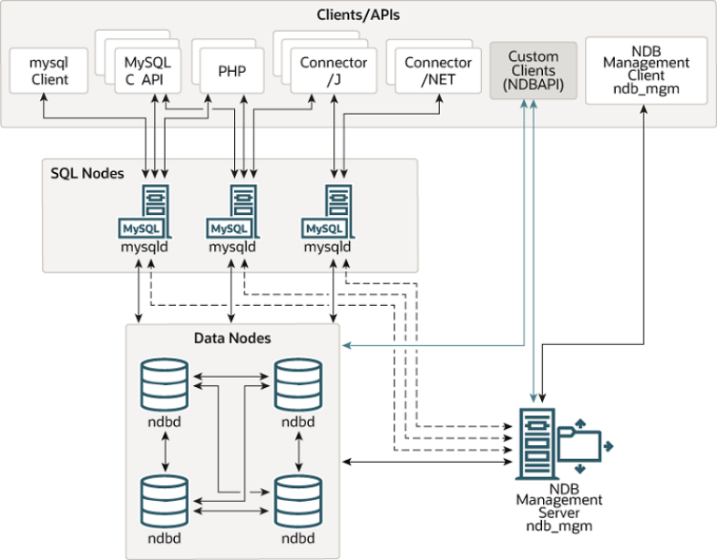

All these programs work together to form an NDB Cluster (see Section 18.5, “NDB Cluster Programs”.

When data is stored by the `NDB` storage engine, the tables (and table data) are stored in the data nodes.

NDB Cluster Core Concepts Such tables are directly accessible from all other MySQL servers (SQL nodes) in the cluster. Thus, in a payroll application storing data in a cluster, if one application updates the salary of an employee, all other MySQL servers that query this data can see this change immediately.

Although an NDB Cluster SQL node uses the `mysqld` server daemon, it differs in a number of critical respects from the `mysqld` binary supplied with the MySQL 5.6 distributions, and the two versions of`mysqld` are not interchangeable.

In addition, a MySQL server that is not connected to an NDB Cluster cannot use the `NDB` storage engine and cannot access any NDB Cluster data.

The data stored in the data nodes for NDB Cluster can be mirrored; the cluster can handle failures of individual data nodes with no other impact than that a small number of transactions are aborted due to losing the transaction state. Because transactional applications are expected to handle transaction failure,this should not be a source of problems.

Individual nodes can be stopped and restarted, and can then rejoin the system (cluster). Rolling restarts(in which all nodes are restarted in turn) are used in making configuration changes and software upgrades(see Section 18.6.5, “Performing a Rolling Restart of an NDB Cluster”). Rolling restarts are also used as part of the process of adding new data nodes online (see Section 18.6.7, “Adding NDB Cluster Data Nodes Online”). For more information about data nodes, how they are organized in an NDB Cluster, and how they handle and store NDB Cluster data, see Section 18.2.2, “NDB Cluster Nodes, Node Groups, Fragment Replicas, and Partitions”.

Backing up and restoring NDB Cluster databases can be done using the `NDB`-native functionality found in the NDB Cluster management client and the `ndb_restore` program included in the NDB Cluster distribution. For more information, see Section 18.6.8, “Online Backup of NDB Cluster”, and Section 18.5.22, “ndb_restore — Restore an NDB Cluster Backup”. You can also use the standard MySQL functionality provided for this purpose in `mysqldump` and the MySQL server. See Section 4.5.4,“mysqldump — A Database Backup Program”, for more information.

NDB Cluster nodes can employ different transport mechanisms for inter-node communications; TCP/IP over standard 100 Mbps or faster Ethernet hardware is used in most real-world deployments.

### 18.2.1 NDB Cluster Core Concepts

`NDBCLUSTER` (also known as `NDB`) is an in-memory storage engine offering high-availability and data-persistence features.

The `NDBCLUSTER` storage engine can be configured with a range of failover and load-balancing options,but it is easiest to start with the storage engine at the cluster level. NDB Cluster's `NDB` storage engine contains a complete set of data, dependent only on other data within the cluster itself.

The “Cluster” portion of NDB Cluster is configured independently of the MySQL servers. In an NDB Cluster, each part of the cluster is considered to be a node.

Note In many contexts, the term “node” is used to indicate a computer, but when discussing NDB Cluster it means a process. It is possible to run multiple nodes on a single computer; for a computer on which one or more cluster nodes are being run we use the term cluster host.

There are three types of cluster nodes, and in a minimal NDB Cluster configuration, there must be at least three nodes, one of each of these types:NDB Cluster Core Concepts

- Management node: The role of this type of node is to manage the other nodes within the NDB Cluster,

performing such functions as providing configuration data, starting and stopping nodes, and running backups. Because this node type manages the configuration of the other nodes, a node of this type should be started first, before any other node. A management node is started with the command

```
ndb_mgmd.
```

- Data node: This type of node stores cluster data. There are as many data nodes as there are

fragment replicas, times the number of fragments (see Section 18.2.2, “NDB Cluster Nodes, Node Groups, Fragment Replicas, and Partitions”). For example, with two fragment replicas, each having two fragments, you need four data nodes. One fragment replica is sufficient for data storage, but provides no redundancy; therefore, it is recommended to have two (or more) fragment replicas to provide redundancy, and thus high availability. A data node is started with the command `ndbd` (see Section 18.5.1, “ndbd — The NDB Cluster Data Node Daemon”) or `ndbmtd` (see Section 18.5.3,“ndbmtd — The NDB Cluster Data Node Daemon (Multi-Threaded)”).

NDB Cluster tables are normally stored completely in memory rather than on disk (this is why we refer to NDB Cluster as an in-memory database). However, some NDB Cluster data can be stored on disk; see Section 18.6.11, “NDB Cluster Disk Data Tables”, for more information.

- SQL node: This is a node that accesses the cluster data. In the case of NDB Cluster, an SQL node is a

traditional MySQL server that uses the `NDBCLUSTER` storage engine. An SQL node is a `mysqld` process started with the `--ndbcluster` and `--ndb-connectstring` options, which are explained elsewhere in this chapter, possibly with additional MySQL server options as well.

An SQL node is actually just a specialized type of API node, which designates any application which accesses NDB Cluster data. Another example of an API node is the `ndb_restore` utility that is used to restore a cluster backup. It is possible to write such applications using the NDB API. For basic information about the NDB API, see Getting Started with the NDB API.

Important It is not realistic to expect to employ a three-node setup in a production environment. Such a configuration provides no redundancy; to benefit from NDB Cluster's high-availability features, you must use multiple data and SQL nodes. The use of multiple management nodes is also highly recommended.

For a brief introduction to the relationships between nodes, node groups, fragment replicas, and partitions in NDB Cluster, see Section 18.2.2, “NDB Cluster Nodes, Node Groups, Fragment Replicas, and Partitions”.

Configuration of a cluster involves configuring each individual node in the cluster and setting up individual communication links between nodes. NDB Cluster is currently designed with the intention that data nodes are homogeneous in terms of processor power, memory space, and bandwidth. In addition, to provide a single point of configuration, all configuration data for the cluster as a whole is located in one configuration file.

The management server manages the cluster configuration file and the cluster log. Each node in the cluster retrieves the configuration data from the management server, and so requires a way to determine where the management server resides. When interesting events occur in the data nodes, the nodes transfer information about these events to the management server, which then writes the information to the cluster log.

In addition, there can be any number of cluster client processes or applications. These include standard MySQL clients, `NDB`-specific API programs, and management clients. These are described in the next few paragraphs.

NDB Cluster Core Concepts Standard MySQL clients. NDB Cluster can be used with existing MySQL applications written in PHP,Perl, C, C++, Java, Python, and so on. Such client applications send SQL statements to and receive responses from MySQL servers acting as NDB Cluster SQL nodes in much the same way that they interact with standalone MySQL servers.

MySQL clients using an NDB Cluster as a data source can be modified to take advantage of the ability to connect with multiple MySQL servers to achieve load balancing and failover. For example, Java clients using Connector/J 5.0.6 and later can use `jdbc:mysql:loadbalance://` URLs (improved in Connector/J 5.1.7) to achieve load balancing transparently; for more information about using Connector/J with NDB Cluster, see Using Connector/J with NDB Cluster.

NDB client programs. Client programs can be written that access NDB Cluster data directly from the`NDBCLUSTER` storage engine, bypassing any MySQL Servers that may be connected to the cluster, using the NDB API, a high-level C++ API. Such applications may be useful for specialized purposes where an SQL interface to the data is not needed. For more information, see The NDB API.

`NDB`-specific Java applications can also be written for NDB Cluster using the NDB Cluster Connector for Java. This NDB Cluster Connector includes ClusterJ, a high-level database API similar to object-relational mapping persistence frameworks such as Hibernate and JPA that connect directly to `NDBCLUSTER`, and so does not require access to a MySQL Server. See Java and NDB Cluster, and The ClusterJ API and Data Object Model, for more information.

Management clients. These clients connect to the management server and provide commands for starting and stopping nodes gracefully, starting and stopping message tracing (debug versions only),showing node versions and status, starting and stopping backups, and so on. An example of this type of program is the `ndb_mgm` management client supplied with NDB Cluster (see Section 18.5.5, “ndb_mgm— The NDB Cluster Management Client”). Such applications can be written using the MGM API, a C-language API that communicates directly with one or more NDB Cluster management servers. For more information, see The MGM API.

Oracle also makes available MySQL Cluster Manager, which provides an advanced command-line interface simplifying many complex NDB Cluster management tasks, such restarting an NDB Cluster with a large number of nodes. The MySQL Cluster Manager client also supports commands for getting and setting the values of most node configuration parameters as well as `mysqld` server options and variables relating to NDB Cluster. See MySQL Cluster Manager 1.4.8 User Manual, for more information.

Event logs. NDB Cluster logs events by category (startup, shutdown, errors, checkpoints, and so on),priority, and severity. A complete listing of all reportable events may be found in Section 18.6.3, “Event Reports Generated in NDB Cluster”. Event logs are of the two types listed here:

- Cluster log: Keeps a record of all desired reportable events for the cluster as a whole.
- Node log: A separate log which is also kept for each individual node.

Note Under normal circumstances, it is necessary and sufficient to keep and examine only the cluster log. The node logs need be consulted only for application development and debugging purposes.

Checkpoint. Generally speaking, when data is saved to disk, it is said that a checkpoint has been reached. More specific to NDB Cluster, a checkpoint is a point in time where all committed transactions are stored on disk. With regard to the `NDB` storage engine, there are two types of checkpoints which work together to ensure that a consistent view of the cluster's data is maintained. These are shown in the following list:NDB Cluster Nodes, Node Groups, Fragment Replicas, and Partitions

- Local Checkpoint (LCP): This is a checkpoint that is specific to a single node; however, LCPs take place

for all nodes in the cluster more or less concurrently. An LCP involves saving all of a node's data to disk,and so usually occurs every few minutes. The precise interval varies, and depends upon the amount of data stored by the node, the level of cluster activity, and other factors.

- Global Checkpoint (GCP): A GCP occurs every few seconds, when transactions for all nodes are

synchronized and the redo-log is flushed to disk.

For more information about the files and directories created by local checkpoints and global checkpoints,see NDB Cluster Data Node File System Directory.

### 18.2.2 NDB Cluster Nodes, Node Groups, Fragment Replicas, and Partitions

This section discusses the manner in which NDB Cluster divides and duplicates data for storage.

A number of concepts central to an understanding of this topic are discussed in the next few paragraphs.

Data node. An `ndbd` or `ndbmtd` process, which stores one or more fragment replicas—that is, copies of the partitions (discussed later in this section) assigned to the node group of which the node is a member.

Each data node should be located on a separate computer. While it is also possible to host multiple data node processes on a single computer, such a configuration is not usually recommended.

It is common for the terms “node” and “data node” to be used interchangeably when referring to an `ndbd` or`ndbmtd` process; where mentioned, management nodes (`ndb_mgmd` processes) and SQL nodes (`mysqld`processes) are specified as such in this discussion.

Node group. A node group consists of one or more nodes, and stores partitions, or sets of fragment replicas (see next item).

The number of node groups in an NDB Cluster is not directly configurable; it is a function of the number of data nodes and of the number of fragment replicas (`NoOfReplicas` configuration parameter), as shown here:

```
[# of node groups] = [# of data nodes] / NoOfReplicas
```

Thus, an NDB Cluster with 4 data nodes has 4 node groups if `NoOfReplicas` is set to 1 in the`config.ini` file, 2 node groups if `NoOfReplicas` is set to 2, and 1 node group if `NoOfReplicas` is set to 4. Fragment replicas are discussed later in this section; for more information about `NoOfReplicas`, see Section 18.4.3.6, “Defining NDB Cluster Data Nodes”.

Note All node groups in an NDB Cluster must have the same number of data nodes.

You can add new node groups (and thus new data nodes) online, to a running NDB Cluster; see Section 18.6.7, “Adding NDB Cluster Data Nodes Online”, for more information.

Partition. This is a portion of the data stored by the cluster. Each node is responsible for keeping at least one copy of any partitions assigned to it (that is, at least one fragment replica) available to the cluster.

The number of partitions used by default by NDB Cluster depends on the number of data nodes and the number of LDM threads in use by the data nodes, as shown here:

```
[# of partitions] = [# of data nodes] * [# of LDM threads]
```

NDB Cluster Nodes, Node Groups, Fragment Replicas, and Partitions When using data nodes running `ndbmtd`, the number of LDM threads is controlled by the setting for`MaxNoOfExecutionThreads`. When using `ndbd` there is a single LDM thread, which means that there are as many cluster partitions as nodes participating in the cluster. This is also the case when using`ndbmtd` with `MaxNoOfExecutionThreads` set to 3 or less. (You should be aware that the number of LDM threads increases with the value of this parameter, but not in a strictly linear fashion, and that there are additional constraints on setting it; see the description of `MaxNoOfExecutionThreads` for more information.)NDB and user-defined partitioning. NDB Cluster normally partitions `NDBCLUSTER` tables automatically. However, it is also possible to employ user-defined partitioning with `NDBCLUSTER` tables.

This is subject to the following limitations:

1. Only the `KEY` and `LINEAR KEY` partitioning schemes are supported in production with `NDB` tables.
2. The maximum number of partitions that may be defined explicitly for any `NDB` table is `8 * [number`

`of LDM threads] * [number of node groups]`, the number of node groups in an NDB Cluster being determined as discussed previously in this section. When running `ndbd` for data node processes,setting the number of LDM threads has no effect (since `ThreadConfig` applies only to `ndbmtd`);

in such cases, this value can be treated as though it were equal to 1 for purposes of performing this calculation.

See Section 18.5.3, “ndbmtd — The NDB Cluster Data Node Daemon (Multi-Threaded)”, for more information.

For more information relating to NDB Cluster and user-defined partitioning, see Section 18.2.7, “Known Limitations of NDB Cluster”, and Section 19.6.2, “Partitioning Limitations Relating to Storage Engines”.

Fragment replica. This is a copy of a cluster partition. Each node in a node group stores a fragment replica. Also sometimes known as a partition replica. The number of fragment replicas is equal to the number of nodes per node group.

A fragment replica belongs entirely to a single node; a node can (and usually does) store several fragment replicas.

The following diagram illustrates an NDB Cluster with four data nodes running `ndbd`, arranged in two node groups of two nodes each; nodes 1 and 2 belong to node group 0, and nodes 3 and 4 belong to node group 1.

Note Only data nodes are shown here; although a working NDB Cluster requires an`ndb_mgmd` process for cluster management and at least one SQL node to access the data stored by the cluster, these have been omitted from the figure for clarity.

NDB Cluster Nodes, Node Groups, Fragment Replicas, and Partitions Figure 18.2 NDB Cluster with Two Node Groups

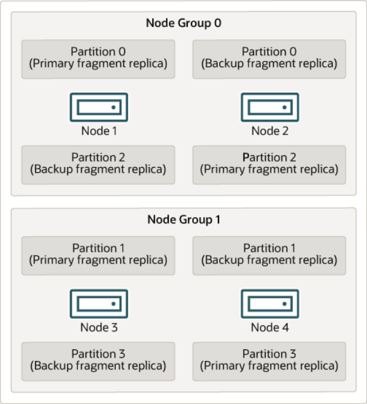

The data stored by the cluster is divided into four partitions, numbered 0, 1, 2, and 3. Each partition is stored—in multiple copies—on the same node group. Partitions are stored on alternate node groups as follows:

- Partition 0 is stored on node group 0; a primary fragment replica (primary copy) is stored on node 1, and

a backup fragment replica (backup copy of the partition) is stored on node 2.

- Partition 1 is stored on the other node group (node group 1); this partition's primary fragment replica is

on node 3, and its backup fragment replica is on node 4.

- Partition 2 is stored on node group 0. However, the placing of its two fragment replicas is reversed from

that of Partition 0; for Partition 2, the primary fragment replica is stored on node 2, and the backup on node 1.

- Partition 3 is stored on node group 1, and the placement of its two fragment replicas are reversed from

those of partition 1. That is, its primary fragment replica is located on node 4, with the backup on node 3.

What this means regarding the continued operation of an NDB Cluster is this: so long as each node group participating in the cluster has at least one node operating, the cluster has a complete copy of all data and remains viable. This is illustrated in the next diagram.

NDB Cluster Hardware, Software, and Networking Requirements Figure 18.3 Nodes Required for a 2x2 NDB Cluster

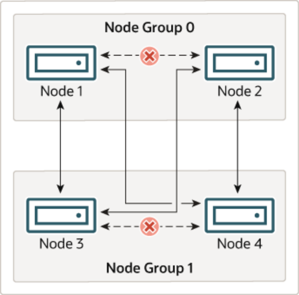

In this example, the cluster consists of two node groups each consisting of two data nodes. Each data node is running an instance of `ndbd`. Any combination of at least one node from node group 0 and at least one node from node group 1 is sufficient to keep the cluster “alive”. However, if both nodes from a single node group fail, the combination consisting of the remaining two nodes in the other node group is not sufficient. In this situation, the cluster has lost an entire partition and so can no longer provide access to a complete set of all NDB Cluster data.

### 18.2.3 NDB Cluster Hardware, Software, and Networking Requirements

One of the strengths of NDB Cluster is that it can be run on commodity hardware and has no unusual requirements in this regard, other than for large amounts of RAM, due to the fact that all live data storage is done in memory. (It is possible to reduce this requirement using Disk Data tables—see Section 18.6.11,“NDB Cluster Disk Data Tables”, for more information about these.) Naturally, multiple and faster CPUs can enhance performance. Memory requirements for other NDB Cluster processes are relatively small.

The software requirements for NDB Cluster are also modest. Host operating systems do not require any unusual modules, services, applications, or configuration to support NDB Cluster. For supported operating systems, a standard installation should be sufficient. The MySQL software requirements are simple: all that is needed is a production release of NDB Cluster. It is not strictly necessary to compile MySQL yourself merely to be able to use NDB Cluster. We assume that you are using the binaries appropriate to your platform, available from the NDB Cluster software downloads page at https://dev.mysql.com/downloads/cluster/.

For communication between nodes, NDB Cluster supports TCP/IP networking in any standard topology,and the minimum expected for each host is a standard 100 Mbps Ethernet card, plus a switch, hub, or router to provide network connectivity for the cluster as a whole. We strongly recommend that an NDB Cluster be run on its own subnet which is not shared with machines not forming part of the cluster for the following reasons:What is New in MySQL NDB Cluster

- Security. Communications between NDB Cluster nodes are not encrypted or shielded in any way.

The only means of protecting transmissions within an NDB Cluster is to run your NDB Cluster on a protected network. If you intend to use NDB Cluster for Web applications, the cluster should definitely reside behind your firewall and not in your network's De-Militarized Zone (DMZ) or elsewhere.

See Section 18.6.17.1, “NDB Cluster Security and Networking Issues”, for more information.

- Efficiency. Setting up an NDB Cluster on a private or protected network enables the cluster to make

exclusive use of bandwidth between cluster hosts. Using a separate switch for your NDB Cluster not only helps protect against unauthorized access to NDB Cluster data, it also ensures that NDB Cluster nodes are shielded from interference caused by transmissions between other computers on the network. For enhanced reliability, you can use dual switches and dual cards to remove the network as a single point of failure; many device drivers support failover for such communication links.

Network communication and latency. NDB Cluster requires communication between data nodes and API nodes (including SQL nodes), as well as between data nodes and other data nodes, to execute queries and updates. Communication latency between these processes can directly affect the observed performance and latency of user queries. In addition, to maintain consistency and service despite the silent failure of nodes, NDB Cluster uses heartbeating and timeout mechanisms which treat an extended loss of communication from a node as node failure. This can lead to reduced redundancy. Recall that, to maintain data consistency, an NDB Cluster shuts down when the last node in a node group fails. Thus, to avoid increasing the risk of a forced shutdown, breaks in communication between nodes should be avoided wherever possible.

The failure of a data or API node results in the abort of all uncommitted transactions involving the failed node. Data node recovery requires synchronization of the failed node's data from a surviving data node,and re-establishment of disk-based redo and checkpoint logs, before the data node returns to service. This recovery can take some time, during which the Cluster operates with reduced redundancy.

Heartbeating relies on timely generation of heartbeat signals by all nodes. This may not be possible if the node is overloaded, has insufficient machine CPU due to sharing with other programs, or is experiencing delays due to swapping. If heartbeat generation is sufficiently delayed, other nodes treat the node that is slow to respond as failed.

This treatment of a slow node as a failed one may or may not be desirable in some circumstances,depending on the impact of the node's slowed operation on the rest of the cluster. When setting timeout values such as `HeartbeatIntervalDbDb` and `HeartbeatIntervalDbApi` for NDB Cluster, care must be taken care to achieve quick detection, failover, and return to service, while avoiding potentially expensive false positives.

Where communication latencies between data nodes are expected to be higher than would be expected in a LAN environment (on the order of 100 µs), timeout parameters must be increased to ensure that any allowed periods of latency periods are well within configured timeouts. Increasing timeouts in this way has a corresponding effect on the worst-case time to detect failure and therefore time to service recovery.

LAN environments can typically be configured with stable low latency, and such that they can provide redundancy with fast failover. Individual link failures can be recovered from with minimal and controlled latency visible at the TCP level (where NDB Cluster normally operates). WAN environments may offer a range of latencies, as well as redundancy with slower failover times. Individual link failures may require route changes to propagate before end-to-end connectivity is restored. At the TCP level this can appear as large latencies on individual channels. The worst-case observed TCP latency in these scenarios is related to the worst-case time for the IP layer to reroute around the failures.

### 18.2.4 What is New in MySQL NDB Cluster

What is New in MySQL NDB Cluster This section lists changes in the implementation of NDB Cluster in MySQL NDB Cluster 7.3 and NDB Cluster 7.4, as compared to earlier releases. Changes and features most likely to be of interest in NDB 7.3 are shown in the following list:

- NDB Cluster 7.3 is based on MySQL 5.6. For more information about new features in MySQL Server 5.6,

see Section 1.3, “What Is New in MySQL 5.6”.

- NDB Cluster 7.3 supports foreign key constraints on tables. See Section 1.6.3.2, “FOREIGN KEY

Constraints”, and Section 13.1.17.5, “FOREIGN KEY Constraints”, for more information.

- NDB Cluster 7.3 provides support for Node.js using the MySQL NoSQL Connector for JavaScript. See

MySQL NoSQL Connector for JavaScript, for more information.

Changes and features in NDB Cluster 7.4 that are most likely to be of interest are shown in the following list:

- NDB Cluster 7.4 is based on MySQL 5.6 (For more information about new features in MySQL Server

5.6, see Section 1.3, “What Is New in MySQL 5.6”)

- NDB Cluster Replication conflict detection and resolution enhancements, including extensions to conflict

exceptions tables (see Section 18.7.11, “NDB Cluster Replication Conflict Resolution”)

- Improvements in the management of circular (“active-active”) replication; primary/secondary assignment

```
with ndb_slave_conflict_role
```

- Per-fragment memory usage reporting in the `memory_per_fragment` table
- A number of performance improvements, including the following enhancements:
- Faster initial allocation of memory
- Increased parallelization of local checkpoints (LCPs now support 32 fragments rather than 2)

A group of configuration parameters (`MaxDiskWriteSpeed`,`MaxDiskWriteSpeedOtherNoderestart`, `MaxDiskWriteSpeedOwnRestart`) introduced in this version provides improved control over disk writes during LCPs Information about recent disk writes is available in the `disk_write_speed_base`,`disk_write_speed_aggregate`, and `disk_write_speed_aggregate_node` tables added to the `ndbinfo` database in the this version

- Faster times for restoring an NDB Cluster from backup
- Optimization of the NDB receive thread
- Improved error and other reporting during node restarts

This section contains information about MySQL NDB Cluster 7.3 releases through 5.6.51-ndb-7.3.33 as well as NDB Cluster 7.4 releases through 5.6.51-ndb-7.4.39 as compared to earlier release series. MySQL NDB Cluster 8.0 is available as a General Availability (GA) release, beginning with NDB 8.0.19; see What is New in MySQL NDB Cluster, for more information about new features and other changes in NDB 8.0.

NDB Cluster 7.6 and 7.5 are previous GA releases still supported in production; for more information, see MySQL NDB Cluster 7.5 and NDB Cluster 7.6. NDB Cluster 7.4 and 7.3 are previous GA releases which are no longer maintained. We recommend that new deployments for production use MySQL NDB Cluster

8.0.

#### 18.2.4.1 What is New in NDB Cluster 7.3

The following improvements to NDB Cluster have been made in NDB Cluster 7.3:What is New in MySQL NDB Cluster

- Based on MySQL Server 5.6. NDB Cluster 7.3 is based on MySQL Server 5.6, so that NDB Cluster

users can benefit from MySQL 5.6's improvements in scalability and performance monitoring. As with MySQL 5.6, NDB Cluster 7.3 uses `CMake` for configuring and building from source. For more information about changes and improvements in MySQL 5.6, see Section 1.3, “What Is New in MySQL 5.6”.

- Foreign keys. Tables created using the `NDB` storage engine version 7.3.0 and later provide support

for foreign key constraints. (This includes all NDB Cluster 7.3 releases.) For general information about how MySQL 5.6 and NDB Cluster 7.3 handle foreign keys, see Section 1.6.3.2, “FOREIGN KEY Constraints”. For syntax and related information, see Section 13.1.17, “CREATE TABLE Statement”, and Section 13.1.17.5, “FOREIGN KEY Constraints”.

- Node.js support. NDB Cluster 7.3 also supports applications written in JavaScript using Node.js.

The MySQL Connector for JavaScript includes adapters for direct access to the `NDB` storage engine and as well as for the MySQL Server. Applications using this Connector are typically event-driven and use a domain object model similar in many ways to that employed by ClusterJ. For more information, see MySQL NoSQL Connector for JavaScript.

- End of ClusterJPA support. ClusterJPA is no longer supported beginning with NDB 7.3.18; its

source code and binary have been removed from the NDB Cluster distribution.

- ndb_restore—NDBT dependency removal. The dependency of `ndb_restore` on the `NDBT` library

has been removed as of NDB 7.3.25. This library is used internally for development, and is not required for normal use; its inclusion in this program could lead to unwanted issues when testing.

The principal effect of this change for users is that `ndb_restore` no longer prints `NDBT_ProgramExit``- status` following completion of a run. Applications that depend upon such behavior should be updated to reflect the change when upgrading.

- Auto-Installer deprecation and removal. The MySQL NDB Cluster Auto-Installer web-based

installation tool (`ndb_setup.py`) is deprecated in NDB 7.3.31, and is removed in NDB 7.3.32 and later.

It is no longer supported.

- ndbmemcache deprecation and removal. `ndbmemcache` is no longer supported. `ndbmemcache`

was deprecated in NDB 7.3.31, and removed in NDB 7.3.32.

- Node.js support removed. Beginning with the NDB Cluster 7.3.31 release, support for Node.js by

NDB 7.3 has been removed.

Support for Node.js by NDB Cluster is maintained in NDB 8.0 only.

NDB Cluster 7.3 is also supported by MySQL Cluster Manager, which provides an advanced command-line interface that can simplify many complex NDB Cluster management tasks. See MySQL Cluster Manager 1.4.8 User Manual, for more information.

#### 18.2.4.2 What is New in NDB Cluster 7.4

The following improvements to NDB Cluster have been made in NDB Cluster 7.4:

- Conflict detection and resolution enhancements. A reserved column name namespace `NDB$` is

now employed for exceptions table metacolumns, allowing an arbitrary subset of main table columns to be recorded, even if they are not part of the original table's primary key.

Recording the complete original primary key is no longer required, due to the fact that matching against exceptions table columns is now done by name and type only. It is now also possible for you to record values of columns which not are part of the main table's primary key in the exceptions table.

Read conflict detection is now possible. All rows read by the conflicting transaction are flagged, and logged in the exceptions table. Rows inserted in the same transaction are not included among the rows What is New in MySQL NDB Cluster read or logged. This read tracking depends on the fragment replica having an exclusive read lock which requires setting `ndb_log_exclusive_reads` in advance. See Read conflict detection and resolution,for more information and examples.

Existing exceptions tables remain supported. For more information, see Section 18.7.11, “NDB Cluster Replication Conflict Resolution”.

- Circular (“active-active”) replication improvements. When using a circular or “active-active” NDB

Cluster Replication topology, you can assign one of the roles of primary of secondary to a given NDB Cluster using the `ndb_slave_conflict_role` server system variable, which can be employed when failing over from an NDB Cluster acting as primary, or when using conflict detection and resolution with`NDB$EPOCH2()` and `NDB$EPOCH2_TRANS()` (NDB 7.4.2 and later), which support delete-delete conflict handling.

See the description of the `ndb_slave_conflict_role` variable, as well as NDB$EPOCH2(), for more information. See also Section 18.7.11, “NDB Cluster Replication Conflict Resolution”.

- Per-fragment memory usage reporting. You can now obtain data about memory usage by

individual NDB Cluster fragments from the `memory_per_fragment` view, added in NDB 7.4.1 to the `ndbinfo` information database. For more information, see Section 18.6.15.17, “The ndbinfo memory_per_fragment Table”.

- Node restart improvements. NDB Cluster 7.4 includes a number of improvements which decrease

the time needed for data nodes to be restarted. These are described in the following list:

- Memory allocated that is allocated on node startup cannot be used until it has been touched,

which causes the operating system to set aside the actual physical memory required. In previous versions of NDB Cluster, the process of touching each page of memory that was allocated was singlethreaded, which made it relatively time-consuming. This process has now been reimplimented with multithreading. In tests with 16 threads, touch times on the order of 3 times shorter than with a single thread were observed.

- Increased parallelization of local checkpoints; in NDB Cluster 7.4, LCPs now support 32 fragments

rather than 2 as before. This greatly increases utilization of CPU power that would otherwise go unused, and can make LCPs faster by up to a factor of 10; this speedup in turn can greatly improve node restart times.

The degree of parallelization used for the node copy phase during node and system restarts can be controlled in NDB 7.4.3 and later by setting the `MaxParallelCopyInstances` data node configuration parameter to a nonzero value.

- Reporting on disk writes is provided by new `ndbinfo` tables `disk_write_speed_base`,

`disk_write_speed_aggregate`, and `disk_write_speed_aggregate_node`, which provide information about the speed of disk writes for each LDM thread that is in use.

This release also adds the data node configuration parameters `MinDiskWriteSpeed`,

```
MaxDiskWriteSpeed, MaxDiskWriteSpeedOtherNodeRestart, and
```

`MaxDiskWriteSpeedOwnRestart` to control write speeds for LCPs and backups when the present node, another node, or no node is currently restarting.

These changes are intended to supersede configuration of disk writes using the`DiskCheckpointSpeed` and `DiskCheckpointSpeedInRestart` configuration parameters. These 2 parameters have now been deprecated, and are subject to removal in a future NDB Cluster release.

- Faster times for restoring an NDB Cluster from backup have been obtained by replacing delayed

signals found at a point which was found to be critical to performance with normal (undelayed) signals.

What is New in MySQL NDB Cluster The elimination or replacement of these unnecessary delayed signals should noticeably reduce the amount of time required to back up an NDB Cluster, or to restore an NDB Cluster from backup.

- Several internal methods relating to the `NDB` receive thread have been optimized, to increase the

efficiency of SQL processing by `NDB`. The receiver thread at time may have to process several million received records per second, so it is critical that it not perform unnecessary work or waste resources when retrieving records from NDB Cluster data nodes.

- Improved reporting of NDB Cluster restarts and start phases. The `restart_info` table

(included in the `ndbinfo` information database beginning with NDB 7.4.2) provides current status and timing information about node and system restarts.

Reporting and logging of NDB Cluster start phases also provides more frequent and specific printouts during startup than previously. See Section 18.6.4, “Summary of NDB Cluster Start Phases”, for more information.

- NDB API: new Event API. NDB 7.4.3 introduces an epoch-driven Event API that supercedes the

earlier GCI-based model. The new version of the API also simplifies error detection and handling.

These changes are realized in the NDB API by implementing a number of new methods for `Ndb` and`NdbEventOperation`, deprecating several other methods of both classes, and adding new type values

```
to Event::TableEvent.
```

The event handling methods added to `Ndb` in NDB 7.4.3 are `pollEvents2()`, `nextEvent2()`,`getHighestQueuedEpoch()`, and `getNextEventOpInEpoch2()`. The `Ndb` methods

```
pollEvents(), nextEvent(), getLatestGCI(), getGCIEventOperations(),
```

`isConsistent()`, and `isConsistentGCI()` are deprecated beginning with the same release.

NDB 7.4.3 adds the `NdbEventOperation` event handling methods `getEventType2()`,`getEpoch()`, `isEmptyEpoch()`, and `isErrorEpoch`; it obsoletes `getEventType()`, `getGCI()`,

```
getLatestGCI(), isOverrun(), hasError(), and clearError().
```

While some (but not all) of the new methods are direct replacements for deprecated methods, not all of the deprecated methods map to new ones. The Event Class, provides information as to which old methods correspond to new ones.

Error handling using the new API is no longer handled using dedicated `hasError()` and`clearError()` methods, which are now deprecated (and thus subject to removal in a future release of NDB Cluster). To support this change, the list of `TableEvent` types now includes the values `TE_EMPTY`(empty epoch), `TE_INCONSISTENT` (inconsistent epoch), and `TE_OUT_OF_MEMORY` (inconsistent data).

Improvements in event buffer management have also been made by implementing new

```
get_eventbuffer_free_percent(), set_eventbuffer_free_percent(), and
```

`get_event_buffer_memory_usage()` methods. Memory buffer usage can now be represented in application code using `Ndb::EventBufferMemoryUsage`. The `ndb_eventbuffer_free_percent`system variable, also implemented in NDB Cluster 7.4, makes it possible for event buffer memory usage to be checked from MySQL client applications.

For more information, see the detailed descriptions for the `Ndb` and `NdbEventOperation` methods listed. See also Event::TableEvent, as well as Ndb::EventBufferMemoryUsage.

- Per-fragment operations information. In NDB 7.4.3 and later, counts of various types of operations

on a given fragment or fragment replica can obtained easily using the `operations_per_fragment`table in the `ndbinfo` information database. This includes read, write, update, and delete operations, as well as scan and index operations performed by these. Information about operations refused, and about rows scanned and returned from a given fragment replica, is also shown in NDB: Added, Deprecated, and Removed Options, Variables, and Parameters`operations_per_fragment`. This table also provides information about interpreted programs used as attribute values, and values returned by them.

- --ndb-log-fail-terminate option. Beginning with NDB 7.4.28, you can cause the SQL node to

terminate whenever it is unable to log all row events fully. This can be done by starting `mysqld` with the

```
--ndb-log-fail-terminate option.
```

- NDB programs—NDBT dependency removal. The dependency of a number of `NDB` utility programs

on the `NDBT` library has been removed. This library is used internally for development, and is not required for normal use; its inclusion in these programs could lead to unwanted issues when testing.

Affected programs are listed here, along with the `NDB` versions in which the dependency was removed:

- `ndb_restore`, in NDB 7.4.24
- `ndb_show_tables`, in NDB 7.4.28
- `ndb_waiter`, in NDB 7.4.28

The principal effect of this change for users is that these programs no longer print `NDBT_ProgramExit``- status` following completion of a run. Applications that depend upon such behavior should be updated to reflect the change when upgrading to the indicated versions.

- End of ClusterJPA support. ClusterJPA is no longer supported beginning with NDB 7.4.16; its

source code and binary have been removed from the NDB Cluster distribution.

- Auto-Installer deprecation and removal. The MySQL NDB Cluster Auto-Installer web-based

installation tool (`ndb_setup.py`) is deprecated in NDB 7.4.30, and is removed in NDB 7.4.31 and later.

It is no longer supported.

- ndbmemcache deprecation and removal. `ndbmemcache` is no longer supported. `ndbmemcache`

has been deprecated beginning with NDB 7.4.3, and is scheduled for removal in NDB 7.4.31.

- Node.js support removed. Beginning with the NDB Cluster 7.4.30 release, support for Node.js by

NDB 7.4 has been removed.

Support for Node.js by NDB Cluster is maintained in NDB 8.0 only.

NDB Cluster 7.4 is also supported by MySQL Cluster Manager, which provides an advanced command-line interface that can simplify many complex NDB Cluster management tasks. See MySQL Cluster Manager 1.4.8 User Manual, for more information.

> 18.2.5 NDB: Added, Deprecated, and Removed Options, Variables, and Parameters

> 18.2.5.1 Options, Variables, and Parameters Added, Deprecated or Removed in NDB 7.3

- Parameters Introduced in NDB 7.3
- Parameters Deprecated in NDB 7.3
- Parameters Removed in NDB 7.3
- Options and Variables Introduced in NDB 7.3
- Options and Variables Deprecated in NDB 7.3

NDB: Added, Deprecated, and Removed Options, Variables, and Parameters

- Options and Variables Removed in NDB 7.3

The next few sections contain information about `NDB` node configuration parameters and NDB-specific`mysqld` options and variables that have been added to, deprecated in, or removed from NDB 7.3.

Parameters Introduced in NDB 7.3 The following node configuration parameters have been added in NDB 7.3.

- `ConnectBackoffMaxTime`: Specifies longest time in milliseconds (~100ms resolution) to allow

between connection attempts to any given data node by this API node. Excludes time elapsed while connection attempts are ongoing, which in worst case can take several seconds. Disable by setting to 0.

If no data nodes are currently connected to this API node, StartConnectBackoffMaxTime is used instead.

Added in NDB 7.3.7.

- `DiskPageBufferEntries`: Memory to allocate in DiskPageBufferMemory; very large disk transactions

may require increasing this value. Added in NDB 7.3.8.

- `HeartbeatIntervalMgmdMgmd`: Time between management-node-to-management-node heartbeats;

connection between management nodes is considered lost after 3 missed heartbeats. Added in NDB

7.3.3.

- `LcpScanProgressTimeout`: Maximum time that local checkpoint fragment scan can be stalled before

node is shut down to ensure systemwide LCP progress. Use 0 to disable. Added in NDB 7.3.3.

- `RestartSubscriberConnectTimeout`: Amount of time for data node to wait for subscribing API

nodes to connect. Set to 0 to disable timeout, which is always resolved to nearest full second. Added in NDB 7.3.6.

- `StartConnectBackoffMaxTime`: Same as ConnectBackoffMaxTime except that this parameter is

used in its place if no data nodes are connected to this API node. Added in NDB 7.3.7.

- `TimeBetweenGlobalCheckpointsTimeout`: Minimum timeout for group commit of transactions to

disk. Added in NDB 7.3.9.

Parameters Deprecated in NDB 7.3 The following node configuration parameters have been deprecated in NDB 7.3.

- `ReservedSendBufferMemory`: This parameter is present in NDB code but is not enabled. Deprecated

in NDB 7.3.1.

Parameters Removed in NDB 7.3 No node configuration parameters have been removed in NDB 7.3.

Options and Variables Introduced in NDB 7.3 The following system variables, status variables, and server options have been added in NDB 7.3.

- `Ndb_last_commit_epoch_server`: Epoch most recently committed by NDB. Added in NDB 7.3.8.
- `Ndb_last_commit_epoch_session`: Epoch most recently committed by this NDB client. Added in

NDB 7.3.8.

- `Ndb_slave_max_replicated_epoch`: Most recently committed NDB epoch on this replica. When this

value is greater than or equal to Ndb_conflict_last_conflict_epoch, no conflicts have yet been detected.

Added in NDB 7.3.8.

NDB: Added, Deprecated, and Removed Options, Variables, and Parameters

- `create_old_temporals`: Use pre-5.6.4 storage format for temporal types when creating tables.

Intended for use in replication and upgrades/downgrades between NDB 7.2 and NDB 7.3/7.4. Added in NDB 7.3.10.

- `ndb_eventbuffer_max_alloc`: Maximum memory that can be allocated for buffering events by NDB

API. Defaults to 0 (no limit). Added in NDB 7.3.3.

- `ndb_recv_thread_activation_threshold`: Activation threshold when receive thread takes over

polling of cluster connection (measured in concurrently active threads). Added in NDB 7.3.1.

- `ndb_recv_thread_cpu_mask`: CPU mask for locking receiver threads to specific CPUs; specified as

hexadecimal. See documentation for details. Added in NDB 7.3.1.

- `ndb_show_foreign_key_mock_tables`: Show mock tables used to support foreign_key_checks=0.

Added in NDB 7.3.2.

Options and Variables Deprecated in NDB 7.3 The following system variables, status variables, and options have been deprecated in NDB 7.3.

- `create_old_temporals`: Use pre-5.6.4 storage format for temporal types when creating tables.

Intended for use in replication and upgrades/downgrades between NDB 7.2 and NDB 7.3/7.4.

Deprecated in NDB 7.3.10.

Options and Variables Removed in NDB 7.3 The following system variables, status variables, and options have been removed in NDB 7.3.

- `ndb_index_stat_cache_entries`: Granularity of statistics by determining number of starting and

ending keys. Removed in NDB 7.3.5.

- `ndb_index_stat_update_freq`: How often to query data nodes rather than statistics cache.

Removed in NDB 7.3.5.

> 18.2.5.2 Options, Variables, and Parameters Added, Deprecated or Removed in NDB 7.4

- Parameters Introduced in NDB 7.4
- Parameters Deprecated in NDB 7.4
- Parameters Removed in NDB 7.4
- Options and Variables Introduced in NDB 7.4
- Options and Variables Deprecated in NDB 7.4
- Options and Variables Removed in NDB 7.4

The next few sections contain information about `NDB` node configuration parameters and NDB-specific`mysqld` options and variables that have been added to, deprecated in, or removed from NDB 7.4.

Parameters Introduced in NDB 7.4 The following node configuration parameters have been added in NDB 7.4.

- `ApiVerbose`: Enable NDB API debugging; for NDB development. Added in NDB 7.4.12.

NDB: Added, Deprecated, and Removed Options, Variables, and Parameters

- `BackupDiskWriteSpeedPct`: Sets percentage of data node's allocated maximum write speed

(MaxDiskWriteSpeed) to reserve for LCPs when starting backup. Added in NDB 7.4.8.

- `ConnectBackoffMaxTime`: Specifies longest time in milliseconds (~100ms resolution) to allow

between connection attempts to any given data node by this API node. Excludes time elapsed while connection attempts are ongoing, which in worst case can take several seconds. Disable by setting to 0.

If no data nodes are currently connected to this API node, StartConnectBackoffMaxTime is used instead.

Added in NDB 7.4.2.

- `DiskPageBufferEntries`: Memory to allocate in DiskPageBufferMemory; very large disk transactions

may require increasing this value. Added in NDB 7.4.3.

- `MaxDiskWriteSpeed`: Maximum number of bytes per second that can be written by LCP and backup

when no restarts are ongoing. Added in NDB 7.4.1.

- `MaxDiskWriteSpeedOtherNodeRestart`: Maximum number of bytes per second that can be written

by LCP and backup when another node is restarting. Added in NDB 7.4.1.

- `MaxDiskWriteSpeedOwnRestart`: Maximum number of bytes per second that can be written by LCP

and backup when this node is restarting. Added in NDB 7.4.1.

- `MaxParallelCopyInstances`: Number of parallel copies during node restarts. Default is 0, which

uses number of LDMs on both nodes, to maximum of 16. Added in NDB 7.4.3.

- `MinDiskWriteSpeed`: Minimum number of bytes per second that can be written by LCP and backup.

Added in NDB 7.4.1.

- `SchedulerResponsiveness`: Set NDB scheduler response optimization 0-10; higher values provide

better response time but lower throughput. Added in NDB 7.4.9.

- `StartConnectBackoffMaxTime`: Same as ConnectBackoffMaxTime except that this parameter is

used in its place if no data nodes are connected to this API node. Added in NDB 7.4.2.

- `TimeBetweenGlobalCheckpointsTimeout`: Minimum timeout for group commit of transactions to

disk. Added in NDB 7.4.5.

Parameters Deprecated in NDB 7.4 The following node configuration parameters have been deprecated in NDB 7.4.

- `BackupMemory`: Total memory allocated for backups per node (in bytes). Deprecated in NDB 7.4.8.
- `DiskCheckpointSpeed`: Bytes allowed to be written by checkpoint, per second. Deprecated in NDB

7.4.1.

- `DiskCheckpointSpeedInRestart`: Bytes allowed to be written by checkpoint during restart, per

second. Deprecated in NDB 7.4.1.

Parameters Removed in NDB 7.4 No node configuration parameters have been removed in NDB 7.4.

Options and Variables Introduced in NDB 7.4 The following system variables, status variables, and server options have been added in NDB 7.4.

- `Ndb_conflict_fn_epoch2`: Number of rows that have been found in conflict by NDB replication NDB

$EPOCH2() conflict detection function. Added in NDB 7.4.2.

NDB: Added, Deprecated, and Removed Options, Variables, and Parameters

- `Ndb_conflict_fn_epoch2_trans`: Number of rows that have been found in conflict by NDB

replication NDB$EPOCH2_TRANS() conflict detection function. Added in NDB 7.4.2.

- `Ndb_conflict_fn_max_del_win`: Number of times that NDB replication conflict resolution based on

outcome of NDB$MAX_DELETE_WIN() has been applied to update and delete operations. Added in NDB 7.4.1.

- `Ndb_conflict_last_conflict_epoch`: Most recent NDB epoch on this replica in which some

conflict was detected. Added in NDB 7.4.2.

- `Ndb_conflict_last_stable_epoch`: Number of rows found to be in conflict by transactional conflict

function. Added in NDB 7.4.2.

- `Ndb_conflict_reflected_op_discard_count`: Number of reflected operations that were not

applied due error during execution. Added in NDB 7.4.2.

- `Ndb_conflict_reflected_op_prepare_count`: Number of reflected operations received that have

been prepared for execution. Added in NDB 7.4.2.

- `Ndb_conflict_refresh_op_count`: Number of refresh operations that have been prepared. Added

in NDB 7.4.2.

- `Ndb_conflict_trans_row_conflict_count`: Number of rows found in conflict by transactional

conflict function. Includes any rows included in or dependent on conflicting transactions. Added in NDB

7.4.2.

- `Ndb_epoch_delete_delete_count`: Number of delete-delete conflicts detected (delete operation is

applied, but row does not exist). Added in NDB 7.4.2.

- `Ndb_last_commit_epoch_server`: Epoch most recently committed by NDB. Added in NDB 7.4.1.
- `Ndb_last_commit_epoch_session`: Epoch most recently committed by this NDB client. Added in

NDB 7.4.1.

- `Ndb_slave_max_replicated_epoch`: Most recently committed NDB epoch on this replica. When this

value is greater than or equal to Ndb_conflict_last_conflict_epoch, no conflicts have yet been detected.

Added in NDB 7.4.1.

- `create_old_temporals`: Use pre-5.6.4 storage format for temporal types when creating tables.

Intended for use in replication and upgrades/downgrades between NDB 7.2 and NDB 7.3/7.4. Added in NDB 7.4.7.

- `ndb-log-exclusive-reads`: Log primary key reads with exclusive locks; allow conflict resolution

based on read conflicts. Added in NDB 7.4.1.

- `ndb-log-fail-terminate`: Terminate mysqld process if complete logging of all found row events is

not possible. Added in NDB 7.4.28.

- `ndb-log-update-minimal`: Log updates in minimal format. Added in NDB 7.4.16.
- `ndb_clear_apply_status`: Causes RESET SLAVE/RESET REPLICA to clear all rows from

ndb_apply_status table; ON by default. Added in NDB 7.4.9.

- `ndb_eventbuffer_free_percent`: Percentage of free memory that should be available in event

buffer before resumption of buffering, after reaching limit set by ndb_eventbuffer_max_alloc. Added in NDB 7.4.3.

- `ndb_log_exclusive_reads`: Log primary key reads with exclusive locks; allow conflict resolution

based on read conflicts. Added in NDB 7.4.1.

MySQL Server Using InnoDB Compared with NDB Cluster

- `ndb_slave_conflict_role`: Role for replica to play in conflict detection and resolution. Value is one

of PRIMARY, SECONDARY, PASS, or NONE (default). Can be changed only when replication SQL thread is stopped. See documentation for further information. Added in NDB 7.4.1.

Options and Variables Deprecated in NDB 7.4 The following system variables, status variables, and options have been deprecated in NDB 7.4.

- `create_old_temporals`: Use pre-5.6.4 storage format for temporal types when creating tables.

Intended for use in replication and upgrades/downgrades between NDB 7.2 and NDB 7.3/7.4.

Deprecated in NDB 7.4.7.

Options and Variables Removed in NDB 7.4 No system variables, status variables, or options have been removed in NDB 7.4.

### 18.2.6 MySQL Server Using InnoDB Compared with NDB Cluster

MySQL Server offers a number of choices in storage engines. Since both `NDB` and `InnoDB` can serve as transactional MySQL storage engines, users of MySQL Server sometimes become interested in NDB Cluster. They see `NDB` as a possible alternative or upgrade to the default `InnoDB` storage engine in MySQL 5.6. While `NDB` and `InnoDB` share common characteristics, there are differences in architecture and implementation, so that some existing MySQL Server applications and usage scenarios can be a good fit for NDB Cluster, but not all of them.

In this section, we discuss and compare some characteristics of the `NDB` storage engine used by NDB Cluster 7.3 and 7.4 with `InnoDB` used in MySQL 5.6. The next few sections provide a technical comparison. In many instances, decisions about when and where to use NDB Cluster must be made on a case-by-case basis, taking all factors into consideration. While it is beyond the scope of this documentation to provide specifics for every conceivable usage scenario, we also attempt to offer some very general guidance on the relative suitability of some common types of applications for `NDB` as opposed to `InnoDB`back ends.

NDB Cluster 7.3 and 7.4 use a `mysqld` based on MySQL 5.6, including support for `InnoDB` 1.1. While it is possible to use `InnoDB` tables with NDB Cluster, such tables are not clustered. It is also not possible to use programs or libraries from an NDB Cluster 7.3 or 7.4 distribution with MySQL Server 5.6, or the reverse.

While it is also true that some types of common business applications can be run either on NDB Cluster or on MySQL Server (most likely using the `InnoDB` storage engine), there are some important architectural and implementation differences. Section 18.2.6.1, “Differences Between the NDB and InnoDB Storage Engines”, provides a summary of the these differences. Due to the differences, some usage scenarios are clearly more suitable for one engine or the other; see Section 18.2.6.2, “NDB and InnoDB Workloads”.

This in turn has an impact on the types of applications that better suited for use with `NDB` or `InnoDB`. See Section 18.2.6.3, “NDB and InnoDB Feature Usage Summary”, for a comparison of the relative suitability of each for use in common types of database applications.

For information about the relative characteristics of the `NDB` and `MEMORY` storage engines, see When to Use MEMORY or NDB Cluster.

See Chapter 15, Alternative Storage Engines, for additional information about MySQL storage engines.

#### 18.2.6.1 Differences Between the NDB and InnoDB Storage Engines

The `NDB` storage engine is implemented using a distributed, shared-nothing architecture, which causes it to behave differently from `InnoDB` in a number of ways. For those unaccustomed to working with `NDB`,MySQL Server Using InnoDB Compared with NDB Cluster unexpected behaviors can arise due to its distributed nature with regard to transactions, foreign keys, table limits, and other characteristics. These are shown in the following table:Table 18.1 Feature differences between InnoDB and NDB storage engines.

Feature `InnoDB` 1.1 `NDB` 7.3, `NDB` 7.4 MySQL Server Version 5.6 5.6`InnoDB` Version `InnoDB` 5.6.51 `InnoDB` 5.6.51 NDB Cluster Version N/A `NDB` 7.3.33, 7.4.39 Storage Limits 64TB 3TB (Practical upper limit based on 48 data nodes with 64GB RAM each; can be increased with disk-based data and BLOBs)Foreign Keys Yes Yes Transactions All standard types `READ COMMITTED`MVCC Yes No Data Compression Yes No (NDB checkpoint and backup files can be compressed)Large Row Support (> 14K) Supported for `VARBINARY`, Supported for `BLOB` and `TEXT``VARCHAR`, `BLOB`, and `TEXT` columns only (Using these types columns to store very large amounts of data can lower NDB performance)Replication Support Asynchronous and Automatic synchronous semisynchronous replication using replication within an NDB Cluster;

MySQL Replication asynchronous replication between NDB Clusters, using MySQL Replication (Semisynchronous replication is not supported)Scaleout for Read Operations Yes (MySQL Replication) Yes (Automatic partitioning in NDB Cluster; NDB Cluster Replication)Scaleout for Write Operations Requires application-level Yes (Automatic partitioning in partitioning (sharding) NDB Cluster is transparent to applications)High Availability (HA) Requires additional software Yes (Designed for 99.999%uptime)Node Failure Recovery and Requires additional software Automatic (Key element in NDB Failover architecture)Time for Node Failure Recovery 30 seconds or longer Typically < 1 second Real-Time Performance No Yes In-Memory Tables No Yes (Some data can optionally be stored on disk; both in-memory and disk data storage are durable)NoSQL Access to Storage Engine Yes Yes (Multiple APIs, including Memcached, Node.js/JavaScript,Java, JPA, C++, and HTTP/REST)MySQL Server Using InnoDB Compared with NDB Cluster Feature `InnoDB` 1.1 `NDB` 7.3, `NDB` 7.4 Concurrent and Parallel Writes Not supported Up to 48 writers, optimized for concurrent writes Conflict Detection and Resolution No Yes(Multiple Replication sources)Hash Indexes No Yes Online Addition of Nodes Read-only replicas using MySQL Yes (all node types)Replication Online Upgrades No Yes Online Schema Modifications Yes, as part of MySQL 5.6 Yes

#### 18.2.6.2 NDB and InnoDB Workloads

NDB Cluster has a range of unique attributes that make it ideal to serve applications requiring high availability, fast failover, high throughput, and low latency. Due to its distributed architecture and multi-node implementation, NDB Cluster also has specific constraints that may keep some workloads from performing well. A number of major differences in behavior between the `NDB` and `InnoDB` storage engines with regard to some common types of database-driven application workloads are shown in the following table::Table 18.2 Differences between the InnoDB and NDB storage engines, common types of database-driven application workloads Workload `InnoDB` NDB Cluster (`NDB`)High-Volume OLTP Applications Yes Yes DSS Applications (data marts, Yes Limited (Join operations across analytics) OLTP datasets not exceeding 3TB in size)Custom Applications Yes Yes Packaged Applications Yes Limited (should be mostly primary key access); NDB 7.3 and 7.4 support foreign keys In-Network Telecoms Applications No Yes(HLR, HSS, SDP)Session Management and Yes Yes Caching E-Commerce Applications Yes Yes User Profile Management, AAA Yes Yes Protocol

#### 18.2.6.3 NDB and InnoDB Feature Usage Summary

When comparing application feature requirements to the capabilities of `InnoDB` with `NDB`, some are clearly more compatible with one storage engine than the other.

The following table lists supported application features according to the storage engine to which each feature is typically better suited.

Known Limitations of NDB Cluster Table 18.3 Supported application features according to the storage engine to which each feature is typically better suited Preferred application requirements for `InnoDB` Preferred application requirements for `NDB`

- Foreign keys  • Write scaling

Note • 99.999% uptime NDB Cluster 7.4 and 7.4 • Online addition of nodes and online schema support foreign keys operations

- Full table scans  • Multiple SQL and NoSQL APIs (see NDB Cluster

APIs: Overview and Concepts)

- Very large databases, rows, or transactions
- Real-time performance
- Transactions other than `READ COMMITTED`
- Limited use of `BLOB` columns
- Foreign keys are supported, although their use

may have an impact on performance at high throughput

### 18.2.7 Known Limitations of NDB Cluster

In the sections that follow, we discuss known limitations in current releases of NDB Cluster as compared with the features available when using the `MyISAM` and `InnoDB` storage engines. If you check the “Cluster”category in the MySQL bugs database at http://bugs.mysql.com, you can find known bugs in the following categories under “MySQL Server:” in the MySQL bugs database at http://bugs.mysql.com, which we intend to correct in upcoming releases of NDB Cluster:

- NDB Cluster
- Cluster Direct API (NDBAPI)
- Cluster Disk Data
- Cluster Replication
- ClusterJ

This information is intended to be complete with respect to the conditions just set forth. You can report any discrepancies that you encounter to the MySQL bugs database using the instructions given in Section 1.5,“How to Report Bugs or Problems”. If we do not plan to fix the problem in NDB Cluster 7.3 or 7.4, we add it to the list.

See Section 18.2.7.11, “Previous NDB Cluster Issues Resolved in NDB Cluster 7.3” for a list of issues in earlier versions of NDB Cluster that have been resolved in NDB 7.3 or 7.4.

Note Limitations and other issues specific to NDB Cluster Replication are described in Section 18.7.3, “Known Issues in NDB Cluster Replication”.

#### 18.2.7.1 Noncompliance with SQL Syntax in NDB Cluster

Some SQL statements relating to certain MySQL features produce errors when used with `NDB` tables, as described in the following list:Known Limitations of NDB Cluster

- Temporary tables. Temporary tables are not supported. Trying either to create a temporary table that

uses the `NDB` storage engine or to alter an existing temporary table to use `NDB` fails with the error `Table`

```
storage engine 'ndbcluster' does not support the create option 'TEMPORARY'.
```

- Indexes and keys in NDB tables. Keys and indexes on NDB Cluster tables are subject to the

following limitations:

- Column width. Attempting to create an index on an `NDB` table column whose width is greater than

3072 bytes succeeds, but only the first 3072 bytes are actually used for the index. In such cases, a warning `Specified key was too long; max key length is 3072 bytes` is issued, and a`SHOW CREATE TABLE` statement shows the length of the index as 3072.

- TEXT and BLOB columns. You cannot create indexes on `NDB` table columns that use any of the

`TEXT` or `BLOB` data types.

- FULLTEXT indexes. The `NDB` storage engine does not support `FULLTEXT` indexes, which are

possible for `MyISAM` and (MySQL 5.6.4 and later) `InnoDB` tables only.

However, you can create indexes on `VARCHAR` columns of `NDB` tables.

- USING HASH keys and NULL. Using nullable columns in unique keys and primary keys means

that queries using these columns are handled as full table scans. To work around this issue, make the column `NOT NULL`, or re-create the index without the `USING HASH` option.

- Prefixes. There are no prefix indexes; only entire columns can be indexed. (The size of an `NDB`

column index is always the same as the width of the column in bytes, up to and including 3072 bytes,as described earlier in this section. Also see Section 18.2.7.6, “Unsupported or Missing Features in NDB Cluster”, for additional information.)

- BIT columns. A `BIT` column cannot be a primary key, unique key, or index, nor can it be part of a

composite primary key, unique key, or index.

- AUTO_INCREMENT columns. Like other MySQL storage engines, the `NDB` storage engine can

handle a maximum of one `AUTO_INCREMENT` column per table, and this column must be indexed.

However, in the case of an NDB table with no explicit primary key, an `AUTO_INCREMENT` column is automatically defined and used as a “hidden” primary key. For this reason, you cannot create an `NDB`table having an `AUTO_INCREMENT` column and no explicit primary key.

The following `CREATE TABLE` statements do not work, as shown here:

```
# No index on AUTO_INCREMENT column; table has no primary key
# Raises ER_WRONG_AUTO_KEY
mysql> CREATE TABLE n (
->     a INT,
->     b INT AUTO_INCREMENT
->     )
-> ENGINE=NDB;
ERROR 1075 (42000): Incorrect table definition; there can be only one auto
column and it must be defined as a key
# Index on AUTO_INCREMENT column; table has no primary key
# Raises NDB error 4335
mysql> CREATE TABLE n (
->     a INT,
->     b INT AUTO_INCREMENT,
->     KEY k (b)
->     )
-> ENGINE=NDB;
ERROR 1296 (HY000): Got error 4335 'Only one autoincrement column allowed per
table. Having a table without primary key uses an autoincr' from NDBCLUSTER
```

Known Limitations of NDB Cluster The following statement creates a table with a primary key, an `AUTO_INCREMENT` column, and an index on this column, and succeeds:

```
# Index on AUTO_INCREMENT column; table has a primary key
mysql> CREATE TABLE n (
->     a INT PRIMARY KEY,
->     b INT AUTO_INCREMENT,
->     KEY k (b)
->     )
-> ENGINE=NDB;
Query OK, 0 rows affected (0.38 sec)
```

- Restrictions on foreign keys. Support for foreign key constraints in NDB Cluster 7.3 and 7.4 is

comparable to that provided by `InnoDB`, subject to the following restrictions:

- Every column referenced as a foreign key requires an explicit unique key, if it is not the table's primary

key.

- `ON UPDATE CASCADE` is not supported when the reference is to the parent table's primary key.

This is because an update of a primary key is implemented as a delete of the old row (containing the old primary key) plus an insert of the new row (with a new primary key). This is not visible to the`NDB` kernel, which views these two rows as being the same, and thus has no way of knowing that this update should be cascaded.

- As of NDB 7.3.25 and NDB 7.4.24: `ON DELETE CASCADE` is not supported where the child table

contains one or more columns of any of the `TEXT` or `BLOB` types. (Bug #89511, Bug #27484882)

- `SET DEFAULT` is not supported. (Also not supported by `InnoDB`.)
- The `NO ACTION` keywords are accepted but treated as `RESTRICT`. (Also the same as with `InnoDB`.)
- Prior to NDB 7.3.5, when creating a table with foreign key referencing an index in another table, it

sometimes appeared possible to create the foreign key even if the order of the columns in the indexes did not match, due to the fact that an appropriate error was not always returned internally. A partial fix for this issue in NDB 7.3.5 improves the error used internally to work in most cases; however, it is still possible for this situation to occur in the event that the parent index is a unique index. (Bug#18094360)

- In NDB 7.3, when adding or dropping a foreign key using `ALTER TABLE`, the parent table's metadata

is not updated, which makes it possible subsequently to execute `ALTER TABLE` statements on the parent that should be invalid. This issue also affects NDB 7.4 releases prior to 7.4.15. To work around this issue, execute `SHOW CREATE TABLE` on the parent table immediately after adding or dropping the foreign key; this forces the parent's metadata to be reloaded.

This issue is fixed in NDB 7.4.15 and later. (Bug #82989, Bug #24666177)For more information, see Section 13.1.17.5, “FOREIGN KEY Constraints”, and Section 1.6.3.2,“FOREIGN KEY Constraints”.

- NDB Cluster and geometry data types.

Geometry data types (`WKT` and `WKB`) are supported for `NDB` tables. However, spatial indexes are not supported.

- Character sets and binary log files. Currently, the `ndb_apply_status` and `ndb_binlog_index`

tables are created using the `latin1` (ASCII) character set. Because names of binary logs are recorded Known Limitations of NDB Cluster in this table, binary log files named using non-Latin characters are not referenced correctly in these tables. This is a known issue, which we are working to fix. (Bug #50226)To work around this problem, use only Latin-1 characters when naming binary log files or setting any the`--basedir`, `--log-bin`, or `--log-bin-index` options.

- Creating NDB tables with user-defined partitioning. Support for user-defined partitioning in NDB

Cluster is restricted to [`LINEAR`] `KEY` partitioning. Using any other partitioning type with `ENGINE=NDB` or`ENGINE=NDBCLUSTER` in a `CREATE TABLE` statement results in an error.

It is possible to override this restriction, but doing so is not supported for use in production settings. For details, see User-defined partitioning and the NDB storage engine (NDB Cluster).

Default partitioning scheme. All NDB Cluster tables are by default partitioned by `KEY` using the table's primary key as the partitioning key. If no primary key is explicitly set for the table, the “hidden”primary key automatically created by the `NDB` storage engine is used instead. For additional discussion of these and related issues, see Section 19.2.5, “KEY Partitioning”.

`CREATE TABLE` and `ALTER TABLE` statements that would cause a user-partitioned `NDBCLUSTER` table not to meet either or both of the following two requirements are not permitted, and fail with an error:

1. The table must have an explicit primary key.
2. All columns listed in the table's partitioning expression must be part of the primary key.

Exception. If a user-partitioned `NDBCLUSTER` table is created using an empty column-list (that is,using `PARTITION BY [LINEAR] KEY()`), then no explicit primary key is required.

Maximum number of partitions for NDBCLUSTER tables. The maximum number of partitions that can defined for a `NDBCLUSTER` table when employing user-defined partitioning is 8 per node group.

(See Section 18.2.2, “NDB Cluster Nodes, Node Groups, Fragment Replicas, and Partitions”, for more information about NDB Cluster node groups.

DROP PARTITION not supported. It is not possible to drop partitions from `NDB` tables using`ALTER TABLE ... DROP PARTITION`. The other partitioning extensions to `ALTER TABLE`—`ADD``PARTITION`, `REORGANIZE PARTITION`, and `COALESCE PARTITION`—are supported for NDB tables,but use copying and so are not optimized. See Section 19.3.1, “Management of RANGE and LIST Partitions” and Section 13.1.7, “ALTER TABLE Statement”.

Partition selection. Partition selection is not supported for `NDB` tables. See Section 19.5, “Partition Selection”, for more information.

#### 18.2.7.2 Limits and Differences of NDB Cluster from Standard MySQL Limits

In this section, we list limits found in NDB Cluster that either differ from limits found in, or that are not found in, standard MySQL.

Memory usage and recovery. Memory consumed when data is inserted into an `NDB` table is not automatically recovered when deleted, as it is with other storage engines. Instead, the following rules hold true:

- A `DELETE` statement on an `NDB` table makes the memory formerly used by the deleted rows available for

re-use by inserts on the same table only. However, this memory can be made available for general re-use by performing `OPTIMIZE TABLE`.

A rolling restart of the cluster also frees any memory used by deleted rows. See Section 18.6.5,“Performing a Rolling Restart of an NDB Cluster”.

Known Limitations of NDB Cluster

- A `DROP TABLE` or `TRUNCATE TABLE` operation on an `NDB` table frees the memory that was used by this

table for re-use by any `NDB` table, either by the same table or by another `NDB` table.

Note Recall that `TRUNCATE TABLE` drops and re-creates the table. See Section 13.1.33, “TRUNCATE TABLE Statement”.

- Limits imposed by the cluster's configuration.

A number of hard limits exist which are configurable, but available main memory in the cluster sets limits.

See the complete list of configuration parameters in Section 18.4.3, “NDB Cluster Configuration Files”.

Most configuration parameters can be upgraded online. These hard limits include:

- Database memory size and index memory size (`DataMemory` and `IndexMemory`, respectively).

`DataMemory` is allocated as 32KB pages. As each `DataMemory` page is used, it is assigned to a specific table; once allocated, this memory cannot be freed except by dropping the table.

See Section 18.4.3.6, “Defining NDB Cluster Data Nodes”, for more information.

- The maximum number of operations that can be performed per transaction is set using the

configuration parameters `MaxNoOfConcurrentOperations` and `MaxNoOfLocalOperations`.

Note Bulk loading, `TRUNCATE TABLE`, and `ALTER TABLE` are handled as special cases by running multiple transactions, and so are not subject to this limitation.

- Different limits related to tables and indexes. For example, the maximum number of ordered indexes

in the cluster is determined by `MaxNoOfOrderedIndexes`, and the maximum number of ordered indexes per table is 16.

- Node and data object maximums. The following limits apply to numbers of cluster nodes and

metadata objects:

- The maximum number of data nodes is 48.

A data node must have a node ID in the range of 1 to 48, inclusive. (Management and API nodes may use node IDs in the range 1 to 255, inclusive.)

- The total maximum number of nodes in an NDB Cluster is 255. This number includes all SQL nodes

(MySQL Servers), API nodes (applications accessing the cluster other than MySQL servers), data nodes, and management servers.

- The maximum number of metadata objects in current versions of NDB Cluster is 20320. This limit is

hard-coded.

See Section 18.2.7.11, “Previous NDB Cluster Issues Resolved in NDB Cluster 7.3”, for more information.

#### 18.2.7.3 Limits Relating to Transaction Handling in NDB Cluster

A number of limitations exist in NDB Cluster with regard to the handling of transactions. These include the following:

- Transaction isolation level. The `NDBCLUSTER` storage engine supports only the `READ`

`COMMITTED` transaction isolation level. (`InnoDB`, for example, supports `READ COMMITTED`, `READ`Known Limitations of NDB Cluster`UNCOMMITTED`, `REPEATABLE READ`, and `SERIALIZABLE`.) You should keep in mind that `NDB`implements `READ COMMITTED` on a per-row basis; when a read request arrives at the data node storing the row, what is returned is the last committed version of the row at that time.

Uncommitted data is never returned, but when a transaction modifying a number of rows commits concurrently with a transaction reading the same rows, the transaction performing the read can observe“before” values, “after” values, or both, for different rows among these, due to the fact that a given row read request can be processed either before or after the commit of the other transaction.

To ensure that a given transaction reads only before or after values, you can impose row locks using`SELECT ... LOCK IN SHARE MODE`. In such cases, the lock is held until the owning transaction is committed. Using row locks can also cause the following issues:

- Increased frequency of lock wait timeout errors, and reduced concurrency
- Increased transaction processing overhead due to reads requiring a commit phase
- Possibility of exhausting the available number of concurrent locks, which is limited by

```
MaxNoOfConcurrentOperations
```

`NDB` uses `READ COMMITTED` for all reads unless a modifier such as `LOCK IN SHARE MODE` or `FOR``UPDATE` is used. `LOCK IN SHARE MODE` causes shared row locks to be used; `FOR UPDATE` causes exclusive row locks to be used. Unique key reads have their locks upgraded automatically by `NDB` to ensure a self-consistent read; `BLOB` reads also employ extra locking for consistency.

See Section 18.6.8.4, “NDB Cluster Backup Troubleshooting”, for information on how NDB Cluster's implementation of transaction isolation level can affect backup and restoration of `NDB` databases.

- Unique key lookups and transaction isolation. Unique indexes are implemented in `NDB` using a

hidden index table which is maintained internally. When a user-created `NDB` table is accessed using a unique index, the hidden index table is first read to find the primary key that is then used to read the user-created table. To avoid modification of the index during this double-read operation, the row found in the hidden index table is locked. When a row referenced by a unique index in the user-created `NDB`table is updated, the hidden index table is subject to an exclusive lock by the transaction in which the update is performed. This means that any read operation on the same (user-created) `NDB` table must wait for the update to complete. This is true even when the transaction level of the read operation is

```
READ COMMITTED.
```

One workaround which can be used to bypass potentially blocking reads is to force the SQL node to ignore the unique index when performing the read. This can be done by using the `IGNORE INDEX`index hint as part of the `SELECT` statement reading the table (see Section 8.9.3, “Index Hints”). Because the MySQL server creates a shadowing ordered index for every unique index created in `NDB`, this lets the ordered index be read instead, and avoids unique index access locking. The resulting read is as consistent as a committed read by primary key, returning the last committed value at the time the row is read.

Reading via an ordered index makes less efficient use of resources in the cluster, and may have higher latency.

It is also possible to avoid using the unique index for access by querying for ranges rather than for unique values.

- Transactions and BLOB or TEXT columns. `NDBCLUSTER` stores only part of a column value that

uses any of MySQL's `BLOB` or `TEXT` data types in the table visible to MySQL; the remainder of the `BLOB`or `TEXT` is stored in a separate internal table that is not accessible to MySQL. This gives rise to two Known Limitations of NDB Cluster related issues of which you should be aware whenever executing `SELECT` statements on tables that contain columns of these types:

1. For any `SELECT` from an NDB Cluster table: If the `SELECT` includes a `BLOB` or `TEXT` column, the

`READ COMMITTED` transaction isolation level is converted to a read with read lock. This is done to guarantee consistency.

2. For any `SELECT` which uses a unique key lookup to retrieve any columns that use any of the `BLOB` or

`TEXT` data types and that is executed within a transaction, a shared read lock is held on the table for the duration of the transaction—that is, until the transaction is either committed or aborted.

This issue does not occur for queries that use index or table scans, even against `NDB` tables having`BLOB` or `TEXT` columns.

For example, consider the table t defined by the following `CREATE TABLE` statement:

```
CREATE TABLE t (
a INT NOT NULL AUTO_INCREMENT PRIMARY KEY,
b INT NOT NULL,
c INT NOT NULL,
d TEXT,
INDEX i(b),
UNIQUE KEY u(c)
) ENGINE = NDB,
```

The following query on t causes a shared read lock, because it uses a unique key lookup:

```
SELECT * FROM t WHERE c = 1;
```

However, none of the four queries shown here causes a shared read lock:

```
SELECT * FROM t WHERE b = 1;
SELECT * FROM t WHERE d = '1';
SELECT * FROM t;
SELECT b,c WHERE a = 1;
```

This is because, of these four queries, the first uses an index scan, the second and third use table scans, and the fourth, while using a primary key lookup, does not retrieve the value of any `BLOB` or`TEXT` columns.

You can help minimize issues with shared read locks by avoiding queries that use unique key lookups that retrieve `BLOB` or `TEXT` columns, or, in cases where such queries are not avoidable, by committing transactions as soon as possible afterward.

- Rollbacks. There are no partial transactions, and no partial rollbacks of transactions. A duplicate key

or similar error causes the entire transaction to be rolled back.

This behavior differs from that of other transactional storage engines such as `InnoDB` that may roll back individual statements.

- Transactions and memory usage.

As noted elsewhere in this chapter, NDB Cluster does not handle large transactions well; it is better to perform a number of small transactions with a few operations each than to attempt a single large transaction containing a great many operations. Among other considerations, large transactions require Known Limitations of NDB Cluster very large amounts of memory. Because of this, the transactional behavior of a number of MySQL statements is affected as described in the following list:

- `TRUNCATE TABLE` is not transactional when used on `NDB` tables. If a `TRUNCATE TABLE` fails to empty

the table, then it must be re-run until it is successful.

- `DELETE FROM` (even with no `WHERE` clause) is transactional. For tables containing a great many

rows, you may find that performance is improved by using several `DELETE FROM ... LIMIT ...`statements to “chunk” the delete operation. If your objective is to empty the table, then you may wish to use `TRUNCATE TABLE` instead.

- LOAD DATA statements. `LOAD DATA` is not transactional when used on `NDB` tables.

Important When executing a `LOAD DATA` statement, the `NDB` engine performs commits at irregular intervals that enable better utilization of the communication network. It is not possible to know ahead of time when such commits take place.

- ALTER TABLE and transactions. When copying an `NDB` table as part of an `ALTER TABLE`, the

creation of the copy is nontransactional. (In any case, this operation is rolled back when the copy is deleted.)

- Transactions and the COUNT() function. When using NDB Cluster Replication, it is not possible to

guarantee the transactional consistency of the `COUNT()` function on the replica. In other words, when performing on the source a series of statements (`INSERT`, `DELETE`, or both) that changes the number of rows in a table within a single transaction, executing `SELECT COUNT(*) FROM table` queries on the replica may yield intermediate results. This is due to the fact that `SELECT COUNT(...)` may perform dirty reads, and is not a bug in the `NDB` storage engine. (See Bug #31321 for more information.)

#### 18.2.7.4 NDB Cluster Error Handling

Starting, stopping, or restarting a node may give rise to temporary errors causing some transactions to fail.

These include the following cases:

- Temporary errors. When first starting a node, it is possible that you may see Error 1204 `Temporary`

`failure, distribution changed` and similar temporary errors.

- Errors due to node failure. The stopping or failure of any data node can result in a number of

different node failure errors. (However, there should be no aborted transactions when performing a planned shutdown of the cluster.)In either of these cases, any errors that are generated must be handled within the application. This should be done by retrying the transaction.

See also Section 18.2.7.2, “Limits and Differences of NDB Cluster from Standard MySQL Limits”.

#### 18.2.7.5 Limits Associated with Database Objects in NDB Cluster

Some database objects such as tables and indexes have different limitations when using the `NDBCLUSTER`storage engine:

- Database and table names. When using the `NDB` storage engine, the maximum allowed length both

for database names and for table names is 63 characters.

In NDB 7.3.8 and later, a statement using a database name or table name longer than this limit fails with an appropriate error. (Bug #19550973)Known Limitations of NDB Cluster

- Number of database objects. The maximum number of all `NDB` database objects in a single NDB

Cluster—including databases, tables, and indexes—is limited to 20320.

- Attributes per table. The maximum number of attributes (that is, columns and indexes) that can

belong to a given table is 512.

- Attributes per key. The maximum number of attributes per key is 32.
- Row size. The maximum permitted size of any one row is 14000 bytes.

Each `BLOB` or `TEXT` column contributes 256 + 8 = 264 bytes to this total; see String Type Storage Requirements, for more information relating to these types.

In addition, the maximum offset for a fixed-width column of an `NDB` table is 8188 bytes; attempting to create a table that violates this limitation fails with NDB error 851 `Maximum offset for fixed-``size columns exceeded`. For memory-based columns, you can work around this limitation by using a variable-width column type such as `VARCHAR` or defining the column as `COLUMN_FORMAT=DYNAMIC`;

this does not work with columns stored on disk. For disk-based columns, you may be able to do so by reordering one or more of the table's disk-based columns such that the combined width of all but the disk-based column defined last in the `CREATE TABLE` statement used to create the table does not exceed 8188 bytes, less any possible rounding performed for some data types such as `CHAR` or`VARCHAR`; otherwise it is necessary to use memory-based storage for one or more of the offending column or columns instead.

- BIT column storage per table. The maximum combined width for all `BIT` columns used in a given

`NDB` table is 4096.

- FIXED column storage. NDB Cluster supports a maximum of 16 GB per fragment of data in `FIXED`

columns.

#### 18.2.7.6 Unsupported or Missing Features in NDB Cluster

A number of features supported by other storage engines are not supported for `NDB` tables. Trying to use any of these features in NDB Cluster does not cause errors in or of itself; however, errors may occur in applications that expects the features to be supported or enforced. Statements referencing such features,even if effectively ignored by `NDB`, must be syntactically and otherwise valid.

- Index prefixes. Prefixes on indexes are not supported for `NDB` tables. If a prefix is used as part of

an index specification in a statement such as `CREATE TABLE`, `ALTER TABLE`, or `CREATE INDEX`, the prefix is not created by `NDB`.

A statement containing an index prefix, and creating or modifying an `NDB` table, must still be syntactically valid. For example, the following statement always fails with Error 1089 `Incorrect prefix key;`

```
the used key part isn't a string, the used length is longer than the key
part, or the storage engine doesn't support unique prefix keys, regardless of
```

storage engine:

```
CREATE TABLE t1 (
c1 INT NOT NULL,
c2 VARCHAR(100),
INDEX i1 (c2(500))
);
```

This happens on account of the SQL syntax rule that no index may have a prefix larger than itself.

- Savepoints and rollbacks. Savepoints and rollbacks to savepoints are ignored as in `MyISAM`.

Known Limitations of NDB Cluster

- Durability of commits. There are no durable commits on disk. Commits are replicated, but there is

no guarantee that logs are flushed to disk on commit.

- Replication. Statement-based replication is not supported. Use `--binlog-format=ROW` (or

`--binlog-format=MIXED`) when setting up cluster replication. See Section 18.7, “NDB Cluster Replication”, for more information.

Replication using global transaction identifiers (GTIDs) is not compatible with NDB Cluster, and is not supported in NDB Cluster 7.3 or NDB Cluster 7.4. Do not enable GTIDs when using the `NDB` storage engine, as this is very likely to cause problems up to and including failure of NDB Cluster Replication.

Semisynchronous replication is not supported in NDB Cluster.

When replicating between clusters, it is possible to use IPv6 addresses between SQL nodes in different clusters, but all connections within a given cluster must use IPv4 addressing. For more information, see NDB Cluster Replication and IPv6.

Note See Section 18.2.7.3, “Limits Relating to Transaction Handling in NDB Cluster”, for more information relating to limitations on transaction handling in `NDB`.

#### 18.2.7.7 Limitations Relating to Performance in NDB Cluster

The following performance issues are specific to or especially pronounced in NDB Cluster:

- Range scans. There are query performance issues due to sequential access to the `NDB` storage

engine; it is also relatively more expensive to do many range scans than it is with either `MyISAM` or

```
InnoDB.
```

- Reliability of Records in range. The `Records in range` statistic is available but is not completely

tested or officially supported. This may result in nonoptimal query plans in some cases. If necessary, you can employ `USE INDEX` or `FORCE INDEX` to alter the execution plan. See Section 8.9.3, “Index Hints”,for more information on how to do this.

- Unique hash indexes. Unique hash indexes created with `USING HASH` cannot be used for

accessing a table if `NULL` is given as part of the key.

#### 18.2.7.8 Issues Exclusive to NDB Cluster

The following are limitations specific to the `NDB` storage engine:

- Machine architecture. All machines used in the cluster must have the same architecture. That is, all

machines hosting nodes must be either big-endian or little-endian, and you cannot use a mixture of both.

For example, you cannot have a management node running on a PowerPC which directs a data node that is running on an x86 machine. This restriction does not apply to machines simply running `mysql` or other clients that may be accessing the cluster's SQL nodes.

- Binary logging.

NDB Cluster has the following limitations or restrictions with regard to binary logging:

- `sql_log_bin` has no effect on data operations; however, it is supported for schema operations.
- NDB Cluster cannot produce a binary log for tables having `BLOB` columns but no primary key.
- Only the following schema operations are logged in a cluster binary log which is not on the `mysqld`

executing the statement:Known Limitations of NDB Cluster

```
- CREATE TABLE
- ALTER TABLE
- DROP TABLE
- CREATE DATABASE / CREATE SCHEMA
- DROP DATABASE / DROP SCHEMA
- CREATE TABLESPACE
- ALTER TABLESPACE
- DROP TABLESPACE
- CREATE LOGFILE GROUP
- ALTER LOGFILE GROUP
- DROP LOGFILE GROUP
```

- Schema operations. Schema operations (DDL statements) are rejected while any data node

restarts. Schema operations are also not supported while performing an online upgrade or downgrade.

- Number of fragment replicas. The number of fragment replicas, as determined by the

`NoOfReplicas` data node configuration parameter, is the number of copies of all data stored by NDB Cluster. Setting this parameter to 1 means there is only a single copy; in this case, no redundancy is provided, and the loss of a data node entails loss of data. To guarantee redundancy, and thus preservation of data even if a data node fails, set this parameter to 2, which is the default and recommended value in production.

Setting `NoOfReplicas` to a value greater than 2 is possible (to a maximum of 4) but unnecessary to guard against loss of data. In addition, values greater than 2 for this parameter are not supported in production.

See also Section 18.2.7.10, “Limitations Relating to Multiple NDB Cluster Nodes”.

#### 18.2.7.9 Limitations Relating to NDB Cluster Disk Data Storage

Disk Data object maximums and minimums. Disk data objects are subject to the following maximums and minimums:

- Maximum number of tablespaces: 232 (4294967296)
- Maximum number of data files per tablespace: 216 (65536)
- The minimum and maximum possible sizes of extents for tablespace data files are 32K and 2G,

respectively. See Section 13.1.18, “CREATE TABLESPACE Statement”, for more information.

In addition, when working with NDB Disk Data tables, you should be aware of the following issues regarding data files and extents:

- Data files use `DataMemory`. Usage is the same as for in-memory data.
- Data files use file descriptors. It is important to keep in mind that data files are always open, which

means the file descriptors are always in use and cannot be re-used for other system tasks.

Known Limitations of NDB Cluster

- Extents require sufficient `DiskPageBufferMemory`; you must reserve enough for this parameter to

account for all memory used by all extents (number of extents times size of extents).

Disk Data tables and diskless mode. Use of Disk Data tables is not supported when running the cluster in diskless mode.

#### 18.2.7.10 Limitations Relating to Multiple NDB Cluster Nodes

> Multiple SQL nodes.

The following are issues relating to the use of multiple MySQL servers as NDB Cluster SQL nodes, and are specific to the `NDBCLUSTER` storage engine:

- Stored programs not distributed. Stored procedures, stored functions, triggers, and scheduled

events are all supported by tables using the `NDB` storage engine, but these do not propagate automatically between MySQL Servers acting as Cluster SQL nodes, and must be re-created separately on each SQL node. See Stored Programs in NDB Cluster.

- No distributed table locks. A `LOCK TABLES` statement or `GET_LOCK()` call works only for the SQL

node on which the lock is issued; no other SQL node in the cluster “sees” this lock. This is true for a lock issued by any statement that locks tables as part of its operations. (See next item for an example.)Implementing table locks in `NDBCLUSTER` can be done in an API application, and ensuring that all applications start by setting `LockMode` to `LM_Read` or `LM_Exclusive`. For more information about how to do this, see the description of `NdbOperation::getLockHandle()` in the NDB Cluster API Guide.

- ALTER TABLE operations. `ALTER TABLE` is not fully locking when running multiple MySQL servers

(SQL nodes). (As discussed in the previous item, NDB Cluster does not support distributed table locks.)Multiple management nodes.

When using multiple management servers:

- If any of the management servers are running on the same host, you must give nodes explicit IDs in

connection strings because automatic allocation of node IDs does not work across multiple management servers on the same host. This is not required if every management server resides on a different host.

- When a management server starts, it first checks for any other management server in the same NDB

Cluster, and upon successful connection to the other management server uses its configuration data.

This means that the management server `--reload` and `--initial` startup options are ignored unless the management server is the only one running. It also means that, when performing a rolling restart of an NDB Cluster with multiple management nodes, the management server reads its own configuration file if (and only if) it is the only management server running in this NDB Cluster. See Section 18.6.5,“Performing a Rolling Restart of an NDB Cluster”, for more information.

Multiple network addresses. Multiple network addresses per data node are not supported. Use of these is liable to cause problems: In the event of a data node failure, an SQL node waits for confirmation that the data node went down but never receives it because another route to that data node remains open.

This can effectively make the cluster inoperable.

Note It is possible to use multiple network hardware interfaces (such as Ethernet cards)for a single data node, but these must be bound to the same address. This also means that it not possible to use more than one `[tcp]` section per connection in the `config.ini` file. See Section 18.4.3.9, “NDB Cluster TCP/IP Connections”, for more information.

NDB Cluster Installation

#### 18.2.7.11 Previous NDB Cluster Issues Resolved in NDB Cluster 7.3

A number of limitations and related issues that existed in earlier versions of NDB Cluster have been resolved in NDB Cluster 7.3. These are described briefly in the following list:

- Support for foreign keys. Foreign key constraints are now supported for `NDB` tables, similar to how

these are supported by the `InnoDB` storage engine.

Note Unlike the case with user-partitioned `InnoDB` tables, foreign keys are supported for `NDB` tables that are partitioned by `KEY` or `LINEAR KEY`.

Section 1.6.3.2, “FOREIGN KEY Constraints”, provides more information about foreign key support in MySQL. For more information about the syntax supported by MySQL for foreign keys, see Section 13.1.17.5, “FOREIGN KEY Constraints”.

## 18.3 NDB Cluster Installation

This section describes the basics for planning, installing, configuring, and running an NDB Cluster.

Whereas the examples in Section 18.4, “Configuration of NDB Cluster” provide more in-depth information on a variety of clustering options and configuration, the result of following the guidelines and procedures outlined here should be a usable NDB Cluster which meets the minimum requirements for availability and safeguarding of data.

For information about upgrading or downgrading an NDB Cluster between release versions, see Section 18.3.7, “Upgrading and Downgrading NDB Cluster”.

This section covers hardware and software requirements; networking issues; installation of NDB Cluster;

basic configuration issues; starting, stopping, and restarting the cluster; loading of a sample database; and performing queries.

Assumptions. The following sections make a number of assumptions regarding the cluster's physical and network configuration. These assumptions are discussed in the next few paragraphs.

Cluster nodes and host computers. The cluster consists of four nodes, each on a separate host computer, and each with a fixed network address on a typical Ethernet network as shown here:Table 18.4 Network addresses of nodes in example cluster Node IP Address Management node (`mgmd`) 198.51.100.10 SQL node (`mysqld`) 198.51.100.20 Data node "A" (`ndbd`) 198.51.100.30 Data node "B" (`ndbd`) 198.51.100.40 This setup is also shown in the following diagram:NDB Cluster Installation Figure 18.4 NDB Cluster Multi-Computer Setup

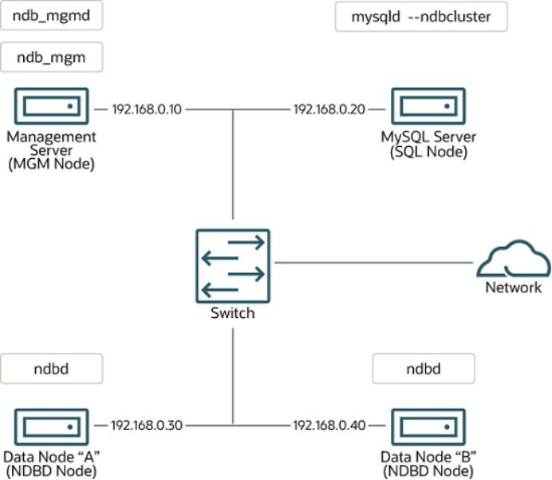

Network addressing. In the interest of simplicity (and reliability), this How-To uses only numeric IP addresses. However, if DNS resolution is available on your network, it is possible to use host names in lieu of IP addresses in configuring Cluster. Alternatively, you can use the `hosts` file (typically `/etc/``hosts` for Linux and other Unix-like operating systems, `C:\WINDOWS\system32\drivers\etc\hosts`on Windows, or your operating system's equivalent) for providing a means to do host lookup if such is available.

Potential hosts file issues. A common problem when trying to use host names for Cluster nodes arises because of the way in which some operating systems (including some Linux distributions) set up the system's own host name in the `/etc/hosts` during installation. Consider two machines with the host names `ndb1` and `ndb2`, both in the `cluster` network domain. Red Hat Linux (including some derivatives such as CentOS and Fedora) places the following entries in these machines' `/etc/hosts` files:

```
#  ndb1 /etc/hosts:
127.0.0.1   ndb1.cluster ndb1 localhost.localdomain localhost
#  ndb2 /etc/hosts:
127.0.0.1   ndb2.cluster ndb2 localhost.localdomain localhost
```

SUSE Linux (including OpenSUSE) places these entries in the machines' `/etc/hosts` files:

```
#  ndb1 /etc/hosts:
127.0.0.1       localhost
127.0.0.2       ndb1.cluster ndb1
#  ndb2 /etc/hosts:
127.0.0.1       localhost
127.0.0.2       ndb2.cluster ndb2
```

Installation of NDB Cluster on Linux In both instances, `ndb1` routes `ndb1.cluster` to a loopback IP address, but gets a public IP address from DNS for `ndb2.cluster`, while `ndb2` routes `ndb2.cluster` to a loopback address and obtains a public address for `ndb1.cluster`. The result is that each data node connects to the management server,but cannot tell when any other data nodes have connected, and so the data nodes appear to hang while starting.

Caution You cannot mix `localhost` and other host names or IP addresses in`config.ini`. For these reasons, the solution in such cases (other than to use IP addresses for all `config.ini` `HostName` entries) is to remove the fully qualified host names from `/etc/hosts` and use these in `config.ini` for all cluster hosts.

Host computer type. Each host computer in our installation scenario is an Intel-based desktop PC running a supported operating system installed to disk in a standard configuration, and running no unnecessary services. The core operating system with standard TCP/IP networking capabilities should be sufficient. Also for the sake of simplicity, we also assume that the file systems on all hosts are set up identically. In the event that they are not, you should adapt these instructions accordingly.

Network hardware. Standard 100 Mbps or 1 gigabit Ethernet cards are installed on each machine,along with the proper drivers for the cards, and that all four hosts are connected through a standard-issue Ethernet networking appliance such as a switch. (All machines should use network cards with the same throughput. That is, all four machines in the cluster should have 100 Mbps cards or all four machines should have 1 Gbps cards.) NDB Cluster works in a 100 Mbps network; however, gigabit Ethernet provides better performance.

Important NDB Cluster is not intended for use in a network for which throughput is less than 100 Mbps or which experiences a high degree of latency. For this reason (among others), attempting to run an NDB Cluster over a wide area network such as the Internet is not likely to be successful, and is not supported in production.

Sample data. We use the `world` database which is available for download from the MySQL website(see https://dev.mysql.com/doc/index-other.html). We assume that each machine has sufficient memory for running the operating system, required NDB Cluster processes, and (on the data nodes) storing the database.

For general information about installing MySQL, see Chapter 2, Installing and Upgrading MySQL.

For information about installation of NDB Cluster on Linux and other Unix-like operating systems, see Section 18.3.1, “Installation of NDB Cluster on Linux”. For information about installation of NDB Cluster on Windows operating systems, see Section 18.3.2, “Installing NDB Cluster on Windows”.

For general information about NDB Cluster hardware, software, and networking requirements, see Section 18.2.3, “NDB Cluster Hardware, Software, and Networking Requirements”.

### 18.3.1 Installation of NDB Cluster on Linux

This section covers installation methods for NDB Cluster on Linux and other Unix-like operating systems.

While the next few sections refer to a Linux operating system, the instructions and procedures given there should be easily adaptable to other supported Unix-like platforms. For manual installation and setup instructions specific to Windows systems, see Section 18.3.2, “Installing NDB Cluster on Windows”.

Each NDB Cluster host computer must have the correct executable programs installed. A host running an SQL node must have installed on it a MySQL Server binary (`mysqld`). Management nodes require the Installation of NDB Cluster on Linux management server daemon (`ndb_mgmd`); data nodes require the data node daemon (`ndbd` or `ndbmtd`). It is not necessary to install the MySQL Server binary on management node hosts and data node hosts. It is recommended that you also install the management client (`ndb_mgm`) on the management server host.

Installation of NDB Cluster on Linux can be done using precompiled binaries from Oracle (downloaded as a .tar.gz archive), with RPM packages (also available from Oracle), or from source code. All three of these installation methods are described in the section that follow.

Regardless of the method used, it is still necessary following installation of the NDB Cluster binaries to create configuration files for all cluster nodes, before you can start the cluster. See Section 18.3.3, “Initial Configuration of NDB Cluster”.

#### 18.3.1.1 Installing an NDB Cluster Binary Release on Linux

This section covers the steps necessary to install the correct executables for each type of Cluster node from precompiled binaries supplied by Oracle.

For setting up a cluster using precompiled binaries, the first step in the installation process for each cluster host is to download the binary archive from the NDB Cluster downloads page. (For the most recent 64-bit NDB 7.4 release, this is `mysql-cluster-gpl-7.4.39-linux-glibc2.12-x86_64.tar.gz`.) We assume that you have placed this file in each machine's `/var/tmp` directory.

If you require a custom binary, see Section 2.9.5, “Installing MySQL Using a Development Source Tree”.

Note After completing the installation, do not yet start any of the binaries. We show you how to do so following the configuration of the nodes (see Section 18.3.3, “Initial Configuration of NDB Cluster”).

SQL nodes. On each of the machines designated to host SQL nodes, perform the following steps as the system `root` user:

1. Check your `/etc/passwd` and `/etc/group` files (or use whatever tools are provided by your

operating system for managing users and groups) to see whether there is already a `mysql` group and `mysql` user on the system. Some OS distributions create these as part of the operating system installation process. If they are not already present, create a new `mysql` user group, and then add a`mysql` user to this group:

```
$> groupadd mysql
$> useradd -g mysql -s /bin/false mysql
```

The syntax for `useradd` and `groupadd` may differ slightly on different versions of Unix, or they may have different names such as `adduser` and `addgroup`.

2. Change location to the directory containing the downloaded file, unpack the archive, and create a

symbolic link named `mysql` to the `mysql` directory.

Note The actual file and directory names vary according to the NDB Cluster version number.

```
$> cd /var/tmp
$> tar -C /usr/local -xzvf mysql-cluster-gpl-7.4.39-linux-glibc2.12-x86_64.tar.gz
$> ln -s /usr/local/mysql-cluster-gpl-7.4.39-linux-glibc2.12-x86_64 /usr/local/mysql
```

Installation of NDB Cluster on Linux

3. Change location to the `mysql` directory and run the supplied script for creating the system databases:

```
$> cd mysql
$> scripts/mysql_install_db --user=mysql
```

4. Set the necessary permissions for the MySQL server and data directories:

```
$> chown -R root .
$> chown -R mysql data
$> chgrp -R mysql .
```

5. Copy the MySQL startup script to the appropriate directory, make it executable, and set it to start when

the operating system is booted up:

```
$> cp support-files/mysql.server /etc/rc.d/init.d/
$> chmod +x /etc/rc.d/init.d/mysql.server
$> chkconfig --add mysql.server
```

(The startup scripts directory may vary depending on your operating system and version—for example,in some Linux distributions, it is `/etc/init.d`.)Here we use Red Hat's `chkconfig` for creating links to the startup scripts; use whatever means is appropriate for this purpose on your platform, such as `update-rc.d` on Debian.

Remember that the preceding steps must be repeated on each machine where an SQL node is to reside.

Data nodes. Installation of the data nodes does not require the `mysqld` binary. Only the NDB Cluster data node executable `ndbd` (single-threaded) or `ndbmtd` (multithreaded) is required. These binaries can also be found in the `.tar.gz` archive. Again, we assume that you have placed this archive in `/var/tmp`.

As system `root` (that is, after using `sudo`, `su root`, or your system's equivalent for temporarily assuming the system administrator account's privileges), perform the following steps to install the data node binaries on the data node hosts:

1. Change location to the `/var/tmp` directory, and extract the `ndbd` and `ndbmtd` binaries from the

archive into a suitable directory such as `/usr/local/bin`:

```
$> cd /var/tmp
$> tar -zxvf mysql-cluster-gpl-7.4.39-linux-glibc2.12-x86_64.tar.gz
$> cd mysql-cluster-gpl-7.4.39-linux-glibc2.12-x86_64
$> cp bin/ndbd /usr/local/bin/ndbd
$> cp bin/ndbmtd /usr/local/bin/ndbmtd
```

(You can safely delete the directory created by unpacking the downloaded archive, and the files it contains, from `/var/tmp` once `ndb_mgm` and `ndb_mgmd` have been copied to the executables directory.)

2. Change location to the directory into which you copied the files, and then make both of them

executable:

```
$> cd /usr/local/bin
$> chmod +x ndb*
```

The preceding steps should be repeated on each data node host.

Although only one of the data node executables is required to run an NDB Cluster data node, we have shown you how to install both `ndbd` and `ndbmtd` in the preceding instructions. We recommend that you do this when installing or upgrading NDB Cluster, even if you plan to use only one of them, since this saves time and trouble in the event that you later decide to change from one to the other.

Installation of NDB Cluster on Linux Note The data directory on each machine hosting a data node is `/usr/local/mysql/``data`. This piece of information is essential when configuring the management node. (See Section 18.3.3, “Initial Configuration of NDB Cluster”.)Management nodes. Installation of the management node does not require the `mysqld` binary.

Only the NDB Cluster management server (`ndb_mgmd`) is required; you most likely want to install the management client (`ndb_mgm`) as well. Both of these binaries also be found in the `.tar.gz` archive.

Again, we assume that you have placed this archive in `/var/tmp`.

As system `root`, perform the following steps to install `ndb_mgmd` and `ndb_mgm` on the management node host:

1. Change location to the `/var/tmp` directory, and extract the `ndb_mgm` and `ndb_mgmd` from the archive

into a suitable directory such as `/usr/local/bin`:

```
$> cd /var/tmp
$> tar -zxvf mysql-cluster-gpl-7.4.39-linux-glibc2.12-x86_64.tar.gz
$> cd mysql-cluster-gpl-7.4.39-linux-glibc2.12-x86_64
$> cp bin/ndb_mgm* /usr/local/bin
```

(You can safely delete the directory created by unpacking the downloaded archive, and the files it contains, from `/var/tmp` once `ndb_mgm` and `ndb_mgmd` have been copied to the executables directory.)

2. Change location to the directory into which you copied the files, and then make both of them

executable:

```
$> cd /usr/local/bin
$> chmod +x ndb_mgm*
```

In Section 18.3.3, “Initial Configuration of NDB Cluster”, we create configuration files for all of the nodes in our example NDB Cluster.

#### 18.3.1.2 Installing NDB Cluster from RPM

This section covers the steps necessary to install the correct executables for each type of NDB Cluster node using RPM packages supplied by Oracle.

RPMs are available for both 32-bit and 64-bit Linux platforms. The filenames for these RPMs use the following pattern:

```
MySQL-Cluster-component-producttype-ndbversion.distribution.architecture.rpm
component:= {server | client [| other]}
producttype:= {gpl | advanced}
ndbversion:= major.minor.release
distribution:= {sles10 | rhel5 | el6}
architecture:= {i386 | x86_64}
```

The `component` can be `server` or `client`. (Other values are possible, but since only the `server` and`client` components are required for a working NDB Cluster installation, we do not discuss them here.)The `producttype` for Community RPMs downloaded from https://dev.mysql.com/downloads/cluster/ is always `gpl`; `advanced` is used to indicate commercial releases. `ndbversion` represents the three-part`NDB` storage engine version number in 7.3.x or 7.4.x format. The `distribution` can be one of `sles11`(SUSE Enterprise Linux 11), `rhel5` (Oracle Linux 5, Red Hat Enterprise Linux 4 and 5), or `el6` (Oracle Installation of NDB Cluster on Linux Linux 6, Red Hat Enterprise Linux 6) The `architecture` is `i386` for 32-bit RPMs and `x86_64` for 64-bit versions.

For an NDB Cluster, one and possibly two RPMs are required:

- The `server` RPM (for example, `MySQL-Cluster-server-gpl-7.3.33-1.sles11.i386.rpm` or

`MySQL-Cluster-server-gpl-7.4.39-1.sles11.i386.rpm`), which supplies the core files needed to run a MySQL Server with `NDBCLUSTER` storage engine support (that is, as an NDB Cluster SQL node)as well as all NDB Cluster executables, including the management node, data node, and `ndb_mgm` client binaries. This RPM is always required for installing NDB Cluster.

- If you do not have your own client application capable of administering a MySQL server,

you should also obtain and install the `client` RPM (for example, `MySQL-Cluster-`

```
client-gpl-7.3.33-1.sles11.i386.rpm or MySQL-Cluster-client-
```

`gpl-7.4.39-1.sles11.i386.rpm`), which supplies the `mysql` client The NDB Cluster version number in the RPM file names (shown here as `7.3.33` or `7.4.39`, depending on whether you are installing NDB Cluster 7.3 or NDB Cluster 7.4) can vary according to the version which you are actually using. It is very important that all of the Cluster RPMs to be installed have the same version number. The `architecture` designation should also be appropriate to the machine on which the RPM is to be installed; in particular, you should keep in mind that 64-bit RPMs cannot be used with 32-bit operating systems.

Data nodes. On a computer that is to host a cluster data node it is necessary to install only the `server`RPM. To do so, copy this RPM to the data node host, and run the following command as the system root user, replacing the name shown for the RPM as necessary to match that of the RPM downloaded from the MySQL website:

```
$> rpm -Uhv MySQL-Cluster-server-gpl-7.3.33-1.sles11.i386.rpm
```

or

```
$> rpm -Uhv MySQL-Cluster-server-gpl-7.4.39-1.sles11.i386.rpm
```

Although this installs all NDB Cluster binaries, only the program `ndbd` or `ndbmtd` (both in `/usr/sbin`) is actually needed to run an NDB Cluster data node.

SQL nodes. On each machine to be used for hosting a cluster SQL node, install the `server` RPM by executing the following command as the system root user, replacing the name shown for the RPM as necessary to match the name of the RPM downloaded from the MySQL website:

```
$> rpm -Uhv MySQL-Cluster-server-gpl-7.3.33-1.sles11.i386.rpm
```

or

```
$> rpm -Uhv MySQL-Cluster-server-gpl-7.4.39-1.sles11.i386.rpm
```

This installs the MySQL server binary (`mysqld`) with `NDB` storage engine support in the `/usr/sbin`directory, as well as all needed MySQL Server support files. It also installs the `mysql.server` and`mysqld_safe` startup scripts (in `/usr/share/mysql` and `/usr/bin`, respectively). The RPM installer should take care of general configuration issues (such as creating the `mysql` user and group, if needed)automatically.

To administer the SQL node (MySQL server), you should also install the `client` RPM, as shown here:

```
$> rpm -Uhv MySQL-Cluster-client-gpl-7.3.33-1.sles11.i386.rpm
```

or

```
$> rpm -Uhv MySQL-Cluster-client-gpl-7.4.39-1.sles11.i386.rpm
```

Installation of NDB Cluster on Linux This installs the `mysql` client program.

Management nodes. To install the NDB Cluster management server, it is necessary only to use the`server` RPM. Copy this RPM to the computer intended to host the management node, and then install it by running the following command as the system root user (replace the name shown for the RPM as necessary to match that of the `server` RPM downloaded from the MySQL website):

```
$> rpm -Uhv MySQL-Cluster-server-gpl-7.3.33-1.sles11.i386.rpm
```

or

```
$> rpm -Uhv MySQL-Cluster-server-gpl-7.4.39-1.sles11.i386.rpm
```

Although this RPM installs many other files, only the management server binary `ndb_mgmd` (in the /`usr/sbin` directory) is actually required for running a management node. The `server` RPM also installs`ndb_mgm`, the `NDB` management client.

See Section 2.5.5, “Installing MySQL on Linux Using RPM Packages from Oracle”, for general information about installing MySQL using RPMs supplied by Oracle.

After installing from RPM, you still need to configure the cluster as discussed in Section 18.3.3, “Initial Configuration of NDB Cluster”.

#### 18.3.1.3 Installing NDB Cluster Using .deb Files

The section provides information about installing NDB Cluster on Debian and related Linux distributions such Ubuntu using the `.deb` files supplied by Oracle for this purpose.

Oracle provides `.deb` installer files for NDB Cluster 7.3 and NDB Cluster 7.4 for 32-bit and 64-bit platforms. For a Debian-based system, only a single installer file is necessary. This file is named using the pattern shown here, according to the applicable NDB Cluster version, Debian version, and architecture:

```
mysql-cluster-gpl-ndbver-debiandebianver-arch.deb
```

Here, `ndbver` is the 3-part `NDB` engine version number, `debianver` is the major version of Debian (`6.0`or 7), and `arch` is one of `i686` or `x86_64`. In the examples that follow, we assume you wish to install NDB

7.4.9 on a 64-bit Debian 7 system; in this case, the installer file is named `mysql-cluster-gpl-7.4.9-`

```
debian7-x86_64.deb.
```

Once you have downloaded the appropriate `.deb` file, you can install it from the command line using `dpkg`,like this:

```
$> dpkg -i mysql-cluster-gpl-7.4.9-debian7-i686.deb
```

You can also remove it using `dpkg` as shown here:

```
$> dpkg -r mysql
```

The installer file should also be compatible with most graphical package managers that work with `.deb`files, such as `GDebi` for the Gnome desktop.

The `.deb` file installs NDB Cluster under `/opt/mysql/server-version/`, where `version` is the 2-part release series version for the included MySQL server. For both NDB Cluster 7.3 and NDB Cluster 7.4,this is always `5.6`. The directory layout is the same as that for the generic Linux binary distribution (see Table 2.3, “MySQL Installation Layout for Generic Unix/Linux Binary Package”), with the exception that startup scripts and configuration files are found in `support-files` instead of `share`. All NDB Cluster executables, such as `ndb_mgm`, `ndbd`, and `ndb_mgmd`, are placed in the `bin` directory.

#### 18.3.1.4 Building NDB Cluster from Source on Linux

Installation of NDB Cluster on Linux This section provides information about compiling NDB Cluster on Linux and other Unix-like platforms.

Building NDB Cluster from source is similar to building the standard MySQL Server, although it differs in a few key respects discussed here. For general information about building MySQL from source, see Section 2.9, “Installing MySQL from Source”. For information about compiling NDB Cluster on Windows platforms, see Section 18.3.2.2, “Compiling and Installing NDB Cluster from Source on Windows”.

Building NDB Cluster requires using the NDB Cluster sources. These are available from the NDB Cluster downloads page at https://dev.mysql.com/downloads/cluster/. The archived source file should have a name similar to `mysql-cluster-gpl-7.3.33.tar.gz` (NDB Cluster 7.3) or `mysql-cluster-``gpl-7.4.39.tar.gz` (NDB Cluster 7.4). You can also obtain NDB Cluster sources from GitHub at https://github.com/mysql/mysql-server/tree/cluster-7.3 (NDB 7.3) and https://github.com/mysql/mysql-server/tree/cluster-7.4 (NDB 7.4). Building NDB Cluster 7.3 or 7.4 from standard MySQL Server 5.6 sources is not supported.

The `WITH_NDBCLUSTER_STORAGE_ENGINE` option for `CMake` causes the binaries for the management nodes, data nodes, and other NDB Cluster programs to be built; it also causes `mysqld` to be compiled with`NDB` storage engine support. This option (or its alias `WITH_NDBCLUSTER`) is required when building NDB Cluster.

Important In NDB Cluster 7.3 and later, the `WITH_NDB_JAVA` option is enabled by default.

This means that, by default, if `CMake` cannot find the location of Java on your system, the configuration process fails; if you do not wish to enable Java and ClusterJ support, you must indicate this explicitly by configuring the build using -`DWITH_NDB_JAVA=OFF`. Use `WITH_CLASSPATH` to provide the Java classpath if needed.

For more information about `CMake` options specific to building NDB Cluster, see CMake Options for Compiling NDB Cluster.

After you have run `make && make install` (or your system's equivalent), the result is similar to what is obtained by unpacking a precompiled binary to the same location.

Management nodes. When building from source and running the default `make install`, the management server and management client binaries (`ndb_mgmd` and `ndb_mgm`) can be found in `/usr/``local/mysql/bin`. Only `ndb_mgmd` is required to be present on a management node host; however,it is also a good idea to have `ndb_mgm` present on the same host machine. Neither of these executables requires a specific location on the host machine's file system.

Data nodes. The only executable required on a data node host is the data node binary `ndbd` or`ndbmtd`. (`mysqld`, for example, does not have to be present on the host machine.) By default, when building from source, this file is placed in the directory `/usr/local/mysql/bin`. For installing on multiple data node hosts, only `ndbd` or `ndbmtd` need be copied to the other host machine or machines. (This assumes that all data node hosts use the same architecture and operating system; otherwise you may need to compile separately for each different platform.) The data node binary need not be in any particular location on the host's file system, as long as the location is known.

When compiling NDB Cluster from source, no special options are required for building multithreaded data node binaries. Configuring the build with `NDB` storage engine support causes `ndbmtd` to be built automatically; `make install` places the `ndbmtd` binary in the installation `bin` directory along with`mysqld`, `ndbd`, and `ndb_mgm`.

SQL nodes. If you compile MySQL with clustering support, and perform the default installation (using`make install` as the system `root` user), `mysqld` is placed in `/usr/local/mysql/bin`. Follow the steps given in Section 2.9, “Installing MySQL from Source” to make `mysqld` ready for use. If you want to run multiple SQL nodes, you can use a copy of the same `mysqld` executable and its associated support Installing NDB Cluster on Windows files on several machines. The easiest way to do this is to copy the entire `/usr/local/mysql` directory and all directories and files contained within it to the other SQL node host or hosts, then repeat the steps from Section 2.9, “Installing MySQL from Source” on each machine. If you configure the build with a nondefault `PREFIX` option, you must adjust the directory accordingly.

In Section 18.3.3, “Initial Configuration of NDB Cluster”, we create configuration files for all of the nodes in our example NDB Cluster.

### 18.3.2 Installing NDB Cluster on Windows

This section describes installation procedures for NDB Cluster on Windows hosts. NDB Cluster 7.3 and NDB Cluster 7.4 binaries for Windows can be obtained from https://dev.mysql.com/downloads/cluster/.

For information about installing NDB Cluster on Windows from a binary release provided by Oracle, see Section 18.3.2.1, “Installing NDB Cluster on Windows from a Binary Release”.

It is also possible to compile and install NDB Cluster from source on Windows using Microsoft Visual Studio. For more information, see Section 18.3.2.2, “Compiling and Installing NDB Cluster from Source on Windows”.

#### 18.3.2.1 Installing NDB Cluster on Windows from a Binary Release

This section describes a basic installation of NDB Cluster on Windows using a binary “no-install” NDB Cluster release provided by Oracle, using the same 4-node setup outlined in the beginning of this section(see Section 18.3, “NDB Cluster Installation”), as shown in the following table:Table 18.5 Network addresses of nodes in example cluster Node IP Address Management node (`mgmd`) 198.51.100.10 SQL node (`mysqld`) 198.51.100.20 Data node "A" (`ndbd`) 198.51.100.30 Data node "B" (`ndbd`) 198.51.100.40 As on other platforms, the NDB Cluster host computer running an SQL node must have installed on it a MySQL Server binary (`mysqld.exe`). You should also have the MySQL client (`mysql.exe`) on this host.

For management nodes and data nodes, it is not necessary to install the MySQL Server binary; however,each management node requires the management server daemon (`ndb_mgmd.exe`); each data node requires the data node daemon (`ndbd.exe` or `ndbmtd.exe`). For this example, we refer to `ndbd.exe`as the data node executable, but you can install `ndbmtd.exe`, the multithreaded version of this program,instead, in exactly the same way. You should also install the management client (`ndb_mgm.exe`) on the management server host. This section covers the steps necessary to install the correct Windows binaries for each type of NDB Cluster node.

Note As with other Windows programs, NDB Cluster executables are named with the`.exe` file extension. However, it is not necessary to include the `.exe` extension when invoking these programs from the command line. Therefore, we often simply refer to these programs in this documentation as `mysqld`, `mysql`, `ndb_mgmd`, and so on. You should understand that, whether we refer (for example) to `mysqld` or`mysqld.exe`, either name means the same thing (the MySQL Server program).

For setting up an NDB Cluster using Oracles's `no-install` binaries, the first step in the installation process is to download the latest NDB Cluster Windows ZIP binary archive from https://dev.mysql.com/downloads/cluster/. This archive has a filename of the `mysql-cluster-gpl-ver-winarch.zip`,Installing NDB Cluster on Windows where `ver` is the `NDB` storage engine version (such as `7.4.39`), and `arch` is the architecture (32 for 32-bit binaries, and 64 for 64-bit binaries). For example, the NDB Cluster 7.4.39 archive for 64-bit Windows systems is named `mysql-cluster-gpl-7.4.39-win64.zip`.

You can run 32-bit NDB Cluster binaries on both 32-bit and 64-bit versions of Windows; however, 64-bit NDB Cluster binaries can be used only on 64-bit versions of Windows. If you are using a 32-bit version of Windows on a computer that has a 64-bit CPU, then you must use the 32-bit NDB Cluster binaries.

To minimize the number of files that need to be downloaded from the Internet or copied between machines, we start with the computer where you intend to run the SQL node.

SQL node. We assume that you have placed a copy of the archive in the directory `C:\Documents``and Settings\username\My Documents\Downloads` on the computer having the IP address

198.51.100.20, where `username` is the name of the current user. (You can obtain this name using `ECHO``%USERNAME%` on the command line.) To install and run NDB Cluster executables as Windows services, this user should be a member of the `Administrators` group.

Extract all the files from the archive. The Extraction Wizard integrated with Windows Explorer is adequate for this task. (If you use a different archive program, be sure that it extracts all files and directories from the archive, and that it preserves the archive's directory structure.) When you are asked for a destination directory, enter `C:\`, which causes the Extraction Wizard to extract the archive to the directory `C:\mysql-``cluster-gpl-ver-winarch`. Rename this directory to `C:\mysql`.

It is possible to install the NDB Cluster binaries to directories other than `C:\mysql\bin`; however, if you do so, you must modify the paths shown in this procedure accordingly. In particular, if the MySQL Server(SQL node) binary is installed to a location other than `C:\mysql` or `C:\Program Files\MySQL\MySQL``Server 5.6`, or if the SQL node's data directory is in a location other than `C:\mysql\data` or `C:``\Program Files\MySQL\MySQL Server 5.6\data`, extra configuration options must be used on the command line or added to the `my.ini` or `my.cnf` file when starting the SQL node. For more information about configuring a MySQL Server to run in a nonstandard location, see Section 2.3.4, “Installing MySQL on Microsoft Windows Using a `noinstall` ZIP Archive”.

For a MySQL Server with NDB Cluster support to run as part of an NDB Cluster, it must be started with the options `--ndbcluster` and `--ndb-connectstring`. While you can specify these options on the command line, it is usually more convenient to place them in an option file. To do this, create a new text file in Notepad or another text editor. Enter the following configuration information into this file:

```
[mysqld]
# Options for mysqld process:
ndbcluster                       # run NDB storage engine
ndb-connectstring=198.51.100.10  # location of management server
```

You can add other options used by this MySQL Server if desired (see Section 2.3.4.2, “Creating an Option File”), but the file must contain the options shown, at a minimum. Save this file as `C:\mysql\my.ini`.

This completes the installation and setup for the SQL node.

Data nodes. An NDB Cluster data node on a Windows host requires only a single executable, one of either `ndbd.exe` or `ndbmtd.exe`. For this example, we assume that you are using `ndbd.exe`, but the same instructions apply when using `ndbmtd.exe`. On each computer where you wish to run a data node(the computers having the IP addresses 198.51.100.30 and 198.51.100.40), create the directories `C:``\mysql`, `C:\mysql\bin`, and `C:\mysql\cluster-data`; then, on the computer where you downloaded and extracted the `no-install` archive, locate `ndbd.exe` in the `C:\mysql\bin` directory. Copy this file to the `C:\mysql\bin` directory on each of the two data node hosts.

To function as part of an NDB Cluster, each data node must be given the address or hostname of the management server. You can supply this information on the command line using the `--ndb-``connectstring` or `-c` option when starting each data node process. However, it is usually preferable to Installing NDB Cluster on Windows put this information in an option file. To do this, create a new text file in Notepad or another text editor and enter the following text:

```
[mysql_cluster]
# Options for data node process:
ndb-connectstring=198.51.100.10  # location of management server
```

Save this file as `C:\mysql\my.ini` on the data node host. Create another text file containing the same information and save it on as `C:mysql\my.ini` on the other data node host, or copy the my.ini file from the first data node host to the second one, making sure to place the copy in the second data node's `C:``\mysql` directory. Both data node hosts are now ready to be used in the NDB Cluster, which leaves only the management node to be installed and configured.

Management node. The only executable program required on a computer used for hosting an NDB Cluster management node is the management server program `ndb_mgmd.exe`. However, in order to administer the NDB Cluster once it has been started, you should also install the NDB Cluster management client program `ndb_mgm.exe` on the same machine as the management server. Locate these two programs on the machine where you downloaded and extracted the `no-install` archive; this should be the directory `C:\mysql\bin` on the SQL node host. Create the directory `C:\mysql\bin` on the computer having the IP address 198.51.100.10, then copy both programs to this directory.

You should now create two configuration files for use by `ndb_mgmd.exe`:

1. A local configuration file to supply configuration data specific to the management node itself. Typically,

this file needs only to supply the location of the NDB Cluster global configuration file (see item 2).

To create this file, start a new text file in Notepad or another text editor, and enter the following information:

```
[mysql_cluster]
# Options for management node process
config-file=C:/mysql/bin/config.ini
```

Save this file as the text file `C:\mysql\bin\my.ini`.

2. A global configuration file from which the management node can obtain configuration information

governing the NDB Cluster as a whole. At a minimum, this file must contain a section for each node in the NDB Cluster, and the IP addresses or hostnames for the management node and all data nodes(`HostName` configuration parameter). It is also advisable to include the following additional information:

- The IP address or hostname of any SQL nodes
- The data memory and index memory allocated to each data node (`DataMemory` and `IndexMemory`

configuration parameters)

- The number of replicas, using the `NoOfReplicas` configuration parameter (see Section 18.2.2,

“NDB Cluster Nodes, Node Groups, Fragment Replicas, and Partitions”)

- The directory where each data node stores it data and log file, and the directory where the

management node keeps its log files (in both cases, the `DataDir` configuration parameter)Create a new text file using a text editor such as Notepad, and input the following information:

```
[ndbd default]
# Options affecting ndbd processes on all data nodes:
NoOfReplicas=2                      # Number of fragment replicas
DataDir=C:/mysql/cluster-data       # Directory for each data node's data files
# Forward slashes used in directory path,
# rather than backslashes. This is correct;
```

Installing NDB Cluster on Windows

```
# see Important note in text
DataMemory=80M    # Memory allocated to data storage
IndexMemory=18M   # Memory allocated to index storage
# For DataMemory and IndexMemory, we have used the
# default values. Since the "world" database takes up
# only about 500KB, this should be more than enough for
# this example Cluster setup.
[ndb_mgmd]
# Management process options:
HostName=198.51.100.10              # Hostname or IP address of management node
DataDir=C:/mysql/bin/cluster-logs   # Directory for management node log files
[ndbd]
# Options for data node "A":
# (one [ndbd] section per data node)
HostName=198.51.100.30          # Hostname or IP address
[ndbd]
# Options for data node "B":
HostName=198.51.100.40          # Hostname or IP address
[mysqld]
# SQL node options:
HostName=198.51.100.20          # Hostname or IP address
```

Save this file as the text file `C:\mysql\bin\config.ini`.

Important A single backslash character (\) cannot be used when specifying directory paths in program options or configuration files used by NDB Cluster on Windows. Instead,you must either escape each backslash character with a second backslash (`\\`), or replace the backslash with a forward slash character (/). For example, the following line from the `[ndb_mgmd]` section of an NDB Cluster `config.ini` file does not work:

```
DataDir=C:\mysql\bin\cluster-logs
```

Instead, you may use either of the following:

```
DataDir=C:\\mysql\\bin\\cluster-logs  # Escaped backslashes
DataDir=C:/mysql/bin/cluster-logs     # Forward slashes
```

For reasons of brevity and legibility, we recommend that you use forward slashes in directory paths used in NDB Cluster program options and configuration files on Windows.

#### 18.3.2.2 Compiling and Installing NDB Cluster from Source on Windows

Oracle provides precompiled NDB Cluster binaries for Windows which should be adequate for most users.

However, if you wish, it is also possible to compile NDB Cluster for Windows from source code. The procedure for doing this is almost identical to the procedure used to compile the standard MySQL Server binaries for Windows, and uses the same tools. However, there are two major differences:

- Building NDB Cluster requires using the NDB Cluster sources. These are available from the NDB Cluster

downloads page at https://dev.mysql.com/downloads/cluster/. The archived source file should have a name similar to `mysql-cluster-gpl-7.3.33.tar.gz` (NDB Cluster 7.3) or `mysql-cluster-``gpl-7.4.39.tar.gz` (NDB Cluster 7.4). You can also obtain NDB Cluster sources from GitHub at https://github.com/mysql/mysql-server/tree/cluster-7.3 (NDB 7.3) and https://github.com/mysql/mysql-Installing NDB Cluster on Windows server/tree/cluster-7.4 (NDB 7.4). Building NDB Cluster 7.3 or 7.4 from standard MySQL Server 5.6 sources is not supported.

- You must configure the build using the `WITH_NDBCLUSTER` option in addition to any other build options

you wish to use with `CMake`. (`WITH_NDBCLUSTER_STORAGE_ENGINE` is supported as an alias.)Important In NDB Cluster 7.3 and later, the `WITH_NDB_JAVA` option is enabled by default.

This means that, by default, if `CMake` cannot find the location of Java on your system, the configuration process fails; if you do not wish to enable Java and ClusterJ support, you must indicate this explicitly by configuring the build using -`DWITH_NDB_JAVA=OFF`. (Bug #12379735) Use `WITH_CLASSPATH` to provide the Java classpath if needed.

For more information about `CMake` options specific to building NDB Cluster, see CMake Options for Compiling NDB Cluster.

Once the build process is complete, you can create a Zip archive containing the compiled binaries;

Section 2.9.4, “Installing MySQL Using a Standard Source Distribution” provides the commands needed to perform this task on Windows systems. The NDB Cluster binaries can be found in the `bin` directory of the resulting archive, which is equivalent to the `no-install` archive, and which can be installed and configured in the same manner. For more information, see Section 18.3.2.1, “Installing NDB Cluster on Windows from a Binary Release”.

#### 18.3.2.3 Initial Startup of NDB Cluster on Windows

Once the NDB Cluster executables and needed configuration files are in place, performing an initial start of the cluster is simply a matter of starting the NDB Cluster executables for all nodes in the cluster.

Each cluster node process must be started separately, and on the host computer where it resides. The management node should be started first, followed by the data nodes, and then finally by any SQL nodes.

1. On the management node host, issue the following command from the command line to start the

management node process. The output should appear similar to what is shown here:

```
C:\mysql\bin> ndb_mgmd
2010-06-23 07:53:34 [MgmtSrvr] INFO -- NDB Cluster Management Server. mysql-5.6.51-ndb-7.4.39
2010-06-23 07:53:34 [MgmtSrvr] INFO -- Reading cluster configuration from 'config.ini'
```

The management node process continues to print logging output to the console. This is normal,because the management node is not running as a Windows service. (If you have used NDB Cluster on a Unix-like platform such as Linux, you may notice that the management node's default behavior in this regard on Windows is effectively the opposite of its behavior on Unix systems, where it runs by default as a Unix daemon process. This behavior is also true of NDB Cluster data node processes running on Windows.) For this reason, do not close the window in which `ndb_mgmd.exe` is running; doing so kills the management node process. (See Section 18.3.2.4, “Installing NDB Cluster Processes as Windows Services”, where we show how to install and run NDB Cluster processes as Windows services.)The required `-f` option tells the management node where to find the global configuration file(`config.ini`). The long form of this option is `--config-file`.

Important An NDB Cluster management node caches the configuration data that it reads from `config.ini`; once it has created a configuration cache, it ignores the`config.ini` file on subsequent starts unless forced to do otherwise. This means that, if the management node fails to start due to an error in this file,Installing NDB Cluster on Windows you must make the management node re-read `config.ini` after you have corrected any errors in it. You can do this by starting `ndb_mgmd.exe` with the`--reload` or `--initial` option on the command line. Either of these options works to refresh the configuration cache.

It is not necessary or advisable to use either of these options in the management node's `my.ini` file.

2. On each of the data node hosts, run the command shown here to start the data node processes:

```
C:\mysql\bin> ndbd
2010-06-23 07:53:46 [ndbd] INFO -- Configuration fetched from 'localhost:1186', generation: 1
```

In each case, the first line of output from the data node process should resemble what is shown in the preceding example, and is followed by additional lines of logging output. As with the management node process, this is normal, because the data node is not running as a Windows service. For this reason, do not close the console window in which the data node process is running; doing so kills `ndbd.exe`. (For more information, see Section 18.3.2.4, “Installing NDB Cluster Processes as Windows Services”.)

3. Do not start the SQL node yet; it cannot connect to the cluster until the data nodes have finished

starting, which may take some time. Instead, in a new console window on the management node host,start the NDB Cluster management client `ndb_mgm.exe`, which should be in `C:\mysql\bin` on the management node host. (Do not try to re-use the console window where `ndb_mgmd.exe` is running by typing CTRL+C, as this kills the management node.) The resulting output should look like this:

```
C:\mysql\bin> ndb_mgm
-- NDB Cluster -- Management Client --
ndb_mgm>
```

When the prompt `ndb_mgm>` appears, this indicates that the management client is ready to receive NDB Cluster management commands. You can observe the status of the data nodes as they start by entering `ALL STATUS` at the management client prompt. This command causes a running report of the data nodes's startup sequence, which should look something like this:

```
ndb_mgm> ALL STATUS
Connected to Management Server at: localhost:1186
Node 2: starting (Last completed phase 3) (mysql-5.6.51-ndb-7.4.39)
Node 3: starting (Last completed phase 3) (mysql-5.6.51-ndb-7.4.39)
Node 2: starting (Last completed phase 4) (mysql-5.6.51-ndb-7.4.39)
Node 3: starting (Last completed phase 4) (mysql-5.6.51-ndb-7.4.39)
Node 2: Started (version 7.4.39)
Node 3: Started (version 7.4.39)
ndb_mgm>
```

Note Commands issued in the management client are not case-sensitive; we use uppercase as the canonical form of these commands, but you are not required to observe this convention when inputting them into the `ndb_mgm` client.

For more information, see Section 18.6.1, “Commands in the NDB Cluster Management Client”.

The output produced by `ALL STATUS` is likely to vary from what is shown here, according to the speed at which the data nodes are able to start, the release version number of the NDB Cluster software Installing NDB Cluster on Windows you are using, and other factors. What is significant is that, when you see that both data nodes have started, you are ready to start the SQL node.

You can leave `ndb_mgm.exe` running; it has no negative impact on the performance of the NDB Cluster, and we use it in the next step to verify that the SQL node is connected to the cluster after you have started it.

4. On the computer designated as the SQL node host, open a console window and navigate to the

directory where you unpacked the NDB Cluster binaries (if you are following our example, this is `C:`

```
\mysql\bin).
```

Start the SQL node by invoking `mysqld.exe` from the command line, as shown here:

```
C:\mysql\bin> mysqld --console
```

The `--console` option causes logging information to be written to the console, which can be helpful in the event of problems. (Once you are satisfied that the SQL node is running in a satisfactory manner,you can stop it and restart it out without the `--console` option, so that logging is performed normally.)In the console window where the management client (`ndb_mgm.exe`) is running on the management node host, enter the `SHOW` command, which should produce output similar to what is shown here:

```
ndb_mgm> SHOW
Connected to Management Server at: localhost:1186
Cluster Configuration
---------------------
[ndbd(NDB)]     2 node(s)
id=2    @198.51.100.30  (Version: 5.6.51-ndb-7.4.39, Nodegroup: 0, *)
id=3    @198.51.100.40  (Version: 5.6.51-ndb-7.4.39, Nodegroup: 0)
[ndb_mgmd(MGM)] 1 node(s)
id=1    @198.51.100.10  (Version: 5.6.51-ndb-7.4.39)
[mysqld(API)]   1 node(s)
id=4    @198.51.100.20  (Version: 5.6.51-ndb-7.4.39)
```

You can also verify that the SQL node is connected to the NDB Cluster in the `mysql` client(`mysql.exe`) using the `SHOW ENGINE NDB STATUS` statement.

You should now be ready to work with database objects and data using NDB Cluster's `NDBCLUSTER`storage engine. See Section 18.3.5, “NDB Cluster Example with Tables and Data”, for more information and examples.

You can also install `ndb_mgmd.exe`, `ndbd.exe`, and `ndbmtd.exe` as Windows services. For information on how to do this, see Section 18.3.2.4, “Installing NDB Cluster Processes as Windows Services”).

#### 18.3.2.4 Installing NDB Cluster Processes as Windows Services

Once you are satisfied that NDB Cluster is running as desired, you can install the management nodes and data nodes as Windows services, so that these processes are started and stopped automatically whenever Windows is started or stopped. This also makes it possible to control these processes from the command line with the appropriate `SC START` and `SC STOP` commands, or using the Windows graphical `Services`utility. `NET START` and `NET STOP` commands can also be used.

Installing programs as Windows services usually must be done using an account that has Administrator rights on the system.

To install the management node as a service on Windows, invoke `ndb_mgmd.exe` from the command line on the machine hosting the management node, using the `--install` option, as shown here:Installing NDB Cluster on Windows

```
C:\> C:\mysql\bin\ndb_mgmd.exe --install
Installing service 'NDB Cluster Management Server'
as '"C:\mysql\bin\ndbd.exe" "--service=ndb_mgmd"'
Service successfully installed.
```

Important When installing an NDB Cluster program as a Windows service, you should always specify the complete path; otherwise the service installation may fail with the error

```
The system cannot find the file specified.
```

The `--install` option must be used first, ahead of any other options that might be specified for`ndb_mgmd.exe`. However, it is preferable to specify such options in an options file instead. If your options file is not in one of the default locations as shown in the output of `ndb_mgmd.exe` `--help`, you can specify the location using the `--config-file` option.

Now you should be able to start and stop the management server like this:

```
C:\> SC START ndb_mgmd
C:\> SC STOP ndb_mgmd
```

Note If using `NET` commands, you can also start or stop the management server as a Windows service using the descriptive name, as shown here:

```
C:\> NET START 'NDB Cluster Management Server'
The NDB Cluster Management Server service is starting.
The NDB Cluster Management Server service was started successfully.
C:\> NET STOP  'NDB Cluster Management Server'
The NDB Cluster Management Server service is stopping..
The NDB Cluster Management Server service was stopped successfully.
```

It is usually simpler to specify a short service name or to permit the default service name to be used when installing the service, and then reference that name when starting or stopping the service. To specify a service name other than `ndb_mgmd`, append it to the `--install` option, as shown in this example:

```
C:\> C:\mysql\bin\ndb_mgmd.exe --install=mgmd1
Installing service 'NDB Cluster Management Server'
as '"C:\mysql\bin\ndb_mgmd.exe" "--service=mgmd1"'
Service successfully installed.
```

Now you should be able to start or stop the service using the name you have specified, like this:

```
C:\> SC START mgmd1
C:\> SC STOP mgmd1
```

To remove the management node service, use `SC DELETE service_name`:

```
C:\> SC DELETE mgmd1
```

Alternatively, invoke `ndb_mgmd.exe` with the `--remove` option, as shown here:

```
C:\> C:\mysql\bin\ndb_mgmd.exe --remove
Removing service 'NDB Cluster Management Server'
Service successfully removed.
```

If you installed the service using a service name other than the default, pass the service name as the value of the `ndb_mgmd.exe` `--remove` option, like this:Initial Configuration of NDB Cluster

```
C:\> C:\mysql\bin\ndb_mgmd.exe --remove=mgmd1
Removing service 'mgmd1'
Service successfully removed.
```

Installation of an NDB Cluster data node process as a Windows service can be done in a similar fashion,using the `--install` option for `ndbd.exe` (or `ndbmtd.exe`), as shown here:

```
C:\> C:\mysql\bin\ndbd.exe --install
Installing service 'NDB Cluster Data Node Daemon' as '"C:\mysql\bin\ndbd.exe" "--service=ndbd"'
Service successfully installed.
```

Now you can start or stop the data node as shown in the following example:

```
C:\> SC START ndbd
C:\> SC STOP ndbd
```

To remove the data node service, use `SC DELETE service_name`:

```
C:\> SC DELETE ndbd
```

Alternatively, invoke `ndbd.exe` with the `--remove` option, as shown here:

```
C:\> C:\mysql\bin\ndbd.exe --remove
Removing service 'NDB Cluster Data Node Daemon'
Service successfully removed.
```

As with `ndb_mgmd.exe` (and `mysqld.exe`), when installing `ndbd.exe` as a Windows service, you can also specify a name for the service as the value of `--install`, and then use it when starting or stopping the service, like this:

```
C:\> C:\mysql\bin\ndbd.exe --install=dnode1
Installing service 'dnode1' as '"C:\mysql\bin\ndbd.exe" "--service=dnode1"'
Service successfully installed.
C:\> SC START dnode1
C:\> SC STOP dnode1
```

If you specified a service name when installing the data node service, you can use this name when removing it as well, as shown here:

```
C:\> SC DELETE dnode1
```

Alternatively, you can pass the service name as the value of the `ndbd.exe` `--remove` option, as shown here:

```
C:\> C:\mysql\bin\ndbd.exe --remove=dnode1
Removing service 'dnode1'
Service successfully removed.
```

Installation of the SQL node as a Windows service, starting the service, stopping the service, and removing the service are done in a similar fashion, using `mysqld` `--install`, `SC START`, `SC STOP`, and `SC``DELETE` (or `mysqld` `--remove`). `NET` commands can also be used to start or stop a service. For additional information, see Section 2.3.4.7, “Starting MySQL as a Windows Service”.

### 18.3.3 Initial Configuration of NDB Cluster

In this section, we discuss manual configuration of an installed NDB Cluster by creating and editing configuration files.

Initial Configuration of NDB Cluster NDB Cluster (NDB versions 7.3 and later) also provides a GUI installer which can be used to perform the configuration without the need to edit text files in a separate application. For more information, see Section 18.3.8, “The NDB Cluster Auto-Installer (NO LONGER SUPPORTED)”.

For our four-node, four-host NDB Cluster (see Cluster nodes and host computers), it is necessary to write four configuration files, one per node host.

- Each data node or SQL node requires a `my.cnf` file that provides two pieces of information: a

connection string that tells the node where to find the management node, and a line telling the MySQL server on this host (the machine hosting the data node) to enable the `NDBCLUSTER` storage engine.

For more information on connection strings, see Section 18.4.3.3, “NDB Cluster Connection Strings”.

- The management node needs a `config.ini` file telling it how many fragment replicas to maintain, how

much memory to allocate for data and indexes on each data node, where to find the data nodes, where to save data to disk on each data node, and where to find any SQL nodes.

Configuring the data nodes and SQL nodes. The `my.cnf` file needed for the data nodes is fairly simple. The configuration file should be located in the `/etc` directory and can be edited using any text editor. (Create the file if it does not exist.) For example:

```
$> vi /etc/my.cnf
```

Note We show `vi` being used here to create the file, but any text editor should work just as well.

For each data node and SQL node in our example setup, `my.cnf` should look like this:

```
[mysqld]
# Options for mysqld process:
ndbcluster                      # run NDB storage engine
[mysql_cluster]
# Options for NDB Cluster processes:
ndb-connectstring=198.51.100.10  # location of management server
```

After entering the preceding information, save this file and exit the text editor. Do this for the machines hosting data node “A”, data node “B”, and the SQL node.

Important Once you have started a `mysqld` process with the `ndbcluster` and `ndb-``connectstring` parameters in the `[mysqld]` and `[mysql_cluster]` sections of the `my.cnf` file as shown previously, you cannot execute any `CREATE TABLE`or `ALTER TABLE` statements without having actually started the cluster. Otherwise,these statements fails with an error. This is by design.

Configuring the management node. The first step in configuring the management node is to create the directory in which the configuration file can be found and then to create the file itself. For example(running as `root`):

```
$> mkdir /var/lib/mysql-cluster
$> cd /var/lib/mysql-cluster
$> vi config.ini
```

For our representative setup, the `config.ini` file should read as follows:

```
[ndbd default]
```

Initial Startup of NDB Cluster

```
# Options affecting ndbd processes on all data nodes:
NoOfReplicas=2    # Number of fragment replicas
DataMemory=80M    # How much memory to allocate for data storage
IndexMemory=18M   # How much memory to allocate for index storage
# For DataMemory and IndexMemory, we have used the
# default values. Since the "world" database takes up
# only about 500KB, this should be more than enough for
# this example NDB Cluster setup.
ServerPort=2202   # This the default value; however, you can use any
# port that is free for all the hosts in the cluster
# Note1: It is recommended that you do not specify the port
# number at all and simply allow the default value to be used
# instead
# Note2: The port was formerly specified using the PortNumber
# TCP parameter; this parameter is no longer available in NDB
# Cluster 7.5.
[ndb_mgmd]
# Management process options:
HostName=198.51.100.10          # Hostname or IP address of management node
DataDir=/var/lib/mysql-cluster  # Directory for management node log files
[ndbd]
# Options for data node "A":
# (one [ndbd] section per data node)
HostName=198.51.100.30          # Hostname or IP address
NodeId=2                        # Node ID for this data node
DataDir=/usr/local/mysql/data   # Directory for this data node's data files
[ndbd]
# Options for data node "B":
HostName=198.51.100.40          # Hostname or IP address
NodeId=3                        # Node ID for this data node
DataDir=/usr/local/mysql/data   # Directory for this data node's data files
[mysqld]
# SQL node options:
HostName=198.51.100.20          # Hostname or IP address
# (additional mysqld connections can be
# specified for this node for various
# purposes such as running ndb_restore)
```

Note The `world` database can be downloaded from https://dev.mysql.com/doc/index-other.html.

After all the configuration files have been created and these minimal options have been specified, you are ready to proceed with starting the cluster and verifying that all processes are running. We discuss how this is done in Section 18.3.4, “Initial Startup of NDB Cluster”.

For more detailed information about the available NDB Cluster configuration parameters and their uses,see Section 18.4.3, “NDB Cluster Configuration Files”, and Section 18.4, “Configuration of NDB Cluster”.

For configuration of NDB Cluster as relates to making backups, see Section 18.6.8.3, “Configuration for NDB Cluster Backups”.

Note The default port for Cluster management nodes is 1186; the default port for data nodes is 2202. However, the cluster can automatically allocate ports for data nodes from those that are already free.

### 18.3.4 Initial Startup of NDB Cluster

NDB Cluster Example with Tables and Data Starting the cluster is not very difficult after it has been configured. Each cluster node process must be started separately, and on the host where it resides. The management node should be started first,followed by the data nodes, and then finally by any SQL nodes:

1. On the management host, issue the following command from the system shell to start the management

node process:

```
$> ndb_mgmd --initial -f /var/lib/mysql-cluster/config.ini
```

The first time that it is started, `ndb_mgmd` must be told where to find its configuration file, using the `-f`or `--config-file` option. This option requires that `--initial` or `--reload` also be specified; see Section 18.5.4, “ndb_mgmd — The NDB Cluster Management Server Daemon”, for details.

2. On each of the data node hosts, run this command to start the `ndbd` process:

```
$> ndbd
```

3. If you used RPM files to install MySQL on the cluster host where the SQL node is to reside, you can

(and should) use the supplied startup script to start the MySQL server process on the SQL node.

If all has gone well, and the cluster has been set up correctly, the cluster should now be operational. You can test this by invoking the `ndb_mgm` management node client. The output should look like that shown here, although you might see some slight differences in the output depending upon the exact version of MySQL that you are using:

```
$> ndb_mgm
-- NDB Cluster -- Management Client --
ndb_mgm> SHOW
Connected to Management Server at: localhost:1186
Cluster Configuration
---------------------
[ndbd(NDB)]     2 node(s)
id=2    @198.51.100.30  (Version: 5.6.51-ndb-7.4.39, Nodegroup: 0, *)
id=3    @198.51.100.40  (Version: 5.6.51-ndb-7.4.39, Nodegroup: 0)
[ndb_mgmd(MGM)] 1 node(s)
id=1    @198.51.100.10  (Version: 5.6.51-ndb-7.4.39)
[mysqld(API)]   1 node(s)
id=4    @198.51.100.20  (Version: 5.6.51-ndb-7.4.39)
```

The SQL node is referenced here as `[mysqld(API)]`, which reflects the fact that the `mysqld` process is acting as an NDB Cluster API node.

Note The IP address shown for a given NDB Cluster SQL or other API node in the output of `SHOW` is the address used by the SQL or API node to connect to the cluster data nodes, and not to any management node.

You should now be ready to work with databases, tables, and data in NDB Cluster. See Section 18.3.5,“NDB Cluster Example with Tables and Data”, for a brief discussion.

### 18.3.5 NDB Cluster Example with Tables and Data

Note The information in this section applies to NDB Cluster running on both Unix and Windows platforms.

NDB Cluster Example with Tables and Data Working with database tables and data in NDB Cluster is not much different from doing so in standard MySQL. There are two key points to keep in mind:

- For a table to be replicated in the cluster, it must use the `NDBCLUSTER` storage engine. To specify this,

use the `ENGINE=NDBCLUSTER` or `ENGINE=NDB` option when creating the table:

```
CREATE TABLE tbl_name (col_name column_definitions) ENGINE=NDBCLUSTER;
```

Alternatively, for an existing table that uses a different storage engine, use `ALTER TABLE` to change the table to use `NDBCLUSTER`:

```
ALTER TABLE tbl_name ENGINE=NDBCLUSTER;
```

- Every `NDBCLUSTER` table has a primary key. If no primary key is defined by the user when a table is

created, the `NDBCLUSTER` storage engine automatically generates a hidden one. Such a key takes up space just as does any other table index. (It is not uncommon to encounter problems due to insufficient memory for accommodating these automatically created indexes.)If you are importing tables from an existing database using the output of `mysqldump`, you can open the SQL script in a text editor and add the `ENGINE` option to any table creation statements, or replace any existing `ENGINE` options. Suppose that you have the `world` sample database on another MySQL server that does not support NDB Cluster, and you want to export the `City` table:

```
$> mysqldump --add-drop-table world City > city_table.sql
```

The resulting `city_table.sql` file contains this table creation statement (and the `INSERT` statements necessary to import the table data):

```
DROP TABLE IF EXISTS `City`;
CREATE TABLE `City` (
`ID` int(11) NOT NULL auto_increment,
`Name` char(35) NOT NULL default '',
`CountryCode` char(3) NOT NULL default '',
`District` char(20) NOT NULL default '',
`Population` int(11) NOT NULL default '0',
PRIMARY KEY  (`ID`)
) ENGINE=MyISAM DEFAULT CHARSET=latin1;
INSERT INTO `City` VALUES (1,'Kabul','AFG','Kabol',1780000);
INSERT INTO `City` VALUES (2,'Qandahar','AFG','Qandahar',237500);
INSERT INTO `City` VALUES (3,'Herat','AFG','Herat',186800);
(remaining INSERT statements omitted)
```

You need to make sure that MySQL uses the `NDBCLUSTER` storage engine for this table. There are two ways that this can be accomplished. One of these is to modify the table definition before importing it into the Cluster database. Using the `City` table as an example, modify the `ENGINE` option of the definition as follows:

```
DROP TABLE IF EXISTS `City`;
CREATE TABLE `City` (
`ID` int(11) NOT NULL auto_increment,
`Name` char(35) NOT NULL default '',
`CountryCode` char(3) NOT NULL default '',
`District` char(20) NOT NULL default '',
`Population` int(11) NOT NULL default '0',
PRIMARY KEY  (`ID`)
) ENGINE=NDBCLUSTER DEFAULT CHARSET=latin1;
INSERT INTO `City` VALUES (1,'Kabul','AFG','Kabol',1780000);
INSERT INTO `City` VALUES (2,'Qandahar','AFG','Qandahar',237500);
INSERT INTO `City` VALUES (3,'Herat','AFG','Herat',186800);
(remaining INSERT statements omitted)
```

NDB Cluster Example with Tables and Data This must be done for the definition of each table that is to be part of the clustered database. The easiest way to accomplish this is to do a search-and-replace on the file that contains the definitions and replace all instances of `TYPE=engine_name` or `ENGINE=engine_name` with `ENGINE=NDBCLUSTER`. If you do not want to modify the file, you can use the unmodified file to create the tables, and then use `ALTER TABLE` to change their storage engine. The particulars are given later in this section.

Assuming that you have already created a database named `world` on the SQL node of the cluster, you can then use the `mysql` command-line client to read `city_table.sql`, and create and populate the corresponding table in the usual manner:

```
$> mysql world < city_table.sql
```

It is very important to keep in mind that the preceding command must be executed on the host where the SQL node is running (in this case, on the machine with the IP address `198.51.100.20`).

To create a copy of the entire `world` database on the SQL node, use `mysqldump` on the noncluster server to export the database to a file named `world.sql` (for example, in the `/tmp` directory). Then modify the table definitions as just described and import the file into the SQL node of the cluster like this:

```
$> mysql world < /tmp/world.sql
```

If you save the file to a different location, adjust the preceding instructions accordingly.

Running `SELECT` queries on the SQL node is no different from running them on any other instance of a MySQL server. To run queries from the command line, you first need to log in to the MySQL Monitor in the usual way (specify the `root` password at the `Enter password:` prompt):

```
$> mysql -u root -p
Enter password:
Welcome to the MySQL monitor.  Commands end with ; or \g.
Your MySQL connection id is 1 to server version: 5.6.51-ndb-7.4.39
Type 'help;' or '\h' for help. Type '\c' to clear the buffer.
mysql>
```

We simply use the MySQL server's `root` account and assume that you have followed the standard security precautions for installing a MySQL server, including setting a strong `root` password. For more information, see Section 2.10.4, “Securing the Initial MySQL Accounts”.

It is worth taking into account that Cluster nodes do not make use of the MySQL privilege system when accessing one another. Setting or changing MySQL user accounts (including the `root` account) effects only applications that access the SQL node, not interaction between nodes. See Section 18.6.17.2, “NDB Cluster and MySQL Privileges”, for more information.

If you did not modify the `ENGINE` clauses in the table definitions prior to importing the SQL script, you should run the following statements at this point:

```
mysql> USE world;
mysql> ALTER TABLE City ENGINE=NDBCLUSTER;
mysql> ALTER TABLE Country ENGINE=NDBCLUSTER;
mysql> ALTER TABLE CountryLanguage ENGINE=NDBCLUSTER;
```

Selecting a database and running a `SELECT` query against a table in that database is also accomplished in the usual manner, as is exiting the MySQL Monitor:

```
mysql> USE world;
mysql> SELECT Name, Population FROM City ORDER BY Population DESC LIMIT 5;
+-----------+------------+
| Name      | Population |
```

NDB Cluster Example with Tables and Data

```
+-----------+------------+
| Bombay    |   10500000 |
| Seoul     |    9981619 |
| São Paulo |    9968485 |
| Shanghai  |    9696300 |
| Jakarta   |    9604900 |
+-----------+------------+
5 rows in set (0.34 sec)
mysql> \q
Bye
$>
```

Applications that use MySQL can employ standard APIs to access `NDB` tables. It is important to remember that your application must access the SQL node, and not the management or data nodes. This brief example shows how we might execute the `SELECT` statement just shown by using the PHP 5.X `mysqli`extension running on a Web server elsewhere on the network:

```
<!DOCTYPE HTML PUBLIC "-//W3C//DTD HTML 4.01 Transitional//EN"
"http://www.w3.org/TR/html4/loose.dtd">
<html>
<head>
<meta http-equiv="Content-Type"
content="text/html; charset=iso-8859-1">
<title>SIMPLE mysqli SELECT</title>
</head>
<body>
<?php
# connect to SQL node:
$link = new mysqli('198.51.100.20', 'root', 'root_password', 'world');
# parameters for mysqli constructor are:
#   host, user, password, database
if( mysqli_connect_errno() )
die("Connect failed: " . mysqli_connect_error());
$query = "SELECT Name, Population
FROM City
ORDER BY Population DESC
LIMIT 5";
# if no errors...
if( $result = $link->query($query) )
{
?>
<table border="1" width="40%" cellpadding="4" cellspacing ="1">
<tbody>
<tr>
<th width="10%">City</th>
<th>Population</th>
</tr>
<?
# then display the results...
while($row = $result->fetch_object())
printf("<tr>\n  <td align=\"center\">%s</td><td>%d</td>\n</tr>\n",
$row->Name, $row->Population);
?>
</tbody
</table>
<?
# ...and verify the number of rows that were retrieved
printf("<p>Affected rows: %d</p>\n", $link->affected_rows);
}
else
# otherwise, tell us what went wrong
```

Safe Shutdown and Restart of NDB Cluster

```
echo mysqli_error();
# free the result set and the mysqli connection object
$result->close();
$link->close();
?>
</body>
</html>
```

We assume that the process running on the Web server can reach the IP address of the SQL node.

In a similar fashion, you can use the MySQL C API, Perl-DBI, Python-mysql, or MySQL Connectors to perform the tasks of data definition and manipulation just as you would normally with MySQL.

### 18.3.6 Safe Shutdown and Restart of NDB Cluster

To shut down the cluster, enter the following command in a shell on the machine hosting the management node:

```
$> ndb_mgm -e shutdown
```

The `-e` option here is used to pass a command to the `ndb_mgm` client from the shell. The command causes the `ndb_mgm`, `ndb_mgmd`, and any `ndbd` or `ndbmtd` processes to terminate gracefully.

Any SQL nodes can be terminated using `mysqladmin shutdown` and other means. On Windows platforms, assuming that you have installed the SQL node as a Windows service, you can use `SC STOP`

```
service_name or NET STOP service_name.
```

To restart the cluster on Unix platforms, run these commands:

- On the management host (`198.51.100.10` in our example setup):

```
$> ndb_mgmd -f /var/lib/mysql-cluster/config.ini
```

- On each of the data node hosts (`198.51.100.30` and `198.51.100.40`):

```
$> ndbd
```

- Use the `ndb_mgm` client to verify that both data nodes have started successfully.
- On the SQL host (`198.51.100.20`):

```
$> mysqld_safe &
```

On Windows platforms, assuming that you have installed all NDB Cluster processes as Windows services using the default service names (see Section 18.3.2.4, “Installing NDB Cluster Processes as Windows Services”), you can restart the cluster as follows:

- On the management host (`198.51.100.10` in our example setup), execute the following command:

```
C:\> SC START ndb_mgmd
```

- On each of the data node hosts (`198.51.100.30` and `198.51.100.40`), execute the following

command:

```
C:\> SC START ndbd
```

- On the management node host, use the `ndb_mgm` client to verify that the management node and

both data nodes have started successfully (see Section 18.3.2.3, “Initial Startup of NDB Cluster on Windows”).

Upgrading and Downgrading NDB Cluster

- On the SQL node host (`198.51.100.20`), execute the following command:

```
C:\> SC START mysql
```

In a production setting, it is usually not desirable to shut down the cluster completely. In many cases, even when making configuration changes, or performing upgrades to the cluster hardware or software (or both),which require shutting down individual host machines, it is possible to do so without shutting down the cluster as a whole by performing a rolling restart of the cluster. For more information about doing this, see Section 18.6.5, “Performing a Rolling Restart of an NDB Cluster”.

### 18.3.7 Upgrading and Downgrading NDB Cluster

This section provides information about NDB Cluster software and table file compatibility between different NDB Cluster 7.3 releases with regard to performing upgrades and downgrades as well as compatibility matrices and notes. You should already be familiar with installing and configuring NDB Cluster prior to attempting an upgrade or downgrade. See Section 18.4, “Configuration of NDB Cluster”.

Schema operations, including SQL DDL statements, cannot be performed while any data nodes are restarting, and thus during an online upgrade or downgrade of the cluster. For other information regarding the rolling restart procedure used to perform an online upgrade, see Section 18.6.5, “Performing a Rolling Restart of an NDB Cluster”.

Important Compatibility between release versions is taken into account only with regard to`NDBCLUSTER` in this section, and there are additional issues to be considered. See Section 2.11, “Upgrading MySQL”.

As with any other MySQL software upgrade or downgrade, you are strongly encouraged to review the relevant portions of the MySQL Manual for the MySQL versions from which and to which you intend to migrate, before attempting an upgrade or downgrade of the NDB Cluster software.

The tables shown here provide information on NDB Cluster upgrade and downgrade compatibility among different releases of NDB Cluster 7.3 and of NDB Cluster 7.4, respectively. Additional notes about upgrades and downgrades to, from, or within the NDB Cluster 7.3 and NDB Cluster 7.4 release series can be found following the tables.

Upgrading and Downgrading NDB Cluster

> Upgrades and Downgrades, NDB Cluster 7.4

> Figure 18.5 NDB Cluster Upgrade and Downgrade Compatibility, MySQL NDB Cluster 7.4

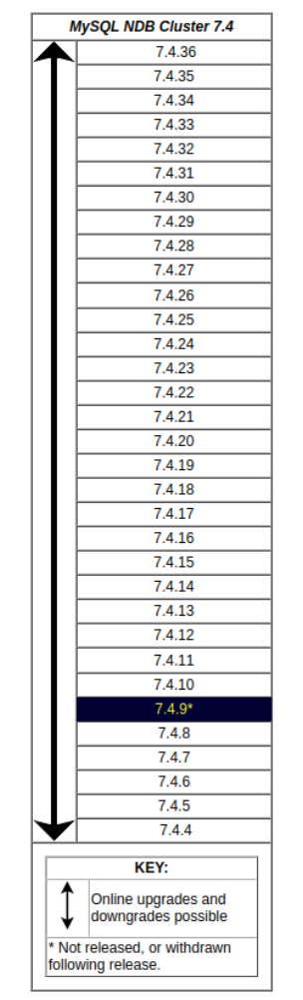

Version support. NDB Cluster 7.3 GA releases (7.3.2 and later) are supported for upgrades to NDB Cluster 7.4 (7.4.4 and later):NDB 7.4.10 Replacement Release. Shortly after the release of NDB 7.4.9, a regression was discovered that adversely affected node and system restarts (Bug #22582233). This issue was known to affect NDB 7.4.8 as well. NDB 7.4.10—incorporating a fix for this regression, but otherwise identical to NDB 7.4.9—was released shortly thereafter as a replacement. Users of the NDB 7.4 series are advised to bypass the 7.4.8 and 7.4.9 releases and to upgrade directly to NDB 7.4.10 (or later).

Upgrading and Downgrading NDB Cluster

> Upgrades and Downgrades, NDB Cluster 7.3

> Figure 18.6 NDB Cluster Upgrade and Downgrade Compatibility, MySQL NDB Cluster 7.3

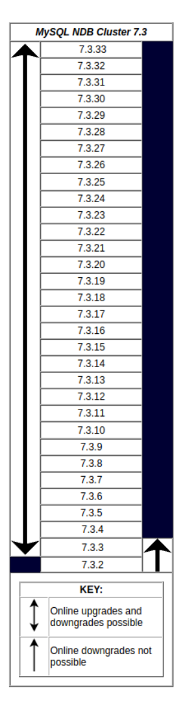

> Known Issues When Upgrading or Downgrading NDB Cluster NDB 7.3

- Prior to NDB 7.3.8, `mysql_upgrade` failed to drop and recreate `ndbinfo`. (Bug #74863, Bug

#20031425) In addition, when running `mysql_upgrade` on an NDB Cluster SQL node, the expected The NDB Cluster Auto-Installer (NO LONGER SUPPORTED)drop of the `performance_schema` database on this node was instead performed on all SQL nodes connected to the cluster. (Bug #200328691)

- NDB API, ClusterJ, and other applications used with recent releases of NDB Cluster 6.3 and later should

continue to work with NDB 7.3.2 and later without rewriting or recompiling.

- It is not possible to downgrade online to NDB 7.3.2 or earlier from NDB 7.3.3 or later. Online upgrades

from NDB 7.3.2 to later NDB Cluster 7.3 releases are supported.

### 18.3.8 The NDB Cluster Auto-Installer (NO LONGER SUPPORTED)

Note This feature has been removed from NDB Cluster, and is no longer supported. See Section 18.2.4, “What is New in MySQL NDB Cluster”, for more information.

The web-based graphical configuration installer (Auto-Installer) was removed in NDB 7.3.32 and 7.4.30; it is no longer included as part of the NDB Cluster distribution.

## 18.4 Configuration of NDB Cluster

A MySQL server that is part of an NDB Cluster differs in one chief respect from a normal (nonclustered)MySQL server, in that it employs the `NDB` storage engine. This engine is also referred to sometimes as`NDBCLUSTER`, although `NDB` is preferred.

To avoid unnecessary allocation of resources, the server is configured by default with the `NDB` storage engine disabled. To enable `NDB`, you must modify the server's `my.cnf` configuration file, or start the server with the `--ndbcluster` option.

This MySQL server is a part of the cluster, so it also must know how to access a management node to obtain the cluster configuration data. The default behavior is to look for the management node on`localhost`. However, should you need to specify that its location is elsewhere, this can be done in`my.cnf`, or with the `mysql` client. Before the `NDB` storage engine can be used, at least one management node must be operational, as well as any desired data nodes.

For more information about `--ndbcluster` and other `mysqld` options specific to NDB Cluster, see MySQL Server Options for NDB Cluster.

For general information about installing NDB Cluster, see Section 18.3, “NDB Cluster Installation”.

### 18.4.1 Quick Test Setup of NDB Cluster

To familiarize you with the basics, we describe the simplest possible configuration for a functional NDB Cluster. After this, you should be able to design your desired setup from the information provided in the other relevant sections of this chapter.

First, you need to create a configuration directory such as `/var/lib/mysql-cluster`, by executing the following command as the system `root` user:

```
$> mkdir /var/lib/mysql-cluster
```

In this directory, create a file named `config.ini` that contains the following information. Substitute appropriate values for `HostName` and `DataDir` as necessary for your system.

```
# file "config.ini" - showing minimal setup consisting of 1 data node,
# 1 management server, and 3 MySQL servers.
# The empty default sections are not required, and are shown only for
# the sake of completeness.
```

Quick Test Setup of NDB Cluster

```
# Data nodes must provide a hostname but MySQL Servers are not required
# to do so.
# If you don't know the hostname for your machine, use localhost.
# The DataDir parameter also has a default value, but it is recommended to
# set it explicitly.
# Note: [db], [api], and [mgm] are aliases for [ndbd], [mysqld], and [ndb_mgmd],
# respectively. [db] is deprecated and should not be used in new installations.
[ndbd default]
NoOfReplicas= 1
[mysqld  default]
[ndb_mgmd default]
[tcp default]
[ndb_mgmd]
HostName= myhost.example.com
[ndbd]
HostName= myhost.example.com
DataDir= /var/lib/mysql-cluster
[mysqld]
[mysqld]
[mysqld]
```

You can now start the `ndb_mgmd` management server. By default, it attempts to read the `config.ini`file in its current working directory, so change location into the directory where the file is located and then invoke `ndb_mgmd`:

```
$> cd /var/lib/mysql-cluster
$> ndb_mgmd
```

Then start a single data node by running `ndbd`:

```
$> ndbd
```

By default, `ndbd` looks for the management server at `localhost` on port 1186.

Note If you have installed MySQL from a binary tarball, you must specify the path of the `ndb_mgmd` and `ndbd` servers explicitly. (Normally, these are found in `/usr/`

```
local/mysql/bin.)
```

Finally, change location to the MySQL data directory (usually `/var/lib/mysql` or `/usr/local/mysql/``data`), and make sure that the `my.cnf` file contains the option necessary to enable the NDB storage engine:

```
[mysqld]
ndbcluster
```

You can now start the MySQL server as usual:

```
$> mysqld_safe --user=mysql &
```

Wait a moment to make sure the MySQL server is running properly. If you see the notice `mysql ended`,check the server's `.err` file to find out what went wrong.

If all has gone well so far, you now can start using the cluster. Connect to the server and verify that the`NDBCLUSTER` storage engine is enabled:

```
$> mysql
Welcome to the MySQL monitor.  Commands end with ; or \g.
```

Overview of NDB Cluster Configuration Parameters, Options, and Variables

```
Your MySQL connection id is 1 to server version: 5.6.51
Type 'help;' or '\h' for help. Type '\c' to clear the buffer.
mysql> SHOW ENGINES\G
...
*************************** 12. row ***************************
Engine: NDBCLUSTER
Support: YES
Comment: Clustered, fault-tolerant, memory-based tables
*************************** 13. row ***************************
Engine: NDB
Support: YES
Comment: Alias for NDBCLUSTER
...
```

The row numbers shown in the preceding example output may be different from those shown on your system, depending upon how your server is configured.

Try to create an `NDBCLUSTER` table:

```
$> mysql
mysql> USE test;
Database changed
mysql> CREATE TABLE ctest (i INT) ENGINE=NDBCLUSTER;
Query OK, 0 rows affected (0.09 sec)
mysql> SHOW CREATE TABLE ctest \G
*************************** 1. row ***************************
Table: ctest
Create Table: CREATE TABLE `ctest` (
`i` int(11) default NULL
) ENGINE=ndbcluster DEFAULT CHARSET=latin1
1 row in set (0.00 sec)
```

To check that your nodes were set up properly, start the management client:

```
$> ndb_mgm
```

Use the `SHOW` command from within the management client to obtain a report on the cluster's status:

```
ndb_mgm> SHOW
Cluster Configuration
---------------------
[ndbd(NDB)]     1 node(s)
id=2    @127.0.0.1  (Version: 5.6.51-ndb-7.4.39, Nodegroup: 0, *)
[ndb_mgmd(MGM)] 1 node(s)
id=1    @127.0.0.1  (Version: 5.6.51-ndb-7.4.39)
[mysqld(API)]   3 node(s)
id=3    @127.0.0.1  (Version: 5.6.51-ndb-7.4.39)
id=4 (not connected, accepting connect from any host)
id=5 (not connected, accepting connect from any host)
```

At this point, you have successfully set up a working NDB Cluster. You can now store data in the cluster by using any table created with `ENGINE=NDBCLUSTER` or its alias `ENGINE=NDB`.

> 18.4.2 Overview of NDB Cluster Configuration Parameters, Options, and Variables

The next several sections provide summary tables of NDB Cluster node configuration parameters used in the `config.ini` file to govern various aspects of node behavior, as well as of options and variables read Overview of NDB Cluster Configuration Parameters, Options, and Variables by `mysqld` from a `my.cnf` file or from the command line when run as an NDB Cluster process. Each of the node parameter tables lists the parameters for a given type (`ndbd`, `ndb_mgmd`, `mysqld`, `computer`,`tcp`, or `shm`). All tables include the data type for the parameter, option, or variable, as well as its default,mimimum, and maximum values as applicable.

Considerations when restarting nodes. For node parameters, these tables also indicate what type of restart is required (node restart or system restart)—and whether the restart must be done with `--``initial`—to change the value of a given configuration parameter. When performing a node restart or an initial node restart, all of the cluster's data nodes must be restarted in turn (also referred to as a rolling restart). It is possible to update cluster configuration parameters marked as `node` online—that is, without shutting down the cluster—in this fashion. An initial node restart requires restarting each `ndbd` process with the `--initial` option.

A system restart requires a complete shutdown and restart of the entire cluster. An initial system restart requires taking a backup of the cluster, wiping the cluster file system after shutdown, and then restoring from the backup following the restart.

In any cluster restart, all of the cluster's management servers must be restarted for them to read the updated configuration parameter values.

Important Values for numeric cluster parameters can generally be increased without any problems, although it is advisable to do so progressively, making such adjustments in relatively small increments. Many of these can be increased online, using a rolling restart.

However, decreasing the values of such parameters—whether this is done using a node restart, node initial restart, or even a complete system restart of the cluster—is not to be undertaken lightly; it is recommended that you do so only after careful planning and testing. This is especially true with regard to those parameters that relate to memory usage and disk space, such as `MaxNoOfTables`,`MaxNoOfOrderedIndexes`, and `MaxNoOfUniqueHashIndexes`. In addition, it is the generally the case that configuration parameters relating to memory and disk usage can be raised using a simple node restart, but they require an initial node restart to be lowered.

Because some of these parameters can be used for configuring more than one type of cluster node, they may appear in more than one of the tables.

Note 4294967039 often appears as a maximum value in these tables. This value is defined in the `NDBCLUSTER` sources as `MAX_INT_RNIL` and is equal to`0xFFFFFEFF`, or 232 − 28 − 1.

#### 18.4.2.1 NDB Cluster Data Node Configuration Parameters

The listings in this section provide information about parameters used in the `[ndbd]` or `[ndbd default]`sections of a `config.ini` file for configuring NDB Cluster data nodes. For detailed descriptions and other additional information about each of these parameters, see Section 18.4.3.6, “Defining NDB Cluster Data Nodes”.

These parameters also apply to `ndbmtd`, the multithreaded version of `ndbd`. A separate listing of parameters specific to `ndbmtd` follows.

- `Arbitration`: How arbitration should be performed to avoid split-brain issues in event of node failure.

Overview of NDB Cluster Configuration Parameters, Options, and Variables

- `ArbitrationTimeout`: Maximum time (milliseconds) database partition waits for arbitration signal.
- `BackupDataBufferSize`: Default size of databuffer for backup (in bytes).
- `BackupDataDir`: Path to where to store backups. Note that string '/BACKUP' is always appended to

this setting, so that *effective* default is FileSystemPath/BACKUP.

- `BackupDiskWriteSpeedPct`: Sets percentage of data node's allocated maximum write speed

(MaxDiskWriteSpeed) to reserve for LCPs when starting backup.

- `BackupLogBufferSize`: Default size of log buffer for backup (in bytes).
- `BackupMaxWriteSize`: Maximum size of file system writes made by backup (in bytes).
- `BackupMemory`: Total memory allocated for backups per node (in bytes).
- `BackupReportFrequency`: Frequency of backup status reports during backup in seconds.
- `BackupWriteSize`: Default size of file system writes made by backup (in bytes).
- `BatchSizePerLocalScan`: Used to calculate number of lock records for scan with hold lock.
- `BuildIndexThreads`: Number of threads to use for building ordered indexes during system or node

restart. Also applies when running ndb_restore --rebuild-indexes. Setting this parameter to 0 disables multithreaded building of ordered indexes.

- `CompressedBackup`: Use zlib to compress backups as they are written.
- `CompressedLCP`: Write compressed LCPs using zlib.
- `ConnectCheckIntervalDelay`: Time between data node connectivity check stages. Data node is

considered suspect after 1 interval and dead after 2 intervals with no response.

- `CrashOnCorruptedTuple`: When enabled, forces node to shut down whenever it detects corrupted

tuple.

- `DataDir`: Data directory for this node.
- `DataMemory`: Number of bytes on each data node allocated for storing data; subject to available system

RAM and size of IndexMemory.

- `DefaultHashMapSize`: Set size (in buckets) to use for table hash maps. Three values are supported:

0, 240, and 3840.

- `DictTrace`: Enable DBDICT debugging; for NDB development.
- `DiskCheckpointSpeed`: Bytes allowed to be written by checkpoint, per second.
- `DiskCheckpointSpeedInRestart`: Bytes allowed to be written by checkpoint during restart, per

second.

- `DiskIOThreadPool`: Number of unbound threads for file access, applies to disk data only.
- `Diskless`: Run without using disk.
- `DiskPageBufferEntries`: Memory to allocate in DiskPageBufferMemory; very large disk transactions

may require increasing this value.

- `DiskPageBufferMemory`: Number of bytes on each data node allocated for disk page buffer cache.
- `DiskSyncSize`: Amount of data written to file before synch is forced.

Overview of NDB Cluster Configuration Parameters, Options, and Variables

- `EventLogBufferSize`: Size of circular buffer for NDB log events within data nodes.
- `ExecuteOnComputer`: String referencing earlier defined COMPUTER.
- `ExtraSendBufferMemory`: Memory to use for send buffers in addition to any allocated by

TotalSendBufferMemory or SendBufferMemory. Default (0) allows up to 16MB.

- `FileSystemPath`: Path to directory where data node stores its data (directory must exist).
- `FileSystemPathDataFiles`: Path to directory where data node stores its Disk Data files. Default

value is FilesystemPathDD, if set; otherwise, FilesystemPath is used if it is set; otherwise, value of DataDir is used.

- `FileSystemPathDD`: Path to directory where data node stores its Disk Data and undo files. Default

value is FileSystemPath, if set; otherwise, value of DataDir is used.

- `FileSystemPathUndoFiles`: Path to directory where data node stores its undo files for Disk Data.

Default value is FilesystemPathDD, if set; otherwise, FilesystemPath is used if it is set; otherwise, value of DataDir is used.

- `FragmentLogFileSize`: Size of each redo log file.
- `HeartbeatIntervalDbApi`: Time between API node-data node heartbeats. (API connection closed

after 3 missed heartbeats).

- `HeartbeatIntervalDbDb`: Time between data node-to-data node heartbeats; data node considered

dead after 3 missed heartbeats.

- `HeartbeatOrder`: Sets order in which data nodes check each others' heartbeats for determining

whether given node is still active and connected to cluster. Must be zero for all data nodes or distinct nonzero values for all data nodes; see documentation for further guidance.

- `HostName`: Host name or IP address for this data node.
- `Id`: Number identifying data node. Now deprecated; use NodeId instead.
- `IndexMemory`: Number of bytes on each data node allocated for storing indexes; subject to available

system RAM and size of DataMemory.

- `IndexStatAutoCreate`: Enable/disable automatic statistics collection when indexes are created.
- `IndexStatAutoUpdate`: Monitor indexes for changes and trigger automatic statistics updates.
- `IndexStatSaveScale`: Scaling factor used in determining size of stored index statistics.
- `IndexStatSaveSize`: Maximum size in bytes for saved statistics per index.
- `IndexStatTriggerPct`: Threshold percent change in DML operations for index statistics updates.

Value is scaled down by IndexStatTriggerScale.

- `IndexStatTriggerScale`: Scale down IndexStatTriggerPct by this amount, multiplied by base 2

logarithm of index size, for large index. Set to 0 to disable scaling.

- `IndexStatUpdateDelay`: Minimum delay between automatic index statistics updates for given index.

0 means no delay.

- `InitFragmentLogFiles`: Initialize fragment log files, using sparse or full format.
- `InitialLogFileGroup`: Describes log file group that is created during initial start. See documentation

for format.

Overview of NDB Cluster Configuration Parameters, Options, and Variables

- `InitialNoOfOpenFiles`: Initial number of files open per data node. (One thread is created per file).
- `InitialTablespace`: Describes tablespace that is created during initial start. See documentation for

format.

- `LateAlloc`: Allocate memory after connection to management server has been established.
- `LcpScanProgressTimeout`: Maximum time that local checkpoint fragment scan can be stalled before

node is shut down to ensure systemwide LCP progress. Use 0 to disable.

- `LockExecuteThreadToCPU`: Comma-delimited list of CPU IDs.
- `LockMaintThreadsToCPU`: CPU ID indicating which CPU runs maintenance threads.
- `LockPagesInMainMemory`: 0=disable locking, 1=lock after memory allocation, 2=lock before memory

allocation.

- `LogLevelCheckpoint`: Log level of local and global checkpoint information printed to stdout.
- `LogLevelCongestion`: Level of congestion information printed to stdout.
- `LogLevelConnection`: Level of node connect/disconnect information printed to stdout.
- `LogLevelError`: Transporter, heartbeat errors printed to stdout.
- `LogLevelInfo`: Heartbeat and log information printed to stdout.
- `LogLevelNodeRestart`: Level of node restart and node failure information printed to stdout.
- `LogLevelShutdown`: Level of node shutdown information printed to stdout.
- `LogLevelStartup`: Level of node startup information printed to stdout.
- `LogLevelStatistic`: Level of transaction, operation, and transporter information printed to stdout.
- `LongMessageBuffer`: Number of bytes allocated on each data node for internal long messages.
- `MaxAllocate`: No longer used; has no effect.
- `MaxBufferedEpochs`: Allowed numbered of epochs that subscribing node can lag behind

(unprocessed epochs). Exceeding causes lagging subscribers to be disconnected.

- `MaxBufferedEpochBytes`: Total number of bytes allocated for buffering epochs.
- `MaxDiskWriteSpeed`: Maximum number of bytes per second that can be written by LCP and backup

when no restarts are ongoing.

- `MaxDiskWriteSpeedOtherNodeRestart`: Maximum number of bytes per second that can be written

by LCP and backup when another node is restarting.

- `MaxDiskWriteSpeedOwnRestart`: Maximum number of bytes per second that can be written by LCP

and backup when this node is restarting.

- `MaxDMLOperationsPerTransaction`: Limit size of transaction; aborts transaction if it requires more

than this many DML operations.

- `MaxLCPStartDelay`: Time in seconds that LCP polls for checkpoint mutex (to allow other data nodes to

complete metadata synchronization), before putting itself in lock queue for parallel recovery of table data.

- `MaxNoOfAttributes`: Suggests total number of attributes stored in database (sum over all tables).

Overview of NDB Cluster Configuration Parameters, Options, and Variables

- `MaxNoOfConcurrentIndexOperations`: Total number of index operations that can execute

simultaneously on one data node.

- `MaxNoOfConcurrentOperations`: Maximum number of operation records in transaction coordinator.
- `MaxNoOfConcurrentScans`: Maximum number of scans executing concurrently on data node.
- `MaxNoOfConcurrentSubOperations`: Maximum number of concurrent subscriber operations.
- `MaxNoOfConcurrentTransactions`: Maximum number of transactions executing concurrently on this

data node, total number of transactions that can be executed concurrently is this value times number of data nodes in cluster.

- `MaxNoOfFiredTriggers`: Total number of triggers that can fire simultaneously on one data node.
- `MaxNoOfLocalOperations`: Maximum number of operation records defined on this data node.
- `MaxNoOfLocalScans`: Maximum number of fragment scans in parallel on this data node.
- `MaxNoOfOpenFiles`: Maximum number of files open per data node.(One thread is created per file).
- `MaxNoOfOrderedIndexes`: Total number of ordered indexes that can be defined in system.
- `MaxNoOfSavedMessages`: Maximum number of error messages to write in error log and maximum

number of trace files to retain.

- `MaxNoOfSubscribers`: Maximum number of subscribers.
- `MaxNoOfSubscriptions`: Maximum number of subscriptions (default 0 = MaxNoOfTables).
- `MaxNoOfTables`: Suggests total number of NDB tables stored in database.
- `MaxNoOfTriggers`: Total number of triggers that can be defined in system.
- `MaxNoOfUniqueHashIndexes`: Total number of unique hash indexes that can be defined in system.
- `MaxParallelCopyInstances`: Number of parallel copies during node restarts. Default is 0, which

uses number of LDMs on both nodes, to maximum of 16.

- `MaxParallelScansPerFragment`: Maximum number of parallel scans per fragment. Once this limit is

reached, scans are serialized.

- `MaxStartFailRetries`: Maximum retries when data node fails on startup, requires StopOnError = 0.

Setting to 0 causes start attempts to continue indefinitely.

- `MemReportFrequency`: Frequency of memory reports in seconds; 0 = report only when exceeding

percentage limits.

- `MinDiskWriteSpeed`: Minimum number of bytes per second that can be written by LCP and backup.
- `MinFreePct`: Percentage of memory resources to keep in reserve for restarts.
- `NodeGroup`: Node group to which data node belongs; used only during initial start of cluster.
- `NodeId`: Number uniquely identifying data node among all nodes in cluster.
- `NoOfFragmentLogFiles`: Number of 16 MB redo log files in each of 4 file sets belonging to data node.
- `NoOfReplicas`: Number of copies of all data in database.
- `Numa`: (Linux only; requires libnuma) Controls NUMA support. Setting to 0 permits system to determine

use of interleaving by data node process; 1 means that it is determined by data node.

Overview of NDB Cluster Configuration Parameters, Options, and Variables

- `ODirect`: Use O_DIRECT file reads and writes when possible.
- `RealtimeScheduler`: When true, data node threads are scheduled as real-time threads. Default is

false.

- `RedoBuffer`: Number of bytes on each data node allocated for writing redo logs.
- `RedoOverCommitCounter`: When RedoOverCommitLimit has been exceeded this

many times, transactions are aborted, and operations are handled as specified by DefaultOperationRedoProblemAction.

- `RedoOverCommitLimit`: Each time that flushing current redo buffer takes longer than this many

seconds, number of times that this has happened is compared to RedoOverCommitCounter.

- `ReservedSendBufferMemory`: This parameter is present in NDB code but is not enabled.
- `RestartOnErrorInsert`: Control type of restart caused by inserting error (when StopOnError is

enabled).

- `SchedulerExecutionTimer`: Number of microseconds to execute in scheduler before sending.
- `SchedulerResponsiveness`: Set NDB scheduler response optimization 0-10; higher values provide

better response time but lower throughput.

- `SchedulerSpinTimer`: Number of microseconds to execute in scheduler before sleeping.
- `ServerPort`: Port used to set up transporter for incoming connections from API nodes.
- `SharedGlobalMemory`: Total number of bytes on each data node allocated for any use.
- `StartFailRetryDelay`: Delay in seconds after start failure prior to retry; requires StopOnError = 0.
- `StartFailureTimeout`: Milliseconds to wait before terminating. (0=Wait forever).
- `StartNoNodeGroupTimeout`: Time to wait for nodes without nodegroup before trying to start

(0=forever).

- `StartPartialTimeout`: Milliseconds to wait before trying to start without all nodes. (0=Wait forever).
- `StartPartitionedTimeout`: Milliseconds to wait before trying to start partitioned. (0=Wait forever).
- `StartupStatusReportFrequency`: Frequency of status reports during startup.
- `StopOnError`: When set to 0, data node automatically restarts and recovers following node failures.
- `StringMemory`: Default size of string memory (0 to 100 = % of maximum, 101+ = actual bytes).
- `TcpBind_INADDR_ANY`: Bind IP_ADDR_ANY so that connections can be made from anywhere (for

autogenerated connections).

- `TimeBetweenEpochs`: Time between epochs (synchronization used for replication).
- `TimeBetweenEpochsTimeout`: Timeout for time between epochs. Exceeding causes node shutdown.
- `TimeBetweenGlobalCheckpoints`: Time between group commits of transactions to disk.
- `TimeBetweenGlobalCheckpointsTimeout`: Minimum timeout for group commit of transactions to

disk.

- `TimeBetweenInactiveTransactionAbortCheck`: Time between checks for inactive transactions.

Overview of NDB Cluster Configuration Parameters, Options, and Variables

- `TimeBetweenLocalCheckpoints`: Time between taking snapshots of database (expressed in base-2

logarithm of bytes).

- `TimeBetweenWatchDogCheck`: Time between execution checks inside data node.
- `TimeBetweenWatchDogCheckInitial`: Time between execution checks inside data node (early start

phases when memory is allocated).

- `TotalSendBufferMemory`: Total memory to use for all transporter send buffers..
- `TransactionBufferMemory`: Dynamic buffer space (in bytes) for key and attribute data allocated for

each data node.

- `TransactionDeadlockDetectionTimeout`: Time transaction can spend executing within data node.

This is time that transaction coordinator waits for each data node participating in transaction to execute request. If data node takes more than this amount of time, transaction is aborted.

- `TransactionInactiveTimeout`: Milliseconds that application waits before executing another part

of transaction. This is time transaction coordinator waits for application to execute or send another part(query, statement) of transaction. If application takes too much time, then transaction is aborted. Timeout= 0 means that application never times out.

- `TwoPassInitialNodeRestartCopy`: Copy data in 2 passes during initial node restart, which enables

multithreaded building of ordered indexes for such restarts.

- `UndoDataBuffer`: Unused; has no effect.
- `UndoIndexBuffer`: Unused; has no effect.

The following parameters are specific to `ndbmtd`:

- `MaxNoOfExecutionThreads`: For ndbmtd only, specify maximum number of execution threads.
- `NoOfFragmentLogParts`: Number of redo log file groups belonging to this data node.
- `ThreadConfig`: Used for configuration of multithreaded data nodes (ndbmtd). Default is empty string;

see documentation for syntax and other information.

#### 18.4.2.2 NDB Cluster Management Node Configuration Parameters

The listing in this section provides information about parameters used in the `[ndb_mgmd]` or `[mgm]`section of a `config.ini` file for configuring NDB Cluster management nodes. For detailed descriptions and other additional information about each of these parameters, see Section 18.4.3.5, “Defining an NDB Cluster Management Server”.

- `ArbitrationDelay`: When asked to arbitrate, arbitrator waits this long before voting (milliseconds).
- `ArbitrationRank`: If 0, then management node is not arbitrator. Kernel selects arbitrators in order 1,

2.

- `DataDir`: Data directory for this node.
- `ExecuteOnComputer`: String referencing earlier defined COMPUTER.
- `ExtraSendBufferMemory`: Memory to use for send buffers in addition to any allocated by

TotalSendBufferMemory or SendBufferMemory. Default (0) allows up to 16MB.

- `HeartbeatIntervalMgmdMgmd`: Time between management-node-to-management-node heartbeats;

connection between management nodes is considered lost after 3 missed heartbeats.

Overview of NDB Cluster Configuration Parameters, Options, and Variables

- `HeartbeatThreadPriority`: Set heartbeat thread policy and priority for management nodes; see

manual for allowed values.

- `HostName`: Host name or IP address for this management node.
- `Id`: Number identifying management node. Now deprecated; use NodeId instead.
- `LogDestination`: Where to send log messages: console, system log, or specified log file.
- `MaxNoOfSavedEvents`: Not used.
- `NodeId`: Number uniquely identifying management node among all nodes in cluster.
- `PortNumber`: Port number to send commands to and fetch configuration from management server.
- `PortNumberStats`: Port number used to get statistical information from management server.
- `TotalSendBufferMemory`: Total memory to use for all transporter send buffers.
- `wan`: Use WAN TCP setting as default.

Note After making changes in a management node's configuration, it is necessary to perform a rolling restart of the cluster for the new configuration to take effect.

See Section 18.4.3.5, “Defining an NDB Cluster Management Server”, for more information.

To add new management servers to a running NDB Cluster, it is also necessary perform a rolling restart of all cluster nodes after modifying any existing`config.ini` files. For more information about issues arising when using multiple management nodes, see Section 18.2.7.10, “Limitations Relating to Multiple NDB Cluster Nodes”.

#### 18.4.2.3 NDB Cluster SQL Node and API Node Configuration Parameters

The listing in this section provides information about parameters used in the `[mysqld]` and `[api]`sections of a `config.ini` file for configuring NDB Cluster SQL nodes and API nodes. For detailed descriptions and other additional information about each of these parameters, see Section 18.4.3.7,“Defining SQL and Other API Nodes in an NDB Cluster”.

- `ApiVerbose`: Enable NDB API debugging; for NDB development.
- `ArbitrationDelay`: When asked to arbitrate, arbitrator waits this many milliseconds before voting.
- `ArbitrationRank`: If 0, then API node is not arbitrator. Kernel selects arbitrators in order 1, 2.
- `AutoReconnect`: Specifies whether an API node should reconnect fully when disconnected from

cluster.

- `BatchByteSize`: Default batch size in bytes.
- `BatchSize`: Default batch size in number of records.
- `ConnectBackoffMaxTime`: Specifies longest time in milliseconds (~100ms resolution) to allow

between connection attempts to any given data node by this API node. Excludes time elapsed while connection attempts are ongoing, which in worst case can take several seconds. Disable by setting to 0.

If no data nodes are currently connected to this API node, StartConnectBackoffMaxTime is used instead.

- `ConnectionMap`: Specifies which data nodes to connect.

Overview of NDB Cluster Configuration Parameters, Options, and Variables

- `DefaultHashMapSize`: Set size (in buckets) to use for table hash maps. Three values are supported:

0, 240, and 3840.

- `DefaultOperationRedoProblemAction`: How operations are handled in event that

RedoOverCommitCounter is exceeded.

- `ExecuteOnComputer`: String referencing earlier defined COMPUTER.
- `ExtraSendBufferMemory`: Memory to use for send buffers in addition to any allocated by

TotalSendBufferMemory or SendBufferMemory. Default (0) allows up to 16MB.

- `HeartbeatThreadPriority`: Set heartbeat thread policy and priority for API nodes; see manual for

allowed values.

- `HostName`: Host name or IP address for this SQL or API node.
- `Id`: Number identifying MySQL server or API node (Id). Now deprecated; use NodeId instead.
- `MaxScanBatchSize`: Maximum collective batch size for one scan.
- `NodeId`: Number uniquely identifying SQL node or API node among all nodes in cluster.
- `StartConnectBackoffMaxTime`: Same as ConnectBackoffMaxTime except that this parameter is

used in its place if no data nodes are connected to this API node.

- `TotalSendBufferMemory`: Total memory to use for all transporter send buffers.
- `wan`: Use WAN TCP setting as default.

For a discussion of MySQL server options for NDB Cluster, see MySQL Server Options for NDB Cluster.

For information about MySQL server system variables relating to NDB Cluster, see NDB Cluster System Variables.

Note To add new SQL or API nodes to the configuration of a running NDB Cluster,it is necessary to perform a rolling restart of all cluster nodes after adding new`[mysqld]` or `[api]` sections to the `config.ini` file (or files, if you are using more than one management server). This must be done before the new SQL or API nodes can connect to the cluster.

It is not necessary to perform any restart of the cluster if new SQL or API nodes can employ previously unused API slots in the cluster configuration to connect to the cluster.

#### 18.4.2.4 Other NDB Cluster Configuration Parameters

The listings in this section provide information about parameters used in the `[computer]`, `[tcp]`, and`[shm]` sections of a `config.ini` file for configuring NDB Cluster. For detailed descriptions and additional information about individual parameters, see Section 18.4.3.9, “NDB Cluster TCP/IP Connections”, or Section 18.4.3.11, “NDB Cluster Shared-Memory Connections”, as appropriate.

The following parameters apply to the `config.ini` file's `[computer]` section:

- `HostName`: Host name or IP address of this computer.
- `Id`: Unique identifier for this computer.

The following parameters apply to the `config.ini` file's `[tcp]` section:Overview of NDB Cluster Configuration Parameters, Options, and Variables

- `Checksum`: If checksum is enabled, all signals between nodes are checked for errors.
- `Group`: Used for group proximity; smaller value is interpreted as being closer.
- `HostName1`: Name or IP address of first of two computers joined by TCP connection.
- `HostName2`: Name or IP address of second of two computers joined by TCP connection.
- `NodeId1`: ID of node (data node, API node, or management node) on one side of connection.
- `NodeId2`: ID of node (data node, API node, or management node) on one side of connection.
- `NodeIdServer`: Set server side of TCP connection.
- `OverloadLimit`: When more than this many unsent bytes are in send buffer, connection is considered

overloaded.

- `PortNumber`: Port used for TCP transporter.
- `Proxy`: ....
- `ReceiveBufferMemory`: Bytes of buffer for signals received by this node.
- `SendBufferMemory`: Bytes of TCP buffer for signals sent from this node.
- `SendSignalId`: Sends ID in each signal. Used in trace files. Defaults to true in debug builds.
- `TCP_MAXSEG_SIZE`: Value used for TCP_MAXSEG.
- `TCP_RCV_BUF_SIZE`: Value used for SO_RCVBUF.
- `TCP_SND_BUF_SIZE`: Value used for SO_SNDBUF.
- `TcpBind_INADDR_ANY`: Bind InAddrAny instead of host name for server part of connection.

The following parameters apply to the `config.ini` file's `[shm]` section:

- `Checksum`: If checksum is enabled, all signals between nodes are checked for errors.
- `Group`: Used for group proximity; smaller value is interpreted as being closer.
- `HostName1`: Name or IP address of first of two computers joined by SHM connection.
- `HostName2`: Name or IP address of second of two computers joined by SHM connection.
- `NodeId1`: ID of node (data node, API node, or management node) on one side of connection.
- `NodeId2`: ID of node (data node, API node, or management node) on one side of connection.
- `NodeIdServer`: Set server side of SHM connection.
- `OverloadLimit`: When more than this many unsent bytes are in send buffer, connection is considered

overloaded.

- `PortNumber`: Port used for SHM transporter.
- `SendSignalId`: Sends ID in each signal. Used in trace files.
- `ShmKey`: Shared memory key; when set to 1, this is calculated by NDB.
- `ShmSize`: Size of shared memory segment.
- `Signum`: Signal number to be used for signalling.

Overview of NDB Cluster Configuration Parameters, Options, and Variables

#### 18.4.2.5 NDB Cluster mysqld Option and Variable Reference

The following list includes command-line options, system variables, and status variables applicable within`mysqld` when it is running as an SQL node in an NDB Cluster. For a reference to all command-line options, system variables, and status variables used with or relating to `mysqld`, see Section 5.1.3, “Server Option, System Variable, and Status Variable Reference”.

- `Com_show_ndb_status`: Count of SHOW NDB STATUS statements.
- `create_old_temporals`: Use pre-5.6.4 storage format for temporal types when creating tables.

Intended for use in replication and upgrades/downgrades between NDB 7.2 and NDB 7.3/7.4.

- `Handler_discover`: Number of times that tables have been discovered.
- `ndb-batch-size`: Size (in bytes) to use for NDB transaction batches.
- `ndb-blob-read-batch-bytes`: Specifies size in bytes that large BLOB reads should be batched into.

0 = no limit.

- `ndb-blob-write-batch-bytes`: Specifies size in bytes that large BLOB writes should be batched

into. 0 = no limit.

- `ndb-cluster-connection-pool`: Number of connections to cluster used by MySQL.
- `ndb-connectstring`: Address of NDB management server distributing configuration information for

this cluster.

- `ndb-deferred-constraints`: Specifies that constraint checks on unique indexes (where these are

supported) should be deferred until commit time. Not normally needed or used; for testing purposes only.

- `ndb-distribution`: Default distribution for new tables in NDBCLUSTER (KEYHASH or LINHASH,

default is KEYHASH).

- `ndb-log-apply-status`: Cause MySQL server acting as replica to log mysql.ndb_apply_status

updates received from its immediate source in its own binary log, using its own server ID. Effective only if server is started with --ndbcluster option.

- `ndb-log-empty-epochs`: When enabled, causes epochs in which there were no changes to be written

to ndb_apply_status and ndb_binlog_index tables, even when --log-slave-updates is enabled.

- `ndb-log-empty-update`: When enabled, causes updates that produced no changes to be written to

ndb_apply_status and ndb_binlog_index tables, even when --log-slave-updates is enabled.

- `ndb-log-exclusive-reads`: Log primary key reads with exclusive locks; allow conflict resolution

based on read conflicts.

- `ndb-log-fail-terminate`: Terminate mysqld process if complete logging of all found row events is

not possible.

- `ndb-log-orig`: Log originating server id and epoch in mysql.ndb_binlog_index table.
- `ndb-log-transaction-id`: Write NDB transaction IDs in binary log. Requires --log-bin-v1-

events=OFF.

- `ndb-log-update-minimal`: Log updates in minimal format.
- `ndb-log-updated-only`: Log complete rows (ON) or updates only (OFF).
- `ndb-log-update-as-write`: Toggles logging of updates on source between updates (OFF) and

writes (ON).

Overview of NDB Cluster Configuration Parameters, Options, and Variables

- `ndb-mgmd-host`: Set host (and port, if desired) for connecting to management server.
- `ndb-nodeid`: NDB Cluster node ID for this MySQL server.
- `ndb-optimized-node-selection`: Enable optimizations for selection of nodes for transactions.

Enabled by default; use --skip-ndb-optimized-node-selection to disable.

- `ndb-transid-mysql-connection-map`: Enable or disable ndb_transid_mysql_connection_map

plugin; that is, enable or disable INFORMATION_SCHEMA table having that name.

- `ndb-wait-connected`: Time (in seconds) for MySQL server to wait for connection to cluster

management and data nodes before accepting MySQL client connections.

- `ndb-wait-setup`: Time (in seconds) for MySQL server to wait for NDB engine setup to complete.
- `Ndb_api_adaptive_send_deferred_count`: Number of adaptive send calls not actually sent by this

MySQL Server (SQL node).

- `Ndb_api_adaptive_send_deferred_count_session`: Number of adaptive send calls not actually

sent in this client session.

- `Ndb_api_adaptive_send_deferred_count_slave`: Number of adaptive send calls not actually

sent by this replica.

- `Ndb_api_adaptive_send_forced_count`: Number of adaptive sends with forced-send set sent by

this MySQL Server (SQL node).

- `Ndb_api_adaptive_send_forced_count_session`: Number of adaptive sends with forced-send

set in this client session.

- `Ndb_api_adaptive_send_forced_count_slave`: Number of adaptive sends with forced-send set

sent by this replica.

- `Ndb_api_adaptive_send_unforced_count`: Number of adaptive sends without forced-send sent by

this MySQL Server (SQL node).

- `Ndb_api_adaptive_send_unforced_count_session`: Number of adaptive sends without forced-

send in this client session.

- `Ndb_api_adaptive_send_unforced_count_slave`: Number of adaptive sends without forced-

send sent by this replica.

- `Ndb_api_bytes_received_count`: Quantity of data (in bytes) received from data nodes by this

MySQL Server (SQL node).

- `Ndb_api_bytes_received_count_session`: Quantity of data (in bytes) received from data nodes in

this client session.

- `Ndb_api_bytes_received_count_slave`: Quantity of data (in bytes) received from data nodes by

this replica.

- `Ndb_api_bytes_sent_count`: Quantity of data (in bytes) sent to data nodes by this MySQL Server

(SQL node).

- `Ndb_api_bytes_sent_count_session`: Quantity of data (in bytes) sent to data nodes in this client

session.

- `Ndb_api_bytes_sent_count_slave`: Qunatity of data (in bytes) sent to data nodes by this replica.
- `Ndb_api_event_bytes_count`: Number of bytes of events received by this MySQL Server (SQL

node).

Overview of NDB Cluster Configuration Parameters, Options, and Variables

- `Ndb_api_event_bytes_count_injector`: Number of bytes of event data received by NDB binary

log injector thread.

- `Ndb_api_event_data_count`: Number of row change events received by this MySQL Server (SQL

node).

- `Ndb_api_event_data_count_injector`: Number of row change events received by NDB binary log

injector thread.

- `Ndb_api_event_nondata_count`: Number of events received, other than row change events, by this

MySQL Server (SQL node).

- `Ndb_api_event_nondata_count_injector`: Number of events received, other than row change

events, by NDB binary log injector thread.

- `Ndb_api_pk_op_count`: Number of operations based on or using primary keys by this MySQL Server

(SQL node).

- `Ndb_api_pk_op_count_session`: Number of operations based on or using primary keys in this client

session.

- `Ndb_api_pk_op_count_slave`: Number of operations based on or using primary keys by this replica.
- `Ndb_api_pruned_scan_count`: Number of scans that have been pruned to one partition by this

MySQL Server (SQL node).

- `Ndb_api_pruned_scan_count_session`: Number of scans that have been pruned to one partition in

this client session.

- `Ndb_api_pruned_scan_count_slave`: Number of scans that have been pruned to one partition by

this replica.

- `Ndb_api_range_scan_count`: Number of range scans that have been started by this MySQL Server

(SQL node).

- `Ndb_api_range_scan_count_session`: Number of range scans that have been started in this client

session.

- `Ndb_api_range_scan_count_slave`: Number of range scans that have been started by this replica.
- `Ndb_api_read_row_count`: Total number of rows that have been read by this MySQL Server (SQL

node).

- `Ndb_api_read_row_count_session`: Total number of rows that have been read in this client

session.

- `Ndb_api_read_row_count_slave`: Total number of rows that have been read by this replica.
- `Ndb_api_scan_batch_count`: Number of batches of rows received by this MySQL Server (SQL

node).

- `Ndb_api_scan_batch_count_session`: Number of batches of rows received in this client session.
- `Ndb_api_scan_batch_count_slave`: Number of batches of rows received by this replica.
- `Ndb_api_table_scan_count`: Number of table scans that have been started, including scans of

internal tables, by this MySQL Server (SQL node).

- `Ndb_api_table_scan_count_session`: Number of table scans that have been started, including

scans of internal tables, in this client session.

Overview of NDB Cluster Configuration Parameters, Options, and Variables

- `Ndb_api_table_scan_count_slave`: Number of table scans that have been started, including scans

of internal tables, by this replica.

- `Ndb_api_trans_abort_count`: Number of transactions aborted by this MySQL Server (SQL node).
- `Ndb_api_trans_abort_count_session`: Number of transactions aborted in this client session.
- `Ndb_api_trans_abort_count_slave`: Number of transactions aborted by this replica.
- `Ndb_api_trans_close_count`: Number of transactions aborted (may be greater than sum of

TransCommitCount and TransAbortCount) by this MySQL Server (SQL node).

- `Ndb_api_trans_close_count_session`: Number of transactions aborted (may be greater than sum

of TransCommitCount and TransAbortCount) in this client session.

- `Ndb_api_trans_close_count_slave`: Number of transactions aborted (may be greater than sum of

TransCommitCount and TransAbortCount) by this replica.

- `Ndb_api_trans_commit_count`: Number of transactions committed by this MySQL Server (SQL

node).

- `Ndb_api_trans_commit_count_session`: Number of transactions committed in this client session.
- `Ndb_api_trans_commit_count_slave`: Number of transactions committed by this replica.
- `Ndb_api_trans_local_read_row_count`: Total number of rows that have been read by this MySQL

Server (SQL node).

- `Ndb_api_trans_local_read_row_count_session`: Total number of rows that have been read in

this client session.

- `Ndb_api_trans_local_read_row_count_slave`: Total number of rows that have been read by this

replica.

- `Ndb_api_trans_start_count`: Number of transactions started by this MySQL Server (SQL node).
- `Ndb_api_trans_start_count_session`: Number of transactions started in this client session.
- `Ndb_api_trans_start_count_slave`: Number of transactions started by this replica.
- `Ndb_api_uk_op_count`: Number of operations based on or using unique keys by this MySQL Server

(SQL node).

- `Ndb_api_uk_op_count_session`: Number of operations based on or using unique keys in this client

session.

- `Ndb_api_uk_op_count_slave`: Number of operations based on or using unique keys by this replica.
- `Ndb_api_wait_exec_complete_count`: Number of times thread has been blocked while waiting for

operation execution to complete by this MySQL Server (SQL node).

- `Ndb_api_wait_exec_complete_count_session`: Number of times thread has been blocked while

waiting for operation execution to complete in this client session.

- `Ndb_api_wait_exec_complete_count_slave`: Number of times thread has been blocked while

waiting for operation execution to complete by this replica.

- `Ndb_api_wait_meta_request_count`: Number of times thread has been blocked waiting for

metadata-based signal by this MySQL Server (SQL node).

Overview of NDB Cluster Configuration Parameters, Options, and Variables

- `Ndb_api_wait_meta_request_count_session`: Number of times thread has been blocked waiting

for metadata-based signal in this client session.

- `Ndb_api_wait_meta_request_count_slave`: Number of times thread has been blocked waiting for

metadata-based signal by this replica.

- `Ndb_api_wait_nanos_count`: Total time (in nanoseconds) spent waiting for some type of signal from

data nodes by this MySQL Server (SQL node).

- `Ndb_api_wait_nanos_count_session`: Total time (in nanoseconds) spent waiting for some type of

signal from data nodes in this client session.

- `Ndb_api_wait_nanos_count_slave`: Total time (in nanoseconds) spent waiting for some type of

signal from data nodes by this replica.

- `Ndb_api_wait_scan_result_count`: Number of times thread has been blocked while waiting for

scan-based signal by this MySQL Server (SQL node).

- `Ndb_api_wait_scan_result_count_session`: Number of times thread has been blocked while

waiting for scan-based signal in this client session.

- `Ndb_api_wait_scan_result_count_slave`: Number of times thread has been blocked while

waiting for scan-based signal by this replica.

- `ndb_autoincrement_prefetch_sz`: NDB auto-increment prefetch size.
- `ndb_cache_check_time`: Number of milliseconds between checks of cluster SQL nodes made by

MySQL query cache.

- `ndb_clear_apply_status`: Causes RESET SLAVE/RESET REPLICA to clear all rows from

ndb_apply_status table; ON by default.

- `Ndb_cluster_node_id`: Node ID of this server when acting as NDB Cluster SQL node.
- `Ndb_config_from_host`: NDB Cluster management server host name or IP address.
- `Ndb_config_from_port`: Port for connecting to NDB Cluster management server.
- `Ndb_conflict_fn_epoch`: Number of rows that have been found in conflict by NDB$EPOCH() NDB

replication conflict detection function.

- `Ndb_conflict_fn_epoch2`: Number of rows that have been found in conflict by NDB replication NDB

$EPOCH2() conflict detection function.

- `Ndb_conflict_fn_epoch2_trans`: Number of rows that have been found in conflict by NDB

replication NDB$EPOCH2_TRANS() conflict detection function.

- `Ndb_conflict_fn_epoch_trans`: Number of rows that have been found in conflict by NDB

$EPOCH_TRANS() conflict detection function.

- `Ndb_conflict_fn_max`: Number of times that NDB replication conflict resolution based on "greater

timestamp wins" has been applied to update and delete operations.

- `Ndb_conflict_fn_max_del_win`: Number of times that NDB replication conflict resolution based on

outcome of NDB$MAX_DELETE_WIN() has been applied to update and delete operations.

- `Ndb_conflict_fn_old`: Number of times in NDB replication "same timestamp wins" conflict resolution

has been applied.

- `Ndb_conflict_last_conflict_epoch`: Most recent NDB epoch on this replica in which some

conflict was detected.

Overview of NDB Cluster Configuration Parameters, Options, and Variables

- `Ndb_conflict_last_stable_epoch`: Number of rows found to be in conflict by transactional conflict

function.

- `Ndb_conflict_reflected_op_discard_count`: Number of reflected operations that were not

applied due error during execution.

- `Ndb_conflict_reflected_op_prepare_count`: Number of reflected operations received that have

been prepared for execution.

- `Ndb_conflict_refresh_op_count`: Number of refresh operations that have been prepared.
- `Ndb_conflict_trans_conflict_commit_count`: Number of epoch transactions committed after

requiring transactional conflict handling.

- `Ndb_conflict_trans_detect_iter_count`: Number of internal iterations required to commit epoch

transaction. Should be (slightly) greater than or equal to Ndb_conflict_trans_conflict_commit_count.

- `Ndb_conflict_trans_reject_count`: Number of transactions rejected after being found in conflict

by transactional conflict function.

- `Ndb_conflict_trans_row_conflict_count`: Number of rows found in conflict by transactional

conflict function. Includes any rows included in or dependent on conflicting transactions.

- `Ndb_conflict_trans_row_reject_count`: Total number of rows realigned after being found in

conflict by transactional conflict function. Includes Ndb_conflict_trans_row_conflict_count and any rows included in or dependent on conflicting transactions.

- `ndb_deferred_constraints`: Specifies that constraint checks should be deferred (where these are

supported). Not normally needed or used; for testing purposes only.

- `ndb_distribution`: Default distribution for new tables in NDBCLUSTER (KEYHASH or LINHASH,

default is KEYHASH).

- `Ndb_epoch_delete_delete_count`: Number of delete-delete conflicts detected (delete operation is

applied, but row does not exist).

- `ndb_eventbuffer_free_percent`: Percentage of free memory that should be available in event

buffer before resumption of buffering, after reaching limit set by ndb_eventbuffer_max_alloc.

- `ndb_eventbuffer_max_alloc`: Maximum memory that can be allocated for buffering events by NDB

API. Defaults to 0 (no limit).

- `Ndb_execute_count`: Number of round trips to NDB kernel made by operations.
- `ndb_extra_logging`: Controls logging of NDB Cluster schema, connection, and data distribution

events in MySQL error log.

- `ndb_force_send`: Forces sending of buffers to NDB immediately, without waiting for other threads.
- `ndb_index_stat_cache_entries`: Granularity of statistics by determining number of starting and

ending keys.

- `ndb_index_stat_enable`: Use NDB index statistics in query optimization.
- `ndb_index_stat_option`: Comma-separated list of tunable options for NDB index statistics; list

should contain no spaces.

- `ndb_index_stat_update_freq`: How often to query data nodes rather than statistics cache.
- `ndb_join_pushdown`: Enables pushing down of joins to data nodes.

Overview of NDB Cluster Configuration Parameters, Options, and Variables

- `Ndb_last_commit_epoch_server`: Epoch most recently committed by NDB.
- `Ndb_last_commit_epoch_session`: Epoch most recently committed by this NDB client.
- `ndb_log_apply_status`: Whether or not MySQL server acting as replica logs

mysql.ndb_apply_status updates received from its immediate source in its own binary log, using its own server ID.

- `ndb_log_bin`: Write updates to NDB tables in binary log. Effective only if binary logging is enabled with

--log-bin.

- `ndb_log_binlog_index`: Insert mapping between epochs and binary log positions into

ndb_binlog_index table. Defaults to ON. Effective only if binary logging is enabled.

- `ndb_log_empty_epochs`: When enabled, epochs in which there were no changes are written to

ndb_apply_status and ndb_binlog_index tables, even when log_replica_updates or log_slave_updates is enabled.

- `ndb_log_empty_update`: When enabled, updates which produce no changes are written to

ndb_apply_status and ndb_binlog_index tables, even when log_replica_updates or log_slave_updates is enabled.

- `ndb_log_exclusive_reads`: Log primary key reads with exclusive locks; allow conflict resolution

based on read conflicts.

- `ndb_log_orig`: Whether id and epoch of originating server are recorded in mysql.ndb_binlog_index

table. Set using --ndb-log-orig option when starting mysqld.

- `ndb_log_transaction_id`: Whether NDB transaction IDs are written into binary log (Read-only).
- `Ndb_number_of_data_nodes`: Number of data nodes in this NDB cluster; set only if server

participates in cluster.

- `ndb-optimization-delay`: Number of milliseconds to wait between processing sets of rows by

OPTIMIZE TABLE on NDB tables.

- `ndb_optimized_node_selection`: Determines how SQL node chooses cluster data node to use as

transaction coordinator.

- `Ndb_pruned_scan_count`: Number of scans executed by NDB since cluster was last started where

partition pruning could be used.

- `Ndb_pushed_queries_defined`: Number of joins that API nodes have attempted to push down to

data nodes.

- `Ndb_pushed_queries_dropped`: Number of joins that API nodes have tried to push down, but failed.
- `Ndb_pushed_queries_executed`: Number of joins successfully pushed down and executed on data

nodes.

- `Ndb_pushed_reads`: Number of reads executed on data nodes by pushed-down joins.
- `ndb_recv_thread_activation_threshold`: Activation threshold when receive thread takes over

polling of cluster connection (measured in concurrently active threads).

- `ndb_recv_thread_cpu_mask`: CPU mask for locking receiver threads to specific CPUs; specified as

hexadecimal. See documentation for details.

- `ndb_report_thresh_binlog_epoch_slip`: NDB 7.5 and later: Threshold for number of epochs

completely buffered, but not yet consumed by binlog injector thread which when exceeded generates Overview of NDB Cluster Configuration Parameters, Options, and Variables BUFFERED_EPOCHS_OVER_THRESHOLD event buffer status message; prior to NDB 7.5: Threshold for number of epochs to lag behind before reporting binary log status.

- `ndb_report_thresh_binlog_mem_usage`: Threshold for percentage of free memory remaining

before reporting binary log status.

- `Ndb_scan_count`: Total number of scans executed by NDB since cluster was last started.
- `ndb_show_foreign_key_mock_tables`: Show mock tables used to support foreign_key_checks=0.
- `ndb_slave_conflict_role`: Role for replica to play in conflict detection and resolution. Value is one

of PRIMARY, SECONDARY, PASS, or NONE (default). Can be changed only when replication SQL thread is stopped. See documentation for further information.

- `Ndb_slave_max_replicated_epoch`: Most recently committed NDB epoch on this replica. When this

value is greater than or equal to Ndb_conflict_last_conflict_epoch, no conflicts have yet been detected.

- `ndb_table_no_logging`: NDB tables created when this setting is enabled are not checkpointed to

disk (although table schema files are created). Setting in effect when table is created with or altered to use NDBCLUSTER persists for table's lifetime.

- `ndb_table_temporary`: NDB tables are not persistent on disk: no schema files are created and tables

are not logged.

- `ndb_use_copying_alter_table`: Use copying ALTER TABLE operations in NDB Cluster.
- `ndb_use_exact_count`: Forces NDB to use a count of records during SELECT COUNT(*) query

planning to speed up this type of query.

- `ndb_use_transactions`: Set to OFF, to disable transaction support by NDB. Not recommended

except in certain special cases; see documentation for details.

- `ndb_version`: Shows build and NDB engine version as an integer.
- `ndb_version_string`: Shows build information including NDB engine version in ndb-x.y.z format.
- `ndbcluster`: Enable NDB Cluster (if this version of MySQL supports it). Disabled by `--skip-`

```
ndbcluster.
```

- `ndbinfo_database`: Name used for NDB information database; read only.
- `ndbinfo_max_bytes`: Used for debugging only.
- `ndbinfo_max_rows`: Used for debugging only.
- `ndbinfo_offline`: Put ndbinfo database into offline mode, in which no rows are returned from tables

or views.

- `ndbinfo_show_hidden`: Whether to show ndbinfo internal base tables in mysql client; default is OFF.
- `ndbinfo_table_prefix`: Prefix to use for naming ndbinfo internal base tables; read only.
- `ndbinfo_version`: ndbinfo engine version; read only.
- `server_id_bits`: Number of least significant bits in server_id actually used for identifying server,

permitting NDB API applications to store application data in most significant bits. server_id must be less than 2 to power of this value.

- `skip-ndbcluster`: Disable NDB Cluster storage engine.

NDB Cluster Configuration Files

- `slave_allow_batching`: Turns update batching on and off for replica.
- `transaction_allow_batching`: Allows batching of statements within one transaction. Disable

AUTOCOMMIT to use.

### 18.4.3 NDB Cluster Configuration Files

Configuring NDB Cluster requires working with two files:

- `my.cnf`: Specifies options for all NDB Cluster executables. This file, with which you should be familiar

with from previous work with MySQL, must be accessible by each executable running in the cluster.

- `config.ini`: This file, sometimes known as the global configuration file, is read only by the NDB

Cluster management server, which then distributes the information contained therein to all processes participating in the cluster. `config.ini` contains a description of each node involved in the cluster. This includes configuration parameters for data nodes and configuration parameters for connections between all nodes in the cluster. For a quick reference to the sections that can appear in this file, and what sorts of configuration parameters may be placed in each section, see Sections of the `config.ini` File.

Caching of configuration data. In NDB Cluster 7.3 and later, `NDB` uses stateful configuration. Rather than reading the global configuration file every time the management server is restarted, the management server caches the configuration the first time it is started, and thereafter, the global configuration file is read only when one of the following conditions is true:

- The management server is started using the --initial option. When `--initial` is used, the global

configuration file is re-read, any existing cache files are deleted, and the management server creates a new configuration cache.

- The management server is started using the --reload option. The `--reload` option causes

the management server to compare its cache with the global configuration file. If they differ, the management server creates a new configuration cache; any existing configuration cache is preserved,but not used. If the management server's cache and the global configuration file contain the same configuration data, then the existing cache is used, and no new cache is created.

- The management server is started using --config-cache=FALSE. This disables `--config-`

`cache` (enabled by default), and can be used to force the management server to bypass configuration caching altogether. In this case, the management server ignores any configuration files that may be present, always reading its configuration data from the `config.ini` file instead.

- No configuration cache is found. In this case, the management server reads the global

configuration file and creates a cache containing the same configuration data as found in the file.

Configuration cache files. The management server by default creates configuration cache files in a directory named `mysql-cluster` in the MySQL installation directory. (If you build NDB Cluster from source on a Unix system, the default location is `/usr/local/mysql-cluster`.) This can be overridden at runtime by starting the management server with the `--configdir` option. Configuration cache files are binary files named according to the pattern `ndb_node_id_config.bin.seq_id`, where `node_id` is the management server's node ID in the cluster, and `seq_id` is a cache idenitifer. Cache files are numbered sequentially using `seq_id`, in the order in which they are created. The management server uses the latest cache file as determined by the `seq_id`.

Note It is possible to roll back to a previous configuration by deleting later configuration cache files, or by renaming an earlier cache file so that it has a higher `seq_id`.

However, since configuration cache files are written in a binary format, you should not attempt to edit their contents by hand.

NDB Cluster Configuration Files For more information about the `--configdir`, `--config-cache`, `--initial`, and `--reload`options for the NDB Cluster management server, see Section 18.5.4, “ndb_mgmd — The NDB Cluster Management Server Daemon”.

We are continuously making improvements in Cluster configuration and attempting to simplify this process.

Although we strive to maintain backward compatibility, there may be times when introduce an incompatible change. In such cases we try to let Cluster users know in advance if a change is not backward compatible.

If you find such a change and we have not documented it, please report it in the MySQL bugs database using the instructions given in Section 1.5, “How to Report Bugs or Problems”.

#### 18.4.3.1 NDB Cluster Configuration: Basic Example

To support NDB Cluster, you must update `my.cnf` as shown in the following example. You may also specify these parameters on the command line when invoking the executables.

Note The options shown here should not be confused with those that are used in`config.ini` global configuration files. Global configuration options are discussed later in this section.

```
# my.cnf
# example additions to my.cnf for NDB Cluster
# (valid in MySQL 5.6)
# enable ndbcluster storage engine, and provide connection string for
# management server host (default port is 1186)
[mysqld]
ndbcluster
ndb-connectstring=ndb_mgmd.mysql.com
# provide connection string for management server host (default port: 1186)
[ndbd]
connect-string=ndb_mgmd.mysql.com
# provide connection string for management server host (default port: 1186)
[ndb_mgm]
connect-string=ndb_mgmd.mysql.com
# provide location of cluster configuration file
# IMPORTANT: When starting the management server with this option in the
# configuration file, the use of --initial or --reload on the command line when
# invoking ndb_mgmd is also required.
[ndb_mgmd]
config-file=/etc/config.ini
```

(For more information on connection strings, see Section 18.4.3.3, “NDB Cluster Connection Strings”.)

```
# my.cnf
# example additions to my.cnf for NDB Cluster
# (works on all versions)
# enable ndbcluster storage engine, and provide connection string for management
# server host to the default port 1186
[mysqld]
ndbcluster
ndb-connectstring=ndb_mgmd.mysql.com:1186
```

Important Once you have started a `mysqld` process with the `NDBCLUSTER` and `ndb-``connectstring` parameters in the `[mysqld]` in the `my.cnf` file as shown NDB Cluster Configuration Files previously, you cannot execute any `CREATE TABLE` or `ALTER TABLE` statements without having actually started the cluster. Otherwise, these statements fail with an error. This is by design.

You may also use a separate `[mysql_cluster]` section in the cluster `my.cnf` file for settings to be read and used by all executables:

```
# cluster-specific settings
[mysql_cluster]
ndb-connectstring=ndb_mgmd.mysql.com:1186
```

For additional `NDB` variables that can be set in the `my.cnf` file, see NDB Cluster System Variables.

The NDB Cluster global configuration file is by convention named `config.ini` (but this is not required).

If needed, it is read by `ndb_mgmd` at startup and can be placed in any location that can be read by it. The location and name of the configuration are specified using `--config-file=path_name` with `ndb_mgmd`on the command line. This option has no default value, and is ignored if `ndb_mgmd` uses the configuration cache.

The global configuration file for NDB Cluster uses INI format, which consists of sections preceded by section headings (surrounded by square brackets), followed by the appropriate parameter names and values. One deviation from the standard INI format is that the parameter name and value can be separated by a colon (:) as well as the equal sign (=); however, the equal sign is preferred. Another deviation is that sections are not uniquely identified by section name. Instead, unique sections (such as two different nodes of the same type) are identified by a unique ID specified as a parameter within the section.

Default values are defined for most parameters, and can also be specified in `config.ini`. To create a default value section, simply add the word `default` to the section name. For example, an `[ndbd]` section contains parameters that apply to a particular data node, whereas an `[ndbd default]` section contains parameters that apply to all data nodes. Suppose that all data nodes should use the same data memory size. To configure them all, create an `[ndbd default]` section that contains a `DataMemory` line to specify the data memory size.

If used, the `[ndbd default]` section must precede any `[ndbd]` sections in the configuration file. This is also true for `default` sections of any other type.

Note In some older releases of NDB Cluster, there was no default value for`NoOfReplicas`, which always had to be specified explicitly in the `[ndbd``default]` section. Although this parameter now has a default value of 2, which is the recommended setting in most common usage scenarios, it is still recommended practice to set this parameter explicitly.

The global configuration file must define the computers and nodes involved in the cluster and on which computers these nodes are located. An example of a simple configuration file for a cluster consisting of one management server, two data nodes and two MySQL servers is shown here:

```
# file "config.ini" - 2 data nodes and 2 SQL nodes
# This file is placed in the startup directory of ndb_mgmd (the
# management server)
# The first MySQL Server can be started from any host. The second
# can be started only on the host mysqld_5.mysql.com
[ndbd default]
NoOfReplicas= 2
DataDir= /var/lib/mysql-cluster
[ndb_mgmd]
Hostname= ndb_mgmd.mysql.com
```

NDB Cluster Configuration Files

```
DataDir= /var/lib/mysql-cluster
[ndbd]
HostName= ndbd_2.mysql.com
[ndbd]
HostName= ndbd_3.mysql.com
[mysqld]
[mysqld]
HostName= mysqld_5.mysql.com
```

Note The preceding example is intended as a minimal starting configuration for purposes of familiarization with NDB Cluster, and is almost certain not to be sufficient for production settings. See Section 18.4.3.2, “Recommended Starting Configuration for NDB Cluster”, which provides a more complete example starting configuration.

Each node has its own section in the `config.ini` file. For example, this cluster has two data nodes, so the preceding configuration file contains two `[ndbd]` sections defining these nodes.

Note Do not place comments on the same line as a section heading in the `config.ini`file; this causes the management server not to start because it cannot parse the configuration file in such cases.

Sections of the config.ini File There are six different sections that you can use in the `config.ini` configuration file, as described in the following list:

- `[computer]`: Defines cluster hosts. This is not required to configure a viable NDB Cluster, but be may

used as a convenience when setting up a large cluster. See Section 18.4.3.4, “Defining Computers in an NDB Cluster”, for more information.

- `[ndbd]`: Defines a cluster data node (`ndbd` process). See Section 18.4.3.6, “Defining NDB Cluster Data

Nodes”, for details.

- `[mysqld]`: Defines the cluster's MySQL server nodes (also called SQL or API nodes). For a discussion

of SQL node configuration, see Section 18.4.3.7, “Defining SQL and Other API Nodes in an NDB Cluster”.

- `[mgm]` or `[ndb_mgmd]`: Defines a cluster management server (MGM) node. For information concerning

the configuration of management nodes, see Section 18.4.3.5, “Defining an NDB Cluster Management Server”.

- `[tcp]`: Defines a TCP/IP connection between cluster nodes, with TCP/IP being the default transport

protocol. Normally, `[tcp]` or `[tcp default]` sections are not required to set up an NDB Cluster,as the cluster handles this automatically; however, it may be necessary in some situations to override the defaults provided by the cluster. See Section 18.4.3.9, “NDB Cluster TCP/IP Connections”, for information about available TCP/IP configuration parameters and how to use them. (You may also find Section 18.4.3.10, “NDB Cluster TCP/IP Connections Using Direct Connections” to be of interest in some cases.)

- `[shm]`: Defines shared-memory connections between nodes. In MySQL 5.6, it is enabled by default, but

should still be considered experimental. For a discussion of SHM interconnects, see Section 18.4.3.11,“NDB Cluster Shared-Memory Connections”.

NDB Cluster Configuration Files

- `[sci]`: Defines Scalable Coherent Interface connections between cluster data nodes. Not supported in

NDB 7.3 or 7.4.

You can define `default` values for each section. If used, a `default` section should come before any other sections of that type. For example, an `[ndbd default]` section should appear in the configuration file before any `[ndbd]` sections.

NDB Cluster parameter names are case-insensitive, unless specified in MySQL Server `my.cnf` or `my.ini`files.

#### 18.4.3.2 Recommended Starting Configuration for NDB Cluster

Achieving the best performance from an NDB Cluster depends on a number of factors including the following:

- NDB Cluster software version
- Numbers of data nodes and SQL nodes
- Hardware
- Operating system
- Amount of data to be stored
- Size and type of load under which the cluster is to operate

Therefore, obtaining an optimum configuration is likely to be an iterative process, the outcome of which can vary widely with the specifics of each NDB Cluster deployment. Changes in configuration are also likely to be indicated when changes are made in the platform on which the cluster is run, or in applications that use the NDB Cluster's data. For these reasons, it is not possible to offer a single configuration that is ideal for all usage scenarios. However, in this section, we provide a recommended base configuration.

Starting config.ini file. The following `config.ini` file is a recommended starting point for configuring a cluster running NDB Cluster 7.3 or later:

```
# TCP PARAMETERS
[tcp default]
SendBufferMemory=2M
ReceiveBufferMemory=2M
# Increasing the sizes of these two buffers beyond the default values
# helps prevent bottlenecks due to slow disk I/O.
# MANAGEMENT NODE PARAMETERS
[ndb_mgmd default]
DataDir=path/to/management/server/data/directory
# It is possible to use a different data directory for each management
# server, but for ease of administration it is preferable to be
# consistent.
[ndb_mgmd]
HostName=management-server-A-hostname
# NodeId=management-server-A-nodeid
[ndb_mgmd]
HostName=management-server-B-hostname
# NodeId=management-server-B-nodeid
# Using two2 management servers helps guarantee that there is always an
```

NDB Cluster Configuration Files

```
# arbitrator in the event of network partitioning, and so is recommended for
# high availability. Each management server must be identified by a HostName.
# You may for the sake of convenience specify a NodeId for any management
# server, although one is allocated for it automatically; if you do so, it must
# be in the range 1-255 inclusive and must be unique among all IDs specified for
# cluster nodes.
# DATA NODE PARAMETERS
[ndbd default]
NoOfReplicas=2
# Using two fragment replicas is recommended to guarantee availability of data;
# using only one fragment replica does not provide any redundancy, which means
# that the failure of a single data node causes the entire cluster to shut down.
# We do not recommend using more than two fragment replicas, since 2 is
# sufficient to provide high availability, and we do not currently test with
# greater values for this parameter.
LockPagesInMainMemory=1
# On Linux and Solaris systems, setting this parameter locks data node processes
# into memory. Doing so prevents them from swapping to disk, which can severely
# degrade cluster performance.
DataMemory=3072M
IndexMemory=384M
# The values provided for DataMemory and IndexMemory assume 4 GB RAM per data
# node. However, for best results, you should first calculate the memory that
# would be used based on the data you actually plan to store (you may find the
# ndb_size.pl utility helpful in estimating this), then allow an extra 20%
# over the calculated values. Naturally, you should ensure that each data node
# host has at least as much physical memory as the sum of these two values.
# ODirect=1
# Enabling this parameter causes NDBCLUSTER to try using O_DIRECT writes for
local checkpoints and redo logs; this can reduce load on CPUs. We recommend
doing so when using NDB Cluster on systems running Linux kernel 2.6 or later.
NoOfFragmentLogFiles=300
DataDir=path/to/data/node/data/directory
MaxNoOfConcurrentOperations=100000
SchedulerSpinTimer=400
SchedulerExecutionTimer=100
RealTimeScheduler=1
# Setting these parameters allows you to take advantage of real-time scheduling
# of NDB threads to achieve increased throughput when using ndbd. They
# are not needed when using ndbmtd; in particular, you should not set
# RealTimeScheduler for ndbmtd data nodes.
TimeBetweenGlobalCheckpoints=1000
TimeBetweenEpochs=200
DiskCheckpointSpeed=10M
DiskCheckpointSpeedInRestart=100M
# The two parameters just listed are deprecated in NDB 7.4, where setting either
# or both of them has no effect; see
# Section 18.4.3.6, “Defining NDB Cluster Data Nodes”, for more information
RedoBuffer=32M
# CompressedLCP=1
# CompressedBackup=1
# Enabling CompressedLCP and CompressedBackup causes, respectively, local
# checkpoint files and backup files to be compressed, which can result in a
# space savings of up to 50% over noncompressed LCPs and backups.
```

NDB Cluster Configuration Files

```
# MaxNoOfLocalScans=64
MaxNoOfTables=1024
MaxNoOfOrderedIndexes=256
[ndbd]
HostName=data-node-A-hostname
# NodeId=data-node-A-nodeid
LockExecuteThreadToCPU=1
LockMaintThreadsToCPU=0
# On systems with multiple CPUs, these parameters can be used to lock NDBCLUSTER
# threads to specific CPUs
[ndbd]
HostName=data-node-B-hostname
# NodeId=data-node-B-nodeid
LockExecuteThreadToCPU=1
LockMaintThreadsToCPU=0
# You must have an [ndbd] section for every data node in the cluster; each of
# these sections must include a HostName. Each section may optionally include a
# NodeId for convenience, but in most cases, it is sufficient to allow the
# cluster to allocate node IDs dynamically. If you do specify the node ID for a
# data node, it must be in the range 1 to 48 inclusive and must be unique among
# all IDs specified for cluster nodes.
# SQL NODE / API NODE PARAMETERS
[mysqld]
# HostName=sql-node-A-hostname
# NodeId=sql-node-A-nodeid
[mysqld]
[mysqld]
# Each API or SQL node that connects to the cluster requires a [mysqld] or [api]
# section of its own. Each such section defines a connection slot; you should
# have at least as many of these sections in the config.ini file as the total
# number of API nodes and SQL nodes that you wish to have connected to the
# cluster at any given time. There is no performance or other penalty for having
# extra slots available in case you find later that you want or need more API or
# SQL nodes to connect to the cluster at the same time. If no HostName is
# specified for a given [mysqld] or [api] section, then *any* API or SQL node
# may use that slot to connect to the cluster. You may wish to use an explicit
# HostName for one connection slot to guarantee that an API or SQL node from
# that host can always connect to the cluster. If you wish to prevent API or SQL
# nodes from connecting from other than a desired host or hosts, then use a
# HostName for every [mysqld] or [api] section in the config.ini file. You can
# if you wish define a node ID (NodeId parameter) for any API or SQL node, but
# this is not necessary; if you do so, it must be in the range 1 to 255
# inclusive and must be unique among all IDs specified for cluster nodes.
```

Required my.cnf options for SQL nodes. MySQL servers acting as NDB Cluster SQL nodes must always be started with the `--ndbcluster` and `--ndb-connectstring` options, either on the command line or in `my.cnf`.

#### 18.4.3.3 NDB Cluster Connection Strings

With the exception of the NDB Cluster management server (`ndb_mgmd`), each node that is part of an NDB Cluster requires a connection string that points to the management server's location. This connection string is used in establishing a connection to the management server as well as in performing other tasks depending on the node's role in the cluster. The syntax for a connection string is as follows:NDB Cluster Configuration Files

```
[nodeid=node_id, ]host-definition[, host-definition[, ...]]
host-definition:
host_name[:port_number]
```

`node_id` is an integer greater than or equal to 1 which identifies a node in `config.ini`. `host_name` is a string representing a valid Internet host name or IP address. `port_number` is an integer referring to a TCP/IP port number.

```
example 1 (long):    "nodeid=2,myhost1:1100,myhost2:1100,198.51.100.3:1200"
example 2 (short):   "myhost1"
```

`localhost:1186` is used as the default connection string value if none is provided. If `port_num` is omitted from the connection string, the default port is 1186. This port should always be available on the network because it has been assigned by IANA for this purpose (see http://www.iana.org/assignments/port-numbers for details).

By listing multiple host definitions, it is possible to designate several redundant management servers. An NDB Cluster data or API node attempts to contact successive management servers on each host in the order specified, until a successful connection has been established.

It is also possible to specify in a connection string one or more bind addresses to be used by nodes having multiple network interfaces for connecting to management servers. A bind address consists of a hostname or network address and an optional port number. This enhanced syntax for connection strings is shown here:

```
[nodeid=node_id, ]
[bind-address=host-definition, ]
host-definition[; bind-address=host-definition]
host-definition[; bind-address=host-definition]
[, ...]]
host-definition:
host_name[:port_number]
```

If a single bind address is used in the connection string prior to specifying any management hosts,then this address is used as the default for connecting to any of them (unless overridden for a given management server; see later in this section for an example). For example, the following connection string causes the node to use `198.51.100.242` regardless of the management server to which it connects:

```
bind-address=198.51.100.242, poseidon:1186, perch:1186
```

If a bind address is specified following a management host definition, then it is used only for connecting to that management node. Consider the following connection string:

```
poseidon:1186;bind-address=localhost, perch:1186;bind-address=198.51.100.242
```

In this case, the node uses `localhost` to connect to the management server running on the host named`poseidon` and `198.51.100.242` to connect to the management server running on the host named

```
perch.
```

You can specify a default bind address and then override this default for one or more specific management hosts. In the following example, `localhost` is used for connecting to the management server running on host `poseidon`; since `198.51.100.242` is specified first (before any management server definitions), it is the default bind address and so is used for connecting to the management servers on hosts `perch` and

```
orca:
bind-address=198.51.100.242,poseidon:1186;bind-address=localhost,perch:1186,orca:2200
```

NDB Cluster Configuration Files There are a number of different ways to specify the connection string:

- Each executable has its own command-line option which enables specifying the management server at

startup. (See the documentation for the respective executable.)

- It is also possible to set the connection string for all nodes in the cluster at once by placing it in a

`[mysql_cluster]` section in the management server's `my.cnf` file.

- For backward compatibility, two other options are available, using the same syntax:
1. Set the `NDB_CONNECTSTRING` environment variable to contain the connection string.
2. Write the connection string for each executable into a text file named `Ndb.cfg` and place this file in

the executable's startup directory.

However, these are now deprecated and should not be used for new installations.

The recommended method for specifying the connection string is to set it on the command line or in the`my.cnf` file for each executable.

#### 18.4.3.4 Defining Computers in an NDB Cluster

The `[computer]` section has no real significance other than serving as a way to avoid the need of defining host names for each node in the system. All parameters mentioned here are required.

- `Id`

Version (or later) NDB 7.3.1 Type or units string Default [...]Range ...

Restart Type IS (NDB 7.3.1)This is a unique identifier, used to refer to the host computer elsewhere in the configuration file.

Important The computer ID is not the same as the node ID used for a management, API, or data node. Unlike the case with node IDs, you cannot use `NodeId` in place of `Id`in the `[computer]` section of the `config.ini` file.

```
- HostName
```

Version (or later) NDB 7.3.1 Type or units name or IP address Default [...]Range ...

Restart Type N (NDB 7.3.1)This is the computer's hostname or IP address.

Restart types. Information about the restart types used by the parameter descriptions in this section is shown in the following table:NDB Cluster Configuration Files Table 18.6 NDB Cluster restart types Symbol Restart Type Description N Node The parameter can be updated using a rolling restart (see Section 18.6.5, “Performing a Rolling Restart of an NDB Cluster”)S System All cluster nodes must be shut down completely, then restarted, to effect a change in this parameter I Initial Data nodes must be restarted using the `--initial` option

#### 18.4.3.5 Defining an NDB Cluster Management Server

The `[ndb_mgmd]` section is used to configure the behavior of the management server. If multiple management servers are employed, you can specify parameters common to all of them in an `[ndb_mgmd``default]` section. `[mgm]` and `[mgm default]` are older aliases for these, supported for backward compatibility.

All parameters in the following list are optional and assume their default values if omitted.

Note If neither the `ExecuteOnComputer` nor the `HostName` parameter is present, the default value `localhost` is assumed for both.

- `Id`

Version (or later) NDB 7.3.1 Type or units unsigned Default [...]Range 1 - 255 Restart Type IS (NDB 7.3.1)Each node in the cluster has a unique identity. For a management node, this is represented by an integer value in the range 1 to 255, inclusive. This ID is used by all internal cluster messages for addressing the node, and so must be unique for each NDB Cluster node, regardless of the type of node.

Note Data node IDs must be less than 49. If you plan to deploy a large number of data nodes, it is a good idea to limit the node IDs for management nodes (and API nodes) to values greater than 48.

The use of the `Id` parameter for identifying management nodes is deprecated in favor of `NodeId`.

Although `Id` continues to be supported for backward compatibility, it now generates a warning and is subject to removal in a future version of NDB Cluster.

```
- NodeId
```

NDB Cluster Configuration Files Version (or later) NDB 7.3.1 Type or units unsigned Default [...]Range 1 - 255 Restart Type IS (NDB 7.3.1)Each node in the cluster has a unique identity. For a management node, this is represented by an integer value in the range 1 to 255 inclusive. This ID is used by all internal cluster messages for addressing the node, and so must be unique for each NDB Cluster node, regardless of the type of node.

Note Data node IDs must be less than 49. If you plan to deploy a large number of data nodes, it is a good idea to limit the node IDs for management nodes (and API nodes) to values greater than 48.

`NodeId` is the preferred parameter name to use when identifying management nodes. Although the older `Id` continues to be supported for backward compatibility, it is now deprecated and generates a warning when used; it is also subject to removal in a future NDB Cluster release.

```
- ExecuteOnComputer
```

Version (or later) NDB 7.3.1 Type or units name Default [...]Range ...

Deprecated Yes (in NDB 7.5)Restart Type S (NDB 7.3.1)This refers to the `Id` set for one of the computers defined in a `[computer]` section of the `config.ini`file.

```
- PortNumber
```

Version (or later) NDB 7.3.1 Type or units unsigned Default 1186 Range 0 - 64K Restart Type S (NDB 7.3.1)This is the port number on which the management server listens for configuration requests and management commands.

```
- HostName
```

Version (or later) NDB 7.3.1 Type or units name or IP address Default [...]NDB Cluster Configuration Files Range ...

Restart Type N (NDB 7.3.1)Specifying this parameter defines the hostname of the computer on which the management node is to reside. To specify a hostname other than `localhost`, either this parameter or `ExecuteOnComputer` is required.

```
- LogDestination
```

Version (or later) NDB 7.3.1 Type or units {CONSOLE|SYSLOG|FILE}Default FILE: filename=ndb_nodeid_cluster.log,maxsize=1000000, maxfiles=6 Range ...

NDB Cluster Configuration Files Restart Type N (NDB 7.3.1)This parameter specifies where to send cluster logging information. There are three options in this regard—`CONSOLE`, `SYSLOG`, and `FILE`—with `FILE` being the default:

- `CONSOLE` outputs the log to `stdout`:

```
CONSOLE
```

- `SYSLOG` sends the log to a `syslog` facility, possible values being one of `auth`, `authpriv`, `cron`,

```
daemon, ftp, kern, lpr, mail, news, syslog, user, uucp, local0, local1, local2, local3,
local4, local5, local6, or local7.
```

Note Not every facility is necessarily supported by every operating system.

```
SYSLOG:facility=syslog
```

- `FILE` pipes the cluster log output to a regular file on the same machine. The following values can be

specified:

- `filename`: The name of the log file.

In NDB Cluster 7.3 and later, the default log file name used in such cases is`ndb_nodeid_cluster.log` (in some older versions, the log file's default name, used if `FILE` was specified without also setting `filename`, was `logger.log`.).

- `maxsize`: The maximum size (in bytes) to which the file can grow before logging rolls over to a new

file. When this occurs, the old log file is renamed by appending `.N` to the file name, where N is the next number not yet used with this name.

- `maxfiles`: The maximum number of log files.

```
FILE:filename=cluster.log,maxsize=1000000,maxfiles=6
```

The default value for the `FILE` parameter is

```
FILE:filename=ndb_node_id_cluster.log,maxsize=1000000,maxfiles=6, where
```

`node_id` is the ID of the node.

It is possible to specify multiple log destinations separated by semicolons as shown here:

```
CONSOLE;SYSLOG:facility=local0;FILE:filename=/var/log/mgmd
- ArbitrationRank
```

Version (or later) NDB 7.3.1 Type or units 0-2 Default 1 Range 0 - 2 NDB Cluster Configuration Files Restart Type N (NDB 7.3.1)This parameter is used to define which nodes can act as arbitrators. Only management nodes and SQL nodes can be arbitrators. `ArbitrationRank` can take one of the following values:

- 0: The node is never used as an arbitrator.
- 1: The node has high priority; that is, it is preferred as an arbitrator over low-priority nodes.
- 2: Indicates a low-priority node which is used as an arbitrator only if a node with a higher priority is not

available for that purpose.

Normally, the management server should be configured as an arbitrator by setting its`ArbitrationRank` to 1 (the default for management nodes) and those for all SQL nodes to 0 (the default for SQL nodes).

You can disable arbitration completely either by setting `ArbitrationRank` to 0 on all management and SQL nodes, or by setting the `Arbitration` parameter in the `[ndbd default]` section of the `config.ini` global configuration file. Setting `Arbitration` causes any settings for`ArbitrationRank` to be disregarded.

```
- ArbitrationDelay
```

Version (or later) NDB 7.3.1 Type or units milliseconds Default 0 Range 0 - 4294967039 (0xFFFFFEFF)Restart Type N (NDB 7.3.1)An integer value which causes the management server's responses to arbitration requests to be delayed by that number of milliseconds. By default, this value is 0; it is normally not necessary to change it.

```
- DataDir
```

Version (or later) NDB 7.3.1 Type or units path Default .

Range ...

Restart Type N (NDB 7.3.1)This specifies the directory where output files from the management server are placed. These files include cluster log files, process output files, and the daemon's process ID (PID) file. (For log files,this location can be overridden by setting the `FILE` parameter for `LogDestination` as discussed previously in this section.)The default value for this parameter is the directory in which `ndb_mgmd` is located.

```
- PortNumberStats
```

Version (or later) NDB 7.3.1 Type or units unsigned NDB Cluster Configuration Files Default [...]Range 0 - 64K Restart Type N (NDB 7.3.1)This parameter specifies the port number used to obtain statistical information from an NDB Cluster management server. It has no default value.

```
- Wan
```

Version (or later) NDB 7.3.1 Type or units boolean Default false Range true, false Restart Type N (NDB 7.3.1)Use WAN TCP setting as default.

```
- HeartbeatThreadPriority
```

Version (or later) NDB 7.3.1 Type or units string Default [...]Range ...

Restart Type N (NDB 7.3.1)Set the scheduling policy and priority of heartbeat threads for management and API nodes.

The syntax for setting this parameter is shown here:

```
HeartbeatThreadPriority = policy[, priority]
policy:
{FIFO | RR}
```

When setting this parameter, you must specify a policy. This is one of `FIFO` (first in, first out) or `RR`(round robin). The policy value is followed optionally by the priority (an integer).

```
- ExtraSendBufferMemory
```

Version (or later) NDB 7.3.1 Type or units bytes Default 0 Range 0 - 32G Restart Type N (NDB 7.3.1)This parameter specifies the amount of transporter send buffer memory to allocate in addition to any that has been set using `TotalSendBufferMemory`, `SendBufferMemory`, or both.

NDB Cluster Configuration Files

```
- TotalSendBufferMemory
```

Version (or later) NDB 7.3.1 Type or units bytes Default 0 Range 256K - 4294967039 (0xFFFFFEFF)Restart Type N (NDB 7.3.1)This parameter is used to determine the total amount of memory to allocate on this node for shared send buffer memory among all configured transporters.

If this parameter is set, its minimum permitted value is 256KB; 0 indicates that the parameter has not been set. For more detailed information, see Section 18.4.3.12, “Configuring NDB Cluster Send Buffer Parameters”.

```
- HeartbeatIntervalMgmdMgmd
```

Version (or later) NDB 7.3.3 Type or units milliseconds Default 1500 Range 100 - 4294967039 (0xFFFFFEFF)Added NDB 7.3.3 Restart Type N (NDB 7.3.1)Specify the interval between heartbeat messages used to determine whether another management node is on contact with this one. The management node waits after 3 of these intervals to declare the connection dead; thus, the default setting of 1500 milliseconds causes the management node to wait for approximately 1600 ms before timing out.

This parameter was added in NDB 7.3.3. (Bug #16426805)

```
- MaxNoOfSavedEvents
```

Version (or later) NDB 7.3.1 Type or units unsigned Default 100 Range 0 - 4294967039 (0xFFFFFEFF)Restart Type N (NDB 7.3.1)Not used.

Note After making changes in a management node's configuration, it is necessary to perform a rolling restart of the cluster for the new configuration to take effect.

To add new management servers to a running NDB Cluster, it is also necessary to perform a rolling restart of all cluster nodes after modifying any existing`config.ini` files. For more information about issues arising when using multiple NDB Cluster Configuration Files management nodes, see Section 18.2.7.10, “Limitations Relating to Multiple NDB Cluster Nodes”.

Restart types. Information about the restart types used by the parameter descriptions in this section is shown in the following table:Table 18.7 NDB Cluster restart types Symbol Restart Type Description N Node The parameter can be updated using a rolling restart (see Section 18.6.5, “Performing a Rolling Restart of an NDB Cluster”)S System All cluster nodes must be shut down completely, then restarted, to effect a change in this parameter I Initial Data nodes must be restarted using the `--initial` option

#### 18.4.3.6 Defining NDB Cluster Data Nodes

The `[ndbd]` and `[ndbd default]` sections are used to configure the behavior of the cluster's data nodes.

`[ndbd]` and `[ndbd default]` are always used as the section names whether you are using `ndbd` or`ndbmtd` binaries for the data node processes.

There are many parameters which control buffer sizes, pool sizes, timeouts, and so forth. The only mandatory parameter is either one of `ExecuteOnComputer` or `HostName`; this must be defined in the local `[ndbd]` section.

The parameter `NoOfReplicas` should be defined in the `[ndbd default]` section, as it is common to all Cluster data nodes. It is not strictly necessary to set `NoOfReplicas`, but it is good practice to set it explicitly.

Most data node parameters are set in the `[ndbd default]` section. Only those parameters explicitly stated as being able to set local values are permitted to be changed in the `[ndbd]` section. Where present, `HostName`, `NodeId` and `ExecuteOnComputer` must be defined in the local `[ndbd]` section, and not in any other section of `config.ini`. In other words, settings for these parameters are specific to one data node.

For those parameters affecting memory usage or buffer sizes, it is possible to use K, M, or G as a suffix to indicate units of 1024, 1024×1024, or 1024×1024×1024. (For example, `100K` means 100 × 1024 =

102400.)Parameter names and values are case-insensitive, unless used in a MySQL Server `my.cnf` or `my.ini`file, in which case they are case-sensitive.

Information about configuration parameters specific to NDB Cluster Disk Data tables can be found later in this section (see Disk Data Configuration Parameters).

All of these parameters also apply to `ndbmtd` (the multithreaded version of `ndbd`). Three additional data node configuration parameters—`MaxNoOfExecutionThreads`, `ThreadConfig`, and`NoOfFragmentLogParts`—apply to `ndbmtd` only; these have no effect when used with `ndbd`. For more NDB Cluster Configuration Files information, see Multi-Threading Configuration Parameters (ndbmtd). See also Section 18.5.3, “ndbmtd —The NDB Cluster Data Node Daemon (Multi-Threaded)”.

Identifying data nodes. The `NodeId` or `Id` value (that is, the data node identifier) can be allocated on the command line when the node is started or in the configuration file.

- `Id`

Version (or later) NDB 7.3.1 Type or units unsigned Default [...]Range 1 - 48 Restart Type IS (NDB 7.3.1)A unique node ID is used as the node's address for all cluster internal messages. For data nodes, this is an integer in the range 1 to 48 inclusive. Each node in the cluster must have a unique identifier.

`NodeId` is the preferred parameter name to use when identifying data nodes. Although the older `Id` is still supported for backward compatibility, it is now deprecated, and generates a warning when used. `Id`is also subject to removal in a future NDB Cluster release.

```
- NodeId
```

Version (or later) NDB 7.3.1 Type or units unsigned Default [...]Range 1 - 48 Restart Type IS (NDB 7.3.1)A unique node ID is used as the node's address for all cluster internal messages. For data nodes, this is an integer in the range 1 to 48 inclusive. Each node in the cluster must have a unique identifier.

`NodeId` is the preferred parameter name to use when identifying data nodes. Although `Id` continues to be supported for backward compatibility, it is now deprecated, generates a warning when used, and is subject to removal in a future version of NDB Cluster.

```
- ExecuteOnComputer
```

Version (or later) NDB 7.3.1 Type or units name Default [...]Range ...

Deprecated Yes (in NDB 7.5)Restart Type S (NDB 7.3.1)This refers to the `Id` set for one of the computers defined in a `[computer]` section.

```
- HostName
```

Version (or later) NDB 7.3.1 NDB Cluster Configuration Files Type or units name or IP address Default localhost Range ...

Restart Type N (NDB 7.3.1)Specifying this parameter defines the hostname of the computer on which the data node is to reside. To specify a hostname other than `localhost`, either this parameter or `ExecuteOnComputer` is required.

```
- ServerPort
```

Version (or later) NDB 7.3.1 Type or units unsigned Default [...]Range 1 - 64K Restart Type S (NDB 7.3.1)Each node in the cluster uses a port to connect to other nodes. By default, this port is allocated dynamically in such a way as to ensure that no two nodes on the same host computer receive the same port number, so it should normally not be necessary to specify a value for this parameter.

However, if you need to be able to open specific ports in a firewall to permit communication between data nodes and API nodes (including SQL nodes), you can set this parameter to the number of the desired port in an `[ndbd]` section or (if you need to do this for multiple data nodes) the `[ndbd``default]` section of the `config.ini` file, and then open the port having that number for incoming connections from SQL nodes, API nodes, or both.

Note Connections from data nodes to management nodes is done using the`ndb_mgmd` management port (the management server's `PortNumber`) so outgoing connections to that port from any data nodes should always be permitted.

```
- TcpBind_INADDR_ANY
```

Setting this parameter to `TRUE` or 1 binds `IP_ADDR_ANY` so that connections can be made from anywhere (for autogenerated connections). The default is `FALSE` (0).

```
- NodeGroup
```

Version (or later) NDB 7.3.1 Type or units unsigned Default [...]Range 0 - 65536 Restart Type IS (NDB 7.3.1)This parameter can be used to assign a data node to a specific node group. It is read only when the cluster is started for the first time, and cannot be used to reassign a data node to a different node group online. It is generally not desirable to use this parameter in the `[ndbd default]` section of the`config.ini` file, and care must be taken not to assign nodes to node groups in such a way that an invalid numbers of nodes are assigned to any node groups.

NDB Cluster Configuration Files The `NodeGroup` parameter is chiefly intended for use in adding a new node group to a running NDB Cluster without having to perform a rolling restart. For this purpose, you should set it to 65536 (the maximum value). You are not required to set a `NodeGroup` value for all cluster data nodes, only for those nodes which are to be started and added to the cluster as a new node group at a later time. For more information, see Section 18.6.7.3, “Adding NDB Cluster Data Nodes Online: Detailed Example”.

```
- NoOfReplicas
```

Version (or later) NDB 7.3.1 Type or units integer Default 2 Range 1 - 2 Restart Type IS (NDB 7.3.1)This global parameter can be set only in the `[ndbd default]` section, and defines the number of fragment replicas for each table stored in the cluster. This parameter also specifies the size of node groups. A node group is a set of nodes all storing the same information.

Node groups are formed implicitly. The first node group is formed by the set of data nodes with the lowest node IDs, the next node group by the set of the next lowest node identities, and so on. By way of example, assume that we have 4 data nodes and that `NoOfReplicas` is set to 2. The four data nodes have node IDs 2, 3, 4 and 5. Then the first node group is formed from nodes 2 and 3, and the second node group by nodes 4 and 5. It is important to configure the cluster in such a manner that nodes in the same node groups are not placed on the same computer because a single hardware failure would cause the entire cluster to fail.

If no node IDs are provided, the order of the data nodes is the determining factor for the node group.

Whether or not explicit assignments are made, they can be viewed in the output of the management client `SHOW` command.

The default and recommended maximum value for `NoOfReplicas` is 2. This is the recommended value for most production environments.

Important While it is theoretically possible for the value of this parameter to be 3 or 4, NDB Cluster 7.3 and NDB Cluster 7.4 do not support setting `NoOfReplicas` to a value greater than 2 in production.

Warning Setting `NoOfReplicas` to 1 means that there is only a single copy of all Cluster data; in this case, the loss of a single data node causes the cluster to fail because there are no additional copies of the data stored by that node.

The number of data nodes in the cluster must be evenly divisible by the value of this parameter. For example, if there are two data nodes, then `NoOfReplicas` must be equal to either 1 or 2, since 2/3 and 2/4 both yield fractional values; if there are four data nodes, then `NoOfReplicas` must be equal to 1, 2,or 4.

```
- DataDir
```

Version (or later) NDB 7.3.1 NDB Cluster Configuration Files Type or units path Default .

Range ...

Restart Type IN (NDB 7.3.1)This parameter specifies the directory where trace files, log files, pid files and error logs are placed.

The default is the data node process working directory.

```
- FileSystemPath
```

Version (or later) NDB 7.3.1 Type or units path Default DataDir Range ...

Restart Type IN (NDB 7.3.1)This parameter specifies the directory where all files created for metadata, REDO logs, UNDO logs (for Disk Data tables), and data files are placed. The default is the directory specified by `DataDir`.

Note This directory must exist before the `ndbd` process is initiated.

The recommended directory hierarchy for NDB Cluster includes `/var/lib/mysql-cluster`, under which a directory for the node's file system is created. The name of this subdirectory contains the node ID. For example, if the node ID is 2, this subdirectory is named `ndb_2_fs`.

```
- BackupDataDir
```

Version (or later) NDB 7.3.1 Type or units path Default FileSystemPath Range ...

Restart Type IN (NDB 7.3.1)This parameter specifies the directory in which backups are placed.

Important The string '`/BACKUP`' is always appended to this value. For example, if you set the value of `BackupDataDir` to `/var/lib/cluster-data`, then all backups are stored under `/var/lib/cluster-data/BACKUP`. This also means that the effective default backup location is the directory named `BACKUP` under the location specified by the `FileSystemPath` parameter.

Data Memory, Index Memory, and String Memory`DataMemory` and `IndexMemory` are `[ndbd]` parameters specifying the size of memory segments used to store the actual records and their indexes. In setting values for these, it is important to understand how NDB Cluster Configuration Files`DataMemory` and `IndexMemory` are used, as they usually need to be updated to reflect actual usage by the cluster:

```
- DataMemory
```

Version (or later) NDB 7.3.1 Type or units bytes Default 80M Range 1M - 1T Restart Type N (NDB 7.3.1)This parameter defines the amount of space (in bytes) available for storing database records. The entire amount specified by this value is allocated in memory, so it is extremely important that the machine has sufficient physical memory to accommodate it.

The memory allocated by `DataMemory` is used to store both the actual records and indexes. There is a 16-byte overhead on each record; an additional amount for each record is incurred because it is stored in a 32KB page with 128 byte page overhead (see below). There is also a small amount wasted per page due to the fact that each record is stored in only one page.

For variable-size table attributes, the data is stored on separate data pages, allocated from`DataMemory`. Variable-length records use a fixed-size part with an extra overhead of 4 bytes to reference the variable-size part. The variable-size part has 2 bytes overhead plus 2 bytes per attribute.

The maximum record size is 14000 bytes.

The memory space defined by `DataMemory` is also used to store ordered indexes, which use about 10 bytes per record. Each table row is represented in the ordered index. A common error among users is to assume that all indexes are stored in the memory allocated by `IndexMemory`, but this is not the case:Only primary key and unique hash indexes use this memory; ordered indexes use the memory allocated by `DataMemory`. However, creating a primary key or unique hash index also creates an ordered index on the same keys, unless you specify `USING HASH` in the index creation statement. This can be verified by running `ndb_desc -d db_name table_name` in the management client.

The memory space allocated by `DataMemory` consists of 32KB pages, which are allocated to table fragments. Each table is normally partitioned into the same number of fragments as there are data nodes in the cluster. Thus, for each node, there are the same number of fragments as are set in

```
NoOfReplicas.
```

Once a page has been allocated, it is currently not possible to return it to the pool of free pages, except by deleting the table. (This also means that `DataMemory` pages, once allocated to a given table, cannot be used by other tables.) Performing a data node recovery also compresses the partition because all records are inserted into empty partitions from other live nodes.

The `DataMemory` memory space also contains UNDO information: For each update, a copy of the unaltered record is allocated in the `DataMemory`. There is also a reference to each copy in the ordered table indexes. Unique hash indexes are updated only when the unique index columns are updated, in which case a new entry in the index table is inserted and the old entry is deleted upon commit. For this reason, it is also necessary to allocate enough memory to handle the largest transactions performed by applications using the cluster. In any case, performing a few large transactions holds no advantage over using many smaller ones, for the following reasons:

- Large transactions are not any faster than smaller ones

NDB Cluster Configuration Files

- Large transactions increase the number of operations that are lost and must be repeated in event of

transaction failure

- Large transactions use more memory

The default value for `DataMemory` is 80MB; the minimum is 1MB. There is no maximum size, but in reality the maximum size has to be adapted so that the process does not start swapping when the limit is reached. This limit is determined by the amount of physical RAM available on the machine and by the amount of memory that the operating system may commit to any one process. 32-bit operating systems are generally limited to 2−4GB per process; 64-bit operating systems can use more. For large databases, it may be preferable to use a 64-bit operating system for this reason.

```
- IndexMemory
```

Version (or later) NDB 7.3.1 Type or units bytes Default 18M Range 1M - 1T Deprecated Yes (in NDB 7.6)Restart Type N (NDB 7.3.1)This parameter controls the amount of storage used for hash indexes in NDB Cluster. Hash indexes are always used for primary key indexes, unique indexes, and unique constraints. When defining a primary key or a unique index, two indexes are created, one of which is a hash index used for all tuple accesses as well as lock handling. This index is also used to enforce unique constraints.

You can estimate the size of a hash index using this formula:

```
size  = ( (fragments * 32K) + (rows * 18) )
* fragment_replicas
```

`fragments` is the number of fragments, `fragment_replicas` is the number of fragment replicas(normally 2), and `rows` is the number of rows. If a table has one million rows, eight fragments, and two fragment replicas, the expected index memory usage is calculated as shown here:

```
((8 * 32K) + (1000000 * 18)) * 2 = ((8 * 32768) + (1000000 * 18)) * 2
= (262144 + 18000000) * 2
= 18262144 * 2 = 36524288 bytes = ~35MB
```

Index statistics (when enabled) for ordered indexes are stored in the`mysql.ndb_index_stat_sample` table. Since this table has a hash index, this adds to index memory usage. An upper bound to the number of rows for a given ordered index can be calculated as follows:

```
sample_size= key_size + ((key_attributes + 1) * 4)
sample_rows = IndexStatSaveSize
* ((0.01 * IndexStatSaveScale * log2(rows * sample_size)) + 1)
```

NDB Cluster Configuration Files

```
/ sample_size
```

In the preceding formula, `key_size` is the size of the ordered index key in bytes, `key_attributes` is the number ot attributes in the ordered index key, and `rows` is the number of rows in the base table.

Assume that table `t1` has 1 million rows and an ordered index named `ix1` on two four-byte integers.

Assume in addition that `IndexStatSaveSize` and `IndexStatSaveScale` are set to their default values (32K and 100, respectively). Using the previous 2 formulas, we can calculate as follows:

```
sample_size = 8  + ((1 + 2) * 4) = 20 bytes
sample_rows = 32K
* ((0.01 * 100 * log2(1000000*20)) + 1)
/ 20
= 32768 * ( (1 * ~16.811) +1) / 20
= 32768 * ~17.811 / 20
= ~29182 rows
```

The expected index memory usage is thus 2 * 18 * 29182 = ~1050550 bytes.

The default value for `IndexMemory` is 18MB. The minimum is 1MB.

```
- StringMemory
```

Version (or later) NDB 7.3.1 Type or units % or bytes Default 25 Range 0 - 4294967039 (0xFFFFFEFF)Restart Type S (NDB 7.3.1)This parameter determines how much memory is allocated for strings such as table names, and is specified in an `[ndbd]` or `[ndbd default]` section of the `config.ini` file. A value between 0 and 100 inclusive is interpreted as a percent of the maximum default value, which is calculated based on a number of factors including the number of tables, maximum table name size, maximum size of `.FRM`files, `MaxNoOfTriggers`, maximum column name size, and maximum default column value.

A value greater than 100 is interpreted as a number of bytes.

The default value is 25—that is, 25 percent of the default maximum.

Under most circumstances, the default value should be sufficient, but when you have a great many Cluster tables (1000 or more), it is possible to get Error 773 `Out of string memory, please`

```
modify StringMemory config parameter: Permanent error: Schema error, in which
```

case you should increase this value. 25 (25 percent) is not excessive, and should prevent this error from recurring in all but the most extreme conditions.

The following example illustrates how memory is used for a table. Consider this table definition:

```
CREATE TABLE example (
a INT NOT NULL,
b INT NOT NULL,
c INT NOT NULL,
PRIMARY KEY(a),
UNIQUE(b)
) ENGINE=NDBCLUSTER;
```

For each record, there are 12 bytes of data plus 12 bytes overhead. Having no nullable columns saves 4 bytes of overhead. In addition, we have two ordered indexes on columns a and b consuming roughly 10 NDB Cluster Configuration Files bytes each per record. There is a primary key hash index on the base table using roughly 29 bytes per record. The unique constraint is implemented by a separate table with b as primary key and a as a column.

This other table consumes an additional 29 bytes of index memory per record in the `example` table as well 8 bytes of record data plus 12 bytes of overhead.

Thus, for one million records, we need 58MB for index memory to handle the hash indexes for the primary key and the unique constraint. We also need 64MB for the records of the base table and the unique index table, plus the two ordered index tables.

You can see that hash indexes takes up a fair amount of memory space; however, they provide very fast access to the data in return. They are also used in NDB Cluster to handle uniqueness constraints.

The only partitioning algorithm is hashing and ordered indexes are local to each node. Thus, ordered indexes cannot be used to handle uniqueness constraints in the general case.

An important point for both `IndexMemory` and `DataMemory` is that the total database size is the sum of all data memory and all index memory for each node group. Each node group is used to store replicated information, so if there are four nodes with two fragment replicas, there are two node groups. Thus, the total data memory available is 2 × `DataMemory` for each data node.

It is highly recommended that `DataMemory` and `IndexMemory` be set to the same values for all nodes.

Data distribution is even over all nodes in the cluster, so the maximum amount of space available for any node can be no greater than that of the smallest node in the cluster.

`DataMemory` and `IndexMemory` can be changed, but decreasing either of these can be risky; doing so can easily lead to a node or even an entire NDB Cluster that is unable to restart due to there being insufficient memory space. Increasing these values should be acceptable, but it is recommended that such upgrades are performed in the same manner as a software upgrade, beginning with an update of the configuration file, and then restarting the management server followed by restarting each data node in turn.

MinFreePct. A proportion (5% by default) of data node resources including `DataMemory` and`IndexMemory` is kept in reserve to insure that the data node does not exhaust its memory when performing a restart. This can be adjusted using the `MinFreePct` data node configuration parameter(default 5).

Version (or later) NDB 7.3.1 Type or units unsigned Default 5 Range 0 - 100 Restart Type N (NDB 7.3.1)Updates do not increase the amount of index memory used. Inserts take effect immediately; however, rows are not actually deleted until the transaction is committed.

Transaction parameters. The next few `[ndbd]` parameters that we discuss are important because they affect the number of parallel transactions and the sizes of transactions that can be handled by the system. `MaxNoOfConcurrentTransactions` sets the number of parallel transactions possible in a node. `MaxNoOfConcurrentOperations` sets the number of records that can be in update phase or locked simultaneously.

Both of these parameters (especially `MaxNoOfConcurrentOperations`) are likely targets for users setting specific values and not using the default value. The default value is set for systems using small transactions, to ensure that these do not use excessive memory.

NDB Cluster Configuration Files`MaxDMLOperationsPerTransaction` sets the maximum number of DML operations that can be performed in a given transaction.

```
- MaxNoOfConcurrentTransactions
```

Version (or later) NDB 7.3.1 Type or units integer Default 4096 Range 32 - 4294967039 (0xFFFFFEFF)Deprecated Yes (in NDB 8.0)Restart Type N (NDB 7.3.1)Each cluster data node requires a transaction record for each active transaction in the cluster. The task of coordinating transactions is distributed among all of the data nodes. The total number of transaction records in the cluster is the number of transactions in any given node times the number of nodes in the cluster.

Transaction records are allocated to individual MySQL servers. Each connection to a MySQL server requires at least one transaction record, plus an additional transaction object per table accessed by that connection. This means that a reasonable minimum for the total number of transactions in the cluster can be expressed as

```
TotalNoOfConcurrentTransactions =
(maximum number of tables accessed in any single transaction + 1)
* number of SQL nodes
```

Suppose that there are 10 SQL nodes using the cluster. A single join involving 10 tables requires 11 transaction records; if there are 10 such joins in a transaction, then 10 * 11 = 110 transaction records are required for this transaction, per MySQL server, or 110 * 10 = 1100 transaction records total. Each data node can be expected to handle TotalNoOfConcurrentTransactions / number of data nodes. For an NDB Cluster having 4 data nodes, this would mean setting `MaxNoOfConcurrentTransactions`on each data node to 1100 / 4 = 275. In addition, you should provide for failure recovery by ensuring that a single node group can accommodate all concurrent transactions; in other words, that each data node's MaxNoOfConcurrentTransactions is sufficient to cover a number of transactions equal to TotalNoOfConcurrentTransactions / number of node groups. If this cluster has a single node group,then `MaxNoOfConcurrentTransactions` should be set to 1100 (the same as the total number of concurrent transactions for the entire cluster).

In addition, each transaction involves at least one operation; for this reason, the value set for `MaxNoOfConcurrentTransactions` should always be no more than the value of

```
MaxNoOfConcurrentOperations.
```

This parameter must be set to the same value for all cluster data nodes. This is due to the fact that,when a data node fails, the oldest surviving node re-creates the transaction state of all transactions that were ongoing in the failed node.

It is possible to change this value using a rolling restart, but the amount of traffic on the cluster must be such that no more transactions occur than the lower of the old and new levels while this is taking place.

The default value is 4096.

```
- MaxNoOfConcurrentOperations
```

Version (or later) NDB 7.3.1 NDB Cluster Configuration Files Type or units integer Default 32K Range 32 - 4294967039 (0xFFFFFEFF)Restart Type N (NDB 7.3.1)It is a good idea to adjust the value of this parameter according to the size and number of transactions.

When performing transactions which involve only a few operations and records, the default value for this parameter is usually sufficient. Performing large transactions involving many records usually requires that you increase its value.

Records are kept for each transaction updating cluster data, both in the transaction coordinator and in the nodes where the actual updates are performed. These records contain state information needed to find UNDO records for rollback, lock queues, and other purposes.

This parameter should be set at a minimum to the number of records to be updated simultaneously in transactions, divided by the number of cluster data nodes. For example, in a cluster which has four data nodes and which is expected to handle one million concurrent updates using transactions, you should set this value to 1000000 / 4 = 250000. To help provide resiliency against failures, it is suggested that you set this parameter to a value that is high enough to permit an individual data node to handle the load for its node group. In other words, you should set the value equal to `total number of concurrent``operations / number of node groups`. (In the case where there is a single node group, this is the same as the total number of concurrent operations for the entire cluster.)Because each transaction always involves at least one operation, the value of`MaxNoOfConcurrentOperations` should always be greater than or equal to the value of

```
MaxNoOfConcurrentTransactions.
```

Read queries which set locks also cause operation records to be created. Some extra space is allocated within individual nodes to accommodate cases where the distribution is not perfect over the nodes.

When queries make use of the unique hash index, there are actually two operation records used per record in the transaction. The first record represents the read in the index table and the second handles the operation on the base table.

The default value is 32768.

This parameter actually handles two values that can be configured separately. The first of these specifies how many operation records are to be placed with the transaction coordinator. The second part specifies how many operation records are to be local to the database.

A very large transaction performed on an eight-node cluster requires as many operation records in the transaction coordinator as there are reads, updates, and deletes involved in the transaction. However,the operation records of the are spread over all eight nodes. Thus, if it is necessary to configure the system for one very large transaction, it is a good idea to configure the two parts separately.

`MaxNoOfConcurrentOperations` is always used to calculate the number of operation records in the transaction coordinator portion of the node.

It is also important to have an idea of the memory requirements for operation records. These consume about 1KB per record.

```
- MaxNoOfLocalOperations
```

Version (or later) NDB 7.3.1 NDB Cluster Configuration Files Type or units integer Default UNDEFINED Range 32 - 4294967039 (0xFFFFFEFF)Deprecated Yes (in NDB 8.0)Restart Type N (NDB 7.3.1)By default, this parameter is calculated as 1.1 × `MaxNoOfConcurrentOperations`. This fits systems with many simultaneous transactions, none of them being very large. If there is a need to handle one very large transaction at a time and there are many nodes, it is a good idea to override the default value by explicitly specifying this parameter.

```
- MaxDMLOperationsPerTransaction
```

Version (or later) NDB 7.3.1 Type or units operations (DML)Default 4294967295 Range 32 - 4294967295 Restart Type N (NDB 7.3.1)This parameter limits the size of a transaction. The transaction is aborted if it requires more than this many DML operations.

Transaction temporary storage. The next set of `[ndbd]` parameters is used to determine temporary storage when executing a statement that is part of a Cluster transaction. All records are released when the statement is completed and the cluster is waiting for the commit or rollback.

The default values for these parameters are adequate for most situations. However, users with a need to support transactions involving large numbers of rows or operations may need to increase these values to enable better parallelism in the system, whereas users whose applications require relatively small transactions can decrease the values to save memory.

```
- MaxNoOfConcurrentIndexOperations
```

Version (or later) NDB 7.3.1 Type or units integer Default 8K Range 0 - 4294967039 (0xFFFFFEFF)Deprecated Yes (in NDB 8.0)Restart Type N (NDB 7.3.1)For queries using a unique hash index, another temporary set of operation records is used during a query's execution phase. This parameter sets the size of that pool of records. Thus, this record is allocated only while executing a part of a query. As soon as this part has been executed, the record is released. The state needed to handle aborts and commits is handled by the normal operation records,where the pool size is set by the parameter `MaxNoOfConcurrentOperations`.

The default value of this parameter is 8192. Only in rare cases of extremely high parallelism using unique hash indexes should it be necessary to increase this value. Using a smaller value is possible and can save memory if the DBA is certain that a high degree of parallelism is not required for the cluster.

NDB Cluster Configuration Files

```
- MaxNoOfFiredTriggers
```

Version (or later) NDB 7.3.1 Type or units integer Default 4000 Range 0 - 4294967039 (0xFFFFFEFF)Deprecated Yes (in NDB 8.0)Restart Type N (NDB 7.3.1)The default value of `MaxNoOfFiredTriggers` is 4000, which is sufficient for most situations. In some cases it can even be decreased if the DBA feels certain the need for parallelism in the cluster is not high.

A record is created when an operation is performed that affects a unique hash index. Inserting or deleting a record in a table with unique hash indexes or updating a column that is part of a unique hash index fires an insert or a delete in the index table. The resulting record is used to represent this index table operation while waiting for the original operation that fired it to complete. This operation is short-lived but can still require a large number of records in its pool for situations with many parallel write operations on a base table containing a set of unique hash indexes.

```
- TransactionBufferMemory
```

Version (or later) NDB 7.3.1 Type or units bytes Default 1M Range 1K - 4294967039 (0xFFFFFEFF)Restart Type N (NDB 7.3.1)The memory affected by this parameter is used for tracking operations fired when updating index tables and reading unique indexes. This memory is used to store the key and column information for these operations. It is only very rarely that the value for this parameter needs to be altered from the default.

The default value for `TransactionBufferMemory` is 1MB.

Normal read and write operations use a similar buffer, whose usage is even more short-lived. The compile-time parameter `ZATTRBUF_FILESIZE` (found in `ndb/src/kernel/blocks/Dbtc/``Dbtc.hpp`) set to 4000 × 128 bytes (500KB). A similar buffer for key information, `ZDATABUF_FILESIZE`(also in `Dbtc.hpp`) contains 4000 × 16 = 62.5KB of buffer space. `Dbtc` is the module that handles transaction coordination.

Scans and buffering. There are additional `[ndbd]` parameters in the `Dblqh` module (in`ndb/src/kernel/blocks/Dblqh/Dblqh.hpp`) that affect reads and updates. These include`ZATTRINBUF_FILESIZE`, set by default to 10000 × 128 bytes (1250KB) and `ZDATABUF_FILE_SIZE`,set by default to 10000*16 bytes (roughly 156KB) of buffer space. To date, there have been neither any reports from users nor any results from our own extensive tests suggesting that either of these compile-time limits should be increased.

```
- MaxNoOfConcurrentScans
```

Version (or later) NDB 7.3.1 Type or units integer Default 256 NDB Cluster Configuration Files Range 2 - 500 Restart Type N (NDB 7.3.1)This parameter is used to control the number of parallel scans that can be performed in the cluster.

Each transaction coordinator can handle the number of parallel scans defined for this parameter. Each scan query is performed by scanning all partitions in parallel. Each partition scan uses a scan record in the node where the partition is located, the number of records being the value of this parameter times the number of nodes. The cluster should be able to sustain `MaxNoOfConcurrentScans` scans concurrently from all nodes in the cluster.

Scans are actually performed in two cases. The first of these cases occurs when no hash or ordered indexes exists to handle the query, in which case the query is executed by performing a full table scan.

The second case is encountered when there is no hash index to support the query but there is an ordered index. Using the ordered index means executing a parallel range scan. The order is kept on the local partitions only, so it is necessary to perform the index scan on all partitions.

The default value of `MaxNoOfConcurrentScans` is 256. The maximum value is 500.

```
- MaxNoOfLocalScans
```

Version (or later) NDB 7.3.1 Type or units integer Default 4 * MaxNoOfConcurrentScans * [# of data nodes] +2 Range 32 - 4294967039 (0xFFFFFEFF)Deprecated Yes (in NDB 8.0)Restart Type N (NDB 7.3.1)Specifies the number of local scan records if many scans are not fully parallelized. When the number of local scan records is not provided, it is calculated as shown here:

```
4 * MaxNoOfConcurrentScans * [# data nodes] + 2
```

The minimum value is 32.

```
- BatchSizePerLocalScan
```

Version (or later) NDB 7.3.1 Type or units integer Default 256 Range 1 - 992 Deprecated Yes (in NDB 8.0)Restart Type N (NDB 7.3.1)This parameter is used to calculate the number of lock records used to handle concurrent scan operations.

`BatchSizePerLocalScan` has a strong connection to the `BatchSize` defined in the SQL nodes.

NDB Cluster Configuration Files

```
- LongMessageBuffer
```

Version (or later) NDB 7.3.1 Type or units bytes Default 4M Range 512K - 4294967039 (0xFFFFFEFF)Version (or later) NDB 7.3.5 Type or units bytes Default 64M Range 512K - 4294967039 (0xFFFFFEFF)Restart Type N (NDB 7.3.1)This is an internal buffer used for passing messages within individual nodes and between nodes. The default is 64MB. (Prior to NDB 7.3.5, this was 4MB.)This parameter seldom needs to be changed from the default.

```
- MaxParallelCopyInstances
```

Version (or later) NDB 7.4.3 Type or units integer Default 0 Range 0 - 64 Added NDB 7.4.3 Restart Type N (NDB 7.3.1)This parameter sets the parallelization used in the copy phase of a node restart or system restart, when a node that is currently just starting is synchronised with a node that already has current data by copying over any changed records from the node that is up to date. Because full parallelism in such cases can lead to overload situations, `MaxParallelCopyInstances` was introduced to provide a means to decrease it. The value 0 means that the effective parallelism is equal to the number of LDM instances in the node just starting as well as the node updating it.

```
- MaxParallelScansPerFragment
```

Version (or later) NDB 7.3.1 Type or units bytes Default 256 Range 1 - 4294967039 (0xFFFFFEFF)Restart Type N (NDB 7.3.1)It is possible to configure the maximum number of parallel scans (`TUP` scans and `TUX` scans) allowed before they begin queuing for serial handling. You can increase this to take advantage of any unused CPU when performing large number of scans in parallel and improve their performance.

> Memory Allocation

```
MaxAllocate
```

NDB Cluster Configuration Files Version (or later) NDB 7.3.1 Type or units unsigned Default 32M Range 1M - 1G Deprecated Yes (in NDB 8.0)Restart Type N (NDB 7.3.1)This parameter was used in older versions of NDB Cluster, but has no effect in NDB 7.3 or NDB 7.4.

> Hash Map Size

```
DefaultHashMapSize
```

Version (or later) NDB 7.3.1 Type or units LDM threads Default 240 Range 0 - 3840 Restart Type N (NDB 7.3.1)The size of the table hash maps used by `NDB` is configurable using this parameter.

`DefaultHashMapSize` can take any of three possible values (0, 240, 3840).

This parameter was intended to facilitate upgrades from very old NDB Cluster versions to NDB 7.3 and later, but should no longer need to be set.

Decreasing this parameter online after any tables have been created or modified with`DefaultHashMapSize` equal to 3840 is not currently supported.

> Logging and checkpointing. The following `[ndbd]` parameters control log and checkpoint behavior.

```
- NoOfFragmentLogFiles
```

Version (or later) NDB 7.3.1 Type or units integer Default 16 Range 3 - 4294967039 (0xFFFFFEFF)Restart Type IN (NDB 7.3.1)This parameter sets the number of REDO log files for the node, and thus the amount of space allocated to REDO logging. Because the REDO log files are organized in a ring, it is extremely important that the first and last log files in the set (sometimes referred to as the “head” and “tail” log files, respectively)do not meet. When these approach one another too closely, the node begins aborting all transactions encompassing updates due to a lack of room for new log records.

A `REDO` log record is not removed until the required number of local checkpoints has been completed since that log record was inserted. (In NDB Cluster 7.3 and later, only 2 local checkpoints are necessary). Checkpointing frequency is determined by its own set of configuration parameters discussed elsewhere in this chapter.

The default parameter value is 16, which by default means 16 sets of 4 16MB files for a total of 1024MB.

The size of the individual log files is configurable using the `FragmentLogFileSize` parameter. In NDB Cluster Configuration Files scenarios requiring a great many updates, the value for `NoOfFragmentLogFiles` may need to be set as high as 300 or even higher to provide sufficient space for REDO logs.

If the checkpointing is slow and there are so many writes to the database that the log files are full and the log tail cannot be cut without jeopardizing recovery, all updating transactions are aborted with internal error code 410 (`Out of log file space temporarily`). This condition prevails until a checkpoint has completed and the log tail can be moved forward.

Important This parameter cannot be changed “on the fly”; you must restart the node using`--initial`. If you wish to change this value for all data nodes in a running cluster, you can do so using a rolling node restart (using `--initial` when starting each data node).

```
- FragmentLogFileSize
```

Version (or later) NDB 7.3.1 Type or units bytes Default 16M Range 4M - 1G Restart Type IN (NDB 7.3.1)Setting this parameter enables you to control directly the size of redo log files. This can be useful in situations when NDB Cluster is operating under a high load and it is unable to close fragment log files quickly enough before attempting to open new ones (only 2 fragment log files can be open at one time);

increasing the size of the fragment log files gives the cluster more time before having to open each new fragment log file. The default value for this parameter is 16M.

For more information about fragment log files, see the description for `NoOfFragmentLogFiles`.

```
- InitFragmentLogFiles
```

Version (or later) NDB 7.3.1 Type or units [see values]Default SPARSE Range SPARSE, FULL Restart Type IN (NDB 7.3.1)By default, fragment log files are created sparsely when performing an initial start of a data node—that is, depending on the operating system and file system in use, not all bytes are necessarily written to disk. However, it is possible to override this behavior and force all bytes to be written, regardless of the platform and file system type being used, by means of this parameter. `InitFragmentLogFiles` takes either of two values:

- `SPARSE`. Fragment log files are created sparsely. This is the default value.
- `FULL`. Force all bytes of the fragment log file to be written to disk.

Depending on your operating system and file system, setting `InitFragmentLogFiles=FULL` may help eliminate I/O errors on writes to the REDO log.

```
- MaxNoOfOpenFiles
```

NDB Cluster Configuration Files Version (or later) NDB 7.3.1 Type or units unsigned Default 0 Range 20 - 4294967039 (0xFFFFFEFF)Restart Type N (NDB 7.3.1)This parameter sets a ceiling on how many internal threads to allocate for open files. Any situation requiring a change in this parameter should be reported as a bug.

The default value is 0. However, the minimum value to which this parameter can be set is 20.

```
- InitialNoOfOpenFiles
```

Version (or later) NDB 7.3.1 Type or units files Default 27 Range 20 - 4294967039 (0xFFFFFEFF)Restart Type N (NDB 7.3.1)This parameter sets the initial number of internal threads to allocate for open files.

The default value is 27.

```
- MaxNoOfSavedMessages
```

Version (or later) NDB 7.3.1 Type or units integer Default 25 Range 0 - 4294967039 (0xFFFFFEFF)Restart Type N (NDB 7.3.1)This parameter sets the maximum number of errors iwritten n the error log as well as the maximum number of trace files that are kept before overwriting the existing ones. Trace files are generated when,for whatever reason, the node crashes.

The default is 25, which sets these maximums to 25 error messages and 25 trace files.

```
- MaxLCPStartDelay
```

Version (or later) NDB 7.3.1 Type or units seconds Default 0 Range 0 - 600 Restart Type N (NDB 7.3.1)In parallel data node recovery, only table data is actually copied and synchronized in parallel;

synchronization of metadata such as dictionary and checkpoint information is done in a serial fashion.

In addition, recovery of dictionary and checkpoint information cannot be executed in parallel with NDB Cluster Configuration Files performing of local checkpoints. This means that, when starting or restarting many data nodes concurrently, data nodes may be forced to wait while a local checkpoint is performed, which can result in longer node recovery times.

It is possible to force a delay in the local checkpoint to permit more (and possibly all) data nodes to complete metadata synchronization; once each data node's metadata synchronization is complete, all of the data nodes can recover table data in parallel, even while the local checkpoint is being executed.

To force such a delay, set `MaxLCPStartDelay`, which determines the number of seconds the cluster can wait to begin a local checkpoint while data nodes continue to synchronize metadata. This parameter should be set in the `[ndbd default]` section of the `config.ini` file, so that it is the same for all data nodes. The maximum value is 600; the default is 0.

```
- LcpScanProgressTimeout
```

Version (or later) NDB 7.3.3 Type or units second Default 60 Range 0 - 4294967039 (0xFFFFFEFF)Added NDB 7.3.3 Restart Type N (NDB 7.3.1)A local checkpoint fragment scan watchdog checks periodically for no progress in each fragment scan performed as part of a local checkpoint, and shuts down the node if there is no progress after a given amount of time has elapsed. Prior to NDB 7.3.3, this interval is always 60 seconds (Bug #16630410).

In NDB 7.3.3 and later, this interval can be set using the `LcpScanProgressTimeout` data node configuration parameter, which sets the maximum time for which the local checkpoint can be stalled before the LCP fragment scan watchdog shuts down the node.

The default value is 60 seconds (providing compatibility with previous releases). Setting this parameter to 0 disables the LCP fragment scan watchdog altogether.

Metadata objects. The next set of `[ndbd]` parameters defines pool sizes for metadata objects, used to define the maximum number of attributes, tables, indexes, and trigger objects used by indexes, events,and replication between clusters.

Note These act merely as “suggestions” to the cluster, and any that are not specified revert to the default values shown.

```
- MaxNoOfAttributes
```

Version (or later) NDB 7.3.1 Type or units integer Default 1000 Range 32 - 4294967039 (0xFFFFFEFF)Restart Type N (NDB 7.3.1)This parameter sets a suggested maximum number of attributes that can be defined in the cluster; like`MaxNoOfTables`, it is not intended to function as a hard upper limit.

NDB Cluster Configuration Files(In older NDB Cluster releases, this parameter was sometimes treated as a hard limit for certain operations. This caused problems with NDB Cluster Replication, when it was possible to create more tables than could be replicated, and sometimes led to confusion when it was possible [or not possible,depending on the circumstances] to create more than `MaxNoOfAttributes` attributes.)The default value is 1000, with the minimum possible value being 32. The maximum is 4294967039.

Each attribute consumes around 200 bytes of storage per node due to the fact that all metadata is fully replicated on the servers.

When setting `MaxNoOfAttributes`, it is important to prepare in advance for any `ALTER``TABLE` statements that you might want to perform in the future. This is due to the fact, during the execution of `ALTER TABLE` on a Cluster table, 3 times the number of attributes as in the original table are used, and a good practice is to permit double this amount. For example, if the NDB Cluster table having the greatest number of attributes (`greatest_number_of_attributes`)has 100 attributes, a good starting point for the value of `MaxNoOfAttributes` would be `6 *`

```
greatest_number_of_attributes = 600.
```

You should also estimate the average number of attributes per table and multiply this by`MaxNoOfTables`. If this value is larger than the value obtained in the previous paragraph, you should use the larger value instead.

Assuming that you can create all desired tables without any problems, you should also verify that this number is sufficient by trying an actual `ALTER TABLE` after configuring the parameter. If this is not successful, increase `MaxNoOfAttributes` by another multiple of `MaxNoOfTables` and test it again.

```
- MaxNoOfTables
```

Version (or later) NDB 7.3.1 Type or units integer Default 128 Range 8 - 20320 Restart Type N (NDB 7.3.1)A table object is allocated for each table and for each unique hash index in the cluster. This parameter sets a suggested maximum number of table objects for the cluster as a whole; like`MaxNoOfAttributes`, it is not intended to function as a hard upper limit.

(In older NDB Cluster releases, this parameter was sometimes treated as a hard limit for certain operations. This caused problems with NDB Cluster Replication, when it was possible to create more tables than could be replicated, and sometimes led to confusion when it was possible [or not possible,depending on the circumstances] to create more than `MaxNoOfTables` tables.)For each attribute that has a `BLOB` data type an extra table is used to store most of the `BLOB` data.

These tables also must be taken into account when defining the total number of tables.

The default value of this parameter is 128. The minimum is 8 and the maximum is 20320. Each table object consumes approximately 20KB per node.

Note The sum of `MaxNoOfTables`, `MaxNoOfOrderedIndexes`, and`MaxNoOfUniqueHashIndexes` must not exceed 232 − 2 (4294967294).

NDB Cluster Configuration Files

```
- MaxNoOfOrderedIndexes
```

Version (or later) NDB 7.3.1 Type or units integer Default 128 Range 0 - 4294967039 (0xFFFFFEFF)Restart Type N (NDB 7.3.1)For each ordered index in the cluster, an object is allocated describing what is being indexed and its storage segments. By default, each index so defined also defines an ordered index. Each unique index and primary key has both an ordered index and a hash index. `MaxNoOfOrderedIndexes` sets the total number of ordered indexes that can be in use in the system at any one time.

The default value of this parameter is 128. Each index object consumes approximately 10KB of data per node.

Note The sum of `MaxNoOfTables`, `MaxNoOfOrderedIndexes`, and`MaxNoOfUniqueHashIndexes` must not exceed 232 − 2 (4294967294).

```
- MaxNoOfUniqueHashIndexes
```

Version (or later) NDB 7.3.1 Type or units integer Default 64 Range 0 - 4294967039 (0xFFFFFEFF)Restart Type N (NDB 7.3.1)For each unique index that is not a primary key, a special table is allocated that maps the unique key to the primary key of the indexed table. By default, an ordered index is also defined for each unique index.

To prevent this, you must specify the `USING HASH` option when defining the unique index.

The default value is 64. Each index consumes approximately 15KB per node.

Note The sum of `MaxNoOfTables`, `MaxNoOfOrderedIndexes`, and`MaxNoOfUniqueHashIndexes` must not exceed 232 − 2 (4294967294).

```
- MaxNoOfTriggers
```

Version (or later) NDB 7.3.1 Type or units integer Default 768 Range 0 - 4294967039 (0xFFFFFEFF)Restart Type N (NDB 7.3.1)Internal update, insert, and delete triggers are allocated for each unique hash index. (This means that three triggers are created for each unique hash index.) However, an ordered index requires only a single trigger object. Backups also use three trigger objects for each normal table in the cluster.

NDB Cluster Configuration Files Replication between clusters also makes use of internal triggers.

This parameter sets the maximum number of trigger objects in the cluster.

The default value is 768.

```
- MaxNoOfIndexes
```

This parameter is deprecated in NDB 7.4 and is no longer available in NDB Cluster 7.5. You should use

```
MaxNoOfOrderedIndexes and MaxNoOfUniqueHashIndexes instead.
```

This parameter is used only by unique hash indexes. There needs to be one record in this pool for each unique hash index defined in the cluster.

The default value of this parameter is 128.

```
- MaxNoOfSubscriptions
```

Version (or later) NDB 7.3.1 Type or units unsigned Default 0 Range 0 - 4294967039 (0xFFFFFEFF)Restart Type N (NDB 7.3.1)Each `NDB` table in an NDB Cluster requires a subscription in the NDB kernel. For some NDB API applications, it may be necessary or desirable to change this parameter. However, for normal usage with MySQL servers acting as SQL nodes, there is not any need to do so.

The default value for `MaxNoOfSubscriptions` is 0, which is treated as equal to `MaxNoOfTables`.

Each subscription consumes 108 bytes.

```
- MaxNoOfSubscribers
```

Version (or later) NDB 7.3.1 Type or units unsigned Default 0 Range 0 - 4294967039 (0xFFFFFEFF)Restart Type N (NDB 7.3.1)This parameter is of interest only when using NDB Cluster Replication. The default value is 0, which is treated as `2 * MaxNoOfTables`; that is, there is one subscription per `NDB` table for each of two MySQL servers (one acting as the replication source and the other as the replica). Each subscriber uses 16 bytes of memory.

When using circular replication, multi-source replication, and other replication setups involving more than 2 MySQL servers, you should increase this parameter to the number of `mysqld` processes included in replication (this is often, but not always, the same as the number of clusters). For example, if you have a circular replication setup using three NDB Clusters, with one `mysqld` attached to each cluster, and each of these `mysqld` processes acts as a source and as a replica, you should set `MaxNoOfSubscribers`equal to `3 * MaxNoOfTables`.

For more information, see Section 18.7, “NDB Cluster Replication”.

NDB Cluster Configuration Files

```
- MaxNoOfConcurrentSubOperations
```

Version (or later) NDB 7.3.1 Type or units unsigned Default 256 Range 0 - 4294967039 (0xFFFFFEFF)Restart Type N (NDB 7.3.1)This parameter sets a ceiling on the number of operations that can be performed by all API nodes in the cluster at one time. The default value (256) is sufficient for normal operations, and might need to be adjusted only in scenarios where there are a great many API nodes each performing a high volume of operations concurrently.

Boolean parameters. The behavior of data nodes is also affected by a set of `[ndbd]` parameters taking on boolean values. These parameters can each be specified as `TRUE` by setting them equal to 1 or Y, and as `FALSE` by setting them equal to 0 or N.

```
- LateAlloc
```

Version (or later) NDB 7.3.1 Type or units numeric Default 1 Range 0 - 1 Restart Type N (NDB 7.3.1)Allocate memory for this data node after a connection to the management server has been established.

Enabled by default.

```
- LockPagesInMainMemory
```

Version (or later) NDB 7.3.1 Type or units numeric Default 0 Range 0 - 2 Restart Type N (NDB 7.3.1)For a number of operating systems, including Solaris and Linux, it is possible to lock a process into memory and so avoid any swapping to disk. This can be used to help guarantee the cluster's real-time characteristics.

This parameter takes one of the integer values 0, 1, or 2, which act as shown in the following list:

- 0: Disables locking. This is the default value.
- 1: Performs the lock after allocating memory for the process.
- 2: Performs the lock before memory for the process is allocated.

If the operating system is not configured to permit unprivileged users to lock pages, then the data node process making use of this parameter may have to be run as system root. (`LockPagesInMainMemory`NDB Cluster Configuration Files uses the `mlockall` function. From Linux kernel 2.6.9, unprivileged users can lock memory as limited by`max locked memory`. For more information, see `ulimit -l` and http://linux.die.net/man/2/mlock).

Note In older NDB Cluster releases, this parameter was a Boolean. 0 or `false`was the default setting, and disabled locking. 1 or `true` enabled locking of the process after its memory was allocated. NDB Cluster 7.3 and later treats using`true` or `false` for the value of this parameter as an error.

Important Beginning with `glibc` 2.10, `glibc` uses per-thread arenas to reduce lock contention on a shared pool, which consumes real memory. In general, a data node process does not need per-thread arenas, since it does not perform any memory allocation after startup. (This difference in allocators does not appear to affect performance significantly.)The `glibc` behavior is intended to be configurable via the `MALLOC_ARENA_MAX`environment variable, but a bug in this mechanism prior to `glibc` 2.16 meant that this variable could not be set to less than 8, so that the wasted memory could not be reclaimed. (Bug #15907219; see also http://sourceware.org/bugzilla/show_bug.cgi?id=13137 for more information concerning this issue.)One possible workaround for this problem is to use the `LD_PRELOAD`environment variable to preload a `jemalloc` memory allocation library to take the place of that supplied with `glibc`.

```
- StopOnError
```

Version (or later) NDB 7.3.1 Type or units boolean Default 1 Range 0, 1 Restart Type N (NDB 7.3.1)This parameter specifies whether a data node process should exit or perform an automatic restart when an error condition is encountered.

This parameter's default value is 1; this means that, by default, an error causes the data node process to halt.

When an error is encountered and `StopOnError` is 0, the data node process is restarted.

Prior to NDB Cluster 7.4.14, if the data node process exits in an uncontrolled fashion (due, for example,to performing `kill -9` on the data node process while performing a query, or to a segmentation fault),and `StopOnError` is set to 0, the angel process attempts to restart it in exactly the same way as it was started previously—that is, using the same startup options that were employed the last time the node was started. Thus, if the data node process was originally started using the `--initial` option, it is also restarted with `--initial`. This means that, in such cases, if the failure occurs on a sufficient number of data nodes in a very short interval, the effect is the same as if you had performed an initial restart of the NDB Cluster Configuration Files entire cluster, leading to loss of all data. This issue is resolved in NDB Cluster 7.4.14 and later NDB 7.4 releases (Bug #83510, Bug #24945638).

Users of MySQL Cluster Manager should note that, when `StopOnError` equals 1, this prevents the MySQL Cluster Manager agent from restarting any data nodes after it has performed its own restart and recovery. See Starting and Stopping the Agent on Linux, for more information.

```
- CrashOnCorruptedTuple
```

Version (or later) NDB 7.3.1 Type or units boolean Default true Range true, false Restart Type N (NDB 7.3.1)When this parameter is enabled, it forces a data node to shut down whenever it encounters a corrupted tuple. In NDB Cluster 7.3 and later, it is enabled by default.

```
- Diskless
```

Version (or later) NDB 7.3.1 Type or units true|false (1|0)Default false Range true, false Restart Type IS (NDB 7.3.1)It is possible to specify NDB Cluster tables as diskless, meaning that tables are not checkpointed to disk and that no logging occurs. Such tables exist only in main memory. A consequence of using diskless tables is that neither the tables nor the records in those tables survive a crash. However, when operating in diskless mode, it is possible to run `ndbd` on a diskless computer.

Important This feature causes the entire cluster to operate in diskless mode.

When this feature is enabled, Cluster online backup is disabled. In addition, a partial start of the cluster is not possible.

`Diskless` is disabled by default.

```
- ODirect
```

Version (or later) NDB 7.3.1 Type or units boolean Default false Range true, false NDB Cluster Configuration Files Restart Type N (NDB 7.3.1)Enabling this parameter causes `NDB` to attempt using `O_DIRECT` writes for LCP, backups, and redo logs,often lowering `kswapd` and CPU usage. When using NDB Cluster on Linux, enable `ODirect` if you are using a 2.6 or later kernel.

`ODirect` is disabled by default.

```
- RestartOnErrorInsert
```

Version (or later) NDB 7.3.1 Type or units error code Default 2 Range 0 - 4 Restart Type N (NDB 7.3.1)This feature is accessible only when building the debug version where it is possible to insert errors in the execution of individual blocks of code as part of testing.

This feature is disabled by default.

```
- CompressedLCP
```

Version (or later) NDB 7.3.1 Type or units boolean Default false Range true, false Restart Type N (NDB 7.3.1)Setting this parameter to 1 causes local checkpoint files to be compressed. The compression used is equivalent to `gzip --fast`, and can save 50% or more of the space required on the data node to store uncompressed checkpoint files. Compressed LCPs can be enabled for individual data nodes, or for all data nodes (by setting this parameter in the `[ndbd default]` section of the `config.ini` file).

Important You cannot restore a compressed local checkpoint to a cluster running a MySQL version that does not support this feature.

The default value is 0 (disabled).

On Windows platforms, this parameter has no effect in NDB 7.3 or NDB 7.4.

Controlling Timeouts, Intervals, and Disk Paging There are a number of `[ndbd]` parameters specifying timeouts and intervals between various actions in Cluster data nodes. Most of the timeout values are specified in milliseconds. Any exceptions to this are mentioned where applicable.

```
- TimeBetweenWatchDogCheck
```

Version (or later) NDB 7.3.1 NDB Cluster Configuration Files Type or units milliseconds Default 6000 Range 70 - 4294967039 (0xFFFFFEFF)Restart Type N (NDB 7.3.1)To prevent the main thread from getting stuck in an endless loop at some point, a “watchdog” thread checks the main thread. This parameter specifies the number of milliseconds between checks. If the process remains in the same state after three checks, the watchdog thread terminates it.

This parameter can easily be changed for purposes of experimentation or to adapt to local conditions. It can be specified on a per-node basis although there seems to be little reason for doing so.

The default timeout is 6000 milliseconds (6 seconds).

```
- TimeBetweenWatchDogCheckInitial
```

Version (or later) NDB 7.3.1 Type or units milliseconds Default 6000 Range 70 - 4294967039 (0xFFFFFEFF)Restart Type N (NDB 7.3.1)This is similar to the `TimeBetweenWatchDogCheck` parameter, except that`TimeBetweenWatchDogCheckInitial` controls the amount of time that passes between execution checks inside a storage node in the early start phases during which memory is allocated.

The default timeout is 6000 milliseconds (6 seconds).

```
- StartPartialTimeout
```

Version (or later) NDB 7.3.1 Type or units milliseconds Default 30000 Range 0 - 4294967039 (0xFFFFFEFF)Restart Type N (NDB 7.3.1)This parameter specifies how long the Cluster waits for all data nodes to come up before the cluster initialization routine is invoked. This timeout is used to avoid a partial Cluster startup whenever possible.

This parameter is overridden when performing an initial start or initial restart of the cluster.

The default value is 30000 milliseconds (30 seconds). 0 disables the timeout, in which case the cluster may start only if all nodes are available.

```
- StartPartitionedTimeout
```

Version (or later) NDB 7.3.1 Type or units milliseconds Default 60000 Range 0 - 4294967039 (0xFFFFFEFF)NDB Cluster Configuration Files Restart Type N (NDB 7.3.1)If the cluster is ready to start after waiting for `StartPartialTimeout` milliseconds but is still possibly in a partitioned state, the cluster waits until this timeout has also passed. If`StartPartitionedTimeout` is set to 0, the cluster waits indefinitely.

This parameter is overridden when performing an initial start or initial restart of the cluster.

The default timeout is 60000 milliseconds (60 seconds).

```
- StartFailureTimeout
```

Version (or later) NDB 7.3.1 Type or units milliseconds Default 0 Range 0 - 4294967039 (0xFFFFFEFF)Restart Type N (NDB 7.3.1)If a data node has not completed its startup sequence within the time specified by this parameter, the node startup fails. Setting this parameter to 0 (the default value) means that no data node timeout is applied.

For nonzero values, this parameter is measured in milliseconds. For data nodes containing extremely large amounts of data, this parameter should be increased. For example, in the case of a data node containing several gigabytes of data, a period as long as 10−15 minutes (that is, 600000 to 1000000 milliseconds) might be required to perform a node restart.

```
- StartNoNodeGroupTimeout
```

Version (or later) NDB 7.3.1 Type or units milliseconds Default 15000 Range 0 - 4294967039 (0xFFFFFEFF)Restart Type N (NDB 7.3.1)When a data node is configured with `Nodegroup = 65536`, is regarded as not being assigned to any node group. When that is done, the cluster waits `StartNoNodegroupTimeout` milliseconds, then treats such nodes as though they had been added to the list passed to the `--nowait-nodes` option,and starts. The default value is 15000 (that is, the management server waits 15 seconds). Setting this parameter equal to 0 means that the cluster waits indefinitely.

`StartNoNodegroupTimeout` must be the same for all data nodes in the cluster; for this reason, you should always set it in the `[ndbd default]` section of the `config.ini` file, rather than for individual data nodes.

See Section 18.6.7, “Adding NDB Cluster Data Nodes Online”, for more information.

```
- HeartbeatIntervalDbDb
```

Version (or later) NDB 7.3.1 2704 Type or units milliseconds NDB Cluster Configuration Files Default 5000 Range 10 - 4294967039 (0xFFFFFEFF)Restart Type N (NDB 7.3.1)One of the primary methods of discovering failed nodes is by the use of heartbeats. This parameter states how often heartbeat signals are sent and how often to expect to receive them. Heartbeats cannot be disabled.

After missing four heartbeat intervals in a row, the node is declared dead. Thus, the maximum time for discovering a failure through the heartbeat mechanism is five times the heartbeat interval.

In NDB Cluster 7.3 and later, the default heartbeat interval is 5000 milliseconds (5 seconds). This parameter must not be changed drastically and should not vary widely between nodes. If one node uses 5000 milliseconds and the node watching it uses 1000 milliseconds, obviously the node is declared dead very quickly. This parameter can be changed during an online software upgrade, but only in small increments.

See also Network communication and latency, as well as the description of the`ConnectCheckIntervalDelay` configuration parameter.

```
- HeartbeatIntervalDbApi
```

Version (or later) NDB 7.3.1 Type or units milliseconds Default 1500 Range 100 - 4294967039 (0xFFFFFEFF)Restart Type N (NDB 7.3.1)Each data node sends heartbeat signals to each MySQL server (SQL node) to ensure that it remains in contact. If a MySQL server fails to send a heartbeat in time it is declared “dead,” in which case all ongoing transactions are completed and all resources released. The SQL node cannot reconnect until all activities initiated by the previous MySQL instance have been completed. The three-heartbeat criteria for this determination are the same as described for `HeartbeatIntervalDbDb`.

The default interval is 1500 milliseconds (1.5 seconds). This interval can vary between individual data nodes because each data node watches the MySQL servers connected to it, independently of all other data nodes.

For more information, see Network communication and latency.

```
- HeartbeatOrder
```

Version (or later) NDB 7.3.1 Type or units numeric Default 0 Range 0 - 65535 Restart Type S (NDB 7.3.1)Data nodes send heartbeats to one another in a circular fashion whereby each data node monitors the previous one. If a heartbeat is not detected by a given data node, this node declares the previous data node in the circle “dead” (that is, no longer accessible by the cluster). The determination that a data node2705 NDB Cluster Configuration Files is dead is done globally; in other words; once a data node is declared dead, it is regarded as such by all nodes in the cluster.

It is possible for heartbeats between data nodes residing on different hosts to be too slow compared to heartbeats between other pairs of nodes (for example, due to a very low heartbeat interval or temporary connection problem), such that a data node is declared dead, even though the node can still function as part of the cluster. .

In this type of situation, it may be that the order in which heartbeats are transmitted between data nodes makes a difference as to whether or not a particular data node is declared dead. If this declaration occurs unnecessarily, this can in turn lead to the unnecessary loss of a node group and as thus to a failure of the cluster.

Consider a setup where there are 4 data nodes A, B, C, and D running on 2 host computers `host1` and`host2`, and that these data nodes make up 2 node groups, as shown in the following table:Table 18.8 Four data nodes A, B, C, D running on two host computers host1, host2; each data node belongs to one of two node groups.

Node Group Nodes Running on `host1` Nodes Running on `host2`Node Group 0: Node A Node B Node Group 1: Node C Node D Suppose the heartbeats are transmitted in the order A->B->C->D->A. In this case, the loss of the heartbeat between the hosts causes node B to declare node A dead and node C to declare node B dead. This results in loss of Node Group 0, and so the cluster fails. On the other hand, if the order of transmission is A->B->D->C->A (and all other conditions remain as previously stated), the loss of the heartbeat causes nodes A and D to be declared dead; in this case, each node group has one surviving node, and the cluster survives.

The `HeartbeatOrder` configuration parameter makes the order of heartbeat transmission user-configurable. The default value for `HeartbeatOrder` is zero; allowing the default value to be used on all data nodes causes the order of heartbeat transmission to be determined by `NDB`. If this parameter is used, it must be set to a nonzero value (maximum 65535) for every data node in the cluster, and this value must be unique for each data node; this causes the heartbeat transmission to proceed from data node to data node in the order of their `HeartbeatOrder` values from lowest to highest (and then directly from the data node having the highest `HeartbeatOrder` to the data node having the lowest value, to complete the circle). The values need not be consecutive. For example, to force the heartbeat transmission order A->B->D->C->A in the scenario outlined previously, you could set the`HeartbeatOrder` values as shown here:Table 18.9 HeartbeatOrder values to force a heartbeat transition order of A->B->D->C->A.

Node `HeartbeatOrder` Value A 10 B 20 C 30 NDB Cluster Configuration Files Node `HeartbeatOrder` Value D 25 To use this parameter to change the heartbeat transmission order in a running NDB Cluster, you must first set `HeartbeatOrder` for each data node in the cluster in the global configuration (`config.ini`)file (or files). To cause the change to take effect, you must perform either of the following:

- A complete shutdown and restart of the entire cluster.
- 2 rolling restarts of the cluster in succession. All nodes must be restarted in the same order in both

rolling restarts.

You can use `DUMP 908` to observe the effect of this parameter in the data node logs.

```
- ConnectCheckIntervalDelay
```

Version (or later) NDB 7.3.1 Type or units milliseconds Default 0 Range 0 - 4294967039 (0xFFFFFEFF)Restart Type N (NDB 7.3.1)This parameter enables connection checking between data nodes after one of them has failed heartbeat checks for 5 intervals of up to `HeartbeatIntervalDbDb` milliseconds.

Such a data node that further fails to respond within an interval of `ConnectCheckIntervalDelay`milliseconds is considered suspect, and is considered dead after two such intervals. This can be useful in setups with known latency issues.

The default value for this parameter is 0 (disabled).

```
- TimeBetweenLocalCheckpoints
```

Version (or later) NDB 7.3.1 Type or units number of 4-byte words, as base-2 logarithm Default 20 Range 0 - 31 Restart Type N (NDB 7.3.1)This parameter is an exception in that it does not specify a time to wait before starting a new local checkpoint; rather, it is used to ensure that local checkpoints are not performed in a cluster where relatively few updates are taking place. In most clusters with high update rates, it is likely that a new local checkpoint is started immediately after the previous one has been completed.

The size of all write operations executed since the start of the previous local checkpoints is added.

This parameter is also exceptional in that it is specified as the base-2 logarithm of the number of 4-byte words, so that the default value 20 means 4MB (4 × 220) of write operations, 21 would mean 8MB, and so on up to a maximum value of 31, which equates to 8GB of write operations.

All the write operations in the cluster are added together. Setting `TimeBetweenLocalCheckpoints`to 6 or less means that local checkpoints are executed continuously without pause, independent of the cluster's workload.

NDB Cluster Configuration Files

```
- TimeBetweenGlobalCheckpoints
```

Version (or later) NDB 7.3.1 Type or units milliseconds Default 2000 Range 20 - 32000 Restart Type N (NDB 7.3.1)When a transaction is committed, it is committed in main memory in all nodes on which the data is mirrored. However, transaction log records are not flushed to disk as part of the commit. The reasoning behind this behavior is that having the transaction safely committed on at least two autonomous host machines should meet reasonable standards for durability.

It is also important to ensure that even the worst of cases—a complete crash of the cluster—is handled properly. To guarantee that this happens, all transactions taking place within a given interval are put into a global checkpoint, which can be thought of as a set of committed transactions that has been flushed to disk. In other words, as part of the commit process, a transaction is placed in a global checkpoint group.

Later, this group's log records are flushed to disk, and then the entire group of transactions is safely committed to disk on all computers in the cluster.

This parameter defines the interval between global checkpoints. The default is 2000 milliseconds.

```
- TimeBetweenGlobalCheckpointsTimeout
```

Version (or later) NDB 7.4.5 Type or units milliseconds Default 120000 Range 10 - 4294967039 (0xFFFFFEFF)Version (or later) NDB 7.3.9 Type or units milliseconds Default 120000 Range 10 - 4294967039 (0xFFFFFEFF)Added NDB 7.3.9 Added NDB 7.4.5 Restart Type N (NDB 7.3.1)This parameter defines the minimum timeout between global checkpoints. The default is 120000 milliseconds.

This parameter was added in NDB 7.3.9 and NDB 7.4.5. (Bug #20069617)

```
- TimeBetweenEpochs
```

Version (or later) NDB 7.3.1 Type or units milliseconds Default 100 Range 0 - 32000 Restart Type N (NDB 7.3.1)NDB Cluster Configuration Files This parameter defines the interval between synchronization epochs for NDB Cluster Replication. The default value is 100 milliseconds.

`TimeBetweenEpochs` is part of the implementation of “micro-GCPs”, which can be used to improve the performance of NDB Cluster Replication.

```
- TimeBetweenEpochsTimeout
```

Version (or later) NDB 7.3.1 Type or units milliseconds Default 0 Range 0 - 256000 Restart Type N (NDB 7.3.1)This parameter defines a timeout for synchronization epochs for NDB Cluster Replication. If a node fails to participate in a global checkpoint within the time determined by this parameter, the node is shut down.

In NDB Cluster 7.3 and later, the default value is 0; in other words, the timeout is disabled.

`TimeBetweenEpochsTimeout` is part of the implementation of “micro-GCPs”, which can be used to improve the performance of NDB Cluster Replication.

The current value of this parameter and a warning are written to the cluster log whenever a GCP save takes longer than 1 minute or a GCP commit takes longer than 10 seconds.

Setting this parameter to zero has the effect of disabling GCP stops caused by save timeouts, commit timeouts, or both. The maximum possible value for this parameter is 256000 milliseconds.

```
- MaxBufferedEpochs
```

Version (or later) NDB 7.3.1 Type or units epochs Default 100 Range 0 - 100000 Restart Type N (NDB 7.3.1)The number of unprocessed epochs by which a subscribing node can lag behind. Exceeding this number causes a lagging subscriber to be disconnected.

The default value of 100 is sufficient for most normal operations. If a subscribing node does lag enough to cause disconnections, it is usually due to network or scheduling issues with regard to processes or threads. (In rare circumstances, the problem may be due to a bug in the `NDB` client.) It may be desirable to set the value lower than the default when epochs are longer.

Disconnection prevents client issues from affecting the data node service, running out of memory to buffer data, and eventually shutting down. Instead, only the client is affected as a result of the disconnect(by, for example gap events in the binary log), forcing the client to reconnect or restart the process.

```
- MaxBufferedEpochBytes
```

Version (or later) NDB 7.3.1 Type or units bytes NDB Cluster Configuration Files Default 26214400 Range 26214400 (0x01900000) - 4294967039(0xFFFFFEFF)Restart Type N (NDB 7.3.1)The total number of bytes allocated for buffering epochs by this node.

```
- TimeBetweenInactiveTransactionAbortCheck
```

Version (or later) NDB 7.3.1 Type or units milliseconds Default 1000 Range 1000 - 4294967039 (0xFFFFFEFF)Restart Type N (NDB 7.3.1)Timeout handling is performed by checking a timer on each transaction once for every interval specified by this parameter. Thus, if this parameter is set to 1000 milliseconds, every transaction is checked for timing out once per second.

The default value is 1000 milliseconds (1 second).

```
- TransactionInactiveTimeout
```

Version (or later) NDB 7.3.1 Type or units milliseconds Default 4294967039 (0xFFFFFEFF)Range 0 - 4294967039 (0xFFFFFEFF)Restart Type N (NDB 7.3.1)This parameter states the maximum time that is permitted to lapse between operations in the same transaction before the transaction is aborted.

The default for this parameter is `4G` (also the maximum). For a real-time database that needs to ensure that no transaction keeps locks for too long, this parameter should be set to a relatively small value.

Setting it to 0 means that the application never times out. The unit is milliseconds.

```
- TransactionDeadlockDetectionTimeout
```

Version (or later) NDB 7.3.1 Type or units milliseconds Default 1200 Range 50 - 4294967039 (0xFFFFFEFF)Restart Type N (NDB 7.3.1)When a node executes a query involving a transaction, the node waits for the other nodes in the cluster to respond before continuing. This parameter sets the amount of time that the transaction can spend NDB Cluster Configuration Files executing within a data node, that is, the time that the transaction coordinator waits for each data node participating in the transaction to execute a request.

A failure to respond can occur for any of the following reasons:

- The node is “dead”
- The operation has entered a lock queue
- The node requested to perform the action could be heavily overloaded.

This timeout parameter states how long the transaction coordinator waits for query execution by another node before aborting the transaction, and is important for both node failure handling and deadlock detection.

The default timeout value is 1200 milliseconds (1.2 seconds).

The minimum for this parameter is 50 milliseconds.

```
- DiskSyncSize
```

Version (or later) NDB 7.3.1 Type or units bytes Default 4M Range 32K - 4294967039 (0xFFFFFEFF)Restart Type N (NDB 7.3.1)This is the maximum number of bytes to store before flushing data to a local checkpoint file. This is done to prevent write buffering, which can impede performance significantly. This parameter is not intended to take the place of `TimeBetweenLocalCheckpoints`.

Note When `ODirect` is enabled, it is not necessary to set `DiskSyncSize`; in fact, in such cases its value is simply ignored.

The default value is 4M (4 megabytes).

```
- DiskCheckpointSpeed
```

Version (or later) NDB 7.3.1 Type or units bytes Default 10M Range 1M - 4294967039 (0xFFFFFEFF)Deprecated NDB 7.4.1 Restart Type N (NDB 7.3.1)The amount of data, in bytes per second, that is sent to disk during a local checkpoint. This allocation is shared by DML operations and backups (but not backup logging), which means that backups started during times of intensive DML may be impaired by flooding of the redo log buffer and may fail altogether if the contention is sufficiently severe.

The default value is 10M (10 megabytes per second).

NDB Cluster Configuration Files This parameter is deprecated in NDB 7.4, where setting it has no effect, and removed in NDB

7.5. Instead, use the configuration parameters `MinDiskWriteSpeed`, `MaxDiskWriteSpeed`,`MaxDiskWriteSpeedOtherNodeRestart`, and `MaxDiskWriteSpeedOwnRestart` to control write speeds for LCPs and backups.

```
- DiskCheckpointSpeedInRestart
```

Version (or later) NDB 7.3.1 Type or units bytes Default 100M Range 1M - 4294967039 (0xFFFFFEFF)Deprecated NDB 7.4.1 Restart Type N (NDB 7.3.1)The amount of data, in bytes per second, that is sent to disk during a local checkpoint as part of a restart operation.

The default value is 100M (100 megabytes per second).

This parameter is deprecated in NDB 7.4, where setting it has no effect, and removed in NDB

7.5. Instead, use the configuration parameters `MinDiskWriteSpeed`, `MaxDiskWriteSpeed`,`MaxDiskWriteSpeedOtherNodeRestart`, and `MaxDiskWriteSpeedOwnRestart` to control write speeds for LCPs and backups.

```
- NoOfDiskPagesToDiskAfterRestartTUP
```

This parameter is deprecated and subject to removal in a future version of NDB Cluster. Use`DiskCheckpointSpeedInRestart` and `DiskSyncSize` instead. In NDB 7.4, you should instead use the configuration parameters `MinDiskWriteSpeed`, `MaxDiskWriteSpeed`,

```
MaxDiskWriteSpeedOtherNodeRestart, and MaxDiskWriteSpeedOwnRestart introduced in
```

that release.

```
- MaxDiskWriteSpeed
```

Version (or later) NDB 7.4.1 Type or units numeric Default 20M Range 1M - 1024G Added NDB 7.4.1 Restart Type S (NDB 7.3.1)Set the maximum rate for writing to disk, in bytes per second, by local checkpoints and backup operations when no restarts (by this data node or any other data node) are taking place in this NDB Cluster.

For setting the maximum rate of disk writes allowed while this data node is restarting, use`MaxDiskWriteSpeedOwnRestart`. For setting the maximum rate of disk writes allowed while other data nodes are restarting, use `MaxDiskWriteSpeedOtherNodeRestart`. The minimum speed for disk writes by all LCPs and backup operations can be adjusted by setting `MinDiskWriteSpeed`.

```
- MaxDiskWriteSpeedOtherNodeRestart
```

NDB Cluster Configuration Files Version (or later) NDB 7.4.1 Type or units numeric Default 50M Range 1M - 1024G Added NDB 7.4.1 Restart Type S (NDB 7.3.1)Set the maximum rate for writing to disk, in bytes per second, by local checkpoints and backup operations when one or more data nodes in this NDB Cluster are restarting, other than this node.

For setting the maximum rate of disk writes allowed while this data node is restarting, use`MaxDiskWriteSpeedOwnRestart`. For setting the maximum rate of disk writes allowed when no data nodes are restarting anywhere in the cluster, use `MaxDiskWriteSpeed`. The minimum speed for disk writes by all LCPs and backup operations can be adjusted by setting `MinDiskWriteSpeed`.

```
- MaxDiskWriteSpeedOwnRestart
```

Version (or later) NDB 7.4.1 Type or units numeric Default 200M Range 1M - 1024G Added NDB 7.4.1 Restart Type S (NDB 7.3.1)Set the maximum rate for writing to disk, in bytes per second, by local checkpoints and backup operations while this data node is restarting.

For setting the maximum rate of disk writes allowed while other data nodes are restarting, use`MaxDiskWriteSpeedOtherNodeRestart`. For setting the maximum rate of disk writes allowed when no data nodes are restarting anywhere in the cluster, use `MaxDiskWriteSpeed`. The minimum speed for disk writes by all LCPs and backup operations can be adjusted by setting `MinDiskWriteSpeed`.

```
- MinDiskWriteSpeed
```

Version (or later) NDB 7.4.1 Type or units numeric Default 10M Range 1M - 1024G Added NDB 7.4.1 Restart Type S (NDB 7.3.1)Set the minimum rate for writing to disk, in bytes per second, by local checkpoints and backup operations.

The maximum rates of disk writes allowed for LCPs and backups under various conditions are adjustable using the parameters `MaxDiskWriteSpeed`, `MaxDiskWriteSpeedOwnRestart`, and NDB Cluster Configuration Files`MaxDiskWriteSpeedOtherNodeRestart`. See the descriptions of these parameters for more information.

`MinDiskWriteSpeed` was added in NDB 7.4.1.

```
- NoOfDiskPagesToDiskAfterRestartACC
```

This parameter is deprecated and subject to removal in a future version of NDB Cluster. In NDB Cluster 7.3, use `DiskCheckpointSpeedInRestart` and `DiskSyncSize` instead.

In NDB 7.4, you should use the parameters `MinDiskWriteSpeed`, `MaxDiskWriteSpeed`,

```
MaxDiskWriteSpeedOtherNodeRestart, and MaxDiskWriteSpeedOwnRestart.
```

- `NoOfDiskPagesToDiskDuringRestartTUP` (DEPRECATED)

This parameter is deprecated and subject to removal in a future version of NDB Cluster. In NDB Cluster 7.3, use `DiskCheckpointSpeedInRestart` and `DiskSyncSize` instead.

In NDB 7.4, you should use the parameters `MinDiskWriteSpeed`, `MaxDiskWriteSpeed`,

```
MaxDiskWriteSpeedOtherNodeRestart, and MaxDiskWriteSpeedOwnRestart.
```

- `NoOfDiskPagesToDiskDuringRestartACC` (DEPRECATED)

This parameter is deprecated and subject to removal in a future version of NDB Cluster. In NDB Cluster 7.3, use `DiskCheckpointSpeedInRestart` and `DiskSyncSize` instead.

In NDB 7.4, you should use the parameters `MinDiskWriteSpeed`, `MaxDiskWriteSpeed`,

```
MaxDiskWriteSpeedOtherNodeRestart, and MaxDiskWriteSpeedOwnRestart.
- ArbitrationTimeout
```

Version (or later) NDB 7.3.1 Type or units milliseconds Default 7500 Range 10 - 4294967039 (0xFFFFFEFF)Restart Type N (NDB 7.3.1)This parameter specifies how long data nodes wait for a response from the arbitrator to an arbitration message. If this is exceeded, the network is assumed to have split.

In NDB Cluster 7.3 and later, the default value is 7500 milliseconds (7.5 seconds).

```
- Arbitration
```

Version (or later) NDB 7.3.1 Type or units enumeration Default Default Range Default, Disabled, WaitExternal Restart Type N (NDB 7.3.1)The `Arbitration` parameter enables a choice of arbitration schemes, corresponding to one of 3 possible values for this parameter:

- Default. This enables arbitration to proceed normally, as determined by the `ArbitrationRank`

settings for the management and API nodes. This is the default value.

NDB Cluster Configuration Files

- Disabled. Setting `Arbitration = Disabled` in the `[ndbd default]` section of the

`config.ini` file to accomplishes the same task as setting `ArbitrationRank` to 0 on all management and API nodes. When `Arbitration` is set in this way, any `ArbitrationRank`settings are ignored.

- WaitExternal. The `Arbitration` parameter also makes it possible to configure arbitration in such

a way that the cluster waits until after the time determined by `ArbitrationTimeout` has passed for an external cluster manager application to perform arbitration instead of handling arbitration internally.

This can be done by setting `Arbitration = WaitExternal` in the `[ndbd default]` section of the `config.ini` file. For best results with the `WaitExternal` setting, it is recommended that`ArbitrationTimeout` be 2 times as long as the interval required by the external cluster manager to perform arbitration.

Important This parameter should be used only in the `[ndbd default]` section of the cluster configuration file. The behavior of the cluster is unspecified when`Arbitration` is set to different values for individual data nodes.

```
- RestartSubscriberConnectTimeout
```

Version (or later) NDB 7.3.6 Type or units ms Default 12000 Range 0 - 4294967039 (0xFFFFFEFF)Added NDB 7.3.6 Restart Type N (NDB 7.3.1)This parameter determines the time that a data node waits for subscribing API nodes to connect. Once this timeout expires, any “missing” API nodes are disconnected from the cluster. To disable this timeout,

```
set RestartSubscriberConnectTimeout to 0.
```

While this parameter is specified in milliseconds, the timeout itself is resolved to the next-greatest whole second.

`RestartSubscriberConnectTimeout` was added in NDB 7.3.6.

The heartbeat interval between management nodes and data nodes is always 100 milliseconds, and is not configurable.

Buffering and logging. Several `[ndbd]` configuration parameters enable the advanced user to have more control over the resources used by node processes and to adjust various buffer sizes at need.

These buffers are used as front ends to the file system when writing log records to disk. If the node is running in diskless mode, these parameters can be set to their minimum values without penalty due to the fact that disk writes are “faked” by the `NDB` storage engine's file system abstraction layer.

```
- UndoIndexBuffer
```

Version (or later) NDB 7.3.1 Type or units unsigned Default 2M NDB Cluster Configuration Files Range 1M - 4294967039 (0xFFFFFEFF)Deprecated Yes (in NDB 8.0)Restart Type N (NDB 7.3.1)This parameter formerly set the size of the undo index buffer, but has no effect in current versions of NDB Cluster.

```
- UndoDataBuffer
```

Version (or later) NDB 7.3.1 Type or units unsigned Default 16M Range 1M - 4294967039 (0xFFFFFEFF)Deprecated Yes (in NDB 8.0)Restart Type N (NDB 7.3.1)This parameter formerly set the size of the undo data buffer, but has no effect in current versions of NDB Cluster.

```
- RedoBuffer
```

Version (or later) NDB 7.3.1 Type or units bytes Default 32M Range 1M - 4294967039 (0xFFFFFEFF)Restart Type N (NDB 7.3.1)All update activities also need to be logged. The REDO log makes it possible to replay these updates whenever the system is restarted. The NDB recovery algorithm uses a “fuzzy” checkpoint of the data together with the UNDO log, and then applies the REDO log to play back all changes up to the restoration point.

`RedoBuffer` sets the size of the buffer in which the REDO log is written. The default value is 32MB; the minimum value is 1MB.

If this buffer is too small, the `NDB` storage engine issues error code 1221 (`REDO log buffers``overloaded`). For this reason, you should exercise care if you attempt to decrease the value of`RedoBuffer` as part of an online change in the cluster's configuration.

`ndbmtd` allocates a separate buffer for each LDM thread (see `ThreadConfig`). For example, with 4 LDM threads, an `ndbmtd` data node actually has 4 buffers and allocates `RedoBuffer` bytes to each one, for a total of `4 * RedoBuffer` bytes.

```
- EventLogBufferSize
```

Version (or later) NDB 7.3.1 Type or units bytes Default 8192 2716 Range 0 - 64K NDB Cluster Configuration Files Restart Type S (NDB 7.3.1)Controls the size of the circular buffer used for NDB log events within data nodes.

Controlling log messages. In managing the cluster, it is very important to be able to control the number of log messages sent for various event types to `stdout`. For each event category, there are 16 possible event levels (numbered 0 through 15). Setting event reporting for a given event category to level 15 means all event reports in that category are sent to `stdout`; setting it to 0 means that no event reports are made in that category.

By default, only the startup message is sent to `stdout`, with the remaining event reporting level defaults being set to 0. The reason for this is that these messages are also sent to the management server's cluster log.

An analogous set of levels can be set for the management client to determine which event levels to record in the cluster log.

```
- LogLevelStartup
```

Version (or later) NDB 7.3.1 Type or units integer Default 1 Range 0 - 15 Restart Type N (NDB 7.3.1)The reporting level for events generated during startup of the process.

The default level is 1.

```
- LogLevelShutdown
```

Version (or later) NDB 7.3.1 Type or units integer Default 0 Range 0 - 15 Restart Type N (NDB 7.3.1)The reporting level for events generated as part of graceful shutdown of a node.

The default level is 0.

```
- LogLevelStatistic
```

Version (or later) NDB 7.3.1 Type or units integer Default 0 Range 0 - 15 Restart Type N (NDB 7.3.1)The reporting level for statistical events such as number of primary key reads, number of updates,number of inserts, information relating to buffer usage, and so on.

NDB Cluster Configuration Files The default level is 0.

```
- LogLevelCheckpoint
```

Version (or later) NDB 7.3.1 Type or units log level Default 0 Range 0 - 15 Restart Type N (NDB 7.3.1)The reporting level for events generated by local and global checkpoints.

The default level is 0.

```
- LogLevelNodeRestart
```

Version (or later) NDB 7.3.1 Type or units integer Default 0 Range 0 - 15 Restart Type N (NDB 7.3.1)The reporting level for events generated during node restart.

The default level is 0.

```
- LogLevelConnection
```

Version (or later) NDB 7.3.1 Type or units integer Default 0 Range 0 - 15 Restart Type N (NDB 7.3.1)The reporting level for events generated by connections between cluster nodes.

The default level is 0.

```
- LogLevelError
```

Version (or later) NDB 7.3.1 Type or units integer Default 0 Range 0 - 15 NDB Cluster Configuration Files Restart Type N (NDB 7.3.1)The reporting level for events generated by errors and warnings by the cluster as a whole. These errors do not cause any node failure but are still considered worth reporting.

The default level is 0.

```
- LogLevelCongestion
```

Version (or later) NDB 7.3.1 Type or units level Default 0 Range 0 - 15 Restart Type N (NDB 7.3.1)The reporting level for events generated by congestion. These errors do not cause node failure but are still considered worth reporting.

The default level is 0.

```
- LogLevelInfo
```

Version (or later) NDB 7.3.1 Type or units integer Default 0 Range 0 - 15 Restart Type N (NDB 7.3.1)The reporting level for events generated for information about the general state of the cluster.

The default level is 0.

```
- MemReportFrequency
```

Version (or later) NDB 7.3.1 Type or units unsigned Default 0 Range 0 - 4294967039 (0xFFFFFEFF)Restart Type N (NDB 7.3.1)This parameter controls how often data node memory usage reports are recorded in the cluster log; it is an integer value representing the number of seconds between reports.

Each data node's data memory and index memory usage is logged as both a percentage and a number of 32 KB pages of the `DataMemory` and `IndexMemory`, respectively, set in the `config.ini` file. For NDB Cluster Configuration Files example, if `DataMemory` is equal to 100 MB, and a given data node is using 50 MB for data memory storage, the corresponding line in the cluster log might look like this:

```
2006-12-24 01:18:16 [MgmSrvr] INFO -- Node 2: Data usage is 50%(1280 32K pages of total 2560)
```

`MemReportFrequency` is not a required parameter. If used, it can be set for all cluster data nodes in the `[ndbd default]` section of `config.ini`, and can also be set or overridden for individual data nodes in the corresponding `[ndbd]` sections of the configuration file. The minimum value—which is also the default value—is 0, in which case memory reports are logged only when memory usage reaches certain percentages (80%, 90%, and 100%), as mentioned in the discussion of statistics events in Section 18.6.3.2, “NDB Cluster Log Events”.

```
- StartupStatusReportFrequency
```

Version (or later) NDB 7.3.1 Type or units seconds Default 0 Range 0 - 4294967039 (0xFFFFFEFF)Restart Type N (NDB 7.3.1)When a data node is started with the `--initial`, it initializes the redo log file during Start Phase 4 (see Section 18.6.4, “Summary of NDB Cluster Start Phases”). When very large values are set for `NoOfFragmentLogFiles`, `FragmentLogFileSize`, or both, this initialization can take a long time.You can force reports on the progress of this process to be logged periodically, by means of the`StartupStatusReportFrequency` configuration parameter. In this case, progress is reported in the cluster log, in terms of both the number of files and the amount of space that have been initialized, as shown here:

```
2009-06-20 16:39:23 [MgmSrvr] INFO -- Node 1: Local redo log file initialization status:
#Total files: 80, Completed: 60
#Total MBytes: 20480, Completed: 15557
2009-06-20 16:39:23 [MgmSrvr] INFO -- Node 2: Local redo log file initialization status:
#Total files: 80, Completed: 60
#Total MBytes: 20480, Completed: 15570
```

These reports are logged each `StartupStatusReportFrequency` seconds during Start Phase 4. If`StartupStatusReportFrequency` is 0 (the default), then reports are written to the cluster log only when at the beginning and at the completion of the redo log file initialization process.

Data Node Debugging Parameters. In NDB Cluster 7.3 and later, it is possible to cause logging of traces for events generated by creating and dropping tables using `DictTrace`. This parameter is useful only in debugging NDB kernel code. `DictTrace` takes an integer value. 0 (default - no logging) and 1(logging enabled) are the only supported values prior to NDB 7.4.12. In NDB 7.4.12 and later, setting this parameter to 2 enables logging of additional `DBDICT` debugging output (Bug #20368450).

Backup parameters. The `[ndbd]` parameters discussed in this section define memory buffers set aside for execution of online backups.

```
- BackupDataBufferSize
```

Version (or later) NDB 7.3.1 Type or units bytes Default 16M Range 0 - 4294967039 (0xFFFFFEFF)NDB Cluster Configuration Files Version (or later) NDB 7.4.8 Type or units bytes Default 16M Range 2M - 4294967039 (0xFFFFFEFF)Version (or later) NDB 7.4.11 Type or units bytes Default 16M Range 512K - 4294967039 (0xFFFFFEFF)Deprecated Yes (in NDB 7.6)Restart Type N (NDB 7.3.1)In creating a backup, there are two buffers used for sending data to the disk. The backup data buffer is used to fill in data recorded by scanning a node's tables. Once this buffer has been filled to the level specified as `BackupWriteSize`, the pages are sent to disk. While flushing data to disk, the backup process can continue filling this buffer until it runs out of space. When this happens, the backup process pauses the scan and waits until some disk writes have completed freeing up memory so that scanning may continue.

The default value for this parameter is 16MB. The minimum was raised to 2M in NDB 7.4.8, then lowered to 512K in NDB 7.4.11. (Bug #22749509)

```
- BackupDiskWriteSpeedPct
```

Version (or later) NDB 7.4.8 Type or units percent Default 50 Range 0 - 90 Added NDB 7.4.8 Restart Type N (NDB 7.3.1)During normal operation, data nodes attempt to maximize the disk write speed used for local checkpoints and backups while remaining within the bounds set by `MinDiskWriteSpeed` and`MaxDiskWriteSpeed`. In NDB Cluster 7.4, the implementation of disk write throttling has been changed to give each LDM thread an equal share of the total budget. This allows parallel LCPs to take place without exceeding the disk I/O budget. Because a backup is executed by only one LDM thread, this effectively caused a budget cut, resulting in longer backup completion times, and—if the rate of change is sufficiently high—in failure to complete the backup when the backup log buffer fill rate is higher than the achievable write rate.

This problem is addressed in NDB 7.4.8 and later by the addition of the `BackupDiskWriteSpeedPct`configuration parameter (Bug #20204854). This parameter takes a value in the range 0-90 (inclusive)which is interpreted as the percentage of the node's maximum write rate budget that is reserved prior to sharing out the remainder of the budget among LDM threads for LCPs. The LDM thread running the backup receives the whole write rate budget for the backup, plus its (reduced) share of the write rate budget for local checkpoints. This makes the disk write rate budget in NDB 7.4.8 and later behave similarly to how it is handled in NDB Cluster 7.3 and previous NDB Cluster release series.

The default value for this parameter is 50 (interpreted as 50%).

NDB Cluster Configuration Files

```
- BackupLogBufferSize
```

Version (or later) NDB 7.3.1 Type or units bytes Default 16M Range 0 - 4294967039 (0xFFFFFEFF)Version (or later) NDB 7.4.8 Type or units bytes Default 16M Range 2M - 4294967039 (0xFFFFFEFF)Restart Type N (NDB 7.3.1)The backup log buffer fulfills a role similar to that played by the backup data buffer, except that it is used for generating a log of all table writes made during execution of the backup. The same principles apply for writing these pages as with the backup data buffer, except that when there is no more space in the backup log buffer, the backup fails. For that reason, the size of the backup log buffer must be large enough to handle the load caused by write activities while the backup is being made. See Section 18.6.8.3, “Configuration for NDB Cluster Backups”.

The default value for this parameter should be sufficient for most applications. In fact, it is more likely for a backup failure to be caused by insufficient disk write speed than it is for the backup log buffer to become full. If the disk subsystem is not configured for the write load caused by applications, the cluster is unlikely to be able to perform the desired operations.

It is preferable to configure cluster nodes in such a manner that the processor becomes the bottleneck rather than the disks or the network connections.

The default value for this parameter is 16MB.

```
- BackupMemory
```

Version (or later) NDB 7.3.1 Type or units bytes Default 32M Range 0 - 4294967039 (0xFFFFFEFF)Deprecated NDB 7.4.8 Restart Type N (NDB 7.3.1)This parameter is deprecated, and is subject to removal in a future version of NDB Cluster. In NDB Cluster 7.5 and later, it is ignored.

```
- BackupReportFrequency
```

Version (or later) NDB 7.3.1 Type or units seconds Default 0 Range 0 - 4294967039 (0xFFFFFEFF)NDB Cluster Configuration Files Restart Type N (NDB 7.3.1)This parameter controls how often backup status reports are issued in the management client during a backup, as well as how often such reports are written to the cluster log (provided cluster event logging is configured to permit it—see Logging and checkpointing). `BackupReportFrequency` represents the time in seconds between backup status reports.

The default value is 0.

```
- BackupWriteSize
```

Version (or later) NDB 7.3.1 Type or units bytes Default 256K Range 2K - 4294967039 (0xFFFFFEFF)Version (or later) NDB 7.4.8 Type or units bytes Default 256K Range 32K - 4294967039 (0xFFFFFEFF)Deprecated Yes (in NDB 7.6)Restart Type N (NDB 7.3.1)This parameter specifies the default size of messages written to disk by the backup log and backup data buffers.

The default value for this parameter is 256KB.

```
- BackupMaxWriteSize
```

Version (or later) NDB 7.3.1 Type or units bytes Default 1M Range 2K - 4294967039 (0xFFFFFEFF)Version (or later) NDB 7.4.8 Type or units bytes Default 1M Range 256K - 4294967039 (0xFFFFFEFF)Deprecated Yes (in NDB 7.6)Restart Type N (NDB 7.3.1)This parameter specifies the maximum size of messages written to disk by the backup log and backup data buffers.

The default value for this parameter is 1MB.

```
- CompressedBackup
```

Version (or later) NDB 7.3.1 NDB Cluster Configuration Files Type or units boolean Default false Range true, false Restart Type N (NDB 7.3.1)Enabling this parameter causes backup files to be compressed. The compression used is equivalent to `gzip --fast`, and can save 50% or more of the space required on the data node to store uncompressed backup files. Compressed backups can be enabled for individual data nodes, or for all data nodes (by setting this parameter in the `[ndbd default]` section of the `config.ini` file).

Important You cannot restore a compressed backup to a cluster running a MySQL version that does not support this feature.

The default value is 0 (disabled).

Note The location of the backup files is determined by the `BackupDataDir` data node configuration parameter.

Additional requirements. When specifying these parameters, the following relationships must hold true. Otherwise, the data node cannot start.

```
- BackupDataBufferSize >= BackupWriteSize + 188KB
- BackupLogBufferSize >= BackupWriteSize + 16KB
- BackupMaxWriteSize >= BackupWriteSize
```

NDB Cluster Realtime Performance Parameters The `[ndbd]` parameters discussed in this section are used in scheduling and locking of threads to specific CPUs on multiprocessor data node hosts.

Note To make use of these parameters, the data node process must be run as system root.

```
- BuildIndexThreads
```

Version (or later) NDB 7.3.1 Type or units numeric Default 0 Range 0 - 128 Restart Type N (NDB 7.3.1)This parameter determines the number of threads to create when rebuilding ordered indexes during a system or node start, as well as when running `ndb_restore` `--rebuild-indexes`. It is supported only when there is more than one fragment for the table per data node (for example, when the`MAX_ROWS` option has been used with `CREATE TABLE`).

Setting this parameter to 0 (the default) disables multithreaded building of ordered indexes.

NDB Cluster Configuration Files This parameter is supported when using `ndbd` or `ndbmtd`.

You can enable multithreaded builds during data node initial restarts by setting the`TwoPassInitialNodeRestartCopy` data node configuration parameter to `TRUE`.

```
- LockExecuteThreadToCPU
```

Version (or later) NDB 7.3.1 Type or units set of CPU IDs Default 0 Range ...

Restart Type N (NDB 7.3.1)When used with `ndbd`, this parameter (now a string) specifies the ID of the CPU assigned to handle the `NDBCLUSTER` execution thread. When used with `ndbmtd`, the value of this parameter is a comma-separated list of CPU IDs assigned to handle execution threads. Each CPU ID in the list should be an integer in the range 0 to 65535 (inclusive).

The number of IDs specified should match the number of execution threads determined by`MaxNoOfExecutionThreads`. However, there is no guarantee that threads are assigned to CPUs in any given order when using this parameter. You can obtain more finely-grained control of this type using

```
ThreadConfig.
```

`LockExecuteThreadToCPU` has no default value.

```
- LockMaintThreadsToCPU
```

Version (or later) NDB 7.3.1 Type or units CPU ID Default 0 Range 0 - 64K Restart Type N (NDB 7.3.1)This parameter specifies the ID of the CPU assigned to handle `NDBCLUSTER` maintenance threads.

The value of this parameter is an integer in the range 0 to 65535 (inclusive). In NDB Cluster 7.3 and later, there is no default value.

```
- Numa
```

Version (or later) NDB 7.3.1 Type or units numeric Default 1 Range ...

Restart Type N (NDB 7.3.1)This parameter determines whether Non-Uniform Memory Access (NUMA) is controlled by the operating system or by the data node process, whether the data node uses `ndbd` or `ndbmtd`. By default, `NDB`attempts to use an interleaved NUMA memory allocation policy on any data node where the host operating system provides NUMA support.

NDB Cluster Configuration Files Setting `Numa = 0` means that the datanode process does not itself attempt to set a policy for memory allocation, and permits this behavior to be determined by the operating system, which may be further guided by the separate `numactl` tool. That is, `Numa = 0` yields the system default behavior, which can be customised by `numactl`. For many Linux systems, the system default behavior is to allocate socket-local memory to any given process at allocation time. This can be problematic when using `ndbmtd`; this is because `nbdmtd` allocates all memory at startup, leading to an imbalance, giving different access speeds for different sockets, especially when locking pages in main memory.

Setting `Numa = 1` means that the data node process uses `libnuma` to request interleaved memory allocation. (This can also be accomplished manually, on the operating system level, using `numactl`.)Using interleaved allocation in effect tells the data node process to ignore non-uniform memory access but does not attempt to take any advantage of fast local memory; instead, the data node process tries to avoid imbalances due to slow remote memory. If interleaved allocation is not desired, set `Numa` to 0 so that the desired behavior can be determined on the operating system level.

The `Numa` configuration parameter is supported only on Linux systems where `libnuma.so` is available.

```
- RealtimeScheduler
```

Version (or later) NDB 7.3.1 Type or units boolean Default false Range true, false Restart Type N (NDB 7.3.1)Setting this parameter to 1 enables real-time scheduling of data node threads.

Prior to NDB 7.3.3, this parameter did not work correctly with data nodes running `ndbmtd`. (Bug#16961971)The default is 0 (scheduling disabled).

```
- SchedulerExecutionTimer
```

Version (or later) NDB 7.3.1 Type or units µs Default 50 Range 0 - 11000 Restart Type N (NDB 7.3.1)This parameter specifies the time in microseconds for threads to be executed in the scheduler before being sent. Setting it to 0 minimizes the response time; to achieve higher throughput, you can increase the value at the expense of longer response times.

The default is 50 μsec, which our testing shows to increase throughput slightly in high-load cases without materially delaying requests.

```
- SchedulerResponsiveness
```

Version (or later) NDB 7.4.9 Type or units integer NDB Cluster Configuration Files Default 5 Range 0 - 10 Added NDB 7.4.9 Restart Type N (NDB 7.3.1)Set the balance in the NDB scheduler between speed and throughput. This parameter takes an integer whose value is in the range 0-10 inclusive, with 5 as the default. (This is the same as the previous hard-coded value for this parameter.) Higher values provide better response times relative to throughput.

Lower values provide increased throughput at the expense of longer response times.

The `SchedulerResponsiveness` parameter was added in NDB 7.4.9, but did not become effective until NDB 7.4.11 (Bug #80341, Bug #22712481).

```
- SchedulerSpinTimer
```

Version (or later) NDB 7.3.1 Type or units µs Default 0 Range 0 - 500 Restart Type N (NDB 7.3.1)This parameter specifies the time in microseconds for threads to be executed in the scheduler before sleeping.

The default value is 0.

```
- TwoPassInitialNodeRestartCopy
```

Version (or later) NDB 7.3.1 Type or units boolean Default false Range true, false Restart Type N (NDB 7.3.1)Multithreaded building of ordered indexes can be enabled for initial restarts of data nodes by setting this configuration parameter to `TRUE`, which enables two-pass copying of data during initial node restarts.

You must also set `BuildIndexThreads` to a nonzero value.

Multi-Threading Configuration Parameters (ndbmtd). `ndbmtd` runs by default as a single-threaded process and must be configured to use multiple threads, using either of two methods, both of which require setting configuration parameters in the `config.ini` file. The first method is simply to set an appropriate value for the `MaxNoOfExecutionThreads` configuration parameter. A second method makes it possible to set up more complex rules for `ndbmtd` multithreading using `ThreadConfig`. The next few paragraphs provide information about these parameters and their use with multithreaded data nodes.

```
- MaxNoOfExecutionThreads
```

Version (or later) NDB 7.3.1 Type or units integer NDB Cluster Configuration Files Default 2 Range 2 - 8 Version (or later) NDB 7.3.2 Type or units integer Default 2 Range 2 - 36 Version (or later) NDB 7.3.3 Type or units integer Default 2 Range 2 - 72 Restart Type IS (NDB 7.3.1)This parameter directly controls the number of execution threads used by `ndbmtd`, up to a maximum of 72 (previous to NDB 7.3.3, this was 36). Although this parameter is set in `[ndbd]` or `[ndbd default]`sections of the `config.ini` file, it is exclusive to `ndbmtd` and does not apply to `ndbd`.

Setting `MaxNoOfExecutionThreads` sets the number of threads for each type as determined by a matrix in the file `storage/ndb/src/kernel/vm/mt_thr_config.cpp`. This table shows these numbers of threads for possible values of `MaxNoOfExecutionThreads`.

Table 18.10 MaxNoOfExecutionThreads values and the corresponding number of threads by thread type (LQH, TC, Send, Receive)`MaxNoOfExecutionThreads`LDM Threads TC Threads Send Threads Receive Threads Value 0 .. 3 1 0 0 1 4 .. 6 2 0 0 1 7 .. 8 4 0 0 1 9 4 2 0 1 10 4 2 1 1 11 4 3 1 1 12 6 2 1 1 13 6 3 1 1 14 6 3 1 2 15 6 3 2 2 16 8 3 1 2 17 8 4 1 2 18 8 4 2 2 19 8 5 2 2 20 10 4 2 2 21 10 5 2 2 22 10 5 2 3 23 10 6 2 3 NDB Cluster Configuration Files`MaxNoOfExecutionThreads`LDM Threads TC Threads Send Threads Receive Threads Value 24 12 5 2 3 25 12 6 2 3 26 12 6 3 3 27 12 7 3 3 28 12 7 3 4 29 12 8 3 4 30 12 8 4 4 31 12 9 4 4 32 16 8 3 3 33 16 8 3 4 34 16 8 4 4 35 16 9 4 4 36 16 10 4 4 37 16 10 4 5 38 16 11 4 5 39 16 11 5 5 40 20 10 4 4 41 20 10 4 5 42 20 11 4 5 43 20 11 5 5 44 20 12 5 5 45 20 12 5 6 46 20 13 5 6 47 20 13 6 6 48 24 12 5 5 49 24 12 5 6 50 24 13 5 6 51 24 13 6 6 52 24 14 6 6 53 24 14 6 7 54 24 15 6 7 55 24 15 7 7 56 24 16 7 7 57 24 16 7 8 58 24 17 7 8 59 24 17 8 8 60 24 18 8 8 NDB Cluster Configuration Files`MaxNoOfExecutionThreads`LDM Threads TC Threads Send Threads Receive Threads Value 61 24 18 8 9 62 24 19 8 9 63 24 19 9 9 64 32 16 7 7 65 32 16 7 8 66 32 17 7 8 67 32 17 8 8 68 32 18 8 8 69 32 18 8 9 70 32 19 8 9 71 32 20 8 9 72 32 20 8 10 There is always one SUMA (replication) thread.

`NoOfFragmentLogParts` should be set equal to the number of LDM threads used by `ndbmtd` as determined by the setting for `MaxNoOfExecutionThreads`. This ratio should not be any greater than 4:1; beginning with NDB 7.4.16, a configuration in which this is the case is specifically disallowed. (Bug#25333414)The number of LDM threads also determines the number of partitions used by an `NDB` table that is not explicitly partitioned; this is the number of LDM threads times the number of data nodes in the cluster.

(If `ndbd` is used on the data nodes rather than `ndbmtd`, then there is always a single LDM thread; in this case, the number of partitions created automatically is simply equal to the number of data nodes.

See Section 18.2.2, “NDB Cluster Nodes, Node Groups, Fragment Replicas, and Partitions”, for more information.

Adding large tablespaces for Disk Data tables when using more than the default number of LDM threads may cause issues with resource and CPU usage if the disk page buffer is insufficiently large; see the description of the `DiskPageBufferMemory` configuration parameter, for more information.

The thread types are described later in this section (see `ThreadConfig`).

Setting this parameter outside the permitted range of values causes the management server to abort on startup with the error `Error line number: Illegal value value for parameter`

```
MaxNoOfExecutionThreads.
```

For `MaxNoOfExecutionThreads`, a value of 0 or 1 is rounded up internally by `NDB` to 2, so that 2 is considered this parameter's default and minimum value.

`MaxNoOfExecutionThreads` is generally intended to be set equal to the number of CPU threads available, and to allocate a number of threads of each type suitable to typical workloads. It does not assign particular threads to specified CPUs. For cases where it is desirable to vary from the settings NDB Cluster Configuration Files provided, or to bind threads to CPUs, you should use `ThreadConfig` instead, which allows you to allocate each thread directly to a desired type, CPU, or both.

The multithreaded data node process always spawns, at a minimum, the threads listed here:

- 1 local query handler (LDM) thread
- 1 receive thread
- 1 subscription manager (SUMA or replication) thread

For a `MaxNoOfExecutionThreads` value of 8 or less, no TC threads are created, and TC handling is instead performed by the main thread.

Changing the number of LDM threads always requires a system restart, whether it is changed using this parameter or `ThreadConfig`. If the cluster's `IndexMemory` usage is greater than 50%, changing this requires an initial restart of the cluster. (A maximum of 30-35% `IndexMemory` usage is recommended in such cases.) Otherwise, resource usage and LDM thread allocation cannot be balanced between nodes,which can result in underutilized and overutilized LDM threads, and ultimately data node failures.

```
- NoOfFragmentLogParts
```

Version (or later) NDB 7.3.1 Type or units numeric Default 4 Range 4, 8, 12, 16 Version (or later) NDB 7.3.3 Type or units numeric Default 4 Range 4, 6, 8, 10, 12, 16, 20, 24, 32 Restart Type IN (NDB 7.3.1)Set the number of log file groups for redo logs belonging to this `ndbmtd`. The value of this parameter should be set equal to the number of LDM threads used by `ndbmtd` as determined by the setting for`MaxNoOfExecutionThreads`. Beginning with NDB 7.4.16, a configuration where this number is any greater than 4 is disallowed. (Bug #25333414)See the description of `MaxNoOfExecutionThreads` for more information.

```
- ThreadConfig
```

Version (or later) NDB 7.3.1 Type or units string Default ''Range ...

Restart Type IS (NDB 7.3.1)This parameter is used with `ndbmtd` to assign threads of different types to different CPUs. Its value is a string whose format has the following syntax:

```
ThreadConfig := entry[,entry[,...]]
```

NDB Cluster Configuration Files

```
entry := type={param[,param[,...]]}
type := ldm | main | recv | send | rep | io | tc | watchdog
param := count=number
| cpubind=cpu_list
| cpuset=cpu_list
| spintime=number
| realtime={0|1}
```

The curly braces ({...}) surrounding the list of parameters are required, even if there is only one parameter in the list.

A `param` (parameter) specifies any or all of the following information:

- The number of threads of the given type (`count`).
- The set of CPUs to which the threads of the given type are to be nonexclusively bound. This is

determined by either one of `cpubind` or `cpuset`). `cpubind` causes each thread to be bound(nonexclusively) to a CPU in the set; `cpuset` means that each thread is bound (nonexclusively) to the set of CPUs specified.

Only one of `cpubind` or `cpuset` can be provided in a single configuration.

- `spintime` determines the wait time in microseconds the thread spins before going to sleep.

The default value for `spintime` is the value of the `SchedulerSpinTimer` data node configuration parameter.

`spintime` does not apply to I/O threads or watchdog threads and so cannot be set for these thread types.

- `realtime` can be set to 0 or 1. If it is set to 1, the threads run with real-time priority. This also means

that `thread_prio` cannot be set.

The `realtime` parameter is set by default to the value of the `RealtimeScheduler` data node configuration parameter.

The `type` attribute represents an NDB thread type. The thread types supported in NDB Cluster 7.3 and later, and the range of permitted `count` values for each, are provided in the following list:

- `ldm`: Local query handler (`DBLQH` kernel block) that handles data. The more LDM threads that are

used, the more highly partitioned the data becomes. Each LDM thread maintains its own sets of data and index partitions, as well as its own redo log. The value set for `ldm` must be one of the values 1, 2,4, 6, 8, 12, 16, 24, or 32. (Prior to NDB 7.3.3, the maximum value was 16.)Changing the number of LDM threads requires a system restart to be effective and safe for cluster operations. (This is also true when this is done using `MaxNoOfExecutionThreads`.) If`IndexMemory` usage is in excess of 50%, an initial restart of the cluster is required; a maximum of 30-35% `IndexMemory` usage is recommended in such cases. Otherwise, `IndexMemory` and`DataMemory` usage as well as the allocation of LDM threads cannot be balanced between nodes,which can ultimately lead to data node failures.

Adding large tablespaces (hundreds of gigabytes or more) for Disk Data tables when using more than the default number of LDMs may cause issues with resource and CPU usage if`DiskPageBufferMemory` is not sufficiently large.

NDB Cluster Configuration Files

- `tc`: Transaction coordinator thread (`DBTC` kernel block) containing the state of an ongoing transaction.

In NDB Cluster 7.3 and later, the number of TC threads is configurable; a total of 32 is possible in NDB

7.3.3 and later; previously this was 16.

Optimally, every new transaction can be assigned to a new TC thread. In most cases 1 TC thread per 2 LDM threads is sufficient to guarantee that this can happen. In cases where the number of writes is relatively small when compared to the number of reads, it is possible that only 1 TC thread per 4 LQH threads is required to maintain transaction states. Conversely, in applications that perform a great many updates, it may be necessary for the ratio of TC threads to LDM threads to approach 1 (for example, 3 TC threads to 4 LDM threads).

Setting `tc` to 0 causes TC handling to be done by the main thread. In most cases, this is effectively the same as setting it to 1.

Range: (NDB 7.3.3 and later) 0 - 32; (NDB 7.3.2 and earlier) 0 - 16.

- `main`: Data dictionary and transaction coordinator (`DBDIH` and `DBTC` kernel blocks), providing schema

management. This is always handled by a single dedicated thread.

Range: 1 only.

- `recv`: Receive thread (`CMVMI` kernel block). Each receive thread handles one or more sockets for

communicating with other nodes in an NDB Cluster, with one socket per node. NDB Cluster 7.3 and later support multiple receive threads. In NDB 7.3.2 and earlier, the maximum is 8 such threads; in NDB 7.3.3 and later, the maximum is 16.

Range: (NDB 7.3.3 and later) 1 - 16; (NDB 7.3.2 and earlier) 1 - 8.

- `send`: Send thread (`CMVMI` kernel block). To increase throughput, it is possible to perform sends from

one or more separate, dedicated threads (maximum 8).

Previously, all threads handled their own sending directly; this can still be made to happen by setting the number of send threads to 0 (this also happens when `MaxNoOfExecutionThreads` is set less than 10). While doing so can have an adeverse impact on throughput, it can also in some cases provide decreased latency.

Range: (NDB 7.3.3 and later) 0 - 16; (NDB 7.3.2 and earlier) 0 - 8.

- `rep`: Replication thread (`SUMA` kernel block). Asynchronous replication operations are always handled

by a single, dedicated thread.

Range: 1 only.

- `io`: File system and other miscellaneous operations. These are not demanding tasks, and are always

handled as a group by a single, dedicated I/O thread.

Range: 1 only.

- `watchdog`: Settings to this parameter are actually applied to several threads of this type having

specific uses. These threads include the `SocketServer` thread which receives connection setups from other nodes, the `SocketClient` thread which attempts to set up connections to other nodes,and the thread watchdog thread that checks that threads are progressing.

Range: 1 only.

Simple examples:NDB Cluster Configuration Files

```
# Example 1.
ThreadConfig=ldm={count=2,cpubind=1,2},main={cpubind=12},rep={cpubind=11}
# Example 2.
Threadconfig=main={cpubind=0},ldm={count=4,cpubind=1,2,5,6},io={cpubind=3}
```

It is usually desirable when configuring thread usage for a data node host to reserve one or more number of CPUs for operating system and other tasks. Thus, for a host machine with 24 CPUs, you might want to use 20 CPU threads (leaving 4 for other uses), with 8 LDM threads, 4 TC threads(half the number of LDM threads), 3 send threads, 3 receive threads, and 1 thread each for schema management, asynchronous replication, and I/O operations. (This is almost the same distribution of threads used when `MaxNoOfExecutionThreads` is set equal to 20.) The following `ThreadConfig`setting performs these assignments, additionally binding all of these threads to specific CPUs:

```
ThreadConfig=ldm{count=8,cpubind=1,2,3,4,5,6,7,8},main={cpubind=9},io={cpubind=9}, \
rep={cpubind=10},tc{count=4,cpubind=11,12,13,14},recv={count=3,cpubind=15,16,17}, \
send{count=3,cpubind=18,19,20}
```

It should be possible in most cases to bind the main (schema management) thread and the I/O thread to the same CPU, as we have done in the example just shown.

In order to take advantage of the enhanced stability that the use of `ThreadConfig` offers, it is necessary to insure that CPUs are isolated, and that they not subject to interrupts, or to being scheduled for other tasks by the operating system. On many Linux systems, you can do this by setting`IRQBALANCE_BANNED_CPUS` in `/etc/sysconfig/irqbalance` to `0xFFFFF0`, and by using the`isolcpus` boot option in `grub.conf`. For specific information, see your operating system or platform documentation.

Disk Data Configuration Parameters. Configuration parameters affecting Disk Data behavior include the following:

```
- DiskPageBufferEntries
```

Version (or later) NDB 7.3.8 Type or units 32K pages Default 10 Range 1 - 1000 Version (or later) NDB 7.4.3 Type or units 32K pages Default 10 Range 1 - 1000 Added NDB 7.3.8 Added NDB 7.4.3 Restart Type N (NDB 7.3.1)This is the number of page entries (page references) to allocate. It is specified as a number of 32K pages in `DiskPageBufferMemory`. The default is sufficient for most cases but you may need to increase the value of this parameter if you encounter problems with very large transactions on Disk Data tables. Each page entry requires approximately 100 bytes.

```
- DiskPageBufferMemory
```

NDB Cluster Configuration Files Version (or later) NDB 7.3.1 Type or units bytes Default 64M Range 4M - 1T Restart Type N (NDB 7.3.1)This determines the amount of space used for caching pages on disk, and is set in the `[ndbd]` or`[ndbd default]` section of the `config.ini` file. It is measured in bytes. Each page takes up 32 KB. This means that NDB Cluster Disk Data storage always uses N * 32 KB memory where N is some nonnegative integer.

The default value for this parameter is `64M` (2000 pages of 32 KB each).

If the value for `DiskPageBufferMemory` is set too low in conjunction with using more than the default number of LDM threads in `ThreadConfig` (for example `{ldm=6...}`), problems can arise when trying to add a large (for example 500G) data file to a disk-based `NDB` table, wherein the process takes indefinitely long while occupying one of the CPU cores.

This is due to the fact that, as part of adding a data file to a tablespace, extent pages are locked into memory in an extra PGMAN worker thread, for quick metadata access. When adding a large file,this worker has insufficient memory for all of the data file metadata. In such cases, you should either increase `DiskPageBufferMemory`, or add smaller tablespace files. You may also need to adjust

```
DiskPageBufferEntries.
```

You can query the `ndbinfo.diskpagebuffer` table to help determine whether the value for this parameter should be increased to minimize unnecessary disk seeks. See Section 18.6.15.12, “The ndbinfo diskpagebuffer Table”, for more information.

```
- SharedGlobalMemory
```

Version (or later) NDB 7.3.1 Type or units bytes Default 128M Range 0 - 64T Restart Type N (NDB 7.3.1)This parameter determines the amount of memory that is used for log buffers, disk operations (such as page requests and wait queues), and metadata for tablespaces, log file groups, `UNDO` files, and data files. The shared global memory pool also provides memory used for satisfying the memory requirements of the `UNDO_BUFFER_SIZE` option used with `CREATE LOGFILE GROUP` and `ALTER``LOGFILE GROUP` statements, including any default value implied for this options by the setting of the`InitialLogFileGroup` data node configuration parameter. `SharedGlobalMemory` can be set in the`[ndbd]` or `[ndbd default]` section of the `config.ini` configuration file, and is measured in bytes.

The default value is `128M`.

```
- DiskIOThreadPool
```

Version (or later) NDB 7.3.1 Type or units threads NDB Cluster Configuration Files Default 2 Range 0 - 4294967039 (0xFFFFFEFF)Restart Type N (NDB 7.3.1)This parameter determines the number of unbound threads used for Disk Data file access. Before`DiskIOThreadPool` was introduced, exactly one thread was spawned for each Disk Data file, which could lead to performance issues, particularly when using very large data files. With`DiskIOThreadPool`, you can—for example—access a single large data file using several threads working in parallel.

This parameter applies to Disk Data I/O threads only.

The optimum value for this parameter depends on your hardware and configuration, and includes these factors:

- Physical distribution of Disk Data files. You can obtain better performance by placing data files,

undo log files, and the data node file system on separate physical disks. If you do this with some or all of these sets of files, then you can set `DiskIOThreadPool` higher to enable separate threads to handle the files on each disk.

- Disk performance and types. The number of threads that can be accommodated for Disk

Data file handling is also dependent on the speed and throughput of the disks. Faster disks and higher throughput allow for more disk I/O threads. Our test results indicate that solid-state disk drives can handle many more disk I/O threads than conventional disks, and thus higher values for

```
DiskIOThreadPool.
```

The default value for this parameter is 2.

- Disk Data file system parameters. The parameters in the following list make it possible to place

NDB Cluster Disk Data files in specific directories without the need for using symbolic links.

```
- FileSystemPathDD
```

Version (or later) NDB 7.3.1 Type or units filename Default FileSystemPath Range ...

Restart Type IN (NDB 7.3.1)If this parameter is specified, then NDB Cluster Disk Data data files and undo log files are placed in the indicated directory. This can be overridden for data files, undo log files, or both, by specifying values for `FileSystemPathDataFiles`, `FileSystemPathUndoFiles`, or both, as explained for these parameters. It can also be overridden for data files by specifying a path in the `ADD DATAFILE`clause of a `CREATE TABLESPACE` or `ALTER TABLESPACE` statement, and for undo log files by specifying a path in the `ADD UNDOFILE` clause of a `CREATE LOGFILE GROUP` or `ALTER LOGFILE``GROUP` statement. If `FileSystemPathDD` is not specified, then `FileSystemPath` is used.

If a `FileSystemPathDD` directory is specified for a given data node (including the case where the parameter is specified in the `[ndbd default]` section of the `config.ini` file), then starting that data node with `--initial` causes all files in the directory to be deleted.

NDB Cluster Configuration Files

```
- FileSystemPathDataFiles
```

Version (or later) NDB 7.3.1 Type or units filename Default FileSystemPathDD Range ...

Restart Type IN (NDB 7.3.1)If this parameter is specified, then NDB Cluster Disk Data data files are placed in the indicated directory. This overrides any value set for `FileSystemPathDD`. This parameter can be overridden for a given data file by specifying a path in the `ADD DATAFILE` clause of a `CREATE TABLESPACE` or`ALTER TABLESPACE` statement used to create that data file. If `FileSystemPathDataFiles` is not specified, then `FileSystemPathDD` is used (or `FileSystemPath`, if `FileSystemPathDD` has also not been set).

If a `FileSystemPathDataFiles` directory is specified for a given data node (including the case where the parameter is specified in the `[ndbd default]` section of the `config.ini` file), then starting that data node with `--initial` causes all files in the directory to be deleted.

```
- FileSystemPathUndoFiles
```

Version (or later) NDB 7.3.1 Type or units filename Default FileSystemPathDD Range ...

Restart Type IN (NDB 7.3.1)If this parameter is specified, then NDB Cluster Disk Data undo log files are placed in the indicated directory. This overrides any value set for `FileSystemPathDD`. This parameter can be overridden for a given data file by specifying a path in the `ADD UNDO` clause of a `CREATE LOGFILE GROUP` or`ALTER LOGFILE GROUP` statement used to create that data file. If `FileSystemPathUndoFiles` is not specified, then `FileSystemPathDD` is used (or `FileSystemPath`, if `FileSystemPathDD` has also not been set).

If a `FileSystemPathUndoFiles` directory is specified for a given data node (including the case where the parameter is specified in the `[ndbd default]` section of the `config.ini` file), then starting that data node with `--initial` causes all files in the directory to be deleted.

For more information, see Section 18.6.11.1, “NDB Cluster Disk Data Objects”.

- Disk Data object creation parameters. The next two parameters enable you—when starting the

cluster for the first time—to cause a Disk Data log file group, tablespace, or both, to be created without the use of SQL statements.

```
- InitialLogFileGroup
```

Version (or later) NDB 7.3.1 Type or units string Default [see documentation]NDB Cluster Configuration Files Range ...

Restart Type S (NDB 7.3.1)This parameter can be used to specify a log file group that is created when performing an initial start of the cluster. `InitialLogFileGroup` is specified as shown here:

```
InitialLogFileGroup = [name=name;] [undo_buffer_size=size;] file-specification-list
file-specification-list:
file-specification[; file-specification[; ...]]
file-specification:
filename:size
```

The `name` of the log file group is optional and defaults to `DEFAULT-LG`. The `undo_buffer_size`is also optional; if omitted, it defaults to `64M`. Each `file-specification` corresponds to an undo log file, and at least one must be specified in the `file-specification-list`. Undo log files are placed according to any values that have been set for `FileSystemPath`, `FileSystemPathDD`, and`FileSystemPathUndoFiles`, just as if they had been created as the result of a `CREATE LOGFILE``GROUP` or `ALTER LOGFILE GROUP` statement.

Consider the following:

```
InitialLogFileGroup = name=LG1; undo_buffer_size=128M; undo1.log:250M; undo2.log:150M
```

This is equivalent to the following SQL statements:

```
CREATE LOGFILE GROUP LG1
ADD UNDOFILE 'undo1.log'
INITIAL_SIZE 250M
UNDO_BUFFER_SIZE 128M
ENGINE NDBCLUSTER;
ALTER LOGFILE GROUP LG1
ADD UNDOFILE 'undo2.log'
INITIAL_SIZE 150M
ENGINE NDBCLUSTER;
```

This logfile group is created when the data nodes are started with `--initial`.

Prior to NDB 7.3.6, resources for the initial log file group are taken from the global memory pool whose size is determined by the value of the `SharedGlobalMemory` data node configuration parameter;

in these versions, if this parameter is set too low and the values set in `InitialLogFileGroup`for the logfile group's initial size or undo buffer size are too high, the cluster may fail to create the default log file group when starting, or fail to start altogether. In NDB 7.3.6 and later, resources for the initial log file group are added to the global memory pool along with those indicated by the value of`SharedGlobalMemory` (Bug #11762867).

This parameter, if used, should always be set in the `[ndbd default]` section of the `config.ini`file. The behavior of an NDB Cluster when different values are set on different data nodes is not defined.

```
- InitialTablespace
```

Version (or later) NDB 7.3.1 Type or units string Default [see documentation]NDB Cluster Configuration Files Range ...

Restart Type S (NDB 7.3.1)This parameter can be used to specify an NDB Cluster Disk Data tablespace that is created when performing an initial start of the cluster. `InitialTablespace` is specified as shown here:

```
InitialTablespace = [name=name;] [extent_size=size;] file-specification-list
```

The `name` of the tablespace is optional and defaults to `DEFAULT-TS`. The `extent_size` is also optional; it defaults to `1M`. The `file-specification-list` uses the same syntax as shown with the `InitialLogfileGroup` parameter, the only difference being that each `file-specification`used with `InitialTablespace` corresponds to a data file. At least one must be specified in the`file-specification-list`. Data files are placed according to any values that have been set for`FileSystemPath`, `FileSystemPathDD`, and `FileSystemPathDataFiles`, just as if they had been created as the result of a `CREATE TABLESPACE` or `ALTER TABLESPACE` statement.

For example, consider the following line specifying `InitialTablespace` in the `[ndbd default]`section of the `config.ini` file (as with `InitialLogfileGroup`, this parameter should always be set in the `[ndbd default]` section, as the behavior of an NDB Cluster when different values are set on different data nodes is not defined):

```
InitialTablespace = name=TS1; extent_size=8M; data1.dat:2G; data2.dat:4G
```

This is equivalent to the following SQL statements:

```
CREATE TABLESPACE TS1
ADD DATAFILE 'data1.dat'
EXTENT_SIZE 8M
INITIAL_SIZE 2G
ENGINE NDBCLUSTER;
ALTER TABLESPACE TS1
ADD DATAFILE 'data2.dat'
INITIAL_SIZE 4G
ENGINE NDBCLUSTER;
```

This tablespace is created when the data nodes are started with `--initial`, and can be used whenever creating NDB Cluster Disk Data tables thereafter.

Disk Data and GCP Stop errors. Errors encountered when using Disk Data tables such as `Node``nodeid killed this node because GCP stop was detected` (error 2303) are often referred to as “GCP stop errors”. Such errors occur when the redo log is not flushed to disk quickly enough; this is usually due to slow disks and insufficient disk throughput.

You can help prevent these errors from occurring by using faster disks, and by placing Disk Data files on a separate disk from the data node file system. Reducing the value of `TimeBetweenGlobalCheckpoints`tends to decrease the amount of data to be written for each global checkpoint, and so may provide some protection against redo log buffer overflows when trying to write a global checkpoint; however, reducing this value also permits less time in which to write the GCP, so this must be done with caution.

In addition to the considerations given for `DiskPageBufferMemory` as explained previously, it is also very important that the `DiskIOThreadPool` configuration parameter be set correctly; having`DiskIOThreadPool` set too high is very likely to cause GCP stop errors (Bug #37227).

GCP stops can be caused by save or commit timeouts; the `TimeBetweenEpochsTimeout` data node configuration parameter determines the timeout for commits. However, it is possible to disable both types of timeouts by setting this parameter to 0.

NDB Cluster Configuration Files Parameters for configuring send buffer memory allocation. Send buffer memory is allocated dynamically from a memory pool shared between all transporters, which means that the size of the send buffer can be adjusted as necessary. (Previously, the NDB kernel used a fixed-size send buffer for every node in the cluster, which was allocated when the node started and could not be changed while the node was running.) The `TotalSendBufferMemory` and `OverLoadLimit` data node configuration parameters permit the setting of limits on this memory allocation. For more information about the use of these parameters (as well as `SendBufferMemory`), see Section 18.4.3.12, “Configuring NDB Cluster Send Buffer Parameters”.

```
- ExtraSendBufferMemory
```

This parameter specifies the amount of transporter send buffer memory to allocate in addition to any set using `TotalSendBufferMemory`, `SendBufferMemory`, or both.

```
- TotalSendBufferMemory
```

This parameter is used to determine the total amount of memory to allocate on this node for shared send buffer memory among all configured transporters.

If this parameter is set, its minimum permitted value is 256KB; 0 indicates that the parameter has not been set. For more detailed information, see Section 18.4.3.12, “Configuring NDB Cluster Send Buffer Parameters”.

```
- ReservedSendBufferMemory
```

This parameter is present in `NDBCLUSTER` source code, but is not currently enabled; it is deprecated,and subject to removal in a future release of NDB Cluster (Bug #11760629, Bug #53053).

For more detailed information about the behavior and use of `TotalSendBufferMemory` and`ReservedSendBufferMemory`, and about configuring send buffer memory parameters in NDB Cluster,see Section 18.4.3.12, “Configuring NDB Cluster Send Buffer Parameters”.

See also Section 18.6.7, “Adding NDB Cluster Data Nodes Online”.

Redo log over-commit handling. It is possible to control a data node's handling of operations when too much time is taken flushing redo logs to disk. This occurs when a given redo log flush takes longer than `RedoOverCommitLimit` seconds, more than `RedoOverCommitCounter` times, causing any pending transactions to be aborted. When this happens, the API node that sent the transaction can handle the operations that should have been committed either by queuing the operations and re-trying them,or by aborting them, as determined by `DefaultOperationRedoProblemAction`. The data node configuration parameters for setting the timeout and number of times it may be exceeded before the API node takes this action are described in the following list:

```
- RedoOverCommitCounter
```

Version (or later) NDB 7.3.1 Type or units numeric Default 3 Range 0 - 4294967039 (0xFFFFFEFF)Restart Type N (NDB 7.3.1)When `RedoOverCommitLimit` is exceeded when trying to write a given redo log to disk this many times or more, any transactions that were not committed as a result are aborted, and an API node where any of these transactions originated handles the operations making up those transactions according to NDB Cluster Configuration Files its value for `DefaultOperationRedoProblemAction` (by either queuing the operations to be re-tried,or aborting them).

`RedoOverCommitCounter` defaults to 3. Set it to 0 to disable the limit.

```
- RedoOverCommitLimit
```

Version (or later) NDB 7.3.1 Type or units seconds Default 20 Range 0 - 4294967039 (0xFFFFFEFF)Restart Type N (NDB 7.3.1)This parameter sets an upper limit in seconds for trying to write a given redo log to disk before timing out. The number of times the data node tries to flush this redo log, but takes longer than`RedoOverCommitLimit`, is kept and compared with `RedoOverCommitCounter`, and when flushing takes too long more times than the value of that parameter, any transactions that were not committed as a result of the flush timeout are aborted. When this occurs, the API node where any of these transactions originated handles the operations making up those transactions according to its`DefaultOperationRedoProblemAction` setting (it either queues the operations to be re-tried, or aborts them).

By default, `RedoOverCommitLimit` is 20 seconds. Set to 0 to disable checking for redo log flush timeouts. This parameter was added in NDB 7.1.10.

Controlling restart attempts. It is possible to exercise finely-grained control over restart attempts by data nodes when they fail to start using the `MaxStartFailRetries` and `StartFailRetryDelay` data node configuration parameters.

`MaxStartFailRetries` limits the total number of retries made before giving up on starting the data node, `StartFailRetryDelay` sets the number of seconds between retry attempts. These parameters are listed here:

```
- StartFailRetryDelay
```

Version (or later) NDB 7.3.1 Type or units unsigned Default 0 Range 0 - 4294967039 (0xFFFFFEFF)Restart Type N (NDB 7.3.1)Use this parameter to set the number of seconds between restart attempts by the data node in the event on failure on startup. The default is 0 (no delay).

Both this parameter and `MaxStartFailRetries` are ignored unless `StopOnError` is equal to 0.

```
- MaxStartFailRetries
```

Version (or later) NDB 7.3.1 Type or units unsigned Default 3 NDB Cluster Configuration Files Range 0 - 4294967039 (0xFFFFFEFF)Restart Type N (NDB 7.3.1)Use this parameter to limit the number restart attempts made by the data node in the event that it fails on startup. The default is 3 attempts.

Both this parameter and `StartFailRetryDelay` are ignored unless `StopOnError` is equal to 0.

NDB index statistics parameters. The parameters in the following list relate to NDB index statistics generation.

```
- IndexStatAutoCreate
```

Version (or later) NDB 7.3.1 Type or units integer Default 0 Range 0, 1 Restart Type N (NDB 7.3.1)Enable (set equal to 1) or disable (set equal to 0) automatic statistics collection when indexes are created.

```
- IndexStatAutoUpdate
```

Version (or later) NDB 7.3.1 Type or units integer Default 0 Range 0, 1 Restart Type N (NDB 7.3.1)Enable (set equal to 1) or disable (set equal to 0) monitoring of indexes for changes, and trigger automatic statistics updates when these are detected. The degree of change needed to trigger the updates are determined by the settings for the `IndexStatTriggerPct` and`IndexStatTriggerScale` options.

```
- IndexStatSaveSize
```

Version (or later) NDB 7.3.1 Type or units bytes Default 32768 Range 0 - 4294967039 (0xFFFFFEFF)Restart Type IN (NDB 7.3.1)Maximum space in bytes allowed for the saved statistics of any given index in the `NDB` system tables and in the `mysqld` memory cache. This consumes `IndexMemory`.

At least one sample is always produced, regardless of any size limit. This size is scaled by

```
IndexStatSaveScale.
```

NDB Cluster Configuration Files The size specified by `IndexStatSaveSize` is scaled by the value of `IndexStatTriggerPct` for a large index, times 0.01. This is further multiplied by the logarithm to the base 2 of the index size. Setting`IndexStatTriggerPct` equal to 0 disables the scaling effect.

```
- IndexStatSaveScale
```

Version (or later) NDB 7.3.1 Type or units percentage Default 100 Range 0 - 4294967039 (0xFFFFFEFF)Restart Type IN (NDB 7.3.1)The size specified by `IndexStatSaveSize` is scaled by the value of `IndexStatTriggerPct` for a large index, times 0.01. This is further multiplied by the logarithm to the base 2 of the index size. Setting`IndexStatTriggerPct` equal to 0 disables the scaling effect.

```
- IndexStatTriggerPct
```

Version (or later) NDB 7.3.1 Type or units percentage Default 100 Range 0 - 4294967039 (0xFFFFFEFF)Restart Type IN (NDB 7.3.1)Percentage change in updates that triggers an index statistics update. The value is scaled by`IndexStatTriggerScale`. You can disable this trigger altogether by setting `IndexStatTriggerPct`to 0.

```
- IndexStatTriggerScale
```

Version (or later) NDB 7.3.1 Type or units percentage Default 100 Range 0 - 4294967039 (0xFFFFFEFF)Restart Type IN (NDB 7.3.1)Scale `IndexStatTriggerPct` by this amount times 0.01 for a large index. A value of 0 disables scaling.

```
- IndexStatUpdateDelay
```

Version (or later) NDB 7.3.1 Type or units seconds Default 60 Range 0 - 4294967039 (0xFFFFFEFF)NDB Cluster Configuration Files Restart Type IN (NDB 7.3.1)Minimum delay in seconds between automatic index statistics updates for a given index. Setting this variable to 0 disables any delay. The default is 60 seconds.

Restart types. Information about the restart types used by the parameter descriptions in this section is shown in the following table:Table 18.11 NDB Cluster restart types Symbol Restart Type Description N Node The parameter can be updated using a rolling restart (see Section 18.6.5, “Performing a Rolling Restart of an NDB Cluster”)S System All cluster nodes must be shut down completely, then restarted, to effect a change in this parameter I Initial Data nodes must be restarted using the `--initial` option

#### 18.4.3.7 Defining SQL and Other API Nodes in an NDB Cluster

The `[mysqld]` and `[api]` sections in the `config.ini` file define the behavior of the MySQL servers(SQL nodes) and other applications (API nodes) used to access cluster data. None of the parameters shown is required. If no computer or host name is provided, any host can use this SQL or API node.

Generally speaking, a `[mysqld]` section is used to indicate a MySQL server providing an SQL interface to the cluster, and an `[api]` section is used for applications other than `mysqld` processes accessing cluster data, but the two designations are actually synonymous; you can, for instance, list parameters for a MySQL server acting as an SQL node in an `[api]` section.

Note For a discussion of MySQL server options for NDB Cluster, see MySQL Server Options for NDB Cluster. For information about MySQL server system variables relating to NDB Cluster, see NDB Cluster System Variables.

- `Id`

Version (or later) NDB 7.3.1 Type or units unsigned Default [...]Range 1 - 255 Restart Type IS (NDB 7.3.1)The `Id` is an integer value used to identify the node in all cluster internal messages. The permitted range of values is 1 to 255 inclusive. This value must be unique for each node in the cluster, regardless of the type of node.

NDB Cluster Configuration Files Note Data node IDs must be less than 49, regardless of the NDB Cluster version used.

If you plan to deploy a large number of data nodes, it is a good idea to limit the node IDs for API nodes (and management nodes) to values greater than 48.

`NodeId` is the preferred parameter name to use when identifying API nodes. (`Id` continues to be supported for backward compatibility, but is now deprecated and generates a warning when used. It is also subject to future removal.)

```
- ConnectionMap
```

Version (or later) NDB 7.3.1 Type or units string Default [...]Range ...

Restart Type N (NDB 7.3.1)Specifies which data nodes to connect.

```
- NodeId
```

Version (or later) NDB 7.3.1 Type or units unsigned Default [...]Range 1 - 255 Restart Type IS (NDB 7.3.1)The `NodeId` is an integer value used to identify the node in all cluster internal messages. The permitted range of values is 1 to 255 inclusive. This value must be unique for each node in the cluster, regardless of the type of node.

Note Data node IDs must be less than 49, regardless of the NDB Cluster version used.

If you plan to deploy a large number of data nodes, it is a good idea to limit the node IDs for API nodes (and management nodes) to values greater than 48.

`NodeId` is the preferred parameter name to use when identifying management nodes. An alias, `Id`, was used for this purpose in very old versions of NDB Cluster, and continues to be supported for backward compatibility; it is now deprecated and generates a warning when used, and is subject to removal in a future release of NDB Cluster.

```
- ExecuteOnComputer
```

Version (or later) NDB 7.3.1 Type or units name Default [...]Range ...

Deprecated Yes (in NDB 7.5)NDB Cluster Configuration Files Restart Type S (NDB 7.3.1)This refers to the `Id` set for one of the computers (hosts) defined in a `[computer]` section of the configuration file.

```
- HostName
```

Version (or later) NDB 7.3.1 Type or units name or IP address Default [...]Range ...

Restart Type N (NDB 7.3.1)Specifying this parameter defines the hostname of the computer on which the SQL node (API node) is to reside. To specify a hostname, either this parameter or `ExecuteOnComputer` is required.

If no `HostName` or `ExecuteOnComputer` is specified in a given `[mysql]` or `[api]` section of the`config.ini` file, then an SQL or API node may connect using the corresponding “slot” from any host which can establish a network connection to the management server host machine. This differs from the default behavior for data nodes, where `localhost` is assumed for `HostName` unless otherwise specified.

```
- ArbitrationRank
```

Version (or later) NDB 7.3.1 Type or units 0-2 Default 0 Range 0 - 2 Restart Type N (NDB 7.3.1)This parameter defines which nodes can act as arbitrators. Both management nodes and SQL nodes can be arbitrators. A value of 0 means that the given node is never used as an arbitrator, a value of 1 gives the node high priority as an arbitrator, and a value of 2 gives it low priority. A normal configuration uses the management server as arbitrator, setting its `ArbitrationRank` to 1 (the default for management nodes) and those for all SQL nodes to 0 (the default for SQL nodes).

By setting `ArbitrationRank` to 0 on all management and SQL nodes, you can disable arbitration completely. You can also control arbitration by overriding this parameter; to do so, set the `Arbitration`parameter in the `[ndbd default]` section of the `config.ini` global configuration file.

```
- ArbitrationDelay
```

Version (or later) NDB 7.3.1 Type or units milliseconds Default 0 Range 0 - 4294967039 (0xFFFFFEFF)NDB Cluster Configuration Files Restart Type N (NDB 7.3.1)Setting this parameter to any other value than 0 (the default) means that responses by the arbitrator to arbitration requests are delayed by the stated number of milliseconds. It is usually not necessary to change this value.

```
- BatchByteSize
```

Version (or later) NDB 7.3.1 Type or units bytes Default 16K Range 1K - 1M Restart Type N (NDB 7.3.1)For queries that are translated into full table scans or range scans on indexes, it is important for best performance to fetch records in properly sized batches. It is possible to set the proper size both in terms of number of records (`BatchSize`) and in terms of bytes (`BatchByteSize`). The actual batch size is limited by both parameters.

The speed at which queries are performed can vary by more than 40% depending upon how this parameter is set.

This parameter is measured in bytes. The default value in NDB Cluster 7.3 and later is 16K.

```
- BatchSize
```

Version (or later) NDB 7.3.1 Type or units records Default 256 Range 1 - 992 Restart Type N (NDB 7.3.1)This parameter is measured in number of records and is by default set to 256. The maximum size is 992.

```
- ExtraSendBufferMemory
```

Version (or later) NDB 7.3.1 Type or units bytes Default 0 Range 0 - 4294967039 (0xFFFFFEFF)Restart Type N (NDB 7.3.1)This parameter specifies the amount of transporter send buffer memory to allocate in addition to any that has been set using `TotalSendBufferMemory`, `SendBufferMemory`, or both.

```
- HeartbeatThreadPriority
```

Version (or later) NDB 7.3.1 Type or units string NDB Cluster Configuration Files Default [...]Range ...

Restart Type N (NDB 7.3.1)Use this parameter to set the scheduling policy and priority of heartbeat threads for management and API nodes. The syntax for setting this parameter is shown here:

```
HeartbeatThreadPriority = policy[, priority]
policy:
{FIFO | RR}
```

When setting this parameter, you must specify a policy. This is one of `FIFO` (first in, first in) or `RR` (round robin). This followed optionally by the priority (an integer).

```
- MaxScanBatchSize
```

Version (or later) NDB 7.3.1 Type or units bytes Default 256K Range 32K - 16M Restart Type N (NDB 7.3.1)The batch size is the size of each batch sent from each data node. Most scans are performed in parallel to protect the MySQL Server from receiving too much data from many nodes in parallel; this parameter sets a limit to the total batch size over all nodes.

The default value of this parameter is set to 256KB. Its maximum size is 16MB.

```
- TotalSendBufferMemory
```

Version (or later) NDB 7.3.1 Type or units bytes Default 0 Range 256K - 4294967039 (0xFFFFFEFF)Restart Type N (NDB 7.3.1)This parameter is used to determine the total amount of memory to allocate on this node for shared send buffer memory among all configured transporters.

If this parameter is set, its minimum permitted value is 256KB; 0 indicates that the parameter has not been set. For more detailed information, see Section 18.4.3.12, “Configuring NDB Cluster Send Buffer Parameters”.

```
- AutoReconnect
```

Version (or later) NDB 7.3.1 Type or units boolean Default false 2748 Range true, false NDB Cluster Configuration Files Restart Type N (NDB 7.3.1)This parameter is `false` by default. This forces disconnected API nodes (including MySQL Servers acting as SQL nodes) to use a new connection to the cluster rather than attempting to re-use an existing one, as re-use of connections can cause problems when using dynamically-allocated node IDs. (Bug#45921)Note This parameter can be overridden using the NDB API. For more information, see Ndb_cluster_connection::set_auto_reconnect(), and Ndb_cluster_connection::get_auto_reconnect().

```
- DefaultOperationRedoProblemAction
```

Version (or later) NDB 7.3.1 Type or units enumeration Default QUEUE Range ABORT, QUEUE Restart Type N (NDB 7.3.1)This parameter (along with `RedoOverCommitLimit` and `RedoOverCommitCounter`) controls the data node's handling of operations when too much time is taken flushing redo logs to disk. This occurs when a given redo log flush takes longer than `RedoOverCommitLimit` seconds, more than`RedoOverCommitCounter` times, causing any pending transactions to be aborted.

When this happens, the node can respond in either of two ways, according to the value of`DefaultOperationRedoProblemAction`, listed here:

- `ABORT`: Any pending operations from aborted transactions are also aborted.
- `QUEUE`: Pending operations from transactions that were aborted are queued up to be re-tried. This the

default. In NDB 7.3.10 and later as well as NDB 7.4.7 and later, pending operations are still aborted when the redo log runs out of space—that is, when `P_TAIL_PROBLEM` errors occur. (Bug #20782580)

```
- DefaultHashMapSize
```

Version (or later) NDB 7.3.1 Type or units buckets Default 3840 Range 0 - 3840 Restart Type N (NDB 7.3.1)The size of the table hash maps used by `NDB` is configurable using this parameter.

`DefaultHashMapSize` can take any of three possible values (0, 240, 3840).

The original intended use for this parameter was to facilitate upgrades and especially downgrades to and from very old releases with differing default hash map sizes. This is not an issue when upgrading from NDB Cluster 7.3 (or later) to later versions.

Decreasing this parameter online after any tables have been created or modified with`DefaultHashMapSize` equal to 3840 is not currently supported.

NDB Cluster Configuration Files

```
- Wan
```

Version (or later) NDB 7.3.1 Type or units boolean Default false Range true, false Restart Type N (NDB 7.3.1)Use WAN TCP setting as default.

```
- ConnectBackoffMaxTime
```

Version (or later) NDB 7.3.7 Type or units integer Default 0 Range 0 - 4294967039 (0xFFFFFEFF)Version (or later) NDB 7.4.2 Type or units integer Default 0 Range 0 - 4294967039 (0xFFFFFEFF)Added NDB 7.3.7 Added NDB 7.4.2 Restart Type N (NDB 7.3.1)Starting with NDB 7.3.7, in an NDB Cluster with many unstarted data nodes, the value of this parameter can be raised to circumvent connection attempts to data nodes which have not yet begun to function in the cluster, as well as moderate high traffic to management nodes. As long as the API node is not connected to any new data nodes, the value of the `StartConnectBackoffMaxTime` parameter is applied; otherwise, `ConnectBackoffMaxTime` is used to determine the length of time in milliseconds to wait between connection attempts.

Time elapsed during node connection attempts is not taken into account when calculating elapsed time for this parameter. The timeout is applied with approximately 100 ms resolution, starting with a 100 ms delay; for each subsequent attempt, the length of this period is doubled until it reaches`ConnectBackoffMaxTime` milliseconds, up to a maximum of 100000 ms (100s).

Once the API node is connected to a data node and that node reports (in a heartbeat message) that it has connected to other data nodes, connection attempts to those data nodes are no longer affected by this parameter, and are made every 100 ms thereafter until connected. Once a data node has started, it can take up `HeartbeatIntervalDbApi` for the API node to be notified that this has occurred.

```
- StartConnectBackoffMaxTime
```

Version (or later) NDB 7.3.7 Type or units integer Default 0 Range 0 - 4294967039 (0xFFFFFEFF)NDB Cluster Configuration Files Version (or later) NDB 7.4.2 Type or units integer Default 0 Range 0 - 4294967039 (0xFFFFFEFF)Added NDB 7.3.7 Added NDB 7.4.2 Restart Type N (NDB 7.3.1)Starting with NDB 7.3.7, in an NDB Cluster with many unstarted data nodes, the value of this parameter can be raised to circumvent connection attempts to data nodes which have not yet begun to function in the cluster, as well as moderate high traffic to management nodes. As long as the API node is not connected to any new data nodes, the value of the `StartConnectBackoffMaxTime` parameter is applied; otherwise, `ConnectBackoffMaxTime` is used to determine the length of time in milliseconds to wait between connection attempts.

Time elapsed during node connection attempts is not taken into account when calculating elapsed time for this parameter. The timeout is applied with approximately 100 ms resolution, starting with a 100 ms delay; for each subsequent attempt, the length of this period is doubled until it reaches`StartConnectBackoffMaxTime` milliseconds, up to a maximum of 100000 ms (100s).

Once the API node is connected to a data node and that node reports (in a heartbeat message) that it has connected to other data nodes, connection attempts to those data nodes are no longer affected by this parameter, and are made every 100 ms thereafter until connected. Once a data node has started, it can take up `HeartbeatIntervalDbApi` for the API node to be notified that this has occurred.

API Node Debugging Parameters. Beginning with NDB 7.4.12, you can use the `ApiVerbose`configuration parameter to enable debugging output from a given API node. This parameter takes an integer value. 0 is the default, and disables such debugging; 1 enables debugging output to the cluster log;

2 adds `DBDICT` debugging output as well. (Bug #20638450) See also DUMP 1229.

You can also obtain information from a MySQL server running as an NDB Cluster SQL node using `SHOW``STATUS` in the `mysql` client, as shown here:

```
mysql> SHOW STATUS LIKE 'ndb%';
+-----------------------------+----------------+
| Variable_name               | Value          |
+-----------------------------+----------------+
| Ndb_cluster_node_id         | 5              |
| Ndb_config_from_host        | 198.51.100.112 |
| Ndb_config_from_port        | 1186           |
| Ndb_number_of_storage_nodes | 4              |
+-----------------------------+----------------+
4 rows in set (0.02 sec)
```

For information about the status variables appearing in the output from this statement, see NDB Cluster Status Variables.

Note To add new SQL or API nodes to the configuration of a running NDB Cluster,it is necessary to perform a rolling restart of all cluster nodes after adding new`[mysqld]` or `[api]` sections to the `config.ini` file (or files, if you are using more than one management server). This must be done before the new SQL or API nodes can connect to the cluster.

NDB Cluster Configuration Files It is not necessary to perform any restart of the cluster if new SQL or API nodes can employ previously unused API slots in the cluster configuration to connect to the cluster.

Restart types. Information about the restart types used by the parameter descriptions in this section is shown in the following table:Table 18.12 NDB Cluster restart types Symbol Restart Type Description N Node The parameter can be updated using a rolling restart (see Section 18.6.5, “Performing a Rolling Restart of an NDB Cluster”)S System All cluster nodes must be shut down completely, then restarted, to effect a change in this parameter I Initial Data nodes must be restarted using the `--initial` option

#### 18.4.3.8 MySQL Server Options and Variables for NDB Cluster

This section provides information about MySQL server options, server and status variables that are specific to NDB Cluster. For general information on using these, and for other options and variables not specific to NDB Cluster, see Section 5.1, “The MySQL Server”.

For NDB Cluster configuration parameters used in the cluster configuration file (usually named`config.ini`), see Section 18.4, “Configuration of NDB Cluster”.

##### MySQL Server Options for NDB Cluster

This section provides descriptions of `mysqld` server options relating to NDB Cluster. For information about`mysqld` options not specific to NDB Cluster, and for general information about the use of options with`mysqld`, see Section 5.1.6, “Server Command Options”.

For information about command-line options used with other NDB Cluster processes, see Section 18.5,“NDB Cluster Programs”.

```
- --ndbcluster
```

Command-Line Format `--ndbcluster[=value]`Disabled by `skip-ndbcluster`Type Boolean Default Value `OFF`The `NDBCLUSTER` storage engine is necessary for using NDB Cluster. If a `mysqld` binary includes support for the `NDBCLUSTER` storage engine, the engine is disabled by default. Use the `--ndbcluster`option to enable it. Use `--skip-ndbcluster` to explicitly disable the engine.

```
- --ndb-batch-size=#
```

Command-Line Format `--ndb-batch-size`NDB Cluster Configuration Files System Variable `ndb_batch_size`Scope Global Dynamic No Type Integer Default Value 32768 Minimum Value 0 Maximum Value 31536000 Unit bytes This sets the size in bytes that is used for NDB transaction batches.

```
- --ndb-cluster-connection-pool=#
```

Command-Line Format `--ndb-cluster-connection-pool`System Variable `ndb_cluster_connection_pool`System Variable `ndb_cluster_connection_pool`Scope Global Scope Global Dynamic No Dynamic No Type Integer Default Value 1 Minimum Value 1 Maximum Value 63 By setting this option to a value greater than 1 (the default), a `mysqld` process can use multiple connections to the cluster, effectively mimicking several SQL nodes. Each connection requires its own`[api]` or `[mysqld]` section in the cluster configuration (`config.ini`) file, and counts against the maximum number of API connections supported by the cluster.

Suppose that you have 2 cluster host computers, each running an SQL node whose `mysqld` process was started with `--ndb-cluster-connection-pool=4`; this means that the cluster must have 8 API slots available for these connections (instead of 2). All of these connections are set up when the SQL node connects to the cluster, and are allocated to threads in a round-robin fashion.

This option is useful only when running `mysqld` on host machines having multiple CPUs, multiple cores,or both. For best results, the value should be smaller than the total number of cores available on the host machine. Setting it to a value greater than this is likely to degrade performance severely.

Important Because each SQL node using connection pooling occupies multiple API node slots—each slot having its own node ID in the cluster—you must not use a node NDB Cluster Configuration Files ID as part of the cluster connection string when starting any `mysqld` process that employs connection pooling.

Setting a node ID in the connection string when using the `--ndb-cluster-``connection-pool` option causes node ID allocation errors when the SQL node attempts to connect to the cluster.

```
- --ndb-blob-read-batch-bytes=bytes
```

Command-Line Format `--ndb-blob-read-batch-bytes`System Variable `ndb_blob_read_batch_bytes`Scope Global, Session Dynamic Yes Type Integer Default Value 65536 Minimum Value 0 Maximum Value 4294967295 This option can be used to set the size (in bytes) for batching of `BLOB` data reads in NDB Cluster applications. When this batch size is exceeded by the amount of `BLOB` data to be read within the current transaction, any pending `BLOB` read operations are immediately executed.

The maximum value for this option is 4294967295; the default is 65536. Setting it to 0 has the effect of disabling `BLOB` read batching.

Note In NDB API applications, you can control `BLOB` write batching with the

```
setMaxPendingBlobReadBytes() and getMaxPendingBlobReadBytes()
```

methods.

```
- --ndb-blob-write-batch-bytes=bytes
```

Command-Line Format `--ndb-blob-write-batch-bytes`System Variable `ndb_blob_write_batch_bytes`Scope Global, Session Dynamic Yes Type Integer Default Value 65536 Minimum Value 0 Maximum Value 4294967295 NDB Cluster Configuration Files Unit bytes This option can be used to set the size (in bytes) for batching of `BLOB` data writes in NDB Cluster applications. When this batch size is exceeded by the amount of `BLOB` data to be written within the current transaction, any pending `BLOB` write operations are immediately executed.

The maximum value for this option is 4294967295; the default is 65536. Setting it to 0 has the effect of disabling `BLOB` write batching.

Note In NDB API applications, you can control `BLOB` write batching with the `setMaxPendingBlobWriteBytes()` and

```
getMaxPendingBlobWriteBytes() methods.
- --ndb-connectstring=connection_string
```

Command-Line Format `--ndb-connectstring`Type String When using the `NDBCLUSTER` storage engine, this option specifies the management server that distributes cluster configuration data. See Section 18.4.3.3, “NDB Cluster Connection Strings”, for syntax.

```
- --ndb-deferred-constraints=[0|1]
```

Command-Line Format `--ndb-deferred-constraints`System Variable `ndb_deferred_constraints`Scope Global, Session Dynamic Yes Type Integer Default Value 0 Minimum Value 0 Maximum Value 1 Controls whether or not constraint checks on unique indexes are deferred until commit time, where such checks are supported. 0 is the default.

This option is not normally needed for operation of NDB Cluster or NDB Cluster Replication, and is intended primarily for use in testing.

```
- --ndb-distribution=[KEYHASH|LINHASH]
```

Command-Line Format `--ndb-distribution={KEYHASH|LINHASH}`System Variable `ndb_distribution`Scope Global Dynamic Yes Type Enumeration Default Value `KEYHASH`Valid Values `LINHASH`NDB Cluster Configuration Files

```
KEYHASH
```

Controls the default distribution method for `NDB` tables. Can be set to either of `KEYHASH` (key hashing) or`LINHASH` (linear hashing). `KEYHASH` is the default.

```
- --ndb-log-apply-status
```

Command-Line Format `--ndb-log-apply-status[={OFF|ON}]`System Variable `ndb_log_apply_status`Scope Global Dynamic No Type Boolean Default Value `OFF`Causes a replica `mysqld` to log any updates received from its immediate source to the`mysql.ndb_apply_status` table in its own binary log using its own server ID rather than the server ID of the source. In a circular or chain replication setting, this allows such updates to propagate to the `mysql.ndb_apply_status` tables of any MySQL servers configured as replicas of the current

```
mysqld.
```

In a chain replication setup, using this option allows downstream (replica) clusters to be aware of their positions relative to all of their upstream contributors (sources).

In a circular replication setup, this option causes changes to `ndb_apply_status` tables to complete the entire circuit, eventually propagating back to the originating NDB Cluster. This also allows a cluster acting as a source to see when its changes (epochs) have been applied to the other clusters in the circle.

This option has no effect unless the MySQL server is started with the `--ndbcluster` option.

```
- --ndb-log-empty-epochs=[ON|OFF]
```

Command-Line Format `--ndb-log-empty-epochs[={OFF|ON}]`System Variable `ndb_log_empty_epochs`Scope Global Dynamic Yes Type Boolean Default Value `OFF`Causes epochs during which there were no changes to be written to the `ndb_apply_status` and`ndb_binlog_index` tables, even when `log_slave_updates` is enabled.

By default this option is disabled. Disabling `--ndb-log-empty-epochs` causes epoch transactions with no changes not to be written to the binary log, although a row is still written even for an empty epoch

```
in ndb_binlog_index.
```

Because `--ndb-log-empty-epochs=1` causes the size of the `ndb_binlog_index` table to increase independently of the size of the binary log, users should be prepared to manage the growth of this table,even if they expect the cluster to be idle a large part of the time.

```
- --ndb-log-empty-update=[ON|OFF]
```

NDB Cluster Configuration Files Command-Line Format `--ndb-log-empty-update[={OFF|ON}]`System Variable `ndb_log_empty_update`Scope Global Dynamic Yes Type Boolean Default Value `OFF`Causes updates that produced no changes to be written to the `ndb_apply_status` and`ndb_binlog_index` tables, when when `log_slave_updates` is enabled.

By default this option is disabled (`OFF`). Disabling `--ndb-log-empty-update` causes updates with no changes not to be written to the binary log.

```
- --ndb-log-exclusive-reads=[0|1]
```

Command-Line Format `--ndb-log-exclusive-reads[={OFF|ON}]`Introduced 5.6.20-ndb-7.4.1 System Variable `ndb_log_exclusive_reads`Scope Global, Session Dynamic Yes Type Boolean Default Value 0 In NDB 7.4, starting the server with this option causes primary key reads to be logged with exclusive locks, which allows for NDB Cluster Replication conflict detection and resolution based on read conflicts. You can also enable and disable these locks at runtime by setting the value of the`ndb_log_exclusive_reads` system variable to 1 or 0, respectively. 0 (disable locking) is the default.

For more information, see Read conflict detection and resolution.

```
- --ndb-log-fail-terminate
```

Command-Line Format `--ndb-log-fail-terminate`Introduced 5.6.47-ndb-7.4.28 System Variable `ndb_log_fail_terminate`Scope Global Dynamic No Type Boolean Default Value `FALSE`When this option is specified, and complete logging of all found row events is not possible, the `mysqld`process is terminated.

```
- --ndb-log-orig
```

Command-Line Format `--ndb-log-orig[={OFF|ON}]`System Variable `ndb_log_orig`NDB Cluster Configuration Files Scope Global Dynamic No Type Boolean Default Value `OFF`Log the originating server ID and epoch in the `ndb_binlog_index` table.

Note This makes it possible for a given epoch to have multiple rows in`ndb_binlog_index`, one for each originating epoch.

For more information, see Section 18.7.4, “NDB Cluster Replication Schema and Tables”.

```
- --ndb-log-transaction-id
```

Command-Line Format `--ndb-log-transaction-id[={OFF|ON}]`System Variable `ndb_log_transaction_id`Scope Global Dynamic No Type Boolean Default Value `OFF`Causes a replica `mysqld` to write the NDB transaction ID in each row of the binary log.

Such logging requires the use of the Version 2 event format for the binary log; thus, the`log_bin_use_v1_row_events` system variable must be disabled to use this option.

`--ndb-log-transaction-id` is required to enable NDB Cluster Replication conflict detection and resolution using the `NDB$EPOCH_TRANS()` function (see NDB$EPOCH_TRANS()).

For more information, see Section 18.7.11, “NDB Cluster Replication Conflict Resolution”.

```
- --ndb-log-update-as-write
```

Command-Line Format `--ndb-log-update-as-write[={OFF|ON}]`System Variable `ndb_log_update_as_write`Scope Global Dynamic Yes Type Boolean NDB Cluster Configuration Files Default Value `ON`Whether updates on the source are written to the binary log as updates (`OFF`) or writes (`ON`). When this option is enabled, and both `--ndb-log-updated-only` and `--ndb-log-update-minimal` are disabled, operations of different types are loǵged as described in the following list:

- `INSERT`: Logged as a `WRITE_ROW` event with no before image; the after image is logged with all

columns.

`UPDATE`: Logged as a `WRITE_ROW` event with no before image; the after image is logged with all columns.

`DELETE`: Logged as a `DELETE_ROW` event with all columns logged in the before image; the after image is not logged.

This option can be used for NDB Replication conflict resolution in combination with the other two NDB logging options mentioned previously; see ndb_replication Table, for more information.

```
- --ndb-log-updated-only
```

Command-Line Format `--ndb-log-updated-only[={OFF|ON}]`System Variable `ndb_log_updated_only`Scope Global Dynamic Yes Type Boolean Default Value `ON`Whether `mysqld` writes complete rows (`ON`) or updates only (`OFF`) to the binary log. When this option is enabled, and both `--ndb-log-update-as-write` and `--ndb-log-update-minimal` are disabled,operations of different types are loǵged as described in the following list:

- `INSERT`: Logged as a `WRITE_ROW` event with no before image; the after image is logged with all

columns.

- `UPDATE`: Logged as an `UPDATE_ROW` event with primary key columns and updated columns present in

both the before and after images.

- `DELETE`: Logged as a `DELETE_ROW` event with primary key columns incuded in the before image; the

after image is not logged.

This option can be used for NDB Replication conflict resolution in combination with the other two NDB logging options mentioned previously; see ndb_replication Table, for more information about how these options interact with one another.

```
- --ndb-log-update-minimal
```

Command-Line Format `--ndb-log-update-minimal[={OFF|ON}]`Introduced 5.6.36-ndb-7.4.16 System Variable `ndb_log_update_minimal`Scope Global Dynamic Yes NDB Cluster Configuration Files Type Boolean Default Value `OFF`Log updates in a minimal fashion, by writing only the primary key values in the before image, and only the changed columns in the after image. This may cause compatibility problems if replicating to storage engines other than `NDB`. When this option is enabled, and both `--ndb-log-updated-only` and `--``ndb-log-update-as-write` are disabled, operations of different types are loǵged as described in the following list:

- `INSERT`: Logged as a `WRITE_ROW` event with no before image; the after image is logged with all

columns.

- `UPDATE`: Logged as an `UPDATE_ROW` event with primary key columns in the before image; all columns

except primary key columns are logged in the after image.

- `DELETE`: Logged as a `DELETE_ROW` event with all columns in the before image; the after image is not

logged.

This option can be used for NDB Replication conflict resolution in combination with the other two NDB logging options mentioned previously; see ndb_replication Table, for more information.

```
- --ndb-mgmd-host=host[:port]
```

Command-Line Format `--ndb-mgmd-host=host_name[:port_num]`Type String Default Value `localhost:1186`Can be used to set the host and port number of a single management server for the program to connect to. If the program requires node IDs or references to multiple management servers (or both) in its connection information, use the `--ndb-connectstring` option instead.

```
- --ndb-nodeid=#
```

Command-Line Format `--ndb-nodeid=#`Status Variable `Ndb_cluster_node_id`Scope Global Dynamic No Type Integer Default Value `N/A`Minimum Value 1 Maximum Value 255 Maximum Value 63 Set this MySQL server's node ID in an NDB Cluster.

The `--ndb-nodeid` option overrides any node ID set with `--ndb-connectstring`, regardless of the order in which the two options are used.

In addition, if `--ndb-nodeid` is used, then either a matching node ID must be found in a `[mysqld]` or`[api]` section of `config.ini`, or there must be an “open” `[mysqld]` or `[api]` section in the file (that NDB Cluster Configuration Files is, a section without a `NodeId` or `Id` parameter specified). This is also true if the node ID is specified as part of the connection string.

Regardless of how the node ID is determined, its is shown as the value of the global status variable`Ndb_cluster_node_id` in the output of `SHOW STATUS`, and as `cluster_node_id` in the`connection` row of the output of `SHOW ENGINE NDBCLUSTER STATUS`.

For more information about node IDs for NDB Cluster SQL nodes, see Section 18.4.3.7, “Defining SQL and Other API Nodes in an NDB Cluster”.

```
- --ndb-optimization-delay=milliseconds
```

Command-Line Format `--ndb-optimization-delay=#`System Variable `ndb_optimization_delay`Scope Global Dynamic Yes Type Integer Default Value 10 Minimum Value 0 Maximum Value 100000 Unit milliseconds Set the number of milliseconds to wait between sets of rows by `OPTIMIZE TABLE` statements on `NDB`tables. The default is 10.

```
- --ndb-optimized-node-selection
```

Command-Line Format `--ndb-optimized-node-selection`Enable optimizations for selection of nodes for transactions. Enabled by default; use `--skip-ndb-``optimized-node-selection` to disable.

```
- --ndb-transid-mysql-connection-map=state
```

Command-Line Format `--ndb-transid-mysql-connection-`

```
map[=state]
```

Type Enumeration Default Value `ON`Valid Values `ON`

```
OFF
FORCE
```

Enables or disables the plugin that handles the `ndb_transid_mysql_connection_map` table in the `INFORMATION_SCHEMA` database. Takes one of the values `ON`, `OFF`, or `FORCE`. `ON` (the default)enables the plugin. `OFF` disables the plugin, which makes `ndb_transid_mysql_connection_map`inaccessible. `FORCE` keeps the MySQL Server from starting if the plugin fails to load and start.

You can see whether the `ndb_transid_mysql_connection_map` table plugin is running by checking the output of `SHOW PLUGINS`.

NDB Cluster Configuration Files

```
- --ndb-wait-connected=seconds
```

Command-Line Format `--ndb-wait-connected=#`System Variable `ndb_wait_connected`Scope Global Dynamic No Type Integer Default Value 30 Minimum Value 0 Maximum Value 31536000 Unit seconds This option sets the period of time that the MySQL server waits for connections to NDB Cluster management and data nodes to be established before accepting MySQL client connections. The time is specified in seconds. The default value is 30.

```
- --ndb-wait-setup=seconds
```

Command-Line Format `--ndb-wait-setup=#`System Variable `ndb_wait_setup`Scope Global Dynamic No Type Integer Default Value 30 Default Value 30 Default Value 15 Default Value 15 Minimum Value 0 Maximum Value 31536000 Unit seconds This variable shows the period of time that the MySQL server waits for the `NDB` storage engine to complete setup before timing out and treating `NDB` as unavailable. The time is specified in seconds. The default value is 30.

```
- --server-id-bits=#
```

Command-Line Format `--server-id-bits=#`System Variable `server_id_bits`Scope Global Dynamic No Type Integer Default Value 32 Minimum Value 7 NDB Cluster Configuration Files Maximum Value 32 This option indicates the number of least significant bits within the 32-bit `server_id` which actually identify the server. Indicating that the server is actually identified by fewer than 32 bits makes it possible for some of the remaining bits to be used for other purposes, such as storing user data generated by applications using the NDB API's Event API within the `AnyValue` of an `OperationOptions` structure(NDB Cluster uses the `AnyValue` to store the server ID).

When extracting the effective server ID from `server_id` for purposes such as detection of replication loops, the server ignores the remaining bits. The `--server-id-bits` option is used to mask out any irrelevant bits of `server_id` in the I/O and SQL threads when deciding whether an event should be ignored based on the server ID.

This data can be read from the binary log by `mysqlbinlog`, provided that it is run with its own `--``server-id-bits` option set to 32 (the default).

The value of `server_id` must be less than 2 ^ `server_id_bits`; otherwise, `mysqld` refuses to start.

This system variable is supported only by NDB Cluster. It is not supported in the standard MySQL 5.6 Server.

```
- --skip-ndbcluster
```

Command-Line Format `--skip-ndbcluster`Disable the `NDBCLUSTER` storage engine. This is the default for binaries that were built with`NDBCLUSTER` storage engine support; the server allocates memory and other resources for this storage engine only if the `--ndbcluster` option is given explicitly. See Section 18.4.1, “Quick Test Setup of NDB Cluster”, for an example.

##### NDB Cluster System Variables

This section provides detailed information about MySQL server system variables that are specific to NDB Cluster and the `NDB` storage engine. For system variables not specific to NDB Cluster, see Section 5.1.7,“Server System Variables”. For general information on using system variables, see Section 5.1.8, “Using System Variables”.

```
- create_old_temporals
```

Command-Line Format `--create-old-temporals[={OFF|ON}]`Introduced 5.6.25-ndb-7.4.7 Deprecated 5.6.25-ndb-7.4.7 System Variable `create_old_temporals`Scope Global Dynamic No Type Boolean Default Value `OFF`Causes `mysqld` to use the storage formats for temporal data types that were used in the MySQL server prior to MySQL 5.6.4; that is, `TIME`, `DATETIME`, and `TIMESTAMP` columns are created without support for fractional seconds. This affects all `CREATE TABLE` and `ALTER TABLE` statements.

NDB Cluster Configuration Files The `create_old_temporals` system variable is read-only, with a default value of `false`; to enable it,use the `--create-old-temporals` option on the command line or in the server configuration file.

Important`avoid_temporal_upgrade` must also be enabled for this feature to work properly. It is also strongly recommended that you enable`show_old_temporals` as well. See the descriptions of these variables for more information, as well as Date and Time Type Storage Requirements.

This variable was added in NDB 7.3.10 and NDB 7.4.7; it is specific to NDB Cluster and is not available in standard MySQL Server releases. It was intended to facilitate upgrades from older versions of NDB Cluster to NDB 7.3 and 7.4; it is now deprecated and scheduled for removal in a future version of NDB Cluster.

```
- ndb_autoincrement_prefetch_sz
```

Command-Line Format `--ndb-autoincrement-prefetch-sz=#`System Variable `ndb_autoincrement_prefetch_sz`Scope Global, Session Dynamic Yes Type Integer Default Value 1 Minimum Value 1 Maximum Value 65536 Determines the probability of gaps in an autoincremented column. Set it to 1 to minimize this. Setting it to a high value for optimization makes inserts faster, but decreases the likelihood that consecutive autoincrement numbers are used in a batch of inserts.

This variable affects only the number of `AUTO_INCREMENT` IDs that are fetched between statements;

within a given statement, at least 32 IDs are obtained at a time.

Important This variable does not affect inserts performed using `INSERT ... SELECT`.

```
- ndb_cache_check_time
```

Command-Line Format `--ndb-cache-check-time=#`System Variable `ndb_cache_check_time`Scope Global Dynamic Yes Type Integer Default Value 0 Minimum Value 0 Maximum Value 31536000 NDB Cluster Configuration Files Unit milliseconds The number of milliseconds that elapse between checks of NDB Cluster SQL nodes by the MySQL query cache. Setting this to 0 (the default and minimum value) means that the query cache checks for validation on every query.

The recommended maximum value for this variable is 1000, which means that the check is performed once per second. A larger value means that the check is performed and possibly invalidated due to updates on different SQL nodes less often. It is generally not desirable to set this to a value greater than

2000.

```
- ndb_clear_apply_status
```

Command-Line Format `--ndb-clear-apply-status[={OFF|ON}]`Introduced 5.6.28-ndb-7.4.9 System Variable `ndb_clear_apply_status`Scope Global Dynamic Yes Type Boolean Default Value `ON`By the default, executing `RESET SLAVE` causes an NDB Cluster replica to purge all rows from its `ndb_apply_status` table. In NDB 7.4.9 and later you can disable this by setting

```
ndb_clear_apply_status=OFF.
- ndb_deferred_constraints
```

Command-Line Format `--ndb-deferred-constraints=#`System Variable `ndb_deferred_constraints`Scope Global, Session Dynamic Yes Type Integer Default Value 0 Minimum Value 0 Maximum Value 1 Controls whether or not constraint checks are deferred, where these are supported. 0 is the default.

This variable is not normally needed for operation of NDB Cluster or NDB Cluster Replication, and is intended primarily for use in testing.

```
- ndb_distribution
```

Command-Line Format `--ndb-distribution={KEYHASH|LINHASH}`System Variable `ndb_distribution`Scope Global Dynamic Yes Type Enumeration NDB Cluster Configuration Files Default Value `KEYHASH`Valid Values `LINHASH`

```
KEYHASH
```

Controls the default distribution method for `NDB` tables. Can be set to either of `KEYHASH` (key hashing) or`LINHASH` (linear hashing). `KEYHASH` is the default.

```
- ndb_eventbuffer_free_percent
```

Command-Line Format `--ndb-eventbuffer-free-percent=#`Introduced 5.6.22-ndb-7.4.3 System Variable `ndb_eventbuffer_free_percent`Scope Global Dynamic Yes Type Integer Default Value 20 Minimum Value 1 Maximum Value 99 Sets the percentage of the maximum memory allocated to the event buffer (ndb_eventbuffer_max_alloc)that should be available in event buffer after reaching the maximum, before starting to buffer again.

`ndb_eventbuffer_free_percent` was added in NDB 7.4.

```
- ndb_eventbuffer_max_alloc
```

Command-Line Format `--ndb-eventbuffer-max-alloc=#`Introduced 5.6.14-ndb-7.3.3 System Variable `ndb_eventbuffer_max_alloc`Scope Global Dynamic Yes Type Integer Default Value 0 Minimum Value 0 Maximum Value 4294967295 Sets the maximum amount memory (in bytes) that can be allocated for buffering events by the NDB API.

0 means that no limit is imposed, and is the default.

This variable was added in NDB 7.3.3.

```
- ndb_extra_logging
```

Command-Line Format `ndb_extra_logging=#`System Variable `ndb_extra_logging`Scope Global NDB Cluster Configuration Files Dynamic Yes Type Integer Default Value 1 Minimum Value 0 Maximum Value 1 This variable enables recording in the MySQL error log of information specific to the `NDB` storage engine.

When this variable is set to 0, the only information specific to `NDB` that is written to the MySQL error log relates to transaction handling. If it set to a value greater than 0 but less than 10, `NDB` table schema and connection events are also logged, as well as whether or not conflict resolution is in use, and other `NDB`errors and information. If the value is set to 10 or more, information about `NDB` internals, such as the progress of data distribution among cluster nodes, is also written to the MySQL error log. The default is

1.

```
- ndb_force_send
```

Command-Line Format `--ndb-force-send[={OFF|ON}]`System Variable `ndb_force_send`Scope Global, Session Dynamic Yes Type Boolean Default Value `ON`Forces sending of buffers to `NDB` immediately, without waiting for other threads. Defaults to `ON`.

```
- ndb_index_stat_cache_entries
```

Command-Line Format `--ndb-index-stat-cache-entries=#`Deprecated Yes (removed in 5.6.16-ndb-7.3.5)System Variable `ndb_index_stat_cache_entries`Scope Global, Session Dynamic Yes Type Integer Default Value 32 Minimum Value 0 Maximum Value 4294967295 Sets the granularity of the statistics by determining the number of starting and ending keys to store in the statistics memory cache. Zero means no caching takes place; in this case, the data nodes are always queried directly. Default value: 32.

Note If `ndb_index_stat_enable` is `OFF`, then setting this variable has no effect.

This variable was deprecated in MySQL 5.1, and is removed from NDB 7.3.5 and later.

NDB Cluster Configuration Files

```
- ndb_index_stat_enable
```

Command-Line Format `--ndb-index-stat-enable[={OFF|ON}]`System Variable `ndb_index_stat_enable`Scope Global, Session Dynamic Yes Type Boolean Default Value `ON`Use `NDB` index statistics in query optimization. The default is `ON`.

```
- ndb_index_stat_option
```

Command-Line Format `--ndb-index-stat-option=value`System Variable `ndb_index_stat_option`Scope Global, Session Dynamic Yes Type String

```
Default Value  loop_checkon=1000ms,loop_idle=1000ms,loop_busy=1
update_batch=1,read_batch=4,idle_batch=32,check_
check_delay=1m,delete_batch=8,clean_delay=0,erro
error_delay=1m,evict_batch=8,evict_delay=1m,cach
cache_lowpct=90
```

This variable is used for providing tuning options for NDB index statistics generation. The list consist of comma-separated name-value pairs of option names and values, and this list must not contain any space characters.

Options not used when setting `ndb_index_stat_option` are not changed from their default values. For example, you can set `ndb_index_stat_option =`

```
'loop_idle=1000ms,cache_limit=32M'.
```

Time values can be optionally suffixed with h (hours), m (minutes), or s (seconds). Millisecond values can optionally be specified using `ms`; millisecond values cannot be specified using h, m, or s.) Integer values can be suffixed with K, M, or G.

The names of the options that can be set using this variable are shown in the table that follows. The table also provides brief descriptions of the options, their default values, and (where applicable) their minimum and maximum values.

Table 18.13 ndb_index_stat_option options and values Name Description Default/Units Minimum/Maximum`loop_enable` 1000 ms 0/4G`loop_idle` Time to sleep when idle 1000 ms 0/4G`loop_busy` Time to sleep when 100 ms 0/4G more work is waiting`update_batch` 1 0/4G 2768 `read_batch` 4 1/4G NDB Cluster Configuration Files Name Description Default/Units Minimum/Maximum`idle_batch` 32 1/4G`check_batch` 8 1/4G`check_delay` How often to check for 10 m 1/4G new statistics`delete_batch` 8 0/4G`clean_delay` 1 m 0/4G`error_batch` 4 1/4G`error_delay` 1 m 1/4G`evict_batch` 8 1/4G`evict_delay` Clean LRU cache, from 1 m 0/4G read time`cache_limit` Maximum amount 32 M 0/4G of memory in bytes used for cached index statistics by this`mysqld`; clean up the cache when this is exceeded.

`cache_lowpct` 90 0/100`zero_total` Setting this to 1 resets 0 0/1 all accumulating counters in

```
ndb_index_stat_status
```

to 0. This option value is also reset to 0 when this is done.

```
- ndb_index_stat_update_freq
```

Command-Line Format `--ndb-index-stat-update-freq=#`Deprecated Yes (removed in 5.6.16-ndb-7.3.5)System Variable `ndb_index_stat_update_freq`Scope Global, Session Dynamic Yes Type Integer Default Value 20 Minimum Value 0 NDB Cluster Configuration Files Maximum Value 4294967295 How often to query data nodes instead of the statistics cache. For example, a value of 20 (the default)means to direct every 20th query to the data nodes.

Note If `ndb_index_stat_cache_entries` is 0, then setting this variable has no effect; in this case, every query is sent directly to the data nodes.

This variable was deprecated in MySQL 5.1, and is removed from NDB 7.3.5 and later.

```
- ndb_join_pushdown
```

System Variable `ndb_join_pushdown`Scope Global, Session Dynamic Yes Type Boolean Default Value `ON`This variable controls whether joins on `NDB` tables are pushed down to the NDB kernel (data nodes).

Previously, a join was handled using multiple accesses of `NDB` by the SQL node; however, when`ndb_join_pushdown` is enabled, a pushable join is sent in its entirety to the data nodes, where it can be distributed among the data nodes and executed in parallel on multiple copies of the data, with NDB Cluster Configuration Files a single, merged result being returned to `mysqld`. This can reduce greatly the number of round trips between an SQL node and the data nodes required to handle such a join.

By default, `ndb_join_pushdown` is enabled.

Conditions for NDB pushdown joins. In order for a join to be pushable, it must meet the following conditions:

1. Only columns can be compared, and all columns to be joined must use exactly the same data type.

This means that expressions such as `t1.a = t2.a + constant` cannot be pushed down, and that (for example) a join on an `INT` column and a `BIGINT` column also cannot be pushed down.

2. Queries referencing `BLOB` or `TEXT` columns are not supported.
3. Explicit locking is not supported; however, the `NDB` storage engine's characteristic implicit row-based

locking is enforced.

This means that a join using `FOR UPDATE` cannot be pushed down.

4. In order for a join to be pushed down, child tables in the join must be accessed using one of the `ref`,

`eq_ref`, or `const` access methods, or some combination of these methods.

Outer joined child tables can only be pushed using `eq_ref`.

If the root of the pushed join is an `eq_ref` or `const`, only child tables joined by `eq_ref` can be appended. (A table joined by `ref` is likely to become the root of another pushed join.)If the query optimizer decides on `Using join cache` for a candidate child table, that table cannot be pushed as a child. However, it may be the root of another set of pushed tables.

5. Joins referencing tables explicitly partitioned by `[LINEAR] HASH`, `LIST`, or `RANGE` currently cannot

be pushed down.

You can see whether a given join can be pushed down by checking it with `EXPLAIN`; when the join can be pushed down, you can see references to the `pushed join` in the `Extra` column of the output, as shown in this example:

```
mysql> EXPLAIN
->     SELECT e.first_name, e.last_name, t.title, d.dept_name
->         FROM employees e
->         JOIN dept_emp de ON e.emp_no=de.emp_no
->         JOIN departments d ON d.dept_no=de.dept_no
->         JOIN titles t ON e.emp_no=t.emp_no\G
*************************** 1. row ***************************
id: 1
select_type: SIMPLE
table: d
type: ALL
possible_keys: PRIMARY
key: NULL
key_len: NULL
ref: NULL
rows: 9
Extra: Parent of 4 pushed join@1
*************************** 2. row ***************************
id: 1
select_type: SIMPLE
table: de
type: ref
possible_keys: PRIMARY,emp_no,dept_no
```

NDB Cluster Configuration Files

```
key: dept_no
key_len: 4
ref: employees.d.dept_no
rows: 5305
Extra: Child of 'd' in pushed join@1
*************************** 3. row ***************************
id: 1
select_type: SIMPLE
table: e
type: eq_ref
possible_keys: PRIMARY
key: PRIMARY
key_len: 4
ref: employees.de.emp_no
rows: 1
Extra: Child of 'de' in pushed join@1
*************************** 4. row ***************************
id: 1
select_type: SIMPLE
table: t
type: ref
possible_keys: PRIMARY,emp_no
key: emp_no
key_len: 4
ref: employees.de.emp_no
rows: 19
Extra: Child of 'e' in pushed join@1
4 rows in set (0.00 sec)
```

Note If inner joined child tables are joined by `ref`, and the result is ordered or grouped by a sorted index, this index cannot provide sorted rows, which forces writing to a sorted tempfile.

Two additional sources of information about pushed join performance are available:

1. The status variables `Ndb_pushed_queries_defined`, `Ndb_pushed_queries_dropped`,

```
Ndb_pushed_queries_executed, and Ndb_pushed_reads.
```

2. The counters in the `ndbinfo.counters` table that belong to the `DBSPJ` kernel block.

```
- ndb_log_apply_status
```

Command-Line Format `--ndb-log-apply-status[={OFF|ON}]`System Variable `ndb_log_apply_status`Scope Global Dynamic No Type Boolean Default Value `OFF`A read-only variable which shows whether the server was started with the `--ndb-log-apply-status`option.

```
- ndb_log_bin
```

Command-Line Format `--ndb-log-bin[={OFF|ON}]`System Variable `ndb_log_bin`NDB Cluster Configuration Files Scope Global, Session Dynamic No Type Boolean Default Value `ON`Causes updates to `NDB` tables to be written to the binary log. Setting this variable has no effect if binary logging is not already enabled for the server using `log_bin`. `ndb_log_bin` defaults to 1 (ON);

normally, there is never any need to change this value in a production environment.

```
- ndb_log_binlog_index
```

Command-Line Format `--ndb-log-binlog-index[={OFF|ON}]`System Variable `ndb_log_binlog_index`Scope Global Dynamic Yes Type Boolean Default Value `ON`Causes a mapping of epochs to positions in the binary log to be inserted into the `ndb_binlog_index`table. Setting this variable has no effect if binary logging is not already enabled for the server using`log_bin`. (In addition, `ndb_log_bin` must not be disabled.) `ndb_log_binlog_index` defaults to 1(`ON`); normally, there is never any need to change this value in a production environment.

```
- ndb_log_empty_epochs
```

Command-Line Format `--ndb-log-empty-epochs[={OFF|ON}]`System Variable `ndb_log_empty_epochs`Scope Global Dynamic Yes Type Boolean Default Value `OFF`When this variable is set to 0, epoch transactions with no changes are not written to the binary log,although a row is still written even for an empty epoch in `ndb_binlog_index`.

```
- ndb_log_empty_update
```

Command-Line Format `--ndb-log-empty-update[={OFF|ON}]`System Variable `ndb_log_empty_update`Scope Global Dynamic Yes Type Boolean Default Value `OFF`When this variable is set to `ON` (1), update transactions with no changes are written to the binary log,even when `log_slave_updates` is enabled.

```
- ndb_log_exclusive_reads
```

NDB Cluster Configuration Files Command-Line Format `--ndb-log-exclusive-reads[={OFF|ON}]`Introduced 5.6.20-ndb-7.4.1 System Variable `ndb_log_exclusive_reads`Scope Global, Session Dynamic Yes Type Boolean Default Value 0 In NDB 7.4, this variable determines whether primary key reads are logged with exclusive locks, which allows for NDB Cluster Replication conflict detection and resolution based on read conflicts. To enable these locks, set the value of `ndb_log_exclusive_reads` to 1. 0, which disables such locking, is the default.

For more information, see Read conflict detection and resolution.

```
- ndb_log_orig
```

Command-Line Format `--ndb-log-orig[={OFF|ON}]`System Variable `ndb_log_orig`Scope Global Dynamic No Type Boolean Default Value `OFF`Shows whether the originating server ID and epoch are logged in the `ndb_binlog_index` table. Set using the `--ndb-log-orig` server option.

```
- ndb_log_transaction_id
```

System Variable `ndb_log_transaction_id`Scope Global Dynamic No Type Boolean Default Value `OFF`This read-only, Boolean system variable shows whether a replica `mysqld` writes NDB transaction IDs in the binary log (required to use “active-active” NDB Cluster Replication with `NDB$EPOCH_TRANS()`conflict detection). To change the setting, use the `--ndb-log-transaction-id` option.

`ndb_log_transaction_id` is not supported in mainline MySQL Server 5.6.

For more information, see Section 18.7.11, “NDB Cluster Replication Conflict Resolution”.

```
- ndb_optimized_node_selection
```

Command-Line Format `--ndb-optimized-node-selection=#`System Variable `ndb_optimized_node_selection`NDB Cluster Configuration Files Scope Global Dynamic No Type Integer Default Value 3 Minimum Value 0 Maximum Value 3 There are two forms of optimized node selection, described here:

1. The SQL node uses promixity to determine the transaction coordinator; that is, the “closest” data

node to the SQL node is chosen as the transaction coordinator. For this purpose, a data node having a shared memory connection with the SQL node is considered to be “closest” to the SQL node; the next closest (in order of decreasing proximity) are: TCP connection to `localhost`, followed by TCP connection from a host other than `localhost`.

2. The SQL thread uses distribution awareness to select the data node. That is, the data node housing

the cluster partition accessed by the first statement of a given transaction is used as the transaction coordinator for the entire transaction. (This is effective only if the first statement of the transaction accesses no more than one cluster partition.)This option takes one of the integer values 0, 1, 2, or 3. 3 is the default. These values affect node selection as follows:

- 0: Node selection is not optimized. Each data node is employed as the transaction coordinator 8 times

before the SQL thread proceeds to the next data node.

- 1: Proximity to the SQL node is used to determine the transaction coordinator.
- 2: Distribution awareness is used to select the transaction coordinator. However, if the first statement

of the transaction accesses more than one cluster partition, the SQL node reverts to the round-robin behavior seen when this option is set to 0.

- 3: If distribution awareness can be employed to determine the transaction coordinator, then it is used;

otherwise proximity is used to select the transaction coordinator. (This is the default behavior.)Proximity is determined as follows:

1. Start with the value set for the `Group` parameter (default 55).
2. For an API node sharing the same host with other API nodes, decrement the value by 1. Assuming

the default value for `Group`, the effective value for data nodes on same host as the API node is 54,and for remote data nodes 55.

```
- ndb_recv_thread_activation_threshold
```

Command-Line Format `--ndb-recv-thread-activation-`

```
threshold=#
```

Introduced 5.6.10-ndb-7.3.1 System Variable `ndb_recv_thread_activation_threshold`Scope Global Dynamic Yes NDB Cluster Configuration Files Type Integer Default Value 8 Minimum Value `0 (MIN_ACTIVATION_THRESHOLD)`Maximum Value `16 (MAX_ACTIVATION_THRESHOLD)`When this number of concurrently active threads is reached, the receive thread takes over polling of the cluster connection.

This variable is global in scope. It can also be set at startup.

```
- ndb_recv_thread_cpu_mask
```

Command-Line Format `--ndb-recv-thread-cpu-mask=mask`Introduced 5.6.10-ndb-7.3.1 System Variable `ndb_recv_thread_cpu_mask`Scope Global Dynamic Yes Type Bitmap Default Value `[empty]`CPU mask for locking receiver threads to specific CPUs. This is specified as a hexadecimal bitmask. For example, `0x33` means that one CPU is used per receiver thread. An empty string is the default; setting`ndb_recv_thread_cpu_mask` to this value removes any receiver thread locks previously set.

This variable is global in scope. It can also be set at startup.

```
- ndb_report_thresh_binlog_epoch_slip
```

Command-Line Format `--ndb-report-thresh-binlog-epoch-`

```
slip=#
```

System Variable `ndb_report_thresh_binlog_epoch_slip`Scope Global Dynamic Yes Type Integer Default Value 3 Minimum Value 0 Maximum Value 256 This is a threshold on the number of epochs to be behind before reporting binary log status. For example, a value of 3 (the default) means that if the difference between which epoch has been received from the storage nodes and which epoch has been applied to the binary log is 3 or more, a status message is sent to the cluster log.

```
- ndb_report_thresh_binlog_mem_usage
```

Command-Line Format `--ndb-report-thresh-binlog-mem-`

```
usage=#
```

System Variable `ndb_report_thresh_binlog_mem_usage`NDB Cluster Configuration Files Scope Global Dynamic Yes Type Integer Default Value 10 Minimum Value 0 Maximum Value 10 This is a threshold on the percentage of free memory remaining before reporting binary log status. For example, a value of 10 (the default) means that if the amount of available memory for receiving binary log data from the data nodes falls below 10%, a status message is sent to the cluster log.

```
- ndb_show_foreign_key_mock_tables
```

Command-Line Format `--ndb-show-foreign-key-mock-`

```
tables[={OFF|ON}]
```

Introduced 5.6.11-ndb-7.3.2 System Variable `ndb_show_foreign_key_mock_tables`Scope Global Dynamic Yes Type Boolean Default Value `OFF`Show the mock tables used by `NDB` to support `foreign_key_checks=0`. When this is enabled, extra warnings are shown when creating and dropping the tables. The real (internal) name of the table can be seen in the output of `SHOW CREATE TABLE`.

```
- ndb_slave_conflict_role
```

Command-Line Format `--ndb-slave-conflict-role=value`Introduced 5.6.20-ndb-7.4.1 System Variable `ndb_slave_conflict_role`Scope Global Dynamic Yes Type Enumeration Default Value `NONE`Valid Values `NONE`

```
PRIMARY
SECONDARY
PASS
```

Determine the role of this SQL node (and NDB Cluster) in a circular (“active-active”) replication setup. `ndb_slave_conflict_role` can take any one of the values `PRIMARY`, `SECONDARY`,`PASS`, or `NULL` (the default). The replica SQL thread must be stopped before you can change`ndb_slave_conflict_role`. In addition, it is not possible to change directly between `PASS` and either NDB Cluster Configuration Files of `PRIMARY` or `SECONDARY` directly; in such cases, you must ensure that the SQL thread is stopped,then execute `SET @@GLOBAL.ndb_slave_conflict_role = 'NONE'` first.

This variable was added in NDB 7.4. For more information, see Section 18.7.11, “NDB Cluster Replication Conflict Resolution”.

```
- ndb_table_no_logging
```

System Variable `ndb_table_no_logging`Scope Session Dynamic Yes Type Boolean Default Value `OFF`When this variable is set to `ON` or 1, it causes `NDB` tables not to be checkpointed to disk. More specifically, this setting applies to tables which are created or altered using `ENGINE NDB` when`ndb_table_no_logging` is enabled, and continues to apply for the lifetime of the table, even if`ndb_table_no_logging` is later changed. Suppose that A, B, C, and D are tables that we create (and perhaps also alter), and that we also change the setting for `ndb_table_no_logging` as shown here:

```
SET @@ndb_table_no_logging = 1;
CREATE TABLE A ... ENGINE NDB;
CREATE TABLE B ... ENGINE MYISAM;
CREATE TABLE C ... ENGINE MYISAM;
ALTER TABLE B ENGINE NDB;
SET @@ndb_table_no_logging = 0;
CREATE TABLE D ... ENGINE NDB;
ALTER TABLE C ENGINE NDB;
SET @@ndb_table_no_logging = 1;
```

After the previous sequence of events, tables A and B are not checkpointed; A was created with `ENGINE``NDB` and B was altered to use `NDB`, both while `ndb_table_no_logging` was enabled. However,tables C and D are logged; C was altered to use `NDB` and D was created using `ENGINE NDB`, both while`ndb_table_no_logging` was disabled. Setting `ndb_table_no_logging` back to 1 or `ON` does not cause table C or D to be checkpointed.

Note`ndb_table_no_logging` has no effect on the creation of `NDB` table schema files; to suppress these, use `ndb_table_temporary` instead.

```
- ndb_table_temporary
```

System Variable `ndb_table_temporary`Scope Session Dynamic Yes Type Boolean NDB Cluster Configuration Files Default Value `OFF`When set to `ON` or 1, this variable causes `NDB` tables not to be written to disk: This means that no table schema files are created, and that the tables are not logged.

Note Setting this variable currently has no effect in NDB Cluster 7.0 and later. This is a known issue; see Bug #34036.

```
- ndb_use_copying_alter_table
```

System Variable `ndb_use_copying_alter_table`Scope Global, Session Dynamic No Forces `NDB` to use copying of tables in the event of problems with online `ALTER TABLE` operations. The default value is `OFF`.

```
- ndb_use_exact_count
```

System Variable `ndb_use_exact_count`Scope Global, Session Dynamic Yes Type Boolean Default Value `OFF`Forces `NDB` to use a count of records during `SELECT COUNT(*)` query planning to speed up this type of query. The default value is `OFF`, which allows for faster queries overall.

```
- ndb_use_transactions
```

Command-Line Format `--ndb-use-transactions[={OFF|ON}]`System Variable `ndb_use_transactions`Scope Global, Session Dynamic Yes Type Boolean Default Value `ON`You can disable `NDB` transaction support by setting this variable's value to `OFF`. This is generally not recommended, although it may be useful to disable transaction support within a given client session when that session is used to import one or more dump files with large transactions; this allows a multi-row insert to be executed in parts, rather than as a single transaction. In such cases, once the import has been completed, you should either reset the variable value for this session to `ON`, or simply terminate the session.

```
- ndb_version
```

System Variable `ndb_version`Scope Global NDB Cluster Configuration Files Dynamic No Type String Default Value`NDB` engine version, as a composite integer.

```
- ndb_version_string
```

System Variable `ndb_version_string`Scope Global Dynamic No Type String Default Value`NDB` engine version in `ndb-x.y.z` format.

```
- server_id_bits
```

Command-Line Format `--server-id-bits=#`System Variable `server_id_bits`Scope Global Dynamic No Type Integer Default Value 32 Minimum Value 7 Maximum Value 32 The effective value of `server_id` if the server was started with the `--server-id-bits` option set to a nondefault value.

If the value of `server_id` greater than or equal to 2 to the power of `server_id_bits`, `mysqld`refuses to start.

This system variable is supported only by NDB Cluster. `server_id_bits` is not supported by the standard MySQL Server.

```
- slave_allow_batching
```

Command-Line Format `--slave-allow-batching[={OFF|ON}]`System Variable `slave_allow_batching`Scope Global Dynamic Yes Type Boolean NDB Cluster Configuration Files Default Value `OFF`Whether or not batched updates are enabled on NDB Cluster replicas.

Allowing batched updates on the replica greatly improves performance, particularly when replicating`TEXT`, `BLOB`, and `JSON` columns. For this reason, you should always enable `slave_allow_batching`when using NDB replication.

Setting this variable has an effect only when using replication with the `NDB` storage engine; in MySQL Server 5.6, it is present but does nothing. For more information, see Section 18.7.6, “Starting NDB Cluster Replication (Single Replication Channel)”.

```
- transaction_allow_batching
```

System Variable `transaction_allow_batching`Scope Session Dynamic Yes Type Boolean Default Value `OFF`When set to 1 or `ON`, this variable enables batching of statements within the same transaction. To use this variable, `autocommit` must first be disabled by setting it to 0 or `OFF`; otherwise, setting`transaction_allow_batching` has no effect.

It is safe to use this variable with transactions that performs writes only, as having it enabled can lead to reads from the “before” image. You should ensure that any pending transactions are committed (using an explicit `COMMIT` if desired) before issuing a `SELECT`.

Important`transaction_allow_batching` should not be used whenever there is the possibility that the effects of a given statement depend on the outcome of a previous statement within the same transaction.

This variable is currently supported for NDB Cluster only.

The system variables in the following list all relate to the `ndbinfo` information database.

```
- ndbinfo_database
```

System Variable `ndbinfo_database`Scope Global Dynamic No Type String Default Value `ndbinfo`Shows the name used for the `NDB` information database; the default is `ndbinfo`. This is a read-only variable whose value is determined at compile time.

```
- ndbinfo_max_bytes
```

Command-Line Format `--ndbinfo-max-bytes=#`NDB Cluster Configuration Files System Variable `ndbinfo_max_bytes`Scope Global, Session Dynamic Yes Type Integer Default Value 0 Minimum Value 0 Maximum Value 65535 Used in testing and debugging only.

```
- ndbinfo_max_rows
```

Command-Line Format `--ndbinfo-max-rows=#`System Variable `ndbinfo_max_rows`Scope Global, Session Dynamic Yes Type Integer Default Value 10 Minimum Value 1 Maximum Value 256 Used in testing and debugging only.

```
- ndbinfo_offline
```

System Variable `ndbinfo_offline`Scope Global Dynamic Yes Type Boolean Default Value `OFF`Place the `ndbinfo` database into offline mode, in which tables and views can be opened even when they do not actually exist, or when they exist but have different definitions in `NDB`. No rows are returned from such tables (or views).

```
- ndbinfo_show_hidden
```

Command-Line Format `--ndbinfo-show-hidden[={OFF|ON}]`System Variable `ndbinfo_show_hidden`Scope Global, Session Dynamic Yes Type Boolean Default Value `OFF`Valid Values `ON`

```
OFF
```

NDB Cluster Configuration Files Whether or not the `ndbinfo` database's underlying internal tables are shown in the `mysql` client. The default is `OFF`.

Note When `ndbinfo_show_hidden` is enabled, the internal tables are shown in the `ndbinfo` database only; they are not visible in `TABLES` or other`INFORMATION_SCHEMA` tables, regardless of the variable's setting.

```
- ndbinfo_table_prefix
```

System Variable `ndbinfo_table_prefix`Scope Global Dynamic No Type String Default Value `ndb$`The prefix used in naming the ndbinfo database's base tables (normally hidden, unless exposed by setting `ndbinfo_show_hidden`). This is a read-only variable whose default value is `ndb$`; the prefix itself is determined at compile time.

```
- ndbinfo_version
```

System Variable `ndbinfo_version`Scope Global Dynamic No Type String Default Value Shows the version of the `ndbinfo` engine in use; read-only.

##### NDB Cluster Status Variables

This section provides detailed information about MySQL server status variables that relate to NDB Cluster and the `NDB` storage engine. For status variables not specific to NDB Cluster, and for general information on using status variables, see Section 5.1.9, “Server Status Variables”.

```
- Handler_discover
```

The MySQL server can ask the `NDBCLUSTER` storage engine if it knows about a table with a given name.

This is called discovery. `Handler_discover` indicates the number of times that tables have been discovered using this mechanism.

```
- Ndb_api_adaptive_send_deferred_count
```

Number of adaptive send calls that were not actually sent.

For more information, see Section 18.6.14, “NDB API Statistics Counters and Variables”.

```
- Ndb_api_adaptive_send_deferred_count_session
```

Number of adaptive send calls that were not actually sent.

NDB Cluster Configuration Files For more information, see Section 18.6.14, “NDB API Statistics Counters and Variables”.

```
- Ndb_api_adaptive_send_deferred_count_slave
```

Number of adaptive send calls that were not actually sent by this replica.

For more information, see Section 18.6.14, “NDB API Statistics Counters and Variables”.

```
- Ndb_api_adaptive_send_forced_count
```

Number of adaptive send calls using forced-send sent by this MySQL Server (SQL node).

For more information, see Section 18.6.14, “NDB API Statistics Counters and Variables”.

```
- Ndb_api_adaptive_send_forced_count_session
```

Number of adaptive send calls using forced-send sent in this client session.

For more information, see Section 18.6.14, “NDB API Statistics Counters and Variables”.

```
- Ndb_api_adaptive_send_forced_count_slave
```

Number of adaptive send calls using forced-send sent by this replica.

For more information, see Section 18.6.14, “NDB API Statistics Counters and Variables”.

```
- Ndb_api_adaptive_send_unforced_count
```

Number of adaptive send calls without forced-send sent by this MySQL server (SQL node).

For more information, see Section 18.6.14, “NDB API Statistics Counters and Variables”.

```
- Ndb_api_adaptive_send_unforced_count_session
```

Number of adaptive send calls without forced-send sent in this client session.

For more information, see Section 18.6.14, “NDB API Statistics Counters and Variables”.

```
- Ndb_api_adaptive_send_unforced_count_slave
```

Number of adaptive send calls without forced-send sent by this replica.

For more information, see Section 18.6.14, “NDB API Statistics Counters and Variables”.

```
- Ndb_api_bytes_sent_count_session
```

Amount of data (in bytes) sent to the data nodes in this client session.

Although this variable can be read using either `SHOW GLOBAL STATUS` or `SHOW SESSION STATUS`, it relates to the current session only, and is not affected by any other clients of this `mysqld`.

For more information, see Section 18.6.14, “NDB API Statistics Counters and Variables”.

NDB Cluster Configuration Files

```
- Ndb_api_bytes_sent_count_slave
```

Amount of data (in bytes) sent to the data nodes by this replica.

Although this variable can be read using either `SHOW GLOBAL STATUS` or `SHOW SESSION STATUS`, it is effectively global in scope. If this MySQL server does not act as a replica, or does not use NDB tables,this value is always 0.

For more information, see Section 18.6.14, “NDB API Statistics Counters and Variables”.

```
- Ndb_api_bytes_sent_count
```

Amount of data (in bytes) sent to the data nodes by this MySQL Server (SQL node).

Although this variable can be read using either `SHOW GLOBAL STATUS` or `SHOW SESSION STATUS`, it is effectively global in scope.

For more information, see Section 18.6.14, “NDB API Statistics Counters and Variables”.

```
- Ndb_api_bytes_received_count_session
```

Amount of data (in bytes) received from the data nodes in this client session.

Although this variable can be read using either `SHOW GLOBAL STATUS` or `SHOW SESSION STATUS`, it relates to the current session only, and is not affected by any other clients of this `mysqld`.

For more information, see Section 18.6.14, “NDB API Statistics Counters and Variables”.

```
- Ndb_api_bytes_received_count_slave
```

Amount of data (in bytes) received from the data nodes by this replica.

Although this variable can be read using either `SHOW GLOBAL STATUS` or `SHOW SESSION STATUS`, it is effectively global in scope. If this MySQL server does not act as a replica, or does not use NDB tables,this value is always 0.

For more information, see Section 18.6.14, “NDB API Statistics Counters and Variables”.

```
- Ndb_api_bytes_received_count
```

Amount of data (in bytes) received from the data nodes by this MySQL Server (SQL node).

Although this variable can be read using either `SHOW GLOBAL STATUS` or `SHOW SESSION STATUS`, it is effectively global in scope.

For more information, see Section 18.6.14, “NDB API Statistics Counters and Variables”.

```
- Ndb_api_event_data_count_injector
```

The number of row change events received by the NDB binlog injector thread.

Although this variable can be read using either `SHOW GLOBAL STATUS` or `SHOW SESSION STATUS`, it is effectively global in scope.

For more information, see Section 18.6.14, “NDB API Statistics Counters and Variables”.

```
- Ndb_api_event_data_count
```

The number of row change events received by this MySQL Server (SQL node).

NDB Cluster Configuration Files Although this variable can be read using either `SHOW GLOBAL STATUS` or `SHOW SESSION STATUS`, it is effectively global in scope.

For more information, see Section 18.6.14, “NDB API Statistics Counters and Variables”.

```
- Ndb_api_event_nondata_count_injector
```

The number of events received, other than row change events, by the NDB binary log injector thread.

Although this variable can be read using either `SHOW GLOBAL STATUS` or `SHOW SESSION STATUS`, it is effectively global in scope.

For more information, see Section 18.6.14, “NDB API Statistics Counters and Variables”.

```
- Ndb_api_event_nondata_count
```

The number of events received, other than row change events, by this MySQL Server (SQL node).

Although this variable can be read using either `SHOW GLOBAL STATUS` or `SHOW SESSION STATUS`, it is effectively global in scope.

For more information, see Section 18.6.14, “NDB API Statistics Counters and Variables”.

```
- Ndb_api_event_bytes_count_injector
```

The number of bytes of events received by the NDB binlog injector thread.

Although this variable can be read using either `SHOW GLOBAL STATUS` or `SHOW SESSION STATUS`, it is effectively global in scope.

For more information, see Section 18.6.14, “NDB API Statistics Counters and Variables”.

```
- Ndb_api_event_bytes_count
```

The number of bytes of events received by this MySQL Server (SQL node).

Although this variable can be read using either `SHOW GLOBAL STATUS` or `SHOW SESSION STATUS`, it is effectively global in scope.

For more information, see Section 18.6.14, “NDB API Statistics Counters and Variables”.

```
- Ndb_api_pk_op_count_session
```

The number of operations in this client session based on or using primary keys. This includes operations on blob tables, implicit unlock operations, and auto-increment operations, as well as user-visible primary key operations.

Although this variable can be read using either `SHOW GLOBAL STATUS` or `SHOW SESSION STATUS`, it relates to the current session only, and is not affected by any other clients of this `mysqld`.

For more information, see Section 18.6.14, “NDB API Statistics Counters and Variables”.

```
- Ndb_api_pk_op_count_slave
```

The number of operations by this replica based on or using primary keys. This includes operations on blob tables, implicit unlock operations, and auto-increment operations, as well as user-visible primary key operations.

NDB Cluster Configuration Files Although this variable can be read using either `SHOW GLOBAL STATUS` or `SHOW SESSION STATUS`, it is effectively global in scope. If this MySQL server does not act as a replica, or does not use NDB tables,this value is always 0.

For more information, see Section 18.6.14, “NDB API Statistics Counters and Variables”.

```
- Ndb_api_pk_op_count
```

The number of operations by this MySQL Server (SQL node) based on or using primary keys. This includes operations on blob tables, implicit unlock operations, and auto-increment operations, as well as user-visible primary key operations.

Although this variable can be read using either `SHOW GLOBAL STATUS` or `SHOW SESSION STATUS`, it is effectively global in scope.

For more information, see Section 18.6.14, “NDB API Statistics Counters and Variables”.

```
- Ndb_api_pruned_scan_count_session
```

The number of scans in this client session that have been pruned to a single partition.

Although this variable can be read using either `SHOW GLOBAL STATUS` or `SHOW SESSION STATUS`, it relates to the current session only, and is not affected by any other clients of this `mysqld`.

For more information, see Section 18.6.14, “NDB API Statistics Counters and Variables”.

```
- Ndb_api_pruned_scan_count_slave
```

The number of scans by this replica that have been pruned to a single partition.

Although this variable can be read using either `SHOW GLOBAL STATUS` or `SHOW SESSION STATUS`, it is effectively global in scope. If this MySQL server does not act as a replica, or does not use NDB tables,this value is always 0.

For more information, see Section 18.6.14, “NDB API Statistics Counters and Variables”.

```
- Ndb_api_pruned_scan_count
```

The number of scans by this MySQL Server (SQL node) that have been pruned to a single partition.

Although this variable can be read using either `SHOW GLOBAL STATUS` or `SHOW SESSION STATUS`, it is effectively global in scope.

For more information, see Section 18.6.14, “NDB API Statistics Counters and Variables”.

```
- Ndb_api_range_scan_count_session
```

The number of range scans that have been started in this client session.

Although this variable can be read using either `SHOW GLOBAL STATUS` or `SHOW SESSION STATUS`, it relates to the current session only, and is not affected by any other clients of this `mysqld`.

For more information, see Section 18.6.14, “NDB API Statistics Counters and Variables”.

```
- Ndb_api_range_scan_count_slave
```

The number of range scans that have been started by this replica.

NDB Cluster Configuration Files Although this variable can be read using either `SHOW GLOBAL STATUS` or `SHOW SESSION STATUS`, it is effectively global in scope. If this MySQL server does not act as a replica, or does not use NDB tables,this value is always 0.

For more information, see Section 18.6.14, “NDB API Statistics Counters and Variables”.

```
- Ndb_api_range_scan_count
```

The number of range scans that have been started by this MySQL Server (SQL node).

Although this variable can be read using either `SHOW GLOBAL STATUS` or `SHOW SESSION STATUS`, it is effectively global in scope.

For more information, see Section 18.6.14, “NDB API Statistics Counters and Variables”.

```
- Ndb_api_read_row_count_session
```

The total number of rows that have been read in this client session. This includes all rows read by any primary key, unique key, or scan operation made in this client session.

Although this variable can be read using either `SHOW GLOBAL STATUS` or `SHOW SESSION STATUS`, it relates to the current session only, and is not affected by any other clients of this `mysqld`.

For more information, see Section 18.6.14, “NDB API Statistics Counters and Variables”.

```
- Ndb_api_read_row_count_slave
```

The total number of rows that have been read by this replica. This includes all rows read by any primary key, unique key, or scan operation made by this replica.

Although this variable can be read using either `SHOW GLOBAL STATUS` or `SHOW SESSION STATUS`, it is effectively global in scope. If this MySQL server does not act as a replica, or does not use NDB tables,this value is always 0.

For more information, see Section 18.6.14, “NDB API Statistics Counters and Variables”.

```
- Ndb_api_read_row_count
```

The total number of rows that have been read by this MySQL Server (SQL node). This includes all rows read by any primary key, unique key, or scan operation made by this MySQL Server (SQL node).

You should be aware that this value may not be completely accurate with regard to rows read by`SELECT` `COUNT(*)` queries, due to the fact that, in this case, the MySQL server actually reads pseudo-rows in the form `[table fragment ID]:[number of rows in fragment]` and sums the rows per fragment for all fragments in the table to derive an estimated count for all rows.

`Ndb_api_read_row_count` uses this estimate and not the actual number of rows in the table.

Although this variable can be read using either `SHOW GLOBAL STATUS` or `SHOW SESSION STATUS`, it is effectively global in scope.

For more information, see Section 18.6.14, “NDB API Statistics Counters and Variables”.

NDB Cluster Configuration Files

```
- Ndb_api_scan_batch_count_session
```

The number of batches of rows received in this client session. 1 batch is defined as 1 set of scan results from a single fragment.

Although this variable can be read using either `SHOW GLOBAL STATUS` or `SHOW SESSION STATUS`, it relates to the current session only, and is not affected by any other clients of this `mysqld`.

For more information, see Section 18.6.14, “NDB API Statistics Counters and Variables”.

```
- Ndb_api_scan_batch_count_slave
```

The number of batches of rows received by this replica. 1 batch is defined as 1 set of scan results from a single fragment.

Although this variable can be read using either `SHOW GLOBAL STATUS` or `SHOW SESSION STATUS`, it is effectively global in scope. If this MySQL server does not act as a replica, or does not use NDB tables,this value is always 0.

For more information, see Section 18.6.14, “NDB API Statistics Counters and Variables”.

```
- Ndb_api_scan_batch_count
```

The number of batches of rows received by this MySQL Server (SQL node). 1 batch is defined as 1 set of scan results from a single fragment.

Although this variable can be read using either `SHOW GLOBAL STATUS` or `SHOW SESSION STATUS`, it is effectively global in scope.

For more information, see Section 18.6.14, “NDB API Statistics Counters and Variables”.

```
- Ndb_api_table_scan_count_session
```

The number of table scans that have been started in this client session, including scans of internal tables,.

Although this variable can be read using either `SHOW GLOBAL STATUS` or `SHOW SESSION STATUS`, it relates to the current session only, and is not affected by any other clients of this `mysqld`.

For more information, see Section 18.6.14, “NDB API Statistics Counters and Variables”.

```
- Ndb_api_table_scan_count_slave
```

The number of table scans that have been started by this replica, including scans of internal tables,.

Although this variable can be read using either `SHOW GLOBAL STATUS` or `SHOW SESSION STATUS`, it is effectively global in scope. If this MySQL server does not act as a replica, or does not use NDB tables,this value is always 0.

For more information, see Section 18.6.14, “NDB API Statistics Counters and Variables”.

```
- Ndb_api_table_scan_count
```

The number of table scans that have been started by this MySQL Server (SQL node), including scans of internal tables,.

Although this variable can be read using either `SHOW GLOBAL STATUS` or `SHOW SESSION STATUS`, it is effectively global in scope.

NDB Cluster Configuration Files For more information, see Section 18.6.14, “NDB API Statistics Counters and Variables”.

```
- Ndb_api_trans_abort_count_session
```

The number of transactions aborted in this client session.

Although this variable can be read using either `SHOW GLOBAL STATUS` or `SHOW SESSION STATUS`, it relates to the current session only, and is not affected by any other clients of this `mysqld`.

For more information, see Section 18.6.14, “NDB API Statistics Counters and Variables”.

```
- Ndb_api_trans_abort_count_slave
```

The number of transactions aborted by this replica.

Although this variable can be read using either `SHOW GLOBAL STATUS` or `SHOW SESSION STATUS`, it is effectively global in scope. If this MySQL server does not act as a replica, or does not use NDB tables,this value is always 0.

For more information, see Section 18.6.14, “NDB API Statistics Counters and Variables”.

```
- Ndb_api_trans_abort_count
```

The number of transactions aborted by this MySQL Server (SQL node).

Although this variable can be read using either `SHOW GLOBAL STATUS` or `SHOW SESSION STATUS`, it is effectively global in scope.

For more information, see Section 18.6.14, “NDB API Statistics Counters and Variables”.

```
- Ndb_api_trans_close_count_session
```

The number of transactions closed in this client session. This value may be greater than the sum of

```
Ndb_api_trans_commit_count_session and Ndb_api_trans_abort_count_session, since
```

some transactions may have been rolled back.

Although this variable can be read using either `SHOW GLOBAL STATUS` or `SHOW SESSION STATUS`, it relates to the current session only, and is not affected by any other clients of this `mysqld`.

For more information, see Section 18.6.14, “NDB API Statistics Counters and Variables”.

```
- Ndb_api_trans_close_count_slave
```

The number of transactions closed by this replica. This value may be greater than the sum of

```
Ndb_api_trans_commit_count_slave and Ndb_api_trans_abort_count_slave, since some
```

transactions may have been rolled back.

Although this variable can be read using either `SHOW GLOBAL STATUS` or `SHOW SESSION STATUS`, it is effectively global in scope. If this MySQL server does not act as a replica, or does not use NDB tables,this value is always 0.

For more information, see Section 18.6.14, “NDB API Statistics Counters and Variables”.

NDB Cluster Configuration Files

```
- Ndb_api_trans_close_count
```

The number of transactions closed by this MySQL Server (SQL node). This value may be greater than the sum of `Ndb_api_trans_commit_count` and `Ndb_api_trans_abort_count`, since some transactions may have been rolled back.

Although this variable can be read using either `SHOW GLOBAL STATUS` or `SHOW SESSION STATUS`, it is effectively global in scope.

For more information, see Section 18.6.14, “NDB API Statistics Counters and Variables”.

```
- Ndb_api_trans_commit_count_session
```

The number of transactions committed in this client session.

Although this variable can be read using either `SHOW GLOBAL STATUS` or `SHOW SESSION STATUS`, it relates to the current session only, and is not affected by any other clients of this `mysqld`.

For more information, see Section 18.6.14, “NDB API Statistics Counters and Variables”.

```
- Ndb_api_trans_commit_count_slave
```

The number of transactions committed by this replica.

Although this variable can be read using either `SHOW GLOBAL STATUS` or `SHOW SESSION STATUS`, it is effectively global in scope. If this MySQL server does not act as a replica, or does not use NDB tables,this value is always 0.

For more information, see Section 18.6.14, “NDB API Statistics Counters and Variables”.

```
- Ndb_api_trans_commit_count
```

The number of transactions committed by this MySQL Server (SQL node).

Although this variable can be read using either `SHOW GLOBAL STATUS` or `SHOW SESSION STATUS`, it is effectively global in scope.

For more information, see Section 18.6.14, “NDB API Statistics Counters and Variables”.

```
- Ndb_api_trans_local_read_row_count_session
```

The total number of rows that have been read in this client session. This includes all rows read by any primary key, unique key, or scan operation made in this client session.

Although this variable can be read using either `SHOW GLOBAL STATUS` or `SHOW SESSION STATUS`, it relates to the current session only, and is not affected by any other clients of this `mysqld`.

For more information, see Section 18.6.14, “NDB API Statistics Counters and Variables”.

NDB Cluster Configuration Files

```
- Ndb_api_trans_local_read_row_count_slave
```

The total number of rows that have been read by this replica. This includes all rows read by any primary key, unique key, or scan operation made by this replica.

Although this variable can be read using either `SHOW GLOBAL STATUS` or `SHOW SESSION STATUS`, it is effectively global in scope. If this MySQL server does not act as a replica, or does not use NDB tables,this value is always 0.

For more information, see Section 18.6.14, “NDB API Statistics Counters and Variables”.

```
- Ndb_api_trans_local_read_row_count
```

The total number of rows that have been read by this MySQL Server (SQL node). This includes all rows read by any primary key, unique key, or scan operation made by this MySQL Server (SQL node).

Although this variable can be read using either `SHOW GLOBAL STATUS` or `SHOW SESSION STATUS`, it is effectively global in scope.

For more information, see Section 18.6.14, “NDB API Statistics Counters and Variables”.

```
- Ndb_api_trans_start_count_session
```

The number of transactions started in this client session.

Although this variable can be read using either `SHOW GLOBAL STATUS` or `SHOW SESSION STATUS`, it relates to the current session only, and is not affected by any other clients of this `mysqld`.

For more information, see Section 18.6.14, “NDB API Statistics Counters and Variables”.

```
- Ndb_api_trans_start_count_slave
```

The number of transactions started by this replica.

Although this variable can be read using either `SHOW GLOBAL STATUS` or `SHOW SESSION STATUS`, it is effectively global in scope. If this MySQL server does not act as a replica, or does not use NDB tables,this value is always 0.

For more information, see Section 18.6.14, “NDB API Statistics Counters and Variables”.

```
- Ndb_api_trans_start_count
```

The number of transactions started by this MySQL Server (SQL node).

Although this variable can be read using either `SHOW GLOBAL STATUS` or `SHOW SESSION STATUS`, it is effectively global in scope.

For more information, see Section 18.6.14, “NDB API Statistics Counters and Variables”.

```
- Ndb_api_uk_op_count_session
```

The number of operations in this client session based on or using unique keys.

Although this variable can be read using either `SHOW GLOBAL STATUS` or `SHOW SESSION STATUS`, it relates to the current session only, and is not affected by any other clients of this `mysqld`.

For more information, see Section 18.6.14, “NDB API Statistics Counters and Variables”.

```
- Ndb_api_uk_op_count_slave
```

NDB Cluster Configuration Files The number of operations by this replica based on or using unique keys.

Although this variable can be read using either `SHOW GLOBAL STATUS` or `SHOW SESSION STATUS`, it is effectively global in scope. If this MySQL server does not act as a replica, or does not use NDB tables,this value is always 0.

For more information, see Section 18.6.14, “NDB API Statistics Counters and Variables”.

```
- Ndb_api_uk_op_count
```

The number of operations by this MySQL Server (SQL node) based on or using unique keys.

Although this variable can be read using either `SHOW GLOBAL STATUS` or `SHOW SESSION STATUS`, it is effectively global in scope.

For more information, see Section 18.6.14, “NDB API Statistics Counters and Variables”.

```
- Ndb_api_wait_exec_complete_count_session
```

The number of times a thread has been blocked in this client session while waiting for execution of an operation to complete. This includes all `execute()` calls as well as implicit executes for blob and auto-increment operations not visible to clients.

Although this variable can be read using either `SHOW GLOBAL STATUS` or `SHOW SESSION STATUS`, it relates to the current session only, and is not affected by any other clients of this `mysqld`.

For more information, see Section 18.6.14, “NDB API Statistics Counters and Variables”.

```
- Ndb_api_wait_exec_complete_count_slave
```

The number of times a thread has been blocked by this replica while waiting for execution of an operation to complete. This includes all `execute()` calls as well as implicit executes for blob and auto-increment operations not visible to clients.

Although this variable can be read using either `SHOW GLOBAL STATUS` or `SHOW SESSION STATUS`, it is effectively global in scope. If this MySQL server does not act as a replica, or does not use NDB tables,this value is always 0.

For more information, see Section 18.6.14, “NDB API Statistics Counters and Variables”.

```
- Ndb_api_wait_exec_complete_count
```

The number of times a thread has been blocked by this MySQL Server (SQL node) while waiting for execution of an operation to complete. This includes all `execute()` calls as well as implicit executes for blob and auto-increment operations not visible to clients.

Although this variable can be read using either `SHOW GLOBAL STATUS` or `SHOW SESSION STATUS`, it is effectively global in scope.

For more information, see Section 18.6.14, “NDB API Statistics Counters and Variables”.

NDB Cluster Configuration Files

```
- Ndb_api_wait_meta_request_count_session
```

The number of times a thread has been blocked in this client session waiting for a metadata-based signal, such as is expected for DDL requests, new epochs, and seizure of transaction records.

Although this variable can be read using either `SHOW GLOBAL STATUS` or `SHOW SESSION STATUS`, it relates to the current session only, and is not affected by any other clients of this `mysqld`.

For more information, see Section 18.6.14, “NDB API Statistics Counters and Variables”.

```
- Ndb_api_wait_meta_request_count_slave
```

The number of times a thread has been blocked by this replica waiting for a metadata-based signal, such as is expected for DDL requests, new epochs, and seizure of transaction records.

Although this variable can be read using either `SHOW GLOBAL STATUS` or `SHOW SESSION STATUS`, it is effectively global in scope. If this MySQL server does not act as a replica, or does not use NDB tables,this value is always 0.

For more information, see Section 18.6.14, “NDB API Statistics Counters and Variables”.

```
- Ndb_api_wait_meta_request_count
```

The number of times a thread has been blocked by this MySQL Server (SQL node) waiting for a metadata-based signal, such as is expected for DDL requests, new epochs, and seizure of transaction records.

Although this variable can be read using either `SHOW GLOBAL STATUS` or `SHOW SESSION STATUS`, it is effectively global in scope.

For more information, see Section 18.6.14, “NDB API Statistics Counters and Variables”.

```
- Ndb_api_wait_nanos_count_session
```

Total time (in nanoseconds) spent in this client session waiting for any type of signal from the data nodes.

Although this variable can be read using either `SHOW GLOBAL STATUS` or `SHOW SESSION STATUS`, it relates to the current session only, and is not affected by any other clients of this `mysqld`.

For more information, see Section 18.6.14, “NDB API Statistics Counters and Variables”.

```
- Ndb_api_wait_nanos_count_slave
```

Total time (in nanoseconds) spent by this replica waiting for any type of signal from the data nodes.

Although this variable can be read using either `SHOW GLOBAL STATUS` or `SHOW SESSION STATUS`, it is effectively global in scope. If this MySQL server does not act as a replica, or does not use NDB tables,this value is always 0.

For more information, see Section 18.6.14, “NDB API Statistics Counters and Variables”.

NDB Cluster Configuration Files

```
- Ndb_api_wait_nanos_count
```

Total time (in nanoseconds) spent by this MySQL Server (SQL node) waiting for any type of signal from the data nodes.

Although this variable can be read using either `SHOW GLOBAL STATUS` or `SHOW SESSION STATUS`, it is effectively global in scope.

For more information, see Section 18.6.14, “NDB API Statistics Counters and Variables”.

```
- Ndb_api_wait_scan_result_count_session
```

The number of times a thread has been blocked in this client session while waiting for a scan-based signal, such as when waiting for more results from a scan, or when waiting for a scan to close.

Although this variable can be read using either `SHOW GLOBAL STATUS` or `SHOW SESSION STATUS`, it relates to the current session only, and is not affected by any other clients of this `mysqld`.

For more information, see Section 18.6.14, “NDB API Statistics Counters and Variables”.

```
- Ndb_api_wait_scan_result_count_slave
```

The number of times a thread has been blocked by this replica while waiting for a scan-based signal,such as when waiting for more results from a scan, or when waiting for a scan to close.

Although this variable can be read using either `SHOW GLOBAL STATUS` or `SHOW SESSION STATUS`, it is effectively global in scope. If this MySQL server does not act as a replica, or does not use NDB tables,this value is always 0.

For more information, see Section 18.6.14, “NDB API Statistics Counters and Variables”.

```
- Ndb_api_wait_scan_result_count
```

The number of times a thread has been blocked by this MySQL Server (SQL node) while waiting for a scan-based signal, such as when waiting for more results from a scan, or when waiting for a scan to close.

Although this variable can be read using either `SHOW GLOBAL STATUS` or `SHOW SESSION STATUS`, it is effectively global in scope.

For more information, see Section 18.6.14, “NDB API Statistics Counters and Variables”.

```
- Ndb_cluster_node_id
```

If the server is acting as an NDB Cluster node, then the value of this variable its node ID in the cluster.

If the server is not part of an NDB Cluster, then the value of this variable is 0.

```
- Ndb_config_from_host
```

If the server is part of an NDB Cluster, the value of this variable is the host name or IP address of the Cluster management server from which it gets its configuration data.

If the server is not part of an NDB Cluster, then the value of this variable is an empty string.

NDB Cluster Configuration Files

```
- Ndb_config_from_port
```

If the server is part of an NDB Cluster, the value of this variable is the number of the port through which it is connected to the Cluster management server from which it gets its configuration data.

If the server is not part of an NDB Cluster, then the value of this variable is 0.

```
- Ndb_conflict_fn_epoch
```

Used in NDB Cluster Replication conflict resolution, this variable shows the number of rows found to be in conflict using `NDB$EPOCH()` conflict resolution on a given `mysqld` since the last time it was restarted.

For more information, see Section 18.7.11, “NDB Cluster Replication Conflict Resolution”.

```
- Ndb_conflict_fn_epoch_trans
```

Used in NDB Cluster Replication conflict resolution, this variable shows the number of rows found to be in conflict using `NDB$EPOCH_TRANS()` conflict resolution on a given `mysqld` since the last time it was restarted.

For more information, see Section 18.7.11, “NDB Cluster Replication Conflict Resolution”.

```
- Ndb_conflict_fn_epoch2
```

Shows the number of rows found to be in conflict in NDB Cluster Replication conflict resolution, when using `NDB$EPOCH2()`, on the source designated as the primary since the last time it was restarted.

For more information, see NDB$EPOCH2().

```
- Ndb_conflict_fn_epoch2_trans
```

Used in NDB Cluster Replication conflict resolution, this variable shows the number of rows found to be in conflict using `NDB$EPOCH_TRANS2()` conflict resolution on a given `mysqld` since the last time it was restarted.

For more information, see NDB$EPOCH2_TRANS().

```
- Ndb_conflict_fn_max
```

Used in NDB Cluster Replication conflict resolution, this variable shows the number of times that a row was not applied on the current SQL node due to “greatest timestamp wins” conflict resolution since the last time that this `mysqld` was started.

For more information, see Section 18.7.11, “NDB Cluster Replication Conflict Resolution”.

```
- Ndb_conflict_fn_max_del_win
```

Shows the number of times that a row was rejected on the current SQL node due to NDB Cluster Replication conflict resolution using `NDB$MAX_DELETE_WIN()`, since the last time that this `mysqld` was started.

For more information, see Section 18.7.11, “NDB Cluster Replication Conflict Resolution”.

```
- Ndb_conflict_fn_old
```

Used in NDB Cluster Replication conflict resolution, this variable shows the number of times that a row was not applied as the result of “same timestamp wins” conflict resolution on a given `mysqld` since the last time it was restarted.

NDB Cluster Configuration Files For more information, see Section 18.7.11, “NDB Cluster Replication Conflict Resolution”.

```
- Ndb_conflict_last_conflict_epoch
```

The most recent epoch in which a conflict was detected on this replica. You can compare this value with

```
Ndb_slave_max_replicated_epoch; if Ndb_slave_max_replicated_epoch is greater than
```

`Ndb_conflict_last_conflict_epoch`, no conflicts have yet been detected.

See Section 18.7.11, “NDB Cluster Replication Conflict Resolution”, for more information.

```
- Ndb_conflict_reflected_op_discard_count
```

When using NDB Cluster Replication conflict resolution, this is the number of reflected operations that were not applied on the secondary, due to encountering an error during execution.

See Section 18.7.11, “NDB Cluster Replication Conflict Resolution”, for more information.

```
- Ndb_conflict_reflected_op_prepare_count
```

When using conflict resolution with NDB Cluster Replication, this status variable contains the number of reflected operations that have been defined (that is, prepared for execution on the secondary).

See Section 18.7.11, “NDB Cluster Replication Conflict Resolution”.

```
- Ndb_conflict_refresh_op_count
```

When using conflict resolution with NDB Cluster Replication, this gives the number of refresh operations that have been prepared for execution on the secondary.

See Section 18.7.11, “NDB Cluster Replication Conflict Resolution”, for more information.

```
- Ndb_conflict_last_stable_epoch
```

Number of rows found to be in conflict by a transactional conflict function See Section 18.7.11, “NDB Cluster Replication Conflict Resolution”, for more information.

```
- Ndb_conflict_trans_row_conflict_count
```

Used in NDB Cluster Replication conflict resolution, this status variable shows the number of rows found to be directly in-conflict by a transactional conflict function on a given `mysqld` since the last time it was restarted.

Currently, the only transactional conflict detection function supported by NDB Cluster is NDB$EPOCH_TRANS(), so this status variable is effectively the same as

```
Ndb_conflict_fn_epoch_trans.
```

For more information, see Section 18.7.11, “NDB Cluster Replication Conflict Resolution”.

```
- Ndb_conflict_trans_row_reject_count
```

Used in NDB Cluster Replication conflict resolution, this status variable shows the total number of rows realigned due to being determined as conflicting by a transactional conflict detection function. This includes not only `Ndb_conflict_trans_row_conflict_count`, but any rows in or dependent on conflicting transactions.

For more information, see Section 18.7.11, “NDB Cluster Replication Conflict Resolution”.

NDB Cluster Configuration Files

```
- Ndb_conflict_trans_reject_count
```

Used in NDB Cluster Replication conflict resolution, this status variable shows the number of transactions found to be in conflict by a transactional conflict detection function.

For more information, see Section 18.7.11, “NDB Cluster Replication Conflict Resolution”.

```
- Ndb_conflict_trans_detect_iter_count
```

Used in NDB Cluster Replication conflict resolution, this shows the number of internal iterations required to commit an epoch transaction. Should be (slightly) greater than or equal to

```
Ndb_conflict_trans_conflict_commit_count.
```

For more information, see Section 18.7.11, “NDB Cluster Replication Conflict Resolution”.

```
- Ndb_conflict_trans_conflict_commit_count
```

Used in NDB Cluster Replication conflict resolution, this shows the number of epoch transactions committed after they required transactional conflict handling.

For more information, see Section 18.7.11, “NDB Cluster Replication Conflict Resolution”.

```
- Ndb_epoch_delete_delete_count
```

When using delete-delete conflict detection, this is the number of delete-delete conflicts detected, where a delete operation is applied, but the indicated row does not exist.

```
- Ndb_execute_count
```

Provides the number of round trips to the `NDB` kernel made by operations.

```
- Ndb_last_commit_epoch_server
```

The epoch most recently committed by `NDB`.

This variable was added in NDB 7.3.8.

```
- Ndb_last_commit_epoch_session
```

The epoch most recently committed by this `NDB` client.

This variable was added in NDB 7.3.8.

```
- Ndb_number_of_data_nodes
```

If the server is part of an NDB Cluster, the value of this variable is the number of data nodes in the cluster.

If the server is not part of an NDB Cluster, then the value of this variable is 0.

```
- Ndb_pushed_queries_defined
```

The total number of joins pushed down to the NDB kernel for distributed handling on the data nodes.

Note Joins tested using `EXPLAIN` that can be pushed down contribute to this number.

```
- Ndb_pushed_queries_dropped
```

NDB Cluster Configuration Files The number of joins that were pushed down to the NDB kernel but that could not be handled there.

```
- Ndb_pushed_queries_executed
```

The number of joins successfully pushed down to `NDB` and executed there.

```
- Ndb_pushed_reads
```

The number of rows returned to `mysqld` from the NDB kernel by joins that were pushed down.

Note Executing `EXPLAIN` on joins that can be pushed down to `NDB` does not add to this number.

```
- Ndb_pruned_scan_count
```

This variable holds a count of the number of scans executed by `NDBCLUSTER` since the NDB Cluster was last started where `NDBCLUSTER` was able to use partition pruning.

Using this variable together with `Ndb_scan_count` can be helpful in schema design to maximize the ability of the server to prune scans to a single table partition, thereby involving only a single data node.

```
- Ndb_scan_count
```

This variable holds a count of the total number of scans executed by `NDBCLUSTER` since the NDB Cluster was last started.

```
- Ndb_slave_max_replicated_epoch
```

The most recently committed epoch on this replica. In NDB 7.4, you can compare this value with`Ndb_conflict_last_conflict_epoch`; if `Ndb_slave_max_replicated_epoch` is the greater of the two, no conflicts have yet been detected.

This variable was added in NDB 7.3.8.

For more information, see Section 18.7.11, “NDB Cluster Replication Conflict Resolution”.

#### 18.4.3.9 NDB Cluster TCP/IP Connections

TCP/IP is the default transport mechanism for all connections between nodes in an NDB Cluster. Normally it is not necessary to define TCP/IP connections; NDB Cluster automatically sets up such connections for all data nodes, management nodes, and SQL or API nodes.

Note For an exception to this rule, see Section 18.4.3.10, “NDB Cluster TCP/IP Connections Using Direct Connections”.

To override the default connection parameters, it is necessary to define a connection using one or more`[tcp]` sections in the `config.ini` file. Each `[tcp]` section explicitly defines a TCP/IP connection between two NDB Cluster nodes, and must contain at a minimum the parameters `NodeId1` and `NodeId2`,as well as any connection parameters to override.

It is also possible to change the default values for these parameters by setting them in the `[tcp``default]` section.

NDB Cluster Configuration Files Important Any `[tcp]` sections in the `config.ini` file should be listed last, following all other sections in the file. However, this is not required for a `[tcp default]` section.

This requirement is a known issue with the way in which the `config.ini` file is read by the NDB Cluster management server.

Connection parameters which can be set in `[tcp]` and `[tcp default]` sections of the `config.ini` file are listed here:

```
- Checksum
```

Version (or later) NDB 7.3.1 Type or units boolean Default false Range true, false Restart Type N (NDB 7.3.1)This parameter is a boolean parameter (enabled by setting it to Y or 1, disabled by setting it to N or 0). It is disabled by default. When it is enabled, checksums for all messages are calculated before they placed in the send buffer. This feature ensures that messages are not corrupted while waiting in the send buffer,or by the transport mechanism.

```
- Group
```

When `ndb_optimized_node_selection` is enabled, node proximity is used in some cases to select which node to connect to. This parameter can be used to influence proximity by setting it to a lower value, which is interpreted as “closer”. See the description of the system variable for more information.

```
- HostName1
```

Version (or later) NDB 7.3.1 Type or units name or IP address Default [...]Range ...

Restart Type N (NDB 7.3.1)The `HostName1` and `HostName2` parameters can be used to specify specific network interfaces to be used for a given TCP connection between two nodes. The values used for these parameters can be host names or IP addresses.

```
- HostName2
```

Version (or later) NDB 7.3.1 Type or units name or IP address Default [...]Range ...

Restart Type N (NDB 7.3.1)NDB Cluster Configuration Files The `HostName1` and `HostName2` parameters can be used to specify specific network interfaces to be used for a given TCP connection between two nodes. The values used for these parameters can be host names or IP addresses.

```
- NodeId1
```

Version (or later) NDB 7.3.1 Type or units numeric Default [none]Range 1 - 255 Restart Type N (NDB 7.3.1)To identify a connection between two nodes it is necessary to provide their node IDs in the `[tcp]`section of the configuration file as the values of `NodeId1` and `NodeId2`. These are the same unique `Id`values for each of these nodes as described in Section 18.4.3.7, “Defining SQL and Other API Nodes in an NDB Cluster”.

```
- NodeId2
```

Version (or later) NDB 7.3.1 Type or units numeric Default [none]Range 1 - 255 Restart Type N (NDB 7.3.1)To identify a connection between two nodes it is necessary to provide their node IDs in the `[tcp]`section of the configuration file as the values of `NodeId1` and `NodeId2`. These are the same unique `Id`values for each of these nodes as described in Section 18.4.3.7, “Defining SQL and Other API Nodes in an NDB Cluster”.

```
- NodeIdServer
```

Version (or later) NDB 7.3.1 Type or units numeric Default [none]Range 1 - 63 Restart Type N (NDB 7.3.1)Set the server side of a TCP connection.

```
- OverloadLimit
```

Version (or later) NDB 7.3.1 Type or units bytes Default 0 Range 0 - 4294967039 (0xFFFFFEFF)NDB Cluster Configuration Files Restart Type N (NDB 7.3.1)When more than this many unsent bytes are in the send buffer, the connection is considered overloaded.

This parameter can be used to determine the amount of unsent data that must be present in the send buffer before the connection is considered overloaded. See Section 18.4.3.12, “Configuring NDB Cluster Send Buffer Parameters”, and Section 18.6.15.27, “The ndbinfo transporters Table”, for more information.

- `PortNumber` (OBSOLETE / REMOVED)

This parameter formerly specified the port number to be used for listening for connections from other nodes, and was removed in NDB 7.5.1; use the `ServerPort` data node configuration parameter for this purpose instead (Bug #77405, Bug #21280456).

```
- Proxy
```

Version (or later) NDB 7.3.1 Type or units string Default [...]Range ...

Restart Type N (NDB 7.3.1)Set a proxy for the TCP connection.

```
- ReceiveBufferMemory
```

Version (or later) NDB 7.3.1 Type or units bytes Default 2M Range 16K - 4294967039 (0xFFFFFEFF)Restart Type N (NDB 7.3.1)Specifies the size of the buffer used when receiving data from the TCP/IP socket.

The default value of this parameter is 2MB. The minimum possible value is 16KB; the theoretical maximum is 4GB.

```
- SendBufferMemory
```

Version (or later) NDB 7.3.1 Type or units unsigned Default 2M Range 256K - 4294967039 (0xFFFFFEFF)Restart Type N (NDB 7.3.1)TCP transporters use a buffer to store all messages before performing the send call to the operating system. When this buffer reaches 64KB its contents are sent; these are also sent when a round of NDB Cluster Configuration Files messages have been executed. To handle temporary overload situations it is also possible to define a bigger send buffer.

If this parameter is set explicitly, then the memory is not dedicated to each transporter; instead, the value used denotes the hard limit for how much memory (out of the total available memory—that is,`TotalSendBufferMemory`) that may be used by a single transporter. For more information about configuring dynamic transporter send buffer memory allocation in NDB Cluster, see Section 18.4.3.12,“Configuring NDB Cluster Send Buffer Parameters”.

The default size of the send buffer is 2MB, which is the size recommended in most situations. The minimum size is 64 KB; the theoretical maximum is 4 GB.

```
- SendSignalId
```

Version (or later) NDB 7.3.1 Type or units boolean Default false (debug builds: true)Range true, false Restart Type N (NDB 7.3.1)To be able to retrace a distributed message datagram, it is necessary to identify each message. When this parameter is set to Y, message IDs are transported over the network. This feature is disabled by default in production builds, and enabled in `-debug` builds.

```
- TcpBind_INADDR_ANY
```

Setting this parameter to `TRUE` or 1 binds `IP_ADDR_ANY` so that connections can be made from anywhere (for autogenerated connections). The default is `FALSE` (0).

```
- TCP_MAXSEG_SIZE
```

Version (or later) NDB 7.3.1 Type or units unsigned Default 0 Range 0 - 2G Restart Type N (NDB 7.3.1)Determines the size of the memory set during TCP transporter initialization. The default is recommended for most common usage cases.

```
- TCP_RCV_BUF_SIZE
```

Version (or later) NDB 7.3.1 Type or units unsigned Default 0 Range 0 - 2G Restart Type N (NDB 7.3.1)Determines the size of the receive buffer set during TCP transporter initialization. The default and minimum value is 0, which allows the operating system or platform to set this value. The default is recommended for most common usage cases.

NDB Cluster Configuration Files

```
- TCP_SND_BUF_SIZE
```

Version (or later) NDB 7.3.1 Type or units unsigned Default 0 Range 0 - 2G Version (or later) NDB 7.4.8 Type or units unsigned Default 0 Range 0 - 2G Restart Type N (NDB 7.3.1)Determines the size of the send buffer set during TCP transporter initialization. The default and minimum value is 0, which allows the operating system or platform to set this value. The default is recommended for most common usage cases.

Restart types. Information about the restart types used by the parameter descriptions in this section is shown in the following table:Table 18.14 NDB Cluster restart types Symbol Restart Type Description N Node The parameter can be updated using a rolling restart (see Section 18.6.5, “Performing a Rolling Restart of an NDB Cluster”)S System All cluster nodes must be shut down completely, then restarted, to effect a change in this parameter I Initial Data nodes must be restarted using the `--initial` option

#### 18.4.3.10 NDB Cluster TCP/IP Connections Using Direct Connections

Setting up a cluster using direct connections between data nodes requires specifying explicitly the crossover IP addresses of the data nodes so connected in the `[tcp]` section of the cluster `config.ini`file.

In the following example, we envision a cluster with at least four hosts, one each for a management server,an SQL node, and two data nodes. The cluster as a whole resides on the `172.23.72.*` subnet of a LAN.

In addition to the usual network connections, the two data nodes are connected directly using a standard crossover cable, and communicate with one another directly using IP addresses in the `1.1.0.*` address range as shown:

```
# Management Server
[ndb_mgmd]
Id=1
HostName=172.23.72.20
```

NDB Cluster Configuration Files

```
# SQL Node
[mysqld]
Id=2
HostName=172.23.72.21
# Data Nodes
[ndbd]
Id=3
HostName=172.23.72.22
[ndbd]
Id=4
HostName=172.23.72.23
# TCP/IP Connections
[tcp]
NodeId1=3
NodeId2=4
HostName1=1.1.0.1
HostName2=1.1.0.2
```

The `HostName1` and `HostName2` parameters are used only when specifying direct connections.

The use of direct TCP connections between data nodes can improve the cluster's overall efficiency by enabling the data nodes to bypass an Ethernet device such as a switch, hub, or router, thus cutting down on the cluster's latency.

Note To take the best advantage of direct connections in this fashion with more than two data nodes, you must have a direct connection between each data node and every other data node in the same node group.

#### 18.4.3.11 NDB Cluster Shared-Memory Connections

NDB Cluster attempts to use the shared memory transporter and configure it automatically where possible.

`[shm]` sections in the `config.ini` file explicitly define shared-memory connections between nodes in the cluster. When explicitly defining shared memory as the connection method, it is necessary to define at least `NodeId1`, `NodeId2`, and `ShmKey`. All other parameters have default values that should work well in most cases.

Important SHM functionality is considered experimental only. It is not officially supported in any current NDB Cluster release, and testing results indicate that SHM performance is not appreciably greater than when using TCP/IP for the transporter.

For these reasons, you must determine for yourself or by using our free resources(forums, mailing lists) whether SHM can be made to work correctly in your specific case.

```
- Checksum
```

Version (or later) NDB 7.3.1 Type or units boolean Default true Range true, false NDB Cluster Configuration Files Restart Type N (NDB 7.3.1)This parameter is a boolean (Y/N) parameter which is disabled by default. When it is enabled,checksums for all messages are calculated before being placed in the send buffer.

This feature prevents messages from being corrupted while waiting in the send buffer. It also serves as a check against data being corrupted during transport.

```
- Group
```

Version (or later) NDB 7.3.1 Type or units unsigned Default 35 Range 0 - 200 Restart Type N (NDB 7.3.1)Determines the group proximity; a smaller value is interpreted as being closer. The default value is sufficient for most conditions.

```
- HostName1
```

Version (or later) NDB 7.3.1 Type or units name or IP address Default [...]Range ...

Restart Type N (NDB 7.3.1)The `HostName1` and `HostName2` parameters can be used to specify specific network interfaces to be used for a given SHM connection between two nodes. The values used for these parameters can be host names or IP addresses.

```
- HostName2
```

Version (or later) NDB 7.3.1 Type or units name or IP address Default [...]Range ...

Restart Type N (NDB 7.3.1)The `HostName1` and `HostName2` parameters can be used to specify specific network interfaces to be used for a given SHM connection between two nodes. The values used for these parameters can be host names or IP addresses.

```
- NodeId1
```

Version (or later) NDB 7.3.1 Type or units numeric Default [none]Range 1 - 255 NDB Cluster Configuration Files Restart Type N (NDB 7.3.1)To identify a connection between two nodes it is necessary to provide node identifiers for each of them,as `NodeId1` and `NodeId2`.

```
- NodeId2
```

Version (or later) NDB 7.3.1 Type or units numeric Default [none]Range 1 - 255 Restart Type N (NDB 7.3.1)To identify a connection between two nodes it is necessary to provide node identifiers for each of them,as `NodeId1` and `NodeId2`.

```
- NodeIdServer
```

Version (or later) NDB 7.3.1 Type or units numeric Default [none]Range 1 - 63 Restart Type N (NDB 7.3.1)Identify the server end of a shared memory connection.

```
- OverloadLimit
```

Version (or later) NDB 7.3.1 Type or units bytes Default 0 Range 0 - 4294967039 (0xFFFFFEFF)Restart Type N (NDB 7.3.1)When more than this many unsent bytes are in the send buffer, the connection is considered overloaded.

This parameter can be used to determine the amount of unsent data that must be present in the send buffer before the connection is considered overloaded. See Section 18.4.3.12, “Configuring NDB Cluster Send Buffer Parameters”, for more information.

```
- PortNumber
```

Version (or later) NDB 7.3.1 Type or units unsigned Default [...]Range 0 - 64K Restart Type S (NDB 7.3.1)Set the port to be used by the SHM transporter.

NDB Cluster Configuration Files

```
- SendSignalId
```

Version (or later) NDB 7.3.1 Type or units boolean Default false Range true, false Restart Type N (NDB 7.3.1)To retrace the path of a distributed message, it is necessary to provide each message with a unique identifier. Setting this parameter to Y causes these message IDs to be transported over the network as well. This feature is disabled by default in production builds, and enabled in `-debug` builds.

```
- ShmKey
```

Version (or later) NDB 7.3.1 Type or units unsigned Default 0 Range 0 - 4294967039 (0xFFFFFEFF)Restart Type N (NDB 7.3.1)When setting up shared memory segments, a node ID, expressed as an integer, is used to identify uniquely the shared memory segment to use for the communication. There is no default value.

```
- ShmSize
```

Version (or later) NDB 7.3.1 Type or units bytes Default 1M Range 64K - 4294967039 (0xFFFFFEFF)Restart Type N (NDB 7.3.1)Each SHM connection has a shared memory segment where messages between nodes are placed by the sender and read by the reader. The size of this segment is defined by `ShmSize`. The default value is 1MB.

```
- SigNum
```

Version (or later) NDB 7.3.1 Type or units unsigned Default [...]Range 0 - 4294967039 (0xFFFFFEFF)Deprecated Yes (in NDB 7.6)Restart Type N (NDB 7.3.1)When using the shared memory transporter, a process sends an operating system signal to the other process when there is new data available in the shared memory. Should that signal conflict with an existing signal, this parameter can be used to change it. This is a possibility when using SHM due to the fact that different operating systems use different signal numbers.

NDB Cluster Configuration Files The default value of `SigNum` is 0; therefore, it must be set to avoid errors in the cluster log when using the shared memory transporter. Typically, this parameter is set to 10 in the `[shm default]` section of the `config.ini` file.

Restart types. Information about the restart types used by the parameter descriptions in this section is shown in the following table:Table 18.15 NDB Cluster restart types Symbol Restart Type Description N Node The parameter can be updated using a rolling restart (see Section 18.6.5, “Performing a Rolling Restart of an NDB Cluster”)S System All cluster nodes must be shut down completely, then restarted, to effect a change in this parameter I Initial Data nodes must be restarted using the `--initial` option

#### 18.4.3.12 Configuring NDB Cluster Send Buffer Parameters

Formerly, the NDB kernel employed a send buffer whose size was fixed at 2MB for each node in the cluster, this buffer being allocated when the node started. Because the size of this buffer could not be changed after the cluster was started, it was necessary to make it large enough in advance to accommodate the maximum possible load on any transporter socket. However, this was an inefficient use of memory, since much of it often went unused, and could result in large amounts of resources being wasted when scaling up to many API nodes.

This problem was eventually solved (in NDB Cluster 7.0) by employing a unified send buffer whose memory is allocated dynamically from a pool shared by all transporters. This means that the size of the send buffer can be adjusted as necessary. Configuration of the unified send buffer can accomplished by setting the following parameters:

- TotalSendBufferMemory. This parameter can be set for all types of NDB Cluster nodes—that

is, it can be set in the `[ndbd]`, `[mgm]`, and `[api]` (or `[mysql]`) sections of the `config.ini` file. It represents the total amount of memory (in bytes) to be allocated by each node for which it is set for use among all configured transporters. If set, its minimum is 256KB; the maximum is 4294967039.

To be backward-compatible with existing configurations, this parameter takes as its default value the sum of the maximum send buffer sizes of all configured transporters, plus an additional 32KB (one page)per transporter. The maximum depends on the type of transporter, as shown in the following table:Table 18.16 Transporter types with maximum send buffer sizes Transporter Maximum Send Buffer Size (bytes)TCP `SendBufferMemory` (default = 2M)SHM 20K This enables existing configurations to function in close to the same way as they did with NDB Cluster

6.3 and earlier, with the same amount of memory and send buffer space available to each transporter.

However, memory that is unused by one transporter is not available to other transporters.

Using High-Speed Interconnects with NDB Cluster

- OverloadLimit. This parameter is used in the `config.ini` file `[tcp]` section, and denotes the

amount of unsent data (in bytes) that must be present in the send buffer before the connection is considered overloaded. When such an overload condition occurs, transactions that affect the overloaded connection fail with NDB API Error 1218 (`Send Buffers overloaded in NDB kernel`) until the overload status passes. The default value is 0, in which case the effective overload limit is calculated as`SendBufferMemory * 0.8` for a given connection. The maximum value for this parameter is 4G.

- SendBufferMemory. This value denotes a hard limit for the amount of memory that may

be used by a single transporter out of the entire pool specified by `TotalSendBufferMemory`.

However, the sum of `SendBufferMemory` for all configured transporters may be greater than the`TotalSendBufferMemory` that is set for a given node. This is a way to save memory when many nodes are in use, as long as the maximum amount of memory is never required by all transporters at the same time.

- ReservedSendBufferMemory. This optional data node parameter, if set, gives an amount of memory

(in bytes) that is reserved for connections between data nodes; this memory is not allocated to send buffers used for communications with management servers or API nodes. This provides a way to protect the cluster against misbehaving API nodes that use excess send memory and thus cause failures in communications internally in the NDB kernel. If set, its the minimum permitted value for this parameters is 256KB; the maximum is 4294967039.

You can use the `ndbinfo.transporters` table to monitor send buffer memory usage, and to detect slowdown and overload conditions that can adversely affect performance.

### 18.4.4 Using High-Speed Interconnects with NDB Cluster

Even before design of `NDBCLUSTER` began in 1996, it was evident that one of the major problems to be encountered in building parallel databases would be communication between the nodes in the network. For this reason, `NDBCLUSTER` was designed from the very beginning to permit the use of a number of different data transport mechanisms. In this Manual, we use the term transporter for these.

The NDB Cluster codebase provides for four different transporters:

- TCP/IP using 100 Mbps or gigabit Ethernet, as discussed in Section 18.4.3.9, “NDB Cluster TCP/IP

Connections”.

- Direct (machine-to-machine) TCP/IP; although this transporter uses the same TCP/IP protocol as

mentioned in the previous item, it requires setting up the hardware differently and is configured differently as well. For this reason, it is considered a separate transport mechanism for NDB Cluster. See Section 18.4.3.10, “NDB Cluster TCP/IP Connections Using Direct Connections”, for details.

- Shared memory (SHM). For more information about SHM, see Section 18.4.3.11, “NDB Cluster Shared-

Memory Connections”.

Note SHM is considered experimental only, and is not officially supported.

- Scalable Coherent Interface (SCI).

Note Using SCI transporters in NDB Cluster requires specialized hardware, software,and MySQL binaries not available using an NDB 7.3 or 7.4 distributions.

Most users today employ TCP/IP over Ethernet because it is ubiquitous. TCP/IP is also by far the best-tested transporter for use with NDB Cluster.

NDB Cluster Programs Regardless of the transporter used, `NDB` attempts to make sure that communication with data node processes is done using chunks that are as large as possible since this benefits all types of data transmission.

## 18.5 NDB Cluster Programs

Using and managing an NDB Cluster requires several specialized programs, which we describe in this chapter. We discuss the purposes of these programs in an NDB Cluster, how to use the programs, and what startup options are available for each of them.

These programs include the NDB Cluster data, management, and SQL node processes (`ndbd`, `ndbmtd`,`ndb_mgmd`, and `mysqld`) and the management client (`ndb_mgm`).

For information about using `mysqld` as an NDB Cluster process, see Section 18.6.10, “MySQL Server Usage for NDB Cluster”.

Other `NDB` utility, diagnostic, and example programs are included with the NDB Cluster distribution. These include `ndb_restore`, `ndb_show_tables`, and `ndb_config`. These programs are also covered in this section.

### 18.5.1 ndbd — The NDB Cluster Data Node Daemon

`ndbd` is the process that is used to handle all the data in tables using the NDB Cluster storage engine. This is the process that empowers a data node to accomplish distributed transaction handling, node recovery,checkpointing to disk, online backup, and related tasks.

In an NDB Cluster, a set of `ndbd` processes cooperate in handling data. These processes can execute on the same computer (host) or on different computers. The correspondences between data nodes and Cluster hosts is completely configurable.

Options that can be used with `ndbd` are shown in the following table. Additional descriptions follow the table.

Table 18.17 Command-line options used with the program ndbd Format Description Added, Deprecated, or Removed`--bind-address=name` Local bind address (Supported in all NDB releases based on MySQL 5.6)`--character-sets-dir=path` Directory containing character (Supported in all NDB releases sets based on MySQL 5.6)`--connect-delay=#` Obsolete synonym for --connect- DEPRECATED: NDB 7.4.9 retry-delay, which should be used instead of this option`--connect-retries=#` Set the number of times to retry (Supported in all NDB releases a connection before giving up; based on MySQL 5.6)0 means 1 attempt only (and no retries); -1 means continue retrying indefinitely`--connect-retry-delay=#` Time to wait between attempts ADDED: NDB 7.4.9 to contact a management server,in seconds; 0 means do not wait between attempts`--connect-` Same as --ndb-connectstring (Supported in all NDB releases`string=connection_string`, based on MySQL 5.6)ndbd — The NDB Cluster Data Node Daemon Format Description Added, Deprecated, or Removed

```
-c connection_string
```

`--core-file` Write core file on error; used in (Supported in all NDB releases debugging based on MySQL 5.6)`--daemon`, Start ndbd as daemon (default); (Supported in all NDB releases override with --nodaemon based on MySQL 5.6)

```
-d
```

`--defaults-extra-` Read given file after global files (Supported in all NDB releases`file=path` are read based on MySQL 5.6)`--defaults-file=path` Read default options from given (Supported in all NDB releases file only based on MySQL 5.6)`--defaults-group-` Also read groups with (Supported in all NDB releases`suffix=string` concat(group, suffix) based on MySQL 5.6)`--foreground` Run ndbd in foreground, provided (Supported in all NDB releases for debugging purposes (implies -- based on MySQL 5.6)nodaemon)`--help`, Display help text and exit (Supported in all NDB releases based on MySQL 5.6)

```
-?
```

`--initial` Perform initial start of ndbd, (Supported in all NDB releases including file system cleanup; based on MySQL 5.6)consult documentation before using this option`--initial-start` Perform partial initial start (Supported in all NDB releases(requires --nowait-nodes) based on MySQL 5.6)`--install[=name]` Used to install data node process (Supported in all NDB releases as Windows service; does not based on MySQL 5.6)apply on other platforms`--login-path=path` Read given path from login file (Supported in all NDB releases based on MySQL 5.6)`--ndb-` Set connect string for (Supported in all NDB releases`connectstring=connection_string`,connecting to ndb_mgmd. based on MySQL 5.6)Syntax: "[nodeid=id;]`-c connection_string` [host=]hostname[:port]".

Overrides entries in NDB_CONNECTSTRING and my.cnf`--ndb-mgmd-` Same as --ndb-connectstring (Supported in all NDB releases`host=connection_string`, based on MySQL 5.6)

```
-c connection_string
```

`--ndb-nodeid=#` Set node ID for this node, (Supported in all NDB releases overriding any ID set by --ndb- based on MySQL 5.6)connectstring`--nodaemon` Do not start ndbd as daemon; (Supported in all NDB releases provided for testing purposes based on MySQL 5.6)ndbd — The NDB Cluster Data Node Daemon Format Description Added, Deprecated, or Removed`--no-defaults` Do not read default options from (Supported in all NDB releases any option file other than login file based on MySQL 5.6)`--nostart`, Do not start ndbd immediately; (Supported in all NDB releases ndbd waits for command to start based on MySQL 5.6)`-n` from ndb_mgm`--nowait-nodes=list` Do not wait for these data nodes (Supported in all NDB releases to start (takes comma-separated based on MySQL 5.6)list of node IDs); requires --ndb-nodeid`--ndb-optimized-node-` Enable optimizations for selection (Supported in all NDB releases`selection` of nodes for transactions. Enabled based on MySQL 5.6)by default; use --skip-ndb-optimized-node-selection to disable`--print-defaults` Print program argument list and (Supported in all NDB releases exit based on MySQL 5.6)`--remove[=name]` Used to remove data node (Supported in all NDB releases process that was previously based on MySQL 5.6)installed as Windows service;

does not apply on other platforms`--usage`, Display help text and exit; same (Supported in all NDB releases as --help based on MySQL 5.6)

```
-?
```

`--verbose`, Write extra debugging information (Supported in all NDB releases to node log based on MySQL 5.6)

```
-v
```

`--version`, Display version information and (Supported in all NDB releases exit based on MySQL 5.6)

```
-V
```

Note All of these options also apply to the multithreaded version of this program(`ndbmtd`) and you may substitute “`ndbmtd`” for “`ndbd`” wherever the latter occurs in this section.

```
- --bind-address
```

Command-Line Format `--bind-address=name`Type String Default Value Causes `ndbd` to bind to a specific network interface (host name or IP address). This option has no default value.

```
- --character-sets-dir
```

Command-Line Format `--character-sets-dir=path`ndbd — The NDB Cluster Data Node Daemon Directory containing character sets.

```
- --connect-delay=#
```

Command-Line Format `--connect-delay=#`Deprecated 5.6.28-ndb-7.4.9 Type Numeric Default Value 5 Minimum Value 0 Maximum Value 3600 Determines the time to wait between attempts to contact a management server when starting (the number of attempts is controlled by the `--connect-retries` option). The default is 5 seconds.

This option is deprecated in NDB 7.4.9, and is subject to removal in a future release of NDB Cluster. Use`--connect-retry-delay` instead.

```
- --connect-retries=#
```

Command-Line Format `--connect-retries=#`Type Numeric Default Value 12 Minimum Value 0 Maximum Value 65535 Set the number of times to retry a connection before giving up; 0 means 1 attempt only (and no retries).

The default is 12 attempts. The time to wait between attempts is controlled by the `--connect-retry-``delay` option in MySQL NDB 7.4.9 and later (previously, this was `--connect-delay`).

```
- --connect-string
```

Command-Line Format `--connect-string=connection_string`Type String Default Value `[none]`Same as `--ndb-connectstring`.

```
- --connect-retry-delay=#
```

Command-Line Format `--connect-retry-delay=#`Introduced 5.6.28-ndb-7.4.9 Type Numeric Default Value 5 Minimum Value 0 Maximum Value 4294967295 Determines the time to wait between attempts to contact a management server when starting (the time between attempts is controlled by the `--connect-retries` option). The default is 5 seconds.

ndbd — The NDB Cluster Data Node Daemon This option was added in NDB 7.4.9, and is intended to take the place of the `--connect-delay` option,which is now deprecated and subject to removal in a future release of NDB Cluster.

```
- --core-file
```

Command-Line Format `--core-file`Write core file on error; used in debugging.

```
- --daemon, -d
```

Command-Line Format `--daemon`Instructs `ndbd` or `ndbmtd` to execute as a daemon process. This is the default behavior. `--nodaemon`can be used to prevent the process from running as a daemon.

This option has no effect when running `ndbd` or `ndbmtd` on Windows platforms.

```
- --defaults-extra-file
```

Command-Line Format `--defaults-extra-file=path`Type String Default Value `[none]`Read given file after global files are read.

```
- --defaults-file
```

Command-Line Format `--defaults-file=path`Type String Default Value `[none]`Read default options from given file only.

```
- --defaults-group-suffix
```

Command-Line Format `--defaults-group-suffix=string`Type String Default Value `[none]`Also read groups with concat(group, suffix).

```
- --foreground
```

Command-Line Format `--foreground`Causes `ndbd` or `ndbmtd` to execute as a foreground process, primarily for debugging purposes. This option implies the `--nodaemon` option.

This option has no effect when running `ndbd` or `ndbmtd` on Windows platforms.

ndbd — The NDB Cluster Data Node Daemon

```
- --help
```

Command-Line Format `--help`Display help text and exit.

```
- --initial
```

Command-Line Format `--initial`Instructs `ndbd` to perform an initial start. An initial start erases any files created for recovery purposes by earlier instances of `ndbd`. It also re-creates recovery log files. On some operating systems, this process can take a substantial amount of time.

An `--initial` start is to be used only when starting the `ndbd` process under very special circumstances; this is because this option causes all files to be removed from the NDB Cluster file system and all redo log files to be re-created. These circumstances are listed here:

- When performing a software upgrade which has changed the contents of any files.
- When restarting the node with a new version of `ndbd`.
- As a measure of last resort when for some reason the node restart or system restart repeatedly fails.

In this case, be aware that this node can no longer be used to restore data due to the destruction of the data files.

Warning To avoid the possibility of eventual data loss, it is recommended that you not use the `--initial` option together with `StopOnError = 0`. Instead, set`StopOnError` to 0 in `config.ini` only after the cluster has been started, then restart the data nodes normally—that is, without the `--initial` option. See the description of the `StopOnError` parameter for a detailed explanation of this issue. (Bug #24945638)Use of this option prevents the `StartPartialTimeout` and `StartPartitionedTimeout`configuration parameters from having any effect.

Important This option does not affect either of the following types of files:

- Backup files that have already been created by the affected node
- NDB Cluster Disk Data files (see Section 18.6.11, “NDB Cluster Disk Data

Tables”).

This option also has no effect on recovery of data by a data node that is just starting (or restarting) from data nodes that are already running. This recovery of data occurs automatically, and requires no user intervention in an NDB Cluster that is running normally.

It is permissible to use this option when starting the cluster for the very first time (that is, before any data node files have been created); however, it is not necessary to do so.

ndbd — The NDB Cluster Data Node Daemon

```
- --initial-start
```

Command-Line Format `--initial-start`This option is used when performing a partial initial start of the cluster. Each node should be started with this option, as well as `--nowait-nodes`.

Suppose that you have a 4-node cluster whose data nodes have the IDs 2, 3, 4, and 5, and you wish to perform a partial initial start using only nodes 2, 4, and 5—that is, omitting node 3:

```
$> ndbd --ndb-nodeid=2 --nowait-nodes=3 --initial-start
$> ndbd --ndb-nodeid=4 --nowait-nodes=3 --initial-start
$> ndbd --ndb-nodeid=5 --nowait-nodes=3 --initial-start
```

When using this option, you must also specify the node ID for the data node being started with the `--``ndb-nodeid` option.

Important Do not confuse this option with the `--nowait-nodes` option for `ndb_mgmd`,which can be used to enable a cluster configured with multiple management servers to be started without all management servers being online.

```
- --install[=name]
```

Command-Line Format `--install[=name]`Platform Specific Windows Type String Default Value `ndbd`Causes `ndbd` to be installed as a Windows service. Optionally, you can specify a name for the service;

if not set, the service name defaults to `ndbd`. Although it is preferable to specify other `ndbd` program options in a `my.ini` or `my.cnf` configuration file, it is possible to use together with `--install`.

However, in such cases, the `--install` option must be specified first, before any other options are given, for the Windows service installation to succeed.

It is generally not advisable to use this option together with the `--initial` option, since this causes the data node file system to be wiped and rebuilt every time the service is stopped and started. Extreme care should also be taken if you intend to use any of the other `ndbd` options that affect the starting of data nodes—including `--initial-start`, `--nostart`, and `--nowait-nodes`—together with `--``install`, and you should make absolutely certain you fully understand and allow for any possible consequences of doing so.

The `--install` option has no effect on non-Windows platforms.

```
- --login-path
```

Command-Line Format `--login-path=path`Type String Default Value `[none]`Read given path from login file.

ndbd — The NDB Cluster Data Node Daemon

```
- --ndb-connectstring
```

Command-Line Format `--ndb-connectstring=connection_string`Type String Default Value `[none]`Set connect string for connecting to ndb_mgmd. Syntax: "[nodeid=id;][host=]hostname[:port]". Overrides entries in NDB_CONNECTSTRING and my.cnf.

```
- --ndb-mgmd-host
```

Command-Line Format `--ndb-mgmd-host=connection_string`Type String Default Value `[none]`Same as `--ndb-connectstring`.

```
- --ndb-nodeid
```

Command-Line Format `--ndb-nodeid=#`Type Integer Default Value `[none]`Set node ID for this node, overriding any ID set by `--ndb-connectstring`.

```
- --ndb-optimized-node-selection
```

Command-Line Format `--ndb-optimized-node-selection`Enable optimizations for selection of nodes for transactions. Enabled by default; use `--skip-ndb-``optimized-node-selection` to disable.

```
- --nodaemon
```

Command-Line Format `--nodaemon`Prevents `ndbd` or `ndbmtd` from executing as a daemon process. This option overrides the `--daemon`option. This is useful for redirecting output to the screen when debugging the binary.

The default behavior for `ndbd` and `ndbmtd` on Windows is to run in the foreground, making this option unnecessary on Windows platforms, where it has no effect.

```
- --no-defaults
```

Command-Line Format `--no-defaults`Do not read default options from any option file other than login file.

ndbd — The NDB Cluster Data Node Daemon

```
- --nostart, -n
```

Command-Line Format `--nostart`Instructs `ndbd` not to start automatically. When this option is used, `ndbd` connects to the management server, obtains configuration data from it, and initializes communication objects. However, it does not actually start the execution engine until specifically requested to do so by the management server.

This can be accomplished by issuing the proper `START` command in the management client (see Section 18.6.1, “Commands in the NDB Cluster Management Client”).

```
- --nowait-nodes=node_id_1[, node_id_2[, ...]]
```

Command-Line Format `--nowait-nodes=list`Type String Default Value This option takes a list of data nodes which for which the cluster does not wait for before starting.

This can be used to start the cluster in a partitioned state. For example, to start the cluster with only half of the data nodes (nodes 2, 3, 4, and 5) running in a 4-node cluster, you can start each `ndbd` process with `--nowait-nodes=3,5`. In this case, the cluster starts as soon as nodes 2 and 4 connect, and does not wait `StartPartitionedTimeout` milliseconds for nodes 3 and 5 to connect as it would otherwise.

If you wanted to start up the same cluster as in the previous example without one `ndbd` (say, for example, that the host machine for node 3 has suffered a hardware failure) then start nodes 2, 4, and 5 with `--nowait-nodes=3`. Then the cluster starts as soon as nodes 2, 4, and 5 connect and does not wait for node 3 to start.

```
- --print-defaults
```

Command-Line Format `--print-defaults`Print program argument list and exit.

```
- --remove[=name]
```

Command-Line Format `--remove[=name]`Platform Specific Windows Type String Default Value `ndbd`Causes an `ndbd` process that was previously installed as a Windows service to be removed. Optionally,you can specify a name for the service to be uninstalled; if not set, the service name defaults to `ndbd`.

The `--remove` option has no effect on non-Windows platforms.

```
- --usage
```

Command-Line Format `--usage`Display help text and exit; same as `--help`.

```
- --verbose, -v
```

ndbd — The NDB Cluster Data Node Daemon Causes extra debug output to be written to the node log.

```
- --version
```

Command-Line Format `--version`Display version information and exit.

`ndbd` generates a set of log files which are placed in the directory specified by `DataDir` in the`config.ini` configuration file.

These log files are listed below. `node_id` is and represents the node's unique identifier. For example,`ndb_2_error.log` is the error log generated by the data node whose node ID is 2.

- `ndb_node_id_error.log` is a file containing records of all crashes which the referenced `ndbd`

process has encountered. Each record in this file contains a brief error string and a reference to a trace file for this crash. A typical entry in this file might appear as shown here:

```
Date/Time: Saturday 30 July 2004 - 00:20:01
Type of error: error
Message: Internal program error (failed ndbrequire)
Fault ID: 2341
Problem data: DbtupFixAlloc.cpp
Object of reference: DBTUP (Line: 173)
ProgramName: NDB Kernel
ProcessID: 14909
TraceFile: ndb_2_trace.log.2
***EOM***
```

Listings of possible `ndbd` exit codes and messages generated when a data node process shuts down prematurely can be found in Data Node Error Messages.

Important The last entry in the error log file is not necessarily the newest one (nor is it likely to be). Entries in the error log are not listed in chronological order;

rather, they correspond to the order of the trace files as determined in the`ndb_node_id_trace.log.next` file (see below). Error log entries are thus overwritten in a cyclical and not sequential fashion.

- `ndb_node_id_trace.log.trace_id` is a trace file describing exactly what happened just before

the error occurred. This information is useful for analysis by the NDB Cluster development team.

It is possible to configure the number of these trace files that are created before old files are overwritten.

`trace_id` is a number which is incremented for each successive trace file.

- `ndb_node_id_trace.log.next` is the file that keeps track of the next trace file number to be

assigned.

- `ndb_node_id_out.log` is a file containing any data output by the `ndbd` process. This file is created

only if `ndbd` is started as a daemon, which is the default behavior.

- `ndb_node_id.pid` is a file containing the process ID of the `ndbd` process when started as a daemon. It

also functions as a lock file to avoid the starting of nodes with the same identifier.

- `ndb_node_id_signal.log` is a file used only in debug versions of `ndbd`, where it is possible to trace

all incoming, outgoing, and internal messages with their data in the `ndbd` process.

ndbinfo_select_all — Select From ndbinfo Tables It is recommended not to use a directory mounted through NFS because in some environments this can cause problems whereby the lock on the `.pid` file remains in effect even after the process has terminated.

To start `ndbd`, it may also be necessary to specify the host name of the management server and the port on which it is listening. Optionally, one may also specify the node ID that the process is to use.

```
$> ndbd --connect-string="nodeid=2;host=ndb_mgmd.mysql.com:1186"
```

See Section 18.4.3.3, “NDB Cluster Connection Strings”, for additional information about this issue. For more information about data node configuration parameters, see Section 18.4.3.6, “Defining NDB Cluster Data Nodes”.

When `ndbd` starts, it actually initiates two processes. The first of these is called the “angel process”; its only job is to discover when the execution process has been completed, and then to restart the `ndbd`process if it is configured to do so. Thus, if you attempt to kill `ndbd` using the Unix `kill` command, it is necessary to kill both processes, beginning with the angel process. The preferred method of terminating an`ndbd` process is to use the management client and stop the process from there.

The execution process uses one thread for reading, writing, and scanning data, as well as all other activities. This thread is implemented asynchronously so that it can easily handle thousands of concurrent actions. In addition, a watch-dog thread supervises the execution thread to make sure that it does not hang in an endless loop. A pool of threads handles file I/O, with each thread able to handle one open file.

Threads can also be used for transporter connections by the transporters in the `ndbd` process. In a multi-processor system performing a large number of operations (including updates), the `ndbd` process can consume up to 2 CPUs if permitted to do so.

For a machine with many CPUs it is possible to use several `ndbd` processes which belong to different node groups; however, such a configuration is still considered experimental and is not supported for MySQL 5.6 in a production setting. See Section 18.2.7, “Known Limitations of NDB Cluster”.

### 18.5.2 ndbinfo_select_all — Select From ndbinfo Tables

`ndbinfo_select_all` is a client program that selects all rows and columns from one or more tables in the `ndbinfo` database.

Not all `ndbinfo` tables available in the `mysql` client can be read by this program (see later in this section).

In addition, `ndbinfo_select_all` can show information about some tables internal to `ndbinfo` which cannot be accessed using SQL, including the `tables` and `columns` metadata tables.

To select from one or more `ndbinfo` tables using `ndbinfo_select_all`, it is necessary to supply the names of the tables when invoking the program as shown here:

```
$> ndbinfo_select_all table_name1  [table_name2] [...]
```

For example:

```
$> ndbinfo_select_all logbuffers logspaces
== logbuffers ==
node_id log_type        log_id  log_part        total   used    high
5       0       0       0       33554432        262144  0
6       0       0       0       33554432        262144  0
7       0       0       0       33554432        262144  0
8       0       0       0       33554432        262144  0
== logspaces ==
node_id log_type        log_id  log_part        total   used    high
5       0       0       0       268435456       0       0
5       0       0       1       268435456       0       0
5       0       0       2       268435456       0       0
5       0       0       3       268435456       0       0
```

ndbinfo_select_all — Select From ndbinfo Tables

```
6       0       0       0       268435456       0       0
6       0       0       1       268435456       0       0
6       0       0       2       268435456       0       0
6       0       0       3       268435456       0       0
7       0       0       0       268435456       0       0
7       0       0       1       268435456       0       0
7       0       0       2       268435456       0       0
7       0       0       3       268435456       0       0
8       0       0       0       268435456       0       0
8       0       0       1       268435456       0       0
8       0       0       2       268435456       0       0
8       0       0       3       268435456       0       0
$>
```

Options that can be used with `ndbinfo_select_all` are shown in the following table. Additional descriptions follow the table.

Table 18.18 Command-line options used with the program ndbinfo_select_all Format Description Added, Deprecated, or Removed`--character-sets-dir=path` Directory containing character (Supported in all NDB releases sets based on MySQL 5.6)`--connect-retries=#` Number of times to retry ADDED: NDB 7.4.9 connection before giving up`--connect-retry-delay=#` Number of seconds to wait ADDED: NDB 7.4.9 between attempts to contact management server`--connect-` Same as --ndb-connectstring (Supported in all NDB releases`string=connection-string`, based on MySQL 5.6)

```
-c connection_string
```

`--core-file` Write core file on error; used in (Supported in all NDB releases debugging based on MySQL 5.6)`--database=db_name`, Name of database where table is (Supported in all NDB releases located based on MySQL 5.6)

```
-d
```

`--defaults-extra-` Read given file after global files (Supported in all NDB releases`file=path` are read based on MySQL 5.6)`--defaults-file=path` Read default options from given (Supported in all NDB releases file only based on MySQL 5.6)`--defaults-group-` Also read groups with (Supported in all NDB releases`suffix=string` concat(group, suffix) based on MySQL 5.6)`--delay=#` Set delay in seconds between (Supported in all NDB releases loops based on MySQL 5.6)`--help`, Display help text and exit (Supported in all NDB releases based on MySQL 5.6)

```
-?
```

`--login-path=path` Read given path from login file (Supported in all NDB releases based on MySQL 5.6)`--loops=#`, Set number of times to perform (Supported in all NDB releases select based on MySQL 5.6)

```
-l
```

ndbinfo_select_all — Select From ndbinfo Tables Format Description Added, Deprecated, or Removed`--ndb-` Set connect string for (Supported in all NDB releases`connectstring=connection-` connecting to ndb_mgmd. based on MySQL 5.6)`string`, Syntax: "[nodeid=id;][host=]hostname[:port]".

`-c` Overrides entries in NDB_CONNECTSTRING and my.cnf`--ndb-mgmd-` Same as --ndb-connectstring (Supported in all NDB releases`host=connection-string`, based on MySQL 5.6)

```
-c
```

`--ndb-nodeid=#` Set node ID for this node, (Supported in all NDB releases overriding any ID set by --ndb- based on MySQL 5.6)connectstring`--no-defaults` Do not read default options from (Supported in all NDB releases any option file other than login file based on MySQL 5.6)`--ndb-optimized-node-` Enable optimizations for selection (Supported in all NDB releases`selection` of nodes for transactions. Enabled based on MySQL 5.6)by default; use --skip-ndb-optimized-node-selection to disable`--parallelism=#`, Set degree of parallelism (Supported in all NDB releases based on MySQL 5.6)

```
-p
```

`--print-defaults` Print program argument list and (Supported in all NDB releases exit based on MySQL 5.6)`--usage`, Display help text and exit; same (Supported in all NDB releases as --help based on MySQL 5.6)

```
-?
```

`--version`, Display version information and (Supported in all NDB releases exit based on MySQL 5.6)

```
-V
- --character-sets-dir
```

Command-Line Format `--character-sets-dir=path`Directory containing character sets.

```
- --connect-retries
```

Command-Line Format `--connect-retries=#`Introduced 5.6.28-ndb-7.4.9 Type Integer Default Value 12 Minimum Value 0 ndbinfo_select_all — Select From ndbinfo Tables Maximum Value 12 Number of times to retry connection before giving up.

```
- --connect-retry-delay
```

Command-Line Format `--connect-retry-delay=#`Introduced 5.6.28-ndb-7.4.9 Type Integer Default Value 5 Minimum Value 0 Maximum Value 5 Number of seconds to wait between attempts to contact management server.

```
- --connect-string
```

Command-Line Format `--connect-string=connection-string`Type String Default Value `[none]`Same as `--ndb-connectstring`.

```
- --core-file
```

Command-Line Format `--core-file`Write core file on error; used in debugging.

```
- --defaults-extra-file
```

Command-Line Format `--defaults-extra-file=path`Type String Default Value `[none]`Read given file after global files are read.

```
- --defaults-file
```

Command-Line Format `--defaults-file=path`Type String Default Value `[none]`Read default options from given file only.

```
- --defaults-group-suffix
```

Command-Line Format `--defaults-group-suffix=string`Type String Default Value `[none]`ndbinfo_select_all — Select From ndbinfo Tables Also read groups with concat(group, suffix).

```
- --delay=seconds
```

Command-Line Format `--delay=#`Type Numeric Default Value 5 Minimum Value 0 Maximum Value `MAX_INT`This option sets the number of seconds to wait between executing loops. Has no effect if `--loops` is set to 0 or 1.

```
- --help
```

Command-Line Format `--help`Display help text and exit.

```
- --login-path
```

Command-Line Format `--login-path=path`Type String Default Value `[none]`Read given path from login file.

```
- --loops=number, -l number
```

Command-Line Format `--loops=#`Type Numeric Default Value 1 Minimum Value 0 Maximum Value `MAX_INT`This option sets the number of times to execute the select. Use `--delay` to set the time between loops.

```
- --ndb-connectstring
```

Command-Line Format `--ndb-connectstring=connection-string`Type String Default Value `[none]`Set connect string for connecting to ndb_mgmd. Syntax: "[nodeid=id;][host=]hostname[:port]". Overrides entries in NDB_CONNECTSTRING and my.cnf.

```
- --ndb-mgmd-host
```

Command-Line Format `--ndb-mgmd-host=connection-string`ndbinfo_select_all — Select From ndbinfo Tables Type String Default Value `[none]`Same as `--ndb-connectstring`.

```
- --ndb-nodeid
```

Command-Line Format `--ndb-nodeid=#`Type Integer Default Value `[none]`Set node ID for this node, overriding any ID set by `--ndb-connectstring`.

```
- --ndb-optimized-node-selection
```

Command-Line Format `--ndb-optimized-node-selection`Enable optimizations for selection of nodes for transactions. Enabled by default; use `--skip-ndb-``optimized-node-selection` to disable.

```
- --no-defaults
```

Command-Line Format `--no-defaults`Do not read default options from any option file other than login file.

```
- --print-defaults
```

Command-Line Format `--print-defaults`Print program argument list and exit.

```
- --usage
```

Command-Line Format `--usage`Display help text and exit; same as `--help`.

```
- --version
```

Command-Line Format `--version`Display version information and exit.

`ndbinfo_select_all` is unable to read the following tables:

```
- arbitrator_validity_detail
- arbitrator_validity_summary
- cluster_locks
- cluster_operations
- cluster_transactions
```

ndbmtd — The NDB Cluster Data Node Daemon (Multi-Threaded)

```
- disk_write_speed_aggregate_node
- locks_per_fragment
- memory_per_fragment
- memoryusage
- operations_per_fragment
- server_locks
- server_operations
- server_transactions
- table_info
```

### 18.5.3 ndbmtd — The NDB Cluster Data Node Daemon (Multi-Threaded)

`ndbmtd` is a multithreaded version of `ndbd`, the process that is used to handle all the data in tables using the `NDBCLUSTER` storage engine. `ndbmtd` is intended for use on host computers having multiple CPU cores. Except where otherwise noted, `ndbmtd` functions in the same way as `ndbd`; therefore, in this section, we concentrate on the ways in which `ndbmtd` differs from `ndbd`, and you should consult Section 18.5.1, “ndbd — The NDB Cluster Data Node Daemon”, for additional information about running NDB Cluster data nodes that apply to both the single-threaded and multithreaded versions of the data node process.

Command-line options and configuration parameters used with `ndbd` also apply to `ndbmtd`. For more information about these options and parameters, see Section 18.5.1, “ndbd — The NDB Cluster Data Node Daemon”, and Section 18.4.3.6, “Defining NDB Cluster Data Nodes”, respectively.

`ndbmtd` is also file system-compatible with `ndbd`. In other words, a data node running `ndbd` can be stopped, the binary replaced with `ndbmtd`, and then restarted without any loss of data. (However,when doing this, you must make sure that `MaxNoOfExecutionThreads` is set to an apppriate value before restarting the node if you wish for `ndbmtd` to run in multithreaded fashion.) Similarly, an `ndbmtd`binary can be replaced with `ndbd` simply by stopping the node and then starting `ndbd` in place of the multithreaded binary. It is not necessary when switching between the two to start the data node binary using `--initial`.

Using `ndbmtd` differs from using `ndbd` in two key respects:

1. Because `ndbmtd` runs by default in single-threaded mode (that is, it behaves like `ndbd`), you

must configure it to use multiple threads. This can be done by setting an appropriate value in the `config.ini` file for the `MaxNoOfExecutionThreads` configuration parameter or the`ThreadConfig` configuration parameter. Using `MaxNoOfExecutionThreads` is simpler, but`ThreadConfig` offers more flexibility. For more information about these configuration parameters and their use, see Multi-Threading Configuration Parameters (ndbmtd).

2. Trace files are generated by critical errors in `ndbmtd` processes in a somewhat different fashion from

how these are generated by `ndbd` failures. These differences are discussed in more detail in the next few paragraphs.

Like `ndbd`, `ndbmtd` generates a set of log files which are placed in the directory specified by `DataDir` in the `config.ini` configuration file. Except for trace files, these are generated in the same way and have the same names as those generated by `ndbd`.

ndb_mgmd — The NDB Cluster Management Server Daemon In the event of a critical error, `ndbmtd` generates trace files describing what happened just prior to the error' occurrence. These files, which can be found in the data node's `DataDir`, are useful for analysis of problems by the NDB Cluster Development and Support teams. One trace file is generated for each`ndbmtd` thread. The names of these files have the following pattern:

```
ndb_node_id_trace.log.trace_id_tthread_id,
```

In this pattern, `node_id` stands for the data node's unique node ID in the cluster, `trace_id`is a trace sequence number, and `thread_id` is the thread ID. For example, in the event of the failure of an `ndbmtd` process running as an NDB Cluster data node having the node ID 3 and with`MaxNoOfExecutionThreads` equal to 4, four trace files are generated in the data node's data directory.

If the is the first time this node has failed, then these files are named `ndb_3_trace.log.1_t1`,`ndb_3_trace.log.1_t2`, `ndb_3_trace.log.1_t3`, and `ndb_3_trace.log.1_t4`. Internally, these trace files follow the same format as `ndbd` trace files.

The `ndbd` exit codes and messages that are generated when a data node process shuts down prematurely are also used by `ndbmtd`. See Data Node Error Messages, for a listing of these.

Note It is possible to use `ndbd` and `ndbmtd` concurrently on different data nodes in the same NDB Cluster. However, such configurations have not been tested extensively;

thus, we cannot recommend doing so in a production setting at this time.

### 18.5.4 ndb_mgmd — The NDB Cluster Management Server Daemon

The management server is the process that reads the cluster configuration file and distributes this information to all nodes in the cluster that request it. It also maintains a log of cluster activities.

Management clients can connect to the management server and check the cluster's status.

Options that can be used with `ndb_mgmd` are shown in the following table. Additional descriptions follow the table.

Table 18.19 Command-line options used with the program ndb_mgmd Format Description Added, Deprecated, or Removed`--bind-address=host` Local bind address (Supported in all NDB releases based on MySQL 5.6)`--character-sets-dir=path` Directory containing character (Supported in all NDB releases sets based on MySQL 5.6)`--config-cache[=TRUE|` Enable management server (Supported in all NDB releases`FALSE]` configuration cache; true by based on MySQL 5.6)default`--config-file=file`, Specify cluster configuration file; (Supported in all NDB releases also specify --reload or --initial to based on MySQL 5.6)`-f file` override configuration cache if present`--configdir=directory`, Specify cluster management (Supported in all NDB releases server configuration cache based on MySQL 5.6)`--config-dir=directory` directory`--connect-retries=#` Number of times to retry ADDED: NDB 7.4.9 connection before giving up ndb_mgmd — The NDB Cluster Management Server Daemon Format Description Added, Deprecated, or Removed`--connect-retry-delay=#` Number of seconds to wait ADDED: NDB 7.4.9 between attempts to contact management server`--connect-` Same as --ndb-connectstring (Supported in all NDB releases`string=connection_string`, based on MySQL 5.6)

```
-c connection_string
```

`--core-file` Write core file on error; used in (Supported in all NDB releases debugging based on MySQL 5.6)`--daemon`, Run ndb_mgmd in daemon mode (Supported in all NDB releases(default) based on MySQL 5.6)

```
-d
```

`--defaults-extra-` Read given file after global files (Supported in all NDB releases`file=path` are read based on MySQL 5.6)`--defaults-file=path` Read default options from given (Supported in all NDB releases file only based on MySQL 5.6)`--defaults-group-` Also read groups with (Supported in all NDB releases`suffix=string` concat(group, suffix) based on MySQL 5.6)`--help`, Display help text and exit (Supported in all NDB releases based on MySQL 5.6)

```
-?
```

`--initial` Causes management server to (Supported in all NDB releases reload configuration data from based on MySQL 5.6)configuration file, bypassing configuration cache`--install[=name]` Used to install management (Supported in all NDB releases server process as Windows based on MySQL 5.6)service; does not apply on other platforms`--interactive` Run ndb_mgmd in interactive (Supported in all NDB releases mode (not officially supported in based on MySQL 5.6)production; for testing purposes only)`--log-name=name` Name to use when writing cluster (Supported in all NDB releases log messages applying to this based on MySQL 5.6)node`--login-path=path` Read given path from login file (Supported in all NDB releases based on MySQL 5.6)`--mycnf` Read cluster configuration data (Supported in all NDB releases from my.cnf file based on MySQL 5.6)`--ndb-` Set connect string for (Supported in all NDB releases`connectstring=connection_string`,connecting to ndb_mgmd. based on MySQL 5.6)Syntax: "[nodeid=id;]`-c connection_string` [host=]hostname[:port]".

Overrides entries in NDB_CONNECTSTRING and my.cnf ndb_mgmd — The NDB Cluster Management Server Daemon Format Description Added, Deprecated, or Removed`--ndb-mgmd-` Same as --ndb-connectstring (Supported in all NDB releases`host=connection_string`, based on MySQL 5.6)

```
-c connection_string
```

`--ndb-nodeid=#` Set node ID for this node, (Supported in all NDB releases overriding any ID set by --ndb- based on MySQL 5.6)connectstring`--ndb-optimized-node-` Enable optimizations for selection (Supported in all NDB releases`selection` of nodes for transactions. Enabled based on MySQL 5.6)by default; use --skip-ndb-optimized-node-selection to disable`--no-defaults` Do not read default options from (Supported in all NDB releases any option file other than login file based on MySQL 5.6)`--no-nodeid-checks` Do not perform any node ID (Supported in all NDB releases checks based on MySQL 5.6)`--nodaemon` Do not run ndb_mgmd as a (Supported in all NDB releases daemon based on MySQL 5.6)`--nowait-nodes=list` Do not wait for management (Supported in all NDB releases nodes specified when starting this based on MySQL 5.6)management server; requires --ndb-nodeid option`--print-defaults` Print program argument list and (Supported in all NDB releases exit based on MySQL 5.6)`--print-full-config`, Print full configuration and exit (Supported in all NDB releases based on MySQL 5.6)

```
-P
```

`--reload` Causes management server to (Supported in all NDB releases compare configuration file with based on MySQL 5.6)configuration cache`--remove[=name]` Used to remove management (Supported in all NDB releases server process that was previously based on MySQL 5.6)installed as Windows service,optionally specifying name of service to be removed; does not apply on other platforms`--usage`, Display help text and exit; same (Supported in all NDB releases as --help based on MySQL 5.6)

```
-?
```

`--skip-config-file` Do not use configuration file (Supported in all NDB releases based on MySQL 5.6)`--verbose`, Write additional information to log (Supported in all NDB releases based on MySQL 5.6)

```
-v
```

`--version`, Display version information and (Supported in all NDB releases exit based on MySQL 5.6)

```
-V
```

ndb_mgmd — The NDB Cluster Management Server Daemon

```
- --bind-address=host
```

Command-Line Format `--bind-address=host`Type String Default Value `[none]`Causes the management server to bind to a specific network interface (host name or IP address). This option has no default value.

```
- --config-cache
```

Command-Line Format `--config-cache[=TRUE|FALSE]`Type Boolean Default Value `TRUE`This option, whose default value is 1 (or `TRUE`, or `ON`), can be used to disable the management server's configuration cache, so that it reads its configuration from `config.ini` every time it starts (see Section 18.4.3, “NDB Cluster Configuration Files”). You can do this by starting the `ndb_mgmd` process with any one of the following options:

```
- --config-cache=0
- --config-cache=FALSE
- --config-cache=OFF
- --skip-config-cache
```

Using one of the options just listed is effective only if the management server has no stored configuration at the time it is started. If the management server finds any configuration cache files, then the `--``config-cache` option or the `--skip-config-cache` option is ignored. Therefore, to disable configuration caching, the option should be used the first time that the management server is started.

Otherwise—that is, if you wish to disable configuration caching for a management server that has already created a configuration cache—you must stop the management server, delete any existing configuration cache files manually, then restart the management server with `--skip-config-cache`(or with `--config-cache` set equal to 0, `OFF`, or `FALSE`).

Configuration cache files are normally created in a directory named `mysql-cluster` under the installation directory (unless this location has been overridden using the `--configdir` option). Each time the management server updates its configuration data, it writes a new cache file. The files are named sequentially in order of creation using the following format:

```
ndb_node-id_config.bin.seq-number
```

`node-id` is the management server's node ID; `seq-number` is a sequence number, beginning with

1. For example, if the management server's node ID is 5, then the first three configuration cache files

ndb_mgmd — The NDB Cluster Management Server Daemon would, when they are created, be named `ndb_5_config.bin.1`, `ndb_5_config.bin.2`, and

```
ndb_5_config.bin.3.
```

If your intent is to purge or reload the configuration cache without actually disabling caching, you should start `ndb_mgmd` with one of the options `--reload` or `--initial` instead of `--skip-config-cache`.

To re-enable the configuration cache, simply restart the management server, but without the `--config-``cache` or `--skip-config-cache` option that was used previously to disable the configuration cache.

`ndb_mgmd` does not check for the configuration directory (`--configdir`) or attempts to create one when `--skip-config-cache` is used. (Bug #13428853)

```
- --character-sets-dir
```

Command-Line Format `--character-sets-dir=path`Directory containing character sets.

```
- --config-file=filename, -f filename
```

Command-Line Format `--config-file=file`Disabled by `skip-config-file`Type File name Default Value `[none]`Instructs the management server as to which file it should use for its configuration file. By default,the management server looks for a file named `config.ini` in the same directory as the `ndb_mgmd`executable; otherwise the file name and location must be specified explicitly.

This option has no default value, and is ignored unless the management server is forced to read the configuration file, either because `ndb_mgmd` was started with the `--reload` or `--initial` option, or because the management server could not find any configuration cache.

The `--config-file` option is also read if `ndb_mgmd` was started with `--config-cache=OFF`. See Section 18.4.3, “NDB Cluster Configuration Files”, for more information.

Formerly, using this option together with `--initial` caused removal of the configuration cache even if the file was not found. This issue was resolved in NDB 7.3.2. (Bug #1299289)

```
- --configdir=dir_name
```

Command-Line Format `--configdir=directory`

```
--config-dir=directory
```

Type File name Default Value `$INSTALLDIR/mysql-cluster`Specifies the cluster management server's configuration cache directory. `--config-dir` is an alias for this option.

```
- --connect-retries
```

Command-Line Format `--connect-retries=#`ndb_mgmd — The NDB Cluster Management Server Daemon Introduced 5.6.28-ndb-7.4.9 Type Integer Default Value 12 Minimum Value 0 Maximum Value 12 Number of times to retry connection before giving up.

```
- --connect-retry-delay
```

Command-Line Format `--connect-retry-delay=#`Introduced 5.6.28-ndb-7.4.9 Type Integer Default Value 5 Minimum Value 0 Maximum Value 5 Number of seconds to wait between attempts to contact management server.

```
- --connect-string
```

Command-Line Format `--connect-string=connection_string`Type String Default Value `[none]`Same as `--ndb-connectstring`.

```
- --core-file
```

Command-Line Format `--core-file`Write core file on error; used in debugging.

```
- --daemon, -d
```

Command-Line Format `--daemon`Instructs `ndb_mgmd` to start as a daemon process. This is the default behavior.

This option has no effect when running `ndb_mgmd` on Windows platforms.

```
- --defaults-extra-file
```

Command-Line Format `--defaults-extra-file=path`Type String Default Value `[none]`Read given file after global files are read.

```
- --defaults-file
```

ndb_mgmd — The NDB Cluster Management Server Daemon Command-Line Format `--defaults-file=path`Type String Default Value `[none]`Read default options from given file only.

```
- --defaults-group-suffix
```

Command-Line Format `--defaults-group-suffix=string`Type String Default Value `[none]`Also read groups with concat(group, suffix).

```
- --help
```

Command-Line Format `--help`Display help text and exit.

```
- --initial
```

Command-Line Format `--initial`Configuration data is cached internally, rather than being read from the cluster global configuration file each time the management server is started (see Section 18.4.3, “NDB Cluster Configuration Files”).

Using the `--initial` option overrides this behavior, by forcing the management server to delete any existing cache files, and then to re-read the configuration data from the cluster configuration file and to build a new cache.

This differs in two ways from the `--reload` option. First, `--reload` forces the server to check the configuration file against the cache and reload its data only if the contents of the file are different from the cache. Second, `--reload` does not delete any existing cache files.

If `ndb_mgmd` is invoked with `--initial` but cannot find a global configuration file, the management server cannot start.

When a management server starts, it checks for another management server in the same NDB Cluster and tries to use the other management server's configuration data. This behavior has implications when performing a rolling restart of an NDB Cluster with multiple management nodes. See Section 18.6.5,“Performing a Rolling Restart of an NDB Cluster”, for more information.

Formerly, using this option together with the `--config-file` option caused removal of the configuration cache even if the file was not found. Starting with NDB 7.3.2, the cache is cleared in such cases only if the configuration file is actually found. (Bug #1299289)

```
- --install[=name]
```

Command-Line Format `--install[=name]`Platform Specific Windows Type String Default Value `ndb_mgmd`ndb_mgmd — The NDB Cluster Management Server Daemon Causes `ndb_mgmd` to be installed as a Windows service. Optionally, you can specify a name for the service; if not set, the service name defaults to `ndb_mgmd`. Although it is preferable to specify other`ndb_mgmd` program options in a `my.ini` or `my.cnf` configuration file, it is possible to use them together with `--install`. However, in such cases, the `--install` option must be specified first, before any other options are given, for the Windows service installation to succeed.

It is generally not advisable to use this option together with the `--initial` option, since this causes the configuration cache to be wiped and rebuilt every time the service is stopped and started. Care should also be taken if you intend to use any other `ndb_mgmd` options that affect the starting of the management server, and you should make absolutely certain you fully understand and allow for any possible consequences of doing so.

The `--install` option has no effect on non-Windows platforms.

```
- --interactive
```

Command-Line Format `--interactive`Starts `ndb_mgmd` in interactive mode; that is, an `ndb_mgm` client session is started as soon as the management server is running. This option does not start any other NDB Cluster nodes.

```
- --login-path
```

Command-Line Format `--login-path=path`Type String Default Value `[none]`Read given path from login file.

```
- --log-name=name
```

Command-Line Format `--log-name=name`Type String Default Value `MgmtSrvr`Provides a name to be used for this node in the cluster log.

```
- --mycnf
```

Command-Line Format `--mycnf`Read configuration data from the `my.cnf` file.

```
- --ndb-connectstring
```

Command-Line Format `--ndb-connectstring=connection_string`Type String Default Value `[none]`Set connection string. Syntax: `[nodeid=id;][host=]hostname[:port]`. Overrides entries in`NDB_CONNECTSTRING` and `my.cnf`; ignored if `--config-file` is specified.

```
- --ndb-mgmd-host
```

ndb_mgmd — The NDB Cluster Management Server Daemon Command-Line Format `--ndb-mgmd-host=connection_string`Type String Default Value `[none]`Same as `--ndb-connectstring`.

```
- --ndb-nodeid
```

Command-Line Format `--ndb-nodeid=#`Type Integer Default Value `[none]`Set node ID for this node, overriding any ID set by `--ndb-connectstring`.

```
- --ndb-optimized-node-selection
```

Command-Line Format `--ndb-optimized-node-selection`Enable optimizations for selection of nodes for transactions. Enabled by default; use `--skip-ndb-``optimized-node-selection` to disable.

```
- --no-defaults
```

Command-Line Format `--no-defaults`Do not read default options from any option file other than login file.

```
- --no-nodeid-checks
```

Command-Line Format `--no-nodeid-checks`Do not perform any checks of node IDs.

```
- --nodaemon
```

Command-Line Format `--nodaemon`Instructs `ndb_mgmd` not to start as a daemon process.

The default behavior for `ndb_mgmd` on Windows is to run in the foreground, making this option unnecessary on Windows platforms.

```
- --nowait-nodes
```

Command-Line Format `--nowait-nodes=list`Type Numeric Default Value `[none]`Minimum Value 1 ndb_mgmd — The NDB Cluster Management Server Daemon Maximum Value 255 When starting an NDB Cluster is configured with two management nodes, each management server normally checks to see whether the other `ndb_mgmd` is also operational and whether the other management server's configuration is identical to its own. However, it is sometimes desirable to start the cluster with only one management node (and perhaps to allow the other `ndb_mgmd` to be started later). This option causes the management node to bypass any checks for any other management nodes whose node IDs are passed to this option, permitting the cluster to start as though configured to use only the management node that was started.

For purposes of illustration, consider the following portion of a `config.ini` file (where we have omitted most of the configuration parameters that are not relevant to this example):

```
[ndbd]
NodeId = 1
HostName = 198.51.100.101
[ndbd]
NodeId = 2
HostName = 198.51.100.102
[ndbd]
NodeId = 3
HostName = 198.51.100.103
[ndbd]
NodeId = 4
HostName = 198.51.100.104
[ndb_mgmd]
NodeId = 10
HostName = 198.51.100.150
[ndb_mgmd]
NodeId = 11
HostName = 198.51.100.151
[api]
NodeId = 20
HostName = 198.51.100.200
[api]
NodeId = 21
HostName = 198.51.100.201
```

Assume that you wish to start this cluster using only the management server having node ID 10 and running on the host having the IP address 198.51.100.150. (Suppose, for example, that the host computer on which you intend to the other management server is temporarily unavailable due to a hardware failure, and you are waiting for it to be repaired.) To start the cluster in this way, use a command line on the machine at 198.51.100.150 to enter the following command:

```
$> ndb_mgmd --ndb-nodeid=10 --nowait-nodes=11
```

As shown in the preceding example, when using `--nowait-nodes`, you must also use the `--ndb-``nodeid` option to specify the node ID of this `ndb_mgmd` process.

You can then start each of the cluster's data nodes in the usual way. If you wish to start and use the second management server in addition to the first management server at a later time without ndb_mgmd — The NDB Cluster Management Server Daemon restarting the data nodes, you must start each data node with a connection string that references both management servers, like this:

```
$> ndbd -c 198.51.100.150,198.51.100.151
```

The same is true with regard to the connection string used with any `mysqld` processes that you wish to start as NDB Cluster SQL nodes connected to this cluster. See Section 18.4.3.3, “NDB Cluster Connection Strings”, for more information.

When used with `ndb_mgmd`, this option affects the behavior of the management node with regard to other management nodes only. Do not confuse it with the `--nowait-nodes` option used with `ndbd` or`ndbmtd` to permit a cluster to start with fewer than its full complement of data nodes; when used with data nodes, this option affects their behavior only with regard to other data nodes.

Multiple management node IDs may be passed to this option as a comma-separated list. Each node ID must be no less than 1 and no greater than 255. In practice, it is quite rare to use more than two management servers for the same NDB Cluster (or to have any need for doing so); in most cases you need to pass to this option only the single node ID for the one management server that you do not wish to use when starting the cluster.

Note When you later start the “missing” management server, its configuration must match that of the management server that is already in use by the cluster.

Otherwise, it fails the configuration check performed by the existing management server, and does not start.

```
- --print-full-config, -P
```

Command-Line Format `--print-full-config`Shows extended information regarding the configuration of the cluster. With this option on the command line the `ndb_mgmd` process prints information about the cluster setup including an extensive list of the cluster configuration sections as well as parameters and their values. Normally used together with the `--``config-file` (`-f`) option.

```
- --print-defaults
```

Command-Line Format `--print-defaults`Print program argument list and exit.

```
- --reload
```

Command-Line Format `--reload`NDB Cluster configuration data is stored internally rather than being read from the cluster global configuration file each time the management server is started (see Section 18.4.3, “NDB Cluster Configuration Files”). Using this option forces the management server to check its internal data store ndb_mgmd — The NDB Cluster Management Server Daemon against the cluster configuration file and to reload the configuration if it finds that the configuration file does not match the cache. Existing configuration cache files are preserved, but not used.

This differs in two ways from the `--initial` option. First, `--initial` causes all cache files to be deleted. Second, `--initial` forces the management server to re-read the global configuration file and construct a new cache.

If the management server cannot find a global configuration file, then the `--reload` option is ignored.

When `--reload` is used, the management server must be able to communicate with data nodes and any other management servers in the cluster before it attempts to read the global configuration file;

otherwise, the management server fails to start. This can happen due to changes in the networking environment, such as new IP addresses for nodes or an altered firewall configuration. In such cases, you must use `--initial` instead to force the exsiting cached configuration to be discarded and reloaded from the file. See Section 18.6.5, “Performing a Rolling Restart of an NDB Cluster”, for additional information.

```
- --remove{=name]
```

Command-Line Format `--remove[=name]`Platform Specific Windows Type String Default Value `ndb_mgmd`Remove a management server process that has been installed as a Windows service, optionally specifying the name of the service to be removed. Applies only to Windows platforms.

```
- --skip-config-file
```

Command-Line Format `--skip-config-file`Do not read cluster configuration file; ignore `--initial` and `--reload` options if specified.

```
- --usage
```

Command-Line Format `--usage`Display help text and exit; same as `--help`.

```
- --verbose, -v
```

Command-Line Format `--verbose`Remove a management server process that has been installed as a Windows service, optionally specifying the name of the service to be removed. Applies only to Windows platforms.

```
- --version
```

Command-Line Format `--version`Display version information and exit.

It is not strictly necessary to specify a connection string when starting the management server. However, if you are using more than one management server, a connection string should be provided and each node in the cluster should specify its node ID explicitly.

ndb_mgm — The NDB Cluster Management Client See Section 18.4.3.3, “NDB Cluster Connection Strings”, for information about using connection strings.

Section 18.5.4, “ndb_mgmd — The NDB Cluster Management Server Daemon”, describes other options for `ndb_mgmd`.

The following files are created or used by `ndb_mgmd` in its starting directory, and are placed in the`DataDir` as specified in the `config.ini` configuration file. In the list that follows, `node_id` is the unique node identifier.

- `config.ini` is the configuration file for the cluster as a whole. This file is created by the user and

read by the management server. Section 18.4, “Configuration of NDB Cluster”, discusses how to set up this file.

- `ndb_node_id_cluster.log` is the cluster events log file. Examples of such events include checkpoint

startup and completion, node startup events, node failures, and levels of memory usage. A complete listing of cluster events with descriptions may be found in Section 18.6, “Management of NDB Cluster”.

By default, when the size of the cluster log reaches one million bytes, the file is renamed to`ndb_node_id_cluster.log.seq_id`, where `seq_id` is the sequence number of the cluster log file.

(For example: If files with the sequence numbers 1, 2, and 3 already exist, the next log file is named using the number 4.) You can change the size and number of files, and other characteristics of the cluster log, using the `LogDestination` configuration parameter.

- `ndb_node_id_out.log` is the file used for `stdout` and `stderr` when running the management server

as a daemon.

- `ndb_node_id.pid` is the process ID file used when running the management server as a daemon.

### 18.5.5 ndb_mgm — The NDB Cluster Management Client

The `ndb_mgm` management client process is actually not needed to run the cluster. Its value lies in providing a set of commands for checking the cluster's status, starting backups, and performing other administrative functions. The management client accesses the management server using a C API.

Advanced users can also employ this API for programming dedicated management processes to perform tasks similar to those performed by `ndb_mgm`.

To start the management client, it is necessary to supply the host name and port number of the management server:

```
$> ndb_mgm [host_name [port_num]]
```

For example:

```
$> ndb_mgm ndb_mgmd.mysql.com 1186
```

The default host name and port number are `localhost` and 1186, respectively.

Options that can be used with `ndb_mgm` are shown in the following table. Additional descriptions follow the table.

Table 18.20 Command-line options used with the program ndb_mgm Format Description Added, Deprecated, or Removed`--character-sets-dir=path` Directory containing character (Supported in all NDB releases sets based on MySQL 5.6)`--connect-retries=#` Set number of times to retry ADDED: NDB 7.4.9 connection before giving up; 0 ndb_mgm — The NDB Cluster Management Client Format Description Added, Deprecated, or Removed means 1 attempt only (and no retries)`--connect-retry-delay=#` Number of seconds to wait ADDED: NDB 7.4.9 between attempts to contact management server`--connect-` Same as --ndb-connectstring (Supported in all NDB releases`string=connection_string`, based on MySQL 5.6)

```
-c connection_string
```

`--core-file` Write core file on error; used in (Supported in all NDB releases debugging based on MySQL 5.6)`--defaults-extra-` Read given file after global files (Supported in all NDB releases`file=path` are read based on MySQL 5.6)`--defaults-file=path` Read default options from given (Supported in all NDB releases file only based on MySQL 5.6)`--defaults-group-` Also read groups with (Supported in all NDB releases`suffix=string` concat(group, suffix) based on MySQL 5.6)`--execute=command`, Execute command and exit (Supported in all NDB releases based on MySQL 5.6)

```
-e command
```

`--help`, Display help text and exit (Supported in all NDB releases based on MySQL 5.6)

```
-?
```

`--login-path=path` Read given path from login file (Supported in all NDB releases based on MySQL 5.6)`--ndb-` Set connect string for (Supported in all NDB releases`connectstring=connection_string`,connecting to ndb_mgmd. based on MySQL 5.6)Syntax: "[nodeid=id;]`-c connection_string` [host=]hostname[:port]".

Overrides entries in NDB_CONNECTSTRING and my.cnf`--ndb-mgmd-` Same as --ndb-connectstring (Supported in all NDB releases`host=connection_string`, based on MySQL 5.6)

```
-c connection_string
```

`--ndb-nodeid=#` Set node ID for this node, (Supported in all NDB releases overriding any ID set by --ndb- based on MySQL 5.6)connectstring`--ndb-optimized-node-` Enable optimizations for selection (Supported in all NDB releases`selection` of nodes for transactions. Enabled based on MySQL 5.6)by default; use --skip-ndb-optimized-node-selection to disable`--no-defaults` Do not read default options from (Supported in all NDB releases any option file other than login file based on MySQL 5.6)ndb_mgm — The NDB Cluster Management Client Format Description Added, Deprecated, or Removed`--print-defaults` Print program argument list and (Supported in all NDB releases exit based on MySQL 5.6)`--try-reconnect=#`, Set number of times to retry DEPRECATED: NDB 7.4.9 connection before giving up;

`-t #` synonym for --connect-retries`--usage`, Display help text and exit; same (Supported in all NDB releases as --help based on MySQL 5.6)

```
-?
```

`--version`, Display version information and (Supported in all NDB releases exit based on MySQL 5.6)

```
-V
- --character-sets-dir
```

Command-Line Format `--character-sets-dir=path`Directory containing character sets.

```
- --connect-retries=#
```

Command-Line Format `--connect-retries=#`Introduced 5.6.28-ndb-7.4.9 Type Numeric Default Value 3 Minimum Value 0 Maximum Value 4294967295 This option specifies the number of times following the first attempt to retry a connection before giving up(the client always tries the connection at least once). The length of time to wait per attempt is set using

```
--connect-retry-delay.
```

This option is synonymous with the `--try-reconnect` option, which is now deprecated.

```
- --connect-retry-delay
```

Command-Line Format `--connect-retry-delay=#`Introduced 5.6.28-ndb-7.4.9 Type Integer Default Value 5 Minimum Value 0 Maximum Value 5 Number of seconds to wait between attempts to contact management server.

```
- --connect-string
```

Command-Line Format `--connect-string=connection_string`ndb_mgm — The NDB Cluster Management Client Type String Default Value `[none]`Same as `--ndb-connectstring`.

```
- --core-file
```

Command-Line Format `--core-file`Write core file on error; used in debugging.

```
- --defaults-extra-file
```

Command-Line Format `--defaults-extra-file=path`Type String Default Value `[none]`Read given file after global files are read.

```
- --defaults-file
```

Command-Line Format `--defaults-file=path`Type String Default Value `[none]`Read default options from given file only.

```
- --defaults-group-suffix
```

Command-Line Format `--defaults-group-suffix=string`Type String Default Value `[none]`Also read groups with concat(group, suffix).

```
- --execute=command, -e command
```

Command-Line Format `--execute=command`This option can be used to send a command to the NDB Cluster management client from the system shell. For example, either of the following is equivalent to executing `SHOW` in the management client:

```
$> ndb_mgm -e "SHOW"
$> ndb_mgm --execute="SHOW"
```

This is analogous to how the `--execute` or `-e` option works with the `mysql` command-line client. See Section 4.2.2.1, “Using Options on the Command Line”.

Note If the management client command to be passed using this option contains any space characters, then the command must be enclosed in quotation marks.

ndb_mgm — The NDB Cluster Management Client Either single or double quotation marks may be used. If the management client command contains no space characters, the quotation marks are optional.

```
- --help
```

Command-Line Format `--help`Display help text and exit.

```
- --login-path
```

Command-Line Format `--login-path=path`Type String Default Value `[none]`Read given path from login file.

```
- --ndb-connectstring
```

Command-Line Format `--ndb-connectstring=connection_string`Type String Default Value `[none]`Set connect string for connecting to `ndb_mgmd`. Syntax: [`nodeid=id;`][`host=`]`hostname`[`:port`].

Overrides entries in `NDB_CONNECTSTRING` and `my.cnf`.

```
- --ndb-mgmd-host
```

Command-Line Format `--ndb-mgmd-host=connection_string`Type String Default Value `[none]`Same as `--ndb-connectstring`.

```
- --ndb-nodeid
```

Command-Line Format `--ndb-nodeid=#`Type Integer Default Value `[none]`Set node ID for this node, overriding any ID set by `--ndb-connectstring`.

```
- --ndb-optimized-node-selection
```

Command-Line Format `--ndb-optimized-node-selection`Enable optimizations for selection of nodes for transactions. Enabled by default; use `--skip-ndb-``optimized-node-selection` to disable.

```
- --no-defaults
```

Command-Line Format `--no-defaults`ndb_blob_tool — Check and Repair BLOB and TEXT columns of NDB Cluster Tables Do not read default options from any option file other than login file.

```
- --print-defaults
```

Command-Line Format `--print-defaults`Print program argument list and exit.

```
- --try-reconnect=number
```

Command-Line Format `--try-reconnect=#`Deprecated 5.6.28-ndb-7.4.9 Type Integer Default Value 3 Minimum Value 0 Maximum Value 4294967295 If the connection to the management server is broken, the node tries to reconnect to it every 5 seconds until it succeeds. By using this option, it is possible to limit the number of attempts to `number` before giving up and reporting an error instead.

This option is deprecated and subject to removal in a future release. Use `--connect-retries`,instead.

```
- --usage
```

Command-Line Format `--usage`Display help text and exit; same as `--help`.

```
- --version
```

Command-Line Format `--version`Display version information and exit.

Additional information about using `ndb_mgm` can be found in Section 18.6.1, “Commands in the NDB Cluster Management Client”.

> 18.5.6 ndb_blob_tool — Check and Repair BLOB and TEXT columns of NDB Cluster Tables

This tool can be used to check for and remove orphaned BLOB column parts from `NDB` tables, as well as to generate a file listing any orphaned parts. It is sometimes useful in diagnosing and repairing corrupted or damaged `NDB` tables containing `BLOB` or `TEXT` columns.

The basic syntax for `ndb_blob_tool` is shown here:

```
ndb_blob_tool [options] table [column, ...]
```

Unless you use the `--help` option, you must specify an action to be performed by including one or more of the options `--check-orphans`, `--delete-orphans`, or `--dump-file`. These options cause ndb_blob_tool — Check and Repair BLOB and TEXT columns of NDB Cluster Tables`ndb_blob_tool` to check for orphaned BLOB parts, remove any orphaned BLOB parts, and generate a dump file listing orphaned BLOB parts, respectively, and are described in more detail later in this section.

You must also specify the name of a table when invoking `ndb_blob_tool`. In addition, you can optionally follow the table name with the (comma-separated) names of one or more `BLOB` or `TEXT` columns from that table. If no columns are listed, the tool works on all of the table's `BLOB` and `TEXT` columns. If you need to specify a database, use the `--database` (`-d`) option.

The `--verbose` option provides additional information in the output about the tool's progress.

Options that can be used with `ndb_blob_tool` are shown in the following table. Additional descriptions follow the table.

Table 18.21 Command-line options used with the program ndb_blob_tool Format Description Added, Deprecated, or Removed`--character-sets-dir=path` Directory containing character (Supported in all NDB releases sets based on MySQL 5.6)`--check-orphans` Check for blob parts having no (Supported in all NDB releases corresponding inline parts based on MySQL 5.6)`--connect-retries=#` Number of times to retry ADDED: NDB 7.4.9 connection before giving up`--connect-retry-delay=#` Number of seconds to wait ADDED: NDB 7.4.9 between attempts to contact management server`--connect-` Same as --ndb-connectstring (Supported in all NDB releases`string=connection_string`, based on MySQL 5.6)

```
-c connection_string
```

`--core-file` Write core file on error; used in (Supported in all NDB releases debugging based on MySQL 5.6)`--database=name`, Database to find the table in (Supported in all NDB releases based on MySQL 5.6)

```
-d name
```

`--defaults-extra-` Read given file after global files (Supported in all NDB releases`file=path` are read based on MySQL 5.6)`--defaults-file=path` Read default options from given (Supported in all NDB releases file only based on MySQL 5.6)`--defaults-group-` Also read groups with (Supported in all NDB releases`suffix=string` concat(group, suffix) based on MySQL 5.6)`--delete-orphans` Delete blob parts having no (Supported in all NDB releases corresponding inline parts based on MySQL 5.6)`--dump-file=file` Write orphan keys to specified file (Supported in all NDB releases based on MySQL 5.6)`--help`, Display help text and exit (Supported in all NDB releases based on MySQL 5.6)

```
-?
```

`--login-path=path` Read given path from login file (Supported in all NDB releases based on MySQL 5.6)ndb_blob_tool — Check and Repair BLOB and TEXT columns of NDB Cluster Tables Format Description Added, Deprecated, or Removed`--ndb-` Set connect string for (Supported in all NDB releases`connectstring=connection_string`,connecting to ndb_mgmd. based on MySQL 5.6)Syntax: "[nodeid=id;]`-c connection_string` [host=]hostname[:port]".

Overrides entries in NDB_CONNECTSTRING and my.cnf`--ndb-mgmd-` Same as --ndb-connectstring (Supported in all NDB releases`host=connection_string`, based on MySQL 5.6)

```
-c connection_string
```

`--ndb-nodeid=#` Set node ID for this node, (Supported in all NDB releases overriding any ID set by --ndb- based on MySQL 5.6)connectstring`--ndb-optimized-node-` Enable optimizations for selection (Supported in all NDB releases`selection` of nodes for transactions. Enabled based on MySQL 5.6)by default; use --skip-ndb-optimized-node-selection to disable`--no-defaults` Do not read default options from (Supported in all NDB releases any option file other than login file based on MySQL 5.6)`--print-defaults` Print program argument list and (Supported in all NDB releases exit based on MySQL 5.6)`--usage`, Display help text and exit; same (Supported in all NDB releases as --help based on MySQL 5.6)

```
-?
```

`--verbose`, Verbose output (Supported in all NDB releases based on MySQL 5.6)

```
-v
```

`--version`, Display version information and (Supported in all NDB releases exit based on MySQL 5.6)

```
-V
- --add-missing
```

Command-Line Format `--add-missing`For each inline part in NDB Cluster tables which has no corresponding BLOB part, write a dummy BLOB part of the required length, consisting of spaces.

```
- --character-sets-dir
```

Command-Line Format `--character-sets-dir=path`Directory containing character sets.

ndb_blob_tool — Check and Repair BLOB and TEXT columns of NDB Cluster Tables

```
- --check-missing
```

Command-Line Format `--check-missing`Check for inline parts in NDB Cluster tables which have no corresponding BLOB parts.

```
- --check-orphans
```

Command-Line Format `--check-orphans`Check for BLOB parts in NDB Cluster tables which have no corresponding inline parts.

```
- --connect-retries
```

Command-Line Format `--connect-retries=#`Introduced 5.6.28-ndb-7.4.9 Type Integer Default Value 12 Minimum Value 0 Maximum Value 12 Number of times to retry connection before giving up.

```
- --connect-retry-delay
```

Command-Line Format `--connect-retry-delay=#`Introduced 5.6.28-ndb-7.4.9 Type Integer Default Value 5 Minimum Value 0 Maximum Value 5 Number of seconds to wait between attempts to contact management server.

```
- --connect-string
```

Command-Line Format `--connect-string=connection_string`Type String Default Value `[none]`Same as `--ndb-connectstring`.

```
- --core-file
```

Command-Line Format `--core-file`Write core file on error; used in debugging.

```
- --database=db_name, -d
```

Command-Line Format `--database=name`ndb_blob_tool — Check and Repair BLOB and TEXT columns of NDB Cluster Tables Type String Default Value `[none]`Specify the database to find the table in.

```
- --defaults-extra-file
```

Command-Line Format `--defaults-extra-file=path`Type String Default Value `[none]`Read given file after global files are read.

```
- --defaults-file
```

Command-Line Format `--defaults-file=path`Type String Default Value `[none]`Read default options from given file only.

```
- --defaults-group-suffix
```

Command-Line Format `--defaults-group-suffix=string`Type String Default Value `[none]`Also read groups with concat(group, suffix).

```
- --delete-orphans
```

Command-Line Format `--delete-orphans`Remove BLOB parts from NDB Cluster tables which have no corresponding inline parts.

```
- --dump-file=file
```

Command-Line Format `--dump-file=file`Type File name Default Value `[none]`Writes a list of orphaned BLOB column parts to `file`. The information written to the file includes the table key and BLOB part number for each orphaned BLOB part.

```
- --help
```

Command-Line Format `--help`Display help text and exit.

ndb_blob_tool — Check and Repair BLOB and TEXT columns of NDB Cluster Tables

```
- --login-path
```

Command-Line Format `--login-path=path`Type String Default Value `[none]`Read given path from login file.

```
- --ndb-connectstring
```

Command-Line Format `--ndb-connectstring=connection_string`Type String Default Value `[none]`Set connect string for connecting to ndb_mgmd. Syntax: "[nodeid=id;][host=]hostname[:port]". Overrides entries in NDB_CONNECTSTRING and my.cnf.

```
- --ndb-mgmd-host
```

Command-Line Format `--ndb-mgmd-host=connection_string`Type String Default Value `[none]`Same as `--ndb-connectstring`.

```
- --ndb-nodeid
```

Command-Line Format `--ndb-nodeid=#`Type Integer Default Value `[none]`Set node ID for this node, overriding any ID set by `--ndb-connectstring`.

```
- --ndb-optimized-node-selection
```

Command-Line Format `--ndb-optimized-node-selection`Enable optimizations for selection of nodes for transactions. Enabled by default; use `--skip-ndb-``optimized-node-selection` to disable.

```
- --no-defaults
```

Command-Line Format `--no-defaults`Do not read default options from any option file other than login file.

```
- --print-defaults
```

Command-Line Format `--print-defaults`Print program argument list and exit.

```
- --usage
```

ndb_blob_tool — Check and Repair BLOB and TEXT columns of NDB Cluster Tables Command-Line Format `--usage`Display help text and exit; same as `--help`.

```
- --verbose
```

Command-Line Format `--verbose`Provide extra information in the tool's output regarding its progress.

```
- --version
```

Command-Line Format `--version`Display version information and exit.

> Example

First we create an `NDB` table in the `test` database, using the `CREATE TABLE` statement shown here:

```
USE test;
CREATE TABLE btest (
c0 BIGINT UNSIGNED NOT NULL AUTO_INCREMENT PRIMARY KEY,
c1 TEXT,
c2 BLOB
)   ENGINE=NDB;
```

Then we insert a few rows into this table, using a series of statements similar to this one:

```
INSERT INTO btest VALUES (NULL, 'x', REPEAT('x', 1000));
```

When run with `--check-orphans` against this table, `ndb_blob_tool` generates the following output:

```
$> ndb_blob_tool --check-orphans --verbose -d test btest
connected
processing 2 blobs
processing blob #0 c1 NDB$BLOB_19_1
NDB$BLOB_19_1: nextResult: res=1
total parts: 0
orphan parts: 0
processing blob #1 c2 NDB$BLOB_19_2
NDB$BLOB_19_2: nextResult: res=0
NDB$BLOB_19_2: nextResult: res=0
NDB$BLOB_19_2: nextResult: res=0
NDB$BLOB_19_2: nextResult: res=0
NDB$BLOB_19_2: nextResult: res=0
NDB$BLOB_19_2: nextResult: res=0
NDB$BLOB_19_2: nextResult: res=0
NDB$BLOB_19_2: nextResult: res=0
NDB$BLOB_19_2: nextResult: res=0
NDB$BLOB_19_2: nextResult: res=0
NDB$BLOB_19_2: nextResult: res=1
total parts: 10
orphan parts: 0
disconnected
NDBT_ProgramExit: 0 - OK
```

The tool reports that there are no `NDB` BLOB column parts associated with column `c1`, even though `c1`is a `TEXT` column. This is due to the fact that, in an `NDB` table, only the first 256 bytes of a `BLOB` or `TEXT`column value are stored inline, and only the excess, if any, is stored separately; thus, if there are no values ndb_config — Extract NDB Cluster Configuration Information using more than 256 bytes in a given column of one of these types, no `BLOB` column parts are created by`NDB` for this column. See Section 11.6, “Data Type Storage Requirements”, for more information.

### 18.5.7 ndb_config — Extract NDB Cluster Configuration Information

This tool extracts current configuration information for data nodes, SQL nodes, and API nodes from one of a number of sources: an NDB Cluster management node, or its `config.ini` or `my.cnf` file. By default,the management node is the source for the configuration data; to override the default, execute ndb_config with the `--config-file` or `--mycnf` option. It is also possible to use a data node as the source by specifying its node ID with `--config_from_node=node_id`.

`ndb_config` can also provide an offline dump of all configuration parameters which can be used, along with their default, maximum, and minimum values and other information. The dump can be produced in either text or XML format; for more information, see the discussion of the `--configinfo` and `--xml`options later in this section).

You can filter the results by section (`DB`, `SYSTEM`, or `CONNECTIONS`) using one of the options `--nodes`, `--`

```
system, or --connections.
```

Options that can be used with `ndb_config` are shown in the following table. Additional descriptions follow the table.

Table 18.22 Command-line options used with the program ndb_config Format Description Added, Deprecated, or Removed`--character-sets-dir=path` Directory containing character (Supported in all NDB releases sets based on MySQL 5.6)`--config-file=file_name` Set the path to config.ini file (Supported in all NDB releases based on MySQL 5.6)`--config-from-node=#` Obtain configuration data from the (Supported in all NDB releases node having this ID (must be a based on MySQL 5.6)data node)`--configinfo` Dumps information about all NDB (Supported in all NDB releases configuration parameters in text based on MySQL 5.6)format with default, maximum, and minimum values. Use with --xml to obtain XML output`--connections` Print information only about (Supported in all NDB releases connections specified in [tcp], [tcp based on MySQL 5.6)default], [sci], [sci default], [shm],or [shm default] sections of cluster configuration file. Cannot be used with --system or --nodes`--connect-retries=#` Number of times to retry ADDED: NDB 7.4.9 connection before giving up`--connect-retry-delay=#` Number of seconds to wait ADDED: NDB 7.4.9 between attempts to contact management server`--connect-` Same as --ndb-connectstring (Supported in all NDB releases`string=connection_string`, based on MySQL 5.6)

```
-c connection_string
```

ndb_config — Extract NDB Cluster Configuration Information Format Description Added, Deprecated, or Removed`--core-file` Write core file on error; used in (Supported in all NDB releases debugging based on MySQL 5.6)`--defaults-extra-` Read given file after global files (Supported in all NDB releases`file=path` are read based on MySQL 5.6)`--defaults-file=path` Read default options from given (Supported in all NDB releases file only based on MySQL 5.6)`--defaults-group-` Also read groups with (Supported in all NDB releases`suffix=string` concat(group, suffix) based on MySQL 5.6)`--diff-default` Print only configuration ADDED: NDB 7.4.16 parameters that have non-default values`--fields=string`, Field separator (Supported in all NDB releases based on MySQL 5.6)

```
-f
```

`--help`, Display help text and exit (Supported in all NDB releases based on MySQL 5.6)

```
-?
```

`--host=name` Specify host (Supported in all NDB releases based on MySQL 5.6)`--login-path=path` Read given path from login file (Supported in all NDB releases based on MySQL 5.6)`--mycnf` Read configuration data from (Supported in all NDB releases my.cnf file based on MySQL 5.6)`--ndb-` Set connect string for (Supported in all NDB releases`connectstring=connection_string`,connecting to ndb_mgmd. based on MySQL 5.6)Syntax: "[nodeid=id;]`-c connection_string` [host=]hostname[:port]".

Overrides entries in NDB_CONNECTSTRING and my.cnf`--ndb-mgmd-` Same as --ndb-connectstring (Supported in all NDB releases`host=connection_string`, based on MySQL 5.6)

```
-c connection_string
```

`--ndb-nodeid=#` Set node ID for this node, (Supported in all NDB releases overriding any ID set by --ndb- based on MySQL 5.6)connectstring`--ndb-optimized-node-` Enable optimizations for selection (Supported in all NDB releases`selection` of nodes for transactions. Enabled based on MySQL 5.6)by default; use --skip-ndb-optimized-node-selection to disable`--no-defaults` Do not read default options from (Supported in all NDB releases any option file other than login file based on MySQL 5.6)`--nodeid=#`, Get configuration of node with this (Supported in all NDB releases ID based on MySQL 5.6)ndb_config — Extract NDB Cluster Configuration Information Format Description Added, Deprecated, or Removed`--id #` (<=7.5.0)`--nodes` Print node information ([ndbd] or (Supported in all NDB releases[ndbd default] section of cluster based on MySQL 5.6)configuration file) only. Cannot be used with --system or --connections`--query=string`, One or more query options (Supported in all NDB releases(attributes) based on MySQL 5.6)

```
-q string
```

`--query-all`, Dumps all parameters and values (Supported in all NDB releases to a single comma-delimited string based on MySQL 5.6)

```
-a
```

`--print-defaults` Print program argument list and (Supported in all NDB releases exit based on MySQL 5.6)`--rows=string`, Row separator (Supported in all NDB releases based on MySQL 5.6)

```
-r string
```

`--system` Print SYSTEM section information (Supported in all NDB releases only (see ndb_config --configinfo based on MySQL 5.6)output). Cannot be used with --nodes or --connections`--type=name` Specify node type (Supported in all NDB releases based on MySQL 5.6)`--usage`, Display help text and exit; same (Supported in all NDB releases as --help based on MySQL 5.6)

```
-?
```

`--version`, Display version information and (Supported in all NDB releases exit based on MySQL 5.6)

```
-V
```

`--configinfo --xml` Use --xml with --configinfo (Supported in all NDB releases to obtain a dump of all NDB based on MySQL 5.6)configuration parameters in XML format with default, maximum, and minimum values

```
- --character-sets-dir
```

Command-Line Format `--character-sets-dir=path`Directory containing character sets.

```
- --configinfo
```

The `--configinfo` option causes `ndb_config` to dump a list of each NDB Cluster configuration parameter supported by the NDB Cluster distribution of which `ndb_config` is a part, including the following information:

- A brief description of each parameter's purpose, effects, and usage
- The section of the `config.ini` file where the parameter may be used

ndb_config — Extract NDB Cluster Configuration Information

- The parameter's data type or unit of measurement
- Where applicable, the parameter's default, minimum, and maximum values
- NDB Cluster release version and build information

By default, this output is in text format. Part of this output is shown here:

```
$> ndb_config --configinfo
****** SYSTEM ******
Name (String)
Name of system (NDB Cluster)
MANDATORY
PrimaryMGMNode (Non-negative Integer)
Node id of Primary ndb_mgmd(MGM) node
Default: 0 (Min: 0, Max: 4294967039)
ConfigGenerationNumber (Non-negative Integer)
Configuration generation number
Default: 0 (Min: 0, Max: 4294967039)
****** DB ******
MaxNoOfSubscriptions (Non-negative Integer)
Max no of subscriptions (default 0 == MaxNoOfTables)
Default: 0 (Min: 0, Max: 4294967039)
MaxNoOfSubscribers (Non-negative Integer)
Max no of subscribers (default 0 == 2 * MaxNoOfTables)
Default: 0 (Min: 0, Max: 4294967039)
…
```

Use this option together with the `--xml` option to obtain output in XML format.

```
- --config-file=path-to-file
```

Command-Line Format `--config-file=file_name`Type File name Default Value Gives the path to the management server's configuration file (`config.ini`). This may be a relative or absolute path. If the management node resides on a different host from the one on which `ndb_config`is invoked, then an absolute path must be used.

```
- --config_from_node=#
```

Command-Line Format `--config-from-node=#`Type Numeric Default Value `none`Minimum Value 1 ndb_config — Extract NDB Cluster Configuration Information Maximum Value 48 Obtain the cluster's configuration data from the data node that has this ID.

If the node having this ID is not a data node, `ndb_config` fails with an error. (To obtain configuration data from the management node instead, simply omit this option.)

```
- --connections
```

Command-Line Format `--connections`Tells `ndb_config` to print `CONNECTIONS` information only—that is, information about parameters found in the `[tcp]`, `[tcp default]`, `[shm]`, or `[shm default]` sections of the cluster configuration file(see Section 18.4.3.9, “NDB Cluster TCP/IP Connections”, and Section 18.4.3.11, “NDB Cluster Shared-Memory Connections”, for more information).

This option is mutually exclusive with `--nodes` and `--system`; only one of these 3 options can be used.

```
- --connect-retries
```

Command-Line Format `--connect-retries=#`Introduced 5.6.28-ndb-7.4.9 Type Integer Default Value 12 Minimum Value 0 Maximum Value 12 Number of times to retry connection before giving up.

```
- --connect-retry-delay
```

Command-Line Format `--connect-retry-delay=#`Introduced 5.6.28-ndb-7.4.9 Type Integer Default Value 5 Minimum Value 0 Maximum Value 5 Number of seconds to wait between attempts to contact management server.

```
- --connect-string
```

Command-Line Format `--connect-string=connection_string`Type String Default Value `[none]`Same as `--ndb-connectstring`.

ndb_config — Extract NDB Cluster Configuration Information

```
- --core-file
```

Command-Line Format `--core-file`Write core file on error; used in debugging.

```
- --defaults-extra-file
```

Command-Line Format `--defaults-extra-file=path`Type String Default Value `[none]`Read given file after global files are read.

```
- --defaults-file
```

Command-Line Format `--defaults-file=path`Type String Default Value `[none]`Read default options from given file only.

```
- --defaults-group-suffix
```

Command-Line Format `--defaults-group-suffix=string`Type String Default Value `[none]`Also read groups with concat(group, suffix).

```
- --diff-default
```

Command-Line Format `--diff-default`Introduced 5.6.36-ndb-7.4.16 Print only configuration parameters that have non-default values.

```
- --fields=delimiter, -f delimiter
```

Command-Line Format `--fields=string`Type String Default Value Specifies a `delimiter` string used to separate the fields in the result. The default is , (the comma character).

Note If the `delimiter` contains spaces or escapes (such as `\n` for the linefeed character), then it must be quoted.

```
- --help
```

ndb_config — Extract NDB Cluster Configuration Information Command-Line Format `--help`Display help text and exit.

```
- --host=hostname
```

Command-Line Format `--host=name`Type String Default Value Specifies the host name of the node for which configuration information is to be obtained.

Note While the hostname `localhost` usually resolves to the IP address `127.0.0.1`,this may not necessarily be true for all operating platforms and configurations.

This means that it is possible, when `localhost` is used in `config.ini`, for`ndb_config --host=localhost` to fail if `ndb_config` is run on a different host where `localhost` resolves to a different address (for example, on some versions of SUSE Linux, this is `127.0.0.2`). In general, for best results, you should use numeric IP addresses for all NDB Cluster configuration values relating to hosts, or verify that all NDB Cluster hosts handle `localhost` in the same fashion.

```
- --login-path
```

Command-Line Format `--login-path=path`Type String Default Value `[none]`Read given path from login file.

```
- --mycnf
```

Command-Line Format `--mycnf`Read configuration data from the `my.cnf` file.

```
- --ndb-connectstring=connection_string, -c connection_string
```

Command-Line Format `--ndb-connectstring=connection_string`Type String Default Value `[none]`Specifies the connection string to use in connecting to the management server. The format for the connection string is the same as described in Section 18.4.3.3, “NDB Cluster Connection Strings”, and defaults to `localhost:1186`.

```
- --ndb-mgmd-host
```

Command-Line Format `--ndb-mgmd-host=connection_string`ndb_config — Extract NDB Cluster Configuration Information Type String Default Value `[none]`Same as `--ndb-connectstring`.

```
- --ndb-nodeid
```

Command-Line Format `--ndb-nodeid=#`Type Integer Default Value `[none]`Set node ID for this node, overriding any ID set by `--ndb-connectstring`.

```
- --ndb-optimized-node-selection
```

Command-Line Format `--ndb-optimized-node-selection`Enable optimizations for selection of nodes for transactions. Enabled by default; use `--skip-ndb-``optimized-node-selection` to disable.

```
- --no-defaults
```

Command-Line Format `--no-defaults`Do not read default options from any option file other than login file.

```
- --nodeid=node_id
```

Command-Line Format `--ndb-nodeid=#`Type Integer Default Value `[none]`Specify the node ID of the node for which configuration information is to be obtained. Formerly, `--id`could be used as a synonym for this option; in NDB 7.5 and later, the only form accepted is `--nodeid`.

```
- --nodes
```

Command-Line Format `--nodes`Tells `ndb_config` to print information relating only to parameters defined in an `[ndbd]` or `[ndbd``default]` section of the cluster configuration file (see Section 18.4.3.6, “Defining NDB Cluster Data Nodes”).

This option is mutually exclusive with `--connections` and `--system`; only one of these 3 options can be used.

```
- --query=query-options, -q query-options
```

Command-Line Format `--query=string`Type String ndb_config — Extract NDB Cluster Configuration Information Default Value This is a comma-delimited list of query options—that is, a list of one or more node attributes to be returned. These include `nodeid` (node ID), type (node type—that is, `ndbd`, `mysqld`, or `ndb_mgmd`), and any configuration parameters whose values are to be obtained.

For example, `--query=nodeid,type,datamemory,datadir` returns the node ID, node type,`DataMemory`, and `DataDir` for each node.

Formerly, `id` was accepted as a synonym for `nodeid`, but has been removed in NDB 7.5 and later.

Note If a given parameter is not applicable to a certain type of node, than an empty string is returned for the corresponding value. See the examples later in this section for more information.

```
- --query-all, -a
```

Command-Line Format `--query-all`Returns a comma-delimited list of all query options (node attributes; note that this list is a single string.

This option was introduced in NDB 7.5.7 (Bug #60095, Bug #11766869).

```
- --print-defaults
```

Command-Line Format `--print-defaults`Print program argument list and exit.

```
- --rows=separator, -r separator
```

Command-Line Format `--rows=string`Type String Default Value Specifies a `separator` string used to separate the rows in the result. The default is a space character.

Note If the `separator` contains spaces or escapes (such as `\n` for the linefeed character), then it must be quoted.

```
- --system
```

Command-Line Format `--system`Tells `ndb_config` to print `SYSTEM` information only. This consists of system variables that cannot be changed at run time; thus, there is no corresponding section of the cluster configuration file for them. They can be seen (prefixed with `****** SYSTEM ******`) in the output of `ndb_config` `--`

```
configinfo.
```

This option is mutually exclusive with `--nodes` and `--connections`; only one of these 3 options can be used.

ndb_config — Extract NDB Cluster Configuration Information

```
- --type=node_type
```

Command-Line Format `--type=name`Type Enumeration Default Value `[none]`Valid Values `ndbd`

```
mysqld
ndb_mgmd
```

Filters results so that only configuration values applying to nodes of the specified `node_type` (`ndbd`,`mysqld`, or `ndb_mgmd`) are returned.

- `--usage`, `--help`, or `-?`

Command-Line Format `--help`Causes `ndb_config` to print a list of available options, and then exit. Synonym for `--help`.

```
- --version, -V
```

Command-Line Format `--version`Causes `ndb_config` to print a version information string, and then exit.

```
- --configinfo --xml
```

Command-Line Format `--configinfo --xml`Cause `ndb_config` `--configinfo` to provide output as XML by adding this option. A portion of such output is shown in this example:

```
$> ndb_config --configinfo --xml
<configvariables protocolversion="1" ndbversionstring="5.7.41-ndb-7.5.30"
ndbversion="460032" ndbversionmajor="7" ndbversionminor="5"
ndbversionbuild="0">
<section name="SYSTEM">
<param name="Name" comment="Name of system (NDB Cluster)" type="string"
mandatory="true"/>
<param name="PrimaryMGMNode" comment="Node id of Primary ndb_mgmd(MGM) node"
type="unsigned" default="0" min="0" max="4294967039"/>
<param name="ConfigGenerationNumber" comment="Configuration generation number"
type="unsigned" default="0" min="0" max="4294967039"/>
</section>
<section name="MYSQLD" primarykeys="NodeId">
<param name="wan" comment="Use WAN TCP setting as default" type="bool"
default="false"/>
<param name="HostName" comment="Name of computer for this node"
type="string" default=""/>
<param name="Id" comment="NodeId" type="unsigned" mandatory="true"
min="1" max="255" deprecated="true"/>
<param name="NodeId" comment="Number identifying application node (mysqld(API))"
type="unsigned" mandatory="true" min="1" max="255"/>
<param name="ExecuteOnComputer" comment="HostName" type="string"
deprecated="true"/>
…
```

ndb_config — Extract NDB Cluster Configuration Information

```
</section>
…
</configvariables>
```

Note Normally, the XML output produced by `ndb_config` `--configinfo` `--xml`is formatted using one line per element; we have added extra whitespace in the previous example, as well as the next one, for reasons of legibility. This should not make any difference to applications using this output, since most XML processors either ignore nonessential whitespace as a matter of course, or can be instructed to do so.

The XML output also indicates when changing a given parameter requires that data nodes be restarted using the `--initial` option. This is shown by the presence of an `initial="true"` attribute in the corresponding `<param>` element. In addition, the restart type (`system` or `node`) is also shown; if a given parameter requires a system restart, this is indicated by the presence of a `restart="system"`attribute in the corresponding `<param>` element. For example, changing the value set for the `Diskless`parameter requires a system initial restart, as shown here (with the `restart` and `initial` attributes highlighted for visibility):

```
<param name="Diskless" comment="Run wo/ disk" type="bool" default="false"
restart="system" initial="true"/>
```

Currently, no `initial` attribute is included in the XML output for `<param>` elements corresponding to parameters which do not require initial restarts; in other words, `initial="false"` is the default, and the value `false` should be assumed if the attribute is not present. Similarly, the default restart type is`node` (that is, an online or “rolling” restart of the cluster), but the `restart` attribute is included only if the restart type is `system` (meaning that all cluster nodes must be shut down at the same time, then restarted).

Deprecated parameters are indicated in the XML output by the `deprecated` attribute, as shown here:

```
<param name="NoOfDiskPagesToDiskAfterRestartACC" comment="DiskCheckpointSpeed"
type="unsigned" default="20" min="1" max="4294967039" deprecated="true"/>
```

In such cases, the `comment` refers to one or more parameters that supersede the deprecated parameter. Similarly to `initial`, the `deprecated` attribute is indicated only when the parameter is deprecated, with `deprecated="true"`, and does not appear at all for parameters which are not deprecated. (Bug #21127135)Beginning with NDB 7.5.0, parameters that are required are indicated with `mandatory="true"`, as shown here:

```
<param name="NodeId"
comment="Number identifying application node (mysqld(API))"
```

ndb_config — Extract NDB Cluster Configuration Information

```
type="unsigned" mandatory="true" min="1" max="255"/>
```

In much the same way that the `initial` or `deprecated` attribute is displayed only for a parameter that requires an intial restart or that is deprecated, the `mandatory` attribute is included only if the given parameter is actually required.

Important The `--xml` option can be used only with the `--configinfo` option. Using `--``xml` without `--configinfo` fails with an error.

Unlike the options used with this program to obtain current configuration data, `--configinfo` and `--``xml` use information obtained from the NDB Cluster sources when `ndb_config` was compiled. For this reason, no connection to a running NDB Cluster or access to a `config.ini` or `my.cnf` file is required for these two options.

Combining other `ndb_config` options (such as `--query` or `--type`) with `--configinfo` (with or without the `--xml` option) is not supported. Currently, if you attempt to do so, the usual result is that all other options besides `--configinfo` or `--xml` are simply ignored. However, this behavior is not guaranteed and is subject to change at any time. In addition, since `ndb_config`, when used with the `--``configinfo` option, does not access the NDB Cluster or read any files, trying to specify additional options such as `--ndb-connectstring` or `--config-file` with `--configinfo` serves no purpose.

> Examples

1. To obtain the node ID and type of each node in the cluster:

```
$> ./ndb_config -q nodeid,type --fields=':' --rows='\n'
1:ndbd
2:ndbd
3:ndbd
4:ndbd
5:ndb_mgmd
6:mysqld
7:mysqld
8:mysqld
9:mysqld
```

In this example, we used the `--fields` options to separate the node ID and type of each node with a colon character (:), and the `--rows` options to place the values for each node on a new line in the output.

2. To produce a connection string that can be used by data, SQL, and API nodes to connect to the

management server:

```
$> ./ndb_config --config-file=usr/local/mysql/cluster-data/config.ini \
--query=hostname,portnumber --fields=: --rows=, --type=ndb_mgmd
198.51.100.179:1186
```

3. This invocation of `ndb_config` checks only data nodes (using the `--type` option), and shows

the values for each node's ID and host name, as well as the values set for its `DataMemory`,`IndexMemory`, and `DataDir` parameters:

```
$> ./ndb_config --type=ndbd --query=nodeid,host,datamemory,indexmemory,datadir -f ' : ' -r '\n'
1 : 198.51.100.193 : 83886080 : 18874368 : /usr/local/mysql/cluster-data
2 : 198.51.100.112 : 83886080 : 18874368 : /usr/local/mysql/cluster-data
3 : 198.51.100.176 : 83886080 : 18874368 : /usr/local/mysql/cluster-data
4 : 198.51.100.119 : 83886080 : 18874368 : /usr/local/mysql/cluster-data
```

ndb_cpcd — Automate Testing for NDB Development In this example, we used the short options `-f` and `-r` for setting the field delimiter and row separator,respectively, as well as the short option `-q` to pass a list of parameters to be obtained.

4. To exclude results from any host except one in particular, use the `--host` option:

```
$> ./ndb_config --host=198.51.100.176 -f : -r '\n' -q id,type
3:ndbd
5:ndb_mgmd
```

In this example, we also used the short form `-q` to determine the attributes to be queried.

Similarly, you can limit results to a node with a specific ID using the `--nodeid` option.

### 18.5.8 ndb_cpcd — Automate Testing for NDB Development

A utility having this name was formerly part of an internal automated test framework used in testing and debugging NDB Cluster. It is no longer included in NDB Cluster distributions provided by Oracle.

### 18.5.9 ndb_delete_all — Delete All Rows from an NDB Table

`ndb_delete_all` deletes all rows from the given `NDB` table. In some cases, this can be much faster than`DELETE` or even `TRUNCATE TABLE`.

> Usage

```
ndb_delete_all -c connection_string tbl_name -d db_name
```

This deletes all rows from the table named `tbl_name` in the database named `db_name`. It is exactly equivalent to executing `TRUNCATE db_name.tbl_name` in MySQL.

Options that can be used with `ndb_delete_all` are shown in the following table. Additional descriptions follow the table.

Table 18.23 Command-line options used with the program ndb_delete_all Format Description Added, Deprecated, or Removed`--character-sets-dir=path` Directory containing character (Supported in all NDB releases sets based on MySQL 5.6)`--connect-retries=#` Number of times to retry ADDED: NDB 7.4.9 connection before giving up`--connect-retry-delay=#` Number of seconds to wait ADDED: NDB 7.4.9 between attempts to contact management server`--connect-` Same as --ndb-connectstring (Supported in all NDB releases`string=connection_string`, based on MySQL 5.6)

```
-c connection_string
```

`--core-file` Write core file on error; used in (Supported in all NDB releases debugging based on MySQL 5.6)`--database=name`, Name of the database in which (Supported in all NDB releases the table is found based on MySQL 5.6)

```
-d name
```

`--defaults-extra-` Read given file after global files (Supported in all NDB releases`file=path` are read based on MySQL 5.6)ndb_delete_all — Delete All Rows from an NDB Table Format Description Added, Deprecated, or Removed`--defaults-file=path` Read default options from given (Supported in all NDB releases file only based on MySQL 5.6)`--defaults-group-` Also read groups with (Supported in all NDB releases`suffix=string` concat(group, suffix) based on MySQL 5.6)`--diskscan` Perform disk scan (Supported in all NDB releases based on MySQL 5.6)`--help`, Display help text and exit (Supported in all NDB releases based on MySQL 5.6)

```
-?
```

`--login-path=path` Read given path from login file (Supported in all NDB releases based on MySQL 5.6)`--ndb-` Set connect string for (Supported in all NDB releases`connectstring=connection_string`,connecting to ndb_mgmd. based on MySQL 5.6)Syntax: "[nodeid=id;]`-c connection_string` [host=]hostname[:port]".

Overrides entries in NDB_CONNECTSTRING and my.cnf`--ndb-mgmd-` Same as --ndb-connectstring (Supported in all NDB releases`host=connection_string`, based on MySQL 5.6)

```
-c connection_string
```

`--ndb-nodeid=#` Set node ID for this node, (Supported in all NDB releases overriding any ID set by --ndb- based on MySQL 5.6)connectstring`--ndb-optimized-node-` Enable optimizations for selection (Supported in all NDB releases`selection` of nodes for transactions. Enabled based on MySQL 5.6)by default; use --skip-ndb-optimized-node-selection to disable`--no-defaults` Do not read default options from (Supported in all NDB releases any option file other than login file based on MySQL 5.6)`--print-defaults` Print program argument list and (Supported in all NDB releases exit based on MySQL 5.6)`--transactional`, Perform delete in one single (Supported in all NDB releases transaction; possible to run out of based on MySQL 5.6)`-t` operations when used`--tupscan` Perform tuple scan (Supported in all NDB releases based on MySQL 5.6)`--usage`, Display help text and exit; same (Supported in all NDB releases as --help based on MySQL 5.6)

```
-?
```

`--version`, Display version information and (Supported in all NDB releases exit based on MySQL 5.6)

```
-V
```

ndb_delete_all — Delete All Rows from an NDB Table

```
- --character-sets-dir
```

Command-Line Format `--character-sets-dir=path`Directory containing character sets.

```
- --connect-retries
```

Command-Line Format `--connect-retries=#`Introduced 5.6.28-ndb-7.4.9 Type Integer Default Value 12 Minimum Value 0 Maximum Value 12 Number of times to retry connection before giving up.

```
- --connect-retry-delay
```

Command-Line Format `--connect-retry-delay=#`Introduced 5.6.28-ndb-7.4.9 Type Integer Default Value 5 Minimum Value 0 Maximum Value 5 Number of seconds to wait between attempts to contact management server.

```
- --connect-string
```

Command-Line Format `--connect-string=connection_string`Type String Default Value `[none]`Same as --ndb-connectstring.

```
- --core-file
```

Command-Line Format `--core-file`Write core file on error; used in debugging.

```
- --database, -d
```

Command-Line Format `--database=name`Type String Default Value `TEST_DB`Name of the database containing the table to delete from.

ndb_delete_all — Delete All Rows from an NDB Table

```
- --defaults-extra-file
```

Command-Line Format `--defaults-extra-file=path`Type String Default Value `[none]`Read given file after global files are read.

```
- --defaults-file
```

Command-Line Format `--defaults-file=path`Type String Default Value `[none]`Read default options from given file only.

```
- --defaults-group-suffix
```

Command-Line Format `--defaults-group-suffix=string`Type String Default Value `[none]`Also read groups with concat(group, suffix).

```
- --diskscan
```

Command-Line Format `--diskscan`Run a disk scan.

```
- --help
```

Command-Line Format `--help`Display help text and exit.

```
- --login-path
```

Command-Line Format `--login-path=path`Type String Default Value `[none]`Read given path from login file.

```
- --ndb-connectstring
```

Command-Line Format `--ndb-connectstring=connection_string`Type String ndb_delete_all — Delete All Rows from an NDB Table Default Value `[none]`Set connect string for connecting to ndb_mgmd. Syntax: "[nodeid=id;][host=]hostname[:port]". Overrides entries in NDB_CONNECTSTRING and my.cnf.

```
- --ndb-mgmd-host
```

Command-Line Format `--ndb-mgmd-host=connection_string`Type String Default Value `[none]`Same as --ndb-connectstring.

```
- --ndb-nodeid
```

Command-Line Format `--ndb-nodeid=#`Type Integer Default Value `[none]`Set node ID for this node, overriding any ID set by --ndb-connectstring.

```
- --ndb-optimized-node-selection
```

Command-Line Format `--ndb-optimized-node-selection`Enable optimizations for selection of nodes for transactions. Enabled by default; use `--skip-ndb-``optimized-node-selection` to disable.

```
- --no-defaults
```

Command-Line Format `--no-defaults`Do not read default options from any option file other than login file.

```
- --print-defaults
```

Command-Line Format `--print-defaults`Print program argument list and exit.

```
- --transactional, -t
```

Use of this option causes the delete operation to be performed as a single transaction.

Warning With very large tables, using this option may cause the number of operations available to the cluster to be exceeded.

```
- --tupscan
```

Run a tuple scan.

ndb_desc — Describe NDB Tables

```
- --usage
```

Command-Line Format `--usage`Display help text and exit; same as --help.

```
- --version
```

Command-Line Format `--version`Display version information and exit.

### 18.5.10 ndb_desc — Describe NDB Tables

`ndb_desc` provides a detailed description of one or more `NDB` tables.

> Usage

```
ndb_desc -c connection_string tbl_name -d db_name [options]
ndb_desc -c connection_string index_name -d db_name -t tbl_name
```

Additional options that can be used with `ndb_desc` are listed later in this section.

> Sample Output

MySQL table creation and population statements:

```
USE test;
CREATE TABLE fish (
id INT(11) NOT NULL AUTO_INCREMENT,
name VARCHAR(20) NOT NULL,
length_mm INT(11) NOT NULL,
weight_gm INT(11) NOT NULL,
PRIMARY KEY pk (id),
UNIQUE KEY uk (name)
) ENGINE=NDB;
INSERT INTO fish VALUES
('','guppy', 35, 2), ('','tuna', 2500, 150000),
('','shark', 3000, 110000), ('','manta ray', 1500, 50000),
('','grouper', 900, 125000), ('','puffer', 250, 2500);
```

Output from `ndb_desc`:

```
$> ./ndb_desc -c localhost fish -d test -p
-- fish --
Version: 2
Fragment type: 9
K Value: 6
Min load factor: 78
Max load factor: 80
Temporary table: no
Number of attributes: 4
Number of primary keys: 1
Length of frm data: 311
Row Checksum: 1
Row GCI: 1
SingleUserMode: 0
ForceVarPart: 1
```

ndb_desc — Describe NDB Tables

```
FragmentCount: 2
TableStatus: Retrieved
-- Attributes --
id Int PRIMARY KEY DISTRIBUTION KEY AT=FIXED ST=MEMORY AUTO_INCR
name Varchar(20;latin1_swedish_ci) NOT NULL AT=SHORT_VAR ST=MEMORY
length_mm Int NOT NULL AT=FIXED ST=MEMORY
weight_gm Int NOT NULL AT=FIXED ST=MEMORY
-- Indexes --
PRIMARY KEY(id) - UniqueHashIndex
PRIMARY(id) - OrderedIndex
uk$unique(name) - UniqueHashIndex
uk(name) - OrderedIndex
-- Per partition info --
Partition  Row count  Commit count  Frag fixed memory ...
0          2          2             32768             ...
1          4          4             32768             ...
... Frag varsized memory  Extent_space  Free extent_space
... 32768                 0             0
... 32768                 0             0
NDBT_ProgramExit: 0 - OK
```

Information about multiple tables can be obtained in a single invocation of `ndb_desc` by using their names,separated by spaces. All of the tables must be in the same database.

You can obtain additional information about a specific index using the `--table` (short form: `-t`) option and supplying the name of the index as the first argument to `ndb_desc`, as shown here:

```
$> ./ndb_desc uk -d test -t fish
-- uk --
Version: 3
Base table: fish
Number of attributes: 1
Logging: 0
Index type: OrderedIndex
Index status: Retrieved
-- Attributes --
name Varchar(20;latin1_swedish_ci) NOT NULL AT=SHORT_VAR ST=MEMORY
-- IndexTable 10/uk --
Version: 3
Fragment type: FragUndefined
K Value: 6
Min load factor: 78
Max load factor: 80
Temporary table: yes
Number of attributes: 2
Number of primary keys: 1
Length of frm data: 0
Row Checksum: 1
Row GCI: 1
SingleUserMode: 2
ForceVarPart: 0
FragmentCount: 4
ExtraRowGciBits: 0
ExtraRowAuthorBits: 0
TableStatus: Retrieved
-- Attributes --
name Varchar(20;latin1_swedish_ci) NOT NULL AT=SHORT_VAR ST=MEMORY
NDB$TNODE Unsigned [64] PRIMARY KEY DISTRIBUTION KEY AT=FIXED ST=MEMORY
-- Indexes --
PRIMARY KEY(NDB$TNODE) - UniqueHashIndex
NDBT_ProgramExit: 0 - OK
```

ndb_desc — Describe NDB Tables When an index is specified in this way, the `--extra-partition-info` and `--extra-node-info`options have no effect.

The `Version` column in the output contains the table's schema object version. For information about interpreting this value, see NDB Schema Object Versions.

The `Extent_space` and `Free extent_space` columns are applicable only to `NDB` tables having columns on disk; for tables having only in-memory columns, these columns always contain the value 0.

To illustrate their use, we modify the previous example. First, we must create the necessary Disk Data objects, as shown here:

```
CREATE LOGFILE GROUP lg_1
ADD UNDOFILE 'undo_1.log'
INITIAL_SIZE 16M
UNDO_BUFFER_SIZE 2M
ENGINE NDB;
ALTER LOGFILE GROUP lg_1
ADD UNDOFILE 'undo_2.log'
INITIAL_SIZE 12M
ENGINE NDB;
CREATE TABLESPACE ts_1
ADD DATAFILE 'data_1.dat'
USE LOGFILE GROUP lg_1
INITIAL_SIZE 32M
ENGINE NDB;
ALTER TABLESPACE ts_1
ADD DATAFILE 'data_2.dat'
INITIAL_SIZE 48M
ENGINE NDB;
```

(For more information on the statements just shown and the objects created by them, see Section 18.6.11.1, “NDB Cluster Disk Data Objects”, as well as Section 13.1.14, “CREATE LOGFILE GROUP Statement”, and Section 13.1.18, “CREATE TABLESPACE Statement”.)Now we can create and populate a version of the `fish` table that stores 2 of its columns on disk (deleting the previous version of the table first, if it already exists):

```
CREATE TABLE fish (
id INT(11) NOT NULL AUTO_INCREMENT,
name VARCHAR(20) NOT NULL,
length_mm INT(11) NOT NULL,
weight_gm INT(11) NOT NULL,
PRIMARY KEY pk (id),
UNIQUE KEY uk (name)
) TABLESPACE ts_1 STORAGE DISK
ENGINE=NDB;
INSERT INTO fish VALUES
('','guppy', 35, 2), ('','tuna', 2500, 150000),
('','shark', 3000, 110000), ('','manta ray', 1500, 50000),
('','grouper', 900, 125000), ('','puffer', 250, 2500);
```

When run against this version of the table, `ndb_desc` displays the following output:

```
$> ./ndb_desc -c localhost fish -d test -p
-- fish --
Version: 3
Fragment type: 9
K Value: 6
Min load factor: 78
```

ndb_desc — Describe NDB Tables

```
Max load factor: 80
Temporary table: no
Number of attributes: 4
Number of primary keys: 1
Length of frm data: 321
Row Checksum: 1
Row GCI: 1
SingleUserMode: 0
ForceVarPart: 1
FragmentCount: 2
TableStatus: Retrieved
-- Attributes --
id Int PRIMARY KEY DISTRIBUTION KEY AT=FIXED ST=MEMORY AUTO_INCR
name Varchar(20;latin1_swedish_ci) NOT NULL AT=SHORT_VAR ST=MEMORY
length_mm Int NOT NULL AT=FIXED ST=DISK
weight_gm Int NOT NULL AT=FIXED ST=DISK
-- Indexes --
PRIMARY KEY(id) - UniqueHashIndex
PRIMARY(id) - OrderedIndex
uk$unique(name) - UniqueHashIndex
uk(name) - OrderedIndex
-- Per partition info --
Partition  Row count  Commit count  Frag fixed memory ...
0          2          2             32768             ...
1          4          4             32768             ...
... Frag varsized memory  Extent_space  Free extent_space
... 32768                 0             0
... 32768                 0             0
NDBT_ProgramExit: 0 - OK
```

This means that 1048576 bytes are allocated from the tablespace for this table on each partition, of which 1044440 bytes remain free for additional storage. In other words, 1048576 - 1044440 = 4136 bytes per partition is currently being used to store the data from this table's disk-based columns. The number of bytes shown as `Free extent_space` is available for storing on-disk column data from the `fish` table only; for this reason, it is not visible when selecting from the Information Schema `FILES` table.

Options that can be used with `ndb_desc` are shown in the following table. Additional descriptions follow the table.

Table 18.24 Command-line options used with the program ndb_desc Format Description Added, Deprecated, or Removed`--blob-info`, Include partition information for (Supported in all NDB releases BLOB tables in output. Requires based on MySQL 5.6)`-b` that the -p option also be used`--character-sets-dir=path` Directory containing character (Supported in all NDB releases sets based on MySQL 5.6)`--connect-retries=#` Number of times to retry ADDED: NDB 7.4.9 connection before giving up`--connect-retry-delay=#` Number of seconds to wait ADDED: NDB 7.4.9 between attempts to contact management server`--connect-` Same as --ndb-connectstring (Supported in all NDB releases`string=connection_string`, based on MySQL 5.6)

```
-c connection_string
```

ndb_desc — Describe NDB Tables Format Description Added, Deprecated, or Removed`--core-file` Write core file on error; used in (Supported in all NDB releases debugging based on MySQL 5.6)`--database=name`, Name of database containing (Supported in all NDB releases table based on MySQL 5.6)

```
-d name
```

`--defaults-extra-` Read given file after global files (Supported in all NDB releases`file=path` are read based on MySQL 5.6)`--defaults-file=path` Read default options from given (Supported in all NDB releases file only based on MySQL 5.6)`--defaults-group-` Also read groups with (Supported in all NDB releases`suffix=string` concat(group, suffix) based on MySQL 5.6)`--extra-node-info`, Include partition-to-data-node (Supported in all NDB releases mappings in output; requires -- based on MySQL 5.6)`-n` extra-partition-info`--extra-partition-info`, Display information about (Supported in all NDB releases partitions based on MySQL 5.6)

```
-p
```

`--help`, Display help text and exit (Supported in all NDB releases based on MySQL 5.6)

```
-?
```

`--login-path=path` Read given path from login file (Supported in all NDB releases based on MySQL 5.6)`--ndb-` Set connect string for (Supported in all NDB releases`connectstring=connection_string`,connecting to ndb_mgmd. based on MySQL 5.6)Syntax: "[nodeid=id;]`-c connection_string` [host=]hostname[:port]".

Overrides entries in NDB_CONNECTSTRING and my.cnf`--ndb-mgmd-` Same as --ndb-connectstring (Supported in all NDB releases`host=connection_string`, based on MySQL 5.6)

```
-c connection_string
```

`--ndb-nodeid=#` Set node ID for this node, (Supported in all NDB releases overriding any ID set by --ndb- based on MySQL 5.6)connectstring`--ndb-optimized-node-` Enable optimizations for selection (Supported in all NDB releases`selection` of nodes for transactions. Enabled based on MySQL 5.6)by default; use --skip-ndb-optimized-node-selection to disable`--no-defaults` Do not read default options from (Supported in all NDB releases any option file other than login file based on MySQL 5.6)`--print-defaults` Print program argument list and (Supported in all NDB releases exit based on MySQL 5.6)`--retries=#`, Number of times to retry the (Supported in all NDB releases connection (once per second) based on MySQL 5.6)ndb_desc — Describe NDB Tables Format Description Added, Deprecated, or Removed

```
-r #
```

`--table=name`, Specify the table in which to find (Supported in all NDB releases an index. When this option is based on MySQL 5.6)`-t name` used, -p and -n have no effect and are ignored`--unqualified`, Use unqualified table names (Supported in all NDB releases based on MySQL 5.6)

```
-u
```

`--usage`, Display help text and exit; same (Supported in all NDB releases as --help based on MySQL 5.6)

```
-?
```

`--version`, Display version information and (Supported in all NDB releases exit based on MySQL 5.6)

```
-V
- --auto-inc, -a
```

Show the next value for a table's `AUTO_INCREMENT` column, if it has one.

```
- --blob-info, -b
```

Include information about subordinate `BLOB` and `TEXT` columns.

Use of this option also requires the use of the `--extra-partition-info` (`-p`) option.

```
- --character-sets-dir
```

Command-Line Format `--character-sets-dir=path`Directory containing character sets.

```
- --connect-retries
```

Command-Line Format `--connect-retries=#`Introduced 5.6.28-ndb-7.4.9 Type Integer Default Value 12 Minimum Value 0 Maximum Value 12 Number of times to retry connection before giving up.

```
- --connect-retry-delay
```

Command-Line Format `--connect-retry-delay=#`Introduced 5.6.28-ndb-7.4.9 Type Integer Default Value 5 Minimum Value 0 ndb_desc — Describe NDB Tables Maximum Value 5 Number of seconds to wait between attempts to contact management server.

```
- --connect-string
```

Command-Line Format `--connect-string=connection_string`Type String Default Value `[none]`Same as --ndb-connectstring.

```
- --context, -x
```

Show additional contextual information for the table such as schema, database name, table name, and the table's internal ID.

```
- --core-file
```

Command-Line Format `--core-file`Write core file on error; used in debugging.

```
- --database=db_name, -d
```

Specify the database in which the table should be found.

```
- --defaults-extra-file
```

Command-Line Format `--defaults-extra-file=path`Type String Default Value `[none]`Read given file after global files are read.

```
- --defaults-file
```

Command-Line Format `--defaults-file=path`Type String Default Value `[none]`Read default options from given file only.

```
- --defaults-group-suffix
```

Command-Line Format `--defaults-group-suffix=string`Type String Default Value `[none]`Also read groups with concat(group, suffix).

ndb_desc — Describe NDB Tables

```
- --extra-node-info, -n
```

Include information about the mappings between table partitions and the data nodes upon which they reside. This information can be useful for verifying distribution awareness mechanisms and supporting more efficient application access to the data stored in NDB Cluster.

Use of this option also requires the use of the `--extra-partition-info` (`-p`) option.

```
- --extra-partition-info, -p
```

Print additional information about the table's partitions.

```
- --help
```

Command-Line Format `--help`Display help text and exit.

```
- --login-path
```

Command-Line Format `--login-path=path`Type String Default Value `[none]`Read given path from login file.

```
- --ndb-connectstring
```

Command-Line Format `--ndb-connectstring=connection_string`Type String Default Value `[none]`Set connect string for connecting to ndb_mgmd. Syntax: "[nodeid=id;][host=]hostname[:port]". Overrides entries in NDB_CONNECTSTRING and my.cnf.

```
- --ndb-mgmd-host
```

Command-Line Format `--ndb-mgmd-host=connection_string`Type String Default Value `[none]`Same as --ndb-connectstring.

```
- --ndb-nodeid
```

Command-Line Format `--ndb-nodeid=#`Type Integer Default Value `[none]`Set node ID for this node, overriding any ID set by --ndb-connectstring.

ndb_drop_index — Drop Index from an NDB Table

```
- --ndb-optimized-node-selection
```

Command-Line Format `--ndb-optimized-node-selection`Enable optimizations for selection of nodes for transactions. Enabled by default; use --skip-ndb-optimized-node-selection to disable.

```
- --no-defaults
```

Command-Line Format `--no-defaults`Do not read default options from any option file other than login file.

```
- --print-defaults
```

Command-Line Format `--print-defaults`Print program argument list and exit.

```
- --retries=#, -r
```

Try to connect this many times before giving up. One connect attempt is made per second.

```
- --table=tbl_name, -t
```

Specify the table in which to look for an index.

```
- --unqualified, -u
```

Use unqualified table names.

```
- --usage
```

Command-Line Format `--usage`Display help text and exit; same as --help.

```
- --version
```

Command-Line Format `--version`Display version information and exit.

In NDB 7.3 and NDB 7.4, ordering of table indexes listed in the output is not deterministic, and can vary between platforms. This issue is addressed in NDB 7.5. (Bug #81763, Bug #23547742)

### 18.5.11 ndb_drop_index — Drop Index from an NDB Table

`ndb_drop_index` drops the specified index from an `NDB` table. It is recommended that you use this utility only as an example for writing NDB API applications—see the Warning later in this section for details.

> Usage

```
ndb_drop_index -c connection_string table_name index -d db_name
```

The statement shown above drops the index named `index` from the `table` in the `database`.

ndb_drop_index — Drop Index from an NDB Table Options that can be used with `ndb_drop_index` are shown in the following table. Additional descriptions follow the table.

Table 18.25 Command-line options used with the program ndb_drop_index Format Description Added, Deprecated, or Removed`--character-sets-dir=path` Directory containing character (Supported in all NDB releases sets based on MySQL 5.6)`--connect-retries=#` Number of times to retry ADDED: NDB 7.4.9 connection before giving up`--connect-retry-delay=#` Number of seconds to wait ADDED: NDB 7.4.9 between attempts to contact management server`--connect-` Same as --ndb-connectstring (Supported in all NDB releases`string=connection_string`, based on MySQL 5.6)

```
-c connection_string
```

`--core-file` Write core file on error; used in (Supported in all NDB releases debugging based on MySQL 5.6)`--database=name`, Name of database in which table (Supported in all NDB releases is found based on MySQL 5.6)

```
-d name
```

`--defaults-extra-` Read given file after global files (Supported in all NDB releases`file=path` are read based on MySQL 5.6)`--defaults-file=path` Read default options from given (Supported in all NDB releases file only based on MySQL 5.6)`--defaults-group-` Also read groups with (Supported in all NDB releases`suffix=string` concat(group, suffix) based on MySQL 5.6)`--help`, Display help text and exit (Supported in all NDB releases based on MySQL 5.6)

```
-?
```

`--login-path=path` Read given path from login file (Supported in all NDB releases based on MySQL 5.6)`--ndb-` Set connect string for (Supported in all NDB releases`connectstring=connection_string`,connecting to ndb_mgmd. based on MySQL 5.6)Syntax: "[nodeid=id;]`-c connection_string` [host=]hostname[:port]".

Overrides entries in NDB_CONNECTSTRING and my.cnf`--ndb-mgmd-` Same as --ndb-connectstring (Supported in all NDB releases`host=connection_string`, based on MySQL 5.6)

```
-c connection_string
```

`--ndb-nodeid=#` Set node ID for this node, (Supported in all NDB releases overriding any ID set by --ndb- based on MySQL 5.6)connectstring`--ndb-optimized-node-` Enable optimizations for selection (Supported in all NDB releases`selection` of nodes for transactions. Enabled based on MySQL 5.6)ndb_drop_index — Drop Index from an NDB Table Format Description Added, Deprecated, or Removed by default; use --skip-ndb-optimized-node-selection to disable`--no-defaults` Do not read default options from (Supported in all NDB releases any option file other than login file based on MySQL 5.6)`--print-defaults` Print program argument list and (Supported in all NDB releases exit based on MySQL 5.6)`--usage`, Display help text and exit; same (Supported in all NDB releases as --help based on MySQL 5.6)

```
-?
```

`--version`, Display version information and (Supported in all NDB releases exit based on MySQL 5.6)

```
-V
- --character-sets-dir
```

Command-Line Format `--character-sets-dir=path`Directory containing character sets.

```
- --connect-retries
```

Command-Line Format `--connect-retries=#`Introduced 5.6.28-ndb-7.4.9 Type Integer Default Value 12 Minimum Value 0 Maximum Value 12 Number of times to retry connection before giving up.

```
- --connect-retry-delay
```

Command-Line Format `--connect-retry-delay=#`Introduced 5.6.28-ndb-7.4.9 Type Integer Default Value 5 Minimum Value 0 Maximum Value 5 Number of seconds to wait between attempts to contact management server.

```
- --connect-string
```

Command-Line Format `--connect-string=connection_string`Type String 2879 ndb_drop_index — Drop Index from an NDB Table Default Value `[none]`Same as `--ndb-connectstring`.

```
- --core-file
```

Command-Line Format `--core-file`Write core file on error; used in debugging.

```
- --database, -d
```

Command-Line Format `--database=name`Type String Default Value `TEST_DB`Name of the database in which the table resides.

```
- --defaults-extra-file
```

Command-Line Format `--defaults-extra-file=path`Type String Default Value `[none]`Read given file after global files are read.

```
- --defaults-file
```

Command-Line Format `--defaults-file=path`Type String Default Value `[none]`Read default options from given file only.

```
- --defaults-group-suffix
```

Command-Line Format `--defaults-group-suffix=string`Type String Default Value `[none]`Also read groups with concat(group, suffix).

```
- --help
```

Command-Line Format `--help`Display help text and exit.

```
- --login-path
```

Command-Line Format `--login-path=path`Type String ndb_drop_index — Drop Index from an NDB Table Default Value `[none]`Read given path from login file.

```
- --ndb-connectstring
```

Command-Line Format `--ndb-connectstring=connection_string`Type String Default Value `[none]`Set connect string for connecting to ndb_mgmd. Syntax: "[nodeid=id;][host=]hostname[:port]". Overrides entries in NDB_CONNECTSTRING and my.cnf.

```
- --ndb-mgmd-host
```

Command-Line Format `--ndb-mgmd-host=connection_string`Type String Default Value `[none]`Same as `--ndb-connectstring`.

```
- --ndb-nodeid
```

Command-Line Format `--ndb-nodeid=#`Type Integer Default Value `[none]`Set node ID for this node, overriding any ID set by `--ndb-connectstring`.

```
- --ndb-optimized-node-selection
```

Command-Line Format `--ndb-optimized-node-selection`Enable optimizations for selection of nodes for transactions. Enabled by default; use `--skip-ndb-``optimized-node-selection` to disable.

```
- --no-defaults
```

Command-Line Format `--no-defaults`Do not read default options from any option file other than login file.

```
- --print-defaults
```

Command-Line Format `--print-defaults`Print program argument list and exit.

```
- --usage
```

Command-Line Format `--usage`Display help text and exit; same as `--help`.

ndb_drop_table — Drop an NDB Table

```
- --version
```

Command-Line Format `--version`Display version information and exit.

Warning Operations performed on Cluster table indexes using the NDB API are not visible to MySQL and make the table unusable by a MySQL server. If you use this program to drop an index, then try to access the table from an SQL node, an error results, as shown here:

```
$> ./ndb_drop_index -c localhost dogs ix -d ctest1
Dropping index dogs/idx...OK
NDBT_ProgramExit: 0 - OK
$> ./mysql -u jon -p ctest1
Enter password: *******
Reading table information for completion of table and column names
You can turn off this feature to get a quicker startup with -A
Welcome to the MySQL monitor.  Commands end with ; or \g.
Your MySQL connection id is 7 to server version: 5.6.51-ndb-7.3.33
Type 'help;' or '\h' for help. Type '\c' to clear the buffer.
mysql> SHOW TABLES;
+------------------+
| Tables_in_ctest1 |
+------------------+
| a                |
| bt1              |
| bt2              |
| dogs             |
| employees        |
| fish             |
+------------------+
6 rows in set (0.00 sec)
mysql> SELECT * FROM dogs;
ERROR 1296 (HY000): Got error 4243 'Index not found' from NDBCLUSTER
```

In such a case, your only option for making the table available to MySQL again is to drop the table and re-create it. You can use either the SQL statement`DROP TABLE` or the `ndb_drop_table` utility (see Section 18.5.12, “ndb_drop_table — Drop an NDB Table”) to drop the table.

### 18.5.12 ndb_drop_table — Drop an NDB Table

`ndb_drop_table` drops the specified `NDB` table. (If you try to use this on a table created with a storage engine other than `NDB`, the attempt fails with the error `723: No such table exists`.) This operation is extremely fast; in some cases, it can be an order of magnitude faster than using a MySQL `DROP TABLE`statement on an `NDB` table.

> Usage

```
ndb_drop_table -c connection_string tbl_name -d db_name
```

Options that can be used with `ndb_drop_table` are shown in the following table. Additional descriptions follow the table.

ndb_drop_table — Drop an NDB Table Table 18.26 Command-line options used with the program ndb_drop_table Format Description Added, Deprecated, or Removed`--character-sets-dir=path` Directory containing character (Supported in all NDB releases sets based on MySQL 5.6)`--connect-retries=#` Number of times to retry ADDED: NDB 7.4.9 connection before giving up`--connect-retry-delay=#` Number of seconds to wait ADDED: NDB 7.4.9 between attempts to contact management server`--connect-` Same as --ndb-connectstring (Supported in all NDB releases`string=connection_string`, based on MySQL 5.6)

```
-c connection_string
```

`--core-file` Write core file on error; used in (Supported in all NDB releases debugging based on MySQL 5.6)`--database=name`, Name of database in which table (Supported in all NDB releases is found based on MySQL 5.6)

```
-d name
```

`--defaults-extra-` Read given file after global files (Supported in all NDB releases`file=path` are read based on MySQL 5.6)`--defaults-file=path` Read default options from given (Supported in all NDB releases file only based on MySQL 5.6)`--defaults-group-` Also read groups with (Supported in all NDB releases`suffix=string` concat(group, suffix) based on MySQL 5.6)`--help`, Display help text and exit (Supported in all NDB releases based on MySQL 5.6)

```
-?
```

`--login-path=path` Read given path from login file (Supported in all NDB releases based on MySQL 5.6)`--ndb-` Set connect string for (Supported in all NDB releases`connectstring=connection_string`,connecting to ndb_mgmd. based on MySQL 5.6)Syntax: "[nodeid=id;]`-c connection_string` [host=]hostname[:port]".

Overrides entries in NDB_CONNECTSTRING and my.cnf`--ndb-mgmd-` Same as --ndb-connectstring (Supported in all NDB releases`host=connection_string`, based on MySQL 5.6)

```
-c connection_string
```

`--ndb-nodeid=#` Set node ID for this node, (Supported in all NDB releases overriding any ID set by --ndb- based on MySQL 5.6)connectstring`--ndb-optimized-node-` Enable optimizations for selection (Supported in all NDB releases`selection` of nodes for transactions. Enabled based on MySQL 5.6)by default; use --skip-ndb-ndb_drop_table — Drop an NDB Table Format Description Added, Deprecated, or Removed optimized-node-selection to disable`--no-defaults` Do not read default options from (Supported in all NDB releases any option file other than login file based on MySQL 5.6)`--print-defaults` Print program argument list and (Supported in all NDB releases exit based on MySQL 5.6)`--usage`, Display help text and exit; same (Supported in all NDB releases as --help based on MySQL 5.6)

```
-?
```

`--version`, Display version information and (Supported in all NDB releases exit based on MySQL 5.6)

```
-V
- --character-sets-dir
```

Command-Line Format `--character-sets-dir=path`Directory containing character sets.

```
- --connect-retries
```

Command-Line Format `--connect-retries=#`Introduced 5.6.28-ndb-7.4.9 Type Integer Default Value 12 Minimum Value 0 Maximum Value 12 Number of times to retry connection before giving up.

```
- --connect-retry-delay
```

Command-Line Format `--connect-retry-delay=#`Introduced 5.6.28-ndb-7.4.9 Type Integer Default Value 5 Minimum Value 0 Maximum Value 5 Number of seconds to wait between attempts to contact management server.

```
- --connect-string
```

Command-Line Format `--connect-string=connection_string`Type String ndb_drop_table — Drop an NDB Table Default Value `[none]`Same as `--ndb-connectstring`.

```
- --core-file
```

Command-Line Format `--core-file`Write core file on error; used in debugging.

```
- --database, -d
```

Command-Line Format `--database=name`Type String Default Value `TEST_DB`Name of the database in which the table resides.

```
- --defaults-extra-file
```

Command-Line Format `--defaults-extra-file=path`Type String Default Value `[none]`Read given file after global files are read.

```
- --defaults-file
```

Command-Line Format `--defaults-file=path`Type String Default Value `[none]`Read default options from given file only.

```
- --defaults-group-suffix
```

Command-Line Format `--defaults-group-suffix=string`Type String Default Value `[none]`Also read groups with concat(group, suffix).

```
- --help
```

Command-Line Format `--help`Display help text and exit.

```
- --login-path
```

Command-Line Format `--login-path=path`Type String ndb_drop_table — Drop an NDB Table Default Value `[none]`Read given path from login file.

```
- --ndb-connectstring
```

Command-Line Format `--ndb-connectstring=connection_string`Type String Default Value `[none]`Set connect string for connecting to ndb_mgmd. Syntax: "[nodeid=id;][host=]hostname[:port]". Overrides entries in NDB_CONNECTSTRING and my.cnf.

```
- --ndb-mgmd-host
```

Command-Line Format `--ndb-mgmd-host=connection_string`Type String Default Value `[none]`Same as `--ndb-connectstring`.

```
- --ndb-nodeid
```

Command-Line Format `--ndb-nodeid=#`Type Integer Default Value `[none]`Set node ID for this node, overriding any ID set by `--ndb-connectstring`.

```
- --ndb-optimized-node-selection
```

Command-Line Format `--ndb-optimized-node-selection`Enable optimizations for selection of nodes for transactions. Enabled by default; use `--skip-ndb-``optimized-node-selection` to disable.

```
- --no-defaults
```

Command-Line Format `--no-defaults`Do not read default options from any option file other than login file.

```
- --print-defaults
```

Command-Line Format `--print-defaults`Print program argument list and exit.

```
- --usage
```

Command-Line Format `--usage`Display help text and exit; same as `--help`.

ndb_error_reporter — NDB Error-Reporting Utility

```
- --version
```

Command-Line Format `--version`Display version information and exit.

### 18.5.13 ndb_error_reporter — NDB Error-Reporting Utility

`ndb_error_reporter` creates an archive from data node and management node log files that can be used to help diagnose bugs or other problems with a cluster. It is highly recommended that you make use of this utility when filing reports of bugs in NDB Cluster.

Options that can be used with `ndb_error_reporter` are shown in the following table. Additional descriptions follow the table.

`ndb_error_reporter` did not support the `--help` option prior to NDB 7.3.3 (Bug #11756666, Bug#48606). The `--connection-timeout` `--dry-scp`, and `--skip-nodegroup` options were also added in this release (Bug #16602002).

Table 18.27 Command-line options used with the program ndb_error_reporter Format Description Added, Deprecated, or Removed`--connection-timeout=#` Number of seconds to wait when ADDED: NDB 7.3.3 connecting to nodes before timing out`--dry-scp` Disable scp with remote hosts; ADDED: NDB 7.3.3 used in testing only`--fs` Include file system data in error (Supported in all NDB releases report; can use a large amount of based on MySQL 5.6)disk space`--help`, Display help text and exit (Supported in all NDB releases based on MySQL 5.6)

```
-?
```

`--skip-nodegroup=#` Skip all nodes in the node group ADDED: NDB 7.3.3 having this ID

> Usage

```
ndb_error_reporter path/to/config-file [username] [options]
```

This utility is intended for use on a management node host, and requires the path to the management host configuration file (usually named `config.ini`). Optionally, you can supply the name of a user that is able to access the cluster's data nodes using SSH, to copy the data node log files. `ndb_error_reporter`then includes all of these files in archive that is created in the same directory in which it is run. The archive is named `ndb_error_report_YYYYMMDDhhmmss.tar.bz2`, where `YYYYMMDDhhmmss` is a datetime string.

`ndb_error_reporter` also accepts the options listed here:

```
- --connection-timeout=timeout
```

Command-Line Format `--connection-timeout=#`ndb_index_stat — NDB Index Statistics Utility Introduced 5.6.14-ndb-7.3.3 Type Integer Default Value 0 Wait this many seconds when trying to connect to nodes before timing out.

```
- --dry-scp
```

Command-Line Format `--dry-scp`Introduced 5.6.14-ndb-7.3.3 Run `ndb_error_reporter` without using scp from remote hosts. Used for testing only.

```
- --fs
```

Command-Line Format `--fs`Copy the data node file systems to the management host and include them in the archive.

Because data node file systems can be extremely large, even after being compressed, we ask that you please do not send archives created using this option to Oracle unless you are specifically requested to do so.

```
- --help
```

Command-Line Format `--help`Display help text and exit.

```
- --skip-nodegroup=nodegroup_id
```

Command-Line Format `--connection-timeout=#`Introduced 5.6.14-ndb-7.3.3 Type Integer Default Value 0 Skip all nodes belong to the node group having the supplied node group ID.

### 18.5.14 ndb_index_stat — NDB Index Statistics Utility

`ndb_index_stat` provides per-fragment statistical information about indexes on `NDB` tables. This includes cache version and age, number of index entries per partition, and memory consumption by indexes.

> Usage

To obtain basic index statistics about a given `NDB` table, invoke `ndb_index_stat` as shown here, with the name of the table as the first argument and the name of the database containing this table specified immediately following it, using the `--database` (`-d`) option:

```
ndb_index_stat table -d database
```

In this example, we use `ndb_index_stat` to obtain such information about an `NDB` table named `mytable`in the `test` database:ndb_index_stat — NDB Index Statistics Utility

```
$> ndb_index_stat -d test mytable
table:City index:PRIMARY fragCount:2
sampleVersion:3 loadTime:1399585986 sampleCount:1994 keyBytes:7976
query cache: valid:1 sampleCount:1994 totalBytes:27916
times in ms: save: 7.133 sort: 1.974 sort per sample: 0.000
NDBT_ProgramExit: 0 - OK
```

`sampleVersion` is the version number of the cache from which the statistics data is taken. Running`ndb_index_stat` with the `--update` option causes sampleVersion to be incremented.

`loadTime` shows when the cache was last updated. This is expressed as seconds since the Unix Epoch.

`sampleCount` is the number of index entries found per partition. You can estimate the total number of entries by multiplying this by the number of fragments (shown as `fragCount`).

`sampleCount` can be compared with the cardinality of `SHOW INDEX` or`INFORMATION_SCHEMA.STATISTICS`, although the latter two provide a view of the table as a whole,while `ndb_index_stat` provides a per-fragment average.

`keyBytes` is the number of bytes used by the index. In this example, the primary key is an integer, which requires four bytes for each index, so `keyBytes` can be calculated in this case as shown here:

```
keyBytes = sampleCount * (4 bytes per index) = 1994 * 4 = 7976
```

This information can also be obtained using the corresponding column definitions from the Information Schema `COLUMNS` table (this requires a MySQL Server and a MySQL client application).

`totalBytes` is the total memory consumed by all indexes on the table, in bytes.

Timings shown in the preceding examples are specific to each invocation of `ndb_index_stat`.

The `--verbose` option provides some additional output, as shown here:

```
$> ndb_index_stat -d test mytable --verbose
random seed 1337010518
connected
loop 1 of 1
table:mytable index:PRIMARY fragCount:4
sampleVersion:2 loadTime:1336751773 sampleCount:0 keyBytes:0
read stats
query cache created
query cache: valid:1 sampleCount:0 totalBytes:0
times in ms: save: 20.766 sort: 0.001
disconnected
NDBT_ProgramExit: 0 - OK
$>
```

If the only output from the program is `NDBT_ProgramExit: 0 - OK`, this may indicate that no statistics yet exist. To force them to be created (or updated if they already exist), invoke `ndb_index_stat` with the`--update` option, or execute `ANALYZE TABLE` on the table in the `mysql` client.

> Options

The following table includes options that are specific to the NDB Cluster `ndb_index_stat` utility.

Additional descriptions are listed following the table.

ndb_index_stat — NDB Index Statistics Utility Table 18.28 Command-line options used with the program ndb_index_stat Format Description Added, Deprecated, or Removed`--character-sets-dir=path` Directory containing character (Supported in all NDB releases sets based on MySQL 5.6)`--connect-retries=#` Number of times to retry ADDED: NDB 7.4.9 connection before giving up`--connect-retry-delay=#` Number of seconds to wait ADDED: NDB 7.4.9 between attempts to contact management server`--connect-` Same as --ndb-connectstring (Supported in all NDB releases`string=connection_string`, based on MySQL 5.6)

```
-c connection_string
```

`--core-file` Write core file on error; used in (Supported in all NDB releases debugging based on MySQL 5.6)`--database=name`, Name of database containing (Supported in all NDB releases table based on MySQL 5.6)

```
-d name
```

`--defaults-extra-` Read given file after global files (Supported in all NDB releases`file=path` are read based on MySQL 5.6)`--defaults-file=path` Read default options from given (Supported in all NDB releases file only based on MySQL 5.6)`--defaults-group-` Also read groups with (Supported in all NDB releases`suffix=string` concat(group, suffix) based on MySQL 5.6)`--delete` Delete index statistics for table, (Supported in all NDB releases stopping any auto-update based on MySQL 5.6)previously configured`--dump` Print query cache (Supported in all NDB releases based on MySQL 5.6)`--help`, Display help text and exit (Supported in all NDB releases based on MySQL 5.6)

```
-?
```

`--login-path=path` Read given path from login file (Supported in all NDB releases based on MySQL 5.6)`--loops=#` Set the number of times to (Supported in all NDB releases perform given command; default is based on MySQL 5.6)0`--ndb-` Set connect string for (Supported in all NDB releases`connectstring=connection_string`,connecting to ndb_mgmd. based on MySQL 5.6)Syntax: "[nodeid=id;]`-c connection_string` [host=]hostname[:port]".

Overrides entries in NDB_CONNECTSTRING and my.cnf`--ndb-mgmd-` Same as --ndb-connectstring (Supported in all NDB releases`host=connection_string`, based on MySQL 5.6)ndb_index_stat — NDB Index Statistics Utility Format Description Added, Deprecated, or Removed

```
-c connection_string
```

`--ndb-nodeid=#` Set node ID for this node, (Supported in all NDB releases overriding any ID set by --ndb- based on MySQL 5.6)connectstring`--ndb-optimized-node-` Enable optimizations for selection (Supported in all NDB releases`selection` of nodes for transactions. Enabled based on MySQL 5.6)by default; use --skip-ndb-optimized-node-selection to disable`--no-defaults` Do not read default options from (Supported in all NDB releases any option file other than login file based on MySQL 5.6)`--print-defaults` Print program argument list and (Supported in all NDB releases exit based on MySQL 5.6)`--query=#` Perform random range queries on (Supported in all NDB releases first key attr (must be int unsigned) based on MySQL 5.6)`--sys-drop` Drop any statistics tables and (Supported in all NDB releases events in NDB kernel (all statistics based on MySQL 5.6)are lost)`--sys-create` Create all statistics tables and (Supported in all NDB releases events in NDB kernel, if none of based on MySQL 5.6)them already exist`--sys-create-if-not-exist` Create any statistics tables and (Supported in all NDB releases events in NDB kernel that do not based on MySQL 5.6)already exist`--sys-create-if-not-valid` Create any statistics tables or (Supported in all NDB releases events that do not already exist based on MySQL 5.6)in the NDB kernel, after dropping any that are invalid`--sys-check` Verify that NDB system index (Supported in all NDB releases statistics and event tables exist based on MySQL 5.6)`--sys-skip-tables` Do not apply sys-* options to (Supported in all NDB releases tables based on MySQL 5.6)`--sys-skip-events` Do not apply sys-* options to (Supported in all NDB releases events based on MySQL 5.6)`--update` Update index statistics for table, (Supported in all NDB releases restarting any auto-update based on MySQL 5.6)previously configured`--usage`, Display help text and exit; same (Supported in all NDB releases as --help based on MySQL 5.6)

```
-?
```

`--verbose`, Turn on verbose output (Supported in all NDB releases based on MySQL 5.6)

```
-v
```

`--version`, Display version information and (Supported in all NDB releases exit based on MySQL 5.6)

```
-V
```

ndb_index_stat — NDB Index Statistics Utility

```
- --character-sets-dir
```

Command-Line Format `--character-sets-dir=path`Directory containing character sets.

```
- --connect-retries
```

Command-Line Format `--connect-retries=#`Introduced 5.6.28-ndb-7.4.9 Type Integer Default Value 12 Minimum Value 0 Maximum Value 12 Number of times to retry connection before giving up.

```
- --connect-retry-delay
```

Command-Line Format `--connect-retry-delay=#`Introduced 5.6.28-ndb-7.4.9 Type Integer Default Value 5 Minimum Value 0 Maximum Value 5 Number of seconds to wait between attempts to contact management server.

```
- --connect-string
```

Command-Line Format `--connect-string=connection_string`Type String Default Value `[none]`Same as `--ndb-connectstring`.

```
- --core-file
```

Command-Line Format `--core-file`Write core file on error; used in debugging.

```
- --database=name, -d name
```

Command-Line Format `--database=name`Type String Default Value `[none]`Minimum Value Maximum Value ndb_index_stat — NDB Index Statistics Utility The name of the database that contains the table being queried.

```
- --defaults-extra-file
```

Command-Line Format `--defaults-extra-file=path`Type String Default Value `[none]`Read given file after global files are read.

```
- --defaults-file
```

Command-Line Format `--defaults-file=path`Type String Default Value `[none]`Read default options from given file only.

```
- --defaults-group-suffix
```

Command-Line Format `--defaults-group-suffix=string`Type String Default Value `[none]`Also read groups with concat(group, suffix).

```
- --delete
```

Command-Line Format `--delete`Delete the index statistics for the given table, stopping any auto-update that was previously configured.

```
- --dump
```

Command-Line Format `--dump`Dump the contents of the query cache.

```
- --help
```

Command-Line Format `--help`Display help text and exit.

```
- --login-path
```

Command-Line Format `--login-path=path`Type String Default Value `[none]`Read given path from login file.

ndb_index_stat — NDB Index Statistics Utility

```
- --loops=#
```

Command-Line Format `--loops=#`Type Numeric Default Value 0 Minimum Value 0 Maximum Value `MAX_INT`Repeat commands this number of times (for use in testing).

```
- --ndb-connectstring
```

Command-Line Format `--ndb-connectstring=connection_string`Type String Default Value `[none]`Set connect string for connecting to ndb_mgmd. Syntax: "[nodeid=id;][host=]hostname[:port]". Overrides entries in NDB_CONNECTSTRING and my.cnf.

```
- --ndb-mgmd-host
```

Command-Line Format `--ndb-mgmd-host=connection_string`Type String Default Value `[none]`Same as `--ndb-connectstring`.

```
- --ndb-nodeid
```

Command-Line Format `--ndb-nodeid=#`Type Integer Default Value `[none]`Set node ID for this node, overriding any ID set by `--ndb-connectstring`.

```
- --ndb-optimized-node-selection
```

Command-Line Format `--ndb-optimized-node-selection`Enable optimizations for selection of nodes for transactions. Enabled by default; use `--skip-ndb-``optimized-node-selection` to disable.

```
- --no-defaults
```

Command-Line Format `--no-defaults`Do not read default options from any option file other than login file.

```
- --print-defaults
```

Command-Line Format `--print-defaults`ndb_index_stat — NDB Index Statistics Utility Print program argument list and exit.

```
- --query=#
```

Command-Line Format `--query=#`Type Numeric Default Value 0 Minimum Value 0 Maximum Value `MAX_INT`Perform random range queries on first key attribute (must be int unsigned).

```
- --sys-drop
```

Command-Line Format `--sys-drop`Drop all statistics tables and events in the NDB kernel. This causes all statistics to be lost.

```
- --sys-create
```

Command-Line Format `--sys-create`Create all statistics tables and events in the NDB kernel. This works only if none of them exist previously.

```
- --sys-create-if-not-exist
```

Command-Line Format `--sys-create-if-not-exist`Create any NDB system statistics tables or events (or both) that do not already exist when the program is invoked.

```
- --sys-create-if-not-valid
```

Command-Line Format `--sys-create-if-not-valid`Create any NDB system statistics tables or events that do not already exist, after dropping any that are invalid.

```
- --sys-check
```

Command-Line Format `--sys-check`Verify that all required system statistics tables and events exist in the NDB kernel.

```
- --sys-skip-tables
```

Command-Line Format `--sys-skip-tables`Do not apply any `--sys-*` options to any statistics tables.

```
- --sys-skip-events
```

Command-Line Format `--sys-skip-events`ndb_index_stat — NDB Index Statistics Utility Do not apply any `--sys-*` options to any events.

```
- --update
```

Command-Line Format `--update`Update the index statistics for the given table, and restart any auto-update that was previously configured.

```
- --usage
```

Command-Line Format `--usage`Display help text and exit; same as `--help`.

```
- --verbose
```

Command-Line Format `--verbose`Turn on verbose output.

```
- --version
```

Command-Line Format `--version`Display version information and exit.

ndb_index_stat system options. The following options are used to generate and update the statistics tables in the NDB kernel. None of these options can be mixed with statistics options (see ndb_index_stat statistics options).

```
- --sys-drop
- --sys-create
- --sys-create-if-not-exist
- --sys-create-if-not-valid
- --sys-check
- --sys-skip-tables
- --sys-skip-events
```

ndb_index_stat statistics options. The options listed here are used to generate index statistics. They work with a given table and database. They cannot be mixed with system options (see ndb_index_stat system options).

```
- --database
- --delete
- --update
- --dump
```

ndb_move_data — NDB Data Copy Utility

```
- --query
```

### 18.5.15 ndb_move_data — NDB Data Copy Utility

`ndb_move_data` copies data from one NDB table to another.

> Usage

The program is invoked with the names of the source and target tables; either or both of these may be qualified optionally with the database name. Both tables must use the NDB storage engine.

```
ndb_move_data options source target
```

Options that can be used with `ndb_move_data` are shown in the following table. Additional descriptions follow the table.

Table 18.29 Command-line options used with the program ndb_move_data Format Description Added, Deprecated, or Removed`--abort-on-error` Dump core on permanent error (Supported in all NDB releases(debug option) based on MySQL 5.6)`--character-sets-dir=path` Directory where character sets are (Supported in all NDB releases based on MySQL 5.6)`--connect-retries=#` Number of times to retry ADDED: NDB 7.4.9 connection before giving up`--connect-retry-delay=#` Number of seconds to wait ADDED: NDB 7.4.9 between attempts to contact management server`--connect-` Same as --ndb-connectstring (Supported in all NDB releases`string=connection_string`, based on MySQL 5.6)

```
-c connection_string
```

`--core-file` Write core file on error; used in (Supported in all NDB releases debugging based on MySQL 5.6)`--database=name`, Name of database in which table (Supported in all NDB releases is found based on MySQL 5.6)

```
-d name
```

`--defaults-extra-` Read given file after global files (Supported in all NDB releases`file=path` are read based on MySQL 5.6)`--defaults-file=path` Read default options from given (Supported in all NDB releases file only based on MySQL 5.6)`--defaults-group-` Also read groups with (Supported in all NDB releases`suffix=string` concat(group, suffix) based on MySQL 5.6)`--drop-source` Drop source table after all rows (Supported in all NDB releases have been moved based on MySQL 5.6)`--error-insert` Insert random temporary errors (Supported in all NDB releases(used in testing) based on MySQL 5.6)`--exclude-missing-columns` Ignore extra columns in source or (Supported in all NDB releases target table based on MySQL 5.6)ndb_move_data — NDB Data Copy Utility Format Description Added, Deprecated, or Removed`--help`, Display help text and exit (Supported in all NDB releases based on MySQL 5.6)

```
-?
```

`--login-path=path` Read given path from login file (Supported in all NDB releases based on MySQL 5.6)`--lossy-conversions`, Allow attribute data to be (Supported in all NDB releases truncated when converted to based on MySQL 5.6)`-l` smaller type`--ndb-` Set connect string for (Supported in all NDB releases`connectstring=connection_string`,connecting to ndb_mgmd. based on MySQL 5.6)Syntax: "[nodeid=id;]`-c connection_string` [host=]hostname[:port]".

Overrides entries in NDB_CONNECTSTRING and my.cnf`--ndb-mgmd-` Same as --ndb-connectstring (Supported in all NDB releases`host=connection_string`, based on MySQL 5.6)

```
-c connection_string
```

`--ndb-nodeid=#` Set node ID for this node, (Supported in all NDB releases overriding any ID set by --ndb- based on MySQL 5.6)connectstring`--ndb-optimized-node-` Enable optimizations for selection (Supported in all NDB releases`selection` of nodes for transactions. Enabled based on MySQL 5.6)by default; use --skip-ndb-optimized-node-selection to disable`--no-defaults` Do not read default options from (Supported in all NDB releases any option file other than login file based on MySQL 5.6)`--print-defaults` Print program argument list and (Supported in all NDB releases exit based on MySQL 5.6)`--promote-attributes`, Allow attribute data to be (Supported in all NDB releases converted to larger type based on MySQL 5.6)

```
-A
```

`--staging-tries=x[,y[,z]]` Specify tries on temporary errors; (Supported in all NDB releases format is x[,y[,z]] where x=max based on MySQL 5.6)tries (0=no limit), y=min delay(ms), z=max delay (ms)`--usage`, Display help text and exit; same (Supported in all NDB releases as --help based on MySQL 5.6)

```
-?
```

`--verbose` Enable verbose messages (Supported in all NDB releases based on MySQL 5.6)`--version`, Display version information and (Supported in all NDB releases exit based on MySQL 5.6)

```
-V
- --abort-on-error
```

ndb_move_data — NDB Data Copy Utility Command-Line Format `--abort-on-error`Dump core on permanent error (debug option).

```
- --character-sets-dir=name
```

Command-Line Format `--character-sets-dir=path`Type String Default Value `[none]`Directory where character sets are.

```
- --connect-retry-delay
```

Command-Line Format `--connect-retry-delay=#`Introduced 5.6.28-ndb-7.4.9 Type Integer Default Value 5 Minimum Value 0 Maximum Value 5 Number of seconds to wait between attempts to contact management server.

```
- --connect-retries
```

Command-Line Format `--connect-retries=#`Introduced 5.6.28-ndb-7.4.9 Type Integer Default Value 12 Minimum Value 0 Maximum Value 12 Number of times to retry connection before giving up.

```
- --connect-string
```

Command-Line Format `--connect-string=connection_string`Type String Default Value `[none]`Same as `--ndb-connectstring`.

```
- --core-file
```

Command-Line Format `--core-file`Write core file on error; used in debugging.

```
- --database=dbname, -d
```

ndb_move_data — NDB Data Copy Utility Command-Line Format `--database=name`Type String Default Value `TEST_DB`Name of the database in which the table is found.

```
- --defaults-extra-file
```

Command-Line Format `--defaults-extra-file=path`Type String Default Value `[none]`Read given file after global files are read.

```
- --defaults-file
```

Command-Line Format `--defaults-file=path`Type String Default Value `[none]`Read default options from given file only.

```
- --defaults-group-suffix
```

Command-Line Format `--defaults-group-suffix=string`Type String Default Value `[none]`Also read groups with concat(group, suffix).

```
- --drop-source
```

Command-Line Format `--drop-source`Drop source table after all rows have been moved.

```
- --error-insert
```

Command-Line Format `--error-insert`Insert random temporary errors (testing option).

```
- --exclude-missing-columns
```

Command-Line Format `--exclude-missing-columns`Ignore extra columns in source or target table.

```
- --help
```

Command-Line Format `--help`ndb_move_data — NDB Data Copy Utility Display help text and exit.

```
- --login-path
```

Command-Line Format `--login-path=path`Type String Default Value `[none]`Read given path from login file.

```
- --lossy-conversions, -l
```

Command-Line Format `--lossy-conversions`Allow attribute data to be truncated when converted to a smaller type.

```
- --ndb-connectstring
```

Command-Line Format `--ndb-connectstring=connection_string`Type String Default Value `[none]`Set connect string for connecting to ndb_mgmd. Syntax: "[nodeid=id;][host=]hostname[:port]". Overrides entries in NDB_CONNECTSTRING and my.cnf.

```
- --ndb-mgmd-host
```

Command-Line Format `--ndb-mgmd-host=connection_string`Type String Default Value `[none]`Same as `--ndb-connectstring`.

```
- --ndb-nodeid
```

Command-Line Format `--ndb-nodeid=#`Type Integer Default Value `[none]`Set node ID for this node, overriding any ID set by `--ndb-connectstring`.

```
- --ndb-optimized-node-selection
```

Command-Line Format `--ndb-optimized-node-selection`Enable optimizations for selection of nodes for transactions. Enabled by default; use `--skip-ndb-``optimized-node-selection` to disable.

```
- --no-defaults
```

Command-Line Format `--no-defaults`ndb_print_backup_file — Print NDB Backup File Contents Do not read default options from any option file other than login file.

```
- --print-defaults
```

Command-Line Format `--print-defaults`Print program argument list and exit.

```
- --promote-attributes, -A
```

Command-Line Format `--promote-attributes`Allow attribute data to be converted to a larger type.

```
- --staging-tries=x[,y[,z]]
```

Command-Line Format `--staging-tries=x[,y[,z]]`Type String Default Value `0,1000,60000`Specify tries on temporary errors. Format is x[,y[,z]] where x=max tries (0=no limit), y=min delay (ms),z=max delay (ms).

```
- --usage
```

Command-Line Format `--usage`Display help text and exit; same as `--help`.

```
- --verbose
```

Command-Line Format `--verbose`Enable verbose messages.

```
- --version
```

Command-Line Format `--version`Display version information and exit.

### 18.5.16 ndb_print_backup_file — Print NDB Backup File Contents

`ndb_print_backup_file` obtains diagnostic information from a cluster backup file.

> Usage

```
ndb_print_backup_file file_name
```

`file_name` is the name of a cluster backup file. This can be any of the files (`.Data`, `.ctl`, or `.log` file)found in a cluster backup directory. These files are found in the data node's backup directory under the subdirectory `BACKUP-#`, where # is the sequence number for the backup. For more information about cluster backup files and their contents, see Section 18.6.8.1, “NDB Cluster Backup Concepts”.

ndb_print_file — Print NDB Disk Data File Contents Like `ndb_print_schema_file` and `ndb_print_sys_file` (and unlike most of the other `NDB` utilities that are intended to be run on a management server host or to connect to a management server)`ndb_print_backup_file` must be run on a cluster data node, since it accesses the data node file system directly. Because it does not make use of the management server, this utility can be used when the management server is not running, and even when the cluster has been completely shut down.

> Additional Options

None.

### 18.5.17 ndb_print_file — Print NDB Disk Data File Contents

`ndb_print_file` obtains information from an NDB Cluster Disk Data file.

> Usage

```
ndb_print_file [-v] [-q] file_name+
```

`file_name` is the name of an NDB Cluster Disk Data file. Multiple filenames are accepted, separated by spaces.

Like `ndb_print_schema_file` and `ndb_print_sys_file` (and unlike most of the other `NDB` utilities that are intended to be run on a management server host or to connect to a management server)`ndb_print_file` must be run on an NDB Cluster data node, since it accesses the data node file system directly. Because it does not make use of the management server, this utility can be used when the management server is not running, and even when the cluster has been completely shut down.

> Additional Options

`ndb_print_file` supports the following options:

- `-v`: Make output verbose.
- `-q`: Suppress output (quiet mode).
- `--help`, `-h`, `-?`: Print help message.

This option did not work correctly prior to NDB 7.3.7. (Bug #17069285)For more information, see Section 18.6.11, “NDB Cluster Disk Data Tables”.

### 18.5.18 ndb_print_frag_file — Print NDB Fragment List File Contents

`ndb_print_frag_file` obtains information from a cluster fragment list file. It is intended for use in helping to diagnose issues with data node restarts.

> Usage

```
ndb_print_frag_file file_name
```

`file_name` is the name of a cluster fragment list file, which matches the pattern `SX.FragList`, where X is a digit in the range 2-9 inclusive, and are found in the data node file system of the data node having the node ID `nodeid`, in directories named `ndb_nodeid_fs/DN/DBDIH/`, where N is 1 or 2. Each fragment file contains records of the fragments belonging to each `NDB` table. For more information about cluster fragment files, see NDB Cluster Data Node File System Directory.

ndb_print_schema_file — Print NDB Schema File Contents Like `ndb_print_backup_file`, `ndb_print_sys_file`, and `ndb_print_schema_file` (and unlike most of the other `NDB` utilities that are intended to be run on a management server host or to connect to a management server), `ndb_print_frag_file` must be run on a cluster data node, since it accesses the data node file system directly. Because it does not make use of the management server, this utility can be used when the management server is not running, and even when the cluster has been completely shut down.

> Additional Options

None.

> Sample Output

```
$> ndb_print_frag_file /usr/local/mysqld/data/ndb_3_fs/D1/DBDIH/S2.FragList
Filename: /usr/local/mysqld/data/ndb_3_fs/D1/DBDIH/S2.FragList with size 8192
noOfPages = 1 noOfWords = 182
Table Data
----------
Num Frags: 2 NoOfReplicas: 2 hashpointer: 4294967040
kvalue: 6 mask: 0x00000000 method: HashMap
Storage is on Logged and checkpointed, survives SR
------ Fragment with FragId: 0 --------
Preferred Primary: 2 numStoredReplicas: 2 numOldStoredReplicas: 0 distKey: 0 LogPartId: 0
-------Stored Replica----------
Replica node is: 2 initialGci: 2 numCrashedReplicas = 0 nextLcpNo = 1
LcpNo[0]: maxGciCompleted: 1 maxGciStarted: 2 lcpId: 1 lcpStatus: valid
LcpNo[1]: maxGciCompleted: 0 maxGciStarted: 0 lcpId: 0 lcpStatus: invalid
-------Stored Replica----------
Replica node is: 3 initialGci: 2 numCrashedReplicas = 0 nextLcpNo = 1
LcpNo[0]: maxGciCompleted: 1 maxGciStarted: 2 lcpId: 1 lcpStatus: valid
LcpNo[1]: maxGciCompleted: 0 maxGciStarted: 0 lcpId: 0 lcpStatus: invalid
------ Fragment with FragId: 1 --------
Preferred Primary: 3 numStoredReplicas: 2 numOldStoredReplicas: 0 distKey: 0 LogPartId: 1
-------Stored Replica----------
Replica node is: 3 initialGci: 2 numCrashedReplicas = 0 nextLcpNo = 1
LcpNo[0]: maxGciCompleted: 1 maxGciStarted: 2 lcpId: 1 lcpStatus: valid
LcpNo[1]: maxGciCompleted: 0 maxGciStarted: 0 lcpId: 0 lcpStatus: invalid
-------Stored Replica----------
Replica node is: 2 initialGci: 2 numCrashedReplicas = 0 nextLcpNo = 1
LcpNo[0]: maxGciCompleted: 1 maxGciStarted: 2 lcpId: 1 lcpStatus: valid
LcpNo[1]: maxGciCompleted: 0 maxGciStarted: 0 lcpId: 0 lcpStatus: invalid
```

This program was added in MySQL NDB Cluster 7.4.3. (Bug #74594, Bug #19898269)

### 18.5.19 ndb_print_schema_file — Print NDB Schema File Contents

`ndb_print_schema_file` obtains diagnostic information from a cluster schema file.

> Usage

```
ndb_print_schema_file file_name
```

`file_name` is the name of a cluster schema file. For more information about cluster schema files, see NDB Cluster Data Node File System Directory.

Like `ndb_print_backup_file` and `ndb_print_sys_file` (and unlike most of the other `NDB` utilities that are intended to be run on a management server host or to connect to a management server)`ndb_print_schema_file` must be run on a cluster data node, since it accesses the data node file system directly. Because it does not make use of the management server, this utility can be used when the management server is not running, and even when the cluster has been completely shut down.

ndb_print_sys_file — Print NDB System File Contents

> Additional Options

None.

### 18.5.20 ndb_print_sys_file — Print NDB System File Contents

`ndb_print_sys_file` obtains diagnostic information from an NDB Cluster system file.

> Usage

```
ndb_print_sys_file file_name
```

`file_name` is the name of a cluster system file (sysfile). Cluster system files are located in a data node's data directory (`DataDir`); the path under this directory to system files matches the pattern `ndb_#_fs/D#/``DBDIH/P#.sysfile`. In each case, the # represents a number (not necessarily the same number). For more information, see NDB Cluster Data Node File System Directory.

Like `ndb_print_backup_file` and `ndb_print_schema_file` (and unlike most of the other `NDB`utilities that are intended to be run on a management server host or to connect to a management server)`ndb_print_backup_file` must be run on a cluster data node, since it accesses the data node file system directly. Because it does not make use of the management server, this utility can be used when the management server is not running, and even when the cluster has been completely shut down.

> Additional Options

None.

### 18.5.21 ndb_redo_log_reader — Check and Print Content of Cluster Redo Log

Reads a redo log file, checking it for errors, printing its contents in a human-readable format, or both.

`ndb_redo_log_reader` is intended for use primarily by NDB Cluster developers and Support personnel in debugging and diagnosing problems.

This utility remains under development, and its syntax and behavior are subject to change in future NDB Cluster releases.

The C++ source files for `ndb_redo_log_reader` can be found in the directory `/storage/ndb/src/`

```
kernel/blocks/dblqh/redoLogReader.
```

Options that can be used with `ndb_redo_log_reader` are shown in the following table. Additional descriptions follow the table.

Table 18.30 Command-line options used with the program ndb_redo_log_reader Format Description Added, Deprecated, or Removed`-dump` Print dump info (Supported in all NDB releases based on MySQL 5.6)`-filedescriptors` Print file descriptors only (Supported in all NDB releases based on MySQL 5.6)`--help` Print usage information (has no ADDED: NDB 7.3.4 short form)`-lap` Provide lap info, with max GCI (Supported in all NDB releases started and completed based on MySQL 5.6)ndb_redo_log_reader — Check and Print Content of Cluster Redo Log Format Description Added, Deprecated, or Removed`-mbyte #` Starting megabyte (Supported in all NDB releases based on MySQL 5.6)`-mbyteheaders` Show only first page header of (Supported in all NDB releases each megabyte in file based on MySQL 5.6)`-nocheck` Do not check records for errors (Supported in all NDB releases based on MySQL 5.6)`-noprint` Do not print records (Supported in all NDB releases based on MySQL 5.6)`-page #` Start with this page (Supported in all NDB releases based on MySQL 5.6)`-pageheaders` Show page headers only (Supported in all NDB releases based on MySQL 5.6)`-pageindex #` Start with this page index (Supported in all NDB releases based on MySQL 5.6)`-twiddle` Bit-shifted dump (Supported in all NDB releases based on MySQL 5.6)

> Usage

```
ndb_redo_log_reader file_name [options]
```

`file_name` is the name of a cluster redo log file. redo log files are located in the numbered directories under the data node's data directory (`DataDir`); the path under this directory to the redo log files matches the pattern `ndb_nodeid_fs/D#/DBLQH/S#.FragLog`. `nodeid` is the data node's node ID. The two instances of # each represent a number (not necessarily the same number); the number following D is in the range 8-39 inclusive; the range of the number following S varies according to the value of the`NoOfFragmentLogFiles` configuration parameter, whose default value is 16; thus, the default range of the number in the file name is 0-15 inclusive. For more information, see NDB Cluster Data Node File System Directory.

The name of the file to be read may be followed by one or more of the options listed here:

```
- -dump
```

Command-Line Format `-dump`Print dump info.

-Command-Line Format `-filedescriptors``-filedescriptors`: Print file descriptors only.

-Command-Line Format `--help`Introduced 5.6.15-ndb-7.3.4`--help`: Print usage information.

Added in NDB 7.3.4. (Bug #11749591, Bug #36805)

```
- -lap
```

ndb_redo_log_reader — Check and Print Content of Cluster Redo Log Command-Line Format `-lap`Provide lap info, with max GCI started and completed.

-Command-Line Format `-mbyte #`Type Numeric Default Value 0 Minimum Value 0 Maximum Value 15`-mbyte #`: Starting megabyte.

# is an integer in the range 0 to 15, inclusive.

-Command-Line Format `-mbyteheaders``-mbyteheaders`: Show only the first page header of every megabyte in the file.

-Command-Line Format `-noprint``-noprint`: Do not print the contents of the log file.

-Command-Line Format `-nocheck``-nocheck`: Do not check the log file for errors.

-Command-Line Format `-page #`Type Integer Default Value 0 Minimum Value 0 Maximum Value 31`-page #`: Start at this page.

# is an integer in the range 0 to 31, inclusive.

-Command-Line Format `-pageheaders``-pageheaders`: Show page headers only.

-Command-Line Format `-pageindex #`Type Integer Default Value 12 Minimum Value 12 Maximum Value 8191`-pageindex #`: Start at this page index.

# is an integer between 12 and 8191, inclusive.

ndb_restore — Restore an NDB Cluster Backup

```
- -twiddle
```

Command-Line Format `-twiddle`Bit-shifted dump.

Like `ndb_print_backup_file` and `ndb_print_schema_file` (and unlike most of the `NDB` utilities that are intended to be run on a management server host or to connect to a management server)`ndb_redo_log_reader` must be run on a cluster data node, since it accesses the data node file system directly. Because it does not make use of the management server, this utility can be used when the management server is not running, and even when the cluster has been completely shut down.

### 18.5.22 ndb_restore — Restore an NDB Cluster Backup

The NDB Cluster restoration program is implemented as a separate command-line utility `ndb_restore`,which can normally be found in the MySQL `bin` directory. This program reads the files created as a result of the backup and inserts the stored information into the database.

Note Beginning with NDB 7.3.25 and 7.4.24, this program no longer prints`NDBT_ProgramExit: ...` when it finishes its run. Applications depending on this behavior should be modified accordingly when upgrading from earlier releases.

`ndb_restore` must be executed once for each of the backup files that were created by the `START``BACKUP` command used to create the backup (see Section 18.6.8.2, “Using The NDB Cluster Management Client to Create a Backup”). This is equal to the number of data nodes in the cluster at the time that the backup was created.

Note Before using `ndb_restore`, it is recommended that the cluster be running in single user mode, unless you are restoring multiple data nodes in parallel. See Section 18.6.6, “NDB Cluster Single User Mode”, for more information.

Options that can be used with `ndb_restore` are shown in the following table. Additional descriptions follow the table.

Table 18.31 Command-line options used with the program ndb_restore Format Description Added, Deprecated, or Removed`--append` Append data to tab-delimited file (Supported in all NDB releases based on MySQL 5.6)`--backup-path=path` Path to backup files directory (Supported in all NDB releases based on MySQL 5.6)`--backupid=#`, Restore from backup having this (Supported in all NDB releases ID based on MySQL 5.6)

```
-b #
```

`--character-sets-dir=path` Directory containing character (Supported in all NDB releases sets based on MySQL 5.6)`--` Alias for --connectstring (Supported in all NDB releases`connect=connection_string`, based on MySQL 5.6)

```
-c connection_string
```

ndb_restore — Restore an NDB Cluster Backup Format Description Added, Deprecated, or Removed`--connect-retries=#` Number of times to retry ADDED: NDB 7.4.9 connection before giving up`--connect-retry-delay=#` Number of seconds to wait ADDED: NDB 7.4.9 between attempts to contact management server`--connect-` Same as --ndb-connectstring (Supported in all NDB releases`string=connection_string`, based on MySQL 5.6)

```
-c connection_string
```

`--core-file` Write core file on error; used in (Supported in all NDB releases debugging based on MySQL 5.6)`--defaults-extra-` Read given file after global files (Supported in all NDB releases`file=path` are read based on MySQL 5.6)`--defaults-file=path` Read default options from given (Supported in all NDB releases file only based on MySQL 5.6)`--defaults-group-` Also read groups with (Supported in all NDB releases`suffix=string` concat(group, suffix) based on MySQL 5.6)`--disable-indexes` Causes indexes from backup to (Supported in all NDB releases be ignored; may decrease time based on MySQL 5.6)needed to restore data`--dont-ignore-systab-0`, Do not ignore system table during (Supported in all NDB releases restore; experimental only; not for based on MySQL 5.6)`-f` production use`--exclude-databases=list` List of one or more databases (Supported in all NDB releases to exclude (includes those not based on MySQL 5.6)named)`--exclude-intermediate-` Do not restore any intermediate ADDED: NDB 7.3.6`sql-tables[=TRUE|FALSE]` tables (having names prefixed with '#sql-') that were left over from copying ALTER TABLE operations; specify FALSE to restore such tables`--exclude-missing-columns` Causes columns from backup (Supported in all NDB releases version of table that are missing based on MySQL 5.6)from version of table in database to be ignored`--exclude-missing-tables` Causes tables from backup that ADDED: NDB 7.3.7 are missing from database to be ignored`--exclude-tables=list` List of one or more tables to (Supported in all NDB releases exclude (includes those in same based on MySQL 5.6)database that are not named);

each table reference must include database name`--fields-enclosed-by=char` Fields are enclosed by this (Supported in all NDB releases character based on MySQL 5.6)ndb_restore — Restore an NDB Cluster Backup Format Description Added, Deprecated, or Removed`--fields-optionally-` Fields are optionally enclosed by (Supported in all NDB releases`enclosed-by` this character based on MySQL 5.6)`--fields-terminated-` Fields are terminated by this (Supported in all NDB releases`by=char` character based on MySQL 5.6)`--help`, Display help text and exit (Supported in all NDB releases based on MySQL 5.6)

```
-?
```

`--hex` Print binary types in hexadecimal (Supported in all NDB releases format based on MySQL 5.6)`--include-databases=list` List of one or more databases (Supported in all NDB releases to restore (excludes those not based on MySQL 5.6)named)`--include-tables=list` List of one or more tables to (Supported in all NDB releases restore (excludes those in same based on MySQL 5.6)database that are not named);

each table reference must include database name`--lines-terminated-` Lines are terminated by this (Supported in all NDB releases`by=char` character based on MySQL 5.6)`--login-path=path` Read given path from login file (Supported in all NDB releases based on MySQL 5.6)`--lossy-conversions`, Allow lossy conversions of (Supported in all NDB releases column values (type demotions or based on MySQL 5.6)`-L` changes in sign) when restoring data from backup`--no-binlog` If mysqld is connected and using (Supported in all NDB releases binary logging, do not log restored based on MySQL 5.6)data`--no-defaults` Do not read default options from (Supported in all NDB releases any option file other than login file based on MySQL 5.6)`--no-restore-disk-objects`, Do not restore objects relating to (Supported in all NDB releases Disk Data based on MySQL 5.6)

```
-d
```

`--no-upgrade`, Do not upgrade array type for (Supported in all NDB releases varsize attributes which do not based on MySQL 5.6)`-u` already resize VAR data, and do not change column attributes`--ndb-` Set connect string for (Supported in all NDB releases`connectstring=connection_string`,connecting to ndb_mgmd. based on MySQL 5.6)Syntax: "[nodeid=id;]`-c connection_string` [host=]hostname[:port]".

Overrides entries in NDB_CONNECTSTRING and my.cnf`--ndb-mgmd-` Same as --ndb-connectstring (Supported in all NDB releases`host=connection_string`, based on MySQL 5.6)ndb_restore — Restore an NDB Cluster Backup Format Description Added, Deprecated, or Removed

```
-c connection_string
```

`--ndb-nodegroup-map=map`, Specify node group map; unused, (Supported in all NDB releases unsupported based on MySQL 5.6)

```
-z
```

`--ndb-nodeid=#` Set node ID for this node, (Supported in all NDB releases overriding any ID set by --ndb- based on MySQL 5.6)connectstring`--ndb-optimized-node-` Enable optimizations for selection (Supported in all NDB releases`selection` of nodes for transactions. Enabled based on MySQL 5.6)by default; use --skip-ndb-optimized-node-selection to disable`--nodeid=#`, ID of node where backup was (Supported in all NDB releases taken based on MySQL 5.6)

```
-n #
```

`--parallelism=#`, Number of parallel transactions to (Supported in all NDB releases use while restoring data based on MySQL 5.6)

```
-p #
```

`--preserve-trailing-` Allow preservation of trailing (Supported in all NDB releases`spaces`, spaces (including padding) when based on MySQL 5.6)promoting fixed-width string types`-P` to variable-width types`--print` Print metadata, data, and log to (Supported in all NDB releases stdout (equivalent to --print-meta based on MySQL 5.6)--print-data --print-log)`--print-data` Print data to stdout (Supported in all NDB releases based on MySQL 5.6)`--print-defaults` Print program argument list and (Supported in all NDB releases exit based on MySQL 5.6)`--print-log` Print log to stdout (Supported in all NDB releases based on MySQL 5.6)`--print-meta` Print metadata to stdout (Supported in all NDB releases based on MySQL 5.6)`--progress-frequency=#` Print status of restore each given (Supported in all NDB releases number of seconds based on MySQL 5.6)`--promote-attributes`, Allow attributes to be promoted (Supported in all NDB releases when restoring data from backup based on MySQL 5.6)

```
-A
```

`--rebuild-indexes` Causes multithreaded rebuilding (Supported in all NDB releases of ordered indexes found in based on MySQL 5.6)backup; number of threads used is determined by setting BuildIndexThreads`--restore-data`, Restore table data and logs into (Supported in all NDB releases NDB Cluster using NDB API based on MySQL 5.6)

```
-r
```

ndb_restore — Restore an NDB Cluster Backup Format Description Added, Deprecated, or Removed`--restore-epoch`, Restore epoch info into (Supported in all NDB releases status table; useful on replica based on MySQL 5.6)`-e` cluster for starting replication;

updates or inserts row in mysql.ndb_apply_status with ID 0`--restore-meta`, Restore metadata to NDB Cluster (Supported in all NDB releases using NDB API based on MySQL 5.6)

```
-m
```

`--restore-privilege-` Restore MySQL privilege tables (Supported in all NDB releases`tables` that were previously moved to based on MySQL 5.6)NDB`--rewrite-database=string` Restore to differently named (Supported in all NDB releases database; format is olddb,newdb based on MySQL 5.6)`--skip-broken-objects` Ignore missing blob tables in (Supported in all NDB releases backup file based on MySQL 5.6)`--skip-table-check`, Skip table structure check during (Supported in all NDB releases restore based on MySQL 5.6)

```
-s
```

`--skip-unknown-objects` Causes schema objects not (Supported in all NDB releases recognized by ndb_restore to be based on MySQL 5.6)ignored when restoring backup made from newer NDB version to older version`--tab=path`, Creates a tab-separated .txt file (Supported in all NDB releases for each table in path provided based on MySQL 5.6)

```
-T path
```

`--usage`, Display help text and exit; same (Supported in all NDB releases as --help based on MySQL 5.6)

```
-?
```

`--verbose=#` Level of verbosity in output (Supported in all NDB releases based on MySQL 5.6)`--version`, Display version information and (Supported in all NDB releases exit based on MySQL 5.6)

```
-V
- --append
```

Command-Line Format `--append`When used with the `--tab` and `--print-data` options, this causes the data to be appended to any existing files having the same names.

```
- --backup-path=dir_name
```

Command-Line Format `--backup-path=path`Type Directory name ndb_restore — Restore an NDB Cluster Backup Default Value `./`The path to the backup directory is required; this is supplied to `ndb_restore` using the `--backup-``path` option, and must include the subdirectory corresponding to the ID backup of the backup to be restored. For example, if the data node's `DataDir` is `/var/lib/mysql-cluster`, then the backup directory is `/var/lib/mysql-cluster/BACKUP`, and the backup files for the backup with the ID 3 can be found in `/var/lib/mysql-cluster/BACKUP/BACKUP-3`. The path may be absolute or relative to the directory in which the `ndb_restore` executable is located, and may be optionally prefixed with

```
backup-path=.
```

It is possible to restore a backup to a database with a different configuration than it was created from.

For example, suppose that a backup with backup ID 12, created in a cluster with two storage nodes having the node IDs 2 and 3, is to be restored to a cluster with four nodes. Then `ndb_restore`must be run twice—once for each storage node in the cluster where the backup was taken. However,`ndb_restore` cannot always restore backups made from a cluster running one version of MySQL to a cluster running a different MySQL version. See Section 18.3.7, “Upgrading and Downgrading NDB Cluster”, for more information.

Important It is not possible to restore a backup made from a newer version of NDB Cluster using an older version of `ndb_restore`. You can restore a backup made from a newer version of MySQL to an older cluster, but you must use a copy of`ndb_restore` from the newer NDB Cluster version to do so.

For example, to restore a cluster backup taken from a cluster running NDB Cluster 7.4.39 to a cluster running NDB Cluster 7.3.33, you must use the`ndb_restore` that comes with the NDB Cluster 7.4.39 distribution.

For more rapid restoration, the data may be restored in parallel, provided that there is a sufficient number of cluster connections available. That is, when restoring to multiple nodes in parallel, you must have an `[api]` or `[mysqld]` section in the cluster `config.ini` file available for each concurrent`ndb_restore` process. However, the data files must always be applied before the logs.

```
- --backupid=#, -b
```

Command-Line Format `--backupid=#`Type Numeric Default Value `none`This option is used to specify the ID or sequence number of the backup, and is the same number shown by the management client in the `Backup backup_id completed` message displayed upon completion of a backup. (See Section 18.6.8.2, “Using The NDB Cluster Management Client to Create a Backup”.)Important When restoring cluster backups, you must be sure to restore all data nodes from backups having the same backup ID. Using files from different backups at best results in restoring the cluster to an inconsistent state, and may fail altogether.

ndb_restore — Restore an NDB Cluster Backup

```
- --character-sets-dir
```

Command-Line Format `--character-sets-dir=path`Directory containing character sets.

```
- --connect, -c
```

Command-Line Format `--connect=connection_string`Type String Default Value `localhost:1186`Alias for `--ndb-connectstring`.

```
- --connect-retries
```

Command-Line Format `--connect-retries=#`Introduced 5.6.28-ndb-7.4.9 Type Integer Default Value 12 Minimum Value 0 Maximum Value 12 Number of times to retry connection before giving up.

```
- --connect-retry-delay
```

Command-Line Format `--connect-retry-delay=#`Introduced 5.6.28-ndb-7.4.9 Type Integer Default Value 5 Minimum Value 0 Maximum Value 5 Number of seconds to wait between attempts to contact management server.

```
- --connect-string
```

Command-Line Format `--connect-string=connection_string`Type String Default Value `[none]`Same as `--ndb-connectstring`.

```
- --core-file
```

Command-Line Format `--core-file`Write core file on error; used in debugging.

ndb_restore — Restore an NDB Cluster Backup

```
- --defaults-extra-file
```

Command-Line Format `--defaults-extra-file=path`Type String Default Value `[none]`Read given file after global files are read.

```
- --defaults-file
```

Command-Line Format `--defaults-file=path`Type String Default Value `[none]`Read default options from given file only.

```
- --defaults-group-suffix
```

Command-Line Format `--defaults-group-suffix=string`Type String Default Value `[none]`Also read groups with concat(group, suffix).

```
- --disable-indexes
```

Command-Line Format `--disable-indexes`Disable restoration of indexes during restoration of the data from a native `NDB` backup. Afterwards, you can restore indexes for all tables at once with multithreaded building of indexes using `--rebuild-``indexes`, which should be faster than rebuilding indexes concurrently for very large tables.

In NDB 7.4.34 and later, this option also drops any foreign keys specified in the backup.

```
- --dont-ignore-systab-0, -f
```

Command-Line Format `--dont-ignore-systab-0`Normally, when restoring table data and metadata, `ndb_restore` ignores the copy of the `NDB` system table that is present in the backup. `--dont-ignore-systab-0` causes the system table to be restored. This option is intended for experimental and development use only, and is not recommended in a production environment.

```
- --exclude-databases=db-list
```

Command-Line Format `--exclude-databases=list`Type String ndb_restore — Restore an NDB Cluster Backup Default Value Comma-delimited list of one or more databases which should not be restored.

This option is often used in combination with `--exclude-tables`; see that option's description for further information and examples.

```
- --exclude-intermediate-sql-tables[=TRUE|FALSE]
```

Command-Line Format `--exclude-intermediate-sql-`

```
tables[=TRUE|FALSE]
```

Introduced 5.6.17-ndb-7.3.6 Type Boolean Default Value `TRUE`When performing copying `ALTER TABLE` operations, `mysqld` creates intermediate tables (whose names are prefixed with `#sql-`). When `TRUE`, the `--exclude-intermediate-sql-tables` option keeps `ndb_restore` from restoring such tables that may have been left over from these operations.

This option is `TRUE` by default.

This option was introduced in NDB 7.3.6. (Bug #17882305)

```
- --exclude-missing-columns
```

Command-Line Format `--exclude-missing-columns`It is possible to restore only selected table columns using this option, which causes `ndb_restore` to ignore any columns missing from tables being restored as compared to the versions of those tables found in the backup. This option applies to all tables being restored. If you wish to apply this option only to selected tables or databases, you can use it in combination with one or more of the `--include-*` or`--exclude-*` options described elsewhere in this section to do so, then restore data to the remaining tables using a complementary set of these options.

```
- --exclude-missing-tables
```

Command-Line Format `--exclude-missing-tables`Introduced 5.6.21-ndb-7.3.7 It is possible to restore only selected tables using this option, which causes `ndb_restore` to ignore any tables from the backup that are not found in the target database.

This option was introduced in NDB 7.3.7.

```
- --exclude-tables=table-list
```

Command-Line Format `--exclude-tables=list`Type String ndb_restore — Restore an NDB Cluster Backup Default Value List of one or more tables to exclude; each table reference must include the database name. Often used together with `--exclude-databases`.

When `--exclude-databases` or `--exclude-tables` is used, only those databases or tables named by the option are excluded; all other databases and tables are restored by `ndb_restore`.

This table shows several invocations of `ndb_restore` usng `--exclude-*` options (other options possibly required have been omitted for clarity), and the effects these options have on restoring from an NDB Cluster backup:Table 18.32 Several invocations of ndb_restore using --exclude-* options, and the effects these options have on restoring from an NDB Cluster backup.

Option Result`--exclude-databases=db1` All tables in all databases except `db1` are restored;

no tables in `db1` are restored`--exclude-databases=db1,db2` (or `--` All tables in all databases except `db1` and `db2` are`exclude-databases=db1` `--exclude-` restored; no tables in `db1` or `db2` are restored

```
databases=db2)
```

`--exclude-tables=db1.t1` All tables except `t1` in database `db1` are restored;

all other tables in `db1` are restored; all tables in all other databases are restored`--exclude-tables=db1.t2,db2.t1` (or All tables in database `db1` except for `t2` and`--exclude-tables=db1.t2` `--exclude-` all tables in database `db2` except for table `t1``tables=db2.t1)` are restored; no other tables in `db1` or `db2` are ndb_restore — Restore an NDB Cluster Backup Option Result restored; all tables in all other databases are restored You can use these two options together. For example, the following causes all tables in all databases except for databases `db1` and `db2`, and tables `t1` and `t2` in database `db3`, to be restored:

```
$> ndb_restore [...] --exclude-databases=db1,db2 --exclude-tables=db3.t1,db3.t2
```

(Again, we have omitted other possibly necessary options in the interest of clarity and brevity from the example just shown.)You can use `--include-*` and `--exclude-*` options together, subject to the following rules:

- The actions of all `--include-*` and `--exclude-*` options are cumulative.
- All `--include-*` and `--exclude-*` options are evaluated in the order passed to ndb_restore, from

right to left.

- In the event of conflicting options, the first (rightmost) option takes precedence. In other words, the first

option (going from right to left) that matches against a given database or table “wins”.

For example, the following set of options causes `ndb_restore` to restore all tables from database `db1`except `db1.t1`, while restoring no other tables from any other databases:

```
--include-databases=db1 --exclude-tables=db1.t1
```

However, reversing the order of the options just given simply causes all tables from database `db1` to be restored (including `db1.t1`, but no tables from any other database), because the `--include-``databases` option, being farthest to the right, is the first match against database `db1` and thus takes precedence over any other option that matches `db1` or any tables in `db1`:

```
--exclude-tables=db1.t1 --include-databases=db1
- --fields-enclosed-by=char
```

Command-Line Format `--fields-enclosed-by=char`Type String Default Value Each column value is enclosed by the string passed to this option (regardless of data type; see the description of `--fields-optionally-enclosed-by`).

```
- --fields-optionally-enclosed-by
```

Command-Line Format `--fields-optionally-enclosed-by`Type String Default Value The string passed to this option is used to enclose column values containing character data (such as`CHAR`, `VARCHAR`, `BINARY`, `TEXT`, or `ENUM`).

```
- --fields-terminated-by=char
```

Command-Line Format `--fields-terminated-by=char`ndb_restore — Restore an NDB Cluster Backup Type String Default Value `\t (tab)`The string passed to this option is used to separate column values. The default value is a tab character(`\t`).

```
- --help
```

Command-Line Format `--help`Display help text and exit.

```
- --hex
```

Command-Line Format `--hex`If this option is used, all binary values are output in hexadecimal format.

```
- --include-databases=db-list
```

Command-Line Format `--include-databases=list`Type String Default Value Comma-delimited list of one or more databases to restore. Often used together with `--include-``tables`; see the description of that option for further information and examples.

```
- --include-tables=table-list
```

Command-Line Format `--include-tables=list`Type String Default Value Comma-delimited list of tables to restore; each table reference must include the database name.

When `--include-databases` or `--include-tables` is used, only those databases or tables named by the option are restored; all other databases and tables are excluded by `ndb_restore`, and are not restored.

The following table shows several invocations of `ndb_restore` using `--include-*` options (other options possibly required have been omitted for clarity), and the effects these have on restoring from an NDB Cluster backup:Table 18.33 Several invocations of ndb_restore using --include-* options, and their effects on restoring from an NDB Cluster backup.

Option Result`--include-databases=db1` Only tables in database `db1` are restored; all tables in all other databases are ignored`--include-databases=db1,db2` (or `--` Only tables in databases `db1` and `db2` are 2919`include-databases=db1` `--include-` restored; all tables in all other databases are`databases=db2`) ignored ndb_restore — Restore an NDB Cluster Backup Option Result`--include-tables=db1.t1` Only table `t1` in database `db1` is restored; no other tables in `db1` or in any other database are restored`--include-tables=db1.t2,db2.t1` (or Only the table `t2` in database `db1` and the table`--include-tables=db1.t2` `--include-` `t1` in database `db2` are restored; no other tables in`tables=db2.t1`) `db1`, `db2`, or any other database are restored You can also use these two options together. For example, the following causes all tables in databases`db1` and `db2`, together with the tables `t1` and `t2` in database `db3`, to be restored (and no other databases or tables):

```
$> ndb_restore [...] --include-databases=db1,db2 --include-tables=db3.t1,db3.t2
```

(Again we have omitted other, possibly required, options in the example just shown.)It also possible to restore only selected databases, or selected tables from a single database, without any `--include-*` (or `--exclude-*`) options, using the syntax shown here:

```
ndb_restore other_options db_name,[db_name[,...] | tbl_name[,tbl_name][,...]]
```

In other words, you can specify either of the following to be restored:

- All tables from one or more databases
- One or more tables from a single database

```
- --lines-terminated-by=char
```

Command-Line Format `--lines-terminated-by=char`Type String Default Value `\n (linebreak)`Specifies the string used to end each line of output. The default is a linefeed character (`\n`).

```
- --login-path
```

Command-Line Format `--login-path=path`Type String Default Value `[none]`Read given path from login file.

```
- --lossy-conversions, -L
```

Command-Line Format `--lossy-conversions`This option is intended to complement the `--promote-attributes` option. Using `--lossy-``conversions` allows lossy conversions of column values (type demotions or changes in sign) when restoring data from backup. With some exceptions, the rules governing demotion are the same as for MySQL replication; see Replication of Columns Having Different Data Types, for information about specific type conversions currently supported by attribute demotion.

`ndb_restore` reports any truncation of data that it performs during lossy conversions once per attribute and column.

ndb_restore — Restore an NDB Cluster Backup

```
- --no-binlog
```

Command-Line Format `--no-binlog`This option prevents any connected SQL nodes from writing data restored by `ndb_restore` to their binary logs.

```
- --no-defaults
```

Command-Line Format `--no-defaults`Do not read default options from any option file other than login file.

```
- --no-restore-disk-objects, -d
```

Command-Line Format `--no-restore-disk-objects`This option stops `ndb_restore` from restoring any NDB Cluster Disk Data objects, such as tablespaces and log file groups; see Section 18.6.11, “NDB Cluster Disk Data Tables”, for more information about these.

```
- --no-upgrade, -u
```

Command-Line Format `--no-upgrade`When using `ndb_restore` to restore a backup, `VARCHAR` columns created using the old fixed format are resized and recreated using the variable-width format now employed. This behavior can be overridden by specifying `--no-upgrade`.

```
- --ndb-connectstring
```

Command-Line Format `--ndb-connectstring=connection_string`Type String Default Value `[none]`Set connect string for connecting to ndb_mgmd. Syntax: "[nodeid=id;][host=]hostname[:port]". Overrides entries in NDB_CONNECTSTRING and my.cnf.

```
- --ndb-mgmd-host
```

Command-Line Format `--ndb-mgmd-host=connection_string`Type String Default Value `[none]`Same as `--ndb-connectstring`.

```
- --ndb-nodegroup-map=map, -z
```

Command-Line Format `--ndb-nodegroup-map=map`Intended for restoring a backup taken from one node group to a different node group, but never completely implemented; unsupported.

```
- --ndb-nodeid
```

ndb_restore — Restore an NDB Cluster Backup Command-Line Format `--ndb-nodeid=#`Type Integer Default Value `[none]`Set node ID for this node, overriding any ID set by `--ndb-connectstring`.

```
- --ndb-optimized-node-selection
```

Command-Line Format `--ndb-optimized-node-selection`Enable optimizations for selection of nodes for transactions. Enabled by default; use `--skip-ndb-``optimized-node-selection` to disable.

```
- --nodeid=#, -n
```

Command-Line Format `--nodeid=#`Type Numeric Default Value `none`Specify the node ID of the data node on which the backup was taken.

When restoring to a cluster with different number of data nodes from that where the backup was taken, this information helps identify the correct set or sets of files to be restored to a given node. (In such cases, multiple files usually need to be restored to a single data node.) See Section 18.5.22.2,“Restoring to a different number of data nodes”, for additional information and examples.

```
- --parallelism=#, -p
```

Command-Line Format `--parallelism=#`Type Numeric Default Value 128 Minimum Value 1 Maximum Value 1024`ndb_restore` uses single-row transactions to apply many rows concurrently. This parameter determines the number of parallel transactions (concurrent rows) that an instance of `ndb_restore` tries to use. By default, this is 128; the minimum is 1, and the maximum is 1024.

The work of performing the inserts is parallelized across the threads in the data nodes involved. This mechanism is employed for restoring bulk data from the `.Data` file—that is, the fuzzy snapshot of the data; it is not used for building or rebuilding indexes. The change log is applied serially; index drops and builds are DDL operations and handled separately. There is no thread-level parallelism on the client side of the restore.

```
- --preserve-trailing-spaces, -P
```

Command-Line Format `--preserve-trailing-spaces`Cause trailing spaces to be preserved when promoting a fixed-width character data type to its variable-2922 width equivalent—that is, when promoting a `CHAR` column value to `VARCHAR`, or a `BINARY` column value ndb_restore — Restore an NDB Cluster Backup to `VARBINARY`. Otherwise, any trailing spaces are dropped from such column values when they are inserted into the new columns.

Note Although you can promote `CHAR` columns to `VARCHAR` and `BINARY` columns to`VARBINARY`, you cannot promote `VARCHAR` columns to `CHAR` or `VARBINARY`columns to `BINARY`.

```
- --print
```

Command-Line Format `--print`Causes `ndb_restore` to print all data, metadata, and logs to `stdout`. Equivalent to using the `--``print-data`, `--print-meta`, and `--print-log` options together.

Note Use of `--print` or any of the `--print_*` options is in effect performing a dry run. Including one or more of these options causes any output to be redirected to `stdout`; in such cases, `ndb_restore` makes no attempt to restore data or metadata to an NDB Cluster.

```
- --print-data
```

Command-Line Format `--print-data`Cause `ndb_restore` to direct its output to `stdout`. Often used together with one or more of `--tab`, `--`

```
fields-enclosed-by, --fields-optionally-enclosed-by, --fields-terminated-by, --
```

`hex`, and `--append`.

`TEXT` and `BLOB` column values are always truncated. In NDB 7.3.7 and earlier, such values are truncated to the first 240 bytes in the output; in NDB 7.3.8 and later, they are truncated to 256 bytes.

(Bug #14571512, Bug #65467) This cannot currently be overridden when using `--print-data`.

```
- --print-defaults
```

Command-Line Format `--print-defaults`Print program argument list and exit.

```
- --print-log
```

Command-Line Format `--print-log`Cause `ndb_restore` to output its log to `stdout`.

```
- --print-meta
```

Command-Line Format `--print-meta`Print all metadata to `stdout`.

```
- --progress-frequency=N
```

Command-Line Format `--progress-frequency=#`ndb_restore — Restore an NDB Cluster Backup Type Numeric Default Value 0 Minimum Value 0 Maximum Value 65535 Print a status report each N seconds while the restore is in progress. 0 (the default) causes no status reports to be printed. The maximum is 65535.

```
- --promote-attributes, -A
```

Command-Line Format `--promote-attributes``ndb_restore` supports limited attribute promotion in much the same way that it is supported by MySQL replication; that is, data backed up from a column of a given type can generally be restored to a column using a “larger, similar” type. For example, data from a `CHAR(20)` column can be restored to a column declared as `VARCHAR(20)`, `VARCHAR(30)`, or `CHAR(30)`; data from a `MEDIUMINT` column can be restored to a column of type `INT` or `BIGINT`. See Replication of Columns Having Different Data Types,for a table of type conversions currently supported by attribute promotion.

Attribute promotion by `ndb_restore` must be enabled explicitly, as follows:

1. Prepare the table to which the backup is to be restored. `ndb_restore` cannot be used to re-create

the table with a different definition from the original; this means that you must either create the table manually, or alter the columns which you wish to promote using `ALTER TABLE` after restoring the table metadata but before restoring the data.

2. Invoke `ndb_restore` with the `--promote-attributes` option (short form `-A`) when restoring the

table data. Attribute promotion does not occur if this option is not used; instead, the restore operation fails with an error.

Prior to NDB 7.3.3, conversions between character data types and `TEXT` or `BLOB` were not handled correctly (Bug #17325051).

Prior to NDB 7.3.7, demotion of `TEXT` to `TINYTEXT` was not handled correctly (Bug #18875137).

When converting between character data types and `TEXT` or `BLOB`, only conversions between character types (`CHAR` and `VARCHAR`) and binary types (`BINARY` and `VARBINARY`) can be performed at the same time. For example, you cannot promote an `INT` column to `BIGINT` while promoting a `VARCHAR` column to `TEXT` in the same invocation of `ndb_restore`.

Converting between `TEXT` columns using different character sets is not supported. Beginning with NDB

7.3.7, it is expressly disallowed (Bug #18875137).

When performing conversions of character or binary types to `TEXT` or `BLOB` with `ndb_restore`, you may notice that it creates and uses one or more staging tables named `table_name$STnode_id`.

These tables are not needed afterwards, and are normally deleted by `ndb_restore` following a successful restoration.

ndb_restore — Restore an NDB Cluster Backup

```
- --rebuild-indexes
```

Command-Line Format `--rebuild-indexes`Enable multithreaded rebuilding of the ordered indexes while restoring a native `NDB` backup. The number of threads used for building ordered indexes by `ndb_restore` with this option is controlled by the`BuildIndexThreads` data node configuration parameter and the number of LDMs.

It is necessary to use this option only for the first run of `ndb_restore`; this causes all ordered indexes to be rebuilt without using `--rebuild-indexes` again when restoring subsequent nodes. You should use this option prior to inserting new rows into the database; otherwise, it is possible for a row to be inserted that later causes a unique constraint violation when trying to rebuild the indexes.

Building of ordered indices is parallelized with the number of LDMs by default. Offline index builds performed during node and system restarts can be made faster using the `BuildIndexThreads` data node configuration parameter; this parameter has no effect on dropping and rebuilding of indexes by`ndb_restore`, which is performed online.

Rebuilding of unique indexes uses disk write bandwidth for redo logging and local checkpointing. An insufficient amount of this bandwith can lead to redo buffer overload or log overload errors. In such cases you can run `ndb_restore` `--rebuild-indexes` again; the process resumes at the point where the error occurred. You can also do this when you have encountered temporary errors. You can repeat execution of `ndb_restore` `--rebuild-indexes` indefinitely; you may be able to stop such errors by reducing the value of `--parallelism`. If the problem is insufficient space, you can increase the size of the redo log (`FragmentLogFileSize` node configuration parameter), or you can increase the speed at which LCPs are performed (`MaxDiskWriteSpeed` and related parameters), in order to free space more quickly.

```
- --restore-data, -r
```

Command-Line Format `--restore-data`Output `NDB` table data and logs.

```
- --restore-epoch, -e
```

Command-Line Format `--restore-epoch`Add (or restore) epoch information to the cluster replication status table. This is useful for starting replication on an NDB Cluster replica. When this option is used, the row in the`mysql.ndb_apply_status` having 0 in the `id` column is updated if it already exists; such a row is inserted if it does not already exist. (See Section 18.7.9, “NDB Cluster Backups With NDB Cluster Replication”.)

```
- --restore-meta, -m
```

Command-Line Format `--restore-meta`This option causes `ndb_restore` to print `NDB` table metadata.

The first time you run the `ndb_restore` restoration program, you also need to restore the metadata.

In other words, you must re-create the database tables—this can be done by running it with the `--`ndb_restore — Restore an NDB Cluster Backup`restore-meta` (`-m`) option. Restoring the metadata need be done only on a single data node; this is sufficient to restore it to the entire cluster.

Note The cluster should have an empty database when starting to restore a backup.

(In other words, you should start the data nodes with `--initial` prior to performing the restore.)

```
- --restore-privilege-tables
```

Command-Line Format `--restore-privilege-tables``ndb_restore` does not by default restore distributed MySQL privilege tables. This option causes`ndb_restore` to restore the privilege tables.

This works only if the privilege tables were converted to `NDB` before the backup was taken. For more information, see Section 18.6.13, “Distributed Privileges Using Shared Grant Tables”.

```
- --rewrite-database=olddb,newdb
```

Command-Line Format `--rewrite-database=string`Type String Default Value `none`This option makes it possible to restore to a database having a different name from that used in the backup. For example, if a backup is made of a database named `products`, you can restore the data it contains to a database named `inventory`, use this option as shown here (omitting any other options that might be required):

```
$> ndb_restore --rewrite-database=product,inventory
```

The option can be employed multiple times in a single invocation of `ndb_restore`. Thus it is possible to restore simultaneously from a database named `db1` to a database named `db2` and from a database named `db3` to one named `db4` using `--rewrite-database=db1,db2 --rewrite-``database=db3,db4`. Other `ndb_restore` options may be used between multiple occurrences of `--`

```
rewrite-database.
```

In the event of conflicts between multiple `--rewrite-database` options, the last `--rewrite-``database` option used, reading from left to right, is the one that takes effect. For example, if `--`

```
rewrite-database=db1,db2 --rewrite-database=db1,db3 is used, only --rewrite-
```

`database=db1,db3` is honored, and `--rewrite-database=db1,db2` is ignored. It is also possible to restore from multiple databases to a single database, so that `--rewrite-database=db1,db3 --``rewrite-database=db2,db3` restores all tables and data from databases `db1` and `db2` into database

```
db3.
```

Important When restoring from multiple backup databases into a single target database using `--rewrite-database`, no check is made for collisions between table or other object names, and the order in which rows are restored is not guaranteed.

This means that it is possible in such cases for rows to be overwritten and updates to be lost.

ndb_restore — Restore an NDB Cluster Backup

```
- --skip-broken-objects
```

Command-Line Format `--skip-broken-objects`This option causes `ndb_restore` to ignore corrupt tables while reading a native `NDB` backup, and to continue restoring any remaining tables (that are not also corrupted). Currently, the `--skip-broken-``objects` option works only in the case of missing blob parts tables.

```
- --skip-table-check, -s
```

Command-Line Format `--skip-table-check`It is possible to restore data without restoring table metadata. By default when doing this, `ndb_restore`fails with an error if a mismatch is found between the table data and the table schema; this option overrides that behavior.

Some of the restrictions on mismatches in column definitions when restoring data using `ndb_restore`are relaxed; when one of these types of mismatches is encountered, `ndb_restore` does not stop with an error as it did previously, but rather accepts the data and inserts it into the target table while issuing a warning to the user that this is being done. This behavior occurs whether or not either of the options `--``skip-table-check` or `--promote-attributes` is in use. These differences in column definitions are of the following types:

- Different `COLUMN_FORMAT` settings (`FIXED`, `DYNAMIC`, `DEFAULT`)
- Different `STORAGE` settings (`MEMORY`, `DISK`)
- Different default values
- Different distribution key settings

```
- --skip-unknown-objects
```

Command-Line Format `--skip-unknown-objects`This option causes `ndb_restore` to ignore any schema objects it does not recognize while reading a native `NDB` backup. This can be used for restoring a backup made from a cluster running (for example)NDB 7.4 to a cluster running NDB Cluster 7.3.

```
- --tab=dir_name, -T dir_name
```

Command-Line Format `--tab=path`Type Directory name Causes `--print-data` to create dump files, one per table, each named `tbl_name.txt`. It requires as its argument the path to the directory where the files should be saved; use . for the current directory.

```
- --usage
```

Command-Line Format `--usage`Display help text and exit; same as `--help`.

ndb_restore — Restore an NDB Cluster Backup

```
- --verbose=#
```

Command-Line Format `--verbose=#`Type Numeric Default Value 1 Minimum Value 0 Maximum Value 255 Sets the level for the verbosity of the output. The minimum is 0; the maximum is 255. The default value is 1.

```
- --version
```

Command-Line Format `--version`Display version information and exit.

Typical options for this utility are shown here:

```
ndb_restore [-c connection_string] -n node_id -b backup_id \
[-m] -r --backup-path=/path/to/backup/files
```

Normally, when restoring from an NDB Cluster backup, `ndb_restore` requires at a minimum the `--``nodeid` (short form: `-n`), `--backupid` (short form: `-b`), and `--backup-path` options. In addition, when`ndb_restore` is used to restore any tables containing unique indexes, you must include `--disable-``indexes` or `--rebuild-indexes`. (Bug #57782, Bug #11764893)The `-c` option is used to specify a connection string which tells `ndb_restore` where to locate the cluster management server (see Section 18.4.3.3, “NDB Cluster Connection Strings”). If this option is not used,then `ndb_restore` attempts to connect to a management server on `localhost:1186`. This utility acts as a cluster API node, and so requires a free connection “slot” to connect to the cluster management server. This means that there must be at least one `[api]` or `[mysqld]` section that can be used by it in the cluster `config.ini` file. It is a good idea to keep at least one empty `[api]` or `[mysqld]` section in `config.ini` that is not being used for a MySQL server or other application for this reason (see Section 18.4.3.7, “Defining SQL and Other API Nodes in an NDB Cluster”).

You can verify that `ndb_restore` is connected to the cluster by using the `SHOW` command in the `ndb_mgm`management client. You can also accomplish this from a system shell, as shown here:

```
$> ndb_mgm -e "SHOW"
```

Note In NDB 7.3.11 and NDB 7.4.8 only, when `ndb_restore` is used to restore any tables containing unique indexes, you must include `--disable-indexes` or `--``rebuild-indexes`. (Bug #57782, Bug #11764893) This is not a requirement in later versions. (Bug #22345748)Error reporting.

`ndb_restore` reports both temporary and permanent errors. In the case of temporary errors, it may able to recover from them, and reports `Restore successful, but encountered temporary error,``please look at configuration` in such cases.

ndb_restore — Restore an NDB Cluster Backup Important After using `ndb_restore` to initialize an NDB Cluster for use in circular replication,binary logs on the SQL node acting as the replica are not automatically created,and you must cause them to be created manually. To cause the binary logs to be created, issue a `SHOW TABLES` statement on that SQL node before running `START``SLAVE`. This is a known issue in NDB Cluster.

#### 18.5.22.1 Restoring an NDB Backup to a Different Version of NDB Cluster

The following two sections provide information about restoring a native NDB backup to a different version of NDB Cluster from the version in which the backup was taken.

In addition, you should consult Section 18.3.7, “Upgrading and Downgrading NDB Cluster”, for other issues you may encounter when attempting to restore an NDB backup to a cluster running a different version of the NDB software.

It is also advisable to review What is New in NDB Cluster 8.0, as well as Section 2.11.3, “Changes in MySQL 5.6”, for other changes between NDB 8.0 and previous versions of NDB Cluster that may be relevant to your particular circumstances.

##### Restoring an NDB backup to a previous version of NDB Cluster

You may encounter issues when restoring a backup taken from a later version of NDB Cluster to a previous one, due to the use of features which do not exist in the earlier version. Some of these issues are listed here:

- Tables created in NDB 8.0 by default use the `utf8mb4_ai_ci` character set, which is not available

in NDB 7.6 and earlier, and so cannot be read by an `ndb_restore` binary from one of these earlier versions. In such cases, it is necessary to alter any tables using `utf8mb4_ai_ci` so that they use a character set supported in the older version prior to performing the backup.

- Due to changes in how the MySQL Server and NDB handle table metadata, tables created or

altered using the included MySQL server binary from NDB 8.0.14 or later cannot be restored using`ndb_restore` to an earlier version of NDB Cluster. Such tables use `.sdi` files which are not understood by older versions of `mysqld`.

A backup taken in NDB 8.0.14 or later of tables which were created in NDB 8.0.13 or earlier, and which have not been altered since upgrading to NDB 8.0.14 or later, should be restorable to older versions of NDB Cluster.

Since it is possible to restore metadata and table data separately, you can in such cases restore the table schemas from a dump made using `mysqldump`, or by executing the necessary `CREATE TABLE`statements manually, then import only the table data using `ndb_restore` with the `--restore-data`option.

- Encrypted backups created in NDB 8.0.22 and later cannot be restored using `ndb_restore` from NDB

8.0.21 or earlier.

- The `NDB_STORED_USER` privilege is not supported prior to NDB 8.0.18.
- NDB Cluster 8.0.18 and later supports up to 144 data nodes, while earlier versions support a maximum

of only 48 data nodes. See Restoring to Fewer Nodes Than the Original, for information with situations in which this incompatibility causes an issue.

##### Restoring an NDB backup to a later version of NDB Cluster

ndb_restore — Restore an NDB Cluster Backup In general, it should be possible to restore a backup created using the `ndb_mgm` client `START BACKUP`command in an older version of NDB to a newer version, provided that you use the `ndb_restore` binary that comes with the newer version. (It may be possible to use the older version of `ndb_restore`, but this is not recommended.) Additional potential issues are listed here:

- When restoring the metadata from a backup (`--restore-meta` option), `ndb_restore` normally

attempts to reproduce the captured table schema exactly as it was when the backup was taken.

Tables created in versions of NDB prior to 8.0.14 use `.frm` files for their metadata. These files can be read by the `mysqld` in NDB 8.0.14 and later, which can use the information contained therein to create the `.sdi` files used by the MySQL data dictionary in later versions.

- When restoring an older backup to a newer version of NDB, it may not be possible to take advantage

of newer features such as hashmap partitioning, greater number of hashmap buckets, read backup,and different partitioning layouts. For this reason, it may be preferable to restore older schemas using`mysqldump` and the `mysql` client, which allows NDB to make use of the new schema features.

- Tables using the old temporal types which did not support fractional seconds (used prior to MySQL

5.6.4 and NDB 7.3.31) cannot be restored to NDB 8.0 using `ndb_restore`. You can check such tables using `CHECK TABLE`, and then upgrade them to the newer temporal column format, if necessary, using`REPAIR TABLE` in the `mysql` client; this must be done prior to taking the backup. See Preparing Your Installation for Upgrade, for more information.

You also also restore such tables using a dump created with `mysqldump`.

- Distributed grant tables created in NDB 7.6 and earlier are not supported in NDB 8.0. Such tables can be

restored to an NDB 8.0 cluster, but they have no effect on access control.

#### 18.5.22.2 Restoring to a different number of data nodes

It is possible to restore from an NDB backup to a cluster having a different number of data nodes than the original from which the backup was taken. The following two sections discuss, respectively, the cases where the target cluster has a lesser or greater number of data nodes than the source of the backup.

##### Restoring to Fewer Nodes Than the Original

You can restore to a cluster having fewer data nodes than the original provided that the larger number of nodes is an even multiple of the smaller number. In the following example, we use a backup taken on a cluster having four data nodes to a cluster having two data nodes.

1. The management server for the original cluster is on host `host10`. The original cluster has four data

nodes, with the node IDs and host names shown in the following extract from the management server's`config.ini` file:

```
[ndbd]
NodeId=2
HostName=host2
[ndbd]
NodeId=4
HostName=host4
[ndbd]
NodeId=6
HostName=host6
[ndbd]
NodeId=8
HostName=host8
```

ndb_restore — Restore an NDB Cluster Backup We assume that each data node was originally started with `ndbmtd` `--ndb-``connectstring=host10` or the equivalent.

2. Perform a backup in the normal manner. See Section 18.6.8.2, “Using The NDB Cluster Management

Client to Create a Backup”, for information about how to do this.

3. The files created by the backup on each data node are listed here, where N is the node ID and B is the

backup ID.

```
- BACKUP-B-0.N.Data
- BACKUP-B.N.ctl
- BACKUP-B.N.log
```

These files are found under `BackupDataDir/BACKUP/BACKUP-B`, on each data node. For the rest of this example, we assume that the backup ID is 1.

Have all of these files available for later copying to the new data nodes (where they can be accessed on the data node's local file system by `ndb_restore`). It is simplest to copy them all to a single location; we assume that this is what you have done.

4. The management server for the target cluster is on host `host20`, and the target has two data nodes,

with the node IDs and host names shown, from the management server `config.ini` file on `host20`:

```
[ndbd]
NodeId=3
hostname=host3
[ndbd]
NodeId=5
hostname=host5
```

Each of the data node processes on `host3` and `host5` should be started with `ndbmtd` `-c host20` `--``initial` or the equivalent, so that the new (target) cluster starts with clean data node file systems.

ndb_restore — Restore an NDB Cluster Backup

5. Copy two different sets of two backup files to each of the target data nodes. For this example, copy the

backup files from nodes 2 and 4 from the original cluster to node 3 in the target cluster. These files are listed here:

```
- BACKUP-1-0.2.Data
- BACKUP-1.2.ctl
- BACKUP-1.2.log
- BACKUP-1-0.4.Data
- BACKUP-1.4.ctl
- BACKUP-1.4.log
```

Then copy the backup files from nodes 6 and 8 to node 5; these files are shown in the following list:

```
- BACKUP-1-0.6.Data
- BACKUP-1.6.ctl
- BACKUP-1.6.log
- BACKUP-1-0.8.Data
- BACKUP-1.8.ctl
- BACKUP-1.8.log
```

For the remainder of this example, we assume that the respective backup files have been saved to the directory `/BACKUP-1` on each of nodes 3 and 5.

6. On each of the two target data nodes, you must restore from both sets of backups. First, restore the

backups from nodes 2 and 4 to node 3 by invoking `ndb_restore` on `host3` as shown here:

```
$> ndb_restore -c host20 --nodeid=2 --backupid=1 --restore-data --backup-path=/BACKUP-1
$> ndb_restore -c host20 --nodeid=4 --backupid=1 --restore-data --backup-path=/BACKUP-1
```

Then restore the backups from nodes 6 and 8 to node 5 by invoking `ndb_restore` on `host5`, like this:

```
$> ndb_restore -c host20 --nodeid=6 --backupid=1 --restore-data --backup-path=/BACKUP-1
$> ndb_restore -c host20 --nodeid=8 --backupid=1 --restore-data --backup-path=/BACKUP-1
```

##### Restoring to More Nodes Than the Original

The node ID specified for a given `ndb_restore` command is that of the node in the original backup and not that of the data node to restore it to. When performing a backup using the method described in this section, `ndb_restore` connects to the management server and obtains a list of data nodes in the cluster the backup is being restored to. The restored data is distributed accordingly, so that the number of nodes in the target cluster does not need to be to be known or calculated when performing the backup.

Note When changing the total number of LCP threads or LQH threads per node group,you should recreate the schema from backup created using `mysqldump`.

ndb_restore — Restore an NDB Cluster Backup

1. Create the backup of the data. You can do this by invoking the `ndb_mgm` client `START BACKUP`

command from the system shell, like this:

```
$> ndb_mgm -e "START BACKUP 1"
```

This assumes that the desired backup ID is 1.

2. Create a backup of the schema (see also below):

```
$> mysqldump --no-data --routines --events --triggers --databases > myschema.sql
```

Important You must not make any schema changes between the first and second steps.

3. Copy the backup directories from above to the new cluster. For example if the backup you want to

restore is has ID 1 and `BackupDataDir` = `/backups/node_nodeid`, then the path to the backup on this node is `/backups/node_1/BACKUP/BACKUP-1`. Inside this directory there are three files, listed here:

```
- BACKUP-1-0.1.Data
- BACKUP-1.1.ctl
- BACKUP-1.1.log
```

You should copy the entire directory to the new node.

There is no requirement for the backup to be restored from a specific node or nodes.

To restore from the backup just created, perform the following steps:

1. Restore the schema. Import the schema file using the `mysql` client, as shown here:

```
$> mysql < myschema.sql
```

2. Restore the data. The following commands can be run in parallel:

```
ndb_restore --nodeid=1 --backupid=1 --restore-data --backup-path=/backups/node_1/BACKUP/BACKUP-1 --disa
ndb_restore --nodeid=2 --backupid=1 --restore-data --backup-path=/backups/node_2/BACKUP/BACKUP-1 --disa
ndb_restore --nodeid=3 --backupid=1 --restore-data --backup-path=/backups/node_3/BACKUP/BACKUP-1 --disa
ndb_restore --nodeid=4 --backupid=1 --restore-data --backup-path=/backups/node_4/BACKUP/BACKUP-1 --disa
ndb_restore --nodeid=5 --backupid=1 --restore-data --backup-path=/backups/node_5/BACKUP/BACKUP-1 --disa
ndb_restore --nodeid=6 --backupid=1 --restore-data --backup-path=/backups/node_6/BACKUP/BACKUP-1 --disa
ndb_restore --nodeid=7 --backupid=1 --restore-data --backup-path=/backups/node_7/BACKUP/BACKUP-1 --disa
ndb_restore --nodeid=8 --backupid=1 --restore-data --backup-path=/backups/node_8/BACKUP/BACKUP-1 --disa
```

Add the `--ndb-connectstring` option as needed.

If you in 3. for example copied the backups from the “old” nodes having node IDs 1 and 2 to a “new”node whose node ID is 1, you should perform the two invocations of `ndb_restore` with `--nodeid=1`and `--nodeid=2` on the new node that has 1 as its node ID.

3. Rebuild the indexes. These were disabled by the `--disable-indexes` option used in the commands

just shown. Recreating the indexes avoids errors due to the restore not being consistent at all points.

Rebuilding the indexes can also improve performance in some cases. To rebuild the indexes, execute the following command once, on a single node:

```
$> ndb_restore --nodeid=1 --backupid=1 --backup-path=/backups/node_1/BACKUP/BACKUP-1 --rebuild-indexes
```

ndb_select_all — Print Rows from an NDB Table Important You should be aware that the supported number of partitions in each table depends on the number of data nodes, node groups, and LDM threads in the cluster. Other conditions (such as the values of `MaxNoOfExecutionThreads`, `ThreadConfig`,`NoOfReplicas`, and so on) being the same, a cluster with (for example) two data nodes supports fewer partitions than a cluster with eight data nodes supports.

This means that using `ndb_restore` `--restore-meta` to restore the schema does not always work since this restores a given table with the same number of partitions as in the original; it is safer to restore the schema from a backup written by `mysqldump`—as in the example shown previously—when restoring to a cluster having fewer data nodes, LDM threads, or both, than were used in the original cluster.

The support for fewer partitions when restoring to a smaller cluster also means the maximum number of rows per table is lower.

### 18.5.23 ndb_select_all — Print Rows from an NDB Table

`ndb_select_all` prints all rows from an `NDB` table to `stdout`.

> Usage

```
ndb_select_all -c connection_string tbl_name -d db_name [> file_name]
```

Options that can be used with `ndb_select_all` are shown in the following table. Additional descriptions follow the table.

Table 18.34 Command-line options used with the program ndb_select_all Format Description Added, Deprecated, or Removed`--character-sets-dir=path` Directory containing character (Supported in all NDB releases sets based on MySQL 5.6)`--connect-retries=#` Number of times to retry ADDED: NDB 7.4.9 connection before giving up`--connect-retry-delay=#` Number of seconds to wait ADDED: NDB 7.4.9 between attempts to contact management server`--connect-` Same as --ndb-connectstring (Supported in all NDB releases`string=connection_string`, based on MySQL 5.6)

```
-c connection_string
```

`--core-file` Write core file on error; used in (Supported in all NDB releases debugging based on MySQL 5.6)`--database=name`, Name of database in which table (Supported in all NDB releases is found based on MySQL 5.6)

```
-d name
```

`--defaults-extra-` Read given file after global files (Supported in all NDB releases`file=path` are read based on MySQL 5.6)`--defaults-file=path` Read default options from given (Supported in all NDB releases file only based on MySQL 5.6)ndb_select_all — Print Rows from an NDB Table Format Description Added, Deprecated, or Removed`--defaults-group-` Also read groups with (Supported in all NDB releases`suffix=string` concat(group, suffix) based on MySQL 5.6)`--delimiter=char`, Set column delimiter (Supported in all NDB releases based on MySQL 5.6)

```
-D char
```

`--descending`, Sort resultset in descending order (Supported in all NDB releases(requires --order) based on MySQL 5.6)

```
-z
```

`--disk` Print disk references (useful (Supported in all NDB releases only for Disk Data tables having based on MySQL 5.6)unindexed columns)`--gci` Include GCI in output (Supported in all NDB releases based on MySQL 5.6)`--gci64` Include GCI and row epoch in (Supported in all NDB releases output based on MySQL 5.6)`--header[=value]`, Print header (set to 0|FALSE to (Supported in all NDB releases disable headers in output) based on MySQL 5.6)

```
-h
```

`--lock=#`, Lock type (Supported in all NDB releases based on MySQL 5.6)

```
-l #
```

`--login-path=path` Read given path from login file (Supported in all NDB releases based on MySQL 5.6)`--help`, Display help text and exit (Supported in all NDB releases based on MySQL 5.6)

```
-?
```

`--ndb-` Set connect string for (Supported in all NDB releases`connectstring=connection_string`,connecting to ndb_mgmd. based on MySQL 5.6)Syntax: "[nodeid=id;]`-c connection_string` [host=]hostname[:port]".

Overrides entries in NDB_CONNECTSTRING and my.cnf`--ndb-mgmd-` Same as --ndb-connectstring (Supported in all NDB releases`host=connection_string`, based on MySQL 5.6)

```
-c connection_string
```

`--ndb-nodeid=#` Set node ID for this node, (Supported in all NDB releases overriding any ID set by --ndb- based on MySQL 5.6)connectstring`--ndb-optimized-node-` Enable optimizations for selection (Supported in all NDB releases`selection` of nodes for transactions. Enabled based on MySQL 5.6)by default; use --skip-ndb-optimized-node-selection to disable`--no-defaults` Do not read default options from (Supported in all NDB releases any option file other than login file based on MySQL 5.6)ndb_select_all — Print Rows from an NDB Table Format Description Added, Deprecated, or Removed`--nodata` Do not print table column data (Supported in all NDB releases based on MySQL 5.6)`--order=index`, Sort resultset according to index (Supported in all NDB releases having this name based on MySQL 5.6)

```
-o index
```

`--parallelism=#`, Degree of parallelism (Supported in all NDB releases based on MySQL 5.6)

```
-p #
```

`--print-defaults` Print program argument list and (Supported in all NDB releases exit based on MySQL 5.6)`--rowid` Print row ID (Supported in all NDB releases based on MySQL 5.6)`--tupscan`, Scan in tup order (Supported in all NDB releases based on MySQL 5.6)

```
-t
```

`--usage`, Display help text and exit; same (Supported in all NDB releases as --help based on MySQL 5.6)

```
-?
```

`--useHexFormat`, Output numbers in hexadecimal (Supported in all NDB releases format based on MySQL 5.6)

```
-x
```

`--version`, Display version information and (Supported in all NDB releases exit based on MySQL 5.6)

```
-V
- --character-sets-dir
```

Command-Line Format `--character-sets-dir=path`Directory containing character sets.

```
- --connect-retries
```

Command-Line Format `--connect-retries=#`Introduced 5.6.28-ndb-7.4.9 Type Integer Default Value 12 Minimum Value 0 Maximum Value 12 Number of times to retry connection before giving up.

```
- --connect-retry-delay
```

Command-Line Format `--connect-retry-delay=#`Introduced 5.6.28-ndb-7.4.9 Type Integer ndb_select_all — Print Rows from an NDB Table Default Value 5 Minimum Value 0 Maximum Value 5 Number of seconds to wait between attempts to contact management server.

```
- --connect-string
```

Command-Line Format `--connect-string=connection_string`Type String Default Value `[none]`Same as `--ndb-connectstring`.

```
- --core-file
```

Command-Line Format `--core-file`Write core file on error; used in debugging.

```
- --database=dbname, -d dbname
```

Name of the database in which the table is found. The default value is `TEST_DB`.

```
- --descending, -z
```

Sorts the output in descending order. This option can be used only in conjunction with the `-o` (`--order`)option.

```
- --defaults-extra-file
```

Command-Line Format `--defaults-extra-file=path`Type String Default Value `[none]`Read given file after global files are read.

```
- --defaults-file
```

Command-Line Format `--defaults-file=path`Type String Default Value `[none]`Read default options from given file only.

```
- --defaults-group-suffix
```

Command-Line Format `--defaults-group-suffix=string`Type String Default Value `[none]`Also read groups with concat(group, suffix).

ndb_select_all — Print Rows from an NDB Table

```
- --delimiter=character, -D character
```

Causes the `character` to be used as a column delimiter. Only table data columns are separated by this delimiter.

The default delimiter is the tab character.

```
- --disk
```

Adds a disk reference column to the output. The column is nonempty only for Disk Data tables having nonindexed columns.

```
- --gci
```

Adds a `GCI` column to the output showing the global checkpoint at which each row was last updated.

See Section 18.2, “NDB Cluster Overview”, and Section 18.6.3.2, “NDB Cluster Log Events”, for more information about checkpoints.

```
- --gci64
```

Adds a `ROW$GCI64` column to the output showing the global checkpoint at which each row was last updated, as well as the number of the epoch in which this update occurred.

```
- --help
```

Command-Line Format `--help`Display help text and exit.

```
- --lock=lock_type, -l lock_type
```

Employs a lock when reading the table. Possible values for `lock_type` are:

- 0: Read lock
- 1: Read lock with hold
- 2: Exclusive read lock

There is no default value for this option.

```
- --login-path
```

Command-Line Format `--login-path=path`Type String Default Value `[none]`Read given path from login file.

```
- --header=FALSE
```

Excludes column headers from the output.

```
- --nodata
```

Causes any table data to be omitted.

```
- --ndb-connectstring
```

ndb_select_all — Print Rows from an NDB Table Command-Line Format `--ndb-connectstring=connection_string`Type String Default Value `[none]`Set connect string for connecting to ndb_mgmd. Syntax: "[nodeid=id;][host=]hostname[:port]". Overrides entries in NDB_CONNECTSTRING and my.cnf.

```
- --ndb-mgmd-host
```

Command-Line Format `--ndb-mgmd-host=connection_string`Type String Default Value `[none]`Same as `--ndb-connectstring`.

```
- --ndb-nodeid
```

Command-Line Format `--ndb-nodeid=#`Type Integer Default Value `[none]`Set node ID for this node, overriding any ID set by `--ndb-connectstring`.

```
- --ndb-optimized-node-selection
```

Command-Line Format `--ndb-optimized-node-selection`Enable optimizations for selection of nodes for transactions. Enabled by default; use `--skip-ndb-``optimized-node-selection` to disable.

```
- --no-defaults
```

Command-Line Format `--no-defaults`Do not read default options from any option file other than login file.

```
- --order=index_name, -o index_name
```

Orders the output according to the index named `index_name`.

Note This is the name of an index, not of a column; the index must have been explicitly named when created.

```
- parallelism=#, -p #
```

Specifies the degree of parallelism.

ndb_select_all — Print Rows from an NDB Table

```
- --print-defaults
```

Command-Line Format `--print-defaults`Print program argument list and exit.

```
- --rowid
```

Adds a `ROWID` column providing information about the fragments in which rows are stored.

```
- --tupscan, -t
```

Scan the table in the order of the tuples.

```
- --usage
```

Command-Line Format `--usage`Display help text and exit; same as `--help`.

```
- --useHexFormat -x
```

Causes all numeric values to be displayed in hexadecimal format. This does not affect the output of numerals contained in strings or datetime values.

```
- --version
```

Command-Line Format `--version`Display version information and exit.

> Sample Output

Output from a MySQL `SELECT` statement:

```
mysql> SELECT * FROM ctest1.fish;
+----+-----------+
| id | name      |
+----+-----------+
|  3 | shark     |
|  6 | puffer    |
|  2 | tuna      |
|  4 | manta ray |
|  5 | grouper   |
|  1 | guppy     |
+----+-----------+
6 rows in set (0.04 sec)
```

Output from the equivalent invocation of `ndb_select_all`:

```
$> ./ndb_select_all -c localhost fish -d ctest1
id      name
3       [shark]
6       [puffer]
2       [tuna]
4       [manta ray]
5       [grouper]
1       [guppy]
6 rows returned
NDBT_ProgramExit: 0 - OK
```

ndb_select_count — Print Row Counts for NDB Tables All string values are enclosed by square brackets ([...]) in the output of `ndb_select_all`. Now consider the table created and populated as shown here:

```
CREATE TABLE dogs (
id INT(11) NOT NULL AUTO_INCREMENT,
name VARCHAR(25) NOT NULL,
breed VARCHAR(50) NOT NULL,
PRIMARY KEY pk (id),
KEY ix (name)
)
TABLESPACE ts STORAGE DISK
ENGINE=NDBCLUSTER;
INSERT INTO dogs VALUES
('', 'Lassie', 'collie'),
('', 'Scooby-Doo', 'Great Dane'),
('', 'Rin-Tin-Tin', 'Alsatian'),
('', 'Rosscoe', 'Mutt');
```

This demonstrates the use of several additional `ndb_select_all` options:

```
$> ./ndb_select_all -d ctest1 dogs -o ix -z --gci --disk
GCI     id name          breed        DISK_REF
834461  2  [Scooby-Doo]  [Great Dane] [ m_file_no: 0 m_page: 98 m_page_idx: 0 ]
834878  4  [Rosscoe]     [Mutt]       [ m_file_no: 0 m_page: 98 m_page_idx: 16 ]
834463  3  [Rin-Tin-Tin] [Alsatian]   [ m_file_no: 0 m_page: 34 m_page_idx: 0 ]
835657  1  [Lassie]      [Collie]     [ m_file_no: 0 m_page: 66 m_page_idx: 0 ]
4 rows returned
NDBT_ProgramExit: 0 - OK
```

### 18.5.24 ndb_select_count — Print Row Counts for NDB Tables

`ndb_select_count` prints the number of rows in one or more `NDB` tables. With a single table, the result is equivalent to that obtained by using the MySQL statement `SELECT COUNT(*) FROM tbl_name`.

> Usage

```
ndb_select_count [-c connection_string] -ddb_name tbl_name[, tbl_name2[, ...]]
```

Options that can be used with `ndb_select_count` are shown in the following table. Additional descriptions follow the table.

Table 18.35 Command-line options used with the program ndb_select_count Format Description Added, Deprecated, or Removed`--character-sets-dir=path` Directory containing character (Supported in all NDB releases sets based on MySQL 5.6)`--connect-retries=#` Number of times to retry ADDED: NDB 7.4.9 connection before giving up`--connect-retry-delay=#` Number of seconds to wait ADDED: NDB 7.4.9 between attempts to contact management server`--connect-` Same as --ndb-connectstring (Supported in all NDB releases`string=connection_string`, based on MySQL 5.6)

```
-c connection_string
```

`--core-file` Write core file on error; used in (Supported in all NDB releases debugging based on MySQL 5.6)ndb_select_count — Print Row Counts for NDB Tables Format Description Added, Deprecated, or Removed`--database=name`, Name of database in which table (Supported in all NDB releases is found based on MySQL 5.6)

```
-d name
```

`--defaults-extra-` Read given file after global files (Supported in all NDB releases`file=path` are read based on MySQL 5.6)`--defaults-file=path` Read default options from given (Supported in all NDB releases file only based on MySQL 5.6)`--defaults-group-` Also read groups with (Supported in all NDB releases`suffix=string` concat(group, suffix) based on MySQL 5.6)`--help`, Display help text and exit (Supported in all NDB releases based on MySQL 5.6)

```
-?
```

`--lock=#`, Lock type (Supported in all NDB releases based on MySQL 5.6)

```
-l #
```

`--login-path=path` Read given path from login file (Supported in all NDB releases based on MySQL 5.6)`--ndb-` Set connect string for (Supported in all NDB releases`connectstring=connection_string`,connecting to ndb_mgmd. based on MySQL 5.6)Syntax: "[nodeid=id;]`-c connection_string` [host=]hostname[:port]".

Overrides entries in NDB_CONNECTSTRING and my.cnf`--ndb-mgmd-` Same as --ndb-connectstring (Supported in all NDB releases`host=connection_string`, based on MySQL 5.6)

```
-c connection_string
```

`--ndb-nodeid=#` Set node ID for this node, (Supported in all NDB releases overriding any ID set by --ndb- based on MySQL 5.6)connectstring`--ndb-optimized-node-` Enable optimizations for selection (Supported in all NDB releases`selection` of nodes for transactions. Enabled based on MySQL 5.6)by default; use --skip-ndb-optimized-node-selection to disable`--no-defaults` Do not read default options from (Supported in all NDB releases any option file other than login file based on MySQL 5.6)`--parallelism=#`, Degree of parallelism (Supported in all NDB releases based on MySQL 5.6)

```
-p #
```

`--print-defaults` Print program argument list and (Supported in all NDB releases exit based on MySQL 5.6)`--usage`, Display help text and exit; same (Supported in all NDB releases as --help based on MySQL 5.6)

```
-?
```

ndb_select_count — Print Row Counts for NDB Tables Format Description Added, Deprecated, or Removed`--version`, Display version information and (Supported in all NDB releases exit based on MySQL 5.6)

```
-V
- --character-sets-dir
```

Command-Line Format `--character-sets-dir=path`Directory containing character sets.

```
- --connect-retries
```

Command-Line Format `--connect-retries=#`Introduced 5.6.28-ndb-7.4.9 Type Integer Default Value 12 Minimum Value 0 Maximum Value 12 Number of times to retry connection before giving up.

```
- --connect-retry-delay
```

Command-Line Format `--connect-retry-delay=#`Introduced 5.6.28-ndb-7.4.9 Type Integer Default Value 5 Minimum Value 0 Maximum Value 5 Number of seconds to wait between attempts to contact management server.

```
- --connect-string
```

Command-Line Format `--connect-string=connection_string`Type String Default Value `[none]`Same as `--ndb-connectstring`.

```
- --core-file
```

Command-Line Format `--core-file`Write core file on error; used in debugging.

ndb_select_count — Print Row Counts for NDB Tables

```
- --defaults-file
```

Command-Line Format `--defaults-file=path`Type String Default Value `[none]`Read default options from given file only.

```
- --defaults-extra-file
```

Command-Line Format `--defaults-extra-file=path`Type String Default Value `[none]`Read given file after global files are read.

```
- --defaults-group-suffix
```

Command-Line Format `--defaults-group-suffix=string`Type String Default Value `[none]`Also read groups with concat(group, suffix).

```
- --login-path
```

Command-Line Format `--login-path=path`Type String Default Value `[none]`Read given path from login file.

```
- --help
```

Command-Line Format `--help`Display help text and exit.

```
- --ndb-connectstring
```

Command-Line Format `--ndb-connectstring=connection_string`Type String Default Value `[none]`Set connect string for connecting to ndb_mgmd. Syntax: "[nodeid=id;][host=]hostname[:port]". Overrides entries in NDB_CONNECTSTRING and my.cnf.

```
- --ndb-mgmd-host
```

Command-Line Format `--ndb-mgmd-host=connection_string`Type String ndb_show_tables — Display List of NDB Tables Default Value `[none]`Same as `--ndb-connectstring`.

```
- --ndb-optimized-node-selection
```

Command-Line Format `--ndb-optimized-node-selection`Enable optimizations for selection of nodes for transactions. Enabled by default; use `--skip-ndb-``optimized-node-selection` to disable.

```
- --ndb-nodeid
```

Command-Line Format `--ndb-nodeid=#`Type Integer Default Value `[none]`Set node ID for this node, overriding any ID set by `--ndb-connectstring`.

```
- --no-defaults
```

Command-Line Format `--no-defaults`Do not read default options from any option file other than login file.

```
- --print-defaults
```

Command-Line Format `--print-defaults`Print program argument list and exit.

```
- --usage
```

Command-Line Format `--usage`Display help text and exit; same as `--help`.

```
- --version
```

Command-Line Format `--version`Display version information and exit.

You can obtain row counts from multiple tables in the same database by listing the table names separated by spaces when invoking this command, as shown under Sample Output.

> Sample Output

```
$> ./ndb_select_count -c localhost -d ctest1 fish dogs
6 records in table fish
4 records in table dogs
NDBT_ProgramExit: 0 - OK
```

### 18.5.25 ndb_show_tables — Display List of NDB Tables

ndb_show_tables — Display List of NDB Tables`ndb_show_tables` displays a list of all `NDB` database objects in the cluster. By default, this includes not only both user-created tables and `NDB` system tables, but `NDB`-specific indexes, internal triggers, and NDB Cluster Disk Data objects as well.

Options that can be used with `ndb_show_tables` are shown in the following table. Additional descriptions follow the table.

Table 18.36 Command-line options used with the program ndb_show_tables Format Description Added, Deprecated, or Removed`--character-sets-dir=path` Directory containing character (Supported in all NDB releases sets based on MySQL 5.6)`--connect-retries=#` Number of times to retry ADDED: NDB 7.4.9 connection before giving up`--connect-retry-delay=#` Number of seconds to wait ADDED: NDB 7.4.9 between attempts to contact management server`--connect-` Same as --ndb-connectstring (Supported in all NDB releases`string=connection_string`, based on MySQL 5.6)

```
-c connection_string
```

`--core-file` Write core file on error; used in (Supported in all NDB releases debugging based on MySQL 5.6)`--database=name`, Specifies database in which table (Supported in all NDB releases is found; database name must be based on MySQL 5.6)`-d name` followed by table name`--defaults-extra-` Read given file after global files (Supported in all NDB releases`file=path` are read based on MySQL 5.6)`--defaults-file=path` Read default options from given (Supported in all NDB releases file only based on MySQL 5.6)`--defaults-group-` Also read groups with (Supported in all NDB releases`suffix=string` concat(group, suffix) based on MySQL 5.6)`--login-path=path` Read given path from login file (Supported in all NDB releases based on MySQL 5.6)`--loops=#`, Number of times to repeat output (Supported in all NDB releases based on MySQL 5.6)

```
-l #
```

`--help`, Display help text and exit (Supported in all NDB releases based on MySQL 5.6)

```
-?
```

`--ndb-` Set connect string for (Supported in all NDB releases`connectstring=connection_string`,connecting to ndb_mgmd. based on MySQL 5.6)Syntax: "[nodeid=id;]`-c connection_string` [host=]hostname[:port]".

Overrides entries in NDB_CONNECTSTRING and my.cnf`--ndb-mgmd-` Same as --ndb-connectstring (Supported in all NDB releases`host=connection_string`, based on MySQL 5.6)ndb_show_tables — Display List of NDB Tables Format Description Added, Deprecated, or Removed

```
-c connection_string
```

`--ndb-nodeid=#` Set node ID for this node, (Supported in all NDB releases overriding any ID set by --ndb- based on MySQL 5.6)connectstring`--ndb-optimized-node-` Enable optimizations for selection (Supported in all NDB releases`selection` of nodes for transactions. Enabled based on MySQL 5.6)by default; use --skip-ndb-optimized-node-selection to disable`--no-defaults` Do not read default options from (Supported in all NDB releases any option file other than login file based on MySQL 5.6)`--parsable`, Return output suitable for MySQL (Supported in all NDB releases LOAD DATA statement based on MySQL 5.6)

```
-p
```

`--print-defaults` Print program argument list and (Supported in all NDB releases exit based on MySQL 5.6)`--show-temp-status` Show table temporary flag (Supported in all NDB releases based on MySQL 5.6)`--type=#`, Limit output to objects of this type (Supported in all NDB releases based on MySQL 5.6)

```
-t #
```

`--unqualified`, Do not qualify table names (Supported in all NDB releases based on MySQL 5.6)

```
-u
```

`--usage`, Display help text and exit; same (Supported in all NDB releases as --help based on MySQL 5.6)

```
-?
```

`--version`, Display version information and (Supported in all NDB releases exit based on MySQL 5.6)

```
-V
```

> Usage

```
ndb_show_tables [-c connection_string]
- --character-sets-dir
```

Command-Line Format `--character-sets-dir=path`Directory containing character sets.

```
- --connect-retries
```

Command-Line Format `--connect-retries=#`Introduced 5.6.28-ndb-7.4.9 Type Integer Default Value 12 Minimum Value 0 ndb_show_tables — Display List of NDB Tables Maximum Value 12 Number of times to retry connection before giving up.

```
- --connect-retry-delay
```

Command-Line Format `--connect-retry-delay=#`Introduced 5.6.28-ndb-7.4.9 Type Integer Default Value 5 Minimum Value 0 Maximum Value 5 Number of seconds to wait between attempts to contact management server.

```
- --connect-string
```

Command-Line Format `--connect-string=connection_string`Type String Default Value `[none]`Same as `--ndb-connectstring`.

```
- --core-file
```

Command-Line Format `--core-file`Write core file on error; used in debugging.

```
- --database, -d
```

Specifies the name of the database in which the desired table is found. If this option is given, the name of a table must follow the database name.

If this option has not been specified, and no tables are found in the `TEST_DB` database,`ndb_show_tables` issues a warning.

```
- --defaults-extra-file
```

Command-Line Format `--defaults-extra-file=path`Type String Default Value `[none]`Read given file after global files are read.

```
- --defaults-file
```

Command-Line Format `--defaults-file=path`2948 Type String ndb_show_tables — Display List of NDB Tables Default Value `[none]`Read default options from given file only.

```
- --defaults-group-suffix
```

Command-Line Format `--defaults-group-suffix=string`Type String Default Value `[none]`Also read groups with concat(group, suffix).

```
- --help
```

Command-Line Format `--help`Display help text and exit.

```
- --login-path
```

Command-Line Format `--login-path=path`Type String Default Value `[none]`Read given path from login file.

```
- --loops, -l
```

Specifies the number of times the utility should execute. This is 1 when this option is not specified, but if you do use the option, you must supply an integer argument for it.

```
- --ndb-connectstring
```

Command-Line Format `--ndb-connectstring=connection_string`Type String Default Value `[none]`Set connect string for connecting to ndb_mgmd. Syntax: "[nodeid=id;][host=]hostname[:port]". Overrides entries in NDB_CONNECTSTRING and my.cnf.

```
- --ndb-mgmd-host
```

Command-Line Format `--ndb-mgmd-host=connection_string`Type String Default Value `[none]`Same as `--ndb-connectstring`.

```
- --ndb-nodeid
```

Command-Line Format `--ndb-nodeid=#`Type Integer ndb_show_tables — Display List of NDB Tables Default Value `[none]`Set node ID for this node, overriding any ID set by `--ndb-connectstring`.

```
- --ndb-optimized-node-selection
```

Command-Line Format `--ndb-optimized-node-selection`Enable optimizations for selection of nodes for transactions. Enabled by default; use `--skip-ndb-``optimized-node-selection` to disable.

```
- --no-defaults
```

Command-Line Format `--no-defaults`Do not read default options from any option file other than login file.

```
- --parsable, -p
```

Using this option causes the output to be in a format suitable for use with `LOAD DATA`.

```
- --print-defaults
```

Command-Line Format `--print-defaults`Print program argument list and exit.

```
- --show-temp-status
```

If specified, this causes temporary tables to be displayed.

```
- --type, -t
```

Can be used to restrict the output to one type of object, specified by an integer type code as shown here:

- 1: System table
- 2: User-created table
- 3: Unique hash index

Any other value causes all `NDB` database objects to be listed (the default).

```
- --unqualified, -u
```

If specified, this causes unqualified object names to be displayed.

```
- --usage
```

Command-Line Format `--usage`Display help text and exit; same as `--help`.

ndb_size.pl — NDBCLUSTER Size Requirement Estimator

```
- --version
```

Command-Line Format `--version`Display version information and exit.

Note Only user-created NDB Cluster tables may be accessed from MySQL; system tables such as `SYSTAB_0` are not visible to `mysqld`. However, you can examine the contents of system tables using `NDB` API applications such as`ndb_select_all` (see Section 18.5.23, “ndb_select_all — Print Rows from an NDB Table”).

Prior to NDB 7.4.28, this program printed `NDBT_ProgramExit - status` upon completion of its run, due to an unnecessary dependency on the `NDBT` testing library. This dependency is has now been removed,eliminating the extraneous output.

### 18.5.26 ndb_size.pl — NDBCLUSTER Size Requirement Estimator

This is a Perl script that can be used to estimate the amount of space that would be required by a MySQL database if it were converted to use the `NDBCLUSTER` storage engine. Unlike the other utilities discussed in this section, it does not require access to an NDB Cluster (in fact, there is no reason for it to do so).

However, it does need to access the MySQL server on which the database to be tested resides.

> Requirements

- A running MySQL server. The server instance does not have to provide support for NDB Cluster.
- A working installation of Perl.
- The `DBI` module, which can be obtained from CPAN if it is not already part of your Perl installation.

(Many Linux and other operating system distributions provide their own packages for this library.)

- A MySQL user account having the necessary privileges. If you do not wish to use an existing account,

then creating one using `GRANT USAGE ON db_name.*`—where `db_name` is the name of the database to be examined—is sufficient for this purpose.

`ndb_size.pl` can also be found in the MySQL sources in `storage/ndb/tools`.

Options that can be used with `ndb_size.pl` are shown in the following table. Additional descriptions follow the table.

Table 18.37 Command-line options used with the program ndb_size.pl Format Description Added, Deprecated, or Removed`--database=string` Database or databases to (Supported in all NDB releases examine; a comma-delimited list; based on MySQL 5.6)default is ALL (use all databases found on server)`--hostname=string` Specify host and optional port in (Supported in all NDB releases host[:port] format based on MySQL 5.6)ndb_size.pl — NDBCLUSTER Size Requirement Estimator Format Description Added, Deprecated, or Removed`--socket=path` Specify socket to connect to (Supported in all NDB releases based on MySQL 5.6)`--user=string` Specify MySQL user name (Supported in all NDB releases based on MySQL 5.6)`--password=password` Specify MySQL user password (Supported in all NDB releases based on MySQL 5.6)`--format=string` Set output format (text or HTML) (Supported in all NDB releases based on MySQL 5.6)`--excludetables=list` Skip any tables in comma- (Supported in all NDB releases separated list based on MySQL 5.6)`--excludedbs=list` Skip any databases in comma- (Supported in all NDB releases separated list based on MySQL 5.6)`--savequeries=path` Saves all queries on database into (Supported in all NDB releases file specified based on MySQL 5.6)`--loadqueries=path` Loads all queries from file (Supported in all NDB releases specified; does not connect to based on MySQL 5.6)database`--real_table_name=string` Designates table to handle unique (Supported in all NDB releases index size calculations based on MySQL 5.6)

> Usage

```
perl ndb_size.pl [--database={db_name|ALL}] [--hostname=host[:port]] [--socket=socket] \
[--user=user] [--password=password]  \
[--help|-h] [--format={html|text}] \
[--loadqueries=file_name] [--savequeries=file_name]
```

By default, this utility attempts to analyze all databases on the server. You can specify a single database using the `--database` option; the default behavior can be made explicit by using `ALL` for the name of the database. You can also exclude one or more databases by using the `--excludedbs` option with a comma-separated list of the names of the databases to be skipped. Similarly, you can cause specific tables to be skipped by listing their names, separated by commas, following the optional `--``excludetables` option. A host name can be specified using `--hostname`; the default is `localhost`.

You can specify a port in addition to the host using `host`:`port` format for the value of `--hostname`.

The default port number is 3306. If necessary, you can also specify a socket; the default is `/var/lib/``mysql.sock`. A MySQL user name and password can be specified the corresponding options shown.

It also possible to control the format of the output using the `--format` option; this can take either of the values `html` or `text`, with `text` being the default. An example of the text output is shown here:

```
$> ndb_size.pl --database=test --socket=/tmp/mysql.sock
ndb_size.pl report for database: 'test' (1 tables)
--------------------------------------------------
Connected to: DBI:mysql:host=localhost;mysql_socket=/tmp/mysql.sock
Including information for versions: 4.1, 5.0, 5.1
test.t1
-------
DataMemory for Columns (* means varsized DataMemory):
Column Name            Type  Varsized   Key  4.1  5.0   5.1
HIDDEN_NDB_PKEY          bigint             PRI    8    8     8
c2     varchar(50)         Y         52   52    4*
```

ndb_size.pl — NDBCLUSTER Size Requirement Estimator

```
c1         int(11)                    4    4     4
--   --    --
Fixed Size Columns DM/Row                              64   64    12
Varsize Columns DM/Row                               0    0     4
DataMemory for Indexes:
Index Name                 Type        4.1        5.0        5.1
PRIMARY                BTREE         16         16         16
--         --         --
Total Index DM/Row                  16         16         16
IndexMemory for Indexes:
Index Name        4.1        5.0        5.1
PRIMARY         33         16         16
--         --         --
Indexes IM/Row         33         16         16
Summary (for THIS table):
4.1        5.0        5.1
Fixed Overhead DM/Row         12         12         16
NULL Bytes/Row          4          4          4
DataMemory/Row         96         96         48
(Includes overhead, bitmap and indexes)
Varsize Overhead DM/Row          0          0          8
Varsize NULL Bytes/Row          0          0          4
Avg Varside DM/Row          0          0         16
No. Rows          0          0          0
Rows/32kb DM Page        340        340        680
Fixedsize DataMemory (KB)          0          0          0
Rows/32kb Varsize DM Page          0          0       2040
Varsize DataMemory (KB)          0          0          0
Rows/8kb IM Page        248        512        512
IndexMemory (KB)          0          0          0
Parameter Minimum Requirements
------------------------------
* indicates greater than default
Parameter     Default        4.1         5.0         5.1
DataMemory (KB)       81920          0           0           0
NoOfOrderedIndexes         128          1           1           1
NoOfTables         128          1           1           1
IndexMemory (KB)       18432          0           0           0
NoOfUniqueHashIndexes          64          0           0           0
NoOfAttributes        1000          3           3           3
NoOfTriggers         768          5           5           5
```

For debugging purposes, the Perl arrays containing the queries run by this script can be read from the file specified using can be saved to a file using `--savequeries`; a file containing such arrays to be read during script execution can be specified using `--loadqueries`. Neither of these options has a default value.

To produce output in HTML format, use the `--format` option and redirect the output to a file, as shown here:

```
$> ndb_size.pl --database=test --socket=/tmp/mysql.sock --format=html > ndb_size.html
```

(Without the redirection, the output is sent to `stdout`.)The output from this script includes the following information:ndb_waiter — Wait for NDB Cluster to Reach a Given Status

- Minimum values for the `DataMemory`, `IndexMemory`, `MaxNoOfTables`, `MaxNoOfAttributes`,

```
MaxNoOfOrderedIndexes, MaxNoOfUniqueHashIndexes, and MaxNoOfTriggers configuration
```

parameters required to accommodate the tables analyzed.

- Memory requirements for all of the tables, attributes, ordered indexes, and unique hash indexes defined

in the database.

- The `IndexMemory` and `DataMemory` required per table and table row.

### 18.5.27 ndb_waiter — Wait for NDB Cluster to Reach a Given Status

`ndb_waiter` repeatedly (each 100 milliseconds) prints out the status of all cluster data nodes until either the cluster reaches a given status or the `--timeout` limit is exceeded, then exits. By default, it waits for the cluster to achieve `STARTED` status, in which all nodes have started and connected to the cluster. This can be overridden using the `--no-contact` and `--not-started` options.

The node states reported by this utility are as follows:

- `NO_CONTACT`: The node cannot be contacted.
- `UNKNOWN`: The node can be contacted, but its status is not yet known. Usually, this means that the node

has received a `START` or `RESTART` command from the management server, but has not yet acted on it.

- `NOT_STARTED`: The node has stopped, but remains in contact with the cluster. This is seen when

restarting the node using the management client's `RESTART` command.

- `STARTING`: The node's `ndbd` process has started, but the node has not yet joined the cluster.
- `STARTED`: The node is operational, and has joined the cluster.
- `SHUTTING_DOWN`: The node is shutting down.
- `SINGLE USER MODE`: This is shown for all cluster data nodes when the cluster is in single user mode.

Options that can be used with `ndb_waiter` are shown in the following table. Additional descriptions follow the table.

Table 18.38 Command-line options used with the program ndb_waiter Format Description Added, Deprecated, or Removed`--character-sets-dir=path` Directory containing character (Supported in all NDB releases sets based on MySQL 5.6)`--connect-retries=#` Number of times to retry ADDED: NDB 7.4.9 connection before giving up`--connect-retry-delay=#` Number of seconds to wait ADDED: NDB 7.4.9 between attempts to contact management server`--connect-` Same as --ndb-connectstring (Supported in all NDB releases`string=connection_string`, based on MySQL 5.6)

```
-c connection_string
```

`--core-file` Write core file on error; used in (Supported in all NDB releases debugging based on MySQL 5.6)`--defaults-extra-` Read given file after global files (Supported in all NDB releases`file=path` are read based on MySQL 5.6)ndb_waiter — Wait for NDB Cluster to Reach a Given Status Format Description Added, Deprecated, or Removed`--defaults-file=path` Read default options from given (Supported in all NDB releases file only based on MySQL 5.6)`--defaults-group-` Also read groups with (Supported in all NDB releases`suffix=string` concat(group, suffix) based on MySQL 5.6)`--help`, Display help text and exit (Supported in all NDB releases based on MySQL 5.6)

```
-?
```

`--login-path=path` Read given path from login file (Supported in all NDB releases based on MySQL 5.6)`--ndb-` Set connect string for (Supported in all NDB releases`connectstring=connection_string`,connecting to ndb_mgmd. based on MySQL 5.6)Syntax: "[nodeid=id;]`-c connection_string` [host=]hostname[:port]".

Overrides entries in NDB_CONNECTSTRING and my.cnf`--ndb-mgmd-` Same as --ndb-connectstring (Supported in all NDB releases`host=connection_string`, based on MySQL 5.6)

```
-c connection_string
```

`--ndb-nodeid=#` Set node ID for this node, (Supported in all NDB releases overriding any ID set by --ndb- based on MySQL 5.6)connectstring`--ndb-optimized-node-` Enable optimizations for selection (Supported in all NDB releases`selection` of nodes for transactions. Enabled based on MySQL 5.6)by default; use --skip-ndb-optimized-node-selection to disable`--no-contact`, Wait for cluster to reach NO (Supported in all NDB releases CONTACT state based on MySQL 5.6)

```
-n
```

`--no-defaults` Do not read default options from (Supported in all NDB releases any option file other than login file based on MySQL 5.6)`--not-started` Wait for cluster to reach NOT (Supported in all NDB releases STARTED state based on MySQL 5.6)`--nowait-nodes=list` List of nodes not to be waited for (Supported in all NDB releases based on MySQL 5.6)`--print-defaults` Print program argument list and (Supported in all NDB releases exit based on MySQL 5.6)`--single-user` Wait for cluster to enter single (Supported in all NDB releases user mode based on MySQL 5.6)`--timeout=#`, Wait this many seconds, then (Supported in all NDB releases exit whether or not cluster has based on MySQL 5.6)`-t #` reached desired state`--usage`, Display help text and exit; same (Supported in all NDB releases as --help based on MySQL 5.6)ndb_waiter — Wait for NDB Cluster to Reach a Given Status Format Description Added, Deprecated, or Removed

```
-?
```

`--version`, Display version information and (Supported in all NDB releases exit based on MySQL 5.6)

```
-V
```

`--wait-nodes=list`, List of nodes to be waited for (Supported in all NDB releases based on MySQL 5.6)

```
-w list
```

> Usage

```
ndb_waiter [-c connection_string]
```

> Additional Options

```
- --character-sets-dir
```

Command-Line Format `--character-sets-dir=path`Directory containing character sets.

```
- --connect-retries
```

Command-Line Format `--connect-retries=#`Introduced 5.6.28-ndb-7.4.9 Type Integer Default Value 12 Minimum Value 0 Maximum Value 12 Number of times to retry connection before giving up.

```
- --connect-retry-delay
```

Command-Line Format `--connect-retry-delay=#`Introduced 5.6.28-ndb-7.4.9 Type Integer Default Value 5 Minimum Value 0 Maximum Value 5 Number of seconds to wait between attempts to contact management server.

```
- --connect-string
```

Command-Line Format `--connect-string=connection_string`Type String Default Value `[none]`ndb_waiter — Wait for NDB Cluster to Reach a Given Status Same as `--ndb-connectstring`.

```
- --core-file
```

Command-Line Format `--core-file`Write core file on error; used in debugging.

```
- --defaults-extra-file
```

Command-Line Format `--defaults-extra-file=path`Type String Default Value `[none]`Read given file after global files are read.

```
- --defaults-file
```

Command-Line Format `--defaults-file=path`Type String Default Value `[none]`Read default options from given file only.

```
- --defaults-group-suffix
```

Command-Line Format `--defaults-group-suffix=string`Type String Default Value `[none]`Also read groups with concat(group, suffix).

```
- --login-path
```

Command-Line Format `--login-path=path`Type String Default Value `[none]`Read given path from login file.

```
- --help
```

Command-Line Format `--help`Display help text and exit.

```
- --ndb-connectstring
```

Command-Line Format `--ndb-connectstring=connection_string`Type String Default Value `[none]`ndb_waiter — Wait for NDB Cluster to Reach a Given Status Set connect string for connecting to ndb_mgmd. Syntax: "[nodeid=id;][host=]hostname[:port]". Overrides entries in NDB_CONNECTSTRING and my.cnf.

```
- --ndb-mgmd-host
```

Command-Line Format `--ndb-mgmd-host=connection_string`Type String Default Value `[none]`Same as --`ndb-connectstring`.

```
- --ndb-nodeid
```

Command-Line Format `--ndb-nodeid=#`Type Integer Default Value `[none]`Set node ID for this node, overriding any ID set by `--ndb-connectstring`.

```
- --ndb-optimized-node-selection
```

Command-Line Format `--ndb-optimized-node-selection`Enable optimizations for selection of nodes for transactions. Enabled by default; use `--skip-ndb-``optimized-node-selection` to disable.

```
- --no-contact, -n
```

Instead of waiting for the `STARTED` state, `ndb_waiter` continues running until the cluster reaches`NO_CONTACT` status before exiting.

```
- --no-defaults
```

Command-Line Format `--no-defaults`Do not read default options from any option file other than login file.

```
- --not-started
```

Instead of waiting for the `STARTED` state, `ndb_waiter` continues running until the cluster reaches`NOT_STARTED` status before exiting.

```
- --nowait-nodes=list
```

When this option is used, `ndb_waiter` does not wait for the nodes whose IDs are listed. The list is comma-delimited; ranges can be indicated by dashes, as shown here:

```
$> ndb_waiter --nowait-nodes=1,3,7-9
```

Important Do not use this option together with the `--wait-nodes` option.

```
- --print-defaults
```

ndb_waiter — Wait for NDB Cluster to Reach a Given Status Command-Line Format `--print-defaults`Print program argument list and exit.

```
- --timeout=seconds, -t seconds
```

Time to wait. The program exits if the desired state is not achieved within this number of seconds. The default is 120 seconds (1200 reporting cycles).

```
- --single-user
```

The program waits for the cluster to enter single user mode.

```
- --usage
```

Command-Line Format `--usage`Display help text and exit; same as `--help`.

```
- --version
```

Command-Line Format `--version`Display version information and exit.

```
- --wait-nodes=list, -w list
```

When this option is used, `ndb_waiter` waits only for the nodes whose IDs are listed. The list is comma-delimited; ranges can be indicated by dashes, as shown here:

```
$> ndb_waiter --wait-nodes=2,4-6,10
```

Important Do not use this option together with the `--nowait-nodes` option.

Sample Output. Shown here is the output from `ndb_waiter` when run against a 4-node cluster in which two nodes have been shut down and then started again manually. Duplicate reports (indicated by`...`) are omitted.

```
$> ./ndb_waiter -c localhost
Connecting to mgmsrv at (localhost)
State node 1 STARTED
State node 2 NO_CONTACT
State node 3 STARTED
State node 4 NO_CONTACT
Waiting for cluster enter state STARTED
...
State node 1 STARTED
State node 2 UNKNOWN
State node 3 STARTED
State node 4 NO_CONTACT
Waiting for cluster enter state STARTED
...
```

Management of NDB Cluster

```
State node 1 STARTED
State node 2 STARTING
State node 3 STARTED
State node 4 NO_CONTACT
Waiting for cluster enter state STARTED
...
State node 1 STARTED
State node 2 STARTING
State node 3 STARTED
State node 4 UNKNOWN
Waiting for cluster enter state STARTED
...
State node 1 STARTED
State node 2 STARTING
State node 3 STARTED
State node 4 STARTING
Waiting for cluster enter state STARTED
...
State node 1 STARTED
State node 2 STARTED
State node 3 STARTED
State node 4 STARTING
Waiting for cluster enter state STARTED
...
State node 1 STARTED
State node 2 STARTED
State node 3 STARTED
State node 4 STARTED
Waiting for cluster enter state STARTED
NDBT_ProgramExit: 0 - OK
```

Note If no connection string is specified, then `ndb_waiter` tries to connect to a management on `localhost`, and reports `Connecting to mgmsrv at (null)`.

Prior to NDB 7.4.28, this program printed `NDBT_ProgramExit - status` upon completion of its run, due to an unnecessary dependency on the `NDBT` testing library. This dependency is has now been removed,eliminating the extraneous output.

## 18.6 Management of NDB Cluster

Managing an NDB Cluster involves a number of tasks, the first of which is to configure and start NDB Cluster. This is covered in Section 18.4, “Configuration of NDB Cluster”, and Section 18.5, “NDB Cluster Programs”.

The next few sections cover the management of a running NDB Cluster.

For information about security issues relating to management and deployment of an NDB Cluster, see Section 18.6.17, “NDB Cluster Security Issues”.

There are essentially two methods of actively managing a running NDB Cluster. The first of these is through the use of commands entered into the management client whereby cluster status can be checked,log levels changed, backups started and stopped, and nodes stopped and started. The second method Commands in the NDB Cluster Management Client involves studying the contents of the cluster log `ndb_node_id_cluster.log`; this is usually found in the management server's `DataDir` directory, but this location can be overridden using the `LogDestination`option. (Recall that `node_id` represents the unique identifier of the node whose activity is being logged.)The cluster log contains event reports generated by `ndbd`. It is also possible to send cluster log entries to a Unix system log.

Some aspects of the cluster's operation can be also be monitored from an SQL node using the `SHOW``ENGINE NDB STATUS` statement.

More detailed information about NDB Cluster operations is available in real time through an SQL interface using the `ndbinfo` database. For more information, see Section 18.6.15, “ndbinfo: The NDB Cluster Information Database”.

NDB statistics counters provide improved monitoring using the `mysql` client. These counters, implemented in the NDB kernel, relate to operations performed by or affecting `Ndb` objects, such as starting, closing,and aborting transactions; primary key and unique key operations; table, range, and pruned scans; blocked threads waiting for various operations to complete; and data and events sent and received by NDB Cluster.

The counters are incremented by the NDB kernel whenever NDB API calls are made or data is sent to or received by the data nodes.

`mysqld` exposes the NDB API statistics counters as system status variables, which can be identified from the prefix common to all of their names (`Ndb_api_`). The values of these variables can be read in the`mysql` client from the output of a `SHOW STATUS` statement, or by querying either the `SESSION_STATUS`table or the `GLOBAL_STATUS` table (in the `INFORMATION_SCHEMA` database). By comparing the values of the status variables before and after the execution of an SQL statement that acts on `NDB` tables, you can observe the actions taken on the NDB API level that correspond to this statement, which can be beneficial for monitoring and performance tuning of NDB Cluster.

MySQL Cluster Manager provides an advanced command-line interface that simplifies many otherwise complex NDB Cluster management tasks, such as starting, stopping, or restarting an NDB Cluster with a large number of nodes. The MySQL Cluster Manager client also supports commands for getting and setting the values of most node configuration parameters as well as `mysqld` server options and variables relating to NDB Cluster. See MySQL Cluster Manager 1.4.8 User Manual, for more information.

### 18.6.1 Commands in the NDB Cluster Management Client

In addition to the central configuration file, a cluster may also be controlled through a command-line interface available through the management client `ndb_mgm`. This is the primary administrative interface to a running cluster.

Commands for the event logs are given in Section 18.6.3, “Event Reports Generated in NDB Cluster”;

commands for creating backups and restoring from them are provided in Section 18.6.8, “Online Backup of NDB Cluster”.

Using ndb_mgm with MySQL Cluster Manager. MySQL Cluster Manager handles starting and stopping processes and tracks their states internally, so it is not necessary to use `ndb_mgm` for these tasks for an NDB Cluster that is under MySQL Cluster Manager control. it is recommended not to use the`ndb_mgm` command-line client that comes with the NDB Cluster distribution to perform operations that involve starting or stopping nodes. These include but are not limited to the `START`, `STOP`, `RESTART`, and`SHUTDOWN` commands. For more information, see MySQL Cluster Manager Process Commands.

The management client has the following basic commands. In the listing that follows, `node_id` denotes either a data node ID or the keyword `ALL`, which indicates that the command should be applied to all of the cluster's data nodes.

```
- CONNECT connection-string
```

Commands in the NDB Cluster Management Client Connects to the management server indicated by the connection string. If the client is already connected to this server, the client reconnects.

```
- CREATE NODEGROUP nodeid[, nodeid, ...]
```

Creates a new NDB Cluster node group and causes data nodes to join it.

This command is used after adding new data nodes online to an NDB Cluster, and causes them to join a new node group and thus to begin participating fully in the cluster. The command takes as its sole parameter a comma-separated list of node IDs—these are the IDs of the nodes just added and started, and that are to join the new node group. The list must contain no duplicate IDs. The number of nodes in the list must be the same as the number of nodes in each node group that is already part of the cluster (each NDB Cluster node group must have the same number of nodes). In other words, if the NDB Cluster consists of 2 node groups having 2 data nodes each, then the new node group must also have 2 data nodes.

The node group ID of the new node group created by this command is determined automatically, and always the next highest unused node group ID in the cluster; it is not possible to set it manually.

For more information, see Section 18.6.7, “Adding NDB Cluster Data Nodes Online”.

```
- DROP NODEGROUP nodegroup_id
```

Drops the NDB Cluster node group with the given `nodegroup_id`.

This command can be used to drop a node group from an NDB Cluster. `DROP NODEGROUP` takes as its sole argument the node group ID of the node group to be dropped.

`DROP NODEGROUP` acts only to remove the data nodes in the effected node group from that node group. It does not stop data nodes, assign them to a different node group, or remove them from the cluster's configuration. A data node that does not belong to a node group is indicated in the output of the management client `SHOW` command with `no nodegroup` in place of the node group ID, like this(indicated using bold text):

```
id=3    @10.100.2.67  (5.6.51-ndb-7.4.39, no nodegroup)
```

Prior to NDB 7.0.4, the `SHOW` output was not updated correctly following `DROP NODEGROUP`. (Bug#43413)`DROP NODEGROUP` works only when all data nodes in the node group to be dropped are completely empty of any table data and table definitions. Since there is currently no way using `ndb_mgm` or the`mysql` client to remove all data from a specific data node or node group, this means that the command succeeds only in the two following cases:

1. After issuing `CREATE NODEGROUP` in the `ndb_mgm` client, but before issuing any `ALTER ONLINE`

`TABLE ... REORGANIZE PARTITION` statements in the `mysql` client.

2. After dropping all `NDBCLUSTER` tables using `DROP TABLE`.

`TRUNCATE TABLE` does not work for this purpose because this removes only the table data; the data nodes continue to store an `NDBCLUSTER` table's definition until a `DROP TABLE` statement is issued that causes the table metadata to be dropped.

For more information about `DROP NODEGROUP`, see Section 18.6.7, “Adding NDB Cluster Data Nodes Online”.

Commands in the NDB Cluster Management Client

```
- ENTER SINGLE USER MODE node_id
```

Enters single user mode, whereby only the MySQL server identified by the node ID `node_id` is permitted to access the database.

```
- EXIT SINGLE USER MODE
```

Exits single user mode, enabling all SQL nodes (that is, all running `mysqld` processes) to access the database.

Note It is possible to use `EXIT SINGLE USER MODE` even when not in single user mode, although the command has no effect in this case.

```
- HELP
```

Displays information on all available commands.

```
- QUIT, EXIT
```

Terminates the management client.

This command does not affect any nodes connected to the cluster.

```
- node_id REPORT report-type
```

Displays a report of type `report-type` for the data node identified by `node_id`, or for all data nodes using `ALL`.

Currently, there are three accepted values for `report-type`:

- `BackupStatus` provides a status report on a cluster backup in progress
- `MemoryUsage` displays how much data memory and index memory is being used by each data node

as shown in this example:

```
ndb_mgm> ALL REPORT MEMORY
Node 1: Data usage is 5%(177 32K pages of total 3200)
Node 1: Index usage is 0%(108 8K pages of total 12832)
Node 2: Data usage is 5%(177 32K pages of total 3200)
Node 2: Index usage is 0%(108 8K pages of total 12832)
```

This information is also available from the `ndbinfo.memoryusage` table.

- `EventLog` reports events from the event log buffers of one or more data nodes.

`report-type` is case-insensitive and “fuzzy”; for `MemoryUsage`, you can use `MEMORY` (as shown in the prior example), `memory`, or even simply `MEM` (or `mem`). You can abbreviate `BackupStatus` in a similar fashion.

```
- node_id RESTART [-n] [-i] [-a] [-f]
```

Restarts the data node identified by `node_id` (or all data nodes).

Using the `-i` option with `RESTART` causes the data node to perform an initial restart; that is, the node's file system is deleted and recreated. The effect is the same as that obtained from stopping the data node process and then starting it again using `ndbd` `--initial` from the system shell.

Commands in the NDB Cluster Management Client Note Backup files and Disk Data files are not removed when this option is used.

Using the `-n` option causes the data node process to be restarted, but the data node is not actually brought online until the appropriate `START` command is issued. The effect of this option is the same as that obtained from stopping the data node and then starting it again using `ndbd` `--nostart` or `ndbd` `-n`from the system shell.

Using the `-a` causes all current transactions relying on this node to be aborted. No GCP check is done when the node rejoins the cluster.

Normally, `RESTART` fails if taking the node offline would result in an incomplete cluster. The `-f` option forces the node to restart without checking for this. If this option is used and the result is an incomplete cluster, the entire cluster is restarted.

```
- SHOW
```

Displays basic information about the cluster and cluster nodes. For all nodes, the output includes the node's ID, type, and `NDB` software version. If the node is connected, its IP address is also shown;

otherwise the output shows `not connected, accepting connect from ip_address`, with `any``host` used for nodes that are permitted to connect from any address.

In addition, for data nodes, the output includes `starting` if the node has not yet started, and shows the node group of which the node is a member. If the data node is acting as the master node, this is indicated with an asterisk (*).

Consider a cluster whose configuration file includes the information shown here (possible additional settings are omitted for clarity):

```
[ndbd default]
DataMemory= 128G
NoOfReplicas= 2
[ndb_mgmd]
NodeId=50
HostName=198.51.100.150
[ndbd]
NodeId=5
HostName=198.51.100.10
DataDir=/var/lib/mysql-cluster
[ndbd]
NodeId=6
HostName=198.51.100.20
DataDir=/var/lib/mysql-cluster
[ndbd]
NodeId=7
HostName=198.51.100.30
DataDir=/var/lib/mysql-cluster
[ndbd]
NodeId=8
HostName=198.51.100.40
DataDir=/var/lib/mysql-cluster
[mysqld]
NodeId=100
```

Commands in the NDB Cluster Management Client

```
HostName=198.51.100.100
[api]
NodeId=101
```

After this cluster (including one SQL node) has been started, `SHOW` displays the following output:

```
ndb_mgm> SHOW
Connected to Management Server at: localhost:1186
Cluster Configuration
---------------------
[ndbd(NDB)]     4 node(s)
id=5    @198.51.100.10  (5.6.51-ndb-7.4.39, Nodegroup: 0, *)
id=6    @198.51.100.20  (5.6.51-ndb-7.4.39, Nodegroup: 0)
id=7    @198.51.100.30  (5.6.51-ndb-7.4.39, Nodegroup: 1)
id=8    @198.51.100.40  (5.6.51-ndb-7.4.39, Nodegroup: 1)
[ndb_mgmd(MGM)] 1 node(s)
id=50   @198.51.100.150  (5.6.51-ndb-7.4.39)
[mysqld(API)]   2 node(s)
id=100  @198.51.100.100  (5.6.51-ndb-7.4.39)
id=101 (not connected, accepting connect from any host)
```

The output from this command also indicates when the cluster is in single user mode (see the description of the `ENTER SINGLE USER MODE` command, as well as Section 18.6.6, “NDB Cluster Single User Mode”).

```
- SHUTDOWN
```

Shuts down all cluster data nodes and management nodes. To exit the management client after this has been done, use `EXIT` or `QUIT`.

This command does not shut down any SQL nodes or API nodes that are connected to the cluster.

```
- node_id START
```

Brings online the data node identified by `node_id` (or all data nodes).

`ALL START` works on all data nodes only, and does not affect management nodes.

Important To use this command to bring a data node online, the data node must have been started using `--nostart` or `-n`.

```
- node_id STATUS
```

Displays status information for the data node identified by `node_id` (or for all data nodes).

Possible node status values include `UNKNOWN`, `NO_CONTACT`, `NOT_STARTED`, `STARTING`, `STARTED`,

```
SHUTTING_DOWN, and RESTARTING.
```

The output from this command also indicates when the cluster is in single user mode (status `SINGLE`

```
USER MODE).
```

NDB Cluster Log Messages

```
- node_id STOP [-a] [-f]
```

Stops the data or management node identified by `node_id`.

Note`ALL STOP` works to stop all data nodes only, and does not affect management nodes.

A node affected by this command disconnects from the cluster, and its associated `ndbd` or `ndb_mgmd`process terminates.

The `-a` option causes the node to be stopped immediately, without waiting for the completion of any pending transactions.

Normally, `STOP` fails if the result would cause an incomplete cluster. The `-f` option forces the node to shut down without checking for this. If this option is used and the result is an incomplete cluster, the cluster immediately shuts down.

Warning Use of the `-a` option also disables the safety check otherwise performed when`STOP` is invoked to insure that stopping the node does not cause an incomplete cluster. In other words, you should exercise extreme care when using the `-a`option with the `STOP` command, due to the fact that this option makes it possible for the cluster to undergo a forced shutdown because it no longer has a complete copy of all data stored in `NDB`.

Additional commands. A number of other commands available in the `ndb_mgm` client are described elsewhere, as shown in the following list:

- `START BACKUP` is used to perform an online backup in the `ndb_mgm` client; the `ABORT BACKUP`

command is used to cancel a backup already in progress. For more information, see Section 18.6.8,“Online Backup of NDB Cluster”.

- The `CLUSTERLOG` command is used to perform various logging functions. See Section 18.6.3, “Event

Reports Generated in NDB Cluster”, for more information and examples.

- For testing and diagnostics work, the client also supports a `DUMP` command which can be used to

execute internal commands on the cluster. It should never be used in a production setting unless directed to do so by MySQL Support. For more information, see NDB Cluster Management Client DUMP Commands.

### 18.6.2 NDB Cluster Log Messages

This section contains information about the messages written to the cluster log in response to different cluster log events. It provides additional, more specific information on `NDB` transporter errors.

#### 18.6.2.1 NDB Cluster: Messages in the Cluster Log

The following table lists the most common `NDB` cluster log messages. For information about the cluster log, log events, and event types, see Section 18.6.3, “Event Reports Generated in NDB Cluster”. These log messages also correspond to log event types in the MGM API; see The Ndb_logevent_type Type, for related information of interest to Cluster API developers.

NDB Cluster Log Messages Table 18.39 Common NDB cluster log messages Log Message Description Event Name Event Type Priority Severity`Node` The data node `Connected` `Connection` 8 `INFO``mgm_node_id:` having node ID

```
Node  node_id has
```

`data_node_id` connected to the`Connected` management server (node

```
mgm_node_id).
```

`Node` The data node `Disconnected Connection` 8 `ALERT``mgm_node_id:` having node ID

```
Node  data_node_id
data_node_id has
```

`Disconnected` disconnected from the management server (node

```
mgm_node_id).
```

`Node` The API node `CommunicationClosed``Connection` 8 `INFO``data_node_id:`or SQL node`Communication`having node ID

```
to Node  api_node_id
```

`api_node_id` is no longer`closed` communicating with data node

```
data_node_id.
```

`Node` The API node `CommunicationOpened``Connection` 8 `INFO``data_node_id:`or SQL node`Communication`having node ID

```
to Node  api_node_id
```

`api_node_id` is now`opened` communicating with data node

```
data_node_id.
```

`Node` The API node `ConnectedApiVersion``Connection` 8 `INFO``mgm_node_id:` having node ID

```
Node  api_node_id
```

`api_node_id:` has connected`API version` to management node

```
mgm_node_id
```

using `NDB`API version

```
version
```

(generally the same as the MySQL version number).

```
Node  A global  GlobalCheckpointStartedCheckpoint  9  INFO
```

`node_id:` checkpoint with`Global` the ID `gci` has NDB Cluster Log Messages Log Message Description Event Name Event Type Priority Severity`checkpoint` been started;

```
gci started  node node_id
```

is the master responsible for this global checkpoint.

```
Node  The global  GlobalCheckpointCompletedCheckpoint  10  INFO
```

`node_id:` checkpoint`Global` having the ID`checkpoint` `gci` has been`gci` completed;

```
completed  node node_id
```

was the master responsible for this global checkpoint.

```
Node  The local  LocalCheckpointStartedCheckpoint  7  INFO
```

`node_id:` checkpoint`Local` having`checkpoint` sequence ID`lcp started.` `lcp` has been`Keep GCI =` started on node

```
current_gci  node_id. The
```

`oldest` most recent GCI`restorable` that can be used`GCI =` has the index

```
old_gci  current_gci,
```

and the oldest GCI from which the cluster can be restored has the index

```
old_gci.
Node  The local  LocalCheckpointCompletedCheckpoint  8  INFO
```

`node_id:` checkpoint`Local` having`checkpoint` sequence ID`lcp` `lcp` on node

```
completed  node_id has
```

been completed.

```
Node  The node  LCPStoppedInCalcKeepGciCheckpoint  0  ALERT
```

`node_id:` was unable to`Local` determine the`Checkpoint` most recent`stopped in` usable GCI.

```
CALCULATED_KEEP_GCI
```

`Node` A table fragment `LCPFragmentCompleted``Checkpoint` 11 `INFO``node_id:` has been`Table ID =` checkpointed`table_id,` to disk on node NDB Cluster Log Messages Log Message Description Event Name Event Type Priority Severity

```
fragment  node_id. The
```

`ID =` GCI in progress`fragment_id` has the index

```
has  started_gci,
```

`completed` and the most`LCP on Node` recent GCI`node_id` to have been`maxGciStarted:`completed`started_gci` has the index

```
maxGciCompleted:completed_gci.
completed_gci
```

`Node` Undo logging `UndoLogBlockedCheckpoint` 7 `INFO``node_id:` is blocked`ACC Blocked` because the log`num_1 and` buffer is close to`TUP Blocked` overflowing.

```
num_2 times
last second
Node  Data node  NDBStartStartedStartUp  1  INFO
node_id:  node_id,
```

`Start` running`initiated` `NDB` version

```
version  version, is
```

beginning its startup process.

```
Node  Data node  NDBStartCompletedStartUp  1  INFO
node_id:  node_id,
```

`Started` running`version` `NDB` version

```
version,
```

has started successfully.

`Node` The node has `STTORRYRecieved``StartUp` 15 `INFO``node_id:` received a`STTORRY` signal indicating`received` that a cluster`after` restart has`restart` completed.

```
finished
```

`Node` The node has `StartPhaseCompleted``StartUp` 4 `INFO``node_id:` completed`Start` start phase

```
phase phase  phase of a
```

`completed` `type` start. For`(type)` a listing of start phases, see Section 18.6.4,“Summary of NDB Cluster Start Phases”.

NDB Cluster Log Messages Log Message Description Event Name Event Type Priority Severity(`type` is one of `initial`,

```
system, node,
initial
```

`node`, or

```
<Unknown>.)
Node  Node  CM_REGCONF  StartUp  3  INFO
node_id:  president_id
```

`CM_REGCONF` has been`president =` selected as`president_id,`“president”.

```
own Node =  own_id and
own_id, our  dynamic_id
```

`dynamic id =` should always`dynamic_id` be the same as the ID(`node_id`) of the reporting node.

`Node` The reporting `CM_REGREF` `StartUp` 8 `INFO``node_id:` node (ID

```
CM_REGREF  node_id)
```

`from Node` was unable to`president_id` accept node

```
to our Node  president_id
```

`node_id.` as president.

`Cause =` The `cause` of`cause` the problem is given as one of `Busy`,

```
Election
with wait
= false, Not
president,
Election
without
selecting
new
candidate,
or No such
cause.
```

`Node` The node has `FIND_NEIGHBOURS``StartUp` 8 `INFO``node_id:` discovered its`We are Node` neighboring`own_id with` nodes in the`dynamic ID` cluster (node

```
dynamic_id,  id_1 and
```

`our left` node `id_2`).

```
neighbor is  node_id,
Node id_1,  own_id, and
dynamic_id
```

NDB Cluster Log Messages Log Message Description Event Name Event Type Priority Severity`our right is` should always`Node id_2` be the same;

if they are not,this indicates a serious misconfiguration of the cluster nodes.

`Node` The node has `NDBStopStartedStartUp` 1 `INFO``node_id:` received a`type` shutdown signal.

`shutdown` The `type` of`initiated` shutdown is either `Cluster`or `Node`.

`Node` The node has `NDBStopCompleted``StartUp` 1 `INFO``node_id:` been shut down.

`Node` This report`shutdown` may include an`completed` `action`, which[`, action`] if present is one

```
[Initiated  of restarting,
by signal  no start,
signal.]  or initial.
```

The report may also include a reference to an`NDB` Protocol

```
signal;
```

for possible signals, refer to Operations and Signals.

`Node` The node has `NDBStopForcedStartUp` 1 `ALERT``node_id:` been forcibly`Forced node` shut down. The`shutdown` `action` (one of

```
completed  restarting,
[, action].  no start,
[Occurred  or initial)
```

`during` subsequently`startphase` being taken,`start_phase.`] if any, is also[ `Initiated` reported. If`by signal.`] the shutdown[`Caused` occurred while`by error` the node`error_code:` was starting,

```
'error_message(error_classification).the report
```

`error_status'.`includes the

```
start_phase
```

NDB Cluster Log Messages Log Message Description Event Name Event Type Priority Severity[`(extra info` during which the`extra_code)`]] node failed. If this was a result of a `signal`sent to the node,this information is also provided(see Operations and Signals,for more information).

If the error causing the failure is known,this is also included;

for more information about `NDB` error messages and classifications,see NDB Cluster API Errors.

```
Node  The node  NDBStopAbortedStartUp  1  INFO
```

`node_id:` shutdown`Node` process was`shutdown` aborted by the`aborted` user.

`Node` This reports `StartREDOLog StartUp` 4 `INFO``node_id:` global`StartLog:` checkpoints`[GCI Keep:` referenced`keep_pos` during a node`LastCompleted:`start. The redo`last_pos` log prior to

```
NewestRestorable:keep_pos
```

`restore_pos]` is dropped.

```
last_pos is
```

the last global checkpoint in which data node the participated;

```
restore_pos
```

is the global checkpoint which is actually used to restore all data nodes.

```
startup_messageThere are a  StartReport  StartUp  4  INFO
```

[Listed number of possible startup NDB Cluster Log Messages Log Message Description Event Name Event Type Priority Severity separately; see messages that below.] can be logged under different circumstances.

These are listed separately; see Section 18.6.2.2,“NDB Cluster Log Startup Messages”.

`Node` Copying of `NR_CopyDict` `NodeRestart` 8 `INFO``node_id:` data dictionary`Node restart` information to`completed` the restarted`copy of` node has been`dictionary` completed.

```
information
```

`Node` Copying of data `NR_CopyDistr NodeRestart` 8 `INFO``node_id:` distribution`Node restart` information to`completed` the restarted`copy of` node has been`distribution` completed.

```
information
Node  Copy of  NR_CopyFragsStartedNodeRestart  8  INFO
```

`node_id:` fragments to`Node restart` starting data

```
starting  node node_id
```

`to copy the` has begun

```
fragments to
Node node_id
Node  Fragment  NR_CopyFragDoneNodeRestart  10  INFO
node_id:  fragment_id
```

`Table ID =` from table

```
table_id,  table_id has
```

`fragment` been copied`ID =` to data node

```
fragment_id  node_id
have been
copied to
Node node_id
```

`Node` Copying of all `NR_CopyFragsCompleted``NodeRestart` 8 `INFO``node_id:` table fragments`Node restart` to restarting`completed` data node

```
copying the  node_id has
```

`fragments to` been completed

```
Node node_id
Node  Data node  NodeFailCompletedNodeRestart  8  ALERT
node_id:  node1_id has
```

NDB Cluster Log Messages Log Message Description Event Name Event Type Priority Severity`Node` detected the`node1_id` failure of data

```
completed  node node2_id
failure
of Node
node2_id
```

`All nodes` All (remaining) `NodeFailCompleted``NodeRestart` 8 `ALERT``completed` data nodes have`failure of` detected the`Node node_id` failure of data node `node_id`

```
Node  The failure  NodeFailCompletedNodeRestart  8  ALERT
```

`failure of` of data node

```
node_idblock node_id has
```

`completed` been detected in the `blockNDB`kernel block,where block is 1 of `DBTC`,

```
DBDICT,
```

`DBDIH`, or`DBLQH`; for more information, see NDB Kernel Blocks`Node` A data node `NODE_FAILREP NodeRestart` 8 `ALERT``mgm_node_id:` has failed. Its`Node` state at the`data_node_id` time of failure`has failed.` is described by`The Node` an arbitration`state at` state code

```
failure was  state_code:
```

`state_code` possible state code values can be found in the file `include/`

```
kernel/
signaldata/
ArbitSignalData.hpp.
```

`President` This is a report `ArbitState` `NodeRestart` 6 `INFO``restarts` on the current`arbitration` state and`thread` progress of`[state=state_code]`arbitration in or `Prepare` the cluster.

`arbitrator` `node_id` is the`node node_id` node ID of the`[ticket=ticket_id]`management or `Receive` node or SQL`arbitrator` node selected NDB Cluster Log Messages Log Message Description Event Name Event Type Priority Severity`node node_id` as the arbitrator.

```
[ticket=ticket_id]state_code
```

or `Started` is an arbitration`arbitrator` state code,`node node_id` as found in

```
[ticket=ticket_id]include/
or Lost  kernel/
arbitrator  signaldata/
node node_id ArbitSignalData.hpp.
```

`- process` When an error`failure` has occurred, an

```
[state=state_code]error_message,
```

or `Lost` also defined in

```
arbitrator  ArbitSignalData.hpp,
```

`node` is provided.

```
node_id -  ticket_id
```

`process exit` is a unique`[state=state_code]`identifier handed or `Lost` out by the`arbitrator` arbitrator when`node` it is selected to`node_id -` all the nodes`error_message`that participated`[state=state_code]`in its selection;

this is used to ensure that each node requesting arbitration was one of the nodes that took part in the selection process.

`Arbitration` This message `ArbitResult` `NodeRestart` 2 `ALERT``check lost` reports on`- less than` the result of`1/2 nodes` arbitration.

`left` or In the event`Arbitration` of arbitration`check won` failure, an

```
- all node  error_message
```

`groups and` and an`more than` arbitration

```
1/2 nodes  state_code
```

`left` or are provided;

`Arbitration` definitions for`check won -` both of these`node group` are found in

```
majority or  include/
Arbitration  kernel/
check lost  signaldata/
- missing  ArbitSignalData.hpp.
node group
```

NDB Cluster Log Messages Log Message Description Event Name Event Type Priority Severity

```
or Network
partitioning
-
arbitration
required or
Arbitration
won -
positive
reply
from node
node_id or
Arbitration
lost -
negative
reply from
node node_id
or Network
partitioning
- no
arbitrator
available
or Network
partitioning
- no
arbitrator
configured or
Arbitration
failure -
error_message
[state=state_code]
```

`Node` This node is `GCP_TakeoverStarted``NodeRestart` 7 `INFO``node_id: GCP` attempting`Take over` to assume`started` responsibility for the next global checkpoint (that is, it is becoming the master node)`Node` This node has `GCP_TakeoverCompleted``NodeRestart` 7 `INFO``node_id: GCP` become the`Take over` master, and`completed` has assumed responsibility for the next global checkpoint`Node` This node is `LCP_TakeoverStarted``NodeRestart` 7 `INFO``node_id: LCP` attempting`Take over` to assume`started` responsibility for the next NDB Cluster Log Messages Log Message Description Event Name Event Type Priority Severity set of local checkpoints(that is, it is becoming the master node)`Node` This node has `LCP_TakeoverCompleted``NodeRestart` 7 `INFO``node_id: LCP` become the`Take over` master, and`completed` has assumed responsibility for the next set of local checkpoints`Node` This report of `TransReportCounters``Statistic` 8 `INFO``node_id:` transaction`Trans.` activity is given`Count =` approximately`transactions,`once every 10`Commit Count` seconds

```
= commits,
Read Count
= reads,
Simple Read
Count =
simple_reads,
Write Count
= writes,
AttrInfo
Count =
AttrInfo_objects,
Concurrent
Operations =
concurrent_operations,
Abort Count
= aborts,
Scans =
scans, Range
scans =
range_scans
Node  Number of  OperationReportCountersStatistic  8  INFO
```

`node_id:` operations`Operations=operations`performed by this node,provided approximately once every 10 seconds`Node` A table having `TableCreated Statistic` 7 `INFO``node_id:` the table ID`Table` shown has been`with ID =` created NDB Cluster Log Messages Log Message Description Event Name Event Type Priority Severity

```
table_id
created
Node  JobStatistic Statistic  9  INFO
node_id:
Mean loop
Counter in
doJob last
8192 times =
count
Mean send  This node is  SendBytesStatisticStatistic  9  INFO
```

`size to Node` sending an`= node_id` average of`last 4096` `bytes` bytes per`sends =` send to node

```
bytes bytes  node_id
Mean receive This node is  ReceiveBytesStatisticStatistic  9  INFO
```

`size to Node` receiving an`= node_id` average of`last 4096` `bytes` of data`sends =` each time it`bytes bytes` receives data from node

```
node_id
```

`Node` This report `MemoryUsage` `Statistic` 5 `INFO``node_id:` is generated`Data` when a `DUMP``usage is` 1000 command`data_memory_percentage%`is issued in`(data_pages_used`the cluster`32K pages` management`of total` client; for more`data_pages_total)`information, see/ `Node` DUMP 1000,`node_id:` in MySQL NDB`Index` Cluster Internals`usage is` Manual

```
index_memory_percentage%
(index_pages_used
8K pages
of total
index_pages_total)
```

`Node` A transporter `TransporterError``Error` 2 `ERROR``node1_id:` error occurred`Transporter` while`to node` communicating`node2_id` with node

```
reported  node2_id;
```

`error` for a listing`error_code:` of transporter`error_message`error codes NDB Cluster Log Messages Log Message Description Event Name Event Type Priority Severity and messages,see NDB Transporter Errors, in MySQL NDB Cluster Internals Manual`Node` A warning of `TransporterWarning``Error` 8 `WARNING``node1_id:` a potential`Transporter` transporter`to node` problem while`node2_id` communicating`reported` with node

```
error  node2_id;
```

`error_code:` for a listing`error_message`of transporter error codes and messages,see NDB Transporter Errors, for more information

```
Node  This node  MissedHeartbeatError  8  WARNING
```

`node1_id:` missed a`Node` heartbeat from

```
node2_id  node node2_id
missed
heartbeat
heartbeat_id
```

`Node` This node has `DeadDueToHeartbeat``Error` 8 `ALERT``node1_id:` missed at least`Node` 3 heartbeats`node2_id` from node

```
declared  node2_id, and
```

`dead due` so has declared`to missed` that node “dead”

```
heartbeat
```

`Node` This node `SentHeartbeatInfo` 12 `INFO``node1_id:` has sent a`Node Sent` heartbeat to

```
Heartbeat  node node2_id
to node =
node2_id
```

(NDB 7.5.0 and This report is `EventBufferStatus``Info` 7 `INFO`earlier:) `Node` seen during`node_id:` heavy event`Event buffer` buffer usage,`status:` for example,`used=bytes_used`when many`(percent_used%)`updates are NDB Cluster Log Messages Log Message Description Event Name Event Type Priority Severity`alloc=bytes_allocated`being applied in`(percent_available%)`a relatively short`max=bytes_available`period of time;

`apply_epoch=latest_restorable_epoch`the report shows`latest_epoch=latest_epoch`the number of bytes and the percentage of event buffer memory used,the bytes allocated and percentage still available, and the latest and latest restorable epochs`Node` These reports `SingleUser` `Info` 7 `INFO``node_id:` are written to the`Entering` cluster log when`single user` entering and`mode`, `Node` exiting single`node_id:` user mode;

```
Entered  API_node_id
```

`single user` is the node ID of`mode Node` the API or SQL`API_node_id` having exclusive`has` access to the`exclusive` cluster (for more`access`, `Node` information, see`node_id:` Section 18.6.6,`Entering` “NDB Cluster`single user` Single User`mode` Mode”); the message

```
Unknown
single
user report
API_node_id
```

indicates an error has taken place and should never be seen in normal operation`Node` A backup has `BackupStartedBackup` 7 `INFO``node_id:` been started`Backup` using the`backup_id` management`started` node having

```
from node  mgm_node_id;
```

`mgm_node_id` this message is NDB Cluster Log Messages Log Message Description Event Name Event Type Priority Severity also displayed in the cluster management client when the

```
START BACKUP
```

command is issued; for more information, see Section 18.6.8.2,“Using The NDB Cluster Management Client to Create a Backup”`Node` The backup `BackupCompleted``Backup` 7 `INFO``node_id:` having the ID

```
Backup  backup_id has
```

`backup_id` been completed;

`started` for more`from node` information, see`mgm_node_id` Section 18.6.8.2,`completed.` “Using The`StartGCP:` NDB Cluster`start_gcp` Management`StopGCP:` Client to Create`stop_gcp` a Backup”

```
#Records:
records
#LogRecords:
log_records
Data:
data_bytes
bytes Log:
log_bytes
bytes
Node  The backup  BackupFailedToStartBackup  7  ALERT
```

`node_id:` failed to start; for`Backup` error codes, see`request from` MGM API Errors

```
mgm_node_id
failed
to start.
Error:
error_code
```

`Node` The backup `BackupAbortedBackup` 7 `ALERT``node_id:` was terminated`Backup` after starting,`backup_id` possibly due to`started from` user intervention

```
mgm_node_id
has been
```

NDB Cluster Log Messages Log Message Description Event Name Event Type Priority Severity

```
aborted.
Error:
error_code
```

#### 18.6.2.2 NDB Cluster Log Startup Messages

Possible startup messages with descriptions are provided in the following list:

```
- Initial start, waiting for %s to connect, nodes [ all: %s connected: %s no-
wait: %s ]
- Waiting until nodes: %s connects, nodes [ all: %s connected: %s no-wait: %s ]
- Waiting %u sec for nodes %s to connect, nodes [ all: %s connected: %s no-
wait: %s ]
- Waiting for non partitioned start, nodes [ all: %s connected: %s missing: %s
no-wait: %s ]
- Waiting %u sec for non partitioned start, nodes [ all: %s connected: %s
missing: %s no-wait: %s ]
- Initial start with nodes %s [ missing: %s no-wait: %s ]
- Start with all nodes %s
- Start with nodes %s [ missing: %s no-wait: %s ]
- Start potentially partitioned with nodes %s [ missing: %s no-wait: %s ]
- Unknown startreport: 0x%x [ %s %s %s %s ]
```

#### 18.6.2.3 NDB Cluster: NDB Transporter Errors

This section lists error codes, names, and messages that are written to the cluster log in the event of transporter errors.

```
0x00  TE_NO_ERROR
No error
0x01  TE_ERROR_CLOSING_SOCKET
Error found during closing of socket
0x02  TE_ERROR_IN_SELECT_BEFORE_ACCEPT
Error found before accept. The transporter will retry
0x03  TE_INVALID_MESSAGE_LENGTH
Error found in message (invalid message length)
0x04  TE_INVALID_CHECKSUM
Error found in message (checksum)
0x05  TE_COULD_NOT_CREATE_SOCKET
```

NDB Cluster Log Messages

```
Error found while creating socket(can't create
socket)
0x06  TE_COULD_NOT_BIND_SOCKET
Error found while binding server socket
0x07  TE_LISTEN_FAILED
Error found while listening to server socket
0x08  TE_ACCEPT_RETURN_ERROR
Error found during accept(accept return error)
0x0b  TE_SHM_DISCONNECT
The remote node has disconnected
0x0c  TE_SHM_IPC_STAT
Unable to check shm segment
0x0d  TE_SHM_UNABLE_TO_CREATE_SEGMENT
Unable to create shm segment
0x0e  TE_SHM_UNABLE_TO_ATTACH_SEGMENT
Unable to attach shm segment
0x0f  TE_SHM_UNABLE_TO_REMOVE_SEGMENT
Unable to remove shm segment
0x10  TE_TOO_SMALL_SIGID
Sig ID too small
0x11  TE_TOO_LARGE_SIGID
Sig ID too large
0x12  TE_WAIT_STACK_FULL
Wait stack was full
0x13  TE_RECEIVE_BUFFER_FULL
Receive buffer was full
0x14  TE_SIGNAL_LOST_SEND_BUFFER_FULL
Send buffer was full,and trying to force send fails
0x15  TE_SIGNAL_LOST
Send failed for unknown reason(signal lost)
0x16  TE_SEND_BUFFER_FULL
```

Event Reports Generated in NDB Cluster

```
The send buffer was full, but sleeping for a while
solved
0x21  TE_SHM_IPC_PERMANENT
Shm ipc Permanent error
```

Note Transporter error codes `0x17` through `0x20` and `0x22` are reserved for SCI connections, which are not supported in this version of NDB Cluster, and so are not included here.

### 18.6.3 Event Reports Generated in NDB Cluster

In this section, we discuss the types of event logs provided by NDB Cluster, and the types of events that are logged.

NDB Cluster provides two types of event log:

- The cluster log, which includes events generated by all cluster nodes. The cluster log is the log

recommended for most uses because it provides logging information for an entire cluster in a single location.

By default, the cluster log is saved to a file named `ndb_node_id_cluster.log`, (where `node_id` is the node ID of the management server) in the management server's `DataDir`.

Cluster logging information can also be sent to `stdout` or a `syslog` facility in addition to or instead of being saved to a file, as determined by the values set for the `DataDir` and `LogDestination`configuration parameters. See Section 18.4.3.5, “Defining an NDB Cluster Management Server”, for more information about these parameters.

- Node logs are local to each node.

Output generated by node event logging is written to the file `ndb_node_id_out.log` (where `node_id`is the node's node ID) in the node's `DataDir`. Node event logs are generated for both management nodes and data nodes.

Node logs are intended to be used only during application development, or for debugging application code.

Both types of event logs can be set to log different subsets of events.

Each reportable event can be distinguished according to three different criteria:

- Category: This can be any one of the following values: `STARTUP`, `SHUTDOWN`, `STATISTICS`,

```
CHECKPOINT, NODERESTART, CONNECTION, ERROR, or INFO.
```

- Priority: This is represented by one of the numbers from 0 to 15 inclusive, where 0 indicates “most

important” and 15 “least important.”

- Severity Level: This can be any one of the following values: `ALERT`, `CRITICAL`, `ERROR`, `WARNING`,

`INFO`, or `DEBUG`.

Both the cluster log and the node log can be filtered on these properties.

The format used in the cluster log is as shown here:Event Reports Generated in NDB Cluster

```
2007-01-26 19:35:55 [MgmSrvr] INFO     -- Node 1: Data usage is 2%(60 32K pages of total 2560)
2007-01-26 19:35:55 [MgmSrvr] INFO     -- Node 1: Index usage is 1%(24 8K pages of total 2336)
2007-01-26 19:35:55 [MgmSrvr] INFO     -- Node 1: Resource 0 min: 0 max: 639 curr: 0
2007-01-26 19:35:55 [MgmSrvr] INFO     -- Node 2: Data usage is 2%(76 32K pages of total 2560)
2007-01-26 19:35:55 [MgmSrvr] INFO     -- Node 2: Index usage is 1%(24 8K pages of total 2336)
2007-01-26 19:35:55 [MgmSrvr] INFO     -- Node 2: Resource 0 min: 0 max: 639 curr: 0
2007-01-26 19:35:55 [MgmSrvr] INFO     -- Node 3: Data usage is 2%(58 32K pages of total 2560)
2007-01-26 19:35:55 [MgmSrvr] INFO     -- Node 3: Index usage is 1%(25 8K pages of total 2336)
2007-01-26 19:35:55 [MgmSrvr] INFO     -- Node 3: Resource 0 min: 0 max: 639 curr: 0
2007-01-26 19:35:55 [MgmSrvr] INFO     -- Node 4: Data usage is 2%(74 32K pages of total 2560)
2007-01-26 19:35:55 [MgmSrvr] INFO     -- Node 4: Index usage is 1%(25 8K pages of total 2336)
2007-01-26 19:35:55 [MgmSrvr] INFO     -- Node 4: Resource 0 min: 0 max: 639 curr: 0
2007-01-26 19:39:42 [MgmSrvr] INFO     -- Node 4: Node 9 Connected
2007-01-26 19:39:42 [MgmSrvr] INFO     -- Node 1: Node 9 Connected
2007-01-26 19:39:42 [MgmSrvr] INFO     -- Node 1: Node 9: API 5.6.51-ndb-7.4.39
2007-01-26 19:39:42 [MgmSrvr] INFO     -- Node 2: Node 9 Connected
2007-01-26 19:39:42 [MgmSrvr] INFO     -- Node 2: Node 9: API 5.6.51-ndb-7.4.39
2007-01-26 19:39:42 [MgmSrvr] INFO     -- Node 3: Node 9 Connected
2007-01-26 19:39:42 [MgmSrvr] INFO     -- Node 3: Node 9: API 5.6.51-ndb-7.4.39
2007-01-26 19:39:42 [MgmSrvr] INFO     -- Node 4: Node 9: API 5.6.51-ndb-7.4.39
2007-01-26 19:59:22 [MgmSrvr] ALERT    -- Node 2: Node 7 Disconnected
2007-01-26 19:59:22 [MgmSrvr] ALERT    -- Node 2: Node 7 Disconnected
```

Each line in the cluster log contains the following information:

- A timestamp in `YYYY-MM-DD HH:MM:SS` format.
- The type of node which is performing the logging. In the cluster log, this is always `[MgmSrvr]`.
- The severity of the event.
- The ID of the node reporting the event.
- A description of the event. The most common types of events to appear in the log are connections and

disconnections between different nodes in the cluster, and when checkpoints occur. In some cases, the description may contain status information.

#### 18.6.3.1 NDB Cluster Logging Management Commands

`ndb_mgm` supports a number of management commands related to the cluster log. In the listing that follows, `node_id` denotes either a data node ID or the keyword `ALL`, which indicates that the command should be applied to all of the cluster's data nodes.

```
- CLUSTERLOG ON
```

Turns the cluster log on.

```
- CLUSTERLOG OFF
```

Turns the cluster log off.

```
- CLUSTERLOG INFO
```

Provides information about cluster log settings.

```
- node_id CLUSTERLOG category=threshold
```

Logs `category` events with priority less than or equal to `threshold` in the cluster log.

```
- CLUSTERLOG FILTER severity_level
```

Toggles cluster logging of events of the specified `severity_level`.

Event Reports Generated in NDB Cluster The following table describes the default setting (for all data nodes) of the cluster log category threshold. If an event has a priority with a value lower than or equal to the priority threshold, it is reported in the cluster log.

Note Events are reported per data node, and that the threshold can be set to different values on different nodes.

> Table 18.40 Cluster log categories, with default threshold setting Category Default threshold (All data nodes)

```
STARTUP  7
SHUTDOWN  7
STATISTICS  7
CHECKPOINT  7
NODERESTART  7
CONNECTION  7
```

`ERROR` 15

```
INFO  7
```

The `STATISTICS` category can provide a great deal of useful data. See Section 18.6.3.3, “Using CLUSTERLOG STATISTICS in the NDB Cluster Management Client”, for more information.

Thresholds are used to filter events within each category. For example, a `STARTUP` event with a priority of 3 is not logged unless the threshold for `STARTUP` is set to 3 or higher. Only events with priority 3 or lower are sent if the threshold is 3.

The following table shows the event severity levels.

Note These correspond to Unix `syslog` levels, except for `LOG_EMERG` and`LOG_NOTICE`, which are not used or mapped.

Table 18.41 Event severity levels Severity Level Value Severity Description 1 `ALERT` A condition that should be corrected immediately, such as a corrupted system database 2 `CRITICAL` Critical conditions, such as device errors or insufficient resources 3 `ERROR` Conditions that should be corrected, such as configuration errors 4 `WARNING` Conditions that are not errors, but that might require special handling 5 `INFO` Informational messages 6 `DEBUG` Debugging messages used for`NDBCLUSTER` development Event Reports Generated in NDB Cluster Event severity levels can be turned on or off (using `CLUSTERLOG FILTER`—see above). If a severity level is turned on, then all events with a priority less than or equal to the category thresholds are logged. If the severity level is turned off then no events belonging to that severity level are logged.

Important Cluster log levels are set on a per `ndb_mgmd`, per subscriber basis. This means that, in an NDB Cluster with multiple management servers, using a `CLUSTERLOG`command in an instance of `ndb_mgm` connected to one management server affects only logs generated by that management server but not by any of the others. This also means that, should one of the management servers be restarted, only logs generated by that management server are affected by the resetting of log levels caused by the restart.

#### 18.6.3.2 NDB Cluster Log Events

An event report reported in the event logs has the following format:

```
datetime [string] severity -- message
```

For example:

```
09:19:30 2005-07-24 [NDB] INFO -- Node 4 Start phase 4 completed
```

This section discusses all reportable events, ordered by category and severity level within each category.

In the event descriptions, GCP and LCP mean “Global Checkpoint” and “Local Checkpoint”, respectively.

CONNECTION Events These events are associated with connections between Cluster nodes.

Table 18.42 Events associated with connections between cluster nodes Event Priority Severity Level Description`Connected` 8 `INFO` Data nodes connected`Disconnected` 8 `ALERT` Data nodes disconnected`CommunicationClosed` 8 `INFO` SQL node or data node connection closed`CommunicationOpened` 8 `INFO` SQL node or data node connection open`ConnectedApiVersion` 8 `INFO` Connection using API version CHECKPOINT Events The logging messages shown here are associated with checkpoints.

Table 18.43 Events associated with checkpoints Event Priority Severity Level Description`GlobalCheckpointStarted`9 `INFO` Start of GCP: REDO log is written to disk`GlobalCheckpointCompleted`10 `INFO` GCP finished`LocalCheckpointStarted`7 `INFO` Start of LCP: data written to disk Event Reports Generated in NDB Cluster Event Priority Severity Level Description`LocalCheckpointCompleted`7 `INFO` LCP completed normally`LCPStoppedInCalcKeepGci`0 `ALERT` LCP stopped`LCPFragmentCompleted`11 `INFO` LCP on a fragment has been completed`UndoLogBlocked` 7 `INFO` UNDO logging blocked;

buffer near overflow`RedoStatus` 7 `INFO` Redo status STARTUP Events The following events are generated in response to the startup of a node or of the cluster and of its success or failure. They also provide information relating to the progress of the startup process, including information concerning logging activities.

Table 18.44 Events relating to the startup of a node or cluster Event Priority Severity Level Description`NDBStartStarted` 1 `INFO` Data node start phases initiated (all nodes starting)`NDBStartCompleted` 1 `INFO` Start phases completed,all data nodes`STTORRYRecieved` 15 `INFO` Blocks received after completion of restart`StartPhaseCompleted` 4 `INFO` Data node start phase X completed`CM_REGCONF` 3 `INFO` Node has been successfully included into the cluster; shows the node, managing node,and dynamic ID`CM_REGREF` 8 `INFO` Node has been refused for inclusion in the cluster; cannot be included in cluster due to misconfiguration,inability to establish communication, or other problem`FIND_NEIGHBOURS` 8 `INFO` Shows neighboring data nodes`NDBStopStarted` 1 `INFO` Data node shutdown initiated`NDBStopCompleted` 1 `INFO` Data node shutdown complete`NDBStopForced` 1 `ALERT` Forced shutdown of data node Event Reports Generated in NDB Cluster Event Priority Severity Level Description`NDBStopAborted` 1 `INFO` Unable to shut down data node normally`StartREDOLog` 4 `INFO` New redo log started;

GCI keep X, newest restorable GCI Y`StartLog` 10 `INFO` New log started; log part X, start MB Y, stop MB Z`UNDORecordsExecuted` 15 `INFO` Undo records executed`StartReport` 4 `INFO` Report started`LogFileInitStatus` 7 `INFO` Log file initialization status`LogFileInitCompStatus`7 `INFO` Log file completion status`StartReadLCP` 10 `INFO` Start read for local checkpoint`ReadLCPComplete` 10 `INFO` Read for local checkpoint completed`RunRedo` 8 `INFO` Running the redo log`RebuildIndex` 10 `INFO` Rebuilding indexes NODERESTART Events The following events are generated when restarting a node and relate to the success or failure of the node restart process.

Table 18.45 Events relating to restarting a node Event Priority Severity Level Description`NR_CopyDict` 7 `INFO` Completed copying of dictionary information`NR_CopyDistr` 7 `INFO` Completed copying distribution information`NR_CopyFragsStarted` 7 `INFO` Starting to copy fragments`NR_CopyFragDone` 10 `INFO` Completed copying a fragment`NR_CopyFragsCompleted`7 `INFO` Completed copying all fragments`NodeFailCompleted` 8 `ALERT` Node failure phase completed`NODE_FAILREP` 8 `ALERT` Reports that a node has failed`ArbitState` 6 `INFO` Report whether an arbitrator is found or not;

there are seven different possible outcomes when seeking an arbitrator,listed here:Event Reports Generated in NDB Cluster Event Priority Severity Level Description

- Management server

restarts arbitration thread [state=X]

- Prepare arbitrator node

X [ticket=Y]

- Receive arbitrator node

X [ticket=Y]

- Started arbitrator node

X [ticket=Y]

- Lost arbitrator node

X - process failure[state=Y]

- Lost arbitrator node X -

process exit [state=Y]

- Lost arbitrator node X

<error msg> [state=Y]`ArbitResult` 2 `ALERT` Report arbitrator results;

there are eight different possible results for arbitration attempts,listed here:

- Arbitration check failed:

less than 1/2 nodes left

- Arbitration check

succeeded: node group majority

- Arbitration check failed:

missing node group

- Network partitioning:

arbitration required

- Arbitration succeeded:

affirmative response from node X

- Arbitration failed:

negative response from node X

- Network partitioning:

no arbitrator available

- Network partitioning:

no arbitrator configured Event Reports Generated in NDB Cluster Event Priority Severity Level Description`GCP_TakeoverStarted` 7 `INFO` GCP takeover started`GCP_TakeoverCompleted`7 `INFO` GCP takeover complete`LCP_TakeoverStarted` 7 `INFO` LCP takeover started`LCP_TakeoverCompleted`7 `INFO` LCP takeover complete(state = X)`ConnectCheckStarted` 6 `INFO` Connection check started`ConnectCheckCompleted`6 `INFO` Connection check completed`NodeFailRejected` 6 `ALERT` Node failure phase failed STATISTICS Events The following events are of a statistical nature. They provide information such as numbers of transactions and other operations, amount of data sent or received by individual nodes, and memory usage.

Table 18.46 Events of a statistical nature Event Priority Severity Level Description`TransReportCounters` 8 `INFO` Report transaction statistics, including numbers of transactions,commits, reads, simple reads, writes, concurrent operations, attribute information, and aborts`OperationReportCounters`8 `INFO` Number of operations`TableCreated` 7 `INFO` Report number of tables created`JobStatistic` 9 `INFO` Mean internal job scheduling statistics`ThreadConfigLoop` 9 `INFO` Number of thread configuration loops`SendBytesStatistic` 9 `INFO` Mean number of bytes sent to node X`ReceiveBytesStatistic`9 `INFO` Mean number of bytes received from node X`MemoryUsage` 5 `INFO` Data and index memory usage (80%, 90%, and 100%)`MTSignalStatistics` 9 `INFO` Multithreaded signals SCHEMA Events These events relate to NDB Cluster schema operations.

Table 18.47 Events relating to NDB Cluster schema operations Event Priority Severity Level Description`CreateSchemaObject` 8 `INFO` Schema objected created Event Reports Generated in NDB Cluster Event Priority Severity Level Description`AlterSchemaObject` 8 `INFO` Schema object updated`DropSchemaObject` 8 `INFO` Schema object dropped ERROR Events These events relate to Cluster errors and warnings. The presence of one or more of these generally indicates that a major malfunction or failure has occurred.

Table 18.48 Events relating to cluster errors and warnings Event Priority Severity Level Description`TransporterError` 2 `ERROR` Transporter error`TransporterWarning` 8 `WARNING` Transporter warning`MissedHeartbeat` 8 `WARNING` Node X missed heartbeat number Y`DeadDueToHeartbeat` 8 `ALERT` Node X declared “dead”due to missed heartbeat`WarningEvent` 2 `WARNING` General warning event`SubscriptionStatus` 4 `WARNING` Change in subscription status INFO Events These events provide general information about the state of the cluster and activities associated with Cluster maintenance, such as logging and heartbeat transmission.

Table 18.49 Information events Event Priority Severity Level Description`SentHeartbeat` 12 `INFO` Sent heartbeat`CreateLogBytes` 11 `INFO` Create log: Log part, log file, size in MB`InfoEvent` 2 `INFO` General informational event`EventBufferStatus` 7 `INFO` Event buffer status Note`SentHeartbeat` events are available only if NDB Cluster was compiled with`VM_TRACE` enabled.

SINGLEUSER Events These events are associated with entering and exiting single user mode.

Table 18.50 Events relating to single user mode Event Priority Severity Level Description`SingleUser` 7 `INFO` Entering or exiting single user mode BACKUP Events Event Reports Generated in NDB Cluster These events provide information about backups being created or restored.

Table 18.51 Backup events Event Priority Severity Level Description`BackupStarted` 7 `INFO` Backup started`BackupStatus` 7 `INFO` Backup status`BackupCompleted` 7 `INFO` Backup completed`BackupFailedToStart` 7 `ALERT` Backup failed to start`BackupAborted` 7 `ALERT` Backup aborted by user`RestoreStarted` 7 `INFO` Started restoring from backup`RestoreMetaData` 7 `INFO` Restoring metadata`RestoreData` 7 `INFO` Restoring data`RestoreLog` 7 `INFO` Restoring log files`RestoreCompleted` 7 `INFO` Completed restoring from backup`SavedEvent` 7 `INFO` Event saved

#### 18.6.3.3 Using CLUSTERLOG STATISTICS in the NDB Cluster Management Client

The `NDB` management client's `CLUSTERLOG STATISTICS` command can provide a number of useful statistics in its output. Counters providing information about the state of the cluster are updated at 5-second reporting intervals by the transaction coordinator (TC) and the local query handler (LQH), and written to the cluster log.

Transaction coordinator statistics. Each transaction has one transaction coordinator, which is chosen by one of the following methods:

- In a round-robin fashion
- By communication proximity
- By supplying a data placement hint when the transaction is started

Note You can determine which TC selection method is used for transactions started from a given SQL node using the `ndb_optimized_node_selection` system variable.

All operations within the same transaction use the same transaction coordinator, which reports the following statistics:

- Trans count. This is the number transactions started in the last interval using this TC as the

transaction coordinator. Any of these transactions may have committed, have been aborted, or remain uncommitted at the end of the reporting interval.

Note Transactions do not migrate between TCs.

- Commit count. This is the number of transactions using this TC as the transaction coordinator that

were committed in the last reporting interval. Because some transactions committed in this reporting Event Reports Generated in NDB Cluster interval may have started in a previous reporting interval, it is possible for `Commit count` to be greater than `Trans count`.

- Read count. This is the number of primary key read operations using this TC as the transaction

coordinator that were started in the last reporting interval, including simple reads. This count also includes reads performed as part of unique index operations. A unique index read operation generates 2 primary key read operations—1 for the hidden unique index table, and 1 for the table on which the read takes place.

- Simple read count. This is the number of simple read operations using this TC as the transaction

coordinator that were started in the last reporting interval.

- Write count. This is the number of primary key write operations using this TC as the transaction

coordinator that were started in the last reporting interval. This includes all inserts, updates, writes and deletes, as well as writes performed as part of unique index operations.

Note A unique index update operation can generate multiple PK read and write operations on the index table and on the base table.

- AttrInfoCount. This is the number of 32-bit data words received in the last reporting interval for

primary key operations using this TC as the transaction coordinator. For reads, this is proportional to the number of columns requested. For inserts and updates, this is proportional to the number of columns written, and the size of their data. For delete operations, this is usually zero.

Unique index operations generate multiple PK operations and so increase this count. However, data words sent to describe the PK operation itself, and the key information sent, are not counted here.

Attribute information sent to describe columns to read for scans, or to describe ScanFilters, is also not counted in `AttrInfoCount`.

- Concurrent Operations. This is the number of primary key or scan operations using this TC as the

transaction coordinator that were started during the last reporting interval but that were not completed.

Operations increment this counter when they are started and decrement it when they are completed; this occurs after the transaction commits. Dirty reads and writes—as well as failed operations—decrement this counter.

The maximum value that `Concurrent Operations` can have is the maximum number of operations that a TC block can support; currently, this is `(2 * MaxNoOfConcurrentOperations) + 16 +``MaxNoOfConcurrentTransactions`. (For more information about these configuration parameters,see the Transaction Parameters section of Section 18.4.3.6, “Defining NDB Cluster Data Nodes”.)

- Abort count. This is the number of transactions using this TC as the transaction coordinator that

were aborted during the last reporting interval. Because some transactions that were aborted in the last reporting interval may have started in a previous reporting interval, `Abort count` can sometimes be greater than `Trans count`.

- Scans. This is the number of table scans using this TC as the transaction coordinator that were

started during the last reporting interval. This does not include range scans (that is, ordered index scans).

- Range scans. This is the number of ordered index scans using this TC as the transaction coordinator

that were started in the last reporting interval.

- Local reads. This is the number of primary-key read operations performed using a transaction

coordinator on a node that also holds the primary replica of the record. This count can also be obtained from the `LOCAL_READS` counter in the `ndbinfo.counters` table.

Event Reports Generated in NDB Cluster

- Local writes. This contains the number of primary-key read operations that were performed using a

transaction coordinator on a node that also holds the primary fragment replica of the record. This count can also be obtained from the `LOCAL_WRITES` counter in the `ndbinfo.counters` table.

Local query handler statistics (Operations). There is 1 cluster event per local query handler block(that is, 1 per data node process). Operations are recorded in the LQH where the data they are operating on resides.

Note A single transaction may operate on data stored in multiple LQH blocks.

The `Operations` statistic provides the number of local operations performed by this LQH block in the last reporting interval, and includes all types of read and write operations (insert, update, write, and delete operations). This also includes operations used to replicate writes. For example, in a cluster with two fragment replicas, the write to the primary fragment replica is recorded in the primary LQH, and the write to the backup is recorded in the backup LQH. Unique key operations may result in multiple local operations;

however, this does not include local operations generated as a result of a table scan or ordered index scan, which are not counted.

Process scheduler statistics. In addition to the statistics reported by the transaction coordinator and local query handler, each `ndbd` process has a scheduler which also provides useful metrics relating to the performance of an NDB Cluster. This scheduler runs in an infinite loop; during each loop the scheduler performs the following tasks:

1. Read any incoming messages from sockets into a job buffer.
2. Check whether there are any timed messages to be executed; if so, put these into the job buffer as

well.

3. Execute (in a loop) any messages in the job buffer.
4. Send any distributed messages that were generated by executing the messages in the job buffer.
5. Wait for any new incoming messages.

Process scheduler statistics include the following:

- Mean Loop Counter. This is the number of loops executed in the third step from the preceding

list. This statistic increases in size as the utilization of the TCP/IP buffer improves. You can use this to monitor changes in performance as you add new data node processes.

- Mean send size and Mean receive size. These statistics enable you to gauge the efficiency of,

respectively writes and reads between nodes. The values are given in bytes. Higher values mean a lower cost per byte sent or received; the maximum value is 64K.

To cause all cluster log statistics to be logged, you can use the following command in the `NDB`management client:

```
ndb_mgm> ALL CLUSTERLOG STATISTICS=15
```

Note Setting the threshold for `STATISTICS` to 15 causes the cluster log to become very verbose, and to grow quite rapidly in size, in direct proportion to the number of cluster nodes and the amount of activity in the NDB Cluster.

For more information about NDB Cluster management client commands relating to logging and reporting,see Section 18.6.3.1, “NDB Cluster Logging Management Commands”.

Summary of NDB Cluster Start Phases

### 18.6.4 Summary of NDB Cluster Start Phases

This section provides a simplified outline of the steps involved when NDB Cluster data nodes are started.

More complete information can be found in NDB Cluster Start Phases, in the `NDB` Internals Guide.

These phases are the same as those reported in the output from the `node_id STATUS` command in the management client (see Section 18.6.1, “Commands in the NDB Cluster Management Client”). These start phases are also reported in the `start_phase` column of the `ndbinfo.nodes` table.

> Start types. There are several different startup types and modes, as shown in the following list:

- Initial start. The cluster starts with a clean file system on all data nodes. This occurs either when the

cluster started for the very first time, or when all data nodes are restarted using the `--initial` option.

Note Disk Data files are not removed when restarting a node using `--initial`.

- System restart. The cluster starts and reads data stored in the data nodes. This occurs when

the cluster has been shut down after having been in use, when it is desired for the cluster to resume operations from the point where it left off.

- Node restart. This is the online restart of a cluster node while the cluster itself is running.
- Initial node restart. This is the same as a node restart, except that the node is reinitialized and

started with a clean file system.

> Setup and initialization (phase -1). Prior to startup, each data node (`ndbd` process) must be initialized.

Initialization consists of the following steps:

1. Obtain a node ID
2. Fetch configuration data
3. Allocate ports to be used for inter-node communications
4. Allocate memory according to settings obtained from the configuration file

When a data node or SQL node first connects to the management node, it reserves a cluster node ID. To make sure that no other node allocates the same node ID, this ID is retained until the node has managed to connect to the cluster and at least one `ndbd` reports that this node is connected. This retention of the node ID is guarded by the connection between the node in question and `ndb_mgmd`.

After each data node has been initialized, the cluster startup process can proceed. The stages which the cluster goes through during this process are listed here:

- Phase 0. The `NDBFS` and `NDBCNTR` blocks start. Data node file systems are cleared on those data

nodes that were started with `--initial` option.

- Phase 1. In this stage, all remaining `NDB` kernel blocks are started. NDB Cluster connections are

set up, inter-block communications are established, and heartbeats are started. In the case of a node restart, API node connections are also checked.

Note When one or more nodes hang in Phase 1 while the remaining node or nodes hang in Phase 2, this often indicates network problems. One possible cause of such issues is one or more cluster hosts having multiple network interfaces.

Performing a Rolling Restart of an NDB Cluster Another common source of problems causing this condition is the blocking of TCP/IP ports needed for communications between cluster nodes. In the latter case, this is often due to a misconfigured firewall.

- Phase 2. The `NDBCNTR` kernel block checks the states of all existing nodes. The master node is

chosen, and the cluster schema file is initialized.

- Phase 3. The `DBLQH` and `DBTC` kernel blocks set up communications between them. The startup type

is determined; if this is a restart, the `DBDIH` block obtains permission to perform the restart.

- Phase 4. For an initial start or initial node restart, the redo log files are created. The number of these

files is equal to `NoOfFragmentLogFiles`.

For a system restart:

- Read schema or schemas.
- Read data from the local checkpoint.
- Apply all redo information until the latest restorable global checkpoint has been reached.

For a node restart, find the tail of the redo log.

- Phase 5. Most of the database-related portion of a data node start is performed during this phase. For

an initial start or system restart, a local checkpoint is executed, followed by a global checkpoint. Periodic checks of memory usage begin during this phase, and any required node takeovers are performed.

- Phase 6. In this phase, node groups are defined and set up.
- Phase 7. The arbitrator node is selected and begins to function. The next backup ID is set, as is the

backup disk write speed. Nodes reaching this start phase are marked as `Started`. It is now possible for API nodes (including SQL nodes) to connect to the cluster.

- Phase 8. If this is a system restart, all indexes are rebuilt (by `DBDIH`).
- Phase 9. The node internal startup variables are reset.
- Phase 100 (OBSOLETE). Formerly, it was at this point during a node restart or initial node restart

that API nodes could connect to the node and begin to receive events. Currently, this phase is empty.

- Phase 101. At this point in a node restart or initial node restart, event delivery is handed over to the

node joining the cluster. The newly-joined node takes over responsibility for delivering its primary data to subscribers. This phase is also referred to as `SUMA` handover phase.

After this process is completed for an initial start or system restart, transaction handling is enabled. For a node restart or initial node restart, completion of the startup process means that the node may now act as a transaction coordinator.

### 18.6.5 Performing a Rolling Restart of an NDB Cluster

This section discusses how to perform a rolling restart of an NDB Cluster installation, so called because it involves stopping and starting (or restarting) each node in turn, so that the cluster itself remains operational. This is often done as part of a rolling upgrade or rolling downgrade, where high availability of the cluster is mandatory and no downtime of the cluster as a whole is permissible. Where we refer to upgrades, the information provided here also generally applies to downgrades as well.

There are a number of reasons why a rolling restart might be desirable. These are described in the next few paragraphs.

Performing a Rolling Restart of an NDB Cluster Configuration change.

To make a change in the cluster's configuration, such as adding an SQL node to the cluster, or setting a configuration parameter to a new value.

NDB Cluster software upgrade or downgrade. To upgrade the cluster to a newer version of the NDB Cluster software (or to downgrade it to an older version). This is usually referred to as a “rolling upgrade”(or “rolling downgrade”, when reverting to an older version of NDB Cluster).

Change on node host. To make changes in the hardware or operating system on which one or more NDB Cluster node processes are running.

> System reset (cluster reset).

To reset the cluster because it has reached an undesirable state. In such cases it is often desirable to reload the data and metadata of one or more data nodes. This can be done in any of three ways:

- Start each data node process (`ndbd` or possibly `ndbmtd`) with the `--initial` option, which forces the

data node to clear its file system and to reload all NDB Cluster data and metadata from the other data nodes.

- Create a backup using the `ndb_mgm` client `START BACKUP` command prior to performing the restart.

Following the upgrade, restore the node or nodes using `ndb_restore`.

See Section 18.6.8, “Online Backup of NDB Cluster”, and Section 18.5.22, “ndb_restore — Restore an NDB Cluster Backup”, for more information.

- Use `mysqldump` to create a backup prior to the upgrade; afterward, restore the dump using `LOAD`

```
DATA.
```

> Resource Recovery.

To free memory previously allocated to a table by successive `INSERT` and `DELETE` operations, for re-use by other NDB Cluster tables.

The process for performing a rolling restart may be generalized as follows:

1. Stop all cluster management nodes (`ndb_mgmd` processes), reconfigure them, then restart them. (See

Rolling restarts with multiple management servers.)

2. Stop, reconfigure, then restart each cluster data node (`ndbd` process) in turn.

Some node configuration parameters can be updated by issuing `RESTART` for each of the data nodes in the `ndb_mgm` client following the previous step. Other parameters require that the data node be stopped completely using the management client `STOP` command, then started again from a system shell by invoking the `ndbd` or `ndbmtd` executable as appropriate. (A shell command such as `kill` can also be used on most Unix systems to stop a data node process, but the `STOP` command is preferred and usually simpler.)Note On Windows, you can also use `SC STOP` and `SC START` commands, `NET``STOP` and `NET START` commands, or the Windows Service Manager to stop and start nodes which have been installed as Windows services (see Section 18.3.2.4, “Installing NDB Cluster Processes as Windows Services”).

The type of restart required is indicated in the documentation for each node configuration parameter.

See Section 18.4.3, “NDB Cluster Configuration Files”.

3. Stop, reconfigure, then restart each cluster SQL node (`mysqld` process) in turn.

NDB Cluster Single User Mode NDB Cluster supports a somewhat flexible order for upgrading nodes. When upgrading an NDB Cluster,you may upgrade API nodes (including SQL nodes) before upgrading the management nodes, data nodes,or both. In other words, you are permitted to upgrade the API and SQL nodes in any order. This is subject to the following provisions:

- This functionality is intended for use as part of an online upgrade only. A mix of node binaries from

different NDB Cluster releases is neither intended nor supported for continuous, long-term use in a production setting.

- You must upgrade all nodes of the same type (management, data, or API node) before upgrading any

nodes of a different type. This remains true regardless of the order in which the nodes are upgraded.

- You must upgrade all management nodes before upgrading any data nodes. This remains true

regardless of the order in which you upgrade the cluster's API and SQL nodes.

- Features specific to the “new” version must not be used until all management nodes and data nodes

have been upgraded.

This also applies to any MySQL Server version change that may apply, in addition to the NDB engine version change, so do not forget to take this into account when planning the upgrade. (This is true for online upgrades of NDB Cluster in general.)It is not possible for any API node to perform schema operations (such as data definition statements)during a node restart. Due in part to this limitation, schema operations are also not supported during an online upgrade or downgrade. In addition, it is not possible to perform native backups while an upgrade or downgrade is ongoing.

Rolling restarts with multiple management servers. When performing a rolling restart of an NDB Cluster with multiple management nodes, you should keep in mind that `ndb_mgmd` checks to see if any other management node is running, and, if so, tries to use that node's configuration data. To keep this from occurring, and to force `ndb_mgmd` to re-read its configuration file, perform the following steps:

1. Stop all NDB Cluster `ndb_mgmd` processes.
2. Update all `config.ini` files.
3. Start a single `ndb_mgmd` with `--reload`, `--initial`, or both options as desired.
4. If you started the first `ndb_mgmd` with the `--initial` option, you must also start any remaining

`ndb_mgmd` processes using `--initial`.

Regardless of any other options used when starting the first `ndb_mgmd`, you should not start any remaining `ndb_mgmd` processes after the first one using `--reload`.

5. Complete the rolling restarts of the data nodes and API nodes as normal.

When performing a rolling restart to update the cluster's configuration, you can use the`config_generation` column of the `ndbinfo.nodes` table to keep track of which data nodes have been successfully restarted with the new configuration. See Section 18.6.15.18, “The ndbinfo nodes Table”.

### 18.6.6 NDB Cluster Single User Mode

Single user mode enables the database administrator to restrict access to the database system to a single API node, such as a MySQL server (SQL node) or an instance of `ndb_restore`. When entering single user mode, connections to all other API nodes are closed gracefully and all running transactions are aborted. No new transactions are permitted to start.

Adding NDB Cluster Data Nodes Online Once the cluster has entered single user mode, only the designated API node is granted access to the database.

You can use the `ALL STATUS` command in the `ndb_mgm` client to see when the cluster has entered single user mode. You can also check the `status` column of the `ndbinfo.nodes` table (see Section 18.6.15.18, “The ndbinfo nodes Table”, for more information).

Example:

```
ndb_mgm> ENTER SINGLE USER MODE 5
```

After this command has executed and the cluster has entered single user mode, the API node whose node ID is 5 becomes the cluster's only permitted user.

The node specified in the preceding command must be an API node; attempting to specify any other type of node is rejected.

Note When the preceding command is invoked, all transactions running on the designated node are aborted, the connection is closed, and the server must be restarted.

The command `EXIT SINGLE USER MODE` changes the state of the cluster's data nodes from single user mode to normal mode. API nodes—such as MySQL Servers—waiting for a connection (that is, waiting for the cluster to become ready and available), are again permitted to connect. The API node denoted as the single-user node continues to run (if still connected) during and after the state change.

Example:

```
ndb_mgm> EXIT SINGLE USER MODE
```

There are two recommended ways to handle a node failure when running in single user mode:

- Method 1:
1. Finish all single user mode transactions
2. Issue the `EXIT SINGLE USER MODE` command
3. Restart the cluster's data nodes
- Method 2:

Restart data nodes prior to entering single user mode.

### 18.6.7 Adding NDB Cluster Data Nodes Online

This section describes how to add NDB Cluster data nodes “online”—that is, without needing to shut down the cluster completely and restart it as part of the process.

Important Currently, you must add new data nodes to an NDB Cluster as part of a new node group. In addition, it is not possible to change the number of fragment replicas (or the number of nodes per node group) online.

Adding NDB Cluster Data Nodes Online

#### 18.6.7.1 Adding NDB Cluster Data Nodes Online: General Issues

This section provides general information about the behavior of and current limitations in adding NDB Cluster nodes online.

Redistribution of Data. The ability to add new nodes online includes a means to reorganize`NDBCLUSTER` table data and indexes so that they are distributed across all data nodes, including the new ones, by means of the `ALTER ONLINE TABLE ... REORGANIZE PARTITION` statement. Table reorganization of both in-memory and Disk Data tables is supported. This redistribution does not currently include unique indexes (only ordered indexes are redistributed). Prior to NDB 7.3.3, `BLOB` table data is also not redistributed using this method (Bug #13714148).

The redistribution for `NDBCLUSTER` tables already existing before the new data nodes were added is not automatic, but can be accomplished using simple SQL statements in `mysql` or another MySQL client application. However, all data and indexes added to tables created after a new node group has been added are distributed automatically among all cluster data nodes, including those added as part of the new node group.

> Partial starts. It is possible to add a new node group without all of the new data nodes being started.

It is also possible to add a new node group to a degraded cluster—that is, a cluster that is only partially started, or where one or more data nodes are not running. In the latter case, the cluster must have enough nodes running to be viable before the new node group can be added.

Effects on ongoing operations. Normal DML operations using NDB Cluster data are not prevented by the creation or addition of a new node group, or by table reorganization. However, it is not possible to perform DDL concurrently with table reorganization—that is, no other DDL statements can be issued while an `ALTER TABLE ... REORGANIZE PARTITION` statement is executing. In addition, during the execution of `ALTER TABLE ... REORGANIZE PARTITION` (or the execution of any other DDL statement), it is not possible to restart cluster data nodes.

Failure handling. Failures of data nodes during node group creation and table reorganization are handled as shown in the following table:Table 18.52 Data node failure handling during node group creation and table reorganization Failure during Failure in “Old” data Failure in “New” data System Failure node node Node group creation • If a node other than • If a node other than • If the execution the master fails: the master fails: of CREATE The creation of the The creation of the NODEGROUP has node group is always node group is always reached the internal rolled forward. rolled forward. commit point:When restarted, the

- If the master fails:  • If the master fails:  cluster includes the

new node group.

- If the internal  • If the internal

Otherwise it without.

commit point has commit point has been reached: been reached: • If the execution The creation of the The creation of the of CREATE node group is rolled node group is rolled NODEGROUP has forward. forward. not yet reached the internal commit

- If the internal  • If the internal

point: When commit point commit point restarted, the cluster has not yet been has not yet been reached. The reached. The Adding NDB Cluster Data Nodes Online Failure during Failure in “Old” data Failure in “New” data System Failure node node creation of the node creation of the node does not include the group is rolled back group is rolled back new node group.

Table reorganization • If a node other • If a node other • If the execution of than the master than the master an ALTER TABLE ...

fails: The table fails: The table REORGANIZE reorganization is reorganization is PARTITION statement always rolled forward. always rolled forward. has reached the internal commit

- If the master fails:  • If the master fails:  point: When the

cluster is restarted,

- If the internal  • If the internal

the data and indexes commit point commit point belonging to `table`has been has been are distributed using reached: The reached: The the “new” data nodes.

table reorganization table reorganization is rolled forward. is rolled forward. • If the execution of an ALTER TABLE ...

- If the internal  • If the internal

REORGANIZE commit point commit point PARTITION statement has not yet been has not yet been has not yet reached reached. The reached. The the internal commit table reorganization table reorganization point: When the is rolled back. is rolled back.

cluster is restarted,the data and indexes belonging to `table`are distributed using only the “old” data nodes.

Dropping node groups. The `ndb_mgm` client supports a `DROP NODEGROUP` command, but it is possible to drop a node group only when no data nodes in the node group contain any data. Since there is currently no way to “empty” a specific data node or node group, this command works only the following two cases:

1. After issuing `CREATE NODEGROUP` in the `ndb_mgm` client, but before issuing any `ALTER ONLINE`

`TABLE ... REORGANIZE PARTITION` statements in the `mysql` client.

2. After dropping all `NDBCLUSTER` tables using `DROP TABLE`.

`TRUNCATE TABLE` does not work for this purpose because the data nodes continue to store the table definitions.

#### 18.6.7.2 Adding NDB Cluster Data Nodes Online: Basic procedure

In this section, we list the basic steps required to add new data nodes to an NDB Cluster. This procedure applies whether you are using `ndbd` or `ndbmtd` binaries for the data node processes. For a more detailed example, see Section 18.6.7.3, “Adding NDB Cluster Data Nodes Online: Detailed Example”.

Assuming that you already have a running NDB Cluster, adding data nodes online requires the following steps:

1. Edit the cluster configuration `config.ini` file, adding new `[ndbd]` sections corresponding to the

nodes to be added. In the case where the cluster uses multiple management servers, these changes need to be made to all `config.ini` files used by the management servers.

Adding NDB Cluster Data Nodes Online You must be careful that node IDs for any new data nodes added in the `config.ini` file do not overlap node IDs used by existing nodes. In the event that you have API nodes using dynamically allocated node IDs and these IDs match node IDs that you want to use for new data nodes, it is possible to force any such API nodes to “migrate”, as described later in this procedure.

2. Perform a rolling restart of all NDB Cluster management servers.

Important All management servers must be restarted with the `--reload` or `--initial`option to force the reading of the new configuration.

3. Perform a rolling restart of all existing NDB Cluster data nodes. It is not necessary (or usually even

desirable) to use `--initial` when restarting the existing data nodes.

If you are using API nodes with dynamically allocated IDs matching any node IDs that you wish to assign to new data nodes, you must restart all API nodes (including SQL nodes) before restarting any of the data nodes processes in this step. This causes any API nodes with node IDs that were previously not explicitly assigned to relinquish those node IDs and acquire new ones.

4. Perform a rolling restart of any SQL or API nodes connected to the NDB Cluster.
5. Start the new data nodes.

The new data nodes may be started in any order. They can also be started concurrently, as long as they are started after the rolling restarts of all existing data nodes have been completed, and before proceeding to the next step.

6. Execute one or more `CREATE NODEGROUP` commands in the NDB Cluster management client to create

the new node group or node groups to which the new data nodes belong.

7. Redistribute the cluster's data among all data nodes, including the new ones. Normally this is done by

issuing an `ALTER ONLINE TABLE ... REORGANIZE PARTITION` statement in the `mysql` client for each `NDBCLUSTER` table.

Exception: For tables created using the `MAX_ROWS` option, this statement does not work; instead, use`ALTER ONLINE TABLE ... MAX_ROWS=...` to reorganize such tables.

Note This needs to be done only for tables already existing at the time the new node group is added. Data in tables created after the new node group is added is distributed automatically; however, data added to any given table `tbl` that existed before the new nodes were added is not distributed using the new nodes until that table has been reorganized.

8. `ALTER ONLINE TABLE ... REORGANIZE PARTITION` reorganizes partitions but does not reclaim

the space freed on the “old” nodes. You can do this by issuing, for each `NDBCLUSTER` table, an`OPTIMIZE TABLE` statement in the `mysql` client.

This works for space used by variable-width columns of in-memory `NDB` tables. `OPTIMIZE TABLE` is not supported for fixed-width columns of in-memory tables; it is also not supported for Disk Data tables.

You can add all the nodes desired, then issue several `CREATE NODEGROUP` commands in succession to add the new node groups to the cluster.

Adding NDB Cluster Data Nodes Online

#### 18.6.7.3 Adding NDB Cluster Data Nodes Online: Detailed Example

In this section we provide a detailed example illustrating how to add new NDB Cluster data nodes online,starting with an NDB Cluster having 2 data nodes in a single node group and concluding with a cluster having 4 data nodes in 2 node groups.

Starting configuration. For purposes of illustration, we assume a minimal configuration, and that the cluster uses a `config.ini` file containing only the following information:

```
[ndbd default]
DataMemory = 100M
IndexMemory = 100M
NoOfReplicas = 2
DataDir = /usr/local/mysql/var/mysql-cluster
[ndbd]
Id = 1
HostName = 198.51.100.1
[ndbd]
Id = 2
HostName = 198.51.100.2
[mgm]
HostName = 198.51.100.10
Id = 10
[api]
Id=20
HostName = 198.51.100.20
[api]
Id=21
HostName = 198.51.100.21
```

Note We have left a gap in the sequence between data node IDs and other nodes. This make it easier later to assign node IDs that are not already in use to data nodes which are newly added.

We also assume that you have already started the cluster using the appropriate command line or `my.cnf`options, and that running `SHOW` in the management client produces output similar to what is shown here:

```
-- NDB Cluster -- Management Client --
ndb_mgm> SHOW
Connected to Management Server at: 198.51.100.10:1186
Cluster Configuration
---------------------
[ndbd(NDB)]     2 node(s)
id=1    @198.51.100.1  (5.6.51-ndb-7.4.39, Nodegroup: 0, *)
id=2    @198.51.100.2  (5.6.51-ndb-7.4.39, Nodegroup: 0)
[ndb_mgmd(MGM)] 1 node(s)
id=10   @198.51.100.10  (5.6.51-ndb-7.4.39)
[mysqld(API)]   2 node(s)
id=20   @198.51.100.20  (5.6.51-ndb-7.4.39)
id=21   @198.51.100.21  (5.6.51-ndb-7.4.39)
```

Finally, we assume that the cluster contains a single `NDBCLUSTER` table created as shown here:

```
USE n;
CREATE TABLE ips (
```

Adding NDB Cluster Data Nodes Online

```
id BIGINT NOT NULL AUTO_INCREMENT PRIMARY KEY,
country_code CHAR(2) NOT NULL,
type CHAR(4) NOT NULL,
ip_address VARCHAR(15) NOT NULL,
addresses BIGINT UNSIGNED DEFAULT NULL,
date BIGINT UNSIGNED DEFAULT NULL
)   ENGINE NDBCLUSTER;
```

The memory usage and related information shown later in this section was generated after inserting approximately 50000 rows into this table.

Note In this example, we show the single-threaded `ndbd` being used for the data node processes. However—beginning with NDB 7.0.4—you can also apply this example,if you are using the multithreaded `ndbmtd` by substituting `ndbmtd` for `ndbd`wherever it appears in the steps that follow. (Bug #43108)Step 1: Update configuration file. Open the cluster global configuration file in a text editor and add `[ndbd]` sections corresponding to the 2 new data nodes. (We give these data nodes IDs 3 and 4,and assume that they are to be run on host machines at addresses 198.51.100.3 and 198.51.100.4,respectively.) After you have added the new sections, the contents of the `config.ini` file should look like what is shown here, where the additions to the file are shown in bold type:

```
[ndbd default]
DataMemory = 100M
IndexMemory = 100M
NoOfReplicas = 2
DataDir = /usr/local/mysql/var/mysql-cluster
[ndbd]
Id = 1
HostName = 198.51.100.1
[ndbd]
Id = 2
HostName = 198.51.100.2
[ndbd]
Id = 3
HostName = 198.51.100.3
[ndbd]
Id = 4
HostName = 198.51.100.4
[mgm]
HostName = 198.51.100.10
Id = 10
[api]
Id=20
HostName = 198.51.100.20
[api]
Id=21
HostName = 198.51.100.21
```

Once you have made the necessary changes, save the file.

Step 2: Restart the management server. Restarting the cluster management server requires that you issue separate commands to stop the management server and then to start it again, as follows:

1. Stop the management server using the management client `STOP` command, as shown here:

Adding NDB Cluster Data Nodes Online

```
ndb_mgm> 10 STOP
Node 10 has shut down.
Disconnecting to allow Management Server to shutdown
$>
```

2. Because shutting down the management server causes the management client to terminate, you must

start the management server from the system shell. For simplicity, we assume that `config.ini` is in the same directory as the management server binary, but in practice, you must supply the correct path to the configuration file. You must also supply the `--reload` or `--initial` option so that the management server reads the new configuration from the file rather than its configuration cache. If your shell's current directory is also the same as the directory where the management server binary is located, then you can invoke the management server as shown here:

```
$> ndb_mgmd -f config.ini --reload
2008-12-08 17:29:23 [MgmSrvr] INFO     -- NDB Cluster Management Server. 5.6.51-ndb-7.4.39
2008-12-08 17:29:23 [MgmSrvr] INFO     -- Reading cluster configuration from 'config.ini'
```

If you check the output of `SHOW` in the management client after restarting the `ndb_mgm` process, you should now see something like this:

```
-- NDB Cluster -- Management Client --
ndb_mgm> SHOW
Connected to Management Server at: 198.51.100.10:1186
Cluster Configuration
---------------------
[ndbd(NDB)]     2 node(s)
id=1    @198.51.100.1  (5.6.51-ndb-7.4.39, Nodegroup: 0, *)
id=2    @198.51.100.2  (5.6.51-ndb-7.4.39, Nodegroup: 0)
id=3 (not connected, accepting connect from 198.51.100.3)
id=4 (not connected, accepting connect from 198.51.100.4)
[ndb_mgmd(MGM)] 1 node(s)
id=10   @198.51.100.10  (5.6.51-ndb-7.4.39)
[mysqld(API)]   2 node(s)
id=20   @198.51.100.20  (5.6.51-ndb-7.4.39)
id=21   @198.51.100.21  (5.6.51-ndb-7.4.39)
```

Step 3: Perform a rolling restart of the existing data nodes. This step can be accomplished entirely within the cluster management client using the `RESTART` command, as shown here:

```
ndb_mgm> 1 RESTART
Node 1: Node shutdown initiated
Node 1: Node shutdown completed, restarting, no start.
Node 1 is being restarted
ndb_mgm> Node 1: Start initiated (version 7.4.39)
Node 1: Started (version 7.4.39)
ndb_mgm> 2 RESTART
Node 2: Node shutdown initiated
Node 2: Node shutdown completed, restarting, no start.
Node 2 is being restarted
ndb_mgm> Node 2: Start initiated (version 7.4.39)
ndb_mgm> Node 2: Started (version 7.4.39)
```

Important After issuing each `X RESTART` command, wait until the management client reports`Node X: Started (version ...)` before proceeding any further.

Adding NDB Cluster Data Nodes Online You can verify that all existing data nodes were restarted using the updated configuration by checking the`ndbinfo.nodes` table in the `mysql` client.

Step 4: Perform a rolling restart of all cluster API nodes. Shut down and restart each MySQL server acting as an SQL node in the cluster using `mysqladmin shutdown` followed by `mysqld_safe` (or another startup script). This should be similar to what is shown here, where `password` is the MySQL `root`password for a given MySQL server instance:

```
$> mysqladmin -uroot -ppassword shutdown
081208 20:19:56 mysqld_safe mysqld from pid file
/usr/local/mysql/var/tonfisk.pid ended
$> mysqld_safe --ndbcluster --ndb-connectstring=198.51.100.10 &
081208 20:20:06 mysqld_safe Logging to '/usr/local/mysql/var/tonfisk.err'.
081208 20:20:06 mysqld_safe Starting mysqld daemon with databases
from /usr/local/mysql/var
```

Of course, the exact input and output depend on how and where MySQL is installed on the system, as well as which options you choose to start it (and whether or not some or all of these options are specified in a`my.cnf` file).

Step 5: Perform an initial start of the new data nodes. From a system shell on each of the hosts for the new data nodes, start the data nodes as shown here, using the `--initial` option:

```
$> ndbd -c 198.51.100.10 --initial
```

Note Unlike the case with restarting the existing data nodes, you can start the new data nodes concurrently; you do not need to wait for one to finish starting before starting the other.

Wait until both of the new data nodes have started before proceeding with the next step. Once the new data nodes have started, you can see in the output of the management client `SHOW` command that they do not yet belong to any node group (as indicated with bold type here):

```
ndb_mgm> SHOW
Connected to Management Server at: 198.51.100.10:1186
Cluster Configuration
---------------------
[ndbd(NDB)]     2 node(s)
id=1    @198.51.100.1  (5.6.51-ndb-7.4.39, Nodegroup: 0, *)
id=2    @198.51.100.2  (5.6.51-ndb-7.4.39, Nodegroup: 0)
id=3    @198.51.100.3  (5.6.51-ndb-7.4.39, no nodegroup)
id=4    @198.51.100.4  (5.6.51-ndb-7.4.39, no nodegroup)
[ndb_mgmd(MGM)] 1 node(s)
id=10   @198.51.100.10  (5.6.51-ndb-7.4.39)
[mysqld(API)]   2 node(s)
id=20   @198.51.100.20  (5.6.51-ndb-7.4.39)
id=21   @198.51.100.21  (5.6.51-ndb-7.4.39)
```

Step 6: Create a new node group. You can do this by issuing a `CREATE NODEGROUP` command in the cluster management client. This command takes as its argument a comma-separated list of the node IDs of the data nodes to be included in the new node group, as shown here:

```
ndb_mgm> CREATE NODEGROUP 3,4
Nodegroup 1 created
```

By issuing `SHOW` again, you can verify that data nodes 3 and 4 have joined the new node group (again indicated in bold type):Adding NDB Cluster Data Nodes Online

```
ndb_mgm> SHOW
Connected to Management Server at: 198.51.100.10:1186
Cluster Configuration
---------------------
[ndbd(NDB)]     2 node(s)
id=1    @198.51.100.1  (5.6.51-ndb-7.4.39, Nodegroup: 0, *)
id=2    @198.51.100.2  (5.6.51-ndb-7.4.39, Nodegroup: 0)
id=3    @198.51.100.3  (5.6.51-ndb-7.4.39, Nodegroup: 1)
id=4    @198.51.100.4  (5.6.51-ndb-7.4.39, Nodegroup: 1)
[ndb_mgmd(MGM)] 1 node(s)
id=10   @198.51.100.10  (5.6.51-ndb-7.4.39)
[mysqld(API)]   2 node(s)
id=20   @198.51.100.20  (5.6.51-ndb-7.4.39)
id=21   @198.51.100.21  (5.6.51-ndb-7.4.39)
```

Step 7: Redistribute cluster data. When a node group is created, existing data and indexes are not automatically distributed to the new node group's data nodes, as you can see by issuing the appropriate`REPORT` command in the management client:

```
ndb_mgm> ALL REPORT MEMORY
Node 1: Data usage is 5%(177 32K pages of total 3200)
Node 1: Index usage is 0%(108 8K pages of total 12832)
Node 2: Data usage is 5%(177 32K pages of total 3200)
Node 2: Index usage is 0%(108 8K pages of total 12832)
Node 3: Data usage is 0%(0 32K pages of total 3200)
Node 3: Index usage is 0%(0 8K pages of total 12832)
Node 4: Data usage is 0%(0 32K pages of total 3200)
Node 4: Index usage is 0%(0 8K pages of total 12832)
```

By using `ndb_desc` with the `-p` option, which causes the output to include partitioning information, you can see that the table still uses only 2 partitions (in the `Per partition info` section of the output,shown here in bold text):

```
$> ndb_desc -c 198.51.100.10 -d n ips -p
-- ips --
Version: 1
Fragment type: 9
K Value: 6
Min load factor: 78
Max load factor: 80
Temporary table: no
Number of attributes: 6
Number of primary keys: 1
Length of frm data: 340
Row Checksum: 1
Row GCI: 1
SingleUserMode: 0
ForceVarPart: 1
FragmentCount: 2
TableStatus: Retrieved
-- Attributes --
id Bigint PRIMARY KEY DISTRIBUTION KEY AT=FIXED ST=MEMORY AUTO_INCR
country_code Char(2;latin1_swedish_ci) NOT NULL AT=FIXED ST=MEMORY
type Char(4;latin1_swedish_ci) NOT NULL AT=FIXED ST=MEMORY
ip_address Varchar(15;latin1_swedish_ci) NOT NULL AT=SHORT_VAR ST=MEMORY
addresses Bigunsigned NULL AT=FIXED ST=MEMORY
date Bigunsigned NULL AT=FIXED ST=MEMORY
-- Indexes --
PRIMARY KEY(id) - UniqueHashIndex
PRIMARY(id) - OrderedIndex
-- Per partition info --
```

Adding NDB Cluster Data Nodes Online

```
Partition   Row count   Commit count  Frag fixed memory   Frag varsized memory
0           26086       26086         1572864             557056
1           26329       26329         1605632             557056
NDBT_ProgramExit: 0 - OK
```

You can cause the data to be redistributed among all of the data nodes by performing, for each `NDB` table,an `ALTER ONLINE TABLE ... REORGANIZE PARTITION` statement in the `mysql` client.

Important`ALTER ONLINE TABLE ... REORGANIZE PARTITION` does not work on tables that were created with the `MAX_ROWS` option. Instead, use `ALTER ONLINE``TABLE ... MAX_ROWS=...` to reorganize such tables.

After issuing the statement `ALTER ONLINE TABLE ips REORGANIZE PARTITION`, you can see using`ndb_desc` that the data for this table is now stored using 4 partitions, as shown here (with the relevant portions of the output in bold type):

```
$> ndb_desc -c 198.51.100.10 -d n ips -p
-- ips --
Version: 16777217
Fragment type: 9
K Value: 6
Min load factor: 78
Max load factor: 80
Temporary table: no
Number of attributes: 6
Number of primary keys: 1
Length of frm data: 341
Row Checksum: 1
Row GCI: 1
SingleUserMode: 0
ForceVarPart: 1
FragmentCount: 4
TableStatus: Retrieved
-- Attributes --
id Bigint PRIMARY KEY DISTRIBUTION KEY AT=FIXED ST=MEMORY AUTO_INCR
country_code Char(2;latin1_swedish_ci) NOT NULL AT=FIXED ST=MEMORY
type Char(4;latin1_swedish_ci) NOT NULL AT=FIXED ST=MEMORY
ip_address Varchar(15;latin1_swedish_ci) NOT NULL AT=SHORT_VAR ST=MEMORY
addresses Bigunsigned NULL AT=FIXED ST=MEMORY
date Bigunsigned NULL AT=FIXED ST=MEMORY
-- Indexes --
PRIMARY KEY(id) - UniqueHashIndex
PRIMARY(id) - OrderedIndex
-- Per partition info --
Partition   Row count   Commit count  Frag fixed memory   Frag varsized memory
0           12981       52296         1572864             557056
1           13236       52515         1605632             557056
2           13105       13105         819200              294912
3           13093       13093         819200              294912
NDBT_ProgramExit: 0 - OK
```

> Note

```
Normally, ALTER [ONLINE] TABLE table_name REORGANIZE PARTITION
```

is used with a list of partition identifiers and a set of partition definitions to create a new partitioning scheme for a table that has already been explicitly partitioned. Its use here to redistribute data onto a new NDB Cluster node group is an exception Adding NDB Cluster Data Nodes Online in this regard; when used in this way, only the name of the table is used following the `TABLE` keyword, and no other keywords or identifiers follow `REORGANIZE`

```
PARTITION.
```

For more information, see Section 13.1.7, “ALTER TABLE Statement”.

In addition, for each table, the `ALTER ONLINE TABLE` statement should be followed by an `OPTIMIZE``TABLE` to reclaim wasted space. You can obtain a list of all `NDBCLUSTER` tables using the following query against the Information Schema `TABLES` table:

```
SELECT TABLE_SCHEMA, TABLE_NAME
FROM INFORMATION_SCHEMA.TABLES
WHERE ENGINE = 'NDBCLUSTER';
```

Note The `INFORMATION_SCHEMA.TABLES.ENGINE` value for an NDB Cluster table is always `NDBCLUSTER`, regardless of whether the `CREATE TABLE` statement used to create the table (or `ALTER TABLE` statement used to convert an existing table from a different storage engine) used `NDB` or `NDBCLUSTER` in its `ENGINE` option.

You can see after performing these statements in the output of `ALL REPORT MEMORY` that the data and indexes are now redistributed between all cluster data nodes, as shown here:

```
ndb_mgm> ALL REPORT MEMORY
Node 1: Data usage is 5%(176 32K pages of total 3200)
Node 1: Index usage is 0%(76 8K pages of total 12832)
Node 2: Data usage is 5%(176 32K pages of total 3200)
Node 2: Index usage is 0%(76 8K pages of total 12832)
Node 3: Data usage is 2%(80 32K pages of total 3200)
Node 3: Index usage is 0%(51 8K pages of total 12832)
Node 4: Data usage is 2%(80 32K pages of total 3200)
Node 4: Index usage is 0%(50 8K pages of total 12832)
```

Note Since only one DDL operation on `NDBCLUSTER` tables can be executed at a time,you must wait for each `ALTER ONLINE TABLE ... REORGANIZE PARTITION`statement to finish before issuing the next one.

It is not necessary to issue `ALTER ONLINE TABLE ... REORGANIZE PARTITION` statements for`NDBCLUSTER` tables created after the new data nodes have been added; data added to such tables is distributed among all data nodes automatically. However, in `NDBCLUSTER` tables that existed prior to the addition of the new nodes, neither existing nor new data is distributed using the new nodes until these tables have been reorganized using `ALTER ONLINE TABLE ... REORGANIZE PARTITION`.

Alternative procedure, without rolling restart. It is possible to avoid the need for a rolling restart by configuring the extra data nodes, but not starting them, when first starting the cluster. We assume, as before, that you wish to start with two data nodes—nodes 1 and 2—in one node group and later to expand the cluster to four data nodes, by adding a second node group consisting of nodes 3 and 4:

```
[ndbd default]
DataMemory = 100M
IndexMemory = 100M
NoOfReplicas = 2
DataDir = /usr/local/mysql/var/mysql-cluster
[ndbd]
Id = 1
```

Online Backup of NDB Cluster

```
HostName = 198.51.100.1
[ndbd]
Id = 2
HostName = 198.51.100.2
[ndbd]
Id = 3
HostName = 198.51.100.3
Nodegroup = 65536
[ndbd]
Id = 4
HostName = 198.51.100.4
Nodegroup = 65536
[mgm]
HostName = 198.51.100.10
Id = 10
[api]
Id=20
HostName = 198.51.100.20
[api]
Id=21
HostName = 198.51.100.21
```

The data nodes to be brought online at a later time (nodes 3 and 4) can be configured with `NodeGroup =`65536, in which case nodes 1 and 2 can each be started as shown here:

```
$> ndbd -c 198.51.100.10 --initial
```

The data nodes configured with `NodeGroup = 65536` are treated by the management server as though you had started nodes 1 and 2 using `--nowait-nodes=3,4` after waiting for a period of time determined by the setting for the `StartNoNodeGroupTimeout` data node configuration parameter. By default, this is 15 seconds (15000 milliseconds).

Note`StartNoNodegroupTimeout` must be the same for all data nodes in the cluster;

for this reason, you should always set it in the `[ndbd default]` section of the`config.ini` file, rather than for individual data nodes.

When you are ready to add the second node group, you need only perform the following additional steps:

1. Start data nodes 3 and 4, invoking the data node process once for each new node:

```
$> ndbd -c 198.51.100.10 --initial
```

2. Issue the appropriate `CREATE NODEGROUP` command in the management client:

```
ndb_mgm> CREATE NODEGROUP 3,4
```

3. In the `mysql` client, issue `ALTER ONLINE TABLE ... REORGANIZE PARTITION` and `OPTIMIZE`

`TABLE` statements for each existing `NDBCLUSTER` table. (As noted elsewhere in this section, existing NDB Cluster tables cannot use the new nodes for data distribution until this has been done.)

### 18.6.8 Online Backup of NDB Cluster

The next few sections describe how to prepare for and then to create an NDB Cluster backup using the functionality for this purpose found in the `ndb_mgm` management client. To distinguish this type of backup Online Backup of NDB Cluster from a backup made using `mysqldump`, we sometimes refer to it as a “native” NDB Cluster backup. (For information about the creation of backups with `mysqldump`, see Section 4.5.4, “mysqldump — A Database Backup Program”.) Restoration of NDB Cluster backups is done using the `ndb_restore` utility provided with the NDB Cluster distribution; for information about `ndb_restore` and its use in restoring NDB Cluster backups, see Section 18.5.22, “ndb_restore — Restore an NDB Cluster Backup”.

#### 18.6.8.1 NDB Cluster Backup Concepts

A backup is a snapshot of the database at a given time. The backup consists of three main parts:

- Metadata. The names and definitions of all database tables
- Table records. The data actually stored in the database tables at the time that the backup was made
- Transaction log. A sequential record telling how and when data was stored in the database

Each of these parts is saved on all nodes participating in the backup. During backup, each node saves these three parts into three files on disk:

```
- BACKUP-backup_id.node_id.ctl
```

A control file containing control information and metadata. Each node saves the same table definitions(for all tables in the cluster) to its own version of this file.

```
- BACKUP-backup_id-0.node_id.data
```

A data file containing the table records, which are saved on a per-fragment basis. That is, different nodes save different fragments during the backup. The file saved by each node starts with a header that states the tables to which the records belong. Following the list of records there is a footer containing a checksum for all records.

```
- BACKUP-backup_id.node_id.log
```

A log file containing records of committed transactions. Only transactions on tables stored in the backup are stored in the log. Nodes involved in the backup save different records because different nodes host different database fragments.

In the listing just shown, `backup_id` stands for the backup identifier and `node_id` is the unique identifier for the node creating the file.

The location of the backup files is determined by the `BackupDataDir` parameter.

#### 18.6.8.2 Using The NDB Cluster Management Client to Create a Backup

Before starting a backup, make sure that the cluster is properly configured for performing one. (See Section 18.6.8.3, “Configuration for NDB Cluster Backups”.)The `START BACKUP` command is used to create a backup:

```
START BACKUP [backup_id] [wait_option] [snapshot_option]
wait_option:
WAIT {STARTED | COMPLETED} | NOWAIT
snapshot_option:
SNAPSHOTSTART | SNAPSHOTEND
```

Successive backups are automatically identified sequentially, so the `backup_id`, an integer greater than or equal to 1, is optional; if it is omitted, the next available value is used. If an existing `backup_id`Online Backup of NDB Cluster value is used, the backup fails with the error `Backup failed: file already exists`. If used, the`backup_id` must follow `START BACKUP` immediately, before any other options are used.

The `wait_option` can be used to determine when control is returned to the management client after a`START BACKUP` command is issued, as shown in the following list:

- If `NOWAIT` is specified, the management client displays a prompt immediately, as seen here:

```
ndb_mgm> START BACKUP NOWAIT
ndb_mgm>
```

In this case, the management client can be used even while it prints progress information from the backup process.

- With `WAIT STARTED` the management client waits until the backup has started before returning control

to the user, as shown here:

```
ndb_mgm> START BACKUP WAIT STARTED
Waiting for started, this may take several minutes
Node 2: Backup 3 started from node 1
ndb_mgm>
```

- `WAIT COMPLETED` causes the management client to wait until the backup process is complete before

returning control to the user.

`WAIT COMPLETED` is the default.

A `snapshot_option` can be used to determine whether the backup matches the state of the cluster when `START BACKUP` was issued, or when it was completed. `SNAPSHOTSTART` causes the backup to match the state of the cluster when the backup began; `SNAPSHOTEND` causes the backup to reflect the state of the cluster when the backup was finished. `SNAPSHOTEND` is the default, and matches the behavior found in previous NDB Cluster releases.

Note If you use the `SNAPSHOTSTART` option with `START BACKUP`, and the`CompressedBackup` parameter is enabled, only the data and control files are compressed—the log file is not compressed.

If both a `wait_option` and a `snapshot_option` are used, they may be specified in either order. For example, all of the following commands are valid, assuming that there is no existing backup having 4 as its ID:

```
START BACKUP WAIT STARTED SNAPSHOTSTART
START BACKUP SNAPSHOTSTART WAIT STARTED
START BACKUP 4 WAIT COMPLETED SNAPSHOTSTART
START BACKUP SNAPSHOTEND WAIT COMPLETED
START BACKUP 4 NOWAIT SNAPSHOTSTART
```

The procedure for creating a backup consists of the following steps:

1. Start the management client (`ndb_mgm`), if it not running already.
2. Execute the `START BACKUP` command. This produces several lines of output indicating the progress of

the backup, as shown here:

```
ndb_mgm> START BACKUP
Waiting for completed, this may take several minutes
Node 2: Backup 1 started from node 1
```

Online Backup of NDB Cluster

```
Node 2: Backup 1 started from node 1 completed
StartGCP: 177 StopGCP: 180
#Records: 7362 #LogRecords: 0
Data: 453648 bytes Log: 0 bytes
ndb_mgm>
```

3.   When the backup has started the management client displays this message:

```
Backup backup_id started from node node_id
```

`backup_id` is the unique identifier for this particular backup. This identifier is saved in the cluster log, if it has not been configured otherwise. `node_id` is the identifier of the management server that is coordinating the backup with the data nodes. At this point in the backup process the cluster has received and processed the backup request. It does not mean that the backup has finished. An example of this statement is shown here:

```
Node 2: Backup 1 started from node 1
```

4. The management client indicates with a message like this one that the backup has started:

```
Backup backup_id started from node node_id completed
```

As is the case for the notification that the backup has started, `backup_id` is the unique identifier for this particular backup, and `node_id` is the node ID of the management server that is coordinating the backup with the data nodes. This output is accompanied by additional information including relevant global checkpoints, the number of records backed up, and the size of the data, as shown here:

```
Node 2: Backup 1 started from node 1 completed
StartGCP: 177 StopGCP: 180
#Records: 7362 #LogRecords: 0
Data: 453648 bytes Log: 0 bytes
```

It is also possible to perform a backup from the system shell by invoking `ndb_mgm` with the `-e` or `--``execute` option, as shown in this example:

```
$> ndb_mgm -e "START BACKUP 6 WAIT COMPLETED SNAPSHOTSTART"
```

When using `START BACKUP` in this way, you must specify the backup ID.

Cluster backups are created by default in the `BACKUP` subdirectory of the `DataDir` on each data node.

This can be overridden for one or more data nodes individually, or for all cluster data nodes in the`config.ini` file using the `BackupDataDir` configuration parameter. The backup files created for a backup with a given `backup_id` are stored in a subdirectory named `BACKUP-backup_id` in the backup directory.

Cancelling backups. To cancel or abort a backup that is already in progress, perform the following steps:

1. Start the management client.
2. Execute this command:

```
ndb_mgm> ABORT BACKUP backup_id
```

The number `backup_id` is the identifier of the backup that was included in the response of the management client when the backup was started (in the message `Backup backup_id started`

```
from node management_node_id).
```

3. The management client acknowledges the abort request with `Abort of backup backup_id`

```
ordered.
```

Online Backup of NDB Cluster Note At this point, the management client has not yet received a response from the cluster data nodes to this request, and the backup has not yet actually been aborted.

4. After the backup has been aborted, the management client reports this fact in a manner similar to what

is shown here:

```
Node 1: Backup 3 started from 5 has been aborted.
Error: 1321 - Backup aborted by user request: Permanent error: User defined error
Node 3: Backup 3 started from 5 has been aborted.
Error: 1323 - 1323: Permanent error: Internal error
Node 2: Backup 3 started from 5 has been aborted.
Error: 1323 - 1323: Permanent error: Internal error
Node 4: Backup 3 started from 5 has been aborted.
Error: 1323 - 1323: Permanent error: Internal error
```

In this example, we have shown sample output for a cluster with 4 data nodes, where the sequence number of the backup to be aborted is 3, and the management node to which the cluster management client is connected has the node ID 5. The first node to complete its part in aborting the backup reports that the reason for the abort was due to a request by the user. (The remaining nodes report that the backup was aborted due to an unspecified internal error.)Note There is no guarantee that the cluster nodes respond to an `ABORT BACKUP`command in any particular order.

```
The Backup backup_id started from node management_node_id has been aborted
```

messages mean that the backup has been terminated and that all files relating to this backup have been removed from the cluster file system.

It is also possible to abort a backup in progress from a system shell using this command:

```
$> ndb_mgm -e "ABORT BACKUP backup_id"
```

Note If there is no backup having the ID `backup_id` running when an `ABORT BACKUP` is issued, the management client makes no response, nor is it indicated in the cluster log that an invalid abort command was sent.

#### 18.6.8.3 Configuration for NDB Cluster Backups

Five configuration parameters are essential for backup:

```
- BackupDataBufferSize
```

The amount of memory used to buffer data before it is written to disk.

```
- BackupLogBufferSize
```

The amount of memory used to buffer log records before these are written to disk.

```
- BackupMemory
```

The total memory allocated in a data node for backups. This should be the sum of the memory allocated for the backup data buffer and the backup log buffer.

Importing Data Into MySQL Cluster

```
- BackupWriteSize
```

The default size of blocks written to disk. This applies for both the backup data buffer and the backup log buffer.

```
- BackupMaxWriteSize
```

The maximum size of blocks written to disk. This applies for both the backup data buffer and the backup log buffer.

In addition, `CompressedBackup` causes `NDB` to use compression when creating and writing to backup files.

More detailed information about these parameters can be found in Backup Parameters.

You can also set a location for the backup files using the `BackupDataDir` configuration parameter. The

```
default is FileSystemPath/BACKUP/BACKUP-backup_id.
```

#### 18.6.8.4 NDB Cluster Backup Troubleshooting

If an error code is returned when issuing a backup request, the most likely cause is insufficient memory or disk space. You should check that there is enough memory allocated for the backup.

Important If you have set `BackupDataBufferSize` and `BackupLogBufferSize` and their sum is greater than 4MB, then you must also set `BackupMemory` as well.

You should also make sure that there is sufficient space on the hard drive partition of the backup target.

`NDB` does not support repeatable reads, which can cause problems with the restoration process. Although the backup process is “hot”, restoring an NDB Cluster from backup is not a 100% “hot” process. This is due to the fact that, for the duration of the restore process, running transactions get nonrepeatable reads from the restored data. This means that the state of the data is inconsistent while the restore is in progress.

### 18.6.9 Importing Data Into MySQL Cluster

It is common when setting up a new instance of NDB Cluster to need to import data from an existing NDB Cluster, instance of MySQL, or other source. This data is most often available in one or more of the following formats:

- An SQL dump file such as produced by `mysqldump` or `mysqlpump`. This can be imported using the

`mysql` client, as shown later in this section.

- A CSV file produced by `mysqldump` or other export program. Such files can be imported into `NDB` using

`LOAD DATA INFILE` in the `mysql` client, or with the `ndb_import` utility provided with the NDB Cluster distribution. For more information about the latter, see ndb_import — Import CSV Data Into NDB.

- A native `NDB` backup produced using `START BACKUP` in the `NDB` management client. To import a

native backup, you must use the `ndb_restore` program that comes as part of NDB Cluster. See Section 18.5.22, “ndb_restore — Restore an NDB Cluster Backup”, for more about using this program.

When importing data from an SQL file, it is often not necessary to enforce transactions or foreign keys,and temporarily disabling these features can speed up the import process greatly. This can be done using the `mysql` client, either from a client session, or by invoking it on the command line. Within a `mysql` client session, you can perform the import using the following SQL statements:MySQL Server Usage for NDB Cluster

```
SET ndb_use_transactions=0;
SET foreign_key_checks=0;
source path/to/dumpfile;
SET ndb_use_transactions=1;
SET foreign_key_checks=1;
```

When performing the import in this fashion, you must enable `ndb_use_transaction` and`foreign_key_checks` again following execution of the `mysql` client's `source` command. Otherwise, it is possible for later statements in same session may also be executed without enforcing transactions or foreign key constraints, and which could lead to data inconcsistency.

From the system shell, you can import the SQL file while disabling enforcement of transaction and foreign keys by using the `mysql` client with the `--init-command` option, like this:

```
$> mysql --init-command='SET ndb_use_transactions=0; SET foreign_key_checks=0' < path/to/dumpfile
```

It is also possible to load the data into an `InnoDB` table, and convert it to use the NDB storage engine afterwards using ALTER TABLE ... ENGINE NDB). You should take into account, especially for many tables, that this may require a number of such operations; in addition, if foreign keys are used, you must mind the order of the `ALTER TABLE` statements carefully, due to the fact that foreign keys do not work between tables using different MySQL storage engines.

You should be aware that the methods described previously in this section are not optimized for very large data sets or large transactions. Should an application really need big transactions or many concurrent transactions as part of normal operation, you may wish to increase the value of the`MaxNoOfConcurrentOperations` data node configuration parameter, which reserves more memory to allow a data node to take over a transaction if its transaction coordinator stops unexpectedly.

You may also wish to do this when performing bulk `DELETE` or `UPDATE` operations on NDB Cluster tables.

If possible, try to have applications perform these operations in chunks, for example, by adding `LIMIT` to such statements.

If a data import operation does not complete successfully, for whatever reason, you should be prepared to perform any necessary cleanup including possibly one or more `DROP TABLE` statements, `DROP``DATABASE` statements, or both. Failing to do so may leave the database in an inconsistent state.

### 18.6.10 MySQL Server Usage for NDB Cluster

`mysqld` is the traditional MySQL server process. To be used with NDB Cluster, `mysqld` needs to be built with support for the `NDB` storage engine, as it is in the precompiled binaries available from https://dev.mysql.com/downloads/. If you build MySQL from source, you must invoke `CMake` with the -`DWITH_NDBCLUSTER=1` option to include support for `NDB`.

For more information about compiling NDB Cluster from source, see Section 18.3.1.4, “Building NDB Cluster from Source on Linux”, and Section 18.3.2.2, “Compiling and Installing NDB Cluster from Source on Windows”.

(For information about `mysqld` options and variables, in addition to those discussed in this section,which are relevant to NDB Cluster, see Section 18.4.3.8, “MySQL Server Options and Variables for NDB Cluster”.)If the `mysqld` binary has been built with Cluster support, the `NDBCLUSTER` storage engine is still disabled by default. You can use either of two possible options to enable this engine:

- Use `--ndbcluster` as a startup option on the command line when starting `mysqld`.

MySQL Server Usage for NDB Cluster

- Insert a line containing `ndbcluster` in the `[mysqld]` section of your `my.cnf` file.

An easy way to verify that your server is running with the `NDBCLUSTER` storage engine enabled is to issue the `SHOW ENGINES` statement in the MySQL Monitor (`mysql`). You should see the value `YES` as the`Support` value in the row for `NDBCLUSTER`. If you see `NO` in this row or if there is no such row displayed in the output, you are not running an `NDB`-enabled version of MySQL. If you see `DISABLED` in this row, you need to enable it in either one of the two ways just described.

To read cluster configuration data, the MySQL server requires at a minimum three pieces of information:

- The MySQL server's own cluster node ID
- The host name or IP address for the management server
- The number of the TCP/IP port on which it can connect to the management server

Node IDs can be allocated dynamically, so it is not strictly necessary to specify them explicitly.

The `mysqld` parameter `ndb-connectstring` is used to specify the connection string either on the command line when starting `mysqld` or in `my.cnf`. The connection string contains the host name or IP address where the management server can be found, as well as the TCP/IP port it uses.

In the following example, `ndb_mgmd.mysql.com` is the host where the management server resides, and the management server listens for cluster messages on port 1186:

```
$> mysqld --ndbcluster --ndb-connectstring=ndb_mgmd.mysql.com:1186
```

See Section 18.4.3.3, “NDB Cluster Connection Strings”, for more information on connection strings.

Given this information, the MySQL server can become a full participant in the cluster. (We often refer to a`mysqld` process running in this manner as an SQL node.) It is fully aware of all cluster data nodes as well as their status, and establishes connections to all data nodes. In this case, it is able to use any data node as a transaction coordinator and to read and update node data.

You can see in the `mysql` client whether a MySQL server is connected to the cluster using `SHOW``PROCESSLIST`. If the MySQL server is connected to the cluster, and you have the `PROCESS` privilege, then the first row of the output is as shown here:

```
mysql> SHOW PROCESSLIST \G
*************************** 1. row ***************************
Id: 1
User: system user
Host:
db:
Command: Daemon
Time: 1
State: Waiting for event from ndbcluster
Info: NULL
```

Important To participate in an NDB Cluster, the `mysqld` process must be started with both the options `--ndbcluster` and `--ndb-connectstring` (or their equivalents in`my.cnf`). If `mysqld` is started with only the `--ndbcluster` option, or if it is unable to contact the cluster, it is not possible to work with `NDB` tables, nor is it possible to create any new tables regardless of storage engine. The latter restriction is a safety measure intended to prevent the creation of tables having the same names as `NDB`tables while the SQL node is not connected to the cluster. If you wish to create NDB Cluster Disk Data Tables tables using a different storage engine while the `mysqld` process is not participating in an NDB Cluster, you must restart the server without the `--ndbcluster` option.

### 18.6.11 NDB Cluster Disk Data Tables

It is possible to store the nonindexed columns of `NDB` tables on disk, rather than in RAM.

As part of implementing NDB Cluster Disk Data work, a number of improvements were made in NDB Cluster for the efficient handling of very large amounts (terabytes) of data during node recovery and restart.

These include a “no-steal” algorithm for synchronizing a starting node with very large data sets. For more information, see the paper Recovery Principles of NDB Cluster 5.1, by NDB Cluster developers Mikael Ronström and Jonas Oreland.

NDB Cluster Disk Data performance can be influenced by a number of configuration parameters. For information about these parameters and their effects, see NDB Cluster Disk Data configuration parameters and NDB Cluster Disk Data storage and `GCP Stop` errors The performance of an NDB Cluster that uses Disk Data storage can also be greatly improved by separating data node file systems from undo log files and tablespace data files, which can be done using symbolic links. For more information, see Section 18.6.11.2, “Using Symbolic Links with Disk Data Objects”.

#### 18.6.11.1 NDB Cluster Disk Data Objects

NDB Cluster Disk Data storage is implemented using a number of Disk Data objects. These include the following:

- Tablespaces act as containers for other Disk Data objects.
- Undo log files undo information required for rolling back transactions.
- One or more undo log files are assigned to a log file group, which is then assigned to a tablespace.
- Data files store Disk Data table data. A data file is assigned directly to a tablespace.

Undo log files and data files are actual files in the file system of each data node; by default they are placed in `ndb_node_id_fs` in the `DataDir` specified in the NDB Cluster `config.ini` file, and where `node_id`is the data node's node ID. It is possible to place these elsewhere by specifying either an absolute or relative path as part of the filename when creating the undo log or data file. Statements that create these files are shown later in this section.

NDB Cluster tablespaces and log file groups are not implemented as files.

Important Although not all Disk Data objects are implemented as files, they all share the same namespace. This means that each Disk Data object must be uniquely named (and not merely each Disk Data object of a given type). For example, you cannot have a tablespace and a log file group both named `dd1`.

Assuming that you have already set up an NDB Cluster with all nodes (including management and SQL nodes), the basic steps for creating an NDB Cluster table on disk are as follows:

1. Create a log file group, and assign one or more undo log files to it (an undo log file is also sometimes

referred to as an undofile).

NDB Cluster Disk Data Tables Note Undo log files are necessary only for Disk Data tables; they are not used for`NDBCLUSTER` tables that are stored only in memory.

2. Create a tablespace; assign the log file group, as well as one or more data files, to the tablespace.
3. Create a Disk Data table that uses this tablespace for data storage.

Each of these tasks can be accomplished using SQL statements in the `mysql` client or other MySQL client application, as shown in the example that follows.

1.  We create a log file group named `lg_1` using `CREATE LOGFILE GROUP`. This log file group is to be

made up of two undo log files, which we name `undo_1.log` and `undo_2.log`, whose initial sizes are 16 MB and 12 MB, respectively. (The default initial size for an undo log file is 128 MB.) Optionally, you can also specify a size for the log file group's undo buffer, or permit it to assume the default value of 8 MB. In this example, we set the UNDO buffer's size at 2 MB. A log file group must be created with an undo log file; so we add `undo_1.log` to `lg_1` in this `CREATE LOGFILE GROUP` statement:

```
CREATE LOGFILE GROUP lg_1
ADD UNDOFILE 'undo_1.log'
INITIAL_SIZE 16M
UNDO_BUFFER_SIZE 2M
ENGINE NDBCLUSTER;
```

To add `undo_2.log` to the log file group, use the following `ALTER LOGFILE GROUP` statement:

```
ALTER LOGFILE GROUP lg_1
ADD UNDOFILE 'undo_2.log'
INITIAL_SIZE 12M
ENGINE NDBCLUSTER;
```

Some items of note:

- The `.log` file extension used here is not required. We use it merely to make the log files easily

recognisable.

- Every `CREATE LOGFILE GROUP` and `ALTER LOGFILE GROUP` statement must include an `ENGINE`

option. The only permitted values for this option are `NDBCLUSTER` and `NDB`.

Important There can exist at most one log file group in the same NDB Cluster at any given time.

- When you add an undo log file to a log file group using `ADD UNDOFILE 'filename'`, a file with

the name `filename` is created in the `ndb_node_id_fs` directory within the `DataDir` of each data node in the cluster, where `node_id` is the node ID of the data node. Each undo log file is of the size specified in the SQL statement. For example, if an NDB Cluster has 4 data nodes, then the `ALTER``LOGFILE GROUP` statement just shown creates 4 undo log files, 1 each on in the data directory of each of the 4 data nodes; each of these files is named `undo_2.log` and each file is 12 MB in size.

- `UNDO_BUFFER_SIZE` is limited by the amount of system memory available.
- For more information about the `CREATE LOGFILE GROUP` statement, see Section 13.1.14,

“CREATE LOGFILE GROUP Statement”. For more information about `ALTER LOGFILE GROUP`, see Section 13.1.4, “ALTER LOGFILE GROUP Statement”.

NDB Cluster Disk Data Tables

2.  Now we can create a tablespace, which contains files to be used by NDB Cluster Disk Data tables

for storing their data. A tablespace is also associated with a particular log file group. When creating a new tablespace, you must specify the log file group which it is to use for undo logging; you must also specify a data file. You can add more data files to the tablespace after the tablespace is created; it is also possible to drop data files from a tablespace (an example of dropping data files is provided later in this section).

Assume that we wish to create a tablespace named `ts_1` which uses `lg_1` as its log file group. This tablespace is to contain two data files named `data_1.dat` and `data_2.dat`, whose initial sizes are 32 MB and 48 MB, respectively. (The default value for `INITIAL_SIZE` is 128 MB.) We can do this using two SQL statements, as shown here:

```
CREATE TABLESPACE ts_1
ADD DATAFILE 'data_1.dat'
USE LOGFILE GROUP lg_1
INITIAL_SIZE 32M
ENGINE NDBCLUSTER;
ALTER TABLESPACE ts_1
ADD DATAFILE 'data_2.dat'
INITIAL_SIZE 48M
ENGINE NDBCLUSTER;
```

The `CREATE TABLESPACE` statement creates a tablespace `ts_1` with the data file `data_1.dat`,and associates `ts_1` with log file group `lg_1`. The `ALTER TABLESPACE` adds the second data file

```
(data_2.dat).
```

Some items of note:

- As is the case with the `.log` file extension used in this example for undo log files, there is no special

significance for the `.dat` file extension; it is used merely for easy recognition of data files.

- When you add a data file to a tablespace using `ADD DATAFILE 'filename'`, a file with the name

`filename` is created in the `ndb_node_id_fs` directory within the `DataDir` of each data node in the cluster, where `node_id` is the node ID of the data node. Each data file is of the size specified in the SQL statement. For example, if an NDB Cluster has 4 data nodes, then the `ALTER TABLESPACE`statement just shown creates 4 data files, 1 each in the data directory of each of the 4 data nodes;

each of these files is named `data_2.dat` and each file is 48 MB in size.

- All `CREATE TABLESPACE` and `ALTER TABLESPACE` statements must contain an `ENGINE` clause;

only tables using the same storage engine as the tablespace can be created in the tablespace. For NDB Cluster tablespaces, the only permitted values for this option are `NDBCLUSTER` and `NDB`.

- For more information about the `CREATE TABLESPACE` and `ALTER TABLESPACE` statements, see

Section 13.1.18, “CREATE TABLESPACE Statement”, and Section 13.1.8, “ALTER TABLESPACE Statement”.

3.  Now it is possible to create a table whose nonindexed columns are stored on disk in the tablespace

```
ts_1:
CREATE TABLE dt_1 (
member_id INT UNSIGNED NOT NULL AUTO_INCREMENT PRIMARY KEY,
last_name VARCHAR(50) NOT NULL,
first_name VARCHAR(50) NOT NULL,
dob DATE NOT NULL,
joined DATE NOT NULL,
INDEX(last_name, first_name)
)
TABLESPACE ts_1 STORAGE DISK
```

NDB Cluster Disk Data Tables

```
ENGINE NDBCLUSTER;
```

The `TABLESPACE ... STORAGE DISK` option tells the `NDBCLUSTER` storage engine to use tablespace `ts_1` for disk data storage.

Once table `ts_1` has been created as shown, you can perform `INSERT`, `SELECT`, `UPDATE`, and`DELETE` statements on it just as you would with any other MySQL table.

It is also possible to specify whether an individual column is stored on disk or in memory by using a`STORAGE` clause as part of the column's definition in a `CREATE TABLE` or `ALTER TABLE` statement.

`STORAGE DISK` causes the column to be stored on disk, and `STORAGE MEMORY` causes in-memory storage to be used. See Section 13.1.17, “CREATE TABLE Statement”, for more information.

Indexing of columns implicitly stored on disk. For table `dt_1` as defined in the example just shown,only the `dob` and `joined` columns are stored on disk. This is because there are indexes on the `id`,`last_name`, and `first_name` columns, and so data belonging to these columns is stored in RAM. Only nonindexed columns can be held on disk; indexes and indexed column data continue to be stored in memory. This tradeoff between the use of indexes and conservation of RAM is something you must keep in mind as you design Disk Data tables.

You cannot add an index to a column that has been explicitly declared `STORAGE DISK`, without first changing its storage type to `MEMORY`; any attempt to do so fails with an error. A column which implicitly uses disk storage can be indexed; when this is done, the column's storage type is changed to `MEMORY`automatically. By “implicitly”, we mean a column whose storage type is not declared, but which is which inherited from the parent table. In the following CREATE TABLE statement (using the tablespace `ts_1`defined previously), columns `c2` and `c3` use disk storage implicitly:

```
mysql> CREATE TABLE ti (
->     c1 INT PRIMARY KEY,
->     c2 INT,
->     c3 INT,
->     c4 INT
-> )
->     STORAGE DISK
->     TABLESPACE ts_1
->     ENGINE NDBCLUSTER;
Query OK, 0 rows affected (1.31 sec)
```

Because `c2`, `c3`, and `c4` are themselves not declared with `STORAGE DISK`, it is possible to index them.

Here, we add indexes to `c2` and `c3`, using, respectively, `CREATE INDEX` and `ALTER TABLE`:

```
mysql> CREATE INDEX i1 ON ti(c2);
Query OK, 0 rows affected (2.72 sec)
Records: 0  Duplicates: 0  Warnings: 0
mysql> ALTER TABLE ti ADD INDEX i2(c3);
Query OK, 0 rows affected (0.92 sec)
Records: 0  Duplicates: 0  Warnings: 0
```

`SHOW CREATE TABLE` confirms that the indexes were added.

```
mysql> SHOW CREATE TABLE ti\G
*************************** 1. row ***************************
Table: ti
Create Table: CREATE TABLE `ti` (
`c1` int(11) NOT NULL,
`c2` int(11) DEFAULT NULL,
`c3` int(11) DEFAULT NULL,
`c4` int(11) DEFAULT NULL,
PRIMARY KEY (`c1`),
KEY `i1` (`c2`),
KEY `i2` (`c3`)
```

NDB Cluster Disk Data Tables

```
) /*!50100 TABLESPACE `ts_1` STORAGE DISK */ ENGINE=ndbcluster DEFAULT CHARSET=latin1
1 row in set (0.00 sec)
```

You can see using `ndb_desc` that the indexed columns (emphasized text) now use in-memory rather than on-disk storage:

```
$> ./ndb_desc -d test t1
-- t1 --
Version: 33554433
Fragment type: HashMapPartition
K Value: 6
Min load factor: 78
Max load factor: 80
Temporary table: no
Number of attributes: 4
Number of primary keys: 1
Length of frm data: 317
Max Rows: 0
Row Checksum: 1
Row GCI: 1
SingleUserMode: 0
ForceVarPart: 1
PartitionCount: 4
FragmentCount: 4
PartitionBalance: FOR_RP_BY_LDM
ExtraRowGciBits: 0
ExtraRowAuthorBits: 0
TableStatus: Retrieved
Table options:
HashMap: DEFAULT-HASHMAP-3840-4
-- Attributes --
c1 Int PRIMARY KEY DISTRIBUTION KEY AT=FIXED ST=MEMORY
c2 Int NULL AT=FIXED ST=MEMORY
c3 Int NULL AT=FIXED ST=MEMORY
c4 Int NULL AT=FIXED ST=DISK
-- Indexes --
PRIMARY KEY(c1) - UniqueHashIndex
i2(c3) - OrderedIndex
PRIMARY(c1) - OrderedIndex
i1(c2) - OrderedIndex
NDBT_ProgramExit: 0 - OK
```

Performance note. The performance of a cluster using Disk Data storage is greatly improved if Disk Data files are kept on a separate physical disk from the data node file system. This must be done for each data node in the cluster to derive any noticeable benefit.

You may use absolute and relative file system paths with `ADD UNDOFILE` and `ADD DATAFILE`. Relative paths are calculated relative to the data node's data directory. You may also use symbolic links; see Section 18.6.11.2, “Using Symbolic Links with Disk Data Objects”, for more information and examples.

A log file group, a tablespace, and any Disk Data tables using these must be created in a particular order.

The same is true for dropping any of these objects:

- A log file group cannot be dropped as long as any tablespaces are using it.
- A tablespace cannot be dropped as long as it contains any data files.
- You cannot drop any data files from a tablespace as long as there remain any tables which are using the

tablespace.

- It is not possible to drop files created in association with a different tablespace than the one with which

the files were created. (Bug #20053)NDB Cluster Disk Data Tables For example, to drop all the objects created so far in this section, you would use the following statements:

```
mysql> DROP TABLE dt_1;
mysql> ALTER TABLESPACE ts_1
-> DROP DATAFILE 'data_2.dat'
-> ENGINE NDBCLUSTER;
mysql> ALTER TABLESPACE ts_1
-> DROP DATAFILE 'data_1.dat'
-> ENGINE NDBCLUSTER;
mysql> DROP TABLESPACE ts_1
-> ENGINE NDBCLUSTER;
mysql> DROP LOGFILE GROUP lg_1
-> ENGINE NDBCLUSTER;
```

These statements must be performed in the order shown, except that the two `ALTER TABLESPACE ...``DROP DATAFILE` statements may be executed in either order.

You can obtain information about data files used by Disk Data tables by querying the `FILES` table in the`INFORMATION_SCHEMA` database. An extra “`NULL` row” provides additional information about undo log files. For more information and examples, see Section 21.5.1, “The INFORMATION_SCHEMA FILES Table”.

#### 18.6.11.2 Using Symbolic Links with Disk Data Objects

The performance of an NDB Cluster that uses Disk Data storage can be greatly improved by separating data node file systems from undo log files and tablespace data files and placing these on different disks.

In early versions of NDB Cluster, there was no direct support for this in NDB Cluster, and it was necessary to achieve this separation using symbolic links as described later in this section. NDB Cluster 7.3 and later supports the data node configuration parameters `FileSystemPathDD`, `FileSystemPathDataFiles`,and `FileSystemPathUndoFiles`, which make the use of symbolic links for this purpose unnecessary.

For more information about these parameters, see Disk Data file system parameters.

The procedure described in the remainder of this section is of historical interest only.

Each data node in the cluster creates a file system in the directory named `ndb_node_id_fs` under the data node's `DataDir` as defined in the `config.ini` file. In this example, we assume that each data node host has 3 disks, aliased as `/data0`, `/data1`, and `/data2`, and that the cluster's `config.ini` includes the following:

```
[ndbd default]
DataDir= /data0
```

Our objective is to place all Disk Data log files in `/data1`, and all Disk Data data files in `/data2`, on each data node host.

Note In this example, we assume that the cluster's data node hosts are all using Linux operating systems. For other platforms, you may need to substitute you operating system's commands for those shown here.

To accomplish this, perform the following steps:

- Under the data node file system create symbolic links pointing to the other drives:

```
$> cd /data0/ndb_2_fs
```

NDB Cluster Disk Data Tables

```
$> ls
D1  D10  D11  D2  D8  D9  LCP
$> ln -s /data0 dnlogs
$> ln -s /data1 dndata
```

You should now have two symbolic links:

```
$> ls -l --hide=D*
lrwxrwxrwx 1 user group   30 2007-03-19 13:58 dndata -> /data1
lrwxrwxrwx 1 user group   30 2007-03-19 13:59 dnlogs -> /data2
```

We show this only for the data node with node ID 2; however, you must do this for each data node.

- Now, in the `mysql` client, create a log file group and tablespace using the symbolic links, as shown here:

```
mysql> CREATE LOGFILE GROUP lg1
->    ADD UNDOFILE 'dnlogs/undo1.log'
->    INITIAL_SIZE 150M
->    UNDO_BUFFER_SIZE = 1M
->    ENGINE=NDBCLUSTER;
mysql> CREATE TABLESPACE ts1
->    ADD DATAFILE 'dndata/data1.log'
->    USE LOGFILE GROUP lg1
->    INITIAL_SIZE 1G
->    ENGINE=NDBCLUSTER;
```

Verify that the files were created and placed correctly as shown here:

```
$> cd /data1
$> ls -l
total 2099304
-rw-rw-r--  1 user group 157286400 2007-03-19 14:02 undo1.dat
$> cd /data2
$> ls -l
total 2099304
-rw-rw-r--  1 user group 1073741824 2007-03-19 14:02 data1.dat
```

- If you are running multiple data nodes on one host, you must take care to avoid having them try to use

the same space for Disk Data files. You can make this easier by creating a symbolic link in each data node file system. Suppose you are using `/data0` for both data node file systems, but you wish to have the Disk Data files for both nodes on `/data1`. In this case, you can do something similar to what is shown here:

```
$> cd /data0
$> ln -s /data1/dn2 ndb_2_fs/dd
$> ln -s /data1/dn3 ndb_3_fs/dd
$> ls -l --hide=D* ndb_2_fs
lrwxrwxrwx 1 user group   30 2007-03-19 14:22 dd -> /data1/dn2
$> ls -l --hide=D* ndb_3_fs
lrwxrwxrwx 1 user group   30 2007-03-19 14:22 dd -> /data1/dn3
```

- Now you can create a logfile group and tablespace using the symbolic link, like this:

```
mysql> CREATE LOGFILE GROUP lg1
->    ADD UNDOFILE 'dd/undo1.log'
->    INITIAL_SIZE 150M
->    UNDO_BUFFER_SIZE = 1M
->    ENGINE=NDBCLUSTER;
mysql> CREATE TABLESPACE ts1
->    ADD DATAFILE 'dd/data1.log'
->    USE LOGFILE GROUP lg1
->    INITIAL_SIZE 1G
```

Online Operations with ALTER TABLE in NDB Cluster

```
->    ENGINE=NDBCLUSTER;
```

Verify that the files were created and placed correctly as shown here:

```
$> cd /data1
$> ls
dn2        dn3
$> ls dn2
undo1.log        data1.log
$> ls dn3
undo1.log        data1.log
```

#### 18.6.11.3 NDB Cluster Disk Data Storage Requirements

The following items apply to Disk Data storage requirements:

- Variable-length columns of Disk Data tables take up a fixed amount of space. For each row, this is equal

to the space required to store the largest possible value for that column.

For general information about calculating these values, see Section 11.6, “Data Type Storage Requirements”.

You can obtain an estimate the amount of space available in data files and undo log files by querying the Information Schema `FILES` table. For more information and examples, see Section 21.5.1, “The INFORMATION_SCHEMA FILES Table”.

Note The `OPTIMIZE TABLE` statement does not have any effect on Disk Data tables.

- In a Disk Data table, the first 256 bytes of a `TEXT` or `BLOB` column are stored in memory; only the

remainder is stored on disk.

- Each row in a Disk Data table uses 8 bytes in memory to point to the data stored on disk. This means

that, in some cases, converting an in-memory column to the disk-based format can actually result in greater memory usage. For example, converting a `CHAR(4)` column from memory-based to disk-based format increases the amount of `DataMemory` used per row from 4 to 8 bytes.

Important Starting the cluster with the `--initial` option does not remove Disk Data files.

You must remove these manually prior to performing an initial restart of the cluster.

Performance of Disk Data tables can be improved by minimizing the number of disk seeks by making sure that `DiskPageBufferMemory` is of sufficient size. You can query the `diskpagebuffer` table to help determine whether the value for this parameter needs to be increased.

### 18.6.12 Online Operations with ALTER TABLE in NDB Cluster

MySQL NDB Cluster 7.3 and 7.4 support online table schema changes using `ALTER TABLE ...``ALGORITHM=DEFAULT|INPLACE|COPY`. NDB Cluster handles `COPY` and `INPLACE` as described in the next few paragraphs.

For `ALGORITHM=COPY`, the `mysqld` NDB Cluster handler performs the following actions:

- Tells the data nodes to create an empty copy of the table, and to make the required schema changes to

this copy.

- Reads rows from the original table, and writes them to the copy.

Online Operations with ALTER TABLE in NDB Cluster

- Tells the data nodes to drop the original table and then to rename the copy.

We sometimes refer to this as a “copying” or “offline” `ALTER TABLE`.

DML operations are not permitted concurrently with a copying `ALTER TABLE`.

The `mysqld` on which the copying `ALTER TABLE` statement is issued takes a metadata lock, but this is in effect only on that `mysqld`. Other `NDB` clients can modify row data during a copying `ALTER TABLE`,resulting in inconsistency.

For `ALGORITHM=INPLACE`, the NDB Cluster handler tells the data nodes to make the required changes,and does not perform any copying of data.

We also refer to this as a “non-copying” or “online” `ALTER TABLE`.

A non-copying `ALTER TABLE` allows concurrent DML operations.

Regardless of the algorithm used, the `mysqld` takes a Global Schema Lock (GSL) while executing `ALTER``TABLE`; this prevents execution of any (other) DDL or backups concurrently on this or any other SQL node in the cluster. This is normally not problematic, unless the `ALTER TABLE` takes a very long time.

Note Older releases of NDB Cluster used a syntax specific to `NDB` that is deprecated in NDB 7.3 and 7.4, and no longer supported in NDB 7.5 or later. (This syntax is not supported by any other MySQL storage engine, including `InnoDB`.) MySQL NDB Cluster 7.3 and later support the `ALTER TABLE` syntax employed by the MySQL Server (`ALGORITHM=DEFAULT|INPLACE|COPY`), and described elsewhere in this section. For these reasons, you are strongly encouraged to convert any applications using the old `ONLINE` and `OFFLINE` syntax as soon as possible.

Operations that add and drop indexes on variable-width columns of `NDB` tables occur online. Online operations are noncopying; that is, they do not require that indexes be re-created. They do not lock the table being altered from access by other API nodes in an NDB Cluster (but see Limitations of NDB online operations, later in this section). Such operations do not require single user mode for `NDB` table alterations made in an NDB cluster with multiple API nodes; transactions can continue uninterrupted during online DDL operations.

`ALGORITHM=INPLACE` can be used to perform online `ADD COLUMN`, `ADD INDEX` (including `CREATE``INDEX` statements), and `DROP INDEX` operations on `NDB` tables. Online renaming of `NDB` tables is also supported.

Currently you cannot add disk-based columns to `NDB` tables online. This means that, if you wish to add an in-memory column to an `NDB` table that uses a table-level `STORAGE DISK` option, you must declare the new column as using memory-based storage explicitly. For example—assuming that you have already created tablespace `ts1`—suppose that you create table `t1` as follows:

```
mysql> CREATE TABLE t1 (
>     c1 INT NOT NULL PRIMARY KEY,
>     c2 VARCHAR(30)
>     )
>     TABLESPACE ts1 STORAGE DISK
>     ENGINE NDB;
Query OK, 0 rows affected (1.73 sec)
Records: 0  Duplicates: 0  Warnings: 0
```

You can add a new in-memory column to this table online as shown here:

```
mysql> ALTER TABLE t1
>     ADD COLUMN c3 INT COLUMN_FORMAT DYNAMIC STORAGE MEMORY,
```

Online Operations with ALTER TABLE in NDB Cluster

```
>     ALGORITHM=INPLACE;
Query OK, 0 rows affected (1.25 sec)
Records: 0  Duplicates: 0  Warnings: 0
```

This statement fails if the `STORAGE MEMORY` option is omitted:

```
mysql> ALTER TABLE t1
>     ADD COLUMN c4 INT COLUMN_FORMAT DYNAMIC,
>     ALGORITHM=INPLACE;
ERROR 1846 (0A000): ALGORITHM=INPLACE is not supported. Reason:
Adding column(s) or add/reorganize partition not supported online. Try
ALGORITHM=COPY.
```

If you omit the `COLUMN_FORMAT DYNAMIC` option, the dynamic column format is employed automatically,but a warning is issued, as shown here:

```
mysql> ALTER ONLINE TABLE t1 ADD COLUMN c4 INT STORAGE MEMORY;
Query OK, 0 rows affected, 1 warning (1.17 sec)
Records: 0  Duplicates: 0  Warnings: 0
mysql> SHOW WARNINGS\G
*************************** 1. row ***************************
Level: Warning
Code: 1478
Message: DYNAMIC column c4 with STORAGE DISK is not supported, column will
become FIXED
mysql> SHOW CREATE TABLE t1\G
*************************** 1. row ***************************
Table: t1
Create Table: CREATE TABLE `t1` (
`c1` int(11) NOT NULL,
`c2` varchar(30) DEFAULT NULL,
`c3` int(11) /*!50606 STORAGE MEMORY */ /*!50606 COLUMN_FORMAT DYNAMIC */ DEFAULT NULL,
`c4` int(11) /*!50606 STORAGE MEMORY */ DEFAULT NULL,
PRIMARY KEY (`c1`)
) /*!50606 TABLESPACE ts_1 STORAGE DISK */ ENGINE=ndbcluster DEFAULT CHARSET=latin1
1 row in set (0.03 sec)
```

Note The `STORAGE` and `COLUMN_FORMAT` keywords are supported only in NDB Cluster;

in any other version of MySQL, attempting to use either of these keywords in a`CREATE TABLE` or `ALTER TABLE` statement results in an error.

It is also possible to use the statement `ALTER TABLE ... REORGANIZE PARTITION,`

```
ALGORITHM=INPLACE with no partition_names INTO (partition_definitions) option on NDB
```

tables. This can be used to redistribute NDB Cluster data among new data nodes that have been added to the cluster online. This does not perform any defragmentation, which requires an `OPTIMIZE TABLE` or null `ALTER TABLE` statement. For more information, see Section 18.6.7, “Adding NDB Cluster Data Nodes Online”.

> Limitations of NDB online operations

Online `DROP COLUMN` operations are not supported.

Online `ALTER TABLE`, `CREATE INDEX`, or `DROP INDEX` statements that add columns or add or drop indexes are subject to the following limitations:

- A given online `ALTER TABLE` can use only one of `ADD COLUMN`, `ADD INDEX`, or `DROP INDEX`. One

or more columns can be added online in a single statement; only one index may be created or dropped online in a single statement.

Online Operations with ALTER TABLE in NDB Cluster

- The table being altered is not locked with respect to API nodes other than the one on which an online

`ALTER TABLE` `ADD COLUMN`, `ADD INDEX`, or `DROP INDEX` operation (or `CREATE INDEX` or `DROP``INDEX` statement) is run. However, the table is locked against any other operations originating on the same API node while the online operation is being executed.

- The table to be altered must have an explicit primary key; the hidden primary key created by the `NDB`

storage engine is not sufficient for this purpose.

- The storage engine used by the table cannot be changed online.
- The tablespace used by the table cannot be changed online. (Bug #99269, Bug #31180526)
- When used with NDB Cluster Disk Data tables, it is not possible to change the storage type (`DISK` or

`MEMORY`) of a column online. This means, that when you add or drop an index in such a way that the operation would be performed online, and you want the storage type of the column or columns to be changed, you must use `ALGORITHM=COPY` in the statement that adds or drops the index.

Columns to be added online cannot use the `BLOB` or `TEXT` type, and must meet the following criteria:

- The columns must be dynamic; that is, it must be possible to create them using `COLUMN_FORMAT`

`DYNAMIC`. If you omit the `COLUMN_FORMAT DYNAMIC` option, the dynamic column format is employed automatically.

- The columns must permit `NULL` values and not have any explicit default value other than `NULL`. Columns

added online are automatically created as `DEFAULT NULL`, as can be seen here:

```
mysql> CREATE TABLE t2 (
>     c1 INT NOT NULL AUTO_INCREMENT PRIMARY KEY
>     ) ENGINE=NDB;
Query OK, 0 rows affected (1.44 sec)
mysql> ALTER TABLE t2
>     ADD COLUMN c2 INT,
>     ADD COLUMN c3 INT,
>     ALGORITHM=INPLACE;
Query OK, 0 rows affected, 2 warnings (0.93 sec)
mysql> SHOW CREATE TABLE t1\G
*************************** 1. row ***************************
Table: t1
Create Table: CREATE TABLE `t2` (
`c1` int(11) NOT NULL AUTO_INCREMENT,
`c2` int(11) DEFAULT NULL,
`c3` int(11) DEFAULT NULL,
PRIMARY KEY (`c1`)
) ENGINE=ndbcluster DEFAULT CHARSET=latin1
1 row in set (0.00 sec)
```

- The columns must be added following any existing columns. If you attempt to add a column online

before any existing columns or using the `FIRST` keyword, the statement fails with an error.

- Existing table columns cannot be reordered online.

For online `ALTER TABLE` operations on `NDB` tables, fixed-format columns are converted to dynamic when they are added online, or when indexes are created or dropped online, as shown here (repeating the`CREATE TABLE` and `ALTER TABLE` statements just shown for the sake of clarity):

```
mysql> CREATE TABLE t2 (
>     c1 INT NOT NULL AUTO_INCREMENT PRIMARY KEY
>     ) ENGINE=NDB;
Query OK, 0 rows affected (1.44 sec)
mysql> ALTER TABLE t2
```

Distributed Privileges Using Shared Grant Tables

```
>     ADD COLUMN c2 INT,
>     ADD COLUMN c3 INT,
>     ALGORITHM=INPLACE;
Query OK, 0 rows affected, 2 warnings (0.93 sec)
mysql> SHOW WARNINGS;
*************************** 1. row ***************************
Level: Warning
Code: 1478
Message: Converted FIXED field 'c2' to DYNAMIC to enable online ADD COLUMN
*************************** 2. row ***************************
Level: Warning
Code: 1478
Message: Converted FIXED field 'c3' to DYNAMIC to enable online ADD COLUMN
2 rows in set (0.00 sec)
```

Only the column or columns to be added online must be dynamic. Existing columns need not be; this includes the table's primary key, which may also be `FIXED`, as shown here:

```
mysql> CREATE TABLE t3 (
>     c1 INT NOT NULL AUTO_INCREMENT PRIMARY KEY COLUMN_FORMAT FIXED
>     ) ENGINE=NDB;
Query OK, 0 rows affected (2.10 sec)
mysql> ALTER TABLE t3 ADD COLUMN c2 INT, ALGORITHM=INPLACE;
Query OK, 0 rows affected, 1 warning (0.78 sec)
Records: 0  Duplicates: 0  Warnings: 0
mysql> SHOW WARNINGS;
*************************** 1. row ***************************
Level: Warning
Code: 1478
Message: Converted FIXED field 'c2' to DYNAMIC to enable online ADD COLUMN
1 row in set (0.00 sec)
```

Columns are not converted from `FIXED` to `DYNAMIC` column format by renaming operations. For more information about `COLUMN_FORMAT`, see Section 13.1.17, “CREATE TABLE Statement”.

The `KEY`, `CONSTRAINT`, and `IGNORE` keywords are supported in `ALTER TABLE` statements using

```
ALGORITHM=INPLACE.
```

Beginning with NDB Cluster 7.3.18 and 7.4.16, setting `MAX_ROWS` to 0 using an online `ALTER TABLE`statement is disallowed. You must use a copying `ALTER TABLE` to perform this operation. (Bug#21960004)

### 18.6.13 Distributed Privileges Using Shared Grant Tables

NDB Cluster supports distribution of MySQL users and privileges across all SQL nodes in an NDB Cluster.

This support is not enabled by default; you should follow the procedure outlined in this section in order to do so.

Normally, each MySQL server's user privilege tables in the `mysql` database must use the `MyISAM` storage engine, which means that a user account and its associated privileges created on one SQL node are not available on the cluster's other SQL nodes. An SQL file `ndb_dist_priv.sql` is provided with NDB Cluster 7.3 and later distributions. This file can be found in the `share` directory in the MySQL installation directory.

The first step in enabling distributed privileges is to load this script into a MySQL Server that functions as an SQL node (which we refer to after this as the target SQL node or MySQL Server). You can do this by executing the following command from the system shell on the target SQL node after changing to its MySQL installation directory (where `options` stands for any additional options needed to connect to this SQL node):Distributed Privileges Using Shared Grant Tables

```
$> mysql options -uroot < share/ndb_dist_priv.sql
```

Importing `ndb_dist_priv.sql` creates a number of stored routines (six stored procedures and one stored function) in the `mysql` database on the target SQL node. After connecting to the SQL node in the`mysql` client (as the MySQL `root` user), you can verify that these were created as shown here:

```
mysql> SELECT ROUTINE_NAME, ROUTINE_SCHEMA, ROUTINE_TYPE
->     FROM INFORMATION_SCHEMA.ROUTINES
->     WHERE ROUTINE_NAME LIKE 'mysql_cluster%'
->     ORDER BY ROUTINE_TYPE;
+---------------------------------------------+----------------+--------------+
| ROUTINE_NAME                                | ROUTINE_SCHEMA | ROUTINE_TYPE |
+---------------------------------------------+----------------+--------------+
| mysql_cluster_privileges_are_distributed    | mysql          | FUNCTION     |
| mysql_cluster_backup_privileges             | mysql          | PROCEDURE    |
| mysql_cluster_move_grant_tables             | mysql          | PROCEDURE    |
| mysql_cluster_move_privileges               | mysql          | PROCEDURE    |
| mysql_cluster_restore_local_privileges      | mysql          | PROCEDURE    |
| mysql_cluster_restore_privileges            | mysql          | PROCEDURE    |
| mysql_cluster_restore_privileges_from_local | mysql          | PROCEDURE    |
+---------------------------------------------+----------------+--------------+
7 rows in set (0.01 sec)
```

The stored procedure named `mysql_cluster_move_privileges` creates backup copies of the existing privilege tables, then converts them to `NDB`.

`mysql_cluster_move_privileges` performs the backup and conversion in two steps. The first step is to call `mysql_cluster_backup_privileges`, which creates two sets of copies in the `mysql` database:

- A set of local copies that use the `MyISAM` storage engine. Their names are generated by adding the

suffix `_backup` to the original privilege table names.

- A set of distributed copies that use the `NDBCLUSTER` storage engine. These tables are named by

prefixing `ndb_` and appending `_backup` to the names of the original tables.

After the copies are created, `mysql_cluster_move_privileges` invokes`mysql_cluster_move_grant_tables`, which contains the `ALTER TABLE ... ENGINE = NDB`statements that convert the mysql system tables to `NDB`.

Normally, you should not invoke either `mysql_cluster_backup_privileges` or`mysql_cluster_move_grant_tables` manually; these stored procedures are intended only for use by

```
mysql_cluster_move_privileges.
```

Although the original privilege tables are backed up automatically, it is always a good idea to create backups manually of the existing privilege tables on all affected SQL nodes before proceeding. You can do this using `mysqldump` in a manner similar to what is shown here:

```
$> mysqldump options -uroot \
mysql user db tables_priv columns_priv procs_priv proxies_priv > backup_file
```

To perform the conversion, you must be connected to the target SQL node using the `mysql` client (again,as the MySQL `root` user). Invoke the stored procedure like this:

```
mysql> CALL mysql.mysql_cluster_move_privileges();
Query OK, 0 rows affected (22.32 sec)
```

Depending on the number of rows in the privilege tables, this procedure may take some time to execute.

If some of the privilege tables are empty, you may see one or more `No data - zero rows fetched,`Distributed Privileges Using Shared Grant Tables`selected, or processed` warnings when `mysql_cluster_move_privileges` returns. In such cases, the warnings may be safely ignored. To verify that the conversion was successful, you can use the stored function `mysql_cluster_privileges_are_distributed` as shown here:

```
mysql> SELECT CONCAT(
->    'Conversion ',
->    IF(mysql.mysql_cluster_privileges_are_distributed(), 'succeeded', 'failed'),
->    '.')
->    AS Result;
+-----------------------+
| Result                |
+-----------------------+
| Conversion succeeded. |
+-----------------------+
1 row in set (0.00 sec)
```

`mysql_cluster_privileges_are_distributed` checks for the existence of the distributed privilege tables and returns 1 if all of the privilege tables are distributed; otherwise, it returns 0.

You can verify that the backups have been created using a query such as this one:

```
mysql> SELECT TABLE_NAME, ENGINE FROM INFORMATION_SCHEMA.TABLES
->     WHERE TABLE_SCHEMA = 'mysql' AND TABLE_NAME LIKE '%backup'
->     ORDER BY ENGINE;
+-------------------------+------------+
| TABLE_NAME              | ENGINE     |
+-------------------------+------------+
| db_backup               | MyISAM     |
| user_backup             | MyISAM     |
| columns_priv_backup     | MyISAM     |
| tables_priv_backup      | MyISAM     |
| proxies_priv_backup     | MyISAM     |
| procs_priv_backup       | MyISAM     |
| ndb_user_backup         | ndbcluster |
| ndb_tables_priv_backup  | ndbcluster |
| ndb_proxies_priv_backup | ndbcluster |
| ndb_procs_priv_backup   | ndbcluster |
| ndb_db_backup           | ndbcluster |
| ndb_columns_priv_backup | ndbcluster |
+-------------------------+------------+
12 rows in set (0.00 sec)
```

Once the conversion to distributed privileges has been made, any time a MySQL user account is created,dropped, or has its privileges updated on any SQL node, the changes take effect immediately on all other MySQL servers attached to the cluster. Once privileges are distributed, any new MySQL Servers that connect to the cluster automatically participate in the distribution.

Note For clients connected to SQL nodes at the time that`mysql_cluster_move_privileges` is executed, you may need to execute`FLUSH PRIVILEGES` on those SQL nodes, or to disconnect and then reconnect the clients, in order for those clients to be able to see the changes in privileges.

All MySQL user privileges are distributed across all connected MySQL Servers. This includes any privileges associated with views and stored routines, even though distribution of views and stored routines themselves is not currently supported.

In the event that an SQL node becomes disconnected from the cluster while`mysql_cluster_move_privileges` is running, you must drop its privilege tables after reconnecting to the cluster, using a statement such as `DROP TABLE IF EXISTS mysql.user mysql.db``mysql.tables_priv mysql.columns_priv mysql.procs_priv`. This causes the SQL node to use NDB API Statistics Counters and Variables the shared privilege tables rather than its own local versions of them. This is not needed when connecting a new SQL node to the cluster for the first time.

In the event of an initial restart of the entire cluster (all data nodes shut down, then started again with`--initial`), the shared privilege tables are lost. If this happens, you can restore them using the original target SQL node either from the backups made by `mysql_cluster_move_privileges`or from a dump file created with `mysqldump`. If you need to use a new MySQL Server to perform the restoration, you should start it with `--skip-grant-tables` when connecting to the cluster for the first time; after this, you can restore the privilege tables locally, then distribute them again using`mysql_cluster_move_privileges`. After restoring and distributing the tables, you should restart this MySQL Server without the `--skip-grant-tables` option.

You can also restore the distributed tables using `ndb_restore` `--restore-privilege-tables`from a backup made using `START BACKUP` in the `ndb_mgm` client. (The `MyISAM` tables created by `mysql_cluster_move_privileges` are not backed up by the `START BACKUP` command.)`ndb_restore` does not restore the privilege tables by default; the `--restore-privilege-tables`option causes it to do so.

You can restore the SQL node's local privileges using either of two procedures.

`mysql_cluster_restore_privileges` works as follows:

1. If copies of the `mysql.ndb_*_backup` tables are available, attempt to restore the system tables from

these.

2. Otherwise, attempt to restore the system tables from the local backups named `*_backup` (without the

`ndb_` prefix).

The other procedure, named `mysql_cluster_restore_local_privileges`, restores the system tables from the local backups only, without checking the `ndb_*` backups.

The system tables re-created by `mysql_cluster_restore_privileges` or`mysql_cluster_restore_local_privileges` use the MySQL server default storage engine; they are not shared or distributed in any way, and do not use NDB Cluster's `NDB` storage engine.

The additional stored procedure `mysql_cluster_restore_privileges_from_local`is intended for the use of `mysql_cluster_restore_privileges` and`mysql_cluster_restore_local_privileges`. It should not be invoked directly.

Important Applications that access NDB Cluster data directly, including NDB API and ClusterJ applications, are not subject to the MySQL privilege system. This means that,once you have distributed the grant tables, they can be freely accessed by such applications, just as they can any other `NDB` tables. In particular, you should keep in mind that NDB API and ClusterJ applications can read and write user names, host names, password hashes, and any other contents of the distributed grant tables without any restrictions.

### 18.6.14 NDB API Statistics Counters and Variables

A number of types of statistical counters relating to actions performed by or affecting `Ndb` objects are available. Such actions include starting and closing (or aborting) transactions; primary key and unique key operations; table, range, and pruned scans; threads blocked while waiting for the completion of various operations; and data and events sent and received by `NDBCLUSTER`. The counters are incremented inside the NDB kernel whenever NDB API calls are made or data is sent to or received by the data nodes.

NDB API Statistics Counters and Variables`mysqld` exposes these counters as system status variables; their values can be read in the output of`SHOW STATUS`, or by querying the Information Schema `SESSION_STATUS` or `GLOBAL_STATUS` table.

By comparing the values before and after statements operating on `NDB` tables, you can observe the corresponding actions taken on the API level, and thus the cost of performing the statement.

You can list all of these status variables using the following `SHOW STATUS` statement:

```
mysql> SHOW STATUS LIKE 'ndb_api%';
+----------------------------------------------+-------------+
| Variable_name                                | Value       |
+----------------------------------------------+-------------+
| Ndb_api_wait_exec_complete_count             | 2           |
| Ndb_api_wait_scan_result_count               | 3           |
| Ndb_api_wait_meta_request_count              | 93          |
| Ndb_api_wait_nanos_count                     | 17257142866 |
| Ndb_api_bytes_sent_count                     | 13112       |
| Ndb_api_bytes_received_count                 | 112504      |
| Ndb_api_trans_start_count                    | 2           |
| Ndb_api_trans_commit_count                   | 1           |
| Ndb_api_trans_abort_count                    | 0           |
| Ndb_api_trans_close_count                    | 2           |
| Ndb_api_pk_op_count                          | 1           |
| Ndb_api_uk_op_count                          | 0           |
| Ndb_api_table_scan_count                     | 1           |
| Ndb_api_range_scan_count                     | 0           |
| Ndb_api_pruned_scan_count                    | 0           |
| Ndb_api_scan_batch_count                     | 0           |
| Ndb_api_read_row_count                       | 1           |
| Ndb_api_trans_local_read_row_count           | 1           |
| Ndb_api_adaptive_send_forced_count           | 0           |
| Ndb_api_adaptive_send_unforced_count         | 3           |
| Ndb_api_adaptive_send_deferred_count         | 0           |
| Ndb_api_event_data_count                     | 0           |
| Ndb_api_event_nondata_count                  | 0           |
| Ndb_api_event_bytes_count                    | 64640       |
| Ndb_api_wait_exec_complete_count_session     | 0           |
| Ndb_api_wait_scan_result_count_session       | 0           |
| Ndb_api_wait_meta_request_count_session      | 0           |
| Ndb_api_wait_nanos_count_session             | 0           |
| Ndb_api_bytes_sent_count_session             | 0           |
| Ndb_api_bytes_received_count_session         | 0           |
| Ndb_api_trans_start_count_session            | 0           |
| Ndb_api_trans_commit_count_session           | 0           |
| Ndb_api_trans_abort_count_session            | 0           |
| Ndb_api_trans_close_count_session            | 0           |
| Ndb_api_pk_op_count_session                  | 0           |
| Ndb_api_uk_op_count_session                  | 0           |
| Ndb_api_table_scan_count_session             | 0           |
| Ndb_api_range_scan_count_session             | 0           |
| Ndb_api_pruned_scan_count_session            | 0           |
| Ndb_api_scan_batch_count_session             | 0           |
| Ndb_api_read_row_count_session               | 0           |
| Ndb_api_trans_local_read_row_count_session   | 0           |
| Ndb_api_adaptive_send_forced_count_session   | 0           |
| Ndb_api_adaptive_send_unforced_count_session | 0           |
| Ndb_api_adaptive_send_deferred_count_session | 0           |
| Ndb_api_wait_exec_complete_count_slave       | 0           |
| Ndb_api_wait_scan_result_count_slave         | 0           |
| Ndb_api_wait_meta_request_count_slave        | 0           |
| Ndb_api_wait_nanos_count_slave               | 0           |
| Ndb_api_bytes_sent_count_slave               | 0           |
| Ndb_api_bytes_received_count_slave           | 0           |
| Ndb_api_trans_start_count_slave              | 0           |
| Ndb_api_trans_commit_count_slave             | 0           |
| Ndb_api_trans_abort_count_slave              | 0           |
| Ndb_api_trans_close_count_slave              | 0           |
```

NDB API Statistics Counters and Variables

```
| Ndb_api_pk_op_count_slave                    | 0           |
| Ndb_api_uk_op_count_slave                    | 0           |
| Ndb_api_table_scan_count_slave               | 0           |
| Ndb_api_range_scan_count_slave               | 0           |
| Ndb_api_pruned_scan_count_slave              | 0           |
| Ndb_api_scan_batch_count_slave               | 0           |
| Ndb_api_read_row_count_slave                 | 0           |
| Ndb_api_trans_local_read_row_count_slave     | 0           |
| Ndb_api_adaptive_send_forced_count_slave     | 0           |
| Ndb_api_adaptive_send_unforced_count_slave   | 0           |
| Ndb_api_adaptive_send_deferred_count_slave   | 0           |
| Ndb_api_event_data_count_injector            | 0           |
| Ndb_api_event_nondata_count_injector         | 0           |
| Ndb_api_event_bytes_count_injector           | 43136       |
+----------------------------------------------+-------------+
69 rows in set (0.00 sec)
```

These status variables are also available from the `SESSION_STATUS` and `GLOBAL_STATUS` tables of the`INFORMATION_SCHEMA` database, as shown here:

```
mysql> SELECT * FROM INFORMATION_SCHEMA.SESSION_STATUS
->   WHERE VARIABLE_NAME LIKE 'ndb_api%';
+----------------------------------------------+----------------+
| VARIABLE_NAME                                | VARIABLE_VALUE |
+----------------------------------------------+----------------+
| NDB_API_WAIT_EXEC_COMPLETE_COUNT             | 2              |
| NDB_API_WAIT_SCAN_RESULT_COUNT               | 3              |
| NDB_API_WAIT_META_REQUEST_COUNT              | 94             |
| NDB_API_WAIT_NANOS_COUNT                     | 139068474397   |
| NDB_API_BYTES_SENT_COUNT                     | 13172          |
| NDB_API_BYTES_RECEIVED_COUNT                 | 112532         |
| NDB_API_TRANS_START_COUNT                    | 2              |
| NDB_API_TRANS_COMMIT_COUNT                   | 1              |
| NDB_API_TRANS_ABORT_COUNT                    | 0              |
| NDB_API_TRANS_CLOSE_COUNT                    | 2              |
| NDB_API_PK_OP_COUNT                          | 1              |
| NDB_API_UK_OP_COUNT                          | 0              |
| NDB_API_TABLE_SCAN_COUNT                     | 1              |
| NDB_API_RANGE_SCAN_COUNT                     | 0              |
| NDB_API_PRUNED_SCAN_COUNT                    | 0              |
| NDB_API_SCAN_BATCH_COUNT                     | 0              |
| NDB_API_READ_ROW_COUNT                       | 1              |
| NDB_API_TRANS_LOCAL_READ_ROW_COUNT           | 1              |
| NDB_API_ADAPTIVE_SEND_FORCED_COUNT           | 0              |
| NDB_API_ADAPTIVE_SEND_UNFORCED_COUNT         | 3              |
| NDB_API_ADAPTIVE_SEND_DEFERRED_COUNT         | 0              |
| NDB_API_EVENT_DATA_COUNT                     | 0              |
| NDB_API_EVENT_NONDATA_COUNT                  | 0              |
| NDB_API_EVENT_BYTES_COUNT                    | 524288         |
| NDB_API_WAIT_EXEC_COMPLETE_COUNT_SESSION     | 0              |
| NDB_API_WAIT_SCAN_RESULT_COUNT_SESSION       | 0              |
| NDB_API_WAIT_META_REQUEST_COUNT_SESSION      | 1              |
| NDB_API_WAIT_NANOS_COUNT_SESSION             | 209656         |
| NDB_API_BYTES_SENT_COUNT_SESSION             | 60             |
| NDB_API_BYTES_RECEIVED_COUNT_SESSION         | 28             |
| NDB_API_TRANS_START_COUNT_SESSION            | 0              |
| NDB_API_TRANS_COMMIT_COUNT_SESSION           | 0              |
| NDB_API_TRANS_ABORT_COUNT_SESSION            | 0              |
| NDB_API_TRANS_CLOSE_COUNT_SESSION            | 0              |
| NDB_API_PK_OP_COUNT_SESSION                  | 0              |
| NDB_API_UK_OP_COUNT_SESSION                  | 0              |
| NDB_API_TABLE_SCAN_COUNT_SESSION             | 0              |
| NDB_API_RANGE_SCAN_COUNT_SESSION             | 0              |
| NDB_API_PRUNED_SCAN_COUNT_SESSION            | 0              |
| NDB_API_SCAN_BATCH_COUNT_SESSION             | 0              |
| NDB_API_READ_ROW_COUNT_SESSION               | 0              |
| NDB_API_TRANS_LOCAL_READ_ROW_COUNT_SESSION   | 0              |
```

NDB API Statistics Counters and Variables

```
| NDB_API_ADAPTIVE_SEND_FORCED_COUNT_SESSION   | 0              |
| NDB_API_ADAPTIVE_SEND_UNFORCED_COUNT_SESSION | 0              |
| NDB_API_ADAPTIVE_SEND_DEFERRED_COUNT_SESSION | 0              |
| NDB_API_WAIT_EXEC_COMPLETE_COUNT_SLAVE       | 0              |
| NDB_API_WAIT_SCAN_RESULT_COUNT_SLAVE         | 0              |
| NDB_API_WAIT_META_REQUEST_COUNT_SLAVE        | 0              |
| NDB_API_WAIT_NANOS_COUNT_SLAVE               | 0              |
| NDB_API_BYTES_SENT_COUNT_SLAVE               | 0              |
| NDB_API_BYTES_RECEIVED_COUNT_SLAVE           | 0              |
| NDB_API_TRANS_START_COUNT_SLAVE              | 0              |
| NDB_API_TRANS_COMMIT_COUNT_SLAVE             | 0              |
| NDB_API_TRANS_ABORT_COUNT_SLAVE              | 0              |
| NDB_API_TRANS_CLOSE_COUNT_SLAVE              | 0              |
| NDB_API_PK_OP_COUNT_SLAVE                    | 0              |
| NDB_API_UK_OP_COUNT_SLAVE                    | 0              |
| NDB_API_TABLE_SCAN_COUNT_SLAVE               | 0              |
| NDB_API_RANGE_SCAN_COUNT_SLAVE               | 0              |
| NDB_API_PRUNED_SCAN_COUNT_SLAVE              | 0              |
| NDB_API_SCAN_BATCH_COUNT_SLAVE               | 0              |
| NDB_API_READ_ROW_COUNT_SLAVE                 | 0              |
| NDB_API_TRANS_LOCAL_READ_ROW_COUNT_SLAVE     | 0              |
| NDB_API_ADAPTIVE_SEND_FORCED_COUNT_SLAVE     | 0              |
| NDB_API_ADAPTIVE_SEND_UNFORCED_COUNT_SLAVE   | 0              |
| NDB_API_ADAPTIVE_SEND_DEFERRED_COUNT_SLAVE   | 0              |
| NDB_API_EVENT_DATA_COUNT_INJECTOR            | 0              |
| NDB_API_EVENT_NONDATA_COUNT_INJECTOR         | 0              |
| NDB_API_EVENT_BYTES_COUNT_INJECTOR           | 349568         |
+----------------------------------------------+----------------+
69 rows in set (0.00 sec)
mysql> SELECT * FROM INFORMATION_SCHEMA.GLOBAL_STATUS
->     WHERE VARIABLE_NAME LIKE 'ndb_api%';
+----------------------------------------------+----------------+
| VARIABLE_NAME                                | VARIABLE_VALUE |
+----------------------------------------------+----------------+
| NDB_API_WAIT_EXEC_COMPLETE_COUNT             | 2              |
| NDB_API_WAIT_SCAN_RESULT_COUNT               | 3              |
| NDB_API_WAIT_META_REQUEST_COUNT              | 94             |
| NDB_API_WAIT_NANOS_COUNT                     | 174615984573   |
| NDB_API_BYTES_SENT_COUNT                     | 13172          |
| NDB_API_BYTES_RECEIVED_COUNT                 | 112532         |
| NDB_API_TRANS_START_COUNT                    | 2              |
| NDB_API_TRANS_COMMIT_COUNT                   | 1              |
| NDB_API_TRANS_ABORT_COUNT                    | 0              |
| NDB_API_TRANS_CLOSE_COUNT                    | 2              |
| NDB_API_PK_OP_COUNT                          | 1              |
| NDB_API_UK_OP_COUNT                          | 0              |
| NDB_API_TABLE_SCAN_COUNT                     | 1              |
| NDB_API_RANGE_SCAN_COUNT                     | 0              |
| NDB_API_PRUNED_SCAN_COUNT                    | 0              |
| NDB_API_SCAN_BATCH_COUNT                     | 0              |
| NDB_API_READ_ROW_COUNT                       | 1              |
| NDB_API_TRANS_LOCAL_READ_ROW_COUNT           | 1              |
| NDB_API_ADAPTIVE_SEND_FORCED_COUNT           | 0              |
| NDB_API_ADAPTIVE_SEND_UNFORCED_COUNT         | 3              |
| NDB_API_ADAPTIVE_SEND_DEFERRED_COUNT         | 0              |
| NDB_API_EVENT_DATA_COUNT                     | 0              |
| NDB_API_EVENT_NONDATA_COUNT                  | 0              |
| NDB_API_EVENT_BYTES_COUNT                    | 657920         |
| NDB_API_WAIT_EXEC_COMPLETE_COUNT_SESSION     | 0              |
| NDB_API_WAIT_SCAN_RESULT_COUNT_SESSION       | 0              |
| NDB_API_WAIT_META_REQUEST_COUNT_SESSION      | 1              |
| NDB_API_WAIT_NANOS_COUNT_SESSION             | 209656         |
| NDB_API_BYTES_SENT_COUNT_SESSION             | 60             |
| NDB_API_BYTES_RECEIVED_COUNT_SESSION         | 28             |
| NDB_API_TRANS_START_COUNT_SESSION            | 0              |
| NDB_API_TRANS_COMMIT_COUNT_SESSION           | 0              |
```

NDB API Statistics Counters and Variables

```
| NDB_API_TRANS_ABORT_COUNT_SESSION            | 0              |
| NDB_API_TRANS_CLOSE_COUNT_SESSION            | 0              |
| NDB_API_PK_OP_COUNT_SESSION                  | 0              |
| NDB_API_UK_OP_COUNT_SESSION                  | 0              |
| NDB_API_TABLE_SCAN_COUNT_SESSION             | 0              |
| NDB_API_RANGE_SCAN_COUNT_SESSION             | 0              |
| NDB_API_PRUNED_SCAN_COUNT_SESSION            | 0              |
| NDB_API_SCAN_BATCH_COUNT_SESSION             | 0              |
| NDB_API_READ_ROW_COUNT_SESSION               | 0              |
| NDB_API_TRANS_LOCAL_READ_ROW_COUNT_SESSION   | 0              |
| NDB_API_ADAPTIVE_SEND_FORCED_COUNT_SESSION   | 0              |
| NDB_API_ADAPTIVE_SEND_UNFORCED_COUNT_SESSION | 0              |
| NDB_API_ADAPTIVE_SEND_DEFERRED_COUNT_SESSION | 0              |
| NDB_API_WAIT_EXEC_COMPLETE_COUNT_SLAVE       | 0              |
| NDB_API_WAIT_SCAN_RESULT_COUNT_SLAVE         | 0              |
| NDB_API_WAIT_META_REQUEST_COUNT_SLAVE        | 0              |
| NDB_API_WAIT_NANOS_COUNT_SLAVE               | 0              |
| NDB_API_BYTES_SENT_COUNT_SLAVE               | 0              |
| NDB_API_BYTES_RECEIVED_COUNT_SLAVE           | 0              |
| NDB_API_TRANS_START_COUNT_SLAVE              | 0              |
| NDB_API_TRANS_COMMIT_COUNT_SLAVE             | 0              |
| NDB_API_TRANS_ABORT_COUNT_SLAVE              | 0              |
| NDB_API_TRANS_CLOSE_COUNT_SLAVE              | 0              |
| NDB_API_PK_OP_COUNT_SLAVE                    | 0              |
| NDB_API_UK_OP_COUNT_SLAVE                    | 0              |
| NDB_API_TABLE_SCAN_COUNT_SLAVE               | 0              |
| NDB_API_RANGE_SCAN_COUNT_SLAVE               | 0              |
| NDB_API_PRUNED_SCAN_COUNT_SLAVE              | 0              |
| NDB_API_SCAN_BATCH_COUNT_SLAVE               | 0              |
| NDB_API_READ_ROW_COUNT_SLAVE                 | 0              |
| NDB_API_TRANS_LOCAL_READ_ROW_COUNT_SLAVE     | 0              |
| NDB_API_ADAPTIVE_SEND_FORCED_COUNT_SLAVE     | 0              |
| NDB_API_ADAPTIVE_SEND_UNFORCED_COUNT_SLAVE   | 0              |
| NDB_API_ADAPTIVE_SEND_DEFERRED_COUNT_SLAVE   | 0              |
| NDB_API_EVENT_DATA_COUNT_INJECTOR            | 0              |
| NDB_API_EVENT_NONDATA_COUNT_INJECTOR         | 0              |
| NDB_API_EVENT_BYTES_COUNT_INJECTOR           | 439168         |
+----------------------------------------------+----------------+
69 rows in set (0.00 sec)
```

Each `Ndb` object has its own counters. NDB API applications can read the values of the counters for use in optimization or monitoring. For multithreaded clients which use more than one `Ndb` object concurrently, it is also possible to obtain a summed view of counters from all `Ndb` objects belonging to a

```
given Ndb_cluster_connection.
```

Four sets of these counters are exposed. One set applies to the current session only; the other 3 are global. This is in spite of the fact that their values can be obtained as either session or global status variables in the `mysql` client. This means that specifying the `SESSION` or `GLOBAL` keyword with `SHOW``STATUS` has no effect on the values reported for NDB API statistics status variables, and the value for each of these variables is the same whether the value is obtained from the equivalent column of the`SESSION_STATUS` or the `GLOBAL_STATUS` table.

- Session counters (session specific)

Session counters relate to the `Ndb` objects in use by (only) the current session. Use of such objects by other MySQL clients does not influence these counts.

In order to minimize confusion with standard MySQL session variables, we refer to the variables that correspond to these NDB API session counters as “`_session` variables”, with a leading underscore.

- Replica counters (global)

NDB API Statistics Counters and Variables This set of counters relates to the `Ndb` objects used by the replica SQL thread, if any. If this `mysqld`does not act as a replica, or does not use `NDB` tables, then all of these counts are 0.

We refer to the related status variables as “`_slave` variables” (with a leading underscore).

- Injector counters (global)

Injector counters relate to the `Ndb` object used to listen to cluster events by the binary log injector thread.

Even when not writing a binary log, `mysqld` processes attached to an NDB Cluster continue to listen for some events, such as schema changes.

We refer to the status variables that correspond to NDB API injector counters as “`_injector` variables”(with a leading underscore).

- Server (Global) counters (global)

This set of counters relates to all `Ndb` objects currently used by this `mysqld`. This includes all MySQL client applications, the replica SQL thread (if any), the binlog injector, and the `NDB` utility thread.

We refer to the status variables that correspond to these counters as “global variables” or “`mysqld`-level variables”.

You can obtain values for a particular set of variables by additionally filtering for the substring `session`,`slave`, or `injector` in the variable name (along with the common prefix `Ndb_api`). For `_session`variables, this can be done as shown here:

```
mysql> SHOW STATUS LIKE 'ndb_api%session';
+--------------------------------------------+---------+
| Variable_name                              | Value   |
+--------------------------------------------+---------+
| Ndb_api_wait_exec_complete_count_session   | 2       |
| Ndb_api_wait_scan_result_count_session     | 0       |
| Ndb_api_wait_meta_request_count_session    | 1       |
| Ndb_api_wait_nanos_count_session           | 8144375 |
| Ndb_api_bytes_sent_count_session           | 68      |
| Ndb_api_bytes_received_count_session       | 84      |
| Ndb_api_trans_start_count_session          | 1       |
| Ndb_api_trans_commit_count_session         | 1       |
| Ndb_api_trans_abort_count_session          | 0       |
| Ndb_api_trans_close_count_session          | 1       |
| Ndb_api_pk_op_count_session                | 1       |
| Ndb_api_uk_op_count_session                | 0       |
| Ndb_api_table_scan_count_session           | 0       |
| Ndb_api_range_scan_count_session           | 0       |
| Ndb_api_pruned_scan_count_session          | 0       |
| Ndb_api_scan_batch_count_session           | 0       |
| Ndb_api_read_row_count_session             | 1       |
| Ndb_api_trans_local_read_row_count_session | 1       |
+--------------------------------------------+---------+
18 rows in set (0.50 sec)
```

To obtain a listing of the NDB API `mysqld`-level status variables, filter for variable names beginning with`ndb_api` and ending in `_count`, like this:

```
mysql> SELECT * FROM INFORMATION_SCHEMA.SESSION_STATUS
->     WHERE VARIABLE_NAME LIKE 'ndb_api%count';
+------------------------------------+----------------+
| VARIABLE_NAME                      | VARIABLE_VALUE |
+------------------------------------+----------------+
| NDB_API_WAIT_EXEC_COMPLETE_COUNT   | 4              |
| NDB_API_WAIT_SCAN_RESULT_COUNT     | 3              |
```

NDB API Statistics Counters and Variables

```
| NDB_API_WAIT_META_REQUEST_COUNT    | 28             |
| NDB_API_WAIT_NANOS_COUNT           | 53756398       |
| NDB_API_BYTES_SENT_COUNT           | 1060           |
| NDB_API_BYTES_RECEIVED_COUNT       | 9724           |
| NDB_API_TRANS_START_COUNT          | 3              |
| NDB_API_TRANS_COMMIT_COUNT         | 2              |
| NDB_API_TRANS_ABORT_COUNT          | 0              |
| NDB_API_TRANS_CLOSE_COUNT          | 3              |
| NDB_API_PK_OP_COUNT                | 2              |
| NDB_API_UK_OP_COUNT                | 0              |
| NDB_API_TABLE_SCAN_COUNT           | 1              |
| NDB_API_RANGE_SCAN_COUNT           | 0              |
| NDB_API_PRUNED_SCAN_COUNT          | 0              |
| NDB_API_SCAN_BATCH_COUNT           | 0              |
| NDB_API_READ_ROW_COUNT             | 2              |
| NDB_API_TRANS_LOCAL_READ_ROW_COUNT | 2              |
| NDB_API_EVENT_DATA_COUNT           | 0              |
| NDB_API_EVENT_NONDATA_COUNT        | 0              |
| NDB_API_EVENT_BYTES_COUNT          | 0              |
+------------------------------------+----------------+
21 rows in set (0.09 sec)
```

Not all counters are reflected in all 4 sets of status variables. For the event counters

```
DataEventsRecvdCount, NondataEventsRecvdCount, and EventBytesRecvdCount, only
```

`_injector` and `mysqld`-level NDB API status variables are available:

```
mysql> SHOW STATUS LIKE 'ndb_api%event%';
+--------------------------------------+-------+
| Variable_name                        | Value |
+--------------------------------------+-------+
| Ndb_api_event_data_count_injector    | 0     |
| Ndb_api_event_nondata_count_injector | 0     |
| Ndb_api_event_bytes_count_injector   | 0     |
| Ndb_api_event_data_count             | 0     |
| Ndb_api_event_nondata_count          | 0     |
| Ndb_api_event_bytes_count            | 0     |
+--------------------------------------+-------+
6 rows in set (0.00 sec)
```

`_injector` status variables are not implemented for any other NDB API counters, as shown here:

```
mysql> SHOW STATUS LIKE 'ndb_api%injector%';
+--------------------------------------+-------+
| Variable_name                        | Value |
+--------------------------------------+-------+
| Ndb_api_event_data_count_injector    | 0     |
| Ndb_api_event_nondata_count_injector | 0     |
| Ndb_api_event_bytes_count_injector   | 0     |
+--------------------------------------+-------+
3 rows in set (0.00 sec)
```

The names of the status variables can easily be associated with the names of the corresponding counters.

Each NDB API statistics counter is listed in the following table with a description as well as the names of any MySQL server status variables corresponding to this counter.

NDB API Statistics Counters and Variables Table 18.53 NDB API statistics counters Counter Name Description Status Variables (by statistic type):

- Session
- Slave (replica)
- Injector
- Server

`WaitExecCompleteCount` Number of times thread has • `Ndb_api_wait_exec_complete_count_s`been blocked while waiting for execution of an operation to • `Ndb_api_wait_exec_complete_count_s`complete. Includes all `execute()`

- [none]

calls as well as implicit executes for blob operations and auto-

```
- Ndb_api_wait_exec_complete_count
```

increment not visible to clients.

`WaitScanResultCount` Number of times thread has been • `Ndb_api_wait_scan_result_count_ses`blocked while waiting for a scan-based signal, such waiting for • `Ndb_api_wait_scan_result_count_sla`additional results, or for a scan to

- [none]

close.

```
- Ndb_api_wait_scan_result_count
```

`WaitMetaRequestCount` Number of times thread has been • `Ndb_api_wait_meta_request_count_se`blocked waiting for a metadata-based signal; this can occur when • `Ndb_api_wait_meta_request_count_sl`waiting for a DDL operation or for

- [none]

an epoch to be started (or ended).

```
- Ndb_api_wait_meta_request_count
```

`WaitNanosCount` Total time (in nanoseconds) spent • `Ndb_api_wait_nanos_count_session`waiting for some type of signal from the data nodes. • `Ndb_api_wait_nanos_count_slave`

- [none]

```
- Ndb_api_wait_nanos_count
```

`BytesSentCount` Amount of data (in bytes) sent to • `Ndb_api_bytes_sent_count_session`the data nodes

```
- Ndb_api_bytes_sent_count_slave
```

- [none]

```
- Ndb_api_bytes_sent_count
```

`BytesRecvdCount` Amount of data (in bytes) received • `Ndb_api_bytes_received_count_sessi`from the data nodes

```
- Ndb_api_bytes_received_count_slave
```

- [none]

```
- Ndb_api_bytes_received_count
```

`TransStartCount` Number of transactions started. • `Ndb_api_trans_start_count_session`NDB API Statistics Counters and Variables Counter Name Description Status Variables (by statistic type):

- Session
- Slave (replica)
- Injector
- Server

```
- Ndb_api_trans_start_count_slave
```

- [none]

```
- Ndb_api_trans_start_count
```

`TransCommitCount` Number of transactions • `Ndb_api_trans_commit_count_sess`committed.

```
- Ndb_api_trans_commit_count_slav
```

- [none]

```
- Ndb_api_trans_commit_count
```

`TransAbortCount` Number of transactions aborted. • `Ndb_api_trans_abort_count_sessi`

```
- Ndb_api_trans_abort_count_slave
```

- [none]

```
- Ndb_api_trans_abort_count
```

`TransCloseCount` Number of transactions aborted. • `Ndb_api_trans_close_count_sessi`(This value may be greater than

```
the sum of TransCommitCount  • Ndb_api_trans_close_count_slave
and TransAbortCount.)
```

- [none]

```
- Ndb_api_trans_close_count
```

`PkOpCount` Number of operations based • `Ndb_api_pk_op_count_session`on or using primary keys. This count includes blob-part table • `Ndb_api_pk_op_count_slave`operations, implicit unlocking

- [none]

operations, and auto-increment operations, as well as primary

```
- Ndb_api_pk_op_count
```

key operations normally visible to MySQL clients.

`UkOpCount` Number of operations based on or • `Ndb_api_uk_op_count_session`using unique keys.

```
- Ndb_api_uk_op_count_slave
```

- [none]

```
- Ndb_api_uk_op_count
```

`TableScanCount` Number of table scans that have • `Ndb_api_table_scan_count_sessio`been started. This includes scans of internal tables. • `Ndb_api_table_scan_count_slave`NDB API Statistics Counters and Variables Counter Name Description Status Variables (by statistic type):

- Session
- Slave (replica)
- Injector
- Server
- [none]

```
- Ndb_api_table_scan_count
```

`RangeScanCount` Number of range scans that have • `Ndb_api_range_scan_count_session`been started.

```
- Ndb_api_range_scan_count_slave
```

- [none]

```
- Ndb_api_range_scan_count
```

`PrunedScanCount` Number of scans that have been • `Ndb_api_pruned_scan_count_session`pruned to a single partition.

```
- Ndb_api_pruned_scan_count_slave
```

- [none]

```
- Ndb_api_pruned_scan_count
```

`ScanBatchCount` Number of batches of rows • `Ndb_api_scan_batch_count_session`received. (A batch in this context is a set of scan results from a • `Ndb_api_scan_batch_count_slave`single fragment.)

- [none]

```
- Ndb_api_scan_batch_count
```

`ReadRowCount` Total number of rows that have • `Ndb_api_read_row_count_session`been read. Includes rows read using primary key, unique key, • `Ndb_api_read_row_count_slave`and scan operations.

- [none]

```
- Ndb_api_read_row_count
```

`TransLocalReadRowCount` Number of rows read from the • `Ndb_api_trans_local_read_row_count`data same node on which the transaction was being run. • `Ndb_api_trans_local_read_row_count`

- [none]

```
- Ndb_api_trans_local_read_row_count
```

`DataEventsRecvdCount` Number of row change events • [none]received.

- [none]

```
- Ndb_api_event_data_count_injector
- Ndb_api_event_data_count
```

NDB API Statistics Counters and Variables Counter Name Description Status Variables (by statistic type):

- Session
- Slave (replica)
- Injector
- Server

`NondataEventsRecvdCount` Number of events received, other • [none]than row change events.

- [none]

```
- Ndb_api_event_nondata_count_inj
- Ndb_api_event_nondata_count
```

`EventBytesRecvdCount` Number of bytes of events • [none]received.

- [none]

```
- Ndb_api_event_bytes_count_injec
- Ndb_api_event_bytes_count
```

To see all counts of committed transactions—that is, all `TransCommitCount` counter status variables—you can filter the results of `SHOW STATUS` for the substring `trans_commit_count`, like this:

```
mysql> SHOW STATUS LIKE '%trans_commit_count%';
+------------------------------------+-------+
| Variable_name                      | Value |
+------------------------------------+-------+
| Ndb_api_trans_commit_count_session | 1     |
| Ndb_api_trans_commit_count_slave   | 0     |
| Ndb_api_trans_commit_count         | 2     |
+------------------------------------+-------+
3 rows in set (0.00 sec)
```

From this you can determine that 1 transaction has been committed in the current `mysql` client session,and 2 transactions have been committed on this `mysqld` since it was last restarted.

You can see how various NDB API counters are incremented by a given SQL statement by comparing the values of the corresponding `_session` status variables immediately before and after performing the statement. In this example, after getting the initial values from `SHOW STATUS`, we create in the `test`database an `NDB` table, named t, that has a single column:

```
mysql> SHOW STATUS LIKE 'ndb_api%session%';
+--------------------------------------------+--------+
| Variable_name                              | Value  |
+--------------------------------------------+--------+
| Ndb_api_wait_exec_complete_count_session   | 2      |
| Ndb_api_wait_scan_result_count_session     | 0      |
| Ndb_api_wait_meta_request_count_session    | 3      |
| Ndb_api_wait_nanos_count_session           | 820705 |
| Ndb_api_bytes_sent_count_session           | 132    |
| Ndb_api_bytes_received_count_session       | 372    |
| Ndb_api_trans_start_count_session          | 1      |
| Ndb_api_trans_commit_count_session         | 1      |
| Ndb_api_trans_abort_count_session          | 0      |
| Ndb_api_trans_close_count_session          | 1      |
```

NDB API Statistics Counters and Variables

```
| Ndb_api_pk_op_count_session                | 1      |
| Ndb_api_uk_op_count_session                | 0      |
| Ndb_api_table_scan_count_session           | 0      |
| Ndb_api_range_scan_count_session           | 0      |
| Ndb_api_pruned_scan_count_session          | 0      |
| Ndb_api_scan_batch_count_session           | 0      |
| Ndb_api_read_row_count_session             | 1      |
| Ndb_api_trans_local_read_row_count_session | 1      |
+--------------------------------------------+--------+
18 rows in set (0.00 sec)
mysql> USE test;
Database changed
mysql> CREATE TABLE t (c INT) ENGINE NDBCLUSTER;
Query OK, 0 rows affected (0.85 sec)
```

Now you can execute a new `SHOW STATUS` statement and observe the changes, as shown here (with the changed rows highlighted in the output):

```
mysql> SHOW STATUS LIKE 'ndb_api%session%';
+--------------------------------------------+-----------+
| Variable_name                              | Value     |
+--------------------------------------------+-----------+
| Ndb_api_wait_exec_complete_count_session   | 8         |
| Ndb_api_wait_scan_result_count_session     | 0         |
| Ndb_api_wait_meta_request_count_session    | 17        |
| Ndb_api_wait_nanos_count_session           | 706871709 |
| Ndb_api_bytes_sent_count_session           | 2376      |
| Ndb_api_bytes_received_count_session       | 3844      |
| Ndb_api_trans_start_count_session          | 4         |
| Ndb_api_trans_commit_count_session         | 4         |
| Ndb_api_trans_abort_count_session          | 0         |
| Ndb_api_trans_close_count_session          | 4         |
| Ndb_api_pk_op_count_session                | 6         |
| Ndb_api_uk_op_count_session                | 0         |
| Ndb_api_table_scan_count_session           | 0         |
| Ndb_api_range_scan_count_session           | 0         |
| Ndb_api_pruned_scan_count_session          | 0         |
| Ndb_api_scan_batch_count_session           | 0         |
| Ndb_api_read_row_count_session             | 2         |
| Ndb_api_trans_local_read_row_count_session | 1         |
+--------------------------------------------+-----------+
18 rows in set (0.00 sec)
```

Similarly, you can see the changes in the NDB API statistics counters caused by inserting a row into t:Insert the row, then run the same `SHOW STATUS` statement used in the previous example, as shown here:

```
mysql> INSERT INTO t VALUES (100);
Query OK, 1 row affected (0.00 sec)
mysql> SHOW STATUS LIKE 'ndb_api%session%';
+--------------------------------------------+-----------+
| Variable_name                              | Value     |
+--------------------------------------------+-----------+
| Ndb_api_wait_exec_complete_count_session   | 11        |
| Ndb_api_wait_scan_result_count_session     | 6         |
| Ndb_api_wait_meta_request_count_session    | 20        |
| Ndb_api_wait_nanos_count_session           | 707370418 |
| Ndb_api_bytes_sent_count_session           | 2724      |
| Ndb_api_bytes_received_count_session       | 4116      |
| Ndb_api_trans_start_count_session          | 7         |
| Ndb_api_trans_commit_count_session         | 6         |
| Ndb_api_trans_abort_count_session          | 0         |
| Ndb_api_trans_close_count_session          | 7         |
| Ndb_api_pk_op_count_session                | 8         |
| Ndb_api_uk_op_count_session                | 0         |
```

ndbinfo: The NDB Cluster Information Database

```
| Ndb_api_table_scan_count_session           | 1         |
| Ndb_api_range_scan_count_session           | 0         |
| Ndb_api_pruned_scan_count_session          | 0         |
| Ndb_api_scan_batch_count_session           | 0         |
| Ndb_api_read_row_count_session             | 3         |
| Ndb_api_trans_local_read_row_count_session | 2         |
+--------------------------------------------+-----------+
18 rows in set (0.00 sec)
```

We can make a number of observations from these results:

- Although we created t with no explicit primary key, 5 primary key operations were performed in doing so

(the difference in the “before” and “after” values of `Ndb_api_pk_op_count_session`, or 6 minus 1).

This reflects the creation of the hidden primary key that is a feature of all tables using the `NDB` storage engine.

- By comparing successive values for `Ndb_api_wait_nanos_count_session`, we can see that the

NDB API operations implementing the `CREATE TABLE` statement waited much longer (706871709 -820705 = 706051004 nanoseconds, or approximately 0.7 second) for responses from the data nodes than those executed by the `INSERT` (707370418 - 706871709 = 498709 ns or roughly .0005 second).

The execution times reported for these statements in the `mysql` client correlate roughly with these figures.

On platforms without sufficient (nanosecond) time resolution, small changes in the value of the `WaitNanosCount` NDB API counter due to SQL statements that execute very quickly may not always be visible in the values of `Ndb_api_wait_nanos_count_session`,

```
Ndb_api_wait_nanos_count_slave, or Ndb_api_wait_nanos_count.
```

- The `INSERT` statement incremented both the `ReadRowCount` and `TransLocalReadRowCount` NDB

API statistics counters, as reflected by the increased values of `Ndb_api_read_row_count_session`

```
and Ndb_api_trans_local_read_row_count_session.
```

### 18.6.15 ndbinfo: The NDB Cluster Information Database

`ndbinfo` is a database containing information specific to NDB Cluster.

This database contains a number of tables, each providing a different sort of data about NDB Cluster node status, resource usage, and operations. You can find more detailed information about each of these tables in the next several sections.

`ndbinfo` is included with NDB Cluster support in the MySQL Server; no special compilation or configuration steps are required; the tables are created by the MySQL Server when it connects to the cluster. You can verify that `ndbinfo` support is active in a given MySQL Server instance using `SHOW``PLUGINS`; if `ndbinfo` support is enabled, you should see a row containing `ndbinfo` in the `Name` column and `ACTIVE` in the `Status` column, as shown here (emphasized text):

```
mysql> SHOW PLUGINS;
+----------------------------------+--------+--------------------+---------+---------+
| Name                             | Status | Type               | Library | License |
+----------------------------------+--------+--------------------+---------+---------+
| binlog                           | ACTIVE | STORAGE ENGINE     | NULL    | GPL     |
| mysql_native_password            | ACTIVE | AUTHENTICATION     | NULL    | GPL     |
| mysql_old_password               | ACTIVE | AUTHENTICATION     | NULL    | GPL     |
| CSV                              | ACTIVE | STORAGE ENGINE     | NULL    | GPL     |
| MEMORY                           | ACTIVE | STORAGE ENGINE     | NULL    | GPL     |
| MRG_MYISAM                       | ACTIVE | STORAGE ENGINE     | NULL    | GPL     |
| MyISAM                           | ACTIVE | STORAGE ENGINE     | NULL    | GPL     |
| PERFORMANCE_SCHEMA               | ACTIVE | STORAGE ENGINE     | NULL    | GPL     |
| BLACKHOLE                        | ACTIVE | STORAGE ENGINE     | NULL    | GPL     |
| ARCHIVE                          | ACTIVE | STORAGE ENGINE     | NULL    | GPL     |
| ndbcluster                       | ACTIVE | STORAGE ENGINE     | NULL    | GPL     |
```

ndbinfo: The NDB Cluster Information Database

```
| ndbinfo                          | ACTIVE | STORAGE ENGINE     | NULL    | GPL     |
| ndb_transid_mysql_connection_map | ACTIVE | INFORMATION SCHEMA | NULL    | GPL     |
| InnoDB                           | ACTIVE | STORAGE ENGINE     | NULL    | GPL     |
| INNODB_TRX                       | ACTIVE | INFORMATION SCHEMA | NULL    | GPL     |
| INNODB_LOCKS                     | ACTIVE | INFORMATION SCHEMA | NULL    | GPL     |
| INNODB_LOCK_WAITS                | ACTIVE | INFORMATION SCHEMA | NULL    | GPL     |
| INNODB_CMP                       | ACTIVE | INFORMATION SCHEMA | NULL    | GPL     |
| INNODB_CMP_RESET                 | ACTIVE | INFORMATION SCHEMA | NULL    | GPL     |
| INNODB_CMPMEM                    | ACTIVE | INFORMATION SCHEMA | NULL    | GPL     |
| INNODB_CMPMEM_RESET              | ACTIVE | INFORMATION SCHEMA | NULL    | GPL     |
| partition                        | ACTIVE | STORAGE ENGINE     | NULL    | GPL     |
+----------------------------------+--------+--------------------+---------+---------+
22 rows in set (0.00 sec)
```

You can also do this by checking the output of `SHOW ENGINES` for a line including `ndbinfo` in the `Engine`column and `YES` in the `Support` column, as shown here (emphasized text):

```
mysql> SHOW ENGINES\G
*************************** 1. row ***************************
Engine: ndbcluster
Support: YES
Comment: Clustered, fault-tolerant tables
Transactions: YES
XA: NO
Savepoints: NO
*************************** 2. row ***************************
Engine: MRG_MYISAM
Support: YES
Comment: Collection of identical MyISAM tables
Transactions: NO
XA: NO
Savepoints: NO
*************************** 3. row ***************************
Engine: ndbinfo
Support: YES
Comment: NDB Cluster system information storage engine
Transactions: NO
XA: NO
Savepoints: NO
*************************** 4. row ***************************
Engine: CSV
Support: YES
Comment: CSV storage engine
Transactions: NO
XA: NO
Savepoints: NO
*************************** 5. row ***************************
Engine: MEMORY
Support: YES
Comment: Hash based, stored in memory, useful for temporary tables
Transactions: NO
XA: NO
Savepoints: NO
*************************** 6. row ***************************
Engine: FEDERATED
Support: NO
Comment: Federated MySQL storage engine
Transactions: NULL
XA: NULL
Savepoints: NULL
*************************** 7. row ***************************
Engine: ARCHIVE
Support: YES
Comment: Archive storage engine
Transactions: NO
XA: NO
Savepoints: NO
```

ndbinfo: The NDB Cluster Information Database

```
*************************** 8. row ***************************
Engine: InnoDB
Support: YES
Comment: Supports transactions, row-level locking, and foreign keys
Transactions: YES
XA: YES
Savepoints: YES
*************************** 9. row ***************************
Engine: MyISAM
Support: DEFAULT
Comment: Default engine as of MySQL 3.23 with great performance
Transactions: NO
XA: NO
Savepoints: NO
*************************** 10. row ***************************
Engine: BLACKHOLE
Support: YES
Comment: /dev/null storage engine (anything you write to it disappears)
Transactions: NO
XA: NO
Savepoints: NO
10 rows in set (0.00 sec)
```

If `ndbinfo` support is enabled, then you can access `ndbinfo` using SQL statements in `mysql` or another MySQL client. For example, you can see `ndbinfo` listed in the output of `SHOW DATABASES`, as shown here (emphasized text):

```
mysql> SHOW DATABASES;
+--------------------+
| Database           |
+--------------------+
| information_schema |
| mysql              |
| ndbinfo            |
| test               |
+--------------------+
4 rows in set (0.00 sec)
```

If the `mysqld` process was not started with the `--ndbcluster` option, `ndbinfo` is not available and is not displayed by `SHOW DATABASES`. If `mysqld` was formerly connected to an NDB Cluster but the cluster becomes unavailable (due to events such as cluster shutdown, loss of network connectivity, and so forth), `ndbinfo` and its tables remain visible, but an attempt to access any tables (other than `blocks` or

```
config_params) fails with Got error 157 'Connection to NDB failed' from NDBINFO.
```

With the exception of the `blocks` and `config_params` tables, what we refer to as `ndbinfo` “tables”are actually views generated from internal `NDB` tables not normally visible to the MySQL Server. You can make these tables visible by setting the `ndbinfo_show_hidden` system variable to `ON` (or 1), but this is normally not necessary.

All `ndbinfo` tables are read-only, and are generated on demand when queried. Because many of them are generated in parallel by the data nodes while other are specific to a given SQL node, they are not guaranteed to provide a consistent snapshot.

In addition, pushing down of joins is not supported on `ndbinfo` tables; so joining large `ndbinfo` tables can require transfer of a large amount of data to the requesting API node, even when the query makes use of a `WHERE` clause.

`ndbinfo` tables are not included in the query cache. (Bug #59831)You can select the `ndbinfo` database with a `USE` statement, and then issue a `SHOW TABLES` statement to obtain a list of tables, just as for any other database, like this:

```
mysql> USE ndbinfo;
```

ndbinfo: The NDB Cluster Information Database

```
Database changed
mysql> SHOW TABLES;
+---------------------------------+
| Tables_in_ndbinfo               |
+---------------------------------+
| arbitrator_validity_detail      |
| arbitrator_validity_summary     |
| blocks                          |
| cluster_operations              |
| cluster_transactions            |
| config_params                   |
| counters                        |
| dict_obj_types                  |
| disk_write_speed_aggregate      |
| disk_write_speed_aggregate_node |
| disk_write_speed_base           |
| diskpagebuffer                  |
| logbuffers                      |
| logspaces                       |
| membership                      |
| memory_per_fragment             |
| memoryusage                     |
| nodes                           |
| operations_per_fragment         |
| resources                       |
| restart_info                    |
| server_operations               |
| server_transactions             |
| threadblocks                    |
| threadstat                      |
| transporters                    |
+---------------------------------+
26 rows in set (0.00 sec)
The dict_obj_types, disk_write_speed_aggregate, disk_write_speed_aggregate_node,
```

`disk_write_speed_base`, `restart_info`, and `operations_per_fragment` tables was added in NDB 7.4.

You can execute `SELECT` statements against these tables, just as you would normally expect:

```
mysql> SELECT * FROM memoryusage;
+---------+---------------------+--------+------------+------------+-------------+
| node_id | memory_type         | used   | used_pages | total      | total_pages |
+---------+---------------------+--------+------------+------------+-------------+
|       5 | Data memory         | 753664 |         23 | 1073741824 |       32768 |
|       5 | Index memory        | 163840 |         20 | 1074003968 |      131104 |
|       5 | Long message buffer |   2304 |          9 |   67108864 |      262144 |
|       6 | Data memory         | 753664 |         23 | 1073741824 |       32768 |
|       6 | Index memory        | 163840 |         20 | 1074003968 |      131104 |
|       6 | Long message buffer |   2304 |          9 |   67108864 |      262144 |
+---------+---------------------+--------+------------+------------+-------------+
6 rows in set (0.02 sec)
```

More complex queries, such as the two following `SELECT` statements using the `memoryusage` table, are possible:

```
mysql> SELECT SUM(used) as 'Data Memory Used, All Nodes'
>     FROM memoryusage
>     WHERE memory_type = 'Data memory';
+-----------------------------+
| Data Memory Used, All Nodes |
+-----------------------------+
|                        6460 |
+-----------------------------+
1 row in set (0.37 sec)
```

ndbinfo: The NDB Cluster Information Database

```
mysql> SELECT SUM(max) as 'Total IndexMemory Available'
>     FROM memoryusage
>     WHERE memory_type = 'Index memory';
+-----------------------------+
| Total IndexMemory Available |
+-----------------------------+
|                       25664 |
+-----------------------------+
1 row in set (0.33 sec)
```

`ndbinfo` table and column names are case-sensitive (as is the name of the `ndbinfo` database itself).

These identifiers are in lowercase. Trying to use the wrong lettercase results in an error, as shown in this example:

```
mysql> SELECT * FROM nodes;
+---------+--------+---------+-------------+
| node_id | uptime | status  | start_phase |
+---------+--------+---------+-------------+
|       1 |  13602 | STARTED |           0 |
|       2 |     16 | STARTED |           0 |
+---------+--------+---------+-------------+
2 rows in set (0.04 sec)
mysql> SELECT * FROM Nodes;
ERROR 1146 (42S02): Table 'ndbinfo.Nodes' doesn't exist
```

`mysqldump` ignores the `ndbinfo` database entirely, and excludes it from any output. This is true even when using the `--databases` or `--all-databases` option.

NDB Cluster also maintains tables in the `INFORMATION_SCHEMA` information database, including the`FILES` table which contains information about files used for NDB Cluster Disk Data storage, and the`ndb_transid_mysql_connection_map` table, which shows the relationships between transactions,transaction coordinators, and NDB Cluster API nodes. For more information, see the descriptions of the tables or Section 21.5, “INFORMATION_SCHEMA NDB Cluster Tables”.

#### 18.6.15.1 The ndbinfo arbitrator_validity_detail Table

The `arbitrator_validity_detail` table shows the view that each data node in the cluster has of the arbitrator. It is a subset of the `membership` table.

The `arbitrator_validity_detail` table contains the following columns:

```
- node_id
```

This node's node ID

```
- arbitrator
```

Node ID of arbitrator

```
- arb_ticket
```

Internal identifier used to track arbitration

```
- arb_connected
```

Whether this node is connected to the arbitrator

```
- arb_state
```

Arbitration state ndbinfo: The NDB Cluster Information Database Notes The node ID is the same as that reported by `ndb_mgm -e "SHOW"`.

All nodes should show the same `arbitrator` and `arb_ticket` values as well as the same `arb_state`value. Possible `arb_state` values are `ARBIT_NULL`, `ARBIT_INIT`, `ARBIT_FIND`, `ARBIT_PREP1`,

```
ARBIT_PREP2, ARBIT_START, ARBIT_RUN, ARBIT_CHOOSE, ARBIT_CRASH, and UNKNOWN.
```

`arb_connected` shows whether the current node is connected to the `arbitrator`.

#### 18.6.15.2 The ndbinfo arbitrator_validity_summary Table

The `arbitrator_validity_summary` table provides a composite view of the arbitrator with regard to the cluster's data nodes.

The `arbitrator_validity_summary` table contains the following columns:

```
- arbitrator
```

Node ID of arbitrator

```
- arb_ticket
```

Internal identifier used to track arbitration

```
- arb_connected
```

Whether this arbitrator is connected to the cluster

```
- consensus_count
```

Number of data nodes that see this node as arbitrator Notes In normal operations, this table should have only 1 row for any appreciable length of time. If it has more than 1 row for longer than a few moments, then either not all nodes are connected to the arbitrator, or all nodes are connected, but do not agree on the same arbitrator.

The `arbitrator` column shows the arbitrator's node ID.

`arb_ticket` is the internal identifier used by this arbitrator.

`arb_connected` shows whether this node is connected to the cluster as an arbitrator.

#### 18.6.15.3 The ndbinfo blocks Table

The `blocks` table is a static table which simply contains the names and internal IDs of all NDB kernel blocks (see NDB Kernel Blocks). It is for use by the other `ndbinfo` tables (most of which are actually views) in mapping block numbers to block names for producing human-readable output.

The `blocks` table contains the following columns:

```
- block_number
```

Block number

```
- block_name
```

Block name ndbinfo: The NDB Cluster Information Database Notes To obtain a list of all block names, simply execute `SELECT block_name FROM ndbinfo.blocks`.

Although this is a static table, its content can vary between different NDB Cluster releases.

#### 18.6.15.4 The ndbinfo cluster_operations Table

The `cluster_operations` table provides a per-operation (stateful primary key op) view of all activity in the NDB Cluster from the point of view of the local data management (LQH) blocks (see The DBLQH Block).

The `cluster_operations` table contains the following columns:

```
- node_id
```

Node ID of reporting LQH block

```
- block_instance
```

LQH block instance

```
- transid
```

Transaction ID

```
- operation_type
```

Operation type (see text for possible values)

```
- state
```

Operation state (see text for possible values)

```
- tableid
```

Table ID

```
- fragmentid
```

Fragment ID

```
- client_node_id
```

Client node ID

```
- client_block_ref
```

Client block reference

```
- tc_node_id
```

Transaction coordinator node ID

```
- tc_block_no
```

Transaction coordinator block number

```
- tc_block_instance
```

Transaction coordinator block instance ndbinfo: The NDB Cluster Information Database Notes The transaction ID is a unique 64-bit number which can be obtained using the NDB API's`getTransactionId()` method. (Currently, the MySQL Server does not expose the NDB API transaction ID of an ongoing transaction.)The `operation_type` column can take any one of the values `READ`, `READ-SH`, `READ-EX`, `INSERT`,

```
UPDATE, DELETE, WRITE, UNLOCK, REFRESH, SCAN, SCAN-SH, SCAN-EX, or <unknown>.
```

The `state` column can have any one of the values `ABORT_QUEUED`, `ABORT_STOPPED`,

```
COMMITTED, COMMIT_QUEUED, COMMIT_STOPPED, COPY_CLOSE_STOPPED,
COPY_FIRST_STOPPED, COPY_STOPPED, COPY_TUPKEY, IDLE, LOG_ABORT_QUEUED,
LOG_COMMIT_QUEUED, LOG_COMMIT_QUEUED_WAIT_SIGNAL, LOG_COMMIT_WRITTEN,
LOG_COMMIT_WRITTEN_WAIT_SIGNAL, LOG_QUEUED, PREPARED, PREPARED_RECEIVED_COMMIT,
SCAN_CHECK_STOPPED, SCAN_CLOSE_STOPPED, SCAN_FIRST_STOPPED, SCAN_RELEASE_STOPPED,
SCAN_STATE_USED, SCAN_STOPPED, SCAN_TUPKEY, STOPPED, TC_NOT_CONNECTED, WAIT_ACC,
WAIT_ACC_ABORT, WAIT_AI_AFTER_ABORT, WAIT_ATTR, WAIT_SCAN_AI, WAIT_TUP,
```

`WAIT_TUPKEYINFO`, `WAIT_TUP_COMMIT`, or `WAIT_TUP_TO_ABORT`. (If the MySQL Server is running with `ndbinfo_show_hidden` enabled, you can view this list of states by selecting from the `ndb``$dblqh_tcconnect_state` table, which is normally hidden.)You can obtain the name of an `NDB` table from its table ID by checking the output of `ndb_show_tables`.

The `fragid` is the same as the partition number seen in the output of `ndb_desc` `--extra-partition-``info` (short form `-p`).

In `client_node_id` and `client_block_ref`, `client` refers to an NDB Cluster API or SQL node (that is, an NDB API client or a MySQL Server attached to the cluster).

The `block_instance` and `tc_block_instance` column provide, respectively, the `DBLQH` and `DBTC`block instance numbers. You can use these along with the block names to obtain information about specific threads from the `threadblocks` table.

#### 18.6.15.5 The ndbinfo cluster_transactions Table

The `cluster_transactions` table shows information about all ongoing transactions in an NDB Cluster.

The `cluster_transactions` table contains the following columns:

```
- node_id
```

Node ID of transaction coordinator

```
- block_instance
```

TC block instance

```
- transid
```

Transaction ID

```
- state
```

Operation state (see text for possible values)

```
- count_operations
```

ndbinfo: The NDB Cluster Information Database Number of stateful primary key operations in transaction (includes reads with locks, as well as DML operations)

```
- outstanding_operations
```

Operations still being executed in local data management blocks

```
- inactive_seconds
```

Time spent waiting for API

```
- client_node_id
```

Client node ID

```
- client_block_ref
```

Client block reference Notes The transaction ID is a unique 64-bit number which can be obtained using the NDB API's`getTransactionId()` method. (Currently, the MySQL Server does not expose the NDB API transaction ID of an ongoing transaction.)`block_instance` refers to an instance of a kernel block. Together with the block name, this number can be used to look up a given instance in the `threadblocks` table.

The `state` column can have any one of the values `CS_ABORTING`, `CS_COMMITTING`, `CS_COMMIT_SENT`,

```
CS_COMPLETE_SENT, CS_COMPLETING, CS_CONNECTED, CS_DISCONNECTED, CS_FAIL_ABORTED,
CS_FAIL_ABORTING, CS_FAIL_COMMITTED, CS_FAIL_COMMITTING, CS_FAIL_COMPLETED,
CS_FAIL_PREPARED, CS_PREPARE_TO_COMMIT, CS_RECEIVING, CS_REC_COMMITTING,
CS_RESTART, CS_SEND_FIRE_TRIG_REQ, CS_STARTED, CS_START_COMMITTING,
CS_START_SCAN, CS_WAIT_ABORT_CONF, CS_WAIT_COMMIT_CONF, CS_WAIT_COMPLETE_CONF,
```

`CS_WAIT_FIRE_TRIG_REQ`. (If the MySQL Server is running with `ndbinfo_show_hidden` enabled, you can view this list of states by selecting from the `ndb$dbtc_apiconnect_state` table, which is normally hidden.)In `client_node_id` and `client_block_ref`, `client` refers to an NDB Cluster API or SQL node (that is, an NDB API client or a MySQL Server attached to the cluster).

The `tc_block_instance` column provides the `DBTC` block instance number. You can use this along with the block name to obtain information about specific threads from the `threadblocks` table.

#### 18.6.15.6 The ndbinfo config_params Table

The `config_params` table is a static table which provides the names and internal ID numbers of and other information about NDB Cluster configuration parameters.

The `config_params` table contains the following columns:

```
- param_number
```

The parameter's internal ID number

```
- param_name
```

The name of the parameter ndbinfo: The NDB Cluster Information Database Notes Although this is a static table, its content can vary between NDB Cluster installations, since supported parameters can vary due to differences between software releases, cluster hardware configurations, and other factors.

#### 18.6.15.7 The ndbinfo counters Table

The `counters` table provides running totals of events such as reads and writes for specific kernel blocks and data nodes. Counts are kept from the most recent node start or restart; a node start or restart resets all counters on that node. Not all kernel blocks have all types of counters.

The `counters` table contains the following columns:

```
- node_id
```

The data node ID

```
- block_name
```

Name of the associated NDB kernel block (see NDB Kernel Blocks).

```
- block_instance
```

Block instance

```
- counter_id
```

The counter's internal ID number; normally an integer between 1 and 10, inclusive.

```
- counter_name
```

The name of the counter. See text for names of individual counters and the NDB kernel block with which each counter is associated.

```
- val
```

The counter's value Notes Each counter is associated with a particular NDB kernel block.

The `OPERATIONS` counter is associated with the `DBLQH` (local query handler) kernel block (see The DBLQH Block). A primary-key read counts as one operation, as does a primary-key update. For reads,there is one operation in `DBLQH` per operation in `DBTC`. For writes, there is one operation counted per fragment replica.

```
The ATTRINFO, TRANSACTIONS, COMMITS, READS, LOCAL_READS, SIMPLE_READS, WRITES,
```

`LOCAL_WRITES`, `ABORTS`, `TABLE_SCANS`, and `RANGE_SCANS` counters are associated with the DBTC(transaction co-ordinator) kernel block (see The DBTC Block).

`LOCAL_WRITES` and `LOCAL_READS` are primary-key operations using a transaction coordinator in a node that also holds the primary fragment replica of the record.

The `READS` counter includes all reads. `LOCAL_READS` includes only those reads of the primary fragment replica on the same node as this transaction coordinator. `SIMPLE_READS` includes only those reads in which the read operation is the beginning and ending operation for a given transaction. Simple reads do not hold locks but are part of a transaction, in that they observe uncommitted changes made by the ndbinfo: The NDB Cluster Information Database transaction containing them but not of any other uncommitted transactions. Such reads are “simple” from the point of view of the TC block; since they hold no locks they are not durable, and once `DBTC` has routed them to the relevant LQH block, it holds no state for them.

`ATTRINFO` keeps a count of the number of times an interpreted program is sent to the data node. See NDB Protocol Messages, for more information about `ATTRINFO` messages in the `NDB` kernel.

```
The LOCAL_TABLE_SCANS_SENT, READS_RECEIVED, PRUNED_RANGE_SCANS_RECEIVED,
RANGE_SCANS_RECEIVED, LOCAL_READS_SENT, CONST_PRUNED_RANGE_SCANS_RECEIVED,
LOCAL_RANGE_SCANS_SENT, REMOTE_READS_SENT, REMOTE_RANGE_SCANS_SENT,
READS_NOT_FOUND, SCAN_BATCHES_RETURNED, TABLE_SCANS_RECEIVED, and
```

`SCAN_ROWS_RETURNED` counters are associated with the `DBSPJ` (select push-down join) kernel block (see The DBSPJ Block).

The `block_name` and `block_instance` columns provide, respectively, the applicable NDB kernel block name and instance number. You can use these to obtain information about specific threads from the`threadblocks` table.

A number of counters provide information about transporter overload and send buffer sizing when troubleshooting such issues. For each LQH instance, there is one instance of each counter in the following list:

- `LQHKEY_OVERLOAD`: Number of primary key requests rejected at the LQH block instance due to

transporter overload

- `LQHKEY_OVERLOAD_TC`: Count of instances of `LQHKEY_OVERLOAD` where the TC node transporter was

overloaded

- `LQHKEY_OVERLOAD_READER`: Count of instances of `LQHKEY_OVERLOAD` where the API reader (reads

only) node was overloaded.

- `LQHKEY_OVERLOAD_NODE_PEER`: Count of instances of `LQHKEY_OVERLOAD` where the next backup

data node (writes only) was overloaded

- `LQHKEY_OVERLOAD_SUBSCRIBER`: Count of instances of `LQHKEY_OVERLOAD` where a event subscriber

(writes only) was overloaded.

- `LQHSCAN_SLOWDOWNS`: Count of instances where a fragment scan batch size was reduced due to

scanning API transporter overload.

#### 18.6.15.8 The ndbinfo dict_obj_types Table

The `dict_obj_types` table is a static table listing possible dictionary object types used in the NDB kernel. These are the same types defined by `Object::Type` in the NDB API.

The `dict_obj_types` table contains the following columns:

```
- type_id
```

The type ID for this type

```
- type_name
```

The name of this type Notes

#### 18.6.15.9 The ndbinfo disk_write_speed_base Table

ndbinfo: The NDB Cluster Information Database The `disk_write_speed_base` table provides base information about the speed of disk writes during LCP, backup, and restore operations.

The `disk_write_speed_base` table contains the following columns:

```
- node_id
```

Node ID of this node

```
- thr_no
```

Thread ID of this LDM thread

```
- millis_ago
```

Milliseconds since this reporting period ended

```
- millis_passed
```

Milliseconds elapsed in this reporting period

```
- backup_lcp_bytes_written
```

Number of bytes written to disk by local checkpoints and backup processes during this period

```
- redo_bytes_written
```

Number of bytes written to REDO log during this period

```
- target_disk_write_speed
```

Actual speed of disk writes per LDM thread (base data)Notes

#### 18.6.15.10 The ndbinfo disk_write_speed_aggregate Table

The `disk_write_speed_aggregate` table provides aggregated information about the speed of disk writes during LCP, backup, and restore operations.

The `disk_write_speed_aggregate` table contains the following columns:

```
- node_id
```

Node ID of this node

```
- thr_no
```

Thread ID of this LDM thread

```
- backup_lcp_speed_last_sec
```

Number of bytes written to disk by backup and LCP processes in the last second

```
- redo_speed_last_sec
```

Number of bytes written to REDO log in the last second

```
- backup_lcp_speed_last_10sec
```

ndbinfo: The NDB Cluster Information Database Number of bytes written to disk by backup and LCP processes per second, averaged over the last 10 seconds

```
- redo_speed_last_10sec
```

Number of bytes written to REDO log per second, averaged over the last 10 seconds

```
- std_dev_backup_lcp_speed_last_10sec
```

Standard deviation in number of bytes written to disk by backup and LCP processes per second,averaged over the last 10 seconds

```
- std_dev_redo_speed_last_10sec
```

Standard deviation in number of bytes written to REDO log per second, averaged over the last 10 seconds

```
- backup_lcp_speed_last_60sec
```

Number of bytes written to disk by backup and LCP processes per second, averaged over the last 60 seconds

```
- redo_speed_last_60sec
```

Number of bytes written to REDO log per second, averaged over the last 10 seconds

```
- std_dev_backup_lcp_speed_last_60sec
```

Standard deviation in number of bytes written to disk by backup and LCP processes per second,averaged over the last 60 seconds

```
- std_dev_redo_speed_last_60sec
```

Standard deviation in number of bytes written to REDO log per second, averaged over the last 60 seconds

```
- slowdowns_due_to_io_lag
```

Number of seconds since last node start that disk writes were slowed due to REDO log I/O lag

```
- slowdowns_due_to_high_cpu
```

Number of seconds since last node start that disk writes were slowed due to high CPU usage

```
- disk_write_speed_set_to_min
```

Number of seconds since last node start that disk write speed was set to minimum

```
- current_target_disk_write_speed
```

Actual speed of disk writes per LDM thread (aggregated)

#### 18.6.15.11 The ndbinfo disk_write_speed_aggregate_node Table

The `disk_write_speed_aggregate_node` table provides aggregated information per node about the speed of disk writes during LCP, backup, and restore operations.

The `disk_write_speed_aggregate_node` contains the following columns:ndbinfo: The NDB Cluster Information Database

```
- node_id
```

Node ID of this node

```
- backup_lcp_speed_last_sec
```

Number of bytes written to disk by backup and LCP processes in the last second

```
- redo_speed_last_sec
```

Number of bytes written to the redo log in the last second

```
- backup_lcp_speed_last_10sec
```

Number of bytes written to disk by backup and LCP processes per second, averaged over the last 10 seconds

```
- redo_speed_last_10sec
```

Number of bytes written to the redo log each second, averaged over the last 10 seconds

```
- backup_lcp_speed_last_60sec
```

Number of bytes written to disk by backup and LCP processes per second, averaged over the last 60 seconds

```
- redo_speed_last_60sec
```

Number of bytes written to the redo log each second, averaged over the last 60 seconds

#### 18.6.15.12 The ndbinfo diskpagebuffer Table

The `diskpagebuffer` table provides statistics about disk page buffer usage by NDB Cluster Disk Data tables.

The `diskpagebuffer` table contains the following columns:

```
- node_id
```

The data node ID

```
- block_instance
```

Block instance

```
- pages_written
```

Number of pages written to disk.

```
- pages_written_lcp
```

Number of pages written by local checkpoints.

```
- pages_read
```

Number of pages read from disk

```
- log_waits
```

Number of page writes waiting for log to be written to disk ndbinfo: The NDB Cluster Information Database

```
- page_requests_direct_return
```

Number of requests for pages that were available in buffer

```
- page_requests_wait_queue
```

Number of requests that had to wait for pages to become available in buffer

```
- page_requests_wait_io
```

Number of requests that had to be read from pages on disk (pages were unavailable in buffer)Notes You can use this table with NDB Cluster Disk Data tables to determine whether `DiskPageBufferMemory`is sufficiently large to allow data to be read from the buffer rather from disk; minimizing disk seeks can help improve performance of such tables.

You can determine the proportion of reads from `DiskPageBufferMemory` to the total number of reads using a query such as this one, which obtains this ratio as a percentage:

```
SELECT
node_id,
100 * page_requests_direct_return /
(page_requests_direct_return + page_requests_wait_io)
AS hit_ratio
FROM ndbinfo.diskpagebuffer;
```

The result from this query should be similar to what is shown here, with one row for each data node in the cluster (in this example, the cluster has 4 data nodes):

```
+---------+-----------+
| node_id | hit_ratio |
+---------+-----------+
|       5 |   97.6744 |
|       6 |   97.6879 |
|       7 |   98.1776 |
|       8 |   98.1343 |
+---------+-----------+
4 rows in set (0.00 sec)
```

`hit_ratio` values approaching 100% indicate that only a very small number of reads are being made from disk rather than from the buffer, which means that Disk Data read performance is approaching an optimum level. If any of these values are less than 95%, this is a strong indicator that the setting for`DiskPageBufferMemory` needs to be increased in the `config.ini` file.

Note A change in `DiskPageBufferMemory` requires a rolling restart of all of the cluster's data nodes before it takes effect.

The `block_instance` column provides the NDB kernel block instance number. You can use this to obtain information about specific threads from the `threadblocks` table.

#### 18.6.15.13 The ndbinfo logbuffers Table

The `logbuffer` table provides information on NDB Cluster log buffer usage.

The `logbuffers` table contains the following columns:

```
- node_id
```

ndbinfo: The NDB Cluster Information Database The ID of this data node.

```
- log_type
```

Type of log, one of: `REDO` or `DD-UNDO`.

```
- log_id
```

The log ID.

```
- log_part
```

The log part number.

```
- total
```

Total space available for this log.

```
- used
```

Space used by this log.

Notes Beginning with NDB 7.6.5, `logbuffers` table rows reflecting two additional log types are available when performing an NDB backup. One of these rows has the log type `BACKUP-DATA`, which shows the amount of data buffer used during backup to copy fragments to backup files. The other row has the log type `BACKUP-LOG`, which displays the amount of log buffer used during the backup to record changes made after the backup has started. One each of these `log_type` rows is shown in the `logbuffers` table for each data node in the cluster. These rows are not present unless an NDB backup is currently being performed. (Bug #25822988)

#### 18.6.15.14 The ndbinfo logspaces Table

This table provides information about NDB Cluster log space usage.

The `logspaces` table contains the following columns:

```
- node_id
```

The ID of this data node.

```
- log_type
```

Type of log; one of: `REDO` or `DD-UNDO`.

```
- log_id
```

The log ID.

```
- log_part
```

The log part number.

```
- total
```

Total space available for this log.

```
- used
```

ndbinfo: The NDB Cluster Information Database Space used by this log.

#### 18.6.15.15 The ndbinfo membership Table

The `membership` table describes the view that each data node has of all the others in the cluster,including node group membership, president node, arbitrator, arbitrator successor, arbitrator connection states, and other information.

The `membership` table contains the following columns:

```
- node_id
```

This node's node ID

```
- group_id
```

Node group to which this node belongs

```
- left node
```

Node ID of the previous node

```
- right_node
```

Node ID of the next node

```
- president
```

President's node ID

```
- successor
```

Node ID of successor to president

```
- succession_order
```

Order in which this node succeeds to presidency

```
- Conf_HB_order
```

-

```
- arbitrator
```

Node ID of arbitrator

```
- arb_ticket
```

Internal identifier used to track arbitration

```
- arb_state
```

Arbitration state

```
- arb_connected
```

Whether this node is connected to the arbitrator

```
- connected_rank1_arbs
```

ndbinfo: The NDB Cluster Information Database Connected arbitrators of rank 1

```
- connected_rank2_arbs
```

Connected arbitrators of rank 1 Notes The node ID and node group ID are the same as reported by `ndb_mgm -e "SHOW"`.

`left_node` and `right_node` are defined in terms of a model that connects all data nodes in a circle, in order of their node IDs, similar to the ordering of the numbers on a clock dial, as shown here:Figure 18.7 Circular Arrangement of NDB Cluster Nodes

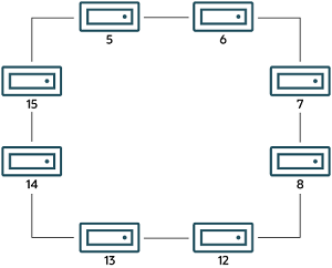

In this example, we have 8 data nodes, numbered 5, 6, 7, 8, 12, 13, 14, and 15, ordered clockwise in a circle. We determine “left” and “right” from the interior of the circle. The node to the left of node 5 is node 15, and the node to the right of node 5 is node 6. You can see all these relationships by running the following query and observing the output:

```
mysql> SELECT node_id,left_node,right_node
-> FROM ndbinfo.membership;
+---------+-----------+------------+
| node_id | left_node | right_node |
+---------+-----------+------------+
|       5 |        15 |          6 |
|       6 |         5 |          7 |
|       7 |         6 |          8 |
|       8 |         7 |         12 |
|      12 |         8 |         13 |
|      13 |        12 |         14 |
|      14 |        13 |         15 |
|      15 |        14 |          5 |
+---------+-----------+------------+
8 rows in set (0.00 sec)
```

The designations “left” and “right” are used in the event log in the same way.

The `president` node is the node viewed by the current node as responsible for setting an arbitrator(see NDB Cluster Start Phases). If the president fails or becomes disconnected, the current node expects the node whose ID is shown in the `successor` column to become the new president. The`succession_order` column shows the place in the succession queue that the current node views itself as having.

In a normal NDB Cluster, all data nodes should see the same node as `president`, and the same node(other than the president) as its `successor`. In addition, the current president should see itself as 1 in the order of succession, the `successor` node should see itself as 2, and so on.

ndbinfo: The NDB Cluster Information Database All nodes should show the same `arb_ticket` values as well as the same `arb_state` values. Possible

```
arb_state values are ARBIT_NULL, ARBIT_INIT, ARBIT_FIND, ARBIT_PREP1, ARBIT_PREP2,
ARBIT_START, ARBIT_RUN, ARBIT_CHOOSE, ARBIT_CRASH, and UNKNOWN.
```

`arb_connected` shows whether this node is connected to the node shown as this node's `arbitrator`.

The `connected_rank1_arbs` and `connected_rank2_arbs` columns each display a list of 0 or more arbitrators having an `ArbitrationRank` equal to 1, or to 2, respectively.

Note Both management nodes and API nodes are eligible to become arbitrators.

#### 18.6.15.16 The ndbinfo memoryusage Table

Querying this table provides information similar to that provided by the `ALL REPORT MemoryUsage`command in the `ndb_mgm` client, or logged by `ALL DUMP 1000`.

The `memoryusage` table contains the following columns:

```
- node_id
```

The node ID of this data node.

```
- memory_type
One of Data memory, Index memory, or Long message buffer.
- used
```

Number of bytes currently used for data memory or index memory by this data node.

```
- used_pages
```

Number of pages currently used for data memory or index memory by this data node; see text.

```
- total
```

Total number of bytes of data memory or index memory available for this data node; see text.

```
- total_pages
```

Total number of memory pages available for data memory or index memory on this data node; see text.

Notes The `total` column represents the total amount of memory in bytes available for the given resource (data memory or index memory) on a particular data node. This number should be approximately equal to the setting of the corresponding configuration parameter in the `config.ini` file.

Suppose that the cluster has 2 data nodes having node IDs 5 and 6, and the `config.ini` file contains the following:

```
[ndbd default]
DataMemory = 1G
IndexMemory = 1G
```

Suppose also that the value of the `LongMessageBuffer` configuration parameter is allowed to assume its default (64 MB in NDB 7.3.5 and later).

ndbinfo: The NDB Cluster Information Database The following query shows approximately the same values:

```
mysql> SELECT node_id, memory_type, total
> FROM ndbinfo.memoryusage;
+---------+---------------------+------------+
| node_id | memory_type         | total      |
+---------+---------------------+------------+
|       5 | Data memory         | 1073741824 |
|       5 | Index memory        | 1074003968 |
|       5 | Long message buffer |   67108864 |
|       6 | Data memory         | 1073741824 |
|       6 | Index memory        | 1074003968 |
|       6 | Long message buffer |   67108864 |
+---------+---------------------+------------+
6 rows in set (0.00 sec)
```

In this case, the `total` column values for index memory are slightly higher than the value set of`IndexMemory` due to internal rounding.

For the `used_pages` and `total_pages` columns, resources are measured in pages, which are 32K in size for `DataMemory` and 8K for `IndexMemory`. For long message buffer memory, the page size is 256 bytes.

Long message buffer information can be found in this table beginning with NDB 7.3.5; in earlier versions of NDB Cluster, only data memory and index memory were included.

#### 18.6.15.17 The ndbinfo memory_per_fragment Table

The `memory_per_fragment` table provides information about the usage of memory by individual fragments.

The `memory_per_fragment` table contains the following columns:

```
- fq_name
```

Name of this fragment

```
- parent_fq_name
```

Name of this fragment's parent

```
- type
```

Type of object; see text for possible values

```
- table_id
```

Table ID for this table

```
- node_id
```

Node ID for this node

```
- block_instance
```

Kernel block instance ID

```
- fragment_num
```

Fragment ID (number)ndbinfo: The NDB Cluster Information Database

```
- fixed_elem_alloc_bytes
```

Number of bytes allocated for fixed-sized elements

```
- fixed_elem_free_bytes
```

Free bytes remaining in pages allocated to fixed-size elements

```
- fixed_elem_size_bytes
```

Length of each fixed-size element in bytes

```
- fixed_elem_count
```

Number of fixed-size elements

```
- fixed_elem_free_count
```

Number of free rows for fixed-size elements

```
- var_elem_alloc_bytes
```

Number of bytes allocated for variable-size elements

```
- var_elem_free_bytes
```

Free bytes remaining in pages allocated to variable-size elements

```
- var_elem_count
```

Number of variable-size elements

```
- hash_index_alloc_bytes
```

Number of bytes allocated to hash indexes Notes The `type` column from this table shows the dictionary object type used for this fragment (`Object::Type`,in the NDB API), and can take any one of the values shown in the following list:

- System table
- User table
- Unique hash index
- Hash index
- Unique ordered index
- Ordered index
- Hash index trigger
- Subscription trigger
- Read only constraint
- Index trigger

ndbinfo: The NDB Cluster Information Database

- Reorganize trigger
- Tablespace
- Log file group
- Data file
- Undo file
- Hash map
- Foreign key definition
- Foreign key parent trigger
- Foreign key child trigger
- Schema transaction

You can also obtain this list by executing `SELECT * FROM` `ndbinfo.dict_obj_types` in the `mysql`client.

The `block_instance` column provides the NDB kernel block instance number. You can use this to obtain information about specific threads from the `threadblocks` table.

#### 18.6.15.18 The ndbinfo nodes Table

This table contains information on the status of data nodes. For each data node that is running in the cluster, a corresponding row in this table provides the node's node ID, status, and uptime. For nodes that are starting, it also shows the current start phase.

The `nodes` table contains the following columns:

```
- node_id
```

The data node's unique node ID in the cluster.

```
- uptime
```

Time since the node was last started, in seconds.

```
- status
```

Current status of the data node; see text for possible values.

```
- start_phase
```

If the data node is starting, the current start phase.

```
- config_generation
```

The version of the cluster configuration file in use on this data node.

Notes The `uptime` column shows the time in seconds that this node has been running since it was last started or restarted. This is a `BIGINT` value. This figure includes the time actually needed to start the node; in other words, this counter starts running the moment that `ndbd` or `ndbmtd` is first invoked; thus, even for a node that has not yet finished starting, `uptime` may show a nonzero value.

ndbinfo: The NDB Cluster Information Database The `status` column shows the node's current status. This is one of: `NOTHING`, `CMVMI`, `STARTING`,`STARTED`, `SINGLEUSER`, `STOPPING_1`, `STOPPING_2`, `STOPPING_3`, or `STOPPING_4`. When the status is `STARTING`, you can see the current start phase in the `start_phase` column (see later in this section).

`SINGLEUSER` is displayed in the `status` column for all data nodes when the cluster is in single user mode(see Section 18.6.6, “NDB Cluster Single User Mode”). Seeing one of the `STOPPING` states does not necessarily mean that the node is shutting down but can mean rather that it is entering a new state. For example, if you put the cluster in single user mode, you can sometimes see data nodes report their state briefly as `STOPPING_2` before the status changes to `SINGLEUSER`.

The `start_phase` column uses the same range of values as those used in the output of the `ndb_mgm`client `node_id STATUS` command (see Section 18.6.1, “Commands in the NDB Cluster Management Client”). If the node is not currently starting, then this column shows 0. For a listing of NDB Cluster start phases with descriptions, see Section 18.6.4, “Summary of NDB Cluster Start Phases”.

The `config_generation` column shows which version of the cluster configuration is in effect on each data node. This can be useful when performing a rolling restart of the cluster in order to make changes in configuration parameters. For example, from the output of the following `SELECT` statement, you can see that node 3 is not yet using the latest version of the cluster configuration (6) although nodes 1, 2, and 4 are doing so:

```
mysql> USE ndbinfo;
Database changed
mysql> SELECT * FROM nodes;
+---------+--------+---------+-------------+-------------------+
| node_id | uptime | status  | start_phase | config_generation |
+---------+--------+---------+-------------+-------------------+
|       1 |  10462 | STARTED |           0 |                 6 |
|       2 |  10460 | STARTED |           0 |                 6 |
|       3 |  10457 | STARTED |           0 |                 5 |
|       4 |  10455 | STARTED |           0 |                 6 |
+---------+--------+---------+-------------+-------------------+
2 rows in set (0.04 sec)
```

Therefore, for the case just shown, you should restart node 3 to complete the rolling restart of the cluster.

Nodes that are stopped are not accounted for in this table. Suppose that you have an NDB Cluster with 4 data nodes (node IDs 1, 2, 3 and 4), and all nodes are running normally, then this table contains 4 rows, 1 for each data node:

```
mysql> USE ndbinfo;
Database changed
mysql> SELECT * FROM nodes;
+---------+--------+---------+-------------+-------------------+
| node_id | uptime | status  | start_phase | config_generation |
+---------+--------+---------+-------------+-------------------+
|       1 |  11776 | STARTED |           0 |                 6 |
|       2 |  11774 | STARTED |           0 |                 6 |
|       3 |  11771 | STARTED |           0 |                 6 |
|       4 |  11769 | STARTED |           0 |                 6 |
+---------+--------+---------+-------------+-------------------+
4 rows in set (0.04 sec)
```

If you shut down one of the nodes, only the nodes that are still running are represented in the output of this`SELECT` statement, as shown here:

```
ndb_mgm> 2 STOP
Node 2: Node shutdown initiated
Node 2: Node shutdown completed.
Node 2 has shutdown.
mysql> SELECT * FROM nodes;
+---------+--------+---------+-------------+-------------------+
```

ndbinfo: The NDB Cluster Information Database

```
| node_id | uptime | status  | start_phase | config_generation |
+---------+--------+---------+-------------+-------------------+
|       1 |  11807 | STARTED |           0 |                 6 |
|       3 |  11802 | STARTED |           0 |                 6 |
|       4 |  11800 | STARTED |           0 |                 6 |
+---------+--------+---------+-------------+-------------------+
3 rows in set (0.02 sec)
```

#### 18.6.15.19 The ndbinfo operations_per_fragment Table

The `operations_per_fragment` table provides information about the operations performed on individual fragments and fragment replicas, as well as about some of the results from these operations.

The `operations_per_fragment` table contains the following columns:

```
- fq_name
```

Name of this fragment

```
- parent_fq_name
```

Name of this fragment's parent

```
- type
```

Type of object; see text for possible values

```
- table_id
```

Table ID for this table

```
- node_id
```

Node ID for this node

```
- block_instance
```

Kernel block instance ID

```
- fragment_num
```

Fragment ID (number)

```
- tot_key_reads
```

Total number of key reads for this fragment replica

```
- tot_key_inserts
```

Total number of key inserts for this fragment replica

```
- tot_key_updates
```

total number of key updates for this fragment replica

```
- tot_key_writes
```

Total number of key writes for this fragment replica

```
- tot_key_deletes
```

ndbinfo: The NDB Cluster Information Database Total number of key deletes for this fragment replica

```
- tot_key_refs
```

Number of key operations refused

```
- tot_key_attrinfo_bytes
```

Total size of all `attrinfo` attributes

```
- tot_key_keyinfo_bytes
```

Total size of all `keyinfo` attributes

```
- tot_key_prog_bytes
```

Total size of all interpreted programs carried by `attrinfo` attributes

```
- tot_key_inst_exec
```

Total number of instructions executed by interpreted programs for key operations

```
- tot_key_bytes_returned
```

Total size of all data and metadata returned from key read operations

```
- tot_frag_scans
```

Total number of scans performed on this fragment replica

```
- tot_scan_rows_examined
```

Total number of rows examined by scans

```
- tot_scan_rows_returned
```

Total number of rows returned to client

```
- tot_scan_bytes_returned
```

Total size of data and metadata returned to the client

```
- tot_scan_prog_bytes
```

Total size of interpreted programs for scan operations

```
- tot_scan_bound_bytes
```

Total size of all bounds used in ordered index scans

```
- tot_scan_inst_exec
```

Total number of instructions executed for scans

```
- tot_qd_frag_scans
```

Number of times that scans of this fragment replica have been queued

```
- conc_frag_scans
```

ndbinfo: The NDB Cluster Information Database Number of scans currently active on this fragment replica (excluding queued scans)

```
- conc_qd_frag_scans
```

Number of scans currently queued for this fragment replica

```
- tot_commits
```

Total number of row changes committed to this fragment replica Notes The `fq_name` contains the fully qualified name of the schema object to which this fragment replica belongs. This currently has the following formats:

- Base table: `DbName/def/TblName`

```
- BLOB table: DbName/def/NDB$BLOB_BaseTblId_ColNo
```

- Ordered index: `sys/def/BaseTblId/IndexName`
- Unique index: `sys/def/BaseTblId/IndexName$unique`

The `$unique` suffix shown for unique indexes is added by `mysqld`; for an index created by a different NDB API client application, this may differ, or not be present.

The syntax just shown for fully qualified object names is an internal interface which is subject to change in future releases.

Consider a table `t1` created and modified by the following SQL statements:

```
CREATE DATABASE mydb;
USE mydb;
CREATE TABLE t1 (
a INT NOT NULL,
b INT NOT NULL,
t TEXT NOT NULL,
PRIMARY KEY (b)
) ENGINE=ndbcluster;
CREATE UNIQUE INDEX ix1 ON t1(b) USING HASH;
```

If `t1` is assigned table ID 11, this yields the `fq_name` values shown here:

- Base table: `mydb/def/t1`

```
- BLOB table: mydb/def/NDB$BLOB_11_2
```

- Ordered index (primary key): `sys/def/11/PRIMARY`
- Unique index: `sys/def/11/ix1$unique`

For indexes or `BLOB` tables, the `parent_fq_name` column contains the `fq_name` of the corresponding base table. For base tables, this column is always `NULL`.

The `type` column shows the schema object type used for this fragment, which can take any one of the values `System table`, `User table`, `Unique hash index`, or `Ordered index`. `BLOB` tables are shown as `User table`.

ndbinfo: The NDB Cluster Information Database The `table_id` column value is unique at any given time, but can be reused if the corresponding object has been deleted. The same ID can be seen using the `ndb_show_tables` utility.

The `block_instance` column shows which LDM instance this fragment replica belongs to. You can use this to obtain information about specific threads from the `threadblocks` table. The first such instance is always numbered 0.

Since there are typically two fragment replicas, and assuming that this is so, each `fragment_num` value should appear twice in the table, on two different data nodes from the same node group.

Since `NDB` does not use single-key access for ordered indexes, the counts for `tot_key_reads`,

```
tot_key_inserts, tot_key_updates, tot_key_writes, and tot_key_deletes are not
```

incremented by ordered index operations.

Note When using `tot_key_writes`, you should keep in mind that a write operation in this context updates the row if the key exists, and inserts a new row otherwise.

(One use of this is in the `NDB` implementation of the `REPLACE` SQL statement.)The `tot_key_refs` column shows the number of key operations refused by the LDM. Generally, such a refusal is due to duplicate keys (inserts), `Key not found` errors (updates, deletes, and reads), or the operation was rejected by an interpreted program used as a predicate on the row matching the key.

The `attrinfo` and `keyinfo` attributes counted by the `tot_key_attrinfo_bytes` and`tot_key_keyinfo_bytes` columns are attributes of an `LQHKEYREQ` signal (see The NDB Communication Protocol) used to initiate a key operation by the LDM. An `attrinfo` typically contains tuple field values (inserts and updates) or projection specifications (for reads); `keyinfo` contains the primary or unique key needed to locate a given tuple in this schema object.

The value shown by `tot_frag_scans` includes both full scans (that examine every row) and scans of subsets. Unique indexes and `BLOB` tables are never scanned, so this value, like other scan-related counts,is 0 for fragment replicas of these.

`tot_scan_rows_examined` may display less than the total number of rows in a given fragment replica,since ordered index scans can limited by bounds. In addition, a client may choose to end a scan before all potentially matching rows have been examined; this occurs when using an SQL statement containing a `LIMIT` or `EXISTS` clause, for example. `tot_scan_rows_returned` is always less than or equal to

```
tot_scan_rows_examined.
```

`tot_scan_bytes_returned` includes, in the case of pushed joins, projections returned to the `DBSPJ`block in the NDB kernel.

`tot_qd_frag_scans` can be effected by the setting for the `MaxParallelScansPerFragment` data node configuration parameter, which limits the number of scans that may execute concurrently on a single fragment replica.

#### 18.6.15.20 The ndbinfo resources Table

This table provides information about data node resource availability and usage.

These resources are sometimes known as super-pools.

The `resources` table contains the following columns:

```
- node_id
```

The unique node ID of this data node.

ndbinfo: The NDB Cluster Information Database

```
- resource_name
```

Name of the resource; see text.

```
- reserved
```

The amount reserved for this resource, as a number of 32KB pages.

```
- used
```

The amount actually used by this resource, as a number of 32KB pages.

```
- max
```

The maximum amount (number of 32KB pages) of this resource used, since the node was last started.

Notes The `resource_name` can be any one of the names shown in the following table:

- `RESERVED`: Reserved by the system; cannot be overridden.
- `TRANSACTION_MEMORY`: Memory allocated for transactions on this data node.
- `DISK_OPERATIONS`: If a log file group is allocated, the size of the undo log buffer is used to set the size

of this resource. This resource is used only to allocate the undo log buffer for an undo log file group;

there can only be one such group. Overallocation occurs as needed by `CREATE LOGFILE GROUP`.

- `DISK_RECORDS`: Records allocated for Disk Data operations.
- `DATA_MEMORY`: Used for main memory tuples, indexes, and hash indexes. Sum of DataMemory and

IndexMemory, plus 8 pages of 32 KB each if IndexMemory has been set. Cannot be overallocated.

- `JOBBUFFER`: Used for allocating job buffers by the NDB scheduler; cannot be overallocated. This

is approximately 2 MB per thread plus a 1 MB buffer in both directions for all threads that can communicate. For large configurations this consume several GB.

- `FILE_BUFFERS`: Used by the redo log handler in the `DBLQH` kernel block; cannot be overallocated. Size

is `NoOfFragmentLogParts` * `RedoBuffer`, plus 1 MB per log file part.

- `TRANSPORTER_BUFFERS`: Used for send buffers by `ndbmtd`; the sum of `TotalSendBufferMemory`

and `ExtraSendBufferMemory`. This resource that can be overallocated by up to 25 percent.

`TotalSendBufferMemory` is calculated by summing the send buffer memory per node, the default value of which is 2 MB. Thus, in a system having four data nodes and eight API nodes, the data nodes have 12 * 2 MB send buffer memory. `ExtraSendBufferMemory` is used by `ndbmtd` and amounts to 2 MB extra memory per thread. Thus, with 4 LDM threads, 2 TC threads, 1 main thread, 1 replication thread, and 2 receive threads, `ExtraSendBufferMemory` is 10 * 2 MB. Overallocation of this resource can be performed by setting the `SharedGlobalMemory` data node configuration parameter.

- `DISK_PAGE_BUFFER`: Used for the disk page buffer; determined by the `DiskPageBufferMemory`

configuration parameter. Cannot be overallocated.

- `QUERY_MEMORY`: Used by the `DBSPJ` kernel block.
- `SCHEMA_TRANS_MEMORY`: Minimum is 2 MB; can be overallocated to use any remaining available

memory.

#### 18.6.15.21 The ndbinfo restart_info Table

ndbinfo: The NDB Cluster Information Database The `restart_info` table contains information about node restart operations. Each entry in the table corresponds to a node restart status report in real time from a data node with the given node ID. Only the most recent report for any given node is shown.

The `restart_info` table contains the following columns:

```
- node_id
```

Node ID in the cluster

```
- node_restart_status
```

Node status; see text for values. Each of these corresponds to a possible value of

```
node_restart_status_int.
- node_restart_status_int
```

Node status code; see text for values.

```
- secs_to_complete_node_failure
```

Time in seconds to complete node failure handling

```
- secs_to_allocate_node_id
```

Time in seconds from node failure completion to allocation of node ID

```
- secs_to_include_in_heartbeat_protocol
```

Time in seconds from allocation of node ID to inclusion in heartbeat protocol

```
- secs_until_wait_for_ndbcntr_master
```

Time in seconds from being included in heartbeat protocol until waiting for `NDBCNTR` master began

```
- secs_wait_for_ndbcntr_master
```

Time in seconds spent waiting to be accepted by `NDBCNTR` master for starting

```
- secs_to_get_start_permitted
```

Time in seconds elapsed from receiving of permission for start from master until all nodes have accepted start of this node

```
- secs_to_wait_for_lcp_for_copy_meta_data
```

Time in seconds spent waiting for LCP completion before copying metadata

```
- secs_to_copy_meta_data
```

Time in seconds required to copy metadata from master to newly starting node

```
- secs_to_include_node
```

Time in seconds waited for GCP and inclusion of all nodes into protocols

```
- secs_starting_node_to_request_local_recovery
```

Time in seconds that the node just starting spent waiting to request local recovery ndbinfo: The NDB Cluster Information Database

```
- secs_for_local_recovery
```

Time in seconds required for local recovery by node just starting

```
- secs_restore_fragments
```

Time in seconds required to restore fragments from LCP files

```
- secs_undo_disk_data
```

Time in seconds required to execute undo log on disk data part of records

```
- secs_exec_redo_log
```

Time in seconds required to execute redo log on all restored fragments

```
- secs_index_rebuild
```

Time in seconds required to rebuild indexes on restored fragments

```
- secs_to_synchronize_starting_node
```

Time in seconds required to synchronize starting node from live nodes

```
- secs_wait_lcp_for_restart
```

Time in seconds required for LCP start and completion before restart was completed

```
- secs_wait_subscription_handover
```

Time in seconds spent waiting for handover of replication subscriptions

```
- total_restart_secs
```

Total number of seconds from node failure until node is started again Notes The following list contains values defined for the `node_restart_status_int` column with their internal status names (in parentheses), and the corresponding messages shown in the `node_restart_status`column:

```
- 0 (ALLOCATED_NODE_ID)
Allocated node id
- 1 (INCLUDED_IN_HB_PROTOCOL)
Included in heartbeat protocol
- 2 (NDBCNTR_START_WAIT)
Wait for NDBCNTR master to permit us to start
- 3 (NDBCNTR_STARTED)
NDBCNTR master permitted us to start
- 4 (START_PERMITTED)
All nodes permitted us to start
```

ndbinfo: The NDB Cluster Information Database

```
- 5 (WAIT_LCP_TO_COPY_DICT)
Wait for LCP completion to start copying metadata
- 6 (COPY_DICT_TO_STARTING_NODE)
Copying metadata to starting node
- 7 (INCLUDE_NODE_IN_LCP_AND_GCP)
Include node in LCP and GCP protocols
- 8 (LOCAL_RECOVERY_STARTED)
Restore fragments ongoing
- 9 (COPY_FRAGMENTS_STARTED)
Synchronizing starting node with live nodes
- 10 (WAIT_LCP_FOR_RESTART)
Wait for LCP to ensure durability
- 11 (WAIT_SUMA_HANDOVER)
Wait for handover of subscriptions
- 12 (RESTART_COMPLETED)
Restart completed
- 13 (NODE_FAILED)
Node failed, failure handling in progress
- 14 (NODE_FAILURE_COMPLETED)
Node failure handling completed
- 15 (NODE_GETTING_PERMIT)
All nodes permitted us to start
- 16 (NODE_GETTING_INCLUDED)
Include node in LCP and GCP protocols
- 17 (NODE_GETTING_SYNCHED)
Synchronizing starting node with live nodes
- 18 (NODE_GETTING_LCP_WAITED)
```

[none]

```
- 19 (NODE_ACTIVE)
Restart completed
- 20 (NOT_DEFINED_IN_CLUSTER)
```

ndbinfo: The NDB Cluster Information Database[none]

```
- 21 (NODE_NOT_RESTARTED_YET)
Initial state
```

Status numbers 0 through 12 apply on master nodes only; the remainder of those shown in the table apply to all restarting data nodes. Status numbers 13 and 14 define node failure states; 20 and 21 occur when no information about the restart of a given node is available.

See also Section 18.6.4, “Summary of NDB Cluster Start Phases”.

#### 18.6.15.22 The ndbinfo server_operations Table

The `server_operations` table contains entries for all ongoing `NDB` operations that the current SQL node(MySQL Server) is currently involved in. It effectively is a subset of the `cluster_operations` table, in which operations for other SQL and API nodes are not shown.

The `server_operations` table contains the following columns:

```
- mysql_connection_id
```

MySQL Server connection ID

```
- node_id
```

Node ID

```
- block_instance
```

Block instance

```
- transid
```

Transaction ID

```
- operation_type
```

Operation type (see text for possible values)

```
- state
```

Operation state (see text for possible values)

```
- tableid
```

Table ID

```
- fragmentid
```

Fragment ID

```
- client_node_id
```

Client node ID

```
- client_block_ref
```

Client block reference ndbinfo: The NDB Cluster Information Database

```
- tc_node_id
```

Transaction coordinator node ID

```
- tc_block_no
```

Transaction coordinator block number

```
- tc_block_instance
```

Transaction coordinator block instance Notes The `mysql_connection_id` is the same as the connection or session ID shown in the output of `SHOW PROCESSLIST`. It is obtained from the `INFORMATION_SCHEMA` table

```
NDB_TRANSID_MYSQL_CONNECTION_MAP.
```

`block_instance` refers to an instance of a kernel block. Together with the block name, this number can be used to look up a given instance in the `threadblocks` table.

The transaction ID (`transid`) is a unique 64-bit number which can be obtained using the NDB API's`getTransactionId()` method. (Currently, the MySQL Server does not expose the NDB API transaction ID of an ongoing transaction.)The `operation_type` column can take any one of the values `READ`, `READ-SH`, `READ-EX`, `INSERT`,

```
UPDATE, DELETE, WRITE, UNLOCK, REFRESH, SCAN, SCAN-SH, SCAN-EX, or <unknown>.
```

The `state` column can have any one of the values `ABORT_QUEUED`, `ABORT_STOPPED`,

```
COMMITTED, COMMIT_QUEUED, COMMIT_STOPPED, COPY_CLOSE_STOPPED,
COPY_FIRST_STOPPED, COPY_STOPPED, COPY_TUPKEY, IDLE, LOG_ABORT_QUEUED,
LOG_COMMIT_QUEUED, LOG_COMMIT_QUEUED_WAIT_SIGNAL, LOG_COMMIT_WRITTEN,
LOG_COMMIT_WRITTEN_WAIT_SIGNAL, LOG_QUEUED, PREPARED, PREPARED_RECEIVED_COMMIT,
SCAN_CHECK_STOPPED, SCAN_CLOSE_STOPPED, SCAN_FIRST_STOPPED, SCAN_RELEASE_STOPPED,
SCAN_STATE_USED, SCAN_STOPPED, SCAN_TUPKEY, STOPPED, TC_NOT_CONNECTED, WAIT_ACC,
WAIT_ACC_ABORT, WAIT_AI_AFTER_ABORT, WAIT_ATTR, WAIT_SCAN_AI, WAIT_TUP,
```

`WAIT_TUPKEYINFO`, `WAIT_TUP_COMMIT`, or `WAIT_TUP_TO_ABORT`. (If the MySQL Server is running with `ndbinfo_show_hidden` enabled, you can view this list of states by selecting from the `ndb``$dblqh_tcconnect_state` table, which is normally hidden.)You can obtain the name of an `NDB` table from its table ID by checking the output of `ndb_show_tables`.

The `fragid` is the same as the partition number seen in the output of `ndb_desc` `--extra-partition-``info` (short form `-p`).

In `client_node_id` and `client_block_ref`, `client` refers to an NDB Cluster API or SQL node (that is, an NDB API client or a MySQL Server attached to the cluster).

The `block_instance` and `tc_block_instance` column provide NDB kernel block instance numbers.

You can use these to obtain information about specific threads from the `threadblocks` table.

#### 18.6.15.23 The ndbinfo server_transactions Table

The `server_transactions` table is subset of the `cluster_transactions` table, but includes only those transactions in which the current SQL node (MySQL Server) is a participant, while including the relevant connection IDs.

The `server_transactions` table contains the following columns:ndbinfo: The NDB Cluster Information Database

```
- mysql_connection_id
```

MySQL Server connection ID

```
- node_id
```

Transaction coordinator node ID

```
- block_instance
```

Transaction coordinator block instance

```
- transid
```

Transaction ID

```
- state
```

Operation state (see text for possible values)

```
- count_operations
```

Number of stateful operations in the transaction

```
- outstanding_operations
```

Operations still being executed by local data management layer (LQH blocks)

```
- inactive_seconds
```

Time spent waiting for API

```
- client_node_id
```

Client node ID

```
- client_block_ref
```

Client block reference Notes The `mysql_connection_id` is the same as the connection or session ID shown in the output of `SHOW PROCESSLIST`. It is obtained from the `INFORMATION_SCHEMA` table

```
NDB_TRANSID_MYSQL_CONNECTION_MAP.
```

`block_instance` refers to an instance of a kernel block. Together with the block name, this number can be used to look up a given instance in the `threadblocks` table.

The transaction ID (`transid`) is a unique 64-bit number which can be obtained using the NDB API's`getTransactionId()` method. (Currently, the MySQL Server does not expose the NDB API transaction ID of an ongoing transaction.)The `state` column can have any one of the values `CS_ABORTING`, `CS_COMMITTING`, `CS_COMMIT_SENT`,

```
CS_COMPLETE_SENT, CS_COMPLETING, CS_CONNECTED, CS_DISCONNECTED, CS_FAIL_ABORTED,
CS_FAIL_ABORTING, CS_FAIL_COMMITTED, CS_FAIL_COMMITTING, CS_FAIL_COMPLETED,
CS_FAIL_PREPARED, CS_PREPARE_TO_COMMIT, CS_RECEIVING, CS_REC_COMMITTING,
CS_RESTART, CS_SEND_FIRE_TRIG_REQ, CS_STARTED, CS_START_COMMITTING,
CS_START_SCAN, CS_WAIT_ABORT_CONF, CS_WAIT_COMMIT_CONF, CS_WAIT_COMPLETE_CONF,
```

ndbinfo: The NDB Cluster Information Database`CS_WAIT_FIRE_TRIG_REQ`. (If the MySQL Server is running with `ndbinfo_show_hidden` enabled, you can view this list of states by selecting from the `ndb$dbtc_apiconnect_state` table, which is normally hidden.)In `client_node_id` and `client_block_ref`, `client` refers to an NDB Cluster API or SQL node (that is, an NDB API client or a MySQL Server attached to the cluster).

The `block_instance` column provides the `DBTC` kernel block instance number. You can use this to obtain information about specific threads from the `threadblocks` table.

#### 18.6.15.24 The ndbinfo tc_time_track_stats Table

The `tc_time_track_stats` table provides time-tracking information obtained from the `DBTC` block (TC)instances in the data nodes, through API nodes access `NDB`. Each TC instance tracks latencies for a set of activities it undertakes on behalf of API nodes or other data nodes; these activities include transactions,transaction errors, key reads, key writes, unique index operations, failed key operations of any type, scans,failed scans, fragment scans, and failed fragment scans.

A set of counters is maintained for each activity, each counter covering a range of latencies less than or equal to an upper bound. At the conclusion of each activity, its latency is determined and the appropriate counter incremented. `tc_time_track_stats` presents this information as rows, with a row for each instance of the following:

- Data node, using its ID
- TC block instance
- Other communicating data node or API node, using its ID
- Upper bound value

Notes Each row contains a value for each activity type. This is the number of times that this activity occurred with a latency within the range specified by the row (that is, where the latency does not exceed the upper bound).

The `tc_time_track_stats` table contains the following columns:

```
- node_id
```

Requesting node ID

```
- block_number
```

TC block number

```
- block_instance
```

TC block instance number

```
- comm_node_id
```

Node ID of communicating API or data node

```
- upper_bound
```

Upper bound of interval (in microseconds)ndbinfo: The NDB Cluster Information Database

```
- scans
```

Based on duration of successful scans from opening to closing, tracked against the API or data nodes requesting them.

```
- scan_errors
```

Based on duration of failed scans from opening to closing, tracked against the API or data nodes requesting them.

```
- scan_fragments
```

Based on duration of successful fragment scans from opening to closing, tracked against the data nodes executing them

```
- scan_fragment_errors
```

Based on duration of failed fragment scans from opening to closing, tracked against the data nodes executing them

```
- transactions
```

Based on duration of successful transactions from beginning until sending of commit `ACK`, tracked against the API or data nodes requesting them. Stateless transactions are not included.

```
- transaction_errors
```

Based on duration of failing transactions from start to point of failure, tracked against the API or data nodes requesting them.

```
- read_key_ops
```

Based on duration of successful primary key reads with locks. Tracked against both the API or data node requesting them and the data node executing them.

```
- write_key_ops
```

Based on duration of successful primary key writes, tracked against both the API or data node requesting them and the data node executing them.

```
- index_key_ops
```

Based on duration of successful unique index key operations, tracked against both the API or data node requesting them and the data node executing reads of base tables.

```
- key_op_errors
```

Based on duration of all unsuccessful key read or write operations, tracked against both the API or data node requesting them and the data node executing them.

The `block_instance` column provides the `DBTC` kernel block instance number. You can use this together with the block name to obtain information about specific threads from the `threadblocks` table.

The `tc_time_track_stats` table was added in NDB 7.4.9 (Bug #78533, Bug #21889652).

#### 18.6.15.25 The ndbinfo threadblocks Table

The `threadblocks` table associates data nodes, threads, and instances of `NDB` kernel blocks.

ndbinfo: The NDB Cluster Information Database The `threadblocks` table contains the following columns:

```
- node_id
```

Node ID

```
- thr_no
```

Thread ID

```
- block_name
```

Block name

```
- block_instance
```

Block instance number Notes The value of the `block_name` in this table is one of the values found in the `block_name` column when selecting from the `ndbinfo.blocks` table. Although the list of possible values is static for a given NDB Cluster release, the list may vary between releases.

The `block_instance` column provides the kernel block instance number.

#### 18.6.15.26 The ndbinfo threadstat Table

The `threadstat` table provides a rough snapshot of statistics for threads running in the `NDB` kernel.

The `threadstat` table contains the following columns:

```
- node_id
```

Node ID

```
- thr_no
```

Thread ID

```
- thr_nm
```

Thread name

```
- c_loop
```

Number of loops in main loop

```
- c_exec
```

Number of signals executed

```
- c_wait
```

Number of times waiting for additional input

```
- c_l_sent_prioa
```

Number of priority A signals sent to own node ndbinfo: The NDB Cluster Information Database

```
- c_l_sent_priob
```

Number of priority B signals sent to own node

```
- c_r_sent_prioa
```

Number of priority A signals sent to remote node

```
- c_r_sent_priob
```

Number of priority B signals sent to remote node

```
- os_tid
```

OS thread ID

```
- os_now
```

OS time (ms)

```
- os_ru_utime
```

OS user CPU time (µs)

```
- os_ru_stime
```

OS system CPU time (µs)

```
- os_ru_minflt
```

OS page reclaims (soft page faults)

```
- os_ru_majflt
```

OS page faults (hard page faults)

```
- os_ru_nvcsw
```

OS voluntary context switches

```
- os_ru_nivcsw
```

OS involuntary context switches Notes`os_time` uses the system `gettimeofday()` call.

The values of the `os_ru_utime`, `os_ru_stime`, `os_ru_minflt`, `os_ru_majflt`, `os_ru_nvcsw`, and`os_ru_nivcsw` columns are obtained using the system `getrusage()` call, or the equivalent.

Since this table contains counts taken at a given point in time, for best results it is necessary to query this table periodically and store the results in an intermediate table or tables. The MySQL Server's Event Scheduler can be employed to automate such monitoring. For more information, see Section 20.4, “Using the Event Scheduler”.

#### 18.6.15.27 The ndbinfo transporters Table

This table contains information about NDB transporters.

ndbinfo: The NDB Cluster Information Database The `transporters` table contains the following columns:

```
- node_id
```

This data node's unique node ID in the cluster

```
- remote_node_id
```

The remote data node's node ID

```
- status
```

Status of the connection

```
- remote_address
```

Name or IP address of the remote host

```
- bytes_sent
```

Number of bytes sent using this connection

```
- bytes_received
```

Number of bytes received using this connection

```
- connect_count
```

Number of times connection established on this transporter

```
- overloaded
```

1 if this transporter is currently overloaded, otherwise 0

```
- overload_count
```

Number of times this transporter has entered overload state since connecting

```
- slowdown
```

1 if this transporter is in slowdown state, otherwise 0

```
- slowdown_count
```

Number of times this transporter has entered slowdown state since connecting Notes For each running data node in the cluster, the `transporters` table displays a row showing the status of each of that node's connections with all nodes in the cluster, including itself. This information is shown in the table's status column, which can have any one of the following values: `CONNECTING`, `CONNECTED`,

```
DISCONNECTING, or DISCONNECTED.
```

Connections to API and management nodes which are configured but not currently connected to the cluster are shown with status `DISCONNECTED`. Rows where the `node_id` is that of a data node which is not currently connected are not shown in this table. (This is similar omission of disconnected nodes in the`ndbinfo.nodes` table.

The `remote_address` is the host name or address for the node whose ID is shown in the`remote_node_id` column. The `bytes_sent` from this node and `bytes_received` by this node are ndbinfo: The NDB Cluster Information Database the numbers, respectively, of bytes sent and received by the node using this connection since it was established. For nodes whose status is `CONNECTING` or `DISCONNECTED`, these columns always display 0.

Assume you have a 5-node cluster consisting of 2 data nodes, 2 SQL nodes, and 1 management node, as shown in the output of the `SHOW` command in the `ndb_mgm` client:

```
ndb_mgm> SHOW
Connected to Management Server at: localhost:1186
Cluster Configuration
---------------------
[ndbd(NDB)]     2 node(s)
id=1    @10.100.10.1  (5.6.51-ndb-7.4.39, Nodegroup: 0, *)
id=2    @10.100.10.2  (5.6.51-ndb-7.4.39, Nodegroup: 0)
[ndb_mgmd(MGM)] 1 node(s)
id=10   @10.100.10.10  (5.6.51-ndb-7.4.39)
[mysqld(API)]   2 node(s)
id=20   @10.100.10.20  (5.6.51-ndb-7.4.39)
id=21   @10.100.10.21  (5.6.51-ndb-7.4.39)
```

There are 10 rows in the `transporters` table—5 for the first data node, and 5 for the second—assuming that all data nodes are running, as shown here:

```
mysql> SELECT node_id, remote_node_id, status
->   FROM ndbinfo.transporters;
+---------+----------------+---------------+
| node_id | remote_node_id | status        |
+---------+----------------+---------------+
|       1 |              1 | DISCONNECTED  |
|       1 |              2 | CONNECTED     |
|       1 |             10 | CONNECTED     |
|       1 |             20 | CONNECTED     |
|       1 |             21 | CONNECTED     |
|       2 |              1 | CONNECTED     |
|       2 |              2 | DISCONNECTED  |
|       2 |             10 | CONNECTED     |
|       2 |             20 | CONNECTED     |
|       2 |             21 | CONNECTED     |
+---------+----------------+---------------+
10 rows in set (0.04 sec)
```

If you shut down one of the data nodes in this cluster using the command `2 STOP` in the `ndb_mgm` client,then repeat the previous query (again using the `mysql` client), this table now shows only 5 rows—1 row for each connection from the remaining management node to another node, including both itself and the data node that is currently offline—and displays `CONNECTING` for the status of each remaining connection to the data node that is currently offline, as shown here:

```
mysql> SELECT node_id, remote_node_id, status
->   FROM ndbinfo.transporters;
+---------+----------------+---------------+
| node_id | remote_node_id | status        |
+---------+----------------+---------------+
|       1 |              1 | DISCONNECTED  |
|       1 |              2 | CONNECTING    |
|       1 |             10 | CONNECTED     |
|       1 |             20 | CONNECTED     |
|       1 |             21 | CONNECTED     |
+---------+----------------+---------------+
5 rows in set (0.02 sec)
The connect_count, overloaded, overload_count ,slowdown, and slowdown_count counters
```

are reset on connection, and retain their values after the remote node disconnects. The `bytes_sent`Quick Reference: NDB Cluster SQL Statements and `bytes_received` counters are also reset on connection, and so retain their values following disconnection (until the next connection resets them).

The overload state referred to by the `overloaded` and `overload_count` columns occurs when this transporter's send buffer contains more than `OVerloadLimit` bytes (default is 80% of`SendBufferMemory`, that is, 0.8 * 2097152 = 1677721 bytes). When a given transporter is in a state of overload, any new transaction that tries to use this transporter fails with Error 1218 (`Send Buffers``overloaded in NDB kernel`). This affects both scans and primary key operations.

The slowdown state referenced by the `slowdown` and `slowdown_count` columns of this table occurs when the transporter's send buffer contains more than 60% of the overload limit (equal to 0.6 * 2097152 =1258291 bytes by default). In this state, any new scan using this transporter has its batch size reduced to minimize the load on the transporter.

Common causes of send buffer slowdown or overloading include the following:

- Data size, in particular the quantity of data stored in `TEXT` columns or `BLOB` columns (or both types of

columns)

- Having a data node (ndbd or ndbmtd) on the same host as an SQL node that is engaged in binary

logging

- Large number of rows per transaction or transaction batch
- Configuration issues such as insufficient `SendBufferMemory`
- Hardware issues such as insufficient RAM or poor network connectivity

See also Section 18.4.3.12, “Configuring NDB Cluster Send Buffer Parameters”.

### 18.6.16 Quick Reference: NDB Cluster SQL Statements

This section discusses several SQL statements that can prove useful in managing and monitoring a MySQL server that is connected to an NDB Cluster, and in some cases provide information about the cluster itself.

```
- SHOW ENGINE NDB STATUS, SHOW ENGINE NDBCLUSTER STATUS
```

The output of this statement contains information about the server's connection to the cluster, creation and usage of NDB Cluster objects, and binary logging for NDB Cluster replication.

See Section 13.7.5.16, “SHOW ENGINE Statement”, for a usage example and more detailed information.

```
- SHOW ENGINES
```

This statement can be used to determine whether or not clustering support is enabled in the MySQL server, and if so, whether it is active.

See Section 13.7.5.17, “SHOW ENGINES Statement”, for more detailed information.

Note This statement does not support a `LIKE` clause. However, you can use `LIKE` to filter queries against the Information Schema `ENGINES` table, as discussed in the next item.

Quick Reference: NDB Cluster SQL Statements

```
- SELECT * FROM INFORMATION_SCHEMA.ENGINES [WHERE ENGINE LIKE 'NDB%']
```

This is the equivalent of `SHOW ENGINES`, but uses the `ENGINES` table of the `INFORMATION_SCHEMA`database. Unlike the case with the `SHOW ENGINES` statement, it is possible to filter the results using a `LIKE` clause, and to select specific columns to obtain information that may be of use in scripts. For example, the following query shows whether the server was built with `NDB` support and, if so, whether it is enabled:

```
mysql> SELECT SUPPORT FROM INFORMATION_SCHEMA.ENGINES
->   WHERE ENGINE LIKE 'NDB%';
+---------+
| support |
+---------+
| ENABLED |
+---------+
```

See Section 21.3.7, “The INFORMATION_SCHEMA ENGINES Table”, for more information.

```
- SHOW VARIABLES LIKE 'NDB%'
```

This statement provides a list of most server system variables relating to the `NDB` storage engine, and their values, as shown here:

```
mysql> SHOW VARIABLES LIKE 'NDB%';
+--------------------------------------+---------------------------------------+
| Variable_name                        | Value                                 |
+--------------------------------------+---------------------------------------+
| ndb_autoincrement_prefetch_sz        | 1                                     |
| ndb_batch_size                       | 32768                                 |
| ndb_blob_read_batch_bytes            | 65536                                 |
| ndb_blob_write_batch_bytes           | 65536                                 |
| ndb_cache_check_time                 | 0                                     |
| ndb_clear_apply_status               | ON                                    |
| ndb_cluster_connection_pool          | 1                                     |
| ndb_connectstring                    | 127.0.0.1                             |
| ndb_deferred_constraints             | 0                                     |
| ndb_distribution                     | KEYHASH                               |
| ndb_eventbuffer_free_percent         | 20                                    |
| ndb_eventbuffer_max_alloc            | 0                                     |
| ndb_extra_logging                    | 1                                     |
| ndb_force_send                       | ON                                    |
| ndb_index_stat_enable                | ON                                    |
| ndb_index_stat_option                | loop_enable=1000ms,loop_idle=1000ms,
loop_busy=100ms,update_batch=1,read_batch=4,idle_batch=32,check_batch=8,
check_delay=10m,delete_batch=8,clean_delay=1m,error_batch=4,error_delay=1m,
evict_batch=8,evict_delay=1m,cache_limit=32M,cache_lowpct=90,zero_total=0      |
| ndb_join_pushdown                    | ON                                    |
| ndb_log_apply_status                 | OFF                                   |
| ndb_log_bin                          | ON                                    |
| ndb_log_binlog_index                 | ON                                    |
| ndb_log_empty_epochs                 | OFF                                   |
| ndb_log_empty_update                 | OFF                                   |
| ndb_log_exclusive_reads              | OFF                                   |
| ndb_log_fail_terminate               | OFF                                   |
| ndb_log_orig                         | OFF                                   |
| ndb_log_transaction_id               | OFF                                   |
| ndb_log_update_as_write              | ON                                    |
| ndb_log_update_minimal               | OFF                                   |
| ndb_log_updated_only                 | ON                                    |
| ndb_mgmd_host                        | 127.0.0.1                             |
| ndb_nodeid                           | 0                                     |
| ndb_optimization_delay               | 10                                    |
| ndb_optimized_node_selection         | 3                                     |
| ndb_recv_thread_activation_threshold | 8                                     |
| ndb_recv_thread_cpu_mask             |                                       |
```

Quick Reference: NDB Cluster SQL Statements

```
| ndb_report_thresh_binlog_epoch_slip  | 3                                     |
| ndb_report_thresh_binlog_mem_usage   | 10                                    |
| ndb_show_foreign_key_mock_tables     | OFF                                   |
| ndb_slave_conflict_role              | NONE                                  |
| ndb_table_no_logging                 | OFF                                   |
| ndb_table_temporary                  | OFF                                   |
| ndb_use_copying_alter_table          | OFF                                   |
| ndb_use_exact_count                  | OFF                                   |
| ndb_use_transactions                 | ON                                    |
| ndb_version                          | 459808                                |
| ndb_version_string                   | ndb-7.4.39                            |
| ndb_wait_connected                   | 30                                    |
| ndb_wait_setup                       | 30                                    |
| ndbinfo_database                     | ndbinfo                               |
| ndbinfo_max_bytes                    | 0                                     |
| ndbinfo_max_rows                     | 10                                    |
| ndbinfo_offline                      | OFF                                   |
| ndbinfo_show_hidden                  | OFF                                   |
| ndbinfo_table_prefix                 | ndb$                                  |
| ndbinfo_version                      | 459808                                |
+--------------------------------------+---------------------------------------+
```

See Section 5.1.7, “Server System Variables”, for more information.

```
- SELECT * FROM INFORMATION_SCHEMA.GLOBAL_VARIABLES WHERE VARIABLE_NAME LIKE
'NDB%';
```

This statement is the equivalent of the `SHOW VARIABLES` statement described in the previous item, and provides almost identical output, as shown here:

```
mysql> SELECT * FROM INFORMATION_SCHEMA.GLOBAL_VARIABLES
->   WHERE VARIABLE_NAME LIKE 'NDB%';
+--------------------------------------+---------------------------------------+
| VARIABLE_NAME                        | VARIABLE_VALUE                        |
+--------------------------------------+---------------------------------------+
| NDB_CACHE_CHECK_TIME                 | 0                                     |
| NDB_TABLE_TEMPORARY                  | OFF                                   |
| NDB_AUTOINCREMENT_PREFETCH_SZ        | 1                                     |
| NDB_LOG_BINLOG_INDEX                 | ON                                    |
| NDB_FORCE_SEND                       | ON                                    |
| NDB_WAIT_SETUP                       | 30                                    |
| NDB_CLUSTER_CONNECTION_POOL          | 1                                     |
| NDB_WAIT_CONNECTED                   | 30                                    |
| NDB_USE_EXACT_COUNT                  | OFF                                   |
| NDB_LOG_EMPTY_UPDATE                 | OFF                                   |
| NDB_RECV_THREAD_ACTIVATION_THRESHOLD | 8                                     |
| NDB_EVENTBUFFER_MAX_ALLOC            | 0                                     |
| NDB_OPTIMIZED_NODE_SELECTION         | 3                                     |
| NDBINFO_DATABASE                     | ndbinfo                               |
| NDB_LOG_APPLY_STATUS                 | OFF                                   |
| NDB_JOIN_PUSHDOWN                    | ON                                    |
| NDB_RECV_THREAD_CPU_MASK             |                                       |
| NDBINFO_VERSION                      | 459808                                |
| NDB_CONNECTSTRING                    | 127.0.0.1                             |
| NDB_TABLE_NO_LOGGING                 | OFF                                   |
| NDB_LOG_UPDATED_ONLY                 | ON                                    |
| NDB_VERSION                          | 459808                                |
| NDB_LOG_UPDATE_MINIMAL               | OFF                                   |
| NDB_OPTIMIZATION_DELAY               | 10                                    |
| NDB_LOG_UPDATE_AS_WRITE              | ON                                    |
| NDB_SHOW_FOREIGN_KEY_MOCK_TABLES     | OFF                                   |
| NDB_VERSION_STRING                   | ndb-7.4.39                            |
| NDBINFO_OFFLINE                      | OFF                                   |
| NDB_INDEX_STAT_OPTION                | loop_enable=1000ms,loop_idle=1000ms,
loop_busy=100ms,update_batch=1,read_batch=4,idle_batch=32,check_batch=8,
check_delay=10m,delete_batch=8,clean_delay=1m,error_batch=4,error_delay=1m,
```

Quick Reference: NDB Cluster SQL Statements

```
evict_batch=8,evict_delay=1m,cache_limit=32M,cache_lowpct=90,zero_total=0      |
| NDBINFO_MAX_ROWS                     | 10                                    |
| NDB_BATCH_SIZE                       | 32768                                 |
| NDB_USE_TRANSACTIONS                 | ON                                    |
| NDB_NODEID                           | 0                                     |
| NDB_SLAVE_CONFLICT_ROLE              | NONE                                  |
| NDB_REPORT_THRESH_BINLOG_MEM_USAGE   | 10                                    |
| NDB_MGMD_HOST                        | 127.0.0.1                             |
| NDB_REPORT_THRESH_BINLOG_EPOCH_SLIP  | 3                                     |
| NDBINFO_MAX_BYTES                    | 0                                     |
| NDB_LOG_BIN                          | ON                                    |
| NDBINFO_TABLE_PREFIX                 | ndb$                                  |
| NDB_LOG_EMPTY_EPOCHS                 | OFF                                   |
| NDB_LOG_ORIG                         | OFF                                   |
| NDB_LOG_EXCLUSIVE_READS              | OFF                                   |
| NDB_LOG_TRANSACTION_ID               | OFF                                   |
| NDB_LOG_FAIL_TERMINATE               | OFF                                   |
| NDB_EVENTBUFFER_FREE_PERCENT         | 20                                    |
| NDB_CLEAR_APPLY_STATUS               | ON                                    |
| NDBINFO_SHOW_HIDDEN                  | OFF                                   |
| NDB_INDEX_STAT_ENABLE                | ON                                    |
| NDB_DISTRIBUTION                     | KEYHASH                               |
| NDB_EXTRA_LOGGING                    | 1                                     |
| NDB_BLOB_WRITE_BATCH_BYTES           | 65536                                 |
| NDB_USE_COPYING_ALTER_TABLE          | OFF                                   |
| NDB_DEFERRED_CONSTRAINTS             | 0                                     |
| NDB_BLOB_READ_BATCH_BYTES            | 65536                                 |
+--------------------------------------+---------------------------------------+
```

Unlike the case with the `SHOW VARIABLES` statement, it is possible to select individual columns. For example:

```
mysql> SELECT VARIABLE_VALUE
->   FROM INFORMATION_SCHEMA.GLOBAL_VARIABLES
->   WHERE VARIABLE_NAME = 'ndb_force_send';
+----------------+
| VARIABLE_VALUE |
+----------------+
| ON             |
+----------------+
```

See Section 21.3.10, “The INFORMATION_SCHEMA GLOBAL_VARIABLES and SESSION_VARIABLES Tables”, and Section 5.1.7, “Server System Variables”, for more information.

```
- SHOW STATUS LIKE 'NDB%'
```

This statement shows at a glance whether or not the MySQL server is acting as a cluster SQL node, and if so, it provides the MySQL server's cluster node ID, the host name and port for the cluster management server to which it is connected, and the number of data nodes in the cluster, as shown here:

```
mysql> SHOW STATUS LIKE 'NDB%';
+----------------------------------------------+-------------------------------+
| Variable_name                                | Value                         |
+----------------------------------------------+-------------------------------+
| Ndb_api_wait_exec_complete_count             | 2                             |
| Ndb_api_wait_scan_result_count               | 3                             |
| Ndb_api_wait_meta_request_count              | 109                           |
| Ndb_api_wait_nanos_count                     | 830671169345                  |
| Ndb_api_bytes_sent_count                     | 13284                         |
| Ndb_api_bytes_received_count                 | 112672                        |
| Ndb_api_trans_start_count                    | 2                             |
| Ndb_api_trans_commit_count                   | 1                             |
| Ndb_api_trans_abort_count                    | 0                             |
| Ndb_api_trans_close_count                    | 2                             |
| Ndb_api_pk_op_count                          | 1                             |
```

Quick Reference: NDB Cluster SQL Statements

```
| Ndb_api_uk_op_count                          | 0                             |
| Ndb_api_table_scan_count                     | 1                             |
| Ndb_api_range_scan_count                     | 0                             |
| Ndb_api_pruned_scan_count                    | 0                             |
| Ndb_api_scan_batch_count                     | 0                             |
| Ndb_api_read_row_count                       | 1                             |
| Ndb_api_trans_local_read_row_count           | 1                             |
| Ndb_api_adaptive_send_forced_count           | 0                             |
| Ndb_api_adaptive_send_unforced_count         | 3                             |
| Ndb_api_adaptive_send_deferred_count         | 0                             |
| Ndb_api_event_data_count                     | 0                             |
| Ndb_api_event_nondata_count                  | 0                             |
| Ndb_api_event_bytes_count                    | 3122560                       |
| Ndb_cluster_node_id                          | 100                           |
| Ndb_config_from_host                         | 127.0.0.1                     |
| Ndb_config_from_port                         | 1186                          |
| Ndb_number_of_data_nodes                     | 2                             |
| Ndb_number_of_ready_data_nodes               | 2                             |
| Ndb_connect_count                            | 0                             |
| Ndb_execute_count                            | 0                             |
| Ndb_scan_count                               | 0                             |
| Ndb_pruned_scan_count                        | 0                             |
| Ndb_schema_locks_count                       | 0                             |
| Ndb_api_wait_exec_complete_count_session     | 0                             |
| Ndb_api_wait_scan_result_count_session       | 0                             |
| Ndb_api_wait_meta_request_count_session      | 0                             |
| Ndb_api_wait_nanos_count_session             | 0                             |
| Ndb_api_bytes_sent_count_session             | 0                             |
| Ndb_api_bytes_received_count_session         | 0                             |
| Ndb_api_trans_start_count_session            | 0                             |
| Ndb_api_trans_commit_count_session           | 0                             |
| Ndb_api_trans_abort_count_session            | 0                             |
| Ndb_api_trans_close_count_session            | 0                             |
| Ndb_api_pk_op_count_session                  | 0                             |
| Ndb_api_uk_op_count_session                  | 0                             |
| Ndb_api_table_scan_count_session             | 0                             |
| Ndb_api_range_scan_count_session             | 0                             |
| Ndb_api_pruned_scan_count_session            | 0                             |
| Ndb_api_scan_batch_count_session             | 0                             |
| Ndb_api_read_row_count_session               | 0                             |
| Ndb_api_trans_local_read_row_count_session   | 0                             |
| Ndb_api_adaptive_send_forced_count_session   | 0                             |
| Ndb_api_adaptive_send_unforced_count_session | 0                             |
| Ndb_api_adaptive_send_deferred_count_session | 0                             |
| Ndb_sorted_scan_count                        | 0                             |
| Ndb_pushed_queries_defined                   | 0                             |
| Ndb_pushed_queries_dropped                   | 0                             |
| Ndb_pushed_queries_executed                  | 0                             |
| Ndb_pushed_reads                             | 0                             |
| Ndb_last_commit_epoch_server                 | 73014444043                   |
| Ndb_last_commit_epoch_session                | 0                             |
| Ndb_api_wait_exec_complete_count_slave       | 0                             |
| Ndb_api_wait_scan_result_count_slave         | 0                             |
| Ndb_api_wait_meta_request_count_slave        | 0                             |
| Ndb_api_wait_nanos_count_slave               | 0                             |
| Ndb_api_bytes_sent_count_slave               | 0                             |
| Ndb_api_bytes_received_count_slave           | 0                             |
| Ndb_api_trans_start_count_slave              | 0                             |
| Ndb_api_trans_commit_count_slave             | 0                             |
| Ndb_api_trans_abort_count_slave              | 0                             |
| Ndb_api_trans_close_count_slave              | 0                             |
| Ndb_api_pk_op_count_slave                    | 0                             |
| Ndb_api_uk_op_count_slave                    | 0                             |
| Ndb_api_table_scan_count_slave               | 0                             |
| Ndb_api_range_scan_count_slave               | 0                             |
| Ndb_api_pruned_scan_count_slave              | 0                             |
| Ndb_api_scan_batch_count_slave               | 0                             |
```

NDB Cluster Security Issues

```
| Ndb_api_read_row_count_slave                 | 0                             |
| Ndb_api_trans_local_read_row_count_slave     | 0                             |
| Ndb_api_adaptive_send_forced_count_slave     | 0                             |
| Ndb_api_adaptive_send_unforced_count_slave   | 0                             |
| Ndb_api_adaptive_send_deferred_count_slave   | 0                             |
| Ndb_slave_max_replicated_epoch               | 0                             |
| Ndb_api_event_data_count_injector            | 0                             |
| Ndb_api_event_nondata_count_injector         | 0                             |
| Ndb_api_event_bytes_count_injector           | 2080768                       |
| Ndb_conflict_fn_max                          | 0                             |
| Ndb_conflict_fn_old                          | 0                             |
| Ndb_conflict_fn_max_del_win                  | 0                             |
| Ndb_conflict_fn_epoch                        | 0                             |
| Ndb_conflict_fn_epoch_trans                  | 0                             |
| Ndb_conflict_fn_epoch2                       | 0                             |
| Ndb_conflict_fn_epoch2_trans                 | 0                             |
| Ndb_conflict_trans_row_conflict_count        | 0                             |
| Ndb_conflict_trans_row_reject_count          | 0                             |
| Ndb_conflict_trans_reject_count              | 0                             |
| Ndb_conflict_trans_detect_iter_count         | 0                             |
| Ndb_conflict_trans_conflict_commit_count     | 0                             |
| Ndb_conflict_epoch_delete_delete_count       | 0                             |
| Ndb_conflict_reflected_op_prepare_count      | 0                             |
| Ndb_conflict_reflected_op_discard_count      | 0                             |
| Ndb_conflict_refresh_op_count                | 0                             |
| Ndb_conflict_last_conflict_epoch             | 0                             |
| Ndb_conflict_last_stable_epoch               | 0                             |
| Ndb_index_stat_status                        | allow:1,enable:1,busy:0,
loop:1000,list:(new:0,update:0,read:0,idle:0,check:0,delete:0,error:0,total:0),
analyze:(queue:0,wait:0),stats:(nostats:0,wait:0),
total:(analyze:(all:0,error:0),query:(all:0,nostats:0,error:0),
event:(act:0,skip:0,miss:0),cache:(refresh:0,clean:0,pinned:0,drop:0,evict:0)),
cache:(query:0,clean:0,drop:0,evict:0,usedpct:0.00,highpct:0.00)               |
| Ndb_index_stat_cache_query                   | 0                             |
| Ndb_index_stat_cache_clean                   | 0                             |
+----------------------------------------------+-------------------------------+
```

If the MySQL server was built with clustering support, but it is not connected to a cluster, all rows in the output of this statement contain a zero or an empty string.

See also Section 13.7.5.36, “SHOW STATUS Statement”.

```
- SELECT * FROM INFORMATION_SCHEMA.GLOBAL_STATUS WHERE VARIABLE_NAME LIKE 'NDB
%';
```

This statement provides similar output to the `SHOW STATUS` statement discussed in the previous item.

However, unlike the case with `SHOW STATUS`, it is possible using the `SELECT` to extract values in SQL for use in scripts for monitoring and automation purposes.

See Section 21.3.9, “The INFORMATION_SCHEMA GLOBAL_STATUS and SESSION_STATUS Tables”, for more information.

You can also query the tables in the `ndbinfo` information database for real-time data about many NDB Cluster operations. See Section 18.6.15, “ndbinfo: The NDB Cluster Information Database”.

### 18.6.17 NDB Cluster Security Issues

This section discusses security considerations to take into account when setting up and running NDB Cluster.

Topics covered in this section include the following:NDB Cluster Security Issues

- NDB Cluster and network security issues
- Configuration issues relating to running NDB Cluster securely
- NDB Cluster and the MySQL privilege system
- MySQL standard security procedures as applicable to NDB Cluster

#### 18.6.17.1 NDB Cluster Security and Networking Issues

In this section, we discuss basic network security issues as they relate to NDB Cluster. It is extremely important to remember that NDB Cluster “out of the box” is not secure; you or your network administrator must take the proper steps to ensure that your cluster cannot be compromised over the network.

Cluster communication protocols are inherently insecure, and no encryption or similar security measures are used in communications between nodes in the cluster. Because network speed and latency have a direct impact on the cluster's efficiency, it is also not advisable to employ SSL or other encryption to network connections between nodes, as such schemes effectively slow communications.

It is also true that no authentication is used for controlling API node access to an NDB Cluster. As with encryption, the overhead of imposing authentication requirements would have an adverse impact on Cluster performance.

In addition, there is no checking of the source IP address for either of the following when accessing the cluster:

- SQL or API nodes using “free slots” created by empty `[mysqld]` or `[api]` sections in the `config.ini`

file This means that, if there are any empty `[mysqld]` or `[api]` sections in the `config.ini` file, then any API nodes (including SQL nodes) that know the management server's host name (or IP address) and port can connect to the cluster and access its data without restriction. (See Section 18.6.17.2, “NDB Cluster and MySQL Privileges”, for more information about this and related issues.)Note You can exercise some control over SQL and API node access to the cluster by specifying a `HostName` parameter for all `[mysqld]` and `[api]` sections in the`config.ini` file. However, this also means that, should you wish to connect an API node to the cluster from a previously unused host, you need to add an `[api]`section containing its host name to the `config.ini` file.

More information is available elsewhere in this chapter about the `HostName`parameter. Also see Section 18.4.1, “Quick Test Setup of NDB Cluster”, for configuration examples using `HostName` with API nodes.

- Any `ndb_mgm` client

This means that any cluster management client that is given the management server's host name (or IP address) and port (if not the standard port) can connect to the cluster and execute any management client command. This includes commands such as `ALL STOP` and `SHUTDOWN`.

For these reasons, it is necessary to protect the cluster on the network level. The safest network configuration for Cluster is one which isolates connections between Cluster nodes from any other network communications. This can be accomplished by any of the following methods:

1. Keeping Cluster nodes on a network that is physically separate from any public networks. This option is

the most dependable; however, it is the most expensive to implement.

NDB Cluster Security Issues We show an example of an NDB Cluster setup using such a physically segregated network here:Figure 18.8 NDB Cluster with Hardware Firewall

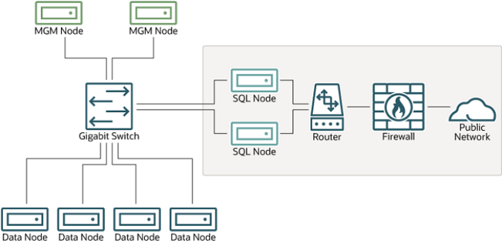

This setup has two networks, one private (solid box) for the Cluster management servers and data nodes, and one public (dotted box) where the SQL nodes reside. (We show the management and data nodes connected using a gigabit switch since this provides the best performance.) Both networks are protected from the outside by a hardware firewall, sometimes also known as a network-based firewall.

This network setup is safest because no packets can reach the cluster's management or data nodes from outside the network—and none of the cluster's internal communications can reach the outside—without going through the SQL nodes, as long as the SQL nodes do not permit any packets to be forwarded. This means, of course, that all SQL nodes must be secured against hacking attempts.

Important With regard to potential security vulnerabilities, an SQL node is no different from any other MySQL server. See Section 6.1.3, “Making MySQL Secure Against Attackers”, for a description of techniques you can use to secure MySQL servers.

2.   Using one or more software firewalls (also known as host-based firewalls) to control which packets

pass through to the cluster from portions of the network that do not require access to it. In this type NDB Cluster Security Issues of setup, a software firewall must be installed on every host in the cluster which might otherwise be accessible from outside the local network.

The host-based option is the least expensive to implement, but relies purely on software to provide protection and so is the most difficult to keep secure.

This type of network setup for NDB Cluster is illustrated here:Figure 18.9 NDB Cluster with Software Firewalls

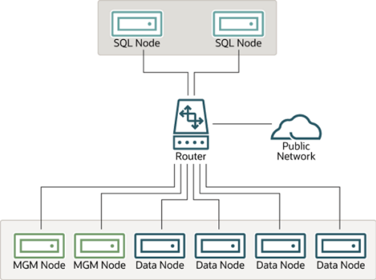

Using this type of network setup means that there are two zones of NDB Cluster hosts. Each cluster host must be able to communicate with all of the other machines in the cluster, but only those hosting SQL nodes (dotted box) can be permitted to have any contact with the outside, while those in the zone containing the data nodes and management nodes (solid box) must be isolated from any machines that are not part of the cluster. Applications using the cluster and user of those applications must not be permitted to have direct access to the management and data node hosts.

To accomplish this, you must set up software firewalls that limit the traffic to the type or types shown in the following table, according to the type of node that is running on each cluster host computer:Table 18.54 Node types in a host-based firewall cluster configuration Node Type Permitted Traffic SQL or API node • It originates from the IP address of a management or data node (using any TCP or UDP port).

- It originates from within the network in which

the cluster resides and is on the port that your application is using.

Data node or Management node • It originates from the IP address of a management or data node (using any TCP or UDP port).

NDB Cluster Security Issues Node Type Permitted Traffic

- It originates from the IP address of an SQL or

API node.

Any traffic other than that shown in the table for a given node type should be denied.

The specifics of configuring a firewall vary from firewall application to firewall application, and are beyond the scope of this Manual. `iptables` is a very common and reliable firewall application, which is often used with `APF` as a front end to make configuration easier. You can (and should) consult the documentation for the software firewall that you employ, should you choose to implement an NDB Cluster network setup of this type, or of a “mixed” type as discussed under the next item.

3.   It is also possible to employ a combination of the first two methods, using both hardware and software

to secure the cluster—that is, using both network-based and host-based firewalls. This is between the first two schemes in terms of both security level and cost. This type of network setup keeps the cluster behind the hardware firewall, but permits incoming packets to travel beyond the router connecting all cluster hosts to reach the SQL nodes.

One possible network deployment of an NDB Cluster using hardware and software firewalls in combination is shown here:Figure 18.10 NDB Cluster with a Combination of Hardware and Software Firewalls

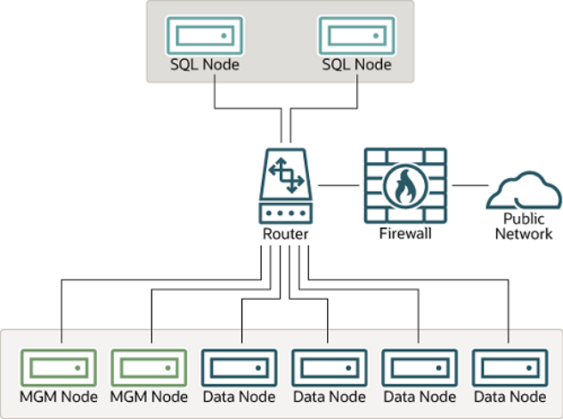

In this case, you can set the rules in the hardware firewall to deny any external traffic except to SQL nodes and API nodes, and then permit traffic to them only on the ports required by your application.

Whatever network configuration you use, remember that your objective from the viewpoint of keeping the cluster secure remains the same—to prevent any unessential traffic from reaching the cluster while ensuring the most efficient communication between the nodes in the cluster.

Because NDB Cluster requires large numbers of ports to be open for communications between nodes,the recommended option is to use a segregated network. This represents the simplest way to prevent unwanted traffic from reaching the cluster.

NDB Cluster Security Issues Note If you wish to administer an NDB Cluster remotely (that is, from outside the local network), the recommended way to do this is to use `ssh` or another secure login shell to access an SQL node host. From this host, you can then run the management client to access the management server safely, from within the cluster's own local network.

Even though it is possible to do so in theory, it is not recommended to use `ndb_mgm`to manage a Cluster directly from outside the local network on which the Cluster is running. Since neither authentication nor encryption takes place between the management client and the management server, this represents an extremely insecure means of managing the cluster, and is almost certain to be compromised sooner or later.

#### 18.6.17.2 NDB Cluster and MySQL Privileges

In this section, we discuss how the MySQL privilege system works in relation to NDB Cluster and the implications of this for keeping an NDB Cluster secure.

Standard MySQL privileges apply to NDB Cluster tables. This includes all MySQL privilege types (`SELECT`privilege, `UPDATE` privilege, `DELETE` privilege, and so on) granted on the database, table, and column level. As with any other MySQL Server, user and privilege information is stored in the `mysql` system database. The SQL statements used to grant and revoke privileges on `NDB` tables, databases containing such tables, and columns within such tables are identical in all respects with the `GRANT` and `REVOKE`statements used in connection with database objects involving any (other) MySQL storage engine. The same thing is true with respect to the `CREATE USER` and `DROP USER` statements.

It is important to keep in mind that, by default, the MySQL grant tables use the `MyISAM` storage engine.

Because of this, those tables are not normally duplicated or shared among MySQL servers acting as SQL nodes in an NDB Cluster. In other words, changes in users and their privileges do not automatically propagate between SQL nodes by default. If you wish, you can enable automatic distribution of MySQL users and privileges across NDB Cluster SQL nodes; see Section 18.6.13, “Distributed Privileges Using Shared Grant Tables”, for details.

Conversely, because there is no way in MySQL to deny privileges (privileges can either be revoked or not granted in the first place, but not denied as such), there is no special protection for `NDB` tables on one SQL node from users that have privileges on another SQL node; (This is true even if you are not using automatic distribution of user privileges. The definitive example of this is the MySQL `root` account, which can perform any action on any database object. In combination with empty `[mysqld]` or `[api]` sections of the `config.ini` file, this account can be especially dangerous. To understand why, consider the following scenario:

- The `config.ini` file contains at least one empty `[mysqld]` or `[api]` section. This means that the

NDB Cluster management server performs no checking of the host from which a MySQL Server (or other API node) accesses the NDB Cluster.

- There is no firewall, or the firewall fails to protect against access to the NDB Cluster from hosts external

to the network.

- The host name or IP address of the NDB Cluster management server is known or can be determined

from outside the network.

If these conditions are true, then anyone, anywhere can start a MySQL Server with `--ndbcluster``--ndb-connectstring=management_host` and access this NDB Cluster. Using the MySQL `root`account, this person can then perform the following actions:NDB Cluster Security Issues

- Execute metadata statements such as `SHOW DATABASES` statement (to obtain a list of all `NDB`

databases on the server) or `SHOW TABLES FROM some_ndb_database` statement to obtain a list of all `NDB` tables in a given database

- Run any legal MySQL statements on any of the discovered tables, such as:
- `SELECT * FROM some_table` to read all the data from any table
- `DELETE FROM some_table` to delete all the data from a table
- `DESCRIBE some_table` or `SHOW CREATE TABLE some_table` to determine the table schema
- `UPDATE some_table SET column1 = some_value` to fill a table column with “garbage” data; this

could actually cause much greater damage than simply deleting all the data More insidious variations might include statements like these:

```
UPDATE some_table SET an_int_column = an_int_column + 1
```

or

```
UPDATE some_table SET a_varchar_column = REVERSE(a_varchar_column)
```

Such malicious statements are limited only by the imagination of the attacker.

The only tables that would be safe from this sort of mayhem would be those tables that were created using storage engines other than `NDB`, and so not visible to a “rogue” SQL node.

A user who can log in as `root` can also access the `INFORMATION_SCHEMA` database and its tables,and so obtain information about databases, tables, stored routines, scheduled events, and any other database objects for which metadata is stored in `INFORMATION_SCHEMA`.

It is also a very good idea to use different passwords for the `root` accounts on different NDB Cluster SQL nodes unless you are using distributed privileges.

In sum, you cannot have a safe NDB Cluster if it is directly accessible from outside your local network.

Important Never leave the MySQL root account password empty. This is just as true when running MySQL as an NDB Cluster SQL node as it is when running it as a standalone (non-Cluster) MySQL Server, and should be done as part of the MySQL installation process before configuring the MySQL Server as an SQL node in an NDB Cluster.

If you wish to employ NDB Cluster's distributed privilege capabilities, you should not simply convert the system tables in the `mysql` database to use the `NDB` storage engine manually. Use the stored procedure provided for this purpose instead; see Section 18.6.13, “Distributed Privileges Using Shared Grant Tables”.

Otherwise, if you need to synchronize `mysql` system tables between SQL nodes, you can use standard MySQL replication to do so, or employ a script to copy table entries between the MySQL servers.

Summary. The most important points to remember regarding the MySQL privilege system with regard to NDB Cluster are listed here:

1. Users and privileges established on one SQL node do not automatically exist or take effect on other

SQL nodes in the cluster. Conversely, removing a user or privilege on one SQL node in the cluster does not remove the user or privilege from any other SQL nodes.

NDB Cluster Security Issues

2. You can distribute MySQL users and privileges among SQL nodes using the SQL script, and the stored

procedures it contains, that are supplied for this purpose in the NDB Cluster distribution.

3. Once a MySQL user is granted privileges on an `NDB` table from one SQL node in an NDB Cluster, that

user can “see” any data in that table regardless of the SQL node from which the data originated, even if you are not using privilege distribution.

#### 18.6.17.3 NDB Cluster and MySQL Security Procedures

In this section, we discuss MySQL standard security procedures as they apply to running NDB Cluster.

In general, any standard procedure for running MySQL securely also applies to running a MySQL Server as part of an NDB Cluster. First and foremost, you should always run a MySQL Server as the `mysql`operating system user; this is no different from running MySQL in a standard (non-Cluster) environment.

The `mysql` system account should be uniquely and clearly defined. Fortunately, this is the default behavior for a new MySQL installation. You can verify that the `mysqld` process is running as the `mysql` operating system user by using the system command such as the one shown here:

```
$> ps aux | grep mysql
root     10467  0.0  0.1   3616  1380 pts/3    S    11:53   0:00 \
/bin/sh ./mysqld_safe --ndbcluster --ndb-connectstring=localhost:1186
mysql    10512  0.2  2.5  58528 26636 pts/3    Sl   11:53   0:00 \
/usr/local/mysql/libexec/mysqld --basedir=/usr/local/mysql \
--datadir=/usr/local/mysql/var --user=mysql --ndbcluster \
--ndb-connectstring=localhost:1186 --pid-file=/usr/local/mysql/var/mothra.pid \
--log-error=/usr/local/mysql/var/mothra.err
jon      10579  0.0  0.0   2736   688 pts/0    S+   11:54   0:00 grep mysql
```

If the `mysqld` process is running as any other user than `mysql`, you should immediately shut it down and restart it as the `mysql` user. If this user does not exist on the system, the `mysql` user account should be created, and this user should be part of the `mysql` user group; in this case, you should also make sure that the MySQL data directory on this system (as set using the `--datadir` option for `mysqld`) is owned by the `mysql` user, and that the SQL node's `my.cnf` file includes `user=mysql` in the `[mysqld]` section.

Alternatively, you can start the MySQL server process with `--user=mysql` on the command line, but it is preferable to use the `my.cnf` option, since you might forget to use the command-line option and so have`mysqld` running as another user unintentionally. The `mysqld_safe` startup script forces MySQL to run as the `mysql` user.

Important Never run `mysqld` as the system root user. Doing so means that potentially any file on the system can be read by MySQL, and thus—should MySQL be compromised—by an attacker.

As mentioned in the previous section (see Section 18.6.17.2, “NDB Cluster and MySQL Privileges”), you should always set a root password for the MySQL Server as soon as you have it running. You should also delete the anonymous user account that is installed by default. You can accomplish these tasks using the following statements:

```
$> mysql -u root
mysql> UPDATE mysql.user
->     SET Password=PASSWORD('secure_password')
->     WHERE User='root';
mysql> DELETE FROM mysql.user
->     WHERE User='';
mysql> FLUSH PRIVILEGES;
```

NDB Cluster Replication Be very careful when executing the `DELETE` statement not to omit the `WHERE` clause, or you risk deleting all MySQL users. Be sure to run the `FLUSH PRIVILEGES` statement as soon as you have modified the`mysql.user` table, so that the changes take immediate effect. Without `FLUSH PRIVILEGES`, the changes do not take effect until the next time that the server is restarted.

Note Many of the NDB Cluster utilities such as `ndb_show_tables`, `ndb_desc`, and`ndb_select_all` also work without authentication and can reveal table names,schemas, and data. By default these are installed on Unix-style systems with the permissions `wxr-xr-x` (755), which means they can be executed by any user that can access the `mysql/bin` directory.

See Section 18.5, “NDB Cluster Programs”, for more information about these utilities.

## 18.7 NDB Cluster Replication

NDB Cluster supports asynchronous replication, more usually referred to simply as “replication”. This section explains how to set up and manage a configuration in which one group of computers operating as an NDB Cluster replicates to a second computer or group of computers. We assume some familiarity on the part of the reader with standard MySQL replication as discussed elsewhere in this Manual. (See Chapter 17, Replication).

Note NDB Cluster does not support replication using GTIDs; semisynchronous replication is also not supported by the `NDB` storage engine.

Normal (non-clustered) replication involves a source server (formerly called a “master”) and a replica server (formerly referred to as a “slave”), the source being so named because operations and data to be replicated originate with it, and the replica being the recipient of these. In NDB Cluster, replication is conceptually very similar but can be more complex in practice, as it may be extended to cover a number of different configurations including replicating between two complete clusters. Although an NDB Cluster itself depends on the `NDB` storage engine for clustering functionality, it is not necessary to use `NDB` as the storage engine for the replica's copies of the replicated tables (see Replication from NDB to other storage engines). However, for maximum availability, it is possible (and preferable) to replicate from one NDB Cluster to another, and it is this scenario that we discuss, as shown in the following figure:NDB Cluster Replication Figure 18.11 NDB Cluster-to-Cluster Replication Layout

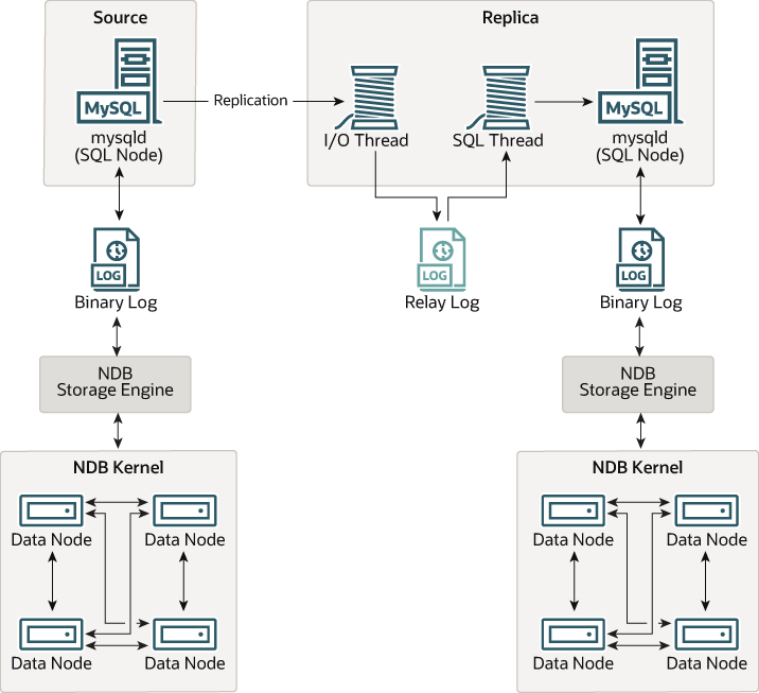

In this scenario, the replication process is one in which successive states of a source cluster are logged and saved to a replica cluster. This process is accomplished by a special thread known as the NDB binary log injector thread, which runs on each MySQL server and produces a binary log (`binlog`). This thread ensures that all changes in the cluster producing the binary log—and not just those changes that are effected through the MySQL Server—are inserted into the binary log with the correct serialization order.

We refer to the MySQL source and replica servers as replication servers or replication nodes, and the data flow or line of communication between them as a replication channel.

For information about performing point-in-time recovery with NDB Cluster and NDB Cluster Replication,see Section 18.7.9.2, “Point-In-Time Recovery Using NDB Cluster Replication”.

NDB API replica status variables. NDB API counters can provide enhanced monitoring capabilities on replica clusters. These counters are implemented as NDB statistics `_slave` status variables, as seen in the output of `SHOW STATUS`, or in the results of queries against the `SESSION_STATUS` or`GLOBAL_STATUS` table in a `mysql` client session connected to a MySQL Server that is acting as a replica in NDB Cluster Replication. By comparing the values of these status variables before and after the execution of statements affecting replicated `NDB` tables, you can observe the corresponding actions taken on the NDB API level by the replica, which can be useful when monitoring or troubleshooting NDB Cluster Replication. Section 18.6.14, “NDB API Statistics Counters and Variables”, provides additional information.

Replication from NDB to non-NDB tables. It is possible to replicate `NDB` tables from an NDB Cluster acting as the replication source to tables using other MySQL storage engines such as `InnoDB` or `MyISAM`NDB Cluster Replication: Abbreviations and Symbols on a replica `mysqld`. This is subject to a number of conditions; see Replication from NDB to other storage engines, and Replication from NDB to a nontransactional storage engine, for more information.

### 18.7.1 NDB Cluster Replication: Abbreviations and Symbols

Throughout this section, we use the following abbreviations or symbols for referring to the source and replica clusters, and to processes and commands run on the clusters or cluster nodes:Table 18.55 Abbreviations used throughout this section referring to source and replica clusters,and to processes and commands run on cluster nodes Symbol or Abbreviation Description (Refers to...)S The cluster serving as the (primary) replication source R The cluster acting as the (primary) replica`shellS>` Shell command to be issued on the source cluster`mysqlS>` MySQL client command issued on a single MySQL server running as an SQL node on the source cluster`mysqlS*>` MySQL client command to be issued on all SQL nodes participating in the replication source cluster`shellR>` Shell command to be issued on the replica cluster`mysqlR>` MySQL client command issued on a single MySQL server running as an SQL node on the replica cluster`mysqlR*>` MySQL client command to be issued on all SQL nodes participating in the replica cluster C Primary replication channel`C'` Secondary replication channel`S'` Secondary replication source`R'` Secondary replica

### 18.7.2 General Requirements for NDB Cluster Replication

A replication channel requires two MySQL servers acting as replication servers (one each for the source and replica). For example, this means that in the case of a replication setup with two replication channels(to provide an extra channel for redundancy), there should be a total of four replication nodes, two per cluster.

Replication of an NDB Cluster as described in this section and those following is dependent on row-based replication. This means that the replication source MySQL server must be running with `--binlog-``format=ROW` or `--binlog-format=MIXED`, as described in Section 18.7.6, “Starting NDB Cluster Replication (Single Replication Channel)”. For general information about row-based replication, see Section 17.1.2, “Replication Formats”.

Important If you attempt to use NDB Cluster Replication with `--binlog-``format=STATEMENT`, replication fails to work properly because the Known Issues in NDB Cluster Replication`ndb_binlog_index` table on the source cluster and the `epoch` column of the `ndb_apply_status` table on the replica cluster are not updated (see Section 18.7.4, “NDB Cluster Replication Schema and Tables”). Instead, only updates on the MySQL server acting as the replication source propagate to the replica, and no updates from any other SQL nodes in the source cluster are replicated.

The default value for the `--binlog-format` option is `MIXED`.

Each MySQL server used for replication in either cluster must be uniquely identified among all the MySQL replication servers participating in either cluster (you cannot have replication servers on both the source and replica clusters sharing the same ID). This can be done by starting each SQL node using the `--``server-id=id` option, where `id` is a unique integer. Although it is not strictly necessary, we assume for purposes of this discussion that all NDB Cluster binaries are of the same release version.

It is generally true in MySQL Replication that both MySQL servers (`mysqld` processes) involved must be compatible with one another with respect to both the version of the replication protocol used and the SQL feature sets which they support (see Section 17.4.2, “Replication Compatibility Between MySQL Versions”). It is due to such differences between the binaries in the NDB Cluster and MySQL Server 5.6 distributions that NDB Cluster Replication has the additional requirement that both `mysqld` binaries come from an NDB Cluster distribution. The simplest and easiest way to assure that the `mysqld` servers are compatible is to use the same NDB Cluster distribution for all source and replica `mysqld` binaries.

We assume that the replica server or cluster is dedicated to replication of the source cluster, and that no other data is being stored on it.

All `NDB` tables being replicated must be created using a MySQL server and client. Tables and other database objects created using the NDB API (with, for example, `Dictionary::createTable()`) are not visible to a MySQL server and so are not replicated. Updates by NDB API applications to existing tables that were created using a MySQL server can be replicated.

Note It is possible to replicate an NDB Cluster using statement-based replication.

However, in this case, the following restrictions apply:

- All updates to data rows on the cluster acting as the source must be directed to a

single MySQL server.

- It is not possible to replicate a cluster using multiple simultaneous MySQL

replication processes.

- Only changes made at the SQL level are replicated.

These are in addition to the other limitations of statement-based replication as opposed to row-based replication; see Section 17.1.2.1, “Advantages and Disadvantages of Statement-Based and Row-Based Replication”, for more specific information concerning the differences between the two replication formats.

### 18.7.3 Known Issues in NDB Cluster Replication

This section discusses known problems or issues when using replication with NDB Cluster.

Loss of connection between source and replica. A loss of connection can occur either between the source cluster SQL node and the replica cluster SQL node, or between the source SQL node and the Known Issues in NDB Cluster Replication data nodes of the source cluster. In the latter case, this can occur not only as a result of loss of physical connection (for example, a broken network cable), but due to the overflow of data node event buffers; if the SQL node is too slow to respond, it may be dropped by the cluster (this is controllable to some degree by adjusting the `MaxBufferedEpochs` and `TimeBetweenEpochs` configuration parameters). If this occurs, it is entirely possible for new data to be inserted into the source cluster without being recorded in the source SQL node's binary log. For this reason, to guarantee high availability, it is extremely important to maintain a backup replication channel, to monitor the primary channel, and to fail over to the secondary replication channel when necessary to keep the replica cluster synchronized with the source. NDB Cluster is not designed to perform such monitoring on its own; for this, an external application is required.

The source SQL node issues a “gap” event when connecting or reconnecting to the source cluster. (A gap event is a type of “incident event,” which indicates an incident that occurs that affects the contents of the database but that cannot easily be represented as a set of changes. Examples of incidents are server failures, database resynchronization, some software updates, and some hardware changes.)When the replica encounters a gap in the replication log, it stops with an error message. This message is available in the output of `SHOW SLAVE STATUS`, and indicates that the SQL thread has stopped due to an incident registered in the replication stream, and that manual intervention is required. See Section 18.7.8,“Implementing Failover with NDB Cluster Replication”, for more information about what to do in such circumstances.

Important Because NDB Cluster is not designed on its own to monitor replication status or provide failover, if high availability is a requirement for the replica server or cluster, then you must set up multiple replication lines, monitor the source `mysqld`on the primary replication line, and be prepared fail over to a secondary line if and as necessary. This must be done manually, or possibly by means of a third-party application. For information about implementing this type of setup, see Section 18.7.7, “Using Two Replication Channels for NDB Cluster Replication”, and Section 18.7.8, “Implementing Failover with NDB Cluster Replication”.

If you are replicating from a standalone MySQL server to an NDB Cluster, one channel is usually sufficient.

Circular replication. NDB Cluster Replication supports circular replication, as shown in the next example. The replication setup involves three NDB Clusters numbered 1, 2, and 3, in which Cluster 1 acts as the replication source for Cluster 2, Cluster 2 acts as the source for Cluster 3, and Cluster 3 acts as the source for Cluster 1, thus completing the circle. Each NDB Cluster has two SQL nodes, with SQL nodes A and B belonging to Cluster 1, SQL nodes C and D belonging to Cluster 2, and SQL nodes E and F belonging to Cluster 3.

Circular replication using these clusters is supported as long as the following conditions are met:

- The SQL nodes on all source and replica clusters are the same.
- All SQL nodes acting as sources and replicas are started with the `log_slave_updates` system

variable enabled.

This type of circular replication setup is shown in the following diagram:Known Issues in NDB Cluster Replication Figure 18.12 NDB Cluster Circular Replication With All Sources As Replicas

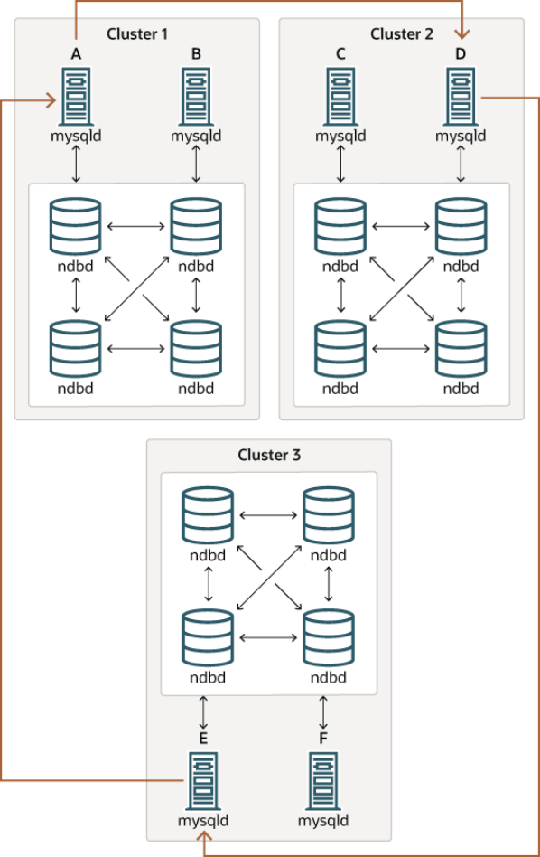

In this scenario, SQL node A in Cluster 1 replicates to SQL node C in Cluster 2; SQL node C replicates to SQL node E in Cluster 3; SQL node E replicates to SQL node A. In other words, the replication line(indicated by the curved arrows in the diagram) directly connects all SQL nodes used as sources and replicas.

It should also be possible to set up circular replication in which not all source SQL nodes are also replicas,as shown here:Known Issues in NDB Cluster Replication Figure 18.13 NDB Cluster Circular Replication Where Not All Sources Are Replicas

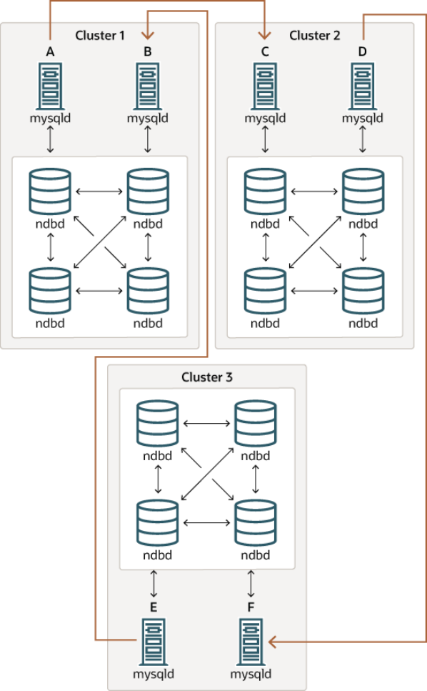

In this case, different SQL nodes in each cluster are used as sources and replicas. However, you must not start any of the SQL nodes with the `log_slave_updates` system variable enabled. This type of circular replication scheme for NDB Cluster, in which the line of replication (again indicated by the curved arrows in the diagram) is discontinuous, should be possible, but it should be noted that it has not yet been thoroughly tested and must therefore still be considered experimental.

Note The `NDB` storage engine uses idempotent execution mode, which suppresses duplicate-key and other errors that otherwise break circular replication of NDB Cluster. This is equivalent to setting the global `slave_exec_mode` system variable Known Issues in NDB Cluster Replication to `IDEMPOTENT`, although this is not necessary in NDB Cluster replication, since NDB Cluster sets this variable automatically and ignores any attempts to set it explicitly.

NDB Cluster replication and primary keys. In the event of a node failure, errors in replication of `NDB`tables without primary keys can still occur, due to the possibility of duplicate rows being inserted in such cases. For this reason, it is highly recommended that all `NDB` tables being replicated have explicit primary keys.

NDB Cluster Replication and Unique Keys. In older versions of NDB Cluster, operations that updated values of unique key columns of `NDB` tables could result in duplicate-key errors when replicated.

This issue is solved for replication between `NDB` tables by deferring unique key checks until after all table row updates have been performed.

Deferring constraints in this way is currently supported only by `NDB`. Thus, updates of unique keys when replicating from `NDB` to a different storage engine such as `InnoDB` or `MyISAM` are still not supported.

The problem encountered when replicating without deferred checking of unique key updates can be illustrated using `NDB` table such as t, is created and populated on the source (and transmitted to a replica that does not support deferred unique key updates) as shown here:

```
CREATE TABLE t (
p INT PRIMARY KEY,
c INT,
UNIQUE KEY u (c)
)   ENGINE NDB;
INSERT INTO t
VALUES (1,1), (2,2), (3,3), (4,4), (5,5);
```

The following `UPDATE` statement on t succeeds on the source, since the rows affected are processed in the order determined by the `ORDER BY` option, performed over the entire table:

```
UPDATE t SET c = c - 1 ORDER BY p;
```

The same statement fails with a duplicate key error or other constraint violation on the replica, because the ordering of the row updates is performed for one partition at a time, rather than for the table as a whole.

Note Every `NDB` table is implicitly partitioned by key when it is created. See Section 19.2.5, “KEY Partitioning”, for more information.

GTIDs not supported. Replication using global transaction IDs is not compatible with the `NDB` storage engine, and is not supported. Enabling GTIDs is likely to cause NDB Cluster Replication to fail.

Multithreaded replicas not supported. NDB Cluster does not support multithreaded replicas. This is because the replica may not be able to separate transactions occurring in one database from those in another if they are written within the same epoch. In addition, every transaction handled by the `NDB`storage engine involves at least two databases—the target database and the `mysql` system database—due to the requirement for updating the `mysql.ndb_apply_status` table (see Section 18.7.4, “NDB Cluster Replication Schema and Tables”). This in turn breaks the requirement for multithreading that the transaction is specific to a given database.

Prior to NDB 7.3.18 and NDB 7.4.17, setting any system variables relating to multithreaded slaves such as `slave_parallel_workers` and `slave_checkpoint_group` (or the equivalent `mysqld` startup options) was completely ignored, and had no effect.

Beginning with NDB 7.3.18 and NDB 7.4.17, `slave_parallel_workers` must be set to 0. If set to any other value on startup, `NDB` changes it to 0, and writes a message to the `mysqld` server log file.

Known Issues in NDB Cluster Replication Restarting with --initial. Restarting the cluster with the `--initial` option causes the sequence of GCI and epoch numbers to start over from 0. (This is generally true of NDB Cluster and not limited to replication scenarios involving Cluster.) The MySQL servers involved in replication should in this case be restarted. After this, you should use the `RESET MASTER` and `RESET SLAVE` statements to clear the invalid`ndb_binlog_index` and `ndb_apply_status` tables, respectively.

Replication from NDB to other storage engines. It is possible to replicate an `NDB` table on the source to a table using a different storage engine on the replica, taking into account the restrictions listed here:

- Multi-source and circular replication are not supported (tables on both the source and the replica must

use the `NDB` storage engine for this to work).

- Using a storage engine which does not perform binary logging for tables on the replica requires special

handling.

- Use of a nontransactional storage engine for tables on the replica also requires special handling.
- The source `mysqld` must be started with `--ndb-log-update-as-write=0` or `--ndb-log-update-`

```
as-write=OFF.
```

The next few paragraphs provide additional information about each of the issues just described.

Multiple sources not supported when replicating NDB to other storage engines. For replication from `NDB` to a different storage engine, the relationship between the two databases must be one-to-one.

This means that bidirectional or circular replication is not supported between NDB Cluster and other storage engines.

In addition, it is not possible to configure more than one replication channel when replicating between `NDB`and a different storage engine. (An NDB Cluster database can simultaneously replicate to multiple NDB Cluster databases.) If the source uses `NDB` tables, it is still possible to have more than one MySQL Server maintain a binary log of all changes, but for the replica to change sources (fail over), the new source-replica relationship must be explicitly defined on the replica.

Replicating NDB tables to a storage engine that does not perform binary logging. If you attempt to replicate from an NDB Cluster to a replica that uses a storage engine that does not handle its own binary logging, the replication process aborts with the error `Binary logging not possible ...`

```
Statement cannot be written atomically since more than one engine involved and
```

`at least one engine is self-logging` (Error 1595). It is possible to work around this issue in one of the following ways:

- Turn off binary logging on the replica. This can be accomplished by setting `sql_log_bin = 0`.
- Change the storage engine used for the mysql.ndb_apply_status table. Causing this table to use

an engine that does not handle its own binary logging can also eliminate the conflict. This can be done by issuing a statement such as `ALTER TABLE mysql.ndb_apply_status ENGINE=MyISAM` on the replica. It is safe to do this when using a storage engine other than `NDB` on the replica, since you do not need to worry about keeping multiple replicas synchronized.

- Filter out changes to the mysql.ndb_apply_status table on the replica. This can be done by

starting the replica with `--replicate-ignore-table=mysql.ndb_apply_status`. If you need for other tables to be ignored by replication, you might wish to use an appropriate `--replicate-wild-``ignore-table` option instead.

Important You should not disable replication or binary logging of`mysql.ndb_apply_status` or change the storage engine used for this table Known Issues in NDB Cluster Replication when replicating from one NDB Cluster to another. See Replication and binary log filtering rules with replication between NDB Clusters, for details.

Replication from NDB to a nontransactional storage engine. When replicating from `NDB` to a nontransactional storage engine such as `MyISAM`, you may encounter unnecessary duplicate key errors when replicating `INSERT ... ON DUPLICATE KEY UPDATE` statements. You can suppress these by using `--ndb-log-update-as-write=0`, which forces updates to be logged as writes, rather than as updates.

Replication and binary log filtering rules with replication between NDB Clusters. If you are using any of the options `--replicate-do-*`, `--replicate-ignore-*`, `--binlog-do-db`, or `--binlog-``ignore-db` to filter databases or tables being replicated, you must take care not to block replication or binary logging of the `mysql.ndb_apply_status`, which is required for replication between NDB Clusters to operate properly. In particular, you must keep in mind the following:

1. Using `--replicate-do-db=db_name` (and no other `--replicate-do-*` or `--replicate-`

`ignore-*` options) means that only tables in database `db_name` are replicated. In this case, you should also use `--replicate-do-db=mysql`, `--binlog-do-db=mysql`, or `--replicate-do-``table=mysql.ndb_apply_status` to ensure that `mysql.ndb_apply_status` is populated on replicas.

Using `--binlog-do-db=db_name` (and no other `--binlog-do-db` options) means that changes only to tables in database `db_name` are written to the binary log. In this case, you should

```
also use --replicate-do-db=mysql, --binlog-do-db=mysql, or --replicate-do-
```

`table=mysql.ndb_apply_status` to ensure that `mysql.ndb_apply_status` is populated on replicas.

2. Using `--replicate-ignore-db=mysql` means that no tables in the `mysql` database are replicated.

In this case, you should also use `--replicate-do-table=mysql.ndb_apply_status` to ensure that `mysql.ndb_apply_status` is replicated.

Using `--binlog-ignore-db=mysql` means that no changes to tables in the `mysql`database are written to the binary log. In this case, you should also use `--replicate-do-``table=mysql.ndb_apply_status` to ensure that `mysql.ndb_apply_status` is replicated.

You should also remember that each replication rule requires the following:

1. Its own `--replicate-do-*` or `--replicate-ignore-*` option, and that multiple rules cannot be

expressed in a single replication filtering option. For information about these rules, see Section 17.1.4,“Replication and Binary Logging Options and Variables”.

2. Its own `--binlog-do-db` or `--binlog-ignore-db` option, and that multiple rules cannot be

expressed in a single binary log filtering option. For information about these rules, see Section 5.4.4,“The Binary Log”.

If you are replicating an NDB Cluster to a replica that uses a storage engine other than `NDB`, the considerations just given previously may not apply, as discussed elsewhere in this section.

NDB Cluster Replication and IPv6. While the NDB API and MGM API (and thus data nodes and management nodes) do not support IPv6 in NDB 7.3 and 7.4, MySQL Servers—including those acting as SQL nodes in an NDB Cluster—can use IPv6 to contact other MySQL Servers. This means that you can replicate between NDB Clusters using IPv6 to connect the source and replica SQL nodes as shown by the dotted arrow in the following diagram:NDB Cluster Replication Schema and Tables Figure 18.14 Replication Between SQL Nodes Connected Using IPv6

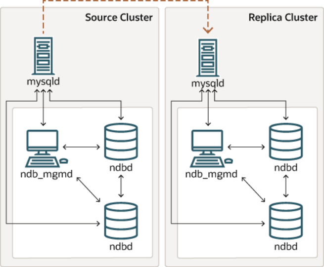

All connections originating within the NDB Cluster —represented in the preceding diagram by solid arrows—must use IPv4. In other words, all NDB Cluster data nodes, management servers, and management clients must be accessible from one another using IPv4. In addition, SQL nodes must use IPv4 to communicate with the cluster.

Since there is currently no support in the NDB and MGM APIs for IPv6, any applications written using these APIs must also make all connections using IPv4.

Attribute promotion and demotion. NDB Cluster Replication includes support for attribute promotion and demotion. The implementation of the latter distinguishes between lossy and non-lossy type conversions, and their use on the replica can be controlled by setting the `slave_type_conversions`global server system variable.

For more information about attribute promotion and demotion in NDB Cluster, see Row-based replication:attribute promotion and demotion.

### 18.7.4 NDB Cluster Replication Schema and Tables

- ndb_apply_status Table
- ndb_binlog_index Table
- ndb_replication Table

Replication in NDB Cluster makes use of a number of dedicated tables in the `mysql` database on each MySQL Server instance acting as an SQL node in both the cluster being replicated and in the replica. This is true regardless of whether the replica is a single server or a cluster.

The `ndb_binlog_index` and `ndb_apply_status` tables are created in the `mysql` database. They should not be explicitly replicated by the user. User intervention is normally not required to create or NDB Cluster Replication Schema and Tables maintain either of these tables, since both are maintained by the `NDB` binary log (binlog) injector thread.

This keeps the source `mysqld` process updated to changes performed by the `NDB` storage engine. The`NDB` binlog injector thread receives events directly from the `NDB` storage engine. The `NDB` injector is responsible for capturing all the data events within the cluster, and ensures that all events which change,insert, or delete data are recorded in the `ndb_binlog_index` table. The replica I/O thread transfers the events from the source's binary log to the replica's relay log.

The `ndb_replication` table must be created manually. This table can be updated by the user to perform filtering by database or table. See ndb_replication Table, for more information. `ndb_replication` is also used in NDB Replication conflict detection and resolution for conflict resolution control; see Conflict Resolution Control.

Even though `ndb_binlog_index` and `ndb_apply_status` are created and maintained automatically,it is advisable to check for the existence and integrity of these tables as an initial step in preparing an NDB Cluster for replication. It is possible to view event data recorded in the binary log by querying the`mysql.ndb_binlog_index` table directly on the source. This can be also be accomplished using the`SHOW BINLOG EVENTS` statement on either the source or replica SQL node. (See Section 13.7.5.3,“SHOW BINLOG EVENTS Statement”.)You can also obtain useful information from the output of `SHOW ENGINE NDB STATUS`.

Note When performing schema changes on `NDB` tables, applications should wait until the`ALTER TABLE` statement has returned in the MySQL client connection that issued the statement before attempting to use the updated definition of the table.

> ndb_apply_status Table

`ndb_apply_status` is used to keep a record of the operations that have been replicated from the source to the replica. If the `ndb_apply_status` table does not exist on the replica, `ndb_restore` re-creates it.

Unlike the case with `ndb_binlog_index`, the data in this table is not specific to any one SQL node in the(replica) cluster, and so `ndb_apply_status` can use the `NDBCLUSTER` storage engine, as shown here:

```
CREATE TABLE `ndb_apply_status` (
`server_id`   INT(10) UNSIGNED NOT NULL,
`epoch`       BIGINT(20) UNSIGNED NOT NULL,
`log_name`    VARCHAR(255) CHARACTER SET latin1 COLLATE latin1_bin NOT NULL,
`start_pos`   BIGINT(20) UNSIGNED NOT NULL,
`end_pos`     BIGINT(20) UNSIGNED NOT NULL,
PRIMARY KEY (`server_id`) USING HASH
) ENGINE=NDBCLUSTER   DEFAULT CHARSET=latin1;
```

The `ndb_apply_status` table is populated only on replicas, which means that, on the source, this table never contains any rows; thus, there is no need to allot any `DataMemory` to `ndb_apply_status` there.

Because this table is populated from data originating on the source, it should be allowed to replicate;

any replication filtering or binary log filtering rules that inadvertently prevent the replica from updating`ndb_apply_status`, or that prevent the source from writing into the binary log may prevent replication between clusters from operating properly. For more information about potential problems arising from such filtering rules, see Replication and binary log filtering rules with replication between NDB Clusters.

0 in the `epoch` column of this table indicates a transaction originating from a storage engine other than

```
NDB.
```

> ndb_binlog_index Table

NDB Cluster Replication Schema and Tables NDB Cluster Replication uses the `ndb_binlog_index` table for storing the binary log's indexing data.

Since this table is local to each MySQL server and does not participate in clustering, it uses the `InnoDB`storage engine. This means that it must be created separately on each `mysqld` participating in the source cluster. (The binary log itself contains updates from all MySQL servers in the cluster.) This table is defined as follows:

```
CREATE TABLE `ndb_binlog_index` (
`Position` BIGINT(20) UNSIGNED NOT NULL,
`File` VARCHAR(255) NOT NULL,
`epoch` BIGINT(20) UNSIGNED NOT NULL,
`inserts` INT(10) UNSIGNED NOT NULL,
`updates` INT(10) UNSIGNED NOT NULL,
`deletes` INT(10) UNSIGNED NOT NULL,
`schemaops` INT(10) UNSIGNED NOT NULL,
`orig_server_id` INT(10) UNSIGNED NOT NULL,
`orig_epoch` BIGINT(20) UNSIGNED NOT NULL,
`gci` INT(10) UNSIGNED NOT NULL,
`next_position` bigint(20) unsigned NOT NULL,
`next_file` varchar(255) NOT NULL,
PRIMARY KEY (`epoch`,`orig_server_id`,`orig_epoch`)
) ENGINE=InnoDB DEFAULT CHARSET=latin1;
```

Note Prior to NDB 7.5.2, this table always used the `MyISAM` storage engine. If you are upgrading from an earlier release, you can use `mysql_upgrade` with the `--force`and `--upgrade-system-tables` options after starting the server.) The system table upgrade causes an `ALTER TABLE ... ENGINE=INNODB` statement to be executed for this table. Use of the `MyISAM` storage engine for this table continues to be supported for backward compatibility.

`ndb_binlog_index` may require additional disk space after being converted to`InnoDB`. If this becomes an issue, you may be able to conserve space by using an `InnoDB` tablespace for this table, changing its `ROW_FORMAT` to `COMPRESSED`,or both. For more information, see Section 13.1.18, “CREATE TABLESPACE Statement”, and Section 13.1.17, “CREATE TABLE Statement”, as well as Section 14.6.3, “Tablespaces”.

The size of the `ndb_binlog_index` table is dependent on the number of epochs per binary log file and the number of binary log files. The number of epochs per binary log file normally depends on the amount of binary log generated per epoch and the size of the binary log file, with smaller epochs resulting in more epochs per file. You should be aware that empty epochs produce inserts to the `ndb_binlog_index` table,even when the `--ndb-log-empty-epochs` option is `OFF`, meaning that the number of entries per file depends on the length of time that the file is in use; this relationship can be represented by the formula shown here:

```
[number of epochs per file] = [time spent per file] / TimeBetweenEpochs
```

A busy NDB Cluster writes to the binary log regularly and presumably rotates binary log files more quickly than a quiet one. This means that a “quiet” NDB Cluster with `--ndb-log-empty-epochs=ON` can actually have a much higher number of `ndb_binlog_index` rows per file than one with a great deal of activity.

When `mysqld` is started with the `--ndb-log-orig` option, the `orig_server_id` and `orig_epoch`columns store, respectively, the ID of the server on which the event originated and the epoch in which the event took place on the originating server, which is useful in NDB Cluster replication setups employing multiple sources. The `SELECT` statement used to find the closest binary log position to the highest applied epoch on the replica in a multi-source setup (see Section 18.7.10, “NDB Cluster Replication:Bidirectional and Circular Replication”) employs these two columns, which are not indexed. This can lead NDB Cluster Replication Schema and Tables to performance issues when trying to fail over, since the query must perform a table scan, especially when the source has been running with `--ndb-log-empty-epochs=ON`. You can improve multi-source failover times by adding an index to these columns, as shown here:

```
ALTER TABLE mysql.ndb_binlog_index
ADD INDEX orig_lookup USING BTREE (orig_server_id, orig_epoch);
```

Adding this index provides no benefit when replicating from a single source to a single replica, since the query used to get the binary log position in such cases makes no use of `orig_server_id` or

```
orig_epoch.
```

See Section 18.7.8, “Implementing Failover with NDB Cluster Replication”, for more information about using the `next_position` and `next_file` columns.

The following figure shows the relationship of the NDB Cluster replication source server, its binary log injector thread, and the `mysql.ndb_binlog_index` table.

> Figure 18.15 The Replication Source Cluster

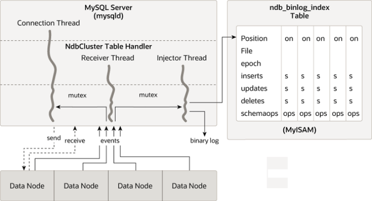

> ndb_replication Table

The `ndb_replication` table is used to control binary logging and conflict resolution, and acts on a per-table basis. Each row in this table corresponds to a table being replicated, determines how to log changes to the table and, if a conflict resolution function is specified, and determines how to resolve conflicts for that table.

Unlike the `ndb_apply_status` and `ndb_replication` tables, the `ndb_replication` table must be created manually, using the SQL statement shown here:

```
CREATE TABLE mysql.ndb_replication  (
db VARBINARY(63),
table_name VARBINARY(63),
server_id INT UNSIGNED,
binlog_type INT UNSIGNED,
conflict_fn VARBINARY(128),
PRIMARY KEY USING HASH (db, table_name, server_id)
)   ENGINE=NDB
PARTITION BY KEY(db,table_name);
```

The columns of this table are listed here, with descriptions:NDB Cluster Replication Schema and Tables

- `db` column

The name of the database containing the table to be replicated.

You may employ either or both of the wildcards _ and % as part of the database name. (See Matching with wildcards, later in this section.)

- `table_name` column

The name of the table to be replicated.

The table name may include either or both of the wildcards _ and %. See Matching with wildcards, later in this section.

- `server_id` column

The unique server ID of the MySQL instance (SQL node) where the table resides.

0 in this column acts like a wildcard equivalent to %, and matches any server ID. (See Matching with wildcards, later in this section.)

- `binlog_type` column

The type of binary logging to be employed. See text for values and descriptions.

- `conflict_fn` column

The conflict resolution function to be applied; one of NDB$OLD(), NDB$MAX(), NDB$MAX_DELETE_WIN(), NDB$EPOCH(), NDB$EPOCH_TRANS(), NDB$EPOCH2(), NDB$EPOCH2_TRANS(); `NULL` indicates that conflict resolution is not used for this table.

See Conflict Resolution Functions, for more information about these functions and their uses in NDB Replication conflict resolution.

Some conflict resolution functions (`NDB$OLD()`, `NDB$EPOCH()`, `NDB$EPOCH_TRANS()`) require the use of one or more user-created exceptions tables. See Conflict Resolution Exceptions Table.

To enable conflict resolution with NDB Replication, it is necessary to create and populate this table with control information on the SQL node or nodes on which the conflict should be resolved. Depending on the conflict resolution type and method to be employed, this may be the source, the replica, or both servers.

In a simple source-replica setup where data can also be changed locally on the replica this is typically the replica. In a more complex replication scheme, such as bidirectional replication, this is usually all of the sources involved. See Section 18.7.11, “NDB Cluster Replication Conflict Resolution”, for more information.

The `ndb_replication` table allows table-level control over binary logging outside the scope of conflict resolution, in which case `conflict_fn` is specified as `NULL`, while the remaining column values are used to control binary logging for a given table or set of tables matching a wildcard expression. By setting the proper value for the `binlog_type` column, you can make logging for a given table or tables use a desired binary log format, or disabling binary logging altogether. Possible values for this column, with values and descriptions, are shown in the following table:Table 18.56 binlog_type values, with values and descriptions Value Description 0 Use server default NDB Cluster Replication Schema and Tables Value Description 1 Do not log this table in the binary log (same effect as`sql_log_bin = 0`, but applies to one or more specified tables only)2 Log updated attributes only; log these as `WRITE_ROW`events 3 Log full row, even if not updated (MySQL server default behavior)6 Use updated attributes, even if values are unchanged 7 Log full row, even if no values are changed; log updates as `UPDATE_ROW` events 8 Log update as `UPDATE_ROW`; log only primary key columns in before image, and only updated columns in after image (same effect as `--ndb-log-update-``minimal`, but applies to one or more specified tables only)9 Log update as `UPDATE_ROW`; log only primary key columns in before image, and all columns other than primary key columns in after image Note`binlog_type` values 4 and 5 are not used, and so are omitted from the table just shown, as well as from the next table.

Several `binlog_type` values are equivalent to various combinations of the `mysqld` logging options `--`

```
ndb-log-updated-only, --ndb-log-update-as-write, and --ndb-log-update-minimal, as
```

shown in the following table:Table 18.57 binlog_type values with equivalent combinations of NDB logging options

```
Value  --ndb-log-updated-only --ndb-log-update-as-  --ndb-log-update-
```

Value `write` Value `minimal` Value 0 -- -- --1 -- -- --2 ON ON OFF 3 OFF ON OFF 6 ON OFF OFF 7 OFF OFF OFF 8 ON OFF ON 9 OFF OFF ON Binary logging can be set to different formats for different tables by inserting rows into the`ndb_replication` table using the appropriate `db`, `table_name`, and `binlog_type` column values. The internal integer value shown in the preceding table should be used when setting the binary logging format.

The following two statements set binary logging to logging of full rows ( value 3) for table `test.a`, and to logging of updates only ( value 2) for table `test.b`:

```
# Table test.a: Log full rows
INSERT INTO mysql.ndb_replication VALUES("test", "a", 0, 3, NULL);
```

NDB Cluster Replication Schema and Tables

```
# Table test.b: log updates only
INSERT INTO mysql.ndb_replication VALUES("test", "b", 0, 2, NULL);
```

To disable logging for one or more tables, use 1 for `binlog_type`, as shown here:

```
# Disable binary logging for table test.t1
INSERT INTO mysql.ndb_replication VALUES("test", "t1", 0, 1, NULL);
# Disable binary logging for any table in 'test' whose name begins with 't'
INSERT INTO mysql.ndb_replication VALUES("test", "t%", 0, 1, NULL);
```

Disabling logging for a given table is the equivalent of setting `sql_log_bin = 0`, except that it applies to one or more tables individually. If an SQL node is not performing binary logging for a given table, it is not sent the row change events for those tables. This means that it is not receiving all changes and discarding some, but rather it is not subscribing to these changes.

Disabling logging can be useful for a number of reasons, including those listed here:

- Not sending changes across the network generally saves bandwidth, buffering, and CPU resources.
- Not logging changes to tables with very frequent updates but whose value is not great is a good fit for

transient data (such as session data) that may be relatively unimportant in the event of a complete failure of the cluster.

- Using a session variable (or `sql_log_bin`) and application code, it is also possible to log (or not to log)

certain SQL statements or types of SQL statements; for example, it may be desirable in some cases not to record DDL statements on one or more tables.

- Splitting replication streams into two (or more) binary logs can be done for reasons of performance, a

need to replicate different databases to different places, use of different binary logging types for different databases, and so on.

Matching with wildcards. In order not to make it necessary to insert a row in the `ndb_replication`table for each and every combination of database, table, and SQL node in your replication setup, `NDB`supports wildcard matching on the this table's `db`, `table_name`, and `server_id` columns. Database and table names used in, respectively, `db` and `table_name` may contain either or both of the following wildcards:

- _ (underscore character): matches zero or more characters
- % (percent sign): matches a single character

(These are the same wildcards as supported by the MySQL `LIKE` operator.)The `server_id` column supports 0 as a wildcard equivalent to _ (matches anything). This is used in the examples shown previously.

A given row in the `ndb_replication` table can use wildcards to match any of the database name, table name, and server ID in any combination. Where there are multiple potential matches in the table, the best match is chosen, according to the table shown here, where W represents a wildcard match, E an exact match, and the greater the value in the Quality column, the better the match:Table 18.58 Weights of different combinations of wildcard and exact matches on columns in the mysql.ndb_replication table

```
db  table_name  server_id  Quality
```

W W W 1 Preparing the NDB Cluster for Replication

```
db  table_name  server_id  Quality
```

W W E 2 W E W 3 W E E 4 E W W 5 E W E 6 E E W 7 E E E 8 Thus, an exact match on database name, table name, and server ID is considered best (strongest), while the weakest (worst) match is a wildcard match on all three columns. Only the strength of the match is considered when choosing which rule to apply; the order in which the rows occur in the table has no effect on this determination.

Logging Full or Partial Rows. There are two basic methods of logging rows, as determined by the setting of the `--ndb-log-updated-only` option for `mysqld`:

- Log complete rows (option set to `ON`)
- Log only column data that has been updated—that is, column data whose value has been set,

regardless of whether or not this value was actually changed. This is the default behavior (option set to`OFF`).

It is usually sufficient—and more efficient—to log updated columns only; however, if you need to log full rows, you can do so by setting `--ndb-log-updated-only` to 0 or `OFF`.

Logging Changed Data as Updates. The setting of the MySQL Server's `--ndb-log-update-as-``write` option determines whether logging is performed with or without the “before” image.

Because conflict resolution for updates and delete operations is done in the MySQL Server's update handler, it is necessary to control the logging performed by the replication source such that updates are updates and not writes; that is, such that updates are treated as changes in existing rows rather than the writing of new rows, even though these replace existing rows.

This option is turned on by default; in other words, updates are treated as writes. That is, updates are by default written as `write_row` events in the binary log, rather than as `update_row` events.

To disable the option, start the source `mysqld` with `--ndb-log-update-as-write=0` or `--ndb-``log-update-as-write=OFF`. You must do this when replicating from NDB tables to tables using a different storage engine; see Replication from NDB to other storage engines, and Replication from NDB to a nontransactional storage engine, for more information.

### 18.7.5 Preparing the NDB Cluster for Replication

Preparing the NDB Cluster for replication consists of the following steps:

1. Check all MySQL servers for version compatibility (see Section 18.7.2, “General Requirements for NDB

Cluster Replication”).

2. Create a replication account on the source Cluster with the appropriate privileges, using the following

SQL statement:

```
mysqlM> GRANT REPLICATION SLAVE
-> ON *.* TO 'replica_user'@'replica_host'
```

Preparing the NDB Cluster for Replication

```
-> IDENTIFIED BY 'replica_password';
```

In the previous statement, `replica_user` is the replication account user name, `replica_host` is the host name or IP address of the replica, and `replica_password` is the password to assign to this account.

For example, to create a replica user account with the name `myreplica`, logging in from the host named `replica-host`, and using the password `53cr37`, use the following `GRANT` statement:

```
mysqlM> GRANT REPLICATION SLAVE
-> ON *.* TO 'myreplica'@'replica-host'
-> IDENTIFIED BY '53cr37';
```

For security reasons, it is preferable to use a unique user account—not employed for any other purpose—for the replication account.

3.  Set up the replica to use the source. Using the `mysql` client, this can be accomplished with the

following `CHANGE MASTER TO` statement:

```
mysqlR> CHANGE MASTER TO
-> MASTER_HOST='source_host',
-> MASTER_PORT=source_port,
-> MASTER_USER='replica_user',
-> MASTER_PASSWORD='replica_password';
```

In the previous statement, `source_host` is the host name or IP address of the replication source,`source_port` is the port for the replica to use when connecting to the source, `replica_user` is the user name set up for the replica on the source, and `replica_password` is the password set for that user account in the previous step.

For example, to tell the replica to use the MySQL server whose host name is `rep-source` with the replication account created in the previous step, use the following statement:

```
mysqlR> CHANGE MASTER TO
-> MASTER_HOST='rep-source',
-> MASTER_PORT=3306,
-> MASTER_USER='myreplica',
-> MASTER_PASSWORD='53cr37';
```

For a complete list of options that can be used with this statement, see Section 13.4.2.1, “CHANGE MASTER TO Statement”.

To provide replication backup capability, you also need to add an `--ndb-connectstring` option to the replica's `my.cnf` file prior to starting the replication process. See Section 18.7.9, “NDB Cluster Backups With NDB Cluster Replication”, for details.

For additional options that can be set in `my.cnf` for replicas, see Section 17.1.4, “Replication and Binary Logging Options and Variables”.

4. If the source cluster is already in use, you can create a backup of the source and load this onto the

replica to cut down on the amount of time required for the replica to synchronize itself with the source.

If the replica is also running NDB Cluster, this can be accomplished using the backup and restore procedure described in Section 18.7.9, “NDB Cluster Backups With NDB Cluster Replication”.

```
ndb-connectstring=management_host[:port]
```

In the event that you are not using NDB Cluster on the replica, you can create a backup with this command on the source:

```
shellS> mysqldump --master-data=1
```

Starting NDB Cluster Replication (Single Replication Channel)Then import the resulting data dump onto the replica by copying the dump file over to it. After this, you can use the `mysql` client to import the data from the dumpfile into the replica database as shown here,where `dump_file` is the name of the file that was generated using `mysqldump` on the source, and`db_name` is the name of the database to be replicated:

```
shellR> mysql -u root -p db_name < dump_file
```

For a complete list of options to use with `mysqldump`, see Section 4.5.4, “mysqldump — A Database Backup Program”.

Note If you copy the data to the replica in this fashion, you should make sure that the replica is started with the `--skip-slave-start` option on the command line, or else include `skip-slave-start` in the replica's `my.cnf` file to keep it from trying to connect to the source to begin replicating before all the data has been loaded. Once the data loading has completed, follow the additional steps outlined in the next two sections.

5. Ensure that each MySQL server acting as a replication source is assigned a unique server ID, and has

binary logging enabled, using the row-based format. (See Section 17.1.2, “Replication Formats”.) In addition, we recommend enabling the `slave_allow_batching` system variable. You should also consider increasing the values used with the `--ndb-batch-size` and `--ndb-blob-write-batch-``bytes` options as well. All of these options can be set either in the source server's `my.cnf` file, or on the command line when starting the source `mysqld` process. See Section 18.7.6, “Starting NDB Cluster Replication (Single Replication Channel)”, for more information.

### 18.7.6 Starting NDB Cluster Replication (Single Replication Channel)

This section outlines the procedure for starting NDB Cluster replication using a single replication channel.

1. Start the MySQL replication source server by issuing this command, where `id` is this server's unique ID

(see Section 18.7.2, “General Requirements for NDB Cluster Replication”):

```
shellS> mysqld --ndbcluster --server-id=id \
--log-bin --ndb-log-bin &
```

This starts the server's `mysqld` process with binary logging enabled using the proper logging format.

Note You can also start the source with `--binlog-format=MIXED`, in which case row-based replication is used automatically when replicating between clusters.

Statement-based binary logging is not supported for NDB Cluster Replication(see Section 18.7.2, “General Requirements for NDB Cluster Replication”).

2. Start the MySQL replica server as shown here:

```
shellR> mysqld --ndbcluster --server-id=id &
```

In the command just shown, `id` is the replica server's unique ID. It is not necessary to enable logging on the replica.

Note You should use the `--skip-slave-start` option with this command or else you should include `skip-slave-start` in the replica server's `my.cnf` file,Starting NDB Cluster Replication (Single Replication Channel)unless you want replication to begin immediately. With the use of this option, the start of replication is delayed until the appropriate `START SLAVE` statement has been issued, as explained in Step 4 below.

3. It is necessary to synchronize the replica server with the source server's replication binary log. If binary

logging has not previously been running on the source, run the following statement on the replica:

```
mysqlR> CHANGE MASTER TO
-> MASTER_LOG_FILE='',
-> MASTER_LOG_POS=4;
```

This instructs the replica to begin reading the source server's binary log from the log's starting point.

Otherwise—that is, if you are loading data from the source using a backup—see Section 18.7.8,“Implementing Failover with NDB Cluster Replication”, for information on how to obtain the correct values to use for `MASTER_LOG_FILE` and `MASTER_LOG_POS` in such cases.

4. Finally, instruct the replica to begin applying replication by issuing this command from the `mysql` client

on the replica:

```
mysqlR> START SLAVE;
```

This also initiates the transmission of data and changes from the source to the replica.

It is also possible to use two replication channels, in a manner similar to the procedure described in the next section; the differences between this and using a single replication channel are covered in Section 18.7.7, “Using Two Replication Channels for NDB Cluster Replication”.

It is also possible to improve cluster replication performance by enabling batched updates. This can be accomplished by setting the `slave_allow_batching` system variable on the replicas' `mysqld`processes. Normally, updates are applied as soon as they are received. However, the use of batching causes updates to be applied in batches of 32 KB each; this can result in higher throughput and less CPU usage, particularly where individual updates are relatively small.

Note Batching works on a per-epoch basis; updates belonging to more than one transaction can be sent as part of the same batch.

All outstanding updates are applied when the end of an epoch is reached, even if the updates total less than 32 KB.

Batching can be turned on and off at runtime. To activate it at runtime, you can use either of these two statements:

```
SET GLOBAL slave_allow_batching = 1;
SET GLOBAL slave_allow_batching = ON;
```

If a particular batch causes problems (such as a statement whose effects do not appear to be replicated correctly), batching can be deactivated using either of the following statements:

```
SET GLOBAL slave_allow_batching = 0;
SET GLOBAL slave_allow_batching = OFF;
```

You can check whether batching is currently being used by means of an appropriate `SHOW VARIABLES`statement, like this one:

```
mysql> SHOW VARIABLES LIKE 'slave%';
+---------------------------+-------+
| Variable_name             | Value |
+---------------------------+-------+
```

Using Two Replication Channels for NDB Cluster Replication

```
| slave_allow_batching      | ON    |
| slave_compressed_protocol | OFF   |
| slave_load_tmpdir         | /tmp  |
| slave_net_timeout         | 3600  |
| slave_skip_errors         | OFF   |
| slave_transaction_retries | 10    |
+---------------------------+-------+
6 rows in set (0.00 sec)
```

### 18.7.7 Using Two Replication Channels for NDB Cluster Replication

In a more complete example scenario, we envision two replication channels to provide redundancy and thereby guard against possible failure of a single replication channel. This requires a total of four replication servers, two source servers on the source cluster and two replica servers on the replica cluster. For purposes of the discussion that follows, we assume that unique identifiers are assigned as shown here:Table 18.59 NDB Cluster replication servers described in the text Server ID Description 1 Source - primary replication channel (S)2 Source - secondary replication channel (S')3 Replica - primary replication channel (R)4 replica - secondary replication channel (R')Setting up replication with two channels is not radically different from setting up a single replication channel. First, the `mysqld` processes for the primary and secondary replication source servers must be started, followed by those for the primary and secondary replicas. The replication processes can be initiated by issuing the `START SLAVE` statement on each of the replicas. The commands and the order in which they need to be issued are shown here:

1. Start the primary replication source:

```
shellS> mysqld --ndbcluster --server-id=1 \
--log-bin &
```

2. Start the secondary replication source:

```
shellS'> mysqld --ndbcluster --server-id=2 \
--log-bin &
```

3. Start the primary replica server:

```
shellR> mysqld --ndbcluster --server-id=3 \
--skip-slave-start &
```

4. Start the secondary replica server:

```
shellR'> mysqld --ndbcluster --server-id=4 \
--skip-slave-start &
```

5. Finally, initiate replication on the primary channel by executing the `START SLAVE` statement on the

primary replica as shown here:

```
mysqlR> START SLAVE;
```

Warning Only the primary channel must be started at this point. The secondary replication channel needs to be started only in the event that the primary Implementing Failover with NDB Cluster Replication replication channel fails, as described in Section 18.7.8, “Implementing Failover with NDB Cluster Replication”. Running multiple replication channels simultaneously can result in unwanted duplicate records being created on the replicas.

As mentioned previously, it is not necessary to enable binary logging on the replicas.

### 18.7.8 Implementing Failover with NDB Cluster Replication

In the event that the primary Cluster replication process fails, it is possible to switch over to the secondary replication channel. The following procedure describes the steps required to accomplish this.

1.   Obtain the time of the most recent global checkpoint (GCP). That is, you need to determine the most

recent epoch from the `ndb_apply_status` table on the replica cluster, which can be found using the following query:

```
mysqlR'> SELECT @latest:=MAX(epoch)
->        FROM mysql.ndb_apply_status;
```

In a circular replication topology, with a source and a replica running on each host, when you are using`ndb_log_apply_status=1`, NDB Cluster epochs are written in the replicas' binary logs. This means that the `ndb_apply_status` table contains information for the replica on this host as well as for any other host which acts as a replica of the replication source server running on this host.

In this case, you need to determine the latest epoch on this replica to the exclusion of any epochs from any other replicas in this replica's binary log that were not listed in the `IGNORE_SERVER_IDS`options of the `CHANGE MASTER TO` statement used to set up this replica. The reason for excluding such epochs is that rows in the `mysql.ndb_apply_status` table whose server IDs have a match in the `IGNORE_SERVER_IDS` list from the `CHANGE MASTER TO` statement used to prepare this replicas's source are also considered to be from local servers, in addition to those having the replica's own server ID. You can retrieve this list as `Replicate_Ignore_Server_Ids` from the output of `SHOW SLAVE``STATUS`. We assume that you have obtained this list and are substituting it for `ignore_server_ids`in the query shown here, which like the previous version of the query, selects the greatest epoch into a variable named `@latest`:

```
mysqlR'> SELECT @latest:=MAX(epoch)
->        FROM mysql.ndb_apply_status
->        WHERE server_id NOT IN (ignore_server_ids);
```

In some cases, it may be simpler or more efficient (or both) to use a list of the server IDs to be included and `server_id IN server_id_list` in the `WHERE` condition of the preceding query.

2.  Using the information obtained from the query shown in Step 1, obtain the corresponding records from

the `ndb_binlog_index` table on the source cluster.

You can use the following query to obtain the needed records from the `ndb_binlog_index` table on the source:

```
mysqlS'> SELECT
->     @file:=SUBSTRING_INDEX(next_file, '/', -1),
->     @pos:=next_position
-> FROM mysql.ndb_binlog_index
-> WHERE epoch = @latest;
```

These are the records saved on the source since the failure of the primary replication channel. We have employed a user variable `@latest` here to represent the value obtained in Step 1. Of course, it is not possible for one `mysqld` instance to access user variables set on another server instance directly.

These values must be “plugged in” to the second query manually or by an application.

NDB Cluster Backups With NDB Cluster Replication Important You must ensure that the replica `mysqld` is started with `--slave-skip-``errors=ddl_exist_errors` before executing `START SLAVE`. Otherwise,replication may stop with duplicate DDL errors.

3. Now it is possible to synchronize the secondary channel by running the following query on the

secondary replica server:

```
mysqlR'> CHANGE MASTER TO
->     MASTER_LOG_FILE='@file',
->     MASTER_LOG_POS=@pos;
```

Again we have employed user variables (in this case `@file` and `@pos`) to represent the values obtained in Step 2 and applied in Step 3; in practice these values must be inserted manually or using an application that can access both of the servers involved.

Note`@file` is a string value such as `'/var/log/mysql/replication-source-``bin.00001'`, and so must be quoted when used in SQL or application code.

However, the value represented by `@pos` must not be quoted. Although MySQL normally attempts to convert strings to numbers, this case is an exception.

4. You can now initiate replication on the secondary channel by issuing the appropriate statement on the

secondary replica `mysqld`:

```
mysqlR'> START SLAVE;
```

Once the secondary replication channel is active, you can investigate the failure of the primary and effect repairs. The precise actions required to do this depend upon the reasons for which the primary channel failed.

Warning The secondary replication channel is to be started only if and when the primary replication channel has failed. Running multiple replication channels simultaneously can result in unwanted duplicate records being created on the replicas.

If the failure is limited to a single server, it should in theory be possible to replicate from S to `R'`, or from `S'`to R.

### 18.7.9 NDB Cluster Backups With NDB Cluster Replication

This section discusses making backups and restoring from them using NDB Cluster replication.

We assume that the replication servers have already been configured as covered previously (see Section 18.7.5, “Preparing the NDB Cluster for Replication”, and the sections immediately following). This having been done, the procedure for making a backup and then restoring from it is as follows:

1. There are two different methods by which the backup may be started.
- Method A. This method requires that the cluster backup process was previously enabled on the

source server, prior to starting the replication process. This can be done by including the following line in a `[mysql_cluster]` section in the `my.cnf file`, where `management_host` is the IP address or host name of the `NDB` management server for the source cluster, and `port` is the management server's port number:NDB Cluster Backups With NDB Cluster Replication

```
ndb-connectstring=management_host[:port]
```

Note The port number needs to be specified only if the default port (1186) is not being used. See Section 18.3.3, “Initial Configuration of NDB Cluster”, for more information about ports and port allocation in NDB Cluster.

In this case, the backup can be started by executing this statement on the replication source:

```
shellS> ndb_mgm -e "START BACKUP"
```

- Method B. If the `my.cnf` file does not specify where to find the management host, you can start

the backup process by passing this information to the `NDB` management client as part of the `START``BACKUP` command. This can be done as shown here, where `management_host` and `port` are the host name and port number of the management server:

```
shellS> ndb_mgm management_host:port -e "START BACKUP"
```

In our scenario as outlined earlier (see Section 18.7.5, “Preparing the NDB Cluster for Replication”),this would be executed as follows:

```
shellS> ndb_mgm rep-source:1186 -e "START BACKUP"
```

2. Copy the cluster backup files to the replica that is being brought on line. Each system running an `ndbd`

process for the source cluster has cluster backup files located on it, and all of these files must be copied to the replica to ensure a successful restore. The backup files can be copied into any directory on the computer where the replica's management host resides, as long as the MySQL and NDB binaries have read permissions in that directory. In this case, we assume that these files have been copied into the directory `/var/BACKUPS/BACKUP-1`.

While it is not necessary that the replica cluster have the same number of `ndbd` processes (data nodes) as the source, it is highly recommended this number be the same. It is necessary that the replica be started with the `--skip-slave-start` option, to prevent premature startup of the replication process.

3. Create any databases on the replica cluster that are present on the source cluster and that are to be

replicated.

Important A `CREATE DATABASE` (or `CREATE SCHEMA`) statement corresponding to each database to be replicated must be executed on each SQL node in the replica cluster.

4. Reset the replica cluster using this statement in the `mysql` client:

```
mysqlR> RESET SLAVE;
```

5. You can now start the cluster restoration process on the replica using the `ndb_restore` command

for each backup file in turn. For the first of these, it is necessary to include the `-m` option to restore the cluster metadata, as shown here:

```
shellR> ndb_restore -c replica_host:port -n node-id \
```

NDB Cluster Backups With NDB Cluster Replication

```
-b backup-id -m -r dir
```

`dir` is the path to the directory where the backup files have been placed on the replica. For the`ndb_restore` commands corresponding to the remaining backup files, the `-m` option should not be used.

For restoring from a source cluster with four data nodes (as shown in the figure in Section 18.7, “NDB Cluster Replication”) where the backup files have been copied to the directory `/var/BACKUPS/``BACKUP-1`, the proper sequence of commands to be executed on the replica might look like this:

```
shellR> ndb_restore -c replica-host:1186 -n 2 -b 1 -m \
-r ./var/BACKUPS/BACKUP-1
shellR> ndb_restore -c replica-host:1186 -n 3 -b 1 \
-r ./var/BACKUPS/BACKUP-1
shellR> ndb_restore -c replica-host:1186 -n 4 -b 1 \
-r ./var/BACKUPS/BACKUP-1
shellR> ndb_restore -c replica-host:1186 -n 5 -b 1 -e \
-r ./var/BACKUPS/BACKUP-1
```

Important The `-e` (or `--restore-epoch`) option in the final invocation of `ndb_restore`in this example is required to make sure that the epoch is written to the replica's`mysql.ndb_apply_status` table. Without this information, the replica cannot synchronize properly with the source. (See Section 18.5.22, “ndb_restore —Restore an NDB Cluster Backup”.)

6. Now you need to obtain the most recent epoch from the `ndb_apply_status` table on the replica (as

discussed in Section 18.7.8, “Implementing Failover with NDB Cluster Replication”):

```
mysqlR> SELECT @latest:=MAX(epoch)
FROM mysql.ndb_apply_status;
```

7. Using `@latest` as the epoch value obtained in the previous step, you can obtain the correct starting

position `@pos` in the correct binary log file `@file` from the `mysql.ndb_binlog_index` table on the source. The query shown here gets these from the `next_position` and `next_file` columns from the last epoch applied before the logical restore position:

```
mysqlS> SELECT
->     @file:=SUBSTRING_INDEX(next_file, '/', -1),
->     @pos:=next_position
-> FROM mysql.ndb_binlog_index
-> WHERE epoch > @latest
-> ORDER BY epoch ASC LIMIT 1;
```

In the event that there is currently no replication traffic, you can get similar information by running `SHOW``MASTER STATUS` on the source and using the value shown in the `Position` column of the output for the file whose name has the suffix with the greatest value for all files shown in the `File` column. In this case, you must determine which file this is and supply the name in the next step manually or by parsing the output with a script.

8. Using the values obtained in the previous step, you can now issue the appropriate `CHANGE MASTER`

`TO` statement in the replica's `mysql` client:

```
mysqlR> CHANGE MASTER TO
->     MASTER_LOG_FILE='@file',
->     MASTER_LOG_POS=@pos;
```

NDB Cluster Backups With NDB Cluster Replication

9. Now that the replica knows from what point in which binary log file to start reading data from the source,

you can cause the replica to begin replicating with this statement:

```
mysqlR> START SLAVE;
```

To perform a backup and restore on a second replication channel, it is necessary only to repeat these steps, substituting the host names and IDs of the secondary source and replica for those of the primary source and replica servers where appropriate, and running the preceding statements on them.

For additional information on performing Cluster backups and restoring Cluster from backups, see Section 18.6.8, “Online Backup of NDB Cluster”.

> 18.7.9.1 NDB Cluster Replication: Automating Synchronization of the Replica to the Source Binary Log

It is possible to automate much of the process described in the previous section (see Section 18.7.9, “NDB Cluster Backups With NDB Cluster Replication”). The following Perl script `reset-replica.pl` serves as an example of how you can do this.

```
#!/user/bin/perl -w
#  file: reset-replica.pl
#  Copyright (c) 2005, 2020, Oracle and/or its affiliates. All rights reserved.
#  This program is free software; you can redistribute it and/or modify
#  it under the terms of the GNU General Public License as published by
#  the Free Software Foundation; either version 2 of the License, or
#  (at your option) any later version.
#  This program is distributed in the hope that it will be useful,
#  but WITHOUT ANY WARRANTY; without even the implied warranty of
#  MERCHANTABILITY or FITNESS FOR A PARTICULAR PURPOSE.  See the
#  GNU General Public License for more details.
#  You should have received a copy of the GNU General Public License
#  along with this program; if not, write to:
#  Free Software Foundation, Inc.
#  59 Temple Place, Suite 330
#  Boston, MA 02111-1307 USA
#
#  Version 1.1
######################## Includes ###############################
use DBI;
######################## Globals ################################
my  $m_host='';
my  $m_port='';
my  $m_user='';
my  $m_pass='';
my  $s_host='';
my  $s_port='';
my  $s_user='';
my  $s_pass='';
my  $dbhM='';
my  $dbhS='';
####################### Sub Prototypes ##########################
sub CollectCommandPromptInfo;
```

NDB Cluster Backups With NDB Cluster Replication

```
sub ConnectToDatabases;
sub DisconnectFromDatabases;
sub GetReplicaEpoch;
sub GetSourceInfo;
sub UpdateReplica;
######################## Program Main ###########################
CollectCommandPromptInfo;
ConnectToDatabases;
GetReplicaEpoch;
GetSourceInfo;
UpdateReplica;
DisconnectFromDatabases;
################## Collect Command Prompt Info ##################
sub CollectCommandPromptInfo
{
### Check that user has supplied correct number of command line args
die "Usage:\n
reset-replica >source MySQL host< >source MySQL port< \n
>source user< >source pass< >replica MySQL host< \n
>replica MySQL port< >replica user< >replica pass< \n
All 8 arguments must be passed. Use BLANK for NULL passwords\n"
unless @ARGV == 8;
$m_host  =  $ARGV[0];
$m_port  =  $ARGV[1];
$m_user  =  $ARGV[2];
$m_pass  =  $ARGV[3];
$s_host  =  $ARGV[4];
$s_port  =  $ARGV[5];
$s_user  =  $ARGV[6];
$s_pass  =  $ARGV[7];
if ($m_pass eq "BLANK") { $m_pass = '';}
if ($s_pass eq "BLANK") { $s_pass = '';}
}
###############  Make connections to both databases #############
sub ConnectToDatabases
{
### Connect to both source and replica cluster databases
### Connect to source
$dbhM
= DBI->connect(
"dbi:mysql:database=mysql;host=$m_host;port=$m_port",
"$m_user", "$m_pass")
or die "Can't connect to source cluster MySQL process!
Error: $DBI::errstr\n";
### Connect to replica
$dbhS
= DBI->connect(
"dbi:mysql:database=mysql;host=$s_host",
"$s_user", "$s_pass")
or die "Can't connect to replica cluster MySQL process!
Error: $DBI::errstr\n";
}
################  Disconnect from both databases ################
sub DisconnectFromDatabases
{
```

NDB Cluster Backups With NDB Cluster Replication

```
### Disconnect from source
$dbhM->disconnect
or warn " Disconnection failed: $DBI::errstr\n";
### Disconnect from replica
$dbhS->disconnect
or warn " Disconnection failed: $DBI::errstr\n";
}
######################  Find the last good GCI ##################
sub GetReplicaEpoch
{
$sth = $dbhS->prepare("SELECT MAX(epoch)
FROM mysql.ndb_apply_status;")
or die "Error while preparing to select epoch from replica: ",
$dbhS->errstr;
$sth->execute
or die "Selecting epoch from replica error: ", $sth->errstr;
$sth->bind_col (1, \$epoch);
$sth->fetch;
print "\tReplica epoch =  $epoch\n";
$sth->finish;
}
#######  Find the position of the last GCI in the binary log ########
sub GetSourceInfo
{
$sth = $dbhM->prepare("SELECT
SUBSTRING_INDEX(File, '/', -1), Position
FROM mysql.ndb_binlog_index
WHERE epoch > $epoch
ORDER BY epoch ASC LIMIT 1;")
or die "Prepare to select from source error: ", $dbhM->errstr;
$sth->execute
or die "Selecting from source error: ", $sth->errstr;
$sth->bind_col (1, \$binlog);
$sth->bind_col (2, \$binpos);
$sth->fetch;
print "\tSource binary log file =  $binlog\n";
print "\tSource binary log position =  $binpos\n";
$sth->finish;
}
##########  Set the replica to process from that location #########
sub UpdateReplica
{
$sth = $dbhS->prepare("CHANGE MASTER TO
MASTER_LOG_FILE='$binlog',
MASTER_LOG_POS=$binpos;")
or die "Prepare to CHANGE MASTER error: ", $dbhS->errstr;
$sth->execute
or die "CHANGE MASTER on replica error: ", $sth->errstr;
$sth->finish;
print "\tReplica has been updated. You may now start the replica.\n";
}
# end reset-replica.pl
```

NDB Cluster Replication: Bidirectional and Circular Replication

#### 18.7.9.2 Point-In-Time Recovery Using NDB Cluster Replication

Point-in-time recovery—that is, recovery of data changes made since a given point in time—is performed after restoring a full backup that returns the server to its state when the backup was made. Performing point-in-time recovery of NDB Cluster tables with NDB Cluster and NDB Cluster Replication can be accomplished using a native `NDB` data backup (taken by issuing `CREATE BACKUP` in the `ndb_mgm` client)and restoring the `ndb_binlog_index` table (from a dump made using `mysqldump`).

To perform point-in-time recovery of NDB Cluster, it is necessary to follow the steps shown here:

1. Back up all `NDB` databases in the cluster, using the `START BACKUP` command in the `ndb_mgm` client

(see Section 18.6.8, “Online Backup of NDB Cluster”).

2. At some later point, prior to restoring the cluster, make a backup of the `mysql.ndb_binlog_index`

table. It is probably simplest to use `mysqldump` for this task. Also back up the binary log files at this time.

This backup should be updated regularly—perhaps even hourly—depending on your needs.

3. (Catastrophic failure or error occurs.)
4. Locate the last known good backup.
5. Clear the data node file systems (using `ndbd` `--initial` or `ndbmtd` `--initial`).

Note NDB Cluster Disk Data tablespace and log files are not removed by `--``initial`. You must delete these manually.

6. Use `DROP TABLE` or `TRUNCATE TABLE` with the `mysql.ndb_binlog_index` table.
7. Execute `ndb_restore`, restoring all data. You must include the `--restore-epoch` option when you

run `ndb_restore`, so that the `ndb_apply_status` table is populated correctly. (See Section 18.5.22,“ndb_restore — Restore an NDB Cluster Backup”, for more information.)

8. Restore the `ndb_binlog_index` table from the output of `mysqldump` and restore the binary log files

from backup, if necessary.

9. Find the epoch applied most recently—that is, the maximum `epoch` column value in the

`ndb_apply_status` table—as the user variable `@LATEST_EPOCH` (emphasized):

```
SELECT @LATEST_EPOCH:=MAX(epoch)
FROM mysql.ndb_apply_status;
```

10. Find the latest binary log file (`@FIRST_FILE`) and position (`Position` column value) within this file that

correspond to `@LATEST_EPOCH` in the `ndb_binlog_index` table:

```
SELECT Position, @FIRST_FILE:=File
FROM mysql.ndb_binlog_index
WHERE epoch > @LATEST_EPOCH ORDER BY epoch ASC LIMIT 1;
```

11. Using `mysqlbinlog`, replay the binary log events from the given file and position up to the point of the

failure. (See Section 4.6.8, “mysqlbinlog — Utility for Processing Binary Log Files”.)See also Section 7.5, “Point-in-Time (Incremental) Recovery Using the Binary Log”, for more information about the binary log, replication, and incremental recovery.

### 18.7.10 NDB Cluster Replication: Bidirectional and Circular Replication

NDB Cluster Replication: Bidirectional and Circular Replication It is possible to use NDB Cluster for bidirectional replication between two clusters, as well as for circular replication between any number of clusters.

Circular replication example. In the next few paragraphs we consider the example of a replication setup involving three NDB Clusters numbered 1, 2, and 3, in which Cluster 1 acts as the replication source for Cluster 2, Cluster 2 acts as the source for Cluster 3, and Cluster 3 acts as the source for Cluster 1.

Each cluster has two SQL nodes, with SQL nodes A and B belonging to Cluster 1, SQL nodes C and D belonging to Cluster 2, and SQL nodes E and F belonging to Cluster 3.

Circular replication using these clusters is supported as long as the following conditions are met:

- The SQL nodes on all sources and replicas are the same.
- All SQL nodes acting as sources and replicas are started with the `log_slave_updates` system

variable enabled.

This type of circular replication setup is shown in the following diagram:NDB Cluster Replication: Bidirectional and Circular Replication Figure 18.16 NDB Cluster Circular Replication with All Sources As Replicas


In this scenario, SQL node A in Cluster 1 replicates to SQL node C in Cluster 2; SQL node C replicates to SQL node E in Cluster 3; SQL node E replicates to SQL node A. In other words, the replication line(indicated by the curved arrows in the diagram) directly connects all SQL nodes used as replication sources and replicas.

It is also possible to set up circular replication in such a way that not all source SQL nodes are also replicas, as shown here:NDB Cluster Replication: Bidirectional and Circular Replication Figure 18.17 NDB Cluster Circular Replication Where Not All Sources Are Replicas

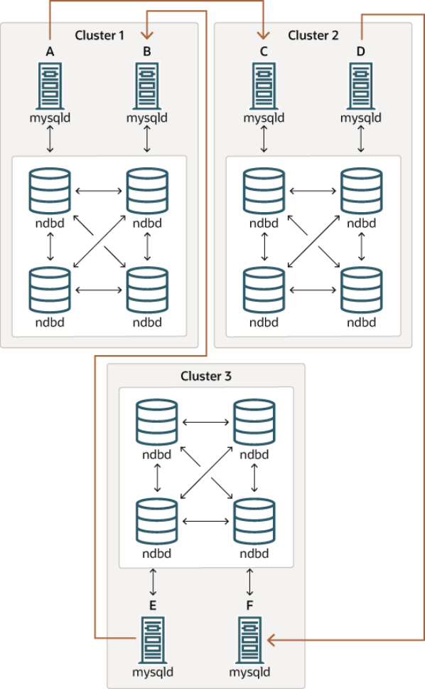

In this case, different SQL nodes in each cluster are used as replication sources and replicas. You must not start any of the SQL nodes with the `log_slave_updates` system variable enabled. This type of circular replication scheme for NDB Cluster, in which the line of replication (again indicated by the curved arrows in the diagram) is discontinuous, should be possible, but it should be noted that it has not yet been thoroughly tested and must therefore still be considered experimental.

Using NDB-native backup and restore to initialize a replica cluster. When setting up circular replication, it is possible to initialize the replica cluster by using the management client `START BACKUP`command on one NDB Cluster to create a backup and then applying this backup on another NDB Cluster using `ndb_restore`. This does not automatically create binary logs on the second NDB Cluster's SQL NDB Cluster Replication: Bidirectional and Circular Replication node acting as the replica; in order to cause the binary logs to be created, you must issue a `SHOW TABLES`statement on that SQL node; this should be done prior to running `START SLAVE`. This is a known issue.

Multi-source failover example. In this section, we discuss failover in a multi-source NDB Cluster replication setup with three NDB Clusters having server IDs 1, 2, and 3. In this scenario, Cluster 1 replicates to Clusters 2 and 3; Cluster 2 also replicates to Cluster 3. This relationship is shown here:Figure 18.18 NDB Cluster Multi-Master Replication With 3 Sources

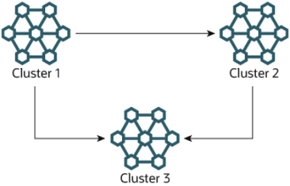

In other words, data replicates from Cluster 1 to Cluster 3 through 2 different routes: directly, and by way of Cluster 2.

Not all MySQL servers taking part in multi-source replication must act as both source and replica, and a given NDB Cluster might use different SQL nodes for different replication channels. Such a case is shown here:Figure 18.19 NDB Cluster Multi-Source Replication, With MySQL Servers

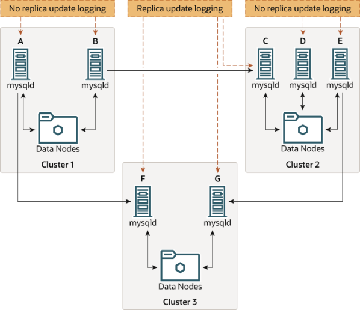

MySQL servers acting as replicas must be run with the `log_slave_updates` system variable enabled.

Which `mysqld` processes require this option is also shown in the preceding diagram.

NDB Cluster Replication Conflict Resolution Note Using the `log_slave_updates` system variable has no effect on servers not being run as replicas.

The need for failover arises when one of the replicating clusters goes down. In this example, we consider the case where Cluster 1 is lost to service, and so Cluster 3 loses 2 sources of updates from Cluster 1.

Because replication between NDB Clusters is asynchronous, there is no guarantee that Cluster 3's updates originating directly from Cluster 1 are more recent than those received through Cluster 2. You can handle this by ensuring that Cluster 3 catches up to Cluster 2 with regard to updates from Cluster 1. In terms of MySQL servers, this means that you need to replicate any outstanding updates from MySQL server C to server F.

On server C, perform the following queries:

```
mysqlC> SELECT @latest:=MAX(epoch)
->     FROM mysql.ndb_apply_status
->     WHERE server_id=1;
mysqlC> SELECT
->     @file:=SUBSTRING_INDEX(File, '/', -1),
->     @pos:=Position
->     FROM mysql.ndb_binlog_index
->     WHERE orig_epoch >= @latest
->     AND orig_server_id = 1
->     ORDER BY epoch ASC LIMIT 1;
```

Note You can improve the performance of this query, and thus likely speed up failover times significantly, by adding the appropriate index to the `ndb_binlog_index`table. See Section 18.7.4, “NDB Cluster Replication Schema and Tables”, for more information.

Copy over the values for `@file` and `@pos` manually from server C to server F (or have your application perform the equivalent). Then, on server F, execute the following `CHANGE MASTER TO` statement:

```
mysqlF> CHANGE MASTER TO
->     MASTER_HOST = 'serverC'
->     MASTER_LOG_FILE='@file',
->     MASTER_LOG_POS=@pos;
```

Once this has been done, you can issue a `START SLAVE` statement on MySQL server F; this causes any missing updates originating from server B to be replicated to server F.

The `CHANGE MASTER TO` statement also supports an `IGNORE_SERVER_IDS` option which takes a comma-separated list of server IDs and causes events originating from the corresponding servers to be ignored. For more information, see Section 13.4.2.1, “CHANGE MASTER TO Statement”, and Section 13.7.5.35, “SHOW SLAVE STATUS Statement”. For information about how this option intereacts with the `ndb_log_apply_status` variable, see Section 18.7.8, “Implementing Failover with NDB Cluster Replication”.

### 18.7.11 NDB Cluster Replication Conflict Resolution

- Requirements
- Source Column Control
- Conflict Resolution Control

NDB Cluster Replication Conflict Resolution

- Conflict Resolution Functions
- Conflict Resolution Exceptions Table
- Conflict Detection Status Variables
- Examples

When using a replication setup involving multiple sources (including circular replication), it is possible that different sources may try to update the same row on the replica with different data. Conflict resolution in NDB Cluster Replication provides a means of resolving such conflicts by permitting a user-defined resolution column to be used to determine whether or not an update on a given source should be applied on the replica.

Some types of conflict resolution supported by NDB Cluster (`NDB$OLD()`, `NDB$MAX()`, `NDB``$MAX_DELETE_WIN()`) implement this user-defined column as a “timestamp” column (although its type cannot be `TIMESTAMP`, as explained later in this section). These types of conflict resolution are always applied a row-by-row basis rather than a transactional basis. The epoch-based conflict resolution functions`NDB$EPOCH()` and `NDB$EPOCH_TRANS()` compare the order in which epochs are replicated (and thus these functions are transactional). Different methods can be used to compare resolution column values on the replica when conflicts occur, as explained later in this section; the method used can be set to act on a single table, database, or server, or on a set of one or more tables using pattern matching. See Matching with wildcards, for information about using pattern matches in the `db`, `table_name`, and `server_id`columns of the `mysql.ndb_replication` table.

You should also keep in mind that it is the application's responsibility to ensure that the resolution column is correctly populated with relevant values, so that the resolution function can make the appropriate choice when determining whether to apply an update.

> Requirements

Preparations for conflict resolution must be made on both the source and the replica. These tasks are described in the following list:

- On the source writing the binary logs, you must determine which columns are sent (all columns or only

those that have been updated). This is done for the MySQL Server as a whole by applying the `mysqld`startup option `--ndb-log-updated-only` (described later in this section), or on one or more specific tables by placing the proper entries in the `mysql.ndb_replication` table (see ndb_replication Table).

Note If you are replicating tables with very large columns (such as `TEXT` or `BLOB`columns), `--ndb-log-updated-only` can also be useful for reducing the size of the binary logs and avoiding possible replication failures due to exceeding

```
max_allowed_packet.
```

See Section 17.4.1.19, “Replication and max_allowed_packet”, for more information about this issue.

- On the replica, you must determine which type of conflict resolution to apply (“latest timestamp wins”,

“same timestamp wins”, “primary wins”, “primary wins, complete transaction”, or none). This is done using the `mysql.ndb_replication` system table, and applies to one or more specific tables (see ndb_replication Table).

- NDB 7.4.1 and later also supports read conflict detection, that is, detecting conflicts between reads

of a given row in one cluster and updates or deletes of the same row in another cluster. This requires NDB Cluster Replication Conflict Resolution exclusive read locks obtained by setting `ndb_log_exclusive_reads` equal to 1 on the replica. All rows read by a conflicting read are logged in the exceptions table. For more information, see Read conflict detection and resolution.

- `NDB` applies `WRITE_ROW` events strictly as inserts, requiring that there is not already any such row; that

is, an incoming write is always rejected if the row already exists.

When using the functions `NDB$OLD()`, `NDB$MAX()`, and `NDB$MAX_DELETE_WIN()` for timestamp-based conflict resolution, we often refer to the column used for determining updates as a “timestamp”column. However, the data type of this column is never `TIMESTAMP`; instead, its data type should be `INT`(`INTEGER`) or `BIGINT`. The “timestamp” column should also be `UNSIGNED` and `NOT NULL`.

The `NDB$EPOCH()` and `NDB$EPOCH_TRANS()` functions discussed later in this section work by comparing the relative order of replication epochs applied on a primary and secondary NDB Cluster, and do not make use of timestamps.

> Source Column Control

We can see update operations in terms of “before” and “after” images—that is, the states of the table before and after the update is applied. Normally, when updating a table with a primary key, the “before”image is not of great interest; however, when we need to determine on a per-update basis whether or not to use the updated values on a replica, we need to make sure that both images are written to the source's binary log. This is done with the `--ndb-log-update-as-write` option for `mysqld`, as described later in this section.

Important Whether logging of complete rows or of updated columns only is done is decided when the MySQL server is started, and cannot be changed online; you must either restart `mysqld`, or start a new `mysqld` instance with different logging options.

> Conflict Resolution Control

Conflict resolution is usually enabled on the server where conflicts can occur. Like logging method selection, it is enabled by entries in the `mysql.ndb_replication` table.

`NBT_UPDATED_ONLY_MINIMAL` and `NBT_UPDATED_FULL_MINIMAL` can be used with `NDB$EPOCH()`,`NDB$EPOCH2()`, and `NDB$EPOCH_TRANS()`, because these do not require “before” values of columns which are not primary keys. Conflict resolution algorithms requiring the old values, such as `NDB$MAX()`and `NDB$OLD()`, do not work correctly with these `binlog_type` values.

> Conflict Resolution Functions

This section provides detailed information about the functions which can be used for conflict detection and resolution with NDB Replication. These functions are listed here in alphabetical order:

- NDB$OLD()
- NDB$MAX()
- NDB$MAX_DELETE_WIN()
- NDB$EPOCH()
- NDB$EPOCH_TRANS()
- NDB$EPOCH2()

NDB Cluster Replication Conflict Resolution

- NDB$EPOCH2_TRANS()

NDB$OLD()If the value of `column_name` is the same on both the source and the replica, then the update is applied;

otherwise, the update is not applied on the replica and an exception is written to the log. This is illustrated by the following pseudocode:

```
if (source_old_column_value == replica_current_column_value)
apply_update();
else
log_exception();
```

This function can be used for “same value wins” conflict resolution. This type of conflict resolution ensures that updates are not applied on the replica from the wrong source.

Important The column value from the source's “before” image is used by this function.

NDB$MAX()If the “timestamp” column value for a given row coming from the source is higher than that on the replica, it is applied; otherwise it is not applied on the replica. This is illustrated by the following pseudocode:

```
if (source_new_column_value > replica_current_column_value)
apply_update();
```

This function can be used for “greatest timestamp wins” conflict resolution. This type of conflict resolution ensures that, in the event of a conflict, the version of the row that was most recently updated is the version that persists.

Important The column value from the sources's “after” image is used by this function.

NDB$MAX_DELETE_WIN()This is a variation on `NDB$MAX()`. Due to the fact that no timestamp is available for a delete operation, a delete using `NDB$MAX()` is in fact processed as `NDB$OLD`, but for some use cases, this is not optimal. For`NDB$MAX_DELETE_WIN()`, if the “timestamp” column value for a given row adding or updating an existing row coming from the source is higher than that on the replica, it is applied. However, delete operations are treated as always having the higher value. This is illustrated by the following pseudocode:

```
if ( (source_new_column_value > replica_current_column_value)
||
operation.type == "delete")
apply_update();
```

This function can be used for “greatest timestamp, delete wins” conflict resolution. This type of conflict resolution ensures that, in the event of a conflict, the version of the row that was deleted or (otherwise)most recently updated is the version that persists.

Note As with `NDB$MAX()`, the column value from the source's “after” image is the value used by this function.

NDB Cluster Replication Conflict Resolution NDB$EPOCH()The `NDB$EPOCH()` function tracks the order in which replicated epochs are applied on a replica cluster relative to changes originating on the replica. This relative ordering is used to determine whether changes originating on the replica are concurrent with any changes that originate locally, and are therefore potentially in conflict.

Most of what follows in the description of `NDB$EPOCH()` also applies to `NDB$EPOCH_TRANS()`. Any exceptions are noted in the text.

`NDB$EPOCH()` is asymmetric, operating on one NDB Cluster in a bidirectional replication configuration(sometimes referred to as “active-active” replication). We refer here to cluster on which it operates as the primary, and the other as the secondary. The replica on the primary is responsible for detecting and handling conflicts, while the replica on the secondary is not involved in any conflict detection or handling.

When the replica on the primary detects conflicts, it injects events into its own binary log to compensate for these; this ensures that the secondary NDB Cluster eventually realigns itself with the primary and so keeps the primary and secondary from diverging. This compensation and realignment mechanism requires that the primary NDB Cluster always wins any conflicts with the secondary—that is, that the primary's changes are always used rather than those from the secondary in event of a conflict. This “primary always wins” rule has the following implications:

- Operations that change data, once committed on the primary, are fully persistent and are not undone or

rolled back by conflict detection and resolution.

- Data read from the primary is fully consistent. Any changes committed on the Primary (locally or from the

replica) are not reverted later.

- Operations that change data on the secondary may later be reverted if the primary determines that they

are in conflict.

- Individual rows read on the secondary are self-consistent at all times, each row always reflecting either a

state committed by the secondary, or one committed by the primary.

- Sets of rows read on the secondary may not necessarily be consistent at a given single point in time. For

`NDB$EPOCH_TRANS()`, this is a transient state; for `NDB$EPOCH()`, it can be a persistent state.

- Assuming a period of sufficient length without any conflicts, all data on the secondary NDB Cluster

(eventually) becomes consistent with the primary's data.

`NDB$EPOCH()` and `NDB$EPOCH_TRANS()` do not require any user schema modifications, or application changes to provide conflict detection. However, careful thought must be given to the schema used, and the access patterns used, to verify that the complete system behaves within specified limits.

Each of the `NDB$EPOCH()` and `NDB$EPOCH_TRANS()` functions can take an optional parameter; this is the number of bits to use to represent the lower 32 bits of the epoch, and should be set to no less than the value calculated as shown here:

```
CEIL( LOG2( TimeBetweenGlobalCheckpoints / TimeBetweenEpochs ), 1)
```

For the default values of these configuration parameters (2000 and 100 milliseconds, respectively), this gives a value of 5 bits, so the default value (6) should be sufficient, unless other values are used for`TimeBetweenGlobalCheckpoints`, `TimeBetweenEpochs`, or both. A value that is too small can result in false positives, while one that is too large could lead to excessive wasted space in the database.

Both `NDB$EPOCH()` and `NDB$EPOCH_TRANS()` insert entries for conflicting rows into the relevant exceptions tables, provided that these tables have been defined according to the same exceptions table NDB Cluster Replication Conflict Resolution schema rules as described elsewhere in this section (see NDB$OLD()). You must create any exceptions table before creating the data table with which it is to be used.

As with the other conflict detection functions discussed in this section, `NDB$EPOCH()` and `NDB``$EPOCH_TRANS()` are activated by including relevant entries in the `mysql.ndb_replication` table(see ndb_replication Table). The roles of the primary and secondary NDB Clusters in this scenario are fully determined by `mysql.ndb_replication` table entries.

Because the conflict detection algorithms employed by `NDB$EPOCH()` and `NDB$EPOCH_TRANS()` are asymmetric, you must use different values for the `server_id` entries of the primary and secondary replicas.

A conflict between `DELETE` operations alone is not sufficient to trigger a conflict using `NDB$EPOCH()` or`NDB$EPOCH_TRANS()`, and the relative placement within epochs does not matter.

Limitations on NDB$EPOCH()The following limitations currently apply when using `NDB$EPOCH()` to perform conflict detection:

- Conflicts are detected using NDB Cluster epoch boundaries, with granularity proportional to

`TimeBetweenEpochs` (default: 100 milliseconds). The minimum conflict window is the minimum time during which concurrent updates to the same data on both clusters always report a conflict. This is always a nonzero length of time, and is roughly proportional to `2 * (latency + queueing +``TimeBetweenEpochs)`. This implies that—assuming the default for `TimeBetweenEpochs` and ignoring any latency between clusters (as well as any queuing delays)—the minimum conflict window size is approximately 200 milliseconds. This minimum window should be considered when looking at expected application “race” patterns.

- Additional storage is required for tables using the `NDB$EPOCH()` and `NDB$EPOCH_TRANS()` functions;

from 1 to 32 bits extra space per row is required, depending on the value passed to the function.

- Conflicts between delete operations may result in divergence between the primary and secondary. When

a row is deleted on both clusters concurrently, the conflict can be detected, but is not recorded, since the row is deleted. This means that further conflicts during the propagation of any subsequent realignment operations are not detected, which can lead to divergence.

Deletes should be externally serialized, or routed to one cluster only. Alternatively, a separate row should be updated transactionally with such deletes and any inserts that follow them, so that conflicts can be tracked across row deletes. This may require changes in applications.

- Only two NDB Clusters in a birectional “active-active” configuration are currently supported when using

`NDB$EPOCH()` or `NDB$EPOCH_TRANS()` for conflict detection.

- Tables having `BLOB` or `TEXT` columns are not currently supported with `NDB$EPOCH()` or `NDB`

```
$EPOCH_TRANS().
```

NDB$EPOCH_TRANS()`NDB$EPOCH_TRANS()` extends the `NDB$EPOCH()` function. Conflicts are detected and handled in the same way using the “primary wins all” rule (see NDB$EPOCH()) but with the extra condition that any other rows updated in the same transaction in which the conflict occurred are also regarded as being in conflict. In other words, where `NDB$EPOCH()` realigns individual conflicting rows on the secondary, `NDB``$EPOCH_TRANS()` realigns conflicting transactions.

In addition, any transactions which are detectably dependent on a conflicting transaction are also regarded as being in conflict, these dependencies being determined by the contents of the secondary cluster's binary NDB Cluster Replication Conflict Resolution log. Since the binary log contains only data modification operations (inserts, updates, and deletes), only overlapping data modifications are used to determine dependencies between transactions.

`NDB$EPOCH_TRANS()` is subject to the same conditions and limitations as `NDB$EPOCH()`, and in addition requires that Version 2 binary log row events are used (`log_bin_use_v1_row_events` equal to 0),which adds a storage overhead of 2 bytes per event in the binary log. In addition, all transaction IDs must be recorded in the secondary's binary log, using `--ndb-log-transaction-id` set to `ON`. This adds a variable amount of overhead (up to 13 bytes per row).

See NDB$EPOCH().

NDB$EPOCH2()The `NDB$EPOCH2()` function, added in NDB 7.4, is similar to `NDB$EPOCH()`, except that `NDB$EPOCH2()`provides for delete-delete handling with a bidirectional replication topology. In this scenario, primary and secondary roles are assigned to the two sources by setting the `ndb_slave_conflict_role` system variable to the appropriate value on each source (usually one each of `PRIMARY`, `SECONDARY`). When this is done, modifications made by the secondary are reflected by the primary back to the secondary which then conditionally applies them.

NDB$EPOCH2_TRANS()Added in NDB 7.4, `NDB$EPOCH2_TRANS()` extends the `NDB$EPOCH2()` function. Conflicts are detected and handled in the same way, and assigning primary and secondary roles to the replicating clusters, but with the extra condition that any other rows updated in the same transaction in which the conflict occurred are also regarded as being in conflict. That is, `NDB$EPOCH2()` realigns individual conflicting rows on the secondary, while `NDB$EPOCH_TRANS()` realigns conflicting transactions.

Where `NDB$EPOCH()` and `NDB$EPOCH_TRANS()` use metadata that is specified per row, per last modified epoch, to determine on the primary whether an incoming replicated row change from the secondary is concurrent with a locally committed change; concurrent changes are regarded as conflicting, with subesequent exceptions table updates and realignment of the secondary. A problem arises when a row is deleted on the primary so there is no longer any last-modified epoch available to determine whether any replicated operations conflict, which means that conflicting delete operationss are not detected. This can result in divergence, an example being a delete on one cluster which is concurrent with a delete and insert on the other; this why delete operations can be routed to only one cluster when using `NDB$EPOCH()` and

```
NDB$EPOCH_TRANS().
```

`NDB$EPOCH2()` bypasses the issue just described—storing information about deleted rows on the PRIMARY—by ignoring any delete-delete conflict, and by avoiding any potential resultant divergence as well. This is accomplished by reflecting any operation successfully applied on and replicated from the secondary back to the secondary. On its return to the secondary, it can be used to reapply an operation on the secondary which was deleted by an operation originating from the primary.

When using `NDB$EPOCH2()`, you should keep in mind that the secondary applies the delete from the primary, removing the new row until it is restored by a reflected operation. In theory, the subsequent insert or update on the secondary conflicts with the delete from the primary, but in this case, we choose to ignore this and allow the secondary to “win”, in the interest of preventing divergence between the clusters. In other words, after a delete, the primary does not detect conflicts, and instead adopts the secondary's following changes immediately. Because of this, the secondary's state can revisit multiple previous committed states as it progresses to a final (stable) state, and some of these may be visible.

You should also be aware that reflecting all operations from the secondary back to the primary increases the size of the primary's logbinary log, as well as demands on bandwidth, CPU usage, and disk I/O.

Application of reflected operations on the secondary depends on the state of the target row on the secondary. Whether or not reflected changes are applied on the secondary NDB Cluster Replication Conflict Resolution can be tracked by checking the `Ndb_conflict_reflected_op_prepare_count` and`Ndb_conflict_reflected_op_discard_count` status variables, both added in NDB

7.4.2. The number of changes applied is simply the difference between these two values (note that `Ndb_conflict_reflected_op_prepare_count` is always greater than or equal to

```
Ndb_conflict_reflected_op_discard_count).
```

Events are applied if and only if both of the following conditions are true:

- The existence of the row—that is, whether or not it exists—is in accordance with the type of event. For

delete and update operations, the row must already exist. For insert operations, the row must not exist.

- The row was last modified by the primary. It is possible that the modification was accomplished through

the execution of a reflected operation.

If both of these conditions are not met, the reflected operation is discarded by the secondary.

> Conflict Resolution Exceptions Table

To use the `NDB$OLD()` conflict resolution function, it is also necessary to create an exceptions table corresponding to each `NDB` table for which this type of conflict resolution is to be employed. This is also true when using `NDB$EPOCH()` or `NDB$EPOCH_TRANS()`. The name of this table is that of the table for which conflict resolution is to be applied, with the string `$EX` appended. (For example, if the name of the original table is `mytable`, the name of the corresponding exceptions table name should be `mytable$EX`.)Prior to NDB 7.4.1, the syntax for creating the exceptions table is as shown here:

```
CREATE TABLE original_table$EX  (
server_id INT UNSIGNED,
source_server_id INT UNSIGNED,
source_epoch BIGINT UNSIGNED,
count INT UNSIGNED,
original_table_pk_columns,
[additional_columns,]
PRIMARY KEY(server_id, source_server_id, source_epoch, count)
) ENGINE=NDB;
```

NDB 7.4.1 and later supports an extended exceptions table definition that includes optional columns providing information about an exception's type, cause, and originating transaction. In these versions, the syntax for creating the exceptions table is as shown here:

```
CREATE TABLE original_table$EX  (
[NDB$]server_id INT UNSIGNED,
[NDB$]source_server_id INT UNSIGNED,
[NDB$]source_epoch BIGINT UNSIGNED,
[NDB$]count INT UNSIGNED,
[NDB$OP_TYPE ENUM('WRITE_ROW','UPDATE_ROW', 'DELETE_ROW',
'REFRESH_ROW', 'READ_ROW') NOT NULL,]
[NDB$CFT_CAUSE ENUM('ROW_DOES_NOT_EXIST', 'ROW_ALREADY_EXISTS',
'DATA_IN_CONFLICT', 'TRANS_IN_CONFLICT') NOT NULL,]
[NDB$ORIG_TRANSID BIGINT UNSIGNED NOT NULL,]
original_table_pk_columns,
[orig_table_column|orig_table_column$OLD|orig_table_column$NEW,]
[additional_columns,]
PRIMARY KEY([NDB$]server_id, [NDB$]source_server_id, [NDB$]source_epoch, [NDB$]count)
) ENGINE=NDB;
```

NDB Cluster Replication Conflict Resolution The first four columns are required. The names of the first four columns and the columns matching the original table's primary key columns are not critical; however, we suggest for reasons of clarity and consistency, that you use the names shown here for the `server_id`, `source_server_id`,`source_epoch`, and `count` columns, and that you use the same names as in the original table for the columns matching those in the original table's primary key.

Starting with NDB 7.4.1, if the exceptions table uses one or more of the optional columns `NDB$OP_TYPE`,`NDB$CFT_CAUSE`, or `NDB$ORIG_TRANSID` discussed later in this section, then each of the required columns must also be named using the prefix `NDB$`. If desired, you can use the `NDB$` prefix to name the required columns even if you do not define any optional columns, but in this case, all four of the required columns must be named using the prefix.

Following these columns, the columns making up the original table's primary key should be copied in the order in which they are used to define the primary key of the original table. The data types for the columns duplicating the primary key columns of the original table should be the same as (or larger than) those of the original columns. In NDB Cluster 7.3 and earlier, the exceptions table's primary key must be reproduced column for column. Beginning with NDB 7.4.1, a subset of the primary key columns may be used instead.

Regardless of the NDB Cluster version employed, the exceptions table must use the `NDB` storage engine.

(An example that uses `NDB$OLD()` with an exceptions table is shown later in this section.)Additional columns may optionally be defined following the copied primary key columns, but not before any of them; any such extra columns cannot be `NOT NULL`. In NDB 7.4.1 and later, support is provided for three additional, predefined optional columns `NDB$OP_TYPE`, `NDB$CFT_CAUSE`, and `NDB``$ORIG_TRANSID`, which are described in the next few paragraphs.

`NDB$OP_TYPE`: This column can be used to obtain the type of operation causing the conflict. If you use this column, define it as shown here:

```
NDB$OP_TYPE ENUM('WRITE_ROW', 'UPDATE_ROW', 'DELETE_ROW',
'REFRESH_ROW', 'READ_ROW') NOT NULL
```

The `WRITE_ROW`, `UPDATE_ROW`, and `DELETE_ROW` operation types represent user-initiated operations.

`REFRESH_ROW` operations are operations generated by conflict resolution in compensating transactions sent back to the originating cluster from the cluster that detected the conflict. `READ_ROW` operations are user-initiated read tracking operations defined with exclusive row locks.

`NDB$CFT_CAUSE`: You can define an optional column `NDB$CFT_CAUSE` which provides the cause of the registered conflict. This column, if used, is defined as shown here:

```
NDB$CFT_CAUSE ENUM('ROW_DOES_NOT_EXIST', 'ROW_ALREADY_EXISTS',
'DATA_IN_CONFLICT', 'TRANS_IN_CONFLICT') NOT NULL
```

`ROW_DOES_NOT_EXIST` can be reported as the cause for `UPDATE_ROW` and `WRITE_ROW` operations;

`ROW_ALREADY_EXISTS` can be reported for `WRITE_ROW` events. `DATA_IN_CONFLICT` is reported when a row-based conflict function detects a conflict; `TRANS_IN_CONFLICT` is reported when a transactional conflict function rejects all of the operations belonging to a complete transaction.

`NDB$ORIG_TRANSID`: The `NDB$ORIG_TRANSID` column, if used, contains the ID of the originating transaction. This column should be defined as follows:

```
NDB$ORIG_TRANSID BIGINT UNSIGNED NOT NULL
```

`NDB$ORIG_TRANSID` is a 64-bit value generated by `NDB`. This value can be used to correlate multiple exceptions table entries belonging to the same conflicting transaction from the same or different exceptions tables.

In NDB 7.4.1 and later, additional reference columns which are not part of the original table's primary key can be named `colname$OLD` or `colname$NEW`. `colname$OLD` references old values in update NDB Cluster Replication Conflict Resolution and delete operations—that is, operations containing `DELETE_ROW` events. `colname$NEW` can be used to reference new values in insert and update operations—in other words, operations using `WRITE_ROW`events, `UPDATE_ROW` events, or both types of events. Where a conflicting operation does not supply a value for a given reference column that is not a primary key, the exceptions table row contains either `NULL`,or a defined default value for that column.

Important The `mysql.ndb_replication` table is read when a data table is set up for replication, so the row corresponding to a table to be replicated must be inserted into `mysql.ndb_replication` before the table to be replicated is created.

> Conflict Detection Status Variables

Several status variables can be used to monitor conflict detection. You can see how many rows have been found in conflict by `NDB$EPOCH()` since this replica was last restarted from the current value of the`Ndb_conflict_fn_epoch` system status variable.

`Ndb_conflict_fn_epoch_trans` provides the number of rows that have been found directly in conflict

```
by NDB$EPOCH_TRANS(). Ndb_conflict_fn_epoch2 and Ndb_conflict_fn_epoch2_trans,
```

both added in NDB 7.4.2, show the number of rows found in conflict by `NDB$EPOCH2()` and `NDB``$EPOCH2_TRANS()`, respectively. The number of rows actually realigned, including those affected due to their membership in or dependency on the same transactions as other conflicting rows, is given by

```
Ndb_conflict_trans_row_reject_count.
```

Another server status variable `Ndb_conflict_fn_max` provides a count of the number of times that a row was not applied on the current SQL node due to “greatest timestamp wins” conflict resolution since the last time that `mysqld` was started. `Ndb_conflict_fn_max_del_win` provides a count of the number of times that conflict resolution based on the outcome of `NDB$MAX_DELETE_WIN()` has been applied.

The number of times that a row was not applied as the result of “same timestamp wins” conflict resolution on a given `mysqld` since the last time it was restarted is given by the global status variable`Ndb_conflict_fn_old`. In addition to incrementing `Ndb_conflict_fn_old`, the primary key of the row that was not used is inserted into an exceptions table, as explained elsewhere in this section.

See also NDB Cluster Status Variables.

> Examples

The following examples assume that you have already a working NDB Cluster replication setup, as described in Section 18.7.5, “Preparing the NDB Cluster for Replication”, and Section 18.7.6, “Starting NDB Cluster Replication (Single Replication Channel)”.

NDB$MAX() example. Suppose you wish to enable “greatest timestamp wins” conflict resolution on table `test.t1`, using column `mycol` as the “timestamp”. This can be done using the following steps:

1. Make sure that you have started the source `mysqld` with `--ndb-log-update-as-write=OFF`.
2. On the source, perform this `INSERT` statement:

```
INSERT INTO mysql.ndb_replication
VALUES ('test', 't1', 0, NULL, 'NDB$MAX(mycol)');
```

Note If the `ndb_replication` table does not already exist, you must create it. See ndb_replication Table.

NDB Cluster Replication Conflict Resolution Inserting a 0 into the `server_id` column indicates that all SQL nodes accessing this table should use conflict resolution. If you want to use conflict resolution on a specific `mysqld` only, use the actual server ID.

Inserting `NULL` into the `binlog_type` column has the same effect as inserting 0 (`NBT_DEFAULT`); the server default is used.

3. Create the `test.t1` table:

```
CREATE TABLE test.t1 (
columns
mycol INT UNSIGNED,
columns
) ENGINE=NDB;
```

Now, when updates are performed on this table, conflict resolution is applied, and the version of the row having the greatest value for `mycol` is written to the replica.

Note Other `binlog_type` options such as `NBT_UPDATED_ONLY_USE_UPDATE` (6)should be used to control logging on the source using the `ndb_replication` table rather than by using command-line options.

NDB$OLD() example. Suppose an `NDB` table such as the one defined here is being replicated, and you wish to enable “same timestamp wins” conflict resolution for updates to this table:

```
CREATE TABLE test.t2  (
a INT UNSIGNED NOT NULL,
b CHAR(25) NOT NULL,
columns,
mycol INT UNSIGNED NOT NULL,
columns,
PRIMARY KEY pk (a, b)
)   ENGINE=NDB;
```

The following steps are required, in the order shown:

1. First—and prior to creating `test.t2`—you must insert a row into the `mysql.ndb_replication`

table, as shown here:

```
INSERT INTO mysql.ndb_replication
VALUES ('test', 't2', 0, 0, 'NDB$OLD(mycol)');
```

Possible values for the `binlog_type` column are shown earlier in this section; in this case, we use 0 to specify that the server default logging behavior be used. The value `'NDB$OLD(mycol)'` should be inserted into the `conflict_fn` column.

2. Create an appropriate exceptions table for `test.t2`. The table creation statement shown here includes

all required columns; any additional columns must be declared following these columns, and before the definition of the table's primary key.

```
CREATE TABLE test.t2$EX  (
server_id INT UNSIGNED,
source_server_id INT UNSIGNED,
source_epoch BIGINT UNSIGNED,
count INT UNSIGNED,
a INT UNSIGNED NOT NULL,
b CHAR(25) NOT NULL,
```

NDB Cluster Replication Conflict Resolution

```
[additional_columns,]
PRIMARY KEY(server_id, source_server_id, source_epoch, count)
)   ENGINE=NDB;
```

In NDB 7.4.1 and later, we can include additional columns for information about the type, cause, and originating transaction ID for a given conflict. We are also not required to supply matching columns for all primary key columns in the original table. In these versions, you can create the exceptions table like this:

```
CREATE TABLE test.t2$EX  (
NDB$server_id INT UNSIGNED,
NDB$source_server_id INT UNSIGNED,
NDB$source_epoch BIGINT UNSIGNED,
NDB$count INT UNSIGNED,
a INT UNSIGNED NOT NULL,
NDB$OP_TYPE ENUM('WRITE_ROW','UPDATE_ROW', 'DELETE_ROW',
'REFRESH_ROW', 'READ_ROW') NOT NULL,
NDB$CFT_CAUSE ENUM('ROW_DOES_NOT_EXIST', 'ROW_ALREADY_EXISTS',
'DATA_IN_CONFLICT', 'TRANS_IN_CONFLICT') NOT NULL,
NDB$ORIG_TRANSID BIGINT UNSIGNED NOT NULL,
[additional_columns,]
PRIMARY KEY(NDB$server_id, NDB$source_server_id, NDB$source_epoch, NDB$count)
)   ENGINE=NDB;
```

Note The `NDB$` prefix is required for the four required columns since we included at least one of the columns `NDB$OP_TYPE`, `NDB$CFT_CAUSE`, or `NDB``$ORIG_TRANSID` in the table definition.

3. Create the table `test.t2` as shown previously.

These steps must be followed for every table for which you wish to perform conflict resolution using `NDB``$OLD()`. For each such table, there must be a corresponding row in `mysql.ndb_replication`, and there must be an exceptions table in the same database as the table being replicated.

Read conflict detection and resolution. NDB 7.4.1 and later supports tracking of read operations,which makes it possible in circular replication setups to manage conflicts between reads of a given row in one cluster and updates or deletes of the same row in another. This example uses `employee` and`department` tables to model a scenario in which an employee is moved from one department to another on the source cluster (which we refer to hereafter as cluster A) while the replica cluster (hereafter B)updates the employee count of the employee's former department in an interleaved transaction.

The data tables have been created using the following SQL statements:

```
# Employee table
CREATE TABLE employee (
id INT PRIMARY KEY,
name VARCHAR(2000),
dept INT NOT NULL
)   ENGINE=NDB;
# Department table
CREATE TABLE department (
id INT PRIMARY KEY,
name VARCHAR(2000),
members INT
)   ENGINE=NDB;
```

NDB Cluster Replication Conflict Resolution The contents of the two tables include the rows shown in the (partial) output of the following `SELECT`statements:

```
mysql> SELECT id, name, dept FROM employee;
+---------------+------+
| id   | name   | dept |
+------+--------+------+
...
| 998  |  Mike  | 3    |
| 999  |  Joe   | 3    |
| 1000 |  Mary  | 3    |
...
+------+--------+------+
mysql> SELECT id, name, members FROM department;
+-----+-------------+---------+
| id  | name        | members |
+-----+-------------+---------+
...
| 3   | Old project | 24      |
...
+-----+-------------+---------+
```

We assume that we are already using an exceptions table that includes the four required columns (and these are used for this table's primary key), the optional columns for operation type and cause, and the original table's primary key column, created using the SQL statement shown here:

```
CREATE TABLE employee$EX  (
NDB$server_id INT UNSIGNED,
NDB$source_server_id INT UNSIGNED,
NDB$source_epoch BIGINT UNSIGNED,
NDB$count INT UNSIGNED,
NDB$OP_TYPE ENUM( 'WRITE_ROW','UPDATE_ROW', 'DELETE_ROW',
'REFRESH_ROW','READ_ROW') NOT NULL,
NDB$CFT_CAUSE ENUM( 'ROW_DOES_NOT_EXIST',
'ROW_ALREADY_EXISTS',
'DATA_IN_CONFLICT',
'TRANS_IN_CONFLICT') NOT NULL,
id INT NOT NULL,
PRIMARY KEY(NDB$server_id, NDB$source_server_id, NDB$source_epoch, NDB$count)
)   ENGINE=NDB;
```

Suppose there occur the two simultaneous transactions on the two clusters. On cluster A, we create a new department, then move employee number 999 into that department, using the following SQL statements:

```
BEGIN;
INSERT INTO department VALUES (4, "New project", 1);
UPDATE employee SET dept = 4 WHERE id = 999;
COMMIT;
```

At the same time, on cluster B, another transaction reads from `employee`, as shown here:

```
BEGIN;
SELECT name FROM employee WHERE id = 999;
UPDATE department SET members = members - 1  WHERE id = 3;
commit;
```

The conflicting transactions are not normally detected by the conflict resolution mechanism, since the conflict is between a read (`SELECT`) and an update operation. Beginning with NDB 7.4.1, you can circumvent this issue by executing `SET` `ndb_log_exclusive_reads` `= 1` on the replica cluster.

Acquiring exclusive read locks in this way causes any rows read on the source to be flagged as needing NDB Cluster Release Notes conflict resolution on the replica cluster. If we enable exclusive reads in this way prior to the logging of these transactions, the read on cluster B is tracked and sent to cluster A for resolution; the conflict on the employee row is subsequently detected and the transaction on cluster B is aborted.

The conflict is registered in the exceptions table (on cluster A) as a `READ_ROW` operation (see Conflict Resolution Exceptions Table, for a description of operation types), as shown here:

```
mysql> SELECT id, NDB$OP_TYPE, NDB$CFT_CAUSE FROM employee$EX;
+-------+-------------+-------------------+
| id    | NDB$OP_TYPE | NDB$CFT_CAUSE     |
+-------+-------------+-------------------+
...
| 999   | READ_ROW    | TRANS_IN_CONFLICT |
+-------+-------------+-------------------+
```

Any existing rows found in the read operation are flagged. This means that multiple rows resulting from the same conflict may be logged in the exception table, as shown by examining the effects a conflict between an update on cluster A and a read of multiple rows on cluster B from the same table in simultaneous transactions. The transaction executed on cluster A is shown here:

```
BEGIN;
INSERT INTO department VALUES (4, "New project", 0);
UPDATE employee SET dept = 4 WHERE dept = 3;
SELECT COUNT(*) INTO @count FROM employee WHERE dept = 4;
UPDATE department SET members = @count WHERE id = 4;
COMMIT;
```

Concurrently a transaction containing the statements shown here runs on cluster B:

```
SET ndb_log_exclusive_reads = 1;  # Must be set if not already enabled
...
BEGIN;
SELECT COUNT(*) INTO @count FROM employee WHERE dept = 3 FOR UPDATE;
UPDATE department SET members = @count WHERE id = 3;
COMMIT;
```

In this case, all three rows matching the `WHERE` condition in the second transaction's `SELECT` are read, and are thus flagged in the exceptions table, as shown here:

```
mysql> SELECT id, NDB$OP_TYPE, NDB$CFT_CAUSE FROM employee$EX;
+-------+-------------+-------------------+
| id    | NDB$OP_TYPE | NDB$CFT_CAUSE     |
+-------+-------------+-------------------+
...
| 998   | READ_ROW    | TRANS_IN_CONFLICT |
| 999   | READ_ROW    | TRANS_IN_CONFLICT |
| 1000  | READ_ROW    | TRANS_IN_CONFLICT |
...
+-------+-------------+-------------------+
```

Read tracking is performed on the basis of existing rows only. A read based on a given condition track conflicts only of any rows that are found and not of any rows that are inserted in an interleaved transaction.

This is similar to how exclusive row locking is performed in a single instance of NDB Cluster.

## 18.8 NDB Cluster Release Notes

Changes in NDB Cluster releases are documented separately from this reference manual; you can find release notes for the changes in each NDB Cluster 7.4 release at NDB Cluster 7.4 Release Notes, and for NDB Cluster 7.3 releases at NDB Cluster 7.3 Release Notes.

You can obtain release notes for older versions of NDB Cluster from NDB Cluster Release Notes.
