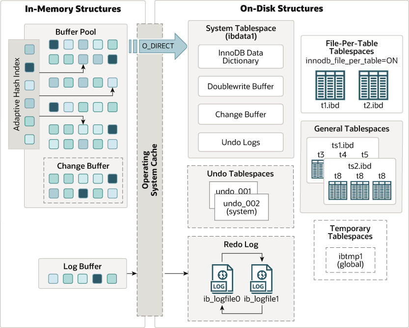

MySQL 5.7 Reference Manual Including MySQL NDB Cluster 7.5 and NDB Cluster 7.6

The following diagram shows in-memory and on-disk structures that comprise the `InnoDB` storage engine architecture. For information about each structure, see [Section 14.5, “InnoDB In-Memory Structures”](innodb-in-memory-structures.md), and [Section 14.6, “InnoDB On-Disk Structures”](innodb-on-disk-structures.md).

**Figure 14.1 InnoDB Architecture**

