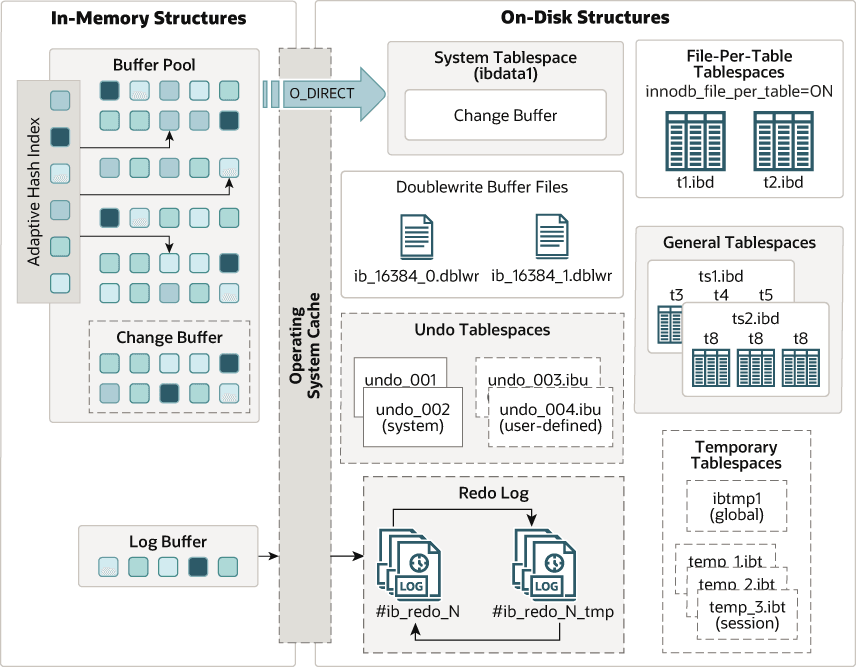

Skip to Main Content

MySQL 9.7 Reference Manual Including MySQL NDB Cluster 9.7

The following diagram shows in-memory and on-disk structures that comprise the `InnoDB` storage engine architecture. For information about each structure, see [Section 17.5, “InnoDB In-Memory Structures”](innodb-in-memory-structures.md), and [Section 17.6, “InnoDB On-Disk Structures”](innodb-on-disk-structures.md).

**Figure 17.1 InnoDB Architecture**

[MySQL Documentation Library](https://docs.oracle.com/cd/E17952_01/index.html "Go to MySQL Doc Library")