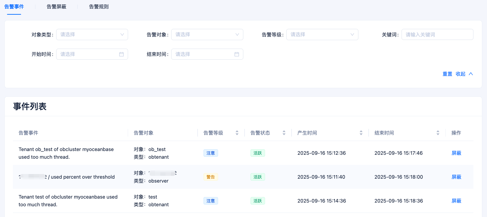
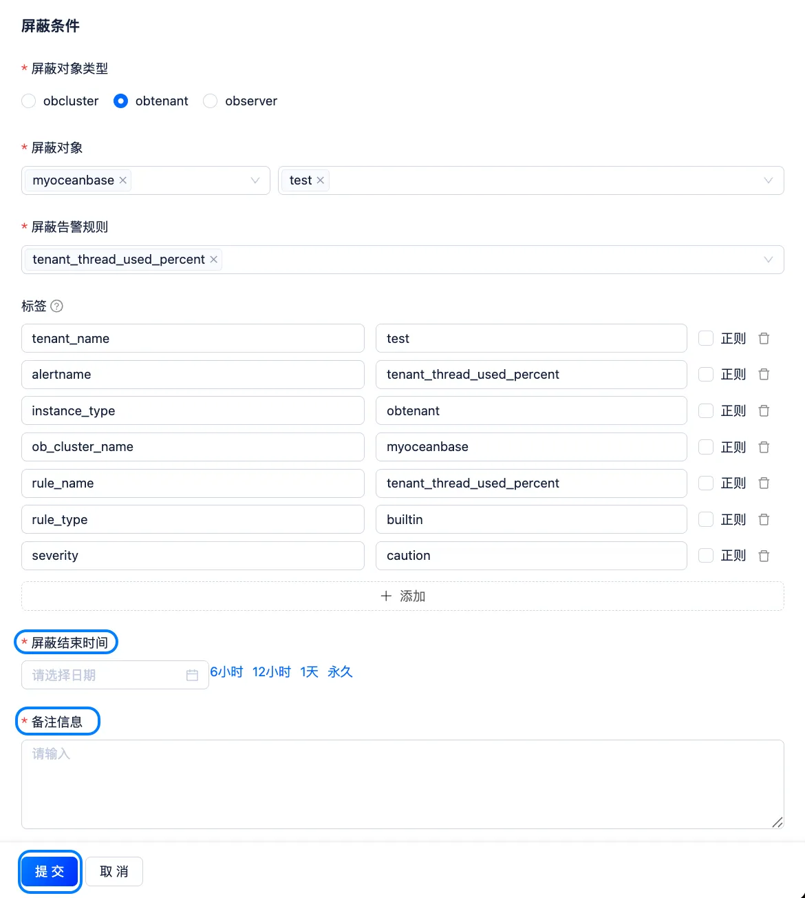

# 查看告警事件

本章节为您介绍如何查看告警事件详情。

## 操作步骤

1.  登录 obshell Dashboard 控制台。

2.  在左侧导航栏中选择 **告警中心** 。

3.  单击 **告警事件** 页签。

4.  在查询框中设置查询条件，**告警事件** 列表中将返回所有符合查询条件的告警事件。

    - 支持对告警事件根据 **对象类型**、**告警对象**、**告警等级**、**关键词**、**开始时间**、**结束时间** 等条件进行精确查找。

      [TABLE]

    - 点击 **重置** 按钮，会将查询内容置空，可重新输入查询内容。

    - 点击 **收起** 按钮，将收起查询框，此时仅支持设置 **对象类型**、**告警对象** 和 **告警等级** 进行查询。

5.  支持对告警事件进行 **屏蔽** 操作。

    - 若告警事件无需关注，您可单击 **操作** 列的 **屏蔽** 对告警消息进行快速屏蔽。

      

    - 单击 **屏蔽** 后，页面会跳转到 **告警屏蔽** 页面，然后弹出 **屏蔽条件** 页面，并自动填充屏蔽对象类型、屏蔽对象、屏蔽告警规则、标签，您只需填写屏蔽结束时间和备注信息，单击 **提交**，即可屏蔽相应告警事件。屏蔽告警后，在设置的结束时间前，该告警不会被发送。具体配置说明可参考 [管理告警屏蔽](300-alert-shielding-management.md) 中的新建屏蔽。

      
