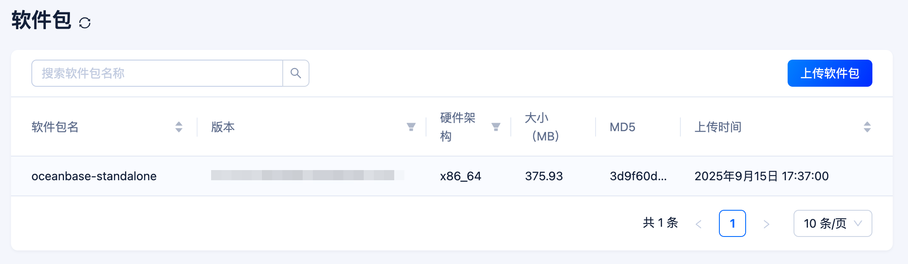

# 软件包管理

单击左侧导航栏 **系统管理** \> **软件包管理** 进入 **软件包** 页面。本文介绍如何通过 obshell Dashboard 查看或上传软件包。

## 查看软件包

在软件包页面展示了 obshell Dashboard 中已上传的软件包的 **软件包名**、**版本**、**硬件架构**、**大小（MB）**、**MD5** 和 **上传时间**。

您可通过 **版本** 和 **硬件架构** 后的  图标按照软件包的版本和硬件架构筛选查看软件包，也可通过 **软件包名** 和 **上传时间** 后的  图标选择是否按照升序或降序排列软件包。若已上传的软件包过多，可通过页面左上角搜索框搜索是否存在指定软件包。

## 上传软件包

单击 **软件包** 页面右上角 **上传软件包** 按钮，单击 **选择软件包** 从本地上传安装包。

## 相关文档

[集群管理](200-ob-dashboard-cluster-overview.md)
