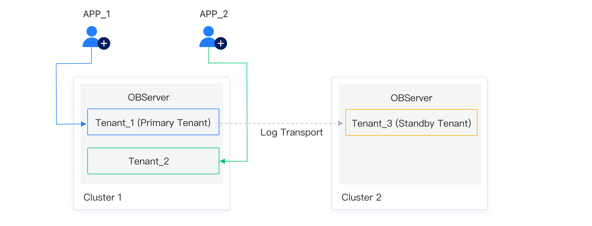
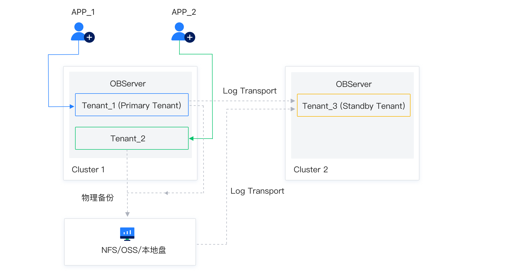

# 集中式版容灾部署方案

OceanBase 集中式数据库提供物理备份恢复和租户级物理备库两种容灾方案。

## 部署物理备份

物理备份恢复是 OceanBase 数据库高可用特性的核心组件，主要用于保障数据的安全，包括预防存储介质损坏和用户的错误操作等。如果存储介质损坏或者用户误操作而导致了数据丢失，可以通过恢复的方式恢复用户的数据。物理备份恢复也是租户级别的操作，可以单独针对指定租户开启物理备份。

该容灾方案的部署如下：

有关物理备份恢复功能的详细介绍，参见 [物理备份恢复](../manage/100-overview-of-physical-backup-and-recovery.md)。

## 部署物理备库

物理备库作为 OceanBase 生产数据库的准实时热备份，当主库出现计划内或计划外（多数派副本故障）的不可用情况时，备库可以接管服务，并且提供无损切换（RPO = 0）和有损切换（RPO \> 0）两种容灾能力，最大限度降低服务停机时间，减少可能带来的数据损失。物理备库采用独立的主备库架构，主备关系存在于租户级别，主备之间通过网络直连或第三方日志服务建立传输渠道，只传输日志。独立主备库架构下，各个集群是是相互独立的，用户可以更加灵活地管理集群。

该容灾方案的部署如下：

租户级主备由于异步同步日志，仅支持最大性能模式，不支持最大保护和最大可用模式，容灾切换时需要保证数据强一致的场景请使用 OceanBase 分布式版本，通过多副本容灾方案或基于仲裁的容灾方案实现强一致。

有关物理备库的详细介绍，参见 [物理备库](../manage/000-physical-standby-database-overview.md)。

## 同时部署物理备份及物理备库

此外，可以同时部署物理备份和物理备库，同时实现冷备和准实时热备两种备份方案，进一步提升系统的容灾能力。

该容灾方案的部署如下：

