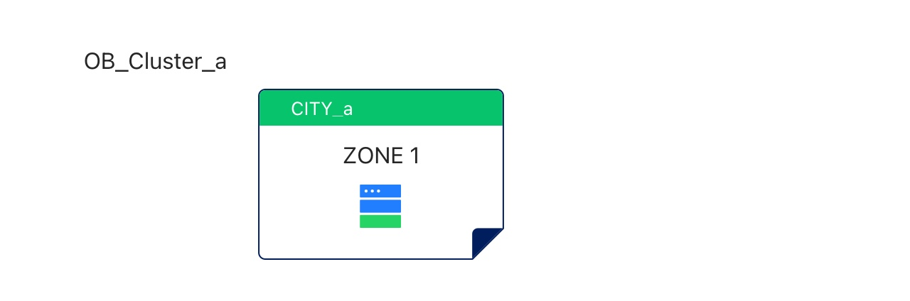

# 集群介绍

本节主要介绍 OceanBase 集群相关的基本概念及物理架构。

OceanBase 集中式数据库是一款基于单机分布式一体化架构的数据库产品，专为中小规模业务场景设计。OceanBase 集中式数据库是一款单节点数据库，其所有业务逻辑和数据处理集中在一台物理服务器上，这个数据库单元在 OceanBase 数据库中称为 OceanBase 集群。

对于 OceanBase 集中式数据库，OceanBase 集群由一个 Zone 组成。Zone 是一个逻辑概念，是对节点进行管理的容器，对于集中式版，一个 Zone 仅包含一个节点。从物理层面来讲，一个 Zone 通常是一个独立的物理部署单元，可以是一个数据中心（IDC）或者云上的一个可用区，也可以是一个单独的机架（Rack）。

OceanBase 数据库是单进程软件，进程名为 observer。通常一台物理或者虚拟服务器运行一个 observer 进程，由 IP 和端口作为唯一标识，我们称之为节点，也可以用 OBServer 节点表示。observer 进程作为 OceanBase 数据库最核心的组件，负责几乎所有数据库内核功能，包括 SQL 引擎、存储引擎和事务引擎。

