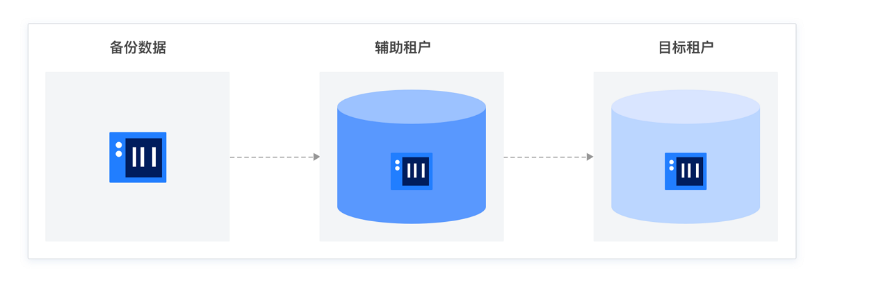

# 按表恢复前准备

由于表恢复过程中需要使用辅助租户，因此，在进行表恢复前，您需要在目标租户所在的集群内为辅助租户创建所需的资源池。

OceanBase 数据库的表级恢复功能是通过从备份数据中将用户指定的表恢复到一个已存在的租户中来实现的，并且该已存在的租户与原表所在的租户可以是同一个租户，也可以是同一集群中的不同租户，还可以是不同集群中的租户。

表级恢复功能的整体流程如下图所示。首先，在辅助租户中将数据恢复到指定时间点；再将指定的表从辅助租户跨租户导入到目标租户中；最后清理辅助租户。类似于 Oracle 数据库所使用的 Auxiliary Instance，辅助租户是表恢复过程中需要消耗的额外的计算存储资源。



## 恢复前准备

1.  使用 `root` 用户登录目标租户所在集群的 `sys` 租户。

2.  创建 Unit（资源单元）。

    示例如下：

    ```
    obclient [(none)]> CREATE RESOURCE UNIT box_16c96g MAX_CPU 16, MEMORY_SIZE = '5G', MAX_IOPS 10240, MIN_IOPS=10240;
    ```

    创建资源单元的详细操作及说明请参见 [创建租户](200-manage-create-tenant.md)。

3.  创建 Resource Pool（资源池）。

    为辅助租户创建资源池时，建议尽量与源租户保持同构，即建议辅助租户的资源池中 `unit_num` 的个数与源租户相同。

    示例如下：

    ```
    obclient [(none)]> CREATE RESOURCE POOL restore_pool unit = 'box_16c96g', unit_num = 1, zone_list = ('zone1');
    ```

    创源资源池的详细操作及说明请参见 [创建租户](200-manage-create-tenant.md)。

## 后续操作

[执行按表恢复](200-perform-table-recovery.md)
