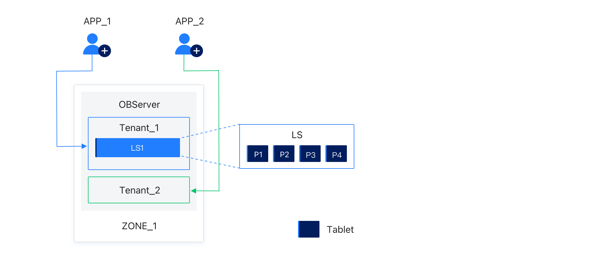

# OceanBase 数据库整体架构

OceanBase 集中式数据库专为单机部署场景设计，保留了 OceanBase 数据库的核心特性同时降低了使用复杂度。以下是其主要架构组成：

在 OceanBase 集中式数据库中，保留了可用区（zone）的概念，可用区是一个逻辑概念，表示集群内具有相似硬件可用性的一组节点。一个 OceanBase 单机集群只有一个 Zone，同时这个 Zone 中有且仅有一个节点。

在 OceanBase 数据库中，一个表的数据可以按照某种划分规则水平拆分为多个分片，每个分片叫做一个表分区，简称分区（Partition）。某行数据属于且只属于一个分区。分区的规则由用户在建表的时候指定，包括 Hash、Range、List 等类型的分区，同时还支持二级分区。例如，交易库中的订单表，可以先按照用户 ID 划分为若干个一级分区，再按照月份把每个一级分区划分为若干个二级分区。对于二级分区表，二级分区的每个分区是一个物理分区，而一级分区只是逻辑概念。每个物理分区有一个用于存储数据的存储层对象，叫做 Tablet，用于存储有序的数据记录。

当用户对 Tablet 中的记录进行修改时，为了保证数据的持久化，需要记录 Redo 日志到 Tablet 对应的日志流（Log Stream，LS）中。每个日志流用于服务其所在节点上的多个 Tablet。

在集群的节点上会运行一个叫做 OBServer 的服务进程，它内部包含多个操作系统线程。该服务进程负责分区数据的存取，同时会监听来自外部应用的连接请求，建立连接和数据库会话，并提供数据库服务。关于 observer 服务进程的更多信息，参见 [线程简介](https://www.oceanbase.com/docs/common-oceanbase-database-cn-1000000001500574)。

OceanBase 集中式数据库实例内部由不同的组件相互协作，这些组件从底层向上由多租户层、存储层、均衡层、事务层、SQL 层组成。

## 多租户层

为了简化大规模部署多个业务数据库的管理并降低资源成本，OceanBase 数据库提供了独特的多租户特性。在一个 OceanBase 集群内，可以创建多个互相之间隔离的数据库“实例”，叫做租户。从应用程序的视角来看，每个租户等同于一个独立的数据库实例。不仅如此，每个租户可以选择 MySQL 或 Oracle 兼容模式。应用连接到 MySQL 租户后，可以在租户下创建用户、Database，与一个独立的 MySQL 库的使用体验一致。同样的，应用连接到 Oracle 租户后，可以在租户下创建 schema、管理角色等，与一个独立的 Oracle 库的使用体验一致。一个新的集群初始化之后，就会存在一个特殊的名为 sys 的租户，叫做系统租户。系统租户中保存了集群的元数据，是一个 MySQL 兼容模式的租户。为了隔离租户的资源，每个 OBServer 进程内可以有多个属于不同租户的虚拟容器，叫做资源单元（Unit）。资源单元包括 CPU 和内存资源。

## 存储层

存储层以一张表或者一个分区为粒度提供数据存储与访问，每个分区对应一个用于存储数据的 Tablet（分片），用户定义的非分区表也会对应一个 Tablet。

Tablet 的内部是分层存储的结构，总共有四层：MemTable、L0 层 Mini SSTable、L1 层 Minor SSTable 以及 Major SSTable。DML 操作插入、更新、删除等首先写入 MemTable，待 MemTable 达到一定大小时转储到磁盘成为 L0 层 Mini SSTable。L0 层 Mini SSTable 个数达到阈值后会将多个 L0 层 Mini SSTable 合并成一个 L1 层 Minor SSTable。在每天配置的业务低峰期，系统会将所有的 MemTable、L0 层 Mini SSTable 和 L1 层 Minor SSTable 合并成一个 Major SSTable。

每个 SSTable 由若干个大小为 2MB 的定长宏块组成，每个宏块内部由多个不定长微块组成。

Major SSTable 的微块会在合并过程中通过编码方式进行格式转换，微块内的数据会按照列维度分别进行列内的编码，编码规则包括字典、游程、常量或差值等。每一列压缩结束后，还会进一步对多列进行列间等值或子串等规则编码。编码能对数据大幅压缩，同时提炼的列内特征信息还能进一步加速后续的查询速度。

在编码压缩之后，还可以根据用户指定的通用压缩算法进行无损压缩，进一步提升数据压缩率。

## 事务层

事务层保证了单个日志流和多个日志流 DML 操作提交的原子性，也保证了并发事务之间的多版本隔离能力。

### 原子性

一个日志流上事务的修改，即使涉及多个 Tablet，通过日志流的 write-ahead log 也可以保证事务提交的原子性。事务的修改涉及多个日志流时，每个日志流会产生并持久化各自的 write-ahead log，事务层通过优化的两阶段提交协议来保证事务提交的原子性。

当涉及到多个日志流的事务发起提交时，事务会选择其中一个日志流作为两阶段提交的协调者。协调者会与事务修改的所有日志流通信，判断 write-ahead log 是否持久化。当所有日志流都完成持久化后，事务进入提交状态。协调者会再驱动所有日志流写下该事务的 Commit 日志，表示事务最终的提交状态。当从副本回放或者数据库重启时，已经完成提交的事务都会通过 Commit 日志来确定各自日志流事务的状态。

宕机重启场景下，对于宕机前还未完成的事务，会出现写完 write-ahead log 但是还没有写下 Commit 日志的情况。由于每个日志流的 write-ahead log 都包含了事务的所有日志流列表，通过此信息可以重新确定哪个日志流是协调者并恢复协调者的状态，再次推进两阶段提交协议，直到事务达到最终的 Commit 或 Abort 状态。

### 隔离性

GTS（Global Timestamp Service）服务是一个用于在租户内产生连续增长的时间戳的服务，其通过多副本保证可用性，底层机制与上述 复制层 所描述的日志流副本同步机制一致。

每个事务在提交时会从 GTS 获取一个时间戳作为事务的提交版本号并持久化在日志流的 write-ahead log 中，事务内所有修改的数据都以此提交版本号标记。

每个语句开始（对于 Read Committed 隔离级别）或者每个事务开始（对于 Repeatable Read 和 Serializable 隔离级别）时，都会从 GTS 获取一个时间戳作为语句或事务的读取版本号。在读取数据时，会跳过比自己大的事务版本号选择比当前读取版本号小的所有版本号中最大的版本号的数据，通过这种方式为读取操作提供了统一的全局数据快照。

## SQL 层

SQL 层将用户的 SQL 请求转化成对一个或多个 Tablet 的数据访问。

### SQL 层组件

SQL 层处理一个请求的执行流程是：Parser、Resolver、Transformer、Optimizer、Code Generator、Executor。其中：

- Parser 负责词法或语法解析。将用户的 SQL 分成一个个的 "Token"，并根据预先设定好的语法规则解析整个请求，转换成语法树（Syntax Tree）。

- Resolver 负责语义解析。根据数据库元信息，将 SQL 请求中的 Token 翻译成对应的对象（例如库、表、列、索引等），生成的数据结构叫做 Statement Tree。

- Transformer 负责逻辑改写。根据内部的规则或代价模型，将 SQL 改写为与之等价的其他形式，并将其提供给后续的优化器做进一步的优化。

  Transformer 的工作方式是在原 Statement Tree 上做等价变换，变换的结果仍然是一棵 Statement Tree。

- Optimizer（优化器）为 SQL 请求生成最佳的执行计划。需要综合考虑 SQL 请求的语义、对象数据特征、对象物理分布等多方面因素，解决访问路径选择、联接顺序选择、联接算法选择、分布式计划生成等问题，最终生成执行计划。

- Code Generator（代码生成器）将执行计划转换为可执行的代码，但是不做任何优化选择。

- Executor（执行器）启动 SQL 的执行过程。

在标准的 SQL 流程之外，SQL 层还有 Plan Cache 能力，将历史的执行计划缓存在内存中，后续的执行可以反复执行这个计划，避免了重复查询优化的过程。配合 Fast-parser 模块，仅使用词法分析对文本串直接参数化，获取参数化后的文本及常量参数，让 SQL 直接命中 Plan Cache，加速频繁执行的 SQL。

### 多种计划

SQL 层的执行计划分为本地、远程和分布式三种。本地执行计划只访问本服务器的数据。远程执行计划只访问非本地的一台服务器的数据。分布式计划会访问超过一台服务器的数据，执行计划会分成多个子计划在多个服务器上执行。

SQL 层并行化执行能力可以将执行计划分解成多个部分，由多个执行线程执行，通过一定的调度的方式，实现执行计划的并行处理。并行化执行可以充分发挥服务器 CPU 和 IO 处理能力，缩短单个查询的响应时间。并行查询技术可以用于分布式执行计划，也可以用于本地执行计划。
