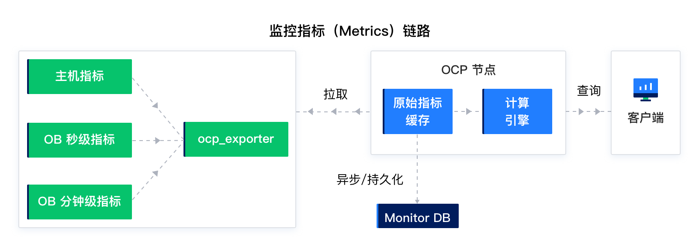
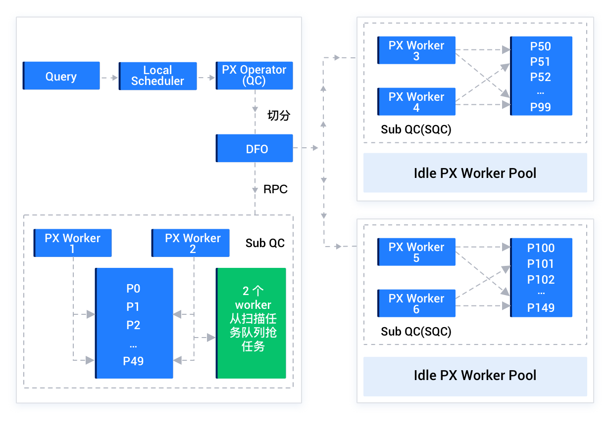
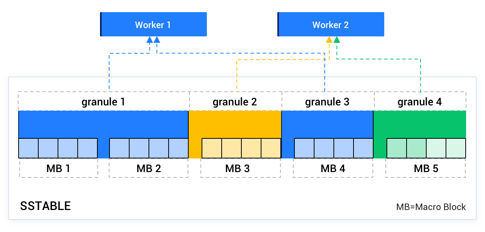
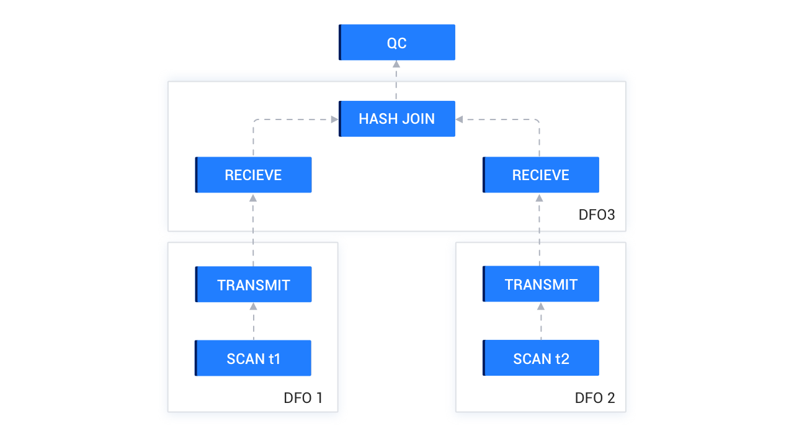
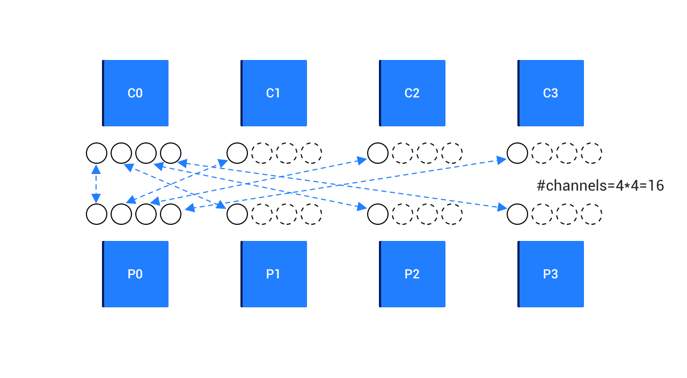

# 并行查询

## 并行查询简介

并行查询是指通过对查询计划的并行化执行，提升对每一个查询计划的 CPU 和 IO 处理能力，从而缩短单个查询的响应时间。

一般来说，当并行度提高时，查询的响应时间会缩短，更多的 CPU、IO 和内存资源会被用于执行查询命令。对于支持大数据量查询处理的 DSS（Decision Support Systems）系统或者数据仓库型应用来说，查询时间的提升尤为明显。

整体来说，并行查询的总体思路是将执行计划分解之后，将执行计划的每个部分由多个执行线程执行，通过一定的调度的方式，实现执行计划的 DFO 之间的并发执行和 DFO 内部的并发执行。

当系统满足以下条件时，并行查询可以有效提升系统处理性能：

- 充足的 IO 带宽

- 系统 CPU 负载较低

- 充足的内存资源

如果系统没有充足的资源进行额外的并行处理，使用并行查询或者提高并行度并不能提高执行性能。相反，在系统过载的情况下，操作系统会被迫进行更多的调度，例如执行上下文切换可能会导致性能的下降。

通常在 DSS 系统中，需要访问大量数据，这时并行执行能够提升执行响应时间。对于简单的 DML 操作或者涉及数据量比较小的查询来说，使用并行查询并不能很明显的降低查询响应时间。

## 并行查询原理

OceanBase 数据库的数据以分片的形式存储于每个节点，节点之间通过千兆、万兆网络通信。一般会在每个节点上部署一个叫做 observer 的进程，它是 OceanBase 数据库对外服务的主体。如下图所示。

OceanBase 数据库会根据一定的均衡策略将数据分片均衡到多个 observer 进程上，因此对于一个并行查询一般需要同时访问多个 observer 进程。

### SQL 语句并行执行流程

当用户指定的 SQL 语句启用并行执行后，用户所连接的这个 OBServer 节点将承担查询协调者 QC（Query Coordinator）的角色，执行步骤如下：

1.  QC 预约足够的线程资源。

2.  QC 将需要并行的计划拆成多个子计划，即 DFO（Data Flow Operation）。每个 DFO 包含若干个串行执行的算子。例如，一个 DFO 里包含了扫描分区、聚集和发送算子的任务，另外一个 DFO 里包含了收集、聚集算子等任务。

3.  QC 按照一定的逻辑顺序将 DFO 调度到该 OBServer 节点上执行，OBServer 节点上会临时启动一个辅助协调者 SQC（Sub Query Coordinator），SQC 负责在该 OBServer 节点上为各个 DFO 申请执行资源、构造执行上下文环境等，然后启动 DFO 在该 OBServer 节点上进行并行执行。

4.  当各个 DFO 都执行完毕，QC 会串行执行剩余部分的计算。例如，一个并行的 `COUNT` 算法最终需要 QC 将各个机器上的计算结果做一个 `SUM` 运算。

5.  QC 所在线程将结果返回给客户端。

优化器负责决策生成一个怎样的并行计划，QC 负责具体执行该计划。例如，两分区表 JOIN，优化器根据规则和代价信息，可能生成一个分布式的 PARTITION WISE JOIN 计划，也可能生成一个 HASH HASH 打散的分布式 JOIN 计划。计划一旦确定，QC 就会将计划拆分成多个 DFO，进行有序的调度执行。QC 的执行步骤如下图所示。

### 并行度与任务划分方法

并行度 DOP（Degree Of Parallelism）可以指定使用多少个线程（Worker）来执行一个 DFO。目前 OceanBase 数据库通过 `PARALLEL` Hint 来指定并行度。

如果机器上分得的 Worker 数远大于分区数，会自动做分区内并行。每个分区会以宏块为边界切分成若干个扫描任务，由多个 Worker 争抢执行。

为了将这种划分能力进行抽象和封装，引入 **Granule** 的概念。每个扫描任务称为一个 Granule，这个扫描任务既可以是扫一个分区，也可以扫描分区中的一小块范围。如下图所示。

### 并行调度方法

优化器生成并行计划后，QC 会将其切分成多个 DFO。如下图所示，`t1` 表和 `t2` 表做 HASH JOIN，切分成了 3 个 DFO，DFO 1 和 DFO 2 负责并行扫描数据，并将数据 HASH 到对应节点，DFO 3 负责做 HASH JOIN，并将最终的 HASH 结果汇总到 QC。

QC 会尽量使用两组线程来完成计划的调度，上述示例中的调度流程如下：

1.  QC 首先会调度 DFO 1 和 DFO 3，DFO 1 开始执行后就开始扫数据，并吐给 DFO 3。

2.  DFO 3 开始执行后，首先会阻塞在 HASH JOIN 创建 Hash Table 的步骤上，也就是会一直会从 DFO 1 收集数据，直到全部收集完成，建立 Hash Table 完成。然后 DFO 3 会从右边的 DFO 2 收集数据。这时候 DFO 2 还没有被调度起来，所以 DFO 3 会等待在收数据的流程上。DFO 1 在把数据都发送给 DFO 3 后就可以让出线程资源退出了。

3.  调度器回收了 DFO 1 的线程资源后，立即会调度 DFO 2。

4.  DFO 2 开始运行后就开始发送数据给 DFO 3，DFO 3 每收到一行 DFO 2 的数据就回到 Hash Table 中查表，如果命中，就会立即向上输出给 QC，QC 负责将结果输出给客户端。

### 网络通信方法

对于一对有关联的 Child DFO 和 Parent DFO，Child DFO 作为生产者分配了 M 个 Worker 线程，Parent DFO 作为消费者分配了 N 个 Worker 线程。他们之间的数据传输需要用到 M \* N 个网络通道。如下图所示。

为了更好的理解这种网络通信形式，引入数据传输层 DTL（Data Transfer Layer）的概念，即任意两点之间的通信连接使用通道（Channel）的概念来描述。

通道分为发送端和接收端，在最初的实现中我们允许发送端无限地给接收端发送数据，但发现如果接收端无法立即消费掉这些数据，可能会导致接收端内存爆掉，所以加入了流控逻辑。每个 Channel 接收端预留了三个槽位，当槽位被数据占满时会通知发送端暂停发送数据，当有接收端数据被消费空闲槽位出现时通知发送端继续发送。
