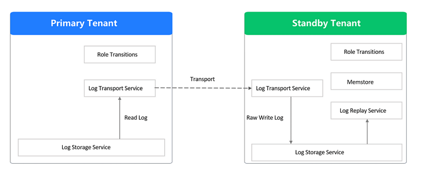

# 物理备库

物理备库功能是 OceanBase 数据库高可用解决方案的重要组成部分。它可以为用户的关键应用提供高可用、数据保护、灾难恢复等重要特性。

物理备库是 OceanBase 数据库生产数据库集群的准实时热备份。在需要计划内切换或由于故障原因导致主数据库集群无法提供服务时，物理备库可以被切换成主数据库对外提供服务，缩短服务不可用时间并减少可能的数据损失。

OceanBase 数据库使用者可以使用物理备库执行备份恢复、CDC、AP 查询等可能消耗大量资源的任务类型，从而降低主数据库的压力，进而提升数据库服务整体的可用性和稳定性。

## 物理备库配置

OceanBase 数据库采用了单集群多租户的设计，通过租户实现资源隔离，让每个使用数据库服务的业务不感知其他实例的存在，并通过权限控制确保租户数据的安全性。 更多关于 OceanBase 数据库租户特性的介绍，请参见 [多租户架构概述](100-multi-tenant-architecture-overview.md)。

从 V4.1.0 版本开始，OceanBase 数据库按照租户粒度提供物理备库能力，即主或备的角色信息属于租户级别，而不是集群级别。如果无特殊说明，在本文档中，主库和主租户、备库和备租户均代表相同的含义。

在一组使用物理备库的方案中，包含一个主租户和一个或多个备租户。主租户为业务提供读写服务，备租户通过Redo日志实时同步业务在主租户上写入的数据。

一组主租户和对应的备租户可以部署在距离相近或相隔很远的多个不同的 OceanBase 集群中，也可以部署在同一个 OceanBase 集群中。相应的，同一个 OceanBase 集群中，既可以包含主租户，也可以包含备租户，也可以同时包含主备租户。主租户和备租户的租户名称不要求相同，租户的资源规格、配置、Locality 等也不要求必须相同。

主租户和备租户既可以是单副本的租户，也可以是多副本或使用仲裁高可用能力的租户。不同的部署方式为租户提供不同级别的副本级容灾能力。

## 物理备库核心组件

下图中，以一个包含一个主租户和一个备租户的物理备库使用场景为例，物理备库所包含的核心组件如下所示。

- 日志传输服务（LOG Transport Service）

  物理备库通过日志传输服务在主租户和备租户之间实时同步 Redo 日志。特别的，主租户不会主动给备租户推送日志，仅依赖备租户从主租户拉取日志。

  日志传输服务会自动寻址日志位置信息、处理日志落后场景、处理主租户所在集群节点故障等高可用问题。备租户既可以通过主租户的日志归档服务获取日志，也可以通过网络直连主租户所在集群获取日志。

- 日志存储服务（Log Storage Service）

  日志存储服务为物理备库提供高可用、高可靠的日志存储和读写能力。

  主租户和备租户的日志存储服务使用两种截然不同的工作模式，在主租户下提供 Append 模式，即接收事务、DDL 等上层模块写入的数据；在备租户下提供 Raw Write 模式，仅允许写入通过日志传输服务从其他租户或日志归档获取的日志。

- 日志回放服务（Log Replay Service）

  备租户写入日志存储服务的日志会通过日志回放服务实时或延后的应用到内存的 Memstore 之中，从而保证主租户和备租户的数据完全一致。

- 角色转换（Role Transitions）

  物理备库提供以下两种角色转换方案：

  - Switchover

    Switchover 是主租户和备租户之间执行的无损切换。这通常使用在业务计划内的切换场景中，保证 `RPO = 0`, RTO 为秒级。在执行 Switchover 时，主租户将切换为备租户；同时一个指定的备租户将会切换为主租户。

  - Failover

    Failover 使用在主租户出现故障或由于其他原因导致无法提供服务的场景中。用户可以选择一个备租户执行 Failover，执行后，对应的备租户将被切换成主租户。Failover 是有损的，在日志正常同步无显著落后的场景下，RPO 为秒级（取决于备租户实际落后的情况），RTO 为秒级。

## 同步方式

在 V4.x 版本中，OceanBase 数据库的物理备库仅提供异步同步模式。

## 与物理备库相关的其他技术

OceanBase 数据库提供多样的容灾方案满足客户不同场景的使用需求。物理备库是其中之一，同时可以与其他方案组合使用。

### CDC

CDC（Change Data Capture，即变更数据捕获）是一种用于捕获和记录数据库中数据变更的技术。当数据库中的数据发生变化时（例如插入、更新或删除数据），CDC 技术会按照变更发生的顺序捕获变更并记录下来，以便其他系统可以及时地处理和使用这些最新的数据。

使用 CDC 技术可以将一个 OceanBase 集群中的所有数据库修改操作以事务粒度转变成 DML/DDL，并在另外一个集群重复执行。因此可以基于 CDC 技术构建"逻辑备库"。

使用 CDC 技术构建的"逻辑备库"资源开销大，执行效率相比于基于 Redo 日志同步构建的物理备库要低。因此，OceanBase 数据库更推荐物理备库方案。

更多 CDC 相关的介绍，请参见 [obcdc 概述](https://www.oceanbase.com/docs/common-oceanbase-database-cn-1000000001500442)。
