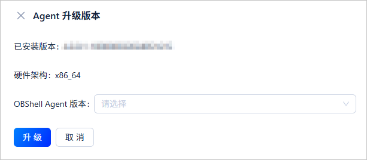

# 升级 obshell

本文介绍使用 obshell Dashboard 升级 obshll 版本的操作方法。

## 操作步骤

1.  登录 obshell Dashboard。

2.  在左侧导航栏单击 **集群管理**，进入 **集群管理** 页面。

3.  当光标悬停于 **集群管理** 页面右上方的 **···** 时，单击出现的 **升级 obshell**。

4.  在出现的 **Agent 升级版本** 页面配置 **OBShell Agent 版本**，版本从当前已上传的 obshell 软件包中选择。若当前 obshell Dashboard 中无高于当前版本的 obshell 软件包，可单击下拉框中的 **+ 上传软件包** 进行上传。

    

5.  配置完成后单击 **升级**，在弹出的窗口中单击 **确定**，obshell Dashboard 将提交升级 obshell 的任务并展示任务 ID，您可单击展示的 ID 查看任务执行情况。
