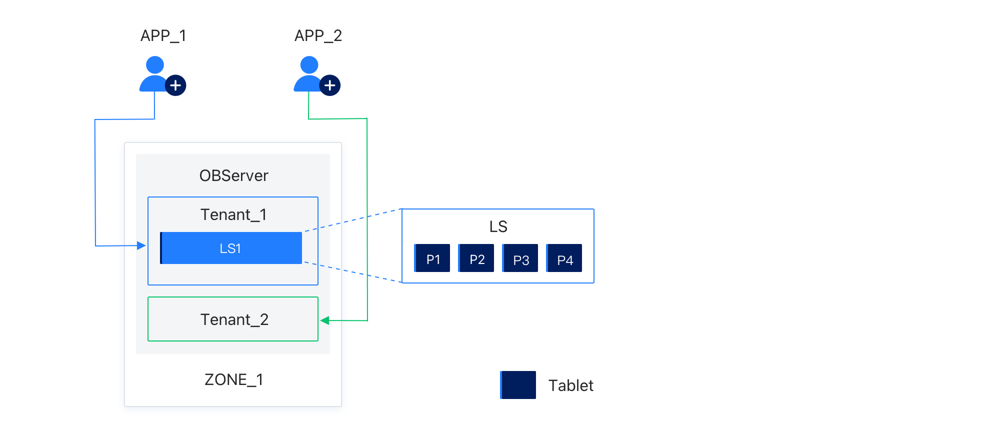

# 集中式版系统架构

OceanBase 集中式数据库专为单机部署场景设计，保留了 OceanBase 数据库的核心特性同时降低了使用复杂度。以下是其主要架构组成：

在 OceanBase 集中式数据库中，保留了可用区（zone）的概念，可用区是一个逻辑概念，表示集群内具有相似硬件可用性的一组节点。一个 OceanBase 单机集群只有一个 Zone，同时这个 Zone 中有且仅有一个节点。

为了简化大规模部署多个业务数据库的管理并降低资源成本，OceanBase 数据库提供了独特的多租户特性。在一个 OceanBase 集群内，可以创建多个互相之间隔离的数据库“实例”，叫做租户。从应用程序的视角来看，每个租户等同于一个独立的数据库实例。不仅如此，每个租户可以选择 MySQL 或 Oracle 兼容模式。应用连接到 MySQL 租户后，可以在租户下创建用户、Database，与一个独立的 MySQL 库的使用体验一致。同样的，应用连接到 Oracle 租户后，可以在租户下创建 schema、管理角色等，与一个独立的 Oracle 库的使用体验一致。一个新的集群初始化之后，就会存在一个特殊的名为 sys 的租户，叫做系统租户。系统租户中保存了集群的元数据，是一个 MySQL 兼容模式的租户。为了隔离租户的资源，每个 OBServer 进程内可以有多个属于不同租户的虚拟容器，叫做资源单元（Unit）。资源单元包括 CPU 和内存资源。

在 OceanBase 数据库中，一个表的数据可以按照某种划分规则水平拆分为多个分片，每个分片叫做一个表分区，简称分区（Partition）。某行数据属于且只属于一个分区。分区的规则由用户在建表的时候指定，包括 Hash、Range、List 等类型的分区，同时还支持二级分区。例如，交易库中的订单表，可以先按照用户 ID 划分为若干个一级分区，再按照月份把每个一级分区划分为若干个二级分区。对于二级分区表，二级分区的每个分区是一个物理分区，而一级分区只是逻辑概念。每个物理分区有一个用于存储数据的存储层对象，叫做 Tablet，用于存储有序的数据记录。

当用户对 Tablet 中的记录进行修改时，为了保证数据的持久化，需要记录 Redo 日志到 Tablet 对应的日志流（Log Stream，LS）中。每个日志流用于服务其所在节点上的多个 Tablet。

在集群的节点上会运行一个叫做 OBServer 的服务进程，它内部包含多个操作系统线程。该服务进程负责分区数据的存取，同时会监听来自外部应用的连接请求，建立连接和数据库会话，并提供数据库服务。关于 observer 服务进程的更多信息，参见 [线程简介](https://www.oceanbase.com/docs/common-oceanbase-database-cn-1000000001500574)。
