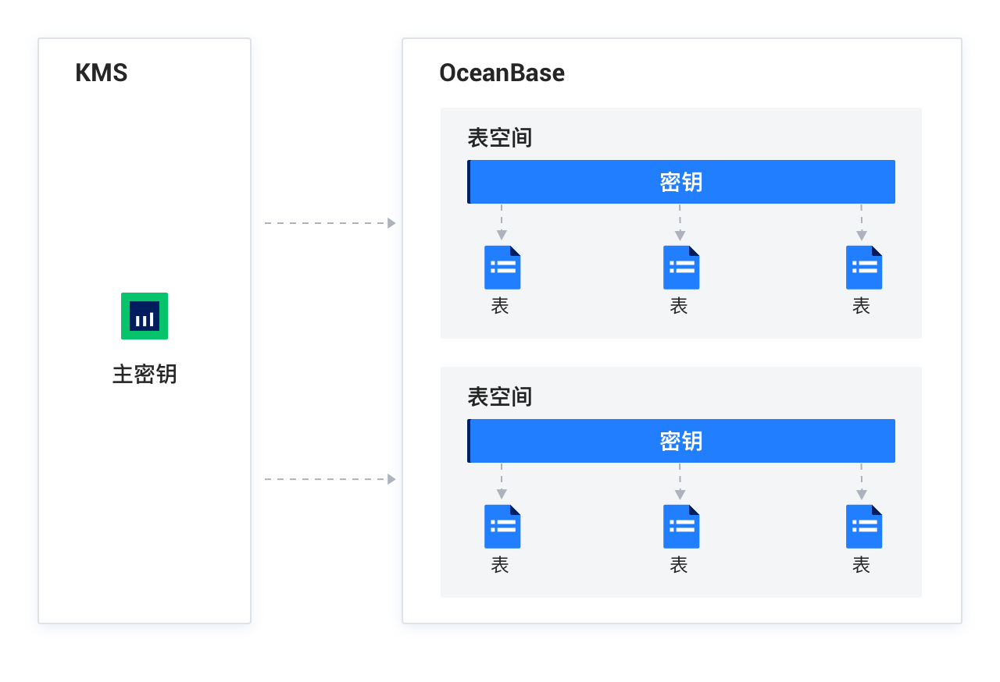

# 数据库透明加密概述

数据存储加密是指对数据和 clog 等保存在磁盘中的数据进行无感知的加密，即透明加密（简称 TDE）。数据在写入存储设备前自动进行加密，读取时自动解密，该过程对用户是透明的，黑客和恶意用户无法从数据文件、数据库备份或磁盘中读取到敏感数据。

OceanBase 数据库的用户数据和备份最终都是以二进制的形式，存储在磁盘或其它形式的永久存储上。无数据访问权限的用户可能会接触到这些存储，再通过外部操作对数据存储进行读取和解读，从而导致数据泄露。虽然 OceanBase 数据库的数据以压缩形式保存，具备一定的保密性，但仍旧有被破解的风险。为了保护存储在内存和硬盘中数据的安全，OceanBase 数据库现阶段支持国际上主流的加密算法 AES，与此同时，还支持国密算法 SM4。

## 加密原理

数据透明加密使用**两级密钥体系**实现加解密功能：

- 租户主密钥：每个租户有一个主密钥，用于对表空间的数据密钥进行加密。关于租户主密钥的详细信息，请参见 [租户主密钥概述](100-tenant-master-key-overview.md)。
- 数据密钥：每个加密的表空间指定加密算法并生成专用的数据密钥，数据密钥用于加密该表空间中的所有数据。加密操作以表空间为单位，只有放入加密表空间（Tablespace）的表才能开启加密，实现表级加密的最小粒度需通过加密表空间来完成。

开启加密时，使用主密钥对数据密钥进行加密后得到加密的数据密钥密文，该密文会存储在内部表、宏块头部、Clog 头部中，数据密钥不会明文存储在任何地方。需要加解密数据时，使用主密钥解密该密文后得到数据密钥，从而对宏块或 clog 中的用户数据进行加解密操作。

## 加密生效机制

用户存储在磁盘上的数据包括了 clog 和宏块两类，只有在将数据实际写到磁盘上时加密才会生效，内存中的数据是不加密的。若将原本不加密的表改为加密后，原先已经存储在磁盘上的未加密的 clog 和宏块数据不会变为加密，后续新写到磁盘上的数据才是加密的。由于每一条 clog 和每一个宏块都会记录加密元信息，因此加密和未加密的数据可以同时存在。

clog 是采用追加写的方式写到磁盘上的，因此旧的未加密的 clog 永远不会变为加密。等开启加密一段时间，旧的 clog 都被回收后，磁盘上的 clog 数据就会都成为加密数据了。对于宏块数据，只有在转储或合并时才会发生写入，可以手动触发全量合并将未加密的宏块数据重写为加密的。

## 支持的加密算法

OceanBase 数据库现阶段支持国际上主流的加密算法 AES，与此同时，还支持国密算法 SM4。

| 算法 | 密钥长度                       | 模式     |
|------|--------------------------------|----------|
| AES  | 128 bits / 192 bits / 256 bits | ecb, gcm |
| SM4  | 128 bits                       | cbc, gcm |

## 相关文档

- [租户主密钥概述](100-tenant-master-key-overview.md)
