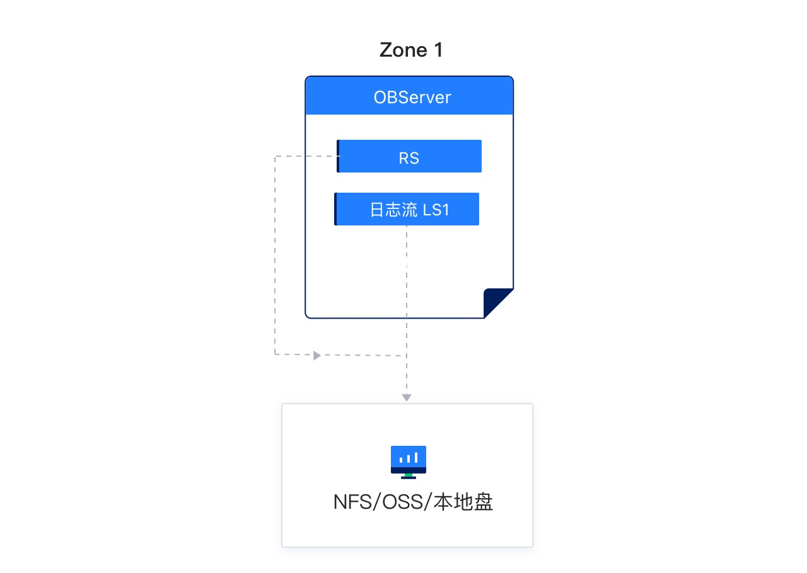

# 数据备份概述

本节主要介绍数据备份的架构及备份文件的存储机制。

## 数据备份架构

数据备份的架构如下图所示。

## 数据备份文件的存储机制

在数据备份场景中，由于原生 NFS 协议处理海量小文件（例如，千万级 2 MB 文件）时性能较差，OceanBase 数据库在 V4.x 版本引入了数据聚合存储机制，即，将每个备份单元（backup item）打包存储，以减少小文件的数量，备份单元包括 SSTable 元数据、Tablet 元数据、宏块对象等三类数据。默认每批次聚合 2048 个备份单元（每个备份单元最大为 2 MB），每次聚合的备份单元的个数（`backup_data_file_size/2 MB`）可通过租户级配置项 [backup_data_file_size](https://www.oceanbase.com/docs/common-oceanbase-database-cn-1000000002015576) 进行调整。同时，由于元数据与宏块的大小存在差异，最终生成的聚合文件的大小会有所不同。
