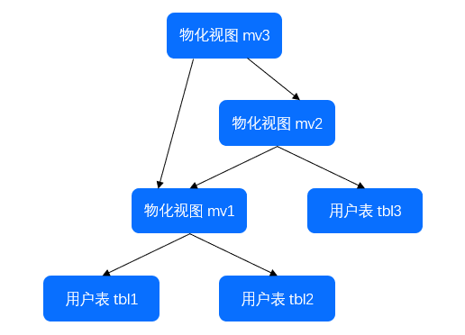

# 刷新物化视图

#### 说明

刷新物化视图也会自动更新其所有索引。

#### 注意

- 由于 `REFRESH FAST` 方法利用物化视图日志中的记录信息来确定需要增量刷新的内容，因此在使用增量刷新刷新物化视图时，需要在创建物化视图之前就创建基表的物化视图日志（mlog）。
- 增量刷新物化视图中使用的列都必须在 mlog 里。

有关创建物化视图日志的信息，请参见 [物化视图日志](200-materialized-views-log-of-oracle-mode.md)。对于 V4.3.5 版本，从 V4.3.5 BP4 版本开始支持物化视图日志自动管理功能。如果开启自动管理 mlog，那么在创建增量刷新物化视图前，用户无需创建基表的 mlog，OceanBase 数据库会自动创建对应的 mlog 或更新已存在的 mlog 表定义使其包含新建物化视图依赖的列。详细信息，参见 [物化视图日志自动管理](250-automatic-management-materialized-views-log-of-oracle-mode.md)。

#### 说明

由于嵌套物化视图不支持实时物化视图，所以在 `FROM` 表为物化视图时，无法使用实时物化视图。

#### 说明

对于 V4.3.5 版本，从 V4.3.5 BP4 版本开始支持 `MAX` 和 `MIN` 聚合增量刷新。

#### 说明

- 对于 OceanBase 数据库 V4.3.5 版本，物化视图增量刷新多表连接从 V4.3.5 BP3 版本开始支持外连接（`LEFT JOIN`/`RIGHT JOIN`）。
- 外连接使用限制：连接树需要是等价于 `INNER JOIN` 在先，`LEFT JOIN` 在后的左深连接树。

#### 注意

对于 OceanBase 数据库 V4.3.5 版本：

- 在 V4.3.5 BP5 之前版本 `FROM` 表均需存在主键，且主键在 `SELECT` 中输出。
- 从 V4.3.5 BP5 版本开始删除对多表连接增量刷新物化视图要求基表上有主键的要求。

#### 说明

- 为了使简单连接物化视图在增量刷新和实时物化视图中获得较好的性能，推荐按照以下方式为物化视图及其依赖基表创建索引：
  1.  为每张表的连接键创建索引，用于提升增量更新和实时物化视图中表的连接性能。
  2.  为物化视图中各基表主键列创建索引。
- 随着物化视图中 `JOIN` 表数量的增加，物化视图的增量刷新性能和实时物化视图查询性能通常会有所下降。

#### 说明

对于 V4.3.5 版本，从 V4.3.5 BP5 版本开始支持带有外连接的聚合物化视图的增量刷新。

#### 说明

对于 OceanBase 数据库 V4.3.5 版本，变量 `mview_refresh_dop` 从 V4.3.5 BP1 版本开始引入。

#### 注意

设置 Global 级别的变量对当前 Session 无效，需要重新登录建立新的 Session 才会生效。

#### 说明

视图 `DBA_MVIEWS` 查看物化视图并行度只能查看针对物化视图指定的的并行度。

- 字段 `REFRESH_DOP` 为非 0 时，物化视图后台刷新任务将使用 `REFRESH_DOP` 对应的并行度。

- 当 `REFRESH_DOP` 为 0 时，将使用设置 Global（全局）级别的 `mview_refresh_dop` 的值。

  **示例如下：**

  1.  创建物化视图 `mv0_t1`。

      ``` sql
      CREATE MATERIALIZED VIEW mv0_t1
          REFRESH COMPLETE ON DEMAND
          START WITH current_date
              NEXT current_date + INTERVAL '10' SECOND
          AS SELECT c1, c2
              FROM t1;
      ```

  2.  查看物化视图 `mv0_t1` 设定的后台刷新并行度。

      ``` sql
      SELECT OWNER, MVIEW_NAME,REFRESH_DOP
      FROM SYS.DBA_MVIEWS
      WHERE OWNER = 'SYS'
      AND MVIEW_NAME = 'MV0_T1';
      ```

      返回结果如下：

      ```
      +-------+------------+-------------+
      | OWNER | MVIEW_NAME | REFRESH_DOP |
      +-------+------------+-------------+
      | SYS   | MV0_T1     |           0 |
      +-------+------------+-------------+
      1 row in set
      ```

  3.  修改物化视图 `mv0_t1` 并行度为 8。

      ``` sql
      ALTER MATERIALIZED VIEW mv0_t1 PARALLEL 8;
      ```

  4.  查看物化视图设定的后台刷新并行度。

      ``` sql
      SELECT OWNER, MVIEW_NAME,REFRESH_DOP
      FROM SYS.DBA_MVIEWS
      WHERE OWNER = 'SYS'
      AND MVIEW_NAME = 'MV0_T1';
      ```

      返回结果如下：

      ```
      +-------+------------+-------------+
      | OWNER | MVIEW_NAME | REFRESH_DOP |
      +-------+------------+-------------+
      | SYS   | MV0_T1     |           8 |
      +-------+------------+-------------+
      1 row in set
      ```

- 使用视图 [DBA_MVREF_RUN_STATS](https://www.oceanbase.com/docs/common-oceanbase-database-cn-1000000002014449) 查询物化视图的历史刷新并行度。

  **示例如下：**

  ``` sql
  SELECT REFRESH_ID, MVIEWS, PARALLELISM
  FROM SYS.DBA_MVREF_RUN_STATS
  WHERE MVIEWS = 'SYS.MV0_T1'
  ORDER BY REFRESH_ID;
  ```

  返回结果如下：

  ```
  +------------+------------+-------------+
  | REFRESH_ID | MVIEWS     | PARALLELISM |
  +------------+------------+-------------+
  |    6752103 | SYS.MV0_T1 |           5 |
  |    6752733 | SYS.MV0_T1 |           5 |
  |    6753371 | SYS.MV0_T1 |           5 |
  |    6753985 | SYS.MV0_T1 |           8 |
  |    6754618 | SYS.MV0_T1 |           8 |
  |    6755249 | SYS.MV0_T1 |           8 |
  +------------+------------+-------------+
  6 rows in set
  ```

## 手动刷新物化视图

当物化视图的刷新模式是 `ON DEMAND`，可以使用 `DBMS_MVIEW` 包进行手动刷新。对于定义为增量刷新的物化视图，手动刷新时可以指定为全量刷新。

#### 说明

物化视图的所有者和租户管理员用户才可以执行刷新操作。

### 使用 REFRESH 刷新物化视图

``` sql
DBMS_MVIEW.REFRESH (
   list                   IN     VARCHAR2,                  -- 物化视图名称, 暂时不支持多张物化视图
   method                 IN     VARCHAR2       := NULL,    -- 刷新选项
                                                            --   f 快速刷新
                                                            --   ? 强制刷新
                                                            --   C|c 完全刷新
                                                            --   A|a 始终刷新，等价于C
   ----------- 以下参数都不支持, 只为兼容Oracle ----------------
   rollback_seg           IN     VARCHAR2       := NULL,
   push_deferred_rpc      IN     BOOLEAN        := true,
   refresh_after_errors   IN     BOOLEAN        := false,
   purge_option           IN     BINARY_INTEGER := 1,
   parallelism            IN     BINARY_INTEGER := 0,
   heap_size              IN     BINARY_INTEGER := 0,
   atomic_refresh         IN     BOOLEAN        := true, 
   nested                 IN     BOOLEAN        := false,
   out_of_place           IN     BOOLEAN        := false,
   skip_ext_data          IN     BOOLEAN        := false,
   ---------------------------------------------------------
   refresh_parallel       IN     BINARY_INTEGER := 0);       -- 物化视图刷新并行度, OB独有的参数
```

**示例如下：**

1.  向表 `test_tbl1` 中插入 `3` 条数据。

    ``` sql
    INSERT INTO test_tbl1 VALUES (1, 1, 1, 1),(2, 2, 2, 2),(3, 3, 3, 3);
    ```

2.  查看物化视图 `mv1_test_tbl1` 信息。

    ``` sql
    SELECT * FROM mv1_test_tbl1;
    ```

    返回结果如下：

    ```
    Empty set
    ```

3.  使用 `DBMS_MVIEW.REFRESH` 手动刷新物化视图 `mv1_test_tbl1`。

    - 使用物化视图设置的刷新选项刷新物化视图：

      ``` sql
      CALL DBMS_MVIEW.REFRESH('mv1_test_tbl1');
      ```

    - 指定刷新选项刷新物化视图：

      ``` sql
      CALL DBMS_MVIEW.REFRESH('mv1_test_tbl1', 'c');
      ```

4.  再次查看物化视图 `mv1_test_tbl1` 信息。

    ``` sql
    SELECT * FROM mv1_test_tbl1;
    ```

    返回结果如下：

    ```
    +------+------+----------+----------+
    | COL2 | CNT  | CNT_COL3 | SUM_COL3 |
    +------+------+----------+----------+
    |    3 |    1 |        1 |        3 |
    |    2 |    1 |        1 |        2 |
    |    1 |    1 |        1 |        1 |
    +------+------+----------+----------+
    3 rows in set
    ```

### 手动刷新物化视图刷新并行度

对于手动刷新物化视图，可以通过设置系统变量 [mview_refresh_dop](https://www.oceanbase.com/docs/common-oceanbase-database-cn-1000000002501616) 为物化视图刷新操作设置默认并行度。

也可以在调用 [DBMS_MVIEW.REFRESH](https://www.oceanbase.com/docs/common-oceanbase-database-cn-1000000002016439) 函数时，通过指定 `refresh_parallel` 显式设置本次刷新的并行度。

#### 注意

如果未显式指定并行度，且 `mview_refresh_dop` 变量为 0 或 1 时，不开启并行刷新。

**示例如下：**

1.  将当前 Session 并行度设置为 5。

    ``` sql
    SET mview_refresh_dop = 5;
    ```

2.  手动刷新物化视图：

    - 显式指定刷新并行度为 8，本次刷新并行度为 8。

      ``` sql
      CALL DBMS_MVIEW.REFRESH('mv1', 'c', 8);
      ```

    - 未显式指定刷新并行度，以 Session 变量值为准，本次刷新并行度为 5。

      ``` sql
      CALL DBMS_MVIEW.REFRESH('mv1', 'c');
      ```

## 自动刷新物化视图

创建物化视图的时候，如果指定了`START WITH datetime_expr` 和 `NEXT datetime_expr` 子句，当满足要求时，系统会为物化视图创建后台自动刷新任务。

### 自动刷新物化视图刷新并行度

在后台自动刷新物化视图时，可以通过以下两种方式来指定并行度：

#### 说明

下述并行度优先级依次降低。

1.  创建物化视图时指定并行度（Table DOP）。

    **示例如下：**

    ``` sql
    CREATE MATERIALIZED VIEW mv_t1
        PARALLEL 8
        REFRESH COMPLETE ON DEMAND
            START WITH current_date
                NEXT current_date + INTERVAL '10' SECOND
            AS SELECT c1, c2
               FROM t1;
    ```

2.  设置全局 Session 变量 `mview_refresh_dop` 作为刷新并行度。

    自动刷新操作通过内部 Session 进行刷新，需要设置 Global（全局）级别的 [mview_refresh_dop](https://www.oceanbase.com/docs/common-oceanbase-database-cn-1000000002501616) 才能对后台 Session 生效。

    #### 注意

    如果创建物化视图时未显式指定并行度，且 `mview_refresh_dop` 变量为 0 或 1 时，后台刷新任务不开启并行刷新。

    **示例如下：**

    1.  将全局 Session 并行度设置为 5。

        ``` sql
        SET GLOBAL mview_refresh_dop = 5;
        ```

    2.  创建物化视图：

        - 创建物化视图时指定并行度为 8，后台刷新任务会使用 8 作为刷新并行度。

          ``` sql
          CREATE MATERIALIZED VIEW mv1_t1
              PARALLEL 8
              REFRESH COMPLETE ON DEMAND
                   START WITH current_date
                       NEXT current_date + INTERVAL '10' SECOND
              AS SELECT c1, c2
              FROM t1;
          ```

        - 创建物化视图时未指定并行度，后台刷新任务会使用变量 `mview_refresh_dop` 的值 5 作为刷新并行度。

          ``` sql
          CREATE MATERIALIZED VIEW mv2_t1
              REFRESH COMPLETE ON DEMAND
                   START WITH current_date
                       NEXT current_date + INTERVAL '10' SECOND
              AS SELECT c1, c2
              FROM t1;
          ```

## 嵌套物化视图刷新

#### 说明

对于 OceanBase 数据库 V4.3.5 版本，从 V4.3.5 BP5 版本开始支持基于无主键的物化视图创建嵌套物化视图。

### 嵌套物化视图的刷新规则

嵌套物化视图所支持的刷新方式和非嵌套物化视图一样，都包括全量与增量刷新。虽然刷新一个嵌套物化视图只需要用到其所直接依赖的用户表与物化视图（以及它们的 mlog），但是由于嵌套物化视图是基于其他物化视图所构建，因此其数据的一致性会依赖于其他物化视图。这意味着如果想通过刷新来让某个嵌套物化视图的数据保持最新，需要先保证其所依赖的其他物化视图数据是最新的，即需要先对它们进行刷新。

例如下图，物化视图 `mv1` 基于表 `tbl1` 和表 `tbl2` 构建，物化视图 `mv2` 则基于物化视图 `mv1` 和表 `tbl3` 构建，物化视图 `mv3` 基于物化视图 `mv1` 和物化视图 `mv2` 构建。按照物化视图 `mv1`、物化视图 `mv2`、物化视图 `mv3` 的顺序进行刷新的情况下，可以保证嵌套物化视图整体数据的一致性。否则如果先刷新物化视图 `mv2`，再刷新物化视图 `mv1`，则物化视图 `mv2` 的数据并不是最新（落后于物化视图 `mv1`）；同理，如果先刷新物化视图 `mv3`，再刷新物化视图 `mv2`，则物化视图 `mv3` 的数据也不是最新（落后于物化视图 `mv2`）。



对于 OceanBase 数据库 V4.3.5 版本，嵌套物化视图从 V4.3.5 BP3 版本开始支持级联刷新。级联刷新分为级联非一致性刷新和级联一致性刷新。

- **级联非一致性刷新**：自底向上刷新嵌套物化视图依赖的所有物化视图，每个物化视图的刷新没有数据一致性的保证，依赖的基表读取的数据位点不一致。级联非一致刷新适用于批量同步的方式，比如业务方定时从上游同步数据，数据同步完成后通过级联非一致刷新即可保持物化视图的最终一致性。

- **级联一致性刷新**：快照一致性级联刷新，保证整个级联刷新完成后，上层看到的所依赖的所有基表的数据位点都是一致的。级联一致刷新适用于实时同步数据的场景，我们保证了每次级联刷新完成后，物化视图中的数据快照处于相同位点。

### 嵌套物化视图刷新示例

如果一个物化视图进行了全量刷新，那么依赖它的物化视图在后续进行增量刷新前必须先进行一次全量刷新，否则会报错。

**示例如下：**

1.  创建表 `tbl1` 并插入一条数据。

    ``` sql
    CREATE TABLE tbl1(id INT, name VARCHAR2(30), PRIMARY KEY(id));
    ```

    ``` sql
    INSERT INTO tbl1 VALUES (1, 'jack');
    ```

2.  创建表 `tbl2` 并插入一条数据。

    ``` sql
    CREATE TABLE tbl2(id INT, age INT, PRIMARY KEY(id));
    ```

    ``` sql
    INSERT INTO tbl2 VALUES (1, 21);
    ```

3.  在表 `tbl1` 和表 `tbl2` 上创建物化视图日志。

    ``` sql
    CREATE MATERIALIZED VIEW LOG ON tbl1 WITH PRIMARY KEY (name) INCLUDING NEW VALUES;
    ```

    ``` sql
    CREATE MATERIALIZED VIEW LOG ON tbl2 WITH PRIMARY KEY (age) INCLUDING NEW VALUES;
    ```

4.  基于 `tbl1` 和 `tbl2` 创建物化视图 `mv1`。

    ``` sql
    CREATE MATERIALIZED VIEW mv1 (PRIMARY KEY (id1, id2))
        REFRESH FAST ON DEMAND
        AS SELECT tbl1.id id1, tbl2.id id2, tbl1.NAME, tbl2.AGE
            FROM tbl1, tbl2
            WHERE tbl1.id = tbl2.id;
    ```

5.  在物化视图 `mv1`上创建物化视图日志。

    ``` sql
    CREATE MATERIALIZED VIEW LOG ON mv1 WITH PRIMARY KEY (name, age) INCLUDING NEW VALUES;
    ```

6.  基于物化视图 `mv1` 创建物化视图（嵌套物化视图） `mv2`。

    ``` sql
    CREATE MATERIALIZED VIEW mv2
        REFRESH FAST
        AS SELECT COUNT(*) cnt, COUNT(AGE) age_cnt, SUM(AGE) age_sum
            FROM mv1;
    ```

7.  查看物化视图 `mv1` 的数据。

    ``` sql
    SELECT * FROM mv1;
    ```

    返回结果如下：

    ```
    +------+------+------+------+
    | ID1  | ID2  | NAME | AGE  |
    +------+------+------+------+
    |    1 |    1 | jack |   21 |
    +------+------+------+------+
    1 row in set
    ```

8.  查看物化视图 `mv2` 的数据。

    ``` sql
    SELECT * FROM mv2;
    ```

    返回结果如下：

    ```
    +------+---------+---------+
    | CNT  | AGE_CNT | AGE_SUM |
    +------+---------+---------+
    |    1 |       1 |      21 |
    +------+---------+---------+
    1 row in set
    ```

9.  向表 `tbl1` 和表 `tbl2` 中各插入一条数据。

    ``` sql
    INSERT INTO tbl1 VALUES (2, 'rose');
    ```

    ``` sql
    INSERT INTO tbl2 VALUES (2, 19);
    ```

10. 增量刷新物化视图 `mv1`。

    ``` sql
    CALL dbms_mview.refresh('mv1', 'f');
    ```

11. 查看物化视图 `mv1` 的数据。

    ``` sql
    SELECT * FROM mv1;
    ```

    返回结果如下：

    ```
    +------+------+------+------+
    | ID1  | ID2  | NAME | AGE  |
    +------+------+------+------+
    |    1 |    1 | jack |   21 |
    |    2 |    2 | rose |   19 |
    +------+------+------+------+
    2 rows in set
    ```

12. 增量刷新物化视图 `mv2`。

    ``` sql
    CALL dbms_mview.refresh('mv2', 'f');
    ```

13. 查看物化视图 `mv2` 的数据。

    ``` sql
    SELECT * FROM mv2;
    ```

    返回结果如下：

    ```
    +------+---------+---------+
    | CNT  | AGE_CNT | AGE_SUM |
    +------+---------+---------+
    |    2 |       2 |      40 |
    +------+---------+---------+
    1 row in set
    ```

14. 再次向表 `tbl1` 和表 `tbl2` 中各插入一条数据。

    ``` sql
    INSERT INTO tbl1 VALUES (3, 'mary');
    ```

    ``` sql
    INSERT INTO tbl2 VALUES (3, 25);
    ```

15. 全量刷新物化视图 `mv1`。

    ``` sql
    CALL dbms_mview.refresh('mv1', 'c');
    ```

16. 再次查看物化视图 `mv1` 的数据。

    ``` sql
    SELECT * FROM mv1;
    ```

    返回结果如下：

    ```
    +------+------+------+------+
    | ID1  | ID2  | NAME | AGE  |
    +------+------+------+------+
    |    1 |    1 | jack |   21 |
    |    2 |    2 | rose |   19 |
    |    3 |    3 | mary |   25 |
    +------+------+------+------+
    3 rows in set
    ```

17. 再次增量刷新物化视图 `mv2`。

    ``` sql
    CALL dbms_mview.refresh('mv2', 'f');
    ```

    返回结果如下：

    ```
    OBE-12052: cannot fast refresh materialized view
    at package body oceanbase.DBMS_MVIEW.DO_REFRESH , line : 54, col : 1
    at oceanbase.DBMS_MVIEW.REFRESH , line : 72, col : 1
    ```

    #### 注意

    由于 `mv1` 经历过全量刷新，因此直接对 `mv2` 进行增量刷新会报错，必须先进行一次全量刷新。

18. 再次查看物化视图 `mv2` 的数据。

    ``` sql
    SELECT * FROM mv2;
    ```

    返回结果如下：

    ```
    +------+---------+---------+
    | CNT  | AGE_CNT | AGE_SUM |
    +------+---------+---------+
    |    2 |       2 |      40 |
    +------+---------+---------+
    1 row in set
    ```

19. 全量刷新物化视图 `mv2`。

    ``` sql
    CALL dbms_mview.refresh('mv2', 'c');
    ```

20. 再次查看物化视图 `mv2` 的数据。

    ``` sql
    SELECT * FROM mv2;
    ```

    返回结果如下：

    ```
    +------+---------+---------+
    | CNT  | AGE_CNT | AGE_SUM |
    +------+---------+---------+
    |    3 |       3 |      65 |
    +------+---------+---------+
    1 row in set
    ```

### 实时嵌套物化视图示例

如果一个物化视图（嵌套物化视图）是实时物化视图，则需要先对下层物化视图进行增量刷新来更新 mlog。由于实时物化视图的查询结果是通过模拟 mlog 的方式去查询下层物化视图和自身结果进行合并。因此，需要先对下层物化视图进行增量刷新来更新 mlog，以此保证实时物化视图的数据是最新的。

#### 说明

对于 V4.3.5 版本，从 V4.3.5 BP4 版本开始支持物化视图日志自动管理功能。如果开启自动管理 mlog，那么在创建实时物化视图前，用户无需创建基表的 mlog，OceanBase 数据库会自动创建对应的 mlog 或更新已存在的 mlog 表定义使其包含新建物化视图依赖的列。详细信息，参见 [物化视图日志自动管理](250-automatic-management-materialized-views-log-of-oracle-mode.md)。

**示例如下：**

1.  创建表 `tbl3`。

    ``` sql
    CREATE TABLE tbl3(col1 INT, col2 INT, col3 INT);
    ```

2.  在表 `tbl3` 上创建物化视图日志。

    ``` sql
    CREATE MATERIALIZED VIEW LOG ON tbl3 WITH PRIMARY KEY, ROWID, SEQUENCE (col1, col2, col3) INCLUDING NEW VALUES;
    ```

3.  基于表 `tbl3` 创建物化视图 `mv_tbl3_1`。

    ``` sql
    CREATE MATERIALIZED VIEW mv_tbl3_1
        REFRESH COMPLETE ON DEMAND
        ENABLE ON QUERY COMPUTATION
        AS SELECT col1, col2, col3, COUNT(*) AS cnt
            FROM tbl3
            GROUP BY col1, col2, col3;
    ```

4.  在物化视图 `mv_tbl3_1` 上创建物化视图日志。

    ``` sql
    CREATE MATERIALIZED VIEW LOG ON mv_tbl3_1 WITH PRIMARY KEY, ROWID, SEQUENCE (col1, col2, col3) INCLUDING NEW VALUES;
    ```

5.  基于物化视图 `mv_tbl3_1` 创建物化视图 `mv_tbl3_2`。

    ``` sql
    CREATE MATERIALIZED VIEW mv_tbl3_2
        REFRESH COMPLETE ON DEMAND
        ENABLE ON QUERY COMPUTATION
        AS SELECT col1, col2, col3, COUNT(*) AS cnt
            FROM mv_tbl3_1
            GROUP BY col1, col2, col3;
    ```

6.  在物化视图 `mv_tbl3_2` 上创建物化视图日志。

    ``` sql
    CREATE MATERIALIZED VIEW LOG ON mv_tbl3_2 WITH PRIMARY KEY, ROWID, SEQUENCE (col1, col2, col3) INCLUDING NEW VALUES;
    ```

7.  基于物化视图 `mv_tbl3_2` 创建实时物化视图 `mv_tbl3_3`。

    ``` sql
    CREATE MATERIALIZED VIEW mv_tbl3_3
        REFRESH COMPLETE ON DEMAND
        ENABLE ON QUERY COMPUTATION
        AS SELECT col1, col2, col3, COUNT(*) AS cnt
            FROM mv_tbl3_2
            GROUP BY col1, col2, col3;
    ```

8.  向表 `tbl3` 中插入一条数据。

    ``` sql
    INSERT INTO tbl3 VALUES(1, 1, 1);
    ```

9.  查看表 `tbl3` 的数据。

    ``` sql
    SELECT * FROM tbl3;
    ```

    返回结果如下：

    ```
    +------+------+------+
    | COL1 | COL2 | COL3 |
    +------+------+------+
    |    1 |    1 |    1 |
    +------+------+------+
    1 row in set
    ```

10. 查看物化视图 `mv_tbl3_1` 的数据。

    ``` sql
    SELECT * FROM mv_tbl3_1;
    ```

    返回结果如下：

    ```
    +------+------+------+------+
    | COL1 | COL2 | COL3 | CNT  |
    +------+------+------+------+
    |    1 |    1 |    1 |    1 |
    +------+------+------+------+
    1 row in set
    ```

11. 查看物化视图 `mv_tbl3_2` 的数据。

    ``` sql
    SELECT * FROM mv_tbl3_2;
    ```

    返回结果如下：

    ```
    Empty set
    ```

12. 查看物化视图 `mv_tbl3_3` 的数据。

    ``` sql
    SELECT * FROM mv_tbl3_3;
    ```

    返回结果如下：

    ```
    Empty set
    ```

13. 增量刷新物化视图 `mv_tbl3_1`。

    ``` sql
    CALL dbms_mview.refresh('mv_tbl3_1','f');
    ```

14. 再次查看物化视图 `mv_tbl3_2` 的数据。

    ``` sql
    SELECT * FROM mv_tbl3_2;
    ```

    返回结果如下：

    ```
    +------+------+------+------+
    | COL1 | COL2 | COL3 | CNT  |
    +------+------+------+------+
    |    1 |    1 |    1 |    1 |
    +------+------+------+------+
    1 row in set
    ```

15. 再次查看物化视图 `mv_tbl3_3` 的数据。

    ``` sql
    SELECT * FROM mv_tbl3_3;
    ```

    返回结果如下：

    ```
    Empty set
    ```

16. 增量刷新物化视图 `mv_tbl3_2`。

    ``` sql
    CALL dbms_mview.refresh('mv_tbl3_2','f');
    ```

17. 再次查看物化视图 `mv_tbl3_3` 的数据。

    ``` sql
    SELECT * FROM mv_tbl3_3;
    ```

    返回结果如下：

    ```
    +------+------+------+------+
    | COL1 | COL2 | COL3 | CNT  |
    +------+------+------+------+
    |    1 |    1 |    1 |    1 |
    +------+------+------+------+
    1 row in set
    ```

## 物化视图刷新统计信息

OceanBase 系统能够收集并保存物化视图刷新操作的相关统计信息，这些信息可通过特定的视图进行查询。当前和历史物化视图刷新操作的统计信息存储在数据库中。通过历史物化视图刷新统计信息，您可以了解和分析数据库中物化视图刷新性能。

物化视图刷新的统计信息作用如下：

- 报告功能：提供物化视图刷新操作的当前及历史统计概览，包括刷新执行所需的实际时间，以便跟踪和监控刷新性能。

- 诊断功能：通过详尽的当前和历史统计数据，能够有效地分析物化视图刷新的性能。例如，若物化视图的刷新耗时较长，统计数据可以帮助识别是系统负载增加还是因数据变更量增大导致的性能下降。

### 物化视图收集统计信息

物化视图收集统计信息。可以通过 `analyze table` 或者 `call dbms_stats.gather_table_stats('database_name', 'table_name')` 来收集统计信息。

- 更多有关收集表和列的统计信息的信息，请参见 [GATHER_TABLE_STATS](https://www.oceanbase.com/docs/common-oceanbase-database-cn-1000000002016349)。

- 更多有关管理物化视图刷新操作的统计信息的收集和保留的信息，请参见 [DBMS_MVIEW_STATS 概述](https://www.oceanbase.com/docs/common-oceanbase-database-cn-1000000002016393)。

## 展示物化视图刷新信息

| **视图名** | **功能描述** |
|----|----|
| [ALL_MVIEWS](https://www.oceanbase.com/docs/common-oceanbase-database-cn-1000000002014431) | 展示物化视图信息。 |
| [DBA_MVREF_STATS_SYS_DEFAULTS](https://www.oceanbase.com/docs/common-oceanbase-database-cn-1000000002014413) | 物化视图刷新历史统计属性的系统范围默认值。 |
| [DBA_MVREF_STATS_PARAMS](https://www.oceanbase.com/docs/common-oceanbase-database-cn-1000000002014463) | 展示与每个物化视图关联的刷新统计信息属性。 |
| [DBA_MVREF_RUN_STATS](https://www.oceanbase.com/docs/common-oceanbase-database-cn-1000000002014449) | 展示物化视图的每次刷新运行的信息，每次运行均由 REFRESH_ID 标识。 |
| [DBA_MVREF_STATS](https://www.oceanbase.com/docs/common-oceanbase-database-cn-1000000002014256) | 展示物化视图刷新的基本计时统计信息。 |
| [DBA_MVREF_CHANGE_STATS](https://www.oceanbase.com/docs/common-oceanbase-database-cn-1000000002014412) | 展示物化视图刷新相关的统计信息。 |
| [DBA_MVREF_STMT_STATS](https://www.oceanbase.com/docs/common-oceanbase-database-cn-1000000002014507) | 展示刷新语句关联的信息。 |
| [DBA_SCHEDULER_JOBS](https://www.oceanbase.com/docs/common-oceanbase-database-cn-1000000002014270) | 展示数据库中所有调度程序作业的信息。 |

## 相关文档

- [物化视图概述](100-materialized-views-overview-of-oracle-mode.md)
- [物化视图日志](200-materialized-views-log-of-oracle-mode.md)
- [创建物化视图](300-create-materialized-views-of-oracle-mode.md)
- [物化视图查询改写](500-materialized-views-rewrite-of-oracle-mode.md)
- [查询物化视图](600-view-materialized-views-of-oracle-mode.md)
- [删除物化视图](700-delete-materialized-views-of-oracle-mode.md)
- [物化视图资源隔离](800-materialized-views-resource-isolation-of-oracle-mode.md)
- [物化视图异常诊断](../manage/1100-mv-abnormal-diagnosis.md)

#### 说明

物化视图的所有者和租户管理员用户才可以执行刷新操作。

#### 注意

如果未显式指定并行度，且 `mview_refresh_dop` 变量为 0 或 1 时，不开启并行刷新。

#### 说明

下述并行度优先级依次降低。

#### 注意

如果创建物化视图时未显式指定并行度，且 `mview_refresh_dop` 变量为 0 或 1 时，后台刷新任务不开启并行刷新。

#### 说明

对于 OceanBase 数据库 V4.3.5 版本，从 V4.3.5 BP5 版本开始支持基于无主键的物化视图创建嵌套物化视图。

#### 注意

由于 `mv1` 经历过全量刷新，因此直接对 `mv2` 进行增量刷新会报错，必须先进行一次全量刷新。

#### 说明

对于 V4.3.5 版本，从 V4.3.5 BP4 版本开始支持物化视图日志自动管理功能。如果开启自动管理 mlog，那么在创建实时物化视图前，用户无需创建基表的 mlog，OceanBase 数据库会自动创建对应的 mlog 或更新已存在的 mlog 表定义使其包含新建物化视图依赖的列。详细信息，参见 [物化视图日志自动管理](250-automatic-management-materialized-views-log-of-oracle-mode.md)。
