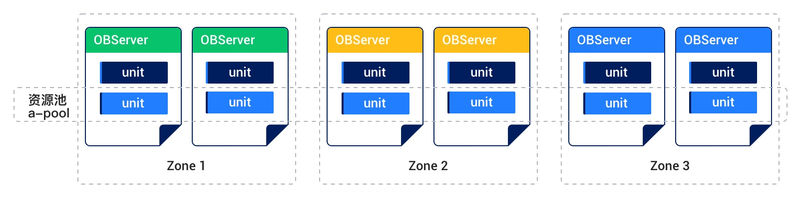
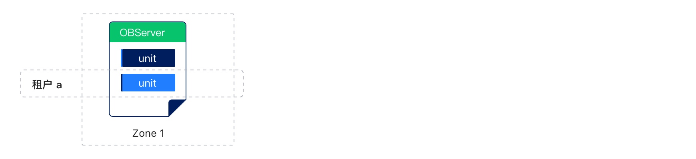

# 租户介绍

租户是集群之上的递进概念，OceanBase 数据库采用了多租户架构。多租户架构适用于资源整合（Resource Consolidation）、SaaS 服务等场景，同时也降低了运维复杂度。

集群偏向于部署层面的物理概念，是 Zone 和节点的集合，Zone 和节点具有部署地域（称为 Region）等属性；而租户则偏向于资源层面的逻辑概念，是在物理节点上划分的资源单元，可以指定其资源规格，包括 CPU、内存、日志盘空间、IOPS 等。

租户类似于传统数据库的数据库实例，租户通过资源池与资源关联，从而独占一定的资源配额，可以动态调整资源配额。在租户下可以创建 Database、表、用户等数据库对象。

要描述清楚租户的概念，首先需要描述清楚资源规格、资源单元（Unit）、资源池等前置概念。资源规格对应的视图是 `DBA_OB_Unit_CONFIGS`，资源池对应的视图是 `DBA_OB_RESOURCE_POOLS`，资源单元对应的视图是 `DBA_OB_UNITS`，租户对应的视图是 `DBA_OB_TENANTS`。

- 资源规格

  资源规格定义了常见物理资源项的大小，包括 CPU、内存、磁盘空间、IOPS 等。创建资源池时指定其资源规格，从而根据定义创建资源单元。

- 资源单元（Unit）

  Unit 是租户管理中非常重要的概念。OceanBase 按照 Unit 来管理物理资源，是 CPU、内存、存储空间、IOPS 等物理资源的集合。

  此外，在分布式架构下，Unit 也是资源调度的基本单位，其具有节点、Zone、Region 等位置属性，节点是服务器的抽象，Zone 是机房的抽象，Region 是地域的抽象，通过调整 Unit 的位置属性从而调整租户的部署方式。

- 资源池

  每个 Unit 都归属于一个资源池，资源池是资源分配的基本单位。

  对于 OceanBase 集中式数据库，由于单机集群仅包含一个节点，每个资源池仅包含一个 Unit。

  

  对于分布式架构，每个资源池由若干个 Unit 组成，同一个资源池内的各个 Unit 具有相同的资源规格，即该资源池内 Unit 的物理资源大小都相同。

  

通过 Unit 的概念，我们将 OceanBase 数据库的物理概念和逻辑概念进行了关联。概括的讲：集群由节点组成，节点是 Unit 的容器。租户由 Unit 组成，Unit 是数据库对象的容器。

创建租户时通过设置 `RESOURCE_POOL_LIST`，可以指定该租户关联到的资源池，从而该租户拥有指定资源池的 Unit。例如：设置租户 `a` 的 `RESOURCE_POOL_LIST=('a_pool')`，其部署图如下：

该租户部署于 Zone1，Zone1 有 2 个 Unit，可以通过调整 a_pool 的 Unit_CONFIG_ID 参数来动态调整租户的物理资源。
