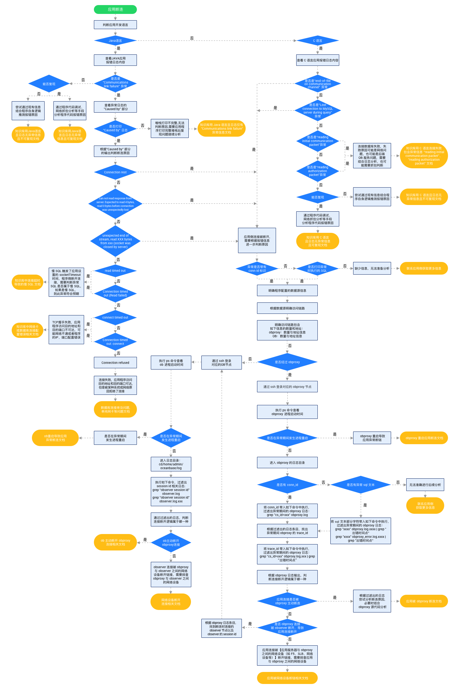

# 应用断连问题排查

数据库在运行期间经常会有各种异常情况出现，例如，应用程序错误、数据库连接错误、数据库权限问题、数据库资源问题、网络问题等。在这所有的情况中，有一种就是应用断连。

为了帮助大家快速定位这种场景下的问题根源并高效解决，这里总结了一套清晰、实用的应用断连问题的排查流程。该流程提供了明确的操作步骤，旨在提升问题处理效率，尽可能降低对业务的影响，为日常运维工作提供有力的支持。

应用断连问题的排查流程如下图所示。



## 流程介绍

当遇到应用断连的场景时，可以按照该流程进行问题排查。

首先，需要判断用户所使用的应用开发语言。

### Java 语言

如果确认应用开发语言为 Java 语言，可以通过查看 Java 应用报错日志内容，来判断当前应用断连的原因，方法如下。

1.  确认报错日志中是否包含 `Communications link failure` 异常。

    - 如果 Java 应用报错日志中不包含 `Communications link failure` 异常，则可以尝试复现该场景：

      - 如果可以复现，复现后可以通过程序代码调试、网络抓包分析等手段来分析程序代码报错的原因。
      - 如果无法复现，则尝试通过现有信息结合程序自身逻辑推测报错原因。

    - 如果 Java 应用报错日志中包含 `Communications link failure` 异常，则执行下一步操作。

2.  查看异常日志的 `Caused by` 部分对应的信息。

    - 如果该部分信息未被打印出来，则表示堆栈打印不完整，无法判断原因，需要应用程序打印完整堆栈后复现问题继续分析。

    - 如果该部分信息已被打印出来，可以根据 `Caused by` 部分的输出信息判断断连原因：

      - 如果内容是 `Connection reset"、"can not read response from server. Expected to read 4 bytes,read 0 bytes before connection was unexpectedly lost` 或者 `unexpected end of stream, read XXX bytes from xxx (socket was closed by server)`，则说明应用侧连接被断开，需要根据报错信息进一步判断原因，具体判断方法参考本文中 **应用侧连接被断开** 的内容。

      - 如果内容是 `read timed out" 或 "Connection timed out (Read failed)`，则说明是慢 SQL 触发了应用设置的 `socketTimeout` 时间，导致程序侧断开连接，此时需要判断异常 SQL 是否属于慢 SQL，如果属于慢 SQL，可根据情况优化 SQL；若当前不存在慢 SQL，可以调整考虑调整 `socketTimeout`，具体调整方法参见 [数据库连接池配置](https://www.oceanbase.com/docs/common-oceanbase-database-cn-1000000002013604)。

      - 如果内容是 `connect timed out` 或者 `Connection timed out: connect`，则说明是 TCP 握手失败，应用程序访问目的地址和目的端口不可达，可能网络不通或者程序的 IP、端口配置错误。

      - 如果内容是 `Connection refused`，则说明连接失败，应用程序访问目的地址和目的端口可达，但是被某种系统或网络原因拒绝了连接。

### C 语言

如果确认应用开发语言为 C 语言，可以通过查看 C 语言的应用报错日志内容，来判断当前应用断连的原因。

- 如果报错信息是 `end-of-file on communication channel` 或者 `Lost connection to MySQL server during query` 异常，则说明应用侧连接被断开，需要根据报错信息进一步判断原因，具体判断方法参考本文中 **应用侧连接被断开** 的内容。

- 如果报错信息是 `reading initial communication packet` 或者 `reading authorization packet` 异常，则说明连接数据库失败，失败原因可能是网络问题，也可能是后端 OceanBase数据库服务问题，需要结合日志分析，也可能需要抓包判断。

- 如果应用日志中没有明显的异常信息，则可以尝试复现当前场景。

  - 如果可以复现，则可以通过程序代码调试、网络抓包分析等手段分析程序代码报错原因。
  - 如果无法复现，则需要尝试通过现有信息结合程序自身逻辑推测报错原因。

### 应用侧连接被断开

当判断出是应用侧连接被断开时，查看日志信息中是否有带有 `conn id` 标识，或者是否打印了异常时执行的 SQL，如果都没有，则缺少关键信息，需要联系应用侧获取更多信息进行诊断；如果日志信息中打印了上述任意一个信息时，需要明确当前程序中配置的数据源信息，可以根据如下步骤进行处理。

1.  根据数据源明确访问链路。明确访问链路包含如下信息的数量的地址。

    - OBProxy 的数量与地址信息

    - OBServer 主机的数量与地址信息

2.  应用通过 SSH 直接登录对应的 OBServer 节点

    1.  使用 `ssh` 命令，登录对应的 OBServer 节点。

    2.  执行 `ps` 命令查看 observer 进程的启动时间。

    3.  判断异常期间应用是否重启。

        如果重启了，这说明是 OBServer 节点重启导致的异常。

        如果没有重启，则执行下一步。

    4.  如果没有重启，则使用 `cd` 命令，进入日志所在目录。

        以下以 OceanBase 数据库的安装目录为 `/home/admin/oceanbase` 为例，日志的具体存放路径请以实际环境为主。

        ```
        cd /home/admin/oceanbase/log
        ```

    5.  执行以下命令，过滤出 `session id` 相关的日志。

        ```
        grep "observer session id" observer.log 
        ```

        ```
        grep "observer session id" observer.log.xxx 
        ```

    6.  根据过滤出的日志，判断连接情况。

        - 如果连接被 observer 主动断开，则根据过滤出的日志尝试分析断连原因，必要时结合 observer 源代码分析。

## 典型案例

通用（不区分模式）

MySQL 模式

- 生产环境中业务交易，应用报 `read time out` 超时，导致业务交易超时，具体排查操作参见 [锁冲突导致业务交易报 read time out 超时问题](https://www.oceanbase.com/knowledge-base/oceanbase-database-1000000002382060?back=kb)。

- 空闲连接超时导致的应用周期性断连问题，具体排查操作参见 [空闲链接超时导致的应用周期性断链问题](https://www.oceanbase.com/knowledge-base/oceanbase-database-1000000000225636?back=kb)。

- 应用使用 ODP-Sharding 连接 OceanBase 数据库，业务执行报错：`Server connection execute error: Read timed out`，具体排查操作参见 [断链报错 "Read timed out" 的问题排查](https://www.oceanbase.com/knowledge-base/oceanbase-database-1000000000933519?back=kb)。

- OceanBase 数据库在进行业务 commit 时，遇到报错 `Transaction resolution unknown`，具体排查操作参见 [应用报错：Transaction resolution unknown](https://www.oceanbase.com/knowledge-base/oceanbase-database-1000000000322510?back=kb)。

- 通过 obproxy 连接 OceanBase 集群或者直连 OceanBase 数据库时，连接失败并且出现：`Access denied for user 'xxxx'@'xxxx' (using password: YES)` 的报错，具体排查操作参见 [连接 OceanBase 集群时报错 Access denied for user 'xxxx'@'xxxx' (using password: YES)](https://www.oceanbase.com/knowledge-base/oceanbase-database-1000000002393704)。

- 直连 OceanBase 数据库中的普通租户时，出现报错：`ERROR 5150 (HY000) : Tenant not in this server`，具体排查操作参见 [直连普通租户时遇到报错：Tenant not in this server](https://www.oceanbase.com/knowledge-base/oceanbase-database-1000000000683806)。

- 连接 OceanBase 数据库 V4.x 版本的 OBServer 时会偶发断链报错 u`nexpected end of stream, read 0 bytes from 4`，具体排查操作参见 [OceanBase 数据库 V4.x 版本使用二合一协议时偶发断链报错 unexpected end of stream, read 0 bytes from 4 的原因和解决方法](https://www.oceanbase.com/knowledge-base/oceanbase-database-1000000001885317)。

- 客户端在执行 SQL 时直接报错 `Lost connection to MySQL server during query`。通常，此类报错是因为服务器端出现异常导致，导致连接中断，具体排查操作参见 [客户端报错 Lost connection to MySQL server during query 的几种原因](https://www.oceanbase.com/knowledge-base/oceanbase-database-1000000000210010)。

- OceanBase 数据库 MySQL 模式下与服务器的连接断开并报 `ERROR 2013` 错误，具体排查操作参见 [与服务器的连接断开，错误代码 ERROR 2013](https://www.oceanbase.com/knowledge-base/oceanbase-database-1000000000217848)。

## 相关文档

- [如何排查 server 断连接问题](https://www.oceanbase.com/knowledge-base/oceanbase-database-1000000000568806?back=kb)

- [OceanBase 数据库和应用之间的通讯 TCP 原理](https://www.oceanbase.com/knowledge-base/oceanbase-database-1000000003039512?back=kb)
