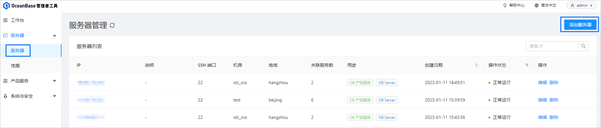
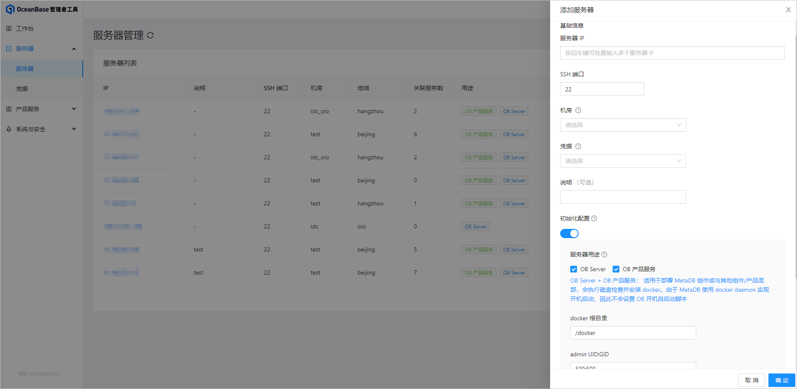

# 添加服务器

本文主要介绍如何将服务器添加到 OAT 资源池。

<main id="notice" type='explain'>
   <h4>说明</h4>
   
本节以 OAT V4.1.1 版本为例提供操作指导。不同 OAT 版本的操作界面可能不同，请以实际界面为准。

</main>

## 前提条件

* 您的服务器已完成相关配置。详细信息，请参见 [服务器配置](../../200.preparations-before-deploy/200.configure-servers.md)。
* 您已安装 OAT。详细信息，请参见 [部署 OAT](../../200.preparations-before-deploy/400.deploy-oat.md)。

## 操作步骤

1. 登录 OAT。

   

2. 在左侧导航栏中，单击 **服务器** 进入 **服务器管理** 页面，在页面右上角，单击 **添加服务器**。

   

3. 在弹出的 **添加服务器** 对话框中，输入服务器信息。

   

   服务器相关字段的填写信息为 **基础信息** 和 **初始化配置**，具体信息如下。

   **基础信息：**

   |   字段    |          描述          |
   |-----------|----------------------|
   | 服务器 IP | 待添加的服务器的外网网卡 IP。    |
   | SSH 端口  | 待添加的服务器的 SSH 访问端口。   |
   | 机房      | 待添加的服务器所属的机房。        |
   | 凭据      | 待添加的服务器的访问凭据。当前支持用户名和密码及密钥两种类型的凭据。|
   | 说明（可选）| 添加服务器的注释，便于更好地管理主机。|

   **初始化配置：**

   <main id="notice" type='notice'>
      <h4>注意</h4>
      
部署 OceanBase 集群的服务器和部署 OCP 的服务器需做时钟源同步。

   </main>

   |   字段    |          描述         |
   |-----------|----------------------|
   | 初始化配置 | 服务器用于接管产品或组件时，无需初始化配置。|
   | 服务器用途 | 待添加的服务器用途。|
   | Docker 根目录 | Docker 数据目录。|
   | admin UID:GID | 操作系统的 `admin` 用户对应的 UID 和 GID。|
   | 设置 `admin` 密码（可选）| 设置 `admin` 密码，可以使用随机密码。|
   | 时钟同步 | 是否开启时钟同步。|

4. 单击 **确认**。

   服务器添加成功后，您可以在服务器列表中看到新添加的服务器。

## 相关文档

更多添加服务器的信息，请参见 [添加服务器](https://www.oceanbase.com/docs/enterprise-oat-doc-cn-10000000002026450)
