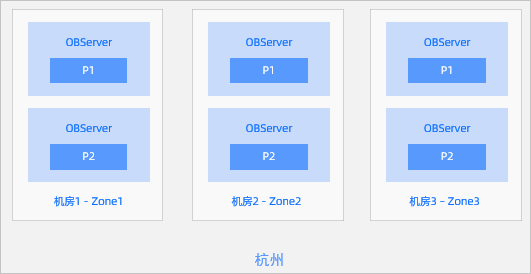
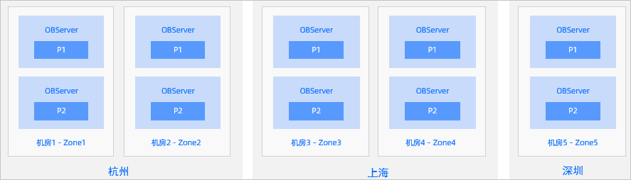
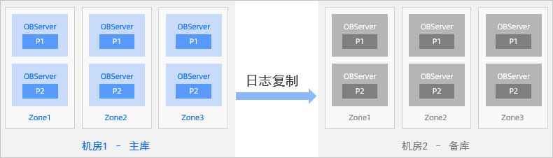
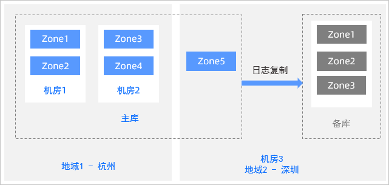
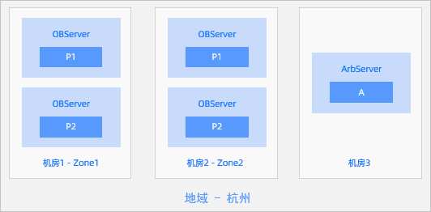
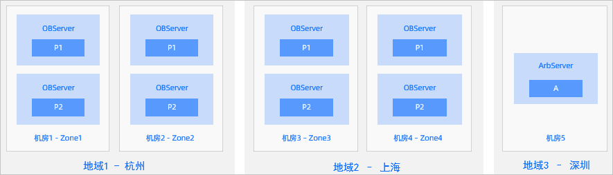
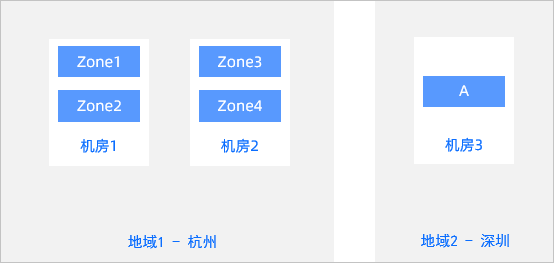

# OceanBase 集群高可用方案简介

OceanBase 数据库采用基于无共享（Shared-Nothing）的多副本架构，让整个系统没有任何单点故障，保证系统的持续可用。OceanBase 支持单机（单机房部署集群）、机房（同城多机房部署集群。机房以下统称：IDC）、城市（多城市部署集群）级别的高可用和容灾，可以进行单机房、双机房、两地三中心、三地五中心部署，且支持部署仲裁服务来降低成本。

## 部署方案

### 方案一：同城三机房三副本部署

**特点：**

* 同城 3 个机房组成一个集群（每个机房是一个 Zone），机房间网络延迟一般在 0.5 ~ 2 ms 之间。
* 机房级灾难时，剩余的两份副本依然是多数派，依然可以同步 Redo-Log 日志，保证 RPO=0。
* 无法应对城市级的灾难。

**部署方案示图：**

### 方案二：三地五中心五副本部署

**特点：**

* 三个城市，组成一个 5 副本的集群。
* 任何一个 IDC 或者城市的故障，依然构成多数派，可以确保 RPO=0。
* 由于 3 份以上副本才能构成多数派，但每个城市最多只有 2 份副本，为降低时延，城市 1 和城市 2 应该离得较近，以降低同步 Redo-Log 的时延。

**部署方案示图：**

### 方案三：同城两机房 "主-备" 部署

**特点：**

* 每个机房都部署一个 OceanBase 集群，一个为主库一个为备库；每个集群有自己单独的 Paxos group，多副本一致性。
* "集群间" 通过 Redo-log 做数据同步，形式上类似传统数据库 "主从复制" 模式，从主库 "异步同步" 到备库，类似 Oracle Data Guard 中的 "最大性能" 模式。

**部署方案示图：**

### 方案四：两地三中心 "主-备" 部署

**特点：**

* 主城市与备城市组成一个 5 副本的集群。任何主城市 IDC 的故障，最多损失 2 份副本，剩余的 3 份副本依然满足多数派。
* 备用城市建设一个独立的 3 副本集群，做为一个备库，从主库 "异步同步" 到备库。
* 一旦主城市遭遇灾难，备城市可以接管业务。

**部署方案示图：**

### 方案五：同城三机房仲裁服务部署

**特点：**

* 同城 3 个机房组成一个集群，机房间网络延迟一般在 0.5 ~ 2 ms 之间，其中两个机房放置全功能副本，分别作为一个 Zone，为了降低成本，第三机房部署仲裁服务（无需同步日志）。
* 机房级灾难时，剩余两个机房的副本可以选主、执行仲裁降级（全功能副本所在机房故障时），保证 RPO=0。
* 无法应对城市级的灾难。

**部署方案示图：**

### 方案六：三地五机房仲裁服务部署

**特点：**

* 三个城市，五个机房，城市 1 和城市 2 距离较近，部署全功能副本，城市 3 部署仲裁服务以降低成本（无需同步日志）。
* 任何一个 IDC 故障，剩余全功能副本依然满足多数派（3/4），可以确保 RPO=0。
* 任意两个 IDC 或者城市级故障，如果故障的都是全功能副本所属机房，剩余两个全功能副本不足多数派（2/4），可通过仲裁降级方式恢复服务（将故障的两个副本降级为 Learner），并确保 RPO=0。
* 由于 3 份以上副本才能构成多数派，但每个城市最多只有 2 份副本，为降低时延，城市 1 和城市 2 应该离得较近，以降低同步 Redo-Log 的时延。

**部署方案示图：**

### 方案七：两地三机房仲裁服务部署

**特点：**

* 主城市有两个机房，分别包含两个 Zone，用于部署全功能副本。
* 备城市一个机房，部署仲裁服务，可降低部署成本以及跨城带宽开销。
* 主城市任意一个 IDC 故障，至多损失 2 份副本，此时可能不足多数派（2/4），可通过仲裁服务触发降级恢复，可以确保 RPO=0。
* 无法应对主城市灾难，备城市灾难无影响。

**部署方案示图：**

## 相关文档

* [容灾部署方案](../700.reference/100.oceanbase-database-concepts/1000.high-data-reliability-and-availability/200.disaster-recovery-deployment-plan.md)
* [仲裁服务概述](../600.manage/400.high-availability/400.arbitration-high-availability/100.arbitration-service-overview.md)
