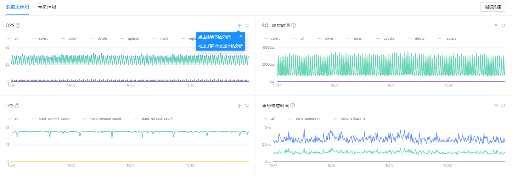

# 集群性能监控

OCP 提供了集群的性能监控功能，管理员可以从不同维度查看集群中的各种性能监控数据。

## 操作步骤

1. 登录 OCP。

2. 在 **集群列表** 区域，选择待操作的集群并单击其集群名。

3. 在显示的页面的左侧导航栏上，单击 **性能监控** 。

4. 在 **数据筛选** 区域，选择过滤条件。

   过滤条件说明如下表所示。

   |     **条件**     |          **描述**          |
   |----------------|--------------------------------------------------------------------------------------------------------------------------------------------------|
   | 选择时间（又称：监控窗口） | 自动刷新模式下不展示。 选择某一段时间范围，用于返回这段时间范围内的数据。            |
   | 自动刷新        | 默认关闭，打开后，每 5s 进行一次刷新。 |
   | Zone           | 选择待查看的 Zone。             |
   | OBServer       | 选择待查看的 OBServer 节点。         |

   

   * 关闭 **自动刷新**：输入过滤条件后，系统按选择的时间及统计周期展示性能监控数据。

   * 打开 **自动刷新**：选择统计范围，系统实时展示该统计范围内的性能监控数据。

5. 切换页签，分别查看集群的数据库性能数据和主机性能数据。

   * 单击 **数据库性能** 页签，查看数据库性能。

     如果需要展示其他指标，您可以单击区域右侧的 **指标选择** 按钮，在 **指标选择** 页面选择需要展示的指标，系统最多支持展示 10 个指标。

   * 单击 **主机性能** 页签，查看主机性能。

   数据库性能和主机性能中具体指标的含义请参见对应版本的《OCP 用户指南》文档。
