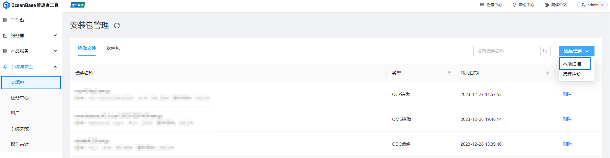

# 上传安装包

在 OAT 上安装 OceanBase 产品或创建组件，您需要将每个产品的安装包（镜像）上传到 OAT 服务器或远程连接镜像。因此，在使用 OAT 部署 OCP 之前，您需要先上传 OCP 所需的安装包到安装 OAT 的服务器上。

本文介绍如何上传 OCP 所需的安装包至 OAT 服务器。

## 操作步骤

### 步骤一：上传 OCP 安装包到 OAT 的服务器上

在安装 OAT 后，您需要将安装包上传到 `/oat/data_dir/images` 目录中。

对于 OCP 部署，您需要向安装 OAT 的服务器上传两个镜像，包括 OCP docker image 和 MetaDB docker image。

<main id="notice" type='notice'>
<h4>注意</h4>
<p>如果您是使用的 oat-all-in-one 安装包安装的 OAT，只需上传 OCP docker image。</p>
</main>

示例如下：

```shell
[root@hostname /]# scp ./ocp.tar <oat_server>:/oat/data_dir/images/ocp.tar
[root@hostname /]# scp ./meta_xxx.tar <oat_server>:/oat/data_dir/images/meta_xxx.tar
```

其中 `oat_server` 表示部署 OAT 的服务器的 IP 地址。

### 步骤二：将安装包添加到 OAT 服务中

1. 登录 OAT。

2. 在左侧导航栏，单击 **系统与安全 \> 安装包** 进入 **安装包管理** 页面，然后单击右上角的 **添加镜像**，选择 **本地扫描**。

    

## 相关文档

[安装包管理](https://www.oceanbase.com/docs/enterprise-oat-doc-cn-1000000000304913)
