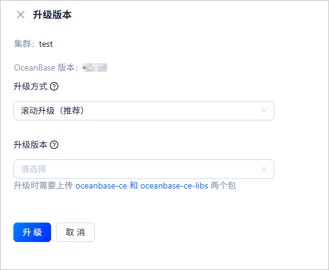
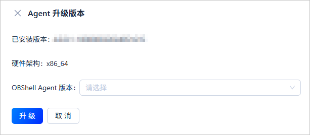

# 集群管理

本文介绍目前支持的一些集群管理操作，包含启停集群、升级集群和升级 obshell。

## 启停集群

在左侧导航栏中单击 **集群管理** 进入 **集群管理** 页面。单击页面右上角 **停止集群** 按钮，在弹出的窗口中单击 **停止**，obshell Dashboard 将提交停止集群的任务并展示任务 ID，您可单击展示的 ID 查看任务执行情况。

<main id="notice" type='notice'>
  <h4>注意</h4>
  
停止集群会导致集群中所有的服务被终止，请谨慎操作。

</main>

单击页面右上角 **启动集群** 按钮，在弹出的窗口中单击 **启动** 将提交启动集群的任务并展示任务 ID，您可单击展示的 ID 查看任务执行情况。

## 升级集群

在左侧导航栏中单击 **集群管理** 进入 **集群管理** 页面，光标悬停在 **···** 后单击出现的 **升级版本** 按钮。在出现的 **升级版本** 页面配置升级信息，配置完成后单击 **升级**，在弹出的窗口中单击 **确定**，obshell Dashboard 将提交升级集群的任务并展示任务 ID，您可单击展示的 ID 查看任务执行情况。

| 参数  | 说明  |
|-------|------|
| 集群  | 待升级集群的集群名，不可修改。 |
| OceanBase 版本 | 待升级集群的当前版本。 |
| 升级方式 | 有 **滚动升级** 和 **停服升级** 两种升级方式，推荐选择 **滚动升级**。<ul><li>滚动升级：不会中断业务对数据库的访问。</li><li>停服升级：会中断业务对数据库的访问，对业务造成不可用的影响，请谨慎操作。</li></ul>  |
| 升级版本 | 版本是从当前已上传的 OceanBase 数据库软件包中选择。若当前 obshell Dashboard 中无高于当前版本的 OceanBase 数据库软件包，可单击下拉框中的 **+ 上传软件包** 进行上传。  |

## 升级 obshell

在左侧导航栏中单击 **集群管理** 进入 **集群管理** 页面，光标悬停在 **···** 后单击出现的 **升级 obshell** 按钮。

在出现的 **Agent 升级版本** 页面配置 **OBShell Agent 版本**，版本是从当前已上传的 obshell 软件包中选择，若当前 obshell Dashboard 中无高于当前版本的 obshell 软件包，可单击下拉框中的 **+ 上传软件包** 进行上传。

配置完成后单击 **升级**，在弹出的窗口中单击 **确定**，obshell Dashboard 将提交升级 obshell 的任务并展示任务 ID，您可单击展示的 ID 查看任务执行情况。

## 相关文档

[软件包管理](600.ob-dashboard-package.md)
