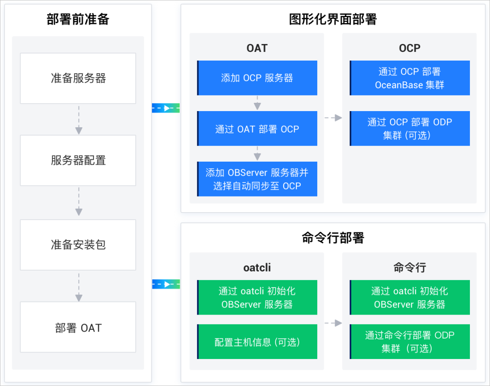

# 部署流程

本节主要介绍 OceanBase 集群的部署流程。

<main id="notice" type='explain'>
  <h4>说明</h4>
  
oatcli 是管理 OceanBase 管理者工具（OceanBase Admin Toolkit，简称：OAT）资源的命令行工具。

</main>

## 相关文档

* [准备服务器](200.preparations-before-deploy/100.prepare-servers.md)
* [服务器配置](200.preparations-before-deploy/200.configure-servers.md)
* [准备安装包](200.preparations-before-deploy/300.prepare-installation-packages.md)
* [部署 OAT](200.preparations-before-deploy/400.deploy-oat.md)
