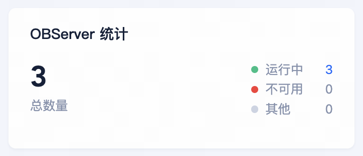
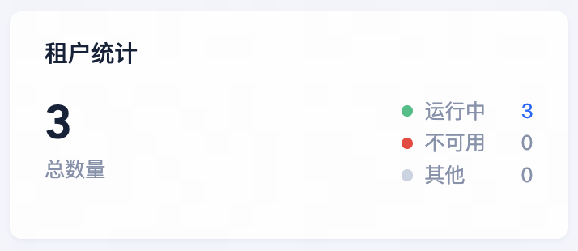
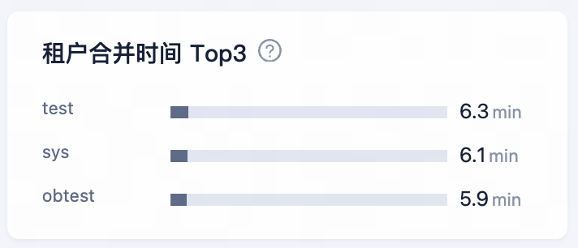
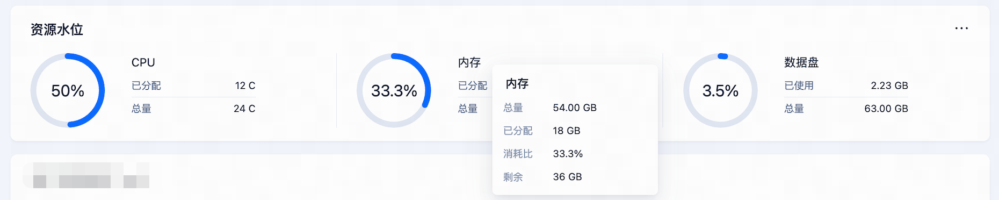
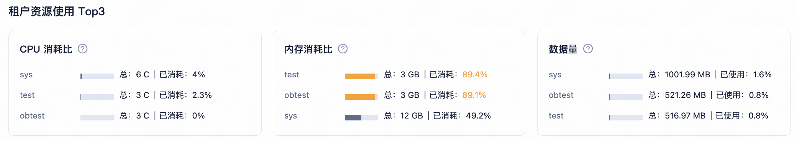
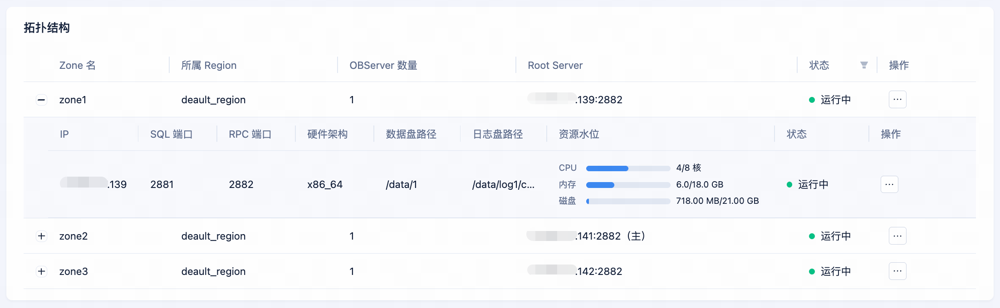

# 集群信息

登录 obshell Dashboard 后，系统默认进入 **集群管理** 页面。**集群管理** 页面展示了当前登录用户下的集群概览信息，包括：**基本信息**、**OBServer 统计**、**租户统计**、**租户合并时间 Top3**、**资源水位**、**租户资源使用 Top3** 和 **拓扑结构**。同时支持进行参数管理、启停集群、启停 Zone、启停 OBServer、升级集群版本、升级 obshell 和管理死锁自动检测操作。

本文仅介绍 **集群管理** 页面的展示信息情况，其他需操作的步骤介绍可参见 [集群管理](./300.ob-dashboard-cluster/100.ob-dashboard-cluster-management.md)。

## 基本信息

**基本信息** 模块展示了集群名、集群状态以及集群的 OceanBase 版本号。

## OBServer 统计

您可在 **OBServer 统计** 模块查看集群中 OBServer 节点的运行状态，方便您及时对状态异常的 OBServer 节点进行运维管理。

## 租户统计

您可在 **租户统计** 模块查看集群中租户的运行状态，方便您及时对状态异常的租户进行运维管理。单击运行状态后方的数字，页面将跳转至 **租户管理** 页面。

## 租户合并时间 Top3

**租户合并时间 Top3** 区域展示了按最近一次合并时间进行排序的 3 个租户。合并操作（Major freeze）是将动静态数据做归并，会比较费时。当转储产生的增量数据积累到一定程度时，通过合并操作实现大版本的合并。

## 资源水位

**资源水位** 区域展示了集群的 **CPU**、**内存** 和 **数据盘** 的总量、已分配、消耗比和剩余情况，将光标悬停于资源饼图部分会展示详细情况。当光标悬停于模块右上角 **···** 时，可查看集群名称和部署模式信息。

## 租户资源使用 Top3

为您展示 **CPU 消耗比**、**内存消耗比** 和 **数据量** 前 3 的 OceanBase 租户数据。

## 拓扑结构

您可在 **拓扑结构** 区域中查看集群下 Zone 的名称、所属 Region、OBServer 数量、Root Server、状态，单击 **状态** 后的  图标，可按照 Zone 的状态筛选 Zone。支持对 Zone 进行启停操作，操作详见 [管理 Zone](300.ob-dashboard-cluster/200.ob-dashboard-zone-management.md)。单击 Zone 名称前的 ，可查看该 Zone 下的 OBServer 详情，包括 **IP**、**SQL 端口**、**RPC 端口**、**硬件架构**、**数据盘路径**、**日志盘路径**、**资源水位** 和 **状态**，支持对 Zone 内的 OBServer 节点服务和进程进行启停操作，操作详见 [管理 OBServer 节点](300.ob-dashboard-cluster/300.ob-dashboard-observer-management.md)。

