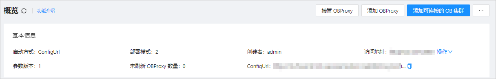
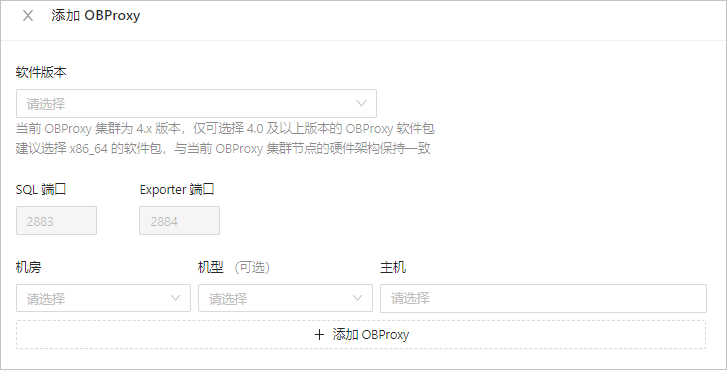

# 添加 OBProxy

本文介绍如何通过 OCP 添加新的 OBProxy 到已有的 OBProxy 集群。

## 前提条件

已创建 OBProxy 集群，OBProxy 集群创建相关操作请参见 [创建 OBProxy 集群](../200.manage-obproxy-clusters/100.create-an-obproxy-cluster.md)。

## 操作步骤

1. 登录 OCP。

2. 在左侧导航栏单击 **OBProxy**。

3. 在集群列表中选择需要操作的 OBProxy 集群，进入 OBProxy 集群的 **概览** 页面。

4. 单击 **添加 OBProxy**。

   

5. 在弹出框中填写 **软件版本**、**SQL 端口**、**Exporter**、**机房**、**机型**、**主机** 等信息。

   

   参考下表填写信息：

   |      参数       |                         说明                         |
   |---------------|----------------------------------------------------|
   | SQL 端口        | 默认为 2883。                                          |
   | Exporter 端口   | 默认为 2884。                                          |
   | 软件版本          | 选择要安装的 OBProxy 版本。                                 |
   | 机房、机型（可选）、主机 | 选择部署 OBProxy 所使用的主机，包括该主机的 **机房**、**机型（可选）**、**主机**。 |

6. 单击 **确定**。

   <main id="notice" type='explain'>
   <h4>说明</h4>
   
<ul>
   <li>当 OBProxy 集群为 V4.0 及以上版本时，仅支持选择 V4.0.0 及以上版本的软件包。</li><li>当 OBProxy 集群为 V3.x 及以下版本时，仅支持选择 V1.8.0 及以上、V4.0.0 以下版本的软件包。</li>
   <li>当 OBProxy 集群中未创建或接管 OBProxy 时，添加 OBProxy 时可自定义 SQL 端口和 Exporter 端口；当 OBProxy 集群中已存在 OBProxy 时，SQL 端口和 Exporter 端口默认继承创建 OBProxy 集群中部署 OBProxy 时配置的端口号，不支持自定义。</li>
   </ul>

   </main>
