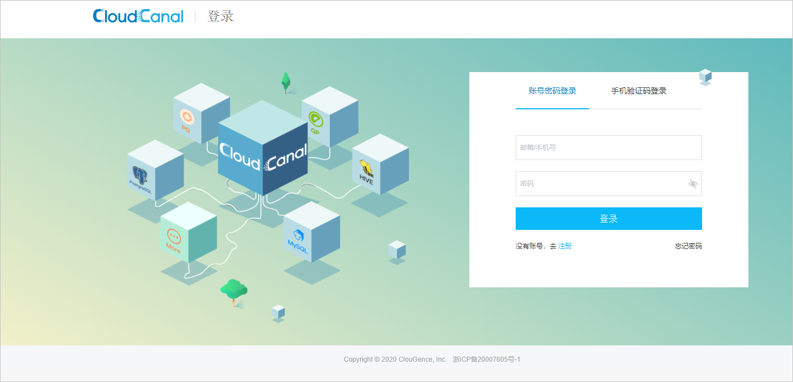
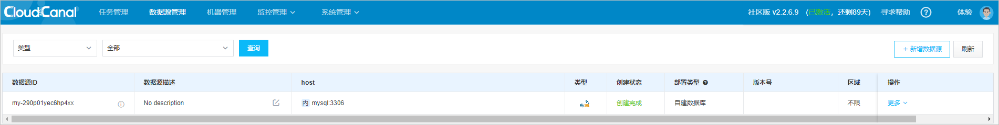
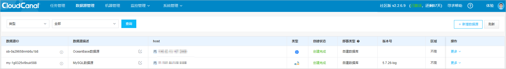
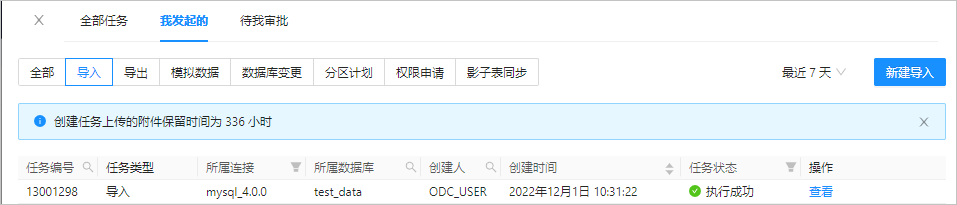
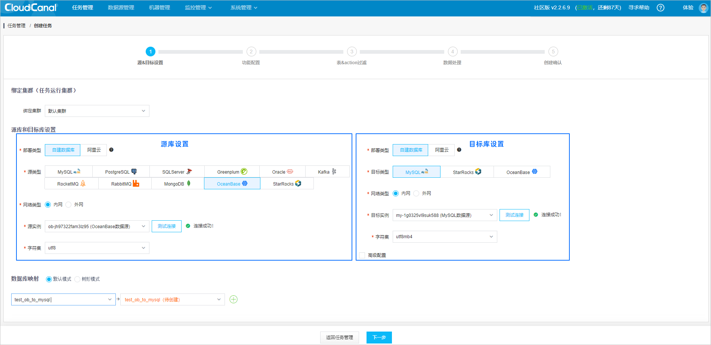
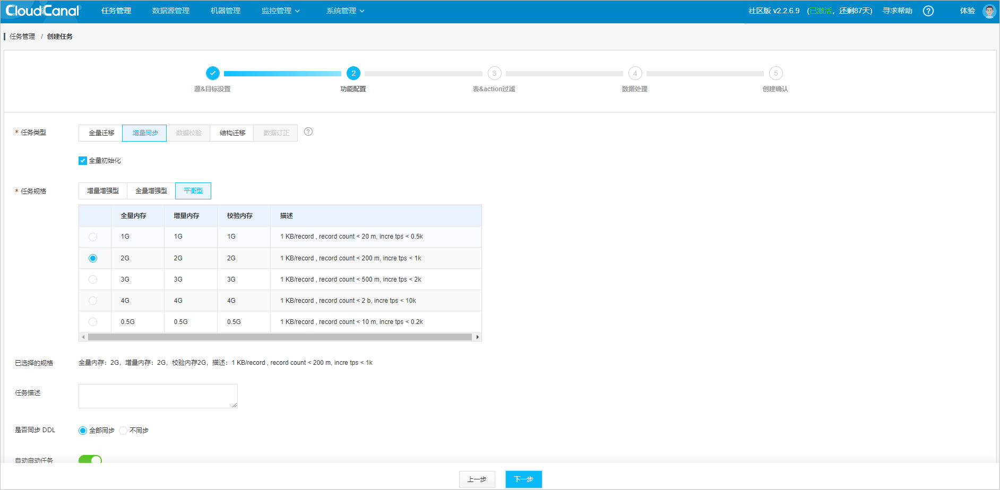
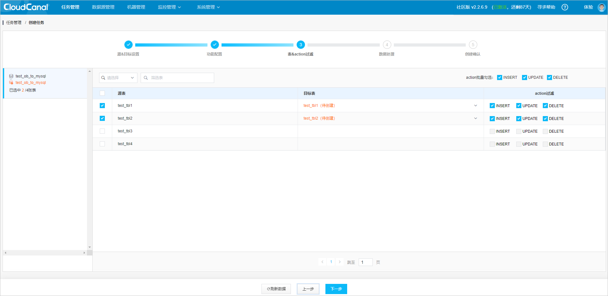
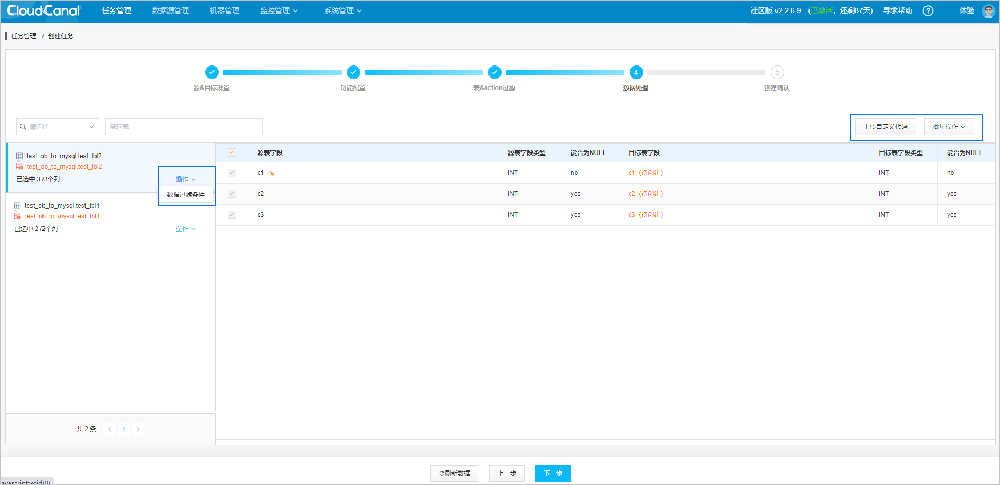
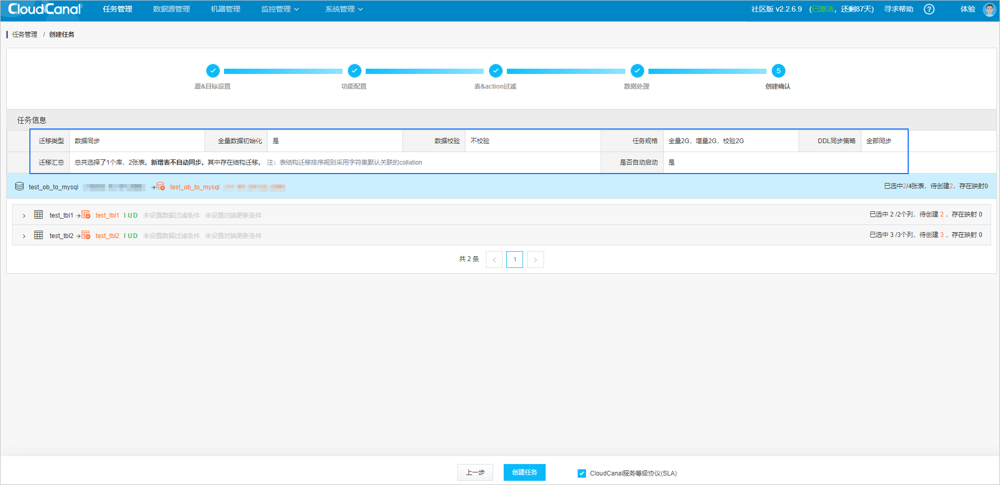
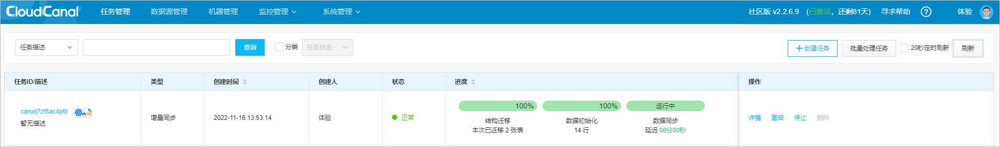

# 使用 CloudCanal 从 OceanBase 数据库迁移数据到 MySQL 数据库

CloudCanal 是一款数据迁移同步工具，帮助企业快速构建高质量数据流通通道，产品包含 SaaS 模式和私有输出专享模式。开发团队核心成员来自大厂，具备数据库内核、大规模分布式系统、云产品构建背景，懂数据库，懂分布式，懂云产品商业和服务模式。

本文将介绍如何使用 CloudCanal 社区版 v2.2.6.9 将 OceanBase 数据库 MySQL 模式中的数据迁移同步到对端 MySQL 数据库中。

  <main id="notice" >
    <h4>功能适用性</h4>
    <ul>
    <li>CloudCanal 社区版从 2.2.3.0 版本开始支持从 OceanBase 数据库 MySQL 模式迁移数据至 MySQL 数据库。详情请参见 <a href="https://www.clougence.com/cc-doc/releaseNote/rn-cloudcanal-2-2-3-0">2.2.3.0</a>。</li>
    <li>CloudCanal 暂时只支持 OceanBase 数据库 V3.2.3.0 之前的版本作为源库。</li>
    </ul>
  </main>

## 前置条件

1. 参考 [全新安装(Linux/MacOS)](https://www.clougence.com/cc-doc/productOP/docker/install_linux_macos) 完成 CloudCanal 社区版的安装部署。

2. 参考 [创建 Binlog 集群](https://www.oceanbase.com/docs/common-ocp-1000000001739745) 完成 OceanBase Binlog 服务的安装部署。

## 操作步骤

1. 添加数据源。
2. 创建任务。
3. 查看任务。

### 添加数据源

1. 登录 CloudCanal 平台。

    

2. 进入数据源管理界面，点击新增数据源。

   

3. 在新增数据源页面，填写数据源信息。

   * 部署类型：有 **自建数据库** 和 **阿里云** 两种选项。

     * 阿里云：用户在阿里云上购买的数据库实例。
     * 自建数据库：用户自己部署的数据库实例。

   * 数据库类型：选择数据源类型。

      新增两个数据源 OceanBase 和 MySQL，分别作为同步的源库和目标库：

      * 选择自建数据库中 OceanBase，添加自己部署的 OceanBase 数据库实例。

         OceanBase 数据源设置：

         * 网络地址：填写连接 OceanBase 数据库的 IP，直连或通过 ODP 连接。
         * oblogproxy host：OceanBase Binglog 服务 的 IP 地址。OceanBase 数据库作为源库增量同步时，不可以为空；OceanBase 数据库作为目标库时，可为空。有关 OceanBase Binlog 服务的详细信息，请参考 [OceanBase Binlog 服务](../ref-components-and-tools/100.oblogproxy-overview.md)。
         * OceanBaseRpcPort：OceanBase Rpc 端口，默认 2882。
         * 认证方式：分别为 **账号密码**、**有账号密码** 和 **无账号密码**。默认账号密码。
         * 账号：连接 OceanBase 数据库的用户名。直连格式：**用户名@租户名称**；ODP 连接格式：**用户名@租户名称#集群名称**。
         * 密码：连接 OceanBase 数据库的用户名对应的密码。
         * 描述：选填项，备注便于记忆的名字，方便使用时识别，如交易库、用户库、测试库等。

        

      * 选择自建数据库中 MySQL，添加自己部署的 MySQL 数据库实例。

         MySQL 数据源设置：

         * 网络地址：填写 MySQL 数据库的 IP。
         * 认证方式：有 **账号密码**、**有账号密码** 和 **无账号密码** 三种方式。默认 **账号密码** 方式。
         * 账号：连接 MySQL 数据库的用户名。
         * 密码：连接 MySQL 数据库的用户名对应的密码。
         * 描述：选填项，备注便于记忆的名字，方便使用时识别，如交易库、用户库、测试库等。

        

4. 查看新增的两个数据源。

   

### 创建任务

添加好数据源之后可以按照如下步骤进行数据全量迁移、增量同步和结构迁移。

1. 任务管理 -> 创建任务。

   

2. 源库和目标库设置。

   * 选择 **任务运行集群**，任务会被调度到绑定集群的一台机器上执行。社区版部署完成后，会有一个默认的运行集群。

   * 选择源库 OceanBase 和目标数据库 MySQL，并点击 **测试连接**。

   * 选择需要 **迁移同步或校验的数据库**，指定数据库映射关系。

   * 完成设置后点击 **下一步**。

   

3. 功能配置。

   选择 **增量同步** 功能，第一次会先查表进行全量同步，之后消费 binlog 增量同步数据。

   * 任务类型具有以下功能：

     * 全量迁移：以数据迁移为主，适合数据的全量搬迁及短期的增量同步任务。
     * 增量同步：默认选项，默认附带 **全量初始化**。以数据同步为主，适合长期的增量同步任务。
     * 数据校验：对比源端与目标端的数据，一次性或定时多次校验数据迁移的准确性。社区版不支持此功能。
     * 结构迁移：根据所选数据库、表自动创建对应的数据库、表。
     * 数据订正：对比源端与目标端的数据，将不一致的数据自动覆盖成和源端一致。社区版不支持此功能。

   * 任务规格：默认 **平衡型**、**2G** 规格即可。

   * 完成配置后，点击 **下一步**。

   

4. 表&action 过滤。

   * 选择要同步的表，要保证目标库的 `UPDATE` 和 `DELETE` 操作和源库的一致，需要保证源库表中有主键或者唯一约束。

   * 完成配置后，点击 **下一步**。

   

5. 数据处理。

   * 可以进行添加 **数据过滤条件**、**上传自定义代码** 和 **批量操作**。

      * 数据过滤条件：在数据处理页面左侧对应表的 **操作** 中添加 **数据过滤条件**。
      * 上传自定义代码：自定义代码实时加工允许用户使用 Java 语言编写自定义的数据行处理逻辑，上传 CloudCanal 平台后，数据同步任务执行全量、增量时会自动应用用户的自定义处理逻辑，然后再下入对端数据源。
      * 批量操作：有 **批量添加数据过滤条件** 和 **批量裁剪列** 选项。

   * 完成设置后，点击 **下一步**。

   

6. 确认创建任务。

   最后一步，确认创建内容无误后点击 **创建任务**。

    

### 查看任务状态

增量同步任务创建成功后，会默认进行 **结构迁移**、**全量迁移**、**增量同步**。

回到 CloudCanal 任务管理控制台，单击右上角 **刷新** 并查看任务实时状态。

## 相关文档

有关 CloudCanal 的详细信息，请参见 [CloudCanal 官方文档](https://www.clougence.com/cc-doc/intro/product_intro/)。
