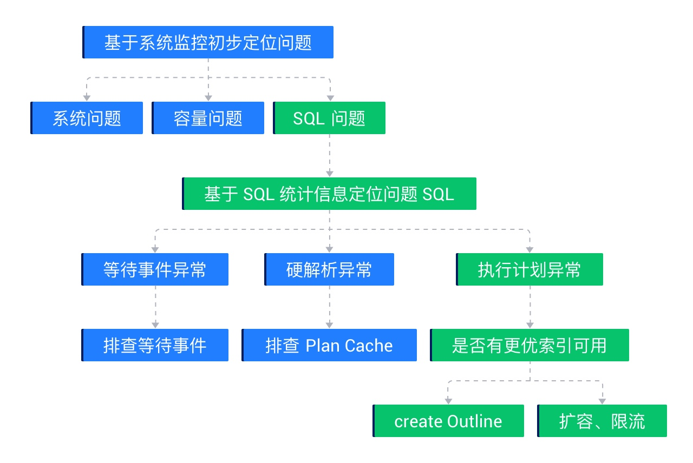

# SQL 监控概述

前面讨论的都是系统监控，使用者根据特定的监控信息，对系统（集群、租户、会话）的健康状况作出判断。实际运维中，另一类非常重要的监控手段是 SQL 监控，即根据特定 SQL 的多次执行或特定执行中收集的监控信息对系统的性能问题进行诊断。

SQL 相关的监控信息，记录 SQL 在执行过程中的资源消耗，这些信息通常在一条 SQL 执行的前后，通过收集监控项和等待事件的统计信息，并计算差值来获得。除此之外，SQL 监控还包含 SQL 文本、SQL 计划、执行反馈等信息，这些信息在诊断一个具体的 SQL 问题时会非常有帮助。

下图展示了一个可能的 SQL 问题诊断路径：

OceanBase 数据库提供了多种视图用于 SQL 诊断，主要视图如下：

|视图|展示内容|
|---|---|
| [GV$OB_SQL_AUDIT](../ref-system-views/3500.gv-ob_sql_audit-of-mysql-mode.md) |SQL 统计信息。|
| [GV$OB_PLAN_CACHE_PLAN_STAT](../ref-system-views/2300.gv-ob_plan_cache_plan_stat-of-mysql-mode.md) |执行计划统计信息。|
| [GV$OB_PLAN_CACHE_PLAN_EXPLAIN](../ref-system-views/2200.gv-ob_plan_cache_plan_explain-of-mysql-mode.md) |执行计划详细信息。|
| [DBA_OB_OUTLINES](../ref-system-views/14500.dba_ob_outlines-of-oracle-mode.md) |普通 Outline 信息。|
| [DBA_OB_CONCURRENT_LIMIT_SQL](../ref-system-views/12400.dba_ob_concurrent_limit_sql-of-oracle-mode.md) |限流 Outline 信息。|
| [GV$OB_PLAN_CACHE_STAT](../ref-system-views/2400.gv-ob_plan_cache_stat-of-oracle-mode.md) |Plan Cache 统计信息。|
| [GV$SQL_PLAN_MONITOR](../ref-system-views/5200.gv-sql_plan_monitor-of-mysql-mode.md) |SQL 算子级统计信息。|
| [GV$SESSION_EVENT](../ref-system-views/4700.gv-session_event-of-mysql-mode.md) |会话级等待统计。|
| [GV$OB_TRANSACTION_PARTICIPANTS](../ref-system-views/4500.gv-ob_transaction_participants-of-mysql-mode.md) |活跃事务的参与者信息。|
| [DBA_INDEX_USAGE](../ref-system-views/4800.o-dba_index_usage-of-mysql-mode.md) |用于展示索引使用数据信息。|
