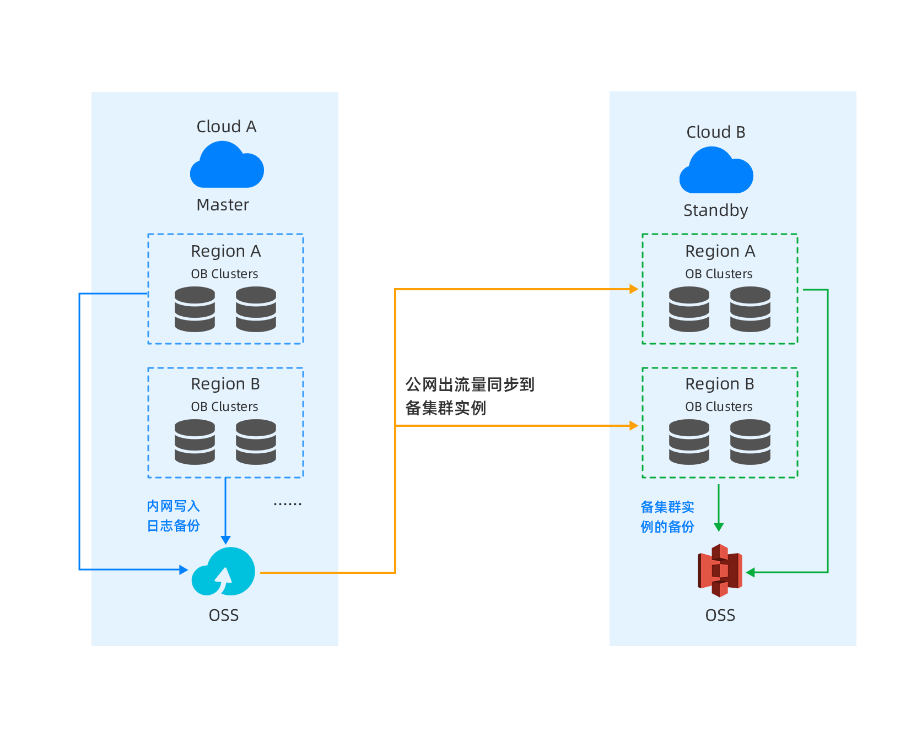
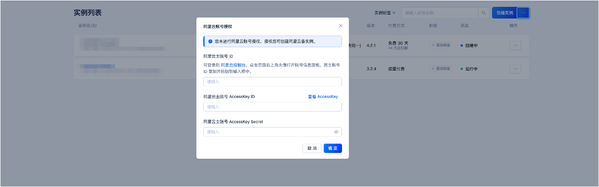
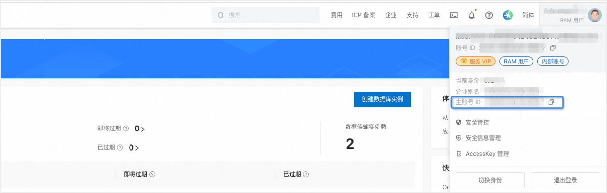
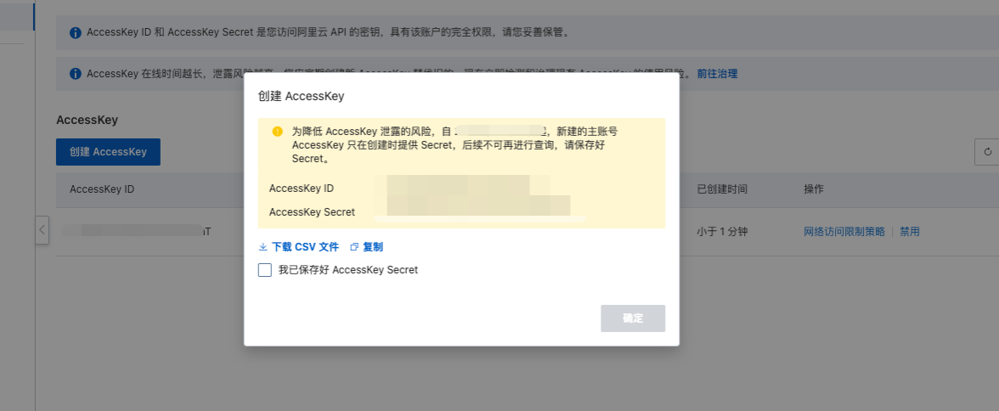

# 通过跨云主备库实现的高可用

OB Cloud 云数据库支持通过创建阿里云主实例和华为云备实例，实现跨云主备库，确保单一云服务商或区域发生故障时，业务能快速切换至其他云环境持续运行，从而保障服务的高可靠性与业务连续性。

## 原理介绍

跨云主备库允许一个数据库实例（主库）在其他云服务提供商上创建其备实例，并进行数据同步。

跨云主备库具有如下特点：

- 更强的灾难恢复能力：将主库和备库部署在地理上分离的区域可以有效抵御区域性灾难（如自然灾害、数据中心故障等），即使某个云服务商上的主实例出现问题，该实例部署在其他云服务商的备实例可以快速容灾，减少业务间断影响。

- 提高服务可用性：跨云部署可以减少因单一云服务商内部问题导致的服务中断风险，确保在任一云平台遇到故障时，能够迅速切换到另一个云上的备库，维持业务连续性。

- 合规与数据治理：对于有特定法规遵从要求的企业，跨云部署可以提供更多的灵活性，帮助企业满足不同国家或地区的数据主权和合规要求。

- 成本效益：虽然跨云部署可能增加一定的管理复杂度和数据同步成本，但通过在不同云服务商间灵活调配资源，企业可以在成本和服务质量之间找到更好的平衡。

## 场景介绍

某企业是一家互联网零售商，核心业务系统基于数据库提供服务，例如订单管理、客户管理和商品库存等。为了保障业务的高可用性并应对单一云平台可能存在的宕机、网络故障等风险，企业计划构建跨云主备库架构，满足高可靠、低时延的业务要求。同时需要支持快速切换和数据强一致性，以确保故障发生后业务能不间断运行。

## 前提条件

- 当前仅支持在阿里云官网购买的实例为主实例，华为云为备实例。

- 当前仅支持事务型实例的跨云主备库。

- 一个主实例仅可创建一个备实例。

- 您拥有项目管理员和实例管理员权限。

## 操作步骤

1.  在阿里云官网，创建阿里云主实例，更多内容参见[购买实例](https://help.aliyun.com/document_detail/139264.html)。

2.  登录并进入 [OceanBase 管理控制台](https://oceanbasenext.console.aliyun.com/?spm=a2c4g.11186623.0.0.74a24db4JKdPV3)。如果您是首次创建实例，请根据页面提示单击 **去创建**。

3.  在左侧导航栏中单击 **实例列表**。

4.  在页面右上角单击 **创建数据库实例** 。

5.  选择您要创建的商品类型、实例类型等信息，单击 **立即购买**，勾选 **服务协议**，并单击 **去支付**。支付成功后，请在实例列表中查看刚创建的实例。

6.  进行阿里云账号授权。

7.  登录 [OB Cloud 云数据库控制台](https://console-cn.oceanbase.com/)，单击查看弹窗中的信息，进行阿里云账号授权。

&nbsp;

    

2.  单击 **登录[阿里云控制台](https://oceanbasenext.console.aliyun.com/overview)**，获取主账号 ID。

&nbsp;

    

3.  登录 [RAM 访问控制台](https://ram.console.aliyun.com/manage/ak)，使用已有的或创建新的 AccessKey，保存好您的 AccessKey ID 和 AccessKey Serect，填写指 OB Cloud 云数据库对应的控制台界面。

&nbsp;

    

4.  将 AccessKey ID 和 AccessKey Serect 填入 [OB Cloud 云数据库控制台](https://console-cn.oceanbase.com/)的弹框中，并单击**确定**。

5.  创建华为云备实例，您可在 OB Cloud 云数据库控制台创建，也可通过华为云市场创建，本文为您介绍在 OB Cloud 云数据库控制台创建的操作，更多内容参见 [创建阿里云主实例的华为云备实例](https://www.oceanbase.com/docs/common-oceanbase-cloud-1000000001424307)。

6.  单击**创建阿里云备实例**，在弹出框中选择需要创建备实例的主实例。

7.  单击**去创建备实例**，进入**创建实例**页面。将为自动为您选择与主实例相同的数据库版本、部署方案和计算规格。

    - 备实例需要与主实例的实例类型、付费方式、数据库版本、部署方案保持一致。

    - 备实例的计算规格可以与主实例不同。备实例的最小节点规格不能小于主实例节点规格 \* 0.33。

    - 备实例的存储规格不能小于主实例的存储规格。

8.  检查您的参数配置和购买数量是否正确，完成检查后，勾选服务协议并单击**确认下单**。返回实例列表页，查看您的实例。

9.  主备库实例创建后，在主实例中创建租户，并在租户中导入数据，备实例将自动同步主实例数据。
