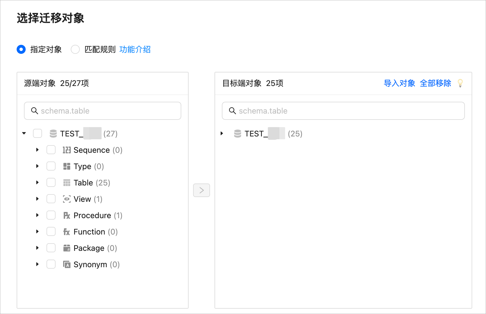
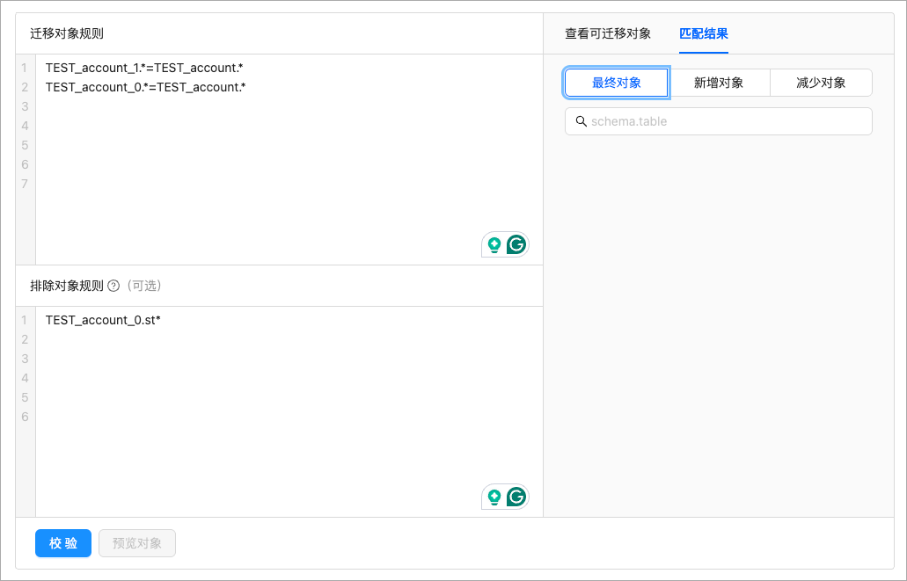
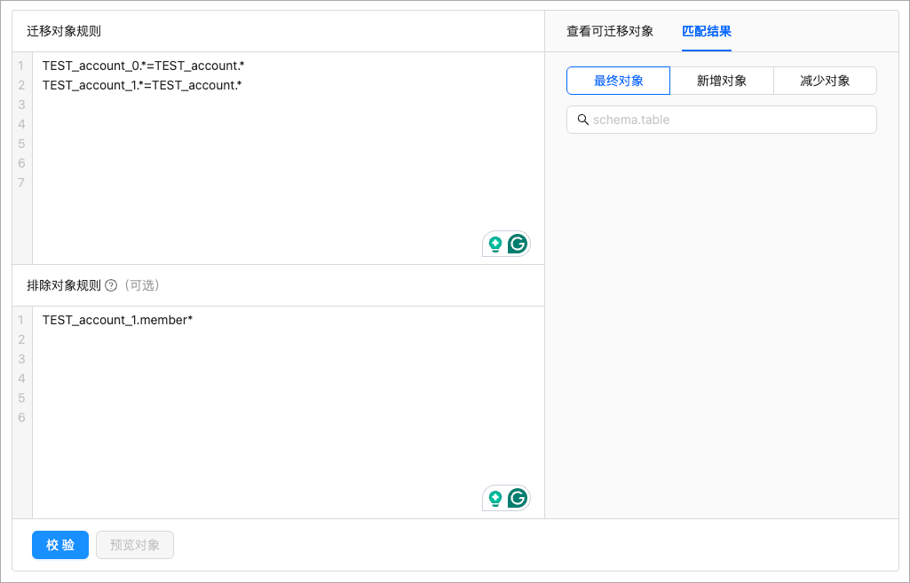

# MyCat 迁移至 OceanBase 最佳实践

MyCat 是一个广泛使用的数据库中间件，其核心功能是实现数据库的分库分表。它通过将数据分散到多个数据库实例或表中，来提升数据库的性能和可扩展性。本文档旨在为使用 MyCat 作为分库分表中间件的用户介绍数据迁移至 OceanBase 数据库的步骤及关键要点。

## 迁移前准备

### 环境评估

MyCat 作为传统分库分表中间件，其核心工作原理是通过 SQL 解析引擎对查询请求进行分片分析和路由转发。在这个过程中，MyCat 会完成 SQL 解析、分片分析、路由选择、结果合并等关键处理流程。需要特别注意的是，MyCat 默认会在查询结果中添加 LIMIT 分页处理，这种自动行为在迁移到 OceanBase 后可能导致查询结果差异，需要在应用适配阶段重点关注。

在应用代码方面，需要全面检查现有系统中是否存在 MyCat 特定的代码逻辑。虽然 MyCat 设计上对应用透明，但在实际项目中，开发者可能会编写依赖 MyCat 特性的代码，特别是在分页处理和特殊 SQL 改写方面。建议建立完整的代码审查清单，逐项确认这些潜在依赖点。

### 性能需求评估

性能评估是迁移成功的关键前提。需要收集业务高峰期的完整性能画像，包括并发访问模式分析、高频查询的 SQL 特征、关键业务表的访问热点分布，以及现有架构下的性能瓶颈点等。

这些数据将直接影响 OceanBase 的分区策略设计和全局索引规划。例如，识别出的高频查询条件列应当考虑作为分区键候选，而访问热点可能需要通过更细粒度的分区来分散压力。建议使用 OceanBase 官方提供的迁移评估工具（OceanBase Migration Assessment，OMA）对迁移源端全面的兼容性检查，识别可能影响迁移的技术点。

## 迁移规划

在设计目标架构时，首先需要明确应用使用 MyCat 的动机。常见场景包括：处理单机数据库容量瓶颈、解决特定业务场景的性能问题，或是规避原有数据库的功能限制。明确这些信息后，可以再来看看 OceanBase 侧应采取的架构规划。分库分表是为了利用并发 IO 的能力，从这个角度来看，将数据迁移至 OceanBase 时，建议采用多副本模式部署确保高可用。租户模式通常选择 Random 模式以获得最佳的资源利用率。对于特殊场景，如原 MyCat 实际仅使用少量 MySQL 实例的情况，可考虑降低 OceanBase 的租户副本配置。

### 迁移流程设计

迁移规划涉及到表结构和表数据两部分，基本流程如下：

1.  **结构迁移**：以库的维度进行迁移，首先完成迁移与 MyCat 分库有关的库下面的所有表，再迁移与 MyCat 无关的库表。完成结构迁移后，在 OceanBase 侧按照分区方式修改分区重建表结构。

2.  **数据迁移**：采用全量+增量的同步方式，包括两种可行方案：通过底层分库方式进行迁移，或者通过 MyCat 数据源进行迁移。

3.  **数据校验**：数据迁移完成后，进行全面的数据一致性验证。

## 迁移实施

### 结构迁移

结构迁移是整体迁移工作的基础，需要根据不同的表类型采用针对性的策略。MyCat 环境中的表通常可分为以下几类：

1.  **分区表**：指 MyCat 中定义的库下面分区表。针对这类表，只需迁移某一个分库的结构定义即可，不能重复迁移。

2.  **非分区表**：指 MyCat 中定义的库下面的非分区表。需要确认 MyCat 配置中指定的实际数据节点（分库），仅迁移该节点的表结构。

3.  **全局表**：指 MyCat 中定义的库下面的全局配置表。同非分区表一样，全局表只能迁移 MyCat 配置文件中指定的实际数据节点的表结构，同时，由于其他节点可能存在同名表，全局表只能迁移一遍。

4.  **未配置表**：这类表虽然存在于 MyCat 管理的库中，但未在配置文件中声明。若在不同库中出现同名表，则需要确认应该以哪张表为准进行迁移。

5.  **无关库表**：与分库分表架构无关的其他业务表，可按常规方式迁移。

以上这几类表均需要迁移到 OceanBase 中，且不允许发生数据重复。迁移以库的维度进行，先迁移与 MyCat 分库有关的库下面的所有表，再迁移与 MyCat 无关的库表。总体的迁移原则是正确的表只选择一次。

#### 迁移与 MyCat 分库有关的库表

上述提到的前四类均属于与 MyCat 分库有关的库表。在迁移这些库表的实际操作中，可以使用以下两种迁移方式：

1.  **指定对象迁移**

    这种迁移方式适合迁移对象较少且明确的场景，能够精确控制每个迁移对象。

    

2.  **规则匹配迁移**

    这种迁移方式更适合大规模迁移，通过配置匹配规则，可以同时实现重命名与表排除，可以高效完成迁移工作。

    例如，假设存在两个分库：分库 0 和分库 1。分库 1 中所有的表均为分区表，而分库 0 中存在分区表以及非分区表。分库 1 可以选择正常进行结构迁移，而迁移分库 0 时，由于结构迁移只需要进行一次，则需要排除分库 1 中已选择的分区表。在这种情况下，相比于通过指定对象的方式逐个勾选，使用规则匹配更加简单。下图展示如何使用规则匹配的方式排除分库 0 中以 `st` 开头的表（MyCat 分区表）。

    

#### 迁移与 MyCat 分库无关的库表

上述提到的第五类表即与 MyCat 分库无关的库表。这类库表不在 MyCat 配置中，但与 MyCat 分库共享一个数据库实例，可以正常进行迁移。但若在不同实例中出现了同名的库，则需要先人工确认正确的库表再进行迁移。

#### 在 OceanBase 侧修改表结构

表结构改造需要参考原分库分表的分区设置，在了解业务高峰期行为的前提下参考原分区算法进行设计。分区设计其实与主键约束并无强关联，但由于 OceanBase 数据库要求主键必须包含分区键，因此通常需要对原有表结构进行调整。针对这一情况，目前有两种解决方案：

- **方案一**：若主键与分区键不一致，可以将分区键加入主键形成复合主键。这种方式最优，但要求分区键不允许为 NULL 值。在实践中，很多原有系统的设计可能存在 `DEFAULT NULL` 的定义，这时需要结合实际情况，确认是否可以移除该定义。

- **方案二**：当 `DEFAULT NULL` 无法移除时，可以使用全局唯一索引来保证数据唯一性。这种方法虽然能解决 NULL 值问题，但由于全局索引是独立的数据结构，在高并发场景下可能存在性能瓶颈。

以下是一个典型的结构改造示例：

``` sql
-- 原表结构
CREATE TABLE `st_account` (
  `id` bigint(20) NOT NULL COMMENT 'id',
  `account_id` bigint(20) DEFAULT NULL COMMENT '账户Id',
  ...
  PRIMARY KEY (`id`)
);

-- 改造后的OceanBase表结构
CREATE TABLE `st_account` (
  `id` bigint(20) NOT NULL COMMENT 'id',
  `account_id` bigint(20) NOT NULL COMMENT '账户Id',  -- 移除了 DEFAULT NULL
  ...
  PRIMARY KEY (`id`, `account_id`)  -- 创建复合主键
) PARTITION BY HASH(`account_id`) PARTITIONS 6;
```

### 数据迁移和校验

在使用 OMS 进行数据迁移时需要选择全量迁移+增量同步（仅勾选 DML 同步）+全量校验。目前可以选择以下两种方案完成迁移。

#### 通过底层分库方式进行迁移

这种方式通过每个底层分库进行同步，并通过重命名策略完成数据迁移。具体流程为先迁移与 MyCat 分库有关的所有表，包括分区表、非分区表、全局表、未配置表；然后迁移与 MyCat 分库无关的所有表。分区表各分库数据均需迁移，而其他表只进行一次迁移。

这种方式是以库的维度完成数据迁移，不容易产生数据遗漏，且可以在配置迁移任务时参考结构迁移指定对象或使用规则匹配进行数据限定。但需要注意的是，这里需要排除的表不是分区表，而是不同分库中发生重复的非分区表。此处只需要同步 MyCat 配置文件中非分区表指定的数据分库节点上的表数据即可。这种方式的缺点在于操作较为繁琐。

例如，下图展示的是分库 1 和分库 0 的表数据重命名迁移，并排除分库 1 中的一些以 `member` 开头的非分区表。这些非分区表在分库 1 中存在，但是 MyCat 配置文件中指向了分库 0，需要进行排除。



#### 通过 MyCat 数据源进行迁移

这种方式直接通过 MyCat 连接进行数据抽取，相较前一种方式更为简单。但由于 MyCat 无法提供增量日志，该方案仅支持全量数据迁移，无法进行增量同步。

采用这种方式进行迁移的具体流程为：首先全量迁移 MyCat 配置内的所有库表，然后全量迁移 MyCat 配置库中不在配置文件中的表，最后全量迁移不在 MyCat 配置文件中的库。分区表各分库数据均需迁移，其他表只进行一次迁移。

#### 数据校验

数据校验是确保迁移质量的关键环节。此处建议使用 inmode 校验模式，可以通过配置 `filter.verify.inmod.tables` 参数进行 inmode 校验，参数对应值即为需要校验的表。若需启用全表校验，可选择配置 `filter.verify.inmod.tables=.*;.*;.*`。全表校验仅适用于以下场景，是否进行全表校验需要根据实际情况进行判断：

1.  迁移链路存在多表汇聚迁移的情况，即多个源表的数据合并到目标库的单个表中，例如源端的 A_1, A_2, ... A_N 表中的数据迁移到目标端 A 表中。
2.  当目标表已存在数据且在配置迁移任务时，高级选项 **目标端表对象存在记录时处理策略** 配置为 **忽略**，此时所有表将使用 inmode 模式进行校验。

当校验发现不一致时，必须遵循规范的处理流程：首先记录完整的差异详情，然后分析根本原因，最后制定针对性的修复方案。要特别注意，不能直接进行订正，必须先查明差异产生的原因。

### 配置反向链路（回退方案）

迁移完成后，针对于业务割接场景，可以选择在业务数据库完成切换前在 OMS 上启动目标库至源库（即反向）的增量同步任务，将业务切换后在目标端数据库产生的变更数据实时回流至源业务数据库。在 MyCat 迁移任务中，可以按表类型配置反向链路。对于 MyCat 配置内的表，配置 OceanBase 至 MyCat 数据源的增量数据链路进行数据传递；对于源端其他非 MyCat 管理的表，需新建另外的链路进行反向同步。
