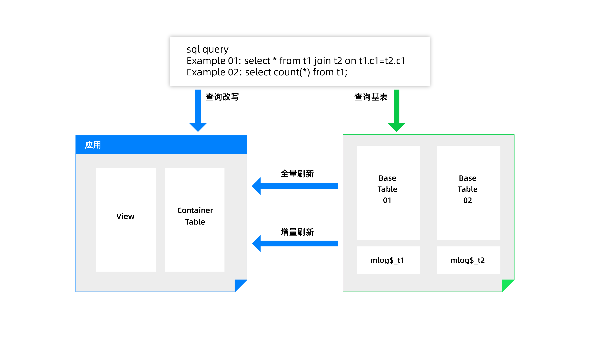
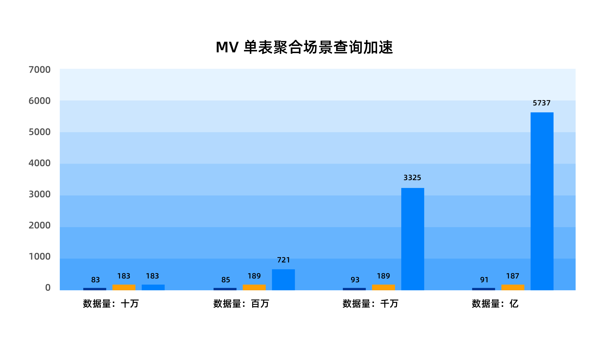
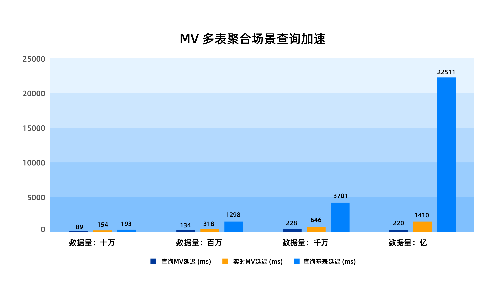
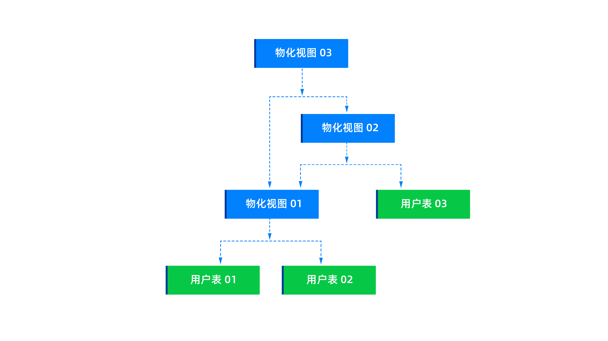
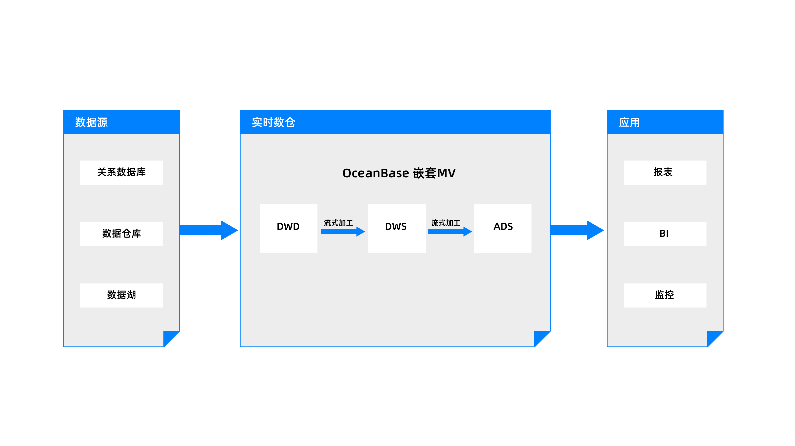

# OceanBase 物化视图最佳实践

## 概述

OceanBase 物化视图核心能力包括：

- **数据预计算**：通过预计算、存储查询结果加速分析，减少实时计算开销，提升查询性能。
- **刷新机制**：支持 **全量刷新**（重建所有数据）和 **增量刷新**（仅更新变化数据），增量刷新通常性能更好。
- **实时查询能力**：通过 `ENABLE ON QUERY COMPUTATION` 开启后，查询会自动整合增量数据返回实时结果。
- **嵌套与级联刷新能力**：支持多层物化视图构建复杂 ETL 流程。



下表按能力层级分类展示了 OceanBase 物化视图的功能特性，帮助用户理解各能力的技术实现与适用场景。

[TABLE]

本文中的最佳实践场景测试结果仅供参考，实际应用中的效果需根据您的业务环境和系统配置进行具体评估。

## 最佳实践场景

### 场景 1：单表聚合查询加速

#### 适用场景

- 业务单表存量数据量大，直接查询延迟高。
- 需要高频分组聚合查询（如 `COUNT`、`SUM`、`GROUP BY`）。

#### 实施步骤

1.  创建增量刷新物化视图：

    ``` sql
    CREATE MATERIALIZED VIEW mv1  
    PRIMARY KEY (a)  
    PARALLEL 5  
    REFRESH FAST  
    START WITH SYSDATE()  
    NEXT SYSDATE() + INTERVAL '5' SECOND  
    ENABLE ON QUERY COMPUTATION  
    AS  
    SELECT a, COUNT(b), COUNT(*), SUM(b)  
    FROM t1  
    GROUP BY a;  
    ```

    - `REFRESH FAST`：启用增量刷新。由于 `REFRESH FAST` 方法利用物化视图日志中的记录信息来确定需要增量刷新的内容，因此在使用增量刷新刷新物化视图时，需要在创建物化视图之前就创建基表的 **物化视图日志（mlog）**。
    - `ENABLE ON QUERY COMPUTATION`：实时查询时自动合并增量数据。

2.  效果验证

    - **非实时查询**：直接查询物化视图数据（延迟显著低于查询基表）。
    - **实时查询**：系统自动整合增量数据返回结果（延迟显著低于查询基表）。
    - **数据量增长优势**：随着基表数据量增加，物化视图的加速效果更明显（如下图）。

    

### 场景 2：多表连接查询加速

#### 适用场景

- 业务多表存量数据量大，直接查询延迟高。
- 需要高频多表连接查询（如两表或三表关联）。

#### 实施步骤

1.  创建增量刷新物化视图：

    ``` sql
    CREATE MATERIALIZED VIEW mv2  
    PRIMARY KEY (a, b)  
    PARALLEL 5  
    PARTITION BY HASH(a) PARTITIONS 4  
    REFRESH FAST  
    START WITH SYSDATE()  
    NEXT SYSDATE() + INTERVAL 5 SECOND  
    ENABLE ON QUERY COMPUTATION  
    AS  
    SELECT t1.a, t1.b, t1.c, t2.d, t2.e  
    FROM t1  
    JOIN t2 ON t1.b = t2.d;  
    ```

    - `REFRESH FAST`：启用增量刷新。由于 `REFRESH FAST` 方法利用物化视图日志中的记录信息来确定需要增量刷新的内容，因此在使用增量刷新刷新物化视图时，需要在创建物化视图之前就创建基表的 **物化视图日志（mlog）**。
    - `PARTITION BY HASH`：通过分区提升并行执行效率。
    - `PARALLEL`：指定并行度加速数据处理。

2.  查询优化

    - 对原查询 `SELECT * FROM t1 JOIN t2 ON ...`，OceanBase 会自动重写为查询物化视图 `mv2`。
    - 随着基表数据量增长，物化视图的预计算优势更加显著（如下图）。

    

### 场景 3：实时数仓架构构建

#### 核心优势

- **简化 ETL 流程**：数据库内用 SQL 定义更简单的 ETL流程 。
- **流式增量处理**：增量刷新、流式处理，实现准实时数据更新。
- **ACID 保证**：数据流任务通过事务实现，可以保证 ACID。





#### 实施步骤

1.  创建多表 Join 的物化视图，对数据进行扩维操作（多表连接）：

    ``` sql
    CREATE MATERIALIZED VIEW mv_join  
    PARALLEL 5  
    REFRESH FAST  
    START WITH SYSDATE()  
    NEXT SYSDATE() + INTERVAL '5' SECOND  
    AS  
    SELECT t1.a, t1.b, t1.c, t2.d, t2.e, t3.f, t3.g  
    FROM t1  
    JOIN t2 ON t1.b = t2.d  
    JOIN t3 ON t1.b = t3.f;  
    ```

    - `REFRESH FAST`：启用增量刷新。由于 `REFRESH FAST` 方法利用物化视图日志中的记录信息来确定需要增量刷新的内容，因此在使用增量刷新刷新物化视图时，需要在创建物化视图之前就创建基表的 **物化视图日志（mlog）**。

2.  基于 `mv_join` 创建聚合分析物化视图：

    ``` sql
    CREATE MATERIALIZED VIEW mv_agg  
    PARALLEL 5  
    REFRESH FAST  
    START WITH SYSDATE()  
    NEXT SYSDATE() + INTERVAL '5' SECOND  
    AS  
    SELECT b, SUM(c) AS sum_c, SUM(e) AS sum_e, SUM(g) AS sum_g, COUNT(*) AS cnt  
    FROM mv_join  
    GROUP BY b;  
    ```

3.  构建多层 ETL 流程

    - 通过多级物化视图嵌套（如 `mv_agg` 基于 `mv_join`），可逐步实现复杂数据处理。
    - 每层物化视图独立设置刷新周期。

## 关键配置说明

### 刷新策略选择

- **全量刷新（`REFRESH COMPLETE`）**：适用于数据变更不频繁的场景。但每次刷新需重建全部数据，资源消耗较高。

- **增量刷新（`REFRESH FAST`）**：处理变化数据，性能更优。目前增量刷新支持单表聚合、多表关联以及多表关联聚合的 SQL 语句，从 V4.3.5 BP3 版本之后也支持了单表谓词过滤、Left Join、Union All。

### 实时查询能力

- **开启实时查询（`ENABLE ON QUERY COMPUTATION`）**：查询时自动合并物化视图最新数据与增量数据，返回实时结果。适用于需要查询优化的实时分析查询。

### 并行与分区优化

- **`PARALLEL` 参数**：指定并行度加速数据处理。
- **`PARTITION BY` 子句**：通过分区提升查询性能。
