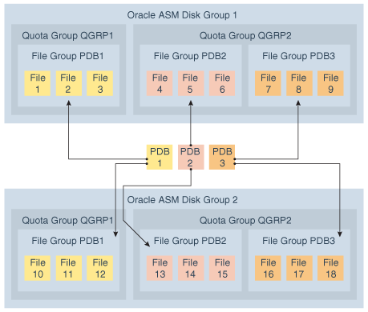

## Administering Oracle ASM Disk Groups

Administration of Oracle ASM disk groups includes creating, altering, dropping, mounting, and dismounting tasks.

This chapter describes how to administer Oracle Automatic Storage Management (Oracle ASM) disk groups. This information includes how to create, alter, drop, mount, and dismount Oracle ASM disk groups. The database instances that use Oracle ASM can continue operating while you administer disk groups.

The examples in this chapter use SQL statements. These examples assume that SQL\*Plus is run from the Oracle grid home where Oracle ASM is installed and the Oracle environmental variables are set to this home. The examples also assume that the Oracle ASM instance is running.

See also

- [About Starting Up an Oracle ASM Instance](administering-oracle-asm-instances.md) for information about starting up an Oracle ASM instance
- [Managing Oracle ASM With ASMCA](managing-oracle-asm-with-asmca.md) for information about administering Oracle ASM disk groups with Oracle ASM Configuration Assistant (ASMCA)
- [Managing Oracle ASM with ASMCMD](managing-oracle-asm-with-asmcmd.md) for information about administering Oracle ASM disk groups with ASMCMD
- The Oracle Cloud Storage page on the Oracle Technology Network website at [https://www.oracle.com/database/technologies/asm/](https://www.oracle.com/database/technologies/asm/) for more information about Oracle ASM

## Managing Disk Group Attributes

Disk group attributes are parameters that are bound to a disk group, rather than an Oracle ASM instance. Some disk group attributes can be set when a disk group is created or altered. Other disk attributes can only be set when a disk group is created or only be set when a disk group is altered.

In addition to the disk group attributes listed in this section, template attributes are also assigned to a disk group. For information about template attributes, see [Managing Disk Group Templates](administering-oracle-asm-files-directories-and-templates.md).

### About Viewing and Setting Disk Group Attributes

You can set and display disk group attribute settings.

You can display disk group attributes with the `V$ASM_ATTRIBUTE` view and the ASMCMD `lsattr` command.

Disk group attributes can be set with the `ATTRIBUTE` clause of the `ALTER` `DISKGROUP` or `CREATE` `DISKGROUP` SQL statement and the ASMCMD `setattr` and `mkdg` commands.

See also

- The example “Viewing disk group attributes with V$ASM\_ATTRIBUTE” for an example of the use of the `V$ASM_ATTRIBUTE` view
- [lsattr](managing-oracle-asm-with-asmcmd.md) for information about the `lsattr` command
- [setattr](managing-oracle-asm-with-asmcmd.md) for information about the `setattr` command
- [mkdg](managing-oracle-asm-with-asmcmd.md) for information about the `mkdg` command
- [Managing Disk Groups with ASMCA](managing-oracle-asm-with-asmca.md) for information about setting disk group attributes with Oracle ASM Configuration Assistant (ASMCA)

### Summary of Disk Group Attributes

The Oracle ASM disk group attributes are listed in this section.

#### ACCESS\_CONTROL.ENABLED

This attribute configures Oracle ASM File Access Control and can only be set when altering a disk group.

For information about the `ACCESS_CONTROL.ENABLED` attribute, see Setting Disk Group Attributes for Oracle ASM File Access Control.

#### ACCESS\_CONTROL.UMASK

This attribute configures Oracle ASM File Access Control and can only be set when altering a disk group.

For information about the `ACCESS_CONTROL.UMASK` attribute, see Setting Disk Group Attributes for Oracle ASM File Access Control.

#### AU\_SIZE

This attribute specifies allocation unit (AU) size and can only be set when creating a disk group. the example “Creating the DATA disk group” shows how the `AU_SIZE` is specified with the `CREATE` `DISKGROUP` SQL statement.

For information about allocation units, refer to [About Oracle ASM Allocation Units](introducing-oracle-automatic-storage-management.md).

#### CELL.SMART\_SCAN\_CAPABLE

This attribute is only applicable to the configuration of Oracle Exadata storage.

See also

*Oracle Exadata documentation*

#### CELL.SPARSE\_DG

This attribute is only applicable to the configuration of Oracle Exadata storage.

See also

*Oracle Exadata documentation*

#### COMPATIBLE.ASM

This attribute specifies the Oracle ASM compatibility level of a disk group. Compatibility attributes can be set when the disk group is created and advanced when a disk group is altered, but compatibility attributes cannot be reversed. For information about the `COMPATIBLE.ASM` attribute, refer to Disk Group Compatibility Attributes.

#### COMPATIBLE.RDBMS

This attribute specifies the database compatibility level of a disk group. Compatibility attributes can be set when the disk group is created and advanced when a disk group is altered, but compatibility attributes cannot be reversed. For information about the `COMPATIBLE.RDBMS` attribute, refer to Disk Group Compatibility Attributes.

#### COMPATIBLE.ADVM

This attribute specifies the Oracle Automatic Storage Management Cluster File System (Oracle ACFS) and Oracle ASM Dynamic Volume Manager (Oracle ADVM) compatibility level of a disk group. Compatibility attributes can be set when the disk group is created and advanced when a disk group is altered, but compatibility attributes cannot be reversed. For information about the `COMPATIBLE.ADVM` attribute, refer to Disk Group Compatibility Attributes and [Overview of Oracle ASM Dynamic Volume Manager](introducing-oracle-acfs-and-oracle-advm.md).

#### CONTENT.CHECK

The `CONTENT.CHECK` attribute enables or disables content checking when performing data relocation operations for a disk group.

The attribute value can be set to `true` (enabled) or `false` (disabled).

When `CONTENT.CHECK` is enabled, an Oracle ASM relocation process (rebalance, resync, or resilver) detects corruptions during a data copy operation and performs automatic block corruption recovery by replacing these corruptions with an uncorrupted mirror copy if one is available.

The content check process detects and repairs corruptions for situations when the I/O operation is successful, but the blocks have invalid content. The process also performs a Hardware Assisted Resilient Data (HARD) check for all supported files and a block header check for data files.

This attribute can only be set when altering a disk group.

See also

Manually Rebalancing Disk Groups and Tuning Rebalance Operations for information about disk group rebalancing

#### CONTENT.TYPE

This attribute identifies the disk group type: `data`, `recovery`, or `system`. The type value determines where Oracle ASM places the nearest neighbor disk in the failure group where Oracle ASM mirrors copies of the data. Oracle ASM uses this attribute value to make it less likely that a double failure in the storage medium causes disk groups of different content types to become unavailable. Specifying this attribute enables Oracle ASM to better deploy all disk groups in the available storage.

The default value is `data` which specifies a distance of 1 to the nearest neighbor disk. A value of `recovery` specifies a distance of 3 to the nearest neighbor disk and a value of `system` specifies a distance of 5.

The attribute can be specified when creating or altering a disk group. If `CONTENT.TYPE` attribute is set or changed using `ALTER` `DISKGROUP`, then the new configuration does not take effect until a disk group rebalance is explicitly run.

The `CONTENT.TYPE` attribute is only valid for disk groups that are set to normal or high redundancy. The `COMPATIBLE.ASM` attribute must be set to `11.2.0.3` or higher to enable the `CONTENT.TYPE` attribute for the disk group.

This attribute can be set with ASMCMD `mkdg` or SQL `CREATE` and `ALTER` `DISKGROUP` statements.

For example:

```
SQL> CREATE DISKGROUP data NORMAL REDUNDANCY
        FAILGROUP controller1 DISK
        '/devices/diska1' NAME diska1,
...
        ATTRIBUTE
        'compatible.asm' = '12.1.0.1',
        'content.type' = 'recovery',
...

SQL> ALTER DISKGROUP data SET ATTRIBUTE 'content.type' = 'data';
```

This attribute is primarily intended for use with Oracle Exadata storage.

For information about disk resync, see Oracle ASM Fast Mirror Resync.

See also

- *Oracle Exadata documentation*
- [My Oracle Support](https://support.oracle.com/) ([https://support.oracle.com](https://support.oracle.com/)) for information about using the `CONTENT.TYPE` attribute with Oracle Exadata storage

#### CONTENT\_HARDCHECK.ENABLED

The `CONTENT_HARDCHECK.ENABLED` disk group attribute enables or disables Hardware Assisted Resilient Data (HARD) checking when performing data copy operations for rebalancing a disk group.

The attribute value can be set to `true` or `false`. This attribute can only be set when altering a disk group.

- When the `CONTENT.CHECK` disk group attribute is set to enabled ( `true` ), the setting of `CONTENT_HARDCHECK.ENABLED` is ignored and checking is done on the content of user data, including HARD checks.
- When the `CONTENT.CHECK` attribute is set to disabled ( `false` ) and the `CONTENT_HARDCHECK.ENABLED` attribute is set to enabled ( `true` ), only HARD checking is performed.
- When the `CONTENT.CHECK` attribute is set to disabled ( `false` ) and the `CONTENT_HARDCHECK.ENABLED` attribute is set to disabled ( `false` ), no checking is performed.

See also

Manually Rebalancing Disk Groups and Tuning Rebalance Operations for information about disk group rebalancing

#### DISK\_REPAIR\_TIME

This attribute specifies the time interval to repair a disk and bring it back online before initiating the drop operation. This attribute can only be set when altering a disk group and is only applicable to normal and high redundancy disk groups.

For information about disk repair time, see Oracle ASM Fast Mirror Resync.

#### FAILGROUP\_REPAIR\_TIME

This attribute specifies a default repair time for the failure groups in the disk group. The failure group repair time is used if Oracle ASM determines that an entire failure group has failed. The default value is 24 hours (`24h`). If there is a repair time specified for a disk, such as with the `DROP` `AFTER` clause of the SQL `ALTER` `DISKGROUP` `OFFLINE` `DISK` statement, that disk repair time overrides the failure group repair time.

This attribute can only be set when altering a disk group and is only applicable to normal and high redundancy disk groups.

For information about failure group repair time, see Oracle ASM Fast Mirror Resync.

#### IDP.BOUNDARY and IDP.TYPE

Note:

The Intelligent Data Placement (IDP) feature has been deprecated since Oracle ASM 12c Release 2 (12.2) and is planned for desupport in a future release.

These attributes are used to configure Oracle Exadata storage.

See also

*Oracle Exadata documentation*

#### LOGICAL\_SECTOR\_SIZE

The `LOGICAL_SECTOR_SIZE` disk group attribute specifies the logical sector size for a disk group. The value can be set when creating or altering a disk group.

The value of `LOGICAL_SECTOR_SIZE` specifies the smallest unit of I/O allowed on the disk group. The value must be less than or equal to the size of the `SECTOR_SIZE` disk group attribute.

`COMPATIBLE.ASM` must be set to `12.2` or greater to use the `LOGICAL_SECTOR_SIZE` disk group attribute.

For information about setting the `LOGICAL_SECTOR_SIZE` disk group attribute, see Specifying the Logical and Physical Sector Size.

For information about the `SECTOR_SIZE` disk group attribute, refer to SECTOR\_SIZE.

#### PHYS\_META\_REPLICATED

This disk group attribute tracks the replication status of a disk group. When the Oracle ASM compatibility of a disk group is advanced to 12.1 or higher, the physical metadata of each disk is replicated. This metadata includes the disk header, free space table blocks, and allocation table blocks. The replication is performed online asynchronously. This attribute value is set to `true` by Oracle ASM if the physical metadata of every disk in the disk group has been replicated.

This disk group attribute is only defined in a disk group with the Oracle ASM disk group compatibility (`COMPATIBLE.ASM`) set to `12.1` and higher. This attribute is read-only and is intended for information only. A user cannot set or change its value. The values are either `true` or `false`.

#### PREFERRED\_READ.ENABLED

In an Oracle extended cluster, which contains nodes that span multiple physically separated sites, the `PREFERRED_READ.ENABLED` disk group attribute controls whether preferred read functionality is enabled for a disk group.

If preferred read functionality is enabled, then this functionality enables an instance to determine and read from disks at the same site as itself, which can improve performance.

Each Oracle ASM instance in an Oracle extended cluster has the information to determine the site in which it is located. If preferred read functionality is enabled, then based on the site information, the preferred status for a disk is determined to be true if the disk is in the same site as the instance. Otherwise, if the disk is not located at the same site as the Oracle ASM instance, the preferred status for a disk is set to false.

For extended clusters, the preferred read setting is enabled by default with a `TRUE` setting for the `PREFERRED_READ.ENABLED` disk group attribute of each disk group. For clusters that are not extended (only one physical site), preferred read is disabled. Preferred read status applies to extended, normal, high, and flex redundancy disk groups.

Oracle Database 12c Release 2 (12.2) is required and `COMPATIBLE.ASM` must be set to `12.2` or greater to use `PREFERRED_READ.ENABLED`.

Whether or not `PREFERRED_READ.ENABLED` has been enabled, preferred read can be set at the failure group level on an Oracle ASM instance or a client instance in a cluster with the `ASM_PREFERRED_READ_FAILURE_GROUPS` initialization parameter, which is available for backward compatibility.

To determine whether a disk has preferred read status, you can check the `PREFERRED_READ` column of the `V$ASM_DISK` view.

See also

- [ASM\_PREFERRED\_READ\_FAILURE\_GROUPS](administering-oracle-asm-instances.md) for information about the `ASM_PREFERRED_READ_FAILURE_GROUPS` initialization parameter
- About Oracle ASM Extended Disk Groups for information about Oracle ASM extended disk groups
- [Oracle Grid Infrastructure Installation and Upgrade Guide](https://docs.oracle.com/pls/topic/lookup?ctx=en/database/oracle/oracle-database/19/ostmg&id=CWGEN) for information about Oracle extended clusters
- [Oracle Database Reference](https://docs.oracle.com/pls/topic/lookup?ctx=en/database/oracle/oracle-database/19/ostmg&id=REFRN003) for information about all of the `V$ASM*` dynamic performance views

#### SCRUB\_ASYNC\_LIMIT

The `SCRUB_ASYNC_LIMIT` disk group attribute sets the maximum allowed outstanding parallel read requests for asynchronous scrubbing.

The range of values is `1` to `1024`. The default value is `1`.

`COMPATIBLE.ASM` must be set to `12.2` or greater to use this disk group attribute.

For information about the scrubbing operation, refer to Scrubbing Disk Groups.

#### SECTOR\_SIZE

The `SECTOR_SIZE` disk group attribute specifies the sector size for a disk group. The value can be set when creating or altering a disk group.

The value of `SECTOR_SIZE` is used for the block size of newly-created redo logs and Oracle ACFS file systems. The value can be changed to facilitate migration of disks to different sector sizes. The value must be greater than or equal to the size of the `LOGICAL_SECTOR_SIZE` disk group attribute.

`COMPATIBLE.ASM` must be set to `12.2` or greater to use the 12.2 functionality of `SECTOR_SIZE`, which includes the ability to alter the sector size after a disk group has been created.

For information about setting the `SECTOR_SIZE` disk group attribute, see Specifying the Logical and Physical Sector Size.

For information about the `LOGICAL_SECTOR_SIZE` disk group attribute, refer to LOGICAL\_SECTOR\_SIZE.

#### STORAGE.TYPE

This disk group attribute specifies the type of the disks in the disk group. The possible values are `AXIOM`, `ZFSSA`, and `OTHER`. If the attribute is set to `AXIOM` or `ZFSSA`, then all disks in the disk group must be of that type. If the attribute is set to `OTHER`, then any types of disks can be in the disk group.

If the `STORAGE.TYPE` disk group attribute is set to `AXIOM` or `ZFSSA`, then functionality for Hybrid Columnar Compression (HCC) can be enabled for Pillar Axiom or ZFS storage.

Note:

Pillar Axiom storage must be added as SCSI/Fiber Channel.

To set the `STORAGE.TYPE` attribute, the `COMPATIBLE.ASM` and `COMPATIBLE.RDBMS` disk group attributes must be set to `11.2.0.3` or higher. For maximum support with ZFS storage, set the `COMPATIBLE.ASM` and `COMPATIBLE.RDBMS` disk group attributes to `11.2.0.4` or higher. For information about disk group compatibility attributes, refer to Disk Group Compatibility.

The `STORAGE.TYPE` attribute can be set when creating a disk group or when altering a disk group. The attribute cannot be set when clients are connected to the disk group. For example, the attribute cannot be set when an Oracle ADVM volume is enabled on the disk group.

The attribute is not visible in the `V$ASM_ATTRIBUTE` view or with the ASMCMD `lsattr` command until the attribute has been set.

See also

[*Oracle Database Concepts*](https://docs.oracle.com/pls/topic/lookup?ctx=en/database/oracle/oracle-database/19/ostmg&id=CNCPT89198) for more information about Hybrid Columnar Compression. Hybrid Columnar Compression is a feature of certain Oracle storage systems.

#### THIN\_PROVISIONED

This attribute enables or disables the functionality to discard unused storage space after a disk group rebalance is completed. The attribute value can be `true` to enable or `false` to disable the functionality. The default value is `false`.

Storage vendor products that support thin provisioning have the capability to reuse the discarded storage space for a more efficient overall physical storage utilization. Given such support from a storage vendor, when the `COMPACT` phase of a rebalance operation has completed, Oracle ASM informs the storage which space is no longer used and can be repurposed. If a rebalance is not running, you can issue a rebalance with the `ALTER` `DISKGROUP`... `REBALANCE` SQL statement.

Note:

The `THIN_PROVISIONED` attribute is supported only with Oracle ASM Filter Driver (Oracle ASMFD) in Oracle Grid Infrastructure 12.2 and later releases on Linux.

See also

- [Administering Oracle ASM Filter Driver](administering-oracle-asm-filter-driver.md) for information about Oracle ASMFD
- [My Oracle Support](https://support.oracle.com/) ([https://support.oracle.com](https://support.oracle.com/)) for articles about Oracle ASM and Oracle ASMFD, such as notes 1369107.1 and 2034681.1, and additional articles about Oracle ASM and thin provisioning
- Tuning Rebalance Operations for information about disk group rebalancing

#### VAM\_MIGRATION\_DONE

Virtual Allocation Metadata (VAM) supports flexible storage allocation. The `VAM_MIGRATION_DONE` disk group attribute must be enabled and the migration completed before migrating a `NORMAL` or `HIGH` redundancy disk group to a `FLEX` redundancy disk group without the use of a restrictive mount.

## Creating Disk Groups

You can create disk groups with Oracle Enterprise Manager.

You can create additional Oracle ASM disk groups to:

- Have disk groups with different redundancy levels (normal, high, or external), depending on availability requirements and storage system capabilities.
- Separate different classes of storage, such as SCSI drives and SATA drives, into different disk groups. Disks in a disk group should have similar size and performance characteristics.
- Store the fast recovery area in a separate disk group from the database.

To create a disk group:

1. Access the Oracle Automatic Storage Management home page.
2. Click the **Disk** **Groups** link at the top of the page to display the Disk Groups property page.
3. If you are not logged in, then the Log In page appears and you should log in as the `SYS` user, connecting as `SYSASM`. Provide the `SYS` password for the Oracle ASM instance. This password was set up when the Oracle ASM instance was created.
4. Click **Create** and Oracle Enterprise Manager displays a Create Disk Group page. The Create Disk Group page displays a list of Oracle ASM disks that are available to be added to a disk group. This includes disks with a header status of `CANDIDATE`, `PROVISIONED`, or `FORMER`, and so on.
5. To display not only disks that are available to be added to a disk group, but all Oracle ASM disks, including disks that belong to a disk group (header status = `MEMBER` ), select **All Disks** from the Select Member Disks list.
	The page is re-displayed with the complete list of Oracle ASM disks that were discovered by the Oracle ASM instance.
6. Enter the disk name, select a redundancy type (high, normal, or external), and optionally, you can enter a failure group name.
7. Select disks as follows:
	- Select the box to the left of each disk to be included in the new disk group.
		- Optionally, you can enter a disk name, the size of the disk for Oracle ASM to use, and the failure group name.
		- To force the inclusion of a disk in the disk group, select the **Force Usage** box for that disk.
	Caution:
	Selecting the Force Usage box causes the disk to be added to the new disk group even if the disk belongs to another disk group and has valid database data. The existing data is then lost. You must be certain that you are selecting a disk that can legitimately be added to the disk group.
8. Specify a **Disk** **Compatibility** value for the disk group to enable your system to use the latest Oracle ASM features.
	Note:
	You cannot reverse the setting of a disk group compatibility value.
9. Click **OK** to create the disk group or click **Cancel** to stop the disk group creation operation. You can also click **Show SQL** to show the SQL statements that the disk group creation operation uses.

See also

- [Accessing the Oracle Automatic Storage Management Home Page](administering-oracle-asm-with-oracle-enterprise-manager.md) for instructions on accessing the Oracle Automatic Storage Management home page
- Creating Disk Groups for information about using the `FORCE` option when creating disk groups
- [Configuring Disk Group Compatibility Attributes](administering-oracle-asm-with-oracle-enterprise-manager.md) for information about configuring disk group compatibility attributes
- Disk Group Compatibility for information about disk group compatibility attributes
- Creating Disk Groups for more information about creating disk groups

### About Creating a Disk Group

There are multiple items you need to specify when you create a disk group.

When creating a disk group, you:

- Assign a unique name to the disk group.
	The specified disk group name is not case sensitive and is always converted to uppercase when stored internally.
	Note:
	Do not use identifiers for Oracle ASM disk group names that must be quoted, including `#` and `$` characters. While the use of quoted identifiers for Oracle Database objects may be valid as names in some tools, the names may not be valid when using other tools that manage that object. For more information about naming Oracle Database objects, refer to [Oracle Database SQL Language Reference](https://docs.oracle.com/pls/topic/lookup?ctx=en/database/oracle/oracle-database/19/ostmg&id=SQLRF01114).
- Determine the redundancy level of the disk group.
	For Oracle ASM to mirror files, specify a redundancy level such as `NORMAL REDUNDANCY` (two-way mirroring by default for most file types), `HIGH REDUNDANCY` (three-way mirroring for all files), `FLEX REDUNDANCY`, or `EXTENDED REDUNDANCY`.
	Specify `EXTERNAL REDUNDANCY` if you do not want mirroring by Oracle ASM. For example, you might choose `EXTERNAL REDUNDANCY` to use storage array protection features.
	After a disk group is created with `NORMAL` or `HIGH` redundancy, you can migrate the disk group to a `FLEX` redundancy disk group with the `CONVERT` `REDUNDANCY` `TO` `FLEX` clause of the `ALTER` `DISKGROUP` SQL statement. You cannot migrate an `EXTERNAL` disk group to a `FLEX` redundancy disk group. When migrating to a flex disk group, the disk group must have a minimum of three failure groups and must be mounted in restricted mode ( `MOUNTED` `RESTRICTED` ) for the duration of the migration.
	To change the redundancy level for `NORMAL`, `HIGH`, or `EXTERNAL` disk groups to a `NORMAL`, `HIGH`, or `EXTERNAL`, you must create another disk group with the appropriate redundancy and then move the files to the new disk group.
	For `FLEX` and `EXTENDED` redundancy disk groups, the disk group redundancy cannot be changed. However, the redundancy of the files in the disk group can be changed by modifying the `REDUNDANCY` property of the respective file group.
- Identify the disks that are to be formatted as Oracle ASM disks belonging to the disk group.
	The disks can be specified using operating system dependent wildcard characters in search strings that Oracle ASM then uses to find the disks. You can specify names for the disks with the `NAME` clause or use the system-generated names.
- Optionally indicate that the disks belong to specific failure groups.
	You must create failure groups of equal size to maintain space balance and even distribution of mirror data.
- Optionally determine the type of failure group, such as quorum ( `QUORUM` ) or regular (default).
- Optionally provide disk group attribute values, such as the values for software compatibility or allocation unit size.

All disks in the disk group must be of equal size. Oracle ASM programmatically determines the size of each disk. If for some reason the size cannot be determined, or to restrict the amount of space used on a disk, you can specify a `SIZE` clause for a disk; however, the same size value must be specified for every disk in the disk group.

Oracle ASM creates operating system-independent names for the disks in a disk group that you can use to reference the disks in other SQL statements. Optionally, you can provide your own name for a disk using the `NAME` clause. Disk names are available in the `V$ASM_DISK` view.

You can use the ASMCMD `stamp` command to provision disks for Oracle ASM before creating a disk group that uses them. If a disk is provisioned, then the disk name, failure group, and site information are specified at the time the disk is provisioned and do not need to be specified when the disk group is created.

Note:

A disk cannot belong to multiple disk groups.

The Oracle ASM instance ensures that any disk in a newly created disk group is addressable and is not currently a member of another disk group. You must use `FORCE` only when adding a disk that was dropped with `FORCE`. If a disk is dropped with `NOFORCE`, then you can add it with `NOFORCE`. For example, a disk might have failed and was dropped from its disk group. After the disk is repaired, it is no longer part of any disk group, but Oracle ASM still recognizes that the disk had been a member of a disk group. You must use the `FORCE` flag to include the disk in a new disk group. In addition, the disk must be addressable. Otherwise, the operation fails.

Note:

Use caution when using the `FORCE` option to add a previously used disk to a disk group; you might cause another disk group to become unusable.

The `CREATE DISKGROUP` statement mounts the disk group for the first time, and adds the disk group name to the `ASM_DISKGROUPS` initialization parameter if a server parameter file is being used. If a text initialization parameter file is being used and you want the disk group to be automatically mounted at instance startup, then you must remember to add the disk group name to the `ASM_DISKGROUPS` initialization parameter before you shut down and restart the Oracle ASM instance. You can also create disk groups with Oracle ASM Configuration Assistant (ASMCA) and the ASMCMD `mkdg` command.

See also

- Managing Oracle ASM Flex Disk Groups for information about flex disk groups and file groups
- Mirroring, Redundancy, and Failure Group Options and [Understanding Oracle ASM Concepts](introducing-oracle-automatic-storage-management.md) for information about redundancy levels and failure groups
- Storing Oracle Cluster Registry and Voting Files in Oracle ASM Disk Groups for information about `QUORUM` and `REGULAR` failure groups
- [stamp](managing-oracle-asm-with-asmcmd.md) for information about the ASMCMD `stamp` command
- [Managing Disk Groups with ASMCA](managing-oracle-asm-with-asmca.md) for information about creating disk groups with Oracle ASM Configuration Assistant (ASMCA)
- [mkdg](managing-oracle-asm-with-asmcmd.md) for information about creating disk groups with the ASMCMD `mkdg` command
- [Oracle Database SQL Language Reference](https://docs.oracle.com/pls/topic/lookup?ctx=en/database/oracle/oracle-database/19/ostmg&id=SQLRF51129) for information about the `CREATE` `DISKGROUP` SQL statement

### Creating Disk Groups Using the CREATE DISKGROUP SQL Statement

You can create disk groups for data and the fast recovery area using the `CREATE DISKGROUP` SQL statement.

The SQL statement in the example “Creating the DATA disk group” creates a disk group named `data` with normal redundancy consisting of two failure groups `controller1` or `controller2` with four disks in each failure group. The `data` disk group is typically used to store database data files.

The example assumes that the `ASM_DISKSTRING` initialization parameter is set to the ' `/devices/*` ' string. Oracle ASM disk discovery identifies `diska1` through `diska4` and `diskb1` through `diskb4` in the `/devices` directory.

In the example “Creating the DATA disk group”, the `NAME` clauses enable you to explicitly assign names to the disks rather than the default system-generated names. The system-generated names are in the form *diskgroup\_nnnn*, where *nnnn* is the disk number for the disk in the disk group.

When creating the disk group in the example “Creating the DATA disk group”, the values of following disk group attributes were explicitly set:

- `AU_SIZE`
	Specifies the size of the allocation unit for the disk group.
	You can view the value of the `AU_SIZE` disk group attribute in the `ALLOCATION_UNIT_SIZE` column of the `V$ASM_DISKGROUP` view.
- `COMPATIBLE`.
	`ASM`
	Determines the minimum software version for any Oracle ASM instance that uses a disk group.
- `COMPATIBLE`.
	`RDBMS`
	Determines the minimum software version for any database instance that uses a disk group.
- `COMPATIBLE`.
	`ADVM`
	Determines whether the disk group can contain Oracle ADVM volumes.

In the example “Creating the FRA disk group”, the `fra` disk group (typically created for the fast recovery area) is created with the default disk group attribute values. Names are not specified for the Oracle ASM disks and failure groups are not explicitly specified. This example assumes that `diskc1` through `diskc9` are present in the `/devices` directory.

Example: Creating the DATA disk group

```
CREATE DISKGROUP data NORMAL REDUNDANCY
  FAILGROUP controller1 DISK
    '/devices/diska1' NAME diska1,
    '/devices/diska2' NAME diska2,
    '/devices/diska3' NAME diska3,
    '/devices/diska4' NAME diska4
  FAILGROUP controller2 DISK
    '/devices/diskb1' NAME diskb1,
    '/devices/diskb2' NAME diskb2,
    '/devices/diskb3' NAME diskb3,
    '/devices/diskb4' NAME diskb4
  ATTRIBUTE 'au_size'='4M',
    'compatible.asm' = '19.0',
    'compatible.rdbms' = '19.0',
    'compatible.advm' = '19.0';
```

Example: Creating the FRA disk group

```
CREATE DISKGROUP fra NORMAL REDUNDANCY
  DISK '/devices/diskc*';
```

See also

- [Administering Oracle ASM Filter Driver](administering-oracle-asm-filter-driver.md) for information about the disk name format when using Oracle ASM Filter Driver
- [About Oracle ASM Allocation Units](introducing-oracle-automatic-storage-management.md) for information about allocation units
- Disk Group Compatibility Attributes for information about `COMPATIBLE.ASM`, `COMPATIBLE.RDBMS`, and `COMPATIBLE.ADVM`

### Creating Disk Groups for a New Oracle Installation

This topic describes the basic procedure for creating disk groups during a new installation of Oracle Grid Infrastructure standalone (Oracle Restart) option and Oracle Database.

The procedure described in this topic for a new installation of Oracle Grid Infrastructure standalone (Oracle Restart) assumes that a disk group is configured for storing the database data files and a disk group is configured for storing the fast recovery area files.

Note:

In Oracle Grid Infrastructure for cluster configurations, the Oracle Cluster Registry (OCR) and voting files should be stored on their own disk group. However, if only two disk groups are created for the Oracle ASM installation, then store the OCR and voting files in the disk group that contains the database data files.

1. Install Oracle Restart with OUI, following the screen prompts.
	During the installation, create a disk group ( `data` ) for storing database data files and control files.
	This OUI disk group creation process is similar to creating a disk group with Oracle ASM Configuration Assistant (ASMCA). Detailed information about installation with Oracle Universal Installer (OUI) and database creation with Database Configuration Assistant (DBCA) is available in the installation guides for your specific operating system.
2. After the Oracle Grid Infrastructure is installed, use ASMCA to create a disk group ( `fra` ) for storing the fast recovery area files.
	You can also create the `fra` disk group with SQL\*Plus or ASMCMD commands run from the Oracle Grid Infrastructure home.
3. Install the Oracle Database software with OUI, following the screen prompts.
4. After the database software has been installed, run DBCA to create a database, following the screen prompts.
	During the creation of the database, make the appropriate selections to use Oracle ASM for storage of data files and fast recovery area files. When prompted:
	- Store database data files in the `data` disk group
		- Store fast recovery area files in the `fra` disk group

See also

- [Managing Disk Groups with ASMCA](managing-oracle-asm-with-asmca.md) for information about using ASMCA to create or alter disk groups
- Storing Oracle Cluster Registry and Voting Files in Oracle ASM Disk Groups for information about storing Oracle Cluster Registry (OCR) and voting files
- About Creating a Disk Group for information about creating a disk group with SQL\*Plus
- [mkdg](managing-oracle-asm-with-asmcmd.md) for information about creating a disk group with ASMCMD
- [Oracle Database Backup and Recovery User's Guide](https://docs.oracle.com/pls/topic/lookup?ctx=en/database/oracle/oracle-database/19/ostmg&id=BRADV8183) for information about configuring the fast recovery area
- [Oracle Database Administrator's Guide](https://docs.oracle.com/pls/topic/lookup?ctx=en/database/oracle/oracle-database/19/ostmg&id=ADMIN11103) for information about specifying a fast recovery area
- [Oracle Grid Infrastructure Installation and Upgrade Guide](https://docs.oracle.com/pls/topic/lookup?ctx=en/database/oracle/oracle-database/19/ostmg&id=CWGEN) for your operating system for detailed information about installation of Oracle Grid Infrastructure and Oracle Restart
- [Oracle Database Installation Guide](https://docs.oracle.com/pls/topic/lookup?ctx=en/database/oracle/oracle-database/19/ostmg&id=GINST) for your operating system for detailed information about installation of an Oracle Database

### Specifying the Logical and Physical Sector Size

You can use the optional `LOGICAL_SECTOR_SIZE` and `SECTOR_SIZE` disk group attributes with the `CREATE` `DISKGROUP` and `ALTER` `DISKGROUP` SQL statements to specify a logical sector size and physical sector size for a disk group.

Note:

To specify the logical and physical sector size, the disks must support sector size emulation.

The `SECTOR_SIZE` disk group attribute can be set to `512`, `4096`, or `4K` if the disks support those values. The default value is platform dependent. The `COMPATIBLE.ASM` and `COMPATIBLE.RDBMS` disk group attributes must be set to `11.2` or higher to enable the setting of a value for the sector size during disk group creation. The `COMPATIBLE.ASM` disk group attribute must be set to `12.2` or higher to alter the sector size.

The `LOGICAL_SECTOR_SIZE` disk group attribute can explicitly set the logical sector size of the disk group instead of the size that is estimated from the disks that join the disk group. The `LOGICAL_SECTOR_SIZE` disk group attribute can be set to `512`, `4096`, or `4K`. The value specifies the smallest possible I/O that the disk group can accept, and also limits what types of disks can join the disk group. The `COMPATIBLE.ASM` disk group attribute must be set to `12.2` or higher to set the logical sector size during creation of a disk group or alter the size of a disk group that has been created.

The table “Possible combinations of sector size and logical sector size by disk size and type” lists the possible valid combinations of the logical sector size and sector size disk group attributes during disk group creation for disk sizes and types. The first column describes the user-specified values for logical sector size and sector size attributes during disk group creation. `NS` indicates that the no value was specified.

The top row of the table describes the combination of the disks used. A 512 native sector size disk has sector size equal to logical sector size equal to `512`. The 512 native and 512 emulated heading describes the combination of 512 native disks and 512 emulated disk. The 512 emulated disk has a 4 k physical sector size and a 512 logical sector size. The values in each of the table cells represents the final value of sector sizes of the disk group. `Error` indicates that the disk group creation fails and an error message is displayed.

Table: Possible combinations of sector size and logical sector size by disk size and type

| SECTOR\_SIZE/LOGICAL\_SECTOR\_SIZE specified at disk group creation | 512 native disks | 512 emulated disks | 4K native disks | 512 native disks + 512 emulated disks | 512 emulated disks + 4K native disks |
| --- | --- | --- | --- | --- | --- |
| `4K` / `4K` | `Error` | `4K` / `4K` | `4K` / `4K` | `Error` | `4K` / `4K` |
| `NS` / `4K` | `Error` | `4K` / `4K` | `4K` / `4K` | `Error` | `4K` / `4K` |
| `4K` / `512` | `Error` | `4K` / `512` | `Error` | `Error` | `Error` |
| `512` / `512` | `512` / `512` | `512` / `512` | `Error` | `512` / `512` | `Error` |
| `512` / `NS` | `512` / `512` | `512` / `512` | `Error` | `512` / `512` | `Error` |
| `4K` / `NS` | `Error` | `4K` / `512` | `4K` / `4K` | `Error` | `4K` / `4K` |
| `NS` / `512` | `512` / `512` | `512` / `512` | `Error` | `512` / `512` | `Error` |
| `NS` / `NS` | `512` / `512` | `512` / `512` | `4K` / `4K` | `512` / `512` | `4K` / `4K` |

You can determine the logical sector and sector size values that have either been assumed or explicitly set for a successful disk group creation by querying `V$ASM` views or running ASMCMD commands. The `LOGICAL_SECTOR_SIZE` and `SECTOR_SIZE` columns are included in the `V$ASM_DISKGROUP` and `V$ASM_ATTRIBUTE` views to display the values. These columns represent the logical sector size and sector size values of the disk group in bytes. The ASMCMD `lsdg` also displays the values of the logical sector size and sector size for the disk group. In addition, the disk group attributes are displayed with the `V$ASM_ATTRIBUTE` view and the ASMCMD `lsattr` command. For example:

```
SQL> SELECT name, value FROM V$ASM_ATTRIBUTE
     WHERE (name = 'sector_size' OR name = 'logical_sector_size') AND group_number = 1;
NAME                          VALUE
----------------------------- ---------------------------
sector_size                   4096
logical_sector_size           512

SQL> SELECT logical_sector_size, sector_size FROM V$ASM_DISKGROUP
     WHERE group_number = 1;
LOGICAL_SECTOR_SIZE SECTOR_SIZE
------------------- -----------
                512        4096
```

As shown in following example you can use the `LOGICAL_SECTOR_SIZE` and `SECTOR_SIZE` disk group attributes with the `CREATE` `DISKGROUP` and `ALTER` `DISKGROUP` SQL statements to specify the logical and physical sector size of the Oracle ASM disk group.

The following notes apply to the logical sector size and sector size disk group attributes.

- During the migration process from 512 bytes to 4096 bytes, password files stored on an Oracle ASM disk group do not need to be migrated or recreated. The password files are a special case and retain their 512 byte block size, even after the new sector sizes are 4096 bytes.
- If the value of the `LOGICAL_SECTOR_SIZE` column is 512, while the value in the `SECTOR_SIZE` column is 4096, then the disk group supports 512 sector size emulation. This means that I/O operations can be both 512 or 4096 in size. For example, we can have redo log files with a file block size of 512 bytes in the disk group that can be both read and written to, as well as creating new redo log files with a file block size of 4096 bytes.
- The physical sector size ( `SECTOR_SIZE` ) cannot be smaller than the logical sector size ( `LOGICAL_SECTOR_SIZE` ) in an Oracle ASM disk group.
- Not all disks support all of the possible `SECTOR_SIZE` values. The sector size attribute setting must be compatible with the physical hardware.

Example: Specifying logical and sector sizes for disks in a disk group

```
CREATE DISKGROUP data NORMAL REDUNDANCY
  FAILGROUP controller1 DISK
    '/devices/diska1',
    '/devices/diska2',
    '/devices/diska3',
    '/devices/diska4'
  FAILGROUP controller2 DISK
    '/devices/diskb1',
    '/devices/diskb2',
    '/devices/diskb3',
    '/devices/diskb4'
  QUORUM FAILGROUP quorum_failgrp DISK '/devices/diskc1'
  ATTRIBUTE 'compatible.asm' = '12.2', 'compatible.rdbms' = '12.2',
            'sector_size'='4096', 'logical_sector_size'='512';

ALTER DISKGROUP data2
  SET ATTRIBUTE 'compatible.asm' = '12.2', 'compatible.rdbms' = '12.2';

ALTER DISKGROUP data2
  SET ATTRIBUTE 'sector_size'='4096', 'logical_sector_size'='4096';
```

See also

- [*Oracle Database SQL Language Reference*](https://docs.oracle.com/pls/topic/lookup?ctx=en/database/oracle/oracle-database/19/ostmg&id=SQLRF01114) for information about the disk group attributes and the `CREATE` `DISKGROUP` SQL statement
- [*Oracle Database SQL Language Reference*](https://docs.oracle.com/pls/topic/lookup?ctx=en/database/oracle/oracle-database/19/ostmg&id=SQLRF01602) for information about the `BLOCKSIZE` keyword
- [*Oracle Database Reference*](https://docs.oracle.com/pls/topic/lookup?ctx=en/database/oracle/oracle-database/19/ostmg&id=REFRN003) for details about the `V$ASM_ATTRIBUTE`, `V$ASM_DISK`, and `V$ASM_DISKGROUP` views
- [ASMCMD Disk Group Management Commands](managing-oracle-asm-with-asmcmd.md) for information about ASMCMD disk group management commands

### Storing Oracle Cluster Registry and Voting Files in Oracle ASM Disk Groups

You can store Oracle Cluster Registry (OCR) and voting files in Oracle ASM disk groups.

You can also store a backup of the OCR file in a disk group. Voting files and OCR are two important components of Oracle Clusterware. Voting files manage information about node membership. OCR manages cluster and Oracle Real Application Clusters (Oracle RAC) database configuration information.

A quorum failure group is a special type of failure group that does not contain user data. Quorum failure groups are used for storing Oracle ASM metadata. A quorum failure group may also contain voting files if those files are stored in a disk group that contains a quorum failure group. Additionally, Oracle ASM uses a quorum failure group to help determine if the disk group can be mounted in the event of the loss of one or more failure groups.

Because disks in quorum failure groups do not contain user data, a quorum failure group is not considered when determining redundancy requirements in respect to storing user data.

You can manage and monitor OCR and voting files with CRSCTL and `ocrconfig` command-line tools, `CREATE` and `ALTER` `DISKGROUP` SQL statements, and `V$ASM` views.

The CRSCTL and `ocrconfig` commands enable the placement of OCR storage and Cluster Synchronization Services (CSS) voting files inside the disk groups managed by Oracle ASM.

The `QUORUM` and `REGULAR` keywords in `CREATE` and `ALTER` `DISKGROUP` SQL statements enable the specification of an additional qualifier for failure groups or disks when creating or altering a disk group. Note that `QUORUM` disks (or disks in `QUORUM` failure groups) cannot contain user data, while `REGULAR` disks (or disks in non-quorum failure groups) do not have this restriction.

You can use these keywords before the keyword `FAILGROUP` if a failure group is being explicitly specified. If the failure group is implicitly implied, you can use these keywords (`QUORUM` / `REGULAR`) before the keyword `DISK`. When failure groups are explicitly specified, it is an error to specify these keywords (`QUORUM` / `REGULAR`) immediately before the keyword `DISK`. `REGULAR` is the default failure group type.

When performing operations on existing disks or failure groups, the qualifier specified in the SQL must match the qualifier that was specified when the disks or failure groups were added to the disk group.

The following example shows the creation of a disk group with a `QUORUM` failure group. For Oracle Clusterware files a minimum of three disk devices or three failure groups is required with a normal redundancy disk group. A `QUORUM` failure group is not considered when determining redundancy requirements in respect to storing user data. The `COMPATIBLE.ASM` disk group compatibility attribute must be set to `11.2` or greater to store OCR or voting files in a disk group.

The `FAILGROUP_TYPE` column in the `V$ASM_DISK` or `V$ASM_DISK_STAT` views specifies the failure group type. The value for this column is `REGULAR` for regular failure groups and `QUORUM` for quorum failure groups. The `VOTING_FILE` column in the `V$ASM_DISK` or `V$ASM_DISK_STAT` views specifies whether a disk contains a voting file. The value for this column is either `Y` if the disk contains a voting file or `N` if not. The value of `USABLE_FILE_MB` in `V$ASM_DISKGROUP` or `V$ASM_DISKGROUP_STAT` does not consider any free space that is present in `QUORUM` disks because that space is not available for client data files.

Example: Using the QUORUM keyword when creating a failure group

```
CREATE DISKGROUP mgmt_dg NORMAL REDUNDANCY
   FAILGROUP fg1 DISK '/devices/diskg1'
   FAILGROUP fg2 DISK '/devices/diskg2'
   QUORUM FAILGROUP fg3 DISK '/devices/diskg3'
   ATTRIBUTE 'compatible.asm' = '12.2.0.0.0';
```

See also

- Oracle ASM Failure Groups for information about failure groups
- [Views Containing Oracle ASM Information](using-views-to-display-oracle-asm-information.md) for information about `V$ASM` views
- [Oracle Grid Infrastructure Installation and Upgrade Guide](https://docs.oracle.com/pls/topic/lookup?ctx=en/database/oracle/oracle-database/19/ostmg&id=CWGEN) for information about configuring voting files and Oracle Cluster Registry (OCR)
- [Oracle Clusterware Administration and Deployment Guide](https://docs.oracle.com/pls/topic/lookup?ctx=en/database/oracle/oracle-database/19/ostmg&id=CWADD92368) for information about managing Oracle Cluster Registry and voting files
- [Oracle Database SQL Language Reference](https://docs.oracle.com/pls/topic/lookup?ctx=en/database/oracle/oracle-database/19/ostmg&id=SQLRF01114) for information about the [`CREATE DISKGROUP`](https://docs.oracle.com/pls/topic/lookup?ctx=en/database/oracle/oracle-database/19/ostmg&id=SQLRF01114) and [`ALTER DISKGROUP`](https://docs.oracle.com/pls/topic/lookup?ctx=en/database/oracle/oracle-database/19/ostmg&id=SQLRF01113) SQL statements
- [Oracle Database Reference](https://docs.oracle.com/pls/topic/lookup?ctx=en/database/oracle/oracle-database/19/ostmg&id=REFRN003) for details about the `V$ASM` \* dynamic performance views

## Altering Disk Groups

You can alter a disk group with SQL\*Plus, ASMCA, or ASMCMD commands.

You can use the `ALTER` `DISKGROUP` SQL statement to alter a disk group configuration. You can also alter a disk group configuration with Oracle ASM Configuration Assistant (ASMCA) and the ASMCMD `chdg` command.

You can add, resize, or drop disks while the database remains online. Whenever possible, multiple operations in a single `ALTER` `DISKGROUP` statement are recommended. Grouping operations in a single `ALTER` `DISKGROUP` statement can reduce rebalancing operations.

Oracle ASM automatically rebalances when the configuration of a disk group changes. By default, the `ALTER` `DISKGROUP` statement does not wait until the operation is complete before returning. Query the `V$ASM_OPERATION` view to monitor the status of this operation.

Use the `REBALANCE` `WAIT` clause to cause the `ALTER` `DISKGROUP` statement processing to wait until the rebalance operation is complete before returning. This is especially useful in scripts. The statement also accepts a `REBALANCE` `NOWAIT` clause that invokes the default behavior of conducting the rebalance operation asynchronously in the background.

You can interrupt a rebalance running in wait mode by typing `CTRL+C` on most platforms. This causes the statement to return immediately with the message `ORA-01013: user requested cancel of current operation`, and then to continue the operation asynchronously. Typing `CTRL+C` does not cancel the rebalance operation or any disk add, drop, or resize operations.

To control the speed and resource consumption of the rebalance operation, you can include the `REBALANCE` `POWER` clause in statements that add, drop, or resize disks.

See also

- [Managing Disk Groups with ASMCA](managing-oracle-asm-with-asmca.md) for information about altering a disk group configuration with Oracle ASM Configuration Assistant (ASMCA)
- [chdg](managing-oracle-asm-with-asmcmd.md) for information about altering a disk group configuration with ASMCMD `chdg`
- Manually Rebalancing Disk Groups for more information about the `REBALANCE` `POWER` clause
- [*Oracle Database SQL Language Reference*](https://docs.oracle.com/pls/topic/lookup?ctx=en/database/oracle/oracle-database/19/ostmg&id=SQLRF01113) for information about the `ALTER` `DISKGROUP` SQL statement

### Managing Oracle ADVM Volumes in a Disk Group

You can create an Oracle ASM Dynamic Volume Manager (Oracle ADVM) volume in a disk group.

The volume device associated with the dynamic volume can be used to host an Oracle ACFS file system.

The compatibility attributes `COMPATIBLE.ASM` and `COMPATIBLE.ADVM` must be set to `11.2` or higher for the disk group.

The `ALTER` `DISKGROUP` `VOLUME` SQL statements enable you to manage Oracle ADVM volumes, including the functionality to add, modify, resize, disable, enable, and drop volumes.

If the Oracle ADVM volume is on a flex disk group, then you can change the redundancy of the Oracle ADVM volume online with the `ALTER` `DISKGROUP` `MODIFY` `FILEGROUP` `volume_name` SQL statement.

Note:

If the volume is hosting an Oracle ACFS file system, then you cannot resize that volume with the SQL `ALTER` `DISKGROUP` statement. You must use the `acfsutil` `size` command instead.

The following are examples of the `ALTER` `DISKGROUP` `VOLUME` statement.

Example: Managing volumes with ALTER DISKGROUP VOLUME statements

```
SQL> ALTER DISKGROUP data ADD VOLUME volume1 SIZE 10G;
Diskgroup altered.

SQL> ALTER DISKGROUP data RESIZE VOLUME volume1 SIZE 15G;
Diskgroup altered.

SQL> ALTER DISKGROUP data DISABLE VOLUME volume1;
Diskgroup altered.

SQL> ALTER DISKGROUP data ENABLE VOLUME volume1;
Diskgroup altered.

SQL> ALTER DISKGROUP ALL DISABLE VOLUME ALL;
Diskgroup altered.

SQL> ALTER DISKGROUP data DROP VOLUME volume1;
Diskgroup altered.
```

See also

- Disk Group Compatibility Attributes for information about disk group compatibility attributes
- [acfsutil size](managing-oracle-acfs-with-command-line-tools.md) for information about the resizing a volume with `acfsutil` `size`
- [Overview of Oracle ASM Dynamic Volume Manager](introducing-oracle-acfs-and-oracle-advm.md) for information about Oracle ADVM
- [Managing Oracle ADVM with ASMCMD](managing-oracle-advm-with-asmcmd.md) for information about managing Oracle ADVM volumes with ASMCMD
- [ASMCA GUI Tool for Managing Oracle ACFS and Oracle ADVM](managing-oracle-acfs-and-oracle-advm-with-asmca.md) for information about managing Oracle ADVM volumes with ASMCA
- About Oracle ASM File Group Properties for information about file group properties
- [Oracle Database SQL Language Reference](https://docs.oracle.com/pls/topic/lookup?ctx=en/database/oracle/oracle-database/19/ostmg&id=SQLRF01113) for information about the `ALTER` `DISKGROUP` SQL statement

### Adding Disks to a Disk Group

You can use the `ADD` clause of the `ALTER` `DISKGROUP` statement to add a disk or a failure group to a disk group.

You can add a disk or failure group with the `ALTER DISKGROUP` SQL statement. The syntax used is similar to the `CREATE` `DISKGROUP` statement. After you add new disks, the new disks gradually begin to accommodate their share of the workload as rebalancing progresses.

When adding a disk, the disk must be the same size as the other disks in the disk group.

See also

- Using the ALTER DISKGROUP SQL Statement to Add Disks to a Disk Group for an example using SQL statements to add disks to a disk group
- the example “Creating the DATA disk group” for an example of the `CREATE` `DISKGROUP` SQL statement
- Mirroring, Redundancy, and Failure Group Options and [Understanding Oracle ASM Concepts](introducing-oracle-automatic-storage-management.md) for information about redundancy levels and failure groups
- [Managing Disk Groups with ASMCA](managing-oracle-asm-with-asmca.md) for information about adding disks to a disk group with ASMCA
- [Oracle Database SQL Language Reference](https://docs.oracle.com/pls/topic/lookup?ctx=en/database/oracle/oracle-database/19/ostmg&id=SQLRF01113) for information about the `ALTER` `DISKGROUP` SQL statement

#### Using the ALTER DISKGROUP SQL Statement to Add Disks to a Disk Group

The SQL examples in this topic demonstrate the interactions of disk discovery with the `ADD` `DISK` operation. Assume that disk discovery identifies the following disks in `/devices` directory:

```
/devices/diska1 -- member of data1
/devices/diska2 -- member of data1
/devices/diska3 -- member of data1
/devices/diska4 -- member of data1
/devices/diska5 -- candidate disk
/devices/diska6 -- candidate disk
/devices/diska7 -- candidate disk
/devices/diska8 -- candidate disk

/devices/diskb1 -- member of data1
/devices/diskb2 -- member of data1
/devices/diskb3 -- member of data1
/devices/diskb4 -- member of data2

/devices/diskc1 -- member of data2
/devices/diskc2 -- member of data2
/devices/diskc3 -- member of data3
/devices/diskc4 -- candidate disk

/devices/diskd1 -- candidate disk
/devices/diskd2 -- candidate disk
/devices/diskd3 -- candidate disk
/devices/diskd4 -- candidate disk
/devices/diskd5 -- candidate disk
/devices/diskd6 -- candidate disk
/devices/diskd7 -- candidate disk
/devices/diskd8 -- candidate disk
```

You can query the `V$ASM_DISK` view to display the status of Oracle ASM disks. See [Views Containing Oracle ASM Information](using-views-to-display-oracle-asm-information.md).

The following statement would fail because `/devices/diska1` through `/devices/diska4` currently belong to the disk group `data1`.

```
ALTER DISKGROUP data1 ADD DISK
     '/devices/diska*';
```

The following statement successfully adds disks `/devices/diska5` and `/devices/diska6` to `data1`. Because no `FAILGROUP` clauses are included in the `ALTER DISKGROUP` statement, each disk is assigned to its own failure group. The `NAME` clauses assign names to the disks, otherwise they would have been assigned system-generated names.

```
ALTER DISKGROUP data1 ADD DISK
     '/devices/diska5' NAME diska5,
     '/devices/diska6' NAME diska6;
```

When specifying a failure group, you can specify the type (regular or quorum) as well as the name. The failure group type value defaults to regular. You must include `QUORUM` `FAILGROUP` clause to specify a quorum failure group. The following statement successfully adds disks `/devices/diska7` and `/devices/diska8` to `data1` using the `FAILGROUP` clause to specify a failure group.

```
ALTER DISKGROUP data1 ADD FAILGROUP fg_diska78 DISK
     '/devices/diska7' NAME diska7,
     '/devices/diska8' NAME diska8;
```

The following statement would fail because the search string matches disks that are contained in other disk groups. Specifically, `/devices/diska4` belongs to disk group `data1` and `/devices/diskb4` belongs to disk group `data2`.

```
ALTER DISKGROUP data1 ADD DISK
     '/devices/disk*4';
```

The following statement would successfully add `/devices/diskd1` through `/devices/diskd8` to disk group `data1`. This statement runs with a rebalance power of 5, and does not return until the rebalance operation is complete.

```
ALTER DISKGROUP data1 ADD DISK
      '/devices/diskd*'
       REBALANCE POWER 5 WAIT;
```

If `/devices/diskc3` was previously a member of a disk group that no longer exists, then you could use the `FORCE` option to add the disk as a member of another disk group. For example, the following use of the `FORCE` clause enables `/devices/diskc3` to be added to `data2`, even though it is a current member of `data3`. For this statement to succeed, `data3` cannot be mounted.

```
ALTER DISKGROUP data2 ADD DISK
     '/devices/diskc3' FORCE;
```

### Replacing Disks in Disk Groups

A disk or multiple disks in a disk group can be replaced, rather than dropped and added back.

The single replace operation is more efficient than dropping and adding disks. This operation is especially useful when disks are missing or damaged.

For example, you can issue the following statement to replace the `diskc7` disk with another disk identified by the `/devices/diskc18` path.

```
SQL> ALTER DISKGROUP data2 REPLACE DISK diskc7 WITH '/devices/diskc18' POWER 3;
```

The power option operates the same as the power option for the `ALTER` `DISKGROUP` `REBALANCE` statement, except that the power option cannot be set to `0`.

The `ALTER` `DISKGROUP` SQL statement with the `REPLACE` clause includes a `WAIT` or `NOWAIT` option, plus the `FORCE` option.

Note:

- Manually Rebalancing Disk Groups for information about the power option in rebalancing a disk group
- [ASM\_POWER\_LIMIT](administering-oracle-asm-instances.md) for information about the `ASM_POWER_LIMIT` initialization parameter

### Renaming Disks in Disk Groups

You can rename a disk in a disk group with the `ALTER` `DISKGROUP` `RENAME` `DISK` SQL statement.

Note:

You can only use the `RENAME` `DISK` operation when the disk group that contains the disk is in the `MOUNT` `RESTRICTED` state. If any disks in the disk group are offline, then the `RENAME` operation fails. If the new disk name exists, then the `RENAME` operation fails. You must have `SYSASM` privileges to rename a disk.

In one SQL statement, you can rename one or multiple disks, or rename all disks in a disk group using the `RENAME` `DISKS` `ALL` clause.

For example, you can rename disks as follows:

```
SQL> ALTER DISKGROUP fra2 MOUNT RESTRICTED;

SQL> ALTER DISKGROUP fra2 RENAME DISK 'FRA1_0001' TO 'FRA2_0001',
       'FRA1_0002' TO 'FRA2_0002';
```

For `NORMAL`, `HIGH`, and `FLEX` redundancy disk groups, you can associate a site name using `ALTER` `DISKGROUP` `RENAME` `DISK` with the `SITE` clause. For example:

```
SQL> ALTER DISKGROUP data1 RENAME DISK 'DATA1_0001' SITE SITE1;
```

For information about data sites, extended disk groups, and preferred read for disks, refer to About Oracle ASM Extended Disk Groups and PREFERRED\_READ.ENABLED. For information about the ASMCMD `stamp` command, refer to [stamp](managing-oracle-asm-with-asmcmd.md).

For an `EXTERNAL` redundancy disk group, you can use `ALTER` `DISKGROUP` `RENAME` `DISK` with the `FAILGROUP` clause to specify a failure group for a disk. For example:

```
SQL> ALTER DISKGROUP external1 RENAME DISK 'EXTERNAL1_0001' FAILGROUP FG_EXT1_0001;
```

The `SITE` and `FAILGROUP` clauses cannot be used together in the same SQL `ALTER` `DISKGROUP` `RENAME` statement.

The `ALTER` `DISKGROUP` *diskgroupname* `RENAME` `DISKS` `ALL` statement can be run after the `renamedg` utility to change the names of the disks in the renamed disk group. For information about `renamedg`, refer to Renaming Disk Groups.

When you run the `ALTER` `DISKGROUP` *diskgroupname* `RENAME` `DISKS` `ALL` statement, any disk name that is not in the format *diskgroupname* `_` *number* is renamed to that format. Disk names that are already in the *diskgroupname* `_` *number* format are not changed.

Note:

If a disk is labeled by any subsystem; such as ASMLIB, ASMFD, EXADATA, or ASMTOOL; then that label becomes the disk name by design. The `ALTER` `DISKGROUP` `RENAME` `DISKS` SQL statement on these subsystems has no effect and the disk is not renamed.

### Dropping Disks from Disk Groups

You can drop disks from disk groups with Oracle Enterprise Manager.

When you drop a disk from a disk group, Oracle ASM rebalances the disk group by moving all of the file extents from the dropped disk to other disks in the disk group. Oracle ASM then releases the disk and you can then add the disk to another disk group or use it for other purposes. You can drop one or more disks in a single operation. You can also optionally set rebalance power for the drop operation. The following is a list of possible reasons for dropping a disk:

- A disk is starting to fail and you must replace it
- To upgrade a disk
- To reallocate the disk to a different disk group or reallocate the disk to a different storage system

Note:

Dropping disks from a disk group only logically deletes the disks from the disk group. It does not delete the disk contents. However, the contents are lost when you add the disk to a new disk group.

To drop one or more disks from a disk group:

1. Access the Oracle Automatic Storage Management home page.
2. Click the **Disk** **Groups** link to display the Disk Groups property page.
3. If the Oracle Automatic Storage Management Login page appears, log in as the `SYS` user, connecting as `SYSASM`. Provide the `SYS` password for the Oracle ASM instance. This password was set up when the Oracle ASM instance was created.
4. Click a link in the **Name** column to select the disk group that contains the disks to be dropped.
	The Disk Group page appears.
5. Under the Member Disks heading, in the Select column, select the boxes for the disks that you plan to drop, and then click **Remove**.
	A confirmation page appears.
6. To change the rebalance power, or to set the `FORCE` option for dropping disks, do the following:
7. Click **Show** **Advanced Options**.
8. Optionally select the **Force** option or select a rebalance power in the **Rebalance** **Power** list.
	Note:
	You might need the `FORCE` option if Oracle ASM cannot read from or write to the disk.
9. Click **Yes** to drop the disks.
	The **Disk** **Group** page returns, and displays a state of `DROPPING` for each disk being dropped.
10. Refresh the page until the dropped disks no longer appear in the disk group.

Caution:

You cannot reuse or disconnect the dropped disks until the drop and rebalance operations are complete. Operations are complete when the dropped disks no longer appear in the disk group.

See also

- [Accessing the Oracle Automatic Storage Management Home Page](administering-oracle-asm-with-oracle-enterprise-manager.md) for instructions about accessing the Oracle Automatic Storage Management home page
- Dropping Disks from Disk Groups for information about using the `FORCE` option when dropping disk groups
- Dropping Disks from Disk Groups for more information about dropping disks

### Dropping Disks from Disk Groups

You can drop disks from a disk group with the `DROP DISK` clause of the `ALTER DISKGROUP` statement.

You can also drop all of the disks in specified failure groups using the `DROP DISKS IN FAILGROUP` clause.

When a disk is dropped, the disk group is rebalanced by moving all of the file extents from the dropped disk to other disks in the disk group. A drop disk operation might fail if not enough space is available on the other disks. The best approach is to perform both the add and drop operation with the same `ALTER DISKGROUP` statement. This has the benefit of rebalancing data extents only one time and ensuring that there is enough space for the rebalance operation to succeed.

Caution:

The `ALTER DISKGROUP`...`DROP DISK` SQL statement returns to the SQL prompt before the drop and rebalance operations are complete. Do not reuse, remove, or disconnect the dropped disk until the `HEADER_STATUS` column for this disk in the `V$ASM_DISK` view changes to `FORMER`. You can query the `V$ASM_OPERATION` view to determine the amount of time remaining for the drop/rebalance operation to complete.

If you specify the `FORCE` clause for the drop operation, the disk is dropped even if Oracle ASM cannot read from or write to the disk. You cannot use the `FORCE` flag when dropping a disk from an external redundancy disk group.

Caution:

A `DROP FORCE` operation leaves data at reduced redundancy until the subsequent rebalance operation completes. This increases your exposure to data loss if there is a subsequent disk failure during rebalancing. Use `DROP FORCE` with caution.

The following statements demonstrate how to drop disks from the disk group `data1`. The first statement drops `diska5` from disk group `data1`. The second statement drops `diska5` and adds a failure group in the same `ALTER DISKGROUP` statement.

```
ALTER DISKGROUP data1 DROP DISK diska5;

ALTER DISKGROUP data1 DROP DISK diska5
       ADD FAILGROUP failgrp1 DISK '/devices/diska9' NAME diska9;
```

### Resizing Disks in Disk Groups

The `RESIZE` clause of `ALTER` `DISKGROUP` enables you to resize disks in a disk group.

When resizing disks in a disk group, all the disks must be of equal size.

If you do not specify a new size in the `SIZE` clause, then Oracle ASM uses the size of the disks as returned by the operating system. The new size is written to the Oracle ASM disk header and if the size is increasing, then the new space is immediately available for allocation. If the size is decreasing, rebalancing must relocate file extents beyond the new size limit to available space below the limit. If the rebalance operation can successfully relocate all extents, then the new size is made permanent, otherwise the rebalance fails.

The following example resizes all of the disks in the disk group `data1`. If the new size is greater than the capacity of a disk, then the statement fails.

Example: Resizing disks in disk groups

```
ALTER DISKGROUP data1 RESIZE ALL SIZE 100G;
```

### Undropping Disks in Disk Groups

The `UNDROP DISKS` clause of the `ALTER` `DISKGROUP` statement enables you to cancel all pending drops of disks within disk groups.

If a drop disk operation has completed, then this statement cannot be used to restore it. This statement cannot be used to restore disks that are being dropped as the result of a `DROP` `DISKGROUP` statement, or for disks that are being dropped using the `FORCE` clause.

The following example cancels the dropping of disks from disk group `data1`:

Example: Undropping disks in disk groups

```
ALTER DISKGROUP data1 UNDROP DISKS;
```

Note:

- [Oracle Database SQL Language Reference](https://docs.oracle.com/pls/topic/lookup?ctx=en/database/oracle/oracle-database/19/ostmg&id=SQLRF01113) for information about the `DROP` `DISKGROUP` SQL statement
- [Oracle Database SQL Language Reference](https://docs.oracle.com/pls/topic/lookup?ctx=en/database/oracle/oracle-database/19/ostmg&id=SQLRF01517) for information about the `ALTER` `DISKGROUP` SQL statement

### Manually Rebalancing Disk Groups

You can manually rebalance the files in a disk group using the `REBALANCE` clause of the `ALTER` `DISKGROUP` statement.

Manual rebalancing would normally not be required because Oracle ASM automatically rebalances disk groups when their configuration changes, including changes to file groups. However, you might want to do a manual rebalance operation to control the speed of what would otherwise be an automatic rebalance operation.

The `POWER` clause of the `ALTER` `DISKGROUP` `REBALANCE` statement specifies the degree of parallelism, and the speed of the rebalance operation. A higher value increases the speed of the rebalance operation. It can be set to a minimum value of `0` which stops a rebalancing operation until the statement is either implicitly or explicitly rerun.

The default rebalance power is set by the `ASM_POWER_LIMIT` initialization parameter. The range of values for the `POWER` clause is the same for the `ASM_POWER_LIMIT` initialization parameter.

The power level of an ongoing rebalance operation can be changed by entering the rebalance statement using the `MODIFY` `POWER` clause. For example, the following SQL statement modifies the power setting to `10` of an ongoing rebalance.

```
ALTER DISKGROUP data2 REBALANCE MODIFY POWER 10;
```

The the following SQL statement modifies the power setting to the default value.

```
ALTER DISKGROUP data2 REBALANCE MODIFY POWER;
```

When you rebalance a disk group, you have the option choosing the following phase options using the `WITH` or `WITHOUT` keywords, except where noted:

- `RESTORE`
	The `RESTORE` phase includes `RESYNC`, `RESILVER`, and `REBUILD` operations. The `RESTORE` phase is always run by default and cannot be excluded.
	- `RESYNC`
		This operation synchronizes the stale extents on the disks that are being brought online.
		- `RESILVER`
		This operation is specific only to Exadata systems. During this phase, data is copied from one mirror to the mirror with stale data.
		- `REBUILD`
		This operation restores the redundancy of forcing disks only. Forcing disks are those disks that have been dropped with the force option.
- `BALANCE`
	This phase restores redundancy of all the disks in the disk group, including file groups, and also balances extents on Oracle ASM disks.
- `PREPARE`
	This phase completes the work corresponding to the prepare SQL operation. This phase is enabled only for `FLEX` or `EXTENDED` redundancy disk groups. `COMPATIBLE.ASM` must be set to `12.2` or higher.
- `COMPACT`
	This phase defragments and compacts extents across Oracle ASM disks.

The rebalance operation executes the phases in the optimal order. If none of the phases are specified with the `ALTER DISKGROUP...REBALANCE` SQL statement, then the behavior remains the same as the rebalance operation previous to the Oracle ASM 12.2 release during which all rebalance phases are run.

The following examples show the use of the phase options with `ALTER DISKGROUP...REBALANCE`:

```
ALTER DISKGROUP data2 REBALANCE WITH BALANCE COMPACT;

ALTER DISKGROUP data3 REBALANCE WITHOUT BALANCE;
```

The `ALTER DISKGROUP...REBALANCE` command returns immediately by default so that you can run other commands while the rebalance operation takes place asynchronously in the background. You can query the `V$ASM_OPERATION` view for the status of the rebalance operation. When not all rebalance phases are run, the `V$ASM_OPERATION` view displays an `ORA-59000` error at the end of the rebalance.

To cause the `ALTER DISKGROUP...REBALANCE` command to wait until the rebalance operation is complete before returning, add the `WAIT` keyword to the `REBALANCE` clause. The wait functionality is especially useful in scripts. The command also accepts a `NOWAIT` keyword, which invokes the default behavior of conducting the rebalance operation asynchronously. You can interrupt a rebalance running in wait mode by typing `CTRL+C` on most platforms. This causes the command to return immediately with the message `ORA-01013: user requested cancel of current operation`, and then continues the rebalance operation asynchronously.

Additional rules for the rebalance operation include the following:

- An ongoing rebalance command is restarted if the storage configuration changes either when you alter the configuration, or if the configuration changes due to a failure or an outage. Furthermore, if the new rebalance fails because of a user error, then a manual rebalance may be required.
- The `ALTER DISKGROUP...REBALANCE` statement runs on a single node even if you are using Oracle Real Application Clusters (Oracle RAC).
- Oracle ASM can perform one disk group rebalance at a time on a given instance. If you have initiated multiple rebalances on different disk groups on a single node, then Oracle processes these operations in parallel on additional nodes if available; otherwise the rebalances are performed serially on the single node. You can explicitly initiate rebalances on different disk groups on different nodes in parallel.
- Rebalancing continues across a failure of the Oracle ASM instance performing the rebalance.
- The `REBALANCE` clause (with its associated `POWER` and `WAIT/NOWAIT` keywords) can also be used in `ALTER DISKGROUP` commands that add, drop, or resize disks.
	Note:
	Oracle restarts the processing of an ongoing rebalance operation if the storage configuration changes. If the next rebalance operation fails because of a user error, then a manual rebalance may be required.

The following example manually rebalances the disk group `data2`. The command does not return until the rebalance operation is complete. All supported phases of the rebalance operation are executed. Note that specifying `RESTORE` is not necessary as that phase is always run during a rebalance.

Example: Manually rebalancing a disk group

```
ALTER DISKGROUP data2 REBALANCE RESTORE POWER 5 WAIT;
```

See also

- [ASM\_POWER\_LIMIT](administering-oracle-asm-instances.md) for information about the `ASM_POWER_LIMIT` initialization parameter
- Tuning Rebalance Operations for information about rebalancing operations
- [Oracle Database SQL Language Reference](https://docs.oracle.com/pls/topic/lookup?ctx=en/database/oracle/oracle-database/19/ostmg&id=SQLRF01113) for information about the `ALTER` `DISKGROUP` SQL statement

### Tuning Rebalance Operations

If the `POWER` clause is not specified in an `ALTER` `DISKGROUP` statement, or when rebalance is implicitly run by adding or dropping a disk, then the rebalance power defaults to the value of the `ASM_POWER_LIMIT` initialization parameter. You can adjust the value of this parameter dynamically. The range of values for the `POWER` clause is the same for the `ASM_POWER_LIMIT` initialization parameter.

The higher the power limit, the more quickly a rebalance operation can complete. Rebalancing takes longer with lower power values, but consumes fewer processing and I/O resources which are shared by other applications, such as the database.

Oracle ASM tries to keep a rebalance I/O for each unit of power. Each I/O requires PGA memory for the extent involved in the relocation.

The default value of `1` minimizes disruption to other applications. The appropriate value is dependent on your hardware configuration, performance requirements, and availability requirements. Oracle ASM always adjusts the power to fit available memory.

When the `COMPATIBLE.ASM` disk group is set to `11.2.0.2` or higher, the rebalance operation may be run as one process using asynchronous I/O. You can check the Oracle ASM alert log for details on the rebalance process.

If a rebalance is in progress because a disk is manually or automatically dropped, then increasing the power of the rebalance shortens the time frame during which redundant copies of that data on the dropped disk are reconstructed on other disks.

You can also affect rebalance behavior with the `CONTENT.CHECK` and `THIN_PROVISIONED` disk group attributes.

The `EXPLAIN` `WORK` SQL statement determines the amount of work for a rebalance operation and the resulting calculations are displayed in the `V$ASM_ESTIMATE` view.

For example:

```
EXPLAIN WORK FOR ALTER DISKGROUP data DROP DISK data_0000;
Explained.

SELECT est_work FROM V$ASM_ESTIMATE;
EST_WORK
--------
    4211

EXPLAIN WORK SET STATEMENT_ID='online' FOR ALTER DISKGROUP data
  ONLINE disk data_000;
Explained.

SELECT est_work FROM V$ASM_ESTIMATE WHERE STATEMENT_ID='online';
EST_WORK
--------
     421
```

The `V$ASM_ESTIMATE` view provides information for adjusting `ASM_POWER_LIMIT` and the resulting power of rebalance operations. The `EST_WORK` column provides an estimate of the number of allocation units that have to be moved by the rebalance operation to complete.

The `PASS` column of `V$ASM_OPERATION` is updated for resync and rebalance operations. The contents of the column can be `RESYNC`, `REBALANCE`, or `COMPACT`. For example, the following SQL query shows values in the `PASS` column during a rebalance operation.

```
SQL> SELECT GROUP_NUMBER, PASS, STATE FROM V$ASM_OPERATION;

GROUP_NUMBER PASS      STAT
------------ --------- ----
           2 RESYNC    WAIT
           2 REBALANCE WAIT
           2 COMPACT   WAIT
```

See also

- [ASM\_POWER\_LIMIT](administering-oracle-asm-instances.md) for information about the `ASM_POWER_LIMIT` initialization parameter
- Summary of Disk Group Attributes for information about disk group attributes
- Manually Rebalancing Disk Groups for more information about rebalancing disk groups

### Scrubbing Disk Groups

Oracle ASM disk scrubbing improves availability and reliability by searching for data that may be less likely to be read. Disk scrubbing checks logical data corruptions and repairs them automatically in normal and high redundancy disks groups. The scrubbing process repairs logical corruptions using the mirror disks. Disk scrubbing can be combined with disk group rebalancing to reduce I/O resources. The disk scrubbing process has minimal impact to the regular I/O in production systems.

You can perform scrubbing on a disk group, a specified disk, or a specified file of a disk group with the `ALTER` `DISKGROUP` SQL statement. For example, the following SQL statements show various options used when running the `ALTER` `DISKGROUP` *disk\_group* `SCRUB` SQL statement.

```
SQL> ALTER DISKGROUP data SCRUB POWER LOW;

SQL> ALTER DISKGROUP data SCRUB FILE '+DATA/ORCL/DATAFILE/example.266.806582193'
       REPAIR POWER HIGH FORCE;

SQL> ALTER DISKGROUP data SCRUB DISK DATA_0005 REPAIR POWER HIGH FORCE;
```

You can stop an ongoing scrub operation with the `STOP` option.

```
SQL> ALTER DISKGROUP data SCRUB STOP;
```

When using `ALTER` `DISKGROUP` with the `SCRUB` option, the following items apply:

- The optional `REPAIR` option automatically repairs disk corruptions. If the `REPAIR` option is not specified, then the `SCRUB` option only checks and reports logical corruptions of the specified target.
- The optional `POWER` value can be set to `AUTO`, `LOW`, `HIGH`, or `MAX`. If the `POWER` option is not specified, the power value defaults to `AUTO` and the power adjusts to the optimum level for the system.
- If the optional `WAIT` option is specified, the command returns after the scrubbing operation has completed. If the `WAIT` option is not specified, the scrubbing operation is added into the scrubbing queue and the command returns immediately.
- If the optional `FORCE` option is specified, the command is processed even if the system I/O load is high or scrubbing has been disabled internally at the system level.

The scrubbing process is visible in the fields of the `V$ASM_OPERATION` view while the scrubbing process is running.

## Oracle ASM Disk Discovery

Disk discovery is the mechanism used to find the operating system names for disks Oracle ASM can access.

This mechanism finds all the disks that comprise a disk group to be mounted, the disks an administrator wants to add to a disk group, or the disks the administrator might consider adding to a disk group. This section contains the following topics:

- How A Disk is Discovered
- Disk Discovery Rules
- Improving Disk Discovery Time

See also

[ASM\_DISKSTRING](administering-oracle-asm-instances.md) for additional information about disk discovery and the `ASM_DISKSTRING` initialization parameter

### How A Disk is Discovered

When an Oracle ASM instance is initialized, Oracle ASM discovers and examines the contents of all of the disks that are in the paths that you designated with values in the `ASM_DISKSTRING` initialization parameter.

Disk discovery also occurs when you:

- Run the following SQL statements
- Mount a disk group with `ALTER` `DISKGROUP` `MOUNT`
	- Online a disk with `ALTER` `DISKGROUP` `ONLINE` `DISK`
		- Add a disk to a disk group with `CREATE` or `ALTER` `DISKGROUP`... `ADD` `DISK`
		- Resize a disk in a disk group with `ALTER` `DISKGROUP`... `RESIZE` `DISK`
		- Query with `SELECT` `FROM` `V$ASM_DISKGROUP` or `V$ASM_DISK` views
- Run Oracle ASM Configuration Assistant (ASMCA) operations or ASMCMD commands that perform the same operations as the SQL statements previously listed

After Oracle ASM successfully discovers a disk, the disk appears in the `V$ASM_DISK` view. Disks that belong to a disk group, that is, disks that have a disk group name in the disk header, show a header status of `MEMBER`. Disks that were discovered, but that have not yet been assigned to a disk group, have a status of either `CANDIDATE` or `PROVISIONED`. Disks that previously belonged to a disk group and were dropped cleanly from the disk group have a status of `FORMER`.

The `PROVISIONED` status implies that an additional platform-specific action has been taken by an administrator to make the disk available for Oracle ASM. For example, on Windows computers, the administrator might have used `asmtool` or `asmtoolg` to stamp the disk with a header. For example, on Linux computers, the administrator might have used Oracle ASM Filter Driver or ASMLIB to prepare the disk for Oracle ASM.

The following example shows a SQL query on `V$ASM_DISK` that displays the header status of a group of disks.

Example: Querying V$ASM\_DISK for header status

```
SQL> SELECT name, header_status, path FROM V$ASM_DISK
     WHERE path LIKE '/devices/disk0%';

NAME      HEADER_STATUS PATH
--------- ------------- ---------------------
          FORMER        /devices/disk02
          FORMER        /devices/disk01
          CANDIDATE     /devices/disk07
DISK06    MEMBER        /devices/disk06
DISK05    MEMBER        /devices/disk05
DISK04    MEMBER        /devices/disk04
DISK03    MEMBER        /devices/disk03
7 rows selected.
```

### Disk Discovery Rules

The rules for discovering Oracle ASM disks are as follows:

- Oracle ASM can discover up to 10,000 disks. That is, if more than 10,000 disks match the `ASM_DISKSTRING` initialization parameter, then Oracle ASM discovers only the first 10,000.
- Oracle ASM only discovers disk partitions. Oracle ASM does not discover partitions that include the partition table.
- From the perspective of the installation, candidate disks are those that have the `CANDIDATE`, `PROVISIONED`, or `FORMER` header status. These disks with a `CANDIDATE`, `PROVISIONED`, or `FORMER` status can be added to Oracle ASM disk groups without using the `FORCE` flag.
- When adding a disk, the `FORCE` option must be used if Oracle ASM recognizes that the disk was managed by Oracle. Such a disk appears in the `V$ASM_DISK` view with a status of `FOREIGN`. In this case, you can only add the disk to a disk group by using the `FORCE` keyword.
- `MEMBER` disks can usually be added to a disk group by specifying the `FORCE` flag, if the disks are not part of a currently mounted disk group.

In addition, Oracle ASM identifies the following configuration errors during discovery:

- Multiple paths to the same disk
	In this case, if the disk is part of a disk group, then disk group mount fails. If the disk is being added to a disk group with the `ADD DISK` or `CREATE DISKGROUP` command, then the command fails. To correct the error, adjust the `ASM_DISKSTRING` value so that Oracle ASM does not discover multiple paths to the same disk. Or if you are using multipathing software, then ensure that you include only the pseudo-device name in the `ASM_DISKSTRING` value. See [Oracle ASM and Multipathing](exploring-considerations-for-oracle-asm-storage.md).
- Multiple Oracle ASM disks with the same disk header
	This can be caused by having copied one disk onto another. In this case, the disk group mount operation fails.

### Improving Disk Discovery Time

The value for the `ASM_DISKSTRING` initialization parameter is an operating system-dependent value that Oracle ASM uses to limit the set of paths that the discovery process uses to search for disks. When a new disk is added to a disk group, each Oracle ASM instance that has the disk group mounted must be able to discover the new disk using its `ASM_DISKSTRING`.

In many cases, the default value (`NULL`) is sufficient. Using a more restrictive value might reduce the time required for Oracle ASM to perform discovery, and thus improve disk group mount time or the time for adding a disk to a disk group. Oracle may dynamically change the `ASM_DISKSTRING` before adding a disk so that the new disk is discovered through this parameter.

The default value of `ASM_DISKSTRING` might not find all disks in all situations. If your site is using Oracle ASM Filter Driver or a third-party vendor, then you may have discovery string conventions that you must use for `ASM_DISKSTRING`.

In addition, if your installation uses multipathing software, then the software might place pseudo-devices in a path that is different from the operating system default.

See also

- [Administering Oracle ASM Filter Driver](administering-oracle-asm-filter-driver.md) for information about Oracle ASM Filter Driver
- [Oracle ASM and Multipathing](exploring-considerations-for-oracle-asm-storage.md) and your multipathing vendor documentation for information about multipathing

## Managing Capacity in Disk Groups

When Oracle ASM provides redundancy, such as when you create a disk group with `NORMAL` or `HIGH` redundancy, you must have sufficient capacity in each disk group to manage a re-creation of data that is lost after a failure of one or two failure groups. After one or more disks fail, the process of restoring redundancy for all data requires space from the surviving disks in the disk group. If not enough space remains, then some files might end up with reduced redundancy.

Reduced redundancy means that one or more extents in the file are not mirrored at the expected level. For example, a reduced redundancy file in a high redundancy disk group has at least one file extent with two or fewer total copies of the extent instead of three. For unprotected files, data extents could be completely missing. Other causes of reduced redundancy files are disks running out of space or an insufficient number of failure groups.

The following guidelines help ensure that you have sufficient space to restore full redundancy for all disk group data after the failure of one or more disks.

- Normal redundancy disk group - It is best to have enough free space in your disk group to tolerate the loss of all disks in one failure group. The amount of free space should be equivalent to the size of the largest failure group.
- High redundancy disk group - It is best to have enough free space to cope with the loss of all disks in two failure groups. The amount of free space should be equivalent to the sum of the sizes of the two largest failure groups.
	Note:
	When you lose multiple disks from multiple failure groups, then you could lose both the primary and the redundant copies of your data. In addition, if you do not have enough capacity to restore redundancy, then Oracle ASM can continue to operate. However, if another disk fails, then the system may not be able to tolerate additional failures.

The `V$ASM_DISKGROUP` view contains the following columns that contain information to help you manage capacity:

Note:

The values in the `REQUIRED_MIRROR_FREE_MB` and `USABLE_FILE_MB` columns of the `V$ASM_DISKGROUP` view are `0` if the disk group type is `FLEX` or `EXTEND`. The `0` value in this case means no value is given, not a zero amount in the `REQUIRED_MIRROR_FREE_MB` and `USABLE_FILE_MB` columns.

- `REQUIRED_MIRROR_FREE_MB` indicates the amount of space that must be available in a disk group to restore full redundancy after the worst failure that can be tolerated by the disk group without adding additional storage. This requirement ensures that there are sufficient failure groups to restore redundancy. Also, this worst failure refers to a permanent failure where the disks must be dropped, not the case where the disks go offline and then back online.
	The amount of space displayed in this column takes the effects of mirroring into account. The value is computed as follows:
	- A normal redundancy disk group with more than two REGULAR failure groups
		The value is the total raw space for all of the disks in the largest failure group. The largest failure group is the one with the largest total raw capacity. For example, if each disk is in its own failure group, then the value would be the size of the largest capacity disk.
		- A high redundancy disk group with more than three REGULAR failure groups
		The value is the total raw space for all of the disks in the two largest failure groups.
- `USABLE_FILE_MB` indicates the amount of free space, adjusted for mirroring, that is available for new files to restore redundancy after a disk failure. `USABLE_FILE_MB` is computed by subtracting `REQUIRED_MIRROR_FREE_MB` from the total free space in the disk group and then adjusting the value for mirroring. For example, in a normal redundancy disk group where by default the mirrored files use disk space equal to twice their size, if 4 GB of actual usable file space remains, then `USABLE_FILE_MB` equals roughly 2 GB. You can then add a file that is up to 2 GB. For information about negative values of `USABLE_FILE_MB`, refer to Negative Values of USABLE\_FILE\_MB.
- `TOTAL_MB` is the total usable capacity of a disk group in megabytes. The calculations for data in this column take the disk header overhead into consideration. The disk header overhead depends on the number of Oracle ASM disks and Oracle ASM files. This value is typically about 1% of the total raw storage capacity. For example, if the total LUN capacity provisioned for Oracle ASM is 100 GB, then the value in the `TOTAL_MB` column would be about 99 GB.
- `FREE_MB` is the unused capacity of the disk group in megabytes, without considering any data imbalance. There may be situations where the value in the `FREE_MB` column shows unused capacity but because one Oracle ASM disk is full, database writes fail because of the imbalance in the disk group. Ensure that you initiate a manual rebalance to force even data distribution which results in an accurate presentation of the values in the `FREE_MB` column.
	With fine grain striping using 128 KB, the storage is preallocated to be eight times the AU size. The data file size may appear slightly larger on Oracle ASM than on a local file system because of the preallocation.
	When you use Oracle ASM normal or high redundancy, the disk space utilization becomes more complex to measure because it depends on several variables.
	Note:
	The values in the `TOTAL_MB` and `FREE_MB` columns best describe space usage when you do not configure Oracle ASM mirroring, that is, when you use external redundancy.

The results from the following query show capacity metrics for a normal redundancy disk group that consists of six 1 GB (1024 MB) disks, each in its own failure group:

```
SQL> SELECT name, type, total_mb, free_mb, required_mirror_free_mb,
     usable_file_mb FROM V$ASM_DISKGROUP;

NAME         TYPE     TOTAL_MB    FREE_MB REQUIRED_MIRROR_FREE_MB USABLE_FILE_MB
------------ ------ ---------- ---------- ----------------------- --------------
DATA         NORMAL       6144       3768                    1024           1372
```

The `REQUIRED_MIRROR_FREE_MB` column shows that 1 GB of extra capacity must be available to restore full redundancy after one or more disks fail. The first three numeric columns in the query results are raw numbers. That is, they do not take redundancy into account. Only the last column is adjusted for normal redundancy. In the query output example for the `data` disk group, the calculation is as follows:

(`FREE_MB` `-` `REQUIRED_MIRROR_FREE_MB`) `/` `2` = `USABLE_FILE_MB`

(`3768` - `1024`) / `2` = `2744` / `2` = `1372`

### Negative Values of USABLE\_FILE\_MB

Due to the relationship between `FREE_MB`, `REQUIRED_MIRROR_FREE_MB`, and `USABLE_FILE_MB`, `USABLE_FILE_MB` can become negative. Although this is not necessarily a critical situation, it does mean that:

- Depending on the value of `FREE_MB`, you may not be able to create new files.
- The next failure might result in files with reduced redundancy.

If `USABLE_FILE_MB` becomes negative, it is strongly recommended that you add more space to the disk group as soon as possible.

## Oracle ASM Mirroring and Disk Group Redundancy

### Mirroring, Redundancy, and Failure Group Options

If you specify mirroring for a file, then Oracle ASM automatically stores redundant copies of the file extents in separate failure groups. Failure groups apply to normal, high, flex, and extended redundancy disk groups. You can define the failure groups for each disk group when you create or alter the disk group.

There are multiple types of disk groups based on the Oracle ASM redundancy level. the table “Mirroring options for Oracle ASM disk group types” lists the types with their supported and default mirroring levels. The default mirroring levels indicate the mirroring level with which each file is created unless a different mirroring level is designated.

Table: Mirroring options for Oracle ASM disk group types

| Disk Group Type | Supported Mirroring Levels | Default Mirroring Level |
| --- | --- | --- |
| EXTERNAL redundancy | Unprotected (none) | Unprotected |
| NORMAL redundancy | Two-way, three-way, unprotected (none) | Two-way |
| HIGH redundancy | Three-way | Three-way |
| FLEX redundancy | Two-way, three-way, unprotected (none) | Two-way (newly-created) |
| EXTENDED redundancy | Two-way, three-way, unprotected (none) | Two-way |

For normal and high disk group types, the redundancy level controls how many disk failures are tolerated without dismounting the disk group or losing data. Each file is allocated based on its own redundancy, but the default comes from the disk group.

For the flex group type, the number of failures tolerated before dismount demands on the number of failure groups. For five or more failure groups, two disk failures are tolerated. For three or four failure groups, one disk failure is tolerated.

For the extended disk group type, each site is similar to a flex disk group. If the site has five failure groups or more, two disk failures with in a site can be tolerated before the site becomes compromised. If the site has three or four failure groups, the site can tolerate one disk failure before the site is compromised. When two sites are compromised, the disk group dismounts. An extended disk group requires a minimum of three failure groups for each data site.

For flex and extended disk groups, mirroring describes the availability of the files within a disk group, not the disk group itself. For example: If a file is unprotected in a flex disk group that has five failure groups, then after one failure the disk group is still mounted, but the file becomes unavailable.

The redundancy levels are:

- EXTERNAL redundancy
	Oracle ASM does not provide mirroring redundancy and relies on the storage system to provide RAID functionality. Any write error causes a forced dismount of the disk group. All disks must be located to successfully mount the disk group.
- NORMAL redundancy
	Oracle ASM provides two-way mirroring by default, which means that all files are mirrored so that there are two copies of every extent. A loss of one Oracle ASM disk is tolerated. You can optionally choose three-way or unprotected mirroring.
	A file specified with `HIGH` redundancy (three-way mirroring) in a `NORMAL` redundancy disk group provides additional protection from a bad disk sector in one disk, plus the failure of another disk. However, this scenario does not protect against the failure of two disks.
- HIGH redundancy
	Oracle ASM provides three-way (triple) mirroring by default. A loss of two Oracle ASM disks in different failure groups is tolerated.
- FLEX redundancy
	Oracle ASM provides two-way mirroring by default for newly-created flex disk groups. For migrated flex disk groups, the default values are obtained from the template values in the normal or high redundancy disk groups before migration. For migration from normal redundancy, if the template defaults were not changed, then the flex defaults are two-way mirroring. For migration from high redundancy, if the template defaults were not changed, then the flex defaults are three-way mirroring.
- EXTENDED redundancy
	Oracle ASM provides two-way mirroring by default. The redundancy setting describes redundancy within a data site. For example: If there is a two-way mirrored file in a two-data-site extended disk group, then there are four copies of the file, two in each data site.

Oracle ASM file groups in a flex or extended disk group can have different redundancy levels.

If there are not enough online failure groups to satisfy the file mirroring (redundancy attribute value) specified in the disk group file type template, Oracle ASM allocates as many mirrors copies as possible and subsequently allocates the remaining mirrors when sufficient online failure groups are available.

Failure groups enable the mirroring of metadata and user data. System reliability can diminish if your environment has an insufficient number of failure groups.

This section contains these topics:

- Oracle ASM Failure Groups
- How Oracle ASM Manages Disk Failures
- Guidelines for Using Failure Groups
- Failure Group Frequently Asked Questions

See also

- Managing Oracle ASM Flex Disk Groups for information about Oracle ASM flex disk groups, extended disk groups, and file groups
- [Managing Disk Group Templates](administering-oracle-asm-files-directories-and-templates.md) for information about specifying Oracle ASM disk group templates

#### Oracle ASM Failure Groups

Failure groups are used to store mirror copies of data. When Oracle ASM allocates an extent for a normal redundancy file, Oracle ASM allocates a primary copy and a secondary copy. Oracle ASM chooses the disk on which to store the secondary copy so that it is in a different failure group than the primary copy. Each copy is on a disk in a different failure group so that the simultaneous failure of all disks in a failure group does not result in data loss.

A failure group is a subset of the disks in a disk group, which could fail at the same time because they share hardware. The failure of common hardware must be tolerated. Four drives that are in a single removable tray of a large JBOD (Just a Bunch of Disks) array should be in the same failure group because the tray could be removed making all four drives fail at the same time. Drives in the same cabinet could be in multiple failure groups if the cabinet has redundant power and cooling so that it is not necessary to protect against failure of the entire cabinet. However, Oracle ASM mirroring is not intended to protect against a fire in the computer room that destroys the entire cabinet.

There are always failure groups even if they are not explicitly created. If you do not specify a failure group for a disk, then Oracle automatically creates a new failure group containing just that disk, except for disk groups containing disks on Oracle Exadata cells.

A normal redundancy disk group must contain at least two failure groups. A high redundancy disk group must contain at least three failure groups. However, Oracle recommends using more failure groups. A small number of failure groups, or failure groups of uneven capacity, can create allocation problems that prevent full use of all of the available storage.

Oracle recommends a minimum of three failure groups for normal redundancy disk groups and five failure groups for high redundancy disk groups to maintain the necessary number of copies of the Partner Status Table (PST) and to ensure robustness with respect to storage hardware failures.

In the event of a system failure, three failure groups in a normal redundancy disk group allow a comparison among three PSTs to accurately determine the most up to date and correct version of the PST, which could not be done with a comparison between only two PSTs. Similarly with a high redundancy disk group, if two failure groups are offline, then Oracle ASM would be able to make a comparison among the three remaining PSTs.

If configuring an extra failure group presents a problem with storage capacity management, then a quorum failure group can be used as the extra failure group to store a copy of the PST. A quorum failure group does not require the same capacity as the other failure groups.

Failure groups can be specified as regular or quorum failure groups. For information about quorum failure groups, see Storing Oracle Cluster Registry and Voting Files in Oracle ASM Disk Groups.

See also

*Oracle Exadata documentation* for information about Oracle Exadata failure groups

#### How Oracle ASM Manages Disk Failures

Depending on the redundancy level of a disk group and how you define failure groups, the failure of one or more disks could result in either of the following:

- The disks are first taken offline and then automatically dropped. In this case, the disk group remains mounted and serviceable. In addition, because of mirroring, all of the disk group data remains accessible. After the disk drop operation, Oracle ASM performs a rebalance to restore full redundancy for the data on the failed disks.
- The entire disk group is automatically dismounted, which means loss of data accessibility.

#### Guidelines for Using Failure Groups

The following are guidelines for using failure groups:

- Each disk in a disk group can belong to only one failure group.
- Failure groups should all be of the same size. Failure groups of different sizes may lead to reduced availability.
- Oracle ASM requires at least two failure groups to create a normal redundancy disk group and at least three failure groups to create a high redundancy disk group.

#### Failure Group Frequently Asked Questions

This section discusses frequently asked questions about failure group.

How Many Failure Groups Should I Create?

Choosing the number of failure groups to create depends on the types of failures that must be tolerated without data loss. For small numbers of disks, such as fewer than 20, it is usually best to use the default failure group creation that puts every disk in its own failure group.

Using the default failure group creation for small numbers of disks is also applicable for large numbers of disks where your main concern is disk failure. For example, a disk group might be configured from several small modular disk arrays. If the system must continue operating when an entire modular array fails, then a failure group should consist of all of the disks in one module. If one module fails, then all of the data on that module is relocated to other modules to restore redundancy. Disks should be placed in the same failure group if they depend on a common piece of hardware whose failure must be tolerated with no loss of availability.

How are Multiple Failure Groups Recovered after Simultaneous Failures?

A simultaneous failure can occur if there is a failure of a piece of hardware used by multiple failure groups. This type of failure usually forces a dismount of the disk group if all disks are unavailable.

When Should External, Normal, or High Redundancy Be Used?

Oracle ASM mirroring runs on the database server and Oracle recommends to off load this processing to the storage hardware RAID controller by using external redundancy. You can use normal redundancy in the following scenarios:

- Storage system does not have RAID controller
- Mirroring across storage arrays
- Extended cluster configurations

In general, Oracle ASM mirroring is the Oracle alternative to third party logical volume managers. Oracle ASM mirroring eliminates the deployment of additional layers of software complexity in your Oracle Database environment.

### Oracle ASM Recovery from Read and Write I/O Errors

Read errors can be the result of a loss of access to the entire disk or media corruptions on an otherwise a healthy disk. Oracle ASM tries to recover from read errors on corrupted sectors on a disk. When a read error by the database or Oracle ASM triggers the Oracle ASM instance to attempt bad block remapping, Oracle ASM reads a good copy of the extent and copies it to the disk that had the read error.

- If the write to the same location succeeds, then the underlying allocation unit (sector) is deemed healthy. This might be because the underlying disk did its own bad block reallocation.
- If the write fails, Oracle ASM attempts to write the extent to a new allocation unit on the same disk. If this write succeeds, the original allocation unit is marked as unusable. If the write fails, the disk is taken offline.

One unique benefit on Oracle ASM based mirroring is that the database instance is aware of the mirroring. For many types of logical corruptions such as a bad checksum or incorrect System Change Number (SCN), the database instance proceeds through the mirror side looking for valid content and proceeds without errors. If the process in the database that encountered the read can obtain the appropriate locks to ensure data consistency, it writes the correct data to all mirror sides.

When encountering a write error, a database instance sends the Oracle ASM instance a *disk* *offline* message.

- If database can successfully complete a write to at least one extent copy and receive acknowledgment of the offline disk from Oracle ASM, the write is considered successful.
- If the write to all mirror side fails, database takes the appropriate actions in response to a write error such as taking the tablespace offline.

When the Oracle ASM instance receives a write error message from a database instance or when an Oracle ASM instance encounters a write error itself, the Oracle ASM instance attempts to take the disk offline. Oracle ASM consults the Partner Status Table (PST) to see whether any of the disk's partners are offline. If too many partners are offline, Oracle ASM forces the dismounting of the disk group. Otherwise, Oracle ASM takes the disk offline.

The ASMCMD `remap` command was introduced to address situations where a range of bad sectors exists on a disk and must be corrected before Oracle ASM or database I/O. For information about the `remap` command, see [remap](managing-oracle-asm-with-asmcmd.md).

### Oracle ASM Fast Mirror Resync

Restoring the redundancy of an Oracle ASM disk group after a transient disk path failure can be time consuming. This is especially true if the recovery process requires rebuilding an entire Oracle ASM disk group. Oracle ASM fast mirror resync significantly reduces the time to resynchronize a failed disk in such situations. When you replace the failed disk, Oracle ASM can quickly resynchronize the Oracle ASM disk extents.

Note:

To use this feature, the disk group compatibility attributes must be set to `11.1` or higher.

Any problems that make a failure group temporarily unavailable are considered transient failures that can be recovered by the Oracle ASM fast mirror resync feature. For example, transient failures can be caused by disk path malfunctions, such as cable failures, host bus adapter failures, controller failures, or disk power supply interruptions.

Oracle ASM fast resync keeps track of pending changes to extents on an offline disk during an outage. The extents are resynced when the disk is brought back online.

By default, Oracle ASM drops a disk in 12 hours after it is taken offline. You can set the `DISK_REPAIR_TIME` disk group attribute to delay the drop operation by specifying a time interval to repair the disk and bring it back online. The time can be specified in units of minutes (`m` or `M`) or hours (`h` or `H`). If you omit the unit, then the default unit is hours. The `DISK_REPAIR_TIME` disk group attribute can only be set with the `ALTER` `DISKGROUP` SQL statement and is only applicable to normal and high redundancy disk groups.

If the attribute is not set explicitly, then the default value (`12h`) applies to disks that have been set to `OFFLINE` mode without an explicit `DROP` `AFTER` clause. Disks taken offline due to I/O errors do not have a `DROP` `AFTER` clause.

The default `DISK_REPAIR_TIME` attribute value is an estimate that should be adequate for most environments. However, ensure that the attribute value is set to the amount of time that you think is necessary in your environment to fix any transient disk error, and during which you are able to tolerate reduced data redundancy.

The elapsed time (since the disk was set to `OFFLINE` mode) is incremented only when the disk group containing the offline disks is mounted. The `REPAIR_TIMER` column of `V$ASM_DISK` shows the amount of time left (in seconds) before an offline disk is dropped. After the specified time has elapsed, Oracle ASM drops the disk. You can override this attribute with the `ALTER` `DISKGROUP` `OFFLINE` `DISK` statement and the `DROP` `AFTER` clause.

Note:

- If a disk is offlined by Oracle ASM because of an I/O (write) error or is explicitly offlined using the `ALTER` `DISKGROUP`... `OFFLINE` statement without the `DROP` `AFTER` clause, then the value specified for the `DISK_REPAIR_TIME` attribute for the disk group is used.
- Altering the `DISK_REPAIR_TIME` attribute has no effect on offline disks. The new value is used for any disks that go offline after the attribute is updated. You can confirm this behavior by viewing the Oracle ASM alert log.

If an offline disk is taken offline for a second time, then the elapsed time is reset and restarted. If another time is specified with the `DROP` `AFTER` clause for this disk, the first value is overridden and the new value applies. A disk that is in `OFFLINE` mode cannot be dropped with an `ALTER` `DISKGROUP` `DROP` `DISK` statement; an error is returned if attempted. If for some reason the disk must be dropped (such as the disk cannot be repaired) before the repair time has expired, a disk can be dropped immediately by issuing a second `OFFLINE` statement with a `DROP` `AFTER` clause specifying `0h` or `0m`.

You can use `ALTER` `DISKGROUP` to set the `DISK_REPAIR_TIME` attribute to a specified hour or minute value, such as 6 hours or 360 minutes. For example:

```
ALTER DISKGROUP data SET ATTRIBUTE 'disk_repair_time' = '6h'
ALTER DISKGROUP data SET ATTRIBUTE 'disk_repair_time' = '360m'
```

After you repair the disk, run the SQL statement `ALTER` `DISKGROUP` `ONLINE` `DISK`. This statement brings a repaired disk group back online to enable writes so that no new writes are missed. This statement also starts a procedure to copy of all of the extents that are marked as stale on their redundant copies.

If a disk goes offline when the Oracle ASM instance is in rolling upgrade mode, the disk remains offline until the rolling upgrade has ended and the timer for dropping the disk is stopped until the Oracle ASM cluster is out of rolling upgrade mode. Examples of taking disks offline and bringing them online follow.

The following example takes disk `DATA_001` offline and drops it after fifteen minutes.

```
ALTER DISKGROUP data OFFLINE DISK DATA_001 DROP AFTER 15m;
```

The next example takes the disk `DATA_001` offline and drops it after the time period designated by `DISK_REPAIR_TIME` elapses:

```
ALTER DISKGROUP data OFFLINE DISK DATA_001;
```

This example takes all of the disks in failure group `FG2` offline and drops them after the time period designated by `DISK_REPAIR_TIME` elapses. If you used a `DROP` `AFTER` clause, then the disks would be dropped after the specified time:

```
ALTER DISKGROUP data OFFLINE DISKS IN FAILGROUP FG2;
```

The next example brings all of the disks in failure group `FG2` online:

```
ALTER DISKGROUP data ONLINE DISKS IN FAILGROUP FG2;
```

This example brings only disk `DATA_001` online:

```
ALTER DISKGROUP data ONLINE DISK DATA_001;
```

This example brings all of the disks in disk group `DATA` online:

```
ALTER DISKGROUP data ONLINE ALL;
```

Querying the `V$ASM_OPERATION` view while you run `ALTER` `DISKGROUP` `ONLINE` statements displays the name and state of the current operation that you are performing. For example, the following SQL query shows values in the `PASS` column during an online operation.

```
SQL> SELECT GROUP_NUMBER, PASS, STATE FROM V$ASM_OPERATION;

GROUP_NUMBER PASS      STAT
------------ --------- ----
           1 RESYNC    RUN
           1 REBALANCE WAIT
           1 COMPACT   WAIT
```

An offline operation does not generate a display in a `V$ASM_OPERATION` view query.

The resync checkpoint maintains the position in the resync process in the event of a failure. If the resync process or an instance fails, then the next resync operation continues from the position where the previous process left off, rather than starting from the beginning or the resync process.

You can set the `FAILGROUP_REPAIR_TIME` and `CONTENT.TYPE` disk group attributes. The `FAILGROUP_REPAIR_TIME` disk group attribute specifies a default repair time for the failure groups in the disk group. The `CONTENT.TYPE` disk group attribute specifies the type of data expected to be stored in a disk group. You can set these attributes with ASMCA, ASMCMD `mkdg`, or SQL `CREATE` and `ALTER` `DISKGROUP` statements.

The ASMCMD `lsop` command shows the resync time estimate. There are separate rows in the `V$ASM_OPERATION` table for different phases of rebalance: disk resync, rebalance, and data compaction.

The ASMCMD `online` command has a `power` option to specify the power for the online operation. The SQL `ALTER` `DISKGROUP` `REPLACE` `DISK` statement also has the power option.

The ASMCMD `chdg` command provides the `replace` option in addition to the `add` and `drop` tags. The ASMCMD `mkdg` command has an additional time parameter (`-t`) to specify the time to offline a failure group.

See also

- Disk Group Compatibility for information about disk group compatibility
- Managing Disk Group Attributes for information about disk group attributes
- Oracle Grid Infrastructure Installation and Upgrade Guide and [Upgrading and Patching Oracle ASM](administering-oracle-asm-instances.md) for information about upgrading Oracle ASM
- [Oracle Database SQL Language Reference](https://docs.oracle.com/pls/topic/lookup?ctx=en/database/oracle/oracle-database/19/ostmg&id=SQLRF01113) for information about `ALTER` `DISKGROUP`
- [Oracle Database SQL Language Reference](https://docs.oracle.com/pls/topic/lookup?ctx=en/database/oracle/oracle-database/19/ostmg&id=SQLRF01114) for information about `CREATE` `DISKGROUP`

### Preferred Read Failure Groups

When you configure Oracle ASM failure groups, it might be more efficient for a node to read from an extent that is closest to the node, even if that extent is a secondary extent. In other words, you can configure Oracle ASM to read from a secondary extent if that extent is closer to the node instead of Oracle ASM reading from the primary copy which might be farther from the node. Using the preferred read failure groups feature is most useful in extended clusters.

To use this feature, Oracle recommends that you configure at least one mirrored extent copy from a disk that is local to a node in an extended cluster. However, a failure group that is preferred for one instance might be remote to another instance in the same Oracle RAC database. The parameter setting for preferred read failure groups is instance specific.

Note:

In an Oracle extended cluster, which contains nodes that span multiple physically separated sites, the `PREFERRED_READ.ENABLED` disk group attribute controls whether preferred read functionality is enabled for a disk group. If preferred read functionality is enabled, then this functionality enables an instance to determine and read from disks at the same site as itself, which can improve performance. Whether or not `PREFERRED_READ.ENABLED` has been enabled, preferred read can be set at the failure group level on an Oracle ASM instance or a client instance in a cluster with the `ASM_PREFERRED_READ_FAILURE_GROUPS` initialization parameter, which is available for backward compatibility.

Configuring and Administering Preferred Read Failure Groups

To configure this feature, set the `ASM_PREFERRED_READ_FAILURE_GROUPS` initialization parameter to specify a list of failure group names as preferred read disks.

Set the parameter where *diskgroup* is the name of the disk group and *failuregroup* is the name of the failure group, separating these variables with a period. Oracle ASM ignores the name of a failure group that you use in this parameter setting if the failure group does not exist in the named disk group. You can append multiple values using commas as a separator as follows:

`ASM_PREFERRED_READ_FAILURE_GROUPS` `=` *diskgroup*.*failuregroup*,...

In an extended cluster, the failure groups that you specify with settings for the `ASM_PREFERRED_READ_FAILURE_GROUPS` parameter should only contain disks that are local to the instance. For normal redundancy disk groups, there should be only one failure group on each site of the extended cluster.

If there are multiple mirrored copies and you have set a value for the `ASM_PREFERRED_READ_FAILURE_GROUPS` parameter, then Oracle ASM first reads the copy that resides on a preferred read disk. If that read fails, then Oracle ASM attempts to read from the next mirrored copy that might not be on a preferred read disk.

Having multiple failure groups on one site can cause the loss of access to the disk group by the other sites if the site containing multiple failure groups fails. In addition, by having multiple failure groups on a site, an extent might not be mirrored to another site. This can diminish the read performance of the failure group on the other site.

For example, for a normal redundancy disk group, if a site contains two failure groups of a disk group, then Oracle ASM might put both mirror copies of an extent on the same site. In this configuration, Oracle ASM cannot protect against data loss from a site failure.

You should configure at most two failure groups on a site for a high redundancy disk group. If there are three sites in an extended cluster, for the same reason previously mentioned, then you should only create one failure group.

For a two-site extended cluster, a normal redundancy disk group only has two failure groups. In this case, you can only specify one failure group as a preferred read failure group for each instance.

You can use views to identify preferred read failure groups, such as the `V$ASM_DISK` view that shows whether a disk is a preferred read disk by the value in the `PREFERRED_READ` column. You can also use `V$ASM_DISK` to verify whether local disks in an extended cluster are preferred read disks. Use the Oracle ASM disk I/O statistics to verify that read operations are using the preferred read disks that you configured.

If a disk group is not optimally configured for an extended cluster, then Oracle ASM records warning messages in the alert logs. To identify specific performance issues with Oracle ASM preferred read failure groups, use the `V$ASM_DISK_IOSTAT` view. This view displays disk I/O statistics for each Oracle ASM client. You can also query the `V$ASM_DISK_IOSTAT` view on a database instance. However, this query only shows the I/O statistics for the database instance. In general, optimal preferred read extended cluster configurations balance performance with disk group availability.

Both the Oracle ASM clients and Oracle ASM require Oracle Database 11g Release 1 (11.1) or higher to use preferred read failure groups.

Note:

If you do not specify failure groups for a disk group, each disk in the disk group belongs to its own failure group. Oracle does not recommend that you configure multiple preferred read failure groups in a disk group for an Oracle ASM instance. For any given instance, if you specify multiple failure groups in the same disk group as preferred read, a warning message is written to the alert log.

See also

- PREFERRED\_READ.ENABLED for information about the `PREFERRED_READ.ENABLED` disk group attribute
- [ASM\_PREFERRED\_READ\_FAILURE\_GROUPS](administering-oracle-asm-instances.md) for more information about the `ASM_PREFERRED_READ_FAILURE_GROUPS` initialization parameter
- [Oracle Real Application Clusters Administration and Deployment Guide](https://docs.oracle.com/pls/topic/lookup?ctx=en/database/oracle/oracle-database/19/ostmg&id=RACAD820) for information about configuring preferred read disks in extended clusters
- [Oracle Database Reference](https://docs.oracle.com/pls/topic/lookup?ctx=en/database/oracle/oracle-database/19/ostmg&id=REFRN003) for details about the `V$ASM` \* dynamic performance views

## Performance and Scalability Considerations for Disk Groups

This section discusses the considerations for evaluating disk group performance.

### Determining the Number of Disk Groups

Use the following criteria to determine the number of disk groups to create:

- Disks in a given disk group should have similar size and performance characteristics. If you have several different types of disks in terms of size and performance, then create several disk groups that contain similar characteristics.
- Create separate disk groups for your database files and fast recovery area for backup files. This configuration allows fast recovery should a disk group failure occur.

For information about creating disk groups for a new installation, refer to Creating Disk Groups for a New Oracle Installation.

### Performance Characteristics When Grouping Disks

Oracle ASM load balances the file activity by uniformly distributing file extents across all of the disks in a disk group. For this technique to be effective it is important that disks in a disk group be of similar performance characteristics. For example, the newest and fastest disks might reside in a disk group reserved for the database work area, and slower drives could reside in a disk group reserved for the fast recovery area.

There might be situations where it is acceptable to temporarily have disks of different sizes and performance characteristics coexist in a disk group. This would be the case when migrating from an old set of disks to a new set of disks. The new disks would be added and the old disks dropped. As the old disks are dropped, their storage is migrated to the new disks while the disk group is online.

### Oracle ASM Storage Limits

Oracle ASM provides near unlimited capacity for future growth, but does have some storage limits.

Oracle ASM has the following limits on the number of disk groups, disks, and files:

- 511 disk groups in a storage system for Oracle Database 12c Release 1 or later
- 10,000 Oracle ASM disks in a disk group
- 65,530 Oracle ASM disks in a storage system
- 1 million files for each disk group

Without any Oracle Exadata Storage, Oracle ASM has the following storage limits if the `COMPATIBLE.ASM` or `COMPATIBLE.RDBMS` disk group attribute is set to less than `12.1`:

- 2 terabytes (TB) maximum storage for each Oracle ASM disk
- 20 petabytes (PB) maximum for the storage system

Without any Oracle Exadata Storage, Oracle ASM has the following storage limits if the `COMPATIBLE.ASM` and `COMPATIBLE.RDBMS` disk group attributes are set to `12.1` or greater:

- 4 PB maximum storage for each Oracle ASM disk with the allocation unit (AU) size equal to 1 MB
- 8 PB maximum storage for each Oracle ASM disk with the AU size equal to 2 MB
- 16 PB maximum storage for each Oracle ASM disk with the AU size equal to 4 MB
- 32 PB maximum storage for each Oracle ASM disk with the AU size equal to 8 MB
- 320 exabytes (EB) maximum for the storage system

With all Oracle Exadata Storage, Oracle ASM has the following storage limits:

- 4 PB maximum storage for each Oracle ASM disk with the AU size equal to 1 MB
- 8 PB maximum storage for each Oracle ASM disk with the AU size equal to 2 MB
- 16 PB maximum storage for each Oracle ASM disk with the AU size equal to 4 MB
- 32 PB maximum storage for each Oracle ASM disk with the AU size equal to 8 MB
- 320 EB maximum for the storage system

The maximum size limit of a disk group equals the maximum disk size multiplied by the maximum number of disks in a disk group (10,000).

The maximum number of disks across all disk groups is 65,530 disks. However, the total number of disks that can be in one disk group is limited to 10,000 disks. This is a limitation on the number of Oracle ASM disks, not necessarily the number of physical storage devices. A storage array could group multiple physical storage devices into a LUN that is used as a single Oracle ASM disk.

File size limits are dependent on the value of the disk group compatibility attributes. Oracle ASM supports file sizes greater than 128 TB in any redundancy mode when the `COMPATIBLE.RDBMS` disk group attribute is set greater than `10.1`.

If `COMPATIBLE.RDBMS` is set to `10.1`, the file size limits are less. For example, with `COMPATIBLE.RDBMS` equal to `10.1` and the AU size equal to 1 MB, Oracle ASM file size limits are:

- External redundancy: 16 TB
- Normal redundancy: 5.8 TB
- High redundancy: 3.9 TB

Note:

Oracle Database supports data file sizes up to 128 TB depending on the file system. In addition, Oracle Database has a file size limit that is dependent on the `DB_BLOCK_SIZE` initialization parameter.

See also

- Disk Group Compatibility for information about Oracle ASM disk group compatibility attributes
- Considerations When Setting Disk Group Compatibility for additional information about Oracle ASM file size limits
- [Oracle ACFS Disk Space Usage](understanding-oracle-acfs-advanced-topics.md) for information about Oracle ACFS space usage

## Disk Group Compatibility

This section describes disk group compatibility.

### Overview of Disk Group Compatibility

Advancing the disk group compatibility settings enables you to use the new Oracle ASM features that are available in a later release. For example, a disk group with the disk group compatibility attributes set to `19.0` can take advantage of Oracle ASM 19c features. For information about the features enabled for combinations of compatibility attribute settings, refer to the table “Oracle ASM features enabled by disk group compatibility attribute settings”.

The disk group attributes that determine compatibility are `COMPATIBLE.ASM`, `COMPATIBLE.RDBMS`. and `COMPATIBLE.ADVM`. The `COMPATIBLE.ASM` and `COMPATIBLE.RDBMS` attribute settings determine the minimum Oracle Database software version numbers that a system can use for Oracle ASM and the database instance types respectively. For example, if the Oracle ASM compatibility setting is `19.0`, and RDBMS compatibility is set to `12.2.0.1`, then the Oracle ASM software version must be at least `19.0`, and the Oracle Database client software version must be at least `12.2.0.1`. The `COMPATIBLE.ADVM` attribute determines whether the Oracle ASM Dynamic Volume Manager feature can create a volume in a disk group.

When you create a disk group, you can specify the disk group compatibility attribute settings in the `CREATE` `DISKGROUP` SQL statement. The `ALTER` `DISKGROUP` SQL statement can update the compatible attribute settings for existing disk groups. For examples of valid combinations of compatible attribute settings, refer to the table “Examples of disk group compatibility attribute settings”.

You can also set and update disk group attributes with the ASMCMD `setattr` command. For information about the ASMCMD `setattr` command, refer to [setattr](managing-oracle-asm-with-asmcmd.md).

Note:

- The disk group compatibility settings determine whether your environment can use the latest Oracle ASM features.
- The disk group compatibility settings can only be advanced; you cannot revert to a lower compatibility setting. For more information, refer to Reverting Disk Group Compatibility.
- The `COMPATIBLE.ASM` attribute must be advanced before advancing other disk group compatibility attributes and its value must be greater than or equal to the value of other disk group compatibility attributes.

### Disk Group Compatibility Attributes

The disk group compatibility attributes specify the disk group compatibility settings for Oracle ASM and database instances.

- COMPATIBLE.ASM
- COMPATIBLE.RDBMS
- COMPATIBLE.ADVM

Note:

- Starting with Oracle ASM version 12.2.0.1, the minimum and default settings for Oracle ASM disk group attributes are:
	- `COMPATIBLE.ASM` = `11.2.0.2` and `COMPATIBLE.RDBMS` = `10.1` for `EXTERNAL`, `NORMAL`, and `HIGH` redundancy disk groups
		- `COMPATIBLE.ASM` = `12.2.0.1` and `COMPATIBLE.RDBMS` = `12.2.0.1` for `FLEX` and `EXTENDED` disk groups
- The default and minimum values for Oracle ASM disk group attributes are present when using SQL\*Plus to create a disk group. Other utilities, such as ASMCA, may use a different default value when creating a disk group; however, the minimum value for Oracle ASM disk group attributes should be the same.

COMPATIBLE.ASM

The value for the disk group `COMPATIBLE`.`ASM` attribute determines the minimum software version for an Oracle ASM instance that can use the disk group. This setting also affects the format of the data structures for the Oracle ASM metadata on the disk. The format of other file contents is determined by Oracle ASM Dynamic Volume Manager (Oracle ADVM) and the database instance.

COMPATIBLE.RDBMS

The value for the disk group `COMPATIBLE.RDBMS` attribute determines the minimum `COMPATIBLE` database initialization parameter setting for any database instance that is allowed to use the disk group. Before advancing the `COMPATIBLE`.`RDBMS` attribute, ensure that the values for the `COMPATIBLE` initialization parameter for all of the databases that access the disk group are set to at least the value of the new setting for `COMPATIBLE`.`RDBMS`.

For example, if the `COMPATIBLE` initialization parameter of the databases is set to either `12.2`, then `COMPATIBLE.RDBMS` can be set to any value between `10.1` and `12.2` inclusively. If the `COMPATIBLE` initialization parameter of the databases is set to `19.0`, then `COMPATIBLE.RDBMS` can be set to any value between `10.1` and `19.0` inclusively.

Note:

The database initialization parameter `COMPATIBLE` enables you to use a new release of Oracle Database, while at the same time guaranteeing backward compatibility with an earlier release. For more information about the `COMPATIBLE` initialization parameter, refer to [*Oracle Database Reference*](https://docs.oracle.com/pls/topic/lookup?ctx=en/database/oracle/oracle-database/19/ostmg&id=REFRN10019).

COMPATIBLE.ADVM

The value for the disk group `COMPATIBLE.ADVM` attribute determines whether the disk group can contain Oracle ADVM volumes. The value must be set to `11.2` or higher. Before setting this attribute, the `COMPATIBLE.ASM` value must be `11.2` or higher. Also, the Oracle ADVM volume drivers must be loaded in the supported environment.

The default value of the `COMPATIBLE.ADVM` attribute depends on the level of the Oracle ASM release.

For more information about Oracle ADVM, refer to [Overview of Oracle ASM Dynamic Volume Manager](introducing-oracle-acfs-and-oracle-advm.md).

### Setting Disk Group Compatibility Attributes

This section discusses the settings of the disk group compatibility attributes and how to set the attribute values with the `CREATE` `DISKGROUP` or `ALTER` `DISKGROUP` SQL statement.

Note:

Advancing the values for disk group compatibility attributes is an irreversible operation. See Reverting Disk Group Compatibility.

See also

[*Oracle Database SQL Language Reference*](https://docs.oracle.com/pls/topic/lookup?ctx=en/database/oracle/oracle-database/19/ostmg&id=SQLRF01114) for more information about the disk group compatibility SQL statements

#### Valid Combinations of Compatibility Attribute Settings

When setting the values for the disk group attributes, specify at least the major and minor versions of a valid Oracle Database release number. For example, you can specify compatibility as `12.2` or `19.0`; Oracle assumes that any missing version number digits are zeros.

Oracle ASM features enabled for combinations of attribute settings are shown in Features Enabled By Disk Group Compatibility Attribute Settings.

The table “Examples of disk group compatibility attribute settings” shows some valid combinations of the disk group compatibility attributes and the valid Oracle ASM and database instance versions for each combination.

Table: Examples of disk group compatibility attribute settings

| COMPATIBLE.ASM | COMPATIBLE.RDBMS | COMPATIBLE.ADVM | Oracle ASM Instance Version | COMPATIBLE Setting for RDBMS Instance |
| --- | --- | --- | --- | --- |
| 12.1 | 12.1 | 12.1 | > \= 12.1 | > \= 12.1 |
| 12.2 | 12.1 | 12.2 | > \= 12.2 | > \= 12.1 |
| 18.0 | 18.0 | 18.0 | > \= 18.0 | > \= 18.0 |
| 19.0 | 19.0 | 19.0 | > \=19.0 | > \=19.0 |

These are some possible combinations of Oracle ASM and database releases:

- The database release is Oracle Database 11g Release 2 (11.2) (database initialization parameter `COMPATIBLE` is set to `11.2` ) and the Oracle ASM release is Oracle ASM 11g Release 2 (11.2). The `COMPATIBLE.ASM` and `COMPATIBLE.RDBMS` disk group attributes are set to `10.2` for a disk group.
	The Oracle ASM disk group functionality remains at Oracle Database 10g Release 2 (10.2).
- The database release is Oracle Database 10g Release 1 (10.1) and the Oracle ASM release is 11.2. `COMPATIBLE.ASM` is set to `11.2` and `COMPATIBLE.RDBMS` is set to `10.1` for a disk group.
- The database release is Oracle Database 12c Release 2 (12.2) (database initialization parameter `COMPATIBLE` is set to `12.2` ) and the Oracle ASM release is Oracle ASM 12c Release 2 (12.2). All the disk group compatibility attributes are set to `12.2` for a disk group.

Oracle ASM in a Domain Services Cluster and Oracle Database in a Member Cluster Configuration

Oracle ASM or Oracle IOServer running in a Domain Services Cluster (DSC) version 19.1 support Oracle Database and Oracle Grid Infrastructure running in Member Cluster versions 12.2 and 19.1.

Oracle ASM or Oracle IOServer running in a Domain Services Cluster (DSC) version 12.2 support Oracle Database and Oracle Grid Infrastructure running in Member Cluster versions 12.2 and 19.1.

An Oracle Database instance must be a version lower than or equal to the Oracle ASM version in the same cluster. However, this requirement is not strictly enforced when the database instance is connecting from a different cluster.

#### Using CREATE DISKGROUP with Compatibility Attributes

You can specify the compatibility settings for a disk group with the `CREATE` `DISKGROUP` statement when creating the disk group.

The following example creates a normal redundancy disk group `data1` with the Oracle ASM compatibility set to `19.0` and the RDBMS compatibility set to the default (the `COMPATIBLE.RDBMS` default is less than or equal to `19.0`):

```
CREATE DISKGROUP data1 DISK '/dev/sd*'
       ATTRIBUTE 'compatible.asm' = '19.0';
```

The following example creates a normal redundancy disk group `data2` with the ASM, RDBMS, and ADVM compatibility set to `19.0`:

```
CREATE DISKGROUP data2 DISK '/dev/sd*'
       ATTRIBUTE 'compatible.asm' = '19.0', 'compatible.rdbms' = '19.0',
                 'compatible.advm' = '19.0';
```

#### Using ALTER DISKGROUP with Compatibility Attributes

After a disk group has been created, you can use the `ALTER` `DISK` `GROUP` SQL statement to change the compatibility attributes. The `ALTER` `DISK` `GROUP` SQL statement ensures that Oracle can advance the compatibility of the specified disk group before committing the change.

All of the affected databases and file systems should be online when running `ALTER` `DISKGROUP` to ensure that advancing compatibility does not reduce the database and file system access. When advancing disk group compatibility, you must advance the `COMPATIBLE`.`ASM` attribute before the `COMPATIBLE`.`RDBMS` or `COMPATIBLE.ADVM` attribute to ensure a valid combination of compatible attribute settings as shown in the table “Examples of disk group compatibility attribute settings”. You can advance only one compatibility attribute in a single `ALTER` `DISKGROUP` statement.

The following example advances the Oracle ASM compatibility for disk group `data3` to `19.0`. An Oracle ASM instance must be at Oracle ASM 19c or higher to access the `data3` disk group.

```
ALTER DISKGROUP data3 SET ATTRIBUTE 'compatible.asm' = '19.0';
```

The following example advances the `COMPATIBLE.RDBMS` and `COMPATIBLE.ADVM` compatibility attributes of the disk group `data3` to `10.0`. This example assumes that the value of `COMPATIBLE.ASM` is set to `19.0`.

```
ALTER DISKGROUP data3 SET ATTRIBUTE 'compatible.rdbms' = '19.0',
ALTER DISKGROUP data3 SET ATTRIBUTE 'compatible.advm' = '19.0';
```

#### Viewing Compatibility Attribute Settings

You can view the disk group compatibility settings in the `V$ASM_ATTRIBUTE` view. However, the `V$ASM_ATTRIBUTE` view does not display any rows when the `COMPATIBLE.ASM` value is set to `10.1`. Instead you can determine the values for the `COMPATIBLE.ASM` and `COMPATIBLE.RDBMS` disk group compatibility attributes with the `COMPATIBILITY` and `DATABASE_COMPATIBILITY` columns of the `V$ASM_DISKGROUP` view.

You can also display the disk group compatibility attributes with the ASMCMD command `lsattr`.

See also

- The example “Viewing disk group attributes with V$ASM\_ATTRIBUTE” for an example querying the `V$ASM_ATTRIBUTE` view
- [lsattr](managing-oracle-asm-with-asmcmd.md) for information about the ASMCMD `lsattr` command
- [Oracle Database SQL Language Reference](https://docs.oracle.com/pls/topic/lookup?ctx=en/database/oracle/oracle-database/19/ostmg&id=SQLRF01114) for information about disk group attributes
- [Oracle Database Reference](https://docs.oracle.com/pls/topic/lookup?ctx=en/database/oracle/oracle-database/19/ostmg&id=REFRN003) for details on the `V$ASM_DISKGROUP` and `V$ASM_ATTRIBUTE` dynamic performance views

#### Reverting Disk Group Compatibility

You cannot revert disk group compatibility to a previous values. Instead you must create a new disk group.

Advancing the values for disk group compatibility attributes is an irreversible operation. If you advance the disk group compatibility settings, you cannot change the values back to the previous settings. To revert to the previous values, you must create a new disk group with the old compatibility attribute settings and then restore the database files that were in the disk group to the new disk group.

When you revert to a new disk group with the old compatibility attribute settings, the latest Oracle ASM features might not be available. For example, if you revert the disk group compatibility to a pre-11.2 value, Oracle ACFS functionality is not available.

For example, you could perform the following procedure to revert a disk group to previous compatibility settings:

1. If the Oracle ASM SPFILE is in the disk group, move this SPFILE out of the disk group:
	1. Connect with SQL\*Plus to the Oracle ASM instance.
		2. Create a PFILE in the file system.
		For example:
		```
		SQL> CREATE PFILE '$ORACLE_HOME/dbs/asmspfile.ora' FROM SPFILE;
		```
2. If the OCR and voting files are in the disk group, move them out of this disk group.
3. Back up any files that must be saved.
	1. Back up the database files.
		2. If an Oracle ACFS file system is mounted on an Oracle ADVM volume on the disk group, the operating system files in the file system must be backed up or copied to a location outside the file system mount point.
4. Create a new disk group using SQL `CREATE` `DISKGROUP` specifying the previous values for the disk group attribute settings.
5. Move or restore the database files into the newly created disk group using either the `ALTER` `DATABASE` `MOVE` `DATAFILE` SQL statement or Recovery Manager (RMAN).
6. Drop the disk group with the advanced disk group compatibility settings using SQL `DROP` `DISKGROUP` `INCLUDING` `CONTENTS` to remove the disk group and its contents. This SQL statement also removes any Oracle ACFS file system and its contents.

See also

- About Creating a Disk Group for information about creating a disk group
- [Moving Data Files Between Disk Groups With ALTER DATABASE](administering-oracle-asm-files-directories-and-templates.md) for information about moving data files between disk groups
- [Moving Data Files Between Oracle ASM Disk Groups Using RMAN](performing-oracle-asm-data-migration-with-rman.md) for information about moving database files with RMAN
- Dropping Disk Groups for information about dropping a disk group
- [Oracle Clusterware Administration and Deployment Guide](https://docs.oracle.com/pls/topic/lookup?ctx=en/database/oracle/oracle-database/19/ostmg&id=CWADD838) for information about administering OCR and voting files
- [Oracle Database Administrator's Guide](https://docs.oracle.com/pls/topic/lookup?ctx=en/database/oracle/oracle-database/19/ostmg&id=ADMIN11430) for information about using the `ALTER` `DATABASE` `MOVE` `DATAFILE` SQL statement to move data files between Oracle ASM disk groups

### Features Enabled By Disk Group Compatibility Attribute Settings

This topic describes the Oracle ASM features enabled by valid combinations of the disk group compatibility attribute settings.

The following list applies to Oracle ASM features enabled by valid combinations of the disk group compatibility attribute settings.

- The value of `COMPATIBLE.ASM` must always be greater than or equal to the value of `COMPATIBLE.RDBMS` and `COMPATIBLE.ADVM`.
- Starting with Oracle Grid Infrastructure 12.2.0.1 software, the minimum setting for `COMPATIBLE.ASM` is `11.2.0.2`.
- A value of not applicable (n/a) means that the setting of the attribute has no effect on the feature.
- Oracle ASM features not explicitly listed in the following table do not require advancing the disk group compatibility attribute settings.
- Oracle ASM features explicitly identified by an operating system in the following table are available on that operating system starting with the associated disk group attribute settings.
- If encryption is configured for the first time on Oracle ASM 11gRelease 2 (11.2.0.3) on Linux or if encryption parameters must be changed or a new volume encryption key must be created following a software upgrade to Oracle ASM 11gRelease 2 (11.2.0.3) on Linux, then the disk group compatibility attributes for `ASM` and `ADVM` must be set to `11.2.0.3` or higher.
- Oracle ACFS does not support encryption or replication with the following: Oracle Database data files, control files, online redo logs, archived redo log files, flashback logs, RMAN backups, and Oracle Data Pump dump file sets.
- Oracle ACFS on Oracle Exadata storage is supported starting with Oracle Grid Infrastructure 12.1.0.2 on Linux.
- There may also be minimum requirements for the database `COMPATIBLE` initialization parameter.

Table: Oracle ASM features enabled by disk group compatibility attribute settings

| Disk Group Features Enabled | COMPATIBLE.ASM | COMPATIBLE.RDBMS | COMPATIBLE.ADVM |
| --- | --- | --- | --- |
| Support for larger AU sizes (32 or 64 MB) | > \= 11.1 | > \= 11.1 | n/a |
| Attributes are displayed in the `V$ASM_ATTRIBUTE` view | > \= 11.1 | n/a | n/a |
| Fast mirror resync | > \= 11.1 | > \= 11.1 | n/a |
| Variable size extents | > \= 11.1 | > \= 11.1 | n/a |
| Exadata storage | > \= 11.1.0.7 | > \= 11.1.0.7 | n/a |
| OCR and voting files in a disk group | > \= 11.2 | n/a | n/a |
| Sector size set to nondefault value | > \= 11.2 | > \= 11.2 | n/a |
| Oracle ASM SPFILE in a disk group | > \= 11.2 | n/a | n/a |
| Oracle ASM File Access Control | > \= 11.2 | > \= 11.2 | n/a |
| `ASM_POWER_LIMIT` value up to `1024` | > \= 11.2.0.2 | n/a | n/a |
| Content type of a disk group | > \= 11.2.0.3 | n/a | n/a |
| Appliance mode for Oracle Exadata (no fixed partnering) | > \= 11.2.0.4 | n/a | n/a |
| Replication status of a disk group | > \= 12.1 | n/a | n/a |
| Managing a shared password file in a disk group | > \= 12.1 | n/a | n/a |
| Greater than 2 TB Oracle ASM disks without Oracle Exadata storage | > \= 12.1 | > \= 12.1 | n/a |
| Fixed partnering for Oracle Exadata | > \= 12.1.0.2 | n/a | n/a |
| Appliance mode for Oracle Data Appliance (ODA) | > \= 12.1.0.2 | n/a | n/a |
| Support for Oracle Exadata sparse disk groups | > \= 12.1.0.2 | > \= 12.1.0.2 | n/a |
| Support for resync checkpoint | > \= 12.1.0.2 | > \= 12.1.0.2 | n/a |
| `LOGICAL_SECTOR_SIZE` | > \= 12.2 | n/a | n/a |
| Altering sector size | > \= 12.2 | n/a | n/a |
| Oracle ASM flex and extended disk groups | > \= 12.2 | > \= 12.2 | n/a |
| `SCRUB_ASYNC_LIMIT` | > \= 12.2 | n/a | n/a |
| `PREFERRED_READ.ENABLED`  Oracle Database 12c Release 2 (12.2) is required. | > \=12.2 | n/a | n/a |
| Converting normal or high redundancy disk groups to flex disk groups without restricted mount | > \=18.0 | > \=12.2 | n/a |
| Oracle ASM flex disk group support for multitenant cloning | > \=18.0 | > \=18.0 | n/a |
| Storage conversion for member clusters | > \=18.0 | n/a | n/a |
| Virtual Allocation Metadata (VAM) enabled on non-sparse normal and high redundancy disk groups | > \=18.0 | n/a | n/a |
| Support for single parity protection in Oracle ASM flex disk groups  The database `COMPATIBLE` initialization parameter must be set to 19.1 or greater. | > \=19.1 | n/a | n/a |
| Support for double parity protection in Oracle ASM flex disk groups  The database `COMPATIBLE` initialization parameter must be set to 19.5 or greater. | > \=19.5 | n/a | n/a |

See also

- [Oracle ACFS Features Enabled by Compatibility Attribute Settings](introducing-oracle-acfs-and-oracle-advm.md) for information about Oracle ACFS features enabled by disk group compatibility settings
- [Overview of Oracle ACFS](introducing-oracle-acfs-and-oracle-advm.md) for information, including any limitations or restrictions, about storing data files in an Oracle ACFS file system
- [ASM\_POWER\_LIMIT](administering-oracle-asm-instances.md) for information about the rebalancing process and the `ASM_POWER_LIMIT` initialization parameter

### Considerations When Setting Disk Group Compatibility

If you advance disk group compatibility, then you could enable the creation of files that are too large to be managed by a previous release of Oracle Database.

For example, you must be aware of the file size limits because replicated sites cannot continue using the software from a previous release to manage these large files. The disk group compatibility settings should be the same for all replicated environments.

The table “Maximum Oracle ASM file sizes for disk groups with AU\_SIZE set to 1 MB” shows the maximum Oracle ASM file sizes supported for multiple `COMPATIBLE.RDBMS` settings with the `AU_SIZE` disk group attribute set to 1 MB. This table shows that Oracle Database 10g can only support a file size of up to 16 TB for external redundancy. If you advance the `COMPATIBILE.RDBMS` attribute to `11.1` or greater, then a file can grow beyond 16 TB. However, the larger size causes the file to be unusable in a replicated and disaster recovery site if the disaster recovery site has a disk group `COMPATIBLE.RDBMS` setting that is incompatible with the larger size.

Table: Maximum Oracle ASM file sizes for disk groups with AU\_SIZE set to 1 MB

| Redundancy | COMPATIBLE.RDBMS = 10.1 | COMPATIBLE.RDBMS >= 11.1 |
| --- | --- | --- |
| External | 16 TB | 128 TB |
| Normal | 5.8 TB | 93 TB |
| High | 3.9 TB | 62 TB |

The table “Maximum Oracle ASM file sizes for disk groups with AU\_SIZE set to 4 MB” shows the maximum Oracle ASM file sizes supported for multiple `COMPATIBLE.RDBMS` settings with the `AU_SIZE` disk group attribute set to 4 MB.

Table: Maximum Oracle ASM file sizes for disk groups with AU\_SIZE set to 4 MB

| Redundancy | COMPATIBLE.RDBMS = 10.1 | COMPATIBLE.RDBMS >= 11.1 |
| --- | --- | --- |
| External | 64 TB | 128 TB |
| Normal | 32 TB | 128 TB |
| High | 21 TB | 128 TB |

Note:

The 128 TB limit under the **COMPATIBLE.RDBMS >= 11.1** column in the table “Maximum Oracle ASM file sizes for disk groups with AU\_SIZE set to 1 MB” and the table “Maximum Oracle ASM file sizes for disk groups with AU\_SIZE set to 4 MB” is not a limit specific to Oracle ASM. The limit is specific to the database data file, which is calculated as 2^2 \* logical block size. The block size can be at most 32 KB, or 2^5. The resulting calculation is 2^2 \* 2^5 = 2^7, or 128 TB.

See also

- Oracle ASM Storage Limits for information about Oracle ASM storage sizes
- [Oracle Database Upgrade Guide](https://docs.oracle.com/pls/topic/lookup?ctx=en/database/oracle/oracle-database/19/ostmg&id=UPGRD005) for information about database compatibility
- [Oracle Database Administrator's Guide](https://docs.oracle.com/pls/topic/lookup?ctx=en/database/oracle/oracle-database/19/ostmg&id=ADMIN002) for information about the `COMPATIBLE` initialization parameter and irreversible compatibility
- [Oracle Database Reference](https://docs.oracle.com/pls/topic/lookup?ctx=en/database/oracle/oracle-database/19/ostmg&id=REFRN10019) for information about the `COMPATIBLE` initialization parameter

### Recommended Settings for Compatible.asm and Compatible.rdbms

- The recommended value for compatible.asm is the current software release version of the Grid Infrastructure (GI) home. For example, if the GI software release is 19c, then set compatible.asm to 19.0.0.0.0.
- The recommended value for compatible.rdbms is the lowest value of the `COMPATIBLE` parameter among all databases in the cluster.

Although the advancement of the disk group compatibility values cannot be reversed, setting them to the largest value possible given the above constraints is recommended because doing so enables the latest features on availability and performance.

## Managing Oracle ASM File Access Control for Disk Groups

Oracle ASM File Access Control provides optional protection for the content of Oracle ASM disk groups from accidental access by unauthorized Oracle ASM clients, such as an unauthorized database.

To set up Oracle ASM File Access Control, you must designate separate operating system group. You can manage Oracle ASM file access control with ASMCMD commands and SQL statements.

See also

- [Using Separate Operating System Groups for Oracle ASM Users](administering-oracle-asm-instances.md) for information about designating separate operating system groups
- [ASMCMD File Access Control Commands](managing-oracle-asm-with-asmcmd.md) for information about managing Oracle ASM File Access Control with ASMCMD commands
- [Viewing Oracle ASM File Access Control Information](using-views-to-display-oracle-asm-information.md) for information about views that provide details about Oracle ASM file access control
- [Authentication for Accessing Oracle ASM Instances](administering-oracle-asm-instances.md) for information about controlling accessing to Oracle ASM instances

### About Oracle ASM File Access Control

Oracle ASM File Access Control restricts the access of files to specific Oracle ASM clients that connect as SYSDBA.

An Oracle ASM client is typically a database, which is identified as the user that owns the database instance home. Oracle ASM File Access Control uses this user name to identify a database. Oracle ASM File Access Control restricts access based on the operating system effective user identification number of a database owner. For example, in the table “Separated operating system groups and privileges for Oracle ASM users” the databases are identified as `oracle1` and `oracle2`.

Oracle ASM uses file access control to determine the additional privileges that are given to a database that has been authenticated AS SYSDBA on the Oracle ASM instance. These additional privileges include the ability to modify and delete certain files, aliases, and user groups.

You can set up user groups to specify the list of databases that share the same access permissions to Oracle ASM files. User groups are lists of databases and any database that authenticates AS SYSDBA can create a user group. However, only the creator of a group can delete it or modify its membership list.

Each Oracle ASM file has three categories of privileges: owner, group, and other. Each category can have no permission, read-only permission, or read-write permission.

The file owner is usually the creator of the file and can assign permissions for the file in any of the owner, group, or other categories. The owner can also change the group associated with the file.

When you create a file, a group is not automatically associated with the file. You must use the `asmcmd` `chgrp` command to set the group manually because Oracle ASM File Access Control does not have the concept of the primary group of a user.

When administering Oracle ASM File Access Control, Oracle recommends that you connect as SYSDBA to the database instance that is the owner, or planned owner, of the files in the disk group.

To set up Oracle ASM File Access Control for files in a disk group, perform the following steps:

1. Alter a new or existing disk group to set the Oracle ASM File Access Control disk group attributes.
	For a newly-created disk group, you should set the disk group attributes before creating any files in the disk group.
2. For files that exist in a disk group before setting the Oracle ASM File Access Control disk group attributes, you must explicitly set the permissions and ownership on those existing files.
	Ensure that the user exists before setting ownership or permissions on a file. The file must be closed before setting the ownership or permissions.
3. Optionally, you can create user groups that are groups of database users that share the same access permissions to Oracle ASM files.

See also

- Setting Disk Group Attributes for Oracle ASM File Access Control for information about setting disk group attributes
- Using SQL Statements to Manage Oracle ASM File Access Control for information about using `ALTER` `DISKGROUP` `SET` `PERMISSION` and `ALTER` `DISKGROUP` `SET` `OWNERSHIP` for managing Oracle ASM File Access Control with SQL statements
- Using SQL Statements to Manage Oracle ASM File Access Control for information about using `ALTER` `DISKGROUP` `ADD` `USERGROUP`

### Setting Disk Group Attributes for Oracle ASM File Access Control

To manage Oracle ASM File Access Control for a disk group, you must set the `ACCESS_CONTROL.ENABLED` and `ACCESS_CONTROL.UMASK` disk group attributes. You can set the attributes by altering the disk group with the `ALTER` `DISKGROUP` SQL statement or you can set the attributes with the ASMCMD `setattr` command.

When you set up file access control on an existing disk group, the files previously created remain accessible by everyone, unless you run the `ALTER` `DISKGROUP` `SET` `PERMISSION` SQL statement or the ASMCMD `chmod` command to restrict the permissions.

The `COMPATIBLE.ASM` and `COMPATIBLE.RDBMS` disk group attributes must be set to `11.2` or higher to enable Oracle ASM File Access Control.

The disk group attributes that control Oracle ASM File Access Control are the following:

- `ACCESS_CONTROL.ENABLED`
	This attribute determines whether Oracle ASM File Access Control is enabled for a disk group.
	The value can be `true` or `false`. The default is `false`.
	If the attribute is set to `true`, accessing Oracle ASM files is subject to access control. If `false`, any user can access every file in the disk group. All other operations behave independently of this attribute.
- `ACCESS_CONTROL.UMASK`
	This attribute determines which permissions are masked out on the creation of an Oracle ASM file for the user that owns the file, users in the same user group, and others not in the user group. This attribute applies to all files on a disk group.
	The values can be combinations of three digits { `0` | `2` | `6` } { `0` | `2` | `6` } { `0` | `2` | `6` }. The default is `066`.
	Setting to `0` masks out nothing. Setting to `2` masks out write permission. Setting to `6` masks out both read and write permissions.
	Before setting the `ACCESS_CONTROL.UMASK` disk group attribute, you must set the `ACCESS_CONTROL.ENABLED` attribute to `true` to enable Oracle ASM File Access Control.

The example “Setting up Oracle ASM File Access Control” shows how to enable Oracle ASM File Access Control for a disk group using SQL\*Plus. In this example, the `umask` permissions setting is `026` which enables read-write access for the owner (masks out nothing with `0`), read access for users in the group (masks out write permission with `2`), and no access to others (masks out all access with `6`) not in the group.

Example: Setting up Oracle ASM File Access Control

```
ALTER DISKGROUP data1 SET ATTRIBUTE 'access_control.enabled' = 'true';
ALTER DISKGROUP data1 SET ATTRIBUTE 'access_control.umask' = '026';
```

See also

- [setattr](managing-oracle-asm-with-asmcmd.md) for information about the ASMCMD `setattr` command
- [chmod](managing-oracle-asm-with-asmcmd.md) for information about the ASMCMD `chmod` command
- Disk Group Compatibility for information about disk group compatibility attributes

### Using SQL Statements to Manage Oracle ASM File Access Control

You can use the `ALTER` `DISKGROUP` SQL statement to manage file access control for Oracle ASM disk groups. These SQL statements are available for both database and Oracle ASM instances.

When administering users with SQL\*Plus, the users must be existing operating system users and their user names must have corresponding operating system user IDs. However, only users in the same cluster as the Oracle ASM instance can be validated.

Note:

When modifying ownership of files, the previous owner of a file cannot be dropped while the file is still open even after the ownership of the file has changed.

The SQL statements that support disk group access control are:

- `ALTER` `DISKGROUP` `ADD` `USERGROUP` `WITH` `MEMBER`
	Adds an Oracle ASM user group to a disk group. The maximum length of a user group name is 63 bytes. If you specify the user name, then it must be in the OS password file and its length cannot exceed 32 characters.
	The operating system users of the databases identified in the `MEMBER` clause must be in the disk group, as shown by `V$ASM_USER`, or the command returns an error. Any users authenticated as `SYSASM` or `SYSDBA` can create new user groups. For example:
	```
	SQL> SELECT group_number, os_name FROM V$ASM_USER;
	GROUP_NUMBER OS_NAME
	------------ ----------------------------------------------------------------
	           1 oracle1
	           1 oracle2
	...
	SQL> ALTER DISKGROUP data ADD USERGROUP 'test_grp1' 
	     WITH MEMBER 'oracle1','oracle2';
	```
- `ALTER` `DISKGROUP` `DROP` `USERGROUP`
	Drops an Oracle ASM user group from a disk group. Dropping a group might leave some files without a valid group. For those files to have a valid group, you must manually update the group associated with those files to a valid group.
	```
	SQL> ALTER DISKGROUP data DROP USERGROUP 'test_grp1';
	```
- `ALTER` `DISKGROUP` `MODIFY` `USERGROUP` `ADD` `MEMBER`
	Adds users to the specified user group. The users must be in the disk group, as shown by `V$ASM_USER`, or the command returns an error. Only the creator of the group or the Oracle ASM administrator can modify group membership.
	```
	SQL> ALTER DISKGROUP data MODIFY USERGROUP 'test_grp2' ADD MEMBER 'oracle2';
	```
- `ALTER` `DISKGROUP` `MODIFY` `USERGROUP` `DROP` `MEMBER`
	Removes users from the specified user group. If a member is not in the user group, then an error is returned. Only the creator of the group or the Oracle ASM administrator can modify group membership.
	```
	SQL> ALTER DISKGROUP data MODIFY USERGROUP 'test_grp2' DROP MEMBER 'oracle2';
	```
- `ALTER` `DISKGROUP` `ADD` `USER`
	Adds operating system (OS) users to an Oracle ASM disk group, so that these users can have access privileges on the disk group. If a user exists in the disk group, as shown by `V$ASM_USER`, then the command records an error and continues to add other users, if any.
	The operating system user of a running database instance is automatically added to a disk group when the database instance accesses that disk group and creates files. However, for a database instance to read files in a disk group without creating any files, then you must use the `ADD` `USER` clause to add the operating system user associated with that database to the disk group. Also, you can use this clause to add the operating system user associated with a database to an existing disk group immediately after setting the Oracle ASM File Access Control disk group attributes and before creating new files.
	```
	SQL>  ALTER DISKGROUP data ADD USER 'oracle1';
	```
- `ALTER` `DISKGROUP` `DROP` `USER`
	Drops operating system users from an Oracle ASM disk group. If a user is not in the disk group, then this command records an error and continues to drop other users, if any.
	If the user owns any files on the same Oracle ASM disk group, then this command fails with an error, unless the `CASCADE` keyword is specified. If the latter case, then the user is deleted, along with all the files that the user owns.
	If any files owned by the user are currently open, then the `DROP` `USER` command fails, and no files are deleted.
	```
	SQL>  ALTER DISKGROUP data DROP USER 'oracle1';
	```
- `ALTER` `DISKGROUP` `REPLACE` `USER`
	Replaces one operating system user with another in an Oracle ASM disk group. The replacement user must not be a user currently in the disk group user list.
	If the command succeeds, all files that were previously owned by current user are now owned by the replacement user. The current user is automatically removed from the user list of the disk group. Adding the current user back to the disk group is possible, but this user does not own any files.
	When changing the owner of an open file, the new owner cannot be dropped with the owner's files until all instances within a cluster are restarted.
	Only an Oracle ASM administrator can run this command.
	```
	SQL> ALTER DISKGROUP data REPLACE USER 'oracle1' WITH 'oracle2';
	```
- `ALTER` `DISKGROUP` `SET` `PERMISSION`
	Modifies permissions of an Oracle ASM file. Setting `read` `only` permission to a file that has `read` `write` permission revokes the `write` permission. Only the file owner or the Oracle ASM administrator can change the permissions of a file.
	```
	SQL> ALTER DISKGROUP data SET PERMISSION OWNER=read write, GROUP=read only,
	     OTHER=none FOR FILE '+data/controlfile.f';
	```
- `ALTER` `DISKGROUP` `SET` `OWNERSHIP`
	Changes the owner or group of a file to the specified user or user group name, respectively. If the specified user or user group name does not exist, this command fails with an error. Only the owner of the file or the Oracle ASM administrator can run this command, and only the Oracle ASM administrator can change the owner. Also, the user group name must exist, and the owner of the file must be a member of that group.
	```
	SQL> ALTER DISKGROUP data SET OWNERSHIP OWNER='oracle1', GROUP='test_grp1'
	     FOR FILE '+data/controlfile.f';
	```

See also

The [`ALTER DISKGROUP`](https://docs.oracle.com/pls/topic/lookup?ctx=en/database/oracle/oracle-database/19/ostmg&id=SQLRF01113) SQL statement in the [*Oracle Database SQL Language Reference*](https://docs.oracle.com/pls/topic/lookup?ctx=en/database/oracle/oracle-database/19/ostmg&id=SQLRF01113)

## Maintaining Disk Groups

This section discusses maintenance operations performed on disk groups.

### Mounting and Dismounting Disk Groups

Disk groups that are specified in the `ASM_DISKGROUPS` initialization parameter are mounted automatically at Oracle ASM instance startup. This process makes the disk groups available to all database instances running on the same node as Oracle ASM. The disk groups are dismounted at Oracle ASM instance shutdown. Oracle ASM also automatically mounts a disk group when you initially create it, and dismounts a disk group if you drop it.

When a disk group is mounted, a disk group number is chosen. This number may change across disk group mounts. A disk group number is not recorded in any persistent structure, but the current value can be viewed in the `GROUP_NUMBER` column of the `V$ASM` views.

When you want to mount or dismount disk groups manually, use the `ALTER DISKGROUP...MOUNT` or `ALTER DISKGROUP...DISMOUNT` statement. You can mount or dismount disk groups by name, or specify `ALL`. You can also specify the optional `FORCE` option. For information about using the `FORCE` option, refer to Mounting Disk Groups Using the FORCE Option.

If you try to dismount a disk group that contains open files, the statement fails, unless you also specify the `FORCE` clause.

In a clustered Oracle ASM environment in `RESTRICTED` mode, a disk group is mounted in single-instance exclusive mode. No other Oracle ASM instance in that cluster can mount that disk group. In this mode the disk group is not usable by any Oracle ASM client. Use this mode to perform a fast rebalance.

The following SQL statement dismounts all disk groups that are currently mounted to the Oracle ASM instance:

```
ALTER DISKGROUP ALL DISMOUNT;
```

The following SQL statement mounts disk group `data1`:

```
ALTER DISKGROUP data1 MOUNT;
```

### Mounting and Dismounting Disk Groups

Use the `FORCE` option to mount a disk group when there are missing disks or missing failure groups. The `FORCE` option corrects configuration errors, such as incorrect values for `ASM_DISKSTRING`, without incurring unnecessary rebalance operations. Disk groups mounted with the `FORCE` option have one or more disks offline if the disks were not available at the time of the mount. You must take corrective action to restore those devices before the time set with the `DISK_REPAIR_TIME` value expires. Failing to restore and put those disks back online within the disk repair time frame results in Oracle ASM automatically removing the disks from the disk group. This would then require a rebalance operation to restore redundancy for all of the files in the disk group. Perform the following procedures to mount a disk with the `FORCE` option:

1. From the Oracle ASM home page click the **Disk Groups** tab.
2. Select the disk group that has a disk that you must repair and click **Dismount**. Click **OK** on the Dismount confirmation dialog. The State column of the Disk Group home page should show the Status as `DISMOUNTED`.
3. Perform any needed repairs to the disk in the disk group.
4. Click the box in the Select column next to the disk that you plan to force mount, then click **Mount**.
5. On the Disk Mount Confirmation dialog, click the **Show Advanced Options** link.
6. On the Mount Force Confirmation dialog, select the **Force** option and click **Yes**. You can also click **No** to cancel the mount force operation and **Show SQL** to review the SQL that Oracle Enterprise Manager uses to perform the mount force operation.

### Mounting Disk Groups Using the FORCE Option

Oracle ASM provides a `MOUNT` `FORCE` option with `ALTER` `DISKGROUP` to enable Oracle ASM disk groups to be mounted in normal or high redundancy modes even though some Oracle ASM disks may be unavailable to the disk group at mount time.

The default behavior without the `FORCE` option is to fail to mount a disk group that has damaged or missing disks.

The `MOUNT` `FORCE` option is useful in situations where a disk is temporarily unavailable and you want to mount the disk group with reduced redundancy while you correct the situation that caused the outage.

To successfully mount with the `MOUNT` `FORCE` option, Oracle ASM must be able to find at least one copy of the extents for all of the files in the disk group. In this case, Oracle ASM can successfully mount the disk group, but with potentially reduced redundancy.

The disks that Oracle ASM cannot access are placed in an offline mode. Oracle ASM then begins timing the period that these disks are in an offline mode. If the disk offline time period exceeds the timer threshold set by `DISK_REPAIR_TIME` disk group attribute, then those disks are permanently dropped from the disk group. You can change the offline timer after a disk is put in an offline state by using the `ALTER` `DISKGROUP` `OFFLINE` statement.

Note:

An Oracle ASM instance mounts an incomplete disk group differently depending on the specified compatibility.

In clustered Oracle ASM environments, if an Oracle ASM instance is not the first instance to mount the disk group, then using the `MOUNT` `FORCE` statement fails. This is because the disks have been accessed by another instance and the disks are not locally accessible.

If all disks are available, then using the `FORCE` option causes the `MOUNT` command to fail. This discourages unnecessary and improper use of the feature.

The following example shows how to use the `FORCE` option to force the mount of the `data1` disk group:

```
SQL> ALTER DISKGROUP data1 MOUNT FORCE;
```

See also

- Oracle ASM Fast Mirror Resync for more information about setting the `DISK_REPAIR_TIME` disk group attribute
- Features Enabled By Disk Group Compatibility Attribute Settings for information features enabled by disk group compatibility attributes
- [Oracle Database SQL Language Reference](https://docs.oracle.com/pls/topic/lookup?ctx=en/database/oracle/oracle-database/19/ostmg&id=SQLRF01113) for additional information about the `ALTER` `DISKGROUP` statement and the `FORCE` option

### Checking the Internal Consistency of Disk Group Metadata

You can check the internal consistency of disk group metadata using the `ALTER` `DISKGROUP` statement with the `CHECK` keyword. You can use this statement to check specific files in a disk group, specific disks or all disks in a disk group, or specific failure groups within a disk group. The disk group must be mounted to perform these checks.

By default, the `CHECK` `DISK` `GROUP` clause verifies all of the metadata directories. Oracle ASM displays summary errors and writes the details about the errors in an alert log. The `CHECK` keyword performs the following operations:

- Verifies the consistency of the disk
- Cross checks all of the file extent maps and allocation tables for consistency
- Checks that the alias metadata directory and file directory are linked correctly
- Verifies that the alias directory tree is linked correctly
- Checks that Oracle ASM metadata directories do not have unreachable allocated blocks

The `REPAIR` `|` `NOREPAIR` clause specifies whether Oracle ASM should attempt to repair errors that are found during the check. The default is `NOREPAIR`. Use the `NOREPAIR` clause to receive alerts about inconsistencies and to suppress Oracle ASM from resolving the errors automatically. The following example statement checks for consistency in the metadata for all disks in the `data1` disk group:

```
ALTER DISKGROUP data1 CHECK ALL;
```

See also

The [*Oracle Database SQL Language Reference*](https://docs.oracle.com/pls/topic/lookup?ctx=en/database/oracle/oracle-database/19/ostmg&id=SQLRF01113) for additional information about the `CHECK` clause syntax

### Dropping Disk Groups

When you drop a disk group, you delete the disk group optionally with all of its files. You cannot drop a disk group if any of its database files are open. Oracle ASM deletes all of the disk group contents only if you specify the **including** **contents** option. After dropping a disk group, you can add its member disks to other disk groups or use them for other purposes.

Note:

When you drop a disk group, Oracle ASM dismounts the disk group and removes its name from the `ASM_DISKGROUPS` initialization parameter if a server parameter file (SPFILE) is being used. If a text initialization parameter file (PFILE) is being used and the disk group is listed in `ASM_DISKGROUPS`, remove the disk group name from the parameter before the next time you shut down and restart the Oracle ASM instance.

One reason to drop a disk group is to change the redundancy level (normal, high, or external). Because you cannot change the redundancy of a disk group, you must drop the disk group and then re-create it with the proper redundancy. In this case, you must back up or move disk group data before you drop the disk group.

To drop a disk group:

1. Access the Oracle ASM home page.
	See " [Accessing the Oracle Automatic Storage Management Home Page](administering-oracle-asm-with-oracle-enterprise-manager.md) " for instructions.
2. Click the **Disk** **Group** tab to display the Disk Groups page.
3. If the Oracle ASM Login page appears, log in as the `SYS` user, connecting as `SYSASM`. Provide the `SYS` password for the Oracle ASM instance. This password was set up when the Oracle ASM instance was created.
4. Click the box in the **Select** column to select a disk group that you plan to drop.
5. Click **Delete** and the confirmation page appears.
6. To delete the disk group even if it still contains files, click **Show** **Advanced** **Options** and ensure that the **Including** **Contents** option is selected. If the disk group contains files and the **Including** **Contents** option is not selected, then you cannot drop the disk group.
7. To delete a disk group that belongs to a disk group that you cannot mount, use the `FORCE` option in the Advanced Options confirmation dialog. The `FORCE` option applies to the `DISMOUNTED` disk group only. This option enables you to delete a disk header and mark it as `FORMER`.
	Caution:
	Use extreme care when using the `FORCE` option because the Oracle ASM instance does not verify whether the disk group is used by any other Oracle ASM instance before Oracle ASM deletes the disk group.
8. On the confirmation page, click **Yes**.
	For more information about dropping disks, see " Dropping Disk Groups ".

### Renaming Disk Groups

The `renamedg` tool enables you to change the name of a cloned disk group. The disk group must be dismounted on all nodes in the cluster before running `renamedg` on the disk group.

`renamedg` renames a disk group using a two-step process:

1. Phase one
	This phase generates a configuration file to be used in phase two.
2. Phase two
	This phase uses the configuration file to perform the renaming of the disk group.

The syntax is:

```
renamedg {-help | help=true}

renamedg
  [phase={one|two |both}] dgname=diskgroup
  newdgname=newdiskgroup [config=configfile]
  [asm_diskstring=discoverystring, discoverystring ...]
  [clean={true|false}] [check={true|false}]
  [confirm={true|false}] [verbose={ true|false}]
  [keep_voting_files={true|false}]
```
- `phase=` { `one` | `two` | `both` }
	Specifies the phase to be run. Allowed values are `one`, `two`, or `both`. This argument is optional. The default is `both`.
	Typically you would run both phases. If a problem occurs during the second phase, then you can rerun phase `two` using the generated configuration file.
- `dgname=` *diskgroup*
	Specifies the name of the disk group to be renamed.
- `newdgname=` *newdiskgroup*
	Specifies the new name for the disk group.
- `config=` *configfile*
	Specifies the path to the configuration file to be generated during phase one or specifies the path to the configuration file to be used during phase two.
	This argument is optional. The default configuration file is named `renamedg_config` and is located in the directory in which the command is run. The single quotations may be required on some platforms.
- `asm_diskstring=` *discoverystring* `,` *discoverystring*...
	Specifies the Oracle ASM discovery strings. The `asm_diskstring` value must be specified if the Oracle ASM disks are not in the default location for the platform. The single quotations may be required on some platforms, usually when wildcard characters are specified.
- `clean=` { `true` | `false` }
	Specifies whether to clean errors that are otherwise ignored. The default is `true`.
- `check=` { `true` | `false` }
	Specifies a boolean value that is used in the second phase. If `true`, then the tool prints the list of changes that are to be made to the disks. No writes are issued. It is an optional parameter that defaults to `false`.
- `confirm=` { `true` | `false` }
	Specifies a boolean value that is used in the second phase. If `false`, then the tool prints the changes that are to be made and seeks confirmation before actually making the changes. It is an optional value that defaults to `false`. If check is set to `true`, then the value of this parameter is redundant.
- `verbose=` { `true` | `false` }
	Specifies verbose execution when `verbose=true`. The default is `false`.
- `keep_voting_files=` { `true` | `false` }
	Specifies whether voting files are kept in the renamed disk group. The default is `false` which deletes the voting files from the renamed disk group.

Note:

`renamedg` does not update resources, nor does `renamedg` update any file references within the database. Because of this behavior, the original disk group resource is not automatically deleted after the completion of phase `two`. The status of the old disk group resource can be checked with the Oracle Clusterware Control (CRSCTL) `crsctl` `stat` `res` `-t` command and then manually deleted with the Server Control Utility (SRVCTL) `srvctl` `remove` `diskgroup` command.

The example “Using renamedg” shows several examples of the use of `renamedg`. The first example renames the `fra1` disk group to `fra2` using a disk string to locate the disks and the `verbose` option is enabled. The second example only creates a configuration file during the completion of phase `one` of the `renamedg` operation. The third example runs phase `two` of the `renamedg` operation using a configuration file generated from a phase `one` execution of `renamedg`.

After renaming a disk group, you can rename the disks in the disk group to match the new disk group name. For example:

```
SQL> ALTER DISKGROUP fra2 RENAME DISKS ALL;
```

For information about renaming disks, refer to Renaming Disks in Disk Groups.

Example: Using renamedg

```
$ renamedg dgname=fra1 newdgname=fra2 asm_diskstring='/devices/disk*'
      verbose=true

$ renamedg phase=one dgname=fra1 newdgname=fra2
      asm_diskstring='/devices/disk*' config=/tmp/fra2.conf verbose=true

$ renamedg phase=two dgname=fra1 newdgname=fra2 config=/tmp/fra2.conf
      verbose=true
```

## Managing Oracle ASM Flex Disk Groups

Oracle ASM provides database-oriented storage management with flex and extended disk groups.

An Oracle ASM flex disk group is a disk group type that supports Oracle ASM file groups. An Oracle ASM file group describes a group of files that belong to a database, and enables storage management to be performed at the file group, or database, level. An Oracle ASM extended disk group has all the features of a flex disk group, with a specific design to be highly available in an extended (or stretch) cluster environment.

This section discusses the following topics:

- About Quota Groups for Oracle ASM File Groups
- About Point-In-Time Database Cloning With Oracle ASM Flex Disk Groups

### About Oracle ASM Flex Disk Groups

An Oracle ASM flex disk group is a disk group type that supports Oracle ASM file groups and quota groups.

In general, a flex disk group enables users to manage storage at the granularity of the database, in addition to at the disk group level.

The following are characteristics of a flex disk group:

- The redundancy of files in a flex disk group is flexible and enables storage management at the database level.
- File groups of flex disk groups are used to describe database files.
	Each database has its own file group, and storage management can be done at the file group level, in addition to the disk group level. For example, you can specify different redundancy and rebalance settings for different file groups. File groups are associated with a quota group, enabling easy quota management.
- The redundancy setting of a flex disk group is set to `FLEX` `REDUNDANCY` and each file group of the flex disk group has its own redundancy property setting.
- A flex disk group generally tolerates two failures, the same as a `HIGH` redundancy disk group.
	However, if the disk group has fewer than five failure groups, then it can only tolerate one failure. This restriction is the result of the quorum requirement of the disk group.
- The failure tolerated by a database is dependent on the redundancy setting of its associated file group in the flex disk group.
- A flex disk group requires a minimum of three failure groups.
- If a disk group with `FLEX` `REDUNDANCY` has only two regular failure groups and one quorum failure group, then only two copies of the data are stored, even if `HIGH` `REDUNDANCY` is selected for a database file in the flex disk group. This behavior is a consequence of having only two regular failure groups. However, if an additional regular failure group is added later, then a third copy of the data is created automatically. After the addition of the regular failure group, if one failure group is lost and a rebalance completes successfully, then the disk group can remain mounted after a second failure group goes offline.
- Migrating (converting) to a flex disk group can be performed for a `NORMAL` or `HIGH` redundancy disk group with the `CONVERT` `REDUNDANCY` `TO` `FLEX` clause of the `ALTER` `DISKGROUP` SQL statement. You cannot migrate an `EXTERNAL` redundancy disk group to a `FLEX` redundancy disk group.
	Note:
	- When migrating to a flex disk group, a disk group with `NORMAL` redundancy must have a minimum of three failure groups and a disk group with `HIGH` redundancy must have a minimum of five failure groups.
	- The Virtual Allocation Metadata (VAM) migration disk group attribute must be enabled and the migration completed before migrating without the use of a restrictive mount.
- A flex disk group enables the creation of point-in-time database clones.
	A point-in-time database clone is a full copy of a specific database, not the underlying storage system. Only data files are copied. Other files are created, or referenced as required to create the clone. For information about flex disk groups and point-in-time database clones, refer to About Point-In-Time Database Cloning With Oracle ASM Flex Disk Groups.
- The default size of the allocation unit (AU) is 4 M.
- The Virtually Allocated Metadata (VAM) is enabled and required for a flex disk group.
- Flex disk groups require the `COMPATIBLE.ASM` and `COMPATIBLE.RDBMS` disk group attributes to be set at `12.2` or greater.
- To create an Oracle ADVM volume on a flex disk group, the `COMPATIBLE.ADVM` disk group attribute must be set to `12.2` or greater.

Note:

The `REQUIRED_MIRROR_FREE_MB` and `USABLE_FILE_MB` columns in the `V$ASM_DISKGROUP` view report no values for a flex disk group.

The following examples illustrate how to use SQL statements to:

- Create a flex disk group
- Migrate a normal disk group to a flex disk group

Example: Using CREATE DISKGROUP to create a flex disk group

```
SQL> CREATE DISKGROUP flex_data FLEX REDUNDANCY DISK my_disk_discovery_path;
```

Example: Using ALTER DISKGROUP to migrate a normal disk group to a flex disk group

```
SQL> CREATE DISKGROUP normaltoflex NORMAL REDUNDANCY
  DISK '/devices/diskm*'
  ATTRIBUTE 'au_size'='4M',
    'compatible.asm' = '19.0',
    'compatible.rdbms' = '19.0',
    'compatible.advm' = '19.0';

Diskgroup created.

SQL> ALTER DISKGROUP normaltoflex CONVERT REDUNDANCY TO FLEX;

Diskgroup altered.

SQL> SELECT name, type FROM V$ASM_DISKGROUP WHERE name = 'NORMALTOFLEX';

NAME                           TYPE
------------------------------ ------
NORMALTOFLEX                   FLEX
```

### About Oracle ASM File Groups

An Oracle ASM file group is a group of files that share the same set of properties and characteristics.

A major benefit of file groups is the ability to have a different availability specification for each database that shares the same disk group.

The set of properties for an Oracle ASM file group includes redundancy, rebalance rebuild priority, rebalance power limit, client compatibility, striping, quota group, and the access control list.

The following list provides important notes about file groups.

- A disk group contains at least one file group, the default file group.
- A disk group can contain multiple file groups.
- A disk group must have `FLEX` or `EXTENDED` redundancy to contain a file group.
- A disk group can store files belonging to multiple databases with each database having a separate file group.
- A database can have only one file group in a disk group.
- A database can span multiple disk groups with multiple file groups in different disk groups. The file groups belonging to a database in multiple disk groups should all have the same name for consistency and easy identification.
- A file group can belong to only one disk group.
- A file group can describe only one database, PDB, CDB, volume, or cluster.
- A file group of an Oracle ADVM volume in a flex disk group always has the name of the associated volume. There can be only one volume in a file group.
- A file group can belong to only one quota group.
- Automatically created file groups are associated with the generic quota group.
- When a database, PDB, or CDB is created, if an existing file group has a client ID or name that matches the ID or name of the database, PDB, or CDB, then that file group is used to describe its files. Otherwise, a new file group is created for the database, PDB, or CDB.
- A file group that is automatically created as a result of a create database operation is identified as system-created. This system-created file group is dropped when the database is dropped. However, if you manually create a file group, then that file group is not automatically dropped when you drop the related database. You must explicitly drop the manually-created file group.

The following figure illustrates the use of Oracle ASM file groups and quota groups in a multitenant environment. In this illustration, PDB3 could be a clone of PDB2. File groups and quota groups in different disk groups can have the same name.

Figure: Oracle ASM File Groups



> The diagram shows two Oracle ASM disk groups containing file groups for pluggable databases PDB1, PDB2, and PDB3. Quota groups partition the storage within each disk group, and the arrows show each PDB using its corresponding file groups across both disk groups.
>
> [Copyright ©](https://docs.oracle.com/pls/topic/lookup?ctx=en/legal&id=cpyr) Oracle and/or its affiliates.


In the figure, file groups named PDB1 in disk group 1 and disk group 2 are dedicated to pluggable database PDB1, file groups named PDB2 in disk group 1 and disk group 2 are dedicated to pluggable database PDB2, and file groups named PDB3 in disk group 1 and disk group 2 are dedicated to pluggable database PDB3.

File group PDB1 in disk group 1 belongs to quota group QGRP1 in disk group 1. File group PDB1 in disk group 2 belongs to quota group QGRP1 in disk group 2. File groups PDB2 and PDB3 in disk group 1 belong to quota group QGRP2 in disk group 1. File groups PDB2 and PDB3 in disk group 2 belong to quota group QGRP2 in disk group 2.

You can administer file groups with SQL statements. For example, you can use the `FILEGROUP` clause of the `ALTER DISKGROUP` SQL statement to administer file groups.

Example: Adding a File Group to a Database

This example shows how SQL statements are used to add a file group for a pluggable database. The SQL statements also associate the newly added file group to an existing quota group.

```
ALTER DISKGROUP DATA ADD FILEGROUP DATAFG1_PDB1
     DATABASE ORCL_PDB1
     SET 'quota_group' = 'Quota_QGRP1';
```

Example: Modifying a File Group

This example shows how to modify the `redundancy` property for a specific file type in a file group.

```
ALTER DISKGROUP DATA MODIFY FILEGROUP DATAFG1_PDB1
    SET 'datafile.redundancy' = 'HIGH';
```

ASMCMD provides the following commands to manage and track file and quota groups.

- `chfg` and `chqg` to modify a file group or quota group
- `lsfg` and `lsqg` to list file groups or quota groups
- `mkfg` and `mkqg` to create a file group or quota group
- `rmfg` and `rmqg` to delete a file group or quota group
- `mvfg` to move a file group

You can drop a file group including its associated files (drop including content) using the `CASCADE` keyword with the `ALTER` `DISKGROUP`... `DROP` `FILEGROUP` SQL statement or the `-r` option with the ASMCMD `rmfg` command.

Note:

When a file group of type `DATABASE` is dropped using the `CASCADE` option, ASM checks the OMF (Oracle Managed File) file name of the files being deleted to verify that they belong to the database or pluggable database that is associated with the file group being dropped. This check helps prevent unintended deletion of database files when files are in the wrong file group due to a code bug or configuration issue.

To monitor Oracle ASM file groups, you can check the `V$ASM_FILEGROUP`, `V$ASM_FILEGROUP_PROPERTY`, and `V$ASM_FILEGROUP_FILE` views. You can also display information about Oracle ASM file groups with the ASMCMD `lsfg` command.

See also

- About Quota Groups for Oracle ASM File Groups for information about quota groups.
- [ASMCMD File Group Management Commands](managing-oracle-asm-with-asmcmd.md) for information about ASMCMD commands to administer Oracle ASM File Groups
- [Oracle Database Reference](https://docs.oracle.com/pls/topic/lookup?ctx=en/database/oracle/oracle-database/19/ostmg&id=REFRN003) for information about the `V$ASM*` dynamic performance views

### About Oracle ASM File Group Properties

The following list summarizes the properties of file groups.

- `COMPATIBLE.CLIENT`
	The current value of this file group property is the last known client compatibility during a file open operation.
	The `COMPATIBLE.RDBMS` disk group attribute must be set less than or equal to:
	- `COMPATIBLE.CLIENT` of each file group (when set)
		- `COMPATIBLE` database initialization parameter (for each database that is connected to Oracle ASM)
		- `COMPATIBLE.ASM` of the disk group
	You must be an Oracle ASM administrator to modify this property.
- `DBCLONE_STATUS`
	This file group property specifies the status of the database split operation. This property cannot be set manually.
	During the split operation of the database associated with this file group, the file group property contains one of the following values.
	- `PREPARING`
		The process to prepare the database for splitting has started, but the database is not yet ready to be split.
		- `PREPARED`
		The preparation process is complete and the database is ready to be split.
		- `SPLITTING`
		The process to split the database files has started.
		- `SPLIT COMPLETED`
		The database has been split.
		- `DROPPING`
		The process to drop the prepared database clone has started.
		- `FAILED`
		The clone operation has failed. The rebalance operation should drop the incomplete clone.
- `OWNER`
	This file group property specifies the `OWNER` setting. To set the `OWNER` property, the `ACCESS_CONTROL.ENABLED` disk group attribute must be set to `TRUE` to enable Oracle ASM File Access Control. The user specified as the owner must be a member of the disk group.
	Only the Oracle ASM administrator, the `OWNER`, the `OWNER` of the `USER_GROUP` associated with the file group, and a member of the `USER_GROUP` associated with the file group can modify the attributes of file groups that are labeled with `A database administrator can modify this property`. This is true only if `ACCESS_CONTROL.ENABLED` is true.
	You can display the owner with the `USER_NUMBER` and `USER_INCARNATION` columns of the `V$ASM_FILEGROUP` view. The values in `USER_NUMBER` and `USER_INCARNATION` can be joined with the `USER_NUMBER` and `INCARNATION` columns of the `V$ASM_USER` view to display the user names.
	The default value is `NULL`.
	You must be an Oracle ASM administrator to modify this property.
- `PARENT_FILEGROUP_NUMBER`
	This file group property specifies the Parent File Group number. This property cannot be set manually.
	When a database is prepared for split, a child file group is created for the shadow files. The child file group automatically has the `PARENT_FILEGROUP_NUMBER` property set.
- `POWER_LIMIT`
	This file group property specifies the rebalance power, which determines the number of parallel relocations for disk rebalancing of this file group. The valid settings are `1` to `1024`. When rebalancing a file group, the power limit value is applied as follows:
1. If the power option has been explicitly specified in the `ALTER` `DISKGROUP` `REBALANCE` SQL statement or the ASMCMD `rebal` command, then the power value specified in the SQL rebalance statement or ASMCMD rebalance command is used for rebalancing all file groups.
2. If the power option has not been specified in the SQL rebalance statement or ASMCMD rebalance command, then the file group `POWER_LIMIT` property value, if set, applies for the file group rebalance.
3. If the power option has not been specified in the SQL rebalance statement or ASMCMD rebalance command, and the `POWER_LIMIT` property has not been set for the file group, then the power value defaults to the value of the `ASM_POWER_LIMIT` initialization parameter for the file group rebalance.

You must be a database administrator to modify this property.

- `PRIORITY`
	This file group property specifies the rebalance priority and ensures that certain types of files are rebalanced before others. File groups with the highest priority are completely rebalanced first, then file groups with the next highest priority, and so on to the lowest priority.
	You can set the rebalance priority setting to `HIGHEST`, `HIGH`, `MEDIUM`, `LOW`, or `LOWEST`. The default value is `MEDIUM`.
	You must be a database administrator to modify this property.
- `QUOTA_GROUP`
	This file group property specifies the name of the quota group to which this file group belongs. The valid setting is an existing quota group name. The default value is `GENERIC`. Every file group in the disk group must be a member of a quota group.
	You must be an Oracle ASM administrator to modify this property.
- `REDUNDANCY`
	This file type property specifies the redundancy for the file group. The default redundancy setting for each file type is derived from the system templates. The valid settings are:
	- `HIGH`
		`HIGH` redundancy provides three-way mirroring for all files.
		- `MIRROR`
		`MIRROR` redundancy provides two-way mirroring for all files.
		- `PARITY`
		To reduce the overhead of data protection associated with Oracle ASM, parity protection is provided for FLEX redundancy disk groups. Parity redundancy is restricted to data not requiring ongoing updating to reduce the execution impact with parity protection. The `PARITY` setting is intended for write-once files, such as archive logs and backup sets and is not supported on data files and read/write files.
		- `DOUBLE`
		`DOUBLE` specifies double parity and tolerates double failures for FLEX redundancy disk groups.
		- `UNPROTECTED`
		`UNPROTECTED` does not provide mirroring by Oracle ASM.
	If a file is created as `UNPROTECTED`, `MIRROR`, or `HIGH` redundancy, its redundancy can change to `UNPROTECTED`, `MIRROR`, or `HIGH`. If redundancy has been changed, then the `REMIRROR` column of `V$ASM_FILE` contains `Y` to indicate that the file needs new mirroring, initiating a rebalance to put the new redundancy into effect. After the rebalance completes, the value in the `REMIRROR` column contains `N`.
	`PARITY` and `DOUBLE` redundancy are supported only on FLEX redundancy disk groups (not EXTENDED disk groups).
	When a file is created with `PARITY` or `DOUBLE` redundancy, that file can never change redundancy.
	`PARITY` requires a minimum of three regular (not quorum) failure groups in the flex disk group. `DOUBLE` requires a minimum of five regular (not quorum) failure groups in the flex disk group.
	- If there are three or more failure groups when the parity file is created, then each parity extent set has 2+1 single parity. This scenario incurs 50% redundancy overhead rather than 100% redundancy overhead for NORMAL redundancy (two-way mirror files).
		- If there are five or more failure groups when the parity file is created, then each parity extent set has 2+2 double parity. Double parity requires at least 5 failure groups. This scenario incurs 100% redundancy overhead rather than 200% redundancy overhead for HIGH redundancy (three-way mirror files).
	When the file group redundancy property is modified from a `HIGH`, `MIRROR`, or `UNPROTECTED` setting to a `PARITY` or `DOUBLE` setting, the redundancy of the existing files in the file group does not change. This behavior also applies to a change from `PARITY` or `DOUBLE` to a `HIGH`, `MIRROR`, or `UNPROTECTED` setting. However, any files created in the future adopt the new redundancy setting.
	Changing the file group redundancy may not modify the redundancy of files that are being created concurrently when the `ALTER` `DISKGROUP` `MODIFY` `FILEGROUP` SQL command is issued. To complete the redundancy change, issue the `ALTER` `DISKGROUP` `MODIFY` `FILEGROUP` SQL command again after those files have been created.
	If the redundancy in the file group is increased, then the value of the `REDUNDANCY` column of `V$ASM_FILE` is increased after rebalance completes. However, if the redundancy in the file group is decreased, then the value of the `REDUNDANCY` column of `V$ASM_FILE` is lowered immediately before rebalance is run.
	Changing the redundancy without specifying a file type affects all file types.
	You must be a database administrator to modify this property.
- `STRIPING`
	This file type property specifies the `STRIPING` setting for each file type. Usually the default value for each file type is sufficient and is not changed.
	Most files have a `COARSE` stripe, except for the control file which has a `FINE` stripe by default. The valid settings are `COARSE` and `FINE`. The default value is `COARSE` or derived from the file type template.
	`STRIPING` affects only newly-created files and cannot be changed after the file is created.
	You must be a database administrator to set this property.
- `USER_GROUP`
	This file group property specifies the `USER_GROUP` setting. To set the `USER_GROUP` property, the `ACCESS_CONTROL.ENABLED` disk group attribute must be set to `TRUE` to enable Oracle ASM File Access Control. The user group specified must be an existing user group.
	Only the Oracle ASM administrator, the `OWNER`, the `OWNER` of the `USER_GROUP` associated with the file group, and a member of the `USER_GROUP` associated with the file group can modify the attributes of file groups that are labeled with `A database administrator can modify this property`. This is true only if `ACCESS_CONTROL.ENABLED` is true.
	You can display the user group information with the `USERGROUP_NUMBER` and `USERGROUP_INCARNATION` columns of the `V$ASM_FILEGROUP` view. The values in `USERGROUP_NUMBER` and `USERGROUP_INCARNATION` can be joined with the `USERGROUP_NUMBER` and `INCARNATION` columns of the `V$ASM_USERGROUP` view to display the user group names.
	Files created in a file group inherit the `USER_GROUP` property setting.
	Clones inherit the `USER_GROUP` property setting.
	The default value is `NULL`.
	You must be an Oracle ASM administrator to modify this property.

Example: Setting a file group property for file types

The following SQL statements set the `REDUNDANCY` file group property for the `datafile` and `archivelog` file types.

```
ALTER DISKGROUP DATA MODIFY FILEGROUP DATAFG1_PDB1
          SET 'datafile.redundancy' = 'HIGH';

ALTER DISKGROUP DATA MODIFY FILEGROUP DATAFG1_PDB1
      SET 'archivelog.redundancy' = 'MIRROR';
```

Example: Setting the file group redundancy property for an ADVM volume

The following SQL statement sets the `REDUNDANCY` file group property for the Oracle ADVM volume. To enable Oracle ADVM volumes to change redundancy, both `COMPATIBLE.ASM` and `COMPATIBLE.ADVM` must be set to `18.1` or greater. For Oracle ADVM volumes, you cannot change the redundancy setting of individual file types.

```
SQL> ALTER DISKGROUP DATA MODIFY FILEGROUP volume1 SET 'redundancy'='high';
```

See also

- [What Types of Files Does Oracle ASM Support?](administering-oracle-asm-files-directories-and-templates.md) for a list of Oracle ASM file types
- Managing Oracle ASM File Access Control for Disk Groups for information about Oracle ASM File Access Control
- Oracle Database Reference for information about file group properties displayed in the \[V$ASM\_FILEGROUP\_PROPERTY\]() and \[V$ASM\_FILEGROUP\]() dynamic performance views

### About Quota Groups for Oracle ASM File Groups

A quota group defines the quota allocated to a group of Oracle ASM File Groups. A file group belongs to only one quota group. For information about file groups, refer to About Oracle ASM File Groups.

A quota can describe an aggregate of space used by different databases.

The following list provides important notes about quota groups for file groups.

- A file group can belong to only one quota group.
- A quota group cannot span multiple disk groups.
- A quota group describes an aggregate of space used by one file group or multiple file groups in the same disk group.
	A file group for a PDB and a file group for a clone of that PDB could be a scenario where file groups would share a common quota group.
	A file group clone by default inherits the parent's quota group. However, the clone could belong to a different quota group.
- A quota is enforced when a file is created and resized.
- A quota is a physical space.
	As a consequence, if the quota limit has been set to 10 M, then a two-way mirrored 6 M file exceeds the quota.
- Each quota group has two values: the limit and the current used space.
	The limit value can be set below the current used space. This action prevents any additional space being allocated for files described by file groups associated with this quota group.
- A file group can be moved from one quota group to another, regardless whether or not the target quota group has enough space for the file group.
	This capability enables an Oracle ASM administrator to stop any files described by a specific file group from allocating additional space.

You can administer quota groups with SQL and ASMCMD commands. The following examples illustrate how SQL statements are used to add a quota group to a disk group and how to move a file group from its current quota group to a new quota group.

Example: Adding a Quota Group to a Disk Group

```
ALTER DISKGROUP DATA ADD QUOTAGROUP Quota_QGRP1
                SET 'quota'= 10m;
```

Example: Moving a File Group to a new Quota Group

```
ALTER DISKGROUP DATA MODIFY FILEGROUP DATAFG1_PDB1
               SET 'quota_group' = 'Quota_QGRP2';
```

### About Oracle ASM Extended Disk Groups

An Oracle ASM extended disk group has all the features of a flex disk group, with a specific design to be highly available in an extended (stretch) cluster environment, which contains nodes that span multiple physically separated sites.

The following are characteristics of an extended disk group:

- The redundancy setting of an extended disk group is set to `EXTENDED` `REDUNDANCY` and each file group of the extended disk group has its own redundancy property setting.
- The redundancy of files and file groups in an extended disk group is specified for each site, rather than for each disk group.
	This means that the number of copies determined by the `REDUNDANCY` setting is multiplied by the number of data sites. If the `REDUNDANCY` is set to `MIRROR`, then that specifies two copies, resulting in four copies total for two data sites.
- An extended disk group can tolerate the loss of an entire site, plus the loss of up to two failure groups in another site.
	This means that an extended disk group can tolerate failures at the site level in addition to the failure group level.
- All data sites must have the same number of failure groups during disk group creation.
- A quota group is specified for each disk group, rather than for each site.
- The quota group limit is the physical space required for all copies across all sites.
	For example, with two data sites, a 6 M file with redundancy set to `MIRROR` uses 24 M of the quota limit.
- There must be a total of three sites, two data sites and one quorum site, to create an extended disk group. Each data site should have three failure groups, and the quorum site should have one failure group.
- For database files, the redundancy setting is dictated by the redundancy setting of the file groups of the extended disk group.
- The `COMPATIBLE.ASM` and `COMPATIBLE.RDBMS` disk group attributes must be set to `12.2` or greater.
- The minimum allocation unit (AU) size is 4 M.
- Converting from another disk group type to an extended disk group is not supported.
- The `SITE` specification for failure groups can be inferred from cells if Oracle Exadata has been configured. Otherwise, the site specification can be specified with the SQL statement when creating a disk group.

Note:

The `REQUIRED_MIRROR_FREE_MB` and `USABLE_FILE_MB` columns in the `V$ASM_DISKGROUP` view report no values for an extended disk group.

The following example illustrates how to create an extended disk group with a SQL statement.

Example: Using CREATE DISKGROUP with extended disk groups

```
SQL> CREATE DISKGROUP extended_site_data EXTENDED REDUNDANCY
        SITE NY FAILGROUP fg1 DISK '/devices/disks/disk01'
                FAILGROUP fg2 DISK '/devices/disks/disk02'
                FAILGROUP fg3 DISK '/devices/disks/disk03'
        SITE NJ FAILGROUP fg4 DISK '/devices/disks/disk04'
                FAILGROUP fg5 DISK '/devices/disks/disk05'
                FAILGROUP fg6 DISK '/devices/disks/disk06'
        SITE QM QUORUM
                FAILGROUP fg7 DISK '/devices/disks/disk07';
```

### About Point-In-Time Database Cloning With Oracle ASM Flex Disk Groups

Before creating a point-in-time database clone, review the following requirements.

Note:

- Point-in-time database clones are supported only in Oracle ASM flex and extended disk groups.
- Point-in-time database clones are supported only with Oracle Database 18c, version 18.1 or higher.
- Point-in-time database clones require disk group compatibility attributes `COMPATIBLE.ASM` and `COMPATIBLE.RDBMS` be set to `18.0` or higher.
- The source database (parent) must be a pluggable database. The database clone (child) created is a pluggable database under the same container database or in a different container database.
- If Point-in-time clone is done using mirror copy requires database clone to have access to the ASM flex diskgroup. Cloning between two different ASM clusters (e.g using database link) is not supported.

Oracle ASM provides support for creating a point-in-time database clone which is a mirror copy of a pluggable database. All the data files of the database being cloned should be present in a single disk group. The cloning operation can be used for rapid configuration of identical copies. You can specify the redundancy setting of the database data files in the database clone, or the setting can default to the redundancy of the data files in the source database that is being the cloned.

The copy of data files created during the cloning process is initially identical to the source. However, after the cloning process has completed, updates to the source do not result in any change to the child that has been cloned. The `V$ASM_DBCLONE_INFO` view shows the relationship between the source database, the cloned database, and their file groups. The `V$ASM_DBCLONE_INFO` should be run on the Oracle ASM instance.

In the examples shown in this topic, the source database is present on the `DATA` flex disk group.

Database cloning has these steps:

1. Preparing the Mirrored Copy
	During this step, Oracle ASM allocates space for the additional copies of data. This process involves creating the cloned files and linking them with the source files. However, the data is not copied at this time; the copying is done during remirroring. Remirroring occurs during the prepare phase of rebalance, which is initiated as part of this step. Only one mirror copy can be in existence at any time. All the data files of the given database or the pluggable database should reside on a single disk group. The mirror copy must be used to create a database clone before another mirror copy can be created.
	A file group is created and all the cloned files are made part of this file group. The redundancy of the database data files in the file group is set to the value that you specify, or the value defaults to the redundancy setting of the source file group. The quota group associated with the clone is the same as that of the source database.
	Oracle ASM File Access Control properties associated with the clone are the same as those associated with the source database. For example, the file access control user group property for the database clone is same as that of the source database.
	At the end of this step and before you start the next step, you can drop the prepared mirror copy, as described in Dropping the Prepared Mirror Copy.
2. Splitting the Mirrored Copy and Creating the Database Clone
	The prepare and copy step must complete before starting this step. You can display the `V$ASM_DBCLONE_INFO` view on the Oracle ASM instance to query the status of the ongoing prepare operation. The `DBCLONE_STATUS` column of the `V$ASM_DBCLONE_INFO` view indicates `PREPARED` when the file group is ready to be split.
	The process initiated with `CREATE` `PLUGGABLE` `DATABASE` breaks the relationship between the source database files and the cloned database files.

Preparing the Mirrored Copy to Create a PDB in the Same Container Database

The following example prepares the mirrored copy and creates a file group on the `DATA` disk group. Before you issue the `ALTER` `PLUGGABLE` `DATABASE` `PREPARE` SQL command, you must connect to the source pluggable database (`pdb1` in the examples) that is being prepared for cloning.

```
SQL>  SHOW CON_NAME
CON_NAME
------------------------------
CDB$ROOT

SQL>  ALTER SESSION SET CONTAINER = pdb1;
Session altered.

SQL> SHOW CON_NAME
CON_NAME
------------------------------
PDB1

SQL> ALTER PLUGGABLE DATABASE PREPARE MIRROR COPY pdb1_mirror;
Pluggable database altered.
```

You can query the `V$ASM_DBCLONE_INFO` view on the Oracle ASM instance to check the status of the process.

```
SQL> SELECT * FROM V$ASM_DBCLONE_INFO;
GROUP_NUMBER DBCLONE_NAME MIRRORCOPY_NAME DBCLONE_STATUS PARENT_DBNAME PARENT_FILEGROUP_NAME CON_ID
------------ ------------ --------------- -------------- ------------- --------------------- ------
           1 DB_UNKNOWN   PDB1_MIRROR     PREPARED       ORCL_PDB1     ORCL_PDB1                  0
```

Preparing the Mirrored Copy to Create a PDB in a Different Container Database

The following example prepares the mirrored copy and creates a file group on the `DATA` disk group, to be used by a different container database. Before you issue the `ALTER` `PLUGGABLE` `DATABASE` `PREPARE` SQL command, you must connect to the source pluggable database (`pdb1` in the examples) that is being prepared for cloning.

```
SQL>  SHOW CON_NAME
CON_NAME
------------------------------
CDB$ROOT

SQL>  ALTER SESSION SET CONTAINER = pdb1;
Session altered.

SQL> SHOW CON_NAME
CON_NAME
------------------------------
PDB1

SQL> ALTER PLUGGABLE DATABASE PREPARE MIRROR COPY pdb2_mirror FOR DATABASE new_cdb;
Pluggable database altered.
```

You can query the `V$ASM_DBCLONE_INFO` view on the Oracle ASM instance to check the status of the process.

```
SQL> SELECT * FROM V$ASM_DBCLONE_INFO;
GROUP_NUMBER DBCLONE_NAME   MIRRORCOPY_NAME DBCLONE_STATUS PARENT_DBNAME PARENT_FILEGROUP_NAME CON_ID
------------ -------------- --------------- -------------- ------------- --------------------- ------
           1 FOR$DB$NEW_CDB PDB1_MIRROR     PREPARED       ORCL_PDB1     ORCL_PDB1                  0
```

Splitting the Mirrored Copy and Creating the Database Clone in the Same Container Database

The following example creates the `newpdb1` database clone using the mirror copy `pdb1_mirror`. `newpdb1` is a clone of `pdb1` pluggable database and is plugged into the CDB. The `CREATE` `PLUGGABLE` `DATABASE` SQL command must be run in the root container of the CDB.

```
SQL>  SHOW CON_NAME
CON_NAME
------------------------------
CDB$ROOT

SQL> CREATE PLUGGABLE DATABASE newpdb1 FROM pdb1 USING MIRROR COPY pdb1_mirror;
Pluggable database created.

SQL>  ALTER SESSION SET CONTAINER = newpdb1;
Session altered.

SQL> SHOW CON_NAME
CON_NAME
------------------------------
NEWPDB1
```

You can query the `V$ASM_DBCLONE_INFO`, `V$ASM_FILEGROUP`, and `V$ASM_FILEGROUP_PROPERTY` views on the Oracle ASM instance for additional information.

```
SQL> SELECT * FROM V$ASM_DBCLONE_INFO;
GROUP_NUMBER DBCLONE_NAME  MIRRORCOPY_NAME DBCLONE_STATUS  PARENT_DBNAME PARENT_FILEGROUP_NAME CON_ID
------------ ------------- --------------- --------------- ------------- --------------------- ------
           1 ORCL_NEWPDB1  PDB1_MIRROR     SPLIT COMPLETED ORCL_PDB1     ORCL_PDB1                  0

SQL> SELECT NAME, GROUP_NUMBER, FILEGROUP_NUMBER FROM V$ASM_FILEGROUP;
NAME                                 GROUP_NUMBER FILEGROUP_NUMBER
------------------------------------ ------------ ----------------
DEFAULT_FILEGROUP                               1                0
ORCL_CDB$ROOT                                   1                1
ORCL_PDB$SEED                                   1                2
ORCL_PDB1                                       1                3
PDB1_MIRROR                                     1                4

SQL> SELECT NAME, VALUE FROM V$ASM_FILEGROUP_PROPERTY WHERE FILEGROUP_NUMBER = 4;
NAME                                 VALUE
------------------------------------ ------------------------------------
PRIORITY                             MEDIUM
PARENT_FILEGROUP_NUMBER              3
DBCLONE_STATUS                       SPLIT COMPLETED
COMPATIBLE.CLIENT                    18.0.0.0.0
REDUNDANCY                           MIRROR
STRIPING                             FINE
...
```

Splitting the Mirrored Copy and Creating the Database Clone in a Different Container Database

The following example creates the `newpdb2` database clone using the mirror copy `pdb2_mirror`. `newpdb2` is a clone of `pdb1` pluggable database and is plugged into a different CDB `new_cdb`. The `CREATE` `PLUGGABLE` `DATABASE` SQL command must be run in the root container of `new_cdb`.

Before running the `CREATE` `PLUGGABLE` `DATABASE` command, you must create a database link that can connect to the source CDB, from where the prepare command was issued. The `CREATE` `PLUGGABLE` `DATABASE` SQL command must be run in `CDB$ROOT`. The database user that is used by the database link to connect to the source database must have the `CREATE` `PLUGGABLE` `DATABASE` system privilege, either granted commonly or granted locally in that application container, to run the command.

The following commands must be run in the source CDB.

```
SQL> SELECT NAME FROM V$DATABASE;
NAME
---------
SRC_CDB

SQL> SHOW CON_NAME
CON_NAME
------------------------------
CDB$ROOT

SQL> CREATE USER c##dbl_user IDENTIFIED BY password;
User created.

SQL> GRANT CREATE SESSION, CREATE PLUGGABLE DATABASE TO c##dbl_user CONTAINER=all ;
Grant succeeded.
```

The following commands must be run in the target CDB.

```
SQL> SELECT NAME FROM V$DATABASE;
NAME
---------
NEW_CDB

SQL> SHOW CON_NAME
CON_NAME
------------------------------
CDB$ROOT

SQL> CREATE DATABASE LINK cdb1_dblink CONNECT TO c##dbl_user IDENTIFIED BY password USING tns_alias_to_src_cdb;
Database link created.

SQL> CREATE PLUGGABLE DATABASE newpdb2 FROM pdb1@cdb1_dblink USING MIRROR COPY pdb2_mirror;
Pluggable database created.

SQL> ALTER SESSION SET CONTAINER = newpdb2;
Session altered.

SQL> SHOW CON_NAME
CON_NAME
------------------------------
NEWPDB2
```

You can query the `V$ASM_DBCLONE_INFO`, `V$ASM_FILEGROUP`, and `V$ASM_FILEGROUP_PROPERTY` views on the Oracle ASM instance for additional information.

```
SQL> SELECT * FROM V$ASM_DBCLONE_INFO;
GROUP_NUMBER DBCLONE_NAME  MIRRORCOPY_NAME DBCLONE_STATUS  PARENT_DBNAME PARENT_FILEGROUP_NAME CON_ID
------------ ------------- --------------- --------------- ------------- --------------------- ------
           1 ORCL_NEWPDB2  PDB2_MIRROR     SPLIT COMPLETED ORCL_PDB1     ORCL_PDB1                  0

SQL> SELECT NAME, GROUP_NUMBER, FILEGROUP_NUMBER FROM V$ASM_FILEGROUP;
NAME                                 GROUP_NUMBER FILEGROUP_NUMBER
------------------------------------ ------------ ----------------
DEFAULT_FILEGROUP                               1                0
ORCL_CDB$ROOT                                   1                1
ORCL_PDB$SEED                                   1                2
ORCL_PDB1                                       1                3
PDB2_MIRROR                                     1                4

SQL> SELECT NAME, VALUE FROM V$ASM_FILEGROUP_PROPERTY WHERE FILEGROUP_NUMBER = 4;
NAME                                 VALUE
------------------------------------ ------------------------------------
PRIORITY                             MEDIUM
PARENT_FILEGROUP_NUMBER              3
DBCLONE_STATUS                       SPLIT COMPLETED
COMPATIBLE.CLIENT                    18.0.0.0.0
REDUNDANCY                           MIRROR
STRIPING                             FINE
...
```

Dropping the Prepared Mirror Copy

After preparing the mirrored copy, and before splitting the mirrored copy and creating the database clone, you can drop the prepared mirror copy.

The drop action discards all the changes performed by the `ALTER` `PLUGGABLE` `DATABASE` `PREPARE` SQL command. Similar to the `PREPARE` SQL operation, the drop action also triggers a rebalance on the appropriate disk group. You can use the `V$ASM_DBCLONE_INFO` view to query the status of the ongoing drop operation. The `DBCLONE_STATUS` column of the `V$ASM_DBCLONE_INFO` view indicates `DROPPING` when the file group is being dropped and the entry is removed after all changes are discarded.

The following example illustrates how to drop the prepared mirror copy when you are connected to the source pluggable database (`pdb1` in the example).

```
SQL> ALTER SESSION SET CONTAINER = pdb1;
Session altered.

SQL> ALTER PLUGGABLE DATABASE DROP MIRROR COPY pdb1_mirror;
Pluggable database altered.
```

Cleaning Up After Failed Attempts

The `DBCLONE_STATUS` column of the `V$ASM_DBCLONE_INFO` view indicates `FAILED` when the point-in-time clone process is unsuccessful. If you experience a failed attempt to create a point-in-time clone, then you can resolve the problem by issuing a rebalance on the disk group to clean up the file group. For example, after connecting to the Oracle ASM instance, you can run the following:

```
SQL> ALTER DISKGROUP data REBALANCE WAIT;
```

See also

- \[Oracle Multitenant Administrator's Guide\]() for information about multitenant databases
- \[Oracle Database SQL Language Reference\]() for information about the `CREATE` `PLUGGABLE` `DATABASE` SQL statement
- \[Oracle Database SQL Language Reference\]() for information about the `CREATE` `DATABASE` `LINK` SQL statement
- \[Oracle Database Reference\]() for information about the `V$ASM_DBCLONE_INFO` view

### Migrating a Normal or High Redundancy Disk Group to Oracle Flex ASM

Migrating a normal or high redundancy disk group to Oracle Flex ASM enables you to manage storage at the granularity of the database, in addition to at the disk group level.

By default, Oracle ASM provides two-way mirroring on a normal redundancy disk group, which means that all files are mirrored so that there are two copies of every extent. For an Oracle Flex ASM disk group to tolerate the loss of two failure groups, it must have at least three regular failure groups and two quorum failure groups. With fewer than five failure groups, the disk group can only withstand one failure due to quorum requirements.

Notably, in a flex disk group with only two regular failure groups and one quorum failure group, selecting HIGH REDUNDANCY for a database file will only store two copies of the data. Adding an extra regular failure group later will automatically create a third copy of the data, enhancing availability.

Prerequisites

- Set the `COMPATIBLE.ASM` and `COMPATIBLE.RDBMS` disk group attributes to 19.0 or higher.
- Ensure that the disk group has sufficient free space to accommodate an additional mirror copy of existing files.
- Ensure that there are at least five failure groups available to meet the recommended configuration for high availability.
1. Set the `COMPATIBLE.ASM` and `COMPATIBLE.RDBMS` disk group attributes to 19.0 or later.
	```
	ALTER DISKGROUP DATA SET ATTRIBUTE 'compatible.asm' = '19.0';
	ALTER DISKGROUP DATA SET ATTRIBUTE 'compatible.rdbms' = '19.0';
	```
2. Add more disks if the disk group has fewer than three regular failure groups and two quorum failure groups.
	```
	ALTER DISKGROUP DATA ADD QUORUM FAILGROUP fg_7 DISK '/devices/disk7' NAME disk7;
	```
	This example adds one quorum failure group to the disk group.
3. Modify the Oracle ASM system templates to high redundancy before migration to ensure default file group redundancy settings match your expectations.
	```
	SQL> ALTER DISKGROUP DATA MODIFY TEMPLATE datafile ATTRIBUTE (HIGH);
	SQL> ALTER DISKGROUP DATA MODIFY TEMPLATE archivelog ATTRIBUTE (HIGH); 
	SQL> ALTER DISKGROUP DATA MODIFY TEMPLATE asmparameterfile ATTRIBUTE (HIGH); 
	SQL> ALTER DISKGROUP DATA MODIFY TEMPLATE audit_spillfiles ATTRIBUTE (HIGH); 
	SQL> ALTER DISKGROUP DATA MODIFY TEMPLATE autobackup ATTRIBUTE (HIGH); 
	SQL> ALTER DISKGROUP DATA MODIFY TEMPLATE autologin_key_store ATTRIBUTE (HIGH); 
	SQL> ALTER DISKGROUP DATA MODIFY TEMPLATE backupset ATTRIBUTE (HIGH); 
	SQL> ALTER DISKGROUP DATA MODIFY TEMPLATE changetracking ATTRIBUTE (HIGH); 
	SQL> ALTER DISKGROUP DATA MODIFY TEMPLATE controlfile ATTRIBUTE (HIGH); 
	SQL> ALTER DISKGROUP DATA MODIFY TEMPLATE datafile ATTRIBUTE (HIGH); 
	SQL> ALTER DISKGROUP DATA MODIFY TEMPLATE dataguardconfig ATTRIBUTE (HIGH); 
	SQL> ALTER DISKGROUP DATA MODIFY TEMPLATE dumpset ATTRIBUTE (HIGH); 
	SQL> ALTER DISKGROUP DATA MODIFY TEMPLATE flashback ATTRIBUTE (HIGH); 
	SQL> ALTER DISKGROUP DATA MODIFY TEMPLATE flashfile ATTRIBUTE (HIGH); 
	SQL> ALTER DISKGROUP DATA MODIFY TEMPLATE "incr xtransport backupset" ATTRIBUTE (HIGH); 
	SQL> ALTER DISKGROUP DATA MODIFY TEMPLATE key_store ATTRIBUTE (HIGH); 
	SQL> ALTER DISKGROUP DATA MODIFY TEMPLATE ocrfile ATTRIBUTE (HIGH); 
	SQL> ALTER DISKGROUP DATA MODIFY TEMPLATE onlinelog ATTRIBUTE (HIGH); 
	SQL> ALTER DISKGROUP DATA MODIFY TEMPLATE parameterfile ATTRIBUTE (HIGH); 
	SQL> ALTER DISKGROUP DATA MODIFY TEMPLATE tempfile ATTRIBUTE (HIGH); 
	SQL> ALTER DISKGROUP DATA MODIFY TEMPLATE votingfile ATTRIBUTE (HIGH); 
	SQL> ALTER DISKGROUP DATA MODIFY TEMPLATE xtransport ATTRIBUTE (HIGH); 
	SQL> ALTER DISKGROUP DATA MODIFY TEMPLATE "xtransport backupset" ATTRIBUTE (HIGH);
	```
	All existing files in the disk group are remirrored to the chosen redundancy as part of the migration.
4. Query the `V$ASM_TEMPLATE` view to verify the redundancy setting of each system template.
	```
	SQL> SELECT NAME, REDUNDANCY FROM V$ASM_TEMPLATE WHERE SYSTEM='Y' AND GROUP_NUMBER = 1 ORDER BY NAME;
	```
	In this example, you can see that all system templates in the `DATA` disk group have been configured with `HIGH` redundancy.
5. Convert the disk group to flex redundancy using the `CONVERT REDUNDANCY TO FLEX` clause of the `ALTER DISKGROUP` command.
	```
	SQL> ALTER DISKGROUP DATA CONVERT REDUNDANCY TO FLEX;
	```
6. Rebalance the Oracle ASM disk group to complete the file redundancy changes and achieve three-way mirroring.
	```
	SQL> ALTER DISKGROUP DATA REBALANCE WAIT;
	```
7. Query the `V$ASM_FILE` view to verify the redundancy of each file stored in the disk group.
	```
	SQL> SELECT FILE_NUMBER, TYPE, REDUNDANCY FROM V$ASM_FILE WHERE GROUP_NUMBER = 1;
	```
	In this example, all files stored in the `DATA` disk group have `HIGH` redundancy upon completion of the rebalance operation.