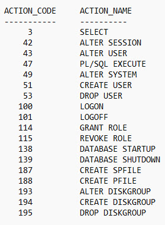

## Administering Oracle ASM Instances

Administering Automatic Storage Management (Oracle ASM) instances is similar to administering Oracle Databases.

This chapter describes how to administer Automatic Storage Management (Oracle ASM) instances, configure Oracle ASM instance parameters, and set Oracle Database parameters for use with Oracle ASM. The chapter also describes Oracle ASM upgrading, patching, and authentication for Oracle ASM instance access. You can also use procedures in this chapter to migrate a database to use Oracle ASM.

Administering an Oracle ASM instance is similar to administering an Oracle Database instance, but the process requires fewer procedures. You can use Oracle ASM Command Line Utility (ASMCMD) command-line interface, Oracle ASM Configuration Assistant (ASMCA), and SQL\*Plus to perform Oracle ASM instance administration tasks.

See also

- [About Oracle ASM Instances](introducing-oracle-automatic-storage-management.md) for a description of an Oracle ASM instance
- [Administering Oracle ASM Filter Driver](administering-oracle-asm-filter-driver.md) for information about Oracle ASM Filter Driver

## Operating with Different Releases of Oracle ASM and Database Instances Simultaneously

Oracle Automatic Storage Management (Oracle ASM) 18c supports Oracle Database 18c or older software versions, including Oracle Database 10g Release 1 (10.1).

Note:

- An Oracle ASM instance must be at Oracle ASM 18c to support Oracle Database 18c.
- Refer to *Oracle Exadata documentation* for information about the Oracle Database versions that Oracle ASM supports when Oracle Exadata storage is present.
- There are additional compatibility considerations when using disk groups with different releases of Oracle ASM and database instances.

When using different software versions, the database instance supports Oracle ASM functionality of the earliest release in use. For example, an Oracle Database 10g Release 1 (10.1) database instance operating with an Oracle ASM 18c instance only supports Oracle ASM 10g Release 1 (10.1) features.

The `V$ASM_CLIENT` view contains the `SOFTWARE_VERSION` and `COMPATIBLE_VERSION` columns with information about the software version number and instance compatibility level.

- The `SOFTWARE_VERSION` column of `V$ASM_CLIENT` contains the software version number of the database or Oracle ASM instance for the selected disk group connection.
- The `COMPATIBLE_VERSION` column contains the setting of the `COMPATIBLE` parameter of the database or Oracle ASM instance for the selected disk group connection.

You can query the `V$ASM_CLIENT` view on both Oracle ASM and database instances.

See also

- [Disk Group Compatibility](administering-oracle-asm-disk-groups.md) for information about disk group compatibility attributes settings
- The example “Viewing disk group clients with V$ASM\_CLIENT” for an example showing a query on the `V$ASM_CLIENT` view
- [Views Containing Oracle ASM Information](using-views-to-display-oracle-asm-information.md) for more information about the `V$ASM_CLIENT` and `V$ASM_*` views

## Initialization Parameters for Oracle ASM Instances

Settings for Oracle ASM instance initialization parameters are discussed in this topic.

To install and initially configure an Oracle ASM instance, use Oracle Universal Installer (OUI) and Oracle ASM Configuration Assistant (ASMCA).

After an Oracle ASM instance has been installed on a single-instance Oracle Database or in an Oracle Real Application Clusters (Oracle RAC) environment, the final Oracle ASM configuration can be performed. Only a few Oracle ASM-specific instance initialization parameters must be configured. The default values are usually sufficient.

See also

- [Oracle Database Reference](https://docs.oracle.com/pls/topic/lookup?ctx=en/database/oracle/oracle-database/19/ostmg&id=REFRN-GUID-6F1C3203-0AA0-4AF1-921C-A027DD7CB6A9) for information about initialization parameters
- [Oracle Database Administrator's Guide](https://docs.oracle.com/pls/topic/lookup?ctx=en/database/oracle/oracle-database/19/ostmg&id=ADMIN-GUID-E31FC459-3208-4390-9A27-2FB626520EC4) for information about initialization parameter files
- [Oracle Grid Infrastructure Installation and Upgrade Guide](https://docs.oracle.com/pls/topic/lookup?ctx=en/database/oracle/oracle-database/19/ostmg&id=CWGEN) for information about installing and configuring Oracle ASM

### About Initialization Parameter Files for an Oracle ASM Instance

When installing Oracle ASM in an Oracle Restart (standalone) configuration, Oracle Universal Installer (OUI) creates a separate server parameter file (SPFILE) and password file for the Oracle ASM instance. The ASM SPFILE is stored in a disk group during installation.

When installing Oracle ASM in a clustered Oracle ASM environment, OUI creates a single, shared SPFILE for Oracle ASM in a disk group.

When upgrading an Oracle ASM instance, if the ASM SPFILE was originally in a shared file system, then the upgraded Oracle ASM instance retains the SPFILE in the same location. If the original Oracle ASM instance used a PFILE, then after an upgrade the instance continues to use a PFILE.

You can use an SPFILE or a text-based initialization parameter file (PFILE) as the Oracle ASM instance parameter file. If you use an SPFILE in a clustered Oracle ASM environment, then you must place the SPFILE in a disk group or on a cluster file system. Oracle recommends that the Oracle ASM SPFILE is placed in a disk group. You cannot use a new alias created on an existing Oracle ASM SPFILE to start the Oracle ASM instance

If you do not use a shared Oracle Grid Infrastructure home, then the Oracle ASM instance can use a PFILE. The same rules for file name, default location, and search order that apply to database initialization parameter files also apply to Oracle ASM initialization parameter files.

When an Oracle ASM instance searches for an initialization parameter file, the search order is:

1. The location of the initialization parameter file specified in the Grid Plug and Play (GPnP) profile
2. If the location has not been set in the GPnP profile, then the search order changes to:
3. SPFILE in the Oracle ASM instance home
	For example, the SPFILE for Oracle ASM has the following default path in the Oracle Grid Infrastructure home in a Linux environment:
	`$ORACLE_HOME/dbs/spfile+ASM.ora`
4. PFILE in the Oracle ASM instance home
	Note:
	A PFILE or SPFILE is required if your configuration uses nondefault initialization parameters for the Oracle ASM instance.
	You can administer Oracle ASM initialization parameter files with SQL\*Plus, ASMCA, and ASMCMD commands.

See also

- [Managing Oracle ASM With ASMCA](managing-oracle-asm-with-asmca.md) for information about the ASMCA GUI and command-line interfaces
- [ASMCMD Instance Management Commands](managing-oracle-asm-with-asmcmd.md) for information about ASMCMD commands for managing an Oracle ASM SPFILE; such as `spbackup`, `spcopy`, and `spmove`
- [Oracle Database Administrator's Guide](https://docs.oracle.com/pls/topic/lookup?ctx=en/database/oracle/oracle-database/19/ostmg&id=ADMIN002) for more information about creating and maintaining initialization parameter files
- [Oracle Database SQL Language Reference](https://docs.oracle.com/pls/topic/lookup?ctx=en/database/oracle/oracle-database/19/ostmg&id=SQLRF01315) for information about creating an SPFILE with the `CREATE` `SPFILE` SQL statement

### About Backing Up, Copying, and Moving an Oracle ASM Initialization Parameter File

You can back up, copy, or move an Oracle ASM SPFILE with the ASMCMD `spbackup`, `spcopy`, or `spmove` commands.

In addition, you can use the SQL `CREATE` `SPFILE` to create an Oracle ASM SPFILE when connected to the Oracle ASM instance.

You can also copy and move an Oracle ASM PFILE with the commands available on the specific platform, such as `cp` for Linux.

After copying or moving an SPFILE or PFILE, you must restart the instance with the SPFILE or PFILE in the new location to use that SPFILE or PFILE.

See also

- [spbackup](managing-oracle-asm-with-asmcmd.md), [spcopy](managing-oracle-asm-with-asmcmd.md), and [spmove](managing-oracle-asm-with-asmcmd.md) for information about ASMCMD commands for managing an SPFILE
- [*Oracle Database Administrator's Guide*](https://docs.oracle.com/pls/topic/lookup?ctx=en/database/oracle/oracle-database/19/ostmg&id=ADMIN002) for more information about creating and maintaining initialization parameter files
- [*Oracle Database SQL Language Reference*](https://docs.oracle.com/pls/topic/lookup?ctx=en/database/oracle/oracle-database/19/ostmg&id=SQLRF01315) for information about creating an SPFILE with the `CREATE` `SPFILE` SQL statement
- [*Oracle Real Application Clusters Installation Guide*](https://docs.oracle.com/pls/topic/lookup?ctx=en/database/oracle/oracle-database/19/ostmg&id=GINST) for information about Grid Plug and Play (GPnP)

#### Creating, Copying, and Moving an SPFILE Into a Disk Group

If the `COMPATIBLE.ASM` disk group attribute is set to `11.2` or greater for a disk group, you can create, copy, or move an Oracle ASM SPFILE into the disk group.

For example, after upgrading an instance from Oracle ASM 11g Release 1 (11.1) to Oracle ASM 11g Release 2 (11.2), you could place the Oracle ASM SPFILE in a disk group that has `COMPATIBLE.ASM` set to `11.2`. For information about disk group compatibility attributes, see [Disk Group Compatibility](administering-oracle-asm-disk-groups.md).

In the following steps, assume an Oracle ASM 11g Release 2 (11.2) instance is using a PFILE stored in `$ORACLE_HOME/dbs/asmpfile.ora`. You can use the SQL `CREATE` `SPFILE` statement to create an SPFILE from a PFILE stored in a local or shared file system. If a PFILE does not exist, then it could be created with the SQL `CREATE` `PFILE` statement.

To create an SPFILE in a disk group, perform the following steps:

1. Connect to the Oracle ASM instance.
	For example:
	```
	$ sqlplus / as sysasm
	```
2. Create an SPFILE in a disk group that has `COMPATIBLE.ASM` set to `11.2` with the SQL `CREATE` `SPFILE` statement.
	For example, create an Oracle ASM SPFILE from the existing `PFILE`.
	```
	SQL> CREATE SPFILE = '+DATA/asmspfile.ora' 
	       FROM PFILE = '$ORACLE_HOME/dbs/asmpfile.ora';
	```
	The `CREATE` `SPFILE` statement also updates the Grid Plug and Play (GPnP) profile. You can check the location of the Oracle ASM SPFILE in the GPnP profile with the ASMCMD `spget` command. See [spget](managing-oracle-asm-with-asmcmd.md).
	Note:
	If you include the `AS` `COPY` option, then the `CREATE` `SPFILE` `FROM` `PFILE` statement does not update the clusterwide SPFILE location.
3. Restart the Oracle ASM instance so that the instance reads the SPFILE in the new location.
	For information on shutting down and starting up an Oracle ASM instance, see About Starting Up an Oracle ASM Instance and About Shutting Down an Oracle ASM Instance.

#### Making a Back Up Copy of an Oracle ASM SPFILE in a Disk Group

This section describes the steps to make a back up copy of an Oracle ASM SPFILE in another disk group using the ASMCMD commands. If necessary, then the backup copy can be used to restore the Oracle ASM SPFILE.

The source and target disk groups must have the disk group attribute `COMPATIBLE.ASM` set to `11.2` or higher.

To make a copy of the Oracle ASM SPFILE in another disk group with the `spcopy` command perform the following steps:

1. Locate the Oracle ASM SPFILE using the ASMCMD `spget` command.
	For example:
	```
	ASMCMD [+] > spget
	+DATA/ASM/ASMPARAMETERFILE/registry.253.849343867
	```
2. Copy the Oracle ASM SPFILE to another disk group with `spcopy` command.
	For example:
	```
	ASMCMD [+] > spcopy +DATA/ASM/ASMPARAMETERFILE/registry.253.849343867 +FRA/spfileCopyASM.ora
	```
	Running `spcopy` without the `-u` option does not update the location of the Oracle ASM SPFILE. You can use `spset` to set the location of the Oracle ASM SPFILE in the Grid Plug and Play (GPnP) profile.
3. List all the copies of the Oracle ASM SPFILE file contained in the FRA disk group using the ASMCMD `ls` command.
	For example:
	```
	ASMCMD [+] > ls -l --absolutepath FRA/ASM/ASMPARAMETERFILE
	Type              Redund  Striped  Time             Sys  Name
	ASMPARAMETERFILE  MIRROR  COARSE   JUN 06 13:00:00  Y    +FRA/spfileCopyASM.ora => REGISTRY.253.849533009
	```
4. Verify the current location of the Oracle ASM SPFILE file with the `spget` command.
	For example:
	```
	ASMCMD [+] > spget
	+DATA/ASM/ASMPARAMETERFILE/registry.253.849343867
	```
	In the event that the current Oracle ASM SPFILE file in a disk group has been corrupted or that disk group is not accessible, you can use `spset` or `spcopy` with the `-u` option to restore the Oracle ASM SPFILE file using the backup copy that you have previously created.
	For example:
	```
	ASMCMD [+] > spcopy -u +FRA/spfileCopyASM.ora +DATA2/ASM/spfileASM.ora
	```

### About Oracle ASM Initialization Parameter Settings

There are several initialization parameters that you must set for an Oracle ASM instance. You can set these parameters with Oracle ASM Configuration Assistant (ASMCA). You can also set some parameters after database creation using SQL `ALTER` `SYSTEM` or `ALTER` `SESSION` statements.

The Oracle ASM parameters use suitable defaults for most environments. You cannot use parameters with names that are prefixed with `ASM_*` in database instance parameter files.

### About Automatic Memory Management for Oracle ASM

Automatic memory management automatically manages the memory-related parameters for both Oracle ASM and database instances with the `MEMORY_TARGET` parameter. Automatic memory management is enabled by default on an Oracle ASM instance, even when the `MEMORY_TARGET` parameter is not explicitly set. The default value used for `MEMORY_TARGET` is acceptable for most environments. This is the only parameter that you must set for complete Oracle ASM memory management. Oracle strongly recommends that you use automatic memory management for Oracle ASM.

An Oracle ASM instance can automatically increase the values set for `MEMORY_TARGET` and `MEMORY_MAX_TARGET` if an ORA-04031 error is raised and automatic memory management is enabled. If `MEMORY_MAX_TARGET` has been explicitly set to a value, then every time ORA-04031 is raised, the `MEMORY_TARGET` value is increased by 10% of the existing `MEMORY_TARGET` value or 128 MB, whichever is greater, but not greater than the customer specified `MEMORY_MAX_TARGET` value. If `MEMORY_MAX_TARGET` is not explicitly set, then both `MEMORY_TARGET` and `MEMORY_MAX_TARGET` are increased by 10% of the existing `MEMORY_TARGET` value or 128 MB, whichever is greater, for a maximum of five increases. The Oracle ASM instance must be rebooted to use the new `MEMORY_TARGET` and `MEMORY_MAX_TARGET` settings.

If you do not set a value for `MEMORY_TARGET`, but you do set values for other memory related parameters, Oracle internally calculates the optimum value for `MEMORY_TARGET` based on those memory parameter values. You can also increase `MEMORY_TARGET` dynamically, up to the value of the `MEMORY_MAX_TARGET` parameter, just as you can do for the database instance.

Although it is not recommended, you can disable automatic memory management by either setting the value for `MEMORY_TARGET` to `0` in the Oracle ASM parameter file or by running an `ALTER` `SYSTEM` `SET` `MEMORY_TARGET` `=0` statement. When you disable automatic memory management, Oracle reverts to automatic shared memory management and automatic PGA memory management. To revert to Oracle Database 10g Release 2 (10.2) functionality to manually manage Oracle ASM SGA memory, also run the `ALTER` `SYSTEM` `SET` `SGA_TARGET=0` statement. Unless specified, the behaviors of the automatic memory management parameters in Oracle ASM instances behave the same as in Oracle Database instances.

Note:

- For a Linux environment, automatic memory management cannot work if `/dev/shm` is not available or is undersized. For more information, see [*Oracle Database Administrator's Reference for Linux and UNIX-Based Operating Systems*](https://docs.oracle.com/pls/topic/lookup?ctx=en/database/oracle/oracle-database/19/ostmg&id=UNXAR).
- For information about platforms that support automatic memory management, see [*Oracle Database Administrator's Guide*](https://docs.oracle.com/pls/topic/lookup?ctx=en/database/oracle/oracle-database/19/ostmg&id=ADMIN11236).
- The minimum `MEMORY_TARGET` for Oracle ASM is 1 GB. If you set `MEMORY_TARGET` lower, then Oracle increases the value for `MEMORY_TARGET` to 1 GB automatically.
- For the recommended settings of memory initialization parameters in an Oracle Exadata environment, refer to the Oracle Exadata documentation.

See also

- [*Oracle Database Administrator's Guide*](https://docs.oracle.com/pls/topic/lookup?ctx=en/database/oracle/oracle-database/19/ostmg&id=ADMIN11197) for more information about the functionality of automatic memory management for database instances, which varies from Oracle ASM
- [*Oracle Database Concepts*](https://docs.oracle.com/pls/topic/lookup?ctx=en/database/oracle/oracle-database/19/ostmg&id=CNCPT1244) for an overview of memory management methods

### Recommended Settings for Oracle ASM Initialization Parameters

This section contains information about the initialization parameters for Oracle ASM:

See also

- [*Oracle Database Reference*](https://docs.oracle.com/pls/topic/lookup?ctx=en/database/oracle/oracle-database/19/ostmg&id=REFRN-GUID-FD266F6F-D047-4EBB-8D96-B51B1DCA2D61) for more information about initialization parameters
- [*Oracle Database Administrator's Guide*](https://docs.oracle.com/pls/topic/lookup?ctx=en/database/oracle/oracle-database/19/ostmg&id=ADMIN002) for more information about creating and maintaining an initialization parameter file

#### ASM\_DISKGROUPS

The `ASM_DISKGROUPS` initialization parameter specifies a list of disk group names that an Oracle ASM instance mounts at startup when the SQL `ALTER` `DISKGROUP` `ALL` `MOUNT` statement is issued.

The Oracle ASM instance startup process executes `ALTER` `DISKGROUP` `ALL` `MOUNT` unless the `NOMOUNT` startup option is specified.

The default value of the `ASM_DISKGROUPS` parameter is a `NULL` string.

The `ASM_DISKGROUPS` parameter is dynamic. If you are using a server parameter file (SPFILE), then you do not have to manually alter the value of `ASM_DISKGROUPS` in most situations. Oracle ASM automatically adds a disk group to the parameter when the disk group is successfully created or mounted. Oracle ASM also automatically removes a disk group from the parameter when the disk group is dropped. However, the SPFILE is not updated on a manual dismount.

Note:

In Oracle Flex ASM configurations, disk groups are not removed from the SPFILE on dismount. Disk groups must always be auto-mounted so that remote instances can access them. A remote instance is an Oracle Database, Oracle IOServer, or Oracle ASM proxy instance located on a different node than the Oracle ASM instance.

The following is an example of setting the `ASM_DISKGROUPS` parameter dynamically:

```
SQL> ALTER SYSTEM SET ASM_DISKGROUPS = DATA, FRA;
```

When using a text initialization parameter file (PFILE), you may edit the initialization parameter file to add the name of any disk group so that it is mounted automatically at instance startup. You must remove the name of any disk group that you no longer want automatically mounted.

The following is an example of the `ASM_DISKGROUPS` parameter in the initialization file:

`ASM_DISKGROUPS` `=` `DATA,` `FRA`

Note:

Issuing the `ALTER DISKGROUP`...`ALL MOUNT` or `ALTER DISKGROUP`...`ALL DISMOUNT` commands does not affect the value of `ASM_DISKGROUPS`.

For Oracle Database 12c Release 1 or later, Oracle ASM configurations support up to 511 disk groups. Oracle ASM configurations with Oracle Database releases before 12c Release 1 can only support up to 63 disk groups.

See also

- About Mounting Disk Groups at Startup for information about disk groups that are mounted at startup time
- [Mounting and Dismounting Disk Groups](administering-oracle-asm-disk-groups.md) for additional information about mounting Oracle ASM disk groups
- [Managing Oracle Flex ASM](managing-oracle-flex-asm.md) for information about Oracle Flex ASM
- [Oracle Database Reference](https://docs.oracle.com/pls/topic/lookup?ctx=en/database/oracle/oracle-database/19/ostmg&id=REFRN10247) for more information about the `ASM_DISKGROUPS` initialization parameter

#### ASM\_DISKSTRING

The `ASM_DISKSTRING` initialization parameter specifies a comma-delimited list of strings that limits the set of disks that an Oracle ASM instance discovers.

The discovery strings can include wildcard characters. Only disks that match one of the strings are discovered. The same disk cannot be discovered twice.

The discovery string format depends on the Oracle ASM library and the operating system that are in use. Pattern matching is supported. Refer to your operating system-specific installation guide for information about the default pattern matching.

For example on a Linux server, to limit the discovery process to only include disks that are in the `/dev/rdsk/mydisks` directory for an Oracle ASM instance that does not use Oracle ASM Filter Driver (Oracle ASMFD) or ASMLIB, set the `ASM_DISKSTRING` initialization parameter to:

`/dev/rdsk/mydisks/*`

The asterisk is required.

To limit the discovery process to only include disks that have a name that ends in `disk3` or `disk4`, you could set `ASM_DISKSTRING` as follows on a Linux system:

`ASM_DISKSTRING` `=` `'/dev/rdsk/*disk3'`, `'/dev/rdsk/*disk4'`

The `?` character, when used as the first character of a path, expands to the Oracle home directory. Depending on the operating system, when you use the `?` character elsewhere in the path, it is a wildcard for one character.

The default value of the `ASM_DISKSTRING` parameter is a `NULL` string. A `NULL` value causes Oracle ASM to search a default path for all disks in the system to which the Oracle ASM instance has read and write access. The default search path is platform-specific. Refer to your operating system-specific installation guide for more information about the default search path.

Oracle ASM cannot use a disk unless all of the Oracle ASM instances in the cluster can discover the disk through one of their own discovery strings. The names do not have to be the same on every node, but all disks must be discoverable by all of the nodes in the cluster. This may require dynamically changing the initialization parameter to enable adding new storage.

See also

- [Oracle ASM Disk Discovery](administering-oracle-asm-disk-groups.md) for more information about discovering disks
- *Oracle Exadata documentation* for information about the Oracle ASM discovery string format for Oracle Exadata
- [Oracle Database Reference](https://docs.oracle.com/pls/topic/lookup?ctx=en/database/oracle/oracle-database/19/ostmg&id=REFRN10248) for more information about the `ASM_DISKSTRING` initialization parameter

#### ASM\_IO\_PROCESSES

The `ASM_IO_PROCESSES` initialization parameter specifies the number of IO worker processes to be started in an Oracle IOServer (IOS) server instance.

This parameter is only applicable for an Oracle IOServer instance, which runs in an Oracle Grid Infrastructure home.

IOServer instances are started automatically in the Oracle Grid Infrastructure configuration when generating the credential file for a client cluster. You can configure the number of IOServer instances running in the client cluster.

The default value should work in most cases. However, under heavy IO loads a higher value than the default may be appropriate.

See also

- [Overview of Oracle Flex ASM](managing-oracle-flex-asm.md) for information about Oracle IOServer and Oracle Flex ASM
- [Oracle Database Reference](https://docs.oracle.com/pls/topic/lookup?ctx=en/database/oracle/oracle-database/19/ostmg&id=REFRN-GUID-25CB85C7-6371-4AEC-A79F-2DC1E0D4370D) for more information about the `ASM_IO_PROCESSES` initialization parameter

#### ASM\_POWER\_LIMIT

The `ASM_POWER_LIMIT` initialization parameter specifies the default power for disk rebalancing in a disk group.

The range of values is `0` to `1024`. The default value is `1`. A value of `0` disables rebalancing. Higher numeric values enable the rebalancing operation to complete more quickly, but might result in higher I/O overhead and more rebalancing processes.

- For disk groups that have the disk group ASM compatibility set to `11.2.0.2` or higher (for example, `COMPATIBLE.ASM` = `11.2.0.2` ), the operational range of values is `0` to `1024` for the rebalance power.
- For disk groups that have the disk group ASM compatibility set to less than `11.2.0.2`, the operational range of values is `0` to `11` inclusive. If the value for `ASM_POWER_LIMIT` is larger than `11`, a value of `11` is used for these disk groups.

You can also specify the power of the rebalancing operation in a disk group with the `POWER` clause of the SQL `ALTER` `DISKGROUP`.. `REBALANCE` statement. The range of allowable values for the `POWER` clause is the same for the `ASM_POWER_LIMIT` initialization parameter. If the value of the `POWER` clause is specified larger than `11` for a disk group with ASM compatibility set to less than `11.2.0.2`, then a warning is displayed and a `POWER` value equal to `11` is used for rebalancing.

The specification of the power of the rebalancing operation in a disk group only affects rebalance operations, not new allocations to a disk group.

Note:

- Oracle recommends that you do not set the `ASM_POWER_LIMIT` initialization parameter to `0`.
- You cannot set the `ASM_POWER_LIMIT` initialization parameter to `0` in an Oracle Exadata or Oracle Data Appliance environment.

See also

- [Manually Rebalancing Disk Groups](administering-oracle-asm-disk-groups.md) and [Tuning Rebalance Operations](administering-oracle-asm-disk-groups.md) for information about the `ASM_POWER_LIMIT` initialization parameter, and the `POWER` clause
- [Disk Group Compatibility](administering-oracle-asm-disk-groups.md) for information about disk group compatibility
- [Oracle Database Reference](https://docs.oracle.com/pls/topic/lookup?ctx=en/database/oracle/oracle-database/19/ostmg&id=REFRN10246) for more information about the `ASM_POWER_LIMIT` initialization parameter
- [Oracle Database SQL Language Reference](https://docs.oracle.com/pls/topic/lookup?ctx=en/database/oracle/oracle-database/19/ostmg&id=SQLRF01113) for more information about the `POWER` clause of the SQL `ALTER` `DISKGROUP` `REBALANCE` statement

#### ASM\_PREFERRED\_READ\_FAILURE\_GROUPS

The `ASM_PREFERRED_READ_FAILURE_GROUPS` initialization parameter value is a comma-delimited list of strings that specifies the failure groups that should be preferentially read by the given instance.

Note:

The `ASM_PREFERRED_READ_FAILURE_GROUPS` initialization parameter has been deprecated in Oracle ASM 12c Release 2 (12.2) and may be desupported in a future release.

The `ASM_PREFERRED_READ_FAILURE_GROUPS` parameter setting is instance specific. The default value is `NULL`. This parameter is generally used for clustered Oracle ASM instances and its value can be different on different nodes.

For example:

*diskgroup\_name1*.*failure\_group\_name1*,...

Note:

- In an Oracle extended cluster, which contains nodes that span multiple physically separated sites, the `PREFERRED_READ.ENABLED` disk group attribute controls whether preferred read functionality is enabled for a disk group. If preferred read functionality is enabled, then this functionality enables an instance to determine and read from disks at the same site as itself, which can improve performance. Whether or not `PREFERRED_READ.ENABLED` has been enabled, preferred read can be set at the failure group level on an Oracle ASM instance or a client instance in a cluster with the `ASM_PREFERRED_READ_FAILURE_GROUPS` initialization parameter, which is available for backward compatibility.
- The failure group values set by `ASM_PREFERRED_READ_FAILURE_GROUPS` take precedence over the `PREFERRED_READ.ENABLED` site values. The values of `ASM_PREFERRED_READ_FAILURE_GROUPS` on the client instances take precedence over the values on the Oracle ASM instances.

See also

- [Preferred Read Failure Groups](administering-oracle-asm-disk-groups.md) for more information about preferred read failure groups
- [PREFERRED\_READ.ENABLED](administering-oracle-asm-disk-groups.md) for information about the `PREFERRED_READ.ENABLED` disk group attribute
- [Oracle Real Application Clusters Administration and Deployment Guide](https://docs.oracle.com/pls/topic/lookup?ctx=en/database/oracle/oracle-database/19/ostmg&id=RACAD820) for more information about configuring preferred disks in extended clusters
- [Oracle Database Reference](https://docs.oracle.com/pls/topic/lookup?ctx=en/database/oracle/oracle-database/19/ostmg&id=REFRN10279) for more information about the `ASM_PREFERRED_READ_FAILURE_GROUPS` initialization parameter

#### DB\_CACHE\_SIZE

The setting for the `DB_CACHE_SIZE` parameter determines the size of the buffer cache.

You do not have to set a value for the `DB_CACHE_SIZE` initialization parameter if you use automatic memory management.

This buffer cache stores metadata blocks. The default value for this parameter is suitable for most environments.

See also

- [Oracle Database Administrator's Guide](https://docs.oracle.com/pls/topic/lookup?ctx=en/database/oracle/oracle-database/19/ostmg&id=ADMIN00207) for more information about setting the `DB_CACHE_SIZE` initialization parameter
- [Oracle Database Performance Tuning Guide](https://docs.oracle.com/pls/topic/lookup?ctx=en/database/oracle/oracle-database/19/ostmg&id=TGDBA290) for more information about memory configuration
- [Oracle Database Reference](https://docs.oracle.com/pls/topic/lookup?ctx=en/database/oracle/oracle-database/19/ostmg&id=REFRN10033) for more information about the `DB_CACHE_SIZE` parameter

#### DIAGNOSTIC\_DEST

The `DIAGNOSTIC_DEST` initialization parameter specifies the directory where diagnostics for an instance are located.

The default value for an Oracle ASM instance is the `$ORACLE_BASE` directory for the Oracle Grid Infrastructure installation.

The following example shows the diagnostic directory for an Oracle ASM instance.

Example: Sample diagnostic directory for an Oracle ASM instance

```
$ ls $ORACLE_BASE/diag/asm/+asm/+ASM
alert  cdump  hm  incident  incpkg  ir  lck  metadata  stage  sweep  trace
```

See also

- [Oracle Database Administrator's Guide](https://docs.oracle.com/pls/topic/lookup?ctx=en/database/oracle/oracle-database/19/ostmg&id=ADMIN11008) for more information about the `DIAGNOSTIC_DEST` initialization parameter and the fault diagnosability infrastructure.
- [Oracle Database Reference](https://docs.oracle.com/pls/topic/lookup?ctx=en/database/oracle/oracle-database/19/ostmg&id=REFRN10280) for more information about the `DIAGNOSTIC_DEST` parameter

#### INSTANCE\_TYPE

The `INSTANCE_TYPE` initialization parameter specifies whether the instance is a database instance, an Oracle Automatic Storage Management (Oracle ASM) instance, or an Oracle ASM Proxy instance.

The following is an example of the `INSTANCE_TYPE` parameter in the initialization file:

`INSTANCE_TYPE` `=` `ASM`

In addition to values `asm` and `rdbms`, `INSTANCE_TYPE` can be set to `asmproxy` in an Oracle Flex ASM configuration.

See also

- [Managing Oracle Flex ASM](managing-oracle-flex-asm.md) for information about Oracle Flex ASM
- [Oracle Database Reference](https://docs.oracle.com/pls/topic/lookup?ctx=en/database/oracle/oracle-database/19/ostmg&id=REFRN10244) for more information about the `INSTANCE_TYPE` parameter

#### LARGE\_POOL\_SIZE

The setting for the `LARGE_POOL_SIZE` parameter is used for large allocations.

You do not have to set a value for the `LARGE_POOL_SIZE` initialization parameter if you use automatic memory management.

The default value for this parameter is suitable for most environments.

See also

- [Oracle Database Administrator's Guide](https://docs.oracle.com/pls/topic/lookup?ctx=en/database/oracle/oracle-database/19/ostmg&id=ADMIN00207) for more information about setting the `LARGE_POOL_SIZE` initialization parameter
- [Oracle Database Performance Tuning Guide](https://docs.oracle.com/pls/topic/lookup?ctx=en/database/oracle/oracle-database/19/ostmg&id=TGDBA290) for more information about memory configuration
- [Oracle Database Reference](https://docs.oracle.com/pls/topic/lookup?ctx=en/database/oracle/oracle-database/19/ostmg&id=REFRN10078) for more information about the `LARGE_POOL_SIZE` parameter

#### PROCESSES

The `PROCESSES` initialization parameter affects Oracle ASM, but the default value is usually suitable.

However, if multiple database instances are connected to an Oracle ASM instance, then you can use the following formulas, where *n* is the number of database instances connecting to the Oracle ASM instance.

In a non-Exadata environment, the recommended settings are:

- For *n* < 10, `PROCESSES` = 50\* *n* + 50
- For *n* >= 10, `PROCESSES` = 10\* *n* + 450

In an Oracle Exadata environment, the recommended setting is `PROCESSES` = `MAX` (450 + 10\* *n*, 1024).

See also

- [Oracle Database Administrator's Guide](https://docs.oracle.com/pls/topic/lookup?ctx=en/database/oracle/oracle-database/19/ostmg&id=ADMIN11108) for more information about setting the `PROCESSES` initialization parameter
- [Oracle Database Reference](https://docs.oracle.com/pls/topic/lookup?ctx=en/database/oracle/oracle-database/19/ostmg&id=REFRN10175) for more information about the `PROCESSES` parameter

#### REMOTE\_LOGIN\_PASSWORDFILE

The `REMOTE_LOGIN_PASSWORDFILE` initialization parameter specifies whether the Oracle ASM instance checks for a password file.

This parameter operates the same for Oracle ASM and database instances.

See also

- [Oracle Database Administrator's Guide](https://docs.oracle.com/pls/topic/lookup?ctx=en/database/oracle/oracle-database/19/ostmg&id=ADMIN001) for more information about setting the `REMOTE_LOGIN_PASSWORDFILE` initialization parameter
- [Oracle Database Reference](https://docs.oracle.com/pls/topic/lookup?ctx=en/database/oracle/oracle-database/19/ostmg&id=REFRN10184) for more information about the `REMOTE_LOGIN_PASSWORDFILE` parameter

#### SHARED\_POOL\_SIZE

The setting for the `SHARED_POOL_SIZE` parameter determines the amount of memory required to manage the instance.

You do not have to set a value for the `SHARED_POOL_SIZE` initialization parameter if you use automatic memory management. The setting for this parameter is also used to determine the amount of space that is allocated for extent storage. The default value for this parameter is suitable for most environments.

See also

- [Oracle Database Administrator's Guide](https://docs.oracle.com/pls/topic/lookup?ctx=en/database/oracle/oracle-database/19/ostmg&id=ADMIN00207) for more information about setting the `SHARED_POOL_SIZE` initialization parameter
- [Oracle Database Performance Tuning Guide](https://docs.oracle.com/pls/topic/lookup?ctx=en/database/oracle/oracle-database/19/ostmg&id=TGDBA290) for more information about memory configuration
- [Oracle Database Reference](https://docs.oracle.com/pls/topic/lookup?ctx=en/database/oracle/oracle-database/19/ostmg&id=REFRN10202) for more information about the `SHARED_POOL_SIZE` parameter

## Administration of Oracle ASM Instances

Oracle ASM is typically installed in an Oracle Grid Infrastructure home separate from the Oracle Database home. Only one Oracle ASM instance is supported on a server in a standard configuration; however, Oracle Flex ASM provides additional configuration options.

When managing an Oracle ASM instance, the administration activity should be performed in the Oracle Grid Infrastructure home.

This section describes how to administer Oracle ASM instances.

### Using Oracle Grid Infrastructure for a Standalone Server

Oracle Grid Infrastructure for a standalone server (Oracle Restart) improves the availability of your Oracle Database.

When you install the Oracle Grid Infrastructure for a standalone server, it includes both Oracle ASM and Oracle Restart. Oracle Grid Infrastructure for a standalone server (Oracle Restart) runs out of the Oracle Grid Infrastructure home, which you install separately from Oracle Database homes.

Oracle Restart provides managed startup and restart of a single-instance (non-clustered) Oracle Database, Oracle ASM instance, service, listener, and any other process running on the server. If an interruption of a service occurs after a hardware or software failure, Oracle Restart automatically takes the necessary steps to restart the component.

With Server Control Utility (SRVCTL) you can add a component, such as an Oracle ASM instance, to Oracle Restart. You then enable Oracle Restart protection for the Oracle ASM instance. With SRVCTL, you also remove or disable Oracle Restart protection.

See also

- [Oracle Database Administrator's Guide](https://docs.oracle.com/pls/topic/lookup?ctx=en/database/oracle/oracle-database/19/ostmg&id=ADMIN12708) for information about configuring and administering Oracle Restart
- [Oracle Real Application Clusters Administration and Deployment Guide](https://docs.oracle.com/pls/topic/lookup?ctx=en/database/oracle/oracle-database/19/ostmg&id=RACAD826) for information about automatically restarting single-instance databases residing on an Oracle RAC node
- [Oracle Grid Infrastructure Installation and Upgrade Guide](https://docs.oracle.com/pls/topic/lookup?ctx=en/database/oracle/oracle-database/19/ostmg&id=CWGEN) for information about installation of Oracle Grid Infrastructure

### About Starting Up an Oracle ASM Instance

This section describes how to start Oracle ASM instances.

#### Connecting To and Starting Up an Oracle ASM Instance

You start an Oracle ASM instance similarly to the way in which you start an Oracle Database instance with some minor differences.

When starting an Oracle ASM instance with SQL\*Plus, note the following:

- To connect to a local Oracle ASM instance with SQL\*Plus, set the `ORACLE_SID` environment variable to the Oracle ASM system identifier (SID).
	The default Oracle ASM SID for a single-instance database is `+ASM`, and the default SID for Oracle ASM for an Oracle RAC node is `+ASM` *node\_number* where *node\_number* is the number of the node. The `ORACLE_HOME` environment variable must be set to the Grid Infrastructure home where Oracle ASM was installed.
	Note:
	Oracle recommends that you do not change the default Oracle ASM SID name.
- The initialization parameter file must contain the following entry:
	`INSTANCE_TYPE = ASM`
	This parameter indicates that an Oracle ASM instance, not a database instance, is starting.
- When you run the `STARTUP` command, rather than trying to mount and open a database, this command attempts to mount Oracle ASM disk groups.
	After the Oracle ASM instance has started, you can mount disk groups with the `ALTER DISKGROUP...MOUNT` command.
- The associated Oracle Database instance does not have to be running when you start the associated Oracle ASM instance.

The following list describes how Oracle ASM interprets SQL\*Plus `STARTUP` command parameters.

- `FORCE` Parameter
	Issues a `SHUTDOWN ABORT` to the Oracle ASM instance before restarting it.
	If an Oracle Automatic Storage Management Cluster File System (Oracle ACFS) file system is currently mounted on Oracle ADVM volumes, the file system should first be dismounted. Otherwise, applications encounter I/O errors and Oracle ACFS user data and metadata may not be written to storage before the Oracle ASM storage is fenced.
- `MOUNT` or `OPEN` Parameter
	Mounts the disk groups specified in the `ASM_DISKGROUPS` initialization parameter. This is the default if no command parameter is specified.
- `NOMOUNT` Parameter
	Starts up the Oracle ASM instance without mounting any disk groups.
- `RESTRICT` Parameter
	Starts up an instance in restricted mode that enables access only to users with both the `CREATE` `SESSION` and `RESTRICTED` `SESSION` system privileges. You can use the `RESTRICT` clause in combination with the `MOUNT`, `NOMOUNT`, and `OPEN` clauses.
	In restricted mode, database instances cannot use the disk groups. In other words, databases cannot open files that are in that disk group. Also, the disk group cannot be mounted by any other instance in the cluster. Mounting the disk group in restricted mode enables only one Oracle ASM instance to mount the disk group. This mode is useful to mount the disk group for repairing configuration issues.

The following is a sample SQL\*Plus session for starting an Oracle ASM instance.

```
SQLPLUS /NOLOG
SQL> CONNECT SYS AS SYSASM
Enter password: sys_password
Connected to an idle instance.

SQL> STARTUP
ASM instance started

Total System Global Area   71303168 bytes
Fixed Size                 1069292 bytes
Variable Size              45068052 bytes
ASM Cache                  25165824 bytes
ASM disk groups mounted
```

See also

- [Oracle Database Administrator's Guide](https://docs.oracle.com/pls/topic/lookup?ctx=en/database/oracle/oracle-database/19/ostmg&id=ADMIN-GUID-7842AF72-DA25-4559-A8E7-9883D0C63BF2) for more information about using environment variables to select instances
- [Oracle Real Application Clusters Administration and Deployment Guide](https://docs.oracle.com/pls/topic/lookup?ctx=en/database/oracle/oracle-database/19/ostmg&id=RACAD826) for information about starting an Oracle ASM instance with `SRVCTL` in Oracle RAC
- [Oracle Clusterware Administration and Deployment Guide](https://docs.oracle.com/pls/topic/lookup?ctx=en/database/oracle/oracle-database/19/ostmg&id=CWADD1111) for information about Oracle Clusterware Cluster subcomponent processes and background processes
- [Oracle Database Reference](https://docs.oracle.com/pls/topic/lookup?ctx=en/database/oracle/oracle-database/19/ostmg&id=REFRN104) for a description of the Oracle background processes

#### Starting Up an Oracle ASM instance with an Incorrect SPFILE Path

If the SPFILE path in the GPnP profile is incorrect, you can start the Oracle ASM instance as follows:

1. Create a PFILE with one line in it that identifies the path to the SPFILE.
	For example:
	Create the `/oracle/dbs/spfileasm_init.ora` file that contains:
	`SPFILE='+DATA/asm/asmparameterfile/asmspfile.ora'`
2. Start up the instance using the initialization parameter file.
	For example:
	`SQL>` `STARTUP` `PFILE=/oracle/dbs/spfileasm_init.ora`
3. After the instance is running, use the ASMCMD `spset` command to update the SPFILE path in the GPnP profile. See [spset](managing-oracle-asm-with-asmcmd.md).
	For example:
	`ASMCMD>` `spset` `+DATA/asm/asmparameterfile/asmspfile.ora`

See also

[*Oracle Database Administrator's Guide*](https://docs.oracle.com/pls/topic/lookup?ctx=en/database/oracle/oracle-database/19/ostmg&id=ADMIN12828) for more information about using `STARTUP` with a nondefault server parameter file

#### About Mounting Disk Groups at Startup

At startup, the Oracle ASM instance attempts to mount the following disk groups:

- Disk groups specified in the `ASM_DISKGROUPS` initialization parameter
- Disk group used by Cluster Synchronization Services (CSS) for voting files
- Disk groups used by Oracle Clusterware for Oracle Cluster Registry (OCR)
- Disk group used by the Oracle ASM instance to store the ASM server parameter file (SPFILE)

If no disk groups are found in the previous list, then the Oracle ASM instance does not mount any disk groups at startup. After the Oracle ASM instance has started, you can mount disk groups with the `ALTER DISKGROUP...MOUNT` command. For more information, see [Mounting and Dismounting Disk Groups](administering-oracle-asm-disk-groups.md).

#### About Restricted Mode

You can use the `STARTUP` `RESTRICT` command to control access to an Oracle ASM instance while you perform maintenance. When an Oracle ASM instance is active in this mode, all of the disk groups that are defined in the `ASM_DISKGROUPS` parameter are mounted in `RESTRICTED` mode. This prevents databases from connecting to the Oracle ASM instance. In addition, the restricted clause of the `ALTER` `SYSTEM` statement is disabled for the Oracle ASM instance. The `ALTER` `DISKGROUP` *diskgroup* `MOUNT` statement is extended to enable Oracle ASM to mount a disk group in restricted mode.

When you mount a disk group in `RESTRICTED` mode, the disk group can only be mounted by one instance. Clients of Oracle ASM on that node cannot access that disk group while the disk group is mounted in `RESTRICTED` mode. The `RESTRICTED` mode enables you to perform maintenance tasks on a disk group in the Oracle ASM instance without interference from clients.

Rebalance operations that occur while a disk group is in `RESTRICTED` mode eliminate the lock and unlock extent map messaging that occurs between Oracle ASM instances in an Oracle RAC environment. This improves the overall rebalance throughput. At the end of a maintenance period, you must explicitly dismount the disk group and remount it in normal mode.

### About Shutting Down an Oracle ASM Instance

You can initiate the Oracle ASM shutdown process by running the `SHUTDOWN` command in SQL\*Plus.

Before you run this command, ensure that the `ORACLE_SID` environment variable is set to the Oracle ASM SID so that you can connect to the local Oracle ASM instance. The default Oracle ASM SID for a single-instance database is `+ASM`, and the default SID for Oracle ASM for an Oracle RAC node is `+ASM` *node\_number* where *node\_number* is the number of the node. The `ORACLE_HOME` environment variable must be set to the Grid Infrastructure home where Oracle ASM was installed.

If you are not using Oracle Flex ASM, Oracle strongly recommends that you shut down all database instances that use the Oracle ASM instance and dismount all file systems mounted on Oracle ASM Dynamic Volume Manager (Oracle ADVM) volumes before attempting to shut down the Oracle ASM instance. If you are using Oracle Flex ASM, Oracle Flex ASM clients move to other running Oracle ASM instances if an Oracle ASM instance is shut down.

If Oracle Cluster Registry (OCR) or voting files are stored in a disk group, the disk group can only be dismounted by shutting down the Oracle ASM instance as part of shutting down the clusterware on a node. To shut down the clusterware, run `crsctl` `stop` `crs`.

To shut down an Oracle ASM instance, perform the following steps:

```
SQLPLUS /NOLOG
SQL> CONNECT SYS AS SYSASM
Enter password: sys_password
Connected.
SQL> SHUTDOWN NORMAL
```

The following list describes the `SHUTDOWN` modes and the behavior of the Oracle ASM instance in each mode.

- `NORMAL` Clause
	Oracle ASM waits for any in-progress SQL to complete before performing an orderly dismount of all of the disk groups and shutting down the Oracle ASM instance. Before the instance is shut down, Oracle ASM waits for all of the currently connected users to disconnect from the instance. If any database instances are connected to the Oracle ASM instance, then the `SHUTDOWN` command returns an error and leaves the Oracle ASM instance running. `NORMAL` is the default shutdown mode.
- `IMMEDIATE` or `TRANSACTIONAL` Clause
	Oracle ASM waits for any in-progress SQL to complete before performing an orderly dismount of all of the disk groups and shutting down the Oracle ASM instance. Oracle ASM does not wait for users currently connected to the instance to disconnect. If any database instances are connected to the Oracle ASM instance, then the `SHUTDOWN` command returns an error and leaves the Oracle ASM instance running. Because the Oracle ASM instance does not contain any transactions, the `TRANSACTIONAL` mode behaves the same as `IMMEDIATE` mode.
- `ABORT` Clause
	The Oracle ASM instance immediately shuts down without the orderly dismount of disk groups. This causes recovery to occur upon the next Oracle ASM startup.
	If any database instance is connected to the Oracle ASM instance, then the database instance stops.
	If any Oracle Automatic Storage Management Cluster File System (Oracle ACFS) file systems are currently mounted on Oracle ADVM volumes, those file systems should first be dismounted. Otherwise, applications encounter I/O errors and Oracle ACFS user data and metadata may not be written to storage before the Oracle ASM storage is fenced.

See also

- [Deregistering, Dismounting, and Disabling Volumes and Oracle ACFS File Systems](managing-oracle-acfs-with-command-line-tools.md) for information about dismounting an Oracle ACFS file system
- [Oracle Database Administrator's Guide](https://docs.oracle.com/pls/topic/lookup?ctx=en/database/oracle/oracle-database/19/ostmg&id=ADMIN-GUID-7842AF72-DA25-4559-A8E7-9883D0C63BF2) for more information about using environment variables to select instances
- [Oracle Database Administrator's Guide](https://docs.oracle.com/pls/topic/lookup?ctx=en/database/oracle/oracle-database/19/ostmg&id=ADMIN004) for more information about starting up and shutting down Oracle instances
- [Oracle Clusterware Administration and Deployment Guide](https://docs.oracle.com/pls/topic/lookup?ctx=en/database/oracle/oracle-database/19/ostmg&id=CWADD70700) for information about managing voting files, Oracle Cluster Registry (OCR), and Oracle Local Registry (OLR)

### About Administering Oracle ASM Instances with Server Control Utility

In addition to the Oracle ASM administration procedures that this section describes, you can use Server Control Utility (SRVCTL) in clustered Oracle ASM environments to perform the following Oracle ASM administration tasks:

- Add and remove the Oracle ASM Oracle Clusterware (CRS) resource in Oracle Cluster Registry (OCR)
- Enable, disable, start, and stop Oracle ASM instances
- Display the Oracle ASM instance configuration and status
- Add, modify, and remove Oracle ASM network resources
- Add, modify, remove, enable, disable, start, and stop Oracle ASM listener resources

See also

[Oracle Clusterware Administration and Deployment Guide](https://docs.oracle.com/pls/topic/lookup?ctx=en/database/oracle/oracle-database/19/ostmg&id=CWADD-GUID-1DCA9E3F-B929-4555-B673-921FF3588AC3) and [Oracle Real Application Clusters Administration and Deployment Guide](https://docs.oracle.com/pls/topic/lookup?ctx=en/database/oracle/oracle-database/19/ostmg&id=RACAD826) for information about SRVCTL commands

### About Out of Place Upgrades

With an out-of-place upgrade, the installer installs the newer version of Oracle Grid Infrastructure in a separate Oracle Grid Infrastructure home.

An in-place upgrade of Oracle Grid Infrastructure 11g Release 2 (11.2) is not supported. For example, an upgrade of Oracle Grid Infrastructure 11g Release 2 (11.2.0.1) to Oracle Grid Infrastructure 11g Release 2 (11.2.0.2) must be an out of place upgrade.

See also

[Oracle Grid Infrastructure Installation and Upgrade Guide](https://docs.oracle.com/pls/topic/lookup?ctx=en/database/oracle/oracle-database/19/ostmg&id=CWGEN) for information about installing Oracle Grid Infrastructure, out of place upgrades, and performing rolling upgrades of Oracle Grid Infrastructure and Oracle ASM

### About Configuring Oracle Grid Infrastructure with the Configuration Wizard

The Oracle Grid Infrastructure configuration wizard can update the configuration of an Oracle Grid Infrastructure environment after the software has been installed. The configuration wizard accepts your input, validates the input, and populates the configuration data into the `CRSCONFIG_PARAMS` file. If additional scripts must be run, the configuration wizard directs you to run those scripts.

See also

[*Oracle Clusterware Administration and Deployment Guide*](https://docs.oracle.com/pls/topic/lookup?ctx=en/database/oracle/oracle-database/19/ostmg&id=CWADD92094) for information about the Oracle Grid Infrastructure configuration wizard.

### About Active Session History Sampling for Oracle ASM

Active Session History sampling is now available on Oracle ASM instances. This activity is exposed in the dynamic `V$ACTIVE_SESSION_HISTORY` view. Active Session History sampling requires a diagnostic pack license for the Oracle ASM instance.

See also

- [*Oracle Database Performance Tuning Guide*](https://docs.oracle.com/pls/topic/lookup?ctx=en/database/oracle/oracle-database/19/ostmg&id=TGDBA145) for more information about gathering performance statistics
- [*Oracle Database Reference*](https://docs.oracle.com/pls/topic/lookup?ctx=en/database/oracle/oracle-database/19/ostmg&id=REFRN30299) for a description of the `V$ACTIVE_SESSION_HISTORY` view

### About Oracle Home User on Windows

Oracle Database supports the use of an Oracle home user, which can be specified at installation time. The Oracle home user is associated with an Oracle home and it cannot be changed after installation. Different Oracle homes on a system can share the same Oracle home user or use different Oracle home user names.

In previous releases on Windows operating systems, Oracle services were required to run as `Local` `System` privileges, which are fully privileged. This feature enables the database, listener, and job scheduler services to run with low and non-administrative user privileges to allow tighter control of security. The Oracle home user can be a built-in account or a Windows user account. A Windows user account should be a low privileged (non-Administrator) account to ensure that the Oracle home user has a limited set of privileges, ensuring that Oracle Database services have only those privileges required to run Oracle products. The Windows user account can be a Local User, a Domain User, or a Managed Services Account in general. However, Oracle RAC, Oracle Restart, and Oracle Grid Infrastructure installations require the use of the Domain User as the Oracle home user because a clusterwide identity is necessary.

See also

[*Oracle Database Platform Guide for Microsoft Windows*](https://docs.oracle.com/pls/topic/lookup?ctx=en/database/oracle/oracle-database/19/ostmg&id=NTQRF673) for information about running Oracle services on Windows platforms and different types of Windows user accounts

## Upgrading and Patching Oracle ASM

This section describes Oracle ASM rolling upgrade and rolling patching.

Note:

- For Oracle RAC environments, the Oracle Clusterware version number must be at least equal to the version number of the patch that you are applying to the Oracle Database.
- You must apply the patch to the Oracle Grid Infrastructure home before you apply it to the Oracle Database home.

### About Oracle ASM Rolling Upgrade

Oracle ASM rolling upgrade enables you to independently upgrade or patch clustered Oracle ASM nodes without affecting database availability which provides greater uptime.

Rolling upgrade means that some features of a clustered Oracle ASM environment continue to function when one or more of the nodes in the cluster uses different software versions. Oracle recommends that you perform an Oracle ASM rolling upgrade when performing an Oracle Clusterware rolling upgrade.

To perform a rolling upgrade, your environment must be prepared. Oracle Clusterware must be fully upgraded to the next patch or release version before you start the Oracle ASM rolling upgrade. In addition, you should prepare your Oracle Clusterware in a rolling upgrade manner to ensure high availability and maximum uptime.

Note that Oracle ASM is upgraded with Oracle Clusterware for Oracle 11g Release 2 (11.2) or later as both are in the Oracle Grid Infrastructure home.

Note:

- Rolling upgrades only apply to clustered Oracle ASM instances, and you can only perform rolling upgrades on environments with Oracle Database 11g or later. You cannot use this feature to upgrade from Oracle Database 10g to Oracle Database 11g.
- See *Oracle Exadata documentation* for information about performing a rolling upgrading of an Oracle ASM instance when Oracle Exadata storage is present.

See also

- [Oracle Grid Infrastructure Installation and Upgrade Guide](https://docs.oracle.com/pls/topic/lookup?ctx=en/database/oracle/oracle-database/19/ostmg&id=CWGEN) for information about performing, and restrictions related to, a rolling upgrade of Oracle ASM
- [Oracle Database Upgrade Guide](https://docs.oracle.com/pls/topic/lookup?ctx=en/database/oracle/oracle-database/19/ostmg&id=UPGRD003) for information about upgrading Oracle Database
- [Oracle Database SQL Language Reference](https://docs.oracle.com/pls/topic/lookup?ctx=en/database/oracle/oracle-database/19/ostmg&id=SQLRF00902) for information about the rolling migration clause of the `ALTER` `SYSTEM` command

### About Oracle ASM Rolling Patches

You can apply patches in a clustered Oracle ASM environment to update one node at a time to the latest patch level without affecting the overall availability of the Oracle ASM cluster or the database clusters using Oracle ASM for storage.

The `ALTER` `SYSTEM` `ROLLING` `PATCH` SQL statement enables you to start and stop rolling patches. For example:

```
SQL> ALTER SYSTEM START ROLLING PATCH;

SQL> ALTER SYSTEM STOP ROLLING PATCH;
```

You can determine if the cluster is in rolling patch mode by executing a `SYS_CONTEXT` SQL query for Cluster State. A new state (In Rolling Patch) is added to informing the user that the cluster is in rolling patch mode.

The queries in the example “Determining rolling patch mode and patch level” display information about rolling patches. To run these queries, you must be connected to the Oracle ASM instance in the Grid home, and the Grid Infrastructure home must be configured with the Oracle Clusterware option for an Oracle RAC environment.

You can view all the patch Ids applied on the node and cluster by querying the `V$PATCHES` view.

ASMCMD commands for rolling patches include:

- `showclusterstate`
- `showpatches`
- `showversion`

Example: Determining rolling patch mode and patch level

```
SELECT SYS_CONTEXT('SYS_CLUSTER_PROPERTIES', 'CLUSTER_STATE') FROM DUAL;

SELECT SYS_CONTEXT('SYS_CLUSTER_PROPERTIES', 'CURRENT_PATCHLVL') FROM DUAL;
```

See also

- [ASMCMD Instance Management Commands](managing-oracle-asm-with-asmcmd.md) for information about ASMCMD commands to monitor upgrade operations on an Oracle ASM instance
- [Oracle Database SQL Language Reference](https://docs.oracle.com/pls/topic/lookup?ctx=en/database/oracle/oracle-database/19/ostmg&id=SQLRF00902) for information about the rolling patch clause of the `ALTER` `SYSTEM` command
- [Oracle Grid Infrastructure Installation and Upgrade Guide](https://docs.oracle.com/pls/topic/lookup?ctx=en/database/oracle/oracle-database/19/ostmg&id=CWGEN) for information about performing, and restrictions related to, a rolling migration of Oracle ASM and Oracle Grid Infrastructure homes

## Authentication for Accessing Oracle ASM Instances

An Oracle ASM instance does not have a data dictionary, so the only way to connect to an Oracle ASM instance is by using one of three system privileges, `SYSASM`, `SYSDBA`, or `SYSOPER`. There are three modes of connecting to Oracle ASM instances:

- Local connection using operating system authentication
- Local connection using password authentication
- Remote connection by way of Oracle Net Services using password authentication

The Oracle ASM and database instances must have read/write operating system access rights to disk groups. For example, the Oracle ASM instance and the database instance must have identical read and write permissions for the disks that comprise the related Oracle ASM disk group. For Linux and UNIX systems, this is typically provided through shared Linux and UNIX group membership (OSASM group). On Windows systems, the Oracle ASM service must be run as Administrator.

See also

- [Managing Oracle ASM File Access Control for Disk Groups](administering-oracle-asm-disk-groups.md) for information about file permissions and Oracle ASM File Access Control
- [Oracle Grid Infrastructure Installation and Upgrade Guide](https://docs.oracle.com/pls/topic/lookup?ctx=en/database/oracle/oracle-database/19/ostmg&id=CWGEN) for your operating system-specific information about how to ensure that the Oracle ASM and database instances have member disk access
- [Oracle Database Security Guide](https://docs.oracle.com/pls/topic/lookup?ctx=en/database/oracle/oracle-database/19/ostmg&id=DBSEG009) for information about maintaining database security, including assigning passwords

### About Privileges for Oracle ASM

During Oracle ASM installation, you can use one operating system group for all users or divide system privileges so that database administrators, storage administrators, and database operators each have distinct operating system privilege groups.

Whether you create separate operating system privilege groups or use one group to provide operating system authentication for all system privileges, you should use SYSASM to administer an Oracle ASM instance. The SYSDBA privilege cannot be used to administer an Oracle ASM instance. If you use the SYSDBA privilege to run administrative commands on an Oracle ASM instance, the operation results in an error. The SYSDBA privilege is intended to be used by the database to access disk groups.

Oracle also recommends the use of a less privileged user, such as ASMSNMP with SYSDBA privileges that is created during installation, for monitoring the Oracle ASM instance.

Operating system authentication using membership in the group or groups designated as OSDBA, OSOPER, and OSASM is valid on all Oracle platforms. Connecting to an Oracle ASM instance as SYSASM grants you full access to all of the available Oracle ASM disk groups and management functions.

See also

[Oracle ACFS and File Access and Administration Security](introducing-oracle-acfs-and-oracle-advm.md) for information about privileges and Oracle ACFS

#### Using One Operating System Group for Oracle ASM Users

If you do not want to divide the privileges for system access into separate operating system groups, then you can designate one operating system group as the group whose members are granted access as OSDBA, OSOPER, and OSASM for Oracle ASM privileges. The default operating system group name for all of these is usually `dba` and that group is typically chosen for the default configuration.

The following table shows an example of a Linux deployment without separated privileges for Oracle ASM users.

Table: One operating system group and one set of privileges for all Oracle ASM users

| Role/Software Owner | User | Group/Privilege |
| --- | --- | --- |
| Oracle ASM administrator/Oracle Grid Infrastructure home | oracle | dba/SYSASM, SYSDBA, SYSOPER |
| Database administrator 1/Database home 1 | oracle | dba/SYSASM, SYSDBA, SYSOPER |
| Database administrator 2/Database home 2 | oracle | dba/SYSASM, SYSDBA, SYSOPER |
| Operating system disk device owner | oracle | dba |

#### Using Separate Operating System Groups for Oracle ASM Users

You can designate separate operating system groups as the operating system authentication groups for privileges on Oracle ASM. The following list describes the separate operating system authentication groups for Oracle ASM and the privileges that their members are granted.

- OSASM group (for example: `asmadmin` )
	This group is granted the SYSASM privilege, which provides full administrative privileges for the Oracle ASM instance.
- OSDBA for Oracle ASM group (for example: `asmdba` )
	This group is granted the SYSDBA privilege on the Oracle ASM instance, which grants access to data stored on Oracle ASM. This group has a subset of the privileges of the OSASM group.
	When you implement separate administrator privileges, choose an OSDBA group for the Oracle ASM instance that is different than the group that you select for the database instance ( `dba` ).
- OSOPER for Oracle ASM group (for example: `asmoper` )
	This group is granted the SYSOPER privilege on the Oracle ASM instance, which provides operations such as startup, shutdown, mount, dismount, and check disk group. This group has a subset of the privileges of the OSASM group.

When you implement separate Oracle ASM and database administrator duties, this configuration requires different group and different software owners. Implicitly this implementation requires that the OSASM and OSDBA are different groups. For this configuration, you must create an OSDBA for Oracle ASM group and a database instance must be a member of that group to access the Oracle ASM instance.

In an installation that has been configured as Oracle Grid Infrastructure, the Oracle ASM user, such as `grid`, does not have to be a member of the Oracle Database OSDBA group, such as `dba1` or `dba2`, because the Oracle Clusterware database agent runs as the database owner and can use SYSDBA to connect to the database.

However, in an Oracle Restart configuration, the Oracle ASM user (`grid`) must be a member of the OSDBA group (`dba1`, `dba2`,...) of every database. This requirement is necessary because Oracle Restart software runs as the Oracle ASM user (`grid`) and this user must be able to start and stop the databases using the `CONNECT` `/` `AS` `SYSDBA` authentication.

Additionally, the owner of the operating system disk devices should be the same as the owner of the Oracle ASM software.

The following table shows an example of a Linux deployment using separate operating system privilege groups for Oracle ASM users.

Table: Separated operating system groups and privileges for Oracle ASM users

| Role/Software Owner | User | Group/Privilege |
| --- | --- | --- |
| Oracle ASM administrator/Oracle Grid Infrastructure home | grid | asmadmin (OSASM)/SYSASM  asmdba (OSDBA for ASM)/SYSDBA  asmoper (OSOPER for ASM)/SYSOPER  dba1, dba2,... (OSDBA for the databases when in an Oracle Restart configuration) |
| Database administrator 1/Database home 1 | oracle1 | asmdba (OSDBA for ASM)/SYSDBA  oper1 (OSOPER for database 1)/SYSOPER  dba1 (OSDBA for database 1)/SYSDBA |
| Database administrator 2/Database home 2 | oracle2 | asmdba (OSDBA for ASM)/SYSDBA  oper2 (OSOPER for database 2)/SYSOPER  dba2 (OSDBA for database 2)/SYSDBA |
| Operating system disk device owner | grid | asmdba (OSDBA) |

Note:

Starting with Oracle Database 19c, the operating system disk device owner belongs to the `asmdba` group (OSDBA for Oracle ASM). The `asmadmin` group continues to grant OSASM privileges to the Oracle ASM administrator.

#### The SYSASM Privilege for Administering Oracle ASM

SYSASM is a system privilege that enables the separation of the SYSDBA database administration privilege from the Oracle ASM storage administration privilege. Access to the SYSASM privilege is granted by membership in an operating system group that is designated as the OSASM group. This is similar to SYSDBA and SYSOPER privileges, which are system privileges granted through membership in the groups designated as the OSDBA and OSOPER operating system groups. You can designate one group for all of these system privileges, or you can designate separate groups for each operating system privilege.

You can also grant the SYSASM privilege with password file authentication, as discussed in Password File Authentication for Oracle ASM.

To connect locally as SYSASM using password authentication with SQL\*Plus, use the following statement:

```
sqlplus SYS AS SYSASM
...
Enter password:
```

To connect remotely as SYSASM using password authentication with SQL\*Plus, use the following statement:

```
sqlplus sys@\"myhost.mydomain.com:1521/+ASM\" AS SYSASM
...
Enter password:
```

In the previous example, `+ASM` is the service name of the Oracle ASM instance.

To connect locally as SYSASM to an Oracle ASM instance using operating system authentication with SQL\*Plus, use the following statement:

```
sqlplus / AS SYSASM
```

#### The SYSDBA Privilege for Managing Oracle ASM Components

You can connect as SYSDBA to use SQL\*Plus or ASMCMD commands to manage Oracle ASM components associated with the database. When running SQL or ASMCMD operations with the SYSDBA privilege, connect to the database instance rather than the Oracle ASM instance.

Connecting as SYSDBA to the database instance has a limited set of Oracle ASM privileges. For example, you cannot create a disk group when connected with the SYSDBA privilege.

When connected as SYSDBA to the database instance, the Oracle ASM operations are limited to:

- Create and delete files, aliases, directories, and templates
- Examine various Oracle ASM instance views
- Operate on files that were created by this user or only access files to which another user had explicitly granted access
- Granting Oracle ASM File Access Control to other users

### Creating Users with the SYSASM Privilege

When you are logged in to an Oracle ASM instance as SYSASM, you can use the combination of `CREATE` `USER` and `GRANT` SQL statements to create a user who has the SYSASM privilege.

You also can revoke the SYSASM privilege from a user using the `REVOKE` command, and you can drop a user from the password file using the `DROP` `USER` command.

Note:

- These commands update the password file for the local Oracle ASM instance only.
- Oracle ASM does not support the creation of external and global users.

The following example describes how to perform these SQL operations for the user identified as *new\_user*:

```
REM create a new user, then grant the SYSASM privilege
SQL> CREATE USER new_user IDENTIFIED by new_user_passwd;
SQL> GRANT SYSASM TO new_user;

REM connect the user to the ASM instance
SQL> CONNECT new_user AS SYSASM;
Enter password:

REM revoke the SYSASM privilege, then drop the user
SQL> REVOKE SYSASM FROM new_user;
SQL> DROP USER new_user;
```

When you revoke the last privilege of a user in an Oracle ASM password file, the user is not automatically deleted as is done in the Oracle Database password file. You must run `DROP` `USER` to delete a user with no privileges in an Oracle ASM password file.

See also

- [orapwusr](managing-oracle-asm-with-asmcmd.md) for information about creating a user with Oracle ASM command-line utility (ASMCMD)
- [Oracle Database SQL Language Reference](https://docs.oracle.com/pls/topic/lookup?ctx=en/database/oracle/oracle-database/19/ostmg&id=SQLRF01503) for information about the `CREATE` `USER` and `GRANT` commands
- [Oracle Database Administrator's Guide](https://docs.oracle.com/pls/topic/lookup?ctx=en/database/oracle/oracle-database/19/ostmg&id=ADMIN10241) for information about creating and maintaining a password file

### Operating System Authentication for Oracle ASM

Membership in the operating system group designated as the OSASM group provides operating system authentication for the SYSASM system privilege. OSASM is provided exclusively for Oracle ASM. Initially, only the user that installs ASM is a member of the OSASM group, if you use a separate operating system group for that privilege. However, you can add other users. Members of the OSASM group are authorized to connect using the SYSASM privilege and have full access to Oracle ASM, including administrative access to all disk groups that are managed by that Oracle ASM instance.

On Linux and UNIX systems, `dba` is the default operating system group designated as `OSASM`, `OSOPER`, and `OSDBA` for Oracle ASM.

On Windows systems, `ORA_ASMADMIN`, `ORA_ASMDBA`, and `ORA_ASMOPER` are the operating system groups designated for `OSASM`, `OSDBA` and `OSOPER` respectively for Oracle ASM.

SQL\*Plus commands, ASMCMD commands, and ASMCA use operating system authentication.

See also

- [Oracle Database Administrator's Guide](https://docs.oracle.com/pls/topic/lookup?ctx=en/database/oracle/oracle-database/19/ostmg&id=ADMIN001) for more information about using operating system authentication
- [Oracle Grid Infrastructure Installation and Upgrade Guide](https://docs.oracle.com/pls/topic/lookup?ctx=en/database/oracle/oracle-database/19/ostmg&id=CWGEN) for information about installation of the Oracle Grid Infrastructure
- [Oracle Database Installation Guide](https://docs.oracle.com/pls/topic/lookup?ctx=en/database/oracle/oracle-database/19/ostmg&id=GINST) for your specific operating system for information about default operating system groups

### Password File Authentication for Oracle ASM

Password file authentication for Oracle ASM can work both locally and remotely. To enable password file authentication, you must create a password file for Oracle ASM.

If you select the Oracle ASM storage option, then ASMCA creates a password file for Oracle ASM with initial users (SYS and ASMSNMP) when ASMCA configures the Oracle ASM disk groups. To add other users to the password file, you can use the `CREATE` `USER` and `GRANT` commands.

If you configure an Oracle ASM instance without using ASMCA, then you must manually create a password file and grant the SYSASM privilege to user SYS.

SQL\*Plus commands use password file authentication.

See also

- About Privileges for Oracle ASM for information about privileges for Oracle ASM
- [Oracle Database Administrator's Guide](https://docs.oracle.com/pls/topic/lookup?ctx=en/database/oracle/oracle-database/19/ostmg&id=ADMIN10241) for information about creating and maintaining a password file
- [Oracle Database SQL Language Reference](https://docs.oracle.com/pls/topic/lookup?ctx=en/database/oracle/oracle-database/19/ostmg&id=SQLRF01503) for information about the `CREATE` `USER` and `GRANT` commands
- [Oracle Database Security Guide](https://docs.oracle.com/pls/topic/lookup?ctx=en/database/oracle/oracle-database/19/ostmg&id=DBSEG001) for information about database security
- [Oracle Database Reference](https://docs.oracle.com/pls/topic/lookup?ctx=en/database/oracle/oracle-database/19/ostmg&id=REFRN30189) for information about the `V$PWFILE_USERS` view which lists users who have been granted `SYSASM`, `SYSDBA`, and `SYSOPER` privileges as derived from the password file.

### Managing a Shared Password File in a Disk Group

You can manage a shared password file on a disk group enabling access to the single file across the cluster system.

Note:

- After a change has been made to the location of the password file, the following SQL statement should be executed to flush the password file metadata cache.
	`SQL> ALTER SYSTEM FLUSH PASSWORDFILE_METADATA_CACHE`
- The location of the password file can be changed by running `orapwd`, or the ASMCMD `pwcopy`, `pwcreate`, `pwdelete`, `pwmove`, or `pwset` command.

For information about ASMCMD commands to manage an Oracle ASM or database instance password file in a disk group, refer to [ASMCMD Instance Management Commands](managing-oracle-asm-with-asmcmd.md).

See also

- [*Oracle Database Administrator's Guide*](https://docs.oracle.com/pls/topic/lookup?ctx=en/database/oracle/oracle-database/19/ostmg&id=ADMIN10241) for information about maintaining a password file
- [*Oracle Database Reference*](https://docs.oracle.com/pls/topic/lookup?ctx=en/database/oracle/oracle-database/19/ostmg&id=REFRN10184) for information about the `REMOTE_LOGIN_PASSWORDFILE` initialization parameter
- [Oracle Clusterware Administration and Deployment Guide](https://docs.oracle.com/pls/topic/lookup?ctx=en/database/oracle/oracle-database/19/ostmg&id=CWADD-GUID-1DCA9E3F-B929-4555-B673-921FF3588AC3) and [Oracle Real Application Clusters Administration and Deployment Guide](https://docs.oracle.com/pls/topic/lookup?ctx=en/database/oracle/oracle-database/19/ostmg&id=RACAD826) for information about SRVCTL commands

#### About a Shared Password File in a Disk Group

An individual password file for Oracle Database or Oracle ASM can reside on a designated Oracle ASM disk group. Having the password files reside on a single location accessible across the cluster reduces maintenance costs and situations where passwords become out of sync.

You can use a password file located on a disk group for authentication only if the Oracle ASM instance is running and the designated disk group is mounted. Otherwise, operating system authentication must be used to bootstrap the startup of the Oracle ASM instance and stack.

The `COMPATIBLE.ASM` disk group attribute must be set to `12.1` or higher for the disk group where the password is to be located. The `SYSASM` privilege is required to manage the Oracle ASM password file. The `SYSDBA` privilege on Oracle ASM is required to manage the database password file.

The shared password file in a disk group is managed by ASMCMD commands, the `ORAPWD` tool, and SRVCTL commands. `ORAPWD` supports the creation of password files on an Oracle ASM disk group. All other password file manipulation is performed with ASMCMD or SRVCTL commands.

Before running commands, such as `ORAPWD`, to create a password file, ensure that the `ORACLE_SID` and `ORACLE_HOME` environmental variables have been set properly. For example, before setting the password file for Oracle ASM, set the `ORACLE_SID` and `ORACLE_HOME` environmental variables to ensure that you can connect to the local Oracle ASM instance. For information about environmental variables and connecting to an Oracle ASM instance, refer to Connecting To and Starting Up an Oracle ASM Instance.

SRVCTL provides commands to manage a password file in a disk group, such as the following commands for updating and displaying the location of the password file:

```
$ srvctl modify asm -pwfile location
$ srvctl modify database -db dbname -pwfile location
$ srvctl config asm
```

#### Creating a Password File in a Disk Group

Note:

Do not use `orapwd` to create a new Oracle ASM password file when Oracle ASM is configured in a cluster. If the Oracle ASM password file is inaccessible in a cluster configuration, you must restore the password file using an available backup rather than create a new file. For articles about recreating a shared Oracle ASM password file in a cluster, such as document 1929673.1, refer to articles at [My Oracle Support](https://support.oracle.com/) ([https://support.oracle.com](https://support.oracle.com/)).

You can use `orapwd` to create a password file in a specified Oracle ASM disk group.

- To create an Oracle Database password file in a disk group from the existing password file on the file system, run `orapwd` with the `dbuniquename` switch. The `dbuniquename` switch specifies to create an Oracle Database password file for the database instance identified by `orcl`.
	1. Determine that the Oracle Database password file is currently located on the file system.
		```
		SQL>  SELECT file_name FROM V$PASSWORDFILE_INFO; 
		FILE_NAME 
		---------------------------------------------------------------------- 
		 /u01/app/oracle/product/19.1.0/db_home1/dbs/orapworcl
		```
		2. Run `orapwd` to move the password file to an Oracle ASM disk group.
		```
		$ orapwd file='+data/ORCL/orapwdb' dbuniquename='orcl'
		Enter password for SYS:
		```
		3. After the password file has been moved, update the password metadata cache with the `ALTER` `SYSTEM` statement and then confirm the new password file location.
		```
		SQL>  ALTER SYSTEM FLUSH PASSWORDFILE_METADATA_CACHE;
		System altered.
		SQL>  SELECT file_name FROM v$passwordfile_info; 
		FILE_NAME 
		---------------------------------------------------------------------- 
		+DATA/ORCL/orapwdb
		```
- To create an Oracle ASM password file in a disk group, run `orapwd` with the `asm` switch set to `y`.
	```
	$ orapwd file='+data/ASM/orapwasm' asm=y
	Enter password for SYS:
	```
- To create an Oracle ASM password file in an Oracle ASM disk group from an existing password file, run `orapwd` with the `input_file` switch and the `asm` switch set to `y`.
	```
	$ orapwd input_file='/oraclegrid/dbs/orapwasm' file='+data/ASM/orapwasm' asm=y
	Enter password for SYS:
	```

#### Backing Up and Restoring an Oracle ASM Password File in a Disk Group

You can make a backup of the Oracle ASM password file, and if the Oracle ASM password file is lost or the disk group becomes inaccessible, then you can restore the backup password file.

This section describes the steps to back up the Oracle ASM password file to a disk group and the steps to restore the Oracle ASM password file.

The source and target disk groups must have the disk group attribute `COMPATIBLE.ASM` set to `12.1` or higher.

1. Locate the password file using the ASMCMD `pwget` command.
	For example:
	```
	ASMCMD [+] > pwget --asm
	+DATA/orapwasm
	```
2. Back up the password file to another disk group with the `pwcopy` command.
	For example:
	```
	ASMCMD [+] > pwcopy +DATA/orapwasm +FRA/my_pwfile_backup
	```
	Using `pwcopy` without the `--asm` or `--dbuniquename` option does not change the current location of the password file. If necessary after the copy is made, you can set the current password file location with the `pwset` command.
3. Verify which password file is in the current location after making a backup with the `pwcopy` command.
	For example:
	```
	ASMCMD [+] > pwget --asm
	+DATA/orapwasm
	```
4. Verify the backup password file was created.
	For example:
	```
	ASMCMD [+] > ls +fra/my_pwfile_backup
	my_pwfile_backup
	```
5. To restore the Oracle ASM password file, you can use `pwset` or `pwcopy`.
	To restore the Oracle ASM password file from the backup and use the existing location, use the `pwset` command with the `--asm` option.
	For example:
	```
	ASMCMD [+] > pwset --asm +FRA/my_pwfile_backup
	```
	To restore the Oracle ASM password file from the backup to another disk group, use the `pwcopy` command with the `--asm` option.
	For example:
	```
	ASMCMD [+] > pwcopy --asm +FRA/my_pwfile_backup +DATA2/my_orapwasm
	```
	The `--asm` option with the `pwset` and `pwcopy` command sets the password location for the Oracle ASM instance.
6. Verify the location of the current password file with the `pwget` command if you have changed the location.
	For example:
	```
	ASMCMD [+] > pwget --asm
	+DATA2/my_orapwasm
	```
	If the location of the current password file displayed is not the expected location, then flush the password metadata cache to refresh the password file information.
	```
	SQL>  ALTER SYSTEM FLUSH PASSWORDFILE_METADATA_CACHE;
	System altered.
	```

## Migration of a Database to Use Oracle ASM

With a new installation of Oracle Database and Oracle ASM, you can initially create your database and select the Oracle ASM storage option. If you have an existing Oracle Database that stores database files in the operating system file system, then you can migrate some or all of your data files to Oracle ASM storage.

Oracle provides several methods for migrating your database to Oracle ASM. Using Oracle ASM enables you to realize the benefits of automation and simplicity in managing your database storage. To migrate to Oracle ASM, you can use the methods described in the following sections:

- About Using Oracle Recovery Manager to Migrate Databases to Oracle ASM
- Best Practices Technical Briefs on Migrating to Oracle ASM

Note:

You must upgrade to at least Oracle Database 10g before migrating your database to Oracle ASM.

### About Using Oracle Recovery Manager to Migrate Databases to Oracle ASM

You can use Oracle Recovery Manager (RMAN) to manually migrate to Oracle ASM. You can also use RMAN to migrate a single tablespace or data file to Oracle ASM.

For more information, see [Performing Oracle ASM Data Migration with RMAN](performing-oracle-asm-data-migration-with-rman.md).

### Best Practices Technical Briefs on Migrating to Oracle ASM

The Oracle Maximum Availability Architecture (MAA) website provides excellent best practices technical technical briefs based on different scenarios, such as:

- Minimal Downtime Migration to Oracle ASM
- Platform Migration using Transportable Tablespaces
- Platform Migration using Transportable Database

See also

- Information about best practices for migrating to Oracle ASM on the Oracle Maximum Availability Architecture (MAA) website at [https://www.oracle.com/database/maximum-availability-architecture/](https://www.oracle.com/database/maximum-availability-architecture/)
- Additional information on the Oracle ASM website at [https://www.oracle.com/database/technologies/asm/](https://www.oracle.com/database/technologies/asm/)

## Administering Oracle ASM audit trail

This document explains how to manage the audit trail records in Oracle ASM instances.

### Oracle ASM audit records with Syslog

- Oracle ASM audit trail records are redirected to the Syslog facility.
- With this facility, the Oracle ASM audit trail records are written to */var/log/oraasmaudit.log* file.
- Log rotation is configured for Oracle ASM audit trail records in */etc/logrotate.d/oraasmaudit* configuration file. Audit logs are rotated once every four weeks and will be compressed after they are rotated.

### Managing Oracle ASM audit records in Operating system audit trail

#### Operating system audit trail

*Enabling Operating system audit trail*

To disable syslog auditing and enable Operating system audit trail, set `AUDIT_SYSLOG_LEVEL` initialization parameter to `NULL` and `AUDIT_TRAIL` initialization parameter to 'OS'.

*Purging Operating system audit trail files*

Refer to the `audcreatejob`, `audsettimestamp`, and `audcleanaudittrail` ASMCMD commands for information about managing Oracle ASM audit trails.

Related Topics

- [AUDIT\_FILE\_DEST initialization parameter](https://docs.oracle.com/pls/topic/lookup?ctx=en/database/oracle/oracle-database/19/ostmg&id=REFRN-GUID-82C7E258-EEF7-48D2-B06B-7F949686E54B)
- [AUDIT\_TRAIL initialiation parameter](https://docs.oracle.com/pls/topic/lookup?ctx=en/database/oracle/oracle-database/19/ostmg&id=REFRN-GUID-BD86F593-B606-4367-9FB6-8DAB2E47E7FA)
- [Administering the Audit Trail](https://docs.oracle.com/pls/topic/lookup?ctx=en/database/oracle/oracle-database/19/ostmg&id=DBSEG-GUID-9F298B8A-6196-4206-A889-A7CEB0924CF1)

### Managing Oracle ASM Audit Records in Unified Audit Trail

Unified Audit Trail

- See [Oracle Database Security Guide](https://docs.oracle.com/pls/topic/lookup?ctx=en/database/oracle/oracle-database/19/ostmg&id=DBSEG-GUID-16E8E421-CFCE-4584-B09B-88F01D51B152) for more information about unified auditing.
- Unified audit trail records are available through
- `GV$UNIFIED_AUDIT_TRAIL` view for Oracle ASM RAC instances.

*Enabling Unified audit trail*

- See [Oracle Database Security Guide](https://docs.oracle.com/pls/topic/lookup?ctx=en/database/oracle/oracle-database/19/ostmg&id=DBSEG-GUID-AE3A5133-D90F-4447-822C-CF186247EDDC) for more details on enabling unified audit trail.

*Purging Unified audit trail files*

- See [Oracle Database Security Guide](https://docs.oracle.com/pls/topic/lookup?ctx=en/database/oracle/oracle-database/19/ostmg&id=DBSEG-GUID-9B891A44-3DF4-4B52-98D4-A931DBFAEC1D) for more information on purging audit trail files.
- [ASMCMD Audit Files Management Commands](managing-oracle-asm-with-asmcmd.md) provides detailed information about ASMCMD commands to manage Oracle ASM audit trail files.

When viewing RAC ASM generated audit records and the internal table `AUDSYS.AUD$UNIFIED` is not accessible for any reason then only audit records will be written to spillover files which can be queried using `GV$UNIFIED_AUDIT_TRAIL`. You should query the `UNIFIED_AUDIT_TRAIL` view if an instance is OPEN (either READ ONLY or READ WRITE). The `UNIFIED_AUDIT_TRAIL` view internally fetches records from both the `AUDSYS.AUD$UNIFIED` table and the `GV$UNIFIED_AUDIT_TRAIL` view.

Note:

The `SYS.AUDIT_ACTIONS` table which logs information regarding the `ACTION CODE` and `ACTION NAME` is not accessible from non-database instances. Users can cross verify the `ACTION_CODE` logged by `GV$UNIFIED_AUDIT_TRAIL` against the `ACTION_NAME` in `SYS.AUDIT_ACTIONS` `ACTION_CODE` and `ACTION_NAME` items that are relevant for ASM instances include:

Figure: Action Codes and Names



> The figure is a two-column lookup table that pairs Oracle ASM audit ACTION\_CODE values with their corresponding ACTION\_NAME values. It helps map actions recorded in GV$UNIFIED\_AUDIT\_TRAIL to the names in SYS.AUDIT\_ACTIONS; listed examples include SELECT, ALTER SESSION, CREATE USER, LOGON, and DROP DISKGROUP.
>
> [Copyright ©](https://docs.oracle.com/pls/topic/lookup?ctx=en/legal&id=cpyr) Oracle and/or its affiliates.


With the introduction of Oracle Database 23ai, two new static `init.ora` parameters are included to configure auditing in ASM Instances:

- `ASM_UNIFIED_AUDIT_LEVEL`: Defines what kind of actions are to be audited.
- `ASM_UNIFIED_AUDIT_DESTINATION`: Specifies where to write the audit records.

After modifying these parameters, the instance must be restarted for the changes to take effect. The allowed set of values for the parameters are as follows:

`ASM_UNIFIED_AUDIT_LEVEL`:

- `ALL` - ALL actions done on ASM instance will be audited.
- `BASIC` - Only specific important actions, i.e: `CONNECT`, `SHUTDOWN` and STARTUP will be audited. (DEFAULT VALUE)

`ASM_UNIFIED_AUDIT_DESTINATION`:

- `FILES` - Writes the generated audit records to spillover files.
- `SYSTEMLOG` - Writes audit records to configured system log (SYSLOG) location. (DEFAULT VALUE)

Note:

- These parameters are applicable to ASM, ASM PROXY and REMOTE ASM as well.
	- `ASM_UNIFIED_AUDIT_DESTINATION` works in conjunction with `UNIFIED_AUDIT_SYSTEMLOG` `init.ora` parameter which is used to determine the 'facility' and 'priority' values.
		- When  
		`ASM_UNIFIED_AUDIT_DESTINATION` has `SYSTEMLOG` set, we use the values in `UNIFIED_AUDIT_SYSTEMLOG` to determine where/how to write to `SYSTEMLOG`.
- With the release of Oracle Database 23ai, `UNIFIED_AUDIT_SYSTEMLOG` is now modifiable in ASM instances as well.

### Audit Trail Properties in Operating System and Unified Audit Trail

Table: Audit Trail Size and Age Properties

| Property Name | Description |
| --- | --- |
| **Audit file max size** | Audit file max size can have a minimum value of 1 KB and maximum value of 2000000 KB. The default value is 10000 KB.  Oracle ASM instance will stop writing audit records to the audit files upon reaching the file max size limit. The files are renamed and a new file will be created for subsequent audit records. |
| **Audit file max age** | Audit file max age can have a minimum value of 1 day and maximum value of 497 days. The default value is 5 days.  Oracle ASM instance will stop writing audit records to the audit files upon reaching the file max age limit. The files are renamed and a new file will be created for subsequent audit records. |
| **Audit purge job interval** | Audit purge job interval can have a minimum value of 1 hour and maximum value of 999 hours. |

Note:

Unified Auditing, when enabled in ASM instances, will mandatorily audit only `CONNECT` and `SHUTDOWN`. This is the same restriction that existed in Oracle 19c. The U `NIFIED_AUDIT_SYSTEMLOG` `init.ora` parameter \[when set in ASM instances\] will redirect the audit records to syslog and will NOT write a copy of the full audit record to the OS files.

See also

- [ASMCMD Audit Files Management Commands](managing-oracle-asm-with-asmcmd.md) for information about setting the properties
- [Oracle Database PL/SQL Packages and Types Reference](https://docs.oracle.com/pls/topic/lookup?ctx=en/database/oracle/oracle-database/19/ostmg&id=ARPLS-GUID-835445FD-845E-48C2-B2C0-F8CC2249E9F2) for more details about audit trail properties.

### About Setting Database Initialization Parameters for Use with Oracle ASM

When you do not use automatic memory management in a database instance, the SGA parameter settings for a database instance may require minor modifications to support Oracle ASM. When you use automatic memory management, the sizing data discussed in this section can be treated as informational only or as supplemental information to help determine the appropriate values that you should use for the SGA. Oracle highly recommends using automatic memory management.

The following are configuration guidelines for SGA sizing on the database instance:

- `PROCESSES` initialization parameter-Add 16 to the current value
- `LARGE_POOL_SIZE` initialization parameter-Add an additional 600K to the current value
- `SHARED_POOL_SIZE` initialization parameter-Aggregate the values from the following queries to obtain the current database storage size that is either on Oracle ASM or stored in Oracle ASM. Next, determine the redundancy type and calculate the `SHARED_POOL_SIZE` using the aggregated value as input.
	```
	SELECT SUM(bytes)/(1024*1024*1024) FROM V$DATAFILE;
	SELECT SUM(bytes)/(1024*1024*1024) FROM V$LOGFILE a, V$LOG b
	       WHERE a.group#=b.group#;
	SELECT SUM(bytes)/(1024*1024*1024) FROM V$TEMPFILE 
	       WHERE status='ONLINE';
	```
	- For disk groups using external redundancy, every 100 GB of space needs 1 MB of extra shared pool plus 2 MB
		- For disk groups using normal redundancy, every 50 GB of space needs 1 MB of extra shared pool plus 4 MB
		- For disk groups using high redundancy, every 33 GB of space needs 1 MB of extra shared pool plus 6 MB

See also

- [Oracle Database Administrator's Guide](https://docs.oracle.com/pls/topic/lookup?ctx=en/database/oracle/oracle-database/19/ostmg&id=ADMIN00207) for information about managing memory allocation in an Oracle Database instance
- [Oracle Database Performance Tuning Guide](https://docs.oracle.com/pls/topic/lookup?ctx=en/database/oracle/oracle-database/19/ostmg&id=TGDBA290) for more information about memory configuration and use