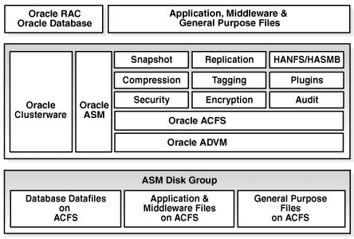

## Introducing Oracle ACFS and Oracle ADVM

Oracle ASM Cluster File System (Oracle ACFS) and Oracle ASM Dynamic Volume Manager (Oracle ADVM) provide key components of storage management.

This chapter describes the components of Oracle Automatic Storage Management Cluster File System (Oracle ACFS) and Oracle ASM Dynamic Volume Manager (Oracle ADVM).

See also

- [Managing Oracle ADVM Volumes in a Disk Group](administering-oracle-asm-disk-groups.md) for information about using SQL\*Plus to administer volumes
- Oracle ACFS Features Enabled by Compatibility Attribute Settings for information about Oracle ACFS features and disk group attribute settings
- [Managing Oracle ACFS and Oracle ADVM With ASMCA](managing-oracle-acfs-and-oracle-advm-with-asmca.md) for information about using Oracle ASM Configuration Assistant to administer Oracle ACFS
- [Using Views to Display Oracle ACFS Information](using-views-to-display-oracle-acfs-information.md) for information about using views to obtain Oracle ACFS information
- [Managing Oracle ADVM with ASMCMD](managing-oracle-advm-with-asmcmd.md) for information about volume management commands
- [Managing Oracle ACFS with Command-Line Tools](managing-oracle-acfs-with-command-line-tools.md) for information about Oracle ACFS operating system utilities

## Overview of Oracle ACFS

Oracle Automatic Storage Management Cluster File System (Oracle ACFS) is a multi-platform, scalable file system, and storage management technology that extends Oracle Automatic Storage Management (Oracle ASM) functionality to support all customer files.

Oracle ACFS supports Oracle Database files and application files, including executables, database data files, database trace files, database alert logs, application reports, BFILEs, and configuration files. Other supported files are video, audio, text, images, engineering drawings, and all other general-purpose application file data. Oracle ACFS conforms to POSIX standards for Linux and UNIX, and to Windows standards for Windows.

An Oracle ACFS file system communicates with Oracle ASM and is configured with Oracle ASM storage, as shown in the following figure.

Figure: Oracle ACFS Storage Layers



> The diagram shows Oracle ACFS and Oracle ADVM layered over an Oracle ASM disk group. Oracle ACFS provides file systems for database data files, application and middleware files, and general-purpose files, with features such as snapshots, replication, compression, tagging, plugins, security, encryption, and auditing. Oracle Clusterware and Oracle ASM support the stack.


Oracle ACFS leverages Oracle ASM functionality that enables:

- Oracle ACFS dynamic file system resizing
- Maximized performance through direct access to Oracle ASM disk group storage
- Balanced distribution of Oracle ACFS across Oracle ASM disk group storage for increased I/O parallelism
- Data reliability through Oracle ASM mirroring protection mechanisms

Oracle ACFS establishes and maintains communication with the Oracle ASM instance to participate in Oracle ASM state transitions including Oracle ASM instance and disk group status updates and disk group rebalancing. Oracle Automatic Storage Management with Oracle ACFS and Oracle ASM Dynamic Volume Manager (Oracle ADVM) delivers support for all customer data and presents a common set of Oracle storage management tools and services across multiple vendor platforms and operating system environments on both Oracle Restart (standalone) and cluster configurations.

Oracle ACFS is tightly coupled with Oracle Clusterware technology, participating directly in Clusterware cluster membership state transitions and in Oracle Clusterware resource-based high availability (HA) management. In addition, Oracle installation, configuration, verification, and management tools have been updated to support Oracle ACFS.

Oracle ACFS can be accessed and managed using native operating system file system tools and standard application programming interfaces (APIs). Oracle ACFS can also be managed with Oracle ASM Configuration Assistant. Oracle ACFS can be accessed using industry standard Network Attached Storage (NAS) File Access Protocols: Network File System (NFS) and Common Internet File System (CIFS). However, CIFS clients on Windows cannot use ACLs when interfacing with Oracle ACFS Linux, Solaris, or AIX servers, but can use ACLs with Oracle ACFS on Windows.

In addition to sharing file data, Oracle ACFS provides additional storage management services including support for the Oracle Grid Infrastructure clusterwide mount registry, dynamic online file system resizing, and multiple space efficient snapshots for each file system.

Oracle ACFS contributes to the overall Oracle storage management by providing:

- A general-purpose standalone server and cluster file system solution that is integrated with Oracle ASM and Oracle Clusterware technologies
- A common set of file system features across multiple vendor platforms and operating systems, offering an alternative to native operating system or third-party file system solutions
- Standalone and clusterwide shared Oracle Database homes, all Oracle Database files, and application data
- Uniform, coherent shared file access and clusterwide naming of all customer application files
- Integration with Oracle Clusterware High Availability Resources

Oracle ACFS accommodates large storage capacities and large numbers of cluster nodes. It efficiently manages large numbers of file systems, files, and supports both small and large sized files with exabyte-capable file and file system capacities. Oracle ACFS provides optimized fast directory lookup for large directories with millions of files.

Oracle ACFS provides support for sparse files. Oracle ACFS sparse files greatly benefit NFS client write operations which are commonly received out of order by the NFS server and the associated Oracle ACFS file system. Usually when an application writes beyond the end of file, storage is allocated and zeroes inserted beyond the old end of file and the beginning of the new. With this feature, a hole remains in the file instead of the inserted zeroes. Oracle ACFS then fills these holes with zeroes in memory when the holes are read. The sparse files feature benefits NFS performance and also the performance and disk utilization of other applications that intentionally perform this type of writing. In addition, there are also reduced time and storage benefits for files that are inherently sparse, meaning they have a lot of unused space, such as some image files for virtual machines. For sparse file support, the `COMPATIBLE.ADVM` disk group attribute must be set to `12.2` or greater.

Oracle ACFS file systems are generally mounted on all cluster nodes to deliver a single name space for the cluster so that each node maintains the same view and access capabilities to the mounted file systems. In the event of a member failure, another cluster member quickly recovers any outstanding metadata transactions on behalf of the failed member. Following recovery, access by other active cluster members and any remote client systems can resume.

The following list provides important information about Oracle ACFS:

- For all applications, Oracle ACFS performance is best with larger write() sizes, such as 8 K or larger.
- For best performance, use the Deadline I/O Scheduler for the disks in the disk group on a Linux system.
- When creating Oracle ACFS file systems on Windows, log on as a Windows domain user. Also, when creating files in an Oracle ACFS file system on Windows, you should be logged in as a Windows domain user to ensure that the files are accessible by all nodes.
- When using a file system across cluster nodes on Windows platforms, the best practice is to mount the file system using a domain user, to ensure that the security identifier is the same across cluster nodes. Windows security identifiers, which are used in defining access rights to files and directories, use information which identifies the user. Local users are only known in the context of the local node. Oracle ACFS uses this information during the first file system mount to set the default access rights to the file system.
	Oracle ACFS does not support any files associated with the management of Oracle ASM, such as files in the Oracle Grid Infrastructure home and in the Oracle ASM diagnostic directory.
- Oracle ACFS does not support Oracle Cluster Registry (OCR) and voting files.
- Oracle ACFS functionality requires that the disk group compatibility attributes for `ASM` and `ADVM` be set to `11.2` or higher.
- To use an Oracle ACFS file system for an Oracle Database home, the release level must be Oracle 11\_g\_ Release 2 (11.2) or later.

Note:

- The following features are deprecated in Oracle ACFS 19c:
	- Deprecation of Oracle ACFS Replication Version 1  
		Starting with Oracle ACFS 19c (19.3), Oracle ACFS replication protocol version 1 is deprecated. Replication protocol version 1 has been replaced with snapshot-based replication version 2, introduced in Oracle ACFS 12c Release 2 (12.2.0.1).
		- Deprecation of Oracle ACFS Encryption on Solaris and Windows  
		Starting with Oracle ACFS 19c (19.3), Oracle ACFS encryption is deprecated on Solaris and Microsoft Windows operating systems. Oracle ACFS Encryption on Oracle Solaris and Microsoft Windows is based on RSA technology. Retirement of RSA technology has been announced. Oracle ACFS Encryption continues to be supported on Linux, and is unaffected by this deprecation, because Linux uses an alternative technology.
		- Deprecation of Oracle ACFS on Windows  
		Starting with Oracle ACFS 19c (19.5), Oracle ACFS is deprecated on Microsoft Windows. Deprecating certain clustering features with limited adoption allows Oracle to focus on improving core scaling, availability, and manageability across all features and functionality. Oracle ACFS file systems on Microsoft Windows are deprecated, and can be desupported in a future release. Depending on the use case, to replace current Oracle ACFS file systems, Oracle recommends that you move to Oracle Automatic Storage Management (Oracle ASM), Oracle Database File System (DBFS), or Microsoft Windows shares.
		- Deprecation of Oracle ACFS Security (Vault) and Oracle ACFS Auditing  
		Starting with Oracle ACFS 19c (19.5), Oracle ACFS Security (Vault) and ACFS Auditing are deprecated. Deprecating certain clustering features with limited adoption enables Oracle to focus on improving core scaling, availability, and manageability across all features and functionality. Oracle ACFS Security (Vault) and Oracle ACFS Auditing are deprecated, and can be desupported in a future release.
		- Deprecation of Oracle ACFS on Member Clusters (ACFS Remote)  
		Starting with Oracle ACFS 19c (19.5), Oracle ACFS on Member Clusters (ACFS Remote) is deprecated. Oracle Oracle ACFS on Member Clusters (ACFS Remote) is deprecated, and can be removed in a future release. Deprecating certain clustering features with limited adoption enables Oracle to focus on improving core scaling, availability, and manageability across all features and functionality.
		- Deprecation of Cluster Domain - Member Clusters  
		Starting with Oracle Grid Infrastructure 19c (19.5), Member Clusters, which are part of the Oracle Cluster Domain architecture, are deprecated. Oracle Member Clusters are deprecated, and can be desupported in a future release. Deprecating certain clustering features with limited adoption allows Oracle to focus on improving core scaling, availability, and manageability across all features and functionality. Oracle Cluster Domains consist of a Domain Services Cluster (DSC) and Member Clusters. The deprecation of Member Clusters affects the clustering used with the DSC, but not its ability to host services for other production clusters. Oracle recommends that customers align their next software or hardware upgrade with the transition off Cluster Domain - Member Clusters.

See also

- Overview of Oracle ASM Dynamic Volume Manager for an overview of Oracle ADVM
- Oracle Clusterware Resources and Oracle ACFS Administration for information Oracle Clusterware High Availability Resources
- [Disk Group Compatibility](administering-oracle-asm-disk-groups.md) for information about disk group compatibility
- [Managing Oracle ACFS with Command-Line Tools](managing-oracle-acfs-with-command-line-tools.md) and [Using Views to Display Oracle ACFS Information](using-views-to-display-oracle-acfs-information.md) for information about managing and monitoring Oracle ACFS
- \[Oracle Database Installation Guide\]() for the Windows platform for information about Oracle Base permissions when a file system is mounted under Oracle Base.

## Understanding Oracle ACFS Concepts

This section describes concepts for the key Oracle ACFS components.

### About Oracle ACFS

Oracle ACFS is designed as a general-purpose, standalone server and clusterwide file system that delivers support for all customer files. Users and applications can access and manage Oracle ACFS using native operating system file system application programming interfaces (APIs) and command-line interface (CLI) tools. Users can also manage Oracle ACFS with Oracle ASM Configuration Assistant (ASMCA).

Oracle ACFS supports large files with 64-bit file and file system data structure sizes leading to exabyte capable file and file system capacities on 64 bit platforms. Variable extent-based storage allocation and high-performance directories contribute to fast performance and shared disk configurations that provide direct storage paths to Oracle ACFS file data from each cluster member. File system integrity and fast recovery is achieved with Oracle ACFS metadata checksums and journaling. Oracle ACFS is designed as a multi-node, shared file system model that delivers coherent, cached, direct storage paths to Oracle ACFS file data from each cluster member.

Oracle ACFS files systems are typically configured for clusterwide access. File systems, files, and directories are visible and accessible from all cluster members and can be referenced by users and applications using the same path names from any cluster member. This design enables simplified application deployments across cluster members and facilitates both multiple instance cluster applications and high availability (HA) failover of unmodified standalone server applications.

Oracle ACFS presents single system file access semantics across cluster configurations. Applications and users on all cluster members are always presented with the same view of shared Oracle ACFS file data, supported by the Oracle ACFS clusterwide user and metadata cache coherency mechanism.

### About the Oracle ACFS Mount Model and Namespace

Oracle ACFS is designed as a hierarchical file system containing files and subdirectories organized into a tree-structured namespace with files at the leaves. The namespace design is a single-file system naming model for both standalone server and cluster configurations. This design enables each cluster member to present shared files to cluster applications using the same path names, simplifying multi-node application and user access, and overall file system administration. The Oracle ACFS mount model also accommodates node local mounts and cluster node subset mounts in cluster configurations to accommodate additional customer requirements.

It is best practice for Oracle ACFS file systems to be Oracle Clusterware managed with Oracle Clusterware resources to ensure they are properly handled during Oracle Grid Infrastructure startup and shutdown.

You can explicitly use the `mount` command. However, if the resource has been created, then the file system may already be mounted.

### About Oracle ACFS and Database Data Files

Note:

- The best practice for data files in Oracle ACFS is to use a clusterwide resource for the Oracle ACFS File system that stores the data files.
- If the data files are added after the database installation is complete, you must modify the database dependencies to list the new Oracle ACFS file system. Failure to do so results in errors with application reliability. To specify the file systems in the dependency list, use the SRVCTL database object command to modify the Oracle ACFS paths used by the resource.
- In Oracle Exadata environments, Hybrid Columnar Compression (HCC) is supported for database files that are stored on Oracle ACFS.

Oracle ACFS in Oracle Grid Infrastructure 18c cluster and standalone (Oracle Restart) configurations supports all database files for Oracle Database releases 11.2.0.4 or higher. Oracle ACFS can be configured for use with the database particularly to leverage Oracle ACFS snapshots for database testing and development. To support database files in cluster configurations, the `COMPATIBLE.ADVM` attribute must be set to `12.1` or higher for the disk group that contains the Oracle ACFS file system. In an Oracle Restart configuration, the `COMPATIBLE.ADVM` attribute must be set to `12.2.0.1` or higher to support all database files.

Support for database data files on Windows begins with Oracle Grid 12\_c\_ Release 1 (12.1.0.2). For support of database files on Windows, the `COMPATIBLE.ADVM` attribute must be set to `12.1.0.2` or higher.

Support for database data files on Oracle Exadata (Linux) begins with Oracle Grid 12\_c\_ Release 1 (12.1.0.2). However, Oracle ACFS does not currently have the ability to push database operations directly into storage.

Oracle ACFS on Oracle Grid Infrastructure 12.1.0.2 additionally supports all database files for Oracle Database 10\_g\_ Release 2 (10.2.0.4 and 10.2.0.5) on Oracle Exadata (Linux) storage. For database file support with Oracle Database 10\_g\_ Release 2 (10.2.0.4 and 10.2.0.5) on Oracle Exadata storage, the following conditions must be met:

- When creating an Oracle Database with DBCA, you must set the `REMOTE_LISTENER` initialization parameter to *your\_scan\_vip* `:1521` otherwise DBCA fails during the create process.
- You must modify all the start and stop dependencies of the database instance resources to ensure that the resources start when starting Oracle Clusterware.

The following list provides important information about using Oracle ACFS with database files:

- Oracle ACFS support includes all file types supported by Oracle ASM.
- When storing database data files on Oracle ACFS, you must set the `FILESYSTEMIO_OPTIONS` initialization parameter to `setall`; other settings are not supported. To achieve optimal performance with database data files, set `ASM` and `ADVM` compatibility attributes to `12.1` or higher for the disk group that contains the Oracle ADVM volume intended to hold the data files. For volumes created before 12.1.0.2, set the stripe columns to `1`, or set the stripe columns to `8` and the stripe width to `1` `MB`. Volumes created while running 12.1.0.2 or higher already default to the high performance configuration (stripe columns = `8` and stripe width = `1` `MB` ).
- To obtain optimal database performance with snapshots, the snapshots must be created after the `ADVM` compatibility attribute is set to `12.1` or higher.
- Use a 4 K or larger database block size and tablespace block size with Oracle ACFS for best performance.
- For best performance when using Oracle Exadata, use a 4 K metadata file system.
- Oracle ACFS does not support databases with 2 K block sizes.
- If a data file is configured to automatically extend, then the size of the increments should be large enough to ensure that the extend operation occurs infrequently. Frequent automatic extends have a negative performance impact.
- Running a workload in a snapshot reduces resources for the primary workload running on the base files because the storage is shared between the base file system and the snapshots. To run test scenarios in Oracle ACFS snapshots without impacting the primary workload, copy the file system and then run test workloads on snapshots created in the copied file system.
- Oracle ACFS does not support encryption or replication with Oracle Database data files, tablespace files, control files, redo logs, archive logs, RMAN backups, Data Pump dumpsets or flashback files. To encrypt database data files on Oracle ACFS, Oracle recommends Oracle Advanced Security. Oracle Advanced Security provides Transparent Data Encryption (TDE) to encrypt data files for entire tablespaces. Oracle Data Guard and Oracle GoldenGate provide other replication options for database files on Oracle ACFS.
- Databases that share storage with snapshots or with the base of the file system can become fragmented under active online transaction processing (OLTP) workloads. This fragmentation can cause the location of the data in the volume to be discontiguous for sequential scans. Oracle ACFS automatically defragments these files in the background. Fragmentation is reported through the `acfsutil` `defrag` `dir` and `file` commands, and it can also be viewed with the `acfsutil` `info` `file` command. The `acfsutil` `defrag` `dir` and `file` commands also enable on-demand defragmentation of a file in the event the automatic defragmentation does not occur quickly enough.

See also

- Creating Oracle ACFS Resources for information about Oracle ACFS resources
- [What Types of Files Does Oracle ASM Support?](administering-oracle-asm-files-directories-and-templates.md) for a list of file types supported by Oracle ASM
- [volcreate](managing-oracle-advm-with-asmcmd.md) for information about creating a volume
- [mkfs](managing-oracle-acfs-with-command-line-tools.md) for information about setting the metadata block size with `mkfs` `-i`
- [Oracle ACFS Command-Line Utilities](managing-oracle-acfs-with-command-line-tools.md) for information about `acfsutil` `defrag` and `acfsutil` `info` commands
- \[Oracle Database Reference\]() for information about the `REMOTE_LISTENER` initialization parameter
- \[Oracle Clusterware Administration and Deployment Guide\]() for information about resource dependencies
- \[Oracle Database Advanced Security Guide\]() for information about Transparent Data Encryption (TDE)
- \[Oracle Data Guard Concepts and Administration\]() for information about other replication options for database files on Oracle ACFS
- [https://www.oracle.com/integration/goldengate/](https://www.oracle.com/integration/goldengate/) for Oracle GoldenGate documentation about other replication options for database files on Oracle ACFS

### About Oracle ACFS and Oracle Database Homes

An Oracle ACFS file system can be configured as an Oracle Database home.

When installing a database in a cluster, a shared Oracle ACFS file system can be used for the database home. You can use an Oracle ACFS file system for an Oracle Database home with Oracle 11\_g\_ Release 2 (11.2) or later.

When installing Oracle Software, there must be a separate Oracle base (`ORACLE_BASE`) associated with each operating system user. For example, there should be a separate Oracle base for a grid user and a database user.

You can locate the Oracle Database base (`ORACLE_BASE` for database) directory and home (`ORACLE_HOME` for database) directory on an Oracle ACFS file system. The Oracle Database base (`ORACLE_BASE` for database) directory should not be the Oracle Grid Infrastructure base (`ORACLE_BASE` for grid) directory or should not be located under the Oracle Grid Infrastructure base directory (`ORACLE_BASE` for grid).

The Oracle Grid Infrastructure base (`ORACLE_BASE` for grid) directory and home (`ORACLE_HOME` for grid) directory cannot be located on the Oracle ACFS file system because the Oracle ACFS file system cannot be created until Oracle Grid Infrastructure is installed.

One or more Oracle Database homes on Oracle ACFS can be created under the same mount point with each home using a separate Oracle ACFS file system.

After the installation of Oracle Grid Infrastructure Software and before the installation of the Oracle Database software with Oracle Universal Installer (OUI), you can create an Oracle ACFS file system to be configured for use as an Oracle Database home.

You can also use the Oracle ASM Configuration Assistant (ASMCA) or Oracle ACFS commands to create the file system.

Note:

When an Oracle ACFS file system contains an Oracle Database home or Oracle Database uses the file system for any file storage, the file system must have an Oracle ACFS file system resource. If you have not used Oracle ASM Configuration Assistant to setup the mount point, then you must use Server Control Utility (SRVCTL) commands to set up Oracle Database dependencies.

In an Oracle Grid Infrastructure clusterware configuration, a clusterwide Oracle ACFS resource is required when using Oracle ACFS for the database home. To enable the database owner to act on the resource, the owner must be specified as a permitted user when creating the resource. You can specify the database owner with the `-u` option of the `srvctl` `add` `filesystem` or `acfsutil` `registry` command. Root privilege is required when adding the resource in Linux or Unix environments.

After the Oracle ACFS file system and resources are created, the Oracle ACFS-based database home mount point location can be selected as the Oracle Database home location by browsing to and then choosing the directory during the Oracle Universal Installer (OUI) Database Software installation.

You can use the `srvctl` `start` `filesystem` command to manually mount the Oracle ACFS file system.

Note:

When additional Oracle ACFS file systems are added to an Oracle Database after creation, they must be specified in the Oracle Database Resource Dependency list. Failure to do so results in errors with application reliability. To specify the file systems in the dependency list, use the SRVCTL database object command to modify the Oracle ACFS paths used by the resource.

Oracle ACFS file systems can be also configured for use as a home for applications. However, Oracle ACFS file systems cannot be used for an Oracle base directory or an Oracle Grid Infrastructure home that contains the software for Oracle Clusterware, Oracle ASM, Oracle ACFS, and Oracle ADVM components.

To reduce contention on an Oracle ACFS file system in an Oracle RAC environment where the Oracle Database home is shared on Oracle ACFS, Oracle Database auditing operating system files should be configured as node specific. For a node-specific setup, you must ensure that the `AUDIT_FILE_DEST` initialization parameter in the configuration file of each database instance points to a unique location rather than one location for all the database instances.

For example, if you have a database with the Oracle name set to `TEST` and you want to ensure that the location of `AUDIT_FILE_DEST` initialization parameter for each database instance, such as `TEST1` or `TEST2`, points to a node specific location for that instance, you can run the following SQL statement:

```
SQL> ALTER SYSTEM SET AUDIT_FILE_DEST='$ORACLE_BASE/admin/adump/TEST/@'
     SCOPE=SPFILE SID='*';
```

In the previous example, `@` expands to the `ORACLE_SID` of each instance. If `ORACLE_BASE` has been set to `/acfsmounts` in this example, then that value could have been used in place of the `ORACLE_BASE` variable.

See also

- [Managing Oracle ACFS with Command-Line Tools](managing-oracle-acfs-with-command-line-tools.md) for information about using Oracle ACFS commands to create a file system
- [Creating an Oracle ACFS File System for Database Use](managing-oracle-acfs-and-oracle-advm-with-asmca.md) for information about using ASMCA
- Creating Oracle ACFS Resources for additional information Oracle ACFS resources
- \[Oracle Clusterware Administration and Deployment Guide\]() and \[Oracle Real Application Clusters Administration and Deployment Guide\]() for information about SRVCTL commands
- [*Oracle Database Installation Guide*](https://docs.oracle.com/pls/topic/lookup?ctx=en/database/oracle/oracle-database/19/ostmg&id=GINST) for your environment for information about the installation of Oracle Database software and storage options and about Optimal Flexible Architecture (OFA) recommendations for Oracle base and home directories
- [*Oracle Grid Infrastructure Installation Guide*](https://docs.oracle.com/pls/topic/lookup?ctx=en/database/oracle/oracle-database/19/ostmg&id=CWGEN) for your environment for information about the installation of Oracle Grid Infrastructure software and storage options
- \[*Oracle Database Administrator's Guide*\]() for information about using Oracle Managed files
- \[*Oracle Database Reference*\]() for information about the `AUDIT_FILE_DEST` initialization parameter

### About Oracle ASM Dynamic Volume Manager

The Oracle ASM Dynamic Volume Manager (Oracle ADVM) provides volume management services and a standard disk device driver interface to clients. File systems and other disk-based applications send I/O requests to Oracle ADVM volume devices as they would to other storage devices on a vendor operating system.

For more information about Oracle ADVM, refer to Overview of Oracle ASM Dynamic Volume Manager.

### About the Oracle ACFS Driver Model

An Oracle ACFS file system is installed as a dynamically loadable vendor operating system (OS) file system driver and tool set that is developed for each supported operating system platform. The driver is implemented as a Virtual File System (VFS) and processes all file and directory operations directed to a specific file system.

Note:

Errors encountered by the drivers are written to the native operating system console and system event loggers. Refer to [Understanding Oracle ACFS I/O Failure Console Messages](understanding-oracle-acfs-advanced-topics.md).

### About the Oracle ACFS Mount Registry

The Oracle ACFS mount registry supports Oracle Grid Infrastructure cluster configurations, but does not support Oracle Restart configurations.

File systems that are to be mounted persistently (across restarts) can be registered with the Oracle ACFS mount registry. In cluster configurations, registered Oracle ACFS file systems are automatically mounted by the mount registry, similar to a clusterwide mount table. However, in Oracle Restart configurations the automatic mounting of registered Oracle ACFS file systems is not supported.

By default, an Oracle ACFS file system that is inserted into the Oracle ACFS mount registry is automatically mounted on all cluster members, including cluster members that are added after the registry addition. However, the Oracle ACFS mount registry also accommodates standalone and multi-node (subset of cluster nodes) file system registrations. The mount registry actions for each cluster member mount only registered file systems that have been designated for mounting on that member.

The Oracle ACFS mount registry is implemented using Oracle Clusterware resources, specifically the Oracle ACFS resource. The Oracle ACFS resource actions are designed to automatically mount a file system only one time for each Oracle Grid Infrastructure initialization to avoid potential conflicts with administrative actions to dismount a given file system.

See also

- [Oracle ACFS and Oracle Restart](understanding-oracle-acfs-advanced-topics.md) for more information about Oracle ACFS and Oracle Restart
- [acfsutil registry](managing-oracle-acfs-with-command-line-tools.md) for information about registering an Oracle ACFS file system using the `acfsutil` command
- Oracle Clusterware Resources and Oracle ACFS Administration for more information about the implementation of the mount registry and Oracle ACFS resources
- \[Oracle Clusterware Administration and Deployment Guide\]() and \[Oracle Real Application Clusters Administration and Deployment Guide\]() for information about SRVCTL commands, including the `srvctl` `add` `filesystem` command
- \[Oracle Clusterware Administration and Deployment Guide\]() for information about Oracle Clusterware resources

### About Oracle ACFS in the Cluster Domain

In addition to support for Oracle Database member clusters with attached local storage, Oracle ACFS provides Oracle ACFS remote service for native Oracle ACFS functionality on Oracle Database member clusters with no attached local storage (InDirect Storage Member Cluster). Utilizing an Oracle ACFS deployment on the Oracle Domain Services Cluster (DSC), Oracle ACFS remote service can be used for both Oracle Database application clusters and Oracle Database member clusters to enable a flexible and file system-based deployment of applications and databases. Unlike NFS-based exports, Oracle ACFS remote service fully supports advanced Oracle ACFS features; such as replication, snapshots, and tagging; on the destination member cluster.

Oracle Database Member Clusters

Oracle Database member clusters can be configured with or without local storage.

- Oracle Database member clusters with attached local storage
	Oracle Database member clusters can be configured with local storage. These clusters utilize a GIMR from the Domain Services Cluster, and operate similar to a standalone Oracle ASM cluster. Oracle ACFS in these clusters operate normally with the full Oracle ASM Proxy and all traditional tools. These member clusters manage their own storage.
- Oracle Database member clusters with No Attached Local Storage
	Oracle Database member clusters can also be configured without attached local storage. These InDirect Storage Member Clusters utilize consolidated storage services from the Domain Services Cluster (DSC). To use Oracle ACFS file systems and Oracle ADVM volumes, the Oracle Database member clusters use the Oracle ACFS remote service from the Domain Services Cluster.
	An InDirect Storage Member Cluster provides for a small lightweight Oracle Clusterware (CRS) stack that can run traditional databases or other applications. This member cluster consumes less memory, is easier to provision, and can be easily hosted in VMs because there are no direct attached storage requirements. InDirect Storage Member clusters are very suited for resource and application consolidation. In this scenario, Oracle ACFS Remote enables full storage and resource consolidation on the Domain Services Cluster, enabling a new generation of compact and cheap computing resources.

Oracle ACFS Remote Service

Oracle ACFS remote service enables the use of Oracle ACFS in an InDirect Storage Member Cluster. Oracle ACFS remote service is provided as another service of the DSC. Because an InDirect Storage Member Cluster has no direct attached storage to the Oracle Database member cluster, Oracle ACFS remote service provides an Oracle ACFS enabled storage fast-path between the DSC and the member cluster for Oracle ACFS usage over standard block transports.

When Oracle ACFS remote service is in use, the Oracle Database member cluster has access to all Oracle ACFS functionality, including snapshots, resizing, Oracle Database and other POSIX applications, plus ACFS NAS/MAX, tagging, checking, repairing, scrubbing, security, encryption, and compression. When an application uses the Oracle ACFS remote service export functionality on the member cluster, there is no functional or programmatic difference between Oracle ACFS use locally or remotely. In addition, all Oracle ACFS tools and utilities continue to operate normally. As part of its default configuration, Oracle ACFS remote service provides for high availability of exports. If a transport or DSC node is unavailable, then operations continue on other nodes of the DSC. This continuation provides for full failover and availability of the member cluster operations. Oracle ACFS Remote also handles temporary transport level outages in a similar manner.

Repositories, Exports, and Transports

Repository, export, and transport are integral components of Oracle ACFS remote service.

- Repository
	A repository is a directory in an Oracle ACFS file system on the DSC that serves as a host for exports. The file system is a standard Oracle ACFS file system, enabling standard Oracle ACFS functionality to be applied to the file system, including resizing, replication, and snapshots. Because it is an Oracle ACFS file system, the repository is subject to the 1 petabyte Oracle ACFS file system limitation. If the total of the expected backing files in all repositories on the Oracle ACFS file system exceeds the file system size, then multiple repositories are necessary.
	Oracle ACFS file compression is not supported in a repository.
- Export
	The DSC provides exports. These exports start as backing files that reside in an Oracle ACFS remote service repository on the DSC. The file is then exported using a transport so that only the intended member cluster nodes have access to the export using that transport. Exports are managed using the `advmutil` `export` series of commands. After a file is in use by Oracle ACFS remote service, it cannot be removed until the file is removed from use by Oracle ACFS remote service.
- Transport
	Oracle ACFS remote service uses transports to provide access to the exports. For Oracle ASM release 18c, version 18.1, only the iSCSI transport is supported. This transport is configured using a small transport definition file and automatically managed by Oracle ACFS remote service. Transports are managed using the `advmutil` `transport` series of commands.

See also

- Oracle ACFS Remote Service in the Cluster Domain
- [Oracle ACFS Command-Line Tools for Oracle ACFS in the Cluster Domain](managing-oracle-acfs-with-command-line-tools.md)
- [ASMCMD Member Cluster Management Commands](managing-oracle-asm-with-asmcmd.md)
- [Managing Oracle Flex ASM](managing-oracle-flex-asm.md)
- \[Oracle Clusterware Administration and Deployment Guide\]() for an overview of Oracle Clusterware architecture

### About Oracle ACFS Snapshots

An Oracle ACFS snapshot is an online, read-only or read-write, point in time copy of an Oracle ACFS file system.

The snapshot copy is space-efficient and uses Copy-On-Write functionality. Before an Oracle ACFS file extent is modified or deleted, its current value is copied to the snapshot to maintain the point-in-time view of the file system.

Oracle ACFS snapshots are immediately available for use after they are created. The snapshots are created in the `.ACFS/snaps/` directory of the file system. They are always online while the file system is mounted. Consequently, an Oracle ACFS snapshot can support the online recovery of files inadvertently modified or deleted from a file system. An Oracle ACFS snapshot can also be used as the source of a file system backup, as it can be created on demand to deliver a current, consistent, online view of an active file system.

Up to 1023 read-only, read-write, or combination of read-only and read-write snapshot views are supported for each file system, enabling flexible online file recovery solutions spanning multiple views to be employed. On 64-bit systems, Oracle ACFS supports 1023 snapshots. The total number of snapshots can be any combination of read-only and read-write snapshots. To support the creation of more than 63 snapshots, the disk group compatibility attribute for `ADVM` must be set to `12.1.0.2` or greater. Also, the following conditions must be met to create more than 63 snapshots.

- All snapshots of the file system that were created with `COMPATIBLE.ADVM` set to less than `12.1.0.2` must be deleted.
- All snapshots of the file system that were created after setting `COMPATIBLE.ADVM` to `12.1.0.2` or greater while older snapshots existed must be deleted.

Oracle ACFS read-write snapshots enable fast creation of an snapshot image that can be both read and written without impacting the state of the Oracle ACFS file system hosting the snapshot images. You can use read-write snapshots for:

- Testing of new versions of application software on production file data reflected in the read-write snapshot image without modifying the original production file system
- Running test scenarios on a real data set without modifying the original production file system

To use Oracle ACFS read-write snapshots, the disk group compatibility attribute for `ADVM` must be set to `11.2.0.3.0` or higher. If you create a read-write snapshot on an existing Oracle ACFS file system from a version earlier than `11.2.0.3.0`, then the file system is updated to the `11.2.0.3.0` or higher format. After a file system has been updated to a higher version, an Oracle ACFS file system cannot be reverted to an earlier version, and accordingly cannot be mounted on an earlier Oracle Grid Infrastructure version.

You can create a snapshot from an existing snapshot in the same Oracle ACFS file system. In addition, you can convert a snapshot between read-only and read-write formats. To create from an existing snapshot or convert a snapshot, the disk group compatibility attribute for `ADVM` must be set to `12.1` or higher. In addition, creation from an existing snapshot is not permitted if there are:

- Any snapshots present in the file system that were created with the `ADVM` compatibility set to less than 12.1
- Any snapshots of the file system that were created after `ADVM` compatibility was set to `12.1` but while 11.2 snapshots existed

Oracle ACFS snapshot storage is maintained within the file system, eliminating the management of separate storage pools for file systems and snapshots. Oracle ACFS file systems can be dynamically resized to accommodate additional file and snapshot storage requirements.

You cannot modify security or encryption metadata in read-write snapshots except for enabling or disabling security or encryption. No other alteration is permitted on Oracle ACFS security or encryption metadata in a snapshot. If a file was not secured by a security realm in the snapshot, it cannot be realm secured by adding the corresponding file in the active file system to a security realm. If a file was not encrypted in the snapshot, that file cannot be encrypted by encrypting the corresponding file in the active file system.

A new file created in a realm-secured directory in a read-write snapshot inherits the realm security attributes of the parent directory. If the realm protecting the new file has encryption turned on, the file is encrypted with the encryption parameters set in the realm. If the realm protecting the new file has encryption turned off, the file is decrypted. Files and directories in a read-write snapshot cannot be added to or removed from any security realm.

Files in a read-write snapshot can be encrypted, decrypted, or rekeyed if the operation target is a path specified for a file or directory of the read-write snapshot. However, if an encryption, decryption, or rekey operation is specified at the file system level, then the operation does not process files and directories of snapshots in the `.ACFS/snaps/` directory.

All Oracle ACFS snapshot operations are serialized clusterwide in the kernel. For example, if a snapshot create operation is initiated at the same time as a snapshot delete operation, then both operations would complete, but they would not run in parallel inside of the kernel. One operation would complete before the other was started.

The `acfsutil` `snap` `duplicate` commands can be invoked manually to enable a target file system or writable snapshot to track the evolution of a source file system or snapshot with minimal overhead. Oracle ACFS updates the target after each apply operation to indicate its current contents, and checks before starting the next apply operation to ensure that the starting point of the incoming snapshot duplication stream matches the endpoint of the last-applied stream. The target remains writable by any and all applications even when it is in use by `acfsutil` `snap` `duplicate` `apply`. Oracle ACFS determines any updates to the target by a process other than the apply process, and if such an update occurs, invalidates the internal metadata that track the target contents. This prevents further apply operations to the target, and avoids the possibility of a future apply operation yielding unexpected results.

The use of the `acfsutil` `snap` `duplicate` commands interacts with Oracle ACFS replication operations. A target file system in use by `acfsutil` `snap` `duplicate` `apply` cannot be specified for use as a file system for replication. And a file system in use by replication cannot be specified as the target for `acfsutil` `snap` `duplicate` `apply`.

To run the `acfsutil` `snap` `duplicate` commands, the disk group compatibility attribute for `ADVM` must be set to at least `12.2`.

Additional `acfsutil snap` commands are available to manage duplicate snapshots and remaster an Oracle ADVM volume with an existing snapshot.

Oracle ACFS snapshots are administered with the `acfsutil` `snap` commands.

Note:

The `link()` and `rename(`) system calls fail if an attempt is made to link or rename a file in the Oracle ACFS file system and a file in any associated read-write snapshot, or vice versa. Any tools which use the `link()` and `rename()` system calls, such as `ln` and `mv`, also fail in the same scenario.

See also

- [acfsutil snap create](managing-oracle-acfs-with-command-line-tools.md) for additional information on the target used with the `acfsutil` `snap` `duplicate` command
- Oracle ACFS Replication for information about Oracle ACFS replication
- Oracle ACFS Security for information about Oracle ACFS security
- Oracle ACFS Encryption for information about Oracle ACFS encryption
- [Oracle ACFS Command-Line Tools for Snapshots](managing-oracle-acfs-with-command-line-tools.md) for information about the `acfsutil` `snap` commands

### About Oracle ACFS and Backup and Restore

Oracle ACFS runs on operating system platforms as a native file system technology supporting native operating system file system application programming interfaces (APIs). Consequently, backup applications that access files using the native operating system file system interfaces are able to access and backup Oracle ACFS file systems and other native operating system file systems. Oracle ACFS snapshots can be dynamically created and used to present a consistent, on-line view of an active file system to a backup application.

Backup applications that use interfaces other than the standard operating system interfaces (read or write) are not supported with Oracle ACFS. For example, Windows backup applications that depend upon the presence of reparse points or the Windows Volume Shadow Copy Service (VSS) are not supported.

Note:

When Oracle ACFS is used with Oracle Recovery Manager (RMAN) backups or restore, you should tune RMAN to improve performance because the default values may not be ideal for Oracle ACFS file systems. For example, you can adjust RMAN parameters to match the buffer size with the volume stripe width or Oracle ASM AU size. Also, you can adjust the number of buffers to match the number of devices in the Oracle ASM disk group.

See also

- Oracle ACFS Tagging for information about using common operating system utilities to preserve Extend Attributes for tagging definitions
- [md\_backup](managing-oracle-asm-with-asmcmd.md) and [md\_restore](managing-oracle-asm-with-asmcmd.md) for information about backing up and restoring Oracle ACFS metadata
- [My Oracle Support](https://support.oracle.com/) ([https://support.oracle.com](https://support.oracle.com/)) for articles about tuning RMAN tuning, such as *RMAN Performance Tuning Using Buffer Memory Parameters* (Doc ID 1072545.1) and *RMAN Performance Troubleshooting* (Doc ID 1326686.1)

### About Oracle ACFS Integration with Oracle ASM

Oracle ACFS is always configured with Oracle ASM storage and interfaces with Oracle ASM storage through a traditional device file. This device file is presented by Oracle ADVM and is constructed using a dynamic volume file. The Oracle ADVM volume device file is created automatically following the creation of an Oracle ADVM volume. An Oracle ACFS file system is then bound to the Oracle ADVM device file during the file system creation.

After an Oracle ACFS is configured and mounted, the file system inherits the Oracle ASM storage management features associated with an Oracle ADVM volume, including dynamic balanced distribution, mirroring and striping, and dynamic resizing.

The Oracle ACFS driver establishes communication with the Oracle ASM instance to receive Oracle ASM status information including Oracle ASM instance and disk group state transitions. However, I/O does not go through Oracle ASM nor through the Oracle ASM proxy, but rather goes directly to the underlying Oracle ASM storage.

For information about Oracle ACFS and Oracle ASM operations, refer to Oracle ACFS and Dismount or Shutdown Operations.

### About Oracle ACFS and External Tables on Windows

To access an external table stored on an Oracle ACFS file system on Windows, the external table must be created with the `DISABLE_DIRECTORY_LINK_CHECK` access parameter.

See also

- \[Oracle Database Utilities\]() for information about the `DISABLE_DIRECTORY_LINK_CHECK` access parameter
- \[Oracle Database SQL Language Reference\]() for information about creating external tables

## Understanding Oracle ACFS Administration

This section describes Oracle ACFS administration.

### Oracle ACFS and File Access and Administration Security

Oracle ACFS supports both traditional Unix-style file access control classes (user, group, other) for Linux environments and the Windows Security Model including file access control lists (ACLs) for Windows platforms.

Most Oracle ACFS administrative actions are performed by users with either root or Oracle ASM administration privileges for Linux environments and by users with Windows Administrative privileges on Windows platforms. General Oracle ACFS information for file systems can be accessed by any system user.

In support of Oracle ACFS administration, Oracle recommends that the Oracle ASM administrator role is given to a root privileged user, as many common Oracle ACFS file system management tasks including mount, umount, fsck, driver load, and driver unload are root privileged operations. Other privileged Oracle ACFS file system operations that do not require root privileges can be performed by the Oracle ASM administrator. If the Oracle ASM administrator role is not given to a root privileged user, access to Oracle ACFS file systems can be restricted with the `norootsuid` and `nodev` mount options.

Note:

ACFS supports cluster-wide, whole-file POSIX advisory locking via the `fcntl` system call. The caller must use 0 for the starting offset and either 0 or `OFFSET_MAX` for the length when cluster-wide locking is desired. Any other values will result in byte range locks. Byte range locks operate in node-local mode, and will not be seen on other nodes in the cluster.

Additional fine grain access control is provided for Oracle ACFS file systems with the security infrastructure feature.

See also

- Oracle ACFS Security for information about Oracle ACFS security infrastructure
- Oracle ACFS Encryption for information about Oracle ACFS encryption
- [About Privileges for Oracle ASM](administering-oracle-asm-instances.md) for information about Oracle ASM privileges
- [Managing Oracle ACFS with Command-Line Tools](managing-oracle-acfs-with-command-line-tools.md) for information about administering Oracle ACFS

### Oracle ACFS and Grid Infrastructure Installation

Oracle Grid Infrastructure includes Oracle Clusterware, Oracle ASM, Oracle ACFS, Oracle ADVM, and driver resources software components, which are installed into the Grid Infrastructure home using the Oracle Universal Installation (OUI) tool.

### Oracle ACFS Configuration

After a Grid Infrastructure installation and with an operational Oracle Clusterware, you can use Oracle ASM Configuration Assistant (ASMCA) to start the Oracle ASM instance and create Oracle ASM disk groups, Oracle ADVM volumes, and Oracle ACFS file systems. Alternatively, Oracle ASM disk groups and Oracle ADVM volumes can be created using SQL\*Plus and ASMCMD command line tools. File systems can be created using operating system command-line tools.

Oracle ACFS file systems are configured with Oracle ADVM based operating system storage devices that are created automatically following the creation of an Oracle ADVM dynamic volume file. After a volume file and its associated volume device file are created, a file system can be created and bound to that operating system storage device. Following creation, an Oracle ACFS file system can be mounted, after which it is accessible to authorized users and applications executing file and file system operations.

See also

- [Basic Steps to Manage Oracle ACFS Systems](managing-oracle-acfs-with-command-line-tools.md) for an example of the specific actions required to create a file system
- [ASMCA GUI Tool for Managing Oracle ACFS and Oracle ADVM](managing-oracle-acfs-and-oracle-advm-with-asmca.md) for information about managing Oracle ACFS file systems with ASMCA
- [Managing Oracle ACFS with Command-Line Tools](managing-oracle-acfs-with-command-line-tools.md) for information about using Oracle ACFS commands to create a file system
- Oracle Clusterware Resources and Oracle ACFS Administration for information about configuring Oracle Clusterware resources for use with the database

### Oracle ACFS Features Enabled by Compatibility Attribute Settings

This topic describes the Oracle ACFS features enabled by valid combinations of the disk group compatibility attribute settings.

The following list applies to Oracle ACFS features enabled by disk group compatibility attribute settings.

- The value of `COMPATIBLE.ASM` must always be greater than or equal to the value of `COMPATIBLE.RDBMS` and `COMPATIBLE.ADVM`.
- Starting with Oracle Grid Infrastructure 12.2.0.1 software, the minimum setting for `COMPATIBLE.ASM` is `11.2.0.2`.
- A value of not applicable (n/a) means that the setting of the attribute has no effect on the feature.
- Oracle ACFS features not explicitly listed in the following table do not require advancing the disk group compatibility attribute settings.
- Oracle ACFS features explicitly identified by an operating system in the following table are available on that operating system starting with the associated disk group attribute settings.
- If encryption is configured for the first time on Oracle ASM 11\_g\_Release 2 (11.2.0.3) on Linux or if encryption parameters must be changed or a new volume encryption key must be created following a software upgrade to Oracle ASM 11\_g\_Release 2 (11.2.0.3) on Linux, then the disk group compatibility attributes for `ASM` and `ADVM` must be set to `11.2.0.3` or higher.
- Using replication or encryption with database files on Oracle ACFS is not supported.
- Oracle ACFS on Oracle Exadata storage is supported starting with Oracle Grid Infrastructure 12.1.0.2 on Linux.

The following table describes the Oracle ACFS features enabled by valid combinations of the disk group compatibility attribute settings.

Table: Oracle ACFS features enabled by disk group compatibility attribute settings

| Disk Group Features Enabled | COMPATIBLE.ASM | COMPATIBLE.RDBMS | COMPATIBLE.ADVM |
| --- | --- | --- | --- |
| Volumes in disk groups | > \= 11.2 | n/a | > \= 11.2 |
| Encryption, replication, security, tagging (Linux systems) | > \= 11.2.0.2 | n/a | > \= 11.2.0.2 |
| Read-only snapshots | > \= 11.2.0.2 | n/a | > \= 11.2.0.2 |
| Encryption, replication, security, tagging (Windows systems) | > \= 11.2.0.3 | n/a | > \= 11.2.0.3 |
| Read-write snapshots | > \= 11.2.0.3 | n/a | > \= 11.2.0.3 |
| Unlimited file system expansion | > \= 11.2.0.4 | n/a | > \= 11.2.0.4 |
| Performance and scalability improvements in `ls` and `find` | > \= 11.2.0.4 | n/a | > \= 11.2.0.4 |
| Storing database files in Oracle ACFS for Oracle RAC configurations. On Windows, the Oracle Grid Infrastructure release must be 12.1.0.2 or higher and `COMPATIBLE.ADVM` must be 12.1.0.2 or higher. | > \= 12.1 | n/a | > \= 12.1 |
| Encryption, replication, security, tagging (Solaris systems) | > \= 12.1 | n/a | > \= 12.1 |
| Replication and tagging (AIX systems) | > \= 12.1 | n/a | > \= 12.1 |
| Creation from an existing snapshot and conversion of a snapshot | > \= 12.1 | n/a | > \= 12.1 |
| Support for 1023 snapshots | > \= 12.1 | n/a | > \= 12.1.0.2 |
| Storing database files in Oracle ACFS for Oracle Restart configurations | > \= 12.2 | n/a | > \= 12.2 |
| Accelerator volume for Oracle ACFS file system | > \= 12.2 | n/a | > \= 12.2 |
| Metadata storage on accelerator volume for Oracle ACFS file system | > \=12.2, or >=12.1.0.2 on Oracle Data Appliance (ODA) | n/a | > \=12.2, or >=12.1.0.2 on Oracle Data Appliance (ODA) |
| Logical sector size of the Oracle ADVM volume | > \= 12.2 | n/a | > \= 12.2 |
| Oracle ACFS support for 4 K sectors | > \=12.2 | n/a | > \=12.2 |
| Oracle ACFS automatic resize | > \=12.2, or >=12.1.0.2 on Oracle Data Appliance (ODA) | n/a | > \=12.2, or >=12.1.0.2 on Oracle Data Appliance (ODA) |
| Oracle ACFS sparse files | > \=12.2, or >=12.1.0.2 on Oracle Data Appliance (ODA) | n/a | > \=12.2, or >=12.1.0.2 on Oracle Data Appliance (ODA) |
| Oracle ACFS compression | > \=12.2 | n/a | > \=12.2 |
| Oracle ACFS snapshot quotas | > \= 12.2 | n/a | > \= 12.2 |
| Oracle ACFS snapshot duplication | > \= 12.2 | n/a | > \= 12.2 |
| Oracle ACFS snapshot remastering | > \= 12.2 | n/a | > \= 12.2 |
| Space usage information by individual Oracle ACFS snapshots | > \= 12.2 | n/a | > \= 12.2 |
| Oracle ACFS snaphot-based replication | > \=12.2 | n/a | > \=12.2 |
| Oracle ACFS Defragger | > \=12.2 | n/a | > \=12.2 |
| Oracle ADVM volume on a flex disk group | > \=12.2 | > \=12.2 | > \=12.2 |
| Oracle ACFS replication role reversal | > \=18.0 | n/a | > \=18.0 |
| Reducing the size of an Oracle ACFS file system | > \=18.0 | n/a | > \=18.0 |
| Oracle ACFS snapshot links | > \=18.0 | n/a | > \=18.0 |

See also

- [Disk Group Compatibility](administering-oracle-asm-disk-groups.md) for more information about disk group compatibility attributes
- Overview of Oracle ACFS for information, including any limitations or restrictions, about storing data files in an Oracle ACFS file system
- [ASM\_POWER\_LIMIT](administering-oracle-asm-instances.md) for information about the rebalancing process and the `ASM_POWER_LIMIT` initialization parameter

### Oracle Clusterware Resources and Oracle ACFS Administration

Oracle Clusterware resources support all aspects of Oracle ACFS. The resources are responsible for enabling and disabling volumes, loading drivers and mounting and unmounting file systems.

#### Summary of Oracle ACFS Resource-based Management

The following list provides a summary of Oracle ACFS resource-based management.

- The Oracle ACFS, Oracle Kernel Services (OKS), and Oracle ADVM drivers are dynamically loaded when the Oracle ASM instance is started.
- Oracle ACFS
	This driver processes all Oracle ACFS file and directory operations.
	- Oracle ADVM
		This driver provides block device services for Oracle ADVM volume files that are used by file systems for creating file systems.
		- Oracle Kernel Services Driver (OKS)
		This driver provides portable driver services for memory allocation, synchronization primitives, and distributed locking services to Oracle ACFS and Oracle ADVM.
	The drivers are managed as a single resource set. For additional information, see " [Oracle ACFS Drivers Resource Management](understanding-oracle-acfs-advanced-topics.md) " and " [Oracle ACFS Driver Commands](understanding-oracle-acfs-advanced-topics.md) ".
- When a volume is created, Oracle ADVM creates a resource with the name of `ora.` *DISKGROUP* `.` *VOLUME* `.advm`. This resource is usually managed through transparent high availability calls from Oracle ASM and requires no user interaction. However, the user may choose to use the SRVCTL command interface to start and stop volumes as well as control the default state of the volume after an Oracle ASM restart. This is especially beneficial in a large cluster or an Oracle Flex ASM cluster, as volumes on other nodes may be operated upon.
	In addition, these Oracle ADVM resources can be used by other resources in the Oracle Clusterware stack to maintain dependency chains. Dependency chains ensure that the resources a program requires to run are available. For instance, if a resource was monitoring a backup application that was backing up to Oracle ADVM volume, the backup application would want to ensure that it specified the Oracle ADVM volume resource in it's `START` and `STOP` dependency list. Because the Oracle ADVM volume resource will enable the volume, this ensures that the volume is available before the backup begins.
- Oracle ACFS file systems are either manually mounted or dismounted using an Oracle ACFS or Oracle Clusterware command-line tool, or automatically mounted or dismounted based on an Oracle Clusterware resource action.
	For example, a file system hosting an Oracle Database home is named in the dependency list of the associated Oracle Database resource such that issuing a start on the database resource results in mounting the dependent Oracle ACFS hosted database home file system.
	Oracle ACFS file system resources provide the following actions:
	- MOUNT
		During the `START` operation the resource mounts the file system on the path configured in the resource. The Oracle ACFS file system resource requires all components of the Oracle ASM stack to be active (volume device, ASM) and ensures that they are active before attempting the mount.
		- UNMOUNT
		During the `STOP` operation, the resource attempts to unmount a file system.
- Oracle provides two resource types for Oracle Highly Available NFS. For more information, refer to Oracle ACFS NAS Maximum Availability eXtensions.

As with all Oracle Clusterware resources, these resources provide for high availability by monitoring the underlying device, file system, or driver to ensure that the object remains available. In the event that the underlying object becomes unavailable, each resource attempts to make the underlying object available again.

#### High Availability Actions

The following are the actions of the High Availability resources:

- Oracle ACFS resource
	This resource attempts to unmount the file system. After the unmount has succeeded, the resource remounts the file system, making the file system available again. If processes are active on the file system during unmount, the resource identifies and terminates those processes.
- Oracle ADVM resource
	This resource attempts to disable any volume device, and then reenable the volume device. At that point, any configured Oracle ACFS resource can remount the file system. If processes are active on the volume during this period, the resource identifies and terminates the processes.

#### Creating Oracle ACFS Resources

Oracle ACFS resources can be created with the following methods:

- Oracle ASM Configuration Assistant (ASMCA) provides a GUI that exposes the most common functionality. In all cases, creating a file system resource does not format the underlying file system. Attempts to start the resource require the user to format the file system either manually or with ASMCA.
- SRVCTL provides a highly flexible command line utility for creating Oracle ACFS file system resources through the *filesystem* object. Oracle ACFS resources created through this mechanism have access to the full feature set, including server pools.
- `acfsutil` commands provide an alternative method to create Oracle ACFS file system resources using the *registry* object. Oracle ACFS resources created through this methodology have access to a limited set of options.

The differences between SRVCTL and `acfsutil` commands are:

- Oracle ACFS resources created through SRVCTL and specifying a server pool or list of nodes are only mounted on one of those nodes. (node-local)
- Oracle ACFS resources created through SRVCTL can take advantage of Oracle Server Pools.
- Oracle ACFS resources created through `acfsutil` commands and specifying a list of nodes are mounted on all listed nodes. (node-local)
- Oracle ACFS resources created through `acfsutil` commands are created with `AUTOSTART` set to `ALWAYS`.
- Oracle ACFS resources created through SRVCTL allow for advanced Application ID functionality. Using this functionality enables the resource type to be set by the administrator. After the type is set, other resources can depend on this type, allowing different node-local file systems to be used to fulfill dependencies on each node. In a simplified example, this would allow the administrator to have a different device mounted on the `/log` directory on each node of the cluster, and be able to run an Apache resource. The Apache resource would specify the new type in its resource dependency structure, rather than specifying an individual resource.
- Oracle ACFS resources created through SRVCTL can specify additional `AUTOSTART` parameters. These parameters can be used to prevent the resource from starting on stack startup, to always force the resource to start, or to only start the resource if it was previously running.
- Oracle ACFS resources created through SRVCTL have access to functionality such as accelerator volumes.

The common elements of both SRVCTL and `acfsutil` commands are:

- User
	This is an additional user that can act upon the resource. By default, you must be the `root` user to start and stop an Oracle ACFS resource.
- Options
	These are mount options that should be used to mount the file system when the resource is starting.

#### Node-Local or Clusterwide File Systems

When creating Oracle ACFS file system resources, you can create a node-local file system or to create a clusterwide file system.

- Node-local
	This file system type is limited to the number of nodes it can mount on. Depending on if it is created with SRVCTL or `acfsutil` commands, it may only mount on one node, a subset of nodes, or all the configured nodes. In some cases, this could look the same as a full cluster configuration, but if new nodes are added to the cluster, the file system is not automatically mounted on them without modifying the list of allowable nodes.
- Clusterwide
	This type of file system mounts on all nodes of the cluster, with no exceptions. When new members are added to the cluster, the file system is automatically available on them. This type of resource is required for certain configurations, such as Oracle Database or Oracle HANFS.

#### Monitoring Oracle ACFS resources

Similar to all Oracle Clusterware resources, Oracle ACFS resources enables you to monitor the state of the system. You can do this monitoring with the following commands:

- Using SRVCTL commands
	When the command `srvctl` `status` `filesystem` or `srvctl` `status` `volume` is run, the output of the command reports if the file system is mounted or the volume is enabled, and which nodes this is true on.
- Using CRSCTL commands
	When the `crsctl` `status` `resource` command is run, a state of `ONLINE` is reported for each resource that is available, whether through a mounted file system or an enabled volume. A state of `OFFLINE` is reported for each resource that is not available, whether through an unmounted file system or a disabled volume. Additional status may be presented in the `STATUS` field of this output.

#### Stopping Oracle ACFS resources

You can be stop Oracle ACFS file system resources with the following methods:

- You can stop the entire Oracle Clusterware stack. When the Oracle Clusterware stack is stopped, all Oracle ACFS resources are automatically stopped.
- To stop individual resources, you can use SRVCTL management commands with the Oracle ACFS files system or volume object. If there are other resources that are depending on the resource that you are attempting to stop, then the command may require the `-force` option.
- You may engage a manual action, such as running `unmount` on a file system or by manually stopping a volume using ASMCMD or SQL\*Plus commands. In this case, the Oracle ACFS resource transitions to the `OFFLINE` state automatically.

Non-Oracle Grid Infrastructure usage of mount points can prevent unmounting and disabling of volumes in the kernel for some situations. For example:

- Network File System (NFS)
- Samba/Common Internet File System (CIFS)

If either of the previous examples reflects your situation, then ensure that you discontinue the use of the functionality before initiating a stack shutdown, file system unmount, or volume disable.

Additionally, some user space processes and system processes may use the file system or volume device in a manner that prevents the Oracle Grid Infrastructure stack from shutting down during a patch or upgrade. If this problem occurs, then use the `lsof` and `fuser` commands (Linux and UNIX) or the `handle` and `wmic` commands (Windows) to identify processes which are active on the Oracle ACFS file systems and Oracle ADVM volumes. To ensure that these processes are no longer active, dismount all Oracle ACFS file systems or Oracle ADVM volumes and issue an Oracle Clusterware shutdown. Otherwise, errors may be raised during an Oracle Clusterware shutdown relating to activity on Oracle ACFS file systems or Oracle ADVM volumes, preventing the successful shutdown of Oracle Clusterware.

#### Oracle ACFS resource Limitations

Oracle ACFS has the following resource limitations:

- All Oracle ACFS resources require `root` privileges to create.
- All Oracle ACFS resources require `root` privileges to remove.
- All Oracle ACFS file system resources require `root` privileges to act upon, such as starting and stopping the resources, but can be configured to allow another user, such as a database user, to do so. In this case, the `root` user must be used to configure the resource.
- All Oracle ADVM volume resources allow the `ASMADMIN` user to act upon them.
- All Oracle ACFS resources are only available in Oracle RAC mode. Oracle ACFS resources are not supported in Oracle Restart configurations. For more information about Oracle ACFS and Oracle Restart, refer to [Oracle ACFS and Oracle Restart](understanding-oracle-acfs-advanced-topics.md).

### Oracle ACFS and Dismount or Shutdown Operations

It is important to dismount any active file system configured with an Oracle ADVM volume device file before an Oracle ASM instance is shutdown or a disk group is dismounted. After the file systems are dismounted, all open references to Oracle ASM files are removed and associated disk groups can be dismounted or the instance shut down.

If the Oracle ASM instance or disk group is forcibly shut down or fails while an associated Oracle ACFS is active, the file system is placed into an offline error state. If any file systems are currently mounted on Oracle ADVM volume files, the `SHUTDOWN` `ABORT` command should not be used to terminate the Oracle ASM instance without first dismounting those file systems. Otherwise, applications encounter IO errors and Oracle ACFS user data and metadata being written at the time of the termination may not be flushed to storage before the Oracle ASM storage is fenced. If it is not possible to dismount the file system, then you should run two `sync` (1) commands to flush cached file system data and metadata to persistent storage before issuing the `SHUTDOWN` `ABORT` operation.

Any subsequent attempt to access an offline file system returns an error. Recovering a file system from that state requires dismounting and remounting the Oracle ACFS file system. Dismounting an active file system, even one that is offline, requires stopping all applications using the file system, including any shell references. For example, a previous change directory (`cd`) into a file system directory. The Linux `fuser` or `lsof` commands list information about processes and open files.

See also

- \[Oracle Automatic Storage Management Administrator's Guide\]() for information about shutting down an Oracle ASM instance
- \[Oracle Automatic Storage Management Administrator's Guide\]() for information about dismounting a disk group

### Oracle ACFS Security

Oracle ACFS security provides realm-based security for Oracle ACFS file systems, enabling you to create realms to specify security policies for users and groups to determine access on file system objects.

Note:

Starting with Oracle ACFS 19c (19.5), Oracle ACFS Security (Vault) and ACFS Auditing are deprecated. Deprecating certain clustering features with limited adoption enables Oracle to focus on improving core scaling, availability, and manageability across all features and functionality. Oracle ACFS Security (Vault) and Oracle ACFS Auditing are deprecated, and can be desupported in a future release.

This security feature provides a finer-grained access control on top of the access control provided by the operating system. Oracle ACFS security can use the encryption feature to protect the contents of realm-secured files stored in Oracle ACFS file systems.

Oracle ACFS security uses realms, rules, rule sets, and command rules to enforce security policies.

- An Oracle ACFS security realm is a group of files or directories that are secured for access by a user or a group of users. Realms are defined with rule sets which contain groups of rules that apply fine grain access control. Oracle ACFS security realms can also be used as containers to enable encryption.
- Oracle ACFS security rules are Boolean expressions that evaluate to true or false based on a system parameter on which the rule is based.
- Oracle ACFS rule sets are collection of rules. Rule sets evaluate to `TRUE` or `FALSE` based on the evaluation of the rules a rule set contains.
- Oracle ACFS command rules are associations of the file system operation to a rule set. For example, the association of a file system create, delete, or rename operation to a rule set. Command rules are associated with an Oracle ACFS realm.

An existing operating system user must be designated as the first Oracle ACFS security administrator and an existing operating system group must be designated as the security administrator *admin* group. Security administrators must be members of the designated security group. Additional users can be designated as security administrators. An Oracle ACFS security administrator can manage encryption for an Oracle ACFS file system on a per-realm basis. An Oracle ACFS security administrator is authenticated for security operations with a security realm password, not the operating system password of the user.

The first security administrator is created during the initialization of Oracle ACFS security with the `acfsutil` `sec` `init` command which is run by the root user. When the first security administrator is created, the administrator is assigned a password that can be changed by the administrator. Each time a security administrator runs an `acfsutil` `sec` command, the administrator is prompted for the security password. The security realm passwords for administrators are stored in a wallet created during the security initialization process. This wallet is located in the Oracle Cluster Registry (OCR).

Auditing and diagnostic data are logged for Oracle ACFS security. The log files include information such as `acfsutil` commands that have been run, the use of security or system administrator privileges, and run-time failures such as realm check authorization failures.

Auditing events, such as realm creation or encryption enabled, are written to these log files only if auditing is not enabled for on the file system. If auditing is enabled, these events are written into the audit trail. Diagnostic messages related to security and encryption are always written to the sec- *hostname\_fsid*`.log` file regardless of whether auditing is enabled or not.

Logs are written to the following files:

- *mount\_point* `/.Security` `/realm/logs/sec-` *hostname\_fsid* `.log`
	The directory is created with `acfsutil` `sec` `prepare` command and protected by Oracle ACFS security.
- *GRID\_HOME* `/log/` *hostname* `/acfs/security/acfssec.log`
	The messages that are logged to this file are for commands that are not associated with a specific file system, such as `acfsutil` `sec` `init`. The directory is created during installation and is owned by the root user.

When an active log file grows to a pre-defined maximum size (10 MB), the file is automatically moved to *log\_file\_name*`.bak`, the administrator is notified, and logging continues to the regular log file name. When the administrator is notified, the administrator must archive and remove the *log\_file\_name*`.bak` file. If an active log file grows to the maximum size and the *log\_file\_name*`.bak` file exists, logging stops until the backup file is removed. After the backup log file is removed, logging restarts automatically.

Oracle ACFS security protects the following objects from unauthorized accesses:

- Realm-secured directories and user files
	The directories and files reside on a file system secured by Oracle ACFS security.
- The Oracle ACFS security directory (*mount\_point* `/.Security` ) and its contents
	The security directory contains the log files in plain-text format and a security metadata backup file in XML format. The log files generated by Oracle ACFS security can only be accessed by valid Oracle ACFS security administrators.
- Oracle ACFS security objects
	These objects are the security realms, rules, and rule sets used to manage Oracle ACFS security.

Access to files in a security realm of an Oracle ACFS file system must be authorized by both the security realm and the underlying operating system permissions, such as (owner, group, other) permissions on Linux and Access Control Lists (ACLs) on Windows. Each access to a realm-secured file is first checked for security realm authorization. If the access is authorized by the security realm, then access to the files is checked by the underlying operating system access control checks. If both checks pass, access is allowed to the realm-secured file.

Note the following when working with Oracle ACFS security:

- Oracle ACFS security does not provide any protection for data sent on the network.
- A copy of a realm-protected file is not realm-protected unless the copy is made in a security realm-protected directory.
	Some applications, such as the `vi` editor, re-create a file when the file is modified. The modified file is saved as a temporary file, the original file is removed, and temporary file is copied with the original file name as the destination name. This process creates a new file. If the new file is created in a realm-protected directory, the security policies of the realm also apply to the new file. If the new file is not created in a realm-protected directory, then the new file is not realm-protected. If you are planning to copy a realm-protected file, you should ensure that the parent directory is also security realm protected.
	Security policies also apply to any temporary files created in a realm-protected directory.

To use Oracle ACFS security functionality on Linux, the disk group compatibility attributes for `ASM` and `ADVM` must be set to `11.2.0.2` or higher. To use Oracle ACFS security functionality on Windows, the disk group compatibility attributes for `ASM` and `ADVM` must be set to `11.2.0.3` or higher..

Security information for Oracle ACFS file systems is displayed in the `V$ASM_ACFS_SECURITY_INFO` view.

See also

- Oracle ACFS Auditing for information about Oracle ACFS auditing
- [acfsutil sec prepare](managing-oracle-acfs-with-command-line-tools.md) for information about preparing Oracle ACFS file systems
- [Disk Group Compatibility](administering-oracle-asm-disk-groups.md) for information about disk group compatibility
- About Oracle ACFS Snapshots for information about Oracle ACFS security and snapshots
- [Using Views to Display Oracle ACFS Information](using-views-to-display-oracle-acfs-information.md) for information about `V$ASM_ACFS` views
- [Securing Oracle ACFS File Systems](managing-oracle-acfs-with-command-line-tools.md) and [Oracle ACFS Command-Line Tools for Security](managing-oracle-acfs-with-command-line-tools.md) for information about the `acfsutil` `sec` command-line functions to configure security for Oracle ACFS file systems
- [Managing Security and Encryption for Oracle ACFS with ASMCA](managing-oracle-acfs-and-oracle-advm-with-asmca.md) for information about using ASMCA to configure Oracle ACFS security
- Your operating system-specific (OS) documentation for information about setting up OS users and OS groups

### Oracle ACFS Encryption

Oracle ACFS encryption enables you to encrypt data stored on disk (data-at-rest).

The encryption feature protects data in an Oracle ACFS file system in encrypted format to prevent unauthorized use of data in the case of data loss or theft. Both encrypted and non-encrypted files can exist in the same Oracle ACFS file system.

Some encryption functionality requires system administrator privileges. This functionality incudes the commands for initiating, setting, and reconfiguring encryption.

System administrators and Oracle ACFS security administrators can initiate encryption operations. Also, unprivileged users can initiate encryption for files they own.

Oracle ACFS encryption provides two type of encryption keys:

- File Encryption Key
	This is a key for a file and is used to encrypt the data in the file.
- Volume Encryption Key
	This is a key for a file system and is used to encrypt the file encryption keys.

You must first create the encryption key store, then specify file system-level encryption parameters and identify the directories. No extra steps are required for a user to read encrypted files if the user has the appropriate privileges for accessing the file data.

Oracle ACFS encryption supports both Oracle Cluster Registry (OCR) and Oracle Key Vault as a key store. Both OCR and Oracle Key Vault can be used in the same cluster. However, a single file system uses either OCR or Oracle Key Vault as a key store, but not both. Oracle Key Vault is currently only available with file systems on Linux.

If you are using OCR as a key store, you can store volume encryption keys (VEKs) in either password-protected PKCS wallets or passwordless SSO wallets. You should back up the OCR after creating or updating a volume encryption key to ensure there is an OCR backup that contains all of the volume encryption keys (VEKs) for the file system.

If you are using Oracle Key Vault as a key store, note that Oracle Key Vault endpoints must be created with an endpoint type of "Oracle ACFS". Additionally, all Oracle Key Vault endpoints within the same cluster must share the same endpoint password.

Oracle ACFS encryption protects data stored on secondary storage against the threat of theft or direct access to the storage medium. Data is never written to secondary storage in plaintext. Even if physical storage is stolen, the data stored cannot be accessed without the encryption keys. The encryption keys are never stored in plaintext. The keys are either obfuscated, or encrypted using a user-supplied password.

Auditing and diagnostic data are logged for Oracle ACFS encryption. The log files include information such as `acfsutil` commands that have been run, the use of security or system administrator privileges, and run-time failures. Logs are written to the following files:

- *mount\_point* `/.Security` `/encryption/logs/encr-` *hostname\_fsid* `.log`
	The directory is created with `acfsutil` `encr` `set` command.
- *GRID\_HOME* `/log/` *hostname* `/acfs/security/acfssec.log`
	The messages that are logged to this file are for commands that are not associated with a specific file system, such as `acfsutil` `encr` `init`. The directory is created during installation and is owned by the root user.

When an active log file grows to a pre-defined maximum size (10 MB), the file is automatically moved to *log\_file\_name*`.bak`, the administrator is notified, and logging continues to the regular log file name. When the administrator is notified, the administrator must archive and remove the *log\_file\_name*`.bak` file. If an active log file grows to the maximum size and the *log\_file\_name*`.bak` file exists, logging stops until the backup file is removed. After the backup log file is removed, logging restarts automatically.

Note the following when working with Oracle ACFS encryption:

- A copy of an encrypted file is not encrypted unless the copy of the file is made in an encrypted directory.
	Some applications, such as the `vi` editor, re-create a file when the file is modified. The modified file is saved as a temporary file, the original file is removed, and temporary file is copied with the original file name as the destination name. This process creates a new file. The new file is not encrypted unless it is created in an encrypted directory. If you are planning to copy an encrypted file, you should ensure that the parent directory is also encrypted.
- Using encryption with database files on Oracle ACFS is not supported.
- Oracle ACFS encryption cannot be used with password-protected (PKCS) wallets if any of the file systems using encryption are configured to be mounted with the Oracle ACFS mount registry.
- ACFS encryption is not FIPS-140 compliant.

To use Oracle ACFS encryption functionality on Linux, the disk group compatibility attributes for `ASM` and `ADVM` must be set to `11.2.0.2` or higher. The disk group compatibility attributes for `ASM` and `ADVM` must be set to `11.2.0.3` or higher on Linux for the following cases:

- If encryption is configured for the first time on Oracle ASM 11\_g\_Release 2 (11.2.0.3).
- If encryption parameters must be changed or a new volume encryption key must be created following a software upgrade to Oracle ASM 11\_g\_Release 2 (11.2.0.3)..

Encryption information for Oracle ACFS file systems is displayed in the `V$ASM_ACFS_ENCRYPTION_INFO` view. To configure encryption and manage encrypted Oracle ACFS file systems, you can use the `acfsutil` `encr` command-line functions and Oracle ASM Configuration Assistant.

Note:

Starting with Oracle ACFS 21c, Oracle ACFS encryption is desupported on Solaris and Microsoft Windows operating systems. Oracle ACFS Encryption on Oracle Solaris and Microsoft Windows is based on RSA technology. Retirement of RSA technology has been announced. Oracle ACFS Encryption continues to be supported on Linux, and is unaffected by this deprecation, because Linux uses an alternative technology.

See also

- [acfsutil encr set](managing-oracle-acfs-with-command-line-tools.md) and [acfsutil encr rekey](managing-oracle-acfs-with-command-line-tools.md) for information about changing or creating a volume encryption key
- Oracle ACFS Features Enabled by Compatibility Attribute Settings for information about Oracle ACFS features and disk group compatibility attribute settings
- About Oracle ACFS Snapshots for information about Oracle ACFS encryption and snapshots
- [Using Views to Display Oracle ACFS Information](using-views-to-display-oracle-acfs-information.md) for information about `V$ASM_ACFS` views
- [Encrypting Oracle ACFS File Systems](managing-oracle-acfs-with-command-line-tools.md) and [Oracle ACFS Command-Line Tools for Encryption](managing-oracle-acfs-with-command-line-tools.md) for information about managing encryption with Oracle ACFS command-line tools
- [Managing Security and Encryption for Oracle ACFS with ASMCA](managing-oracle-acfs-and-oracle-advm-with-asmca.md) for information about using Oracle ASMCA with encryption features
- \[Oracle Key Vault Administrator's Guide\]() for information about Oracle Key Vault

### Oracle ACFS Compression

Oracle ACFS compression is enabled on a specified Oracle ACFS file system for general purpose files. Oracle ACFS compression is not supported for Oracle Database files.

Cached IO compression is performed asynchronously, after the application has written to the file. When enabling compression on a file system, existing files are not compressed, only newly-created files are compressed. When compression is disabled, compressed files are not uncompressed. Compressed files are associated with a compression unit and the compression algorithm operates on this unit. The default unit size is currently 32 K. `lzo` is the default compression algorithm and the only compression algorithm currently supported.

The `acfsutil` `compress` command sets and resets the compression state of a file system with `acfsutil` `compress` `on` and `acfsutil` `compress` `off`. To display the compression state and effectiveness of the compression operation, use the `acfsutil` `compress` `info` command. The `acfsutil` `info` `fs` and `acfsutil` `info` `file` commands have been enhanced to report on Oracle ACFS compression status.

Compressed files consume less disk space than non-compressed files. However, for applications using the file, the size reported is equal to the uncompressed file size, not the smaller compressed size. Some utilities, such as `ls` `-l`, report the uncompressed size of the file. Utilities such as `du`, `acfsutil` `compress` `info`, and `acfsutil` `info` `file`, report the actual disk allocation of the compressed file.

Note the following about Oracle ACFS compression.

- Oracle ACFS compression is not supported for Oracle ACFS file systems which are intended to hold database files. Instead, use Oracle Advanced Compression.
- Loopback mounts are not supported with compressed files. This includes files intended for use by Oracle ACFS remote service. If a loopback device is associated with a compressed file, read and write operations to the loopback device fail.
- A loopback device can be associated with an uncompressed file on an Oracle ACFS file system that has been enabled for compression.
- For Oracle Grid Infrastructure 12\_c\_ release 2 (12.2.0.1), Oracle ACFS compression is supported on Linux and AIX.
- Oracle ACFS compression is only supported with Oracle ACFS snapshot-based replication that is available starting with Oracle Grid Infrastructure 12c release 2 (12.2.0.1).
- ADVM disk group compatibility must be set to `12.2` or higher.

See also

- [Oracle ACFS Command-Line Tools for Compression](managing-oracle-acfs-with-command-line-tools.md) for information about the Oracle ACFS compression commands
- [Oracle ACFS Command-Line Utilities](managing-oracle-acfs-with-command-line-tools.md) for information about the `acfsutil` `info` commands

### Oracle ACFS Auditing

Note:

Starting with Oracle ACFS 19c (19.5), Oracle ACFS Security (Vault) and ACFS Auditing are deprecated. Deprecating certain clustering features with limited adoption enables Oracle to focus on improving core scaling, availability, and manageability across all features and functionality. Oracle ACFS Security (Vault) and Oracle ACFS Auditing are deprecated, and can be desupported in a future release.

Oracle ACFS auditing provides auditing capabilities for Oracle ACFS security and encryption. This auditing framework produces a separate audit trail for each Oracle ACFS file system on each individual node, and enforces separation of duties regarding the management and review of this audit source.

Audit sources are the source of events, such as Oracle ACFS security and Oracle ACFS encryption. Audit trails are the logs where the audit records are written.

#### About Oracle ACFS Auditing

Both Oracle ACFS security and encryption are also audit sources, and these sources can be enabled and disabled by an Oracle ACFS audit manager. These sources generate events as a result of the execution of Oracle ACFS security or encryption commands.

The Oracle ACFS security administrator can enable auditing at the realm level so that security violations and authorizations can also be audited as well as enabling auditing on security to audit all the events executed by a security administrator. An Oracle ACFS security source must be enabled before Oracle ACFS realm security auditing can be used.

Setting the realm auditing policy to audit all authorizations and violations for all command rules can cause the audit trail to quickly increase to its maximum size. Administrators should carefully adjust the auditing level to their requirements and be aware that auditing policies generating more verbose auditing output require additional active monitoring and management, such as archiving and purging, of the audit trail and audit trail backup files.

Along with the generation of a file system audit source, Oracle ACFS auditing allows fine-grained auditing policies to be set separately on each realm basis. The Oracle ACFS auditing capability provides the infrastructure for an audit vault collector to import data into Oracle Audit Vault and Database Firewall. The collector is separate from Oracle ACFS and functions as means for Oracle ACFS auditing data to be imported into Audit Vault Server.

The responsibilities for configuration and management of the audit source are separated into the Oracle ACFS audit manager and Oracle ACFS auditor roles. The system administrator has the authority to add and remove users to and from the Oracle ACFS audit manager and Oracle ACFS auditor operating system (OS) groups.

The Oracle ACFS audit managers have access to the contents of audit sources and can read audit data; however, the audit managers cannot modify the audit sources. The set of Oracle ACFS audit managers is the same across a cluster.

The Oracle ACFS auditors are responsible for viewing and analyzing the contents of the audit source, such as indicating to the Oracle ACFS audit managers which records have been analyzed and archived and are safe to purge. The Oracle ACFS auditors should be the only users on the system with access to the contents of the audit source. The Oracle ACFS auditor do not have the required permissions to remove or purge audit records. The set of Oracle ACFS auditors is the same across a cluster.

The audit archiving process renames audit trail log files (.log) to a audit trail backup file (.log.bak) and generates an XML file, which can be imported by Audit Vault Server. Audit Vault Server has only read access to the audit trail directory and functions as an auditor in this case. After the data from the XML file is imported in the Audit Vault Server, the auditor function marks the audit trail backup file as `read`, and then audit manager can execute a purge to remove audit trail backup files and XML files.

To configure auditing for an Oracle ACFS file system, run the `acfsutil` `audit` `init` command to initialize auditing for Oracle ACFS and then run `acfsutil` `audit` `enable` to enable auditing for Oracle ACFS encryption or security on the specified file system.

See also

- [Oracle ACFS Command-Line Tools for Auditing](managing-oracle-acfs-with-command-line-tools.md) for information about the `acfsutil` `audit` commands
- [Oracle ACFS Command-Line Tools for Security](managing-oracle-acfs-with-command-line-tools.md) for information about enabling or disabling auditing for specific commands in an Oracle ACFS security realm with the `acfsutil` `sec` `realm` `audit` `enable` and `acfsutil` `sec` `realm` `audit` `disable` commands
- [Views Containing Oracle ACFS Information](using-views-to-display-oracle-acfs-information.md) for information about views that are relevant to Oracle ACFS auditing
- Oracle Audit Vault and Database Firewall Administrator's Guide for information about the Audit Vault Server
- Your operating system-specific (OS) documentation for information about setting up OS users and OS groups

#### Audit Trail File

Audit trail files consist of a set of audit records. Each audit record represents a single event. Audit trail files are located in the *mount\_point* `/.Security/audit` directory.

Audit trail files generated by Oracle ACFS auditing are meant to be available for the following:

- Manual review by an Oracle ACFS auditor using text viewing tools
- Import into Oracle Audit Vault and Database Firewall
- Third party products that can parse and import the audit sources

The audit trail file consists of audit records. There are several different types of audit records, each of which represent a unique type of event and contain different information relevant to diagnosing the event. The types of events are:

- File Access Events
- Privilege Use Events
- Evaluation Result Events

The combination of audit record fields entered in the audit trail file depends on the event type.

Each record is written to the audit trail file as a set of field names and values. Depending on the type of record, the number and type of fields may vary. Fields consist of a name and value pair, in the form *field* *name*:*value*, followed by an end of line character.

The audit record fields that can be present in the audit trail file are described in the following list. The string in parenthesis is the field name that appears in the audit trail log file.

- Timestamp ( `Timestamp` ): The time at which the event occurred, always specified in UTC. The format for the time stamp is:
	`MM/DD/YYYY HH:MM:SS UTC`
- Event Code ( `Event` ): A code identifying the type of event. For the list of evaluation result codes, refer to " File Access Events " and " Privilege Use Events ".
- Source ( `Source` ):
	`Oracle ACFS`
- User identification ( `User` ): The user who triggered the event. On Linux platforms this is a user ID and on Windows this is the user SID.
- Group identification ( `Group` ): The primary group of the user who triggered the event. On Linux platforms this is the ID the primary group of the user and on Windows this is the SID of the primary group of the user.
- Process identification ( `Process` ): The current process ID.
- Host name ( `Host` ): The host which recorded the event.
- Application name ( `Application` ): The application name for the current process.
- Realm name ( `Realm` ): The name of the realm which was violated, or the realm that is authorized and is protecting the file.
- File name ( `File` ): The file name which the user was accessing.
- Evaluation Result ( `Evaluation` `Result` ): This field contains the information about the result of the command executed. For the list of evaluation result codes, refer to " Evaluation Result Events ".
- File system Id ( `FileSystem-ID` ):
- Message ( `Message` ): The message field has the information about the command executed and its result.

The example “Sample audit trail file” shows an example of an audit trail file.

Example: Sample audit trail file

```
Timestamp: 06/08/12 11:00:37:616 UTC
Event: ACFS_AUDIT_READ_OP
Source: Oracle_ACFS
User: 0
Group: 0
Process: 1234
Host: slc01hug
Application: cat
Realm: MedicalDataRealm
File: f2.txt
Evaluation Result: ACFS_AUDIT_REALM_VIOLATION
FileSystem-ID: 1079529531
Message: Realm authorization failed for file ops READ

Timestamp: 06/08/12 11:00:37:616 UTC
Event: ACFS_AUDIT_WRITE_OP
Source: Oracle_ACFS
User: 102
Group: 102
Process: 4567
Host: slc01hug
Application: vi
Realm: PayrollRealm,SecuredFiles
File: f2.txt
Evaluation Result: ACFS_AUDIT_REALM_AUTH
FileSystem-ID: 1079529531
Message: Realm authorization succeeded for file ops WRITE

Timestamp: 06/08/12 10:42:20:977 UTC
Event: ACFS_SEC_PREPARE
Source: Oracle_ACFS
User: 507867
Group: 8500
Process: 603
Host: slc01hug
Application: acfsutil.bin
Evaluation Result: ACFS_CMD_SUCCESS
FileSystem-ID: 1079529531
Message: acfsutil sec prepare: ACFS-10627: Mount point '/mnt' is now
prepared for security operations.
```

#### File Access Events

File access events include both realm authorization and violation records. These events share a similar structure with all events, but have a different event code. The Evaluation Result (`Evaluation` `Result`) field can contain either `ACFS_AUDIT_REALM_VIOLATION` or `ACFS_AUDIT_REALM_AUTH`.

The possible event code (`Event`) for file access events include the following:

- `ACFS_AUDIT_APPENDFILE_OP`
- `ACFS_AUDIT_CHGRP_OP`
- `ACFS_AUDIT_CHMOD_OP`
- `ACFS_AUDIT_CHOWN_OP`
- `ACFS_AUDIT_CREATEFILE_OP`
- `ACFS_AUDIT_DELETEFILE_OP`
- `ACFS_AUDIT_EXTEND_OP`
- `ACFS_AUDIT_GET_EXTATTR_OP`
- `ACFS_AUDIT_LINKFILE_OP`
- `ACFS_AUDIT_MKDIR_OP`
- `ACFS_AUDIT_MMAPREAD_OP`
- `ACFS_AUDIT_MMAPWRITE_OP`
- `ACFS_AUDIT_MUTABLE_OP`
- `ACFS_AUDIT_OPENFILE_OP`
- `ACFS_AUDIT_OVERWRITE_OP`
- `ACFS_AUDIT_READ_OP`
- `ACFS_AUDIT_READDIR_OP`
- `ACFS_AUDIT_RENAME_OP`
- `ACFS_AUDIT_RMDIR_OP`
- `ACFS_AUDIT_SET_EXTATTR_OP`
- `ACFS_AUDIT_SYMLINK_OP`
- `ACFS_AUDIT_TRUNCATE_OP`
- `ACFS_AUDIT_WRITE_OP`

#### Privilege Use Events

Privilege use events include security commands run by the security administrator or system administrator, and encryption commands run by the system administrator or file owners.

The `ACFS_AUDIT_INIT`, `ACFS_SEC_INIT`, and `ACFS_ENCR_INIT` events are written into the global log that is located in Oracle Grid Infrastructure home.

The possible event code (`Event`) for privilege use events include the following:

- `ACFS_AUDIT_ARCHIVE`
- `ACFS_AUDIT_DISABLE`
- `ACFS_AUDIT_ENABLE`
- `ACFS_AUDIT_INIT`
- `ACFS_AUDIT_PURGE`
- `ACFS_AUDIT_READ`
- `ACFS_ENCR_FILE_OFF`
- `ACFS_ENCR_FILE_ON`
- `ACFS_ENCR_FILE_REKEY`
- `ACFS_ENCR_FS_OFF`
- `ACFS_ENCR_FS_ON`
- `ACFS_ENCR_INIT`
- `ACFS_ENCR_SET`
- `ACFS_ENCR_SET_UNDO`
- `ACFS_ENCR_VOL_REKEY`
- `ACFS_ENCR_WALLET_STORE`
- `ACFS_REALM_AUDIT_DISABLE`
- `ACFS_REALM_EDIT_ENCR`
- `ACFS_REALM_AUDIT_ENABLE`
- `ACFS_SEC_LOAD`
- `ACFS_SEC_PREPARE`
- `ACFS_SEC_PREPARE_UNDO`
- `ACFS_SEC_REALM_ADD`
- `ACFS_SEC_REALM_CLONE`
- `ACFS_SEC_REALM_CREATE`
- `ACFS_SEC_REALM_DELETE`
- `ACFS_SEC_REALM_DESTROY`
- `ACFS_SEC_RULE_CREATE`
- `ACFS_SEC_RULE_DESTROY`
- `ACFS_SEC_RULE_EDIT`
- `ACFS_SEC_RULESET_CREATE`
- `ACFS_SEC_RULESET_DESTROY`
- `ACFS_SEC_RULESET_EDIT`
- `ACFS_SEC_SAVE`

#### Evaluation Result Events

Evaluation result event codes provide information about the execution status of a command.

The evaluation result event codes can be one of the following:

- `ACFS_AUDIT_REALM_VIOLATION` - The user executing the command does not have the proper realm access permission to execute the command.
- `ACFS_AUDIT_REALM_AUTH` - Indicates the result of a realm evaluation.
- `ACFS_AUDIT_MGR_PRIV` - Audit manager privileges are required, but have not been granted to the user.
- `ACFS_AUDITOR_PRIV` - Auditor privileges are required, but have not been granted to the user.
- `ACFS_CMD_SUCCESS` - The command has been successful in performing the task.
- `ACFS_CMD_FAILURE` - The command has failed in performing the task.
- `ACFS_ENCR_WALLET_AUTH_FAIL` - A system administrator provides an incorrect password when opening an encryption wallet.
- `ACFS_INSUFFICIENT_PRIV` - Either file owner or system administrator privileges are required, but have not been granted to the user.
- `ACFS_SEC_ADMIN_PRIV` - Security administrator privileges are required, but the user is not a security administrator
- `ACFS_SEC_ADMIN_AUTH_FAIL` - A valid security administrator fails to authenticate properly using their Oracle ACFS security administration password
- `ACFS_SYS_ADMIN_PRIV` - System administrator privileges are required, but have not been granted to the user.

### Oracle ACFS Replication

Oracle ACFS snapshot-based replication enables replication of Oracle ACFS file systems across a network to a remote site, providing disaster recovery capability for the file system.

Oracle ACFS replication enables either a mounted file system or a snapshot of a mounted file system to be designated as a replication *storage* *location*. The source Oracle ACFS location of an Oracle ACFS replication relationship is referred to as a primary location. The target Oracle ACFS location of an Oracle ACFS replication relationship is referred to as a standby location.

Note:

- Oracle ACFS replication functionality supports only one standby location for each primary location.
- The standby location is read-only for as long as replication is active on it. Read-write snapshots may be created of the standby.
- A primary site running Linux, Solaris or AIX can replicate to a standby site running any of those operating systems where Oracle ACFS is supported. A primary site running Windows can replicate only to a standby site running Windows.
	Note that application data is not modified in any cross-platform use of Oracle ACFS replication. Oracle ACFS replication only ensures the validity of its metadata when transferring between different operating systems.
- The primary and standby sites should be running the same version of the Oracle Grid Infrastructure software. However, replication will work correctly when the primary and standby sites are running different versions, so long as both versions are 19c or later. So long as 19c or later is in use, the two sites may be upgraded in either order.
- Oracle ACFS replication is not supported with Oracle Restart.
- An Oracle Key Vault keystore is not supported on a standby file system containing replication locations.
- Oracle ACFS encryption cannot be undone on a primary file system containing replication locations.
	You cannot undo encryption on a file system having active snapshots. If you want to undo encryption on primary file system containing active replication locations, then first terminate replication. After replication has stopped, then undo encryption and start replication again.

A site can host both primary and standby locations. For example, if there are cluster sites `A` and `B`, a primary file system hosted at site `A` can be replicated to a standby snapshot at site `B`. At the same time, a primary snapshot hosted at site `B` can be replicated to a standby file system at site `A`. However, an Oracle ACFS file system or snapshot cannot be used simultaneously as a primary and a standby location.

Oracle ACFS snapshot-based replication operates by recording snapshots of the primary location. After the initial snapshot is transferred to the standby location, replication continues by transferring the changes between successive snapshots of the primary to the standby location. These replication operations can occur either in *constant* *mode* (enabling a new operation to start as soon as the previous one completes), or can be scheduled to occur at fixed intervals. This replication solution is by nature asynchronous.

Oracle ACFS replication uses snapshot functionality on the primary site initially to externalize both the contents of the initial snapshot, and later the differences between two specified snapshots. The result is called a snapshot duplication stream. The replication process then uses snapshot functionality on the standby site to apply this stream to the standby location, creating a duplicate of the primary location.

On the primary, because replication works by comparing successive snapshots, it is critical that there is enough disk space available on the site hosting the primary to contain the version of the primary recorded in each snapshot, as well as the current primary contents. In addition, there must always be enough space to create the snapshots required. Each replication snapshot is deleted when no longer needed.

On the standby, a backup snapshot is created at the end of each replication operation. This snapshot records the latest consistent contents of the standby, and can be used to recover those contents if a permanent outage occurs during the current replication operation. Each backup snapshot is deleted when the following replication operation is complete, so it must always be possible to create a backup snapshot. In addition, enough space must exist for the version of the standby captured in the snapshot and the current standby contents.

You should ensure that the primary and standby file systems do not run out of disk space. If either file system runs out of available storage, you should either expand the file system or free up space by removing files from the file system or any read-write snapshots present. You can also configure automatic resize to avoid running out of space.

If the primary file system runs out of space and you decide to free up space by removing files, then you should only remove files that are not being replicated. Replicated files have been stored in a snapshot pending transfer to the standby file system and are not deleted. You can delete any Oracle ACFS snapshots not created by replication.

Replication Configuration Information

Oracle ACFS replication uses the `ssh` utility as the transport between the primary and standby clusters. To enable the automated use of `ssh`, replication requires two kinds of *keys* to be configured. These keys must be available on each node where replication is enabled to run.

- On each node in each cluster, the system administrator user (the user root on non-Windows systems or local `SYSTEM` on Windows) must have a *host* *key* stored for each node in the other cluster.
- On each node in each cluster, a designated unprivileged user, the *apply* *user*, must have a public key stored for root, or local `SYSTEM`, that is authorized to log in as the *apply* *user* on that node. Usually this public key is defined as part of a public/private key pair for root (or local `SYSTEM` ) on nodes of the other cluster.

These *keys* are needed because replication running on a primary host must be able to authenticate the standby host to which it is sending data using the host keys. Also, replication running on a primary host must be able to log in as the *apply* *user* on a standby host with the user keys to update the standby location. In addition, replication has the ability to reverse the roles being played by primary and standby. For this role reversal operation to be successful, primary and standby hosts require the same types of `ssh` keys to be configured. For more information, refer to [Configuring SSH for Use with Oracle ACFS Replication](configuring-oracle-acfs-snapshot-based-replication.md).

Note that `ssh` is not provided natively on Windows. For more information about the needed keys and how to configure them, and about installing and configuring `ssh` on Windows, refer to [Configuring Oracle ACFS Snapshot-Based Replication](configuring-oracle-acfs-snapshot-based-replication.md).

Before using replication on a file system or snapshot, ensure that you have checked the following:

- There is sufficient network bandwidth to support replication between the primary and standby locations.
- The configuration of the sites hosting the primary and standby locations enable the standby file system to keep up with the rate of change on the primary location.
- Host keys and user keys for `ssh` have been configured properly.

Directories and files in an Oracle ACFS file system or snapshot can be tagged to select specific objects that you want to replicate in a file system.

Before replicating a given location, a replication configuration must be created to identify any necessary information, such as the site hosting the primary location, the site hosting the standby location, the file system to be replicated, the mount point of the file system for the location, and a list of tags.

The primary and standby sites must share the same user and group configurations, including all `uids` and `gids` in use in the two locations. The *apply* *user* described previously must be configured on each standby node where replication is enabled. This user should be a member of the Oracle ASM administration group.

Note:

The mappings between user names and numeric `uids`, and between group names and numeric `gids`, must be identical on both the primary cluster and the standby cluster. This is required to ensure that the numeric values are used in the same manner on both clusters because replication transfers only the numeric values from the primary to standby.

Replication Role Reversal

Oracle ACFS replication provides replication *role* *reversal* functionality, which enables the original primary and standby locations to reverse roles. Using the `acfsutil` `repl` `reverse` command, you can change the original primary to the new standby, and the original standby to the new primary. The *role* *reversal* functionality enhances replication to provide additional disaster recovery capabilities.

Replication Unplanned Failover

Oracle ACFS replication provides for unplanned failover functionality with the `acfsutil` `repl` `failover` command. The command can be invoked on the standby in both the planned failover case (primary up) and the unplanned failover case (primary down). To distinguish the two cases, `acfsutil` `repl` `failover` attempts for a specific amount of time to contact the primary. There is an option available to control how long the standby waits to hear from the primary before deciding that the primary is down.

When `acfsutil` `repl` `failover` attempts to contact the primary:

- If the primary responds, then the standby collaborates with the primary to do a planned failover with no data loss.
- If the primary does not respond, then the standby assumes that the primary is down, and initiates an unplanned failover with no involvement of the primary. There is a likely chance of incurring data loss.

Additional Information

To use Oracle ACFS replication functionality, the disk group compatibility attributes for `ASM` and `ADVM` must be set to `12.2` or higher for the disk groups that contain the file systems for the primary and standby locations. To use Oracle ACFS role reversal replication functionality, the disk group compatibility attributes for `ASM` and `ADVM` must be set to `18.0` or higher for the disk groups that contain the file systems for the primary and standby locations.

To use Oracle ACFS replication on Solaris Sparc hardware, the system must be running Solaris 10 update 8 or later.

To configure replication and manage replicated Oracle ACFS locations, use the `acfsutil` `repl` command-line functions.

Note:

Starting with Oracle ACFS 19c (19.3), Oracle ACFS replication protocol version 1 is deprecated. Replication protocol version 1 has been replaced with snapshot-based replication version 2, introduced in Oracle ACFS 12c Release 2 (12.2.0.1).

See also

- [Oracle ACFS Command-Line Tools for Replication](managing-oracle-acfs-with-command-line-tools.md) for information about Oracle ACFS `acfsutil` replication commands
- Oracle ACFS Replication with Auditing, Encryption, and Security for information about using Oracle ACFS replication with other Oracle ACFS features
- [acfsutil size](managing-oracle-acfs-with-command-line-tools.md) for information about resizing an Oracle ACFS file system
- Oracle ACFS Tagging for information on tagging
- [About Privileges for Oracle ASM](administering-oracle-asm-instances.md) for information about user privileges for Oracle ASM
- [Disk Group Compatibility](administering-oracle-asm-disk-groups.md) for information about disk group compatibility
- [Replicating Oracle ACFS File Systems](managing-oracle-acfs-with-command-line-tools.md) for information about using the `acfsutil` `repl` command-line functions to configure replication and manage replicated Oracle ACFS file systems
- [Configuring Oracle ACFS Snapshot-Based Replication](configuring-oracle-acfs-snapshot-based-replication.md) for information about converting an existing Oracle ACFS replication environment to the snapshot-based replication introduced in release 12.2.0.1
- Information about tuning your network on the Oracle Maximum Availability Architecture (MAA) website at [https://www.oracle.com/database/maximum-availability-architecture/](https://www.oracle.com/database/maximum-availability-architecture/)
- *Data Guard Redo Transport & Network Configuration* document for relevant information about tuning your network
- Additional information on the Oracle ACFS website at [https://www.oracle.com/database/technologies/acfs/](https://www.oracle.com/database/technologies/acfs/)

### Oracle ACFS Tagging

Oracle ACFS tagging assigns a common naming attribute to a group of files.

Oracle ACFS Replication can use this tag to select files with a unique tag name for replication to a different remote cluster site. The tagging option avoids having to replicate an entire Oracle ACFS file system.

Oracle ACFS implements tagging with Extended Attributes. Some editing tools and backup utilities do not retain the Extended Attributes of the original file by default; you must set a specific switch. The following list describes the necessary requirements and switch settings for some common utilities to ensure Oracle ACFS tag names are preserved on the original file.

- The `cp` command requires flags to preserve tag names.
	Install the `coreutils` library (version `coreutils-5.97-23.el5_4.1.src.rpm` or `coreutils-5.97-23.el5_4.2.x86_64.rpm` or later) on Linux to install versions of the `cp` command that supports Extended Attribute preservation with the `--preserve=xattr` switch and the `mv` command that supports Extended Attribute preservation without any switches.
	`cp` does not preserve tag names assigned to symbolic link files.
	The `cp` switches required to preserve tag names on files and directories are:
	- Linux:
	`--preserve=xattr`
	- Solaris:
	`-@`
	- AIX:
	`-U`
	- Windows: no switch necessary
- The `cpio` file transfer utility requires flags to preserve tag names.
	The `cpio` switches required to preserve tag names on files and directories are:
	- Linux: `cpio` does not preserve tag names
		- Solaris: `-@` is required to preserve or restore tag names for files and directories, but does not preserve tag names for symbolic link files
		- AIX: `-U` is required to preserve or restore tag names for files and directories, but does not preserve tag names for symbolic link files
		- Windows: not available
- `emacs` requires that the `backup-by-copying` option is set to a non-nil value to preserve tag names on the original file name rather than a backup copy. This option must be added to the `.emacs` file.
- The `pax` file transfer utility requires flags to preserve tag names.
	The `pax` switches required to preserve tag names on files and directories are:
	- Linux: `pax` does not preserve tag names
		- Solaris: `-@` is required to preserve or restore tag names for files and directories, but does not preserve tag names for symbolic link files
		- AIX: `-U` is required to preserve or restore tag names for files and directories, but does not preserve tag names for symbolic link files
		- Windows: not available
- The `rsync` file transfer utility requires flags to preserve tag names.
	The `rsync` switches required to preserve tag names on files and directories are:
	- Linux: `-X` `-l` are required to preserve tag names for files and directories, but these switches do not preserve tag names for symbolic link files
		- Solaris: `rsync` does not preserve tag names
		- AIX: not available
		- Windows: not available
- The `tar` backup utility can have flags set on the command line to preserve tag names on a file. However, `tar` does not retain the tag names assigned to symbolic link files.
	The `tar` backup utility on Windows currently provides no support to retain tag names as no switch exists to save Extended Attributes.
	The `tar` switches required to preserve tag names on files and directories are:
	- Linux:
	`--xattrs`
	- Solaris:
	`-@`
	- AIX:
	`-U`
	- Windows: `tar` does not preserve tag names
- The `vim` or `vi` editors require the `set bkc=yes` option in the `.vimrc` (Linux) or `_vimrc` (Windows) file to make a backup copy of a file and overwrite the original. This preserves tag names on the original file.

To use Oracle ACFS tagging functionality on Linux, the disk group compatibility attributes for `ASM` and `ADVM` must be set to `11.2.0.2` or higher. To use Oracle ACFS tagging functionality on Windows, the disk group compatibility attributes for `ASM` and `ADVM` must be set to `11.2.0.3` or higher. To use Oracle ACFS tagging functionality on Solaris or AIX, the disk group compatibility attributes for `ASM` and `ADVM` must be set to `12.1` or higher.

See also

- [Disk Group Compatibility](administering-oracle-asm-disk-groups.md) for information about disk group compatibility
- [Tagging Oracle ACFS File Systems](managing-oracle-acfs-with-command-line-tools.md) and [Oracle ACFS Command-Line Tools for Tagging](managing-oracle-acfs-with-command-line-tools.md) for information about using the `acfsutil` `tag` command-line functions to configure tagging and manage tagged Oracle ACFS file systems
- [Oracle ACFS Tagging Generic Application Programming Interface](understanding-oracle-acfs-advanced-topics.md) for information about Oracle ACFS tagging application programming interfaces (APIs)

### Oracle ACFS Replication with Auditing, Encryption, and Security

Auditing, encryption, and realm-based security features can be enabled on an Oracle ACFS file system on which replication has been configured. The replicated standby file system is secured with the same auditing, security, or encryption policies as the primary file system. For this replicated environment, the primary and standby file systems must both be 12.1 or higher installations. For more information about Oracle ACFS replication, refer to " Oracle ACFS Replication ".

To ensure successful replication, the standby file system must be a generic file system without auditing, encryption, or security metadata on it. Oracle ACFS does not support using a standby file system that once had security or encryption and then had security or encryption removed. Additional conditions that must be met for Oracle ACFS auditing, encryption, and security are listed in this section.

Note the following about Oracle ACFS audited file systems:

- Before replicating an audit-enabled file system or auditing a replicated file system, auditing must be initialized on the standby file system.
- Auditing policies present on the primary file system are replicated to the standby and any policy actions taken on the primary file system are enacted on the standby file system.
- Two sets of audit trails are present on the standby file system. Trails from primary file system are replicated to the standby file system as ordinary files. File system activity may generate events on the standby file system, which are recorded in the audit trail for the standby file system. Audit trail names help distinguish the two sets of trails because they contain both the host name and FSID.

Note the following about Oracle ACFS encrypted file systems:

- Encrypted files on the primary file system remain encrypted on the standby file system with the same key and encryption parameters (algorithm and key length).
- Encryption operations done on the primary file system are replayed on the standby file system - on, off, and rekey.
- Encryption may be enabled before or after a file system is replicated. In either case, an encryption wallet is transparently created on the standby file system if one does not exist because `acfsutil` `encr` `init` has not been run on the standby file system.
- A password-protected wallet is not supported on the standby file system. If a PKCS wallet already exists on a site that is to be used as a standby file system, the administrator must use the `acfsutil` `keystore` `migrate` command to transfer all keys to an SSO wallet.

Note the following about Oracle ACFS secured file systems:

- Standby file systems should be initialized for security before replicating a security enabled file system.
- The rules, rule sets and realms are replicated to the standby file system and same policies exist on the standby file system. In terms of the policies and protection of files, the standby file system is exactly same.
- Replication can be enabled on a security enabled file system or security can be enabled on a replicated file system. As part of security preparation, security is also enabled on the standby file system.
- Having security and replication together on a file system does not require any extra user intervention or additional steps.
- A different set of security administrators or security administrator groups can be set up on the standby file system.

### Oracle ACFS Plugins

The Oracle ACFS plugin functionality enables a user space application to collect *just-in-time* Oracle ACFS file and Oracle ADVM volume metrics from the operating system environment.

Applications can use the Oracle ACFS plug-in infrastructure to create customized solutions that extend the general application file metric interfaces to include detailed Oracle ACFS file system and volume data.

The Oracle ACFS plug-in functionality can be enabled on separate Oracle ACFS file systems mounted on a standalone host or on one or more nodes of an Oracle Grid cluster where the Oracle ACFS file system is mounted. This functionality enables message communication between a node-local plugin enabled Oracle ACFS file system and an associated user space application module using Oracle ACFS plug-in application programming interfaces (APIs).

The plugin message APIs support both polling and posting message delivery models and multiple message payload types.

See also

- [Oracle ACFS Command-Line Utilities](managing-oracle-acfs-with-command-line-tools.md) for information about Oracle ACFS plugin commands
- [Oracle ACFS Plug-in Generic Application Programming Interface](understanding-oracle-acfs-advanced-topics.md) for information about the Oracle ACFS plug-in application programming interface

### Oracle ACFS Accelerator Volume

Using an accelerator volume can improve performance by reducing the time to access and update Oracle ACFS metadata. You should create the accelerator volume on a disk group with storage that is significantly faster than the storage of the primary volume. For example, Solid State Disk (SSD) storage could be used. Oracle ADVM volumes are created with the ASMCMD `volcreate` command. For information about the `volcreate` command, refer to [volcreate](managing-oracle-advm-with-asmcmd.md).

The recommended size of the accelerator volume depends on the workload. It is especially helpful for files with many extents, especially if that extent metadata is updated frequently. You can use the `acfsutil` `info` `file` command to view a report on a file's extents. Database files generally have many extents and when Oracle ACFS snapshots are in use, the extent metadata is updated frequently. A workload that greatly benefits from an accelerator is a compressed file system.

If Oracle ACFS cannot allocate space on the accelerator for critical metadata, then that metadata is stored on the primary volume instead. Depending on the frequency of metadata updates, it can have a disproportionate impact on performance. If the slow metadata is written in the same transaction as the fast metadata, then the slow metadata brings the performance of the entire operation down.

The recommended starting accelerator size is minimally 0.6% of the size of the file system. If many snapshots are in use representing several points in time for a database workload, the recommendation is an additional 0.4% per snapshot. For example, a file system with 5 snapshots may need an accelerator whose size is 2.6% of the size of the primary volume. `acfsutil` `size` can be configured to automatically grow the accelerator as needed along with the primary volume. The accelerator increases in units of 64 mega bytes. The minimum size of the accelerator volume is 256 M. `mkfs` requires that the initial accelerator size be at least 0.4% of the size of the primary volume

The accelerator volume is linked to the primary volume specified with the `mkfs` command. When mounting a file system, only the primary volume is specified. If the accelerator volume becomes inaccessible for any reason after a file system with the volume is mounted, then the file system is taken offline. Only one storage accelerator volume can be associated with an Oracle ACFS file system. After an accelerator volume is associated with a file system, the volume cannot be disassociated from the file system.

The accelerator volume can be created on Linux environments with the `-a` option of the `mkfs` command. To create an accelerator volume on Linux, the value of `COMPATIBLE.ADVM` must be at least `12.2`. For information about the commands used to manage accelerator volumes, refer to:

- [acfsutil accel replace](managing-oracle-acfs-with-command-line-tools.md) for information about replacing an existing accelerator volume
- [Oracle ACFS Command-Line Tools for Linux Environments](managing-oracle-acfs-with-command-line-tools.md)

### Oracle ACFS NAS Maximum Availability eXtensions

Oracle ACFS NAS Maximum Availability eXtensions (Oracle ACFS NAS/MAX) is a set of extensions that provide High Availability Extensions for Common NAS Protocols, such as NFS and SMB.

When using these extensions, the protocol in question is running in high availability mode, enabling the protocol to move between nodes in an Oracle RAC cluster. This functionality provides a way to address a single point of failure for a given protocol, so that if at least one node of the cluster is available, then the protocol is available. In addition to providing for high availability, the extensions provide for integration with common NAS protocols and the Oracle ACFS stack, enabling administrators to easily utilize these protocols without creating additional infrastructure. Note that the Oracle ACFS NAS Maximum Availability eXtensions functionality adds value to existing OS NAS protocol implementations, but does not replace them.

Oracle ACFS NAS|MAX is supported as a dNFS target for RMAN backup sets. This support begins with Oracle ACFS 19c release. This allows the HA-NFS functionality to be used to provide scaling and highly available dNFS backup targets for RMAN. Other stated restrictions in this guide, such as the lack of support for encryption or replication are still valid.

Oracle ACFS High Availability Network File System

High Availability Network File System (HANFS) for Oracle Grid Infrastructure provides uninterrupted service of NFS v2, v3, or v4 exported paths by exposing NFS exports on Highly Available Virtual IPs (HAVIP) and using Oracle Clusterware agents to ensure that the VIPs and NFS exports are always online. While base NFS supports file locking, HANFS does not support NFS file locking, except with NFS v4. Refer to Oracle ACFS HANFS with NFS Locks.

Note:

- This functionality relies on a working NFS server configuration available on the host computer. You must configure the NFS server before attempting to use the Oracle ACFS NFS export functionality.
- This functionality is not available on Windows.
- This functionality is not supported in Oracle Restart configurations.
- The HAVIP cannot be started until at least one file system export resource has been created for it.

To set up High Availability NFS for Oracle Grid Infrastructure, perform the following steps:

1. Add and register a new HAVIP resource.
	For example:
	```
	# srvctl add havip -id hrexports -address my_havip_name
	```
	In the example, *my\_havip\_name* is mapped in the domain name server (DNS) to the VIP address and is used by the client systems when mounting the file system.
	The initial processing of `srvctl` `add` `havip` ensures that:
	- The address being used is static, not dynamic
		- Any DNS names resolve to only one host, not round-robin multiple DNS resolutions
		- The network resource and provided IP address and resolved name are in the same subnet
		- The name is not in use
	SRVCTL creates the appropriate HAVIP name using the *id*, ensuring it is unique. As a final validation step, SRVCTL ensures that the *network* resource (if provided) of `ora.net#.network` exists. After this step, SRVCTL adds a new `havip` of type `ora.havip.type` with the name of `ora.`*id*`.havip`. In this example, the name is `ora.`*hrexports*`.havip`.
	Next SRVCTL modifies HAVIP start dependencies, such as `active` `dispersion`; sets the stop dependencies; and ensures the *description* attribute (if provided) is appropriately set.
2. Create a shared Oracle ACFS file system.
	High Availability NFS for Oracle Grid Infrastructure operates only with Oracle ACFS file systems configured for clusterwide accessibility and does not support Oracle ACFS file systems configured for access on particular subsets of cluster nodes. High Availability NFS is not supported with non-Oracle ACFS file systems.
3. Register the Oracle ACFS file system.
	For example:
	```
	$ srvctl add filesystem -device /dev/asm/d1volume1-295 -volume VOLUME1 \
	  -diskgroup HR_DATA -mountpath /oracle/cluster1/acfs1
	```
4. Create an Oracle ACFS file system export resource.
	For example:
	```
	# srvctl add exportfs -id hrexports -path /oracle/cluster1/acfs1 -name hrexport1
	```
	After the file system export resource has been created, then you can start the HAVIP created in step 1 to export the file system using the `srvctl` `start` `havip` command.
	The NFS mount option FSID is added to any export options, utilizing the FSID of the underlying Oracle ACFS file system plus a unique identifier. This FSID option provides for reliable fail over between nodes and allows the usage of snapshot mounting.
	The default mount and export options for configured exports are the defaults for the NFS server.
	Relative paths that are fully-qualified are converted to absolute paths. Relative paths that are not fully-qualified are not accepted as an export path.
	VIPs attempts to find the best server to run on based on available file systems and other running VIPs, but this dispersion only occurs during CSS membership change events, such as a node joining or leaving the cluster.
	Note:
	It is not recommended to start and stop exports individually; this functionality should be provided through the start and stop operations of HAVIP. When HAVIP is not running, exports can exist on different nodes. After the associated HAVIP is started, the exports gather on a single node. Clients that are using an export that is stopped while HAVIP is running raise the NFS error `estale`, and must dismount and remount the file system.
	When mounting an HANFS exported file system on a client, the following `CLIENT` mount options are recommended:
	```
	hard,intr,retrans=10000
	```

Oracle ACFS HANFS with NFS Locks

Oracle ACFS HANFS now supports HANFS NFS v4 with NFS Locks. This functionality is only available on specific operating system (OS) platforms. To activate this functionality, additional steps must be performed after the Oracle Grid Infrastructure software is installed. Note that after these steps are completed, the OS NFS server functionality of the cluster is managed by the Oracle Clusterware stack. In addition, the location of certain OS NFS configuration files will be moved from their default location to a designated Oracle ACFS file system.

Some common tasks are:

- Activate:
	`acfshanfs addnode`
- Uninstall:
	`acfshanfs uninstall`
- Check the installation status:
	`acfshanfs installed`
- Check if this platform is supported:
	`acfshanfs supported`

When activating the HANFS v4 lock functionality, the following command must be run on each node:

```
# grid_home/bin/acfshanfs addnode -nfsv4lock -volume volume_device
```

The volume is formatted with an Oracle ACFS file system and mounted on a designated Oracle ACFS clusterware mount point For example on Linux:

```
/dev/asm/nfs-81 on /var/lib/nfs type acfs (rw)
```

Restrictions on the Oracle ADVM volume include:

- No previously existing Oracle ACFS resource should exist for this new Oracle ADVM volume.
- No Oracle ACFS file system should exist on this Oracle ADVM volume.
- This Oracle ADVM volume should not be in use anywhere in the cluster.

When Oracle HANFS v4 lock functionality is activated, there are differences from normal HANFS operations. The differences are noted in the following list:

- The OS NFS server is under Oracle Clusterware control through the `ora.netstorageservice` resource. When starting and stopping the Oracle Clusterware stack, the OS NFS server is also started and stopped.
- This resource has a dependency on an Oracle ACFS file system: `ora.data_` `hostname` `.nfs.acfs`
	The *hostname* is the hostname of the first node on which the setup for Oracle HANFS locking has been run.
- Only Oracle HANFS should be used to export NFS file systems from the Oracle RAC cluster. The NFS server is configured and moved around the Oracle RAC cluster; only file systems exported by Oracle HANFS are accessible when the NFS server has migrated to an alternate cluster node.
- When locking is initialized, Oracle HANFS exports are run from only a single node, unlike non-locking mode, where Oracle HANFS exports are distributed throughout the cluster.
- On client nodes, mount the file system specifying NFS v4 as the NFS version. This prevents the server from defaulting to NFS v3, and enables support for the NFS v4 locking functionality.

After High Availability Locking is activated, control of HANFS with locking is the same as described previously in this section.

Oracle ACFS HANFS with High Availability SMB

Oracle ACFS supports High Availability Samba (SMB), also known as CIFS (Common Internet File System) in previous Microsoft implementations. This protocol is commonly used to interface with Microsoft servers and Active Directory Domains and is supported by various operating system (OS) implementations. However, Oracle ACFS High Availability SMB requires the Microsoft SMB implementation or Samba.

Note the following:

- Samba is available from www.samba.org
- Ensure that Samba or SMB is correctly configured on your host OS before attempting to utilize High Availability SMB.
- High Availability SMB is not supported in Oracle Restart mode.
- After adding an HAVIP resource, an SMB Export resource must also be added; otherwise, the HAVIP resource does not start.
- For highest performance and best results, ensure that both server and client are using SMB3. Note the following:
- Use the newest version of Samba, v4 or later.
- Use the latest Microsoft OS version (2012 or later). To check the SMB version, use the Powershell `cmdlet Get-SmbConnection` command.
- Previous versions of SMB require that the client must remount the SMB export after a storage failure.
- Similar to HANFS, options may be specified on the command line and are passed to the host operating system. Appropriate error messages are passed back. If no options are provided to the SRVCTL command, the following default options apply:
- Windows: READ Access for Everyone
- Linux, Solaris, and AIX: Read Only, Browsable = True
- Supported Option Sets:
- Windows: Any options supported by the `net.exe` command.
- Linux, Solaris, or AIX: Any options supported by the Samba configuration stanza.

To set up High Availability SMB for Oracle Grid Infrastructure, perform the following steps:

1. Add and register a new HAVIP resource.
	For example:
	```
	# srvctl add havip -id hrexports -address my_havip_name
	```
	In the example, *my\_havip\_name* is mapped in the domain name server (DNS) to the VIP address and is used by the client systems when mounting the file system.
	The initial processing of `srvctl` `add` `havip` ensures that:
	- The address being used is static, not dynamic
		- Any DNS names resolve to only one host, not round-robin multiple DNS resolutions
		- The network resource and provided IP address and resolved name are in the same subnet
		- The name is not in use
	SRVCTL creates the appropriate HAVIP name using the *id*, ensuring it is unique. As a final validation step, SRVCTL ensures that the *network* resource (if provided) of `ora.net#.network` exists. After this step, SRVCTL adds a new `havip` of type `ora.havip.type` with the name of `ora.`*id*`.havip`. In this example, the name is `ora.`*hrexports*`.havip`.
	Next SRVCTL modifies HAVIP start dependencies, such as `active` `dispersion`; sets the stop dependencies; and ensures the *description* attribute (if provided) is appropriately set.
2. Create a shared Oracle ACFS file system.
	High Availability SMB for Oracle Grid Infrastructure operates only with Oracle ACFS file systems configured for clusterwide accessibility and does not support Oracle ACFS file systems configured for access on particular subsets of cluster nodes. High Availability NFS is not supported with non-Oracle ACFS file systems.
3. Register the Oracle ACFS file system.
	For example:
	```
	$ srvctl add filesystem -device /dev/asm/d1volume1-295 -volume VOLUME1 \
	  -diskgroup HR_DATA -mountpath /oracle/cluster1/acfs1
	```
4. Create an Oracle ACFS file system export resource.
	For example:
	```
	# srvctl add exportfs -id hrexports -path /oracle/cluster1/acfs1 -name hrexport1 -type SMB
	```
	After the file system export resource has been created, then you can start the HAVIP created in step 1 to export the file system using the `srvctl` `start` `havip` command.
	During the start of the resource, the Oracle ACFS Export resource creates a Samba configuration file (Linux, Solaris, or AIX) or runs the `net.exe` binary to export the file system.
	VIPs attempts to find the best server to run on based on available file systems and other running VIPs, but this operation only occurs during CSS membership change events, such as a node joining or leaving the cluster.
	Note:
	- It is not recommended to start and stop exports individually; this functionality should be provided through the start and stop operations of HAVIP.
		- When HAVIP is not running, exports can exist on different nodes. After the associated HAVIP is started, the exports gather on a single node.

See also

- [Creating an Oracle ACFS File System](managing-oracle-acfs-with-command-line-tools.md) for information about creating an Oracle ACFS file system
- \[Oracle Clusterware Administration and Deployment Guide\]() for information about the `srvctl` `add` `filesystem` command
- \[Oracle Clusterware Administration and Deployment Guide\]() for information about Oracle Clusterware resources
- \[Oracle Clusterware Administration and Deployment Guide\]() and \[Oracle Real Application Clusters Administration and Deployment Guide\]() for information about SRVCTL commands

### Oracle ACFS Remote Service in the Cluster Domain

Oracle ACFS provides Oracle ACFS remote service for native Oracle ACFS functionality on Oracle Database member clusters with no attached local storage (InDirect Storage Member Cluster). Using an Oracle ACFS deployment on the Oracle Domain Services Cluster (DSC), Oracle ACFS remote service can be used for both Oracle application clusters and Oracle Database member clusters to enable a flexible and file system-based deployment of applications and databases.

Note:

- Starting with Oracle ACFS 19c (19.5), Oracle ACFS on Member Clusters (ACFS Remote) is deprecated. Oracle Oracle ACFS on Member Clusters (ACFS Remote) is deprecated, and can be removed in a future release. Deprecating certain clustering features with limited adoption enables Oracle to focus on improving core scaling, availability, and manageability across all features and functionality.
- Starting with Oracle Grid Infrastructure 19c (19.5), Member Clusters, which are part of the Oracle Cluster Domain architecture, are deprecated. Oracle Member Clusters are deprecated, and can be desupported in a future release. Deprecating certain clustering features with limited adoption allows Oracle to focus on improving core scaling, availability, and manageability across all features and functionality. Oracle Cluster Domains consist of a Domain Services Cluster (DSC) and Member Clusters. The deprecation of Member Clusters affects the clustering used with the DSC, but not its ability to host services for other production clusters. Oracle recommends that customers align their next software or hardware upgrade with the transition off Cluster Domain - Member Clusters.

Supported Systems for Oracle ACFS Remote Service

The requirements for Oracle Database member clusters with Oracle ACFS remote service include:

- Oracle ACFS remote service requires an Open-iSCSI iSCSI initiator for transport configuration. The latest release of Open-iSCSI is recommended.
- Oracle ACFS remote service supports Linux only. The supported versions are RedHat Enterprise Linux 6 and 7, and Oracle Linux 6 and 7.

The requirements for DSCs with Oracle ACFS remote service are:

- Oracle ACFS remote service supports only Oracle Linux 7 and RedHat Linux 7.
- Oracle ACFS remote service requires UEK3, UEK4, or later versions of the kernel.
- Oracle ACFS remote service requires at least the minimum versions of the following packages:
- python-2.7.5-34.0.1.el7.x86\_64
- python-rtslib-2.1.fb57-3.el7.noarch
- python-configshell-1.1.fb18-1.el7.noarch
- targetcli-2.1.fb41-3.el7.noarch
- python-six-1.9.0-2.el7.noarch

You can run the `acfsremote` `supported` command to determine whether your current system is supported for Oracle ACFS remote service.

Setup and Best Practices for Oracle ACFS Remote Service

The setup for Oracle ACFS remote service includes the following:

1. Creating a transport
	Create a transport on the DSC to provide the method that enables the Oracle Database member cluster to access the exports. Oracle ACFS remote service supports iSCSI transports, creating exports and assigning iSCSI targets to specific member cluster node initiators (IQNs), and providing access for only that specified member cluster node.
	Ensure that every Oracle Database member cluster has its own isolated transport. You can accomplish this through the use of VLANs or multiple networks. This setup provides for isolation of network activity over the transport network, similar to an iSCSI network. For full redundancy, multiple transports for each member cluster should be configured, enabling transport link failure to be mitigated. In addition, multiple transports for each Oracle Database member cluster enable multipathing. Oracle Database member clusters can be configured to share a single transport. Note that the `advmutil` `transport` command does not enforce isolation.
2. Creating a repository
	Create a repository on the DSC for storage used by Oracle ACFS remote service. This repository starts as a single Oracle ACFS file system. For an optimal setup, create a separate Oracle ASM flex redundancy disk group for use by Oracle ACFS remote service. The group should contain one high redundancy Oracle ADVM volume and one normal redundancy volume for each Oracle Database member cluster. This configuration represents a trade-off between isolation, management, and space efficiency. With this setup, repositories are isolated from other member clusters at the volume level and there is only a single disk group to manage. Further isolation can be achieved using one disk group per member cluster. Space efficiency is achieved by using both normal and high redundancy volumes, enabling critical files to be stored in the high redundancy volume.
	After you have created the volumes, format them with an Oracle ACFS file system. Then run `srvctl` `add` `filesystem` to register the file system for automount during the stack startup. The automount ensures that repositories are available immediately after the stack is started so that Oracle Database member clusters can utilize their storage. A repository can be configured for automatic resizing, which provides resizing for the Oracle ACFS file system if the file system should run out of space. If automatic resizing is enabled, ensure that a single member cluster does not use all available disk group space.
	You can perform the steps for administering the Oracle ADVM volumes using the ASMCA GUI tool.
3. Creating an export
	Run `advmutil` `export` commands on the Domain Services Cluster (DSC) to create exports in the repository on the DSC. If the member cluster is running, then the member cluster picks up the new export. If the Oracle Clusterware stack is not running on the member cluster, or the member cluster is not booted, then the member cluster finds and uses the new export the next time the Oracle Clusterware stack is started. This typically occurs at the boot time of the member cluster. Because of the manner in which targets are exported, it could take a few minutes for the export to display on the member cluster as a volume. Exports reflect the same redundancy protection level (High, Normal, External) on the member cluster as the underlying Oracle ACFS remote service repository where they are stored on the Domain Services Cluster.
4. Using the Export on the Member Cluster
	After an export has been added, the member cluster displays a new volume device in the `/dev/asm/` directory after a delay. The name associated with this volume device can be found in the `advmutil` `export` `list` output on the DSC under the **client** **ADVM** **device** field. This volume device can be formatted with Oracle ACFS commands, mounted using the standard Oracle ACFS commands, and added to the Oracle Clusterware stack using `srvctl` commands. The export is a full Oracle ADVM volume that can host an Oracle ACFS file system, and can be managed with any of the standard Oracle ACFS commands. For a simple example on creating an Oracle ACFS file system, refer to [Creating an Oracle ACFS File System](managing-oracle-acfs-with-command-line-tools.md).

Performance Tuning for Oracle ACFS Remote Service

Performance tuning for Oracle ACFS remote service includes the following:

- Oracle ACFS remote service uses iSCSI as a standard transport so any applicable site-specific tuning that is required for iSCSI can be used in your environment. Generally this includes the standard private transport network and limiting the number of hosts on that network. Oracle ACFS remote service enables longer timeouts and higher queue depths for each export as a component of configuring Oracle ACFS remote service exports.
- System tuning considerations must be taken into account when consolidating storage for Oracle ACFS remote service.
- You are effectively aggregating the IO of several client member clusters into the DSC, which is acting as a storage array for these member clusters. Ensure that your storage setup on the DSC can handle the aggregate load of all attached member clusters.
- The DSC needs appropriate network bandwidth to service all connected clients. Together with iSCSI tuning, additional network taps may be required to provide additional network bandwidth to handle all member cluster requests.
- The IO service of iSCSI utilizes CPU, so ensuring that enough available CPU is free is a high priority. Generally, a DSC serving Oracle ACFS remote service should run minimal processing loads for other activities, and should be considered a utility cluster, serving the needs of others.

Oracle Clusterware Changes for Oracle ACFS Remote Service

Changes to Oracle Clusterware for Oracle ACFS remote service include:

On the Domain Services Cluster, Oracle ACFS remote service enables one new resource type. This type is a variant of the HAVIP, the *transport\_vip* type. The resource enables the iSCSI Transport VIP to move around the DSC. Multiple Oracle Database member cluster transports can share a single VIP, although this is not a recommended practice. When using multiple transport VIPs, they attempt to spread out throughout the cluster to reduce an overload of the network on a single node. When the transport VIP is created, it has a dependency on the network and on any Oracle ACFS resources that are hosting storage repositories. Subsequent storage repository creation modifies the dependencies to include the new repository. This modification ensures that repositories and transport VIPs work together for availability during cluster service relocation and recovery. Transport VIPs are created and deleted automatically with `advmutil` `transport`, but can be viewed and managed using the `srvctl` \* `havip` commands.

On InDirect Storage Member Clusters, Oracle ACFS remote service provides four new resources: `ora.acfsrm`, `ora.ccmb`, `ora.acfsremote`, and `ora.acfsrd`. These resources work together to manage Oracle ACFS remote services on the member clusters. The status of these resources can be viewed using the `srvctl` \* `acfsrapps` commands. On the member cluster, there is no volume resource. Volume high availability is managed by the Oracle ACFS remote service feature set, so the Oracle ACFS resource does not have a dependency on the ADVM volume resource. Instead, the Oracle ACFS resource has a dependency on the new resource. Oracle ACFS resources are created using `srvctl` \* `filesystem` commands.

Supporting Commands for Oracle ACFS Remote Service

In addition to the Oracle ACFS commands described in [Oracle ACFS Command-Line Tools for Oracle ACFS in the Cluster Domain](managing-oracle-acfs-with-command-line-tools.md), the following commands also support Oracle ACFS remote service functionality.

- `acfsutil` `compat`
	Oracle ACFS primarily uses the compatibility setting of the disk group to determine which functionality to enable. In an InDirect Storage Member Cluster, there is no associated disk group to control this compatibility setting. Each file system controls their features using the `acfsutil` `compat` command. For information about `acfsutil` `compat`, refer to [acfsutil compat get](managing-oracle-acfs-with-command-line-tools.md) and [acfsutil compat set](managing-oracle-acfs-with-command-line-tools.md).
- `acfsutil` `info` `file`
	When running `acfsutil` `info` `file` against a file configured to be used by Oracle ACFS remote service, the file displays the additional file attribute `Remote`. This attribute identifies the file as the file as in use by Oracle ACFS remote service, and until the file is deconfigured, some actions; such as truncate, modify attributes, and delete using normal file system commands; are disallowed. This action prevents disruption of services to the member cluster using this file. For information about `acfsutil` `info` `file`, refer to [acfsutil info file](managing-oracle-acfs-with-command-line-tools.md).
- `acfsutil` `info` `storage`
	When running on the Oracle Database member cluster, `acfsutil` `info` `storage` does not display information about the Domain Services Cluster (DSC) disk groups and file systems. Only information about the member cluster itself is displayed. Because the DSC is servicing multiple member clusters, this action prevents excessive sharing of information. For information about `acfsutil` `info` `storage`, refer to [acfsutil info storage](managing-oracle-acfs-with-command-line-tools.md).
- `crsctl` `create` *member\_cluster\_configuration*
	The `acfs` option is available for the `crsctl` `create` *member\_cluster\_configuration* command. The `acfs` option is required to create a member cluster with Oracle ACFS remote service.

Example: Adding an Oracle ACFS remote service to an already existing member cluster

In the following example, an Oracle ACFS remote service is added to an existing Oracle Database member cluster. The commands are run from the Grid Infrastructure home on the Oracle Database member cluster (MC) or Domain Services Cluster (DSC).

1. On the DSC, add Oracle ACFS to the cluster manifest file.
	```
	#/bin/crsctl create member_cluster_configuration mc3 -file /tmp/mc3.xml -member_type database -domain_services asm_storage indirect acfs
	ORA-15365: member cluster 'mc3' already configured
	MGTCA-1149 : member cluster 'mc3' already exists.
	TFA-00516 This client is already registered in receiver
	--------------------------------------------------------------------------------
	ASM GIMR TFA ACFS RHP GNS
	========================================================
	YES YES  YES YES  NO  NO
	```
2. On the DSC, copy the cluster manifest file (mc3.xml) to the member cluster. For this example, assume that the file is copied to the member cluster with the same file name (mc3.xml).
3. On the MC, set up the OCR for Oracle ACFS remote service access.
	```
	#/sbin/acfsutil cluster credential -s grid_user:asm_group
	#/sbin/acfsutil cluster credential -s grid2:oinstall
	#/sbin/acfsutil cluster credential -i path_name/mc3.xml
	```
	`path_name/ mc3.xml` is the full path to the cluster manifest file copied from the DSC to the member cluster in step 2.
4. On the MC, run the following commands as `root` to complete the operation.
	```
	#/bin/srvctl add acfsrapps
	#/bin/srvctl start acfsrapps
	#/bin/srvctl status acfsrapps
	Oracle ACFS client cluster node membership and barrier resource is enabled.
	Oracle ACFS client cluster node membership and barrier resource is running on nodes nshga2603.
	Oracle ACFS acfsremote resource is enabled.
	Oracle ACFS acfsremote resource is running on nodes nshga2603.
	Oracle ACFS rolling migration resource is enabled.
	Oracle ACFS rolling migration resource is running on nodes nshga2603.
	```

See also

- About Oracle ACFS in the Cluster Domain
- [Oracle ACFS Command-Line Tools for Oracle ACFS in the Cluster Domain](managing-oracle-acfs-with-command-line-tools.md)
- [ASMCMD Member Cluster Management Commands](managing-oracle-asm-with-asmcmd.md)
- [Managing Oracle Flex ASM](managing-oracle-flex-asm.md)
- For information about CRSCTL commands, refer to \[Oracle Clusterware Administration and Deployment Guide\]().

## Overview of Oracle ASM Dynamic Volume Manager

Oracle ASM Dynamic Volume Manager (Oracle ADVM) provides volume management services and a standard disk device driver interface to clients.

File systems and other disk-based applications send I/O requests to Oracle ADVM volume devices as they would to other storage devices on a vendor operating system.

An Oracle ADVM volume device is constructed from an Oracle ASM dynamic volume. One or more Oracle ADVM volume devices may be configured within each Oracle ASM disk group. The Oracle ADVM Driver maps I/O requests against an Oracle ADVM volume device to blocks in a corresponding Oracle ASM dynamic volume and disk set located within an Oracle ASM disk group. An Oracle ADVM volume device exports Oracle ASM volume manager features and ensures that volume mirrors remain consistent in the face of abnormal system shutdowns, Oracle ASM instance failures, or system failures.

Oracle ADVM extends Oracle ASM by providing a disk driver interface to Oracle ASM storage allocated as Oracle ADVM volume files. You can use Oracle ADVM to create virtual disks that contain file systems. These file systems contained on Oracle ADVM volumes are able to support files beyond Oracle Database files, such as executable files, report files, trace files, alert logs, and other application data files. Because Oracle ADVM volumes are actually Oracle ASM files, they require the same administrative privileges as the Oracle ASM files.

Oracle Automatic Storage Management Cluster File System (Oracle ACFS) communicates with Oracle ASM through the Oracle ADVM interface. With the addition of the Oracle ADVM, Oracle ASM becomes a complete storage solution of user data for both database and non-database file needs.

To add a volume to an Oracle ASM disk group, disk group attributes `COMPATIBLE.ASM` and `COMPATIBLE.ADVM` must be set to `'11.2'`.

Note:

Dynamic volumes supersede traditional device partitioning. Each volume is individually named and may be configured for a single file system. Oracle ADVM volumes may be created on demand from Oracle ASM disk group storage and dynamically resized as required. These attributes make Oracle ADVM volumes far more flexible than physical devices and associated partitioning schemes.

See also

- [Managing Oracle ADVM Volumes in a Disk Group](administering-oracle-asm-disk-groups.md) for information about the `ALTER` `DISKGROUP` `ADD` | `RESIZE` | `DROP` | `ENABLE` | `DISABLE` | `MODIFY` `VOLUME` SQL statements that manage Oracle ADVM volumes
- [Managing Oracle ADVM with ASMCMD](managing-oracle-advm-with-asmcmd.md) for information about ASMCMD command-line tools for managing Oracle ADVM volumes
- [Using Views to Display Oracle ACFS Information](using-views-to-display-oracle-acfs-information.md) for information about `V$ASM` views to display information about Oracle ADVM volumes
- [Managing Oracle ACFS with Command-Line Tools](managing-oracle-acfs-with-command-line-tools.md) for information about Oracle ACFS operating system utilities for managing file systems and volume device files
- \[Oracle Database SQL Language Reference\]() for information about the `ALTER DISKGROUP` SQL statement