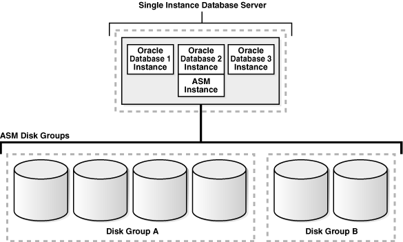
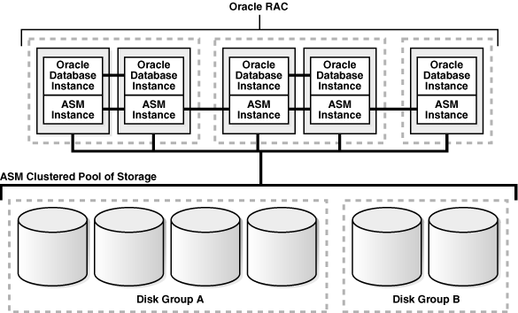
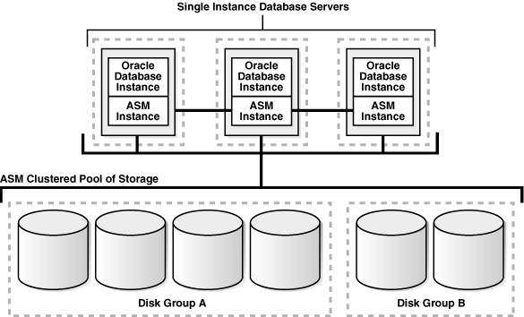
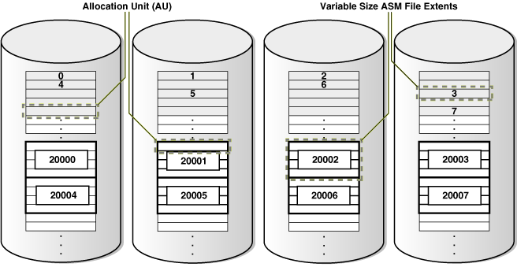
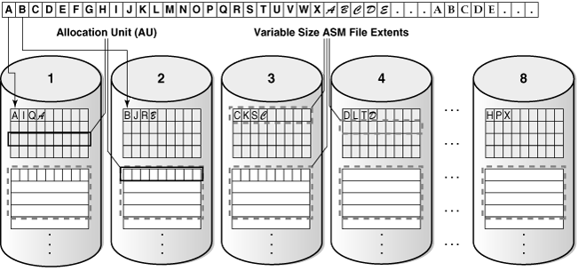
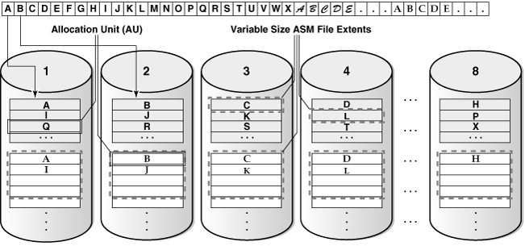

## Introducing Oracle Automatic Storage Management

Oracle Automatic Storage Management (Oracle ASM), Oracle ASM Cluster File System (Oracle ACFS), and Oracle ASM Dynamic Volume Manager (Oracle ADVM) are key components of storage management.

This chapter provides an overview of Oracle Automatic Storage Management (Oracle ASM), Oracle ASM Cluster File System (Oracle ACFS), and Oracle ASM Dynamic Volume Manager (Oracle ADVM) concepts and features.

## Overview of Oracle Automatic Storage Management

Oracle ASM is Oracle's recommended storage management solution that provides an alternative to conventional volume managers, file systems, and raw devices.

Oracle ASM is a volume manager and a file system for Oracle Database files that supports single-instance Oracle Database and Oracle Real Application Clusters (Oracle RAC) configurations.

Oracle ASM uses disk groups to store data files; an Oracle ASM disk group is a collection of disks that Oracle ASM manages as a unit. Within a disk group, Oracle ASM exposes a file system interface for Oracle Database files. The content of files that are stored in a disk group is evenly distributed to eliminate hot spots and to provide uniform performance across the disks. The performance is comparable to the performance of raw devices.

You can add or remove disks from a disk group while a database continues to access files from the disk group. When you add or remove disks from a disk group, Oracle ASM automatically redistributes the file contents and eliminates the need for downtime when redistributing the content.

The Oracle ASM volume manager functionality provides flexible server-based mirroring options. The Oracle ASM normal and high redundancy disk groups enable two-way and three-way mirroring respectively. You can use external redundancy to enable a Redundant Array of Independent Disks (RAID) storage subsystem to perform the mirroring protection function.

Oracle ASM also uses the Oracle Managed Files (OMF) feature to simplify database file management. OMF automatically creates files in designated locations. OMF also names files and removes them while relinquishing space when tablespaces or files are deleted. When using OMF to create new files, new names are created for the new files so overwriting files is avoided.

Note:

Using OMF for ASM files is best practice for the three reasons:

- An OMF name is guaranteed to be unique, so name collisions are avoided. Furthermore, the risk of overwriting an existing file is also eliminated.
- ASM automatically deletes OMF directories when they are empty, simplifying cleanup after deleting a database or PDB.
- An OMF name automatically conforms to all file name constraints, such as the length limit.

Oracle ASM reduces the administrative overhead for managing database storage by consolidating data storage into a small number of disk groups. The smaller number of disk groups consolidates the storage for multiple databases and provides for improved I/O performance.

Oracle ASM files can coexist with other storage management options such as raw disks and third-party file systems. This capability simplifies the integration of Oracle ASM into pre-existing environments.

Oracle ASM has easy to use management interfaces such as SQL\*Plus, the Oracle ASM Command Line Utility (ASMCMD) command-line interface, and Oracle ASM Configuration Assistant (ASMCA).

See also

- [Administering Oracle ASM Disk Groups](administering-oracle-asm-disk-groups.md) for information about administering disk groups
- [Managing Oracle ASM With ASMCA](managing-oracle-asm-with-asmca.md) for information about Oracle ASM Configuration Assistant
- [Managing Oracle ASM with ASMCMD](managing-oracle-asm-with-asmcmd.md) for information about the ASMCMD command-line interface
- [Oracle Database Administrator's Guide](https://docs.oracle.com/pls/topic/lookup?ctx=en/database/oracle/oracle-database/19/ostmg&id=ADMIN12595) for information about Oracle Database structure and storage

## About Oracle Automatic Storage Management Cluster File System

Oracle Automatic Storage Management Cluster File System (Oracle ACFS) and Oracle ASM Dynamic Volume Manager (Oracle ADVM) extend Oracle ASM functionality.

Oracle Automatic Storage Management Cluster File System (Oracle ACFS) is a multi-platform, scalable file system, and storage management technology that extends Oracle Automatic Storage Management (Oracle ASM) functionality to support all customer files. The Oracle ASM Dynamic Volume Manager (Oracle ADVM) provides volume management services and a standard disk device driver interface to clients.

See also

[Oracle Automatic Storage Management Cluster File System](part-iii-oracle-automatic-storage-management-cluster-file-system.md) for more information about Oracle ACFS and Oracle ADVM.

## Understanding Oracle ASM Concepts

The concepts for the key Oracle ASM components are introduced in this topic.

See also

[Exploring Considerations for Oracle ASM Storage](exploring-considerations-for-oracle-asm-storage.md) for information about preparing your storage environment.

### About Oracle ASM Instances

An Oracle ASM instance is built on the same technology as an Oracle Database instance.

An Oracle ASM instance has a System Global Area (SGA) and background processes that are similar to those of Oracle Database. However, because Oracle ASM performs fewer tasks than a database, an Oracle ASM SGA is much smaller than a database SGA. In addition, Oracle ASM has a minimal performance effect on a server. Oracle ASM instances mount disk groups to make Oracle ASM files available to database instances; Oracle ASM instances do not mount databases.

Oracle ASM is installed in the Oracle Grid Infrastructure home before Oracle Database is installed in a separate Oracle home. Oracle ASM and database instances require shared access to the disks in a disk group. Oracle ASM instances manage the metadata of the disk group and provide file layout information to the database instances.

Oracle ASM metadata is the information that Oracle ASM uses to control a disk group and the metadata resides within the disk group. Oracle ASM metadata includes the following information:

- The disks that belong to a disk group
- The amount of space that is available in a disk group
- The file names of the files in a disk group
- The location of disk group data file extent s
- A redo log that records information about atomically changing metadata blocks
- Oracle ADVM volume information

Oracle ASM instances can be clustered using Oracle Clusterware; there is one Oracle ASM instance for each cluster node. If there are several database instances for different databases on the same node, then the database instances share the same single Oracle ASM instance on that node.

If the Oracle ASM instance on a node in a Standard Oracle ASM cluster fails, then all of the database instances on that node also fail. However, in an Oracle Flex ASM configuration, Oracle 12c database instances would not fail as they would be able to access another Oracle ASM instance remotely on another node.

Unlike a file system driver failure, an Oracle ASM instance failure does not require restarting the operating system. In an Oracle RAC environment, the Oracle ASM and database instances on the surviving nodes automatically recover from an Oracle ASM instance failure on a node.

The figure “Oracle ASM for Single-Instance Oracle Databases” shows a single node configuration with one Oracle ASM instance and multiple database instances. The Oracle ASM instance manages the metadata and provides space allocation for the Oracle ASM files. When a database instance creates or opens an Oracle ASM file, it communicates those requests to the Oracle ASM instance. In response, the Oracle ASM instance provides file extent map information to the database instance.

In the figure “Oracle ASM for Single-Instance Oracle Databases”, there are two disk groups: one disk group has four disks and the other has two disks. The database can access both disk groups. The configuration in the figure “Oracle ASM for Single-Instance Oracle Databases” shows multiple database instances, but only one Oracle ASM instance is needed to serve the multiple database instances.

Figure: Oracle ASM for Single-Instance Oracle Databases

> The diagram shows a single-instance database server with three Oracle Database instances and one Oracle ASM instance. The ASM instance manages two disk groups: Disk Group A with four disks and Disk Group B with two disks. The database instances use the shared ASM storage.
>
> [Copyright ©](https://docs.oracle.com/pls/topic/lookup?ctx=en/legal&id=cpyr) Oracle and/or its affiliates.

The figure “Oracle ASM Cluster Configuration with Oracle RAC” shows an Oracle ASM cluster in an Oracle RAC environment where Oracle ASM provides a clustered pool of storage. There is one Oracle ASM instance for each node serving multiple Oracle RAC or single-instance databases in the cluster. All of the databases are consolidated and share the same two Oracle ASM disk groups.

Figure: Oracle ASM Cluster Configuration with Oracle RAC

> The diagram shows an Oracle RAC cluster with multiple nodes. Each node has an Oracle ASM instance serving database instances. The nodes connect to the same two ASM disk groups, illustrating shared clustered storage.
>
> [Copyright ©](https://docs.oracle.com/pls/topic/lookup?ctx=en/legal&id=cpyr) Oracle and/or its affiliates.

A clustered storage pool can be shared by multiple single-instance Oracle Databases as shown in the figure “Oracle ASM Cluster with Single-Instance Oracle Databases”. In this case, multiple databases share common disk groups. A shared Oracle ASM storage pool is achieved by using Oracle Clusterware. However, in such environments an Oracle RAC license is not required.

To share a disk group among multiple nodes, you must install Oracle Clusterware on all of the nodes, regardless of whether you install Oracle RAC on the nodes. Oracle ASM instances that are on separate nodes do not need to be part of an Oracle ASM cluster. However, if the Oracle ASM instances are not part of an Oracle ASM cluster, they cannot communicate with each other. Multiple nodes that are not part of an Oracle ASM cluster cannot share a disk group.

Figure: Oracle ASM Cluster with Single-Instance Oracle Databases

> The diagram shows multiple single-instance Oracle Database servers on clustered nodes. Each server has an Oracle ASM instance, and the nodes share two ASM disk groups through Oracle Clusterware.
>
> [Copyright ©](https://docs.oracle.com/pls/topic/lookup?ctx=en/legal&id=cpyr) Oracle and/or its affiliates.

See also

- [Administering Oracle ASM Instances](administering-oracle-asm-instances.md) for information about managing an Oracle ASM instance.
- [Managing Oracle Flex ASM](managing-oracle-flex-asm.md) for information about Oracle Flex ASM configurations.

### About Oracle ASM Disk Groups

A disk group consists of multiple disks and is the fundamental object that Oracle ASM manages.

Each disk group contains the metadata that is required for the management of space in the disk group. Disk group components include disks, files, and allocation units.

Files are allocated from disk groups. Any Oracle ASM file is completely contained within a single disk group. However, a disk group might contain files belonging to several databases and a single database can use files from multiple disk groups. For most installations you need only a small number of disk groups, usually two, and rarely more than three.

See also

[Administering Oracle ASM Disk Groups](administering-oracle-asm-disk-groups.md) for more information about managing disk groups

### About Mirroring and Failure Groups

Mirroring protects data integrity by storing copies of data on multiple disks.

When you create a disk group, you specify an Oracle ASM disk group type based on one of the following three redundancy levels:

- **Normal** for 2-way mirroring
- **High** for 3-way mirroring
- **External** to not use Oracle ASM mirroring, such as when you configure hardware RAID for redundancy

The redundancy level controls how many disk failures are tolerated without dismounting the disk group or losing data. The disk group type determines the mirroring levels with which Oracle creates files in a disk group.

Oracle ASM mirroring is more flexible than traditional RAID mirroring. For a disk group specified as `NORMAL` redundancy, you can specify the redundancy level for each file. For example, two files can share the same disk group with one file being mirrored while the other is not.

When Oracle ASM allocates an extent for a mirrored file, Oracle ASM allocates a primary copy and a mirror copy. Oracle ASM chooses the disk on which to store the mirror copy in a different failure group than the primary copy. Failure groups are used to place mirrored copies of data so that each copy is on a disk in a different failure group. The simultaneous failure of all disks in a failure group does not result in data loss.

You define the failure groups for a disk group when you create an Oracle ASM disk group. After a disk group is created, you cannot alter the redundancy level of the disk group. If you omit the failure group specification, then Oracle ASM automatically places each disk into its own failure group, except for disk groups containing disks on Oracle Exadata cells. Normal redundancy disk groups require at least two failure groups. High redundancy disk groups require at least three failure groups. Disk groups with external redundancy do not use failure groups.

See also

- [Managing Disk Group Templates](administering-oracle-asm-files-directories-and-templates.md) for information about disk group types and templates
- [Mirroring, Redundancy, and Failure Group Options](administering-oracle-asm-disk-groups.md) for more information about mirroring and failure groups

### About Oracle ASM Disks

Oracle ASM disks are the storage devices that are provisioned to Oracle ASM disk groups.

Examples of Oracle ASM disks include:

- A disk or partition from a storage array
- An entire disk or the partitions of a disk
- Logical volumes
- Network-attached files (NFS)

When you add a disk to a disk group, you can assign an Oracle ASM disk name or Oracle ASM assigns the Oracle ASM disk name automatically. This name is different from the path name used by the operating system. In a cluster, a disk may be assigned different operating system device names on different nodes, but the disk has the same Oracle ASM disk name on all of the nodes. In a cluster, an Oracle ASM disk must be accessible from all of the instances that share the disk group.

Oracle ASM spreads the files proportionally across all of the disks in the disk group. This allocation pattern maintains every disk at the same capacity level and ensures that all of the disks in a disk group have the same I/O load. Because Oracle ASM load balances among all of the disks in a disk group, different Oracle ASM disks should not share the same physical drive.

### About Oracle ASM Allocation Units

Every Oracle ASM disk is divided into allocation units (AU).

An allocation unit is the fundamental unit of allocation within a disk group. A file extent consists of one or more allocation units. An Oracle ASM file consists of one or more file extents.

When you create a disk group, you can set the Oracle ASM allocation unit size with the `AU_SIZE` disk group attribute. The values can be 1, 2, 4, 8, 16, 32, or 64 MB, depending on the specific disk group compatibility level. Larger AU sizes typically provide performance advantages for data warehouse applications that use large sequential reads.

See also

**Example: for an example that shows how the** `AU_SIZE` **is specified with the** `CREATE` `DISKGROUP` **SQL statement**

- [Features Enabled By Disk Group Compatibility Attribute Settings](administering-oracle-asm-disk-groups.md) for information about allocation unit sizes and disk group compatibility attributes
- Articles at [My Oracle Support](https://support.oracle.com/) ([https://support.oracle.com](https://support.oracle.com/)) for additional information about allocation units and Oracle ASM

### About Oracle ASM Files

Files that are stored in Oracle ASM disk groups are called Oracle ASM files.

Each Oracle ASM file is contained within a single Oracle ASM disk group. Oracle Database communicates with Oracle ASM in terms of files. This is similar to the way Oracle Database uses files on any file system. You can store the various file types in Oracle ASM disk groups, including:

- Control files
- Data files, temporary data files, and data file copies
- SPFILEs
- Online redo logs, archive logs, and Flashback logs
- RMAN backups
- Disaster recovery configurations
- Change tracking bitmaps
- Data Pump dumpsets

Oracle ASM automatically generates Oracle ASM file names as part of file creation and tablespace creation. Oracle ASM file names begin with a plus sign (`+`) followed by a disk group name. You can specify user-friendly aliases for Oracle ASM files and create a hierarchical directory structure for the aliases.

#### Understanding Oracle ASM Extents

The contents of Oracle ASM files are stored in a disk group as a set, or collection, of extents that are stored on individual disks within disk groups.

Each extent resides on an individual disk. Extents consist of one or more allocation units (AU). To accommodate increasingly larger files, Oracle ASM uses variable size extents.

Variable size extents enable support for larger Oracle ASM data files, reduce SGA memory requirements for very large databases, and improve performance for file create and open operations. The initial extent size equals the disk group allocation unit size and it increases by a factor of 4 or 16 at predefined thresholds. The various extent sizes are described in this topic.

For disk groups with AU size less than 4 MB:

- Extent size always equals the disk group AU size for the first 20000 extent sets (0 - 19999).
- Extent size equals 4\*AU size for the next 20000 extent sets (20000 - 39999).
- Extent size equals 16\*AU size for the next 20000 and higher extent sets (40000+).

For disk groups with AU size greater than or equal to 4 MB and the disk group RDBMS compatibility greater than or equal to `11.2.0.4`, the counts for extents of sizes (the disk group AU size, 4\_AU size, or 16\_AU size) are calculated using the application block size to support maximum file size.

The extent sizing feature is automatic for newly created and resized data files when specific disk group compatibility attributes are set to `11.1` or higher. For information about compatibility attributes, see [Disk Group Compatibility](administering-oracle-asm-disk-groups.md).

The figure “Oracle ASM File Allocation in a Disk Group” shows the Oracle ASM file extent relationship with allocation units. The first eight extents (0 to 7) are distributed on four Oracle ASM disks and are equal to the AU size. After the first 20000 extent sets, the extent size becomes 4\_AU for the next 20000 extent sets (20000 - 39999). This is shown as bold rectangles labeled with the extent set numbers 20000 to 20007, and so on. The next increment for an Oracle ASM extent is 16\_AU (not shown in the figure “Oracle ASM File Allocation in a Disk Group”).

Figure: Oracle ASM File Allocation in a Disk Group

> The diagram shows four Oracle ASM disks with extents 0 through 7 distributed across them, each extent using one allocation unit. Subsequent extents are grouped in sets of four allocation units; the later sixteen-allocation-unit set is described in the text but not drawn.
>
> [Copyright ©](https://docs.oracle.com/pls/topic/lookup?ctx=en/legal&id=cpyr) Oracle and/or its affiliates.

#### Understanding Oracle ASM Striping

Oracle ASM striping has two primary purposes: balance loads across all of the disks in a disk group and reduce I/O latency.

Coarse-grained striping provides load balancing for disk groups while fine-grained striping reduces latency for certain file types by spreading the load more widely.

To stripe data, Oracle ASM separates files into stripes and spreads data evenly across all of the disks in a disk group. The fine-grained stripe size always equals 128 KB in any configuration; this provides lower I/O latency for small I/O operations. The coarse-grained stripe size is always equal to the AU size (not the data extent size).

The figure “Oracle ASM Fine-Grained Striping” and the figure “Oracle ASM Coarse-Grained Striping” are illustrations of Oracle ASM file striping. In both illustrations, the allocation unit size has been set to 1 M (`AU_SIZE` = `1M`) for the disk group which consists of 8 disks. The instance is Oracle ASM 11g Release 2 (11.2) and the disk group compatibility attributes for ASM and RDBMS have been set to `11.2`, so variable extents are shown in the graphic after the first 20,000 extents. For the first 20,000 extents, the extent size is 1 M and equals one allocation unit (AU). For the next 20,000 extents, the extent size is 4 M and equals 4 AUs.

To identify the stripe chunks of the file, they have been labeled A..X (24 letters) using different fonts for successive series of A..X until all the chunks have been identified.

In the figure “Oracle ASM Fine-Grained Striping”, the file is striped in 128 K chunks (labeled A..X) with each 128 K chunk stored in an extent, starting at the first extent in disk 1, then the first extent in disk 2, and then continuing in a round-robin pattern through all the disks until the entire file has been striped. As shown in this example, the striping chunks first fill up the first extent of each disk, then the second extent of each disk, and so on until the entire file has been striped.

Figure: Oracle ASM Fine-Grained Striping

> The diagram shows a file divided into 128 KB fine-grained stripes labeled in sequence. The stripe chunks are distributed round-robin across eight disks, filling the first extent on each disk before moving to the next extents.
>
> [Copyright ©](https://docs.oracle.com/pls/topic/lookup?ctx=en/legal&id=cpyr) Oracle and/or its affiliates.

In the figure “Oracle ASM Coarse-Grained Striping”, the file is striped in 1 M chunks (labeled A..X) with each 1 M chunk stored uniquely in an extent, starting at the first extent in disk 1, then the first extent in disk 2, and then continuing in a round-robin pattern through all the disks until the entire file has been striped. For the first 20,000 extents where the AU equals the extent size (1 M), the stripe equals the extent size and allocation unit size.For the variable extents, where an extent is composed of multiple allocation units, the file stripe is located in an AU of the extent. The striping chunks are placed in the allocation units of the first extents of all the disks before the striping continues to the next extent.

Figure: Oracle ASM Coarse-Grained Striping

> The diagram shows a file divided into 1 MB coarse-grained stripes and distributed round-robin across eight disks. It illustrates how each stripe occupies an allocation unit and how stripes advance through the disks before continuing to subsequent extents.
>
> [Copyright ©](https://docs.oracle.com/pls/topic/lookup?ctx=en/legal&id=cpyr) Oracle and/or its affiliates.

#### About Oracle ASM File Templates

Templates are collections of attribute values that are used to specify disk regions, file mirroring, and striping attributes for an Oracle ASM file when it is created.

When creating a file, you can include a template name and assign desired attributes based on an individual file rather than the file type.

A default template is provided for every Oracle file type, but you can customize templates to meet unique requirements. Each disk group has a default template associated with each file type.

See also

[Managing Disk Group Templates](administering-oracle-asm-files-directories-and-templates.md) for more information about Oracle ASM templates

## Understanding Oracle ASM Disk Group Administration

Oracle ASM disk group administration is introduced in this topic.

### About Discovering Disks

The disk discovery process locates the operating system names for disks that Oracle ASM can access.

Disk discovery finds all of the disks that comprise a disk group to be mounted. The set of discovered disks also includes disks that could be added to a disk group.

An Oracle ASM instance requires an `ASM_DISKSTRING` initialization parameter value to specify its discovery strings. Only path names that the Oracle ASM instance has permission to open are discovered. The exact syntax of a discovery string depends various factors, such as the platform and whether Oracle Exadata disks are used. The path names that an operating system accepts are always usable as discovery strings.

See also

- [ASM\_DISKSTRING](administering-oracle-asm-instances.md) for information about the `ASM_DISKSTRING` initialization parameter
- [Oracle ASM Disk Discovery](administering-oracle-asm-disk-groups.md) for information about disk discovery
- [Administering Oracle ASM Filter Driver](administering-oracle-asm-filter-driver.md) for information about Oracle ASM Filter Driver

### About Mounting and Dismounting Disk Groups

A disk group must be mounted by a local Oracle ASM instance before database instances can access the files in the disk group.

Mounting the disk group requires discovering all of the disks and locating the files in the disk group that is being mounted.

You can explicitly dismount a disk group. Oracle reports an error if you attempt to dismount a disk group without the force option when any of the disk group files are open. It is possible to have disks fail in excess of the Oracle ASM redundancy setting. If this happens, then the disk group is forcibly dismounted. If the disk group is forcibly dismounted, a database cannot access files in the disk group.

See also

[Mounting and Dismounting Disk Groups](administering-oracle-asm-disk-groups.md) for more information about disk groups

### About Adding and Dropping Disks

You can add a disk to an existing disk group to add space and to improve throughput.

The specified discovery string identifies the disk or disks that you could add. The disks that you add must be discovered by every Oracle ASM instance using its `ASM_DISKSTRING` initialization parameter. After you add a disk, Oracle ASM rebalancing operations move data onto the new disk. To minimize the rebalancing I/O, it is more efficient to add multiple disks at the same time.

You can drop a disk from a disk group if it fails or to re-purpose capacity. Use the Oracle ASM disk name to drop a disk, not the discovery string device name. If an error occurs while writing to a disk, then Oracle ASM drops the disk automatically.

See also

[Altering Disk Groups](administering-oracle-asm-disk-groups.md) for more information about altering disk group membership

### About Online Storage Reconfigurations and Dynamic Rebalancing

Rebalancing a disk group moves data between disks to ensure that every file is evenly spread across all of the disks in a disk group.

When all of the files are evenly dispersed, all of the disks are evenly filled to the same percentage; this ensures load balancing. Rebalancing does not relocate data based on I/O statistics nor is rebalancing started based on I/O statistics. Oracle ASM rebalancing operations are controlled by the size of the disks in a disk group.

Oracle ASM automatically initiates a rebalance after storage configuration changes, such as when you add, drop, or resize disks. The power setting parameter determines the speed with which rebalancing operations occur.

You can manually start a rebalance to change the power setting of a running rebalance. A rebalance is automatically restarted if the instance on which the rebalancing is running stops. Databases can remain operational during rebalancing operations.

You can minimize the impact on database performance with the setting of the `ASM_POWER_LIMIT` initialization parameter.

See also

- [ASM\_POWER\_LIMIT](administering-oracle-asm-instances.md) for more information about the power limit setting
- [Manually Rebalancing Disk Groups](administering-oracle-asm-disk-groups.md) for more information about disk rebalancing