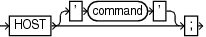

## 2.25 HOST

Purpose

Use the `HOST` command to invoke an operating system command-line sub-shell from within RMAN.

Syntax

host::=



> HOST \[' command '\]
>
> [  
> Copyright © 2025, 2026, Oracle and/or its affiliates.](https://docs.oracle.com/en/database/oracle/oracle-database/dcommon/html/cpyr.htm)


Prerequisites

Execute this command at the RMAN prompt or within the braces of a `RUN` command.

Semantics

| Syntax Element | Description |
| --- | --- |
| `HOST` | Displays a command prompt and resumes after you exit the subshell (see Example 2-105). |
| `'` `command` `'` | Runs the command in the specified string and then continues (see Example 2-106). |

Examples

Example 2-105 Hosting to the Operating System Within a Backup

This example makes an image copy of data file `3`, hosts out to the Linux prompt to check that the copy is in the directory (the Linux session output is indented and displayed in bold), and then resumes the RMAN session:

```
RMAN> BACKUP DATAFILE 3 FORMAT '/disk2/df3.cpy';

Starting backup at 15-FEB-13
using channel ORA_DISK_1
channel ORA_DISK_1: starting full datafile backup set
channel ORA_DISK_1: specifying datafile(s) in backup set
input datafile file number=00003 name=/disk1/oracle/oradata/prod/undotbs01.d bf
channel ORA_DISK_1: starting piece 1 at 15-FEB-13
channel ORA_DISK_1: finished piece 1 at 15-FEB-13
piece handle=/disk2/df3.cpy tag=TAG20130215T111326 comment=NONE
channel ORA_DISK_1: backup set complete, elapsed time: 00:00:01
Finished backup at 15-FEB-13

RMAN> HOST;

% ls /disk2/df3.copy
/disk2/df3.cpy
% exit
exit
host command complete

RMAN>
```

Example 2-106 Executing an Operating System Copy Within RMAN

This example makes a backup of data file `system01.dbf` and then executes the Linux `ls` command to display all files in the `/disk2` directory:

```
BACKUP DATAFILE '?/oradata/prod/system01.dbf'
  FORMAT '/disk2/system01.dbf';
HOST 'ls -lt /disk2/*';
```