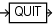

## 2.29 QUIT

Purpose

Use the `QUIT` command to shut down the Recovery Manager utility. This command is functionally equivalent to the `EXIT` command.

Prerequisites

Execute only at the RMAN prompt.

Syntax

quit::=



> QUIT
>
> [  
> Copyright © 2025, 2026, Oracle and/or its affiliates.](https://docs.oracle.com/en/database/oracle/oracle-database/dcommon/html/cpyr.htm)


Example

Example 2-117 Quitting RMAN

This example terminates RMAN (sample output included):

```
RMAN> QUIT
 
 
Recovery Manager complete.
```