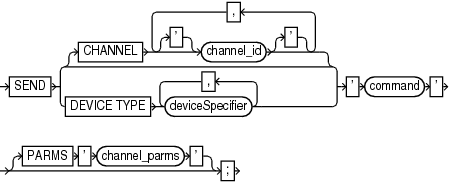

## 3.13 SEND

Purpose

Use the `SEND` command to send a vendor-specific string to one or more channels supported by a media manager. Refer to your media management documentation to determine which commands are supported.

Usage Notes

Unless you specify `DEVICE TYPE` or `CHANNEL`, RMAN uses all allocated channels.

On Windows platforms, use `SEND` to pass command strings to the SBT library, instead of the `ENV` parameter.

Syntax

send::=



> SEND {\[CHANNEL \['\] channel\_id \['\] \[, \['\] channel\_id \['\]\]...\] | DEVICE TYPE deviceSpecifier \[, deviceSpecifier\]...} ' command ' \[PARMS ' channel\_parms '\]
>
> [  
> Copyright © 2025, 2026, Oracle and/or its affiliates.](https://docs.oracle.com/en/database/oracle/oracle-database/dcommon/html/cpyr.htm)


([deviceSpecifier::=](deviceSpecifier.md))

Semantics

| Syntax Element | Description |
| --- | --- |
| `CHANNEL` `channel_id` | Specifies which channel to use. You must specify a case-sensitive channel ID, which is the name of the channel, after the `CHANNEL` keyword. The database uses the channel ID to report I/O errors. |
| `DEVICE TYPE` `deviceSpecifier` | Specifies the type of storage device and sends the command to all channels of the specified type.  See Also: `deviceSpecifier` |
| `'` `command` `'` | Specifies a vendor-specific media management command.  See Also: Your media management documentation to determine which commands are supported. You must only send commands supported by the media manager. The contents of the string are not interpreted by the database, but are passed unaltered to the media management subsystem. |
| `   PARMS` `'` `channel_parms` `'` | Specifies parameters for the channel communicating with the media manager. |

Example

Example 3-56 Specifying a Tape Drive in Oracle Secure Backup

This example uses the `SEND` command to specify a tape drive for a backup of the `users` tablespace to Oracle Secure Backup. No equal sign is inserted between the parameter `OB_DEVICE` and the names of the tape drive.

```
RUN
{
  ALLOCATE CHANNEL c1 DEVICE TYPE sbt;
  SEND 'OB_DEVICE stape1';
  BACKUP TABLESPACE users;
}
```

Note:

Oracle Secure Backup (OSB) 19.1 desupport was announced on May 1, 2026 with premier support end date on September 30, 2027. See My Oracle Support note [PNEWS3035](https://support.oracle.com/support/?documentId=PNEWS3035) for more information. Please refer to [Lifetime Support Policy: Oracle Technology Products](https://www.oracle.com/support/lifetime-support/) for updated support timeframes.

Oracle recommends that database backups to cloud take advantage of Oracle Database Zero Data Loss Cloud Protect, which uses Oracle Zero Data Loss Autonomous Recovery Service in OCI. Cloud Protect offers an efficient incremental forever backup strategy, real-time transaction protection, logically air-gapped immutable backups, and fast, point-in-time recovery.

For customers who require database backups to Amazon S3, Oracle Database Cloud Backup for Amazon S3 may be used. This offering is similar to Oracle Secure Backup Cloud Module in that it is fully integrated with Recovery Manager (RMAN) and enables you to back up your Oracle database to Amazon S3. You can exchange your Oracle Secure Backup license for an Oracle Database Cloud Backup for Amazon S3 license on a 1:1 basis. See [Oracle Database Cloud Backup for Amazon S3](https://docs.oracle.com/pls/topic/lookup?ctx=en/database/oracle/oracle-database/19/rcmrf&id=BRADV-GUID-F187E3A0-EA0E-49DA-B075-4FE7C5846A32) for more information.