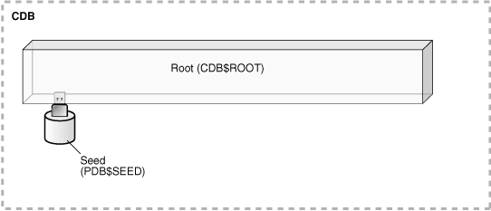
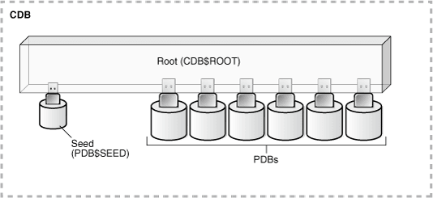
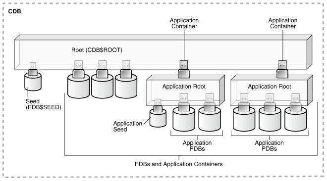

## 4 Creating and Configuring a CDB

Creating and configuring a multitenant container database (CDB) includes tasks such as planning, creating the CDB, and optionally configuring EM Express.

- About Creating a CDB  
	The procedure for creating a multitenant container database (CDB) is similar to the procedure for creating a non-CDB.
- Planning for CDB Creation  
	CDB creation prepares several operating system files to work together as a CDB.
- Creating a CDB  
	You can create a CDB using DBCA or by manually issuing the `CREATE DATABASE` SQL statement.
- Configuring EM Express for a CDB  
	For a CDB, you can configure Oracle Enterprise Manager Database Express (EM Express) for the root and for each PDB by setting a global HTTPS port, or you can set a different port for every container in the CDB.
- After Creating a CDB  
	After creation, a CDB consists of the root and the PDB seed.

**Parent topic:** [Creating and Configuring a Multitenant Environment](creating-and-configuring-a-multitenant-environment.md)

### About Creating a CDB

The procedure for creating a multitenant container database (CDB) is similar to the procedure for creating a non-CDB.

The procedure for creating a non-CDB is described in [Oracle Database Administrator’s Guide](https://docs.oracle.com/pls/topic/lookup?ctx=en/database/oracle/oracle-database/19/multi&id=ADMIN-GUID-807DE711-C82C-4BB2-8C31-5EE89CA71349). Before creating a CDB, you must understand the concepts and tasks described in this documentation.

This chapter describes special considerations for creating a CDB. This chapter also describes differences between the procedure for creating a non-CDB in [Oracle Database Administrator’s Guide](https://docs.oracle.com/pls/topic/lookup?ctx=en/database/oracle/oracle-database/19/multi&id=ADMIN-GUID-807DE711-C82C-4BB2-8C31-5EE89CA71349) and the procedure for creating a CDB.

After you plan your CDB using some of the guidelines presented in " Planning for CDB Creation ", you can create the CDB either during or after Oracle Database software installation. The following are typical reasons to create a CDB after installation:

- You used Oracle Universal Installer (OUI) to install software only, and did not create a CDB.
- You want to create another CDB on the same host as an existing CDB or an existing non-CDB. In this case, this chapter assumes that the new CDB uses the same Oracle home as the existing database. You can also create the CDB in a new Oracle home by running OUI again.

The specific methods for creating a CDB are:

- With the Database Configuration Assistant (DBCA), a graphical tool.
	See " About CDB Creation with DBCA ".
- With the `CREATE DATABASE` SQL statement.
	See " Creating a CDB ".

**Parent topic:** Creating and Configuring a CDB

### Planning for CDB Creation

CDB creation prepares several operating system files to work together as a CDB.

Note:

Before planning for CDBs, review the conceptual information about CDBs and PDBs in " [Introduction to the Multitenant Architecture](introduction-to-the-multitenant-architecture.md) ".

- Decide How to Configure the CDB  
	Prepare to create the CDB by research and careful planning.
- Prerequisites for CDB Creation  
	You must complete prerequisites before creating a new CDB.

**Parent topic:** Creating and Configuring a CDB

#### Decide How to Configure the CDB

Prepare to create the CDB by research and careful planning.

As a first step, consult the [Oracle Database Release Notes](https://docs.oracle.com/pls/topic/lookup?ctx=en/database/oracle/oracle-database/19/multi&id=RNRDM), which includes a list of Oracle Database features that are currently not supported in a CDB. If you must use one or more of these features, then create a non-CDB.

The following sections describe recommended actions and considerations that apply to CDBs:

- Plan the PDBs  
	Plan the tables and indexes for the pluggable databases (PDBs) and estimate the amount of space they require.
- Plan the Physical Layout  
	Plan the layout of the underlying operating system files your CDB will comprise.
- Learn How to Manage Initialization Parameters  
	Familiarize yourself with the initialization parameters that can be included in an initialization parameter file.
- Select the Character Set  
	You must choose a character set for the CDB.
- Decide Which Time Zones to Support  
	Consider which time zones your CDB must support.
- Select the Database and Redo Log Block Sizes  
	Select the standard database block size for the CDB.
- Plan the SYSTEM and SYSAUX Tablespaces  
	There is a separate `SYSAUX` and `SYSTEM` tablespace for the CDB root and for each PDB.
- Plan the Temporary Tablespaces  
	Plan to use default temporary tablespaces.
- Choose the Undo Mode  
	Plan to use an undo tablespace to manage your undo data.
- Plan the Services for Your Application  
	Plan for the database services required to meet the needs of your applications.
- Learn How to Start Up and Shut Down a CDB  
	Familiarize yourself with the principles and options of starting up and shutting down a database instance and mounting and opening a CDB.
- Plan for Oracle RAC  
	If you plan to use Oracle RAC, then plan for an Oracle RAC environment.

**Parent topic:** Planning for CDB Creation

##### Plan the PDBs

Plan the tables and indexes for the pluggable databases (PDBs) and estimate the amount of space they require.

In a CDB, most user data resides in the PDBs. The root contains no user data or minimal user data. Plan for the PDBs that will be part of the CDB. The disk storage space requirement for a CDB is the space required for the Oracle Database installation plus the sum of the space requirements for all PDBs that will be part of the CDB.

The `MAX_PDBS` initialization parameter specifies a limit on the total number of PDBs that you can create in a CDB root or application root. The default value and maximum value for `MAX_PDBS` depend on your Oracle Database offering. See [Oracle Database Licensing Information User Manual](https://docs.oracle.com/pls/topic/lookup?ctx=en/database/oracle/oracle-database/19/multi&id=DBLIC-GUID-0F9EB85D-4610-4EDF-89C2-4916A0E7AC87) for details on which features are supported for different editions and services.

You can also create application containers in a CDB. An application container is a collection of application PDBs that store the data for one or more applications. In addition, application containers support user-created application common objects that can be shared by the application PDBs in the application container.

See Also:

- " [Creating and Removing PDBs and Application Containers](creating-pdbs.md) "
- " [Overview of Applications in an Application Container](overview-of-the-multitenant-architecture.md) "
- Oracle Database Administrator’s Guide to learn more about [database structure and storage](https://docs.oracle.com/pls/topic/lookup?ctx=en/database/oracle/oracle-database/19/multi&id=ADMIN-GUID-F11D30A7-BF12-4D8F-A1C2-D7437D38F8C7) and [schema objects](https://docs.oracle.com/pls/topic/lookup?ctx=en/database/oracle/oracle-database/19/multi&id=ADMIN-GUID-2DA8C61C-58B0-4892-8E5D-E7A9120BC120)
- [Oracle Database Reference](https://docs.oracle.com/pls/topic/lookup?ctx=en/database/oracle/oracle-database/19/multi&id=GUID-55526BAC-DCB2-4C76-9ACF-1E3D2047E267) to learn more about `MAX_PDBS`

**Parent topic:** Decide How to Configure the CDB

##### Plan the Physical Layout

Plan the layout of the underlying operating system files your CDB will comprise.

There are separate data files for the CDB root, `PDB$SEED`, each PDB, each application root, and each application PDB.

There is one redo log for a single-instance CDB, or one redo log for each instance of an Oracle Real Application Clusters (Oracle RAC) CDB. Also, for Oracle RAC, all data files and redo log files must be on shared storage.

See Also:

- [Oracle Database Administrator’s Guide](https://docs.oracle.com/pls/topic/lookup?ctx=en/database/oracle/oracle-database/19/multi&id=ADMIN-GUID-4A3C4616-0D81-4BBA-8EAD-FCAA8AD5C15A) for information about using Oracle Managed Files
- [Oracle Automatic Storage Management Administrator's Guide](https://docs.oracle.com/pls/topic/lookup?ctx=en/database/oracle/oracle-database/19/multi&id=GUID-BC612D35-5399-4A35-843E-CF76E3D3CDB5)
- [Oracle Database Performance Tuning Guide](https://docs.oracle.com/pls/topic/lookup?ctx=en/database/oracle/oracle-database/19/multi&id=GUID-B89C41F4-B12A-49E1-BFB9-5BF978E2D6B3)
- [Oracle Database Backup and Recovery User’s Guide](https://docs.oracle.com/pls/topic/lookup?ctx=en/database/oracle/oracle-database/19/multi&id=GUID-9997EF87-B293-44D4-92F3-DD938E79170D)
- [Oracle Grid Infrastructure Installation and Upgrade Guide](https://docs.oracle.com/pls/topic/lookup?ctx=en/database/oracle/oracle-database/19/multi&id=CWGEN) for information about configuring storage for Oracle RAC
- Your Oracle operating system–specific documentation, including the appropriate Oracle Database installation guide.

**Parent topic:** Decide How to Configure the CDB

##### Learn How to Manage Initialization Parameters

Familiarize yourself with the initialization parameters that can be included in an initialization parameter file.

Before creating a CDB, ensure that you are familiar with the concept and operation of a server parameter file (SPFILE). An SPFILE file lets you store and manage your initialization parameters persistently in a server-side binary file.

A CDB uses a single SPFILE or a single text initialization parameter file (PFILE). Values of initialization parameters set for the root can be inherited by PDBs. You can set some initialization parameters for a PDB by using the `ALTER` `SYSTEM` statement.

The CDB root must be the current container when you operate on an SPFILE. The user who creates or modifies the SPFILE must be a common user with `SYSDBA`, `SYSOPER`, or `SYSBACKUP` administrative privilege, and the user must exercise the privilege by connecting `AS SYSDBA`, `AS SYSOPER`, or `AS SYSBACKUP` respectively.

The following initialization parameters are important:

- To create a CDB, the `ENABLE_PLUGGABLE_DATABASE` initialization parameter must be set to `TRUE`.
- Create the global database name for the CDB root by setting both the `DB_NAME` and `DB_DOMAIN` initialization parameters. The global database name of the root is the global database name of the CDB. The global database name of a PDB is defined by the PDB name and the `DB_DOMAIN` initialization parameter.

See Also:

- " [About the Current Container](administering-a-cdb-with-sql-plus.md) "
- " [Modifying a CDB with ALTER SYSTEM](administering-a-cdb-with-sql-plus.md) "
- " [Listing the Modifiable Initialization Parameters in PDBs](viewing-information-about-cdbs-and-pdbs-with-sql-plus.md) "
- [Oracle Database Administrator’s Guide](https://docs.oracle.com/pls/topic/lookup?ctx=en/database/oracle/oracle-database/19/multi&id=ADMIN-GUID-2DA8C61C-58B0-4892-8E5D-E7A9120BC120) for information about schema objects
- [Oracle Database Administrator’s Guide](https://docs.oracle.com/pls/topic/lookup?ctx=en/database/oracle/oracle-database/19/multi&id=ADMIN-GUID-9698EA9B-013C-40AC-8CFB-12171A4B4974) for information about determining the global database name
- [Oracle Database Reference](https://docs.oracle.com/pls/topic/lookup?ctx=en/database/oracle/oracle-database/19/multi&id=GUID-FD266F6F-D047-4EBB-8D96-B51B1DCA2D61)

**Parent topic:** Decide How to Configure the CDB

##### Select the Character Set

You must choose a character set for the CDB.

When selecting the database character set for the CDB, you must consider the current character sets of the databases that you want to consolidate (plug) into this CDB. Oracle recommends AL32UTF8 for the CDB database character set and AL16UTF6 for the CDB national character set because they provide the most flexibility.

When the character set of the CDB root is AL32UTF8, PDBs that are plugged into the CDB can have a different character set from the CDB root. PDBs that are created from `PDB$SEED` inherit the AL32UTF8 character set from it, but you can migrate the PDB to a different character set. When the character set of the root is not AL32UTF8, all PDBs in the CDB use the character set of the CDB root.

Note:

Oracle Multitenant does not support a LOB in one container from being accessed by a container with a different character set using data links, extended data links, or the `CONTAINERS()` clause. For example, if the CDB root and `salespdb` have different character sets, then a `CONTAINERS()` query run in the CDB root should not access LOBs stored in `salespdb`.

When moving a non-CDB to a CDB, it is best to migrate the non-CDB to AL32UTF8 first. You can use Oracle Database Migration Assistant for Unicode (DMU) to migrate a non-CDB to AL32UTF8. After a CDB is created, you cannot migrate the character set of the CDB using DMU.

See Also:

[Oracle Database Globalization Support Guide](https://docs.oracle.com/pls/topic/lookup?ctx=en/database/oracle/oracle-database/19/multi&id=GUID-09777A99-B7DD-4695-9B2B-278122131000)

**Parent topic:** Decide How to Configure the CDB

##### Decide Which Time Zones to Support

Consider which time zones your CDB must support.

You can set the time zones for the entire CDB (including all PDBs). You can also set the time zones individually for each PDB.

See Also:

[Oracle Database Administrator’s Guide](https://docs.oracle.com/pls/topic/lookup?ctx=en/database/oracle/oracle-database/19/multi&id=ADMIN-GUID-E331FC80-451A-4775-B58E-BBFEEBAC3C93) for information about specifying the database time zone and time zone file

**Parent topic:** Decide How to Configure the CDB

##### Select the Database and Redo Log Block Sizes

Select the standard database block size for the CDB.

This is specified at CDB creation by the `DB_BLOCK_SIZE` initialization parameter and cannot be changed after the CDB is created. The standard block size applies to the entire CDB.

If you plan to store online redo log files on disks with a 4K byte sector size, then determine whether you must manually specify the online redo log block size.

- [Oracle Database Administrator’s Guide](https://docs.oracle.com/pls/topic/lookup?ctx=en/database/oracle/oracle-database/19/multi&id=ADMIN-GUID-55124C2D-98FF-4305-8F25-58245C9BEC1E) for information about specifying database block sizes
- [Oracle Database Administrator’s Guide](https://docs.oracle.com/pls/topic/lookup?ctx=en/database/oracle/oracle-database/19/multi&id=ADMIN-GUID-AC858C69-317E-4193-838D-59F8DDEA1927) for information about planning the block size of redo log files

**Parent topic:** Decide How to Configure the CDB

##### Plan the SYSTEM and SYSAUX Tablespaces

There is a separate `SYSAUX` and `SYSTEM` tablespace for the CDB root and for each PDB.

You must determine the appropriate initial sizing for the `SYSAUX` tablespace. Also, plan to use a default tablespace for non- `SYSTEM` users to prevent inadvertently saving database objects in the `SYSTEM` tablespace. You can specify a separate default tablespace for the CDB root and for each PDB.

See Also:

- [Oracle Database Administrator’s Guide](https://docs.oracle.com/pls/topic/lookup?ctx=en/database/oracle/oracle-database/19/multi&id=ADMIN-GUID-C70E0886-7D9A-4B0D-BA0B-DF71AB5A2154) for information about the `SYSAUX` tablespace
- [Oracle Database Administrator’s Guide](https://docs.oracle.com/pls/topic/lookup?ctx=en/database/oracle/oracle-database/19/multi&id=ADMIN-GUID-4EBA1922-B701-4009-B662-6A17B314E2E9) for information about creating a default permanent tablespace
- " [About Container Modification When Connected to CDB Root](administering-a-cdb-with-sql-plus.md) "

**Parent topic:** Decide How to Configure the CDB

##### Plan the Temporary Tablespaces

Plan to use default temporary tablespaces.

A default temporary tablespace exists for every container in the CDB. Therefore, the CDB root and every PDB, application root, and application PDB has its own default temporary tablespace.

Oracle Database uses the shared temporary tablespace for recursive SQL only. Hosted PDB tenants do not use this tablespace directly.

See Also:

- " [About Container Modification When Connected to CDB Root](administering-a-cdb-with-sql-plus.md) "
- [Oracle Database Administrator’s Guide](https://docs.oracle.com/pls/topic/lookup?ctx=en/database/oracle/oracle-database/19/multi&id=ADMIN-GUID-AF2D7962-B165-423B-8FE3-29E7F30A2A3D) for information about creating a default temporary tablespace

**Parent topic:** Decide How to Configure the CDB

##### Choose the Undo Mode

Plan to use an undo tablespace to manage your undo data.

A CDB can run in different undo modes. You can configure a CDB to have one active undo tablespace for the entire CDB or a separate undo tablespace for each container in the CDB. You can specify the undo mode during CDB creation, and you can change the undo mode after the CDB is created.

When you choose to have one active undo tablespace for the entire CDB, shared undo is used, and local undo is disabled. In this configuration, there is one active undo tablespace for a single-instance CDB. When local undo is enabled, there is one undo tablespace for each container in a single instance configuration. For an Oracle RAC CDB, each PDB has one undo tablespace in each node in which it is open. With shared undo, only a common user who has the appropriate privileges and whose current container is the root can create an undo tablespace.

The best practice is to use local undo for a CDB. Shared undo is supported primarily for upgrade and transitional purposes only. Although there is minor overhead associated with local undo when compared with shared undo, the benefits of local undo make it preferable in most environments. Local undo makes unplug operations and point in time recovery faster, and it is required for some features, such as relocating a PDB. By default, DBCA creates new CDBs with local undo enabled.

In a CDB, the `UNDO_MANAGEMENT` initialization parameter must be set to `AUTO`, and an undo tablespace is required to manage the undo data.

When local undo is not enabled, undo tablespaces are visible in static data dictionary views and dynamic performance (V$) views when the current container is the root. Undo tablespaces are visible only in dynamic performance views when the current container is a PDB.

Also, when local undo is disabled, Oracle Database silently ignores undo tablespace and rollback segment operations when the current container is a PDB.

See Also:

- " [Setting the Undo Mode in a CDB Using ALTER DATABASE](administering-a-cdb-with-sql-plus.md) "
- " [About the Current Container](administering-a-cdb-with-sql-plus.md) "
- [Oracle Database Administrator’s Guide](https://docs.oracle.com/pls/topic/lookup?ctx=en/database/oracle/oracle-database/19/multi&id=ADMIN-GUID-2C865CF9-A8B5-4BF1-A451-E8C08D3611F0) for information about managing undo

**Parent topic:** Decide How to Configure the CDB

##### Plan the Services for Your Application

Plan for the database services required to meet the needs of your applications.

The root and each PDB might require several services. You can create services for the root or for individual PDBs.

Database services have an optional `PDB` property. You can create services and associate them with a particular PDB by specifying the `PDB` property. Services with a null `PDB` property are associated with the CDB root.

You can also use the `DBMS_SERVICE` supplied PL/SQL package to create services and associate them with PDBs. When you run `CREATE_SERVICE` procedure, the service is associated with the current container.

You can manage services with the SRVCTL utility, Oracle Enterprise Manager Cloud Control, and the `DBMS_SERVICE` supplied PL/SQL package.

When you create a PDB, a new default service for the PDB is created automatically. The service has the same name as the PDB. You cannot manage this service with the SRVCTL utility. However, you can create user-defined services and customize them for your applications.

See Also:

- " [Managing Services for PDBs](administering-pdbs-with-sql-plus.md) "
- [Oracle Database Administrator’s Guide](https://docs.oracle.com/pls/topic/lookup?ctx=en/database/oracle/oracle-database/19/multi&id=ADMIN-GUID-1739D947-9967-4A40-8CE6-6EA7F46D4D9F) to learn about [database services](https://docs.oracle.com/pls/topic/lookup?ctx=en/database/oracle/oracle-database/19/multi&id=ADMIN-GUID-1739D947-9967-4A40-8CE6-6EA7F46D4D9F) and [using SRVCTL with a single-instance database](https://docs.oracle.com/pls/topic/lookup?ctx=en/database/oracle/oracle-database/19/multi&id=ADMIN-GUID-B2D64FD5-0DE7-4201-AB0F-3941955CADB8)
- [Oracle Real Application Clusters Administration and Deployment Guide](https://docs.oracle.com/pls/topic/lookup?ctx=en/database/oracle/oracle-database/19/multi&id=RACAD-GUID-3ED4DBCE-A148-462B-8A79-534A3F0D6E7D) for information about using the SRVCTL utility with an Oracle RAC database

**Parent topic:** Decide How to Configure the CDB

##### Learn How to Start Up and Shut Down a CDB

Familiarize yourself with the principles and options of starting up and shutting down a database instance and mounting and opening a CDB.

In a CDB, the CDB root and all containers share a single database instance, or, when using Oracle RAC, multiple concurrent instances. You can start up and shut down an entire CDB, which in turn determines the state of hosted PDBs. When the CDB is open, you can control the open mode of PDBs by using either an `ALTER PLUGGABLE                 DATABASE` statement in the context of the CDB or PDB to open or close hosted PDBs. To maintain backward compatibility, the `ALTER DATABASE OPEN` statement is supported when it is executed and a PDB is the current container. You can also use the SQL\*Plus `STARTUP` command and the SQL\*Plus `SHUTDOWN` command when a PDB is the current container. However, the SQL\*Plus `STARTUP MOUNT` command is a CDB-only operation and cannot be used when a PDB is the current container.

See Also:

- " [Modifying the Open Mode of PDBs](administering-pdbs-with-sql-plus.md) "
- " [Modifying a PDB with the ALTER PLUGGABLE DATABASE Statement](administering-pdbs-with-sql-plus.md) "
- [Oracle Database Administrator’s Guide](https://docs.oracle.com/pls/topic/lookup?ctx=en/database/oracle/oracle-database/19/multi&id=ADMIN-GUID-203404B5-5157-4F29-A241-B8ABC4753819) for information about starting up a database

**Parent topic:** Decide How to Configure the CDB

##### Plan for Oracle RAC

If you plan to use Oracle RAC, then plan for an Oracle RAC environment.

The Oracle RAC documentation describes special considerations for a CDB in an Oracle RAC environment. See your platform-specific Oracle RAC installation guide for information about creating a CDB in an Oracle RAC environment.

See Also:

[Oracle Real Application Clusters Administration and Deployment Guide](https://docs.oracle.com/pls/topic/lookup?ctx=en/database/oracle/oracle-database/19/multi&id=GUID-57166C75-59D4-4037-81CD-8CAD753DA64D)

**Parent topic:** Decide How to Configure the CDB

#### Prerequisites for CDB Creation

You must complete prerequisites before creating a new CDB.

Before you can create a new CDB, the following prerequisites must be met:

- Ensure that the prerequisites described in " [Prerequisites for a Multitenant Environment](overview-of-managing-a-multitenant-environment.md) " are met.
- Sufficient memory must be available to start the Oracle Database instance.
	Size the memory required by a CDB to accommodate the workload of each of its containers and the number of containers.
- Sufficient disk storage space must be available for the planned PDBs on the computer that runs Oracle Database. In an Oracle RAC environment, sufficient shared storage must be available.
	The disk storage space required by a CDB is the sum of the space requirements for all PDBs that will reside in the CDB.

These prerequisites are discussed in the [Oracle Database Installation Guide](https://docs.oracle.com/pls/topic/lookup?ctx=en/database/oracle/oracle-database/19/multi&id=GINST) or [Oracle Grid Infrastructure Installation and Upgrade Guide](https://docs.oracle.com/pls/topic/lookup?ctx=en/database/oracle/oracle-database/19/multi&id=CWGEN) specific to your operating system. If you use the Oracle Universal Installer, then it will guide you through your installation and provide help in setting environment variables and establishing directory structure and authorizations.

**Parent topic:** Planning for CDB Creation

### Creating a CDB

You can create a CDB using DBCA or by manually issuing the `CREATE DATABASE` SQL statement.

Note:

Oracle strongly recommends using the Database Configuration Assistant (DBCA) template deployment instead of the `CREATE DATABASE` SQL statement to create a CDB, because using DBCA is a more automated approach, and your CDB is ready to use when DBCA completes.

- About CDB Creation with DBCA  
	Oracle strongly recommends using the Database Configuration Assistant (DBCA) to create a CDB.
- About CDB Creation with SQL Statements  
	Creating a CDB using the `CREATE DATABASE` SQL statement is similar to creating a non-CDB.
- Creating a CDB with the CREATE DATABASE Statement  
	When you use the `CREATE DATABASE` statement to create a CDB, you must complete additional actions before you have an operational CDB.
- Creating a CDB with the CREATE DATABASE Statement: Examples  
	These examples create a CDB named `newcdb`.

**Parent topic:** Creating and Configuring a CDB

#### About CDB Creation with DBCA

Oracle strongly recommends using the Database Configuration Assistant (DBCA) to create a CDB.

DBCA offers the following advantages over alternative techniques:

- Creation is largely automated.
- DBCA enables you to specify the number of PDBs in the CDB when it is created.
- When DBCA completes, the CDB is ready to use.
- After a CDB is created, you can use DBCA to do the following:
	- Clone local PDBs
		- Plug in and unplug PDBs
		- Duplicate a CDB (silent mode only)

Depending on the type of install that you select, Oracle Universal Installer (OUI) can launch DBCA. You can also launch DBCA as a standalone tool at any time after Oracle Database installation.

You can use DBCA to create a CDB in either of the following modes:

- Interactive mode
	This mode provides a graphical interface and guided workflow for creating and configuring a CDB.
- Noninteractive mode (also called silent mode)
	This mode enables you to script a preconfigured CDB template deployment with customized PDB seed databases that are suitable for cloning. Run DBCA in silent mode by specifying command-line arguments, a response file, or both.

See Also:

- [Oracle Database Administrator’s Guide](https://docs.oracle.com/pls/topic/lookup?ctx=en/database/oracle/oracle-database/19/multi&id=ADMIN-GUID-9E65AD37-BEDC-462A-A381-64C0380E0CCF) to learn how to create a database with DBCA
- [Oracle Database 2 Day DBA](https://docs.oracle.com/pls/topic/lookup?ctx=en/database/oracle/oracle-database/19/multi&id=ADMQS002)
- The DBCA online help

**Parent topic:** Creating a CDB

#### About CDB Creation with SQL Statements

Creating a CDB using the `CREATE DATABASE` SQL statement is similar to creating a non-CDB.

This section describes additional requirements for creating a CDB. When you create a CDB using `CREATE DATABASE`, you must do the following:

- Enable PDBs
- Specify the names and locations of the CDB root files
- Specify the names and locations of the `PDB$SEED` files

Note:

Using the `CREATE DATABASE` SQL statement is a more manual approach to creating a CDB than using DBCA.

- About Enabling PDBs  
	To create a CDB, the `CREATE DATABASE` statement must include the `ENABLE PLUGGABLE DATABASE` clause.
- About the Names and Locations of Files for the CDB Root and PDB$SEED  
	To create the CDB, Oracle Database must know the names and locations of the files for the CDB root and `PDB$SEED`.
- About the Attributes of the Data Files for PDB$SEED  
	You can use the PDB seed (`PDB$SEED`) as a template to create new containers.
- About the CDB Undo Mode  
	Shared undo is the default. You can use the undo\_mode\_clause to an `ENABLE PLUGGABLE DATABASE` clause to specify the undo mode of the CDB.

See Also:

[Oracle Database Concepts](https://docs.oracle.com/pls/topic/lookup?ctx=en/database/oracle/oracle-database/19/multi&id=CNCPT89268) for information about the files in a CDB

**Parent topic:** Creating a CDB

##### About Enabling PDBs

To create a CDB, the `CREATE DATABASE` statement must include the `ENABLE PLUGGABLE DATABASE` clause.

This clause affects the `CREATE DATABASE` statement as follows:

- `ENABLE PLUGGABLE DATABASE` is included
	The statement creates a CDB with the root and `PDB$SEED`. You can never change the CDB into a non-CDB.
- `ENABLE PLUGGABLE DATABASE` is not included
	The newly created database is a non-CDB, which means that it does not include the CDB root or `PDB$SEED`. The non-CDB can never contain PDBs.

**Parent topic:** About CDB Creation with SQL Statements

##### About the Names and Locations of Files for the CDB Root and PDB$SEED

To create the CDB, Oracle Database must know the names and locations of the files for the CDB root and `PDB$SEED`.

After the `CREATE DATABASE` statement completes successfully, you can use `PDB$SEED` and its files to create new PDBs. You cannot modify the PDB seed after it is created.

You must specify the names and locations of the files for `PDB$SEED` in one of the following ways:

1. The `ENABLE PLUGGABLE DATABASE SEED FILE_NAME_CONVERT` clause of `CREATE DATABASE`
2. Oracle Managed Files
3. The `PDB_FILE_NAME_CONVERT` initialization parameter

If you use more than one technique, then the `CREATE DATABASE` statement uses one technique in the order of precedence of the list. For example, if you use all techniques, then the `CREATE DATABASE` statement only uses the specifications in the `ENABLE PLUGGABLE DATABASE SEED FILE_NAME_CONVERT` clause because it is first in the list.

- The SEED FILE\_NAME\_CONVERT Clause  
	The `SEED FILE_NAME_CONVERT` clause of the `CREATE DATABASE` statement specifies how to generate the names of the `PDB$SEED` files using the names of the CDB root files.
- Oracle Managed Files  
	When Oracle Managed Files is enabled, it can determine the names and locations of the `PDB$SEED` files.
- The PDB\_FILE\_NAME\_CONVERT Initialization Parameter  
	The `PDB_FILE_NAME_CONVERT` initialization parameter can specify the names and locations of the seed's files.

See Also:

" [Creating a PDB from Scratch](creating-a-pdb-from-scratch.md) "

**Parent topic:** About CDB Creation with SQL Statements

###### The SEED FILE\_NAME\_CONVERT Clause

The `SEED FILE_NAME_CONVERT` clause of the `CREATE DATABASE` statement specifies how to generate the names of the `PDB$SEED` files using the names of the CDB root files.

You can use this clause to specify one of the following options:

- One or more file name patterns and replacement file name patterns, in the following form:
	```
	'string1' , 'string2' , 'string3' , 'string4' , ...
	```
	The string2 file name pattern replaces the string1 file name pattern, and the string4 file name pattern replaces the string3 file name pattern. You can use as many pairs of file name pattern and replacement file name pattern strings as required.
	If you specify an odd number of strings (the last string has no corresponding replacement string), then an error is returned. Do not specify more than one pattern/replace string that matches a single file name or directory.
	File name patterns cannot match files or directories managed by Oracle Managed Files.
- `NONE` when no file names should be converted. Omitting the `SEED FILE_NAME_CONVERT` clause is the same as specifying `NONE`.

Example 4-1 SEED FILE\_NAME\_CONVERT Clause

This `SEED FILE_NAME_CONVERT` clause generates file names for the `PDB$SEED` files in the `/oracle/pdbseed/` directory using file names in the `/oracle/dbs` directory.

```
SEED FILE_NAME_CONVERT = ('/oracle/dbs/', '/oracle/pdbseed/')
```

See Also:

[Oracle Database SQL Language Reference](https://docs.oracle.com/pls/topic/lookup?ctx=en/database/oracle/oracle-database/19/multi&id=SQLRF-GUID-77D4BBA7-2A64-46D9-A2B8-C56060772215) for the syntax of the `SEED FILE_NAME_CONVERT` clause

**Parent topic:** About the Names and Locations of Files for the CDB Root and PDB$SEED

###### Oracle Managed Files

When Oracle Managed Files is enabled, it can determine the names and locations of the `PDB$SEED` files.

See Also:

[Oracle Database Administrator’s Guide](https://docs.oracle.com/pls/topic/lookup?ctx=en/database/oracle/oracle-database/19/multi&id=ADMIN-GUID-4A3C4616-0D81-4BBA-8EAD-FCAA8AD5C15A)

**Parent topic:** About the Names and Locations of Files for the CDB Root and PDB$SEED

###### The PDB\_FILE\_NAME\_CONVERT Initialization Parameter

The `PDB_FILE_NAME_CONVERT` initialization parameter can specify the names and locations of the seed's files.

To use this technique, ensure that the `PDB_FILE_NAME_CONVERT` initialization parameter is included in the initialization parameter file when you create the CDB.

File name patterns specified in this initialization parameter cannot match files or directories managed by Oracle Managed Files.

See Also:

[Oracle Database Reference](https://docs.oracle.com/pls/topic/lookup?ctx=en/database/oracle/oracle-database/19/multi&id=REFRN10322)

**Parent topic:** About the Names and Locations of Files for the CDB Root and PDB$SEED

##### About the Attributes of the Data Files for PDB$SEED

You can use the PDB seed (`PDB$SEED`) as a template to create new containers.

The attributes of the data files for the CDB root `SYSTEM` and `SYSAUX` tablespaces might not be suitable for the PDB seed. In this case, you can specify different attributes for the PDB seed data files by using the `tablespace_datafile` clauses. Use these clauses to specify attributes for all data files comprising the `SYSTEM` and `SYSAUX` tablespaces in the PDB seed. The values inherited from the root are used for any attributes whose values have not been provided.

The syntax of the `tablespace_datafile` clauses is the same as the syntax for a data file specification, excluding the name and location of the data file and the `REUSE` attribute. You can use the `tablespace_datafile` clauses with any of the methods for specifying the names and locations of the PDB seed's data files described in " About the Names and Locations of Files for the CDB Root and PDB$SEED ".

The `tablespace_datafile` clauses do not specify the names and locations of the PDB seed's data files. Instead, they specify the attributes of `SYSTEM` and `SYSAUX` data files in the PDB seed that differ from those in the root. If `SIZE` is not specified in the `tablespace_datafile` clause for a tablespace, then data file size for the tablespace is set to a predetermined fraction of the size of a corresponding root data file.

Example 4-2 Using the tablespace\_datafile Clauses

Assume the following `CREATE DATABASE` clauses specify the names, locations, and attributes of the data files that comprise the `SYSTEM` and `SYSAUX` tablespaces in the root.

```
DATAFILE '/u01/app/oracle/oradata/newcdb/system01.dbf' 
  SIZE 325M REUSE
SYSAUX DATAFILE '/u01/app/oracle/oradata/newcdb/sysaux01.dbf' 
  SIZE 325M REUSE
```

You can use the following `tablespace_datafile` clauses to specify different attributes for these data files:

```
SEED 
  SYSTEM DATAFILES 
    SIZE 125M AUTOEXTEND ON NEXT 10M MAXSIZE UNLIMITED
  SYSAUX DATAFILES 
    SIZE 100M
```

In this example, the data files for the PDB seed's `SYSTEM` and `SYSAUX` tablespaces inherit the `REUSE` attribute from the root's data files. However, the following attributes of the PDB seed's data files differ from the root's:

- The data file for the `SYSTEM` tablespace is 125 MB for the PDB seed and 325 MB for the root.
- `AUTOEXTEND` is enabled for the PDB seed's `SYSTEM` data file, and it is disabled by default for the root's `SYSTEM` data file.
- The data file for the `SYSAUX` tablespace is 100 MB for the PDB seed and 325 MB for the root.

See Also:

[Oracle Database SQL Language Reference](https://docs.oracle.com/pls/topic/lookup?ctx=en/database/oracle/oracle-database/19/multi&id=SQLRF52248) for information about data file specifications

**Parent topic:** About CDB Creation with SQL Statements

##### About the CDB Undo Mode

Shared undo is the default. You can use the undo\_mode\_clause to an `ENABLE PLUGGABLE DATABASE` clause to specify the undo mode of the CDB.

The undo\_mode\_clause specifies whether the CDB undo mode is local or shared. Local undo mode means that every container in the CDB uses local undo. To configure local undo mode for the CDB, specify `LOCAL UNDO ON`.

Shared undo mode means that there is one active undo tablespace for a single-instance CDB, or for an Oracle RAC CDB, there is one active undo tablespace for each instance. To configure shared undo mode for the CDB, either do not specify undo\_mode\_clause, or specify `LOCAL UNDO OFF`.

**Parent topic:** About CDB Creation with SQL Statements

#### Creating a CDB with the CREATE DATABASE Statement

When you use the `CREATE DATABASE` statement to create a CDB, you must complete additional actions before you have an operational CDB.

These actions include building views on the data dictionary tables and installing standard PL/SQL packages in the root. Perform these actions by running the supplied `catcdb.sql` script, which installs all components required by a CDB.

Prerequisites

Note the following prerequisites:

- The instructions in this section apply to single-instance database installations only. See the Oracle Real Application Clusters (Oracle RAC) installation guide for your platform for instructions for creating an Oracle RAC CDB.
- If you are using Oracle ASM to manage your disk storage, then you must start the Oracle ASM instance and configure your disk groups before performing these steps.
- The `ENABLE_PLUGGABLE_DATABASE` initialization parameter must be set to `true`.

To create a CDB with the CREATE DATABASE statement:

1. Complete steps 1 - 8 in the “Creating a Database with the `CREATE DATABASE` Statement” topic in [Oracle Database Administrator’s Guide](https://docs.oracle.com/pls/topic/lookup?ctx=en/database/oracle/oracle-database/19/multi&id=ADMIN-GUID-0306126A-D63C-41E0-8D6E-48020FC18697).
	In a CDB, the `DB_NAME` initialization parameter specifies the name of the root. Also, it is common practice to set the SID to the name of the root. The maximum number of characters for this name is 8. For more information, see the discussion of the `DB_NAME` initialization parameter in [Oracle Database Reference](https://docs.oracle.com/pls/topic/lookup?ctx=en/database/oracle/oracle-database/19/multi&id=REFRN10041).
2. Use the `CREATE DATABASE` statement to create a new CDB.
	See the examples in " Creating a CDB Using Oracle Managed Files: Example " and " Creating a CDB Without Using Oracle Managed Files ".
	Tip:
	If your `CREATE DATABASE` statement fails, and if you did not complete Step 7 in the “Creating a Database with the `CREATE DATABASE` Statement” topic in [Oracle Database Administrator’s Guide](https://docs.oracle.com/pls/topic/lookup?ctx=en/database/oracle/oracle-database/19/multi&id=ADMIN-GUID-0306126A-D63C-41E0-8D6E-48020FC18697), then ensure that there is not a preexisting server parameter file (SPFILE) for this instance that is setting initialization parameters in an unexpected way. For example, an SPFILE contains a setting for the complete path to all control files, and the `CREATE DATABASE` statement fails if those control files do not exist. Ensure that you shut down and restart the instance (with `STARTUP NOMOUNT`) after removing an unwanted SPFILE.
3. Run the `catcdb.sql` SQL script.
	Enter the following in SQL\*Plus to run the script:
	```
	@?/rdbms/admin/catcdb.sql
	```
4. When prompted by the script, enter the log file directory for parameter `1` and the log file name for parameter `2`.
	For following example enters `/tmp` for the first prompt and `create_cdb.log` for the second prompt:
	```
	SQL> host perl -I &&rdbms_admin &&rdbms_admin_catcdb --logDirectory &&1 --logFilename &&2
	Enter value for 1: /tmp
	Enter value for 2: create_cdb.log
	```
5. When prompted by the script, enter any other required information.
	For example, the scripts prompts for administrator passwords and the temporary tablespace name:
	```
	Enter new password for SYS: ********
	Enter new password for SYSTEM: ********
	Enter temporary tablespace name: TEMP
	```
6. After `catcdb.sql` completes, perform steps 12 - 14 in the “Creating a Database with the `CREATE DATABASE` Statement” topic in [Oracle Database Administrator’s Guide](https://docs.oracle.com/pls/topic/lookup?ctx=en/database/oracle/oracle-database/19/multi&id=ADMIN-GUID-0306126A-D63C-41E0-8D6E-48020FC18697).

See Also:

- Oracle Database Administrator’s Guide to learn more about [`CREATE DATABASE`](https://docs.oracle.com/pls/topic/lookup?ctx=en/database/oracle/oracle-database/19/multi&id=ADMIN-GUID-C9D7241C-3E18-4C8B-9ACD-D7097E273A5B) clauses and [Oracle Managed Files](https://docs.oracle.com/pls/topic/lookup?ctx=en/database/oracle/oracle-database/19/multi&id=ADMIN-GUID-30FB0B67-31D8-42EE-BA46-7949F6B6AFCD)
- [Oracle Real Application Clusters Administration and Deployment Guide](https://docs.oracle.com/pls/topic/lookup?ctx=en/database/oracle/oracle-database/19/multi&id=RACAD-GUID-5A1B02A2-A327-42DD-A1AD-20610B2A9D92) for more information on Oracle RAC
- [Oracle Automatic Storage Management Administrator's Guide](https://docs.oracle.com/pls/topic/lookup?ctx=en/database/oracle/oracle-database/19/multi&id=OSTMG1390)
- [Oracle Database SQL Language Reference](https://docs.oracle.com/pls/topic/lookup?ctx=en/database/oracle/oracle-database/19/multi&id=SQLRF01204) to learn more about the clauses and parameter values for the `CREATE DATABASE` statement

**Parent topic:** Creating a CDB

#### Creating a CDB with the CREATE DATABASE Statement: Examples

These examples create a CDB named `newcdb`.

The examples assume that you completed steps 1 - 8 in the “Creating a Database with the `CREATE DATABASE` Statement” topic in [Oracle Database Administrator’s Guide](https://docs.oracle.com/pls/topic/lookup?ctx=en/database/oracle/oracle-database/19/multi&id=ADMIN-GUID-0306126A-D63C-41E0-8D6E-48020FC18697).

- Creating a CDB Without Using Oracle Managed Files  
	The following statement creates a CDB named `newcdb`. This name must agree with the `DB_NAME` parameter in the initialization parameter file.
- Creating a CDB Using Oracle Managed Files: Example  
	This example illustrates creating a CDB with Oracle Managed Files, which enables you to use a much simpler `CREATE DATABASE` statement.

**Parent topic:** Creating a CDB

##### Creating a CDB Without Using Oracle Managed Files

The following statement creates a CDB named `newcdb`. This name must agree with the `DB_NAME` parameter in the initialization parameter file.

Assumptions

This example assumes the following:

- The initialization parameter file specifies the number and location of control files with the `CONTROL_FILES` parameter.
- The directory `/u01/app/oracle/oradata/newcdb` exists.
- The directory `/u01/app/oracle/oradata/pdbseed` exists.
- The directories `/u01/logs/my` and `/u02/logs/my` exist.

This example includes the `ENABLE PLUGGABLE DATABASE` clause to create a CDB with the root and the PDB seed. This example also includes the `SEED FILE_NAME_CONVERT` clause to specify the names and locations of the PDB seed's files. This example also includes `tablespace_datafile` clauses that specify attributes of the PDB seed data files for the `SYSTEM` and `SYSAUX` tablespaces that differ from the root data files. This example includes the `undo_mode_clause` to specify that the CDB undo mode is local.

```
CREATE DATABASE newcdb
  USER SYS IDENTIFIED BY sys_password
  USER SYSTEM IDENTIFIED BY system_password
  LOGFILE GROUP 1 ('/u01/logs/my/redo01a.log','/u02/logs/my/redo01b.log') 
             SIZE 100M BLOCKSIZE 512,
          GROUP 2 ('/u01/logs/my/redo02a.log','/u02/logs/my/redo02b.log') 
             SIZE 100M BLOCKSIZE 512,
          GROUP 3 ('/u01/logs/my/redo03a.log','/u02/logs/my/redo03b.log') 
             SIZE 100M BLOCKSIZE 512
  MAXLOGHISTORY 1
  MAXLOGFILES 16
  MAXLOGMEMBERS 3
  MAXDATAFILES 1024
  CHARACTER SET AL32UTF8
  NATIONAL CHARACTER SET AL16UTF16
  EXTENT MANAGEMENT LOCAL
  DATAFILE '/u01/app/oracle/oradata/newcdb/system01.dbf'
    SIZE 700M REUSE AUTOEXTEND ON NEXT 10240K MAXSIZE UNLIMITED
  SYSAUX DATAFILE '/u01/app/oracle/oradata/newcdb/sysaux01.dbf'
    SIZE 550M REUSE AUTOEXTEND ON NEXT 10240K MAXSIZE UNLIMITED
  DEFAULT TABLESPACE deftbs
     DATAFILE '/u01/app/oracle/oradata/newcdb/deftbs01.dbf'
     SIZE 500M REUSE AUTOEXTEND ON MAXSIZE UNLIMITED
  DEFAULT TEMPORARY TABLESPACE tempts1
     TEMPFILE '/u01/app/oracle/oradata/newcdb/temp01.dbf'
     SIZE 20M REUSE AUTOEXTEND ON NEXT 640K MAXSIZE UNLIMITED
  UNDO TABLESPACE undotbs1
     DATAFILE '/u01/app/oracle/oradata/newcdb/undotbs01.dbf'
     SIZE 200M REUSE AUTOEXTEND ON NEXT 5120K MAXSIZE UNLIMITED
  ENABLE PLUGGABLE DATABASE
    SEED
    FILE_NAME_CONVERT = ('/u01/app/oracle/oradata/newcdb/', 
                         '/u01/app/oracle/oradata/pdbseed/')
    SYSTEM DATAFILES SIZE 125M AUTOEXTEND ON NEXT 10M MAXSIZE UNLIMITED
    SYSAUX DATAFILES SIZE 100M
  USER_DATA TABLESPACE usertbs
    DATAFILE '/u01/app/oracle/oradata/pdbseed/usertbs01.dbf'
    SIZE 200M REUSE AUTOEXTEND ON MAXSIZE UNLIMITED
  LOCAL UNDO ON;
```

A CDB is created with the following characteristics:

- The CDB is named `newcdb`. Its global database name is `newcdb.us.example.com`, where the domain portion (`us.example.com`) is taken from the initialization parameter file. See [Oracle Database Administrator’s Guide](https://docs.oracle.com/pls/topic/lookup?ctx=en/database/oracle/oracle-database/19/multi&id=ADMIN-GUID-9698EA9B-013C-40AC-8CFB-12171A4B4974) for information about determining the global database name.
- Three control files are created as specified by the `CONTROL_FILES` initialization parameter, which was set before CDB creation in the initialization parameter file. See [Oracle Database Administrator’s Guide](https://docs.oracle.com/pls/topic/lookup?ctx=en/database/oracle/oracle-database/19/multi&id=ADMIN-GUID-4ECB5C59-ED5A-4A87-9EEA-6C687AB8986D) for a sample initialization parameter file and [Oracle Database Administrator’s Guide](https://docs.oracle.com/pls/topic/lookup?ctx=en/database/oracle/oracle-database/19/multi&id=ADMIN-GUID-80067DCA-9E48-4232-8D37-667B4A085465) for information about specifying control files.
- The passwords for user accounts `SYS` and `SYSTEM` are set to the values that you specified. The passwords are case-sensitive. The two clauses that specify the passwords for `SYS` and `SYSTEM` are not mandatory in this release of Oracle Database. However, if you specify either clause, then you must specify both clauses. For further information about the use of these clauses, see [Oracle Database Administrator’s Guide](https://docs.oracle.com/pls/topic/lookup?ctx=en/database/oracle/oracle-database/19/multi&id=ADMIN-GUID-55208EEE-5B31-4B7F-81A4-AF7AFE8630BE) for information about specifying passwords for users `SYS` and `SYSTEM`.
- The new CDB has three online redo log file groups, each with two members, as specified in the `LOGFILE` clause. `MAXLOGFILES`, `MAXLOGMEMBERS`, and `MAXLOGHISTORY` define limits for the redo log. See [Oracle Database Administrator’s Guide](https://docs.oracle.com/pls/topic/lookup?ctx=en/database/oracle/oracle-database/19/multi&id=ADMIN-GUID-11CAAE2C-D46D-4611-8AAB-F9CB941D3934) for information about choosing the number of redo log files. The block size for the redo logs is set to 512 bytes, the same size as physical sectors on disk. The `BLOCKSIZE` clause is optional if block size is to be the same as physical sector size (the default). Typical sector size and thus typical block size is 512. Permissible values for `BLOCKSIZE` are 512, 1024, and 4096. For newer disks with a 4K sector size, optionally specify `BLOCKSIZE` as 4096. See [Oracle Database Administrator’s Guide](https://docs.oracle.com/pls/topic/lookup?ctx=en/database/oracle/oracle-database/19/multi&id=ADMIN-GUID-AC858C69-317E-4193-838D-59F8DDEA1927) for more information about planning the block size of redo log files.
- `MAXDATAFILES` specifies the maximum number of data files that can be open in the CDB. This number affects the initial sizing of the control file. For a CDB, set `MAXDATAFILES` to a high number that anticipates the aggregate number of data files for all containers, in addition to the CDB root files.
	Note:
	You can set several limits during CDB creation. Some of these limits are limited by and affected by operating system limits. For example, if you set `MAXDATAFILES`, then Oracle Database allocates enough space in the control file to store `MAXDATAFILES` file names, even if the CDB has only one data file initially. However, because the maximum control file size is limited and operating system dependent, you might not be able to set all `CREATE DATABASE` parameters at their theoretical maximums.
	For more information about setting limits during CDB creation, see the [Oracle Database SQL Language Reference](https://docs.oracle.com/pls/topic/lookup?ctx=en/database/oracle/oracle-database/19/multi&id=SQLRF01204) and your operating system–specific Oracle documentation.
- The `AL32UTF8` character set is used to store data in this CDB.
- The `AL16UTF16` character set is specified as the `NATIONAL CHARACTER SET` used to store data in columns specifically defined as `NCHAR`, `NCLOB`, or `NVARCHAR2`.
- The `SYSTEM` tablespace, consisting of the operating system file `/u01/app/oracle/oradata/newcdb/system01.dbf`, is created as specified by the `DATAFILE` clause. If a file with that name already exists, then it is overwritten.
- The `SYSTEM` tablespace is created as a locally managed tablespace. See [Oracle Database Administrator’s Guide](https://docs.oracle.com/pls/topic/lookup?ctx=en/database/oracle/oracle-database/19/multi&id=ADMIN-GUID-D8061728-6A13-4F30-AA91-EBE52F276AC3) for information about creating a locally managed `SYSTEM` tablespace.
- A `SYSAUX` tablespace is created, consisting of the operating system file `/u01/app/oracle/oradata/newcdb/sysaux01.dbf` as specified in the `SYSAUX DATAFILE` clause. See [Oracle Database Administrator’s Guide](https://docs.oracle.com/pls/topic/lookup?ctx=en/database/oracle/oracle-database/19/multi&id=ADMIN-GUID-C70E0886-7D9A-4B0D-BA0B-DF71AB5A2154) for information about the `SYSAUX` tablespace.
- The `DEFAULT` `TABLESPACE` clause creates and names a default permanent tablespace for this CDB.
- The `DEFAULT TEMPORARY TABLESPACE` clause creates and names a default temporary tablespace for the root of this CDB. See [Oracle Database Administrator’s Guide](https://docs.oracle.com/pls/topic/lookup?ctx=en/database/oracle/oracle-database/19/multi&id=ADMIN-GUID-AF2D7962-B165-423B-8FE3-29E7F30A2A3D) for information about creating a default temporary tablespace.
- The `UNDO TABLESPACE` clause creates and names an undo tablespace that is used to store undo data for this CDB. In a CDB, an undo tablespace is required to manage the undo data, and the `UNDO_MANAGEMENT` initialization parameter must be set to `AUTO`. If you omit this parameter, then it defaults to `AUTO`. See [Oracle Database Administrator’s Guide](https://docs.oracle.com/pls/topic/lookup?ctx=en/database/oracle/oracle-database/19/multi&id=ADMIN-GUID-BC27AC63-6E76-4C34-A0FE-9C51FFB3487C) for information about creating an undo tablespace.
- Redo log files will not initially be archived, because the `ARCHIVELOG` clause is not specified in this `CREATE DATABASE` statement. This is customary during CDB creation. You can later use an `ALTER DATABASE` statement to switch to `ARCHIVELOG` mode. The initialization parameters in the initialization parameter file for `newcdb` relating to archiving are `LOG_ARCHIVE_DEST_1` and `LOG_ARCHIVE_FORMAT`. See [Oracle Database Administrator’s Guide](https://docs.oracle.com/pls/topic/lookup?ctx=en/database/oracle/oracle-database/19/multi&id=ADMIN-GUID-5EE4AC49-E1B2-41A2-BEE7-AA951EAAB2F3) for information about managing archived redo log files.
- The `ENABLE PLUGGABLE DATABASE` clause creates a CDB with the root and the PDB seed.
- `SEED` is required for the `FILE_NAME_CONVERT` clause and the `tablespace_datafile` clauses.
- The `FILE_NAME_CONVERT` clause generates file names for the PDB seed's files in the `/u01/app/oracle/oradata/pdbseed` directory using file names in the `/u01/app/oracle/oradata/newcdb` directory.
- The `SYSTEM DATAFILES` clause specifies attributes of the PDB seed `SYSTEM` tablespace data file(s) that differ from the root's.
- The `SYSAUX DATAFILES` clause specifies attributes of the PDB seed `SYSAUX` tablespace data file(s) that differ from the root's.
- The `USER_DATA TABLESPACE` clause creates and names the PDB seed's tablespace for storing user data and database options such as Oracle XML DB. PDBs created using the PDB seed include this tablespace and its data file. The tablespace and data file specified in this clause are not used by the root.
- The `LOCAL UNDO ON` clause sets the CDB undo mode to local, which means that each container in the CDB uses local undo.
	When the CDB is created in local undo mode, the PDB seed includes an undo tablespace so that any new PDB created from the PDB seed has an undo tablespace. When a PDB is created by plugging it in or cloning a remote PDB, and the source PDB was in shared undo mode, an undo tablespace is created for the PDB automatically the first time the PDB is opened.

Note:

- Ensure that all directories used in the `CREATE DATABASE` statement exist. The `CREATE DATABASE` statement does not create directories.
- If you are not using Oracle Managed Files, then every tablespace clause must include a `DATAFILE` or `TEMPFILE` clause.
- If CDB creation fails, then you can look at the alert log to determine the reason for the failure and to determine corrective actions. See [Oracle Database Administrator’s Guide](https://docs.oracle.com/pls/topic/lookup?ctx=en/database/oracle/oracle-database/19/multi&id=ADMIN-GUID-D6512D97-FFC3-4BF0-BF50-1F77D150C922) for information about viewing the alert log. If you receive an error message that contains a process number, then examine the trace file for that process. Look for the trace file that contains the process number in the trace file name. See [Oracle Database Administrator’s Guide](https://docs.oracle.com/pls/topic/lookup?ctx=en/database/oracle/oracle-database/19/multi&id=ADMIN-GUID-34137402-19A6-4134-93AE-D6DD02242F61) for more information.
- To resubmit the `CREATE DATABASE` statement after a failure, you must first shut down the instance and delete any files created by the previous `CREATE DATABASE` statement.

**Parent topic:** Creating a CDB with the CREATE DATABASE Statement: Examples

##### Creating a CDB Using Oracle Managed Files: Example

This example illustrates creating a CDB with Oracle Managed Files, which enables you to use a much simpler `CREATE DATABASE` statement.

To use Oracle Managed Files, the initialization parameter `DB_CREATE_FILE_DEST` must be set. This parameter defines the base directory for the various CDB files that the CDB creates and automatically names.

The following statement is an example of setting this parameter in the initialization parameter file:

```
DB_CREATE_FILE_DEST='/u01/app/oracle/oradata'
```

This example sets the parameter Oracle ASM storage:

```
DB_CREATE_FILE_DEST = +data
```

This example includes the `ENABLE PLUGGABLE DATABASE` clause to create a CDB with the root and the PDB seed. This example does not include the `SEED FILE_NAME_CONVERT` clause because Oracle Managed Files determines the names and locations of the PDB seed's files. However, this example does include `tablespace_datafile` clauses that specify attributes of the PDB seed data files for the `SYSTEM` and `SYSAUX` tablespaces that differ from the root data files.

With Oracle Managed Files and the following `CREATE DATABASE` statement, the CDB creates the `SYSTEM` and `SYSAUX` tablespaces, creates the additional tablespaces specified in the statement, and chooses default sizes and properties for all data files, control files, and redo log files. Note that these properties and the other default CDB properties set by this method might not be suitable for your production environment, so it is recommended that you examine the resulting configuration and modify it if necessary.

```
CREATE DATABASE newcdb
USER SYS IDENTIFIED BY sys_password
USER SYSTEM IDENTIFIED BY system_password
EXTENT MANAGEMENT LOCAL
DEFAULT TABLESPACE users
DEFAULT TEMPORARY TABLESPACE temp
UNDO TABLESPACE undotbs1
ENABLE PLUGGABLE DATABASE
   SEED
   SYSTEM DATAFILES SIZE 125M AUTOEXTEND ON NEXT 10M MAXSIZE UNLIMITED
   SYSAUX DATAFILES SIZE 100M;
```

A CDB is created with the following characteristics:

- The CDB is named `newcdb`. Its global database name is `newcdb.us.example.com`, where the domain portion (`us.example.com`) is taken from the initialization parameter file. See [Oracle Database Administrator’s Guide](https://docs.oracle.com/pls/topic/lookup?ctx=en/database/oracle/oracle-database/19/multi&id=ADMIN-GUID-9698EA9B-013C-40AC-8CFB-12171A4B4974) for information about determining the global database name.
- The passwords for user accounts `SYS` and `SYSTEM` are set to the values that you specified. The passwords are case-sensitive. The two clauses that specify the passwords for `SYS` and `SYSTEM` are not mandatory in this release of Oracle Database. However, if you specify either clause, then you must specify both clauses. For further information about the use of these clauses, see [Oracle Database Administrator’s Guide](https://docs.oracle.com/pls/topic/lookup?ctx=en/database/oracle/oracle-database/19/multi&id=ADMIN-GUID-55208EEE-5B31-4B7F-81A4-AF7AFE8630BE) for information about specifying passwords for users `SYS` and `SYSTEM`.
- The `DEFAULT TABLESPACE` clause creates and names a default permanent tablespace for this CDB.
- The `DEFAULT TEMPORARY TABLESPACE` clause creates and names a default temporary tablespace for the root of this CDB. See [Oracle Database Administrator’s Guide](https://docs.oracle.com/pls/topic/lookup?ctx=en/database/oracle/oracle-database/19/multi&id=ADMIN-GUID-AF2D7962-B165-423B-8FE3-29E7F30A2A3D) for information about creating a default temporary tablespace.
- The `UNDO TABLESPACE` clause creates and names an undo tablespace that is used to store undo data for this CDB. In a CDB, an undo tablespace is required to manage the undo data, and the `UNDO_MANAGEMENT` initialization parameter must be set to `AUTO`. If you omit this parameter, then it defaults to `AUTO`. See [Oracle Database Administrator’s Guide](https://docs.oracle.com/pls/topic/lookup?ctx=en/database/oracle/oracle-database/19/multi&id=ADMIN-GUID-BC27AC63-6E76-4C34-A0FE-9C51FFB3487C) for information about creating an undo tablespace.
- Redo log files will not initially be archived, because the `ARCHIVELOG` clause is not specified in this `CREATE DATABASE` statement. This is customary during CDB creation. You can later use an `ALTER DATABASE` statement to switch to `ARCHIVELOG` mode. The initialization parameters in the initialization parameter file for `newcdb` relating to archiving are `LOG_ARCHIVE_DEST_1` and `LOG_ARCHIVE_FORMAT`. See [Oracle Database Administrator’s Guide](https://docs.oracle.com/pls/topic/lookup?ctx=en/database/oracle/oracle-database/19/multi&id=ADMIN-GUID-5EE4AC49-E1B2-41A2-BEE7-AA951EAAB2F3) for information about managing archived redo log files.
- The `ENABLE PLUGGABLE DATABASE` clause creates a CDB with the root and the PDB seed.
- `SEED` is required for the `tablespace_datafile` clauses.
- The `SYSTEM DATAFILES` clause specifies attributes of the PDB seed's `SYSTEM` tablespace data file(s) that differ from the root's.
- The `SYSAUX DATAFILES` clause specifies attributes of the PDB seed's `SYSAUX` tablespace data file(s) that differ from the root's.

**Parent topic:** Creating a CDB with the CREATE DATABASE Statement: Examples

### Configuring EM Express for a CDB

For a CDB, you can configure Oracle Enterprise Manager Database Express (EM Express) for the root and for each PDB by setting a global HTTPS port, or you can set a different port for every container in the CDB.

To configure EM Express for a CDB:

You can set a global port, which enables you to use EM Express to connect to all PDBs in the CDB using the HTTPS port for the CDB. Alternatively, you can set a different HTTPS port for every container in a CDB.

1. In SQL\*Plus, access a container in a CDB.
	The user must have common `SYSDBA` administrative privilege, and you must exercise this privilege using `AS SYSDBA` at connect time. The container can be the root or a PDB.
	See " [About Container Access in a CDB](administering-a-cdb-with-sql-plus.md) ".
2. Set the port in one of the following ways:
	- To set the global port, connect to the `CDB$ROOT`, and issue the following SQL statement to configure the global port for the CDB:
		```
		EXEC DBMS_XDB_CONFIG.SETGLOBALPORTENABLED(TRUE);
		```
		- To set the HTTPS port for the current container, run the following procedure:
		```
		exec DBMS_XDB_CONFIG.SETHTTPSPORT(https_port_number);
		```
		Replace `https_port_number` with the appropriate HTTPS port number.
3. Access EM Express in one of the following ways:
	- To use the global port, enter the EM Express URL provided by Database Configuration Assistant (DBCA) when it configured the CDB that includes the PDB. When the EM Express login screen appears, specify your administrator credentials, and enter the name of the PDB that you want to connect to in the Container Name field.
		- The URL for the HTTPS port for a container:
		```
		https://database_hostname:https_port_number/em/
		```
		Replace `database_hostname` with the host name of the computer on which the database instance is running, and replace `https_port_number` with the appropriate HTTPS port number.
	When connected to the root, EM Express displays data and enables actions that apply to the entire CDB. When connected to a PDB, EM Express displays data and enables actions that apply to the PDB only.
	Note:
	If the listener is not configured on port 1521, then you must manually configure the port for EM Express. See [Oracle Database 2 Day DBA](https://docs.oracle.com/pls/topic/lookup?ctx=en/database/oracle/oracle-database/19/multi&id=ADMQS032) for instructions.

See Also:

[Oracle Database 2 Day DBA](https://docs.oracle.com/pls/topic/lookup?ctx=en/database/oracle/oracle-database/19/multi&id=ADMQS003) for more information about EM Express

**Parent topic:** Creating and Configuring a CDB

### After Creating a CDB

After creation, a CDB consists of the root and the PDB seed.

The root contains system-supplied metadata and common users that can administer the PDBs. The PDB seed is a template that you can use to create new PDBs. The following graphic shows a newly created CDB.

Figure 4-1 A Newly Created CDB



> This graphic depicts a rectangle with a dotted-line border. The rectangle is labeled "CDB." Inside the CDB is a long box labeled "Root (CDB$ROOT)." An cylinder icon labeled "Seed (PDB$SEED)" is plugged into the Root box.
>
> [  
> Copyright © 2017, 2025, Oracle and/or its affiliates.](https://docs.oracle.com/en/database/oracle/oracle-database/dcommon/html/cpyr.htm)


In a CDB, the root contains minimal user data or no user data. User data resides in the PDBs. Therefore, after creating a CDB, one of the first tasks is to add the PDBs that will contain the user data.

The following graphic shows a CDB with PDBs.

Figure 4-2 CDB with PDBs



> This illustration shows a CDB with a `CDB$ROOT` container, a `PDB$SEED` container plugged into the root container, and several PDBs plugged into the root container.
>
> [  
> Copyright © 2017, 2025, Oracle and/or its affiliates.](https://docs.oracle.com/en/database/oracle/oracle-database/dcommon/html/cpyr.htm)


You have the option of creating one or more application containers. An application container consists of an application root and application PDBs, and it stores data for one or more applications. An application container can store application common objects, which contain user data that can be shared by the application PDBs in the application container. It can also contain an application seed for fast creation of application PDBs in an application container.

Figure 4-3 Application Containers in a CDB



> This illustration shows a CDB with the following components:
>
> - The CDB has a `CDB$ROOT` container.
> - A `PDB$SEED` container is plugged into the root container.
> - Several PDBs are plugged into the root container.
> - Two application containers plugged into the root container.
> - Each application container has an application root container.
> - One application container has two application PDBs plugged into its application root container.
> - One application container has three application PDBs plugged into its application root container.
> - The application container with two application PDBs also has an application seed plugged into its application root container.


When you have added the PDBs and application containers to the CDB, the physical structure of a CDB is very similar to the physical structure of a non-CDB. A CDB contains the following files:

- One control file
- One active online redo log for a single-instance CDB, or one active online redo log for each instance of an Oracle RAC CDB
- Sets of temp files
	There is one default temporary tablespace for the root of the CDB and one for each PDB, application root, and application PDB.
- Sets of system data files
	The primary physical difference between a CDB and a non-CDB is in the data files. A non-CDB has only one set of system data files. In contrast, a CDB includes one set of system data files for each container in the CDB, including a set of system data files for each PDB, application root, and application PDB. In addition, a CDB has one set of user-created data files for each container. If the CDB is in local undo mode, then each container also has its own undo tablespace and associated data files.
- Sets of user-created data files
	Each PDB has its own set of non-system data files. These data files contain the user-defined schemas and database objects for the PDB.

For backup and recovery of a CDB, Recovery Manager (RMAN) is recommended. PDB point-in-time recovery (PDB PITR) must be performed with RMAN. By default, RMAN turns on control file autobackup for a CDB. It is strongly recommended that control file autobackup is enabled for a CDB, to ensure that PDB PITR can undo data file additions or deletions.

Because the physical structure of a CDB and a non-CDB are similar, most management tasks are the same for a CDB and a non-CDB. However, some administrative tasks are specific to CDBs. The following chapters describe these tasks:

- " [Creating and Removing PDBs and Application Containers](creating-pdbs.md) "
	This chapter documents the following tasks:
	- Creating a PDB using the PDB seed
		- Creating a PDB by cloning an existing PDB or Non-CDB
		- Creating a PDB by relocating it
		- Creating a PDB as a proxy PDB
		- Plugging in a PDB
		- Unplugging a PDB
		- Dropping a PDB
- " [Creating and Removing Application Containers and Seeds](creating-removing-application-containers-seeds-with-sql-plus.md) "
	This chapter documents the following tasks:
	- Creating application containers
		- Creating application seeds
		- Unplugging application containers
		- Unplugging application seeds
		- Dropping application containers
		- Dropping application seeds
- " [Administering a CDB](administering-a-cdb-with-sql-plus.md) "
	This chapter documents the following tasks:
	- Connecting to a container
		- Switching into a container
		- Modifying a CDB
		- Modifying the root
		- Changing the open mode of a PDB
		- Executing DDL statements in a CDB
		- Shutting down the CDB instance
- " [Administering PDBs](administering-pdbs-with-sql-plus.md) "
	This chapter documents the following tasks:
	- Connecting to a PDB
		- Modifying a PDB
		- Managing services associated with PDBs
- " [Administering Application Containers](administering-application-containers-with-sql-plus.md) "
	This chapter documents the following tasks:
	- Managing applications in an application container, including installing, upgrading, and patching applications
		- Managing application common objects
		- Issuing DML statements on containers in an application container
		- Partitioning by PDB with container maps
- " [Monitoring CDBs and PDBs](viewing-information-about-cdbs-and-pdbs-with-sql-plus.md) "
	This chapter documents the following tasks:
	- Querying views for monitoring a CDB and its PDBs
		- Running sample queries that provide information about a CDB and its PDBs
- " [Using Oracle Resource Manager for PDBs](using-oracle-resource-manager-for-pdbs-with-sql-plus.md) "
	This chapter documents the following tasks:
	- Creating resource plans in a CDB
		- Managing resource plans in a CDB
- " [Using Oracle Scheduler with a CDB](using-oracle-scheduler-with-a-cdb.md) "
	This chapter documents the following topics:
	- `DBMS_SCHEDULER` invocations in a CDB
		- Job coordinator and slave processes in a CDB
		- Using `DBMS_JOB`
		- Processes to close a PDB
		- New and changed views

**Parent topic:** Creating and Configuring a CDB