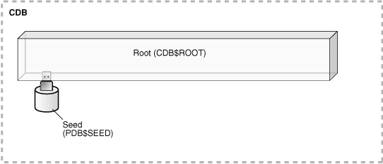
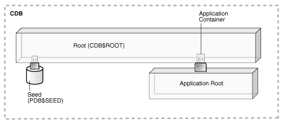
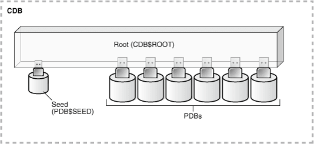
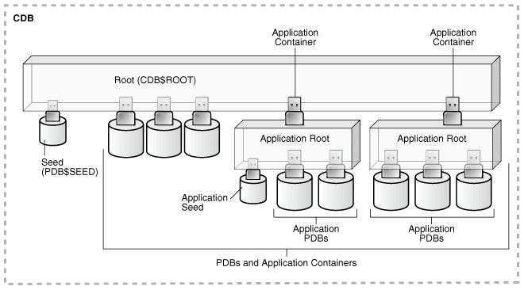

## 3 Overview of Configuring and Managing a Multitenant Environment

**Parent topic:** [Creating and Configuring a Multitenant Environment](creating-and-configuring-a-multitenant-environment.md)

### About Configuring and Managing a Multitenant Environment

You can use the Oracle Multitenant option to configure and manage a multitenant environment.

You must meet certain prerequisites before configuring and managing a multitenant environment. To do so, you complete some common tasks and use a set of tools to complete those tasks.

The multitenant architecture enables an Oracle database to function as a multitenant container database (CDB) that includes zero, one, or many customer-created pluggable databases (PDBs). A PDB is a portable collection of schemas, schema objects, and nonschema objects that appears to an Oracle Net client as a non-CDB. All Oracle databases before Oracle Database 12c were non-CDBs.

- Common Users and Local Users  
	A common user is a user that has the same identity in the root and in every existing and future PDB.
- Separation of Duties in CDB and PDB Administration  
	Some database administrators manage an entire CDB, while others manage individual PDBs.

See Also:

- " [Introduction to the Multitenant Architecture](introduction-to-the-multitenant-architecture.md) "
- " [Overview of the Multitenant Architecture](overview-of-the-multitenant-architecture.md) "

**Parent topic:** Overview of Configuring and Managing a Multitenant Environment

#### Common Users and Local Users

A common user is a user that has the same identity in the root and in every existing and future PDB.

A common user can log in to the root and any container in which it has been granted `CREATE SESSION` privilege. The operations that a common user can perform depend on the privileges granted to the common user. Some administrative tasks, such as creating a PDB or unplugging a PDB, must be performed by a common user.

A CDB also supports local users. A local user is a user that exists in exactly one PDB.

See Also:

- " [Overview of Commonality in the CDB](overview-of-the-multitenant-architecture.md) "
- [Oracle Database Security Guide](https://docs.oracle.com/pls/topic/lookup?ctx=en/database/oracle/oracle-database/19/multi&id=DBSEG99777) for more information about common users and local users

**Parent topic:** About Configuring and Managing a Multitenant Environment

#### Separation of Duties in CDB and PDB Administration

Some database administrators manage an entire CDB, while others manage individual PDBs.

DBAs who manage an entire CDB connect to the CDB as common users, and manage attributes of the entire CDB and the root, as well as some attributes of PDBs. For example, these DBAs can create, unplug, plug in, and drop PDBs. They can also specify the temporary tablespace and the default tablespace for the root, and they can change the open mode of PDBs.

DBAs can also connect to a specific PDB as a local PDB administrator and then perform a subset of management tasks on the PDB that a DBA performs on a non-CDB. The subset includes tasks required for the PDB to support an [application](glossary.md). For example, tasks can include management of tablespaces and schemas in a PDB, specification of storage parameters for that PDB, changing the open mode of the current PDB, and setting PDB-level initialization parameters.

**Parent topic:** About Configuring and Managing a Multitenant Environment

### Prerequisites for a Multitenant Environment

Prerequisites must be met for a multitenant environment.

The following minimum prerequisites must be met before you can create and use a multitenant environment:

- You must install or upgrade to Oracle Database 12c or later releases. Oracle Multitenant is not supported in Oracle Database 11g and earlier releases.
	The installation includes setting various environment variables unique to your operating system and establishing the directory structure for software and database files.
- The database compatibility level must be set to `12.0.0` or later.
- Sufficient memory must be available to start the Oracle Database instance.
	Size the memory required by a CDB to accommodate the workload of each of its containers and the number of containers.
- Sufficient disk storage space must be available for the planned PDBs on the computer that runs Oracle Database. In an Oracle RAC environment, sufficient shared storage must be available.
	The disk storage space required by a CDB is the sum of the space requirements for all PDBs that will reside in the CDB.

These prerequisites are discussed in the [Oracle Database Installation Guide](https://docs.oracle.com/pls/topic/lookup?ctx=en/database/oracle/oracle-database/19/multi&id=GINST) or [Oracle Grid Infrastructure Installation and Upgrade Guide](https://docs.oracle.com/pls/topic/lookup?ctx=en/database/oracle/oracle-database/19/multi&id=CWGEN) specific to your operating system. If you use the Oracle Universal Installer, then it will guide you through your installation and provide help in setting environment variables and establishing directory structure and authorizations.

See Also:

- [Oracle Database Installation Guide](https://docs.oracle.com/pls/topic/lookup?ctx=en/database/oracle/oracle-database/19/multi&id=GINST) specific to your operating system
- [Oracle Database Upgrade Guide](https://docs.oracle.com/pls/topic/lookup?ctx=en/database/oracle/oracle-database/19/multi&id=UPGRD005) for information about the database compatibility level

**Parent topic:** Overview of Configuring and Managing a Multitenant Environment

### Tasks and Tools for a Multitenant Environment

There are common tasks you perform for a multitenant environment, and you use tools to complete the tasks.

- Tasks for a Multitenant Environment  
	A multitenant environment enables you to achieve several goals. You can complete general tasks to configure and use a multitenant environment.
- Tools for a Multitenant Environment  
	You can use various tools to configure and administer a multitenant environment.

**Parent topic:** Overview of Configuring and Managing a Multitenant Environment

#### Tasks for a Multitenant Environment

A multitenant environment enables you to achieve several goals. You can complete general tasks to configure and use a multitenant environment.

These goals are described in " [Benefits of the Multitenant Architecture](introduction-to-the-multitenant-architecture.md) ". To do so, you must complete the following general tasks:

Task 1 Plan for the Multitenant Environment

Creating and configuring any database requires careful planning. A CDB requires special considerations. For example, consider the following factors when you plan for a CDB:

- The number of PDBs that will be plugged into each CDB
- The resources required to support the planned CDB
- Container management policies executed as an aggregate on the entire CDB or executed locally on individual PDBs
- Container database topology, which could consist of application containers with application PDBs or a CDB with PDBs, or a combination of both

See " [Planning for CDB Creation](creating-and-configuring-a-cdb.md) " for detailed information about planning for a CDB.

Task 2 Create One or More CDBs

When you have completed the necessary planning, you can create one or more CDBs using either the Database Configuration Assistant (DBCA) or the `CREATE DATABASE` statement. In either case, you must specify the configuration details for each CDB.

See " [About CDB Creation with DBCA](creating-and-configuring-a-cdb.md) " and " [Creating a CDB](creating-and-configuring-a-cdb.md) " for detailed information about creating a CDB.

After a CDB is created, it consists of the root and `PDB$SEED`, as shown in Figure 3-1. The CDB root contains only Oracle maintained objects and data structures, and `PDB$SEED` is a generic seed database for cloning purposes.

Figure 3-1 A Newly Created CDB

> This graphic depicts a rectangle with a dotted-line border. The rectangle is labeled "CDB." Inside the CDB is a long box labeled "Root (CDB$ROOT)." An cylinder icon labeled "Seed (PDB$SEED)" is plugged into the Root box.
>
> [  
> Copyright © 2017, 2025, Oracle and/or its affiliates.](https://docs.oracle.com/en/database/oracle/oracle-database/dcommon/html/cpyr.htm)

Task 3 Optionally, Create Application Containers

An application container is an optional component of a CDB that consists of an application root and the application PDBs associated with it. An application container stores data for one or more applications.

The following graphic shows a CDB with one empty application container.

Figure 3-2 An Application Container

> This illustration shows a CDB with a `CDB$ROOT` container and a `PDB$SEED` container plugged into the root container. There is also one application container plugged into the CDB root, and the application container has an application root.
>
> [  
> Copyright © 2017, 2025, Oracle and/or its affiliates.](https://docs.oracle.com/en/database/oracle/oracle-database/dcommon/html/cpyr.htm)

See " [Overview of Applications in an Application Container](overview-of-the-multitenant-architecture.md) ".

Task 4 Create, Plug In, and Unplug PDBs

PDBs contain user data. After creating a CDB, you can create PDBs, plug unplugged PDBs into it, and unplug PDBs from it whenever necessary. You can unplug a PDB from a CDB and plug this PDB into a different CDB. You might move a PDB from one CDB to another if, for example, you want to move the workload for the PDB from one server to another.

See " [Creating and Removing PDBs and Application Containers](creating-pdbs.md) " for information about creating PDBs, plugging in PDBs, and unplugging PDBs.

Figure 3-3 shows a CDB with several PDBs.

Figure 3-3 A CDB with PDBs

> This illustration shows a CDB with a `CDB$ROOT` container, a `PDB$SEED` container plugged into the root container, and several PDBs plugged into the root container.
>
> [  
> Copyright © 2017, 2025, Oracle and/or its affiliates.](https://docs.oracle.com/en/database/oracle/oracle-database/dcommon/html/cpyr.htm)

Figure 3-4 shows a CDB with PDBs, application containers, and application PDBs.

Figure 3-4 A CDB with PDBs, Application Containers, and Application PDBs

> This illustration shows a CDB with the following components:
>
> - The CDB has a `CDB$ROOT` container.
> - A `PDB$SEED` container is plugged into the root container.
> - Several PDBs are plugged into the root container.
> - Two application containers plugged into the root container.
> - Each application container has an application root container.
> - One application container has two application PDBs plugged into its application root container.
> - One application container has three application PDBs plugged into its application root container.
> - The application container with two application PDBs also has an application seed plugged into its application root container.

Task 5 Administer and Monitor the CDB and Application Containers

Administering and monitoring a CDB involves managing the entire CDB, the root, and some attributes of PDBs. Some management tasks are the same for CDBs and non-CDBs, and some are different.

Administering and monitoring an application container is similar to administering and monitoring a CDB, but your actions only affect the application root and the application PDBs that are part of the application container.

See " [After Creating a CDB](creating-and-configuring-a-cdb.md) " for descriptions of tasks that are similar and tasks that are different. Also, see " [Administering a CDB](administering-a-cdb-with-sql-plus.md) " and " [Monitoring CDBs and PDBs](viewing-information-about-cdbs-and-pdbs-with-sql-plus.md) ".

You can use Oracle Resource Manager to allocate and manage resources among PDBs hosted in a CDB, and you can use it to allocate and manage resource use among user processes within a PDB. See " [Using Oracle Resource Manager for PDBs](using-oracle-resource-manager-for-pdbs-with-sql-plus.md) ".

You can also use Oracle Scheduler to schedule jobs in a CDB and in individual PDBs. See " [Using Oracle Scheduler with a CDB](using-oracle-scheduler-with-a-cdb.md) ".

Task 6 Administer and Monitor PDBs and Application PDBs

Administering and monitoring a PDB or an application PDB is similar to administering and monitoring a non-CDB, but there are some differences. See " [Administering PDBs](administering-pdbs-with-sql-plus.md) " and " [Monitoring CDBs and PDBs](viewing-information-about-cdbs-and-pdbs-with-sql-plus.md) ".

**Parent topic:** Tasks and Tools for a Multitenant Environment

#### Tools for a Multitenant Environment

You can use various tools to configure and administer a multitenant environment.

Table 3-1 Tools for a Multitenant Environment

| Tool | Description | See Also |
| --- | --- | --- |
| SQL\*Plus | SQL\*Plus is a command-line tool that enables you to create, manage, and monitor CDBs and PDBs. You use SQL statements and Oracle-supplied PL/SQL packages to complete these tasks in SQL\*Plus. | [SQL\*Plus User's Guide and Reference](https://docs.oracle.com/pls/topic/lookup?ctx=en/database/oracle/oracle-database/19/multi&id=SQPUG-GUID-BF1995BD-EF9B-4EA2-9B32-7BFACDEB79DA) |
| Oracle Database Configuration Assistant (DBCA) | DBCA is a utility with a graphical user interface that enables you to create and duplicate CDBs. It also enables you to create, relocate, clone, plug in, and unplug PDBs. | [Oracle Database 2 Day DBA](https://docs.oracle.com/pls/topic/lookup?ctx=en/database/oracle/oracle-database/19/multi&id=ADMQS023), [Oracle Database Installation Guide](https://docs.oracle.com/pls/topic/lookup?ctx=en/database/oracle/oracle-database/19/multi&id=GINST), and the DBCA online help |
| Oracle Enterprise Manager Cloud Control | Cloud Control is a system management tool with a graphical user interface that enables you to manage and monitor a CDB and its PDBs. | Cloud Control online help |
| Oracle SQL Developer | Oracle SQL Developer is a client application with a graphical user interface that enables you to configure a CDB, create PDBs, plug and unplug PDBs, modify the state of a PDB, clone a PDB to the Oracle Cloud, hot clone/refresh a PDB, relocate a PDB between application roots, and more.  Additionally, Oracle SQL Developer has graphical interfaces for resource management, storage, security, configuration, and reporting of performance metrics on containers and pluggable databases in a CDB. | [Oracle SQL Developer User's Guide](https://docs.oracle.com/pls/topic/lookup?ctx=en/database/oracle/oracle-database/19/multi&id=RPTUG-GUID-464C045C-FBDF-417A-A20B-037D294B3BDA) |
| The Server Control (SRVCTL) utility | The SRVCTL utility can create and manage services for PDBs. | " [Managing Services for PDBs](administering-pdbs-with-sql-plus.md) " |
| EM Express | EM Express is a management and monitoring tool with a graphical user interface which ships with Oracle Database. It can be configured for the CDB, individual hosted PDBs, or both. This tool is intended for PDB administrative use, in the context of the PDB, to manage and monitor application development as an application DBA. | [Oracle Database 2 Day DBA](https://docs.oracle.com/pls/topic/lookup?ctx=en/database/oracle/oracle-database/19/multi&id=ADMQS12495) |
| Oracle Multitenant Self-Service Provisioning application | This application enables the self-service provisioning of PDBs. CDB administrators control access to this self-service application and manage quotas on PDBs. | [`http://www.oracle.com/goto/multitenant`](http://www.oracle.com/goto/multitenant)  To access the application, click the Downloads tab, and select Oracle Pluggable Database Self-Service Provisioning application in the Downloads for Oracle Multitenant section. |

**Parent topic:** Tasks and Tools for a Multitenant Environment