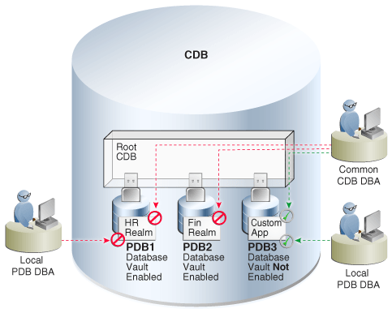

## 24 Using Oracle Database Vault with a CDB

- About Oracle Database Vault  
	The Oracle Database Vault security controls protect application data from unauthorized access, and comply with privacy and regulatory requirements.
- How Oracle Database Vault Works in a Multitenant Environment  
	To provide increased security for consolidation, you can use Oracle Database Vault with Oracle Multitenant.
- Verifying That Database Vault Is Configured and Enabled  
	The `DBA_DV_STATUS`, `CDB_DV_STATUS`, `DBA_OLS_STATUS`, and `CDB_OLS_STATUS` data dictionary views verify if Oracle Database is configured and enabled.
- Registering Oracle Database Vault with an Oracle Database in a Multitenant Environment  
	You can register Oracle Database Vault in a multitenant environment based on several scenarios.
- Configuring Realms  
	You can create a realm around database objects to protect them, and then set authorizations to control user access to this data.
- Rule Sets and Rules in a Multitenant Environment  
	In a multitenant environment, you can create a rule set and its associated rules in the application root.
- Command Rules in a Multitenant Environment  
	In a multitenant environment, you can create common and local command rules in either the CDB root or the application root.
- Oracle Database Vault Policies in a Multitenant Environment  
	Oracle Database Vault policies are only local to the pluggable database (PDB) in which they were created.
- Using Database Vault Operations Control to Restrict Multitenant Common User Access to Local PDB Data  
	You can control PDB access by CDB root common users, such as infrastructure database administrators.
- Converting a Standalone Oracle Database to a PDB and Plugging It into a CDB  
	You can convert a standalone Oracle Database Release 12c or later database to a PDB, and then plug this PDB into a CDB.

**Parent topic:** [Using Oracle Features in a Multitenant Environment](using-oracle-features-in-a-multitenant-environment.md)

### About Oracle Database Vault

The Oracle Database Vault security controls protect application data from unauthorized access, and comply with privacy and regulatory requirements.

You can deploy controls to block privileged account access to application data and control sensitive operations inside the database using trusted path authorization. Through the analysis of privileges and roles, you can increase the security of existing applications by using least privilege best practices. Oracle Database Vault secures existing database environments transparently, eliminating costly and time consuming application changes.

### How Oracle Database Vault Works in a Multitenant Environment

To provide increased security for consolidation, you can use Oracle Database Vault with Oracle Multitenant.

Oracle Database Vault can prevent privileged user access inside a pluggable database (PDB) and between the PDB and the common privileged user at the container database. Each PDB has its own Database Vault metadata, such as realms, rule sets, command rules, default policies (such as default realms), and so on. In addition, the objects within the `DVSYS` and `DVF` schemas are automatically available to any child PDBs. Both schemas are common user schemas.

You can configure common realms in the application root only, but you can create common rule sets and command rules in either the application root or the CDB root. A common command rule in the application root applies to its associated PDBs, and common command rules in the CDB root apply to all PDBs in the CDB environment. The ability to create common realms and command rules enables you to create policies that use a shared set of realms, rule sets, or command rules throughout the CDB environments, rather than having to create these same components for every PDB in the multitenant environment. The common protection applies for all PDBs associated with the application root that have Oracle Database Vault enabled.

You can create individual local policies for each PDB. When you use Database Vault to protect an object, Database Vault subjects common privileges for common objects to the same enforcement rules as local system privileges.

When you configure a PDB that has Database Vault enabled, the `DVSYS` schema is a common user schema that is stored in the root. This means that all the objects within the `DVSYS` schema (tables, data dictionary views, user accounts, PL/SQL packages, default policies, and so on) are subject to the common privileges available for this schema. In other words, you can create realms, factors, and so on in the root to protect the schema in the root. Ensure that you configure Database Vault in the root first, before you configure it in the associated PDBs.

When you enable Oracle Database Vault in the CDB root, you can choose either regular mode or strict mode. The settings propagate throughout the CDB based on the setting you choose. For example, suppose a CDB contains both Database Vault-enabled PDBs and PDBs in which Database Vault is not enabled. If you enable Database Vault using regular mode, then both types of PDBs continue to function normally. If you enable Database Vault using strict mode, then the Database Vault-disabled PDBs operate in restricted mode.

Figure 24-1 illustrates how the database in regular mode allows different access for common and local database administrators depending if Database Vault is enabled. In this scenario, neither the common user nor the local users have access to the realms in PDB1 and PDB2. Both the common user and the PDB3 local user have access to the Custom App application in PDB3, where Database Vault is not enabled.

Figure 24-1 Oracle Database Vault in a Multitenant Environment with Regular Mode



> Graphic dvadm\_vm\_005c.png shows from top to bottom, left to right, the following components:
>
> - The root administrator for a CDB that contains three PDBs. PDB1 has the HR realm; PDB2 has the FIN realm, and PDB3. PDB3 is not Database Vault-enabled and has a CRM. The root administrator has access to the CRM in PDB3 but not to the realms in the PDB1 and PDB2
> - To the left, the local administrator for the two Database Vault-enabled PDBs does not have access to the HR and FIN realms.
> - To the right, the local adminstrator for the PDB that is not Database Vault-enabled has access to the Custom App application in PDB3.


**Related Topics**

**Parent topic:** Using Oracle Database Vault with a CDB

### Verifying That Database Vault Is Configured and Enabled

The `DBA_DV_STATUS`, `CDB_DV_STATUS`, `DBA_OLS_STATUS`, and `CDB_OLS_STATUS` data dictionary views verify if Oracle Database is configured and enabled.

In addition to Oracle Database Vault administrators, the Oracle Database `SYS` user and users who have been granted the `DBA` role can query these views.

- For Database Vault:
	- If you want to find the Database Vault status for a non-multitenant database, or in a multitenant environment for the root only or an individual PDB, then query `DBA_DV_STATUS`. For example:
		```
		SELECT * FROM DBA_DV_STATUS;
		```
		Output similar to the following appears:
		```
		NAME                 STATUS
		-------------------- -----------
		DV_CONFIGURE_STATUS  TRUE
		DV_ENABLE_STATUS     TRUE
		```
		- If you want to find the Database Vault status of all PDBs in a multitenant environment, as a common user with administrative privileges, then query `CDB_DV_STATUS`, which provides the addition of a container ID (`CON_ID`) field.
- For Oracle Label Security, query the following data dictionary views, which are similar to their Database Vault equivalent views:
	- `DBA_OLS_STATUS`
		- `CDB_OLS_STATUS`

**Parent topic:** Using Oracle Database Vault with a CDB

### Registering Oracle Database Vault with an Oracle Database in a Multitenant Environment

You can register Oracle Database Vault in a multitenant environment based on several scenarios.

- Registering Database Vault in the CDB Root  
	In a multitenant environment, you register Oracle Database Vault with common users who will use the Database Vault-enforced roles in the CDB root.
- Registering Database Vault Common Users to Manage Specific PDBs  
	In a multitenant environment, you must register Oracle Database Vault in the root first, then in the PDBs afterward.
- Registering Database Vault Local Users to Manage Specific PDBs  
	You must register Oracle Database Vault in the root first, and then in the PDBs afterward.
- Plugging in a Database Vault-Enabled PDB  
	From SQL\*Plus, in a multitenant environment, you can plug in a database that already has Database Vault enabled.
- Manually Installing Oracle Database Vault in a Multitenant Environment  
	Under certain conditions, for a multitenant environment, you must manually install Oracle Database Vault.

**Parent topic:** Using Oracle Database Vault with a CDB

#### Registering Database Vault in the CDB Root

In a multitenant environment, you register Oracle Database Vault with common users who will use the Database Vault-enforced roles in the CDB root.

1. In a multitenant environment, log into the root of the database instance as a user who has privileges to create users and grant the `CREATE SESSION` and `SET CONTAINER` privileges.
	For example:
	```
	sqlplus c##dba_debra
	Enter password: password
	```
2. Select user accounts (or create new users) that will be used for the Database Vault Owner (`DV_OWNER` role) and Database Vault Account Manager (`DV_ACCTMGR` role) accounts.
	Oracle strongly recommends that you maintain two accounts for each role. One account, the primary named user account, will be used on a day-to-day basis and the other account will be used as a backup account in case the password of the primary account is lost and must be reset.
	Prepend the names of these accounts with `c##` or `C##`. For example:
	```
	GRANT CREATE SESSION, SET CONTAINER TO c##sec_admin_owen 
	  IDENTIFIED BY password CONTAINER = ALL;
	GRANT CREATE SESSION, SET CONTAINER TO c##dbv_owner_root_backup 
	  IDENTIFIED BY password CONTAINER = ALL;
	GRANT CREATE SESSION, SET CONTAINER TO c##accts_admin_ace 
	  IDENTIFIED BY password CONTAINER = ALL;
	GRANT CREATE SESSION, SET CONTAINER TO c##dbv_acctmgr_root_backup 
	  IDENTIFIED BY password CONTAINER = ALL;
	```
	In this specification:
	- Create the primary accounts (`c##sec_admin_owen` and ` c##accts_admin_ace`) if these do not already exist for the new roles, `DV_ADMIN` and `DV_ACCTMGR`.
	- Replace `password` with a password that is secure.
3. Connect to the root as user `SYS` with the `SYSDBA` administrative privilege
	```
	CONNECT SYS AS SYSDBA
	Enter password: password
	```
4. Configure the two backup Database Vault user accounts.
	For example:
	```
	BEGIN
	 CONFIGURE_DV (
	   dvowner_uname         => 'c##dbv_owner_root_backup',
	   dvacctmgr_uname       => 'c##dbv_acctmgr_root_backup',
	   force_local_dvowner   => FALSE);
	 END;
	/
	```
	In this example, setting `force_local_dvowner` to `FALSE` enables the common users to have `DV_OWNER` privileges for the PDBs that are associated with this CDB root. Setting it to `TRUE` restricts the common `DV_OWNER` user to have the `DV_OWNER` role privileges for the CDB root only. If you grant `DV_OWNER` locally to the CDB root common user, then that user cannot grant the `DV_OWNER` role commonly to any other user.
5. Run the `utlrp.sql` script to recompile invalidated objects in the root.
	```
	@?/rdbms/admin/utlrp.sql
	```
	If the script provides instructions, follow them, and then run the script again. If the script terminates abnormally without giving any instructions, then run it again.
6. Connect to the root as the primary Database Vault Owner user that you just configured.
	For example:
	```
	CONNECT c##dbv_owner_root_backup
	Enter password: password
	```
7. Enable Oracle Database Vault using one of the following commands:
	- To enable Oracle Database Vault to use regular mode:
		```
		EXEC DBMS_MACADM.ENABLE_DV;
		```
	- If every associated PDB will need to have Database Vault enabled in this database, then use the following command. (You will need to enable each of these PDBs after you complete this procedure.) PDBs that do not have Database Vault enabled will be in restricted mode after the database is restarted and until Database Vault is enabled in the PDB:
		```
		EXEC DBMS_MACADM.ENABLE_DV (strict_mode => 'y');
		```
8. Connect with the `SYSDBA` administrative privilege.
	```
	CONNECT / AS SYSDBA
	```
9. ```
	SHUTDOWN IMMEDIATE
	STARTUP
	```
10. Verify that Oracle Database Vault and Oracle Label Security are installed and enabled.
	```
	SELECT * FROM DBA_DV_STATUS;
	SELECT * FROM DBA_OLS_STATUS;
	```
11. Connect as the backup `DV_OWNER` user and then grant the `DV_OWNER` role to the primary `DV_OWNER` user that you created earlier.
	For example:
	```
	CONNECT c##dbv_owner_root_backup
	Enter password: password
	GRANT DV_OWNER TO c##sec_admin_owen WITH ADMIN OPTION;
	```
12. Connect as the backup `DV_ACCTMGR` user and then grant the `DV_ACCTMGR` role to the backup `DV_ACCTMGR` user.
	For example:
	```
	CONNECT c##dbv_acctmgr_root_backup
	Enter password: password
	GRANT DV_ACCTMGR TO c##accts_admin_ace WITH ADMIN OPTION;
	```
13. Store the two backup account passwords in a safe location such as a privileged account management (PAM) system in case they are needed in the future.

**Parent topic:** Registering Oracle Database Vault with an Oracle Database in a Multitenant Environment

#### Registering Database Vault Common Users to Manage Specific PDBs

In a multitenant environment, you must register Oracle Database Vault in the root first, then in the PDBs afterward.

If you try to register in a PDB first, then an `ORA-47503: Database Vault is not enabled on CDB$ROOT` error appears.

1. If you have not already done so, then identify or create named common user accounts to be used as the Database Vault accounts along with associated backup accounts.
2. Ensure that you have registered Oracle Database Vault in the CDB root and that the `DV_OWNER` role was granted commonly to the common user.
3. Connect to the PDB as an administrator who is local to the PDB.
	For example:
	```
	CONNECT dba_debra@pdb_name
	Enter password: password
	```
	To find the available PDBs, query the `DBA_PDBS` data dictionary view. To check the current PDB, run the `show con_name` command.
4. Grant the `CREATE SESSION` and `SET CONTAINER` privileges to the users for this PDB.
	For example:
	```
	GRANT CREATE SESSION, SET CONTAINER TO c##sec_admin_owen CONTAINER = CURRENT;
	GRANT CREATE SESSION, SET CONTAINER TO c##accts_admin_ace CONTAINER = CURRENT;
	```
5. Connect as user `SYS` with the `SYSDBA` administrative privilege
	```
	CONNECT SYS@pdb_name AS SYSDBA
	Enter password: password
	```
6. While still in the PDB, configure the two backup Database Vault user accounts.
	```
	BEGIN
	 CONFIGURE_DV (
	   dvowner_uname         => 'c##dbv_owner_root_backup',
	   dvacctmgr_uname       => 'c##dbv_acctmgr_root_backup');
	 END;
	/
	```
	In this example, the `force_local_dvowner` parameter is omitted because it is unnecessary. All common users who are configured within a PDB are restricted to the scope of the PDB.
7. Run the `utlrp.sql` script to recompile invalidated objects in this PDB.
	```
	@?/rdbms/admin/utlrp.sql
	```
	If the script provides instructions, follow them, and then run the script again. If the script terminates abnormally without giving any instructions, then run it again.
8. Connect to the PDB as the backup Database Vault Owner user that you just configured.
	For example:
	```
	CONNECT c##dbv_owner_root_backup@pdb_name
	Enter password: password
	```
9. Enable Oracle Database Vault in this PDB.
	```
	EXEC DBMS_MACADM.ENABLE_DV;
	```
10. Connect to the CDB with the `SYSDBA` administrative privilege.
	```
	CONNECT / AS SYSDBA
	```
11. For example:
	```
	ALTER PLUGGABLE DATABASE pdb_name CLOSE IMMEDIATE;
	ALTER PLUGGABLE DATABASE pdb_name OPEN;
	```
12. Verify that the PDB is configured and enabled for Database Vault.
	```
	CONNECT SYS@pdb_name AS SYSDBA
	Enter password: password
	SELECT * FROM DBA_DV_STATUS;
	```
13. Connect as the backup `DV_OWNER` user and then grant the `DV_OWNER` role to the primary `DV_OWNER` user that you created earlier.
	For example:
	```
	CONNECT c##dbv_owner_root_backup@pdb_name
	Enter password: password
	GRANT DV_OWNER TO c##sec_admin_owen WITH ADMIN OPTION;
	```
14. Connect as the backup `DV_ACCTMGR` user and then grant the `DV_ACCTMGR` role to the primary `DV_ACCTMGR` user.
	For example:
	```
	CONNECT c##dbv_acctmgr_root_backup@pdb_name
	Enter password: password
	GRANT DV_ACCTMGR TO c##accts_admin_ace WITH ADMIN OPTION;
	```
15. Store the two backup account passwords in a safe location such as a privileged account management (PAM) system in case they are needed in the future.

**Parent topic:** Registering Oracle Database Vault with an Oracle Database in a Multitenant Environment

#### Registering Database Vault Local Users to Manage Specific PDBs

You must register Oracle Database Vault in the root first, and then in the PDBs afterward.

If you try to register in a PDB first, then an `ORA-47503: Database Vault is not enabled on CDB$ROOT` error appears.

1. Log in to the PDB as a user who has privileges to create users and to grant the `CREATE SESSION` and `SET CONTAINER` privileges.
	For example:
	```
	sqlplus sec_admin@pdb_name
	Enter password: password
	```
	To find the available PDBs, query the `DBA_PDBS` data dictionary view. To check the current PDB, run the `show con_name` command.
2. If you are not using existing local user named accounts for the new Database Vault roles, create new named local user accounts.
	In both cases, you must create backup accounts to hold the Database Vault roles in case the named user loses or forgets their password.
	```
	GRANT CREATE SESSION, SET CONTAINER TO sec_admin_owen 
	  IDENTIFIED BY password;
	GRANT CREATE SESSION, SET CONTAINER TO dbv_owner_backup 
	  IDENTIFIED BY password;
	GRANT CREATE SESSION, SET CONTAINER TO accts_admin_ace 
	  IDENTIFIED BY password;
	GRANT CREATE SESSION, SET CONTAINER TO dbv_acctmgr_backup 
	  IDENTIFIED BY password;
	```
3. Ensure that you have registered Oracle Database Vault in the CDB root.
	Temporarily connect to the root and then query the `DBA_DV_STATUS` view.
	```
	CONNECT SYS / AS SYSDBA
	Enter password: password
	SELECT * FROM DBA_DV_STATUS;
	```
4. Connect to the PDB as user `SYS` with the `SYSDBA` administrative privilege.
	```
	CONNECT SYS@pdb_name AS SYSDBA
	Enter password: password
	```
5. While still in the PDB, configure the two backup Database Vault user accounts.
	```
	BEGIN
	 CONFIGURE_DV (
	   dvowner_uname     => 'dbv_owner_backup',
	   dvacctmgr_uname   => 'dbv_acctmgr_backup');
	 END;
	/
	```
	In this example, the `force_local_dvowner` parameter is omitted because it is unnecessary. Database Vault roles are granted locally when configured in a PDB.
6. Run the `utlrp.sql` script to recompile invalidated objects in this PDB.
	```
	@?/rdbms/admin/utlrp.sql
	```
	If the script provides instructions, follow them, and then run the script again. If the script terminates abnormally without giving any instructions, run it again.
7. Connect to the PDB as the backup Database Vault Owner user that you just configured.
	For example:
	```
	CONNECT dbv_owner_backup@pdb_name
	Enter password: password
	```
8. Enable Oracle Database Vault in this PDB.
	```
	EXEC DBMS_MACADM.ENABLE_DV;
	```
9. Connect to the CDB with the `SYSDBA` administrative privilege.
	```
	CONNECT / AS SYSDBA
	```
10. ```
	ALTER PLUGGABLE DATABASE pdb_name CLOSE IMMEDIATE;
	ALTER PLUGGABLE DATABASE pdb_name OPEN;
	```
11. Verify that the PDB is configured and enabled for Database Vault and Oracle Label Security.
	```
	CONNECT SYS@pdb_name AS SYSDBA
	Enter password: password
	SELECT * FROM DBA_DV_STATUS;
	SELECT * FROM DBA_OLS_STATUS;
	```
12. Connect as the backup `DV_OWNER` user and then grant the `DV_OWNER` role to the primary `DV_OWNER` user that you created earlier.
	For example:
	```
	CONNECT dbv_owner_backup@pdb_name
	Enter password: password
	GRANT DV_OWNER TO sec_admin_owen WITH ADMIN OPTION;
	```
13. Connect as the backup `DV_ACCTMGR` user and then grant the `DV_ACCTMGR` role to the backup `DV_ACCTMGR` user.
	For example:
	```
	CONNECT dbv_acctmgr_backup@pdb_name
	Enter password: password
	GRANT DV_ACCTMGR TO c##accts_admin_ace WITH ADMIN OPTION;
	```
14. Store the two backup account passwords in a safe location such as a privileged account management (PAM) system in case they are needed in the future.

**Parent topic:** Registering Oracle Database Vault with an Oracle Database in a Multitenant Environment

#### Plugging in a Database Vault-Enabled PDB

From SQL\*Plus, in a multitenant environment, you can plug in a database that already has Database Vault enabled.

In this scenario, the plugged in database has its own local Database Vault accounts. Be aware that if you plug a Database Vault-enabled database into a CDB that is not Database Vault enabled, then the PDB will remain in restricted mode until you enable Database Vault in the CDB and then restart the CDB. If you plug a non-Database Vault-enabled PDB into a CDB that is Database Vault enabled, then the PDB remains in restricted mode until you enable Database Vault in the PDB and then restart the PDB. This plugged in non-Database Vault enabled PDB can still be used. However, if the CDB is Database Vault enabled with the strict option set, then the PDB must be Database Vault enabled.

Before you plug in a Database Vault-enabled PDB and if the Database Vault roles are granted to common users, ensure that you understand fully how plugging in PDBs affect common users.

#### Manually Installing Oracle Database Vault in a Multitenant Environment

Under certain conditions, for a multitenant environment, you must manually install Oracle Database Vault.

For example, you must manually install Oracle Database Vault if a release 11g Oracle database without Database Vault is upgraded to release 12c, then converted to a PDB to be plugged into a 12c Database Vault-enabled database. In addition, you must manually install Oracle Database Vault (and Oracle Label Security) in a PDB if this PDB does not have these products when the PDB has been plugged into a CDB where Database Vault and Label Security are installed.

1. As user who has been granted the `SYSDBA` administrative privilege, log in to the PDB in which you want to install Oracle Database Vault.
	For example, to log in to a PDB named `hr_pdb`:
	```
	sqlplus sec_admin@hr_pdb as sysdba
	Enter password: password
	```
	To find the available PDBs, run the `show pdbs` command. To check the current PDB, run the `show con_name` command.
2. If necessary, check if Oracle Database Vault and Oracle Label Security are already installed on this PDB.
	If the `DVSYS` account (for Database Vault) and the ` LBACSYS` account (for Label Security) exist, then Database Vault and Label Security exist on the PDB.
	```
	SELECT USERNAME FROM DBA_USERS WHERE USERNAME IN ('DVSYS', 'LBACSYS');
	```
3. If neither Database Vault nor Label Security have been installed, then install Oracle Label Security by executing the `catols.sql` script.
	```
	@$ORACLE_HOME/rdbms/admin/catols.sql
	```
	Oracle Label Security must be installed before you can install Oracle Database Vault.
4. Install Oracle Database Vault by executing the `catmac.sql` script.
	```
	@$ORACLE_HOME/rdbms/admin/catmac.sql
	```
5. At the `Enter value for 1` prompt, enter `SYSTEM` as the tablespace to install `DVSYS`.
6. At the `Enter value for 2` prompt, enter the temporary tablespace for the PDB.

After the installation is complete, you can register Oracle Database Vault in the PDB. If Database Vault is not registered in the CDB already, you must close the PDB before you can register Database Vault in the CDB root. Database Vault must be registered in CDB root before it can be registered in the PDB. After Database Vault is registered in the CDB root and the database has been restarted, then you can open the PDB and register Database Vault.

### Configuring Realms

You can create a realm around database objects to protect them, and then set authorizations to control user access to this data.

- What Are Realms?  
	Realms enable you to protect database objects, including specific object types.
- Realm Authorizations in a Multitenant Environment  
	In a multitenant environment, the rules and behavior for common realm authorizations are similar to the authorizations for other common objects.

**Parent topic:** Using Oracle Database Vault with a CDB

#### What Are Realms?

Realms enable you to protect database objects, including specific object types.

- About Realms  
	A realm is a grouping of database schemas, database objects, and database roles that must be secured for a given application.
- Realms in a Multitenant Environment  
	In a multitenant environment, you can create a realm to protect common objects in the application root.

**Parent topic:** Configuring Realms

##### About Realms

A realm is a grouping of database schemas, database objects, and database roles that must be secured for a given application.

Think of a realm as zone of protection for your database objects. A schema is a logical collection of database objects such as tables, views, and packages, and a role is a collection of privileges. By arranging schemas and roles into functional groups, you can control the ability of users to use system privileges against these groups and prevent unauthorized data access by the database administrator or other powerful users with system privileges. Oracle Database Vault does not replace the discretionary access control model in the existing Oracle database. It functions as a layer on top of this model for both realms and command rules.

Oracle Database Vault provides two types of realms: regular and mandatory. Both realm types can protect either an entire schema or crucial objects within a schema selectively, such as tables and indexes. With a regular realm, an object owner or users who has been granted object privileges can perform queries or DML operations without realm authorization but must have realm authorization to perform DDL operations. A mandatory realm provides stronger protection for objects within a realm. Mandatory realms block both object privilege-based and system privilege-based access and will not allow users with object privileges to perform queries, DML, or DDL operations without realm authorization. In other words, even an object owner cannot access his or her own objects without proper realm authorization if the objects are protected by mandatory realms.

For databases that use Oracle Flashback Technology, then both regular and mandatory realms will enforce the same behavior for a flashback table. Users can execute a `FLASHBACK TABLE` SQL statement on a realm-protected table if the user is authorized to the realm.

For databases that use Information Lifecycle Management (ILM), a Database Vault administrator can use the `DBMS_MACADM.AUTHORIZE_MAINTENANCE_USER` and `DBMS_MACADM.UNAUTHORIZE_MAINTENANCE_USER` procedure to control who can perform ILM operations on realm-protected objects.

You can register schemas, all objects of a certain type in a schema, or individual objects within a schema into a realm. After you create a realm, you can register a set of schema objects or roles (secured objects) for realm protection and authorize a set of users or roles to access the secured objects. Objects that are protected by a regular realm allow DML access to users who have direct object grants.

For example, you can create a realm to protect all existing database schemas that are used in an accounting department. The realm prohibits any user who is not authorized to the realm to use system privileges to access the secured accounting data. When an entire schema is protected, all objects in the schema are protected, including tables, indexes, procedures and other objects.

You can run reports on realms that you create in Oracle Database Vault. You can use simulation mode during development, test, and even production phases to log only realm violations instead of blocking access. This enables you to quickly test applications using Database Vault realms.

You can configure realms by using the Oracle Database Vault Administrator pages in Oracle Enterprise Manager Cloud Control. Alternatively, you can configure realms by using the PL/SQL interfaces and packages provided by Oracle Database Vault.

**Parent topic:** What Are Realms?

##### Realms in a Multitenant Environment

In a multitenant environment, you can create a realm to protect common objects in the application root.

The advantage of creating a realm in the application root instead of creating a large number objects and realms around these objects within individual pluggable databases (PDBs) is that you can create them in one place, the application root. This way, you can manage them centrally.

You cannot create a common realm in the CDB root.

A Database Vault common realm can be either a regular realm or a mandatory realm. The realm protects only objects within the application root, not local objects in a PDB. The CDB root, application root, and any affected PDBs all must be Database Vault enabled.

To configure a common realm, you must be commonly granted the `DV_OWNER` or `DV_ADMIN` role. To grant common authorizations for a common realm, you must be in the application root. To propagate the realm to the PDBs that are associated with the application root, you must synchronize the application root. For example, to synchronize an application called `saas_sales_app`

```
ALTER PLUGGABLE DATABASE APPLICATION saas_sales_app SYNC;
```

#### Realm Authorizations in a Multitenant Environment

In a multitenant environment, the rules and behavior for common realm authorizations are similar to the authorizations for other common objects.

Local Authorization for a Common Realm

The local authorization for a common realm refers to the authorization a user has for the PDB that this user is accessing.

The rules for the local authorization for a common realm are as follows:

- A user who has been commonly granted the `DV_OWNER` or `DV_ADMIN` role can grant local authorization to common users, common roles, local users, and local roles. The common `DV_OWNER` or `DV_ADMIN` user can also remove local authorization from a common realm in a PDB.
- A local Database Vault administrator can authorize locally (that is, grant local authorizations to both local and common users) within the PDB. A common Database Vault administrator can also grant authorizations in each PDB. A common realm authorization can only be granted by a common Database Vault administrator in the application root.
- The common Database Vault administrator can both add or remove local authorization to and from a common realm from within the PDB.
- If a common user has only local authorization for a common realm, then this user cannot access the common realm in any other PDB than this local authorization.
- A common user or a common role can have both the local authorization and the common authorization to a common realm at the same time. Removing a common user’s local authorization from a common realm does not affect the common user’s common authorization. Removing a common user’s common authorization from a common realm does not affect the common user’s local authorization.

Common Authorization for a Common Realm

The common authorization for a common realm refers to the authorization a common user or a common role has in the application root while the authorization takes effect in every container that is Database Vault enabled.

The rules for the local authorization for a common realm are as follows:

- A user who has been commonly granted the `DV_OWNER` or `DV_ADMIN` role can grant common realm authorization to common users or roles in the application root. This common Database Vault administrator can perform the removal of common authorizations while in the application root.
- This common authorization applies to the containers that have been Database Vault enabled in the CDB.
- If a common user is authorized to a common realm in the application root, then this user has access to the objects protected by the common realm in the application root and any application PDBs.
- Any rule sets that are associated with a common realm must be common rule sets. The rules that are added to a common rule set that is associated with common authorization cannot involve any local objects.

How the Authorization of a Realm Works in Both the Application Root and in an Individual PDB

During the Database Vault enforcement in a container, a common realm performs the same enforcement behaviors as the same realm when it is used locally in a PDB.

**Parent topic:** Configuring Realms

### Rule Sets and Rules in a Multitenant Environment

In a multitenant environment, you can create a rule set and its associated rules in the application root.

A common realm must use a common rule set when the associated realm or command rule is evaluated by Database Vault. The common rule set and its rules can only be created in the application root. After the common rule set is created, it exists in every container that is associated with the root where the common rule set is created. The common rule set can only include common rules.

To configure a common rule set and its rules, you must be commonly granted the `DV_OWNER` or `DV_ADMIN` role.

### Command Rules in a Multitenant Environment

In a multitenant environment, you can create common and local command rules in either the CDB root or the application root.

Common command rules can be associated only with common realms, rule sets, and rules. Local command rules can be associated only with local realm, rule sets, and rules.

To apply these command rules to the entire multitenant environment, you must execute the command rule procedures from the CDB root or application root as a common user who has been granted the `DVADM` or `DVOWNER` role. A common command rule that is created in the CDB root will be applied to all PDBs in that CDB environment. A common command rule that is created in the application root will only be applied to the PDBs that are associated with this application root. To propagate the command rule to the PDBs that are associated with the CDB root or application root, you must synchronize the PDB. For example, to synchronize an application root called `saas_sales_app` to its application PDBs:

```
ALTER PLUGGABLE DATABASE APPLICATION saas_sales_app SYNC;
```

To synchronize a common command rule in the CDB root to a PDB:

```
ALTER PLUGGABLE DATABASE APPLICATION APP$CDB$SYSTEM SYNC;
```

You can check a user’s roles by querying the `USER_ROLE_PRIVS` data dictionary view. To find information about command rules, query the `DBA_DV_COMMAND_RULE` data dictionary view.

**Parent topic:** Using Oracle Database Vault with a CDB

### Oracle Database Vault Policies in a Multitenant Environment

Oracle Database Vault policies are only local to the pluggable database (PDB) in which they were created.

That is, if you created the policy in a PDB, then only local realms and command rules can be added to it. You cannot create Database Vault policies that can have common realms or common command rules.

**Parent topic:** Using Oracle Database Vault with a CDB

### Using Database Vault Operations Control to Restrict Multitenant Common User Access to Local PDB Data

You can control PDB access by CDB root common users, such as infrastructure database administrators.

- About Using Database Vault Operations Control  
	You can automatically restrict common users from accessing pluggable database (PDB) local data in autonomous, regular Cloud, or on-premises environments.
- Enabling Database Vault Operations Control  
	To enable Database Vault operations control, use the `DBMS_MACADM.ENABLE_APP_PROTECTION` PL/SQL procedure.
- Adding Common Users and Packages to an Exception List  
	Common users and applications that must access PDB local data can be added to an exception list.
- Deleting Common Users and Packages from an Exception List  
	Users and applications that no longer need to access PDB local data can be removed from the exception list.
- Disabling Database Vault Operations Control  
	To disable Database Vault operations control, use the `DBMS_MACADM.DISABLE_APP_PROTECTION` PL/SQL procedure.

**Parent topic:** Using Oracle Database Vault with a CDB

#### About Using Database Vault Operations Control

You can automatically restrict common users from accessing pluggable database (PDB) local data in autonomous, regular Cloud, or on-premises environments.

To accomplish this, you can use Oracle Database Vault operations control, which applies to common users such as infrastructure database administrators and applications.

Database Vault operations control is useful for situations where a database administrator must log in to the CDB root as a highly privileged user, but still not be able to access PDB customer data. Database operations control does not block PDB database administrators. To block these users, enable Oracle Database Vault in the PDB and then use the Database Vault features such as realm control to block these users.

You can create an exception list for Database Vault operations control of common users and packages for situations where a common user or application must perform tasks that must access local data on a PDB. An example of the type of common user that you would specify for the exception list is the `CTXSYS` application account, which is responsible for Oracle Text. Specifying a package in an exception list enables you to apply more fine-grained control instead of providing full access to a user in an exception list.

The general process for using Database Vault operations control is as follows:

1. Enable Database Vault operations control and keep it enabled for the production environment.
2. At this stage Database Vault operations control applies to all PDBs in the environment, regardless of whether the PDB has enabled Database Vault or not.
3. To enable specific users and packages to have access to the local schemas of the PDBs, add them to an exception list. When the user or package no longer needs access, then you can remove them from the exception list. For example, if the database is using Oracle Text, then you can add the `CTXSYS` administrative user account and the package to the exception list.

**Parent topic:** Using Database Vault Operations Control to Restrict Multitenant Common User Access to Local PDB Data

#### Enabling Database Vault Operations Control

To enable Database Vault operations control, use the `DBMS_MACADM.ENABLE_APP_PROTECTION` PL/SQL procedure.

Oracle recommends that if you elect to use Database Vault operations control for your multitenant production server, then you should keep Database Vault operations control enabled full time.

In most cases, you will enable Database Operations control for the entire CDB, not just a specific PDB. If you need to disable it for a specific PDB (for example, for troubleshooting purposes), then you can execute the `DBMS_MACADM.DISABLE_APP_PROTECTION` procedure on the PDB. When you are finished troubleshooting the PDB, re-enable it for Database Vault operations control, as shown in the example in this topic.

Before you enable Database Vault operations control, Database Vault must be enabled and configured in the CDB root. However, Database Vault does not need to be enabled in the PDBs.

1. Log in to the CDB root as a common user who has been granted the `DV_OWNER` role.
	For example:
	```
	sqlplus c##sec_admin_owen_root
	Enter password: password
	```
2. Execute the `DBMS_MACADM.ENABLE_APP_PROTECTION` procedure.
	- To enable Database Vault operations control for all PDBs in the CDB environment:
		```
		EXEC DBMS_MACADM.ENABLE_APP_PROTECTION;
		```
		- The operations control for a specific PDB may have been disabled for troubleshooting reasons. To re-enable Database Vault operations control for a specific PBB (for example, `HRPDB`):
		```
		EXEC DBMS_MACADM.ENABLE_APP_PROTECTION ('HRPDB');
		```

At this stage, one or all of the PDBs are enabled for Database Vault operations control. You can confirm by connecting as user `SYS` with the `SYSDBA` administrative privilege and then executing the `SELECT * FROM DBA_DV_STATUS;` query. If specific trusted common users or packages must have access to the local schemas of these PDBs to perform special operations, then you can use the `DBMS_MACADM.ADD_APP_EXCEPTION` procedure to add the user or package to an exception list for Database Vault operations control.

**Parent topic:** Using Database Vault Operations Control to Restrict Multitenant Common User Access to Local PDB Data

#### Adding Common Users and Packages to an Exception List

Common users and applications that must access PDB local data can be added to an exception list.

Add a user package to the exception list if the package is the only object in the user account that needs access to the PDB local data. This allows for fine grained control over what is put into the exception list. The kinds of common users and packages that you would add to the exception list are ones that are necessary for the functioning of the PDB. For example, if you are using Oracle Spatial, then you should add the `MDSYS` account to the exception list. `MDSYS` requires access to customer PDB data for Oracle Spatial functions. To add a common user and a package to the Database Vault operations control exception list, you can use the `DBMS_MACADM.ADD_APP_EXCEPTION` PL/SQL procedure. To find existing exceptions, you can query the `DBA_DV_APP_EXCEPTION` data dictionary view.

1. Log in to the CDB root as a common user who has been granted the `DV_OWNER` role.
	For example:
	```
	sqlplus c##sec_admin_owen_root
	Enter password: password
	```
2. Ensure that the package that you will specify for the common user meets the following requirements:
	- The package must be owned by the common user.
	- A user-created package must be created with definer's rights procedures.
	You can find more information about user-created packages by querying the `DBA_OBJECTS` data dictionary view.
3. Execute the `DBMS_MACADM.ADD_APP_EXCEPTION` procedure.
	For example:
	```
	DBMS_MACADM.ADD_APP_EXCEPTION ('MDSYS', 'PATCH_APP');
	```

**Parent topic:** Using Database Vault Operations Control to Restrict Multitenant Common User Access to Local PDB Data

#### Deleting Common Users and Packages from an Exception List

Users and applications that no longer need to access PDB local data can be removed from the exception list.

To remove a common user and a package from the Database Vault operations control exception list, you can use the `DBMS_MACADM.DELETE_APP_PROTECTION` PL/SQL procedure. To find existing exceptions, you can query the `DBA_DV_APP_EXCEPTION` data dictionary view.

1. Log in to the CDB root as a common user who has been granted the `DV_OWNER` role.
	For example:
	```
	sqlplus c##sec_admin_owen_root
	Enter password: password
	```
2. Execute the `DBMS_MACADM.DELETE_APP_EXCEPTION` procedure.
	For example:
	```
	DBMS_MACADM.DELETE_APP_EXCEPTION ('MDSYS', 'PATCH_APP');
	```

**Parent topic:** Using Database Vault Operations Control to Restrict Multitenant Common User Access to Local PDB Data

#### Disabling Database Vault Operations Control

To disable Database Vault operations control, use the `DBMS_MACADM.DISABLE_APP_PROTECTION` PL/SQL procedure.

In most cases, you should keep Database Vault operations control enabled. If troubleshooting requires that a PDB be dropped from Database Vault operations control, then Oracle recommends that you temporarily disable Database Vault operations control for the PDB (and maintain operations control for the rest of the PDBs). After the troubleshooting is complete, then you should re-enable Database Vault operations control.

1. Log in to the CDB root as a common user who has been granted the `DV_OWNER` role.
	For example:
	```
	sqlplus c##sec_admin_owen_root
	Enter password: password
	```
2. Execute the `DBMS_MACADM.DISABLE_APP_PROTECTION` procedure.
	- To disable Database Vault operations control for all PDBs in the CDB environment:
		```
		EXEC DBMS_MACADM.DISABLE_APP_PROTECTION;
		```
		- To disable Database Vault operations control for a specific PBB (for example, `HRPDB`):
		```
		EXEC DBMS_MACADM.DISABLE_APP_PROTECTION ('HRPDB');
		```

**Parent topic:** Using Database Vault Operations Control to Restrict Multitenant Common User Access to Local PDB Data

### Converting a Standalone Oracle Database to a PDB and Plugging It into a CDB

You can convert a standalone Oracle Database Release 12c or later database to a PDB, and then plug this PDB into a CDB.

1. Connect to the root as a user who has been granted the `DV_OWNER` role.
	For example:
	```
	sqlplus c##sec_admin
	Enter password: password
	```
2. Grant the `DV_PATCH_ADMIN` role to user `SYS` with `CONTAINER = CURRENT`.
	```
	GRANT DV_PATCH_ADMIN TO SYS CONTAINER = CURRENT;
	```
3. In the root, connect as user `SYS` with the `SYSOPER` system privilege.
	For example:
	```
	CONNECT SYS AS SYSOPER
	Enter password: password
	```
4. Restart the database in read-only mode.
	For example:
	```
	SHUTDOWN IMMEDIATE
	STARTUP MOUNT
	ALTER DATABASE OPEN READ ONLY
	```
5. Connect to the Database Vault-enabled database as a user who has the `DV_OWNER` role.
	For example:
	```
	CONNECT sec_admin@pdb_name
	```
6. Grant the `DV_PATCH_ADMIN` role to user `SYS` on this database.
	```
	GRANT DV_PATCH_ADMIN TO SYS;
	```
7. Optionally, run the `DBMS_PDB.CHECK_PLUG_COMPATIBILITY` function to determine whether the unplugged PDB is compatible with the CDB.
	When you run the function, set the following parameters:
	- `pdb_descr_file`: Set this parameter to the full path to the XML file that will contain a description of the PDB.
	- `store_report`: Set this parameter to indicate whether you want to generate a report if the PDB is not compatible with the CDB. Set it to `TRUE` to generate a report or `FALSE` to not generate a report. A generated report is stored in the `PDB_PLUG_IN_VIOLATIONS` temporary table and is generated only if the PDB is not compatible with the CDB.
	For example, to determine whether a PDB described by the `/disk1/usr/dv_db_pdb.xml` file is compatible with the current CDB, run the following PL/SQL block:
	```
	SET SERVEROUTPUT ON
	DECLARE
	  compatible CONSTANT VARCHAR2(3) := 
	    CASE DBMS_PDB.CHECK_PLUG_COMPATIBILITY(
	           pdb_descr_file => '/disk1/usr/dv_db_pdb.xml',
	           store_report   => TRUE)
	    WHEN TRUE THEN 'YES'
	    ELSE 'NO'
	END;
	BEGIN
	  DBMS_OUTPUT.PUT_LINE(compatible);
	END;
	/
	```
	If the output is `YES`, then the PDB is compatible, and you can continue with the next step.
	If the output is `NO`, then the PDB is not compatible. You can check the `PDB_PLUG_IN_VIOLATIONS` temporary table to see why it is not compatible.
8. Create an XML file that describes the PDB.
	For example:
	```
	BEGIN
	  DBMS_PDB.DESCRIBE(
	    pdb_descr_file => '/disk1/oracle/dv_db.xml');
	END;
	/
	```
9. Run the `CREATE PLUGGABLE DATABASE` statement, and specify the XML file in the `USING` clause. Specify other clauses when they are required.
	For example:
	```
	CREATE PLUGGABLE DATABASE pdb_name AS CLONE USING 'dv_db.xml' NOCOPY;
	```
10. Connect to the PDB that you just created as user `SYS` with the `SYSDBA` administrative privilege.
	```
	CONNECT SYS@pdb_name AS SYSDBA
	```
11. Execute the `noncdb_to_pdb.sql` script.
	```
	@$ORACLE_HOME/rdbms/admin/noncdb_to_pdb.sql
	```
12. Open this PDB in a read/write restricted mode.
	```
	ALTER PLUGGABLE DATABASE pdb_name OPEN READ WRITE RESTRICTED;
	```
13. Run the following procedure to synchronize the PDB:
	```
	EXECUTE DBMS_PDB.SYNC_PDB;
	```
14. Connect to the root as a user who has been granted the `DV_OWNER` role.
	```
	sqlplus c##sec_admin
	Enter password: password
	```
15. Revoke the `DV_PATCH_ADMIN` role from user `SYS` with `CONTAINER = CURRENT`.
	```
	REVOKE DV_PATCH_ADMIN FROM SYS CONTAINER = CURRENT;
	```
16. Connect to the legacy Database Vault-enabled database as user `SYS` with the `SYSOPER` system privilege.
	```
	CONNECT SYS@pdb_name AS SYSOPER
	```
17. For example:
	```
	SHUTDOWN IMMMEDIATE
	STARUP
	```
18. Revoke the `DV_PATCH_ADMIN` role from user `SYS`.
	```
	REVOKE DV_PATCH_ADMIN FROM SYS;
	```