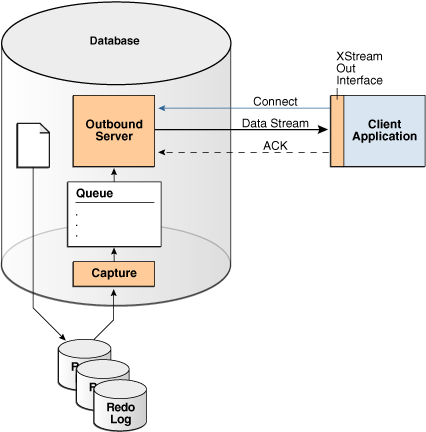
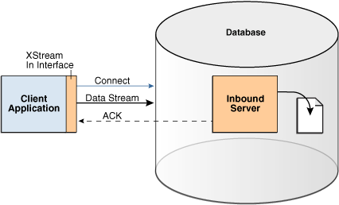
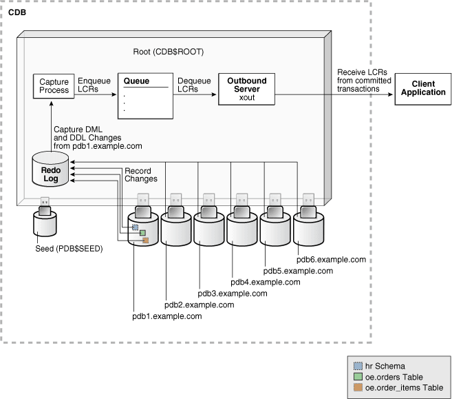
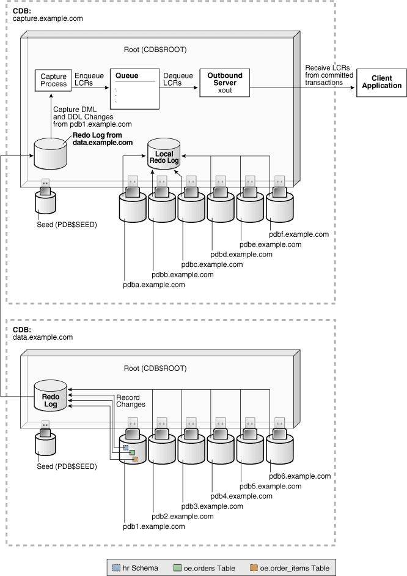

## 25 Using XStream with a CDB

**Parent topic:** [Using Oracle Features in a Multitenant Environment](using-oracle-features-in-a-multitenant-environment.md)

### About XStream

XStream consists of Oracle Database components and application programming interfaces (APIs) that enable client applications to receive data changes from an Oracle database and send data changes to an Oracle database.

These data changes can be shared between Oracle databases and other systems. The other systems include non-Oracle databases, non-RDBMS Oracle products, file systems, third party software applications, and so on. A client application is designed by the user for specific purposes and use cases.

XStream consists of two major features: XStream Out and XStream In. XStream Out provides Oracle Database components and APIs that enable you to share data changes made to an Oracle database with other systems. XStream Out can retrieve both data manipulation language (DML) and data definition language (DDL) changes from the redo log and send these changes to a client application that uses the APIs, as shown in the following figure.

Figure 25-1 XStream Out



> The illustration shows an Oracle Database with XStream Out sending data changes to a client application.
>
> [  
> Copyright © 2017, 2025, Oracle and/or its affiliates.](https://docs.oracle.com/en/database/oracle/oracle-database/dcommon/html/cpyr.htm)


XStream In provides Oracle Database components and APIs that enable you to share data changes made to other systems with an Oracle database. XStream In can apply these changes to database objects in the Oracle database, as shown in the following figure.

Figure 25-2 XStream In



> The illustration shows an external data source sending data changes to an Oracle Database with XStream In.
>
> [  
> Copyright © 2017, 2025, Oracle and/or its affiliates.](https://docs.oracle.com/en/database/oracle/oracle-database/dcommon/html/cpyr.htm)


XStream uses the capture and apply features of the Oracle database. These features enable the following functionality for XStream:

- The logical change record (LCR) format for streaming database changes
	An LCR is a message with a specific format that describes a database change. If the change was a data manipulation language (DML) operation, then a row LCR encapsulates each row change resulting from the DML operation. One DML operation might result in multiple row changes, and so one DML operation might result in multiple row LCRs. If the change was a data definition language (DDL) operation, then a single DDL LCR encapsulates the DDL change.
- Rules and rule sets that control behavior, including inclusion and exclusion rules
	Rules enable the filtering of database changes at the database level, schema level, table level, and row/column level.
- Rule-based transformations that modify captured data changes
- Support for most data types in the database, including LOBs, `LONG`, `LONG` `RAW`, and `XMLType`
- Customized configurations, including multiple inbound streams to a single database instance, multiple outbound streams from a single database instance, multiple outbound streams from a single capture process, and so on
- Full-featured apply for XStream In, including apply parallelism for optimal performance, SQL generation, conflict detection and resolution, error handling, and customized apply with apply handlers

Note:

In both XStream Out and XStream In configurations, the client application must use a dedicated server connection.

### System-Created Rules and a Multitenant Environment

A multitenant environment enables an Oracle database to contain a portable set of schemas, objects, and related structures that appears logically to an application as a separate database. This self-contained collection is called a pluggable database (PDB). A CDB contains PDBs.

It can also contain application containers. An application container is an optional component of a CDB that consists of an application root and the application PDBs associated with it. An application container stores data for one or more applications. An application container shares application metadata and common data. In a CDB, each of the following is a container: the CDB root, each PDB, each application root, and each application PDB.

In a CDB, LCRs can contain the global name of the container where the change originated in the `source_database_name` attribute and the global name of the CDB root in the `root_name` attribute. The rules for XStream components can consider these attributes.

- System-Created Rules in a CDB and XStream Out  
	In a CDB, XStream Out must be configured in the CDB root. Therefore, the PL/SQL procedures in the `DBMS_XSTREAM_ADM` package that create system-created rules must be run in the CDB root while connected as a common user.
- System-Created Rules in a CDB and XStream In  
	You can configure XStream In in the root or in any container in a CDB.

**Parent topic:** Using XStream with a CDB

#### System-Created Rules in a CDB and XStream Out

In a CDB, XStream Out must be configured in the CDB root. Therefore, the PL/SQL procedures in the `DBMS_XSTREAM_ADM` package that create system-created rules must be run in the CDB root while connected as a common user.

Excluding the procedures that create rules for propagations, the procedures that create system-created rules for XStream Out, such as the `ADD_GLOBAL_RULES` procedure, include the key parameters in the following table:

Table 25-1 Key Procedure Parameters for System-Created Rules in a CDB

| Parameter | Description |
| --- | --- |
| `source_database` | The global name of the source database. In a CDB, specify the global name of the container to which the rules pertain. The container can be the CDB root, a PDB, an application root, or an application PDB. The following are examples: `mycdb.example.com` or `hrpdb.example.com`. |
| `source_root_name` | The global name of the CDB root in the source CDB. The following are examples: `mycdb.example.com`. |
| `source_container_name` | The short name of the source container. The container can be the CDB root, a PDB, an application root, or an application PDB. The following are examples: `CDB$ROOT` or `hrpdb`. |

If you do not include the domain name when you specify `source_database` or `source_root_name`, then the procedure appends it to the name automatically. For example, if you specify `DBS1` and the domain is `.EXAMPLE.COM`, then the procedure specifies `DBS1.EXAMPLE.COM` automatically.

The combination of these key parameters determines which containers' changes XStream Out captures and streams to the client application, based on the rules generated by the procedures. Regardless of the settings for these parameters, system-generated rules can still limit the changes captured and streamed to specific schemas and tables.

Local capture means that a capture process runs on the source CDB. In a local capture configuration, the `source_root_name` parameter specifies the global name of the CDB root in the local CDB. If this parameter is `NULL`, then the global name of the CDB root in the local CDB is specified automatically. The resulting rules include a condition for the global name of the CDB root in the current CDB.

Downstream capture means that a capture process runs on a CDB other than the source CDB. In a downstream capture configuration, the `source_root_name` parameter must be non- `NULL`, and it must specify the global name of the CDB root in the remote source CDB. The resulting rules include a condition for the global name of the CDB root in the remote CDB. If this parameter is `NULL`, then local capture is assumed.

The following table describes the rule conditions for various `source_database` and `source_container_name` parameter settings in a local capture configuration.

Table 25-2 Local Capture and XStream Out Container Rule Conditions

| source\_database Parameter Setting | source\_container\_name Parameter Setting | Description |
| --- | --- | --- |
| `NULL` | `NULL` | XStream Out captures and streams changes made in any container in the local CDB, including the CDB root, all PDBs, all application roots, and all application PDBs. |
| non- `NULL` | `NULL` | XStream Out captures and streams changes made in the specified source container of the local CDB. The source container can be the CDB root, a PDB, an application root, or an application PDB. The `DBMS_XSTREAM_ADM` procedure queries the `CDB_PDBS` view and `CDB_PROPERTIES` view to determine the `source_container_name` value. |
| `NULL` | non- `NULL` | XStream Out captures and streams changes made in the specified source container of the local CDB. The source container can be the CDB root, a PDB, an application root, or an application PDB. The `DBMS_XSTREAM_ADM` procedure queries the `CDB_PDBS` view and `CDB_PROPERTIES` view to determine the `source_database` value. |
| non- `NULL` | non- `NULL` | XStream Out captures and streams changes made in the specified source container of the local CDB. The source container can be the CDB root, a PDB, an application root, or an application PDB.  If the prefix of the `source_database` value is different from the `source_container_name` value, then the resulting rules include a condition for the `source_database` value, and an internal table maps the `source_database` value to the `source_container_name` value. |

The following table describes the rule conditions for various `source_database` and `source_container_name` parameter settings in a downstream capture configuration.

Table 25-3 Downstream Capture and XStream Out Container Rule Conditions

| source\_database Parameter Setting | source\_container\_name Parameter Setting | Description |
| --- | --- | --- |
| `NULL` | `NULL` | XStream Out captures and streams changes made in any container in the remote source CDB, including the CDB root, all PDBs, all application roots, and all application PDBs. |
| non- `NULL` | `NULL` | XStream Out captures and streams changes made in the specified source container of the remote source CDB. The source container can be the CDB root, a PDB, an application root, or an application PDB. The `DBMS_XSTREAM_ADM` procedure derives the `source_container_name` value from the prefix of `source_database` value. |
| `NULL` | non- `NULL` | The `DBMS_XSTREAM_ADM` procedure raises an error. |
| non- `NULL` | non- `NULL` | XStream Out captures and streams changes made in the specified source container of the remote source CDB. The source container can be the CDB root, a PDB, an application root, or an application PDB.  If the prefix of the `source_database` value is different from the `source_container_name` value, then the resulting rules include a condition for the `source_database` value, and an internal table maps the `source_database` value to the `source_container_name` value. |

#### System-Created Rules in a CDB and XStream In

You can configure XStream In in the root or in any container in a CDB.

Typically, an inbound server does not use rule sets or rules. Instead, it usually processes all LCRs that it receives from its client application. An inbound server can apply changes to the current container only. Therefore, if an inbound server is configured in the CDB root, then it can apply changes only to the CDB root. If an inbound server is configured in a PDB, then it can apply changes only to that PDB. If an inbound server is configured in an application root, then it can apply changes only to that application root, and if an inbound server is configured in an application PDB, then it can apply changes only to that application PDB.

### XStream Out and a Multitenant Environment

A multitenant environment enables a database to contain a portable set of schemas, objects, and related structures that appears logically to an application as a separate database.

This self-contained collection is called a pluggable database (PDB). A multitenant container database (CDB) contains PDBs. In a CDB, XStream Out functions much the same as it does in a non-CDB.

A CDB can also contain application containers. An application container is an optional component of a CDB that consists of an application root and all application PDBs associated with it. An application container stores data for one or more applications. An application container shares application metadata and common data. In a CDB, each of the following is a container: the CDB root, each PDB, each application root, and each application PDB.

The main differences in the way XStream Out functions in a CDB and non-CDB are:

- XStream Out must be configured only in the CDB root.
- XStream Out can see changes made to any container within the CDB.
- XStream Out capture rules can limit the LCRs to those that are needed for the client application. The system-generated capture rules select the appropriate LCRs based on the parameters that were passed to the `ADD_OUTBOUND` and `CREATE_OUTBOUND` procedures in the `DBMS_XSTREAM_ADM` package. You can use the `ADD_*_RULES` procedures in the same package for more fine-grained control over the rules used by the XStream Out components.
- The user who performs XStream Out tasks must be a common user.

Unplug and Plug Operations in an XStream Environment

When a PDB, application root, or application PDB involved with XStream Out is unplugged from its CDB and plugged into another CDB, any capture process or outbound server is not considered part of the container. You must configure the capture process and outbound server again in the other CDB.

If an outbound server is configured in a different database than the capture process, then unplug and plug operations have additional considerations.

For this example, assume the following:

- A CDB named `CDB1` contains PDB `PDB1`.
- A capture process is configured in `CDB1`, and it sends LCRs from `PDB1` to an outbound server in a CDB named `CDB2`.
- You unplug `PDB1` from `CDB1`, and then plug it into a CDB named `CDB3`.

To continue delivering LCRs from `PDB1` to the outbound server in `CDB2`, you must configure a new capture process in `CDB3` to capture and send LCRs to `CDB2`.

The rules used by the outbound server in database B must be altered to change references to the root of `CDB1` to the root of `CDB3`. In addition, if `PDB1` was given a different name in `CDB3`, then the rules must be altered to reflect the new PDB name.

Application Containers in an XStream Environment

When a CDB has one or more application containers, XStream Out must be configured in the CDB root, and XStream Out can capture changes made in any container in the CDB, including the application roots and application PDBs. Changes captured in an application container can be sent to containers of any type, including PDBs, application roots, and application PDBs.

When replicating changes from one application root to another application root, XStream can replicate `ALTER PLUGGABLE DATABASE APPLICATION` statements. To avoid errors, the target application root that applies the statements must have the same application installed as the source application root, and the application name must be identical in both application roots.

To avoid errors when replicating changes from an application root to a container that is not an application root, you must ensure that `ALTER PLUGGABLE DATABASE APPLICATION` statements are not replicated.

With the XStream OCI API, you can control whether `ALTER PLUGGABLE DATABASE APPLICATION` statements are replicated using the `OCIXStreamOutAttach` function and the `OCILCRHeaderGet` function. With the XStream Java API, you can control this behavior using the `mode` parameter in the `XStreamOut.attach` method.

### Configuring XStream Out in a CDB

When you configure XStream Out in a CDB, you must decide which database changes will be captured by XStream Out and sent to the client application.

XStream Out can stream all database changes for all containers, including the CDB root and all PDBs, application roots, and application PDBs, or XStream Out can stream the changes from specific containers. In addition, you can configure XStream Out with local capture, or you can configure it with downstream capture to offload the work required to capture changes from the source database.

The following restrictions apply when you configure XStream Out in a CDB:

- The capture process and outbound server must be in the CDB root.
- The capture process and outbound server must be in the same CDB.
- Each container in the CDB must be open during XStream Out configuration.
- When changes made to an application root are captured, you must ensure that `ALTER PLUGGABLE DATABASE APPLICATION` statements are replicated only to other application roots.

In addition, ensure that you create the XStream administrator properly for a CDB.

Note:

When a container is created using a non-CDB, any XStream Out components from the non-CDB cannot be used in the container. You must drop and re-create the XStream Out components, including the capture process and outbound servers, in the CDB root.

- Configuring XStream Out with Local Capture in a CDB  
	An example illustrates configuring XStream Out with local capture in a CDB.
- Configuring XStream Out with Downstream Capture in CDBs  
	Using downstream capture, the XStream Out components can reside in databases other than the source database.

**Parent topic:** Using XStream with a CDB

#### Configuring XStream Out with Local Capture in a CDB

An example illustrates configuring XStream Out with local capture in a CDB.

Prerequisites

Before configuring XStream Out, ensure that all containers in the CDB are in open read/write mode during XStream Out configuration.

Assumptions

This section makes the following assumptions:

- The capture process will be a local capture process, and it will run on the same database as the outbound server.
- The name of the outbound server is `xout`.
- Data manipulation language (DML) and data definition language (DDL) changes made to the `oe.orders` and `oe.order_items` tables in PDB `pdb1.example.com` are sent to the outbound server.
- DML and DDL changes made to the `hr` schema in the PDB `pdb1.example.com` are sent to the outbound server.

Figure 25-3 provides an overview of this XStream Out configuration.

Figure 25-3 Sample XStream Out Configuration Created Using CREATE\_OUTBOUND for a PDB



> This illustration shows a sample XStream Out configuration that can be configured using the `CREATE_OUTBOUND` procedure. The illustration shows a client application and an Oracle CDB. The Oracle CDB includes the following components:
>
> - The root container of the CDB
> - The PDBs `pdb1.example.com` and `pdb2.example.com`
> - A redo log that records the changes made to objects in the PDBs.
> - A capture process that captures DML and DDL changes to the `hr` schema, the `oe.orders` table, and the `oe.order_items` table. from the `pdb1.example.com` PDB. The capture process converts the changes to logical change records (LCRs) and enqueues the LCRs.
> - A queue that stores the LCRs that were captured by the capture process
> - An outbound server named `xout` that dequeues LCRs from the queue. The client application receives the dequeued LCRs.


To create an outbound server using the `CREATE_OUTBOUND` procedure:

1. In SQL\*Plus, connect to the root in the CDB (not to the PDB `pdb1.example.com`) as the XStream administrator.
2. Create the outbound server and other XStream components.
	1. Ensure that all containers in the source CDB are in open read/write mode.
		2. Run the `CREATE_OUTBOUND` procedure.
		Given the assumptions for this example, run the following `CREATE_OUTBOUND` procedure:
		```
		DECLARE
		  tables  DBMS_UTILITY.UNCL_ARRAY;
		  schemas DBMS_UTILITY.UNCL_ARRAY;
		BEGIN
		    tables(1)  := 'oe.orders';
		    tables(2)  := 'oe.order_items';
		    schemas(1) := 'hr';
		  DBMS_XSTREAM_ADM.CREATE_OUTBOUND(
		    server_name     =>  'xout',
		    source_database =>  'pdb1.example.com',
		    table_names     =>  tables,
		    schema_names    =>  schemas);
		END;
		/
		```
		Note:
		To capture changes in all containers in a CDB, including the CDB root, all PDBs, all application roots, and all application PDBs, and send those changes to the XStream client application, you can omit the `source_database` parameter when you run the `CREATE_OUTBOUND` procedure.
		3. After the `CREATE_OUTBOUND` procedure completes successfully, optionally change the open mode of one or more containers if necessary.
	Running the procedure in Step b performs the following actions:
	- Configures supplemental logging for the `oe.orders` and `oe.order_items` tables and for all tables in the `hr` schema in the `pdb1.example.com` PDB.
		- Creates a queue with a system-generated name that is used by the capture process and the outbound server.
		- Creates and starts a capture process with a system-generated name with rule sets that instruct it to capture DML and DDL changes to the `oe.orders` table, the `oe.order_items` table, and the `hr` schema from the `pdb1.example.com` PDB.
		- Creates and starts an outbound server named `xout` with rule sets that instruct it to send DML and DDL changes to the `oe.orders` table, the `oe.order_items` table, and the `hr` schema to the client application.
		- Sets the current user as the connect user for the outbound server. In this example, the current user is the XStream administrator. The client application must connect to the database as the connect user to interact with the outbound server.
	Note:
	The `server_name` value cannot exceed 30 bytes.
	Tip:
	To capture and send all database changes from the `pdb1.example.com` database to the outbound server, specify `NULL` (the default) for the `table_names` and `schema_names` parameters.
3. Create and run the client application that will connect to the outbound server in the root of the CDB and receive the LCRs.
	When you run the client application, the outbound server is started automatically.

#### Configuring XStream Out with Downstream Capture in CDBs

Using downstream capture, the XStream Out components can reside in databases other than the source database.

When you have multiple CDBs, the source database can be in one CDB, and you can use downstream capture to capture the changes in another CDB.

Prerequisites

Before configuring XStream Out, the following prerequisites must be met:

- Ensure that all containers in the CDB are in open read/write mode during XStream Out configuration.
- This example uses downstream capture. Therefore, you must configure log file transfer from the source database to a downstream database.
- If you want to use real-time downstream capture, then you must also add the required standby redo logs.

Assumptions

This section makes the following assumptions:

- The name of the outbound server is `xout`.
- The queue used by the outbound server is `c##xstrmadmin.xstream_queue`.
- The source database is the PDB `pdb1.example.com` in the CDB `data.example.com`.
- The capture process runs in the CDB `capture.example.com`.
- The outbound server runs in the CDB `capture.example.com`.
- DML and DDL changes made to the `oe.orders` and `oe.order_items` tables from the PDB `pdb1.example.com` are sent to the outbound server.
- DML and DDL changes made to the `hr` schema from the PDB `pdb1.example.com` are sent to the outbound server.

The following figure gives an overview of this XStream Out configuration.

Figure 25-4 Sample XStream Out Configuration Using Multiple CDBs and Downstream Capture



> This illustration shows a sample XStream Out configuration that can be configured using the `ADD_OUTBOUND` procedure. The illustration shows a client application and the following three Oracle CDBs:
>
> - The source database contains a redo log that records the changes for the `hr` schema, the `oe.orders` table, and the `oe.order_items` table.
> - The capture database can be the source database, the outbound server database, or a third database. The capture database contains the following components:
> 	- A capture process capturing changes from the redo log of the source database. If the capture database and the source database are the same, then a local capture process captures changes in the redo log at the source database. If the capture database is the destination database or a third database, then the source database redo log is shipped to the capture database, and a downstream capture process captures changes in this redo log.
> 		- The capture process converts the changes to logical change records (LCRs) and enqueues the LCRs.
> 		- If the capture database and the outbound server database are different databases, then a propagation propagates the LCRs to a queue at the outbound server database. If the capture database and outbound server database are the same, then the propagation is not needed.
> - The outbound server database contains the following:
> 	- The queue that contains LCRs that were captured by the capture process.
> 		- An outbound server named `xout` that dequeues LCRs from the queue. The client application receives the dequeued LCRs.


To configure XStream Out with downstream capture in CDBs:

1. In SQL\*Plus, connect to the root of the downstream capture CDB as the XStream administrator.
	In this example. the downstream capture CDB is `capture.example.com`.
2. Create the queue that will be used by the capture process.
	For example, run the following procedure:
	```
	BEGIN
	  DBMS_XSTREAM_ADM.SET_UP_QUEUE(
	    queue_table => 'c##xstrmadmin.xstream_queue_table',
	    queue_name  => 'c##xstrmadmin.xstream_queue');
	END;
	/
	```
3. Optionally, create the database link from the root in the downstream capture CDB to the root in the source CDB.
	In this example, create a database link from the root in `capture.example.com` to the root in `data.example.com`. For example, if the user `c##xstrmadmin` is the XStream administrator on both databases, then create the following database link:
	```
	CREATE DATABASE LINK data.example.com CONNECT TO c##xstrmadmin 
	   IDENTIFIED BY password USING 'data.example.com';
	```
4. Ensure that all containers in the source CDB are in open read/write mode.
5. If you did not create the database link in Step [^1], then you must complete additional steps in the root of the source CDB.
	These steps are not required if you created the database link in Step [^1].
	Run the `BUILD` procedure and ensure that required supplemental logging is specified for the database objects in the source CDB:
	1. Connect to the root in the source CDB as the XStream administrator.
		2. Run the `DBMS_CAPTURE_ADM.BUILD` procedure. For example:
		```
		SET SERVEROUTPUT ON
		DECLARE
		  scn  NUMBER;
		BEGIN
		  DBMS_CAPTURE_ADM.BUILD(
		    first_scn => scn);
		  DBMS_OUTPUT.PUT_LINE('First SCN Value = ' || scn);
		END;
		/
		First SCN Value = 409391
		```
		This procedure displays the valid first SCN value for the capture process that will be created in the root in the `capture.example.com` CDB. Make a note of the SCN value returned because you will use it when you create the capture process in Step [^2].
		3. Ensure that required supplemental logging is specified for the database objects in the source CDB.
		For this example, ensure that supplemental logging is configured for the `hr` schema, the `oe.orders` table, and the `oe.order_items` table in the `pdb1.example.com` PDB.
6. While connected to the root in the downstream capture CDB, create the capture process.
	For example, run the following procedure to create the capture process while connected as the XStream administrator to `capture.example.com`:
	```
	BEGIN
	  DBMS_CAPTURE_ADM.CREATE_CAPTURE(
	    queue_name         => 'c##xstrmadmin.xstream_queue',
	    capture_name       => 'real_time_capture',
	    rule_set_name      => NULL,
	    start_scn          => NULL,
	    source_database    => NULL,
	    use_database_link  => TRUE,
	    first_scn          => NULL,
	    logfile_assignment => 'implicit',
	    source_root_name   => 'data.example.com',
	    capture_class      => 'xstream');
	END;
	/
	```
	If you did not create a database link in Step [^1], then specify the SCN value returned by the `DBMS_CAPTURE_ADM.BUILD` procedure for the `first_scn` parameter.
	Do not start the capture process.
7. After the capture process is created, optionally change the open mode of one or more PDBs if necessary.
8. Run the `ADD_OUTBOUND` procedure.
	Given the assumption for this section, run the following `ADD_OUTBOUND` procedure:
	```
	DECLARE
	  tables  DBMS_UTILITY.UNCL_ARRAY;
	  schemas DBMS_UTILITY.UNCL_ARRAY;
	BEGIN
	    tables(1)  := 'oe.orders';
	    tables(2)  := 'oe.order_items';
	    schemas(1) := 'hr';
	  DBMS_XSTREAM_ADM.ADD_OUTBOUND(
	    server_name           =>  'xout',
	    queue_name            =>  'c##xstrmadmin.xstream_queue',
	    source_database       =>  'pdb1.example.com',
	    table_names           =>  tables,
	    schema_names          =>  schemas,
	    source_root_name      => 'data.example.com',
	    source_container_name => 'pdb1');
	END;
	/
	```
	Running this procedure performs the following actions:
	- Creates an outbound server named `xout`. The outbound server has rule sets that instruct it to send DML and DDL changes to the `oe.orders` table, the `oe.order_items` table, and the `hr` schema to the client application. The rules specify that these changes must have originated at the PDB `pdb1.example.com` in the CDB `data.example.com`. The outbound server dequeues LCRs from the queue `c##xstrmadmin.xstream_queue`.
		- Sets the current user as the `connect_user` for the outbound server. In this example, the `current_user` is the XStream administrator. The client application must connect to the database as the `connect_user` to interact with the outbound server.
	Note:
	The `server_name` value cannot exceed 30 bytes.
9. Create and run the client application that will connect to the outbound server and receive the LCRs.
	When you run the client application, the outbound server is started automatically at the downstream capture CDB.

### XStream In and a Multitenant Environment

A multitenant environment enables an Oracle database to contain a portable set of schemas, objects, and related structures that appears logically to an application as a separate database.

This self-contained collection is called a pluggable database (PDB). A multitenant container database (CDB) contains PDBs. It can also contain application containers. An application container is an optional component of a CDB that consists of an application root and all application PDBs associated with it. An application container stores data for one or more applications. An application container shares application metadata and common data. In a CDB, each of the following is a container: the CDB root, each PDB, each application root, and each application PDB.

In a CDB, the inbound server is restricted to receiving LCRs from one source database and only executing changes in the current container (one PDB, one application root, one application PDB, or the CDB root). A single inbound server cannot apply changes to more than one container in a CDB.

When the inbound server is in the CDB root, the apply user must be a common user. When the inbound server is in an application root, the apply user must be a common user or an application common user. When the inbound server is in a PDB or application PDB, the apply user can be a common user or a local user.

Note:

XStream does not synchronize changes done in the application root container. Do not use the XStream In replication to replicate operations done in the application root container. You can manually apply these changes in the application root containers in the target. Note that the operations done in the PDBs can still be replicated.

[^1]: Optionally, create the database link from the root in the downstream capture CDB to the root in the source CDB.

In this example, create a database link from the root in `capture.example.com` to the root in `data.example.com`. For example, if the user `c##xstrmadmin` is the XStream administrator on both databases, then create the following database link:   

```
CREATE DATABASE LINK data.example.com CONNECT TO c##xstrmadmin 
   IDENTIFIED BY password USING 'data.example.com';
```

[^undefined]: Ensure that all containers in the source CDB are in open read/write mode.

[^undefined]: If you did not create the database link in Step 3, then you must complete additional steps in the root of the source CDB.

These steps are not required if you created the database link in Step 3.

Run the `BUILD` procedure and ensure that required supplemental logging is specified for the database objects in the source CDB:

1. Connect to the root in the source CDB as the XStream administrator.
2. Run the `DBMS_CAPTURE_ADM.BUILD` procedure. For example:
	```
	SET SERVEROUTPUT ON
	DECLARE
	  scn  NUMBER;
	BEGIN
	  DBMS_CAPTURE_ADM.BUILD(
	    first_scn => scn);
	  DBMS_OUTPUT.PUT_LINE('First SCN Value = ' || scn);
	END;
	/
	First SCN Value = 409391
	```
	This procedure displays the valid first SCN value for the capture process that will be created in the root in the `capture.example.com` CDB. Make a note of the SCN value returned because you will use it when you create the capture process in Step 6.
3. Ensure that required supplemental logging is specified for the database objects in the source CDB.
	For this example, ensure that supplemental logging is configured for the `hr` schema, the `oe.orders` table, and the `oe.order_items` table in the `pdb1.example.com` PDB.

[^2]: While connected to the root in the downstream capture CDB, create the capture process.

For example, run the following procedure to create the capture process while connected as the XStream administrator to `capture.example.com`:

```
BEGIN
  DBMS_CAPTURE_ADM.CREATE_CAPTURE(
    queue_name         => 'c##xstrmadmin.xstream_queue',
    capture_name       => 'real_time_capture',
    rule_set_name      => NULL,
    start_scn          => NULL,
    source_database    => NULL,
    use_database_link  => TRUE,
    first_scn          => NULL,
    logfile_assignment => 'implicit',
    source_root_name   => 'data.example.com',
    capture_class      => 'xstream');
END;
/
```

If you did not create a database link in Step 3, then specify the SCN value returned by the `DBMS_CAPTURE_ADM.BUILD` procedure for the `first_scn` parameter.

Do not start the capture process.

[^undefined]: After the capture process is created, optionally change the open mode of one or more PDBs if necessary.

[^undefined]: Run the `ADD_OUTBOUND` procedure.

Given the assumption for this section, run the following `ADD_OUTBOUND` procedure:

```
DECLARE
  tables  DBMS_UTILITY.UNCL_ARRAY;
  schemas DBMS_UTILITY.UNCL_ARRAY;
BEGIN
    tables(1)  := 'oe.orders';
    tables(2)  := 'oe.order_items';
    schemas(1) := 'hr';
  DBMS_XSTREAM_ADM.ADD_OUTBOUND(
    server_name           =>  'xout',
    queue_name            =>  'c##xstrmadmin.xstream_queue',
    source_database       =>  'pdb1.example.com',
    table_names           =>  tables,
    schema_names          =>  schemas,
    source_root_name      => 'data.example.com',
    source_container_name => 'pdb1');
END;
/
```

Running this procedure performs the following actions:

- Creates an outbound server named `xout`. The outbound server has rule sets that instruct it to send DML and DDL changes to the `oe.orders` table, the `oe.order_items` table, and the `hr` schema to the client application. The rules specify that these changes must have originated at the PDB `pdb1.example.com` in the CDB `data.example.com`. The outbound server dequeues LCRs from the queue `c##xstrmadmin.xstream_queue`.
- Sets the current user as the `connect_user` for the outbound server. In this example, the `current_user` is the XStream administrator. The client application must connect to the database as the `connect_user` to interact with the outbound server.

Note:

The `server_name` value cannot exceed 30 bytes.

[^undefined]: Create and run the client application that will connect to the outbound server and receive the LCRs.

When you run the client application, the outbound server is started automatically at the downstream capture CDB.