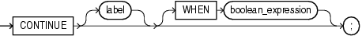

## CONTINUE Statement

The `CONTINUE` statement exits the current iteration of a loop, either conditionally or unconditionally, and transfers control to the next iteration of either the current loop or an enclosing labeled loop.

If a `CONTINUE` statement exits a cursor `FOR` loop prematurely (for example, to exit an inner loop and transfer control to the next iteration of an outer loop), the cursor closes (in this context, `CONTINUE` works like `GOTO`).

Note:

As of Oracle Database 11g Release 1, `CONTINUE` is a PL/SQL keyword. If your program invokes a subprogram named `CONTINUE`, you get a warning.

Restrictions on CONTINUE Statement

- A `CONTINUE` statement must be inside a `LOOP` statement.
- A `CONTINUE` statement cannot cross a subprogram or method boundary.

Topics

Syntax

continue\_statement::=



> ```
> CONTINUE [ label ] [ WHEN boolean_expression ] ;
> ```
>
> [  
> Copyright © 1996, 2026, Oracle and/or its affiliates.](https://docs.oracle.com/en/database/oracle/oracle-database/dcommon/html/cpyr.htm)


([boolean\_expression::=](expression.md))

Semantics

continue\_statement

label

Name that identifies either the current loop or an enclosing loop (see " [Basic LOOP Statement](basic-LOOP-statement.md) ").

Without `label`, the `CONTINUE` statement transfers control to the next iteration of the current loop. With `label`, the `CONTINUE` statement transfers control to the next iteration of the loop that `label` identifies.

WHEN boolean\_expression

Without this clause, the `CONTINUE` statement exits the current iteration of the loop unconditionally. With this clause, the `CONTINUE` statement exits the current iteration of the loop if and only if the value of `boolean_expression` is `TRUE`.

Examples

- [Example 4-13](loop-statements.md), "CONTINUE Statement in Basic LOOP Statement"
- [Example 4-14](loop-statements.md), "CONTINUE WHEN Statement in Basic LOOP Statement"
- [Example 4-27](loop-statements.md), "CONTINUE WHEN Statement in Inner FOR LOOP Statement"

Related Topics

In this chapter:

- " [Basic LOOP Statement](basic-LOOP-statement.md) "
- " [Cursor FOR LOOP Statement](cursor-FOR-LOOP-statement.md) "
- " [EXIT Statement](EXIT-statement.md) "
- " [Expression](expression.md) "
- " [FOR LOOP Statement](FOR-LOOP-statement.md) "
- " [WHILE LOOP Statement](WHILE-LOOP-statement.md) "

In other chapters:

- " [LOOP Statements](loop-statements.md) "
- " [CONTINUE Statement](loop-statements.md) "
- " [CONTINUE WHEN Statement](loop-statements.md) "