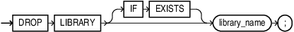

## DROP LIBRARY Statement

The `DROP` `LIBRARY` statement drops an external procedure library from the database.

Topics

Prerequisites

You must have the `DROP` `ANY` `LIBRARY` system privilege.

Syntax

drop\_library::=



> ```
> DROP LIBRARY [ IF EXISTS ] library_name ;
> ```
>
> [  
> Copyright © 1996, 2026, Oracle and/or its affiliates.](https://docs.oracle.com/en/database/oracle/oracle-database/dcommon/html/cpyr.htm)


Semantics

library\_name

Name of the external procedure library being dropped.

IF EXISTS

Drops the library if it exists. If no such library exists, the statement is ignored without error.

Example

Example 14-33 Dropping a Library

The following statement drops the `ext_lib` library, which was created in " [CREATE LIBRARY Statement](CREATE-LIBRARY-statement.md) ":

```
DROP LIBRARY IF EXISTS ext_lib;
```

If `ext_lib` does not already exist, this statement is ignored without error. Note that the output message is the same whether or not the library exists (in this case, `Library dropped.`).